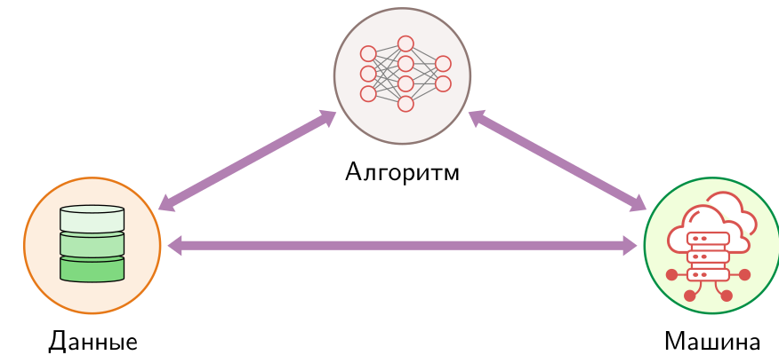

# Таксономия D·A·M

Система, которая работает медленно, редко сообщает, почему. Простаивающий ускоритель может быть следствием голодающего входного конвейера (данные), алгоритма с недостаточной арифметической интенсивностью (алгоритм) или перегруженной шины памяти (машина). Это приложение формализует диагностическую таксономию книги для одного узла: оно сопоставляет симптомы профилировщика и измерения с осью, которая реально ограничивает исполнение, до того как начинается оптимизация. Читатель должен прийти с тремя осями из вводных глав и железным законом, который их количественно описывает.

## Как пользоваться этим приложением

Используйте таксономию D·A·M, когда система не выполняет целевой показатель производительности, стоимости или качества, а причина пока неясна. Работайте с рамкой в четыре прохода:

1. **Зафиксируйте симптом и эксплуатационный бюджет**: запишите пропущенную сквозную цель, нагрузку и контекст развертывания.
2. **Локализуйте кандидатную ось или границу**: для первого прохода используйте [«Справочник по осям D·A·M»](appendix_dam.md#tbl-dam-components-ref), а когда свидетельства пересекают оси, — [«Справочник по пересечениям D·A·M»](appendix_dam.md#tbl-dam-intersections).
3. **Проверьте гипотезу**: сопоставьте свидетельства с железным законом и арифметической интенсивностью, затем соберите подтверждающие измерения с помощью [«Карты инструментов D·A·M»](appendix_dam.md#tbl-dam-tooling) и [«Скрининговых индикаторов D·A·M»](appendix_dam.md#tbl-dam-scorecard).
4. **Вмешайтесь и измерьте заново**: выберите рычаг из таблицы [«Что работает, а что потрачено впустую»](appendix_dam.md#tbl-bottleneck-actions) и повторите сквозное измерение. Если цель не улучшилась, пересмотрите гипотезу.

Симптом определяет наиболее полезную точку входа. Низкая загрузка ускорителя или медленная доставка батчей должна начинаться с разделов [«Эмпирические правила»](appendix_dam.md#sec-appdx-dam-taxonomy-rules-thumb-f94f) и [«Диагностика в эксплуатации»](appendix_dam.md#sec-appdx-dam-taxonomy-production-troubleshooting-02fb). Пропущенный целевой уровень обслуживания (SLO) должен перейти от времени фаз и глубины очереди в [«Диагностической матрице D·A·M»](appendix_dam.md#tbl-dam-troubleshooting) к соответствующему члену железного закона. Плато качества стоит проверить по границе «данные–алгоритм» и по разделу [«Законы масштабирования и Roofline»](appendix_dam.md#sec-appdx-dam-taxonomy-scaling-laws-vs-roofline-b290), прежде чем выделять больше вычислений. В любом случае метка оси — это гипотеза, а не приговор: оси перекрываются, и полезная диагностика может назвать одновременно доминирующую ось и эффект границы.

## Сводка диагностики

Таксономия напрямую связана с железным законом ML-систем, введенным в [«Железном законе систем машинного обучения»](01_introduction.md#sec-introduction-iron-law-ml-systems-c32a). [«Справочник по осям D·A·M»](appendix_dam.md#tbl-dam-components-ref) суммирует роль, основное физическое ограничение и основной путь оптимизации для каждой оси.

| **Ось**           |        **Роль**        |    **Физическое ограничение**    | **Оптимизация с высоким рычагом**                  |
|:------------------|:----------------------:|:--------------------------------:|:---------------------------------------------------|
| **Данные (D)**    | Информация (топливо)   | Объем, качество, скорость поступления | Отбор данных ([«Отбор данных»](09_data_selection.md#sec-data-selection))               |
| **Алгоритм (A)**  | Логика (чертеж)        | Операции и зависимости           | Сжатие моделей ([«Сжатие моделей»](10_model_compression.md#sec-model-compression))         |
| **Машина (M)**    | Физика (двигатель)     | Вычисления, память, ввод-вывод   | Аппаратное ускорение ([«Аппаратное ускорение»](11_hw_acceleration.md#sec-hardware-acceleration)) |

***Справочник по осям D·A·M**: каждая ось сопоставлена с классом ограничений и стратегией оптимизации. Сформулируйте гипотезу, подтвердите ее измерениями и затем переходите по ссылке на главу.*

Такое разделение на первом проходе полезно, но производственные системы редко страдают от узкого места, сосредоточенного на одной оси. Гораздо чаще проблема лежит на *границе* двух осей — например, в выборе формата данных, который определяет, можно ли насытить GPU, или в стратегии прореживания, которая меняет паттерн доступа к памяти. Для таких случаев нужно отображать пересечения.

## Ландшафт пересечений

Вводная глава использует [«Ландшафт пересечений D·A·M»](01_introduction.md#fig-ai-triad), чтобы задать концептуальную карту. Здесь [«Треугольник осей D·A·M»](appendix_dam.md#fig-dam-axis-triad) превращает эту карту в диагностическую последовательность. Сначала определите ось, которая ограничивает систему, а затем спросите, как вмешательство изменит две остальные.

***Треугольник осей D·A·M**: компактный диагностический вид данных, алгоритма и машины как трех взаимозависимых осей. Двунаправленные связи подчеркивают, что вмешательство по одной оси меняет ограничения на две другие.*

С учетом оси, выявленной на первом проходе, [«Справочник по пересечениям D·A·M»](appendix_dam.md#tbl-dam-intersections) раскрывает парные и тройные пересечения в конкретные инженерные приемы и их основные главы книги.

| **Зона**                                 | **Название**               | **Ключевые приемы**                                          | **Где в книге**                                            |
|:-----------------------------------------|:---------------------------|:-------------------------------------------------------------|:-----------------------------------------------------------|
| **Данные**                               | Информация                 | Форматы хранения, качество данных, распределения             | [«Инженерия данных»](04_data_engineering.md#sec-data-engineering)                                      |
| **Алгоритм**                             | Логика                     | Функции потерь, архитектуры, градиенты                       | [«Вычисления в нейронных сетях»](05_nn_computation.md#sec-neural-computation), [«Архитектуры нейронных сетей»](06_nn_architectures.md#sec-network-architectures)        |
| **Данные $\cap$ Алгоритм**               | Чему учиться                | Отбор данных, учебные планы, масштабирование с оптимальным расходом вычислений | [«Отбор данных»](09_data_selection.md#sec-data-selection), [«Обучение моделей»](08_training.md#sec-model-training)                   |
| **Данные $\cap$ Машина**                 | Как перемещать информацию  | Пропускная способность ввода-вывода, предвыборка, форматы данных | [«Инженерия данных»](04_data_engineering.md#sec-data-engineering), [«Аппаратное ускорение»](11_hw_acceleration.md#sec-hardware-acceleration)          |
| **Алгоритм $\cap$ Машина**               | Как исполнять эффективно   | Квантование, прореживание, слияние ядер, смешанная точность  | [«Фреймворки машинного обучения»](07_frameworks.md#sec-ml-frameworks), [«Сжатие моделей»](10_model_compression.md#sec-model-compression)                 |
| **Машина**                               | Физика                     | Кремний, иерархия памяти, пиковые FLOP/s                     | [«Аппаратное ускорение»](11_hw_acceleration.md#sec-hardware-acceleration)                                 |
| **Данные $\cap$ Алгоритм $\cap$ Машина** | Инженерия ML-систем        | Железный закон, Roofline, циклы обучения, обслуживание       | [«Обучение моделей»](08_training.md#sec-model-training), [«Обслуживание моделей»](13_model_serving.md#sec-model-serving), [«Бенчмаркинг»](12_benchmarking.md#sec-benchmarking) |

***Справочник по пересечениям D·A·M**: каждая зона сопоставляет конкретные приемы с осями, которые она охватывает, и с главами, которые их описывают. Парные пересечения требуют рассуждения сразу о двух областях; центр требует всех трех.*

В аббревиатуре D·A·M данные, алгоритм и машина — это оси таксономии. Они не являются математическими переменными; формальные величины по-прежнему следуют разделу [«Обозначения»](notation.md), где $D$ означает размер набора данных или число обучающих токенов.

Зоны, сосредоточенные на одной оси, содержат понятия, которые принадлежат прежде всего этой оси: форматы хранения и распределения относятся к данным, функции потерь и градиенты — к алгоритму, физика кремния и пиковые FLOP/s — к машине. Экспертиза в одной области может их ввести, но поведение развернутой системы все равно может зависеть от других осей.

Парные пересечения — там, где начинается системное мышление. Данные $\cap$ Алгоритм (*чему учиться*) охватывает отбор данных, учебные планы, активное обучение и законы масштабирования вроде Chinchilla ($D \approx 20P$ для режима плотных авторегрессионных языковых моделей, который изучался) (Hoffmann et al., 2022) — все это требует совместного рассуждения о содержании информации и емкости алгоритма. Добавление данных без учета того, может ли модель из них учиться, тратит вычисления впустую; выбор архитектур без учета доступности данных тратит инженерное время. Данные $\cap$ Машина (*как перемещать информацию*) охватывает пропускную способность ввода-вывода, стратегии предвыборки, форматы данных и инвариант энергии перемещения. Именно здесь проявляется гравитация данных: физическая стоимость перемещения байтов по иерархии памяти определяет, достаточно ли быстро можно кормить машину. Алгоритм $\cap$ Машина (*как исполнять эффективно*) включает квантование, прореживание, слияние ядер, смешанную точность и оптимизацию вычислительного графа. Стратегия прореживания, которая снижает FLOP, но разрушает паттерны доступа к памяти, может *замедлить* исполнение на реальной аппаратуре.

Центр — Данные $\cap$ Алгоритм $\cap$ Машина — это место, где сходятся все три оси. Железный закон, модель Roofline, сквозные циклы обучения, конвейеры обслуживания и целостный бенчмаркинг требуют одновременного рассуждения о потоке данных, сложности алгоритма и загрузке аппаратуры. Этот центр — не отдельный прием; это сама дисциплина.

Пока ландшафт классифицирует, где работает прием, для выявления оси, которая реально тормозит нагрузку, нужно перевести эти связи в фактическое время исполнения — это роль железного закона.

## Отображение на железный закон

Для последовательных фаз железный закон раскладывает работу по осям D·A·M на время исполнения. Здесь $T$ и $L_{\text{lat}}$ — времена в секундах; $D_{\text{vol}}$ — перемещенные байты, $\text{BW}$ — байты в секунду; $O$ — работа в FLOP, $R_{\text{peak}}$ — FLOP/s, а $\eta_{\text{hw}}$ — безразмерная эффективность аппаратуры. Эти величины соотносятся с осями так:
$$ T = \underbrace{ \frac{D_{\text{vol}}}{\text{BW}} }_{\text{Данные/Машина}} + \underbrace{ \frac{O}{R_{\text{peak}} \cdot \eta_{\text{hw}}} }_{\text{Алгоритм/Машина}} + \underbrace{ L_{\text{lat}} }_{\text{Накладные расходы между осями}} $$

Алгоритм и машина делят член вычислений, различаясь тем, какой переменной управляет инженер. Снижение общего числа операций ($O$) — рычаг алгоритма, тогда как повышение пиковой пропускной способности аппаратуры ($R_{\text{peak}}$) или ее загрузки ($\eta_{\text{hw}}$) — рычаг машины.

Это уравнение превращает отладку производительности из качественной игры в угадывание в количественную инженерную задачу. Доминирующая измеренная стоимость попадает в один из этих членов. Медленная система может перемещать слишком много данных ($D_{\text{vol}}$), не хватать пропускной способности ($\text{BW}$), выполнять слишком много операций ($O$), не использовать пиковые возможности аппаратуры ($\eta_{\text{hw}}$) или платить накладные расходы между осями ($L_{\text{lat}}$). Рычаги ниже сопоставляют конкретные оптимизации с улучшаемыми переменными.

### Рычаги по компонентам

*   Рычаг данных: сокращение перемещаемых байтов ($D_{\text{vol}}$) дедупликацией, отбором или представлением с меньшей точностью либо повышение пропускной способности ввода-вывода ($\text{BW}$).
*   Рычаг алгоритма: сокращение операций ($O$) прореживанием или уточнением архитектуры. Квантование сужает представление и может повысить пропускную способность аппаратуры; оно, как правило, не уменьшает число операций.
*   Рычаг машины: увеличение знаменателя члена вычислений за счет роста пиковой пропускной способности ($R_{\text{peak}}$) или коэффициента загрузки ($\eta_{\text{hw}}$) через слияние ядер.

### Координация D·A·M: от суммы к максимуму

Аддитивный железный закон описывает последовательное исполнение. Пусть $T_{\text{sequential}}$ обозначает время без перекрытия, а $T_{\text{pipelined}}$ — измеренное время с перекрытием. Перекрытие может сдвигать сумму к максимуму, но зависимости, конкуренция за ресурсы и неполное перекрытие удерживают измеренное время выше этой идеальной нижней границы:
$$ T_{\text{sequential}} = \frac{D_{\text{vol}}}{\text{BW}} + \frac{O}{R_{\text{peak}} \cdot \eta_{\text{hw}}} + L_{\text{lat}} \quad \xrightarrow{\text{перекрытие}} \quad T_{\text{pipelined}} \geq \max\left(\frac{D_{\text{vol}}}{\text{BW}}, \frac{O}{R_{\text{peak}} \cdot \eta_{\text{hw}}}\right) + L_{\text{lat}} $$

Задача системного инженера — заставить эти компоненты работать параллельно, а не последовательно. [«Приемы перекрытия D·A·M»](appendix_dam.md#tbl-dam-overlap) суммирует ключевые приемы координации D·A·M, которые перекрывают работу между осями:

| **Прием**               | **Перекрываемые оси D·A·M**  | **Реализация**                                                 |
|:------------------------|:-----------------------------|:---------------------------------------------------------------|
| **Предвыборка**         | D перекрывается с M          | DataLoader с `prefetch_factor`, `pin_memory=True`              |
| **Потоки CUDA**         | D перекрывается с M          | Отдельные потоки для передачи H2D и вычислений                 |
| **Асинхронная синхронизация градиентов** | M (коммуникации) перекрывается с A | Перекрытие группового AllReduce с оставшимися вычислениями обратного прохода |
| **Двойная буферизация** | D перекрывается с M          | Заполнение буфера N+1 во время вычислений на буфере N          |

***Приемы перекрытия D·A·M**: каждый прием перекрывает работу между осями, сдвигая последовательно сложенное время данных/машины и алгоритма/машины к его идеальной нижней границе — большему из двух членов. Зависимости и конкуренция ограничивают реально достижимое перекрытие.*

Перекрытие дает наибольшее относительное ускорение, когда члены времени D·A·M примерно сбалансированы. Если один член доминирует (например, при сильной привязке к памяти), перекрытие меньшего члена с большим почти ничего не даст: максимум по-прежнему определяется тем же узким местом. Такой баланс достигается вблизи $D_{\text{vol}}/\text{BW} \approx O/(R_{\text{peak}} \cdot \eta_{\text{hw}})$. Член задержки требует отдельного рассмотрения.

> **Накладные расходы, которые нельзя скрыть**
>
> Нескрытый член задержки $L_{\text{lat}}$ (запуск ядра, барьеры синхронизации, диспетчеризация в Python) содержит точки сериализации, которые нельзя полностью перекрыть. Слияние ядер может уменьшить этот член, объединяя операции, но оно не устраняет всех накладных расходов на запуск, планирование и синхронизацию.

Железный закон количественно описывает время исполнения, которое тратит каждая стадия. Но то, что задает активный потолок производительности — перемещение данных или пропускная способность арифметики, — определяется их соотношением. Это область арифметической интенсивности.

## Граница арифметической интенсивности

Граница между членом памяти *данные/машина* и членом вычислений *алгоритм/машина* не произвольна: она задается математически через арифметическую интенсивность[^fn-arithmetic-intensity-ratio] ($I$) нагрузки.

[^fn-arithmetic-intensity-ratio]: **Арифметическая интенсивность**: в этой книге термин обозначает число операций с плавающей запятой на переданный байт. Williams et al. (2009) называют измеренную величину для DRAM *операционной интенсивностью* в модели Roofline. Сравнение отношения нагрузки с точкой перехода аппаратуры ($R_{\text{peak}}/\text{BW}$) дает верхнюю оценку того, выполняется ли нагрузка с привязкой к памяти или к вычислениям.

Модель Roofline дает верхнюю границу производительности, когда трафик и достигнутые скорости измерены согласованно. В разгар производственного инцидента более быстрые скрининговые эвристики могут подсказать, какие измерения собрать следующими.

## Эмпирические правила

В разгар производственного сбоя редко есть время решать полное уравнение железного закона. Опытные системные инженеры полагаются на количественные эвристики, которые быстро сужают область поиска; пороги ниже — скрининговые сигналы, которые нужно проверять по трассам профилировщика и аппаратным счетчикам.

*   Низкая загрузка ускорителя ($<$ 80 процентов): проверьте голодание данными, CPU или запуском. Подтвердите ожиданием входного конвейера, насыщением CPU хоста, счетчиками пропускной способности памяти и разрывами в трассе.
*   Высокая загрузка ускорителя ($>$ 95 процентов): считайте узкое место машинным только тогда, когда вычислительные блоки заняты, а пропускная способность памяти не насыщена. Если пропускная способность памяти насыщена, узкое место по-прежнему лежит на границе данных и машины.
*   Если размер батча равен единице: это предупреждение, что может быть важна задержка или накладные расходы на запуск; подтвердите трассами, прежде чем объявлять узким местом сам алгоритм.
*   Низкая арифметическая интенсивность (ниже точки перехода аппаратуры): нагрузка, вероятно, ограничена памятью (граница данных и машины). Точная граница равна $R_{\text{peak}}/\text{BW}$ и зависит от аппаратуры и точности.
*   Если система работает в разработке, но падает в эксплуатации: рассматривайте дрейф данных как одну из гипотез наряду с различиями конфигурации, нагрузки, зависимостей и среды выполнения.

Распространенные промышленные метки пересекают оси. Исполнение, ограниченное памятью, находится на границе данных и машины, потому что важны и перемещенные байты, и доступная пропускная способность. Исполнение, ограниченное вычислениями, связывает работу алгоритма с пропускной способностью машины. Исполнение, ограниченное задержкой, может отражать последовательную глубину алгоритма, диспетчеризацию времени исполнения, синхронизацию или очереди.

### Диагностика узкого места

Когда профилирование выявляет доминирующий член железного закона, оптимизации должны бить именно по этой оси. [«Что работает, а что потрачено впустую»](appendix_dam.md#tbl-bottleneck-actions) сопоставляет вмешательства, которые дают сквозное ускорение, с необязательными оптимизациями, которые тратят инженерные усилия:

| **Если нагрузка...**      |              **Доминирующий член**           | **Оптимизация, которая работает**                                                                      | **Оптимизация, которая потрачена впустую**                  |
|:--------------------------|:--------------------------------------------:|:------------------------------------------------------------------------------------------------------|:------------------------------------------------------------|
| **Ограничена памятью**    |          $D_{\text{vol}}/\text{BW}$          | Квантование; структурированное прореживание; батчинг для повторного использования весов; слияние, убирающее промежуточный трафик | Более быстрый ускоритель (больше FLOP/s не поможет)         |
| **Ограничена вычислениями** | $O/(R_{\text{peak}} \cdot \eta_{\text{hw}})$ | Лучшие ядра, тензорные ядра, более быстрый ускоритель, более низкая точность                          | Больше пропускной способности памяти (это не связывающий член) |
| **Ограничена задержкой**  |               $L_{\text{lat}}$               | Сокращение последовательной глубины; слияние или асинхронная диспетчеризация; батчинг в рамках бюджета | Больше вычислений или пропускной способности, если трасса не показывает, что это связывающий член |

***Что работает, а что потрачено впустую**: оптимизация несвязывающего члена дает малое или нулевое сквозное улучшение. Большая языковая модель, ограниченная памятью, не выиграет только от дополнительных пиковых FLOP/s, хотя ускоритель с большей пропускной способностью памяти может помочь.*

Знать, что работает, значит также распознавать, что не работает. На практике команды под давлением сроков раз за разом попадают в одни и те же ловушки — уверенно оптимизируют не ту ось. Эти режимы сбоя достаточно распространены, чтобы получить собственные названия.

## Антишаблоны

Диагностика систем часто сводится к исключению. Прежде чем браться за сложные оптимизации ядер, остерегайтесь этих распространенных ловушек, которые тратят инженерное время.

*   Костыль из железа: покупка более быстрых ускорителей (*машина*), чтобы исправить медленный загрузчик данных на Python (*данные*). Новое железо просто будет простаивать быстрее.
*   Подкручивание модели: смена нейронных архитектур (*алгоритм*), когда узкое место на самом деле — сетевая пропускная способность или ввод-вывод диска.
*   Преждевременный оптимизатор: написание собственных ядер CUDA (*машина*) до проверки, не делает ли алгоритм просто слишком много лишних операций.

У каждого антишаблона одна и та же первопричина: действие до диагноза. Следующие разборы случаев показывают, как выглядит правильная диагностика — от запутанного симптома к систематическому сужению до доминирующей оси D·A·M.

## Разборы случаев D·A·M

Теоретические ограничения в производстве часто проявляются как запутанные симптомы. Эти типичные сценарии показывают, как применять таксономию. Каждый случай следует одним и тем же трем диагностическим шагам: симптом, диагноз и исправление.

### Случай 1: голодающий ускоритель (данные)

Команда выделяет большой экземпляр GPU A100, чтобы ускорить обучение, но время обучения почти не сокращается, а `nvidia-smi` показывает, что загрузка GPU колеблется между 10 и 40 процентами. Такая картина указывает на голодание ускорителя, но не выявляет его причину. Если трассы показывают разрывы ожидания входных данных при насыщении хранилища или декодирования на CPU, связывающим оказывается путь данных. Тогда полезное вмешательство находится в конвейере до модели. Оптимизируйте конвейер извлечения, преобразования и загрузки (ETL): перейдите от сырых JPEG с тяжелым декодированием на CPU к последовательным форматам вроде TFRecords или WebDataset, увеличьте параллелизм загрузчика данных и выполняйте предвыборку батчей в память ускорителя.

### Случай 2: обрыв задержки (между осями)

Сервис рекомендаций в реальном времени не укладывается в соглашение об уровне обслуживания (SLA) с задержкой 20 мс, при этом загрузка ускорителя низкая, а размер батча равен единице. Такое сочетание указывает на накладные расходы запуска, трафик памяти или последовательную глубину модели, а не на насыщенный чип. Если трасса подтверждает, что доминирует последовательный путь слоев, добавление железа не устранит его; тогда прореживание или дистилляция знаний могут сократить работу модели. Если же доминирует трафик весов, квантование может уменьшить перемещаемые байты, используя INT8 там, где позволяет точность. Измерения выбирают средство.

### Случай 3: стена вычислений (машина)

Загрузка ускорителя держится на уровне 99 процентов, пропускная способность памяти не насыщена, обучение стабильно, но занимает три недели. Если счетчики профилировщика также показывают высокую загрузку конвейеров вычислений и утилизацию FLOP модели (MFU), нагрузка ограничена вычислениями. Путь данных успевает кормить ускоритель, поэтому следующий шаг должен менять член вычислений в железном законе. Команда может перейти с A100 на ускоритель класса H100, масштабироваться вширь через параллелизм данных или снизить точность с FP32/TF32 до BF16 там, где это численно безопасно. На путях тензорных ядер NVIDIA пиковая пропускная способность BF16 обычно примерно в 2 раза выше, чем у TF32, а реальное ускорение зависит от ядер и узких мест (Choquette, 2023). Вместе три случая показывают, почему одна и та же цифра загрузки может подсказывать разные следующие шаги в зависимости от поведения функции потерь, размера батча и давления на память.

> **Проверка диагноза D·A·M**
>
> 1. Обучающее задание показывает загрузку ускорителя 95 процентов, но функция потерь две эпохи стоит на месте. Какие оси D·A·M могут быть виноваты и почему одной загрузки недостаточно, чтобы их различить?
> 2. Ваш коллега предлагает добавить больше рабочих процессов загрузчика данных к заданию, где `nvidia-smi` показывает загрузку GPU 98 процентов. Какие свидетельства из трасс нужны, чтобы решить, поможет ли это?
> 3. Сервер вывода выполняет целевую задержку SLO при размере батча 1, но не выполняет ее при размере батча 16. Какие члены железного закона и эффекты очередей могли измениться и какие измерения определяют связывающий режим?

Эти три случая иллюстрируют узкие места, пересекающие оси. В реальных производственных инцидентах симптомы часто перекрываются, а доминирующее узкое место может динамически смещаться по мере внедрения оптимизаций. Систематическое исключение требует сопоставлять сигналы профилировщика со структурированной диагностической матрицей.

## Диагностика в эксплуатации

Выявление первопричины узких мест производительности требует систематического исключения. [«Диагностическая матрица D·A·M»](appendix_dam.md#tbl-dam-troubleshooting) сопоставляет распространенные производственные режимы отказа с кандидатными осями и проверочными измерениями.

| **Симптом**                     | **Гипотеза**                  | **Подтвердить**                                    | **Действовать после подтверждения**           |
|:--------------------------------|:------------------------------|:---------------------------------------------------|:----------------------------------------------|
| **Низкая загрузка ускорителя**  | Голодание данными или хоста   | Разрывы трассы; счетчики загрузчика, CPU, хранилища, запусков | Предвыборка, распараллеливание или сокращение запусков. |
| **Высокая задержка (P99)**      | Алгоритм, среда выполнения, очередь | P99 по фазам и глубина очереди               | Оптимизировать доминирующую фазу.             |
| **Высокая стоимость обучения**  | Низкая эффективность полезной работы | MFU, коммуникации, время простоя          | Сократить крупнейшие потери или уменьшить модель. |
| **Высокие накладные расходы между GPU** | Ограничение коммуникациями | Трасса устройств; разрывы коллективных операций | Группировать AllReduce; настроить перекрытие параллелизма данных. |
| **Нехватка памяти (OOM)**       | Соответствие алгоритма и машины | Пиковые веса, состояния, активации          | Контрольные точки, шардирование, квантование или уменьшение батча. |

***Диагностическая матрица D·A·M**: первые гипотезы и измерения для распространенных сбоев. Подтвердите связывающий компонент, прежде чем вмешиваться.*

## Карта инструментов

Диагностическая гипотеза требует конкретных аппаратных и программных счетчиков, прежде чем предпринимать корректирующие действия. [«Карта инструментов D·A·M»](appendix_dam.md#tbl-dam-tooling) связывает теоретические компоненты D·A·M с конкретными утилитами профилирования Linux и Python, которые их показывают.

| **Ось**       | **Ключевая метрика**                   | **Основной инструмент**        | **Вспомогательный инструмент**  |
|:--------------|:---------------------------------------|:-------------------------------|:--------------------------------|
| **Данные**    | Время загрузки и ожидания батча        | Трасса профилировщика фреймворка | `iostat`, `pidstat` (ввод-вывод/CPU) |
| **Алгоритм**  | FLOP, глубина модели                   | PyTorch Profiler               | DeepSpeed Flops Profiler        |
| **Машина**    | Загрузка ускорителя, занятость SM      | Nsight Compute                 | `nvidia-smi`, Nsight Systems    |

***Карта инструментов D·A·M**: утилиты профилирования для диагностики узких мест по каждой оси D·A·M. Для быстрой первичной оценки начните с основного инструмента; вспомогательные используйте для глубокого анализа, когда вывод основного неоднозначен.*

Профилировщики выдают сырые метрики — проценты загрузки, счетчики FLOP и измерения пропускной способности, — которые становятся пригодны для действий только после сопоставления с ограничениями нагрузки. Скоринговая карта D·A·M задает скрининговые сигналы, а не универсальные оценки: она выделяет, какие измерения требуют немедленного вмешательства.

## Скоринговая карта D·A·M

Чтобы перейти от качественного угадывания к количественной оценке, показатели эффективности из [«Скрининговых индикаторов D·A·M»](appendix_dam.md#tbl-dam-scorecard) помогают решить, что исследовать дальше. Этот вид «табеля» облегчает первое сравнение, но ни одна строка не дает универсальной оценки. MFU[^fn-mfu-hardware-scorecard] особенно полезен для обучения больших моделей.

[^fn-mfu-hardware-scorecard]: **MFU (утилизация FLOP модели)**: отношение достигнутой скорости FLOP/s модели к теоретическому пиковому FLOP/s аппаратуры; введено в статье о PaLM (Chowdhery et al., 2022). В отличие от сырой загрузки ускорителя, которая учитывает любую работу, выполненную ускорителем, MFU измеряет скорость вычислений модели относительно пиковой пропускной способности аппаратуры, поэтому работа, не относящаяся к модели, и накладные расходы системы не засчитываются как достигнутые FLOP модели. [«Определение узких мест»](08_training.md#sec-model-training-identifying-bottlenecks-f57f) развивает MFU как диагностику обучения.

| **Ось**       | **Метрика**    |                **Определение**                |    **Исследовать**     | **Сильный сигнал**    |
|:--------------|:---------------|:----------------------------------------------|:----------------------:|:---------------------:|
| **Данные**    | Накладные расходы ввода-вывода | $\dfrac{\text{Время ожидания данных}}{\text{Полное время шага}}$ | $>$ 10 процентов (скрининг) | $<$ 1 процента (сильный) |
| **Алгоритм**  | Устранимая работа | Профилировщик или абляция находит избыточные операции | Найдена избыточная работа | Сквозная работа сокращается |
| **Машина**    | MFU            | $\dfrac{\text{Достигнутые FLOP/s модели}}{\text{Пиковые FLOP/s}}$ | $<$ 30 процентов (большие модели) | $>$ 50 процентов (тот же режим) |

***Скрининговые индикаторы D·A·M**: зависящие от контекста сигналы для исследования, а не универсальные оценки.*

Скоринговая карта и модель Roofline отвечают на вопросы об эффективности, но в разных масштабах. Скоринговая карта проверяет текущую систему с помощью зависящих от контекста индикаторов. Законы масштабирования и метафора информационного Roofline спрашивают, что может произойти, когда система масштабируется *за пределы* своего текущего размера.

## Законы масштабирования и Roofline

Системная инженерия требует различать *траектории роста* и *фундаментальные пределы*.

### Законы масштабирования (путь)

Законы масштабирования[^fn-scaling-law-exponent] — эмпирические степенные зависимости, которые предсказывают, как потеря на удержанной выборке меняется с ростом ресурсов внутри подогнанного режима. Два знаковых результата: масштабирование Каплана (Kaplan et al., 2020), изучавшее потерю в зависимости от числа параметров ($P$), объема данных ($D$) и общего числа операций ($O$), и масштабирование Chinchilla (Hoffmann et al., 2022), которое оценило оптимальный баланс вычислений для изученного режима плотных авторегрессионных языковых моделей; его часто кратко формулируют как примерно 20 обучающих токенов на параметр ($D \approx 20P$).

[^fn-scaling-law-exponent]: **Законы масштабирования**: эмпирические зависимости, обычно степенные законы с подогнанным отрицательным показателем, которые предсказывают потерю модели как функцию размера набора данных, числа параметров или бюджета вычислений. Kaplan et al. (2020) изучали эти зависимости для нейронных языковых моделей в OpenAI; Hoffmann et al. (2022) позднее оценили компромисс оптимального обучения по вычислениям для своего изученного режима плотных языковых моделей. [«Граница оптимальности по вычислениям»](09_data_selection.md#sec-data-selection-computeoptimal-frontier-24ba) подробно развивает эту границу и ее диагностику голодания данными.

Как экономические ориентиры эти подгонки оценивают, как потеря на удержанной выборке меняется с вычислениями внутри наблюдаемого режима. Они не гарантируют снижения частоты ошибок задачи и не экстраполируются без изменений на архитектуры и распределения данных.

### Информационный Roofline (пункт назначения)

*Информационный Roofline* используется здесь как диагностическая метафора, а не как стандартный количественный закон. Его образ назначения указывает на пределы того, что можно извлечь из имеющихся данных. Для классификации при фиксированном распределении данных и потерях байесовская частота ошибок[^fn-bayes-error-rate] — неустранимый *пол* ошибки, а не потолок. Шум, неоднозначность меток, пробелы в покрытии и сдвиг распределения могут создавать пределы качества данных, но они не задают одного универсального наклона или точки излома.

[^fn-bayes-error-rate]: **Байесовская частота ошибок**: наименьшая достижимая частота ошибок при функции потерь 0–1 для любого классификатора на заданном распределении данных; определяется априорными вероятностями классов и перекрытием условных распределений классов (Goodfellow et al., 2016). Никакой объем данных, параметров или вычислений не может снизить ошибку ниже этого теоретического пола.

Диагностический урок скромнее. Законы масштабирования описывают подогнанную траекторию улучшения, а метафора информационного Roofline побуждает искать пределы качества данных. Если кривая потерь уплощается относительно подогнанного тренда, исследуйте оптимизацию, емкость, шум оценки и качество данных; одно уплощение не определяет, какая причина доминирует. Байесовский пол описывает лучший достижимый классификатор для заданного распределения. Добавление ускорителей или параметров бессмысленно, пока измерения не установят, что связывающим является качество данных. Будь то отладка шага обучения, оценка загрузки аппаратуры или планирование кампании масштабирования, сначала измерьте, какая ось связывает, и только потом выбирайте рычаг.

## Итоги

Эти инструменты образуют единый диагностический процесс. D·A·M локализует кандидатные причины по данным, алгоритму и машине. Железный закон и арифметическая интенсивность переводят эти причины во время, операции и байты, а разборы случаев, антишаблоны, карта инструментов и скоринговая карта показывают, как проверять их в производстве. Законы масштабирования и информационный Roofline затем отделяют наблюдаемые траектории улучшения от пределов качества данных. Используйте рамку как цикл, а не как ярлык.

> **С чего начинать**
>
> * Начинайте с междуосевых гипотез: симптом редко указывает на причину.
> * Переводите каждую гипотезу в соответствующий член железного закона и измерение, которое могло бы ее опровергнуть.
> * Используйте арифметическую интенсивность и скоринговую карту, чтобы найти связывающее ограничение, а не чтобы выставлять универсальные оценки.
> * Примените соответствующий рычаг и измерьте заново сквозным образом; локальный выигрыш, который не меняет связывающий член, не является улучшением системы.
