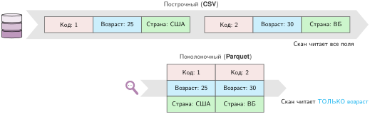

<a id="sec-appdx-data-foundations"></a>

# Основы данных

Проблемы с данными редко выглядят как проблемы с данными: они проявляются как обучение, которое не ускоряется, простаивающий ускоритель или точность, которая деградирует, пока панели мониторинга остаются зелеными. Чтобы главы оставались сосредоточенными на проектировании систем, это приложение собирает прикидочные расчеты и статистические инструменты, которые возвращают такие симптомы к измеримым узким местам данных: времена передачи, стоимость схем хранения, диагностики дрейфа и инструменты численной стабильности. Инструменты здесь опираются на базовую теорию вероятностей и на член данных железного закона.

## Как пользоваться этим приложением

Приложение задумано как *справочник*. Обращайтесь к нему, когда отладка «медленного обучения», «низкой загрузки ускорителя» или «дрейфа точности в эксплуатации» требует самого короткого пути от симптома к измерению.

Обозначения здесь следуют общекнижным соглашениям (например, $B$ зарезервировано за размером батча, а $\text{BW}$ обозначает пропускную способность).

- **Когда данные не двигаются**: начните с [«Стоимости инерции»](appendix_data.md#tbl-data-gravity) и уравнения времени передачи в разделе [«Расчет на салфетке»](appendix_data.md#sec-appdx-data-foundations-napkin-math-physics-data-gravity-9ae0).
- **Когда ускоритель голодает**: используйте [«Накладные расходы сериализации»](appendix_data.md#tbl-serialization-cost) и обсуждение схемы в разделе [«Строчные и колоночные форматы»](appendix_data.md#sec-appdx-data-foundations-row-vs-columnar-formats-bca2).
- **Когда конвейеры взрывают стоимость**: используйте примитивы из раздела [«Алгебра данных»](appendix_data.md#sec-appdx-data-foundations-algebra-data-9792), особенно перетасовки, вызванные соединениями.
- **Когда «в среднем все нормально», но пользователи жалуются**: используйте [«Распределения и длинный хвост»](appendix_data.md#sec-appdx-data-foundations-distributions-long-tail-901f) и вероятность хвостового события на уровне сессии.
- **Когда точность тихо дрейфует**: используйте [«Измерение дрейфа (расхождение)»](appendix_data.md#sec-appdx-data-foundations-measuring-drift-divergence-a6dd), чтобы сравнивать распределения целиком.

Хотя производственные конвейеры сталкиваются с огромным разнообразием форматов, кодировок и уровней хранения, это приложение сосредоточено на физических и статистических константах, которые управляют всеми ими.

Опираясь на эти опорные точки, приложение начинается с физических ограничений инженерии данных и переходит к статистическому мониторингу, который поддерживает ML-системы в здоровом состоянии. От форматов хранения, определяющих пропускную способность ввода-вывода, до метрик дрейфа, которые обнаруживают тихие сбои, эти основы напрямую связаны с конвейерами данных из [«Архитектуры конвейера данных»](04_data_engineering.md#sec-data-engineering-data-pipeline-architecture-b527) и с операционным мониторингом из [«Мониторинга модели и инфраструктуры»](14_ml_ops.md#sec-ml-operations-model-infrastructure-monitoring-3988).

<a id="sec-appdx-data-foundations-data-engineering-foundations-0c20"></a>

## Основы инженерии данных

Понимания аппаратных ограничений недостаточно: нужно еще и формировать данные так, чтобы они им соответствовали. Инженерия данных применяет принципы иерархии памяти к форматам хранения и проектированию конвейеров, гарантируя, что ускоритель никогда не голодает. Этот процесс начинается с осознания того, что данные физичны: у них есть объем, их нужно время, чтобы переместить, и на их разбор требуется энергия.

<a id="sec-appdx-data-foundations-napkin-math-physics-data-gravity-9ae0"></a>

### Расчет на салфетке: физика гравитации данных

Гравитация данных[^fn-data-gravity-anchor] — метафора, опирающаяся на расчеты времени передачи. В отличие от вычислений, которые с каждым годом становятся быстрее, скорость света фиксирована, а пропускная способность сети — конечный ресурс. Когда наборы данных становятся достаточно большими, их практическая инерция растет: их перемещение может стоить больше времени и энергии, чем перемещение вычислений туда, где данные уже лежат.

[^fn-data-gravity-anchor]: **Гравитация данных**: термин предложил Дэйв Маккрори в 2010 году, чтобы описать, как большие наборы данных притягивают к себе сервисы и приложения, подобно тому как массивные тела в физике притягивают меньшие (McCrory, 2010). Аналогия точна: «скорость убегания», необходимая для перемещения набора данных петабайтного масштаба, часто измеряется неделями.

Идеальное время передачи на номинальной скорости линии равно $T = D_{\text{vol}}/\text{BW}$ после приведения объема данных и пропускной способности к совместимым единицам (расчеты ниже явно переводят десятичные байты и биты в секунду). Для больших объемов, рассматриваемых здесь, задержка пренебрежимо мала; полное уравнение приведено в разделе [«Пропускная способность и задержка»](appendix_machine.md#sec-appdx-machine-foundations-bandwidth-vs-latency-5320). [«Стоимость инерции»](appendix_data.md#tbl-data-gravity) дает нижние границы; накладные расходы протокола и ограничения конечных точек увеличивают их.

| **Объем данных** |       **1 Гбит/с (обычная WAN)**       |       **10 Гбит/с (высокоскоростная WAN)**       |      **100 Гбит/с (прямое соединение)**      |       **Грузовик (иллюстративно)**       |
|:-----------------|:--------------------------------------:|:-----------------------------------------------:|:--------------------------------------------:|:----------------------------------------:|
| **1 ТБ**         |  2,2 часа  |  13,3 минуты  |  80 секунд  |                 Н/Д                  |
| **100 ТБ**       | 9 дней | 22,2 часа | 2,2 часа |                 Н/Д                  |
| **1 ПБ**         |  3 месяца  |  9 дней  |  22,2 часа  | 2 дня |

<a id="tbl-data-gravity"></a>

***Стоимость инерции**: эти времена передачи объясняют, почему мы часто «отправляем вычисления к данным», а не «отправляем данные к вычислениям». Сетевые столбцы — нижние границы при устойчивой номинальной скорости. Строка «грузовик» — иллюстративная модель времени для 1 ПБ: 8 часов на погрузку, 32 часа в пути и 8 часов на разгрузку, без учета планирования и подготовки ресурсов.*

<a id="sec-appdx-data-foundations-cost-serialization-b921"></a>

### Стоимость сериализации

Даже после того как данные поступили в машину, налог на сериализацию остается последним препятствием.[^fn-serialization-binary-format] Как показано в таблице [«Накладные расходы сериализации»](appendix_data.md#tbl-serialization-cost), многие инженеры тщательно оптимизируют ядра ускорителей, игнорируя накладные расходы CPU на декодирование данных. Разбор текстовых форматов вроде JavaScript Object Notation (JSON) или CSV крайне затратен для CPU: ускоритель часто простаивает, пока CPU мучительно преобразует строки в числа с плавающей запятой.

[^fn-serialization-binary-format]: **Сериализация**: от латинского *serialis* («образующий ряд»). Процесс преобразования структур данных в памяти в поток байтов для хранения или передачи и обратный процесс (*десериализация*). В ML-конвейерах выбор формата сериализации может определять все время сквозного обучения; [«Прием данных»](04_data_engineering.md#sec-data-engineering-data-ingestion-8efc) описывает стратегии проектирования конвейеров, которые минимизируют эти накладные расходы.

| **Формат**   |                **Скорость декодирования (МБ/с)**                |           **Относительная стоимость декодирования на CPU**          | **Применимость**        |
|:-------------|:-------------------------------------------------------:|:-----------------------------------------------:|:-----------------------|
| **CSV/JSON** |   ~100 МБ/с   |   `Высокая`   | Просмотр и обмен |
| **Protobuf** |  ~300 МБ/с  |  `Средняя`  | RPC и сообщения           |
| **Parquet**  | ~1 000 МБ/с | `Низкая` | Колоночное хранение       |

<a id="tbl-serialization-cost"></a>

***Накладные расходы сериализации**: эти иллюстративные значения показывают, почему двоичные колоночные форматы могут опережать построчный текст, но они не являются переносимыми бенчмарками. Arrow — формат в памяти и для межпроцессного обмена; Parquet — сжатый формат хранения.*

<a id="sec-appdx-data-foundations-row-vs-columnar-formats-bca2"></a>

### Строчные и колоночные форматы

Выбор файлового формата определяет «физику» чтения данных. Строчные форматы вроде CSV и JSON хранят данные запись за записью, поэтому чтение поля `age` все равно требует разбора каждой строки. Это подходит для дописываемых журналов, но не для аналитики по выбранным признакам. Parquet хранит сжатые фрагменты столбцов на диске, а Arrow предоставляет колоночный формат в памяти и для межпроцессного обмена. Читатели Parquet могут использовать *проекционное проталкивание* (projection pushdown), чтобы получать только выбранные фрагменты столбцов, а оба формата поддерживают *векторизованную обработку*. Сравните две схемы на рисунке [«Схемы хранения»](appendix_data.md#fig-row-vs-col), чтобы увидеть, почему колоночный доступ избегает сканирования ненужных байтов.

<a id="fig-row-vs-col"></a>



***Схемы хранения**: строчные форматы группируют значения по записи, поэтому показанное сканирование читает каждое поле. Колоночные форматы группируют значения по признаку, поэтому показанное сканирование читает только возраст.*

Схемы на [«Схемах хранения»](appendix_data.md#fig-row-vs-col) различаются тем, сколько нерелевантных байтов попадает в путь обучения.

<a id="psp-appendix-data-accelerator-starvation-problem"></a>

> **Проблема голодания ускорителя**
>
> Выбор файлового формата может определить, ограничена система вводом-выводом или вычислениями. Как показано на [«Схемах хранения»](appendix_data.md#fig-row-vs-col), схема хранения усиливает налог на сериализацию: строчные форматы вынуждают сканировать целые строки, тогда как колоночные форматы позволяют проекционное проталкивание, читая только те байты, которые нужны модели. В итоге член «перемещение данных» в железном законе может незаметно стать узким местом, которое оставляет дорогие ускорители простаивать.

<a id="sec-appdx-data-foundations-algebra-data-9792"></a>

### Алгебра данных

Инженерия признаков превращает сырые записи в столбцы, из которых может учиться модель, и это преобразование обычно сначала является задачей потоков данных и лишь потом задачей моделирования. Конвейер сначала сужает совокупность, затем выбирает признаки и наконец подтягивает контекст из других таблиц. Эти три шага соответствуют трем примитивам языка структурированных запросов (SQL), и их вычислительная стоимость определяет, останется ли задача признаков локальной, будет ли сканировать ненужные байты или превратится в сетевую перетасовку.

1.  **Селекция ($\sigma$)**: фильтрация строк (например, `WHERE age > 30`).
    *   **Стоимость**: $\mathcal{O}(\log N + K)$, если поиск по B-дереву возвращает $K$ строк; $\mathcal{O}(N)$ при полном сканировании.
2.  **Проекция ($\pi$)**: выбор столбцов (например, `SELECT age`).
    *   **Стоимость**: выбранные фрагменты плюс декодирование и метаданные в колоночных форматах. Этот пример строчного формата читает 1 КБ ради 4-байтового целого, теряя 99,6 процента чтения.
3.  **Соединение ($\bowtie$)**: объединение таблиц. Самая дорогая операция.
    *   **Соединение перетасовкой**: обе таблицы разбиваются по ключу и обмениваются по сети.
        *   **Стоимость**: перетасовка двух таблиц по 1 ТБ переносит около ~2 ТБ; разбиение и локальность могут это снизить.
    *   **Широковещательное соединение**: одна маленькая таблица отправляется всем рабочим узлам.
        *   **Стоимость**: $S(W-1)$ байт; таблица размером $S$ байт должна помещаться на каждом из $W$ рабочих узлов.

Понимание форматов данных, стоимости сериализации и алгебраических примитивов говорит нам, как *перемещать* данные эффективно. Однако даже безупречно спроектированный конвейер может незаметно отказать, если переносимые им данные со временем меняют свой характер. Обнаружение такого изменения и количественная оценка его важности требуют другого набора инструментов: вероятности и статистики.

<a id="sec-appdx-data-foundations-probability-statistics-3934"></a>

## Вероятность и статистика

Когда данные текут по конвейерам, нам нужны математические инструменты, чтобы обеспечивать их качество и согласованность. Вероятность и статистика дают язык для мониторинга здоровья системы, обнаружения тихих сбоев дрейфа данных и управления неопределенностью.

<a id="sec-appdx-data-foundations-distributions-long-tail-901f"></a>

### Распределения и длинный хвост

В системах среднее часто вводит в заблуждение. Распределения задержек обычно имеют длинный хвост, а видимые пользователю сервисы обычно управляются поведением на высоких перцентилях, а не средним временем отклика (Dean and Barroso, 2013). Задержка «P99» (99-й перцентиль) в 500 мс означает, что не более 1 процента запросов длится дольше 500 мс; но при большом числе запросов в сессии доля пользователей, которые видят хотя бы один медленный запрос, может быть намного выше. В масштабе (1 млн пользователей) даже 1 процент затронутых пользователей означал бы 10 000 пользователей.

<a id="nbk-appendix-data-median-experience"></a>

> **Опыт типичной сессии**
>
> Для $N_{\text{session}} = 100$ независимых запросов, каждый из которых с вероятностью 0,01 медленный, вероятность хотя бы одного события хвоста P99 равна `$\Pr(\text{Slow}) = 1 - (0{,}99)^{100} \approx 1 - 0{,}366 = 63{,}4\%$`.
>
> **Системный вывод**: при такой модели сессия из 100 запросов скорее включит событие за пределами P99, чем не включит. Коррелированные замедления могут менять эту вероятность (Dean and Barroso, 2013).

<a id="sec-appdx-data-foundations-measuring-drift-divergence-a6dd"></a>

### Измерение дрейфа (расхождение)

Поскольку распределения имеют длинные хвосты, где прячутся самые опасные сбои, простых метрик вроде «сдвига среднего» недостаточно. Нужны инструменты, которые сравнивают *всю форму* распределения. Обнаружение дрейфа между распределением в эксплуатации ($P_t$) и обучающим распределением ($P_0$) требует измерения «расстояния» между распределениями.

Для дискретных исходов $x$ [«дивергенция KL»](appendix_data.md#eq-appdx-data-kl-divergence) выражает дивергенцию KL[^fn-kl-divergence-relative] как ожидаемую дополнительную стоимость кодирования при аппроксимации $P_t$ распределением $P_0$ (Kullback and Leibler, 1951; Cover and Thomas, 2006). Показанная форма конечна только при $P_0(x) > 0$ везде, где $P_t(x) > 0$; поэтому производственные реализации требуют явного сглаживания или обработки нулей.

<a id="eq-appdx-data-kl-divergence"></a>

$$ \mathcal{D}_{\text{KL}}(P_t \lVert P_0) = \sum_x P_t(x) \log \frac{P_t(x)}{P_0(x)} $$

<a id="nbk-appendix-data-kl-divergence-drift-detection"></a>

> **Разобранный пример: дивергенция KL для обнаружения дрейфа**
>
> **Сценарий**: классификатор тональности обучен на данных, где 60 процентов отзывов были положительными, 30 процентов отрицательными и 10 процентов нейтральными. После развертывания распределение в эксплуатации смещается к 45 процентам положительных, 40 процентам отрицательных и 15 процентам нейтральных.
>
> **Расчет**:
>
> Обучающее распределение $P_0$: $[0{,}60;\ 0{,}30;\ 0{,}10]$. Распределение в эксплуатации $P_t$: $[0{,}45;\ 0{,}40;\ 0{,}15]$.
>
> Обратите внимание на асимметрию: $\mathcal{D}_{\text{KL}}(P_0 \lVert P_t) \neq \mathcal{D}_{\text{KL}}(P_t \lVert P_0)$. Индекс стабильности популяции (PSI) симметризует эту величину; расчет ниже использует натуральные логарифмы:
>
> **Системный вывод**: поскольку PSI = 0,0922 < 0,2, этот дрейф пока не пересекает иллюстративный порог ручной проверки, принятый здесь. Правильная реакция — оставить признак на панели мониторинга и искать подтверждающие сигналы дрейфа, а не переобучать модель по одной этой статистике.

Порог остается иллюстративным: его смысл зависит от размера выборки, разбиения на корзины, сглаживания и обработки нулей, а переобучение требует свидетельств качества модели.

[^fn-kl-divergence-relative]: **Дивергенция KL**: названа по именам Соломона Кульбака и Ричарда Лейблера, которые ввели ее в 1951 году. Также называется *относительной энтропией*; она измеряет ожидаемую дополнительную информацию, необходимую для кодирования выборок одного распределения кодом, оптимизированным для другого. Для мониторинга дрейфа в этой книге каноническое направление — $\mathcal{D}_{\text{KL}}(P_t \lVert P_0)$. При натуральных логарифмах, как в примере выше, единица измерения — нат; при логарифмах по основанию 2 — бит. В производственном ML дивергенция KL — теоретическая основа многих метрик обнаружения дрейфа.

И дивергенция KL, и PSI опираются на более глубокую основу — теорию информации, которая задает единицы и границы, делающие эти метрики обоснованными, а не ad hoc.

<a id="sec-appdx-data-foundations-information-theory-systems-c033"></a>

### Теория информации для систем

Обучение может потреблять больше примеров, идти дольше и все равно перестать улучшаться, если добавленные данные несут слишком мало полезного сигнала. В этот момент узкое место — не только вычисления или пропускная способность, но и количество информации, которое конвейер данных доставляет обучаемому. [«Информационный Roofline (пункт назначения)»](appendix_dam.md#sec-appdx-dam-taxonomy-information-roofline-destination-6426) рассматривает такой предел качества данных как диагностическое ограничение, а теория информации дает единицы для рассуждения о нем.

**Энтропия ($H$)**[^fn-entropy-information-theory] — средняя неопределенность распределения, определяемая как $H(X) = -\sum p(x) \log p(x)$. Основание логарифма задает единицу: натуральные логарифмы дают наты, а $\log_2$ — биты. Равномерное распределение имеет максимальную энтропию только на заданном конечном носителе. Это напрямую связано с дивергенцией KL выше: $\mathcal{D}_{\text{KL}}$ измеряет избыточную стоимость кодирования при использовании неверного распределения.

**Информационная плотность** здесь используется как эвристика уровня книги — полезный сигнал обучения на единицу хранения, — а не как стандартная величина теории информации.

**Отношение сигнал/шум (SNR)** — отношение мощности сигнала к мощности шума. В ML книга использует низкий SNR качественно, для данных, где структура, релевантная задаче, слаба относительно шума; добавление вычислений не может компенсировать отсутствующий релевантный сигнал.

[^fn-entropy-information-theory]: **Энтропия**: Шеннон ввел этот термин в 1948 году для количественной оценки информационного содержания (Shannon, 1948). В системных терминах энтропия Шеннона — нижняя граница средней длины безпотерьного кода. Практические префиксные коды к ней приближаются, а блочные коды могут приближаться асимптотически. При $\log_2$ единица — биты; натуральные логарифмы дают наты. Эти границы помогают оценивать коэффициенты сжатия и размеры конвейеров данных.

<a id="sec-appdx-data-foundations-logits-numerical-stability-13e2"></a>

### Логиты и численная стабильность

Классификаторы нейронных сетей обычно выдают вектор *логитов*[^fn-logit-unnormalized-score] $\mathbf{z}$ (ненормированных оценок). Для индекса класса $i$ softmax нормирует $z_i$ по всем индексам классов $j$, чтобы получить вероятность:

$$ \text{Softmax}(z_i) = \frac{e^{z_i}}{\sum e^{z_j}} $$

[^fn-logit-unnormalized-score]: **Логит**: термин ввел Джозеф Бергсон в 1944 году по аналогии с *пробитом*. Функция логита — обратная к логистической (сигмоидной) функции: $\text{logit}(p) = \log(p/(1-p))$. В глубоком обучении «логитами» нежестко называют сырой, ненормированный выход последнего линейного слоя до применения функции активации.

Проблема в том, что если $z_i$ велико (например, 100), экспонента $e^{z_i}$ переполняет распространенные форматы обучения и вывода, такие как FP32, BF16 и FP16. FP64 может представить это конкретное значение, но производственные ядра ML редко используют FP64 для softmax. Решение — вычислять в логарифмическом пространстве: прием «log-sum-exp» позволяет вычислять $\log\left(\sum e^{z_j}\right)$, не вычисляя огромные экспоненты напрямую, и сохраняет численную точность.[^fn-logsumexp-numerical-stability]

[^fn-logsumexp-numerical-stability]: **Log-sum-exp**: реализован как `torch.logsumexp` в PyTorch и `scipy.special.logsumexp` в SciPy. Опирается на тождество $\log\left(\sum e^{x_i}\right) = a + \log\left(\sum e^{x_i - a}\right)$, где $a = \max(x_i)$. Сдвинутые значения $x_i - a$ не больше нуля, поэтому экспоненты никогда не переполняются.

Небольшой разобранный пример показывает, почему этот прием важен на практике, даже для больших, но реалистичных значений логитов:

<a id="nbk-appendix-data-log-sum-exp-action"></a>

> **Log-sum-exp на практике**
>
> **Исходные данные**: трехклассовый классификатор выдает логиты $\mathbf{z} = [100, 101, 102]$.
>
> **Без приема (наивный softmax)**: $\exp(100) \approx 2{,}7 \times 10^{43}$, $\exp(101) \approx 7{,}3 \times 10^{43}$, $\exp(102) \approx 2{,}0 \times 10^{44}$.
>
> Эти числа представимы в FP64, но переполняют FP32 (максимум $\approx 3{,}4 \times 10^{38}$). В FP16 (максимум $\approx 65\,504$) даже $e^{12}$ переполняется. Сырые логиты редко достигают величины 100, но большие промежуточные значения возникают (например, в неотмасштабированных оценках внимания или в самоуверенных выходах), а поскольку FP16 и BF16 — стандартные точности обучения, наивный softmax настолько часто рискует переполнением, что устойчивая форма используется по умолчанию.
>
> **С приемом**: вычтем $a = \max(\mathbf{z}) = 102$.
>
> Сдвинутые логиты: $\mathbf{z} - a = [-2, -1, 0]$.
>
> Экспоненты: $\exp(-2) \approx 0{,}135$, $\exp(-1) \approx 0{,}368$, $\exp(0) = 1{,}0$.
>
> Сумма = 1,503. LogSumExp = 102 $+ \log(1{,}503) = 102{,}408$.
>
> Softmax: $[0{,}135/1{,}503;\ 0{,}368/1{,}503;\ 1{,}0/1{,}503] = [0{,}090;\ 0{,}245;\ 0{,}665]$.
>
> **Системный вывод**: экспоненты сдвинутых значений и итоговые вероятности softmax лежат в $[0, 1]$ — риска переполнения нет, даже в FP16.

```{=latex}
\enlargethispage{5\baselineskip}
```

Вместе эти разобранные примеры связывают всю цепочку: от физического перемещения данных через сдвиг распределения до численной стабильности.

<a id="sec-appdx-data-foundations-summary-3c72"></a>

## Итоги

Инструменты этого приложения — метрики, чувствительные к хвосту, дивергенции дрейфа, границы теории информации и приемы численной стабильности — поддерживают количественную диагностику сбоев, связанных с данными, а не объяснения по наитию.
