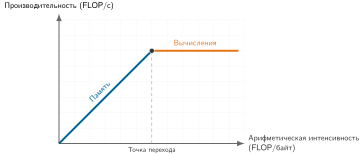
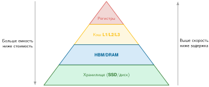

# Основы машины

Паспорт устройства сообщает пиковую пропускную способность, но нагрузка почти никогда ее не достигает. Чтобы закрыть этот разрыв, нужно знать, какой физический предел ограничивает исполнение первым: задержка, пропускная способность памяти, арифметическая интенсивность или энергия. Это приложение собирает устойчивые аппаратные модели и величины порядка величины, которые закрепляют рассуждение об одном узле на протяжении всей книги и дают математическую базу, по которой можно проверять или расширять оценки из глав. Модели предполагают базовую подготовку по архитектуре компьютеров, особенно по иерархии памяти.

## Как пользоваться этим приложением

Приложение задумано как справочник. При диагностике проблем производительности используйте его, чтобы перевести размытый симптом («медленно») в конкретное ограничение («ограничено памятью при размере батча один») и затем выбрать рычаг, который действительно может сдвинуть ситуацию.

Обозначения здесь следуют общекнижным соглашениям (например, $B$ зарезервировано за размером батча, а $\text{BW}$ — за пропускной способностью).

- Проверка осуществимости: начните с раздела [«Числа, которые нужно знать»](appendix_machine.md#sec-appdx-machine-foundations-numbers-know-b531) для величин порядка величины.
- Диагностика доминирующего потолка: используйте модель Roofline в разделе [«Модель Roofline»](appendix_machine.md#sec-appdx-machine-foundations-roofline-model-2529), чтобы понять, ограничена нагрузка вычислениями или памятью.
- Рассуждение о пределах масштабирования: используйте законы Амдала и Густафсона в разделе [«Закон Амдала и закон Густафсона»](appendix_machine.md#sec-appdx-machine-foundations-amdahls-law-gustafsons-law-b741), чтобы понять, почему добавление ускорителей может не сократить время обучения.
- Выбор точности: используйте [«Сравнение форматов чисел с плавающей запятой»](appendix_machine.md#sec-appdx-machine-foundations-floatingpoint-format-comparison-1836), чтобы рассматривать FP32 против BF16/FP16 и INT8 как системный компромисс.
- Полное изложение: для полного повествования используйте главы [«Аппаратное ускорение»](11_hw_acceleration.md#sec-hardware-acceleration), [«Обучение моделей»](08_training.md#sec-model-training) и [«Обслуживание моделей»](13_model_serving.md#sec-model-serving).

Хотя современная аппаратура охватывает разные архитектуры ускорителей, топологии межсоединений и варианты корпусирования, физические законы и модели узких мест, описанные здесь, управляют всеми ими.

## Числа, которые нужно знать

Как справочник Джеффа Дина «Латентные числа, которые должен знать каждый программист»[^fn-jeff-dean-latency] сформировал целое поколение инженеров систем, так и эти справочные числа дают интуицию порядка величины, необходимую для проектирования систем ML. Хотя абсолютные значения и отношения зависят от технологии и нагрузки, иерархия устойчивее. Запомните соотношения; конкретные числа используйте как проверки здравого смысла.

> **Три числа, которые важнее всего**
>
> * Энергетическое отношение: в цитируемом эталоне для техпроцесса 45 нм чтение 32-битного значения из DRAM расходует примерно в 581 раз больше энергии, чем одно умножение FP16. Это обосновывает роль арифметической интенсивности.
> * Объем состояния обучения: веса модели (2 байта FP16) + градиенты (2 байта FP16) + мастер-веса (4 байта FP32) + состояние оптимизатора Adaptive Moment Estimation (Adam), 8 байт. Итого 16 байт на параметр, поэтому модели на 7 млрд параметров нужно 112 ГБ только для старта обучения.
> * Предел распространения в волокне: свет проходит примерно 200 км за 1 мс. Округленное время туда-обратно через страну (около 40 мс) включает устранимые накладные расходы, но распространение нельзя оптимизировать.

[^fn-jeff-dean-latency]: **Джефф Дин**: старший научный сотрудник Google и один из архитекторов распределенной инфраструктуры Google, включая MapReduce, BigTable и TensorFlow. Его латентные числа, впервые показанные вместе с Питером Норвигом около 2010 года, стали каноническим справочником для инженеров систем. Со временем числа обновлялись по мере развития аппаратуры, но *иерархия* задержек остается удивительно стабильной; интерактивная визуализация Колина Скотта показывает иерархию задержек для разных поколений аппаратуры (Scott, 2012).

### Справочные соотношения

Эти соотношения сочетают физические и арифметические границы с измерениями, специфичными для технологий; устойчивы только границы.

#### Налог скорости света

[«Справочник по скорости света»](appendix_machine.md#tbl-speed-of-light-ref) показывает приблизительные базовые величины времени туда-обратно. Их компонент распространения нельзя устранить.

| **Расстояние**           | **Задержка туда-обратно** | **Следствие**                       |
|:-------------------------|:-------------------------:|:------------------------------------|
| **Один дата-центр**      |         ~1 мс             | Распределенное обучение осуществимо |
| **Через всю страну (США)** |       ~40 мс            | Сокращает оставшийся бюджет запроса |
| **Через Атлантику**      |         ~60 мс            | Еще больше сокращает бюджет запроса |
| **Через Тихий океан**    |        ~100 мс            | Локальность данных критична         |

***Справочник по скорости света**: свет в волокне проходит ~200 км за 1 мс. Эти приблизительные времена туда-обратно включают устранимые накладные расходы; нестираем только распространение.*

#### Энергетическая иерархия

[«Справочные энергетические соотношения»](appendix_machine.md#tbl-energy-ratios-ref) количественно описывает энергетическую стоимость перемещения данных по сравнению с вычислениями — фундаментальную причину, по которой арифметическая интенсивность доминирует в оптимизации производительности ML.[^fn-horowitz-energy-app]

| **Соотношение**                      |                  **Справочное отношение**                  | **Источник и интерпретация**                                              |
|:-------------------------------------|:----------------------------------------------------------:|:--------------------------------------------------------------------------|
| **Доступ к DRAM против умножения FP16** | ~581×                                                 | Horowitz, 45 нм; емкость проводов растет с расстоянием                     |
| **Энергия FP32 против INT8**         |  ~18×                                                    | Horowitz, 45 нм; разрядность определяет энергию переключения              |
| **Энергия FP32 против FP16**         |  ~3,4×                                                   | Horowitz, 45 нм; более узкая арифметика снижает энергию переключения и тракта данных |
| **SRAM уровня L1 против регистра**   |    ~5×                                                   | Иллюстративный ориентир для иерархии на кристалле; расстояние до арифметического блока |

***Справочные энергетические соотношения**: первые три отношения основаны на измерениях Horowitz для 45 нм; отношение L1/регистр — иллюстративный ориентир для иерархии на кристалле.*

[^fn-horowitz-energy-app]: **Источники энергетической иерархии**: значения для DRAM и арифметики взяты из Horowitz (2014), 45 нм. Отношение SRAM L1 к регистру — иллюстративный ориентир иерархии, а не измерение Horowitz. Главное отношение сравнивает 32-битный доступ к DRAM с 16-битным умножением с плавающей запятой. И абсолютные значения, и отношение зависят от техпроцесса, схемотехники, технологии памяти и разрядности операндов; расстояние по проводам помогает понять, почему перемещение остается дорогим.

#### Иерархия памяти

[«Иерархия задержек»](appendix_machine.md#tbl-memory-ratios-ref) показывает, почему иерархия памяти неравномерна: соседние переходы внутри одного корпуса могут различаться лишь в несколько раз, тогда как выход за кристалл, хранилище и сетевые уровни дают скачки на порядки.

| **Соотношение**                                                  |                    **Отношение**                     | **Почему это сохраняется**          |
|:-----------------------------------------------------------------|:----------------------------------------------------:|:------------------------------------|
| **High-bandwidth memory ускорителя против регистра**             | ~1000× медленнее                                   | На кристалле против вне кристалла   |
| **SSD против регистра**                                          | ~300 000× медленнее                                | Электрическая против механической или флеш-памяти |
| **Сеть против локальной памяти**                                 | ~16× медленнее                                     | Скорость света и коммутация         |
| **Пропускная способность памяти ускорителя против связи CPU↔ускоритель** | ~52× быстрее                             | Приоритет архитектурных инвестиций  |

***Иерархия задержек**: выбранные соотношения задержек в иерархии памяти. Самые большие разрывы возникают при пересечении физических границ: внешней памяти, периферийных линков, хранилища и сетевой инфраструктуры.*

#### Законы масштабирования

[«Правила масштабирования»](appendix_machine.md#tbl-scaling-rules-ref) собирает арифметические соотношения, которые управляют требованиями памяти и вычислений для обучения и вывода.[^fn-training-memory-footprint]

| **Правило**                       |             **Формула**              |                **Пример**                 |
|:----------------------------------|:------------------------------------:|:------------------------------------------:|
| **Память вывода (FP16)**          |      2 байта$\times$ параметров      |             7 млрд параметров → 14 ГБ       |
| **Память вывода (INT8)**          |      1 байт$\times$ параметров       |              7 млрд параметров → 7 ГБ       |
| **Память обучения (Adam)**        |     16 байт$\times$ параметров       |             7 млрд параметров → 112 ГБ      |
| **FLOP вывода (трансформер)**     |   ~2$\times$ параметров на токен     |        Модель 7 млрд → ~14 GFLOP на токен    |
| **FLOP обучения**                 | ~6$\times$ параметров$\times$ токенов | 7 млрд на 1 трлн токенов → $4 \times 10^{22}$ FLOP |

***Правила масштабирования**: это арифметика, а не свойства конкретной аппаратуры. Память обучения включает веса FP16 (2 байта), градиенты FP16 (2 байта), мастер-веса FP32 (4 байта) и состояния оптимизатора Adam (8 байт на моменты и дисперсию).*

[^fn-training-memory-footprint]: **Память обучения (Adam)**: правило 16 байт на параметр предполагает обучение в смешанной точности с Adam. Оптимизация ZeRO может снизить память на ускоритель, шардируя состояния оптимизатора по ускорителям, но суммарная память по всем ускорителям остается около 16$\times$ параметров.

### Иллюстративные бюджеты задержки

Бюджеты задержки зависят от требований безопасности конкретного приложения, ожиданий пользователей и целевых уровней обслуживания. [«Иллюстративные целевые значения задержки»](appendix_machine.md#tbl-latency-targets-ref) перечисляет иллюстративные цели, а не универсальные пределы.

| **Приложение**          |  **Бюджет**  | **Ограничение**                           |
|:------------------------|:------------:|:------------------------------------------|
| **Автоматическое торможение** |  <10 мс  | На 100 км/ч за 10 мс проходит 28 см       |
| **Голосовой ассистент** |  <100 мс     | Человеческое восприятие «мгновенно»       |
| **Веб-поиск**           |  <200 мс     | Порог терпения пользователя               |
| **Потоковое видео**     |    <1 с      | Допуск буфера                             |
| **Пакетное обучение**   | часы–дни     | Пропускная способность важнее задержки    |

***Иллюстративные целевые значения задержки**: производственные требования зависят от приложения и его целевых уровней обслуживания.*

### Текущая справочная аппаратура (около 2024 года)

Эти числа отражают текущее поколение. Используйте их для прикидочных расчетов и сверяйте с актуальной аппаратурой.

#### Задержка и пропускная способность памяти

[«Иерархия памяти (около 2024 года)»](appendix_machine.md#tbl-memory-current-ref) дает представительные ориентиры задержки и пропускной способности по всей иерархии памяти.

| **Уровень**                             |                **Задержка**               |                   **Пропускная способность**                   |
|:----------------------------------------|:-----------------------------------------:|:-------------------------------------------------:|
| **Регистр**                             |                  ~0,3 нс                  |                         —                         |
| **Кэш L1**                              |  ~1 нс  |                         —                         |
| **Кэш L2**                              |  ~4 нс  |                         —                         |
| **HBM3 GPU**                            |  ~300 нс | 3,4 ТБ/с |
| **PCIe Gen5 (CPU↔GPU)**                 | ~1000 нс |   64 ГБ/с  |
| **DRAM CPU**                            |                  ~100 нс                  |   50 ГБ/с   |
| **InfiniBand (сеть)**                   |  ~5000 нс  |    50 ГБ/с    |
| **NVMe SSD**                            |  ~100000 нс |   7 ГБ/с   |

***Иерархия памяти (около 2024 года)**: представительные ориентиры задержки и пропускной способности для регистров, кэшей, памяти, межсоединений, сетей и хранилища. Вместе они показывают, почему локальность и перемещение данных определяют производительность.*

#### Вычислительная пропускная способность

[«Справочник по вычислениям (около 2024 года)»](appendix_machine.md#tbl-compute-current-ref) сравнивает представительные пиковые пропускные способности и мощность GPU для дата-центров и мобильного NPU.

| **Платформа**              |                   **FP16/BF16**                    |                      **INT8/класс FP8**                      | **Мощность** |
|:---------------------------|:--------------------------------------------------:|:------------------------------------------------------------:|:---------:|
| **GPU дата-центра (H100)** | 989 TFLOP/s | 1979 TFLOP/s (пик FP8) |   700 Вт   |
| **GPU дата-центра (A100)** | 312 TFLOP/s |                           624 TOPS                           |   400 Вт   |
| **Мобильный NPU**          |                         —                          |        35 TOPS         |   3–5 Вт   |

***Справочник по вычислениям (около 2024 года)**: представительные пиковые пропускные способности и мощность для GPU дата-центров и мобильного NPU. Поскольку строки используют разные режимы точности и соглашения об операциях, сравнивайте их только в согласованном контексте нагрузки и точности.*

#### Точки перехода Roofline

[«Пороги арифметической интенсивности (около 2024 года)»](appendix_machine.md#tbl-ridge-current-ref) задает пороги арифметической интенсивности, которые определяют, ограничена ли нагрузка памятью или вычислениями.

| **Ускоритель** |                  **Точка перехода**               | **Следствие**                |
|:---------------|:-------------------------------------------------:|:-----------------------------|
| **A100 (FP16)** | 153 FLOP/байт | Ниже → ограничено памятью     |
| **H100 (FP16)** | 295 FLOP/байт | Более высокая планка для ограничения вычислениями |

***Пороги арифметической интенсивности (около 2024 года)**: вывод с потоковой передачей весов при батче 1 часто ограничен памятью; большие батчи могут пересечь точку перехода.*

> **Замечание о терминологии: GPU и ускорители**
>
> В этой книге «ускоритель» — общий термин для аппаратного ускорения. Принципы — анализ Roofline, иерархии памяти, численная точность и моделирование производительности — применимы к GPU, тензорным процессорам (TPU), NPU, специализированным интегральным схемам и другим специализированным ускорителям ИИ. Специфичные для вендора возможности, такие как CUDA и NVLink, указываются явно.

Знание чисел — только первый шаг. Настоящая сила приходит от компактных моделей, которые показывают, *какое* число важно для текущего узкого места. Модель Roofline начинает эту диагностику, переводя сырые спецификации аппаратуры в практические потолки производительности.

## Физика вычислений

Сырые спецификации аппаратуры — TFLOP/s, ТБ/с, бюджеты мощности — необходимы, но недостаточны для рассуждения о производительности. Без компактных аналитических моделей инженер не отличит нагрузку, ограниченную вычислениями, от ограниченной памятью, и не предскажет, сократит ли удвоение GPU время обучения вдвое. Модели этого раздела превращают такие различия в количественные проверки.

### Модель Roofline

Модель Roofline (Williams et al., 2009) ограничивает, насколько быстро нагрузка может выполняться на заданной аппаратной цели. Ответ зависит от того, что исчерпывается первым — вычисления или пропускная способность памяти.

У каждой операции есть **арифметическая интенсивность**: отношение выполненных вычислений к байтам, перемещенным из памяти. Матричное умножение имеет высокую арифметическую интенсивность, потому что каждый загруженный элемент многократно используется. Поэлементные операции вроде ReLU (выпрямленной линейной функции) имеют низкую интенсивность, поскольку каждая операция загружает число, выполняет одно вычисление и записывает результат обратно. Как показано на рисунке [«Модель Roofline»](appendix_machine.md#fig-roofline), каждая нагрузка ограничена либо пропускной способностью памяти, либо пропускной способностью вычислений, и ее арифметическая интенсивность определяет, какой потолок достигается первым.

***Модель Roofline**: наклонный потолок пропускной способности памяти и горизонтальный потолок пиковых вычислений сходятся в точке перехода. Нанесение нагрузки по арифметической интенсивности показывает, какой потолок Roofline применим.*

**Точка перехода** определяет баланс аппаратуры. Если интенсивность нагрузки ниже этой точки, она ограничена памятью (наклонная область). Если выше — ограничена вычислениями (плоская область).

$$ \text{Арифметическая интенсивность} = \frac{\text{FLOP}}{\text{перемещенные байты}} \qquad\qquad \text{Точка перехода} = \frac{\text{Пиковые FLOP/s}}{\text{Пропускная способность памяти}} $$

> **Размер батча управляет арифметической интенсивностью**
>
> Для матричных умножений арифметическая интенсивность растет с размерностью батча. Для $\mathbf{Y} = \mathbf{X}\mathbf{W}$, где $\mathbf{X}$ имеет размер $(B\times d_{\text{in}})$, а $\mathbf{W}$ — $(d_{\text{in}}\times d_{\text{out}})$:
>
> - FLOP: $2 \times B \times d_{\text{in}} \times d_{\text{out}}$ (умножения с накоплением);
> - Байты: перемещение $X$, $W$ и $Y$ стоит примерно $s_{\text{elem}}(B d_{\text{in}} + d_{\text{in}}d_{\text{out}} + B d_{\text{out}})$ байт.
>
> Удвоение $B$ удваивает FLOP, в то время как трафик весов остается почти постоянным, когда доминируют веса, и поэтому арифметическая интенсивность растет. Именно поэтому батчинг часто помогает обслуживанию вывода, хотя трафик активаций, поведение кэша, форма, точность и точка перехода определяют, достигается ли потолок вычислений.

#### Конкретный пример: анализ A100

Рассмотрим GPU NVIDIA A100 с производительностью тензорных ядер FP16 312 TFLOP/s и пропускной способностью HBM2e 2,04 ТБ/с. Точка перехода равна 312 TFLOP/s/2,04 ТБ/с = 153 FLOP/байт (приставки «тера» сокращаются, и единица — FLOP на байт).

Две распространенные операции попадают по разные стороны от этой точки. Обобщенное матричное умножение (GEMM) двух квадратных матриц размером 4096 на 4096 имеет арифметическую интенсивность около 1365 FLOP/байт, то есть 1365 FLOP/байт > 153 FLOP/байт, и операция ограничена вычислениями. Поэлементный ReLU над тензором FP16 выполняет одно сравнение, читая 2 байта и записывая 2 байта (всего 4 байта), поэтому его арифметическая интенсивность составляет лишь $1/4 =$ 0,25 FLOP/байт. Поскольку 0,25 FLOP/байт $\ll$ 153 FLOP/байт, операция сильно ограничена памятью и достигает лишь около 0,16 процента пика TFLOP/s. Этот контраст объясняет, почему современные фреймворки сливают операции. Объединение ReLU непосредственно с предыдущим ядром MatMul позволяет не записывать промежуточные результаты в память и тем самым фактически сохраняет пропускную способность памяти.

### Размерностный анализ

Модель Roofline помогает диагностировать, *где* находится узкое место. Однако перед применением любого уравнения производительности его нужно проверить на физическую осмысленность. Размерностный анализ дает эту проверку: любое корректное уравнение должно быть **размерно однородным** — каждый член должен приводиться к одним и тем же единицам. Если это не так, в уравнении ошибка.

Для последовательных фаз рассмотрим железный закон ML-систем (принцип [«Железный закон систем машинного обучения»](part_build.md#pri-iron-law)), введенный в @sec-introduction-iron-law-ml-systems-c32a:
$$ T = \frac{D_{\text{vol}}}{\text{BW}} + \frac{O}{R_{\text{peak}} \cdot \eta_{\text{hw}}} + L_{\text{lat}} $$

Корректность проверяется подтверждением того, что каждый член приводится ко времени (секундам):
$$ T [\text{с}] = \underbrace{ \frac{D_{\text{vol}} [\text{байты}]}{\text{BW} [\text{байт/с}]} }_{\text{секунды}} + \underbrace{ \frac{O [\text{FLOP}]}{R_{\text{peak}} [\text{FLOP/s}] \cdot \eta_{\text{hw}} [1]} }_{\text{секунды}} + \underbrace{ L_{\text{lat}} [\text{с}] }_{\text{секунды}} $$

*   Член данных: $\frac{\text{байты}}{\text{байт/с}} = \text{байты} \times \frac{\text{с}}{\text{байт}} = \mathbf{с}$
*   Член вычислений: $\frac{\text{FLOP}}{\text{FLOP/s}} = \text{FLOP} \times \frac{\text{с}}{\text{FLOP}} = \mathbf{с}$
*   Член задержки: уже в секундах.

Уравнение физически согласовано. Применяйте этот прием к любому системному уравнению: если размерности не совпадают, формула неверна. «FLOP» и «пропускную способность» нельзя напрямую обменивать, потому что у них разные единицы. Любой такой компромисс должен пересчитываться через время, что и количественно описывает железный закон.

Когда уравнение размерно корректно, следующий вопрос — как его временные члены масштабируются на нескольких устройствах. [«Закон Амдала и закон Густафсона»](appendix_machine.md#sec-appdx-machine-foundations-amdahls-law-gustafsons-law-b741) отвечает на него двумя дополняющими границами.

### Закон Амдала и закон Густафсона

Распараллеливание — основной инструмент масштабирования ML, но его пределы зависят от того, *как* масштабируется нагрузка. Эти два закона задают фундаментальное напряжение в параллельных вычислениях. **Закон Амдала** — взгляд пессимиста: он описывает, насколько быстрее может выполниться *фиксированная* задача (оптимизация задержки). **Закон Густафсона** — взгляд оптимиста: он описывает, насколько *больше* работы можно выполнить за то же время (оптимизация пропускной способности).

#### Сильное масштабирование (закон Амдала)

**Сильное масштабирование** измеряет, насколько быстрее выполняется задача фиксированного размера по мере добавления процессоров.

Закон Амдала (Amdahl, 1967) утверждает, что ускорение ограничено последовательной частью задачи.[^fn-amdahl-scaling-appendix] Если доля $s$ задачи последовательна (не может быть распараллелена), а $p = 1-s$ распараллеливается, максимальное ускорение на $n$ процессорах равно:
$$ \text{Ускорение}(n) = \frac{1}{s + \frac{1-s}{n}} $$

[^fn-amdahl-scaling-appendix]: **Джин Амдал (1922–2015)**: легендарный архитектор компьютеров из IBM, где он был главным архитектором System/360. Позднее основал корпорацию Amdahl, чтобы конкурировать с IBM на рынке мейнфреймов.

При $n \to \infty$ член $\frac{1-s}{n} \to 0$, и ускорение стремится к $1/s$.

Чтобы увидеть закон Амдала в действии, допустим, что 5 процентов шага обучения — последовательные накладные расходы (например, глобальная блокировка интерпретатора Python (GIL) или задержка запуска ядра), а 95 процентов — распараллеливаемая матричная арифметика:

*   При $n=1$ ускорение равно 1.
*   При $n=$ 8 ускорение равно 1/(0,05 + 0,95/8) ≈ 5,9 раза.
*   При $n \to \infty$ ускорение ограничено величиной 1/0,05 = 20 раз.

Сколько бы ускорителей ни добавили, эта фиксированная нагрузка не может работать быстрее, чем в 20 раз.

#### Слабое масштабирование (закон Густафсона)

**Слабое масштабирование** измеряет, насколько может вырасти задача при сохранении фиксированного времени выполнения по мере добавления процессоров.[^fn-gustafsons-law-scaling]

Так устроена реальность больших языковых моделей. Вместо того чтобы использовать 1000 ускорителей, чтобы обучить модель на небольшом наборе данных за миллисекунды, их используют, чтобы обучить модель на наборе данных в 1000 раз большем за разумное время.

Для $n$ процессоров пусть $s$ — последовательная доля времени выполнения, измеренная на этих процессорах для масштабированной нагрузки. Закон Густафсона (Gustafson, 1988) описывает это «масштабированное ускорение»:
$$ \text{Масштабированное ускорение}(n) = n - s(n - 1) $$

[^fn-gustafsons-law-scaling]: **Джон Густафсон**: специалист по информатике, известный работами в области параллельных вычислений и введением формата Unum (универсальное число). Его закон был прямым ответом на воспринимаемые «пределы» закона Амдала при применении к массовому масштабу.

Поскольку параллельная часть растет линейно с $n$, а $s$ остается фиксированным, слабое масштабирование может удерживать высокую эффективность по мере роста задачи.

Используя те же 5 процентов последовательных накладных расходов ($s$ = 0,05), закон Густафсона рассказывает совсем другую историю:

*   При $n=1$ ускорение равно 1.
*   При $n=$ 8 масштабированное ускорение равно 8 − 0,05 $\times$ (7) = 8 − 0,35 = 7,65 раза.
*   При $n=$ 1000 масштабированное ускорение равно 1000 − 0,05 $\times$ (999) ≈ 950 раз.

При слабом масштабировании эффективность остается высокой, потому что полезная работа (обучение модели) растет настолько, что затмевает фиксированные накладные расходы.

Та же оптика масштабирования превращает размер модели, объем данных, число аппаратных единиц и загрузку в одну оценку времени обучения.

> **Уравнение времени обучения**
>
> **Задача**: сколько времени занимает обучение плотного трансформера при заданных размере модели, числе токенов, числе ускорителей, пиковой скорости и загрузке?
>
> **Расчет**:
> $$ T \approx \frac{6 \cdot P \cdot D}{N_{\text{GPU}} \cdot R_{\text{peak}} \cdot \eta_{\text{hw}}} $$
>
> **Переменные**:
>
> *   Коэффициент FLOP обучения: множитель 6 получается из $2P\text{ FLOP/токен}$ для прямого прохода и $4P\text{ FLOP/токен}$ для обратного ($2P$ для градиентов активаций и $2P$ для градиентов весов), что дает $6PD\text{ FLOP}$ суммарно по $D$ обучающим токенам.
> *   $P$: число параметров модели.
> *   $D$: число обучающих токенов.
> *   $N_{\text{GPU}}$: число GPU.
> *   $R_{\text{peak}}$: пиковые FLOP/s одного ускорителя.
> *   $\eta_{\text{hw}}$: загрузка аппаратуры, в этой оценке обычно 30–50 процентов.
>
> **Пример**: обучение модели с 1 млрд параметров на 20 млрд токенов на 1 A100 (312 TFLOP/s) при загрузке 40 процентов.
> $\text{Всего FLOP} = 6 \times 1 \times 10^{9} \times 2 \times 10^{10} = 1{,}2 \times 10^{20} \text{ FLOP}$.
> $\text{Пропускная способность} = 1 \times (3{,}12 \times 10^{14}) \times 0{,}40 \approx 1{,}248 \times 10^{14} \text{ FLOP/s}$.
> $T = \frac{1{,}2 \times 10^{20}}{1{,}248 \times 10^{14}} \approx 961\,538{,}5 \text{ с} \approx 16\,025{,}6 \text{ мин}$.
>
> **Системный вывод**: при этих допущениях обучение займет 961 538,5 секунды (≈ 16 025,6 минуты, или около 11,1 дня); оценка делает явными рычаги: масштаб модели, масштаб данных, эффективную пропускную способность ускорителей и загрузку.

### Закон Литтла

Для планирования мощности стабильных систем вывода **закон Литтла** (Little, 1961) связывает среднюю долгосрочную одновременность ($Q_{\text{req}}$), среднюю интенсивность прихода ($\lambda_{\text{arr}}$) и среднее время в системе ($T_{\text{lat}}$):[^fn-littles-law-appendix]
$$ Q_{\text{req}} = \lambda_{\text{arr}} \times T_{\text{lat}} $$

[^fn-littles-law-appendix]: **Джон Литтл**: профессор-институт MIT и пионер в области исследования операций. Его закон, доказанный в 1961 году, лежит в основе теории очередей и используется в областях от производства до анализа компьютерных сетей.

Чтобы увидеть это на практике, рассмотрим поддержание 1000 запросов в секунду при средней задержке 50 мс. Закон требует, чтобы система поддерживала 1000 $\times$ 0,05 с = 50 одновременных запросов.

Это определяет размер пулов обработчиков, но для памяти нужно другое допущение. Если каждый запрос в системе одновременно удерживает 1 ГБ состояния устройства, средняя популяция подразумевает 50 ГБ; запросы в очереди могут вместо этого оставаться в памяти хоста или разделять батчевое состояние. Если 24 слота устройства каждый остается занятым 50 мс, прокси пропускной способности составит $N_{\text{max}}/T_{\text{lat}} = 24/0{,}05 = 480 \text{ запросов/с}$; один лишь закон Литтла физического максимума не задает.

Эти модели, основанные на физике, — Roofline, Амдала, Густафсона и Литтла — диагностируют, *где* лежат узкие места. Однако превратить эти диагнозы в практические оптимизации требует понимания конкретных аппаратных структур, которые их порождают: кэшей, шин памяти и межсоединений.

## Основы архитектуры компьютеров

GPU заявляет 1000 TFLOP/s, однако ядро достигает лишь 30 TFLOP/s. Разрыв может отражать перемещение данных, недостаточный параллелизм, синхронизацию, накладные расходы запуска или неэффективность программного обеспечения. Пока физика задает теоретические границы производительности, архитектура компьютеров определяет механику, которая решает, насколько близко реальная нагрузка может подойти к ним. Дальнейшее обсуждение охватывает компромиссы задержки, пропускной способности и энергии, которые формируют проектирование систем.

### Задержки, которые должен знать каждый программист

Первый шаг к системной интуиции — понять стоимость расстояния. [«Иерархия задержек»](appendix_machine.md#tbl-latency-hierarchy) количественно описывает, как долго процессор ждет данные с разных уровней иерархии памяти. Если обращение к регистру похоже на то, чтобы взять близкий карандаш, то выборка из памяти с высокой пропускной способностью (HBM) — это прогулка через офис, а выборка с диска — полет на Луну.

| **Компонент**            |                **Задержка (нс)**              | **Такты (примерно)** |               **Относительное «расстояние»**                |
|:-------------------------|:---------------------------------------------:|:-------------------:|:----------------------------------------------------:|
| **Регистр**              |                    ~0,3 нс                    |       1 такт        | 10 секунд |
| **Кэш L1**               |   ~1 нс   |      3–4 такта      |    33,3 секунды    |
| **Кэш L2**               |   ~4 нс   |      12 тактов      |    2,2 минуты    |
| **HBM3 (память GPU)**    |   ~300 нс  |     1000 тактов     |   2,8 часа    |
| **NVLink (GPU–GPU)**     | ~500 нс |     1500 тактов     |  4,6 часа  |
| **PCIe (CPU–GPU)**       |  ~1000 нс  |     3000 тактов     |   9,3 часа   |
| **InfiniBand (сеть)**    |   ~5000 нс   |    15 000 тактов    |    1,9 дня    |
| **SSD (NVMe)**           |   ~100000 нс  |    300 000 тактов   |   38,6 дня    |

***Иерархия задержек**: представительные времена доступа для современной аппаратуры ИИ; приближенные числа тактов рассчитаны на эталонную частоту 3 ГГц. Переход от кэша SRAM к HBM делает локальность кэша важным фактором производительности.*

### Шпаргалка по аппаратуре ИИ (современный справочник)

Задержка измеряет ожидание *первого* байта; пропускная способность — сколько байтов идет следом. [«Справочные спецификации»](appendix_machine.md#tbl-hardware-cheatsheet) дает константы для прикидочных расчетов Roofline. Они представляют «стандартные единицы вычислений» текущей эпохи машинного обучения.

| **Спецификация**     |                      **NVIDIA H100 (SXM)**                       |                                  **Google TPU v5p**                                  | **Влияние на систему**                 |
|:---------------------|:----------------------------------------------------------------:|:------------------------------------------------------------------------------------:|:--------------------------------------|
| **Пик BF16**         |    989 TFLOP/s     |              459 TFLOP/s              | «Предел скорости» ($R_{\text{peak}}$) |
| **Пропускная способность памяти** |       3,35 ТБ/с        |                 2,76 ТБ/с                 | «Ширина трубы» ($\text{BW}$) |
| **Емкость HBM**      |          80 ГБ          |                   95 ГБ                   | Максимальный размер модели ($P$) и батча ($B$) |
| **SRAM на кристалле** |         50 МБ L2         |             128 МБ VMEM на чип              | Критична для слияния операторов          |
| **Межсоединение**    | 900 ГБ/с (NVLink) | 1200 ГБ/с (межчиповое соединение, ICI) | Определяет масштабирование модельного параллелизма  |

***Справочные спецификации**: ключевые константы для количественного анализа. Всегда сверяйте конкретные даташиты: емкость HBM указывается в единицах производителя, а пропускная способность межсоединения — суммарная двунаправленная, поэтому топология и направление имеют значение.*

### Иерархия памяти

Компьютерные системы используют иерархию, потому что никакая одна технология не обеспечивает одновременно большой объем и малую задержку. [«Иерархия памяти»](appendix_machine.md#fig-memory-hierarchy) показывает этот компромисс: хранение данных выше в пирамиде (регистры и кэши) уменьшает задержку доступа, когда перемещение данных находится на критическом пути.

***Иерархия памяти**: производительность зависит от близости данных. Доступ к HBM примерно в 1000 раз медленнее, чем к регистрам; доступ к SSD примерно в 300 000 раз медленнее.*

Иерархия памяти — фундаментальное физическое ограничение систем машинного обучения. [«Физические свойства иерархии памяти (около 2024 года)»](appendix_machine.md#tbl-physical-hierarchy-ref) сводит физические свойства — задержку, пропускную способность и энергию — по всему стеку.

| **Уровень**          | **Технология** |                  **Задержка**                 |                     **Пропускная способность**                     |        **Энергетический ориентир (на 32 бита)**        |
|:---------------------|:--------------:|:---------------------------------------------:|:-----------------------------------------------------:|:--------------------------------------------:|
| **Регистры**         |   Триггеры     |                    ~0,3 нс                    |                           —                           |                      —                       |
| **Кэш L1**           |      SRAM      |   ~1 нс   |                           —                           |                      —                       |
| **Кэш L2**           |      SRAM      |   ~4 нс   |                           —                           |                      —                       |
| **Память (локальная)** |      HBM3      |   ~300 нс  |   3350 ГБ/с  | 640 пДж |
| **Межсоединение**    |   NVLink 4.0   | ~500 нс | 900 ГБ/с |                      —                       |
| **Хост-связь**       |   PCIe Gen5    |  ~1000 нс  |  64 ГБ/с  |                      —                       |
| **Системная память** |      DDR5      |                    ~100 нс                    |  50 ГБ/с  |                      —                       |
| **Сеть (фабрика)**   | InfiniBand NDR |   ~5000 нс   |   50 ГБ/с  |                      —                       |
| **Хранилище (локальное)** |    NVMe SSD    |   ~100000 нс  |   7 ГБ/с  |                      —                       |

***Физические свойства иерархии памяти (около 2024 года)**: представительные ориентиры задержки и пропускной способности по всей иерархии памяти. Иерархия охватывает примерно пять порядков величины по задержке. NVLink дан как суммарная двунаправленная пропускная способность; показана только энергия DRAM для 45 нм, потому что другие уровни зависят от реализации. Держа данные выше в иерархии, можно получить большой выигрыш в производительности.*

Энергетические затраты иерархии показывают, почему перемещение данных доминирует в современном проектировании систем.

> **Высокая цена перемещения данных**
>
> В цитируемом эталоне для 45 нм выборка 32-битного значения из DRAM стоит примерно в 581 раз больше энергии, чем одно умножение FP16 (~640 пДж против ~1,1 пДж). Это отношение зависит от платформы и само по себе не определяет энергию нагрузки, которая также зависит от числа обращений и повторного использования. Тем не менее оно объясняет, почему важна арифметическая интенсивность.

### Пропускная способность и задержка

Пропускная способность (производительность) и задержка (время ожидания) — разные ограничения. Для объема данных $D_{\text{vol}}$, передаваемого по эффективной пропускной способности $\text{BW}$ при фиксированной задержке пути $L_{\text{lat}}$ и при условии, что задержка и затраты на сериализацию не перекрываются, полное время передачи равно:
$$ T = L_{\text{lat}} + \frac{D_{\text{vol}}}{\text{BW}} $$

Точка перехода — размер передачи, при котором два члена равны:
$$ D_{\text{vol,cross}} = L_{\text{lat}} \times \text{BW} $$

Для передач меньше $D_{\text{vol,cross}}$ (например, малых запросов или управляющих сообщений) доминирует задержка. Для передач больше него (например, загрузки весов) доминирует пропускная способность.

Рассмотрим отправку данных по линии 10 Гбит/с с базовой задержкой запрос/ответ 10 мс. Размер перехода составляет 12,5 МБ, поэтому доминирующий член зависит от того, с какой стороны от этого порога лежит передача.

*   Пакет, ограниченный задержкой (1 КБ):
    *   Передача: 1 КБ $\times$ 8/10 Гбит/с ≈ 0,8 мкс.
    *   Полное время ≈ 10 мс + 0,8 мкс ≈ 10 мс.
    *   *Результат*: доминирует фиксированная задержка пути и протокола; распространение — лишь один ее компонент.
*   Контрольная точка, ограниченная пропускной способностью (1 ГБ):
    *   Передача: $1\text{ ГБ} \times 8/10\text{ Гбит/с} \approx 800\text{ мс}$.
    *   Полное время $\approx 10\text{ мс} + 800\text{ мс} = 810\text{ мс}$.
    *   *Результат*: базовая задержка пренебрежимо мала; узкое место — пропускная способность.

Архитектура определяет, насколько быстро могут двигаться данные, но численная точность напрямую управляет тем, *сколько* данных должно переместиться. Переход с FP32 на FP16 вдвое сокращает байты на параметр и может почти удвоить полезную пропускную способность, когда аппаратура, ядра и точность модели это поддерживают. Понимание этих компромиссов требует более внимательного взгляда на то, как числа представлены в аппаратуре.

## Численные представления

Статистика описывает распределения данных; численные представления определяют, как система хранит эти значения. В системах ML выбор точности (FP32 против BF16 против INT8) — прямой компромисс между статистической точностью и пропускной способностью аппаратуры.

### Сравнение форматов чисел с плавающей запятой

Форматы IEEE 754, такие как FP32 и FP16, а также специфичные для ИИ форматы вроде BF16 и FP8 задают разные компромиссы между динамическим диапазоном (размахом представимых значений) и точностью (гранулярностью значений внутри этого диапазона). [«Сравнение численных форматов»](appendix_machine.md#tbl-numerical-formats) сводит основные форматы и их применение, а [«Раскладка битов численных форматов»](appendix_machine.md#fig-float-formats) показывает распределение битов.

| **Формат** | **Биты** | **Порядок** | **Мантисса** |                  **Динамический диапазон**                  | **Типичное применение**                           |
|:-----------|:--------:|:------------:|:------------:|:---------------------------------------------------:|:-----------------------------------------------|
| **FP32**   |    32    |      8       |      23      |             $\sim 10^{-38}$ до $10^{38}$            | Обучение (полная точность), эталонный вывод    |
| **FP16**   |    16    |      5       |      10      | Нормальный: $6{,}10 \times 10^{-5}$–$6{,}55 \times 10^{4}$ | Обучение часто с масштабированием потерь, вывод    |
| **BF16**   |    16    |      8       |      7       |              Тот же диапазон порядка, что у FP32             | Обучение, обычно без масштабирования потерь         |
| **FP8**    |    8     |    4 или 5    |    3 или 2    |                        Зависит                       | Обучение/вывод на поддерживаемой аппаратуре       |
| **INT8**   |    8     |     Н/Д      |     Н/Д      |                     от −128 до 127                     | Вывод после квантования                   |

***Сравнение численных форматов**: каждый формат балансирует точность, динамический диапазон, объем памяти и пропускную способность вычислений. BF16 имеет тот же нормальный диапазон порядка, что и FP32, при вдвое меньшем объеме хранения.*

***Раскладка битов численных форматов**: визуальное сравнение распределения битов. BF16 сохраняет 8-битный порядок FP32, а значит, и его нормальный диапазон порядков. FP16 обменивает диапазон на точность и часто использует масштабирование потерь для уменьшения антипереполнения.*

Помимо ширины в битах, распределение битов между порядком и мантиссой определяет, какой диапазон значений может представить каждый формат.

Среди этих форматов BF16[^fn-bf16-precision-appendix] заслуживает особого внимания (Wang and Kanwar, 2019; Kalamkar et al., 2019). Он занимает тот же класс 16-битного хранения, что и FP16, но ведет себя в обучении иначе, поэтому номинальная ширина сама по себе не предсказывает эксплуатационную нагрузку. Следующая системная перспектива связывает распределение битов с трафиком памяти, численной стабильностью и эффективностью развертывания.

[^fn-bf16-precision-appendix]: **BF16 (brain floating point 16)**: впервые введен вместе с Google TPUv2, позднее принят Intel, Arm и NVIDIA; BF16 стал распространенным форматом обучения в экосистемах разных ускорителей. Его принятие превратило поддержку формата в аппаратуре, ядрах и библиотеках распределенного обучения в вопрос переносимости, а не в специфическую возможность вендора.

> **Стена динамического диапазона**
>
> Выбор численного формата — прямое применение железного закона ML-систем (принцип [«Железный закон систем машинного обучения»](part_build.md#pri-iron-law)). Снижение точности с FP32 до BF16 или FP16 вдвое сокращает член объема данных и потенциально удваивает пропускную способность на нагрузках, ограниченных памятью. Однако *тип* 16-битного формата определяет инженерную сложность:
>
> *   Динамический диапазон (порядок): BF16 сохраняет 8-битный порядок FP32 и потому тот же нормальный диапазон порядков (Kalamkar et al., 2019).
> *   Точность (мантисса): у FP16 мантисса длиннее (10 бит против 7 у BF16), что дает большую точность для значений в его диапазоне. Однако 5-битный порядок повышает риск антипереполнения. Поэтому обучение в FP16 часто использует **масштабирование потерь** — операционный шаг, при котором градиенты умножаются на большую константу, чтобы сохранить больше значений представимыми (Micikevicius et al., 2017).
> *   Энергетическая эффективность: операции INT8 могут быть существенно эффективнее эквивалентов с плавающей запятой, потому что перемещают меньше данных и используют более простые целочисленные арифметические тракты. Переход на INT8 для вывода — основной рычаг развертывания нейронных сетей при жестких бюджетах памяти, задержки или мощности (Jacob et al., 2018; Krishnamoorthi, 2018).

### Целочисленное квантование

Квантование отображает непрерывные значения с плавающей запятой на дискретные целые, обычно INT8. Ключевая трудность — выбрать, как отобразить диапазон чисел с плавающей запятой на целые. Доминируют два подхода.

Для симметричного квантования пусть $s_{\text{quant}} = \max |x|$ по калиброванному диапазону и $x$ обрезается до $[-s_{\text{quant}}, s_{\text{quant}}]$. Знаковый код INT8 имеет вид:
$$ x_{\text{int}} = \text{round}\left(\frac{x}{s_{\text{quant}}} \times 127\right) $$
Это отображение хорошо работает для распределений весов, центрированных около нуля.

Асимметричное квантование обрабатывает распределения, которые не центрированы (типично после ReLU, который выдает только неотрицательные значения), сдвигая диапазон перед масштабированием. Пусть $x_{\min}$ и $x_{\max}$ ограничивают калиброванный диапазон, задайте размах нормировки $s_{\text{quant}} = x_{\max} - x_{\min}$ и обрежьте $x$ до $[x_{\min}, x_{\max}]$. Распространенное беззнаковое 8-битное отображение:
$$ x_{\text{uint8}} = \text{round}\left(\frac{x - x_{\min}}{s_{\text{quant}}} \times 255\right) $$

Выбор между симметричным и асимметричным квантованием зависит от распределения тензора и имеет измеримые последствия для точности.

## Итоги

Диагностика со стороны машины начинается с единиц измерения, потолков и рабочих наборов. Справочные числа задают порядки величин; модель Roofline и железный закон определяют, какие связывают операции, байты или задержка; законы Амдала, Густафсона и Литтла проверяют заявления об ускорении, масштабировании и одновременности; а размерностный анализ отлавливает невозможные результаты. Иерархия памяти и межсоединения показывают, как эти пределы проявляются как ограничения по задержке и пропускной способности, а численные представления показывают, как динамический диапазон, точность и квантование меняют хранение, энергию, пропускную способность и точность.

Относитесь к пиковым спецификациям как к потолкам, а не предсказаниям. Сравните измерение с соответствующим потолком, затем прослеживайте оставшийся разрыв до загрузки, перемещения данных, накладных расходов времени исполнения, архитектуры или программного обеспечения. Прикидочная оценка полезна, когда она явно называет свои допущения и единицы и делает следующее измерение очевидным.
