

# Каузальная граница

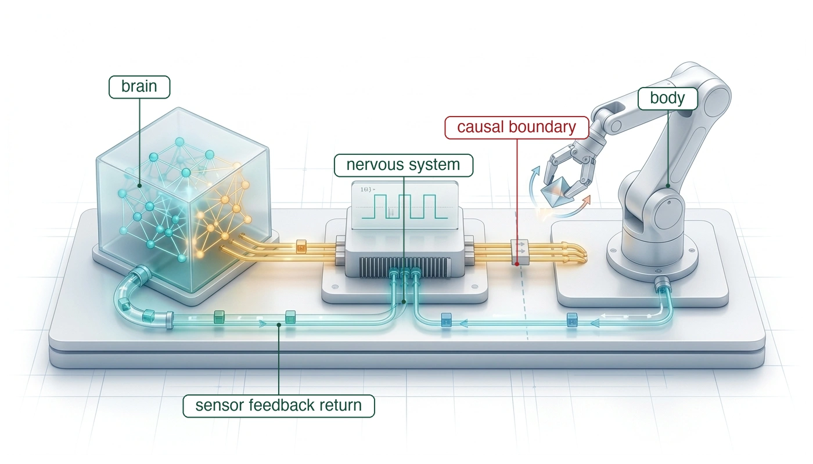

## Назначение

_Что должна гарантировать машина, прежде чем предложение обученной модели превратится в физическую работу?_

Обученная политика может выбирать действия, которые машина не способна выполнить безопасно. Как только команда достигает двигателя, ток создает момент, а движущаяся масса несет импульс. Отмена вычисления не может отменить это движение. Пока программное обеспечение робота обрабатывает наблюдения, его физическое шасси продолжает двигаться по инерции к препятствию. Каждая миллисекунда вычислительной задержки потребляет физическое пространство, необратимо сужая доступную тормозную огибающую. Одной точности предсказания недостаточно, чтобы решить, следует ли выполнять действие: политика с точностью бенчмарка 99,9 % все равно командует катастрофические столкновения, когда ее масштабируют на тысячи часов работы в неконтролируемых физических средах.

Физический искусственный интеллект разрешает это противоречие, структурируя машину по пяти различным уровням работы. Высокоемкие обученные модели, обитающие в Мозге, предлагают кандидатные траектории, но между статистическими предложениями и физическим исполнением стоит каузальная граница: окончательный интерфейс, где цифровые биты командуют токами двигателей. Мозг обладает правом предложения, тогда как детерминированная Нервная система сохраняет полномочия исполнения команд в жестком реальном времени, чтобы проверять команды по измеренным кинематическим и тепловым пределам Тела. Если обученная политика сталкивается с хвостовой задержкой, исчерпанием памяти или семантической ошибкой, Нервная система останавливает движение с помощью проверенного стоп-суффикса до того, как машина исчерпает бюджет запаса хода.

> ↳ **Далее:** Пределы объекта управления за каузальной границей измеряются и фиксируются в разделе [«Замер пределов машины»](02_body.md#sec-body-measuring-limits).

> **Цели обучения**
>
> - Объяснить, почему команду, пересекшую каузальную границу, нельзя отозвать программными средствами
> - Вычислить слепой ход задержки до торможения и сравнить его с тормозным путем
> - Классифицировать физические машины по бюджету, который исчерпывается первым: запас хода, контактная сила или тепловой либо фазовый запас
> - Применить тест охвата физического ИИ, чтобы отличить рекомендательные модели от автономных физических систем
> - Найти границу предложения в пятиуровневой машине и объяснить, почему только путь разрешения может командовать актуаторами
> - Диагностировать, как отказы по времени и полномочиям сочетаются в инциденте автономной машины
> - Оценить, как необратимость, замкнутые данные и ограниченные свидетельства по отдельности делают независимый путь разрешения необходимым
> - Объяснить, почему физические полномочия зависят от состояния, так что безопасность, защищенность и подотчетность сходятся на пути разрешения

## Искусственный интеллект за стеклом

Подъезжая к открытому дверному проему, робот должен сделать больше, чем распознать портал в потоке изображений камеры. Он должен оценить, пройдет ли его физическое шасси через проем, выбрать осуществимую траекторию и непрерывно корректировать этот путь, пока импульс несет его вперед. Если внезапно появляется препятствие, отмена программного потока или выброс необработанного исключения не могут остановить импульс машины. Проектирование такого поведения требует проследить решение от сенсорных свидетельств вплоть до электромагнитного момента и механической работы. Этот полный замкнутый контур и есть область системной инженерии физического искусственного интеллекта.

В физической машине цифровые биты могут командовать электрическими токами через силовые инверторы, магнитный поток создает механический момент, а движущаяся масса накапливает импульс. Ошибочная команда может поэтому вызвать срез редуктора, просадку шины напряжения батареи или столкновение раньше, чем программное обеспечение успеет ее исправить.

**Парадокс Моравека**[^fn-ai-moravec-paradox] [Moravec, 1988](references.md#moravec1988mind) объясняет, почему обученные модели вообще входят в этот контур: задачи, требующие интенсивных сознательных усилий человека, такие как игра в шахматы или доказательство теорем, требуют скромных вычислений, тогда как сенсомоторные навыки, выполняемые без усилий (например, идти по неровному гравию или схватить яйцо, не раздавив его), требуют огромных вычислительных и управляющих ресурсов. По мере того как высокоемкие нейронные сети развертывают для овладения этими сенсомоторными задачами, инженерные команды сталкиваются со стеной наработки, которую выводит раздел [«Пределы физических испытаний»](07_evaluation.md#sec-evaluation-trial-limits). Точность офлайн-бенчмарков не может предсказать устойчивость замкнутого контура в открытом мире, и никакое осуществимое количество испытаний без отказов само по себе не способно продемонстрировать редкие частоты отказов, которых требует растущее физическое развертывание, поэтому аргументы безопасности должны покрывать накопленную наработку, а не только контролируемые демонстрации.

[^fn-ai-moravec-paradox]: **Парадокс Моравека**: Наблюдение в области искусственного интеллекта [Moravec, 1988](references.md#moravec1988mind), что высокий уровень рассуждений требует сравнительно малых вычислений, тогда как низкоуровневая сенсомоторная координация требует огромных перцептивных и вычислительных ресурсов.

Когда цифровые модели командуют физическими актуаторами, они входят в замкнутые каузальные контуры обратной связи, впервые формализованные Норбертом Винером в кибернетике[^fn-boundary-wiener-feedback] [Wiener, 1948](references.md#wiener1948cybernetics). Информация перестает быть разомкнутым потоком, завершающимся на дисплее. Вместо этого каждое физическое движение перемещает датчики машины, преобразуя последующие наблюдения по детерминированным законам классической механики. Построение такой машины опирается на четыре технические культуры (машинное обучение, компьютерные системы, классическая робототехника и встроенные кремниевые системы и безопасность), и команды, которые их связывают, обнаруживают, что каждая культура формулирует проблему на своем языке.

[^fn-boundary-wiener-feedback]: **Кибернетические контуры обратной связи**: В кибернетической схеме Норберта Винера [Wiener, 1948](references.md#wiener1948cybernetics) обратная связь означает корректировку будущих действий по прошлым результатам.

Перспектива машинного обучения сосредоточена на масштабировании числа параметров, трансформерных стеков и диффузионных политик на миллионах шагов симуляции, рассматривая развертывание в реальном мире как задачу более широких наборов демонстраций и охвата датасетов. Перспектива компьютерных систем сосредоточена на пропускной способности шины памяти, иерархии кэшей и процентилях хвостовой задержки, осознавая, что потоковая передача многогигабайтных нейронных весов на высоких частотах грозит насытить межсоединения памяти и оставить конвейеры прямого доступа к памяти камер без данных [Williams et al., 2009](references.md#williams2009roofline). Перспектива классической робототехники опирается на динамику Ньютона–Эйлера для управления механическими силами и движением. Если нейронная сеть командует резкими изменениями движения (высокочастотный рывок), она может срезать редукторы или вызвать структурный резонанс, из-за чего классические запасы устойчивости становятся критически важными. Наконец, перспектива встроенных кремниевых систем и безопасности сосредоточена на обработчиках прерываний на «голом железе», аппаратных зонах аварийного отключения и стандартах функциональной безопасности (таких как ISO 26262 и UL 4600), гарантирующих, что неверифицированные статистические модели никогда не получают прямого доступа на запись к силовым каскадам приводов.

Каждая перспектива дает критически важную идею. Градиентный спуск не чинит разрушенную передачу и не предотвращает просадку напряжения питания, а ручной классический регулятор не обеспечивает семантического понимания сцены в открытом мире. Жизнеспособная архитектура систем физического ИИ должна объединить их обязанности, не возлагая всю проблему на какую-либо одну дисциплину.

> ↳ **Далее:** Разделение обученных предложений и полномочий исполнения команды отображается на изолированные кремниевые домены в разделе [«Где проходит путь разрешения»](04_nervous_system.md#sec-nervous-silicon-partitioning).

> **Физический искусственный интеллект**
>
> ***Физический искусственный интеллект*** — это инженерия замкнутых физических машин, в которых высокоемкие обученные модели предлагают действия, которые ограничивают классическая механика, термодинамика и кремниевые системы жесткого реального времени.
>
> 1.  **Значение**: Выходы рекомендательного ИИ не имеют прямых полномочий над актуаторами, хотя люди или нисходящие системы могут действовать по ним. Физический ИИ переходит в непрерывный объект управления, где цифровые биты командуют токами двигателей, накапливается кинетический импульс, а программные зависания могут приводить к механическим разрушениям, перегреву или столкновениям.
> 2.  **Отличие**: В отличие от классической робототехники (которая опирается на проектируемые вручную конечные автоматы и явные кинематические модели) или машинного обучения интернет-масштаба (которое работает на статических офлайн-датасетах), физический ИИ связывает высокоемкую статистическую генерализацию с детерминированными аппаратными фильтрами безопасности вдоль эндогенного замкнутого каузального контура.
> 3.  **Типичная ловушка**: Считать физические воплощения периферийными устройствами ввода-вывода для фундаментальных моделей. Законы масштабирования и точности бенчмарков не предотвращают просадку напряжения питания, срез редуктора или насыщение усилия актуатора; физическая безопасность требует асимметричной архитектуры, в которой независимая проверка реального времени может наложить вето на любое предложение обученной модели.

Глава следует за командой от вычисления к физической работе, сравнивает бюджеты трех классов машин, применяет тест охвата, чтобы решить, какие машины попадают в дисциплину, выстраивает машину в пять уровней и использует столкновение в Tempe, чтобы проверить границу между обученными предложениями и разрешением на исполнение команды. Заключительные разделы превращают этот анализ отказа в четыре закона, прослеживают, где сходятся безопасность, защищенность и подотчетность, и излагают архитектуру книги.

## Каузальная граница

У рекомендательной модели, которая лишь показывает рекомендацию, нет прямого пути к двигателю или клапану. Пользователь может отклонить рекомендацию, а транзакцию базы данных можно откатить до того, как внешнее действие вступит в силу.[^fn-math-idempotency-physical] Ни то ни другое свойство не делает цифровые ошибки безобидными: человек может последовать плохому совету, а автоматизированная торговая система — выполнить последовательный по последствиям ордер. Существенное различие состоит в том, может ли выход модели автоматически достичь физического актуатора.

[^fn-math-idempotency-physical]: **Идемпотентность**: Повторение идемпотентной операции дает тот же заданный результат, что и однократное выполнение. Команда задания двигателю может иметь идемпотентную семантику команды, но повторное выполнение все равно может рассеивать энергию. Идемпотентность не означает обратимости и безвредности.

Физический ИИ устраняет разрыв между выходом модели и актуатором. В физической машине последняя инструкция контура управления не записывается на экран и не заполняет веб-ответ. Для инженера систем машинного обучения, привыкшего писать `action = policy(observation)` в PyTorch, каузальная граница — это место, где тензоры с плавающей точкой встречаются с физическим кремнием. Тензор выхода политики, обычно фрагмент действий, предсказывающий последовательность ближайших путевых точек (положения шарниров, скорости или декартовы позы 6-DOF),[^fn-action-chunk-repr] нельзя выполнить напрямую на физических двигателях.

[^fn-action-chunk-repr]: **Представления фрагмента действий**: В литературе по обучению роботов [Zhao et al., 2023](references.md#zhao2023learning) фрагменты действий обычно представляют собой тензоры формы $[B, H, d_a]$, где $B$ — размер батча, $H$ — горизонт предсказания планирования, а $d_a$ — размерность действия (такая как целевые положения шарниров $\hat{\mathbf{q}} \in \mathbb{R}^d$ или приращения 3D-декартовой позиции и ориентации). Формальная формулировка через группу Ли ($SE(3)$) отложена до раздела [«Пространственные системы координат и кинематика плеча»](appendix_control.md#sec-appendix-control-spatial); раздел [«Когнитивный мозг»](03_brain.md#sec-brain) определяет фрагмент и его горизонт.

Между предложением обученной модели и командой актуатора должна стоять независимая проверка. Если проверка допускает предложение, его задания проходят через детерминированный каскад контуров привода, превращающий их в ток двигателя, и последний программный акт в этом каскаде — значение, записываемое в аппаратный регистр. В зависимости от архитектуры машины этот аппаратный регистр выступает защелкой цифро-аналогового преобразователя, удерживающей заданное опорное напряжение, регистром сравнения широтно-импульсной модуляции (PWM), задающим скважность инвертора, или последовательным управляющим словом, настраивающим затворный драйвер. Ровно по этому адресу памяти информационная абстракция заканчивается. Модуляция затворных напряжений силовых MOSFET-транзисторов тянет ток от высоковольтной шины постоянного тока в обмотки статора, создавая силы Лоренца, ускоряющие ротор против приведенной инерции нагрузки.

> **Каузальная граница**
>
> ***Каузальная граница*** — это физический и электрический интерфейс, на котором цифровые вычислительные биты превращаются в физические силы, токи или потоки.
>
> 1.  **Значение**: До исполнения команды предложение можно отклонить, не совершая физической работы. После исполнения действия могут изменить среду, рассеять тепло (омический нагрев $I^2 R$, кинетическое трение) и преобразовать последующие сенсорные наблюдения.
> 2.  **Отличие**: В отличие от подготовленного цифрового предложения, которое можно отклонить до фиксации, приложенную силу нельзя отменить, а совершенная ею физическая работа остается в объекте управления.
> 3.  **Типичная ловушка**: Считать, что программные исключения или отмена потока могут остановить физический импульс. Как только регистр сравнения PWM защелкнут, ток течет и масса ускоряется; для остановки этого движения требуется выделенный остановочный путь ($d_{\text{stop}}$) и фрикционное торможение.

Переход от цифрового состояния к физической силе разрушает допущение, центральное для офлайн-машинного обучения, что данные не зависят от выходов модели. В офлайн-зрении, обработке естественного языка и табличных предсказаниях сбор данных экзогенен: мир порождает распределение входов, и модель обрабатывает их, не меняя механизма, который их создал. В физической системе среда развивается в замкнутом каузальном контуре: следующее физическое состояние и сенсорное наблюдение зависят прямо от действия, порожденного предыдущим выводом модели.

Поток сенсорных входов эндогенен, он порождается собственными прошлыми действиями машины. Когда политика выдает ошибочную команду момента, шарнир поворачивается, платформа смещается, а установленные камеры или лидары разворачиваются в новые точки обзора. Машина сама въезжает в незнакомую область пространства состояний, где обучающие данные разрежены, повышая вероятность последующих ошибок вывода и наращивая расхождение с номинальной работой ([«Замкнутая каузальная петля»](01_causal_boundary.md#fig-01-causal-loop)).

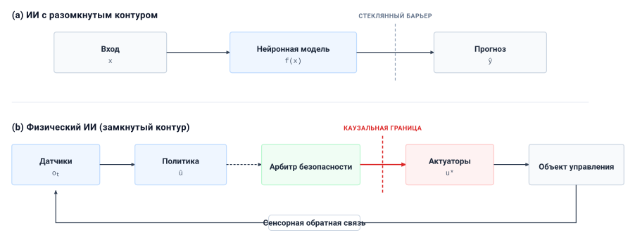
***Замкнутая каузальная петля**: Рекомендательный выход (вверху) заканчивается на информационном интерфейсе. В физическом ИИ (внизу) разрешенные предложения модели доходят до аппаратных регистров, где электрический ток создает силу и движение. Эти действия изменяют среду и последующие сенсорные наблюдения.*

Поскольку физическая масса обладает инерцией, а вычисления занимают конечное время, задержка в физическом ИИ превращается прямо в физическое смещение. Как показано на автономном испытательном стенде в разделе [«Прием данных лидара»](01_causal_boundary.md#fig-01-sensor-rack), реальные робототехнические системы опираются на плотные многомодальные сенсорные комплексы (вращающиеся лидары, камерные массивы и радиолокаторы), непрерывно передающие телеметрию с высокой пропускной способностью бортовым процессорам. Каждый этап этого конвейера, от экспозиции фотодиода и сериализации на сенсорной шине,[^fn-hw-serdes-bus] до нейровычислений на кремнии ускорителя и передачи пакетов по детерминированным полевым шинам, потребляет миллисекунды.

[^fn-hw-serdes-bus]: **Автомобильные последовательные/десериализаторы (SerDes)**: Высокоскоростные связи физического уровня (такие как FPD-Link или GMSL), передающие несжатые видеопотоки многогигабитной скорости с низкой задержкой по легким коаксиальным кабелям или экранированной витой паре. В сочетании с выделенными аппаратными линиями синхронизации интерфейсы SerDes обеспечивают захват затвора с микросекундной синхронизацией по всему сенсорному кольцу. Спецификации шин см. в разделе [«Системы и оборудование»](appendix_systems.md#sec-appendix-systems).

В качестве конкретного примера рассмотрим колесное основание складского мобильного манипулятора (полностью представленного в разделе [«Три класса машин»](01_causal_boundary.md#sec-boundary-four-archetypes)), движущегося по проезду с пределом привода `1.5 m/s` (иллюстративно; см. руководство для читателя). Его задержка до торможения, которую последующие главы собирают слагаемое за слагаемым, составляет не более `133.6 ms` — от захвата кадра камеры, на котором человек выходит из-за торца стеллажа, до начала тормозной силы. За это время основание проходит `200 mm` без всякого отклика на то, что записал кадр. Человек, вышедший ближе этой точки, будет достигнут до начала торможения, и никакой объем модели не изменит этого исхода.

Этот компромисс между вычислительной задержкой и физическим запасом хода формализует **кинематическая roofline-модель**. В классической архитектуре компьютерных систем roofline-модель [Williams et al., 2009](references.md#williams2009roofline) ограничивает достижимую пропускную способность меньшим из двух потолков: произведения пиковой пропускной способности памяти на арифметическую интенсивность (отношение арифметических операций к перемещаемым байтам, в $\text{FLOPs/byte}$) и пиковой вычислительной производительности. В физическом ИИ кинематическая roofline-модель связывает задержку до торможения $\tau_{\text{delay}}$ и скорость платформы $v$, ограничивая физический запас остановки при допустимом тормозном замедлении $a_{\text{brake}}$, но складывает оба слагаемых, а не ограничивает одно другим.

При аварийном торможении полный остановочный путь $d_{\text{stop}}$ равен сумме слепого хода за время задержки, растущего линейно с задержкой, и тормозного пути, растущего с квадратом скорости. Соотношение выводится в разделе [«Кинетический импульс»](02_body.md#sec-body-kinetic-momentum). Слепой ход неустраним. Во время задержки тормозную силу приложить нельзя: экспозиция датчика еще не прошла через восприятие и полевую шину до тормозов. Как показывает [«Номограмма кинематической roofline-модели»](01_causal_boundary.md#tbl-01-kinematic-roofline) для репрезентативных воплощенных платформ, доля задержки в остановке наибольшая для медленных маневренных платформ, тогда как абсолютный ход наибольший для быстрых транспортных средств.

| Физическая платформа и скорость $v$                                                                                         | Тормозное замедление $a_{\text{brake}}$                                                | Механическое торможение $d_{\text{braking}}$    | $\tau_{\text{delay}} =$ `10 ms` (класс рефлекса) | $\tau_{\text{delay}} =$ `50 ms` (короткий класс) | $\tau_{\text{delay}} =$ `200 ms` (длинный класс) | Доля задержки при `200 ms` |
|:-------------------------------------------------------------------------------------------------------------------------|:--------------------------------------------------------------------------------|:-------------------------------------------|:-----------------------------------------------------------------------------------|:--------------------------------------------------------------------------------|:------------------------------------------------------------------------------|:-------------------------------------------------------------|
| **Гуманоид / Квадрупед** (`1 m/s` = `3.6 km/h`)             | `4 m/s²` (`0.41 g`) | `0.125 m` | `0.135 m (+1 cm)`                                            | `0.175 m (+5 cm)`                                         | `0.325 m (+20 cm)`                                       | **`61.5%` от полной остановки** |
| **Складской мобильный манипулятор, основание** (`1.5 m/s` = `5.4 km/h`) | `2 m/s²` (`0.20 g`)   | `0.563 m`  | `0.578 m (+1.5 cm)`                                             | `0.638 m (+7.5 cm)`                                          | `0.863 m (+30 cm)`                                        | **`34.8%` от полной остановки**  |
| **Городской доставочный робот** (`6 m/s` = `21.6 km/h`)               | `4.5 m/s²` (`0.46 g`) | `4 m` | `4.06 m (+6 cm)`                                            | `4.30 m (+30 cm)`                                         | `5.20 m (+120 cm)`                                       | **`23.1%` от полной остановки** |
| **Автономное транспортное средство** (`20 m/s` = `72 km/h`)                 | `7 m/s²` (`0.71 g`)   | `28.6 m`  | `28.8 m (+20 cm)`                                             | `29.6 m (+100 cm)`                                          | `32.6 m (+400 cm)`                                        | **`12.3%` от полной остановки**  |

***Номограмма кинематической roofline-модели**: Компромиссы запаса остановки для воплощенных платформ. В строке складского мобильного манипулятора используются его предел привода и допустимое замедление. Три колонки задержки — это классы задержки до торможения, а не задержка какой-либо одной платформы. Остановочные пути округлены до трех значащих цифр, а добавленный слепой ход приведен в сантиметрах с точностью до миллиметра. При задержке `200 ms` автономный легковой автомобиль проезжает лишние `4 m` — целую длину кузова — прежде чем включатся тормоза.*

Точно так же, как архитектор не может устранить ограниченный памятью арифметический конвейер добавлением новых исполнительных устройств ALU, инженер систем автономного транспортного средства не может устранить нарушение запаса аварийной остановки добавлением параметров модели, если это удлиняет задержку $\tau_{\text{delay}}$ до торможения. Более тяжелая фундаментальная модель, добавляющая `150 ms` вычислений, съедает лишние `3 m` физического хода на загородных скоростях — расстояние, которое не вернуть ни фрикционным тормозом, ни логикой предотвращения столкновений.

Физическая реальность этого компромисса прослежена на протяжении пяти десятилетий систем автономных транспортных средств ([«Каузальная граница»](01_causal_boundary.md#fig-boundary-latency-vs-velocity)). Безопасная рабочая скорость любой платформы физического ИИ жестко ограничена **кинематической roofline-моделью остановки**:
$$d_{\text{stop}} = v \tau_{\text{delay}} + \frac{v^2}{2 a_{\text{max}}} \le R_{\text{sensor}}$$
где $v$ — скорость транспортного средства, $\tau_{\text{delay}}$ — сквозная задержка контура «восприятие — действие», $a_{\text{max}}$ — замедление аварийного торможения ($0.7\,\text{g} \approx 6.86\,\text{m/s}^2$ на сухом асфальте), а $R_{\text{sensor}}$ — эффективный горизонт восприятия датчиков.

В раннюю эпоху обдумывания (1970–1980) Shakey из SRI и Stanford Cart Моравека работали с задержками контура от $15$ до $30\,\text{seconds}$ из-за узких мест вычислений на внешних мейнфреймах, ограничивая безопасные скорости ползания величиной ниже $0.2\,\text{km/h}$. К середине 1980-х и в 1990-х VaMoRs Эрнста Дикманса показал, что выполнение собственных алгоритмов 4D-динамического зрения на $25\,\text{Hz}$ ($\tau = 40\,\text{ms}$) открыло скорости шоссе $96\,\text{km/h}$ на немецком автобане, доказав, что безопасную мобильность определяет темп контура управления, а не глубина когнитивного обдумывания. Во время соревнований DARPA Grand Challenge (2004–2007) Stanford Stanley и CMU Boss работали на $10\text{--}12\,\text{Hz}$ ($85\text{--}100\,\text{ms}$), двигаясь по пустынным тропам и городским перекресткам на $48\text{--}60\,\text{km/h}$. Сегодня серийные роботакси, такие как Waymo Driver, поддерживают задержки контура порядка $\sim 80\,\text{ms}$, чтобы огибающие остановки оставались далеко внутри их $200\,\text{m}$ сенсорных горизонтов на загородных скоростях ($110\,\text{km/h}$), тогда как автономные гоночные автомобили (такие как команда PoliMOVE серии Indy Autonomous Challenge) снижают задержки контура до $28\,\text{ms}$ ($>35\,\text{Hz}$), чтобы безопасно работать на скоростях свыше $309\,\text{km/h}$.

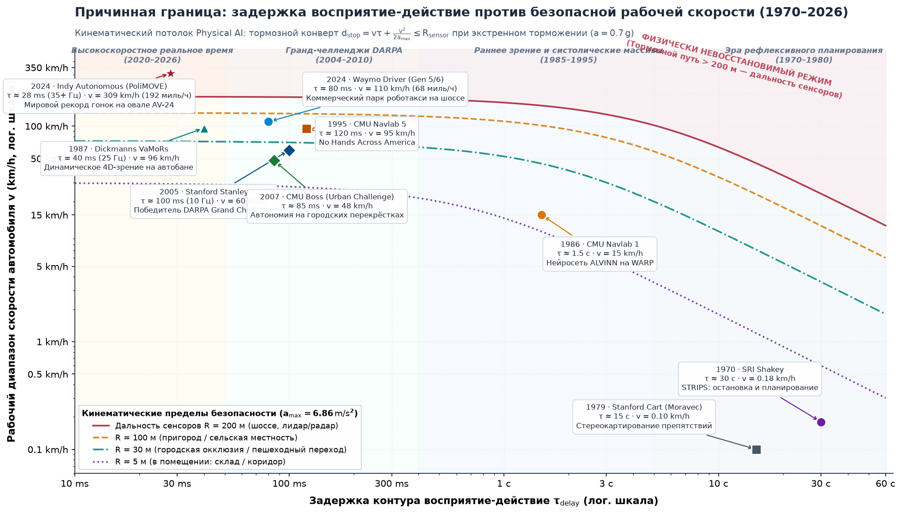
***Каузальная граница: задержка контура «восприятие — действие» против рабочей огибающей скорости транспортного средства (1970–2026)**: Эмпирические вехи пяти десятилетий автономных наземных транспортных средств, нанесенные на физические кинематические roofline-модели остановки при аварийном замедлении ($a_{\text{max}} = 0.7\,\text{g} = 6.86\,\text{m/s}^2$) для четырех сенсорных горизонтов ($R = 5\,\text{m}$ до $200\,\text{m}$). Транспортные средства выше потолка $R = 200\,\text{m}$ попадают в физически невосстановимый режим, где остановочный путь превышает дальность датчиков независимо от изобретательности нисходящих алгоритмов. Вехи: SRI Shakey (1970), Stanford Cart (1979), CMU Navlab 1 (1986), UniBwM VaMoRs (1987), CMU Navlab 5 (1995), Stanford Stanley (2005), CMU Boss (2007), Waymo Driver Gen 5/6 (2024) и Indy Autonomous Challenge PoliMOVE AV-24 (2024).*

Как только цифровые команды переходят в механическую работу, изменение состояния становится термодинамически необратимым. Физический мир не дает механизма отката.[^fn-phys-landauer-limit] Когда контроллер актуатора подает ток на двигатель, электрическая энергия переходит из батареи в кинетическую энергию механических звеньев или в тепловую энергию, рассеиваемую резистивным джоулевым нагревом ($I^2 R$) в обмотках статора. Если ошибочный момент шарнира вбивает манипулятор в жесткий стальной прижим, кинетическая энергия превращается в пластическую деформацию инструмента, механическое напряжение в зубьях редуктора и тепло. Никакое программное прерывание не может извлечь эту кинетическую энергию из разрушенной конструкции или вернуть срезанные зубья передачи к исходной геометрии.

[^fn-phys-landauer-limit]: **Термодинамические пределы вычислений**: На фундаментальном уровне [Landauer, 1961](references.md#landauer1961) установил, что стирание логических битов рассеивает не менее $k_B T \ln 2$ тепла на каждый стертый бит. Однако в системах физического ИИ доминирующая необратимость макроскопична: моторные инверторы тянут десятки ампер из батарейных блоков, рассеивая джоулево тепло ($I^2 R$) в киловаттных масштабах и передавая импульс движущимся звеньям.

> ↳ **Далее:** Негладкая механика контакта и пределы насыщения момента, определяющие необратимость двигателя, выводятся в разделе [«Пределы передачи актуатора»](02_body.md#sec-body-actuator-limits).

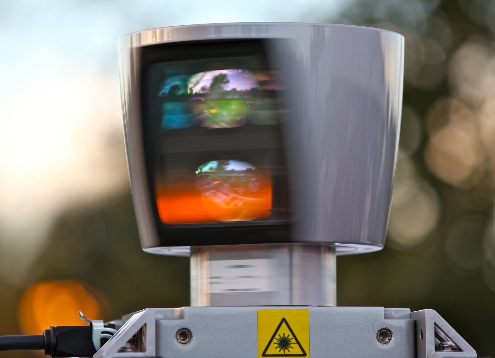
***Прием данных лидара**: 64-лучевой вращающийся лидар на автономном исследовательском испытательном стенде. В физическом ИИ сенсорные потоки, выдающие свыше 1,3 миллиона точек в секунду, должны сериализоваться через аппаратные интерфейсы реального времени, синхронизироваться по микросекундным меткам времени и обрабатываться нейронными стеками восприятия в пределах жестких предельных сроков задержки. (Источник: Steve Jurvetson, CC BY 2.0).*

Физический ИИ наследует обученную модель рекомендательного машинного обучения и актуатор классического управления, а вместе с ними и сочетание режимов отказов, с которым ни одна из областей не сталкивается поодиночке ([«Матрица вычислительных парадигм по каузальной границе»](01_causal_boundary.md#tbl-01-paradigm-comparison)).

| Архитектурная размерность   | Цифровое машинное обучение (рекомендательное)                                                                        | Классическая робототехника и управление                                                     | Физический искусственный интеллект (замкнутый контур)                                                                                                                                                                                                      |
|:--------------------------|:-----------------------------------------------------------------------------------------------------------|:---------------------------------------------------------------------------------|:----------------------------------------------------------------------------------------------------------------------------------------------------------------------------------------------------------------------------------------------------|
| **Операционный субстрат** | Разделенные буферы виртуальной памяти (GPU VRAM, DRAM, веб-эндпоинты)                                           | Непрерывное аналоговое пространство состояний, описываемое дифференциальными уравнениями                 | Гибрид: многомерные нейронные представления, отображаемые на аналоговые физические актуаторы                                                                                                                                                                 |
| **Формализация модели**     | Высокоемкие статистические аппроксиматоры (LLM, ViT, диффузионные политики)                                   | Аналитически заданные переходные функции и детерминированные матрицы пространства состояний | Фундаментальные политики в паре с детерминированными фильтрами безопасности времени выполнения                                                                                                                                                                                |
| **Динамика обратной связи**     | Экзогенная и статическая; независимые одинаково распределенные выборки                                      | Непрерывная детерминированная обратная связь по состоянию с гауссовым шумом датчиков               | Эндогенный нестационарный замкнутый контур; действия формируют будущие наблюдения                                                                                                                                                                           |
| **Темп исполнения**     | Пакетирование, оптимизированное под пропускную способность; мягкие или неограниченные бюджеты задержки                                           | Однотактные контуры жесткого реального времени на микроконтроллерах (от 100 Гц до 1 кГц)           | Многотактная: модель намерения (`1–5 Hz`) и политика фрагментов (`10–50 Hz`) предлагают; контур разрешения (в одной реализации — `1 kHz`) допускает |
| **Полномочия исполнения команды**   | Рекомендательные; изолированные API, буферы экрана или проверка человеком в контуре                                 | Жестко заданная обратная связь, напрямую управляющая таймерами силовых инверторов и регистрами PWM      | Предложения обученных моделей проверяются независимым путем до того, как любое из них дойдет до актуатора                                                                                                                                                                     |
| **Семантика отказов**     | Выходы можно отклонить, транзакции — отменить до внешнего действия; вред в дальнейшем остается возможен | Насыщение актуатора, ошибка слежения или потеря устойчивости                        | Необратимая термодинамическая работа, пластическая деформация, кинетическое столкновение или перегрев статора                                                                                                                                                      |
| **Гарантия безопасности**      | Офлайн-минимизация статистической функции потерь на валидационных выборках                                                 | Формальные математические доказательства устойчивости (функции Ляпунова, запасы по усилению и фазе)    | Многослойное принудительное обеспечение инвариантов во время выполнения, фильтры-барьеры с прямой инвариантностью и внедрение отказов                                                                                                                                                       |

***Матрица вычислительных парадигм по каузальной границе**: Рекомендательное цифровое машинное обучение (слева), классическая робототехника и теория управления (в центре) и физический искусственный интеллект (справа), сопоставленные по операционному субстрату, формализации модели, динамике обратной связи, темпу исполнения, полномочиям исполнения команды, семантике отказов и примитивам сертификации безопасности.*

Строки «Семантика отказов» и «Полномочия исполнения команды» в правой колонке восходят к необратимости. Разрешенная команда доставляет работу, которую не может отозвать ни одно последующее программное действие, поэтому проверка должна завершиться раньше. Что эта работа повреждает первым и как быстро, зависит от того, что машина приводит в движение, и эта зависимость задает предельный срок, который проверка должна выдержать.

## Три класса машин

Автономный доставочный дрон, летящий в турбулентных порывах ветра, кажется, не имеет ничего общего с шестиосевой роботизированной рукой, собирающей автомобильную коробку передач, и ни тот ни другой не связаны с контейнеризированной установкой управления батареями, регулирующей жидкий теплоноситель. Один учебный курс может охватить их все, не превращаясь в собрание ad hoc рецептов, только если он классифицирует их по чему-то более глубокому, чем их форма.

Ключ в том, чтобы смотреть сквозь косметические форм-факторы к лежащим в основе физическим законам сохранения. Каждая воплощенная система ИИ управляется одним или несколькими из трех фундаментальных физических классов, каждый из которых определяется законом сохранения, доминирующим над его актуаторами ([«Три класса машин»](01_causal_boundary.md#fig-01-three-archetypes), [«Три класса машин в поле»](01_causal_boundary.md#fig-01-real-three-archetypes)): перемещением массы в пространстве, приложением силы через физический контакт или регулированием непрерывных потоков жидкости и тепла. Гуманоид связывает все три на одном шасси. Классификация машины таким образом позволяет системным архитекторам определить, какой бюджет ресурсов исчерпывается первым при зависании или аномалии программного обеспечения, и подогнать под него реакцию безопасности машины. [«Ограничивающий бюджет по классам»](01_causal_boundary.md#tbl-01-archetype-budgets) сопоставляет эти бюджеты с отказом, которым каждый заканчивается, и привратником, который должен его перехватить.

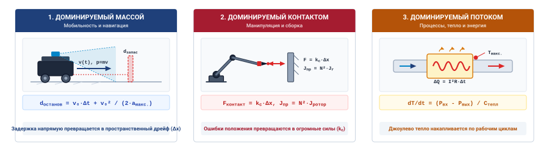
***Три класса машин**: Три фундаментальных физических воплощения, классифицированных по их главным ограничивающим законам сохранения: (a) мобильность, доминируемая массой (класс 1), управляемая импульсом и пространственным запасом; (b) манипуляция, доминируемая контактом (класс 2), управляемая механическим импедансом и пределом текучести конструкции; и (c) технологические установки, доминируемые потоком (класс 3), управляемые теплоемкостью и транспортным запаздыванием.*

| Класс             | Примеры                             | Первый исчерпываемый бюджет                                       | Режим отказа                        | Привратник безопасности                                                                                           |
|:------------------|:--------------------------------------|:--------------------------------------------------------------|:------------------------------------|:------------------------------------------------------------------------------------------------------|
| Доминируемый массой    | AMR, AV, дроны, мобильные основания       | Остановочный путь и задержка до торможения ($\tau_{\text{delay}}$) | Кинетическое столкновение; превышение импульса  | Независимая проверка торможения с частотой, заданной бюджетом остановки ($1\text{ kHz}$ в одной реализации) |
| Доминируемый контактом | Манипуляторы, захваты, прессы       | Ток актуатора и напряжение в редукторе                           | Срез зуба передачи; повреждение детали  | Ограничение производной момента и предел $C^2$-гладкой траектории (непрерывное ускорение)                   |
| Доминируемый потоком    | Тепловые контуры, инверторы, биореакторы | Тепловой или фазовый запас                                       | Тепловой разгон; пробой изоляции | Аппаратный тепловой наблюдатель и блокировка                                                               |

***Ограничивающий бюджет по классам**: Каждый класс при зависании программного обеспечения первым исчерпывает разный ресурс, и этот ресурс определяет механизм принудительного обеспечения, который машина должна нести. Привратники — это проектные ответы на режим отказа в той же строке, а не сертифицированные заявления о характеристиках.*

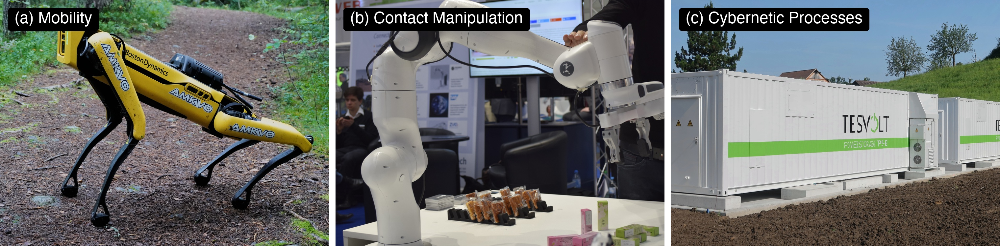
***Три класса машин в поле**: Полевые развертывания, представляющие три фундаментальных режима физического сохранения: (a) мобильность, доминируемая массой, — квадрупед Spot от Boston Dynamics на неструктурированной местности; (b) манипуляция, доминируемая контактом, — совместная рука Franka Emika Panda, регулирующая точные контактные силы сборки; и (c) технологические установки, доминируемые потоком, — контейнеризированные системы накопления энергии на батареях коммунального масштаба (Tesvolt BESS), управляющие высокомощным тепловыделением и контурами жидкостного охлаждения. (Атрибуция: Wikimedia Commons, CC BY-SA 4.0).*

Эта книга ведет одну машину от первой главы до последней. Складской мобильный манипулятор — это колесное основание, несущее руку с семью шарнирами, навигационную камеру и лидар, камеру на запястье и два компьютера. Прикладной процессор запускает его обученные модели, а отдельный микроконтроллер безопасности решает с фиксированным коротким периодом, может ли предложенное движение дойти до двигателей. Его политика фрагментов — это модель фрагментирования действий всего тела, которая предлагает скорость основания и целевые положения шарниров руки вместе, как это делают системы мобильной манипуляции этого класса [Fu et al., 2024](references.md#fu2024mobile). Основание — это доминируемая массой машина класса 1, которая должна остановиться, не достигнув человека, вышедшего из-за торца стеллажа. Рука — это доминируемая контактом машина класса 2, которая должна открыть дверцу клетки с пружинным замком, поднять незнакомую кружку с движущегося конвейера и передать кружку коллеге на упаковочном посту, каждый раз не превышая контактной силы. Главы, которым принадлежит слагаемое бюджета остановки машины, добавляют это слагаемое по очереди, так что значение, которое вычисляет одна глава, использует следующая. Остальные главы занимаются инициатором, который тратит этот бюджет, и свидетельствами, которые решают, сколько из него инициатор может израсходовать. Технологическая установка класса 3 появляется в каждой части один раз как контраст.

### Класс 1: системы мобильности

Машины класса 1 перемещают массу в пространстве, ограничиваемые сохранением импульса и рассеянием кинетической энергии ([«Три класса машин»](01_causal_boundary.md#fig-01-three-archetypes) a, [«Три класса машин в поле»](01_causal_boundary.md#fig-01-real-three-archetypes) a). В автономных транспортных платформах, квадрупедах, преодолевающих пересеченную местность (таких как Spot от Boston Dynamics), мобильных манипуляторах и летающих дронах мост актуаторов прикладывает силу, чтобы перемещать или вращать тело массой $m$ со скоростью $v$. Поскольку кинетическую энергию $E_k = \frac{1}{2}m v^2$ нельзя мгновенно уничтожить после того, как она доставлена шасси (ее необходимо снять через трение, аэродинамическое сопротивление или рекуперативное торможение), безопасность прежде всего измеряется как оставшийся пространственный запас. Остановочный путь из [«Номограммы кинематической roofline-модели»](01_causal_boundary.md#tbl-01-kinematic-roofline) — это бюджет этого класса, а первая граница, нарушаемая при зависании программного обеспечения или ошибке классификации модели, — это физическое расстояние до внешнего препятствия.

Чтобы увидеть, как масштабируются оба слагаемых этого бюджета, вернемся к складскому основанию, движущемуся с пределом привода `1.5 m/s` к торцу стеллажа, откуда вышел человек. В груженом состоянии с тележкой для контейнеров его масса не превышает `368 kg`, и оно несет `414 J` кинетической энергии, которую торможение должно снять через сцепление колес с полом. При допустимом замедлении `2 m/s²` одно только торможение требует `562.5 mm` пола. Слепой ход `200 mm` за задержку до торможения `133.6 ms` предшествует всему этому торможению и добавляет 35,6 % к тормозному пути. [«Номограмма кинематической roofline-модели»](01_causal_boundary.md#tbl-01-kinematic-roofline) получает близкую величину для того же основания, `34.8%`, другой мерой — ходом за его длинный класс задержки `200 ms` как долей полной остановки. Оба слагаемых подчиняются разным проектным решениям. Более крупная модель, удлиняющая задержку, пропорционально удлиняет слепой ход, тогда как удвоение скорости движения учетверило бы и энергию, и тормозной путь.

### Класс 2: системы манипуляции

Машины класса 2 прикладывают механическую силу через контакт, ограничиваемые насыщением момента актуатора, жесткостью среды и пропускной способностью контура тока, то есть тем, насколько быстро контроллер двигателя измеряет и регулирует ток для управления моментом ([«Три класса машин»](01_causal_boundary.md#fig-01-three-archetypes) b, [«Три класса машин в поле»](01_causal_boundary.md#fig-01-real-three-archetypes) b). В шарнирных манипуляторах, прецизионных сборочных приспособлениях и обучающих ячейках роботов, выполняющих контактную вставку и захват, рабочий орган взаимодействует напрямую с жесткой или податливой деталью. В отличие от мобильной платформы, рука в контакте с поверхностью не может компенсировать неожиданное смещение движением вперед. Когда актуатор командует положение в жесткую границу, физическое смещение блокируется, и взаимодействие ведет себя как сжатая пружина, управляемая механическим импедансом. По закону Гука контактная сила, создаваемая ошибкой пространственного проникновения $\Delta x$ о среду с жесткостью $k$, равна $F = k \Delta x$.[^fn-math-contact-lcp]

[^fn-math-contact-lcp]: **Механика жесткого контакта**: Односторонний физический контакт по своей сути однонаправлен: рабочий орган может упираться в препятствие, но не может тянуть его без захвата. Математическое моделирование жесткого контакта приводит к линейным задачам дополнительности (LCP), где резкие столкновения создают импульсное дребезжание и негладкие силы. Физические системы реального времени избегают дребезжания через податливые модели импеданса ($F = k \Delta x$); полная математическая формулировка контактной дополнительности отложена до раздела [«Механика контакта твердых тел»](appendix_control.md#sec-appendix-control-contact).

Жесткость контакта может сделать удерживаемую команду движения дорогостоящей еще до возврата верхнеуровневого планировщика. Рассмотрим руку того же складского мобильного манипулятора, ведущую захват к ударной планке дверцы клетки со скоростью `0.10 m/s`, и предположим, что его низкоуровневый контроллер продолжает выполнять эту команду, пока верхнеуровневый процесс зависает на `75 ms`. Планка действует как пружина жесткостью `4.0 × 10⁵ N/m`, замок допускает не более `100 N` контактной силы, а руке предположительно хватает момента, чтобы продолжать движение через контакт. Тогда планка прогибается на $\Delta x = v \cdot \Delta t =$ `7.5 mm`, и пружинная модель дает $F = k \cdot \Delta x =$ `3 000 N` — в `30` раз больше предела. Насыщение двигателя, податливость в другом месте или регулятор, останавливающийся на устаревших командах, изменили бы этот результат. Для планки такой жесткости время, доступное для обнаружения контакта и приведения командуемого движения в пределы допуска, составляет миллисекунды — куда короче зависания, и раздел [«Обучение политики»](06_training.md#sec-training) выводит этот бюджет для этой планки.

### Класс 3: технологические и энергетические системы

Помимо движения звеньев и контактов, машины класса 3 регулируют непрерывные потоки жидкости, тепла или электроэнергии ([«Три класса машин»](01_causal_boundary.md#fig-01-three-archetypes) c, [«Три класса машин в поле»](01_causal_boundary.md#fig-01-real-three-archetypes) c). Контур охлаждения должен отводить тепло так же быстро, как процесс его генерирует. При чистой тепловой мощности $P$ и теплоемкости $C_{\text{th}}$ остановившийся насос вызывает рост температуры $\Delta T = \int P/C_{\text{th}}\,dt$ до возобновления потока; транспортное запаздывание добавляет время, прежде чем новый теплоноситель достигнет горячего компонента. Для иллюстративной постоянной $P$ в `1 kW` и $C_{\text{th}}$ в `10 kJ/K` компонент нагревается на `0.1 K/s`, так что запас `5 K` дает около `50 s` до предполагаемого предела. Сетевой инвертор сталкивается с другим бюджетом: в сети `60 Hz` некомпенсированная задержка оценки фазы `1 ms` соответствует ошибке фазы `21.6°`. Вызовет ли эта ошибка недопустимый ток, зависит от импеданса инвертора и конструкции защиты; полупериод `8.33 ms` сам по себе не является универсальным предельным сроком отказа. В каждой установке допустимая программная задержка следует из физического запаса и имеющейся защиты, а не только из периода тактовой частоты.

### Гуманоид связывает все три

Гуманоидный робот не принадлежит одному классу машин. Все три физических режима действуют и конкурируют одновременно на его едином жестко ограниченном мобильном шасси:

1. **Динамика класса 1 в локомоции:** Недоактуированное двуногое балансирование, динамическая постановка шагов, сохранение импульса ($m\mathbf{v}$) и проскальзывание контакта с землей при ходьбе и подъеме по лестнице требуют непрерывного пространственного запаса и управления кинетической энергией.
2. **Динамика класса 2 в манипуляции и контакте:** Двуручные рабочие органы, многопалый захват и переходы к жесткому контакту с деталями среды подвергают кинематические цепи высоким ударным нагрузкам ($F = k \Delta x$), насыщению момента шарниров и пределу текучести передачи при физическом взаимодействии.
3. **Динамика класса 3 в исполнении команды и электропитании:** Приведение в действие от 20 до 50 высокомоментных актуаторов одновременно от единого бортового блока батарей постоянного тока выталкивает тепловыделение инверторов ($I_{\text{phase}}^2 R_{\text{phase}}$) до пределов.

> **Гуманоидное горнило**
>
> Гуманоид связывает запас остановки, контактную силу и электроэнергию на одном шасси, так что запрос в одном режиме становится запросом в двух других в пределах одного шага. Когда рука принимает неожиданную нагрузку:
>
> * **Контакт становится импульсом (классы 1 и 2):** Контактная сила возмущает центр масс, и робот должен поставить восстановительный шаг до опрокидывания, превращая контактную задачу в задачу торможения.
> * **Импульс становится теплом (классы 1 и 3):** Восстановительный шаг тянет пиковый ток через приводы бедра и колена, и температура обмотки вынуждает приводы снижать момент именно тогда, когда баланс нуждается в нем больше всего.
> * **Ток становится просадкой питания (класс 3):** Тот же переходный ток просаживает общую батарейную шину и может сбросить компьютер, исполняющий обученные модели, на середине шага, если его домен питания не разделен с приводами.
>
> Каждая часть этой книги заканчивается проверкой своего закона на гуманоиде.

Тогда как машина одного класса (такая как колесный AMR или неподвижная промышленная рука) изолирует свой физический бюджет одним доминирующим законом сохранения, гуманоидный робот заставляет системного архитектора управлять связанной конкуренцией между классами, в которой ни один бюджет нельзя рассчитать без двух других ([«Целостность электропитания»](02_body.md#sec-body-power-integrity) количественно оценивает просадку шины).

Для любой системы физического ИИ проектирование независимой проверки начинается с определения, какой физический бюджет исчерпывается первым при отказе. В программных системах ограничения ресурсов сосредоточены на циклах процессора, выделении памяти и пропускной способности сети. В физических системах системный архитектор должен определить, создает ли критический предельный срок пространственный запас, конструкционное напряжение или отвод тепла. В высокоскоростном транспортном средстве или квадрупеде пространственный запас исчерпывается за доли секунды, тогда как температуры обмоток двигателей остаются уверенно ниже тепловых пределов. В сборочном прессе механическое напряжение превышает предел текучести конструктивных элементов за десятки миллисекунд — задолго до того, как шасси заметно сдвинется или нагреется. В химическом реакторе или батарейном блоке механическое напряжение незначительно, но накопленная тепловая энергия нарушает безопасные рабочие огибающие за несколько секунд. Наименьшее время до отказа по этим трем областям определяет детерминированный предельный срок исполнения, который независимая проверка должна выдерживать.

Принадлежность к одному из этих трех физических классов сама по себе не означает, что машина требует полной системной дисциплины физического ИИ. Классический гидравлический пресс или детерминированный PID-автопилот дрона манипулируют массой и контактной силой, но действуют целиком в рамках классической теории управления.

## Тест охвата физического ИИ

Без границы охвата команды ошибаются в двух направлениях: помещают нейронные модели туда, где уже достаточно аналитического PID-управления, или наделяют стохастические модели неверифицированными полномочиями над приводами в контурах, критичных для безопасности.

Область физического ИИ определяется одновременным пересечением трех структурных критериев ([«Тест охвата физического ИИ»](01_causal_boundary.md#fig-01-scope-venn)):

1. **Обученная статистическая модель (неспецифицируемая политика):** Система опирается на политику, кодировщик восприятия или модель мира, полученные из данных (например, нейронные сети, фундаментальные модели, диффузионные политики [Chi et al., 2024](references.md#chi2024diffusionpolicy)), чью входно-выходную переходную функцию нельзя записать аналитическими уравнениями в замкнутой форме и чьи худшие выходы нельзя математически ограничить офлайн.
2. **Физическая обратная связь с последствиями:** Действия актуаторов изменяют материальное состояние физической среды, что в свою очередь прямо определяет, что датчики наблюдают дальше, по управляющим законам классической механики, термодинамики или электромагнетизма.
3. **Делегированные физические полномочия (исполнение команды на уровне системы):** Обученный компонент поставляет актуальные предложения, которые автоматизированная система может выполнить без синхронного одобрения человеком. Обученной модели не нужно самой писать в регистр актуатора; система обладает физическими полномочиями, потому что принятое предложение может дойти до него.

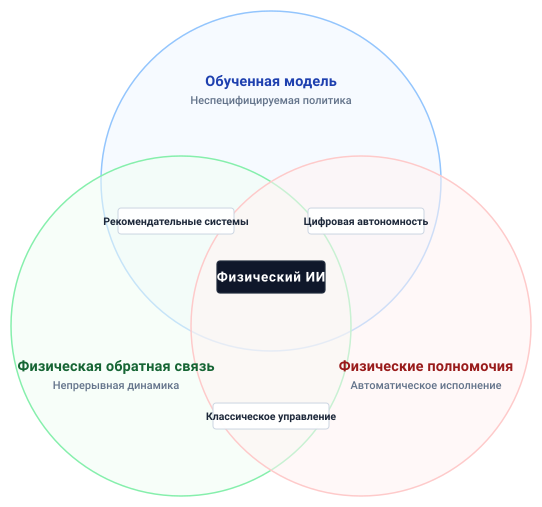
***Тест охвата физического ИИ**: Физический ИИ сочетает обученный компонент, физическую обратную связь с последствиями и полномочия уровня системы выполнять принятые предложения без одобрения человеком. Независимое вето принадлежит этому пересечению, потому что принятые предложения все равно могут приводить объект управления в движение. Попарные пересечения размещают рекомендательные системы, цифровую автономию и классическое управление.*

Замкнутый контур обратной связи необходим для физического взаимодействия, но одной обратной связи недостаточно, чтобы отнести машину к этой области. Классические пропорционально-интегрально-производные (PID) регуляторы работают на $1\text{ kHz}$ в авиации и промышленной автоматизации, регулируя положения клапанов и моменты двигателей через жесткую сенсорную обратную связь. Их контуры обратной связи непрерывны и физичны, но их законы управления задаются целиком фиксированными математическими формулами, чьи границы устойчивости можно доказать аналитически из переходных функций. Они обладают физическими полномочиями и испытывают физическую обратную связь, но у них нет обученной модели. Напротив, высокочастотные алгоритмические торговые системы исполняют автоматические биржевые ордера под управлением обученных предсказательных моделей за микросекунды. Они сочетают обученные политики с делегированными транзакционными полномочиями, но получаемая ими обратная связь чисто цифровая и информационная. Когда ордер исполняется, он изменяет электронную книгу заявок, а не импульс, трение или тепловую энергию. Необработанное зависание в алгоритмической торговле стоит финансового капитала, но не вызывает столкновения с конструктивным элементом под действием инерции.

Одной обученной модели недостаточно, чтобы определить область. Офлайн-нейронный оптимизатор траекторий может вычислять пути для манипулятора, но если инженер должен проверить и явно загрузить каждый путь перед выполнением, его выходы не имеют делегированных полномочий времени выполнения. Аналогично нейронная сеть, которая лишь регистрирует дефекты сборочной линии или выводит их на дисплей, остается рекомендательной, поскольку ее выход не может автоматически командовать линией.

Оставшаяся пара — обученная модель с физической обратной связью, но без полномочий — завершает границу. Монитор усталости водителя реального времени использует обученную модель компьютерного зрения для отслеживания движения век и положения автомобиля на полосе, получая непрерывную физическую обратную связь от состояния транспортного средства. Однако ему не хватает делегированных физических полномочий, поскольку его единственный выход — звуковой сигнал предупреждения. Если модель зрения полностью выходит из строя при тайм-ауте вывода или зависании конвейера, динамик просто не издает звука, но физическая рулевая рейка и тормозные суппорты остаются в безопасности под контролем человека.

Наиболее требовательные граничные случаи возникают при разделенной автономии, где физические полномочия динамически делятся между оператором-человеком и обученной моделью. В роботизированной хирургии или продвинутых системах помощи водителю оператор-человек обеспечивает непрерывное руление или управление инструментом, тогда как обученная политика вносит коррективы, чтобы фильтровать дрожь рук, избегать анатомических границ или компенсировать занос транспортного средства. Эти архитектуры удовлетворяют обоим критериям — и обученному компоненту, и физической обратной связи. Попадают ли они в область физического ИИ, строго зависит от временных полномочий, предоставленных модели. Если обученная политика может командовать даже усилием в $2.0\text{ N}$ или корректировать угол руления, не требуя подтверждения человеком в пределах человеческого рефлекторного интервала $150\text{--}250\text{ ms}$, модель обладает делегированными физическими полномочиями. В этом окне ошибочный выход модели или задержанный пакет вывода прикладывает реальные физические силы к миру, потенциально вызывая увод с курса или повреждение тканей, прежде чем нервно-мышечная система оператора сможет физически отреагировать и вмешаться.

Оценка неоднозначной машины означает проверку каждого критерия независимо, как это делает [«Матрица решений теста охвата физического ИИ»](01_causal_boundary.md#tbl-01-scope-matrix) для репрезентативных систем. Детерминированное вето не устраняет делегированные полномочия; обязательная проверка человеком офлайн-плана — устраняет. Когда все три теста пройдены, система действует как физический ИИ, и ее инженерия должна уважать каузальную границу, установленную в разделе [«Каузальная граница»](01_causal_boundary.md#sec-boundary-causal-boundary).

| Кандидат в системы / случай                       | Критерий 1: обученная модель (неспецифицируемая политика)                      | Критерий 2: физическая обратная связь с последствиями                    | Критерий 3: делегированные физические полномочия (автоматическое исполнение через привратника)   | Классификация охвата и дисциплина      | Ограничивающая физика и критический режим отказа                      |
|:----------------------------------------------|:-----------------------------------------------------------------------|:----------------------------------------------------------------|:------------------------------------------------------------------------|:---------------------------------------|:--------------------------------------------------------------|
| **Автономный складской AMR (класс 1)**        | **Да** (обученная навигационная политика / карта стоимости)                          | **Да** (кинетический импульс, инерция шасси и сцепление колес) | **Да** (принятые предложения доходят до управления приводами без одобрения человеком) | **Физический ИИ**                        | Кинетический удар; проскальзывание и потеря одометрии               |
| **Шарнирный контактный манипулятор (класс 2)** | **Да** (трансформерное фрагментирование действий для сборки [Zhao et al., 2023](references.md#zhao2023learning)) | **Да** (механический контактный импеданс и силы реакции)      | **Да** (предложения с привратником безопасности ведут активные команды шарниров)              | **Физический ИИ**                        | Превышение предела текучести конструкции; срез зуба редуктора       |
| **Классический автопилот высокоскоростного дрона**      | **Нет** (аналитически настроенный $1\text{ kHz}$ PID / каскадный контур)         | **Да** (аэродинамическая подъемная сила, сопротивление и гироскопическая динамика)       | **Да** (прямое PWM-управление скоростью двигателей)                                | **Классическая теория управления**           | Эрозия запаса управления; насыщение тяги ротора               |
| **Высокочастотный маркет-мейкер**               | **Да** (глубокий трансформерный предсказатель последовательностей)                          | **Нет** (цифровое состояние книги заявок; очереди памяти и сети)    | **Нет** (нет физического исполнения команды; ордера исполняются автоматически)            | **Цифровое машинное обучение / финтех** | Потеря финансового капитала; нарушение работы рынка                     |
| **Рекомендательный монитор усталости водителя**        | **Да** (сетевая модель зрения по ориентирам лица)                               | **Да** (кинематика автомобиля и физиология водителя)              | **Нет** (только звуковой сигнал и светодиод приборной панели)                 | **Рекомендательная поддержка решений**          | Задержка восприятия-реакции человека; нулевые физические полномочия    |
| **Офлайн-оптимизатор траекторий**              | **Да** (глубокая нейронная сеть для поиска временно оптимального пути)             | **Нет** (статическая CAD-модель ячейки; офлайн-пакетное выполнение)     | **Нет** (план движения проверен и загружен инженером-человеком)             | **Инструмент офлайн-оптимизации**          | Численная несходимость; нулевая прямая связь с объектом управления во время выполнения |
| **Хирургический ассистент с разделенной автономией**           | **Да** (обученный гаптический фильтр дрожи / виртуальные прижимы)              | **Да** (податливость анатомических тканей и силы реакции)      | **Условно** (модель вносит силы в пределах человеческого рефлекторного окна)       | **Пограничный / разделенный физический ИИ**    | Задержка нервно-мышечного рефлекса человека против скорости нарастания усилия инструмента   |

***Матрица решений теста охвата физического ИИ**: Репрезентативные инженерные системы, проверенные по трем совместным критериям (обученная модель, физическая обратная связь с последствиями и делегированные физические полномочия), определяющие ведущую инженерную дисциплину, ограничивающие физические факторы и основные режимы отказа для каждого кандидата.*

> **Ограничивающие бюджеты и тест охвата**
>
> Прежде чем рассматривать пятиуровневую машину, проверьте, что вы можете разместить незнакомую машину по ее ограничивающему бюджету и по тесту охвата:
>
> - [ ] **Слепой ход и торможение**: Можете ли вы объяснить, почему задержка до торможения $\tau_{\text{delay}}$ превращается в слепой ход $v\,\tau_{\text{delay}}$, который не вернуть никаким торможением, и почему удвоение скорости учетверяет тормозной путь, но лишь удваивает слепой ход?
> - [ ] **Первый исчерпываемый бюджет**: Можете ли вы назвать, какой бюджет исчерпывается первым и примерно на каком временном масштабе, для мобильного основания, для руки, давящей на жесткую планку замка, и для остановившегося контура охлаждения, и объяснить, почему гуманоид связывает все три?
> - [ ] **Тест охвата по трем критериям**: Можете ли вы проверить автоматизированную систему на обученную модель, физическую обратную связь с последствиями и делегированные физические полномочия и объяснить, почему торговая система находится вне физического ИИ, тогда как хирургический инструмент с разделенной автономией попадает внутрь всякий раз, когда может приложить силу раньше, чем хирург успеет отреагировать?

## Машина в пяти уровнях

Машине, проходящей тест охвата, нужна организация, которая не позволяет ее обученным моделям писать напрямую в актуаторы, которые они могут повредить, и при этом позволяет этим моделям управлять машиной.

Машина в этой книге имеет пять уровней, упорядоченных от обученных моделей вниз до физики, на которую они действуют, и разделенных одной линией полномочий. Частоты управления возрастают от Мозга к Телу; ниже Тела Граница синхронизируется событиями, а Мир работает непрерывно. Мозг содержит обученных инициаторов. Модель намерения пересматривает цели на `1 to 5 Hz`, а политика фрагментов выдает короткие последовательности будущих заданий на `10 to 50 Hz`; восприятие и память работают на той же стороне на сенсорных частотах.

Мозг может только предлагать. Под ним лежит граница предложения, а под ней — Нервная система, содержащая путь разрешения. Путь разрешения проверяет каждое предложение по свежему состоянию и запасу, который оставила задержка, допускает, изменяет или отклоняет его и владеет резервированием, которое не ждет инициатора. Контур `1 kHz` на выделенном микроконтроллере — одна реализация; частота, которая машине действительно нужна, следует из ее бюджета остановки. Тело — это собственная физика машины под ее приводами, от контура тока, превращающего допущенное задание в момент на `10 to 25 kHz`, до передач, обмоток и силовых шин, чьи пределы измеряет раздел [«Физическое тело»](02_body.md#sec-body). Граница — это сама каузальная граница, преобразователи, обращенные в обе стороны. С одной стороны запись в регистр становится током в обмотке; с другой — свет или сила становится измерением со временем захвата. Мир — это все, чем машина не владеет, включая полы, грузы, контакт и людей, и он развивается непрерывно, независимо от того, следит ли за ним какой-либо уровень.

Управление — не шестой уровень. Это огибающая жизненного цикла вокруг всех пяти уровней, решающая, кто может командовать машиной, какие свидетельства дают ей право работать и когда это право истекает, и меняется она в масштабе времени вмешательств и выпусков, а не циклов управления.

> ↳ **Далее:** Передачи полномочий командования и вытеснение потока предложений управляются конечным автоматом супервизора в разделе [«Переходы полномочий»](14_intervention.md#sec-intervention-authority-transitions).

> **Граница предложения**
>
> ***Граница предложения*** — это линия между обученной моделью, которая может лишь предлагать действие, и **путем разрешения**, независимым механизмом с ограниченной задержкой, которую модель не может задержать или исказить и который один может разрешить действию дойти до актуатора. Путь разрешения проверяет каждое предложение по свежим свидетельствам, огибающей остановки и резервированию, осуществимому из текущего состояния, и отказывает, если любая проверка не проходит.
>
> 1.  **Значение**: Не позволяет выходам модели напрямую командовать актуаторами; защита действует, только пока восприятие пути разрешения, физические пределы и резервирование остаются действительными.
> 2.  **Отличие**: Политика, выдающая значения момента, все равно не имеет полномочий на запись в актуатор; ее выход является предложением, пока путь разрешения его не допустит.
> 3.  **Типичная ловушка**: Считать путь разрешения постобрабатывающим ограничителем выходов модели, а не независимым механизмом, который может отказать в выполнении, когда инициатор опаздывает, ошибается или молчит.

Стек, открывающий каждую главу, рисует те же пять уровней ([«Машина в пяти уровнях»](01_causal_boundary.md#fig-01-locator)) и выделяет тот, над которым работает глава; раздел [«Пять уровней и закрепленные частоты»](01_causal_boundary.md#tbl-01-machine-levels) закрепляет их частоты и перечисляет главы для каждого.

| Уровень                   | Что это                                                               | Закрепленная частота                                                                                                                                      | Где книга над этим работает                                  |
|:------------------------|:-------------------------------------------------------------------------|:-------------------------------------------------------------------------------------------------------------------------------------------------|:------------------------------------------------------------|
| **Мозг**               | Обученные инициаторы и потребляемые ими свидетельства                          | Модель намерения `1–5 Hz`; политика фрагментов `10–50 Hz`; восприятие на сенсорной частоте | [«Когнитивный мозг»](03_brain.md#sec-brain), [«Обучение политики»](06_training.md#sec-training), [«Сенсорное восприятие»](08_perception.md#sec-perception) до [«Планирование траекторий»](11_planning.md#sec-planning) |
| *Граница предложения*     | *Выше можно только предлагать; ниже можно командовать*                              | —                                                                                                                                                | —                                                           |
| **Нервная система**      | Путь разрешения: тайминг, аренда, допуск, резервирование и его кремний | `1 kHz` как одна реализация; требуемая частота следует из бюджета остановки                            | [«Нервная система»](04_nervous_system.md#sec-nervous), [«Обеспечение безопасности»](12_enforcement.md#sec-enforcement), [«Размещение на кремнии»](13_placement.md#sec-placement)              |
| **Тело**                | Объект управления под его приводами                                               | Контур тока `10–25 kHz`                                                                                      | [«Физическое тело»](02_body.md#sec-body)                                                   |
| **Граница**            | Запись в регистр актуатора и захват датчика                               | Синхронизация событиями                                                                                                                                      | Эта глава; эпоха захвата в разделе [«Сенсорное восприятие»](08_perception.md#sec-perception)          |
| **Мир**               | Контакт, трение, груз, люди и рабочая область             | Непрерывно                                                                                                                                       | [«Физические данные»](05_data.md#sec-data), [«Оценка в замкнутом контуре»](07_evaluation.md#sec-evaluation)                                  |
| **Огибающая управления** | Кто может командовать, что дает право на работу и когда это право истекает  | Жизненный цикл; нет частоты управления                                                                                                                       | [«Вмешательство супервизора»](14_intervention.md#sec-intervention) до [«Эпистемическая граница»](17_frontier.md#sec-frontier)                          |

***Пять уровней и закрепленные частоты**: Это единственные частоты, которые книга привязывает к уровню. Машина, которой нужна другая частота, выводит ее из собственных измеренных пределов, а не перепривязывает уровень.*

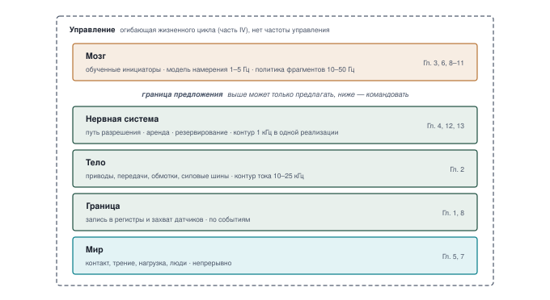
***Машина в пяти уровнях**: Каждый слой несет свою закрепленную частоту и главы, которые над ним работают. Более широкий разрыв между Мозгом и Нервной системой отмечает границу предложения, выше которой компонент может только предлагать. Стек в начале главы без выделенного уровня обозначает главу об управлении. Показанная частота контура разрешения — одна реализация.*

Эта организация воплощает принципы ситуативности и подчинения Родни Брукса [Brooks, 1986](references.md#brooks1986robust); [Brooks, 1991](references.md#brooks1991intelligence), в которых быстрые реактивные слои защищают объект управления прямо от сенсорной обратной связи, тогда как высокоуровневые цели обдумывания модулируют поведение через верифицированные границы контрактов. Для диагностики отказа декомпозиция «восприятие — планирование — действие» находит самый ранний нарушенный контракт; раздел [«Диагностический справочник S·P·A»](appendix_spa.md#sec-appendix-spa) развивает ее как справочник.

Пять уровней охватывают пять порядков рабочей частоты и задержки ([«Задержки и частоты систем физического ИИ»](01_causal_boundary.md#tbl-physical-ai-rate-hierarchy)). На вершине фундаментальные модели обдумывания планируют в масштабах человеческой реакции (`1–5 Hz`); внизу силовые электронные инверторы переключают токи статора с десятками — сотнями килогерц (`50–200 kHz`). Эти крайности связывает физическая реальность: задержка — это расстояние: каждая миллисекунда непроверенной задержки в машине, движущейся со скоростью $1\text{ m/s}$, дает $1\text{ mm}$ невосстановимого слепого хода.

| Уровень машины                   | Полоса частот                                   | Период цикла                                       | Слепой ход при 1 m/s                             | Архитектурная роль и доминирующее ограничение                 |
|:--------------------------------|:-------------------------------------------------|:---------------------------------------------------|:--------------------------------------------------|:---------------------------------------------------------|
| **Мозг (обдумывание)**        | `1–5 Hz`    | `200–1 000 ms`     | `200–1 000 mm`     | Мультимодальные рассуждения VLA; ограничен вычислениями и памятью      |
| **Мозг (фрагментирование действий)**     | `10–50 Hz`     | `20–100 ms`      | `20–100 mm`      | Реактивная генерация траекторий; пропускная способность амортизируется      |
| **Нервная система (разрешение)** | `1 kHz`      | `1 ms` | `1 mm` | Барьерные сертификаты и огибающие остановки; жесткий предельный срок |
| **Тело (контур тока)**         | `10–25 kHz`   | `40–100 µs`    | `40–100 µm`    | Управление током статора и моментом по FOC; индуктивный $L/R$     |
| **Тело (переключение инвертора)**   | `50–200 kHz` | `5–20 µs`  | `5–20 µm`  | Затворный драйвер MOSFET и мертвое время; просадка $L dI/dt$           |

***Задержки и частоты систем физического ИИ**: Частоты, периоды циклов и кинетические скорости перемещения порядка величин для пяти уровней машины, определяющие физическую осуществимость. Охватывая пять частотных десятилетий — от субмикросекундного переключения MOSFET до обдумывания фундаментальных моделей в секундном масштабе, — эти физические ограничения определяют, как вычислительная задержка превращается в необратимое механическое движение. Для полного краткого справочника, включая тепловые постоянные времени, периферийные roofline-модели, дрожание шин и статистические границы безопасности, см. раздел [«Числа, которые нужно знать о физическом ИИ»](appendix_systems.md#sec-appendix-systems-numbers-to-know).*

> ↳ **Далее:** Зафиксированная траектория Мозга строится в разделе [«Непрерывные траектории»](11_planning.md#sec-planning-continuous-trajectories).

## Когда граница отказывает

Физическое крушение может включать как неточное предсказание, так и отказ отреагировать, когда имеющиеся свидетельства уже требуют вмешательства. Расследование в Tempe показывает, как взаимодействовали отслеживание объектов, политика торможения, опора на оператора и утраченная резервность.

### Столкновение автономного автомобиля в Tempe в 2018 году

Мартовской ночью 2018 года модифицированный Volvo XC90 с экспериментальной системой автоматизированного вождения (ADS) Uber Advanced Technologies Group сбил и смертельно ранил пешехода, катившего велосипед через дорогу в Tempe, штат Arizona [National Transportation Safety Board, 2019](references.md#ntsb2019uber).[^fn-inc-tempe-investigation]

[^fn-inc-tempe-investigation]: **Столкновение автономного автомобиля в Tempe в 2018 году**: Времена событий и детали конструкции в этом разделе взяты из отчета NTSB о дорожно-транспортном происшествии NTSB/HAR-19/03 [National Transportation Safety Board, 2019](references.md#ntsb2019uber).

На автомобиле были установлены лидар, радиолокатор и камеры ([«Датчики испытательного автомобиля в Tempe»](01_causal_boundary.md#fig-01-tempe-vehicle)). ADS впервые обнаружила пешехода за $5.6\text{ s}$ до удара, но одного обнаружения недостаточно для корректного предсказания траектории [National Transportation Safety Board, 2019](references.md#ntsb2019uber).

### Смены классификации и утраченная история отслеживания

Продолжая отслеживать обнаруженный объект, ADS не затормозила в ответ на него. В отчете NTSB зафиксированы смены классификации между автомобилем, велосипедом и «другим» до $T-1.2\text{ s}$ [National Transportation Safety Board, 2019](references.md#ntsb2019uber).

Когда классификация менялась, предсказатель траектории ADS не использовал прежние местоположения объекта; для объекта «другой» он мог предположить статический путь.[^fn-ctrl-kalman-tracking] Результативные предсказания траектории не помещали пешехода на полосу внедорожника до $T-1.2\text{ s}$ [National Transportation Safety Board, 2019](references.md#ntsb2019uber).

[^fn-ctrl-kalman-tracking]: **История отслеживания**: Предсказатель траектории может оценивать движение по последовательным местоположениям объекта. В ADS из Tempe смена классификации приводила к тому, что предсказатель опускал прежние местоположения; в отчете NTSB не указано ни сброса фильтра Калмана, ни инициализации нулевой скорости [National Transportation Safety Board, 2019](references.md#ntsb2019uber).

> ↳ **Далее:** Огибающие остановки в разделе [«Огибающие остановки»](12_enforcement.md#sec-enforcement-stopping-envelopes) ограничивают, во что может обойтись такая смена классификации, как в Tempe.

### Подавление действия и утраченный запас остановки

В момент $T-1.2\text{ s}$, когда автомобиль двигался со скоростью $43.2\text{ mph}$, ADS распознала аварийную ситуацию и вошла в свой односекундный период подавления действия. Конструкция удерживала торможение, пока проверяла опасность или ждала вмешательства оператора. В момент $T-0.2\text{ s}$ подавление закончилось. Затем ADS инициировала план плавного замедления и подала сигнал тревоги; аварийного торможения она не запрашивала. NTSB отмечает, что из-за задержки связи неясно, началось ли это замедление до того, как оператор отключил ADS в момент $T-0.02\text{ s}$ [National Transportation Safety Board, 2019](references.md#ntsb2019uber).

> **Кинематический бюджет остановки**
>
> * **Задача:** По данным о односекундном периоде подавления и скорости в его конце, могло ли идеализированное полное торможение, начавшееся в момент $T-0.2\text{ s}$, остановить автомобиль до точки удара?
> * **Допущения:** Приближенная скорость вблизи распознавания опасности — $v_0 =$ `19.2 m/s`, скорость в момент $T-0.2\text{ s}$ — `18.1 m/s` (в отчете $40.5\text{ mph}$), идеализированное постоянное тормозное замедление — $a_{\text{brake}} =$ `8 m/s²`. Путь вычисляется при постоянной скорости.
> * **Интервал подавления:** За отчетные `1 s` удержание $v_0$ постоянной дало бы $d_{\text{blind}} = v_0 t_{\text{suppress}} =$ `19.2 m`. Фактически автомобиль замедлялся для поворота, поэтому это не измеренный ход подавления.
> * **Сравнение торможения:** По округленной скорости в момент $T-0.2\text{ s}$ идеализированная остановка требует $d_{\text{brake}} = v^2/(2a_{\text{brake}}) \approx$ `20.5 m`. Удержание этой скорости в оставшиеся $0.2\text{ s}$ дает лишь около `3.6 m` пути до удара. Даже немедленное полное торможение в этот поздний момент не могло остановить автомобиль до точки удара. Фактически ADS планировала плавное замедление, а не полное торможение [National Transportation Safety Board, 2019](references.md#ntsb2019uber).

Раздел [«Хронология событий ADS в Tempe»](01_causal_boundary.md#fig-01-tempe-kinematics) наносит зафиксированные времена событий и это сравнение торможения на одну временную ось, помещая односекундный интервал подавления прямо напротив остановочного пути, который автомобилю был нужен в момент окончания подавления.

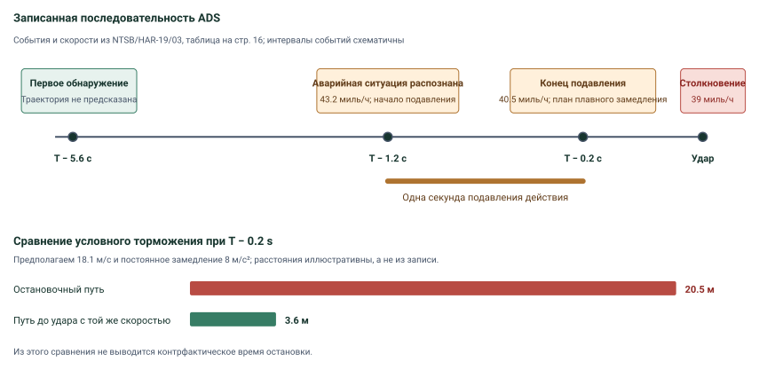
***Хронология событий ADS в Tempe**: NTSB зафиксировала первое обнаружение в $T-5.6\text{ s}$, распознавание опасности и начало односекундного подавления действия в $T-1.2\text{ s}$ и план плавного замедления в $T-0.2\text{ s}$. Нижнее сравнение предполагает постоянное замедление $8\text{ m/s}^2$ от зафиксированной скорости $40.5\text{ mph}$. Идеализированный остановочный путь в момент $T-0.2\text{ s}$ составляет около $20.5\text{ m}$ — далеко за пределами оставшихся примерно $3.6\text{ m}$ пути при постоянной скорости.*

***Датчики испытательного автомобиля в Tempe**: На схеме NTSB указаны расположения лидара, камер, радиолокатора, вычислительных и телекоммуникационных систем автомобиля с экспериментальной ADS. (Источник: NTSB, общественное достояние).*

> **Отключенный резерв безопасности (2018)**
>
> **Контекст**: 18 марта 2018 года экспериментальная ADS на Volvo XC90 2017 года сбила и убила пешехода, переходившего дорогу в Tempe, штат Arizona [National Transportation Safety Board, 2019](references.md#ntsb2019uber).
>
> **Механизм**: Как прослежено выше, смены классификации отбрасывали историю отслеживания объекта, а односекундное подавление удерживало торможение, пока не был спланирован лишь плавный замедление. Конструкция не использовала максимальное торможение исключительно для смягчения неизбежного столкновения [National Transportation Safety Board, 2019](references.md#ntsb2019uber).
>
> **Последствия**: Автомобиль сбил и смертельно ранил пешехода. Поздний план плавного замедления не смог вернуть утраченную возможность остановки.
>
> **Реакция**: NTSB установил, что отключение систем предупреждения и торможения Volvo, которое Uber ATG выполнила из-за возможных помех радиолокатору, убрало слой резервности безопасности и рекомендовало усиленное управление рисками безопасности при испытаниях автоматизированных транспортных средств [National Transportation Safety Board, 2019](references.md#ntsb2019uber).
>
> **Системный урок**: Неопределенность классификации, правило отложенной реакции и опора на невнимательного оператора могут сочетаться. Конструкции нужна своевременная оценка опасности и реакция, способная смягчить удар, когда избежать столкновения уже невозможно; расследование не предписывает какую-либо конкретную архитектуру процессора или почтовых ящиков.

Расследование поддерживает более широкое архитектурное требование. Экспериментальной ADS нужны резервность безопасности и своевременный путь смягчения даже при отказе восприятия или предсказания траектории, а приводимые NTSB испытания в симуляции от Volvo позволяют предположить, что штатное аварийное торможение могло бы предотвратить или смягчить это столкновение. Отчет не устанавливает, когда сработал бы отдельный путь разрешения и где он остановил бы автомобиль.[^fn-std-safety-standards]

[^fn-std-safety-standards]: **Стандарты, критичные для безопасности**: Стандарты функциональной безопасности и предназначенной функциональности могут служить входом для кейса безопасности восприятия, исполнения команды и резервирования. Их применимость и требуемая реализация зависят от системы и юрисдикции; отчет NTSB по Tempe не предписывал архитектуру с изолированным микроконтроллером.

Tempe иллюстрирует отказ *до* удара, где смены классификации и программная задержка подавления помешали своевременному торможению. Инцидент с роботакси Cruise в 2023 году [Quinn Emanuel Urquhart and Sullivan, LLP, 2024](references.md#quinnemanuel2024cruise) обозначает противоположный полюс — *после* удара: послестолкновительное резервирование, которое двинуло автомобиль, пока пешеход был зажат под ним ([«Лестница резервирования»](12_enforcement.md#sec-enforcement-fallback-ladder)).

Ни один из отказов не сводится к неточной модели. Первый израсходовал остановочный путь до начала торможения, и никакое последующее действие не могло его вернуть. Второй выбрал движение после удара. Вместе они показывают, что должно соблюдаться до того, как машина действует, и что резервирование может делать, когда вред уже начался, а четыре следующих закона формулируют эти требования для каждой машины.

> **Расследование отказов границы и полномочий**
>
> Прежде чем изучать четыре фундаментальных закона, проверьте понимание механизмов отказа, диагностированных в инциденте в Tempe:
>
> - [ ] **Смены классификации и предсказание траектории**: Можете ли вы объяснить, как смены классификации привели к тому, что предсказатель траектории ADS опускал прежние местоположения объекта, несмотря на продолжение отслеживания?
> - [ ] **Программное подавление против кинематического запаса**: Можете ли вы отличить момент распознавания $T-1.2\text{ s}$ от односекундного периода подавления и сравнить идеализированный остановочный путь с оставшимся ходом в момент $T-0.2\text{ s}$?
> - [ ] **Резервность безопасности**: Можете ли вы объяснить, почему отключение штатных систем предупреждения о столкновении и аварийного торможения убрало слой защиты у экспериментальной ADS?

## Четыре фундаментальных закона

Утраченная секунда в Tempe — это первый закон в действии. Этот закон и три других действуют для каждой машины, чьи обученные предложения могут дойти до актуатора, и каждый возглавляет часть этой книги. Вместе они превращают каузальную границу в требования.

**Первый закон: необратимость.** Физическую работу нельзя отозвать, поэтому каждая проверка должна завершиться до исполнения команды, внутри запаса, который задержка еще не израсходовала. Актуатор превращает электрическую энергию в движение, деформацию или тепло, и никакое последующее программное действие ее не убирает. Торможение может противостоять импульсу, только прикладывая силу во времени и на расстоянии, а деформированное приспособление остается деформированным, даже когда его задание меняется на обратное. Поскольку машина продолжает двигаться, пока вычисляет, задержка оплачивается расстоянием: каждая миллисекунда между захватом и откликом — это ход, которым остановка уже не сможет воспользоваться. Часть I превращает этот закон в бюджеты.

**Второй закон: эндогенные данные.** Действия физического агента выбирают его следующие наблюдения, поэтому компетентность действует только для состояний, покрытых испытанием в замкнутом контуре. В офлайн-бенчмарке предсказание не меняет следующий пример. В машине ошибочная команда двигает шарниры и камеры и доставляет политику в состояния, которых ее демонстрации никогда не показывали. При ограниченной стоимости шага худшая избыточная стоимость политики, обученной с подражанием, растет как $T^2\epsilon$ на горизонте из $T$ шагов с расхождением $\epsilon$ на шаг [Ross et al., 2011](references.md#ross2011reduction); граница развивается в разделе [«Эндогенный опыт»](05_data.md#sec-data-endogenous-experience). Граница не предсказывает какую-либо конкретную частоту отказов, но показывает, почему точность одного шага не может сертифицировать замкнутый контур. Часть II спрашивает, на чем основана компетентность обученного инициатора.

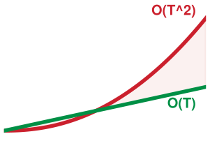

*Граница обучения с подражанием растет с квадратом горизонта по сравнению с линейным эталоном.*

**Третий закон: предложение — не разрешение.** Обученная модель может предлагать; разрешать может только независимый путь, который модель не может задержать или исказить. Путь разрешения решает каждое действие по состоянию с известным возрастом, в предельный срок, заданный объектом управления, и владеет резервированием, которое может выполнить без инициатора. Отдельный кремний — один способ построить его. Аппаратная изоляция внутри одного кристалла — другой, при условии что граница отклика и локализация отказа продемонстрированы. Свежесть — часть проверки, потому что предложение, вычисленное по старому наблюдению, описывает машину, которая уже сдвинулась. Часть III строит время выполнения вокруг этого закона.

**Четвертый закон: свидетельства ограничивают полномочия.** Полномочия действовать даются на основании зафиксированных свидетельств; они истекают вместе с этими свидетельствами, а предпосылка, которую свидетельства не могут разрешить, должна ограничивать эксплуатацию. Средняя характеристика на конечных испытаниях не может сертифицировать хвост, чьи отказы механически, а демонстрация не является свидетельством безопасности. Кейс выпуска вместо этого ограничивает восприятие, ошибку модели, отклик актуатора, запас остановки и аппаратные отказы для заявленной области эксплуатации и называет то, что он оставляет открытым. Часть IV решает, кто может командовать машиной и в какие условия она может входить.

Третий закон — тот, которому служат три других. Необратимость делает разрешение необходимым, эндогенные данные оставляют компетентность инициатора частичной, а свидетельства ограничивают, сколько полномочий путь разрешения может дать. Масштабирование инициатора не ослабляет третий закон. «Горький урок» Ричарда Саттона [Sutton, 2019](references.md#sutton2019bitter) утверждает, что общие методы, использующие растущие вычисления, в конечном счете обгоняют инженерные эвристики. В машине этот урок встречается с тем, что эта книга называет **физической стеной**. Бортовые вычисления ограничены энергией батареи, отводом тепла, пропускной способностью памяти и целостностью шины питания, поэтому дополнительный размер модели оплачивается задержкой. Как только эта задержка обгоняет бюджет остановки, машина достигает препятствия раньше, чем завершится прямой проход. Раздел [«Питание, свежесть и стена памяти»](03_brain.md#sec-brain-cognitive-pipeline) измеряет, что эта стена оставляет инициаторам машины. На языке аппаратных защитных колец обученная модель предлагает из непривилегированного домена, а путь разрешения отказывает из доверенного, с той разницей, что отказ должен также оставить машине физическое резервирование, потому что ни одна страничная ошибка не останавливает движущуюся массу.

## Схождение безопасности

Безопасность проверяет, причинила ли машина вред. Защищенность рассматривает, вынудил ли ее внешний агент. Подотчетность оценивает, может ли аудитор установить, что произошло и почему. В программных сервисах эти заботы обитают в отдельных инженерных организациях и различных средах выполнения, разделенных прикладной логикой, сетевыми экранами и базами данных аудиторских журналов. В машине, которая двигает массу и командует током, все три сходятся на каузальной границе, где вопрос становится таким: обладает ли путь разрешения состоянием и полномочиями, чтобы отказать в записи в регистр до того, как команда станет моментом, действующим на объект управления.

Отказы безопасности возникают без противника. Объектив камеры накапливает пыль за $500\text{ h}$ работы, сдвигая распределение входов прочь от обучающей области, пока голова внимания не порождает рулевой момент вне распределения. Подшипник шарнира приобретает механический люфт, внося неучтенные люфт и податливость шарнира, которые превращают стабильную обученную траекторию положения в разрушительные колебания предельного цикла. Внезапное изменение трения поверхности также может опустить сцепление шин ниже коэффициента трения, предполагаемого обученной политикой. В каждом случае инициатор порождает действие, статистически правдоподобное для сети, но физически опасное для тела. Если у пути разрешения нет независимой кинематической модели или теплового бюджета для обнаружения превышения, неотклоненная команда записывается в регистры привода двигателя, высвобождая запасенную кинетическую энергию в рабочую зону.

Отказы защищенности вводят противника, который намеренно использует разрыв между статистическим выводом и физической реальностью. Атакующему не нужно компрометировать криптографические ключи или получать root-доступ в хостовой операционной системе, если он может манипулировать сенсорными входами. Проектируемый структурированный свет может обмануть датчик глубины, акустическая инъекция может ввести в резонанс микромеханические емкостные контрольные массы внутри MEMS-гироскопов на их собственных частотах, заставляя датчик сообщать фантомную угловую скорость,[^fn-hw-mems-acoustic] а узорные наклейки (враждебные визуальные возмущения) на полу цеха могут побудить модель зрение–язык–действие (обученную политику, отображающую изображения камер и языковую инструкцию в команды актуаторов) выдать максимальную скорость актуатора. На традиционном сервере атака инъекцией компрометирует конфиденциальность или целостность данных в абстрактном пространстве памяти. В физическом ИИ атака инъекцией командует физической работой, превращая невалидированный вывод в механическую силу. Периметр защищенности не может заканчиваться на сетевом интерфейсе или границе системных вызовов операционной системы. Он заканчивается на пути разрешения, который должен оценивать каждую кандидатную команду по физическим инвариантам независимо от того, действовал ли инициатор добросовестно или под враждебным контролем.

[^fn-hw-mems-acoustic]: **Акустический резонанс MEMS**: Резонансные акустические частоты ($18\text{--}32\text{ kHz}$) могут физически вибрировать микромеханические емкостные контрольные массы внутри MEMS-гироскопов, вызывая насыщение сигнала и ложные показания угловой скорости. Защита от акустического подделывания требует физических демпфирующих барьеров и кинематической перекрестной проверки в реальном времени на микроконтроллере.

Традиционные модели программной авторизации дают сбой в физических машинах, потому что токены прав и списки контроля доступа предполагают дискретные безысторические транзакции. В веб-сервисе наличие действительных учетных данных дает разрешение записать запись в базу данных, а стоимость операции ограничена циклами вычислений и байтами хранения. В физическом пространстве разрешение не является статическим бинарным правом. В аналитическом роботизированном шарнире команда на приложение момента $50\text{ N}\cdot\text{m}$ действительна, когда звено неподвижно в середине хода, но та же самая команда вызывает конструктивный предел текучести (разрушение вала или срез зуба передачи), если шарнир находится в $2\text{ mm}$ от жесткого упора и движется со скоростью $1.5\text{ rad/s}$. Физические полномочия зависят от состояния, непрерывны и динамичны, ими управляют скорость, импульс, накопление тепла и пространственная занятость. Путь разрешения не может оценивать действие изолированно как безысторический удаленный вызов процедуры. Он должен интегрировать действие во времени относительно текущего физического состояния тела, проверяя, остается ли предложенное движение внутри валидированного восстановимого множества[^fn-ctrl-reachable-set] для объекта управления, нагрузки, ошибки оценки состояния и предельного срока отклика.

[^fn-ctrl-reachable-set]: **Восстановимые множества**: Смоделированное множество физических состояний (положений, скоростей и температур), из которого допустимый регулятор может удерживать объект управления в заданных границах при заявленных возмущениях и пределах актуаторов [Mitchell et al., 2005](references.md#mitchell2005time). Допуск по этому множеству имеет смысл, только пока эти предпосылки о состоянии, объекте управления и тайминге выполняются.

Подотчетность требует доказательства точной каузальной цепи, приведшей к исполнению команды, когда машина повреждает оборудование или нарушает огибающую. В стандартных вычислительных системах журналирование асинхронное, по мере возможностей и грубое, теряющее записи при давлении на буфер или записывающее метки времени с миллисекундным дрожанием. На каузальной границе подотчетность требует детерминированной телеметрии с высокой частотой, захватываемой синхронно с контуром управления. Если актуатор шарнира командует обновления на $1\text{ kHz}$ с предельным сроком $1\text{ ms}$, путь разрешения должен записывать исходный кандидатный вектор, предложенный моделью, оценку состояния, по которой он судил, примененный критерий и точный вектор, записанный в аппаратные регистры. Запечатывание этих записей в устойчивых к несанкционированным изменениям кольцевых буферах с добавлением только в конец в SRAM или FRAM с резервированием от батареи (память, переживающая внезапную потерю питания при срабатывании предохранителя) обеспечивает посленаступательное восстановление. При аномалии инженер может математически проверить, зародился ли отказ в искаженном показании датчика, деградировавшем предложении политики, ошибочном правиле разрешения или механическом компоненте, который не создал командуемый противодействующий момент.

Таким образом, безопасность, защищенность и подотчетность требуют от пути разрешения, охраняющего каузальную границу, одних и тех же трех вещей: состояния, достаточно свежего, чтобы судить о команде, полномочий отказать в ней, и записи того, что было предложено, что допущено и что записано. Построение этого пути и свидетельств того, что он делает то, о чем утверждает его запись, — работа остальной части книги.

## Архитектура этой книги

Четыре части книги преследуют вопрос, с которого эта глава началась. Раздел [«Что оставляют открытым четыре закона»](17_frontier.md#sec-frontier-architectural-synthesis) отвечает на него в условной форме: каждая гарантия действует, только пока действуют ее предпосылки. Каждую часть возглавляет один из четырех законов, и каждая глава частей I–IV, кроме [«Когнитивного мозга»](03_brain.md#sec-brain), заканчивается созданием записи, которую потребляет более поздняя глава ([«Костяк книги»](01_causal_boundary.md#fig-01-spine)). Читаемые по порядку, записи несут аргумент вперед: что может объект управления, что обученный инициатор показал, что он может, что он предлагает сейчас, что допускает путь разрешения и что разрешают свидетельства. Первые две из них идут одной нитью, а третья — другой, и две нити встречаются на решении о разрешении, которое есть третий закон в форме интерфейса.

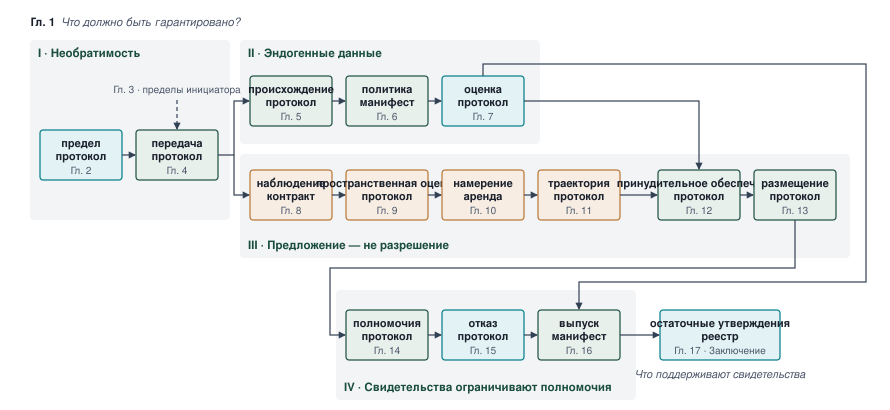
***Костяк книги**: Каждую часть возглавляет один закон, и каждая глава частей I–IV, кроме [«Когнитивного мозга»](03_brain.md#sec-brain), порождает запись, которую потребляет более поздняя глава. Что может объект управления и что инициатор показал, что он может, идут одной нитью, что инициатор предлагает сейчас — другой, и они встречаются на решении о разрешении.*

Часть I, «Анатомия машины», возглавляется первым законом. Раздел [«Физическое тело»](02_body.md#sec-body) измеряет бюджеты объекта управления и записывает каждый как протокол пределов — корень цепи. Раздел [«Когнитивный мозг»](03_brain.md#sec-brain) излагает, что может поставить обученный инициатор и как быстро стареют его свидетельства. Раздел [«Нервная система»](04_nervous_system.md#sec-nervous) выводит частоты и аренду пути разрешения из бюджета остановки и записывает каждую передачу в протокол передачи, который продолжает протокол пределов. Часть II, «Обучение машины», возглавляется вторым законом. Разделы [«Физические данные»](05_data.md#sec-data), [«Обучение политики»](06_training.md#sec-training) и [«Оценка в замкнутом контуре»](07_evaluation.md#sec-evaluation) превращают демонстрации в протокол происхождения, манифест политики и протокол оценки, чьи утверждения остаются внутри заявленной области эксплуатации, а пробелы каталогизированы. Часть III, «Работа машины», возглавляется третьим законом. Разделы от [«Сенсорного восприятия»](08_perception.md#sec-perception) до [«Размещения на кремнии»](13_placement.md#sec-placement) следуют за одной командой от наблюдения с меткой времени до оценки состояния, аренды намерения, зафиксированной траектории, допущенной команды и кремния, который удерживает путь разрешения вовремя. Часть IV, «Управление машиной», возглавляется четвертым законом. Разделы [«Вмешательство супервизора»](14_intervention.md#sec-intervention), [«Верификация»](15_verification.md#sec-verification) и [«Выпуск в эксплуатацию»](16_release.md#sec-release) решают, кто может командовать машиной, что установили тесты отказов и в какие условия машина может входить. Раздел [«Эпистемическая граница»](17_frontier.md#sec-frontier) завершает книгу тем, что поддерживают записи, и реестром предпосылок, остающихся открытыми. Каждый протокол прорабатывается на одной машине — складском мобильном манипуляторе, представленном в разделе [«Три класса машин»](01_causal_boundary.md#sec-boundary-four-archetypes).

## Заблуждения и ловушки

Каждое из следующих заблуждений переносит допущение, верное для программного обеспечения, офлайн-обучения или классического управления, в машину, чьи обученные предложения могут дойти до актуатора. Первое предполагает, что обучение может выполнить работу пути разрешения, а три других — что человек может вмешаться мгновенно, что задержка лишь ухудшает характеристики или что физическую работу можно отменить.

> **Заблуждение и ловушка**
>
> **Заблуждение**: *Ограничения безопасности можно внести в политику обучением.*
>
> Конвейеры обучения с подкреплением и с подражанием часто пытаются сделать политику безопасной, добавляя к ее целевой функции штрафные слагаемые, барьерные функции потерь или отрицательное формирование награды. Эти слагаемые направляют градиентный спуск и снижают частоту нежелательных состояний в обучающем распределении, но не ограничивают то, что выдает развернутая политика. При новом шуме датчика, закрытии объектива или сочетании состояний вне распределения ничто в офлайн-цели не предотвращает небезопасную команду. Обучающий стимул формирует вероятностное распределение, тогда как огибающая остановки требует границы, действующей в каждом цикле. Поэтому ограничение принадлежит нисходящему звену относительно модели — как привратник между выходом политики и регистрами актуатора, именно там, где третий закон помещает путь разрешения.

> **Заблуждение и ловушка**
>
> **Ловушка**: *Считать вмешательство супервизора-человека мгновенным в системах с разделенной автономией.*
>
> Хирургический инструмент прикладывает гаптическую направляющую силовую обратную связь от обученной анатомической модели, пока хирург держит инструмент. Человеческий надзор не устраняет делегированные полномочия в интервале, пока хирург может отреагировать. Если актуатор наращивает усилие быстрее заявленного человеческого рефлекторного интервала $150\text{--}250\text{ ms}$, его команды могут деформировать ткани до того, как оператор их исправит. Инженерный вопрос: какое усилие система может приложить за этот интервал. Локальные пределы усилия, принудительно обеспечиваемые путем разрешения, должны ограничивать актуатор, не завися ни от своевременного нейронного предсказания, ни от немедленной человеческой реакции.

> **Заблуждение и ловушка**
>
> **Ловушка**: *Считать, что программная задержка лишь плавно ухудшает характеристики.*
>
> Предположим, политика фрагментов машины зависает на `300 ms`, пока ее подсистема памяти троттлится. Вычисление приостанавливается, но физический импульс гарантирует, что основание продолжает движение. Основание, продолжающее выполнять свое последнее предложение на `1.5 m/s`, прошло бы вслепую `450 mm` до прихода следующей команды, и это смещение может израсходовать запас, нужный ему для остановки, если выйдет человек. Машина не допускает такого слепого хода. Аренда ограничивает, как долго основание может действовать по последнему предложению, и по ее истечении путь разрешения тормозит независимо от того, пришло ли новое предложение, так что огибающая остановки соблюдается, пока политика обдумывания недоступна. Раздел [«Многотактные ритмы»](04_nervous_system.md#sec-nervous-cadences) подбирает размер этой аренды из бюджета остановки, а раздел [«Полномочия на отказ»](12_enforcement.md#sec-enforcement-authority-refuse) оценивает цену слишком долгой аренды.
>
> Физическую реальность этого ограничения определяет кинематическая roofline-модель: огибающая остановки $d_{\text{stop}} = v \tau + \frac{v^2}{2 a_{\max}} \le R_{\text{sensor}}$ при аварийном торможении ([«Каузальная граница»](01_causal_boundary.md#fig-01-latency-vs-velocity)). За пятьдесят лет автономных систем каждое снижение задержки контура «восприятие — действие» $\tau$ на порядок открывало соответствующее расширение безопасной рабочей скорости $v$ — от обдумывания «остановись и спланируй» у Shakey ($\tau \approx 30\text{ s}, v = 0.18\text{ km/h}$) и Stanford Cart [Moravec, 1988](references.md#moravec1988mind), через раннее нейронное зрение ALVINN [Pomerleau, 1989](references.md#pomerleau1989alvinn), до современных автономных транспортных средств, работающих на загородных скоростях.
>
> 
>
> ***Каузальная граница: задержка контура «восприятие — действие» против безопасной рабочей скорости транспортного средства (1970–2026)**: Кинематическая roofline-модель диктует максимальную безопасную рабочую скорость $v$ как функцию полной задержки контура управления $\tau$ и аварийного замедления ($a = 6.86\text{ m/s}^2$, $0.7\text{ g}$) для четырех сенсорных горизонтов $R$. Исторические вехи от SRI Shakey (1970) и Stanford Cart [Moravec, 1988](references.md#moravec1988mind) через CMU Navlab [Pomerleau, 1989](references.md#pomerleau1989alvinn), DARPA Grand Challenges и современные автономные флоты показывают, как снижение задержки прямо расширяет безопасную физическую рабочую огибающую.*

> **Заблуждение и ловушка**
>
> **Заблуждение**: *Считать, что физические действия можно откатывать, как транзакции баз данных.*
>
> Манипулятор прикладывает ошибочный момент $50\text{ N}\cdot\text{m}$ к хрупкому приспособлению. Его монитор обнаруживает аномалию через $50\text{ ms}$ и меняет команду двигателя на обратную. Смена команды на обратную не может восстановить приспособление, уже подвергшееся пластической деформации, или вернуть энергию, уже рассеянную как физическое тепло в обмотках двигателя ($I^2 R$). Обнаружение может ограничить дальнейший ущерб, но не может стереть промежуточную физическую работу. Поэтому архитектура управления должна проверять команды по пределам силы и движения до выполнения. Восстановление остается необходимым, но дополняет превентивное принудительное обеспечение, а не заменяет его.

## Итоги

Каузальная граница отмечает физический и электрический порог, где цифровые биты необратимо превращаются в кинетический импульс, контактную силу и джоулево тепло в отображаемых на память регистрах актуаторов. За этой границей вычислительная абстракция заканчивается. Задержка оплачивается неуправляемым физическим смещением, поэтому требования главы к таймингу и полномочиям помещают проверку до записи в регистр, а не после нее.

> **Инвариант каузальной границы**
>
> * **Задержка оплачивается расстоянием**: Разрешенная команда становится движением и теплом, которые не отзывает ни одно последующее программное действие, а движущаяся машина проходит $v\,\tau_{\text{delay}}$ до начала торможения. На складском мобильном манипуляторе на пределе привода этот слепой ход добавляет 35,6 % к тормозному пути.
> * **Ограничивающий бюджет задает предельный срок**: Машины, доминируемые массой, первыми исчерпывают запас остановки; доминируемые контактом — силу; доминируемые потоком — тепловой или фазовый запас. Наименьшее время до отказа фиксирует предельный срок, который независимая проверка должна выдерживать, а гуманоид связывает все три.
> * **Охват требует всех трех критериев**: Обученный компонент, физическая обратная связь с последствиями и делегированные полномочия вместе делают машину физическим ИИ. Независимое вето не устраняет делегированные полномочия; обязательное одобрение человеком каждого действия — устраняет.
> * **Предложение — не разрешение**: В пятиуровневой машине обученные инициаторы Мозга могут только предлагать, а путь разрешения в Нервной системе допускает, изменяет или отклоняет каждое предложение по текущему состоянию и владеет резервированием, которое не ждет инициатора. Безопасность, защищенность и подотчетность сходятся на этом пути, который также записывает то, что он допустил.
> * **Физические отказы сочетаются**: В Tempe смены классификации, спроектированное односекундное подавление торможения и опора на невнимательного оператора взаимодействовали, а штатное аварийное торможение, которое могло бы смягчить удар, было отключено. Точность одного компонента не объясняет исхода, поэтому требования ложатся на тайминг, реакцию и резервность.
> * **Четыре закона организуют книгу**: Необратимость, эндогенные данные, «предложение — не разрешение» и «свидетельства ограничивают полномочия» возглавляют по одной части книги. Третий закон — тот, которому служат три других, а протоколы, которые порождают более поздние главы, несут каждый закон вперед на складском мобильном манипуляторе.

> **От каузальной границы к физическим пределам**
>
> Теперь, когда есть пятиуровневая машина и четыре закона, часть I начинается с первого закона. Эта глава приняла скорость машины, тормозное замедление и жесткость контакта как данные, однако каждый предельный срок, который путь разрешения должен выдерживать, выводится из них. Раздел [«Физическое тело»](02_body.md#sec-body) спрашивает, какие физические пределы действительно ограничивают машину, как каждый из них измеряется и при каких условиях он действует, и записывает каждый предел как протокол пределов — первую запись в цепи, которую продолжает остальная книга.

