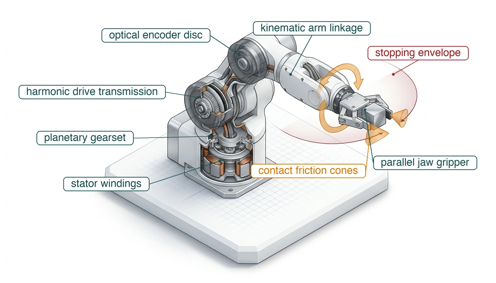
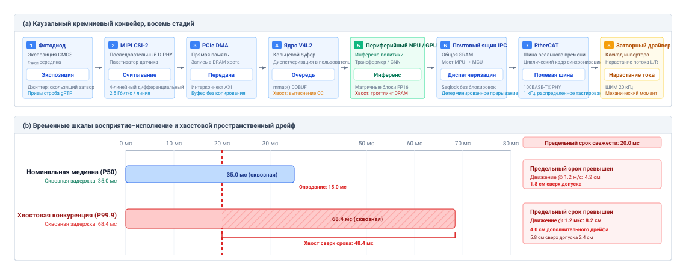
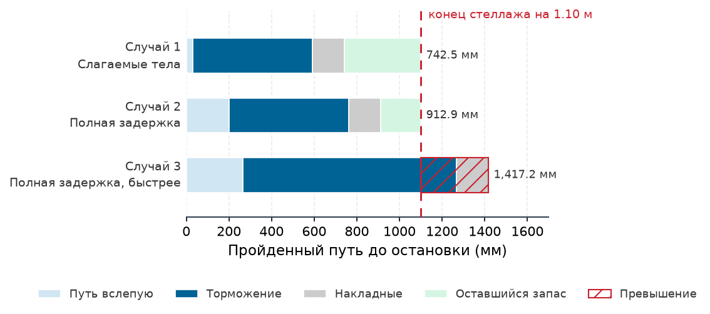
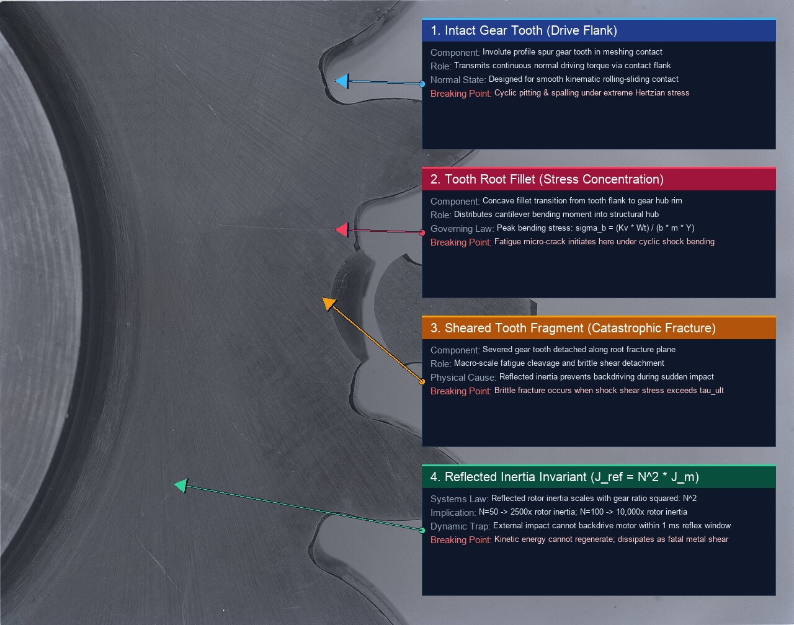
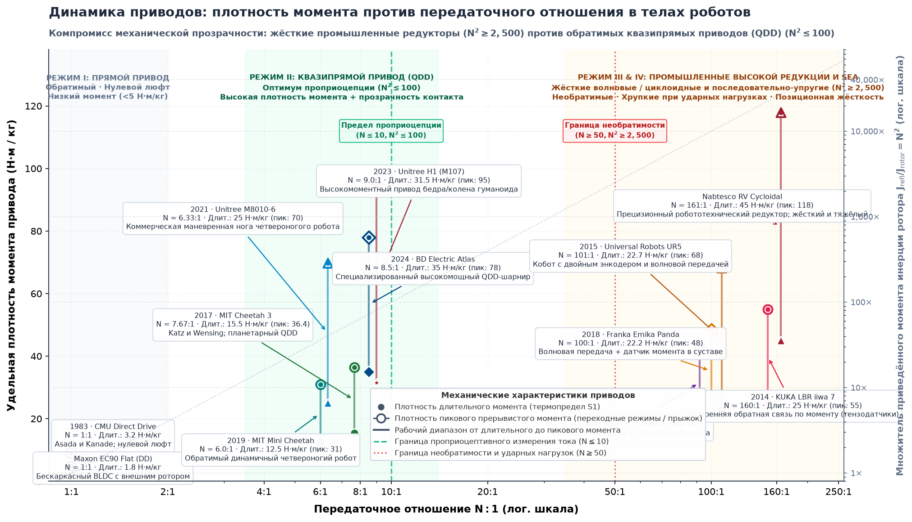
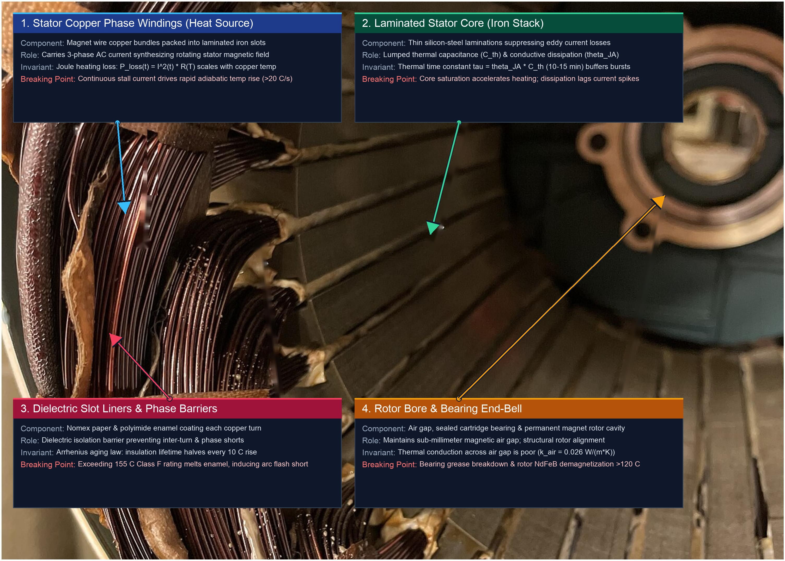
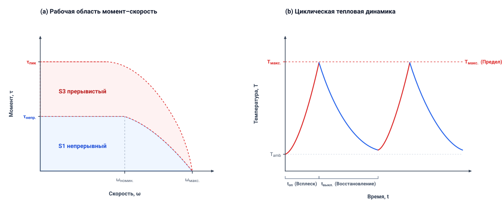
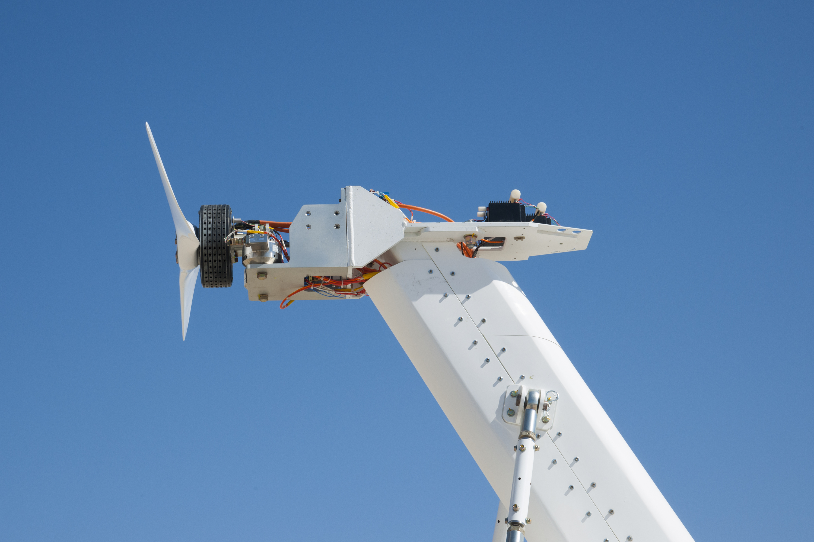

# Физическое тело

## Цель

_Какие физические пределы ограничивают обученную политику в тот момент, когда ее выходы командуют двигателями и движущейся массой?_

Движущаяся машина не может приостановиться ради ПО. Во время инференса физический мир продолжает развиваться: положения меняются, контактные поверхности смещаются, а наблюдения устаревают. Остановить физическое движение можно лишь за конечное время обработки команды и на конечном расстоянии для рассеивания кинетической энергии. Электродвигатели и механические редукторы жестко ограничивают то, насколько быстро может нарастать момент, а токи обмоток и потери на переключение инвертора непрерывно нагревают электромагнитные катушки. Политики, игнорирующие эти ограничения, запрашивают невозможные силы, вызывают просадку напряжения питающей шины или срезают зубья передачи. Ускорение нейронного инференса помогает только внутри этой физической цепи; оно не способно устранить тормозной путь, механическую инерцию или тепловые пределы.

Физический искусственный интеллект требует, чтобы эти пределы измерялись на полностью собранной машине под рабочими нагрузками, а не переписывались из оптимистичных технических описаний компонентов. На каузальной границе Тело устанавливает жесткие физические бюджеты — свободное расстояние, пиковую силу и тепловой запас, — которыми должны делиться восприятие, планирование и управление. По первому фундаментальному закону каждый такой бюджет должен быть проверен до выдачи команды на действие. Охарактеризовав кривые момента и скорости механического объекта управления, конусы трения и скорости теплосъема, системные инженеры обосновывают обученные предложения безжалостной физикой этого объекта.

> ↰ **Предварительное требование:** Физический объект управления лежит в основе трех классов машин, определенных в разделе [«Три класса машин»](01_causal_boundary.md#sec-boundary-four-archetypes).

> **Цели обучения**
>
> - Рассчитать пределы свежести измерений по возрасту измерения и допустимому движению машины
> - Рассчитать остановочный путь и допустимый потолок скорости по задержке до торможения, достоверному замедлению и накладным расходам запаса хода
> - Оценить выбор актуаторов и передач по пределам отклика и приведенной инерции
> - Оценить допустимые циклы нагрузки двигателя по тепловыделению, охлаждению и условиям эксплуатации
> - Спланировать запасы электропитания на одновременные исполнение команды, вычисления и рекуперативное торможение
> - Определить элементы протокола пределов, который фиксирует условия измеренного предела, неопределенность, запас, детектор времени выполнения и категорию свидетельств

## Пять физических бюджетов

Роботизированный манипулятор может разрушить свою передачу даже после получения команды аварийного останова до контакта. Команда останова проходит программные буферы, силовой инвертор переключает состояния, а двигатель развивает пиковый обратный момент. Однако если движущееся звено обладает кинетической энергией, превышающей механическую работу, которую актуаторы способны совершить на оставшемся запасе хода, столкновения не избежать. В чистом ПО отказавший поток может быть мгновенно уничтожен ядром операционной системы. В физической реальности движущаяся масса несет импульс, который нельзя перехватить обработчиком исключений, а силовой каскад не может отдать бесконечный ток без теплового разрушения или просадки напряжения. ПО не может отменить физику движущейся массы, тепла и тока.

Выше границы предложения обученная политика может предлагать любое движение, но **физическое тело** отдает лишь то, что позволяют механика, термодинамика и электромагнетизм. Это тело — объект управления из актуаторов, передач, кинематических звеньев, силовых шин и преобразователей, который воздействует на мир, и каждое задание, выдаваемое политикой, расходует пять его физических бюджетов:

1. **Свежесть измерений**: Скорость изменения физической среды относительно возраста данных датчиков, доходящих до контроллера. Поскольку мир не приостанавливается ради вычислений, время, истекшее на связь и инференс, означает, что машина всегда действует по историческому состоянию.
2. **Кинетический импульс**: Остановочный путь и тормозная сила, необходимые для рассеивания запасенной кинетической энергии ($E_k = \frac{1}{2} m v^2$) до столкновения с препятствиями или выхода за границы рабочей ячейки.
3. **Пропускная способность актуатора и приведенная инерция**: Скорость, с которой могут меняться механический момент и скорость, пока индуктивность обмотки ($\tau_e = L/R$), ограничения по току инвертора или инерция передачи ($N^2 J$) не душат механическое ускорение.
4. **Теплоемкость**: Скорость накопления джоулева тепла в обмотках статора и силовых полупроводниках относительно скорости теплосъема шасси, ограничивающая длительные циклы нагрузки до вмешательства термического снижения номинала.
5. **Целостность электропитания**: Переходная просадка напряжения, пиковая пропускная способность по току и всплески рекуперативной энергии на общей шине распределения постоянного тока при быстром разгоне и торможении.

Складской мобильный манипулятор, за которым следует эта книга, расходует все пять. С нагрузкой не более `368 kg` и на пределе ходовой скорости `1.5 m/s` (иллюстративно; см. Руководство для читателя) он несет `414 J` кинетической энергии по проходам, которыми он делится с людьми.

Каждый бюджет превращается в предел, установленный на собранной машине в заявленных тепловых и электрических условиях. Первый из них — возраст измерения, на котором основана каждая команда; он отсчитывается от физического преобразования, до того как любой программный процесс получит данные.

## Свежесть измерений

Программные бенчмарки часто сообщают задержку как время выполнения сети на акселераторе, но этот вычислительный срез — лишь один сегмент каузальной цепи раздела [«Каузальная граница»](01_causal_boundary.md#sec-boundary-causal-boundary). **Измерение устаревает с момента преобразования; важно его возраст в момент действия.** Этот возраст охватывает интервал от момента, когда фотоны попадают на фотодиод или магнитный поток проходит через датчик Холла, до момента, когда обмотки двигателя создают момент, изменяющий ускорение звена. Если модель восприятия вычисляет положение препятствия за $15\text{ ms}$, но интегрирование камеры, считывание с датчика, транспорт, диспетчеризация очереди и время нарастания тока двигателя добавляют еще $45\text{ ms}$, физический возраст измерения в момент движения шарнира составляет $60\text{ ms}$. На протяжении всего этого окна физический мир продолжал развиваться.

> ↳ **Ниже по потоку:** Раздел [«Оценка сквозь окклюзию»](09_memory.md#sec-memory-belief-through-occlusion) выводит, как долго сохраненная оценка остается действительной по мере устаревания ее измерения.

Отслеживание возраста измерения означает раскладку этого пути на восемь стадий ([«Задержки восприятие–исполнение и конвейер данных кремния»](02_body.md#fig-02-latency-waterfall)): экспозиция с отметкой времени в середине интегрирования; считывание с датчика по интерфейсу, подобному MIPI CSI-2; транспорт прямого доступа к памяти (DMA) в память хоста; буферизация ядром в очереди пользовательского пространства; вычисление модели; планирование операционной системы и межпроцессная диспетчеризация через границу процессоров; передача команды по полевой шине или почтовому ящику общей памяти; и отклик актуатора, когда привод создает поток в обмотках статора. В двухпроцессорной реализации путь идет от матрицы изображения через инференс на прикладном процессоре, почтовый ящик без блокировок и проверку разрешения на $1\text{ kHz}$ в микроконтроллере безопасности до переключения затворного драйвера и нарастания тока. Каждый этап потребляет срез общего бюджета времени.

Скорость изменения состояния мира определяет, как долго измерение остается действительным, прежде чем действие по нему внесет нетерпимую ошибку. Пусть $e_{\max}$ — максимально допустимая ошибка отслеживаемого состояния, например угла шарнира или положения детали на конвейере, а $v_{\max}$ — наибольшая достоверная скорость, с которой это состояние может меняться. Предельный срок свежести $\Delta t_{\text{fresh}}$ — верхняя граница возраста измерения, после которой управляющее действие на его основе становится недействительным; он задается неравенством
$$\Delta t_{\text{fresh}} \le \frac{e_{\max}}{v_{\max}}$$

Для зрительного захватчика на сортировщике посылок, отслеживающего посылки с максимальной относительной скоростью $v_{\max} = 1.2\text{ m/s}$ при геометрическом допуске запаса $e_{\max} = 24\text{ mm}$, предельный срок свежести составляет $24\text{ mm} / (1200\text{ mm/s}) = 20\text{ ms}$. Если команда исполнения достигает двигателя по изображению, снятому $35\text{ ms}$ назад, посылка сместилась на $42\text{ mm}$, превысив допуск по положению на $18\text{ mm}$ и сорвав захват. Предельный срок относится к цели, которая продолжает двигаться, пока ее измерение устаревает, — например к посылке здесь или кружке на конвейере станции комплектации мобильного манипулятора. Для такой цели он ограничивает только вызванную движением ошибку, и только пока относительная скорость ограничена, а начальное наблюдение достоверно; ошибки сенсорики и оценки расходуют дополнительный допуск. Человек, стоящий в проходе, не двигается, пока наблюдение устаревает. База — двигается, поэтому возраст проявляется как расстояние, которое база проходит до торможения; раздел [«Кинетический импульс»](02_body.md#sec-body-kinetic-momentum) относит его на остановочный бюджет.

***Задержки восприятие–исполнение и конвейер данных кремния**: Восьмиступенчатая каузальная цепь от экспозиции до нарастания тока двигателя (панель a) и иллюстративный профиль задержки (панель b). Допуск сортировщика посылок $24\text{ mm}$ при $1.2\text{ m/s}$ задает предельный срок возраста $20\text{ ms}$, поскольку неуправляемый ход превращает истекшее время в смещение со скоростью каретки. И медиана $35.0\text{ ms}$, и хвост $68.4\text{ ms}$ уровня $P_{99.9}$ превышают его, что соответствует движению на $4.2\text{ cm}$ и $8.2\text{ cm}$ соответственно.*

Инженеры часто вычисляют общую задержку, суммируя значения $P_{99}$ отдельных стадий, но квантиль суммы не равен сумме квантилей.[^fn-math-quantile-convolution] Конкуренция за общую память и очереди ядра могут коррелировать задержки стадий, поэтому распределение полного возраста от восприятия до момента должно измеряться на интегрированной машине в заявленной нагрузке, и даже измеренный квантиль не является анализируемой границей, необходимой предельному сроку безопасности ([«Передача команд вовремя»](04_nervous_system.md#sec-nervous-deterministic-fieldbuses)).

[^fn-math-quantile-convolution]: **Свертка квантилей**: В общем случае квантиль суммы задержек отличается от суммы квантилей стадий одного и того же уровня ($Q_p(X + Y) \ne Q_p(X) + Q_p(Y)$). Одной лишь независимости недостаточно, чтобы их арифметическая сумма стала границей худшего случая. Корреляция от общих шин и очередей меняет сквозной хвост и должна характеризоваться на границе системы.

Чтобы увидеть, как тайминг стадий отличается от сквозного возраста, рассмотрим профиль тайминга пути от камеры до шарнира под непрерывной нагрузкой инференса ([«Примерная декомпозиция задержки восприятие–исполнение»](02_body.md#tbl-02-latency-breakdown)), оцененный относительно того же предельного срока $20\text{ ms}$.

| Стадия конвейера                     | Физический механизм / источник конкуренции                          | $P_{50}$ (ms) | $P_{99}$ (ms) | Max (ms) |
|:-----------------------------------|:-----------------------------------------------------------------|:-------------:|:-------------:|:--------:|
| **1–2. Экспозиция и считывание датчика** | Экспозиция скользящего затвора $60\text{ Hz}$ с точкой отсчета в середине |     $11.2$    |     $16.6$    |  $16.7$  |
| **3–4. Транспорт на хост и DMA**   | Передача DMA по PCIe в память хоста                                |     $1.4$     |     $3.2$     |  $6.8$   |
| **5. Зрительный хребет и политика** | Инференс на бортовом акселераторе (хвост из-за троттлинга памяти) |     $18.5$    |     $24.1$    |  $38.4$  |
| **6. Планирование ОС и IPC**       | Вытеснение ядром и диспетчеризация почтового ящика в микроконтроллер безопасности |     $0.6$     |     $2.1$     |  $12.3$  |
| **7. Передача по полевой шине**    | Детерминированный циклический обмен пакетами EtherCAT             |     $1.0$     |     $1.0$     |  $2.0$   |
| **8. Нарастание тока актуатора**   | Переключение затворного драйвера и нарастание потока в статоре     |     $2.3$     |     $3.0$     |  $4.5$   |
| **Арифметическая сумма стадий**    | Сумма значений стадий в каждом столбце; не сквозной квантиль      |    **35.0**   |    **50.0**   | **80.7** |
| **Сквозной возраст**               | Системный профиль ($t_{\text{transduction}} \to \tau$)             |    **35.0**   |    **46.2**   | **80.7** |

***Примерная декомпозиция задержки восприятие–исполнение**: Тайминги на уровне стадий и системы показывают, почему арифметическая сумма квантилей стадий не является сквозным хвостом. $P_{99.9} = 68.4\text{ ms}$ в этом примере превышает предельный срок свежести сортировщика посылок $20\text{ ms}$.*

Сумма $50.0\text{ ms}$ по значениям $P_{99}$ стадий отличается от системного квантиля $46.2\text{ ms}$, и относительно предельного срока $20\text{ ms}$ даже медиана $35.0\text{ ms}$ оказалась бы поздней.

Действие по просроченным данным добавляет фазовое запаздывание в контур обратной связи и может возбудить дребезг, когда корректирующие моменты усиливают, а не гасят ошибки слежения,[^fn-math-bode-delay] поэтому высокая частота инференса сама по себе не делает отклик своевременным. Система должна пронести аппаратную отметку времени от преобразования (используя **IEEE 1588 gPTP**[^fn-hw-gptp-timestamp] или аппаратный захват строба на интерфейсе Ethernet PHY / **MIPI CSI-2**[^fn-hw-mipi-capture]) через весь конвейер. Прежде чем применить команду политики, путь разрешения сравнивает возраст наблюдения $t_{\text{age}} = t_{\text{now}} - t_{\text{transduction}}$ с возрастом, который допускает его бюджет. Если возраст превышает этот предел, путь разрешения отклоняет устаревшее предложение и исполняет резервирование, чье торможение или удержание проверено в оставшемся физическом запасе [Brooks, 1986](references.md#brooks1986robust).

[^fn-math-bode-delay]: **Теорема задержки Боде и запас по фазе**: Чистое транспортное запаздывание $\tau_d$ вносит непреклонное частотно-зависимое фазовое запаздывание $\Delta \phi = -\omega \tau_d$ радиан, не меняя амплитуды коэффициента передачи контура. В замкнутых системах обратной связи эта эрозия фазы ухудшает запас по фазе ($\text{PM} = 180^\circ + \angle L(j\omega_c)$); как только $\tau_d$ разъедает запас до нуля на частоте среза $\omega_c$, полюса замкнутого контура пересекают в правую полуплоскость комплексной плоскости, приводя физический объект управления к разрушительным колебаниям предельного цикла.

[^fn-hw-gptp-timestamp]: **IEEE 1588 gPTP**: Обобщенный протокол точного времени (gPTP) обеспечивает субмикросекундную синхронизацию часов по сетям Ethernet обменом пакетами с аппаратными отметками времени прямо на уровне сетевого чипа (MAC PHY). Захват отметки времени в железе не вносит джиттер планировщика операционной системы в измерение.

[^fn-hw-mipi-capture]: **MIPI CSI-2**: Mobile Industry Processor Interface Camera Serial Interface 2 (MIPI CSI-2) — высокоскоростной дифференциальный протокол для передачи несжатых видеоданных непосредственно от матриц изображения к системам на кристалле (SoC) хоста с минимальной задержкой.

На протяжении всего этого интервала восприятие–исполнение тело продолжает двигаться, неся импульс, который не может отменить ни одно программное прерывание.

## Кинетический импульс

Загруженный мобильный манипулятор едет по проходу на пределе ходовой скорости `1.5 m/s`. Человек выходит из-за торца стеллажа на расстоянии `1.10 m` впереди и останавливается в проходе. ПО не может просто приостановить выполнение или мгновенно обнулить вектор скорости. База, манипулятор и ящики несут механический импульс, и для приведения этой массы в покой требуется рассеять кинетическую энергию на физическом расстоянии. **Остановочный путь растет линейно с задержкой и квадратично со скоростью, и это различие задает ограничение скорости.**

Расстояние от обнаружения опасности до нулевой скорости складывается из двух фаз: слепого хода и тормозного хода. Во время задержки до торможения машина проходит путь, описанный в разделе [«Свежесть измерений»](02_body.md#sec-body-measurement-freshness). На протяжении этой задержки $\tau_{\text{delay}}$, которая длится от экспозиции кадра, показывающего опасность, до начала тормозной силы, актуаторы не прикладывают тормозной силы, и транспортное средство продолжает двигаться по прежней траектории со скоростью $v$, которую оно имело в момент экспозиции кадра. Предполагая, что скорость остается постоянной в этом окне, слепой ход вычисляется как
$$d_{\text{blind}} = v\,\tau_{\text{delay}}$$

Как только команда торможения доходит и актуаторы вступают в работу, тело входит в фазу торможения. Механическая работа тормозной силы $F_{\text{brake}}$ на тормозном пути $d_{\text{brake}}$ должна рассеять начальную кинетическую энергию машины, $W = \Delta K$. Для машины массы $m$, замедляющейся до покоя под действием постоянной тормозной силы $F_{\text{brake}} = m a_{\text{brake}}$, баланс работы и энергии дает
$$m a_{\text{brake}} d_{\text{brake}} = \frac{1}{2} m v^2$$
Деля на массу и решая относительно расстояния, получаем кинематический тормозной ход
$$d_{\text{brake}} = \frac{v^2}{2 a_{\text{brake}}}$$
Параметр $a_{\text{brake}}$ — достоверное замедление, которое тело действительно способно развить против физической среды, а не теоретический пиковый номинал из технического описания актуатора. Это поддерживаемое отрицательное ускорение, которое механическая конструкция, шины и шестерни способны создать до потери сцепления (насыщение сдвигового проскальзывания шина–дорожное полотно), опрокидывания вперед или выхода силовой передачи в область пластической деформации.

Замкнутая форма предполагает постоянное замедление, мгновенное нарастание момента, нулевой уклон и жесткий контакт. Каждое из этих условий нарушается в железе: сила нарастает со временем, трение шины падает при проскальзывании, а конструкция деформируется, поэтому на уклонах или неуверенных полах модель недооценивает останов. Загруженные остановочные испытания в заявленных условиях дают консервативное низкохвостое замедление с неопределенностью и запасом, чтобы заменить идеализированный $a_{\text{brake}}$; одна лишь выборочная квантиль не является жесткой нижней границей.

> ↳ **Ниже по потоку:** Неконтролируемый кинетический импульс прямо превращается в разрушающие ударные контактные нагрузки, анализируемые в разделе [«Пределы передачи актуатора»](02_body.md#sec-body-actuator-limits).

Разный характер слагаемых слепого хода и торможения делает скорость множителем пространственного риска ([«Остановочный путь складского манипулятора»](02_body.md#fig-02-stopping-distance)); это масштабирование численно разбирает пример [«Остановочный путь тела»](02_body.md#nbk-body-stopping-distance-budgeting-high-tail-compute).

В неструктурированных средах машина не может отдать весь свой запас хода номинальной остановочной динамике. Отслеживание препятствий несет неопределенность оценки состояния, калибровка датчиков дрейфует со временем, а алгоритмы локализации вносят ошибку положения. Поэтому остановочный путь $d_{\text{stop}}$, который защищает система, должен включать границу неопределенности пространственной локализации $\delta_{\text{loc}}$ и минимальный физический запас $\delta_{\text{margin}}$:[^fn-std-iso-separation]

$$d_{\text{stop}} = v\,\tau_{\text{delay}} + \frac{v^2}{2 a_{\text{brake}}} + \delta_{\text{loc}} + \delta_{\text{margin}}$$

Сумма $\delta_{\text{loc}} + \delta_{\text{margin}}$ — фиксированная пространственная накладная часть, которая должна оставаться незанятой, когда тело приходит в полный покой.

[^fn-std-iso-separation]: **Защитное расстояние разделения по ISO/TS 15066**: ISO/TS 15066 (пункт 5.5.4), опираясь на ISO 13855, задает это защитное расстояние разделения для мониторинга скорости и разделения (SSM): $S = (v_r \cdot T_r) + (v_h \cdot T_r) + S_r + S_s + C$, где $T_r$ — худшая задержка обработки, $S_r$ — тормозной ход, а $C$ — запас ($100\text{--}200\text{ mm}$). Для обученных политик, работающих в совместных с человеком рабочих пространствах, отсутствие ограничения хвостовой задержки вычислений напрямую раздувает $T_r$, расширяя требуемую зону разделения и вынуждая преждевременные защитные остановы.

> **Динамический остановочный путь**
>
> ***Динамический остановочный путь*** ($d_{\text{stop}}$) — минимальный физический запас, необходимый, чтобы привести движущуюся массу к полной останове из ее скорости $v$ в момент первой съемки опасности. Он складывается из хода во время задержки до торможения $\tau_{\text{delay}}$, которая длится от экспозиции кадра, показывающего опасность, до начала тормозной силы; тормозного хода под достоверным замедлением $a_{\text{brake}}$; а также границы локализации $\delta_{\text{loc}}$ и защитного запаса $\delta_{\text{margin}}$, как утверждает [«остановочный путь тела»](02_body.md#eq-body-stopping-distance).
>
> 1.  **Значение**: Количественно определяет неоспоримый физический пространственный запас, который программные предложения должны преодолеть до того, как может быть дано разрешение на движение.
> 2.  **Отличие**: В отличие от статического геометрического запаса до препятствия в классической кинематике, динамический остановочный путь растет квадратично со скоростью ($v^2$), поэтому удвоение скорости учетверяет слагаемое торможения независимо от частоты контура управления.
> 3.  **Типичная ловушка**: Считать, что команда аварийного останова мгновенно останавливает машину, игнорируя, что движущаяся масса несет кинетическую энергию ($E_k = \frac{1}{2}m v^2$), для рассеивания которой нужны конечные механическая работа и тормозной путь.

***Остановочный путь складского манипулятора**: Каждый столбец раскладывает останов на слепой ход во время задержки до торможения, тормозной ход под достоверным замедлением и фиксированную накладную часть границы локализации и защитного запаса относительно свободного расстояния до торца стеллажа `1.10 m`. Случай 1 учитывает только слагаемые, принадлежащие телу, на пределе ходовой скорости `1.5 m/s` и останавливается в пределах `742.5 mm`. Случай 2 добавляет полную задержку до торможения `133.6 ms`, которую собирают последующие главы: путь аренды раздела [«Многотактные ритмы»](04_nervous_system.md#sec-nervous-cadences) плюс возраст наблюдения раздела [«Сенсорное восприятие»](08_perception.md#sec-perception); на `912.9 mm` он еще помещается, хотя последующие главы добавят профиль остановки и границу слежения. Случай 3 поднимает скорость до гипотетических `2 m/s`, выше предела хода, при той же задержке; тормозной ход растет на 77,8 %, и останов на `1 417.2 mm` нарушает свободное расстояние.*

Для неподвижного препятствия, обнаруженного на расстоянии $D_{\text{clear}}$, — например человека, стоящего у торца стеллажа, или упавшего ящика, — моделируемый остановочный путь должен помещаться в свободный проход, $d_{\text{stop}} \le D_{\text{clear}}$. Это условие, которое принцип [«Закон необратимости»](part1_anatomy.md#pri-vol4-irreversibility) накладывает на каждую остановку, теперь с каждым слагаемым $d_{\text{stop}}$ как пределом этой машины. При консервативных границах тайминга и торможения путь разрешения может решить это неравенство относительно потолка для новых предложений скорости $v_{\text{max}}$. Положительный корень квадратного неравенства[^fn-math-velocity-root] имеет вид:
$$v_{\text{max}} = -a_{\text{brake}} \tau_{\text{delay}} + \sqrt{(a_{\text{brake}} \tau_{\text{delay}})^2 + 2 a_{\text{brake}} (D_{\text{clear}} - \delta_{\text{loc}} - \delta_{\text{margin}})}$$
Когда дальность датчика ухудшается или препятствие входит в траекторию, $D_{\text{clear}}$ сжимается и снижает потолок, если доступное расстояние остается неотрицательным. При нулевом доступном расстоянии потолок равен нулю. Однако если машина уже движется, нулевое задание не может убрать ее текущий остановочный путь; отрицательное доступное расстояние означает, что условие допуска уже нарушено и требуется аварийный отклик.

[^fn-math-velocity-root]: **Кинематический корень скорости**: Группировка постоянных пространственных слагаемых в доступное физическое расстояние $D_{\text{avail}} = D_{\text{clear}} - \delta_{\text{loc}} - \delta_{\text{margin}}$ дает квадратное неравенство $\frac{1}{2 a_{\text{brake}}} v^2 + \tau_{\text{delay}} v - D_{\text{avail}} \le 0$. Умножение на $2 a_{\text{brake}}$ дает $v^2 + 2 a_{\text{brake}} \tau_{\text{delay}} v - 2 a_{\text{brake}} D_{\text{avail}} \le 0$. Применение квадратичной формулы и выбор положительного физического корня определяют динамический потолок скорости.

> **Остановочный путь тела**
>
> **Задача**: Складской мобильный манипулятор с нагрузкой не более `368 kg` едет к торцу стеллажа на пределе ходовой скорости $v =$ `1.5 m/s`, а человек стоит в проходе на свободном расстоянии $D_{\text{clear}} =$ `1.10 m`. Телу принадлежат три слагаемых в уравнении [«остановочный путь тела»](02_body.md#eq-body-stopping-distance): тормозной ход под достоверным замедлением $a_{\text{brake}} =$ `2 m/s²` (загружено, сухой пол); фиксированная накладная часть границы локализации $\delta_{\text{loc}} =$ `50 mm` и защитного запаса $\delta_{\text{margin}} =$ `100 mm`; а также начало торможения $T_{\text{act}} =$ `20 ms`, которое входит в $\tau_{\text{delay}}$. Какую часть свободного расстояния расходуют эти слагаемые, какую скорость они одни позволили бы, и как меняют ответ скорость и добавленная задержка?
>
> **1. Тормозной ход:**
> Масса сокращается в балансе работы и энергии, поэтому `414 J` кинетической энергии загруженной машины определяют, сколько тепла должны поглотить тормоза, но не то, как далеко проедет база:
> `$$d_{\text{brake}} = \frac{v^2}{2 a_{\text{brake}}} = \frac{(1.5 m/s)^2}{2 \times 2 m/s²} = 562.5 mm$$`
> Остановочный путь пока составляет `562.5 mm`.
>
> **2. Фиксированная накладная часть:**
> `$$\delta_{\text{loc}} + \delta_{\text{margin}} = 50 mm + 100 mm = 150 mm$$`
> Текущий итог возрастает до `712.5 mm`.
>
> **3. Начало торможения:**
> Между командой торможения и первой тормозной силой база все еще движется на полной скорости:
> `$$v\,T_{\text{act}} = (1.5 m/s) \times (20 ms) = 30 mm$$`
> `$$d_{\text{stop}}\big|_{\text{body}} = 562.5 mm + 150 mm + 30 mm = 742.5 mm$$`
> Собственные слагаемые тела оставляют `357.5 mm` из `1.10 m` свободного расстояния на задержки, которыми тело не владеет.
>
> **4. Потолок только для тела:**
> Решая [«остановочный путь тела»](02_body.md#eq-body-stopping-distance) относительно скорости при $\tau_{\text{delay}} = T_{\text{act}}$:
> `$$v_{\max} = -a_{\text{brake}} T_{\text{act}} + \sqrt{(a_{\text{brake}} T_{\text{act}})^2 + 2 a_{\text{brake}} (D_{\text{clear}} - \delta_{\text{loc}} - \delta_{\text{margin}})} \approx 1.91 m/s$$`
> Одно тело позволило бы `1.91 m/s`, выше предела хода. Разделы [«Нервная система»](04_nervous_system.md#sec-nervous) и [«Сенсорное восприятие»](08_perception.md#sec-perception) добавляют слагаемые задержки, которые расходуют часть этого запаса.
>
> **5. Скорость против задержки:**
> При гипотетических `2 m/s`, выше предела хода, одно только слагаемое торможения растет до `1 000 mm`, на 77,8 % больше, чем на пределе хода. На пределе хода каждые дополнительные `100 ms` задержки до торможения добавляют `150 mm`.
>
> **Эмпирическое правило архитектора**: *Никогда не повышайте задание скорости, не решив заново квадратное уравнение запаса.*

> **Регулятор динамического потолка скорости**
>
> **Входы**:
>
> - $D_{\text{clear}} \in \mathbb{R}_{\ge 0}$: Расстояние до обнаруженного препятствия вдоль вектора движения $[\text{m}]$.
> - $\tau_{\text{delay}} \in \mathbb{R}_{> 0}$: Консервативно ограниченная задержка от восприятия до торможения, включая отклик актуатора $[\text{s}]$.
> - $a_{\text{brake}} \in \mathbb{R}_{> 0}$: Консервативная нижняя граница доступного тормозного замедления при заявленной нагрузке и покрытии $[\text{m/s}^2]$.
> - $\delta_{\text{loc}}, \delta_{\text{margin}} \in \mathbb{R}_{\ge 0}$: Граница неопределенности локализации и физический запас $[\text{m}]$.
> - $v_{\text{now}} \in \mathbb{R}_{\ge 0}$: Текущая скорость движения вперед $[\text{m/s}]$.
> - $v_{\text{cand}} \in \mathbb{R}_{\ge 0}$: Кандидатное задание скорости движения вперед, предлагаемое нейронной политикой $[\text{m/s}]$.
>
> **Выход**:
>
> - $v_{\text{safe}} \in \mathbb{R}_{\ge 0}$: Ограниченный запрос скорости в пределах моделируемого потолка $[\text{m/s}]$.
>
> **Проверка допуска** (пока текущее состояние осуществимо):
>
> 1. Моделируемый остановочный путь: $d_{\text{stop}}(v_{\text{safe}}) = v_{\text{safe}} \tau_{\text{delay}} + \frac{v_{\text{safe}}^2}{2 a_{\text{brake}}} + \delta_{\text{loc}} + \delta_{\text{margin}} \le D_{\text{clear}}$ для неподвижного препятствия.
> 2. Неотрицательность: $v_{\text{safe}} \ge 0.0$.
>
> **Шаги алгоритма**:
>
> 1. Вычислить доступное физическое тормозное расстояние:
>    $$D_{\text{avail}} \leftarrow D_{\text{clear}} - \delta_{\text{loc}} - \delta_{\text{margin}}$$
>
> 2. Если $D_{\text{avail}} \le 0.0$, отклонить предложение; удерживаться в нуле, если машина неподвижна, или запросить максимально доступный снижающий риск тормозной отклик, если она движется, и пометить потерю запаса. Иначе проверить $v_{\text{now}}\tau_{\text{delay}} + v_{\text{now}}^2/(2a_{\text{brake}}) \le D_{\text{avail}}$ до допуска следующего предложения. Если эта проверка не проходит, запросить тот же аварийный отклик и пометить потерю осуществимости. Нулевое задание скорости не способно немедленно остановить существующее движение.
> 3. Вычислить дискриминант квадратного уравнения:
>    $$\text{disc} \leftarrow (a_{\text{brake}} \tau_{\text{delay}})^2 + 2 a_{\text{brake}} D_{\text{avail}}$$
>
> 4. Найти положительный физический корень как динамический потолок скорости:
>    $$v_{\max} \leftarrow -a_{\text{brake}} \tau_{\text{delay}} + \sqrt{\text{disc}}$$
>
> 5. Принудительно применить динамическое ограничение к предложению политики:
>    $$v_{\text{safe}} \leftarrow \min(v_{\text{cand}}, \max(0.0, v_{\max}))$$
>
> 6. Вернуть $v_{\text{safe}}$.

Квадратное уравнение превращает фиксированное ограничение скорости в зависящий от запаса потолок для новых предложений, но этот потолок сохраняет осуществимость остановки лишь если машина входит в каждый цикл управления внутри осуществимого множества и способна приложить предполагаемую тормозную силу в пределах ограниченной задержки. Функции барьера управления (CBF-QP) [Ames et al., 2019](references.md#ames2019control) распространяют эти рассуждения на более общие системы при корректной динамике, оценках состояния, границах тайминга и осуществимых полномочиях управления; одномерный корень здесь — упрощенная кинематическая проверка допуска. Если дальность ухудшается или задержка превышает свою границу, путь разрешения должен снизить скорость до исчерпания запаса или исполнить определенное снижающее риск резервирование.

Обеспечение этого ограничения скорости предполагает, что путь разрешения может потребовать замедления $a_{\text{brake}}$ всякий раз, когда этого требует безопасность. Однако командование быстрым замедлением требует внезапного большого механического момента от приводных двигателей и редукторов. Если путь разрешения запросит ступень момента, превышающую допуск бюджета пропускной способности актуатора, механическое тело не сможет обеспечить требуемое замедление, что делает модельный потолок остановки недействительным и создает риск столкновения.

## Пределы передачи актуатора

Электромеханический актуатор не возвращает ошибку. Когда политика командует ступень момента сверх того, что может создать магнитное поле, или разрывное ускорение, которое зубья передачи не способны выдержать, актуатор потребляет от силового каскада максимальный фазовый ток, крутит свои валы и нагружает зубья, в то время как регистры команд продолжают сообщать о номинальном исполнении. **Актуатор может повредить себя, вместо того чтобы сообщить об ошибке.**

Контракт актуатора нельзя задать в терминах цифровых заданий. Его необходимо записать на физическом интерфейсе в терминах отдаваемой силы, момента или массового расхода, задержки отклика, пределов скорости нарастания и ошибки выхода. Цифровое задание — всего лишь программный запрос; физическое действие ограничено индуктивностью обмотки, потолками напряжения шины, магнитным насыщением и упругостью передачи.

Задержка между командой момента и его отдачей начинается в обмотках статора. Поскольку катушки обладают индуктивностью, ток, а вместе с ним и момент нарастают по электрической постоянной времени двигателя, а не мгновенно (раздел [«Системы и оборудование»](appendix_systems.md#sec-appendix-systems) выводит RL-отклик). Политика, предполагающая мгновенное появление момента, не учитывает это нарастание, поэтому возникает неуправляемый дрейф, пока манипулятор не сможет скорректировать курс или затормозить.

Векторное управление (FOC) синтезирует этот момент на выделенном кремнии привода с частотой $10\text{--}25\text{ kHz}$.[^fn-hw-foc-current] Момент пропорционален току ($\tau = K_t I$), но скорость нарастания тока ограничена запасом напряжения шины:
$$\frac{di}{dt} \le \frac{V_{\text{bus}} - e_{\text{bemf}}}{L}$$
По мере вращения ротора двигатель действует и как генератор, чья противо-ЭДС ($e_{\text{bemf}} = K_e \omega$) противодействует источнику питания. На низкой скорости запас $V_{\text{bus}} - e_{\text{bemf}}$ позволяет быстрое нарастание тока и полный пиковый момент. По мере приближения $\omega$ к базовому номиналу противо-ЭДС съедает запас, и инвертор больше не может протолкнуть ток через индуктивность обмотки при любом коэффициенте заполнения, поэтому политика, командующая резкое ускорение на высокой скорости, не получает запрошенной ступени момента.

[^fn-hw-foc-current]: **Контур тока векторного управления (FOC)**: Контур тока работает на собственном контроллере привода, а не на процессоре, исполняющем политику, поэтому ступень момента, выдаваемая политикой, достигает обмотки лишь как рампа, которую позволяют контур и запас шины.

Запас ограничивает скорость нарастания тока; электроника привода ограничивает то, сколько тока вообще может протекать. Силовые инверторы принудительно устанавливают максимальный потолок тока $I_{\text{max}}$, чтобы защитить переключающие транзисторы от теплового разрушения и предотвратить ферромагнитное насыщение сердечника статора. Когда двигатель приводит механическую передачу с передаточным отношением $N$ и коэффициентом полезного действия $\eta$, потолок отдаваемого выходного момента равен:
$$\tau_{\text{out, max}} = \eta N K_t I_{\text{max}}$$

Ограничение отвечает на вопрос, оставленный открытым остановочным бюджетом: способны ли приводы отдать $a_{\text{brake}}$, когда этого требует путь разрешения, — и отвечает молча. Запрос торможения выше $\tau_{\text{out, max}}$ отсекается на силовом каскаде без какого-либо отчета выдавшему его ПО, поэтому база замедляется мягче, чем предполагал остановочный путь, и останавливается за расчетной границей. Таким образом, достоверное замедление действительно только при тех пределах тока привода, которые были настроены в момент его измерения, и изменение прошивки $I_{\max}$ аннулирует его до повторного измерения; эту зависимость раздел [«Замер пределов машины»](02_body.md#sec-body-measuring-limits) записывает в условия своего протокола пределов.

Лишь часть этого ограниченного тока создает момент, и векторное управление выделяет ее сменой системы координат. В двигателе с поверхностными магнитами момент создает только ток статора, поле которого перпендикулярно потоку ротора, поэтому привод считывает угол ротора с энкодера и поворачивает три измеренных фазовых тока в связанную с ротором систему $dq$, где ток квадратурной оси $I_q$ создает момент, а ток прямой оси $I_d$, выровненный по потоку, не создает его. Нажим вниз на педаль велосипеда в верхней точке хода ведет себя так же, нагружая шатун, но не вращая его. Контроллер регулирует $I_q$ по команде момента, удерживает $I_d$ около нуля ниже базовой скорости и записывает результирующее напряжение в таймеры инвертора с дополнительной широтно-импульсной модуляцией.[^fn-hw-inverter-deadtime] Вне режима ослабления поля, где привод намеренно вводит отрицательный $I_d$ для компенсации противо-ЭДС выше базовой скорости, ток прямой оси нагревает обмотку, не двигая шарнир, и расходует тепловой запас ([«Тепловые циклы нагрузки»](02_body.md#sec-body-thermal-duty-cycles)) без всякого момента.

[^fn-hw-inverter-deadtime]: **Мертвое время инвертора**: Короткий аппаратно вставляемый интервал, в который оба ключа полумоста инвертора выключены, чтобы верхний и нижний ключи одного плеча никогда не проводили одновременно и не замыкали шину постоянного тока — отказ, называемый сквозным током.

Передача добавляет механическую асимметрию. Шарниры с высоким передаточным отношением используют отношения от $50{:}1$ до $160{:}1$, чтобы получить высокий момент от компактного двигателя; это увеличивает отдаваемый момент в $N$ раз, но вращает ротор в $N$ раз быстрее шарнира. Нагрузка, вращающая выход в обратном направлении, тоже должна вращать ротор в $N$ раз быстрее, а поскольку кинетическая энергия масштабируется как квадрат скорости ($\frac{1}{2} J \dot{\theta}^2$), инерция ротора $J_{\text{rotor}}$ противодействует ускорению шарнира, умноженной на **квадрат передаточного отношения** ([«Приведенная инерция ротора»](02_body.md#dfn-body-reflected-rotor-inertia)).

Через передачу `100`:1 ротор массой `50 g` выглядит для шарнира как маховик массой `11.2 kg` радиусом `10 cm` [Lynch and Park, 2017](references.md#lynch2017modern). Препятствие, ударяющее захват, должно разогнать этот маховик через зубья передачи, корни которых могут треснуть от удара ([«Ударный разлом зуба передачи»](02_body.md#fig-02-real-broken-gear-tooth)).

> **Приведенная инерция ротора**
>
> ***Приведенная инерция ротора*** ($J_{\text{ref}}$) — кажущаяся инерция вращения ротора актуатора на выходе шарнира со стороны нагрузки, масштабируемая как квадрат передаточного отношения:
> $$J_{\text{ref}} = N^2 J_{\text{rotor}}$$
>
> 1.  **Значение**: В передачах с высоким отношением ($N \ge 100$) она доминирует в кажущейся нагрузке, ограничивая ускорение шарнира $\ddot{q}$ и определяя ударные нагрузки.
> 2.  **Отличие**: В отличие от инерции ротора $J_{\text{rotor}}$ или инерции звена $J_{\text{load}}$, она действует через жесткость и люфт передачи, поэтому обратное вращение со стороны среды встречает барьер $N^2$.
> 3.  **Типичная ловушка**: Игнорирование приведенной инерции ротора при моделировании столкновений и контакта. При внезапном ударе препятствия приведенная кинетическая энергия вращающегося ротора концентрирует напряжение прямо на зубьях передачи раньше, чем ток привода может быть прерван.

Совместное уравнение движения для шарнира с передачей, вращающего инерцию нагрузки $J_{\text{load}}$ моментом двигателя $\tau_{\text{motor}}$, имеет вид:
$$ \ddot{q} = \frac{N \tau_{\text{motor}}}{J_{\text{load}} + N^2 J_{\text{rotor}}} $$
Дифференцирование по передаточному отношению $N$ показывает, что пик ускорения шарнира достигается при **отношении согласования инерций**:
$$ N^* = \sqrt{\frac{J_{\text{load}}}{J_{\text{rotor}}}} $$
Ниже $N^*$ ускорение шарнира ограничено моментом. Выше него дополнительная передача *уменьшает* отдаваемое ускорение, поскольку двигатель тратит большую часть момента на разгон собственного ротора, а не звена.

Поскольку двигатель не может мгновенно отдать момент для разгона этой усиленной инерции, передача действует как механический фильтр нижних частот, размазывая резкую команду в запаздывающий отклик, чье запаздывание разъедает устойчивость обратной связи и возбуждает структурный резонанс. Поэтому путь управления формирует запрашиваемое движение квинтическими сплайнами или ограничителями скорости по S-кривой, чтобы удержать ускорение шарнира $\ddot{q}$ в пределах токовых ограничений и ограничений по напряжению железа [Lynch and Park, 2017](references.md#lynch2017modern).

Передачи также вносят люфт и податливость, разъединяющие двигатель и нагрузку. При реверсе вал двигателя проходит механический зазор, прежде чем зубья вступят в зацепление с противоположной боковой стороной, а крутильная податливость зубьев и гибких венцов ([«Узел волновой передачи»](02_body.md#fig-02-real-strain-wave-gear)) превращает звено в упругую систему, а не жесткий стержень [Spong, 1987](references.md#spong1987modeling); его модель гибкого шарнира выводит раздел [«Динамика гибких шарниров и сингулярные возмущения»](appendix_control.md#sec-appendix-control-flexible-joints). Разрывные ступени момента возбуждают эту упругость и могут привести передачу к дребезгу предельного цикла. Энкодер со стороны двигателя скрывает мертвую зону: двигатель вращается плавно, а выход стоит на месте, поэтому положение шарнира $q_{\text{out}}$ отклоняется от $q_{\text{motor}} / N$ на зависящую от нагрузки ошибку $\delta_{\text{lost}}$. Контроллер видит непрерывное слежение, пока рабочий орган колеблется, а затем получает импульсный удар, когда зубья схлопываются; повторяющиеся удары заканчиваются усталостным разрушением ([«Ударный разлом зуба передачи»](02_body.md#fig-02-real-broken-gear-tooth)).

> **Импедансное управление для безопасности контакта**
>
> Если контроллер ведет манипулятор к целевой координате в жесткой среде (жесткость контакта $k \ge 10^5\text{ N/m}$), ошибка положения $\Delta x = 1\text{ mm}$ поднимает контактную силу до $F = k \Delta x = 100\text{ N}$ за миллисекунды, пока инвертор гонит максимальный ток против препятствия. На мобильном манипуляторе захват, открывающий дверцу клетки с пружинным замком, встречает ударную планку жесткостью `4.0 × 10⁵ N/m`, и с началом контакта сила растет как $F = k v t$: `12 N/ms` при ограниченном сближении `0.03 m/s` и `40 N/ms` при `0.10 m/s` — против предела замка `100 N`.
>
> Импедансное управление [Hogan, 1985](references.md#hogan1985impedance) рассматривает контакт ни как чистое управление положением, ни как чистое управление силой. Среда ведет себя как проводимость, принимая силу и уступая движением, поэтому манипулятор управляется как импеданс, принимая отклонения движения и создавая податливую силу ($F = Z(v)$). Приводной контроллер шарнира преобразует задания положения в **виртуальную пружинно-демпферную систему**:
> $$F_{\text{contact}} = K_p (x_{\text{des}} - x) + K_d (\dot{x}_{\text{des}} - \dot{x})$$
> После этого шарнир ведет себя как программируемая подвеска с жесткостью $K_p$ и демпфированием $K_d$, уступая при контакте и ограничивая силу достаточно долго, чтобы ПО более высокого уровня обнаружило контакт и перепланировало движение.

***Узел волновой передачи**: Комплект деталей роботизированной волновой передачи: (1) эллиптический волновой генератор с гибкими шарикоподшипниками, (2) гибкий чашечный венец с наружными зубьями, (3) жесткий круговой венец с внутренними зубьями и (4) инвариант систем передачи, определяющий приведенную инерцию ротора ($J_{\text{ref}} = N^2 J_{\text{rotor}}$). Упругая деформация обеспечивает нулевой начальный люфт при высоких передаточных отношениях ($50:1$ до $160:1$), но вносит крутильную податливость, гистерезис и уязвимость зубьев к усталости при внезапных ударных нагрузках.*

***Ударный разлом зуба передачи при высокой приведенной инерции**: Макроразрушение зуба высокомоментной передачи при циклических испытаниях в Исследовательском центре NASA Glenn: [①] целая боковая поверхность зуба, несущая непрерывный контакт привода; [②] концентрация напряжения в галтели корня зуба ($\sigma_b = \frac{K_v W_t}{b m Y}$), где циклическое растяжение инициирует микротрещины; [③] срезанный фрагмент зуба с зернистыми полосами усталости и внезапным сколом при ударной нагрузке; и [④] приведенная инерция ротора ($J_{\text{ref}} = N^2 J_{\text{rotor}}$). Высокое передаточное отношение снижает обратимость и может повысить напряжение в корне зуба при ударе; податливость и путь контакта определяют, сколько энергии приходится на каждый отдельный зуб.*

Выбор передачи — это компромисс между непрерывной плотностью момента и обратимостью, и таблица [«Компромиссы передачи актуатора»](02_body.md#tbl-02-mechanical-drives) противопоставляет обратимый и высокоредукторный концы этого диапазона. Циклоидальные редукторы с отношениями от $30:1$ до $100:1$ находятся между этими концами и переносят удар лучше, чем волновая передача.

| Передача                            | Передаточное отношение ($N$)                  | Приведенная инерция ($N^2$)                 | Следствие для обученных политик                                                                                                         |
|:---------------------------------|:----------------------------------|:------------------------------------------|:----------------------------------------------------------------------------------------------------------------------------------------|
| **Квазипрямой привод (QDD)**       | $3:1\text{--}10:1$ ($N \le 10$)   | $N^2 \le 100$ (низкая)                       | Обратимый; ток двигателя ощущает контактный момент; переносит удар. Прямой привод ($N = 1$) — его предел, с наименьшей плотностью момента. |
| **Волновая передача (Harmonic Drive)** | $50:1\text{--}160:1$ ($N \ge 50$) | $N^2 \ge 2500\text{--}25\,600$ (экстремальная) | Нулевой начальный люфт и компактность; крутильно податлив и хрупок при внезапном сдвиге зубьев.                                   |

***Компромиссы передачи актуатора**: Передаточное отношение ($N$), масштабирование приведенной инерции ротора ($N^2$) и следствие для обученных управляющих политик на обратимом и высокоредукторном концах диапазона.*

Этот архитектурный водораздел по передаточным отношениям определяет механическую прозрачность и огибающую удельного момента воплощения ([«Динамика актуатора»](02_body.md#fig-02-actuator-torque-density-vs-gear-ratio)). В шарнирах с прямым приводом ($N = 1:1$), таких как новаторский CMU Direct Drive Arm [Asada and Kanade, 1983](references.md#asada1983design), приведенная инерция ничтожна ($N^2 = 1$), что устраняет люфт и обеспечивает совершенную механическую обратимость. Однако поскольку электродвигатели создают момент пропорционально объему меди статора и радиусу зазора, актуаторы с прямым приводом редко превышают $5\,\text{N}\cdot\text{m/kg}$ непрерывной удельной плотности момента, нагружая манипуляторы тяжелыми, громоздкими звеньями. И наоборот, классические промышленные манипуляторы (такие как KUKA LBR iiwa или Universal Robots UR5) и высоконагруженное промышленное оборудование применяют высокоредукторные волновые или циклоидальные редукторы ($N = 100{:}1\text{ to }160{:}1$). Высокая передача повышает удельную непрерывную плотность момента до $22\text{--}45\,\text{N}\cdot\text{m/kg}$, но накладывает экстремальный штраф приведенной инерции ротора ($N^2 \ge 2\,500\text{ to }25\,600$), делая шарниры практически необратимыми. При неожиданном контакте или столкновении с препятствием кинетическая энергия быстро вращающегося ротора не может провернуть двигатель; вместо этого напряжение концентрируется в галтели корня зуба, создавая риск катастрофического среза зуба раньше, чем цифровые контуры момента смогут вмешаться.

Современные динамичные платформы физического ИИ разрешают этот тупик через **квазипрямой привод (QDD)** [Seok et al., 2015](references.md#seok2015design); [Wensing et al., 2017](references.md#wensing2017proprioceptive); [Katz et al., 2019](references.md#katz2019mini). Сочетая бескаркасные вентильные двигатели с внешним ротором высокой плотности момента с низкими одноступенчатыми планетарными редукторами ($N \le 10{:}1$), архитектуры QDD ограничивают множитель приведенной инерции величиной ниже $N^2 \le 100$. Это сохраняет механическую прозрачность, позволяя фазовым токам двигателя, измеряемым на инверторе, служить точными прокси контактной силы с низкой задержкой — свойству, именуемому **проприоцептивным восприятием**. Как показывают вехи четвероногих и гуманоидных платформ, включая MIT Cheetah 3, MIT Mini Cheetah, Unitree Go1/H1 и Boston Dynamics Electric Atlas, актуаторы QDD достигают пиковой прерывистой плотности момента до $70\text{--}95\,\text{N}\cdot\text{m/kg}$, безопасно поглощая ударные толчки при взрывных динамических маневрах.

***Динамика актуатора: удельная плотность момента в зависимости от передаточного отношения в роботизированных телах**: Компромисс между отдаваемой механической плотностью момента (непрерывный тепловой номинал $S_1$ против пикового прерывистого всплеска) и множителем приведенной инерции ротора ($J_{\text{refl}} / J_{\text{rotor}} = N^2$, правая ось, логарифмическая шкала) в разных режимах передачи. Режим I: прямой привод ($N=1{:}1$, обратимый на 100 %, низкая плотность момента $<5\,\text{N}\cdot\text{m/kg}$, например CMU Direct Drive Arm 1983, Maxon EC90). Режим II: квазипрямой привод (QDD) / оптимум проприоцепции ($N \le 10{:}1$, $N^2 \le 100$, непрерывно $15\text{--}35\,\text{N}\cdot\text{m/kg}$, пик до $95\,\text{N}\cdot\text{m/kg}$, прозрачное сенсорное восприятие контакта по току двигателя, например MIT Cheetah 3, Mini Cheetah, Unitree Go1/H1, Boston Dynamics Electric Atlas). Режимы III и IV: высокоредукторные жесткие промышленные (Harmonic/Cycloidal) и последовательно-упругие актуаторы ($N \ge 50{:}1$, $N^2 \ge 2\,500\text{--}25\,600$, необратимые, хрупкие к ударам, например UR5, Franka Emika Panda, KUKA LBR iiwa, ANYdrive, Nabtesco RV).*

Манипулятор, доминирующий контактами, либо использует обратимые актуаторы квазипрямого привода (QDD) [Seok et al., 2015](references.md#seok2015design); [Wensing et al., 2017](references.md#wensing2017proprioceptive), либо остается за пределами ограничений момента реального времени и импедансного управления.

При любом выборе сенсорное восприятие положения или момента со стороны нагрузки вскрывает расхождение с энкодером двигателя, создаваемое люфтом или поврежденным зубом, и тогда путь разрешения может отклонить дальнейшие команды силы и войти в определенное резервирование.

> ↳ **Ниже по потоку:** Циклы усталости механического редуктора задают пределы эффективности выборки для обучения с подкреплением в разделе [«Обучение пробами»](06_training.md#sec-training-learning-by-trial).

Работа вблизи токовых и моментных пределов имеет и термодинамическую цену. Каждый ампер, разгоняющий инерцию ротора или поддерживающий пиковый момент, рассеивает $I^2 R$ в меди, и это тепло накапливается в тепловой массе актуатора, ограничивая, как долго может длиться пиковый момент до разрушения изоляции.

## Тепловые циклы нагрузки

Удержание неподвижной нагрузки на полном вылете создает обманчивые требования к сочлененному манипулятору, подобному манипулятору мобильного робота. Поддержание статической нагрузки против гравитации требует непрерывного фазового тока через обмотки статора, активно превращая электрическую энергию в накапливающееся тепло. **Тепло приходит за секунды и уходит за минуты, делая цикл нагрузки первостепенной проектной переменной.**

Импульс можно перенаправить, а поток гаснет за миллисекунды после размыкания ключа, но у тепла нет быстрого выхода. Теплоемкость интегрирует потери мощности во времени и задает два материальных порога ([«Пробой изоляции обмотки статора»](02_body.md#fig-02-real-burnt-motor-stator)). Изоляция обмоток классифицируется по IEC 60085: класс F — до непрерывной локальной температуры $155^\circ\text{C}$, класс H — до $180^\circ\text{C}$; выше номинала эмаль размягчается, пока соседние витки не замкнут и не разрушат фазную обмотку. Магниты ротора из неодима, железа и бора ($\text{NdFeB}$) необратимо размагничиваются между $80^\circ\text{C}$ и $150^\circ\text{C}$ в сильных полях статора.

***Пробой изоляции обмотки статора**: Разрез поврежденного статора электродвигателя с показанными критическими тепловыми подсистемами: (1) медные фазовые обмотки (основной источник тепла $I^2 R$), (2) диэлектрические изоляторы пазов и порог пробоя изоляции Nomex ($155^\circ\text{C}$, класс F), (3) ламинированный железный сердечник статора ($C_{\text{th}}$ и путь теплосъема $\theta_{JA}$) и (4) воздушный зазор расточки ротора и тепловые пределы магнитов ($80^\circ\text{C}\text{--}150^\circ\text{C}$). (Источник: Industrial Electromechanical Diagnostics Archive, CC BY 4.0).*

Тепловыделение следует за током: джоулевы потери вкладывают $P_{\text{loss}}(t) = I^2(t) R(T)$ в медь статора. Эта мощность делится между нагревом тепловой массы обмотки и теплопроводностью наружу — к корпусу и окружающему воздуху (раздел [«Системы и оборудование»](appendix_systems.md#sec-appendix-systems) интегрирует тепловое уравнение и выводит стационарный режим).

Теплоемкость $C_{\text{th}}$ и тепловое сопротивление $\theta_{JA}$ ведут себя как **протекающее ведро**. Джоулевы потери льются внутрь, тепловая масса меди и железа статора задает объем ведра, а $\theta_{JA}$ — слив, причем большее сопротивление сужает его. Всплеск в несколько секунд быстро поднимает уровень, но переживается, пока он остается ниже номинала изоляции, тогда как длительный удерживающий момент поднимает уровень до равенства притока и оттока, и если это равновесие лежит выше номинала, эмаль выходит из строя. Поскольку тепловая постоянная времени $\tau = \theta_{JA} C_{\text{th}}$ имеет порядок минут, а нагрев действует за секунды, теплосъем фильтрует потери мощности как фильтр нижних частот, а стационарная температура определяется средними потерями и тепловым сопротивлением.

Политики, обученные в симуляции, оптимизируют награды, в которых момент — мгновенная бесплатная переменная, поэтому они могут неограниченно долго удерживать тяжелую нагрузку, ужесточать шарнир встречным моментом или дребезжать на границе контакта без последствий. На железе длительный ток нагревает обмотку с начальной скоростью $dT/dt \approx I^2 R / C_{\text{th}}$ до того, как теплопроводность установит какое-либо равновесие. Положительный температурный коэффициент меди ($\alpha_{\text{Cu}} \approx 0.00393\text{ K}^{-1}$) усугубляет цену. От `20 °C` до инженерного потолка `140 °C` сопротивление фазы возрастает на 47,2 % согласно $R(T) = R_0 [1 + \alpha_{\text{Cu}}(T - T_0)]$, поэтому удержание того же момента ($\tau = K_t I$) рассеивает на 47,2 % больше мощности именно тогда, когда охлаждение наименее эффективно, а добавленное тепло вновь повышает сопротивление.

Тепловые номиналы технических описаний оптимистичны, потому что измерены на двигателе в идеальных условиях, установленном на большой радиатор в свободном воздухе при $20^\circ\text{C}$ или $25^\circ\text{C}$. Установленный в герметичном шасси рядом с силовой электроникой, аккумуляторными блоками и другими шарнирами, двигатель теряет конвективный поток воздуха, что повышает $\theta_{JA}$, а соседние нагрузки могут поднять его местную окружающую температуру до $45^\circ\text{C}$–$55^\circ\text{C}$ прежде, чем его собственные катушки понесут ток. Поэтому тепловые запасы должны планироваться по постоянным нагрева и охлаждения, измеренным с закрытым кожухом и соседними нагрузками на уровне их потребления $P_{99}$.

> ↳ **Ниже по потоку:** Телеметрия реального времени для бюджетов тепловой целостности и целостности электропитания передается детерминированными полевыми шинами, анализируемыми в разделе [«Передача команд вовремя»](04_nervous_system.md#sec-nervous-deterministic-fieldbuses).

Поскольку теплоемкость интегрирует мощность во времени, номинал пикового момента[^fn-hw-motor-intermittent] или пикового тока бессмыслен без четырех параметров: начальной температуры обмотки $T(0)$, допустимой длительности $t_{\text{on}}$, окружающей температуры $T_{\text{amb}}$ и времени восстановления $t_{\text{off}}$. Актуатор, способный создать троекратный непрерывный момент, удерживает его лишь пока интеграл $I^2 R$ остается в запасе ниже предела изоляции; от холодной обмотки это может длиться десятки секунд, а от прогретой — лишь часть этого времени ([«Переходное тепловое накопление: холодный против…»](02_body.md#nbk-body-thermal-burst-limits)).

[^fn-hw-motor-intermittent]: **Пределы прерывистого режима актуатора**: Технические описания робототехнических двигателей заметно рекламируют пиковый момент ($\tau_{\text{peak}}$), но этот номинал строго прерывистый, и как долго его можно удерживать зависит от начальной температуры обмотки. Длительное динамическое маневрирование должно планироваться по непрерывному среднеквадратичному моменту ($\tau_{\text{cont}}$), иначе агрессивные команды нейронной политики сработают на тепловую защиту и вызовут обрушение конечности посреди движения.

> **Переходное тепловое накопление: холодный против горячего пуска**
>
> Шарнир плеча манипулятора имеет сопротивление обмотки $R =$ `1.2 Ω`, сосредоточенную теплоемкость $C_{\text{th}} =$ `120 J/K` и установленное тепловое сопротивление $\theta_{JA} =$ `2.5 K/W`; он работает в закрытом объеме при $T_{\text{amb}} =$ `40 °C` с изоляцией класса F, номинированной на `155 °C`. Тепловая постоянная времени равна $\tau = \theta_{JA} C_{\text{th}} =$ `300 s`.
>
> **Задача**: Как начальная температура обмотки меняет длительность всплеска с троекратным номинальным током до достижения предела изоляции?
>
> **Расчет**:
>
> 1. **Непрерывное равновесие**: При $I_{\text{cont}} =$ `5 A` обмотка успокаивается на $T_{\text{eq}} = T_{\text{amb}} + I_{\text{cont}}^2 R\,\theta_{JA} =$ `115 °C`, ниже предела.
> 2. **Пиковый всплеск**: При $I_{\text{peak}} =$ `15 A` рассеяние возрастает в девять раз до $P_{\text{peak}} =$ `270 W`, чья асимптота $T_\infty = T_{\text{amb}} + P_{\text{peak}}\theta_{JA} =$ `715 °C` лежит далеко выше предела.
> 3. **Горизонты выживания**: При $T(t) = T_\infty - (T_\infty - T(0))\,e^{-t/\tau}$ время достижения предела равно
>    $$t_{\text{limit}} = \tau \ln\frac{T_\infty - T(0)}{T_\infty - T_{\text{limit}}}$$
>    что дает `56.0 s` от холодного пуска при окружающей температуре и `20.7 s` от прогретого пуска при $T_{\text{eq}}$.
>
> **Результат**: Прогретый шарнир удерживает всплеск на 63,1 % меньше, чем холодный, поэтому пиковый момент нельзя планировать без отслеживания тепловой истории.

Для повторяющихся циклов с периодом $t_{\text{cycle}} = t_{\text{on}} + t_{\text{off}}$ инженерный потолок $T_{\max} =$ `140 °C` задает потолок циклово-средней мощности $\bar{P}_{\max} = (T_{\max} - T_{\text{amb}})/\theta_{JA} =$ `40 W`. При пиковом рассеянии в течение $t_{\text{on}}$ и нулевом в течение $t_{\text{off}}$ этот фильтр по средней мощности ограничивает коэффициент нагрузки $D = t_{\text{on}}/t_{\text{cycle}}$ условием
$$D \le \frac{T_{\max} - T_{\text{amb}}}{P_{\text{peak}} \theta_{JA}}$$
которое здесь равно 14,8 %, поэтому всплеск `3 s` требует восстановления $t_{\text{off}} = t_{\text{on}}(1 - D)/D \approx$ `17.3 s`. Среднее не ограничивает самый горячий момент. В модели первого порядка с фиксированным сопротивлением периодический пик подчиняется соотношению
$$T_{\text{peak}} - T_{\text{amb}} = P_{\text{peak}}\theta_{JA}\,\frac{1 - e^{-t_{\text{on}}/\tau}}{1 - e^{-t_{\text{cycle}}/\tau}}$$
и отфильтрованный график достигает `142.7 °C`, выше потолка, еще до того, как рост $R(T)$ добавит свое. Фильтрация по средней мощности оптимистична, и график всплесков принимается только относительно переходной траектории локального перегрева. Раздел [«Рабочая область момента и скорости двигателя»](02_body.md#fig-02-motor-torque-speed-envelope) различает непрерывный режим $S_1$ и прерывистый периодический режим $S_3$, чье пиковое ускорение зависит и от начальной температуры, и от времени охлаждения.

***Рабочая область момента и скорости двигателя**: Плоскость момент–скорость синхронного двигателя с постоянными магнитами, разделяющая непрерывный режим $S_1$ в тепловом равновесии и прерывистый периодический режим $S_3$ при пиковом ускорении, а рядом — траекторию экспоненциального теплового накопления при пиковых всплесках и проводящего охлаждения при восстановлении. Тепловые пределы обмотки ограничивают устойчивый цикл нагрузки, а не пиковый ток инвертора.*

Поэтому микроконтроллер безопасности ведет тепловой наблюдатель, интегрирующий измеренный фазовый ток в оценку температуры локального перегрева. Когда оценка пересекает потолок, наблюдатель снижает номинал токовых пределов, а если предел нарушен, накладывает вето на политику тепловым отключением до диэлектрического пробоя. Статическое удержание показывает, почему наблюдатель должен моделировать обратную связь по сопротивлению меди ([«Удерживающий момент и термическое снижение номинала»](02_body.md#nbk-body-thermal-stall-derating)).

> **Удерживающий момент и термическое снижение номинала**
>
> Локоть манипулятора удерживает $\tau_{\text{hold}} =$ `42.5 N·m` в заторможенном состоянии ($\omega = 0$) через циклоидальный редуктор $N =$ `50`:1 ($\eta =$ `0.85`). Его двигатель имеет $K_t =$ `0.10 N·m/A`, холодное сопротивление $R_0 =$ `0.80 Ω` при $T_0 =$ `20 °C` и $\theta_{JA} =$ `1.80 K/W` с пределом класса F `155 °C`, внутри невентилируемой конечности при $T_{\text{amb}} =$ `40 °C`.
>
> **Задача**: Поскольку сопротивление меди растет с температурой, на чем успокоится заторможенная обмотка и какой удерживающий момент термически устойчив?
>
> **Расчет**:
>
> 1. **Ток при заторможенном роторе**: $\tau_{\text{motor}} = \tau_{\text{hold}}/(\eta N) =$ `1 N·m`, поэтому $I = \tau_{\text{motor}}/K_t =$ `10 A`, а холодное рассеяние равно $P_0 = I^2 R_0 =$ `80 W`.
> 2. **Тепловой разгон**: При $R(T) = R_0[1 + \alpha_{\text{Cu}}(T - T_0)]$ стационарный рост удовлетворяет условию
>    $$\Delta T = I^2 R_0 \left[1 + \alpha_{\text{Cu}}(T_{\text{amb}} - T_0 + \Delta T)\right] \theta_{JA}$$
>    что вычисляется как $\Delta T =$ `155.32` $+$ `0.5659` $\Delta T$, поэтому $\Delta T =$ `357.8 K`, и обмотка установилась бы около `397.8 °C`, далеко за пределами своего номинала.
> 3. **Снижение номинала**: На пределе допустимый нагрев составляет `115 K`, поэтому поддерживаемое рассеяние равно $P_{\max} = \Delta T_{\max}/\theta_{JA} =$ `63.89 W`. При горячем сопротивлении $R(T_{\text{limit}}) \approx$ `1.224 Ω` это позволяет $I_{\max} = \sqrt{P_{\max}/R} \approx$ `7.22 A` и удержание $\tau_{\text{hold,max}} = \eta N K_t I_{\max} \approx$ `30.7 N·m`.
>
> **Результат**: При удержании без управления простой гонит обмотку к `397.8 °C`, и соблюдение номинала изоляции требует снижения номинала на 27,8 % — с `42.5 N·m` до `30.7 N·m`. Непрерывное удержание против гравитации — удел фрикционных тормозов или противовесов, а не тока заторможенного ротора.

Токовые импульсы, порождающие эти тепловые нагрузки, нагружают и вышестоящее электропитание, перенося бремя с тепла в меди на переходный ток силовой шины.

## Целостность электропитания

Когда мобильный манипулятор резко уворачивается, чтобы избежать столкновения, каждый приводной двигатель, инвертор шарнира и ускоритель инференса одновременно требуют пикового тока от одной шины распределения постоянного тока. В симуляции ток течет от идеализированного источника. На железе отдача ограничена конечной емкостью, сопротивлением источника и стабильностью переходного напряжения. **Машина, теряющая питание посреди движения, отказывает физически; электропитание — общий ресурс.**

Просадка шины, рекуперативное перенапряжение и тепловое накопление — проявления одной ограниченной энергетической сети в разных масштабах времени. Из трех явлений напряжение меняется быстрее всего — за микросекунды или миллисекунды — всякий раз, когда потребность в токе превышает то, что источник способен отдать в этот момент. Вычисления, сенсорика и инверторы двигателей питаются от общей шины, поэтому когда политика командует согласованные ускорения нескольких шарниров, сумма их токов меняет напряжение, подаваемое на каждый узел машины.

Источник не может отдать произвольную ступень тока. Каждая шина имеет ненулевое сопротивление источника,[^fn-hw-bus-resistance] равное сумме внутреннего сопротивления аккумулятора и сопротивлений жгутов, соединителей и защитных выключателей, а накопительные конденсаторы буферизуют только высокочастотные переходные процессы локально. Поэтому быстрая ступень суммарного тока просаживает шину сразу по трем каналам: через резистивное падение на $R_{\text{bus}}$, индуктивный выброс на индуктивности жгута $L_{\text{bus}}$ и разряд локальных конденсаторов (раздел [«Системы и оборудование»](appendix_systems.md#sec-appendix-systems) выводит переходную просадку). Если просадка пересекает порог блокировки по пониженному напряжению, супервизорная электроника выдает сброс по просадке питания и роняет машину посреди движения.

[^fn-hw-bus-resistance]: **Сопротивление шины распределения энергии**: Сосредоточенное сопротивление источника шины постоянного тока воплощения равно $R_{\text{bus}} = R_{\text{cell}} + R_{\text{harness}} + R_{\text{switch}}$ — сумме сопротивлений ячейки аккумулятора, жгута с соединителями и включенного состояния защитного выключателя. Всплеск тока $\Delta I$ просаживает шину на $\Delta V = \Delta I R_{\text{bus}}$.

Этот сброс превращает электрический отказ в механический. Супервизоры напряжения тянут линию сброса микроконтроллеров и затворных драйверов, часы останавливаются, конфигурации регистров исчезают, а шины связи переходят в неопределенное состояние. Команда ускорения, выданная прямо перед сбросом, остается физически активной до коллапса каскада затворного драйвера. Если драйвер переходит в неопределенное состояние, фазовый ток прекращается, момент падает до нуля, и тело накатывается по гравитации и инерции на детали или жесткие упоры. Если же он замыкает нижние ключи для динамического торможения, противо-ЭДС ($e_{\text{bemf}} = K_e \omega$) создает немедленный жестокий контрмомент, рвущий механику на пределах шарниров.

Снятие питания — неконтролируемый переход состояния, а не автоматический возврат к безопасности. Отключение питания оставляет актуатор в одном из трех обесточенных состояний: свободный накат, динамическое торможение замыканием фаз или механическое торможение с пружинным включением, и каждое принудительно обеспечивает различное механическое поведение. Электромеханическому фрикционному тормозу требуется от `30 ms` до `80 ms`, чтобы механическая пружина преодолела затухание магнитной катушки и ввела фрикционные накладки; все это время гравитация разгоняет поднятый манипулятор вниз. Динамическое торможение замыканием фаз действует как вязкое демпфирование жидкостью, создавая сопротивление пропорционально скорости, но давая нулевой удерживающий момент при нулевой скорости. Свободный накат просто позволяет гравитации разгонять неограниченные шарниры без всякого сопротивления. Траекторию, по которой машина идет после снятия питания, необходимо измерять под полной механической нагрузкой, а не выводить из электрических схем. Выбор того, в какое безопасное резервное состояние должна перейти машина, относится к архитектуре системной безопасности раздела [«Обеспечение безопасности»](12_enforcement.md#sec-enforcement), но физическая динамика обесточенного шарнира — неизменяемые механические ограничения тела.

Замедление ведет шину к противоположной границе — перенапряжению, — поскольку запасенная в движущейся массе кинетическая энергия возвращается в нее. **Торможение превращает механическую энергию в электрическую, которую сеть питания должна поглотить или рассеять.** Если источник не способен принять обратный ток, рекуперативная энергия может зарядить локальное звено постоянного тока согласно $\frac{1}{2} C_{\text{bus}} (V_{\text{final}}^2 - V_{\text{initial}}^2) = E_{\text{regen}}$ (см. [«Системы и оборудование»](appendix_systems.md#sec-appendix-systems)). Это соотношение дает конечную точку для чисто конденсаторного случая при идеализированных допущениях, а не форму кривой напряжения. Защита должна отвести энергию до того, как шина превысит номиналы инвертора и преобразователя.[^fn-hw-brake-chopper]

[^fn-hw-brake-chopper]: **Цепь шунта динамического торможения**: Силовой ключ и низкоиндуктивный тормозной резистор, включенные поперек шины постоянного тока. Когда рекуперативная энергия поднимает шину выше порога компаратора, ключ проводит ток, и резистор рассеивает избыток в виде тепла, удерживая шину ниже пробивного номинала кремния инвертора и преобразователя.

Целостность электропитания — архитектурное ограничение. Проект задает согласованные бюджеты мощности и пределы скорости нарастания тока для акселераторов и приводов, путь разрешения арбитрирует одновременные многоосевые ускорения так, чтобы их переходные процессы $dI/dt$ не накладывались, а тормозные шунты защищают инверторы от рекуперативной обратной связи при аварийных остановах. Пример [«Просадка напряжения шины и перенапряжение рекуперации»](02_body.md#nbk-body-dc-bus-power-integrity) разбирает обе половины этого бюджета — просадку шины и рекуперативный всплеск остановки — на аккумуляторной шине мобильного манипулятора.

*Совместная ступень тока инференса и привода помещается в запас шины при полном заряде; от разряженного аккумулятора одно лишь устойчивое омическое падение пересекает отсечку регулятора.*

> **Просадка напряжения шины и перенапряжение рекуперации**
>
> Аккумулятор мобильного манипулятора питает одну номинальную шину управления `24 V`, на которой работают инверторы привода, приводы шарниров манипулятора и регуляторы точки нагрузки, питающие его прикладной процессор.
>
> **Задача**: При совпадающей ступени тока от всплеска инференса и приводных двигателей, а затем останове с предела хода, остается ли шина в пределах рабочих диапазонов регуляторов и инверторов двигателей?
>
> **Расчет**:
>
> 1. **Параметры**:
>    - Масса машины, скорость хода и достоверное замедление: $m =$ `368 kg` (верхняя граница, полный стеллаж ящиков), $v =$ `1.5 m/s`, $a_{\text{brake}} =$ `2 m/s²`
>    - Характеристики шины: $V_{\text{rail, nom}} =$ `24 V`, сопротивление жгута $R_{\text{bus}} =$ `60 mΩ`, паразитная индуктивность $L_{\text{bus}} =$ `2 μH`, емкость накопительного звена $C_{\text{bus}} =$ `22 000 μF`
>    - Рабочие пределы: отсечка регулятора точки нагрузки $V_{\text{uvlo}} =$ `18 V`, пробивное напряжение MOSFET инвертора $V_{\text{breakdown}} =$ `40 V`
> 2. **Переходная просадка**:
>    - В качестве иллюстративной совпадающей нагрузки два приводных двигателя и приводы шарниров манипулятора добавляют `66 A`, а прикладной процессор добавляет `4 A` на той же шине. Их суммарная ступень составляет $\Delta I =$ `70 A` за $\Delta t =$ `0.5 ms` (`$dI/dt = 1.4 \times 10^{5}\,\text{A/s}$`). Пример предполагает отсутствие отдельной поддержки вычислительной шины во время этой ступени.
>    - Переходная просадка напряжения вычисляется по резистивному, индуктивному и емкостному слагаемым:
>      $$\Delta V_{\text{droop}} \approx \Delta I R_{\text{bus}} + L_{\text{bus}} \left(\frac{dI}{dt}\right) + \frac{\Delta I \Delta t}{2 C_{\text{bus}}}$$
>      `$$\Delta V_{\text{droop}} = 4.20 V + 0.28 V + 0.80 V = 5.28 V$$`
>    - Минимальное напряжение шины при полном заряде:
>      `$$V_{\text{rail, min}} = 24 V - 5.28 V = 18.72 V$$`
>    - Запас до отсечки регуляторов составляет `6 V`, и смоделированная просадка `5.28 V` оставляет от него `0.72 V`. Индуктивное и емкостное слагаемые живут только во время нарастания, но омическое слагаемое сохраняется, пока держится нагрузка; к разряженному аккумулятору относится заблуждение об общей шине из раздела [«Заблуждения и ловушки»](02_body.md#sec-body-fallacies-pitfalls).
> 3. **Рекуперативный всплеск**:
>    - Во время останова с предела хода кинетическая энергия загруженной машины должна быть рассеяна:
>      `$$E_k = \tfrac{1}{2} m v^2 = \tfrac{1}{2}\,(368 kg)(1.5 m/s)^2 = 414 J$$`
>    - Если система управления аккумулятором отключает зарядный вход, а иллюстративные 75 % кинетической энергии возвращаются в шину ($E_{\text{regen}} =$ `310.5 J`), незащищенный чисто конденсаторный баланс энергии без потерь закончился бы на:
>      `$$V_{\text{final}} = \sqrt{V_{\text{rail, nom}}^2 + \frac{2 E_{\text{regen}}}{C_{\text{bus}}}} \approx 169.7 V$$`
>    - *Механизм отказа*: Задолго до этой конечной точки шина пересекла бы номинал ключа `40 V`.
> 4. **Расчет тормозного шунта**:
>    - При постоянном замедлении рекуперативная мощность падает линейно от пика до нуля за останов, который длится $t_{\text{stop}} = v / a_{\text{brake}} =$ `750 ms`. Площадь под этим треугольником равна $E_{\text{regen}}$, поэтому конструкция с $V_{\text{clamp}} =$ `30 V` принимает на себя пик:
>      `$$P_{\text{regen, peak}} \approx \frac{2 E_{\text{regen}}}{t_{\text{stop}}} = 828 W$$`
>    - Максимальное сопротивление шунта для отвода пиковой мощности:
>      `$$R_{\text{brake}} \le \frac{V_{\text{clamp}}^2}{P_{\text{regen, peak}}} \approx 1.09 Ω$$`
>    - *Отбор компонентов*: Резистор `1 Ω` с номинальным импульсным режимом `1 kW` — кандидат. Проверьте его запас по импульсной энергии `310.5 J` и температуре, безопасную рабочую область ключа шунта и отклик ограничения для фактического профиля торможения, прежде чем считать путь поглощения защитным.
>
> **Результат**: При полном заряде совпадающая ступень оставляет шину на `18.72 V` — всего на `0.72 V` выше отсечки регуляторов `18 V`, — поэтому разряженный аккумулятор стирает запас. Небуферизованное рекуперативное торможение загнало бы шину за номинал MOSFET `40 V`, что требует динамического тормозного шунта с резистором не более `1.09 Ω`, поглощающим пик `828 W`.
>
> **Системный вывод**: Механическое движение и электрическая мощность двусторонне связаны: ускорение требует конденсаторной поддержки для предотвращения просадок, а замедление — активного динамического торможения для предотвращения разрушения кремния перенапряжением.

> **Пять физических бюджетов**
>
> Прежде чем измерять эти пределы на собранной машине, проверьте свое понимание пяти бюджетов:
>
> - [ ] **Предельный срок свежести**: Сможете ли вы рассчитать максимально допустимый возраст измерения для кружки на конвейере станции комплектации, движущейся со скоростью `0.20 m/s`, при допуске захвата `15 mm`, из которого начальная оценка уже израсходовала `3 mm`, и объяснить, почему этот возраст отсчитывается от экспозиции на датчике, а не от начала инференса, и почему остановка базы для стоящего человека вместо этого относит возраст на слепой ход?
> - [ ] **Потолок скорости**: Сможете ли вы объяснить, почему удвоение задержки до торможения расширяет остановочный путь линейно, тогда как удвоение скорости хода расширяет слагаемое торможения квадратично, и почему допустимая скорость — это положительный корень $d_{\text{stop}} \le D_{\text{clear}}$?
> - [ ] **Согласование инерций**: Сможете ли вы объяснить, почему передаточное отношение, максимизирующее ускорение звена, уравнивает приведенную инерцию ротора и инерцию нагрузки ($N^2 J_{\text{rotor}} = J_{\text{load}}$), и почему завышение редуктора под статический момент снижает динамическое ускорение шарнира?
> - [ ] **Тепловые горизонты и разгон**: Сможете ли вы объяснить, почему актуатор способен развивать троекратный номинальный момент секундами, но разрушает изоляцию обмотки при удержании в течение минут, и как температурный коэффициент меди ($\alpha_{\text{Cu}}$) превращает длительный простой в тепловой разгон?
> - [ ] **Просадка шины и рекуперация**: Сможете ли вы объяснить, как совпадающая ступень тока вычислений и привода просаживает общую шину через сопротивление, индуктивность и разряд конденсаторов, и почему останов с скорости накачивает энергию обратно в шину, которую должен отвести тормозной шунт?

## Замер пределов машины

Прежде чем актуатор будет интегрирован в шасси, его характеризуют на динамометрическом стенде ([«Динамометрический стенд электродвигателя»](02_body.md#fig-02-real-motor-dyno-bench)). ПО обращается с параметрами как с номинальными константами в файле конфигурации, но в системной инженерии физических систем **измерение, которое не может назвать свой прибор, свою квантиль и размер своей выборки, не способно позже поддержать аргумент.**

Измерение начинается с решения, которым оно будет управлять на пути разрешения; это решение фиксирует величину, точку наблюдения, полосу датчика, разрешение и опорные часы. Например, установление достоверного замедления мобильного манипулятора требует пикового фазового тока и траектории замедления с момента команды торможения, захваченных изолированным токовым пробником с частотой дискретизации $100\text{ kHz}$ и энкодерами колес на общей аппаратной временной базе; усредняющий настольный прибор не дает пригодного числа. Прибор, чья аналоговая полоса ниже электрического времени нарастания, ослабляет истинный переходный пик, и запасы, построенные на нем, опираются на артефакт измерения, а не на машину.

***Динамометрический стенд электродвигателя**: Стенд для высокополосных испытаний актуаторов в Исследовательском центре NASA Armstrong. Прямое эмпирическое измерение насыщения пикового момента, электрических постоянных времени ($\tau_e = L/R$), непрерывного теплового подъема ($\Delta T = P_{\text{loss}} \theta_{JA}$) и рекуперативной обратной связи мощности требует синхронизации многоканальных тензодатчиков, оптических энкодеров и изолированных токовых пробников на общей аппаратной временной базе, а не доверия каталожным номиналам производителя. (Источник: NASA, общественное достояние).*

Каждый пробник также вмешивается в наблюдаемый им процесс. Пассивный пробник напряжения нагружает высокочастотные линии, последовательный токовый шунт просаживает шину достаточно, чтобы вызвать раннюю просадку питания, а термопара внутри корпуса двигателя меняет его тепловые пути. Поэтому неопределенность прибора — составной бюджет, а не один допуск из калибровочного листа; она объединяет нелинейность датчика, квантование, частотно-зависимое фазовое запаздывание, нагрузку пробника и дрейф часов между каналами сбора данных. Когда оптический энкодер с квантованием $0.05^\circ$ опрашивается на $1\text{ kHz}$ для вычисления скорости шарнира конечными обратными разностями, шум численного дифференцирования вносит дисперсию скорости в несколько градусов в секунду, которая существует целиком в измерительном конвейере, а не в механическом шарнире.

Предел ничего не значит без контекста своего испытания. Каждый записанный предел фиксирует нагрузку, температуру окружающей среды, напряжение питания, состояние кожуха, версию прошивки и сопутствующую вычислительную нагрузку прогона. Тепловая постоянная времени, измеренная на открытом стенде при $20^\circ\text{C}$, может отличаться на порядок от постоянной того же актуатора в герметичном обтекателе под солнцем при $45^\circ\text{C}$, а характеристика шины, не фиксирующая, работал ли во время торможения двигателей инференс зрительно-языковой модели [Brohan et al., 2023](references.md#brohan2023rt1); [Brohan et al., 2023](references.md#brohan2023rt2), описывает простаивающую плату, а не совокупное потребление полных вычислений и пикового момента.

Каждое число, управляющее машиной, — это прямое измерение, величина, выведенная из измерений через заявленную модель, номинал из технического описания или иллюстративный пример, и только первые два способны поддержать запас безопасности или тайм-аут. Бюджет, задаваемый проектировщиком, например защитный запас $\delta_{\text{margin}}$, напротив, выбирается, и он обязателен лишь после проверки относительно измеренного числа, в которое он должен вписаться (см. Руководство для читателя).

Отсутствие отказа во время испытаний статистически ограничивает частоту отказов; оно не устанавливает безопасность. Если мобильный манипулятор совершает $n =$ `3 000` загруженных остановок без просадки питания или превышения, данные поддерживают лишь частоту отказов на одну остановку ниже примерно $3/n$ ([«Что устанавливают двадцать чистых прогонов»](07_evaluation.md#sec-evaluation-closed-loop-survival)), около одной остановки на `1 000` при доверии 95 %, и только если прогоны независимы и стационарны. Обмотки, нагревающиеся от прогона к прогону, и изнашивающиеся шестерни делают последовательные прогоны коррелированными и нестационарными, поэтому те же остановки, выполненные прохладным утром, ничего не говорят о полудне, когда более горячая обмотка имеет большее сопротивление и меньший пиковый момент.

Поэтому характеристика — действующая запись, воссоздаваемая по мере старения машины, поскольку физические пределы дрейфуют за время эксплуатации — процесс, называемый **деградацией жизненного цикла**. Остекление фрикционных накладок и износ протектора шин ухудшают устойчивый предел замедления $a_{\text{brake}}$; химическое старение литий-ионных аккумуляторных блоков увеличивает внутреннее сопротивление шины постоянного тока $R_{\text{bus}}$, усугубляя просадку напряжения ($\Delta V_{\text{droop}}$) при динамических маневрах; а механический износ зубьев передачи расширяет зазор люфта $\delta_{\text{lost}}$.

Предел, нарушение которого может причинить ущерб, хранится не как голое число, а как **протокол пределов** из шести элементов; их определяет и заполняет для двух пределов мобильного манипулятора таблица [«Протокол пределов мобильного манипулятора»](02_body.md#tbl-02-limit-record): достоверного замедления, на котором основывается его остановочный путь, и отсечки регуляторов на его общей управляющей шине.

| Элемент         | Что фиксирует запись                                                                                                                               | Достоверное замедление $a_{\text{brake}}$                                                                                                                                             | Отсечка регуляторов управляющей шины                                                                                                                                                                                                                             |
|:----------------|:-----------------------------------------------------------------------------------------------------------------------------------------------------|:-------------------------------------------------------------------------------------------------------------------------------------------------------------------------------------|:-----------------------------------------------------------------------------------------------------------------------------------------------------------------------------------------------------------------------------------------------------------|
| **Значение**       | Значение или эмпирическое распределение с размером выборки и сообщаемыми квантилями хвоста                                                       | `2 m/s²`, принятое как достоверный низкий хвост загруженных остановок; выборок пока нет                                                                                  | `18 V` на регуляторах точки нагрузки; выборок пока нет                                                                                                                                                                      |
| **Условия**  | Ранее перечисленный контекст, при котором он установлен, плюс покрытие для любого предела, зависящего от сцепления                                   | Нагрузка не более `368 kg`; сухой пол с $\mu \ge$ `0.204`; пределы тока привода в конфигурации; шины в износе на момент ввода в эксплуатацию | Действительно только пока путь разрешения работает на собственной изолированной шине с поддержкой — проектное решение раздела [«Какой бюджет ограничивает первым»](02_body.md#sec-body-archetype-matrix), — так что пересечение сбрасывает только прикладной процессор; предполагается, что регуляторы на этой шине имеют ту же отсечку |
| **Неопределенность** | Измерительная неопределенность каждого прибора с его точкой наблюдения и полосой                                                             | Не установлена                                                                                                                                                                      | Не установлена                                                                                                                                                                                                                                            |
| **Запас**      | Инженерный запас, отделяющий рабочую цель от порога разрушения                                                                  | Отсутствует по значению; защитный запас `100 mm` $\delta_{\text{margin}}$ поглощает его ошибку                                                      | `0.72 V` при полном заряде под совпадающей ступенью; отсутствует от разряженного аккумулятора                                                                                                                                             |
| **Детектор**    | Проверка времени выполнения, улавливающая выход за пределы во время работы машины, например датчик фазового тока, оптический прерыватель или монитор шины питания | Монитор замедления, сравнивающий заданное и измеренное замедление по энкодерам колес и инерциальному блоку `Bosch BMI088` при каждой остановке                | Монитор напряжения шины на общей шине; на его флаг пониженного напряжения путь разрешения отвечает остановом                                                                                                                                                   |
| **Происхождение**  | Категория свидетельств и прибор или модель, породившие значение                                                                            | Иллюстративное, из классового профиля базы; подлежит замене загруженными остановочными испытаниями                                                                                                | Иллюстративное, из профиля машины; подлежит замене характеристикой шины под совпадающей нагрузкой                                                                                                                                                  |

***Протокол пределов мобильного манипулятора**: Шесть элементов протокола пределов, заполненные для достоверного замедления, задающего остановочный путь, и отсечки регуляторов, ограничивающей общую управляющую шину. Ни одно из значений пока не имеет выборок или установленной неопределенности, а элемент происхождения называет измерение, которое заменило бы каждое.*

Каждый механизм деградации выше меняет условия предела, поэтому выпущенная в эксплуатацию машина воссоздает свои записи периодической перекалибровкой, а не доверием значениям, измеренным при вводе в эксплуатацию. Длительность насыщения, по которой принимался инерциальный блок посадочного модуля Schiaparelli, была именно таким пределом, и гибель модуля в 2016 году показывает, к чему ведет превышение условий предела в эксплуатации, когда ничего ниже по потоку не проверяет результат.

> **Насыщение IMU посадочного модуля ExoMars Schiaparelli и обвал высоты (2016)**
>
> **Контекст**: 19 октября 2016 года посадочный модуль ExoMars Schiaparelli Европейского космического агентства выполнил вход в атмосферу и спуск к поверхности Марса, полагаясь на бортовой компьютер управления, навигации и ориентации (GNC), объединяющий данные гироскопов инерциального измерительного блока (IMU) с доплеровским радиовысотомером [ESA Investigation Board, 2017](references.md#esa2017schiaparelli).
>
> **Механизм**: Примерно через три минуты после входа в атмосферу раскрылся парашют и привел модуль в колебания. IMU измерил угловую скорость тангажа большую ожидаемой и поднял флаг насыщения, который держался дольше 15 мс, принятых при приемке блока. Пока флаг был установлен, ПО GNC интегрировало пороговую скорость насыщения так, как если бы она была истинной скоростью, хотя модуль на самом деле колебался, и его оценка ориентации ушла в дрейф примерно на $165^{\circ}$ — почти вверх дном. Когда радиовысотомер позднее вернул действительные наклонные дальности, ПО спроецировало их на эту ориентацию и вычислило отрицательную высоту. Ни одна бортовая проверка не испытывала эту высоту на правдоподобие.
>
> **Последствия**: Приняв отрицательную высоту за действительную оценку, логика наведения сбросила парашют и заднюю обтекательную крышку, включила тормозные двигатели на $3\text{ seconds}$ вместо запланированных $30\text{ seconds}$ и активировала системы посадки так, как если бы модуль приземлился. Модуль все еще находился примерно в $3.7\text{ km}$ над поверхностью. Он свободно падал около полминуты и ударился о землю на скорости около $150\text{ m/s}$ ($540\text{ km/h}$).
>
> **Ответ**: Комиссия по расследованию ESA рекомендовала надежные проверки правдоподобия в бортовом ПО, среди них — что высота не может быть отрицательной и не может измениться с $3.7\text{ km}$ до отрицательного значения за одну секунду, а также конструкцию, явно обрабатывающую насыщение IMU, например запретом входов IMU во время раскрытия парашюта.
>
> **Урок для систем**: Физическое тело не может перешагнуть диапазоны насыщения своих сенсорных преобразователей. Когда физический предел датчика (потолок скорости гироскопа или динамический диапазон акселерометра) превышен, оценщик состояния, интегрирующий насыщенное измерение как действительное, уходит в дрейф от физического состояния. Длительность насыщения, по которой принимался IMU, была пределом с условиями, и когда спуск превысил их, ни один детектор не проверил оценку до того, как она выдала необратимую команду.

Измеренные и записанные по одному, пять пределов описывают тело бюджет за бюджетом, каждый в своих условиях. Что из них ограничивает первым, зависит от машины и команды.

## Какой бюджет ограничивает первым

Единичная команда политики фрагментов на разгон загруженного мобильного манипулятора расходует все пять бюджетов одновременно. Она опирается на кадр камеры, который уже устаревает; добавляет кинетическую энергию, которую позже должны убрать тормоза; разгоняет приведенную инерцию ротора через редуктор привода; откладывает джоулево тепло в обмотки, сбрасывающие его лишь за минуты; и потребляет ток от шины, которая питает и прикладной процессор. Таблица [«Межклассовая матрица физических ограничений»](02_body.md#tbl-02-cross-archetype-matrix) ставит пять бюджетов рядом: закон, управляющий каждым, допущение, которое делает о нем политика, обученная в ПО, класс машины, который он ограничивает первым, а также проектный отклик и инвариант времени выполнения, которые на него отвечают.

> ↳ **Ниже по потоку:** Деградированные пределы, записанные здесь, ограничивают пороги вмешательства супервизора, выводимые в разделе [«Переходы полномочий»](14_intervention.md#sec-intervention-authority-transitions).

Мобильный манипулятор несет на одном шасси два класса машин из раздела [«Три класса машин»](01_causal_boundary.md#sec-boundary-four-archetypes): базу класса 1, которую первым ограничивают импульс и остановочный путь, и манипулятор класса 2, который первым ограничивают приведенная инерция, жесткость контакта и тепло удержания.

Объект управления класса 3 ограничивается теплом, а не остановочным путем. Ячейка направленного энергетического осаждения, создающая металлическую деталь расплавлением подаваемого порошка лазером, гонит луч `5 kW` в ванну расплава под контуром управления `1 kHz`, так что каждый период управления доставляет в деталь `5 J` тепла независимо от того, движется ли портальная балка. Ее предел — тепло, которое способны поглотить ванна расплава и окружающая деталь. Зависание контроллера на `100 ms` при все еще включенном лазере доставляет `500 J` — больше, чем `414 J` кинетической энергии загруженного мобильного манипулятора на пределе хода, — и ни один тормоз не способен вернуть это тепло обратно. Для объектов с доминированием потоков выживание определяют **теплосъем и целостность электропитания**, а длинные тепловые постоянные времени ($\tau = \theta_{JA} C_{\text{th}}$) скрывают медленно накапливающееся тепло, пока небольшая длительная перегрузка уже не пересекла предел изоляции или материала.

| Физический бюджет / фактор            | Управляющий первый принцип и закон масштабирования                                                                                                                                                                | Иллюзия ПО против аппаратной истины                                                                                                                                              | Первичный ограничивающий класс                                                                                                    | Вывод для системного архитектора и инвариант времени выполнения                                                                                                                         |
|:------------------------------------|:-------------------------------------------------------------------------------------------------------------------------------------------------------------------------------------------------------|:-----------------------------------------------------------------------------------------------------------------------------------------------------------------------------------------|:-------------------------------------------------------------------------------------------------------------------------|:-----------------------------------------------------------------------------------------------------------------------------------------------------------------------|
| **1. Свежесть и возраст измерений**  | $\Delta t_{\text{fresh}} \le \frac{e_{\max}}{v_{\max}}$; сквозной возраст измеряется, а не суммируется из квантилей стадий                                                                                    | *Иллюзия:* Высокая частота инференса ($50\text{ Hz}$) гарантирует отклик реального времени. *Истина:* Возраст начинается с экспозиции; задержка конвейера вносит фазовое запаздывание ($-\omega \tau$).                    | **Классы 1 и 2:** Разъедает запасы хода и дестабилизирует контактные контуры с высоким усилением.                                      | Помечать кадры аппаратными отметками времени; принудительно обеспечивать $t_{\text{age}} \le$ бюджетированного возраста в регистрах двигателя; отбрасывать устаревшие команды.                                            |
| **2. Импульс и остановочный путь** | $d_{\text{stop}} = v\,\tau_{\text{delay}} + \frac{v^2}{2 a_{\text{brake}}} \le D_{\text{clear}}$                                                                                                       | *Иллюзия:* Замедление можно скомандовать мгновенно. *Истина:* Тормозной путь масштабируется квадратично ($v^2$); кинетическая энергия требует работы трения ($W = F d$).                    | **Класс 1 (подвижность):** Первичное ограничение. Удвоение скорости учетверяет слагаемое торможения.                                  | Решать квадратное уравнение запаса $v_{\max}(D_{\text{clear}}, \tau_{\text{delay}})$ на микроконтроллере безопасности с частотой, задаваемой остановочным бюджетом; ограничивать скорость политики. |
| **3. Актуатор и приведенная инерция** | $J_{\text{ref}} = N^2 J_{\text{rotor}}$; $\tau_e = \frac{L}{R}$; $I(t) \le I_{\max}$                                                                                                                   | *Иллюзия:* Момент двигателя следует заданиям политики без механического сопротивления. *Истина:* Редуктор возводит в квадрат инерцию ротора ($N^2$); индуктивность задерживает нарастание тока; ударные ступени срезают зубья. | **Класс 2 (манипулирование):** Первичное ограничение. Жесткие контакты создают экстремальные всплески силы $dF/dt$ и усталость передачи.     | Принудительно обеспечивать пределы скорости траекторий $C^2$-сплайном (S-кривой); опрашивать оптические энкодеры со стороны нагрузки; применять актуаторы квазипрямого привода (QDD).                                   |
| **4. Тепловые пределы и цикл нагрузки**  | $C_{\text{th}} \frac{dT}{dt} = I^2 R(T) - \frac{\Delta T}{\theta_{JA}}$; $D \le \frac{T_{\max} - T_{\text{amb}}}{P_{\text{peak}} \theta_{JA}}$                                                         | *Иллюзия:* Двигатели непрерывно отдают пиковый каталожный момент. *Истина:* Джоулево тепло ($I^2 R$) имеет положительную тепловую обратную связь ($\alpha_{\text{Cu}}$); тепло накапливается в герметичных корпусах.    | **Класс 3 (тепловой) и класс 2:** Статическое удержание потребляет ток заторможенного ротора, перегревая катушки за секунды.                       | Вести дискретные тепловые наблюдатели $I^2 t$ на микроконтроллере безопасности; динамически снижать номинал скорости и момента, когда модели локального перегрева приближаются к пределам.                         |
| **5. Целостность электропитания**   | $\Delta V_{\text{droop}} \approx \Delta I R_{\text{bus}} + \frac{\Delta I \Delta t}{2 C_{\text{bus}}}$; $V_{\text{final}} = \sqrt{V_{\text{rail, nom}}^2 + \frac{2 E_{\text{regen}}}{C_{\text{bus}}}}$ | *Иллюзия:* Питающие шины ведут себя как бесконечные идеальные источники напряжения. *Истина:* Сопротивление шины обрушивает ее напряжение под совпадающими всплесками вычислений и двигателей; торможение дает перенапряжение.           | **Классы 1 и 3:** Пиковое многоосевое ускорение вызывает сбросы микроконтроллера по просадке питания; рекуперативные всплески разрушают FET-ключи инвертора. | Принудительно обеспечивать согласованные бюджеты мощности вычислений и исполнения и пределы $dI/dt$; устанавливать динамические тормозные шунты; характеризовать обесточенные резервные состояния.                              |

***Межклассовая матрица физических ограничений**: Пять бюджетов, закон, управляющий каждым, допущение, которое делает о нем политика, обученная в ПО, класс, который он ограничивает первым, и инвариант времени выполнения, который на него отвечает.*

Таблица разделяет бюджеты, но машина — нет, и запасы, вычисленные на мобильном манипуляторе, различаются тем, сколько может израсходовать одна команда. На общей управляющей шине запаса не осталось. От аккумулятора, разряженного до `21.5 V`, совпадающая ступень примера [«Просадка напряжения шины и перенапряжение рекуперации»](02_body.md#nbk-body-dc-bus-power-integrity) просаживает ее до `17.3 V`, ниже отсечки `18 V` ее регуляторов, так что ее запас уже отрицателен. У прогретого шарнира манипулятора запас измеряется временем, поскольку длительный всплеск троекратного тока доводит его обмотку до предела изоляции за `20.7 s`. Остановочный путь на пределе хода `1.5 m/s` все еще сохраняет `357.5 mm` свободного расстояния, которое расходует только добавленная задержка, а термически затроттленный прикладной процессор забрал бы из них `16.5 mm`.

Поскольку шина ограничивает первой, проектный ответ — снять путь разрешения с нее. Микроконтроллер безопасности, логика привода и катушки пружинного тормоза работают на изолированной шине, которую локальный накопитель поддерживает в течение выбранных `2 s` — достаточно долго, чтобы пережить самый долгий останов, который может скомандовать путь разрешения (раздел [«Лестница резервирования»](12_enforcement.md#sec-enforcement-fallback-ladder) рассчитывает этот останов). Эти нагрузки потребляют `70 W`, поэтому поддержке нужны `140 J`, которые отдает накопитель `2.025 F` между точкой разряда аккумулятора и отсечкой регуляторов. Тогда просадка общей шины сбрасывает прикладной процессор, а путь разрешения переживает ее, помечает пониженное напряжение и останавливает машину. Полная связь, в которой остановочный путь тела задает аренду, выдаваемую путем разрешения, а эта аренда задает то, что должен поставить Мозг, разобрана единожды для Части I в разделе [«Единый связанный бюджет анатомии»](04_nervous_system.md#sec-nervous-coupled-budget).

## Заблуждения и ловушки

Физические пределы взаимодействуют через границы подсистем. Проект, удовлетворяющий бюджету каждого компонента, все равно может отказать, когда тепло, тайминг, питание и движение меняются вместе.

> **Заблуждение и ловушка**
>
> **Заблуждение**: *Время инференса модели определяет задержку свежести измерений.*
>
> Команда квантизирует свой зрительный хребет и сокращает время инференса с $30\text{ ms}$ до $10\text{ ms}$. Улучшение сокращает одну стадию, но контроллер все еще действует по измерениям, проходящим экспозицию, считывание, передачу и очереди операционной системы. Затем команды идут по сетевой полевой шине, прежде чем ток катушки двигателя нарастит для приложения силы. Всплеск транспорта в $45\text{ ms}$ в другом месте этой цепи способен израсходовать запас хода, даже когда инференс укладывается в свой бенчмарк. Инженерный бюджет должен измерять истинное время от «фотона до момента» — от сенсорики до физического отклика — и ограничивать его хвост, а не объявлять контур реального времени по одному лишь времени выполнения модели.

> **Заблуждение и ловушка**
>
> **Заблуждение**: *Программные ступенчатые команды доставляют мгновенный физический момент.*
>
> Симулированная политика выдает кусочно-постоянные задания на $50\text{ Hz}$ и предполагает, что актуатор немедленно следует каждому изменению. Физический шарнир, однако, отвечает через индуктивность статора ($L/R$) и приведенную инерцию ротора ($N^2 J_{\text{rotor}}$). Резкая команда может превысить бюджет пропускной способности актуатора, насытив токовый предел инвертора и жестко нагрузив передачу прежде, чем шарнир достигнет запрошенного движения. Это физическое запаздывание меняет поведение обратной связи, выученное в симуляции. Формирование заданий и модель актуатора должны учитывать эти физические постоянные времени; частота обновления ПО не задает достижимый отклик шарнира.

> **Заблуждение и ловушка**
>
> **Ловушка**: *Рассмотрение изолированных технических описаний компонентов как эксплуатационных гарантий системы.*
>
> Инженер использует номинал непрерывного момента двигателя, чтобы задать пределы планировщика. Номинал несет условия испытаний производителя в свободном воздухе ([«Тепловые циклы нагрузки»](02_body.md#sec-body-thermal-duty-cycles)), а не условия герметичного шарнира рядом с вычислительным блоком, поэтому он завышает то, что способен выдержать установленный двигатель. Поскольку планировщик принимает этот номинал за свой предел момента, каждая генерируемая им траектория наследует ошибку, а отказ проявляется лишь после того, как кожух прогреется, далеко от проектного решения, его породившего. Пределы планирования должны выводиться из измерений на полностью собранной машине в ожидаемых условиях среды и охлаждения.

> **Заблуждение и ловушка**
>
> **Ловушка**: *Рассмотрение динамического масштабирования напряжения и частоты (DVFS) как прозрачной программной оптимизации.*
>
> Приводные двигатели мобильного манипулятора нагревают общее шасси, пока его прикладной процессор не запускает динамическое масштабирование напряжения и частоты (DVFS), чтобы затроттлить частоты тактового генератора и избежать перегрева перехода. Это тепловое вмешательство растягивает зрительный хребет с `22 ms` до `33 ms`. Дополнительные `11 ms` входят в возраст наблюдения $t_{\text{age}}$, и на пределе хода `1.5 m/s` они добавляют `16.5 mm` хода к остановочному бюджету прежде, чем за увиденным камерой может последовать хоть какая-то команда торможения. Менеджер питания защитил кремний, но молча изменил тайминг, который предполагал остановочный бюджет. Ранее достаточный запас остановки может перестать быть достаточным. Поэтому телеметрия тепла должна информировать бюджет движения, снижая скорость хода, когда троттлинг процессора увеличивает время, необходимое для восприятия и отклика.

> **Заблуждение и ловушка**
>
> **Ловушка**: *Масштабирование рабочей скорости без пересчета квадратичных тормозных путей и теплосъема.*
>
> Повторяющееся высокотоковое торможение нагревает обмотки двигателя, поэтому остановка, которую мобильный манипулятор переживает однажды на повышенной рабочей скорости, при повторении в течение смены может превысить допустимый тепловой цикл нагрузки (бюджет теплоемкости) — вдобавок к квадратичному росту тормозного хода, который показывает Случай 3 в разделе [«Остановочный путь складского манипулятора»](02_body.md#fig-02-stopping-distance) при `2 m/s`. Более высокая рабочая скорость требует нового расчета остановочного пути и тепловой оценки повторяющихся маневров, прежде чем планировщик сможет безопасно считать эту скорость доступной.

> **Заблуждение и ловушка**
>
> **Заблуждение**: *Вычислительные акселераторы и инверторы двигателей работают на независимых идеальных питающих шинах.*
>
> На мобильном манипуляторе тяжелый всплеск инференса совпадает с тем, что приводные двигатели толкают базу через порог дверцы клетки. Совокупный переходный процесс `70 A` через сопротивление жгута `60 mΩ` общей управляющей шины `24 V` создает падение `4.2 V`. Когда аккумулятор уже разряжен до `21.5 V`, шина просаживается до `17.3 V`, ниже порога отсечки `18 V` бортовых регуляторов точки нагрузки, и прикладной процессор сбрасывается. Если бы микроконтроллер безопасности делил эту шину, та же просадка сбросила бы и его, пока машина несла активный импульс, оставив базу и манипулятор в обесточенном состоянии (см. раздел [«Целостность электропитания»](02_body.md#sec-body-power-integrity)) вместо управляемого останова. Раздельные программные бюджеты вычислений и исполнения игнорируют их физическую зависимость от общего электропитания. Квалификация питания должна испытывать совпадающие пиковые нагрузки от разряженного аккумулятора, причем контроллер, останавливающий машину, работает на собственной шине с поддержкой ([«Какой бюджет ограничивает первым»](02_body.md#sec-body-archetype-matrix)).

> **Заблуждение и ловушка**
>
> **Заблуждение**: *Прохождение изолированных однопеременных стендовых испытаний гарантирует физическое выживание под составной эксплуатационной нагрузкой.*
>
> Роботизированный манипулятор проходит испытание с максимальной нагрузкой в кондиционируемой лаборатории при $20^\circ\text{C}$ и испытание с пустым захватом в термокамере при $45^\circ\text{C}$. Ни одно из испытаний не устанавливает его способность нести эту максимальную нагрузку в более горячей среде при работе от разряженного аккумулятора. В этих совокупных условиях тяжелая физическая нагрузка повышает резистивные потери обмотки, более горячее окружение снижает способность системы отводить это тепло, а пониженное напряжение питания оставляет меньше запаса над противо-ЭДС, ограничивая скорость и нарастание тока. Следовательно, каждая подсистема может приблизиться к своему пределу отказа значительно раньше, чем это показывают раздельные изолированные испытания. Поэтому квалификация должна испытывать реалистичные комбинации нагрузки, температуры и состояния аккумулятора на собранной машине, а не считать прохождение отдельных испытаний свидетельством о совокупных условиях.

## Итоги

Тело задает бюджеты, которые расходует каждое обученное предложение, и ни один из них нельзя пересмотреть, пока машина работает. Движущаяся масса не может сбросить свою кинетическую энергию быстрее, чем позволяет ее достоверное замедление; обмотка не может увести тепло быстрее, чем позволяет ее тепловое сопротивление; а наблюдение не может быть моложе пути от преобразования до момента. Глава свела тело к пяти таким бюджетам, каждый из которых — величина, которую путь разрешения может проверить, прежде чем допустить команду, и каждый входит в этот путь как граница, а не типичное значение (различие между квантилью и границей из раздела [«Передача команд вовремя»](04_nervous_system.md#sec-nervous-deterministic-fieldbuses)). Каждый физический предел зависит от заявленной рабочей конфигурации и теряет силу при ее изменении, поэтому глава хранит каждый из них как протокол пределов, называющий его условия, неопределенность, запас, детектор и происхождение. Остановочный путь или тепловая постоянная времени не могут быть перенесены из технического описания компонента в кейс безопасности, а изменение нагрузки, покрытия, охлаждения, напряжения питания или износа требует повторного измерения предела, прежде чем бюджет времени, силы или энергии снова его использует. Из запасов, вычисленных на машине, первой ограничивает общая управляющая шина, поэтому путь разрешения работает на собственной шине с поддержкой. На мобильном манипуляторе на пределе хода `1.5 m/s` торможение, фиксированная накладная часть и начало торможения уже расходуют `742.5 mm` из `1.10 m` свободного расстояния, оставляя `357.5 mm` на задержки сенсорики и вычислений, профиль остановки и границу слежения, которые добавят последующие главы.

> **Физическое тело и инвариантные бюджеты**
>
> * **Возраст отсчитывается от преобразования**: Возраст наблюдения начинается, когда датчик интегрирует свет или поток, а не с начала инференса, и сквозной хвост не равен сумме хвостов стадий. Путь разрешения сравнивает аппаратную отметку времени с возрастом, который допускает его бюджет, — для отслеживаемой движущейся цели это $e_{\max}/v_{\max}$, — и отклоняет устаревшее предложение.
> * **Скорость задает огибающую остановки**: Слепой ход растет линейно с задержкой до торможения, а тормозной ход — квадратично со скоростью, поэтому допустимая скорость — это положительный корень $d_{\text{stop}} \le D_{\text{clear}}$, пересчитываемый всякий раз, когда меняются запас или задержка.
> * **Передача меняет момент на отзывчивость**: Передаточное отношение $N$ умножает приведенную инерцию ротора на $N^2$. За отношением согласования инерций дополнительная передача дает меньше ускорения шарнира и концентрирует ударное напряжение в зубьях.
> * **Тепло — интегральное состояние**: Джоулевы потери приходят за секунды и уходят за минуты, а температурный коэффициент меди замыкает обратную связь. Номинал пикового момента ничего не значит без начальной температуры, длительности, окружающей температуры и времени восстановления.
> * **Питающая шина общая**: Приводы и прикладной процессор питаются от одной шины, поэтому совпадающая ступень тока от разряженного аккумулятора может пересечь отсечку ее регуляторов, а неограниченное рекуперативное торможение может разрушить инвертор, который тормозит. Поэтому контроллер, который должен остановить машину, работает на собственной шине, поддерживаемой достаточно долго, чтобы просадка общей шины не сбросила его до завершения останова.
> * **Предел — это запись, а не число**: Предел управляет решением лишь вместе со своими условиями, неопределенностью, запасом, детектором и категорией свидетельств, и он утрачивает силу, когда износ, тепло, новая нагрузка или новая сборка меняют эти условия.

> **От пределов тела к предложениям Мозга**
>
> Протоколы пределов этой главы говорят, что способно отдать тело мобильного манипулятора и при каких условиях: каким старым может быть наблюдение, как далеко проезжает загруженная база до остановки и сколько момента, тепла и тока шины может израсходовать движение. Ни один из них не говорит, что машине делать дальше. Раздел [«Когнитивный мозг»](03_brain.md#sec-brain) берется за Мозг — обученные модели, предлагающие следующее движение, — и спрашивает, что такая модель способна поставить в этих бюджетах: как далеко вперед достает один фрагмент заданий, сколько времени занимает вычисление нового фрагмента и как быстро стареют лежащие в его основе свидетельства. Раздел [«Нервная система»](04_nervous_system.md#sec-nervous) затем выводит, как путь разрешения ниже границы предложения решает, какие из этих предложений тело может исполнить.
