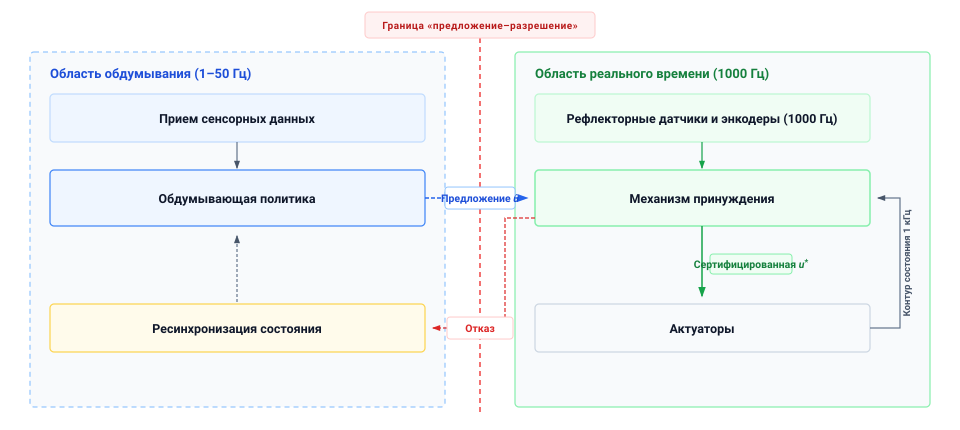
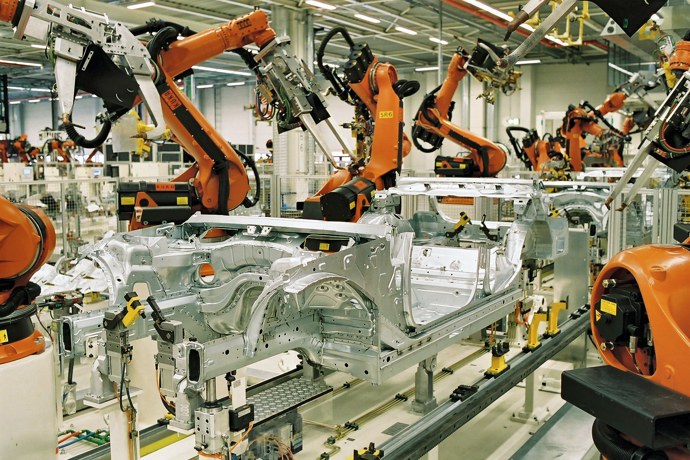
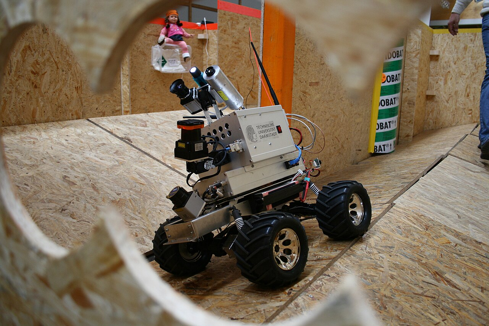
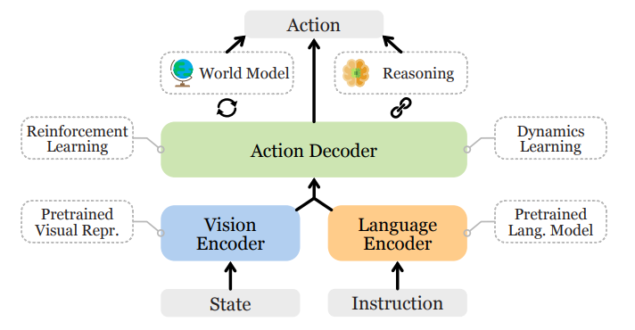
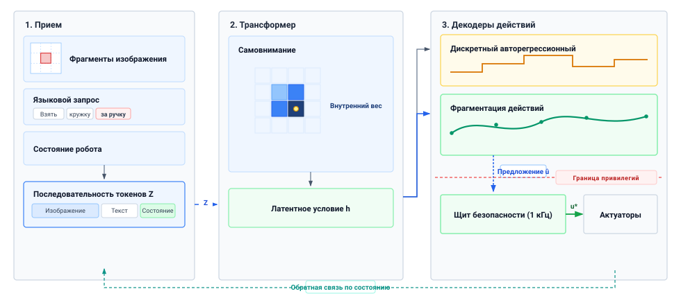
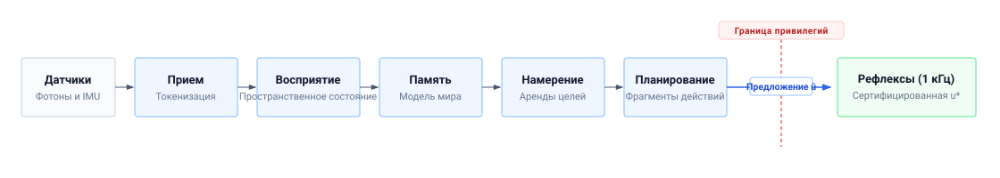
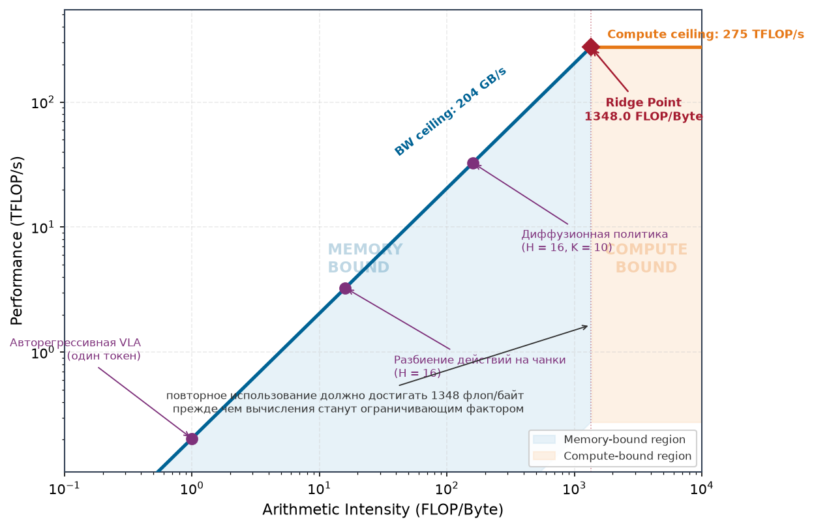
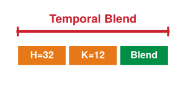
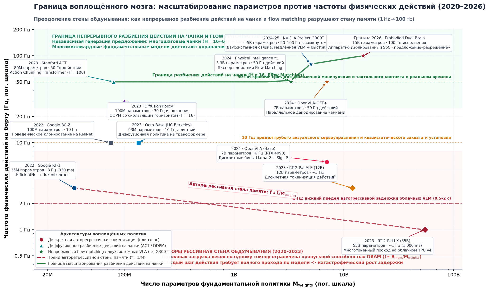

# Когнитивный мозг

## Цель

_Почему самая мощная модель на роботе способна пересматривать свой план лишь несколько раз в секунду?_

Робот, работающий среди людей, должен интерпретировать динамическую среду и предлагать действия, далеко выходящие за жесткие сценарии классической автоматики. Объемные обученные модели обеспечивают это семантическое рассуждение, обосновывая мультимодальные сенсорные потоки в обширных представлениях, полученных при офлайн-обучении. Однако за эту выразительную силу расплачиваются высоким трафиком памяти и серьезной вычислительной задержкой. Каждый прямой проход сети с миллиардами параметров передает веса через межсоединение памяти с конечной пропускной способностью. Поэтому модель обдумывания, которая лучше всех понимает сцену открытого мира, неизбежно оказывается компонентом, реже всего пересматривающим свои решения.

Чтобы актуаторы непрерывно получали задания между обновлениями обдумывания, Мозг должен выдавать перспективные фрагменты действий — временные последовательности будущих заданий. Однако эти предлагаемые задания устаревают вместе с устаревшим наблюдением, их породившим, и предложение, пришедшее вовремя, все равно может оказаться физически катастрофическим. Высокая уверенность предсказания не дает статистической модели права командовать физической машиной. Мозг порождает кандидатов поведения по ту сторону границы предложения, тогда как детерминированная Нервная система оценивает каждый фрагмент по текущей телеметрии датчиков и огибающим безопасности, прежде чем позволить низкоуровневым командам пересечь каузальную границу.

> ↰ **Предпосылка:** обученное предложение остается непривилегированным, пока путь разрешения его не допустит, — третий закон раздела [«Четыре фундаментальных закона»](01_causal_boundary.md#sec-boundary-bedrock-laws).

> **Цели обучения**
>
> - Сравнить классические аналитические конвейеры и выученные представления по охвату, устойчивости и верифицируемости
> - Вычислить ограничение пропускной способности на частоту свежих вычислений модели по ее объему весов и устойчивой пропускной способности памяти
> - Оценить рост кеша ключ-значение от числа камер, токенов на шаг и сохраненной истории
> - Объяснить, почему фрагментирование действий умножает снабжение заданиями, не делая предложения более свежими
> - Применить период перепланирования, задержку вывода и дрейф цели для подбора размера фрагмента действий на движущуюся цель
> - Диагностировать отказы инициатора, вызванные галлюцинацией, некалиброванной уверенностью, восприятийным дребезжанием и истекшим намерением
> - Обосновать, почему эти пределы инициатора требуют пути разрешения, способного отвергнуть любое предложение

## Воплощенный мозг

Складской мобильный манипулятор может укладываться во все электрические и тепловые бюджеты и все же провалить задачу столь обыденную, как взять незнакомую керамическую кружку с движущегося конвейера на станции комплектации и передать ее коллеге на станции упаковки. Приводы двигателей остаются далеко в пределах непрерывных номиналов момента, управляющая шина удерживает напряжение при полном заряде, а скорости шарниров не превышают физических пределов. И все же машина роняет объект или раздавливает керамический ободок, потому что низкоуровневая физика двигателя не может определить, что это за объект, где находятся его конструктивные аффордансы и как обойти загромождение. В отличие от рекомендательного дисплея, вывод которого можно проверить до того, как он повлияет на мир, когнитивное предложение здесь способно достичь движущейся массы без человека между ними. Ошибочное предложение может привести к небезопасной кинетической энергии, если путь исполнения его примет, поэтому разрешение должно проверяться независимо. Центральная дилемма воплощенного познания в том, что высокоемкие нейронные модели по своей природе стохастичны, вычислительно дороги и склонны выдумывать несуществующие объекты, однако им предстоит управлять физическими телами, столкновения которых невозможно отменить (первый закон, [«Четыре фундаментальных закона»](01_causal_boundary.md#sec-boundary-bedrock-laws)).

Поэтому Мозг — это движок обдумывания без привилегий, который может только предлагать ([«Граница предложения»](01_causal_boundary.md#dfn-boundary-proposal-boundary)). Это архитектурное разделение организует машину как **архитектуру двухскоростного мозга** ([«Архитектура двухскоростного мозга»](03_brain.md#fig-two-speed-brain)). На уровне обдумывания высокоемкие фундаментальные модели ведут медленное познание на $1\text{--}50\text{ Hz}$, разбирая мультимодальные потоки открытого мира и выдавая структурированные предложения. На уровне реального времени детерминированные мониторы безопасности работают на $1000\text{ Hz}$ на изолированном кремнии безопасности, оценивая предложения-кандидаты по физическим пределам, прежде чем выдать разрешение на исполнение ($u^*$), или фиксируя асинхронный отказ, запускающий ресинхронизацию состояния на уровне обдумывания. На мобильном манипуляторе находятся два обученных инициатора: модель намерения, пересматривающая цели на $1\text{--}5\text{ Hz}$, и политика фрагментов, выдающая короткие последовательности будущих заданий на $10\text{--}50\text{ Hz}$; путь разрешения может отвергнуть все, что предложит любой из них. Эта защита действует, только пока остаются действительными пределы, оценка состояния и опирающееся на нее резервирование.

***Архитектура двухскоростного мозга**: непривилегированная область обдумывания, работающая на $1\text{--}50\text{ Hz}$, и область реального времени, работающая на $1000\text{ Hz}$, разделенные границей привилегий предложение–разрешение. Независимый механизм принуждения проверяет воспринимаемое состояние и смоделированные пределы на каждом цикле управления, прежде чем выдать разрешение на исполнение; путь отказа возвращает ресинхронизацию состояния к обдумывающей политике.*

Обученный инициатор заслуживает свое место, делая то, чего не может ручная геометрия. Он узнает объект, которого никто не моделировал, по инструкции с открытым словарем, переносит блики и загромождения, ломающие написанные вручную фильтры, и привязывает узнанное к метрическим координатам, достижимым для руки. Каждая из этих возможностей дается моделью, размер которой также определяет, как часто она может работать. [«Режимы темпа»](03_brain.md#fig-cadence-gap) показывает это противоречие между классами нагрузок: модели с наибольшим числом параметров обновляются реже всех — намного ниже частот, на которых замыкаются контуры Тела. Поэтому вопрос главы в том, что обученный инициатор успевает выдать вовремя и какой ценой в памяти, задержке и свежести.

***Режимы темпа**: число параметров и примерные частоты обновления для разных нагрузок управления, зрения и воплощенных систем. Точки — иллюстративные режимы нагрузок, а не прогоны на одном устройстве, и само по себе число параметров не определяет частоту обновления.*

[«Классическая стена»](03_brain.md#sec-brain-classical-wall) показывает, почему конвейеры, построенные на ручной геометрии и конечных автоматах, теряют охват за пределами заводской ячейки, а [«Выученные представления»](03_brain.md#sec-brain-learned-representations) — что выученные представления возвращают и чего они стоят в токенах и трафике памяти. [«Питание, свежесть и стена памяти»](03_brain.md#sec-brain-cognitive-pipeline) превращает эту цену в числа машины: стена памяти, ограничивающая, как часто может работать ее модель намерения, фрагментирование действий, поддерживающее снабжение руки заданиями между вычислениями, и дрейф, ограничивающий, как долго каждый фрагмент остается истинным. [«Когнитивные уязвимости»](03_brain.md#sec-brain-cognitive-vulnerabilities) затем рассматривает способы, которыми предложение может прийти вовремя и все же быть неверным, — каждый оставляет пути разрешения предложение, которое он должен суметь отвергнуть.

## Классическая стена

Почти столетие автоматическое управление и робототехника подходили к познанию как к явной задаче геометрии и аналитической физики [Wiener, 1948](references.md#wiener1948cybernetics); [Kalman, 1960](references.md#kalman1960new); [Craig, 2005](references.md#craig2005introduction). В этой классической парадигме инженеры строили математические представления из первых принципов.

Инженеры использовали аналитическую кинематику и дифференциальную динамику, чтобы отображать желаемые движения конечного эффектора в моменты актуаторов с помощью уравнений в замкнутой форме.[^fn-math-classical-dynamics] Восприятие опиралось на сопоставление созданных вручную трехмерных CAD-моделей с сенсорными облаками точек посредством алгоритмов геометрического совмещения, таких как итеративный ближайший сосед (ICP) или случайная выборка консенсуса (RANSAC). Логика верхнего уровня создавалась как явные булевы конечные автоматы, задававшие детерминированные переходы между рабочими фазами — приближением, выравниванием, захватом и отводом.

[^fn-math-classical-dynamics]: **Формулировка динамики твердого тела**: классическое управление вычисляет обобщенные моменты через стандартное уравнение манипулятора $\mathbf{M}(\mathbf{q})\ddot{\mathbf{q}} + \mathbf{C}(\mathbf{q}, \dot{\mathbf{q}})\dot{\mathbf{q}} + \mathbf{g}(\mathbf{q}) = \boldsymbol{\tau}$, где $\mathbf{M}(\mathbf{q})$ — положительно определенная матрица инерции, $\mathbf{C}(\mathbf{q}, \dot{\mathbf{q}})$ — члены Кориолиса и центробежные слагаемые, а $\mathbf{g}(\mathbf{q})$ учитывает силы тяжести. Эта аналитическая формулировка становится вычислительно неразрешимой и физически неточной, когда машины взаимодействуют с несмоделированными трением и контактами, сопротивлением среды или деформируемыми объектами. Выводы приведены в разделе [«Управление и динамика»](appendix_control.md#sec-appendix-control).

***Промышленная ячейка точечной сварки**: несколько шарнирных роботов с шестью степенями свободы выполняют предзапрограммированные траектории точечной сварки на штампованных автомобильных шасси на заводе BMW в Лейпциге. Работая в откалиброванной заводской среде с субмиллиметровыми повторяемыми приспособлениями и защитными блокировочными ограждениями, классические контроллеры обеспечивают детерминированный циклический тайминг и формальные доказательства устойчивости. (Источник: BMW Group / Wikimedia Commons, CC BY-SA 2.0 de).*

Там, где рабочая среда жестко структурирована и ограничена ([«Промышленная ячейка точечной сварки»](03_brain.md#fig-industrial-welding)), классические методы могут обеспечить надежное поведение в пределах смоделированных условий. На автоматизированной автомобильной сборочной линии промышленный робот сваривает штампованные стальные панели, где каждая деталь приходит в точную координату с субмиллиметровыми допусками. Окружающее освещение жестко регулируется промышленными светильниками, а люди отстранены физическими блокировочными ограждениями. В пределах каузальной границы, определенной в разделе [«Каузальная граница»](01_causal_boundary.md#sec-boundary-causal-boundary), этот контролируемый режим допускает явные модели, ограниченное время сервоприводов и анализ устойчивости при заявленных предположениях. Инженеры могут верифицировать отобранные ограничения траекторий и моментов и оценивать охват программного обеспечения контроллера по применимым стандартам, не собирая демонстраций задачи.

Однако, когда воплощенная машина покидает структурированную заводскую ячейку и работает в неструктурированной среде ([«Робот поиска и спасения в неструктурированной среде»](03_brain.md#fig-unstructured-rescue)), эта парадигма натыкается на классическую стену [Brooks, 1991](references.md#brooks1991intelligence); [Levine et al., 2018](references.md#levine2018learning). Физический мир — не стерильный CAD-чертеж; он непрерывен, деформируем и бесконечно разнообразен.

***Робот поиска и спасения в неструктурированной среде**: гусеничный мобильный робот движется по полосе препятствий с неровными подъемами, рыхлым мусором и визуальными окклюзиями. В такой не нанесенной на карту среде заранее созданные геометрические модели и жесткие конечные автоматы могут потерять охват; выученные политики могут помочь выводить пространственные аффордансы и проходимость из сенсорных потоков. (Источник: TU Darmstadt Rescue Robotics / Wikimedia Commons, CC BY-SA 3.0).*

Первый провал — комбинаторный взрыв геометрии. В коммерческом логистическом складе, обрабатывающем сотни тысяч розничных товаров, создание CAD-моделей, сеточных шаблонов и точек захвата для каждой бутылки, упакованного товара и гибкой одежды невозможно. Дискретизация ориентаций, фрикционных свойств и перестановок контактов для перекрывающихся деформируемых предметов создает комбинаторное пространство, которого ручные шаблоны покрыть не могут.

Второй провал проистекает из хрупкости восприятия. Созданный вручную конвейер выделения краев и сегментации может опираться на фильтры, углы Харриса или пороги нормалей поверхности. При изменении солнечного света, отражений или пыли необходимый признак может исчезнуть. В таком конвейере пропавший край может заставить планарную сегментацию объединить два объекта и предложить захват в пустом пространстве.

Третий провал — инженерное узкое место логики, написанной вручную. Рабочие возможности машины ограничены способностью инженера предвидеть каждый физический крайний случай. Когда происходит неожиданное отклонение — погнутый кронштейн, затертая этикетка или незнакомое препятствие, — в написанном вручную своде правил нет подходящей ветви, и машина останавливает, роняет груз или сталкивается.

Выученные представления отвечают на первые два провала напрямую и облегчают третий, поскольку черпают охват из данных, а не из созданных вручную моделей.

## Выученные представления

Когда требуется взять незнакомую керамическую кружку с конвейера, классическому конвейеру нужны CAD-модель, порог признака и ветвь конечного автомата, которых никто для этого объекта не писал. Выученная модель, обученная на множестве объектов, пригодных для захвата, может предложить ручку как область захвата по пикселям и одной фразе инструкции. Физический ИИ расширяет классические конвейеры такими нейронными представлениями везде, где созданные вручную модели теряют охват, и этот сдвиг опирается на четыре столпа.

Первый столп — семантическая обобщаемость в открытом мире. Классические контроллеры геометрически точны, но семантически слепы: решатель обратной кинематики умеет безупречно довести конечный эффектор до координаты $(x, y, z)$, однако не имеет ни малейшего представления о том, находится ли там прочная кружка или хрупкий стакан и как окружающие объекты связаны с человеческими задачами. Современные фундаментальные модели зрение–язык–действие (VLA) проецируют языковые инструкции с открытым словарем и высокоразрешающие потоки камер в общие семантические вложения [Driess et al., 2023](references.md#driess2023palme); [Brohan et al., 2023](references.md#brohan2023rt1); [Brohan et al., 2023](references.md#brohan2023rt2); [Kim et al., 2024](references.md#kim2024openvla). Получив команду «вытри пролитый кофе со стола и убери кружку в сушилку», обученная модель может предложить ручку кружки и границу пролива как значимые для задачи области без новой CAD-модели.

Второй столп — эмпирическая сенсорная устойчивость. Созданные вручную визуальные пороги могут перевернуться при изменении освещения или текстуры. Выученные представления могут переносить часть таких изменений, когда обучение и тестирование их покрывают, но их отклики при сдвиге не обязательно гладки и ограничены.

Третий столп — способность работать со сложной многоконтактной и деформируемой динамикой. Многие задачи физического манипулирования (складывание текстиля, прокладка гибких жгутов проводов через дверные узлы автомобилей или зачерпывание сыпучих сред) включают не гладкую механику контакта, переменное трение и бесконечномерные деформации, которые нельзя смоделировать в дифференциальных уравнениях замкнутой формы. При подходящих богатых контактом демонстрациях и обратной связи нейронные политики могут выучить отклики с учетом податливости, снижающие силу при неожиданном сопротивлении.

Четвертый столп — эмпирическое масштабирование с данными и вычислениями, горький урок, который [«Четыре фундаментальных закона»](01_causal_boundary.md#sec-boundary-bedrock-laws) противопоставляет физической стене бортовой энергии, тепла и памяти. Обучение на разнообразных робототехнических демонстрациях ([«Двуручная ячейка телеуправления»](03_brain.md#fig-aloha-manipulator)) и мультимодальных данных может улучшать производительность на испытанных задачах [Zhao et al., 2023](references.md#zhao2023learning); [Chi et al., 2024](references.md#chi2024diffusionpolicy).

Каждый из этих выигрышей действует лишь там, где обучающие и тестовые данные покрывают рабочие условия, и ни один не ограничивает то, что модель предлагает вне этих условий. Именно этот предел объясняет, почему выученный выход достигает актуаторов только как кандидат, который путь разрешения может отвергнуть.

***Двуручная ячейка телеуправления**: установка телеуправления с двумя руками, включающая два ведомых манипулятора с шестью степенями свободы, два ведущих манипулятора для кинестетического телеуправления, камеры нескольких видов (над головой и на запястьях) и параллельные захваты, закрепленные на алюминиевой раме из профиля. Политика физического ИИ принимает синхронизированные потоки нескольких камер, чтобы предсказывать непрерывные траектории конечного эффектора, а путь разрешения обязан отвергнуть любое предложение, которое привело бы к самостолкновению или перегрузке по моменту при исполнении в замкнутом контуре. (Источник: Stanford University & Google DeepMind, CC-BY / Apache 2.0).*

***Таксономия воплощенных моделей**: воплощенные фундаментальные модели, сгруппированные по перцептивному фронтенду (визуальные токены, облака точек, языковые подсказки), нейронному бэкбону (трансформеры, диффузионные головы, модели мира) и целевому пространству действий. Таксономия противопоставляет политики зрение–язык–навигация, декодирующие топологические путевые точки и семантические фронтиры, политикам зрение–язык–действие, выдающим фрагменты траекторий по шарнирам и в декартовых координатах для шарнирных манипуляторов. (На основе работы Ma et al. [Ma et al., 2024](references.md#ma2024vision)).*

***Воплощенная архитектура зрение–язык–действие (VLA)**: репрезентативный поток данных. (1) Патчи кадров камер получают 2D-позицию изображения и идентификаторы камер наряду с токенами языка и состояния робота; метрическая глубина по-прежнему требует откалиброванных свидетельств. (2) Самовнимание перемешивает объединенную последовательность токенов; цветная сетка иллюстрирует внутренние веса внимания, а не проверенный аффорданс или позу захвата. (3) Дискретные авторегрессионные декодеры выдают токены последовательно, тогда как непрерывные декодеры порождают кандидатов многошаговых фрагментов ($\mathbf{A}_{t:t+H-1}$) за один проход или итеративное шумоподавление. (4) Независимый путь разрешения проверяет кандидат движения по воспринимаемому состоянию и смоделированным пределам до исполнения команды. (Синтезировано по работам Brohan et al. [Brohan et al., 2023](references.md#brohan2023rt1); [Brohan et al., 2023](references.md#brohan2023rt2), Kim et al. [Kim et al., 2024](references.md#kim2024openvla) и Octo Model Team [Octo Model Team et al., 2024](references.md#octo_2023)).*

Воплощенная фундаментальная модель — это не непрозрачный монолит, а трехступенчатый нейронный конвейер ([«Таксономия воплощенных моделей»](03_brain.md#fig-vla-taxonomy), [«Воплощенная архитектура зрение–язык–действие (VLA)»](03_brain.md#fig-vla-architecture)), преобразующий сенсорные входы в предложения-кандидаты движения; он заканчивается на границе, где этим предложениям все еще нужны кинематические проверки.

1. **Прием сенсорных данных и пространственная токенизация (входы):**
   Фронтенд трансформера зрения разрезает каждый кадр камеры на сетку патчей фиксированного размера и проецирует каждый патч в один токен, помеченный его позицией в изображении и, когда смонтировано несколько камер, выученным идентификатором камеры. Языковые указания и состояние шарниров робота проецируются в токены той же ширины, и три потока склеиваются в одну входную последовательность. Каждый патч становится токеном, по которому должен работать бэкбон и который должен удерживать кеш ключ-значение (KV), поэтому робот с тремя камерами (левое запястье, правое запястье, вид сверху) добавляет сотни визуальных токенов на кадр до прихода любого текста или проприоцепции ([«Стены памяти, питание и свежесть»](03_brain.md#nbk-brain-lpddr5-memory-wall-bottleneck-action-chunking)). Позиция в изображении — это не метрическая глубина; для размещения захвата в 3D по-прежнему нужны свидетельства о глубине и откалиброванная геометрия.

2. **Мультимодальное выравнивание и внимание (бэкбон):**
   Объединенная последовательность проходит через десятки слоев трансформера, чье самовнимание взвешивает каждый токен против каждого другого, поэтому работа внимания растет как квадрат длины последовательности, а кеш KV, хранящий предыдущие состояния токенов, растет линейно с ней. Каждая добавленная камера или сохраненный кадр оплачиваются задержкой и трафиком памяти. То же попарное взвешивание не устанавливает геометрию, поэтому текстовый токен вроде «ручка» может сильно притягиваться к визуальному патчу, хотя этот вес не является проверенным местом захвата или метрической позой. Кеш KV также не отслеживает постоянство объекта; явный оценщик состояния обязан сопоставлять наблюдения между кадрами и наращивать неопределенность, пока кружка закрыта от взгляда. Уравнения вложения патчей, позиционного кодирования и внимания, лежащие за обеими ступенями, приведены в разделе [«Токенизация патчей, внимание и метрический подъем в 3D»](appendix_ml.md#sec-appendix-ml-patch-embedding).

3. **Специализированные декодеры действий (выходы):**
   Вместо порождения разговорного текста последний скрытый слой $\mathbf{h}_{\text{context}}$ питает специфические для задачи декодеры действий. Если модели зрительно-языковой навигации (VLN) выдают топологические путевые точки или скорости курса $(v_t, \omega_t)$ ([«Топологическая зрительно-языковая навигация»](03_brain.md#fig-vln-navigation)), то модели манипулирования (VLA) резко расходятся в том, как они связывают семантические представления с физическим движением:

   * *Дискретная категориальная токенизация (RT-1, RT-2, OpenVLA):* ранние VLA адаптируют авторегрессионное языковое моделирование прямо к робототехнике, дискретизируя непрерывные смещения по шарнирам или в декартовых координатах в $B = 256$ равных интервалов на каждое измерение [Brohan et al., 2023](references.md#brohan2023rt1); [Brohan et al., 2023](references.md#brohan2023rt2); [Kim et al., 2024](references.md#kim2024openvla):
     $$\text{bin}(a_k) = \left\lfloor \frac{a_k - a_{\min}}{a_{\max} - a_{\min}} \times 255 \right\rfloor \in [0, 255]$$
     Каждому интервалу сопоставляется дискретный токен (от `<act_000>` до `<act_255>`) в языковом словаре. Хотя это изначально использует веб-масштабное предобучение зрение–язык, появляется системное узкое место: декодеру, выдающему по одному скалярному токену за раз, требуется семь последовательных предсказаний токенов для действия с 7 степенями свободы. Его задержка зависит от кеширования, аппаратуры и от того, пересматривает ли каждое предсказание весь бэкбон; семь последовательных шагов могут не уложиться в предельный срок управления. Скалярная дискретизация имеет разрешение примерно $\Delta a = (a_{\max} - a_{\min}) / 256$; приведет ли это к дребезжанию контакта, зависит от сглаживания, диапазона действия и нижележащего контроллера.
   * *Непрерывное порождающее фрагментирование действий (Octo, $\pi_0$, ACT, Diffusion Policy):* чтобы не платить полный прогон весов за каждое скалярное действие, современные универсальные политики связывают бэкбон трансформера с непрерывными порождающими декодерами, такими как головы диффузионной политики [Chi et al., 2024](references.md#chi2024diffusionpolicy); [Octo Model Team et al., 2024](references.md#octo_2023) или эксперты действий на сопоставлении потоков [Black et al., 2024](references.md#black2024pi0). Вместо предсказания одного скаляра за прямой проход модель предсказывает целый непрерывный фрагмент траектории:
     $$\mathbf{A}_{t:t+H-1} = [\mathbf{a}_t, \mathbf{a}_{t+1}, \dots, \mathbf{a}_{t+H-1}] \in \mathbb{R}^{H \times d_a} \quad (H = 16\text{--}64\text{ steps})$$
     Бэкбон может вычислить одно новое наблюдение камеры, затем более мелкий декодер может выполнить несколько итераций шумоподавления, чтобы предложить целый фрагмент путевых точек. Этот фрагмент — один кандидат горизонта, а не последовательность свежих наблюдений. Следующее вычисление бэкбона должно прийти до истечения принятого окна исполнения; нижележащая интерполяция и обратная связь работают в собственном темпе.

4. **Граница предложения (изоляция от актуаторов):**
   Независимо от того, является ли модель планировщиком мобильности VLN или политикой манипулирования VLA, ее выход — это предложение-кандидат ($p_t$) на непривилегированной стороне границы предложения ([«Граница предложения»](01_causal_boundary.md#dfn-boundary-proposal-boundary)). По модели машины из раздела [«Машина в пяти уровнях»](01_causal_boundary.md#sec-boundary-machine-model) фундаментальная модель работает в пользовательском пространстве на прикладном процессоре и не имеет пути к регистрам широтно-импульсной модуляции (PWM) или к току в обмотках двигателя.

   Правило проектирования для этой границы обдумывания: выученные модели, работающие в ритмах вывода Мозга ($1\text{--}50\text{ Hz}$), предлагают кинематические задания ($\mathbf{q}, \dot{\mathbf{q}}, \ddot{\mathbf{q}}$ или декартовы позы), но **не подают напрямую на ключи инвертора разомкнутоконтурные моменты двигателя ($\boldsymbol{\tau}$)**. Момент двигателя связан с объектом управления через уравнение манипулятора из примечания по классической динамике в разделе [«Классическая стена»](03_brain.md#sec-brain-classical-wall), плюс контактный член $\boldsymbol{\tau}_{\text{contact}}$. Поскольку инерция $\mathbf{M}(\mathbf{q})$ и силы Кориолиса $\mathbf{C}(\mathbf{q}, \dot{\mathbf{q}})$ нелинейно зависят от мгновенной конфигурации и скоростей шарниров, подача разомкнутоконтурных моментов без высокочастотной обратной связи от нейронной модели, обновляющейся от силы в десятки герц, может дестабилизировать конечность, когда ошибка модели, трение или изменение нагрузки достаточно велики. Кинематические задания, напротив, задают предполагаемый пространственный путь и оставляют синтез моментов высокого усиления в замкнутом контуре приводам Тела, чьи контуры тока векторного управления работают на $10\text{--}25\text{ kHz}$, — после того как путь разрешения допустил каждое задание. (Там, где специализированные политики обучения с подкреплением высокой частоты, работающие на $100\text{--}500\text{ Hz}$, выдают моменты напрямую, им все равно требуется независимо проверенный высокочастотный путь разрешения, как утверждается в разделе [«Проверка инвариантов»](04_nervous_system.md#sec-nervous-invariant-checking); проверки пассивности для таких потоков моментов выведены в разделе [«Пассивность и энергетически ограниченное взаимодействие»](appendix_control.md#sec-appendix-control-passivity).)

> ↳ **Далее:** передача предложений между Мозгом и Нервной системой без копирования опирается на буферы без блокировок, рассмотренные в разделе [«Многотактные ритмы»](04_nervous_system.md#sec-nervous-cadences).

   Предложения достигают пути разрешения через передачу из раздела [«Нервная система»](04_nervous_system.md#sec-nervous), и путь разрешения может отвергнуть галлюцинированное предложение, когда независимые измерения, смоделированные пределы и осуществимое резервирование поддерживают такое решение.[^fn-math-unprivileged-control]

[^fn-math-unprivileged-control]: **Граница предложения**: рассмотрение нейронной политики как непривилегированного генератора предложений изолирует стохастический вывод от регистров актуаторов. Кандидаты заданий траектории $\mathbf{q}_{\text{ref}}(t)$ проверяются на выделенном кремнии безопасности, поэтому предложения, нарушающие смоделированные пределы актуаторов или запретные зоны, могут быть отвергнуты до того, как любое из них дойдет до привода ([«Полномочия исполнения команды»](04_nervous_system.md#sec-nervous-actuation-authority)).

***Топологическая зрительно-языковая навигация**: воплощенная архитектура навигации, выполняющая пространственные указания на естественном языке. Панорамные визуальные наблюдения кодируются в перцептивные токены, сопоставляются с вложениями подсказок и перекрестно сверяются с динамически обновляемым топологическим навигационным графом. Декодер действий отсекает недостижимые узлы и выдает метрические смещения путевых точек $(\Delta x, \Delta y)$ и задания курса, чтобы вести шасси вдоль проходимых семантических фронтиров, не требуя точной геометрической априорной карты. (На основе работы An et al. [An et al., 2023](references.md#an2023etpnav)).*

Каждая нейронная ступень этого конвейера оплачивается трафиком памяти. По каждому патч-токену должно работать внимание и он должен удерживаться в кеше KV, а каждое вычисление бэкбона передает его веса из DRAM, поэтому возможности, описанные в этом разделе, приходят с частотой, которую задает прикладной процессор, а не та, которую выбирает задача. На мобильном манипуляторе эта частота для его крупнейшей модели оказывается куда ниже частоты, с которой его рука потребляет задания.

## Питание, свежесть и стена памяти

На станции комплектации рука мобильного манипулятора потребляет новое задание каждые несколько десятков миллисекунд, а кружка, за которой она тянется, продолжает двигаться по конвейеру. Какая бы модель ни предлагала эти задания, она должна разрешить два вопроса. Первый: как часто она способна выдать предложение на том прикладном процессоре, который у машины действительно есть. Второй: как долго каждое предложение остается истинным, когда кружка сдвинулась. Ответы объясняют, почему машина несет двух обученных инициаторов, а не одного.

После приема (токенизации раздела [«Выученные представления»](03_brain.md#sec-brain-learned-representations)) четыре ступени превращают эти токены в предложения ([«Когнитивный поток физического ИИ»](03_brain.md#fig-cognitive-pipeline)), и Часть III развивает каждую из них. Здесь они важны лишь тем, что каждая передает ниже по потоку и насколько быстро это устаревает. Восприятие обосновывает узнанное в метрических координатах относительно основания, так что кружка становится позой и пригодной для захвата ручкой, а не меткой;[^fn-brain-metric-grounding] его выход стареет с момента захвата, и раздел [«Сенсорное восприятие»](08_perception.md#sec-perception) превращает этот возраст в контракт. Память несет эти оценки сквозь окклюзию и должна позволять каждой истечь, когда истекают лежащие в ее основе свидетельства ([«Пространственная память»](09_memory.md#sec-memory)). Намерение раскладывает задачу вроде «снять керамическую кружку с конвейера и передать ее коллеге на станции упаковки» на подцели, и поскольку кружка движется, пока модель намерения обдумывает, она передает планировщику цель, которая истекает, — аренду намерения ([«Аренда намерения»](10_intent.md#sec-intent-lease)). Планирование превращает эту цель в кандидатов заданий для основания и руки — предложения, которые будет судить путь разрешения ([«Планирование траекторий»](11_planning.md#sec-planning)). Эти ступени, а также предшествующий им прием работают на прикладном процессоре и черпают из одной шины памяти — там, где решается темп машины.

[^fn-brain-metric-grounding]: **Метрическое пространственное обоснование**: если невоплощенный ИИ оперирует дискретными семантическими токенами, физический ИИ обязан обосновывать эту семантику в специальной евклидовой группе $SE(3)$, отображая сущности в метрические расстояния (метры) и пространственные ориентации (кватернионы) относительно системы координат основания робота. Неспособность удерживать это метрическое обоснование приводит к тому, что нейронные политики выдают кинематически невозможные декартовы пути, нарушающие границы рабочей области актуаторов.

***Когнитивный поток физического ИИ**: информация последовательно течет от физических датчиков через Прием (токенизацию), Восприятие (пространственную геометрию и аффордансы), Память (устойчивую оценку модели мира), Намерение (обдумываемые аренды целей) и Планирование (многошаговое фрагментирование действий). Поток заканчивается на границе предложения, где путь разрешения оценивает каждое предложенное действие по ограничениям и ресурсам реального времени.*

> ↳ **Далее:** ускорители нейронного вывода с высокой пропускной способностью изолируются от детерминированных ядер в разделе [«Два пути на одном кристалле»](13_placement.md#sec-placement-two-paths-one-die).

### Стена памяти

Рассмотрим, что происходит, если робот пытается генерировать непрерывные моторные действия по одному дискретному шагу через авторегрессионную фундаментальную модель (например, VLA-модель с миллиардами параметров). Модель, чьи веса не помещаются на кристалл, должна передавать их через внешнюю шину DRAM один раз за вычисление, поэтому пропускная способность шины $B_{\text{mem}}$ ограничивает частоту ее вычислений величиной $f_{\max} = B_{\text{mem}} / M_{\text{weights}}$ до того, как токенизация, внимание или декодирование добавят хоть какое-то время. При одношаговом авторегрессионном декодировании каждый последующий токен может потребовать еще одного такого вычисления; реальный трафик зависит от кеширования и архитектуры декодера. Подробные выводы стены памяти и roofline-модели оборудования приведены в разделе [«Системы и оборудование»](appendix_systems.md#sec-appendix-systems).

Эта стена памяти[^fn-hw-dram-bandwidth] помещает потоковую передачу одиночных токенов глубоко в область roofline-модели, ограниченную памятью ([«Примерная воплощенная roofline-модель»](03_brain.md#fig-patterson-roofline)) [Williams et al., 2009](references.md#williams2009roofline). На прикладном процессоре мобильного манипулятора она ограничивает частоту свежих вычислений модели намерения — до какой-либо работы зрения или декодирования — куда ниже частоты контроллера шарнира, запрашивающего новую команду каждую миллисекунду ([«Стены памяти, питание и свежесть»](03_brain.md#nbk-brain-lpddr5-memory-wall-bottleneck-action-chunking)). Модель, обновляемая столь медленно, может сказать, куда должна идти рука, но не может замкнуть контур на движущейся массе, поэтому она предлагает путевые точки, а более быстрый контур ниже отслеживает их.

[^fn-hw-dram-bandwidth]: **Насыщение пропускной способности DRAM при авторегрессии**: последовательные токены действий могут вызывать повторный полный трафик весов модели, когда веса нерезидентны и декодер возвращается к бэкбону; поведение кеша и аппаратура определяют реальный потолок пропускной способности. Фрагментирование действий — один из способов сократить число полных вычислений политики на единицу физического времени.

Это непрерывное перемещение данных несет и энергетический штраф. Извлечение весов из внекристальной DRAM потребляет на порядки больше энергии, чем сами арифметические вычисления. Эта энергия истощает запасы батареи, а оставляемое ею в шасси тепло поднимает местную температуру шарнирных актуаторов, сужая тепловые запасы обмоток раздела [«Тепловые циклы нагрузки»](02_body.md#sec-body-thermal-duty-cycles).

***Примерная воплощенная roofline-модель**: арифметическая интенсивность против достижимой пропускной способности для примера периферийного ускорителя. Потоковая передача весов одиночных токенов может быть ограничена памятью; повторное использование на фрагменте может повысить работу на байт. Отдельный контур реального времени исполняет принятые путевые точки между свежими обновлениями модели.*

### Фрагментирование действий

Чтобы обеспечить плотные путевые точки несмотря на медленный вывод полной модели, современные политики физического ИИ применяют **фрагментирование действий** ([«Временное фрагментирование действий»](03_brain.md#dfn-brain-action-chunking)) [Zhao et al., 2023](references.md#zhao2023learning); [Chi et al., 2024](references.md#chi2024diffusionpolicy). Каждый фрагмент затем пересекает границу предложения одним пакетом — полезной нагрузкой фрагмента из раздела [«Многотактные ритмы»](04_nervous_system.md#sec-nervous-cadences).

Политика фрагментирования (например, Action Chunking with Transformers [ACT], Diffusion Policy или сопоставление потоков) генерирует весь свой фрагмент из $H$ заданий за один проход бэкбона, за которым для итеративного декодера следуют, по допущению, $K = 10\text{--}16$ шагов уточнения. Каждое уточнение заново вычисляет более мелкую голову действий, поэтому полная задержка равна $t_{\text{vision}}+t_{\text{backbone}}+K t_{\text{head}}+t_{\text{transfer}}$, а не одному прогону весов. Новое наблюдение меняет план лишь после следующего прохода бэкбона и декодера; о порождающем механизме см. раздел [«Машинное обучение: основы»](appendix_ml.md#sec-appendix-ml).

> **Временное фрагментирование действий**
>
> ***Временное фрагментирование действий*** — это формулировка политики, которая предсказывает весь горизонт из $H$ будущих непрерывных действий $\mathbf{A}_{t:t+H-1} = [\mathbf{a}_t, \dots, \mathbf{a}_{t+H-1}]$ за одно нейронное вычисление или один диффузионный прокат, амортизируя переносы памяти параметров на протяженных окнах физического исполнения.
>
> 1.  **Значение:** на устройстве с ограниченной пропускной способностью повторение полного вычисления модели для каждого действия может быть слишком медленным для миллисекундного управления. Временное фрагментирование действий может повторно использовать вычисление бэкбона на нескольких путевых точках; оно не заставляет свежие наблюдения или решения политики приходить с частотой путевых точек. Нижележащий контроллер отслеживает принятую траекторию между обновлениями модели.
> 2.  **Отличие:** в отличие от одношаговых марковских политик $\mathbf{a}_t \sim \pi(\cdot \mid \mathbf{o}_t)$, заново вычисляющих всю нейронную сеть на каждом шаге управления, фрагментирование действий сознательно генерирует многошаговые траектории подачи вперед, используя исполнение со скользящим горизонтом и смешивание на перекрывающихся фрагментах, чтобы согласовать медленное нейронное обдумывание с быстрым управлением в замкнутом контуре.
> 3.  **Типичная ловушка:** исполнение фрагментов действий разомкнутым контуром без непрерывного временного сглаживания или фильтрации безопасности времени выполнения. Без гладкого смешивания на перекрывающихся границах фрагментов переключение между независимо сгенерированными горизонтами вносит скачки ускорения и толчки момента, возбуждающие механические резонансы редуктора.

Например, когда канонический двуручный манипулятор продевает гибкий USB-кабель ([«Двуручная ячейка телеуправления»](03_brain.md#fig-aloha-manipulator)), он выполняет 32-шаговый фрагмент действий — более длинный фрагмент, чем использует мобильный манипулятор. Политика выдает согласованные задания по 14 шарнирам, плавно совмещая оба захвата, изгибая кабель и вставляя разъем без пауз между отдельными циклами управления.

*Перекрывающиеся фрагменты действий смешивают предсказания поперек скользящих временных окон исполнения.*

Однако фрагментирование действий вносит проблему **непрерывности стыка фрагментов**. Поскольку каждый фрагмент действий генерируется независимо из скользящих сенсорных наблюдений, хвост фрагмента $k$ и голова фрагмента $k+1$ могут проявлять легкие расхождения по положению и скорости. Если бы контроллер просто склеил эти фрагменты, возникающие ступенчатые разрывы ускорения внесли бы в физические звенья большой рывок ($\overset{\dots}{\mathbf{q}}$), вызывающий механический удар, акустическую вибрацию, износ циклоидных штифтов и отказы по перегрузке двигателя током.

Чтобы уменьшить разрывы между перекрывающимися фрагментами, системы могут реализовать **временное ансамблирование**, смешивая перекрывающиеся предсказания траекторий экспоненциально взвешенным усреднением:

$$\mathbf{a}_t = \frac{\sum_{i=0}^{\min(t, H-1)} w_i \, \mathbf{a}_{t \mid t-i}}{\sum_{i=0}^{\min(t, H-1)} w_i}, \quad w_i = \exp(-m \cdot i)$$

где $\mathbf{a}_{t \mid t-i}$ — действие, предсказанное для шага времени $t$ фрагментом действий, начатым в момент $t-i$, а $m > 0$ — настраиваемый временной коэффициент дисконтирования. Путь разрешения интерполирует смешанные путевые точки ниже границы предложения ([«Многотактные ритмы»](04_nervous_system.md#sec-nervous-cadences)). Ансамблирование усредняет задания, не обеспечивая непрерывности производных, поэтому стыку все еще может понадобиться $C^2$-мост, который строит раздел [«Кинодинамическая осуществимость»](11_planning.md#sec-planning-kinodynamic-feasibility).

Это операционное напряжение между мощностью нейронного обдумывания и задержкой физического управления задает центральный рубеж масштабирования современных роботехнических мозгов ([«Рубеж воплощенного мозга»](03_brain.md#fig-03-vla-scaling-timeline)). Между 2020 и 2023 годами пионерские модели зрение–язык–действие (VLA), такие как RT-1 [Brohan et al., 2023](references.md#brohan2023rt1), RT-2 [Brohan et al., 2023](references.md#brohan2023rt2) и OpenVLA [Kim et al., 2024](references.md#kim2024openvla), токенизировали непрерывные действия в дискретные интервалы, предсказывая один шаг действия за авторегрессионный прямой проход. Однако поскольку каждый прямой проход требует потоковой передачи каждого параметра модели из DRAM через кремниевую шину памяти, частоты обновления политики рушились по мере роста емкости модели ($f_{\text{action}} \propto 1 / M_{\text{weights}}$) — запирая модели с миллиардами параметров за непреодолимой «стеной обдумывания» ($1\text{--}3\,\text{Hz}$), которая была куда ниже порога замкнутого контура $50\,\text{Hz}$, необходимого для динамического контакта и реактивного манипулирования.

Фрагментирование действий радикально развязало обдумывание с частотой исполнения команды. Вместо передачи миллиардов параметров на каждое низкоуровневое задание архитектуры вроде ACT [Zhao et al., 2023](references.md#zhao2023learning), Diffusion Policy [Chi et al., 2024](references.md#chi2024diffusionpolicy) и современных фундаментальных моделей на сопоставлении потоков (например, Physical Intelligence $\pi_0$ [Black et al., 2024](references.md#black2024pi0) и NVIDIA Project GR00T) периодически вычисляют свои большие перцептивные бэкбоны, чтобы порождать целые многошаговые траектории действий ($H = 16\text{--}64$). Компактные оптимизированные порождающие головы действий затем шумоподавляют или интегрируют эти траектории на $50\text{--}100\,\text{Hz}$, разбивая авторегрессионную стену памяти и согласуя семантическое рассуждение с миллиардами параметров с миллисекундным управлением в замкнутом контуре.

***Рубеж воплощенного мозга: масштабирование параметров модели против частоты физических действий в робототехнических политиках (2020–2026)**: компромисс между емкостью параметров фундаментальной политики ($M_{\text{weights}}$, логарифмическая шкала, от $20\,\text{M}$ до $100\,\text{B}$ параметров) и частотой действий замкнутого контура на борту ($f_{\text{action}}$, логарифмическая шкала, от $0.5\,\text{Hz}$ до $200\,\text{Hz}$). Дискретные авторегрессионные политики одиночных токенов (RT-1, RT-2-PaLM-E, RT-2-PaLI-X, OpenVLA Base) упираются в непреодолимую стену памяти ($f \propto 1/M_{\text{weights}}$), ограниченную пропускной способностью потоковой передачи DRAM ($B_{\text{mem}} / M_{\text{weights}}$), оставляя большие модели на $1\text{--}3\,\text{Hz}$. Непрерывное фрагментирование действий (ACT, Diffusion Policy) и двухсистемные архитектуры на сопоставлении потоков (Physical Intelligence $\pi_0$, NVIDIA Project GR00T, двухмозговые SoC 2026 года) разбивают это узкое место: развязка многошаговой генерации фрагментов ($H = 16\text{--}64$) от порождающих голов действий с низкой задержкой позволяет фундаментальным моделям с миллиардами параметров достигать $50\text{--}100\,\text{Hz}$ реактивного управления реального времени.*

### Два инициатора машины

На собственном прикладном процессоре мобильного манипулятора стена памяти и амортизация, которую предлагает фрагментирование, решают, как машина делит работу предложений между своими моделями.

> **Стены памяти, питание и свежесть**
>
> Может ли фрагментирование действий позволить модели с миллиардами параметров на встроенном вычислительном модуле обновлять предложения так быстро, как их потребляет рука, или машине нужен второй, меньший инициатор?
>
> *1. Узкое место памяти при одиночном токене.*
> Рассмотрим модель намерения мобильного манипулятора — VLA-модель `7B`, хранимую с 16-битной точностью (FP16) в памяти LPDDR5 его прикладного процессора, встроенной периферийной системы на кристалле:
>
> - Объем весов: $M_{\text{weights}} =$ `7B` параметров $\times$ `2` байта $\approx$ `14 GB`.
> - Теоретическая пропускная способность памяти: $B_{\text{peak}} =$ `204 GB/s`.
> - Принятая устойчивая пропускная способность DRAM (`70` процентов от пиковой с учетом диспетчеризации шины и накладных расходов памяти): $B_{\text{sustained}} \approx$ `142.8 GB/s`.
>
> Минимальная задержка потоковой передачи, чтобы один раз получить веса из DRAM через кремниевую шину:
> `$$t_{\text{stream}} = \frac{14 GB}{142.8 GB/s} \approx 98.0 ms$$`
>
> Верхняя граница частоты свежих вычислений, ограничиваемая только пропускной способностью, когда каждое вычисление передает все веса:
> `$$f_{\text{single}} = \frac{1}{t_{\text{stream}}} \approx \frac{1}{0.0980 s} \approx 10.2 Hz$$`
>
> Помимо весов модели, авторегрессионные фундаментальные модели также наращивают кеш KV. Когда принимаются сенсорные потоки нескольких камер (например, `3` потока RGB $224 \times 224$), каждый видеокадр добавляет сотни визуальных патч-токенов (`3` $\times$ `256` $=$ `768` токенов). В `32`-слойном трансформере модели намерения со скрытым измерением $d =$ `4096` хранение состояний Key и Value в FP16 потребляет `0.52 MB` на токен:
> `$$M_{\text{KV}} = 2 \times L \times d \times S \times \text{bytes} = 2 \times 32 \times 4096 \times S \times 2 \approx 0.52 MB \cdot S$$`
> На визуальной подсказке в `768` токенов кеш KV расширяется на `402.7 MB` за кадр.
>
> *2. Амортизация фрагментирования действий.*
> Предположим, что сама модель намерения выдавала бы фрагмент действий из $H =$ `16` будущих заданий ($\Delta t =$ `20 ms`, охватывая `320 ms`) с каждого прямого прохода, а не одно шаг действия на прогон весов через DRAM.
>
> - Число прогонов весов через память: 1 прогон (`98.0 ms`).
> - Фрагмент может повторно использовать одно вычисление бэкбона на $H$ будущих заданий.
> - Амортизированное время прогона весов на задание (без всей остальной работы вывода):
> `$$\tau_{\text{step}} = \frac{t_{\text{stream}}}{H} = \frac{98.0 ms}{16\text{ setpoints}} \approx 6.1 ms\text{ per setpoint}$$`
>
> *3. Разделение труда в машине.*
> Амортизация распределяет один прогон на большее число заданий, но не заставляет свежее предложение приходить раньше. Каждый новый фрагмент от модели намерения все равно ждал бы по меньшей мере один прогон `98.0 ms`, плюс токенизацию, внимание и декодирование. Поэтому мобильный манипулятор делит работу между двумя моделями. Его модель намерения пересматривает цель на `5 Hz` с `160 ms` вывода. Отдельная политика фрагментов на `50M` параметров, чьи `0.10 GB` весов проносятся за `0.70 ms`, предлагает вместе скорость основания и цели по шарнирам руки на `20 Hz`, в пределах бюджета вывода `40 ms` по P99, включающего зрение. Прогон модели намерения слишком медленен, чтобы обновлять предложение каждые несколько десятков миллисекунд; прогон политики фрагментов — нет. [«Нервная система»](04_nervous_system.md#sec-nervous) превращает эту разницу в аренду.

Прогон `98.0 ms` из блока [«Стены памяти, питание и свежесть»](03_brain.md#nbk-brain-lpddr5-memory-wall-bottleneck-action-chunking) — это пол, достигаемый до начала работы зрения, внимания или декодера. Две альтернативы разделению труда в машине — пониженная точность весов и единая модель с быстрой головой — атаковали бы его, и ни одна не устраняет его дешево. Хранение в INT4 сократило бы номинальный объем весов до `3.5 GB`, но требует проверки точности для контактных задач. Конструкция с одной моделью могла бы вместо этого обменять темп на плотность, не меняя точность весов. Она периодически вычисляла бы бэкбон `7B`, пока легковесная диффузионная голова шумоподавляет кандидатов траекторий на кристалле, поставляя плотные кандидаты путевых точек от каждого более медленного полного вычисления модели. Ее частота новых наблюдений все равно ограничивалась бы полной задержкой вывода, включая работу зрения и декодера; поэтому мобильный манипулятор передает обновление отдельной политике фрагментов.

Сохраняемый контекст добавляет давление, которое начал измерять блок ноутбука. Учет языковых токенов и проприоцепции наряду с визуальными патчами поднимает каждый шаг до $S \approx$ `800` токенов, и при `0.52 MB` состояния ключ-значение FP16 на токен каждый шаг наблюдения добавляет `419.4 MB` кеша KV. Сохранение необрезанного исторического окна контекста в `5 s` на `10 Hz` дает `21.0 GB` кеша KV. Вместе с `14 GB` весов модели намерения этот пример занимает `35.0 GB` — около половины `68.7 GB` прикладного процессора до накладных расходов времени выполнения, а эта память нужна также восприятию, картографированию и политике фрагментов. Даже там, где объем памяти позволяет, чтение большого кеша — это дополнительный трафик на той же шине ([«Конкуренция за общие ресурсы»](13_placement.md#sec-placement-resource-contention)). Поэтому воплощенные архитектуры должны избегать необрезанных авторегрессионных визуальных историй, полагаясь вместо этого на пространственное объединение, проекции признаков перекрестного внимания или фрагментирование действий с фиксированным горизонтом.

На станции комплектации рука мобильного манипулятора берет кружку с конвейера, движущегося со скоростью `0.20 m/s`, и каждый фрагмент должен выполняться, не позволяя кружке уйти из достижимой области. Без слежения непрерывное движение ленты израсходовало бы запас $r_{\text{tol}} - e_0$ между допуском захвата и начальной ошибкой $e_0$ оценки ручки в пределах предельного срока свежести $e_{\max}/v_{\max}$ из раздела [«Свежесть измерений»](02_body.md#sec-body-measurement-freshness), где $e_{\max} = r_{\text{tol}} - e_0$. Трекер, следящий за кружкой, убирает это постоянное движение, но остаточное проскальзывание может все еще разгонять цель со скоростью `0.50 m/s²`, так что сегмент, выполняемый разомкнутым контуром в течение времени $T$, отклоняется на $\frac{1}{2} a_{\text{slip}} T^2$. Вместе с начальной ошибкой `3 mm` ($e_0$) это отклонение достигает допуска захвата `15 mm` после горизонта свидетельств со слежением $\tau_{\text{ev}} = \sqrt{2 (r_{\text{tol}} - e_0) / a_{\text{slip}}} \approx$ `219 ms`. Политика фрагментов перепланирует каждые `50 ms` и тратит на это до `40 ms`, поэтому, пока обновления приходят вовремя, рука выполняет не более `90 ms` движения от одного наблюдения, что отклоняется лишь на `2.0 mm` и прочно укладывается в горизонт свидетельств со слежением.

Этот разомкнутоконтурный интервал задает также минимальное снабжение, ибо фрагмент короче `5` заданий оставил бы руку в ожидании преемника. Фрагмент машины несет `16` заданий с шагом `20 ms` — `320 ms` движения, дольше горизонта свидетельств со слежением; выполняемый разомкнутым контуром до конца, он отклонился бы на `25.6 mm` — за пределы допуска. Поэтому задания после следующего момента перепланирования — это буфер снабжения, потребляемый лишь когда обновления прекращаются, а аренда, выведенная в разделе [«Многотактные ритмы»](04_nervous_system.md#sec-nervous-cadences), завершает исполнение задолго до исчерпания этого буфера. Перекрывающиеся фрагменты и временное ансамблирование затем смешивают исполняемое движение поперек каждого обновления.

> ↳ **Далее:** ограниченные предложения фрагментов действий фильтруются по вперед-инвариантным барьерам в разделе [«Безопасные множества как условное разрешение»](12_enforcement.md#sec-enforcement-safe-sets-conditional-permission).

Это пределы инициатора, которые Часть I передает дальше: один фрагмент покрывает `320 ms` движения, новый фрагмент занимает до `40 ms`, а свидетельства за ним остаются в допуске около `219 ms`. Они ограничивают, когда приходит предложение и как долго оно остается истинным, и каждое входит в протокол передачи раздела [«Нервная система»](04_nervous_system.md#sec-nervous) как протокол пределов в форме раздела [«Замер пределов машины»](02_body.md#sec-body-measuring-limits). Ни один из них не говорит, было ли предложение верным в момент его создания.

> **Пределы обдумывания на периферийном SoC: стены памяти, KV-кеш и динамический дрейф**
>
> Прежде чем рассматривать режимы отказов времени выполнения, проверьте свое понимание пределов обдумывания на периферии — по памяти и по времени:
>
> - **Ограничения потоковой передачи DRAM**: при каких условиях $t_{\text{stream}} = M_{\text{weights}} / B_{\text{mem}}$ ограничивает темп полной модели и почему фрагментирование действий снижает стоимость передачи на поставляемую путевую точку, не умножая частоту свежих решений политики?
> - **Расширение памяти кеша KV**: можете ли вы описать, как токенизация нескольких камер ведет к линейному росту хранения KV с длиной последовательности (тогда как полный счет внимания может расти квадратично) на необрезанных историях наблюдений и почему чтение этого кеша конкурирует с передачами датчиков реального времени на той же шине?
> - **Размер горизонта фрагмента и динамический дрейф**: можете ли вы объяснить, почему фрагмент должен покрывать период перепланирования плюс собственную задержку вывода, чтобы поддерживать снабжение руки, почему интервал, исполняемый от одного наблюдения, должен оставаться внутри горизонта свидетельств, задаваемого разомкнутоконтурным дрейфом ($\Delta x \approx \frac{1}{2} a_{\text{slip}} t^2$), и почему оставшиеся задания — это буфер, а не план?

## Когнитивные уязвимости

Фрагмент, который политика мобильного манипулятора предлагает для кружки, может прийти в пределах бюджета `40 ms`, с каждым заданием конечным и в пределах шарниров, и все же сомкнуть захват на ободке. Его тайминг безупречен, а содержание — нет, и режимы отказа выученных моделей живут в этом разрыве. Выученные фундаментальные модели расширяют охват задач, но затрудняют общее доказательство поведения интегрированного замкнутого контура; заданные компоненты и ограниченные рабочие области все еще могут анализироваться.[^fn-math-symbolic-connectionist]

[^fn-math-symbolic-connectionist]: **Коннекционистско-символическая дуальность**: архитектуры физического ИИ согласуют статистический коннекционизм с детерминированными символьными вычислениями: высокоемкие нейронные сети синтезируют предложения поведения в открытом мире, тогда как формальная символьная логика и мониторы инвариантов проверяют кинематическую корректность до того, как заданиям будут дарованы полномочия на исполнение.

Без проверенной области входов и границы чувствительности малые сенсорные изменения на входе обученного инициатора могут дать неожиданно большие изменения предлагаемого движения. Успех на эталонных тестах не устанавливает устойчивость замкнутого контура, временные границы или безопасность для невиданных условий; эти свойства требуют отдельных свидетельств для модели, времени выполнения и физического объекта управления.[^fn-math-lipschitz-calibration]

[^fn-math-lipschitz-calibration]: **Непрерывность по Липшицу в нейронных политиках**: хотя нейронные сети с гладкими функциями активации непрерывны на компактных областях, граница $L = \sup_{\mathbf{x}_1 \ne \mathbf{x}_2} \frac{\lVert \pi(\mathbf{x}_1) - \pi(\mathbf{x}_2) \rVert}{\lVert \mathbf{x}_1 - \mathbf{x}_2 \rVert}$ должна быть установлена на заданной рабочей области. Если действительная граница существует, ошибка датчика $\lVert \delta \mathbf{x} \rVert \le \epsilon$ влечет $\lVert \delta \mathbf{a} \rVert \le L\epsilon$; непроверенная $L$ не дает пригодной гарантии ошибки действия. Математические формулировки приведены в разделе [«Машинное обучение: основы»](appendix_ml.md#sec-appendix-ml).

Режимы отказа обученного инициатора отличаются и от традиционных дефектов ПО. Классическая программа отказывает, выбрасывая исключение, зависая в бесконечном цикле или падая. Нейронная сеть напротив отказывает молча — как фрагмент для кружки, — с выходом, проходящим каждую проверку формата. Независимый путь разрешения обязан отвергнуть обнаруженное нарушение до того, как эти значения станут командами актуаторов. Системные архитекторы должны проектировать с оглядкой на четыре основные когнитивные уязвимости.

### Семантические галлюцинации

На транспортном картоне за конвейером напечатана фотография кружки, и политика мобильного манипулятора предлагает захват за напечатанную ручку. Тензор траектории конечен и в пределах шарниров, однако объект, на который он нацелен, отсутствует. Его правдоподобие не может заменить независимую геометрическую проверку, которая обнаружила бы плоскую поверхность там, где политика увидела ручку.

### Иллюзия softmax и переуверенность вне распределения

Интерфейсы развертывания часто путают математическую нормализацию с физической вероятностью. В глубоких нейронных сетях выходные логиты пропускаются через функцию softmax,[^fn-math-softmax-normalization] выходы которой в сумме дают единицу при любом входе, поэтому воплощенные машины, сталкивающиеся с наблюдениями вне распределения (OOD) — новыми оптическими текстурами, глубокими тенями или каплями воды на объективе, — могут приписывать ошибочным классификациям оценки уверенности выше $0.95$.

[^fn-math-softmax-normalization]: **Нормализация softmax и эпистемическая неопределенность**: оператор softmax $\sigma(\mathbf{z})_i = \frac{e^{z_i}}{\sum_j e^{z_j}}$ обеспечивает нормализацию по категориальному симплексу $\Delta^K$ алгебраическим построением, а не байесовской эпистемической уверенностью. Высокая выходная уверенность отражает лишь относительное разделение логитов, что означает: модели приписывают вероятности, близкие к единице, даже оценивая входы полностью вне их обучающего распределения. Выводы приведены в разделе [«Машинное обучение: основы»](appendix_ml.md#sec-appendix-ml).

Оценка истинного отношения между заявленной уверенностью модели и эмпирическим физическим успехом требует измерения **ожидаемой ошибки калибровки (ECE)** — разрыва между тем, насколько уверенной считает себя модель, и тем, как часто физическая задача на самом деле преуспевает.[^fn-math-ece-math]

[^fn-math-ece-math]: **Формулировка ожидаемой ошибки калибровки**: разбейте предсказанную уверенность на интервалы. В каждом интервале сравните наблюдаемую частоту успеха со средней заявленной уверенностью; усредните абсолютные разрывы с весами по доле выборки в интервале. Повышенная ECE показывает, что заявленная уверенность — плохое основание для дачи физического разрешения. Уравнение и определения интервалов приведены в разделе [«Переуверенность softmax и ошибка калибровки»](appendix_ml.md#sec-appendix-ml-calibration).

Режимы в таблице [«Примерные разрывы уверенность–успех при сдвиге распределения»](03_brain.md#tbl-03-calibration-degradation) показывают, как высокая заявленная уверенность может сосуществовать с низким успехом задачи при сдвиге. Разности в отдельных строках — это разрывы уверенность–успех, а не ECE; для вычисления ECE нужны интервалы по заданному оценочному набору. Сырые оценки не могут дать разрешение на исполнение без валидации и независимых физических проверок.

| Режим сдвига распределения               | Физический и средовой триггер                                             | Уверенность против успеха ($\text{conf} \text{ vs } \text{success}$) | Разрыв уверенность–успех ($\text{conf}-\text{acc}$) | Реакция супервизора ниже по потоку                                                      |
|:----------------------------------------|:-----------------------------------------------------------------------------|:------------------------------------------------------------|:--------------------------------------------------|:-----------------------------------------------------------------------------------|
| **Внутри распределения** (номинальный базовый уровень)  | Чистая оптика, структурированное лабораторное освещение, номинальные текстуры деталей     | $\text{conf}=0.91, \, \text{acc}=0.89$                      | $+0.02$                                           | Применить независимые пределы до номинального исполнения                                  |
| **Близкий OOD-сдвиг** (ковариантный сдвиг)    | Зеркальные блики, капли воды на объективе, динамические переходы теней        | $\text{conf}=0.89, \, \text{acc}=0.52$                      | $+0.37$                                           | Запуск выборочного воздержания: ограничить скорость, начать разведочный тактильный зонд |
| **Дальний OOD-сдвиг** (семантический сдвиг)      | Незанесенные в каталог деформируемые препятствия, вторжение конечности человека в рабочую область        | $\text{conf}=0.78, \, \text{acc}=0.08$                      | $+0.70$                                           | Отвергнуть предложение; выполнить осуществимую контролируемую реакцию                                  |
| **Деградация датчиков** (аппаратный дрейф) | Тепловой шум фотоприемника ($>75^\circ\text{C}$), фокусное расфокусирование от вибрации | $\text{conf}=0.84, \, \text{acc}=0.31$                      | $+0.53$                                           | Запустить эксплуатационное понижение режима; ограничить кинематику сертифицированными пределами             |

***Примерные разрывы уверенность–успех при сдвиге распределения**: уверенность и доли успеха задачи для четырех режимов работы с супервизорной реакцией, которую требует каждый разрыв.*

### Восприятийное дребезжание и ковариантный сдвиг

Неоднозначные изображения могут заставлять последовательные классификации объектов быстро меняться. Если планировщик движения считает каждую новую метку свежим физическим состоянием, он может отбросить полезную историю движения — как это сделала каждая переклассификация при столкновении в Tempe ([«Когда граница отказывает»](01_causal_boundary.md#sec-boundary-when-fails)). В физическом манипулировании восприятийное дребезжание вносит в планировщики траекторий высокочастотные развороты направления, а командуемые развороты требуют ступеней момента, которые должен поглощать привод, — колебаний, разрушающих редукторы. Временное сглаживание может помочь непрерывности движения, но не способно исправить ложную оценку препятствия; независимое обнаружение и осуществимая реакция остаются необходимыми.

### Временное истечение намерения

Предложение остается действительным лишь пока действуют лежащие в его основе свидетельства — интервал, который пример с захватом с конвейера вычисляет как горизонт свидетельств $\tau_{\text{ev}}$. Если модели намерения мобильного манипулятора требуется `160 ms` на обдумывание, то люди и тележки в проходе, сама рука и кружка на конвейере уже успели сдвинуться к моменту, когда план готов. Запаздывание в нижележащей связи или исполнении приводит к действию по истекшей аренде намерения ([«Аренда намерения»](10_intent.md#sec-intent-lease)) — к командованию физическим телом на основе устаревшего мысленного представления. Инициатор, попросту зависший, оставляет объект управления движущимся вовсе без плана, поэтому восстановление должно жить в локальном контроллере ниже него — требование, которое финальные испытания DARPA Robotics Challenge 2015 года возложили на шагающих участников, намеренно деградируя связь [Krotkov et al., 2017](references.md#krotkov2017darpa).

Четыре уязвимости наряду со стеной памяти из раздела [«Питание, свежесть и стена памяти»](03_brain.md#sec-brain-cognitive-pipeline) дают три независимых довода против наделения обученного инициатора полномочиями актуаторов. Стена памяти означает, что самая мощная модель не может обновлять предложение так быстро, как машина его потребляет. Галлюцинация, переуверенность и дребезжание означают, что предложение может быть неверным или неустойчивым, пока его заявленная уверенность остается высокой, — значит, уверенность не может его заверять. Истечение означает, что даже верное предложение перестает быть верным, как только мир сдвинулся. Таблица [«Классические методы против выученных фундаментальных моделей»](03_brain.md#tbl-03-classical-vs-learned) ставит пределы обученного инициатора рядом с пределами классических методов, с которых глава начала, и показывает, по какую сторону границы предложения находится каждая возможность.

| Системный аспект                 | Классические аналитические методы                                                      | Выученные фундаментальные модели                                                                   | Архитектурный синтез физического ИИ                                                   |
|:----------------------------------|:----------------------------------------------------------------------------------|:--------------------------------------------------------------------------------------------|:--------------------------------------------------------------------------------------|
| **Основополагающий принцип**        | Аналитические дифференциальные уравнения, геометрия, CAD-модели, устойчивость по Ляпунову       | Высокоемкие нейронные представления, подогнанные под эмпирические мультимодальные данные                    | **Гибридная иерархия:** выученные предложения намерения пропускаются через путь разрешения           |
| **Обобщаемость и восприятие** | **Зависит от модели:** явная геометрия и признаки могут терять охват при сдвиге | **Зависит от данных:** обоснование с открытым словарем может улучшать охват, но давать сбой при сдвиге | **Обдумывание без привилегий:** фундаментальные модели синтезируют непрерывные семантические цели |
| **Математическая верифицируемость**    | **Условная:** отдельные свойства могут быть доказаны в предположениях модели       | **Ограниченная:** эмпирическое поведение требует отдельных границ и свидетельств времени выполнения                  | **Граница предложения:** пропускной пункт проверяет смоделированные пределы по независимым свидетельствам          |
| **Временной темп**               | **Жесткое реальное время:** детерминированные миллисекундные контуры исполнения ($1\text{ kHz}$)    | **Многотактность:** полный вывод, обновление фрагментов и исполнение путевых точек идут с разными частотами   | **Разделенные инициаторы:** малая политика фрагментов обновляет предложения, пока модель намерения пересматривает цели |
| **Режимы отказа и резервирование**      | Аварии на булевых ветвях; отказ на незанесенных в каталог объектах; исчерпание правил           | Семантические галлюцинации; переуверенность вне распределения; истекшее намерение                 | **Условное резервирование:** отвергать обнаруженные нарушения и выполнять осуществимую реакцию  |

***Классические методы против выученных фундаментальных моделей**: компромиссы по обобщаемости, верифицируемости, темпу и резервированию и синтез, разделяющий способность предлагать и полномочия на исполнение.*

## Заблуждения и ловушки

Выученная способность полезна лишь тогда, когда машина может интерпретировать и ограничивать ее предложения. Следующие ошибки путают успех модели, ее уверенность или формат выхода с разрешением действовать.

> **Заблуждение и ловушка**
>
> **Заблуждение**: *инженерная команда должна выбирать целиком между формальными классическими доказательствами безопасности и выученной эмпирической способностью.*
>
> Сборочный завод сравнивает классический контроллер жгутов проводов с выученной диффузионной политикой. Классическая конструкция раскрывает явные ограничения движения, но испытывает трудности с деформацией кабеля; выученная политика завершает 96 процентов пробных вставок, не устанавливая худших границ силы или скорости. Эти сильные стороны отвечают разным инженерным обязанностям. Выученная политика может предлагать адаптивные движения, пока детерминированный супервизор проверяет их по физическим пределам, используя функцию барьера управления там, где применимы ее предположения [Ames et al., 2019](references.md#ames2019control) (подробно в разделе [«Обеспечение безопасности»](12_enforcement.md#sec-enforcement)). Разделение способности и принудительного обеспечения позволяет команде оценивать производительность задачи и механизм защиты отдельно. Высокий эмпирический успех не устанавливает ни достаточность супервизора, ни безопасность интегрированной машины.

> **Заблуждение и ловушка**
>
> **Ловушка**: *допущение того, что высокая уверенность нейронной модели обходит детерминированные геометрические границы.*
>
> Манипулятор чистой комнаты принимает блик на прозрачном барьере за открытое пространство и предлагает тянуться сквозь него с пробирками с реагентами. Предложение содержит конечные координаты в диапазоне и приходит в пределах своего предельного срока. Эти проверки устанавливают, что пакет пригоден, а не то, что его интерпретация сцены верна. Высокая уверенность не способна устранить ту же перцептивную ошибку, что породила траекторию. Прежде чем дать разрешение, путь разрешения обязан сопоставить предложение с независимо поддерживаемыми геометрическими границами (такими как жестко заданные запретные зоны или карты глубины реального времени).

> **Заблуждение и ловушка**
>
> **Заблуждение**: *сырые вероятности softmax или предсказанные оценки уверенности отражают истинные доли физического успеха.*
>
> Политика комплектации из бункера сообщает $\hat{p} \approx 0.90$ для группы захватов, однако успешны лишь 64 из 100 физических попыток. Порог воздержания, основанный на заявленной оценке, стал бы поэтому принимать больше отказов, чем предполагает его численное значение. Расхождение касается калибровки: уверенность пока не совпадает с наблюдаемым успехом в рабочих условиях (как иллюстрирует таблица [«Примерные разрывы уверенность–успех при сдвиге распределения»](03_brain.md#tbl-03-calibration-degradation)). Само по себе оно не устанавливает, правильно ли политика ранжирует кандидатов. Инженеры должны провалидировать отношение между оценками и исходами по всей предполагаемой области, прежде чем использовать уверенность для выбора между исполнением, еще одним наблюдением и помощью оператора. Независимые физические пределы по-прежнему действуют на принятые захваты.

> **Заблуждение и ловушка**
>
> **Ловушка**: *непосредственное связывание высокочастотных семантических классификаций с заданиями двигателей без непрерывной фильтрации.*
>
> Робот-доставщик наблюдает светоотражающие тенты над дорожными конусами. При каждом обновлении восприятия его конвейер меняет классификацию между препятствием, подвижной драпировкой и свободным проходом. Если каждое изменение немедленно сбрасывает задания двигателей, неопределенность сцены превращается в повторяющиеся запросы на разворот направления. Приводные двигатели не могут выполнять эти запросы за пределами своих ограничений по скорости нарастания момента, и шасси дребезжит и содрогается. Архитектуре нужна непрерывность между меняющимися интерпретациями и физическими командами. Фильтрация или фрагментирование действий могут поддержать эту непрерывность, но результирующая траектория все равно должна соблюдать пределы движения тела, когда семантическая оценка меняется.

> **Заблуждение и ловушка**
>
> **Заблуждение**: *численно корректный и гладкий фрагмент действий можно безопасно выполнять, когда бы он ни пришел.*
>
> Политика фрагментов мобильного манипулятора предлагает траекторию руки к кружке на конвейере. Диспетчеризация хоста задерживает доставку, тогда как остаточное проскальзывание ленты унесло кружку к краю допуска захвата. Траектория остается гладкой и численно корректной, но наблюдение, ее обосновавшее, больше не описывает, где находится кружка. Ее исполнение могло бы сомкнуть захват на ободке или сбить кружку с ленты. Как только задержка превысит аренду фрагмента из раздела [«Многотактные ритмы»](04_nervous_system.md#sec-nervous-cadences), аренда прекращает полномочия зависшей политики, и рука вместо ожидания переходит в свою проверенную резервную остановку; когда же отложенная траектория наконец приходит, наблюдение, из которого она вычислена, слишком старо, чтобы путь разрешения мог его допустить. Гладкость описывает предлагаемую команду; временная действительность определяет, может ли машина еще действовать по ней.

## Итоги

Выученные представления дают мобильному манипулятору то, чего не могла ручная геометрия, — способность найти ручку кружки, которую он никогда не видел. Цена платится трафиком памяти и временем. Крупнейшая модель вычисляется реже всех, и каждое задание, поставляемое любым из инициаторов, устаревает вместе с породившим его наблюдением.

> **Выученные инициаторы и их пределы обдумывания**
>
> * **Трафик весов ограничивает частоту наблюдения модели**: один прогон `14 GB` весов модели намерения занимает `98.0 ms` на прикладном процессоре до начала зрения или декодирования, поэтому ее частота свежих вычислений не может превышать примерно `10.2 Hz` при любом пике производительности.
> * **Фрагментирование умножает снабжение, а не свежесть**: фрагмент из `16` заданий распределяет одно вычисление на `320 ms` движения, но каждое задание так же старо, как и наблюдение за ним. Поэтому машина поручает обновление малой политике фрагментов на `20 Hz` в пределах `40 ms`.
> * **Размер фрагмента — между голодом и дрейфом**: период перепланирования плюс задержка вывода (`90 ms`) задают минимальное снабжение, а дрейф цели — горизонт свидетельств (`219 ms`). Задания после следующего обновления — это буфер, который завершает аренда, а не план.
> * **Сохраняемый контекст оплачивается дважды**: удержание `5 s` истории нескольких камер добавляет `21.0 GB` кеша ключ-значение, который вместе с весами занимает около половины памяти процессора, и каждое его чтение — трафик по шине, которой делятся передачи реального времени.
> * **Уверенность — не калибровка**: оценки softmax по построению дают в сумме единицу, поэтому заявленная уверенность может оставаться высокой, пока успех задачи рушится при сдвиге распределения. Лишь калибровка, измеренная по рабочей области, может оправдать порог воздержания.
> * **Предложение истинно лишь некоторое время**: намерения и фрагменты истекают вместе с лежащими в их основе свидетельствами, и гладкое, в диапазоне, вовремя пришедшее предложение все равно может быть устаревшим или неверным.

Каждый предел, выведенный в этой главе, — предел снабжения или истинности, но никогда полномочий. Ни один из них не решает, может ли предложение достичь двигателей; путь разрешения принимает их как входы, когда принимает это решение.

> **От выученных предложений к пути разрешения**
>
> Как долго одно предложение может продолжать управлять машиной, если его преемник так и не придет? Политика фрагментов мобильного манипулятора обновляется каждые `50 ms`, а его модель намерения — куда реже, и любая из них может зависнуть, прийти с опозданием или ошибиться насчет кружки. [«Нервная система»](04_nervous_system.md#sec-nervous) задает, как часто путь разрешения проверяет каждое предложение, и выводит из бюджета остановки раздела [«Физическое тело»](02_body.md#sec-body), как долго оно может управлять актуаторами, прежде чем машина перейдет к резервированию, и записывает и то и другое в протокол передачи наряду с установленными здесь пределами инициатора.

