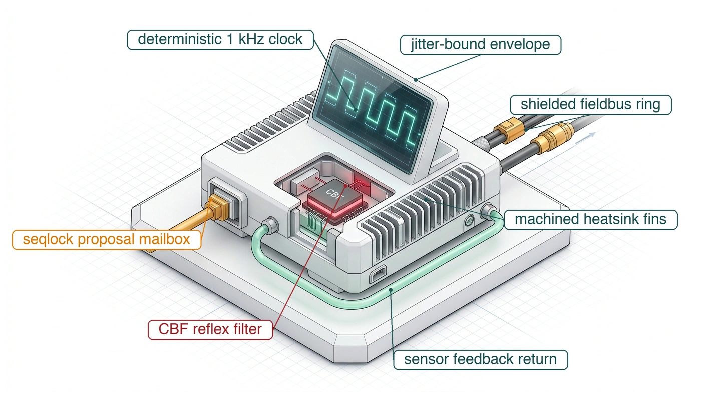
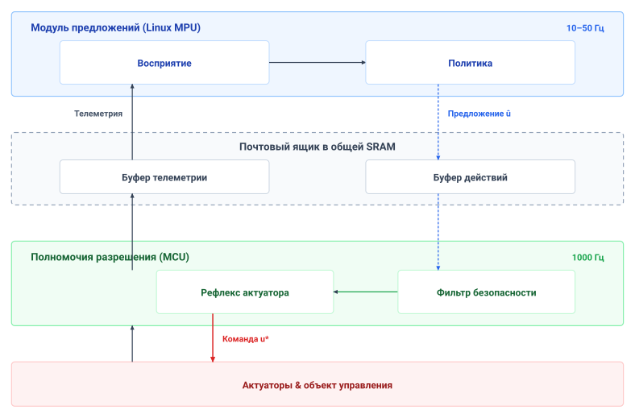
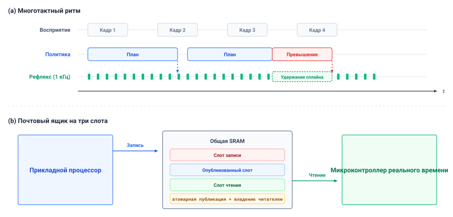
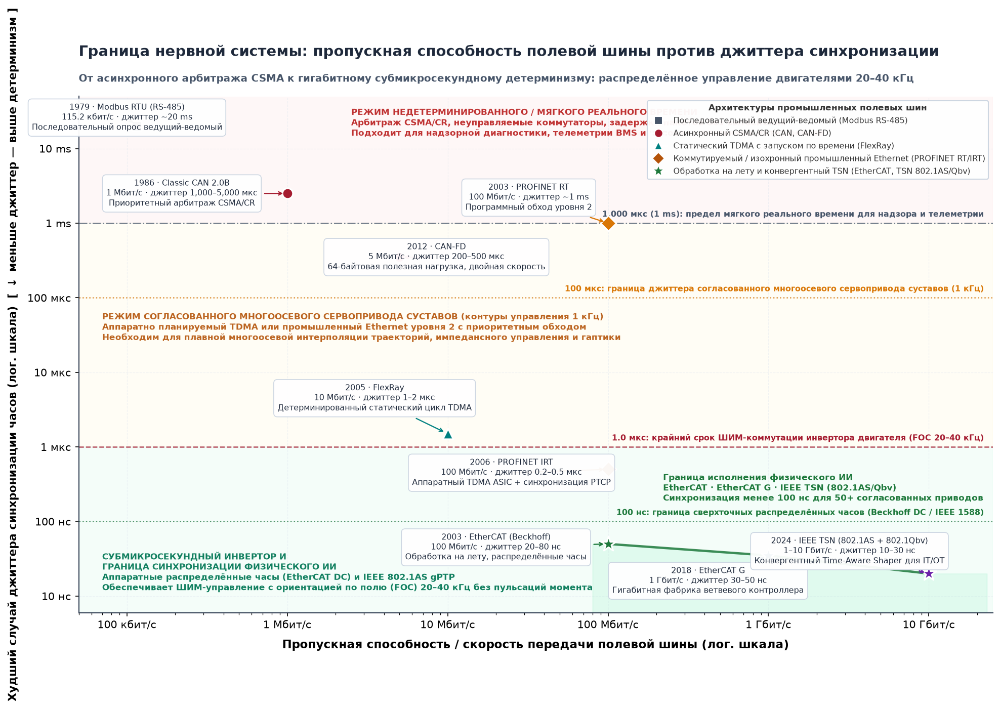
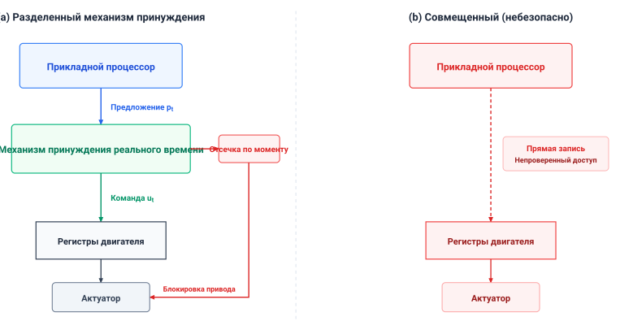
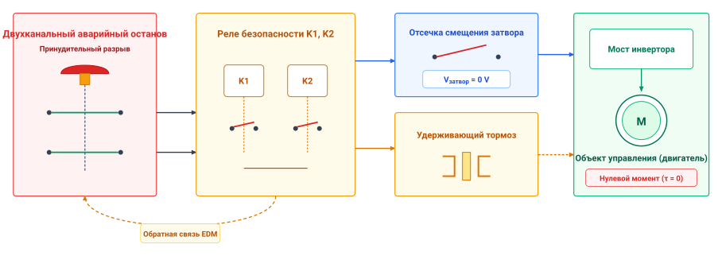

# Нервная система

## Цель

_Что вынуждает независимую Нервную систему вставать между обдумыванием нейронных политик и физической мощностью актуаторов?_

Кинетический импульс движущейся машины не может замирать, пока нейронная политика завершает обдумывание. Прямые соединения между высокоемкими фундаментальными моделями и силовыми каскадами двигателей подвергают актуаторы дрожанию планировщика операционной системы, остановкам сборки мусора и конкуренции за шину памяти. Пока программные потоки ожидают передач DMA, механические звенья накатываются под неуправляемой инерцией, магнитный поток обрушивается, а динамическое равновесие деградирует раньше, чем среда выполнения успевает поднять исключение. Приоритеты программных задач не могут вытеснить аппаратное насыщение памяти или механическую скорость; физическая стабильность требует циклово-детерминированного управления в реальном времени.

Нервная система разрешает это несоответствие, отделяя обдумывающее планирование от высокочастотной коммутации актуаторов. Выступая независимым циклово-детерминированным привратником, она непрерывно проверяет свежесть наблюдений и удерживает исключительные полномочия записи на силовые каскады инверторов. Переводя бюджет остановки физического объекта управления в жесткие временные аренды и ограничения барьера управления, Нервная система ограничивает, как долго любое предложение может вести движение до истечения срока. Если нейронная политика задерживается, отказывает или выдает небезопасную траекторию, Нервная система вмешивается, чтобы остановить движение до того, как машина нарушит свою безопасную огибающую.

> ↰ **Предпосылка:** аппаратная изоляция областей на кремнии физически обеспечивает каузальную границу, определенную в разделе [«Каузальная граница»](01_causal_boundary.md#sec-boundary-causal-boundary).

> **Цели обучения**
>
> - Определить частоты обновления управления из физической динамики и допустимой задержки отклика
> - Оценить обмен предложениями по свежести и ограниченному времени передачи между обученным инициатором и путем разрешения
> - Различать измеренные процентили задержки и обоснованные худшие границы выполнения в реальном времени
> - Оценить аппаратную изоляцию, сохраняющую полномочия актуаторов при отказе обученных политик или связи
> - Подобрать размер аренды предложения между периодом обновления инициатора и предтормозным временем, оставляемым бюджетом остановки
> - Диагностировать отказ интерфейса как превышение бюджета предела на конкретной передаче, используя сопоставимые свидетельства
> - Составлять записи протокола передачи, задающие каждому пределу интерфейса его условия, категорию свидетельств и вид границы

## Многотактный мост

Складской мобильный манипулятор, за которым следует эта книга, регулирует ток в обмотках своих двигателей тысячи раз в секунду, тогда как обученным моделям, предложившим его захват кружки на конвейере в разделе [«Когнитивный мозг»](03_brain.md#sec-brain), требуется на порядки больше времени, чтобы переварить каждый кадр камеры. Если обдумывающие рассуждения и регулирование двигателя разделяют блокирующий путь выполнения или неразделенную шину памяти, любая задержка нейронной сети лишает питания физическое управление. Физика движущейся массы и электромагнитных катушек создает строгое архитектурное требование: *Мозгу нужно время на обдумывание, а Телу для выживания нужно непрерывное управление.*

В стандартных компьютерных системах нагрузки делят процессоры, кеши и межсоединения памяти под общими операционными системами. Когда нейронная сеть передает многогигабайтные тензоры весов по общей шине памяти, она насыщает кроссбары прямого доступа к памяти,[^fn-nervous-bus-contention] и никакой приоритет потока не может вытеснить аппаратную транзакцию, уже занимающую шину. Если пауза сборки мусора, отказ страницы или термическое снижение номинала останавливают нейронный движок, неразделенная система перестает посылать задания инверторам двигателей.

[^fn-nervous-bus-contention]: **Конкуренция за кроссбар межсоединения**: когда акселератор передает многогигабайтные веса фундаментальной модели через общие кроссбары AXI или PCIe, плотные пакетные транзакции насыщают банки динамической RAM и очереди арбитража. Совместно размещенные ядра процессора реального времени, пытающиеся читать регистры энкодеров двигателя, сталкиваются с незапланированными аппаратными циклами ожидания, которые программные приоритеты не могут вытеснить. Поэтому поддержание микросекундной устойчивости управления требует выделенных физических каналов памяти или изолированной статической SRAM на кристалле для области реального времени.

Раздел [«Когнитивный мозг»](03_brain.md#sec-brain) установил, сколько времени требуется каждому обученному инициатору машины, чтобы превратить кадры камеры в предложение. Электромагнитная катушка двигателя имеет электрическую постоянную времени ($\tau_e = L/R$), измеряемую долями миллисекунды, тогда как движущиеся звенья несут кинетическую энергию ($E_k = \frac{1}{2} m v^2$). Поэтому задержка или неверный расчет команды тока могут исчерпать физический запас до завершения обдумывания. На мобильном манипуляторе несоответствие принимает две формы:

- Основание (класс 1) движется в крейсерском режиме до своего предела хода `1.5 m/s` (иллюстративно; см. руководство для читателя), поэтому за один инференс политики фрагментов `40 ms` оно проходит `60 mm`, а за один инференс модели намерения `160 ms` — `240 mm`, и ничто не тормозит его за это время, если за этим не следит какой-то иной процесс, кроме инициатора.
- Рука (класс 2) несет приведенную инерцию ротора ($N^2 J$) через свои редукторы; если ее высокочастотные контуры импеданса прерываются, пока захват находится на дверной ручке или кружке, эта инерция уводит силу контакта за предел.

Программная дисциплина, приоритеты потоков ОС и обработчики исключений среды выполнения не могут сами по себе уберечь объект управления. Безопасность требует явной детерминированной ткани вычислений, памяти и связи. Эта ткань — Нервная система пятиуровневой машины (раздел [«Машина в пяти уровнях»](01_causal_boundary.md#sec-boundary-machine-model)), и в ней находится путь разрешения.

Каждый сигнал, пересекающий границу между обдумыванием и физическим исполнением команды, ограничен пятью пределами интерфейса, которые раздел [«Матрица передач»](04_nervous_system.md#sec-nervous-handoffs-matrix) раскладывает передача за передачей. Их согласование требует архитектуры, которая доставляет микросекундный цикловой детерминизм ($1\text{ kHz}$ до $20\text{ kHz}$), чтобы сохранить фазовый запас регулятора; поддерживает неблокирующее асинхронное разделение, не позволяющее медленному нейронному инференсу блокировать внутренние контуры управления; изолирует записи актуаторов от сбоев хоста; ограничивает привилегию исполнения команды путем разрешения; и запрашивает локализованный проверенный отклик, когда аренда фрагмента предложения истекает.

Первое решение — где выполняются две эти нагрузки. Разделение в разделе [«Где проходит путь разрешения»](04_nervous_system.md#sec-nervous-silicon-partitioning) держит инференс вне хронометрируемого пути актуаторов. Затем проект в разделе [«Многотактные ритмы»](04_nervous_system.md#sec-nervous-cadences) закладывает бюджет их обмена и подбирает размер аренды, завершающей полномочия устаревшего предложения; раздел [«Передача команд вовремя»](04_nervous_system.md#sec-nervous-deterministic-fieldbuses) ограничивает время, за которое команда доходит до приводов. Остальные разделы размещают полномочия актуаторов, изоляцию отказов и проверки инвариантов и закрывают Часть I протоколом передачи и единым бюджетом, связывающим аренду этой главы с пределами разделов [«Физическое тело»](02_body.md#sec-body) и [«Когнитивный мозг»](03_brain.md#sec-brain). Каждый механизм должен оставлять физическому объекту управления измеренный осуществимый отклик, когда инициатор приостанавливается.

## Где проходит путь разрешения

В системе физического ИИ встречаются два режима вычислений, и у них почти нет ничего общего. Первый режим — обдумывание, где обученные модели оценивают сенсорный контекст, выводят состояние среды и предлагают планы будущих действий. Второй режим — реактивное принудительное обеспечение, где детерминированная логика управления опрашивает шарниры, проверяет кинематические пределы, интерполирует команды движения и регулирует электрические токи в двигателях.

Обдумывающей работе свойственны глубокие вычислительные графы, большие объемы памяти и переменные времена выполнения. Модель зрение–язык–действие (VLA), обрабатывающая видеопотоки нескольких камер, тактильные истории и текстовые подсказки, требует миллиардов операций умножения-накопления на сотнях слоев нейронной сети. Хранение параметров и промежуточных тензоров активаций требует гигабайтов высокополосной памяти. Чтобы достичь приемлемой арифметической производительности, обдумывающие вычисления выполняются на массово-параллельных акселераторах, таких как графические процессоры (GPU) или специализированные нейропроцессоры (NPU). Эти процессоры максимизируют суммарную производительность через широкие векторные регистры и пакетные конвейеры памяти — прямой ценой детерминированной задержки. Остановки доступа к памяти, динамический выбор тензорных ядер, передачи по шине и управление памятью во время выполнения разбрасывают времена инференса по широкому распределению. Если обдумывающая модель испытывает временную задержку, отказ мягкий: конвейер планирования выдает запаздывающее предложение или устаревшую траекторию, которую можно удержать или отбросить, пока путь разрешения поддерживает стабильное равновесие.

Реактивная работа живет под обратными ограничениями. Внутренний контур управления, вычисляющий обратную динамику, контроль пределов шарниров или векторное управление (FOC) двигателем, требует нескольких тысяч арифметических операций на обновление. Его объем памяти статичен и измеряется килобайтами, а не гигабайтами: каждая переменная размещается во время компиляции в тесно связанной статической памяти на кристалле. Реактивные подпрограммы выполняются на микроконтроллерах с подсчетом циклов или программируемых логических матрицах (FPGA), спроектированных под ограниченное выполнение, а не под максимальную параллельную производительность. Предельные сроки этой работы — жесткие требования реального времени, диктуемые механической инерцией и электрической индуктивностью физической системы; обычно они работают на частотах от $1\text{ kHz}$ до $10\text{ kHz}$ с бюджетами обновления от $100\,\mu\text{s}$ до $1000\,\mu\text{s}$. Если реактивный контур пропускает свой предельный срок выполнения, отказ жесткий: утраченное регулирование тока вызывает сильную пульсацию момента, насыщение актуатора или механическое столкновение.

Среды выполнения обученного инференса зависят от режимов доступа к памяти, резидентности кеша, динамических форм тензоров и аппаратной предвыборки, из-за чего времена выполнения стохастичны. Конвейер инференса может укладываться в средний предельный срок и все равно пропускать отдельные сроки в своем хвосте задержек. При десятках запросов в секунду даже вероятность превышения меньше процента дает множество промахов в час, каждый из которых — интервал, в котором актуаторы двигателей не получают обновленной команды, если разрыв не закрывает независимый детерминированный процесс.[^fn-math-inference-latency]

[^fn-math-inference-latency]: **Распределение задержки инференса**: логнормальное и сдвинутое распределение Вейбулла — распространенные описания измеренных хвостов инференса. Одних медианы и $P_{99}$ недостаточно, чтобы зафиксировать вероятность превышения на заданном предельном сроке; ее следует измерить или смоделировать отдельно. Формальный вывод вероятностей превышения задержки в инференсе реального времени см. в разделе [«Машинное обучение: основы»](appendix_ml.md#sec-appendix-ml).

Универсальные операционные системы и патчи ядра реального времени (`PREEMPT_RT`) не способны согласовать эти два профиля выполнения на общем процессоре. Хотя расширения реального времени допускают статические приоритеты задач и вытесняемое ядро, они не устраняют общих микроархитектурных ресурсов. Когда поток, выполняющий обученную модель, передает гигабайты матриц весов по шине памяти, он вытесняет кеш-линии, принадлежащие высокоприоритетным задачам управления. Если обдумывающая среда выполнения запускает принудительную инвалидацию **буфера трансляции адресов** (TLB),[^fn-os-tlb-shootdown] входит в спинлокс уровня драйвера или насыщает кроссбар шины памяти запросами прямого доступа к памяти (DMA), аппаратный конвейер останавливается.[^fn-hw-dma-coherence] Прерывание высокого приоритета реального времени может вытеснить программное выполнение, но оно не может вытеснить аппаратную пакетную транзакцию в полете, уже занимающую общий кроссбар памяти. Более того, регуляторы динамического масштабирования напряжения и частоты (DVFS) подстраивают частоты ядер по тепловыделению и загрузке процессора, динамически меняя циклы инструкций (раздел [«Заблуждения и ловушки»](02_body.md#sec-body-fallacies-pitfalls) оценивает связанный с этим расход хода машины). Результирующее дрожание составляет от десятков микросекунд до нескольких миллисекунд — легко превышая весь временной бюджет контура управления $1\text{ kHz}$. Раздел [«Конкуренция за общие ресурсы»](13_placement.md#sec-placement-resource-contention) измеряет досягаемость каждого из этих каналов на общем кристалле.

[^fn-os-tlb-shootdown]: **Инвалидация TLB**: когда операционная система изменяет таблицы страниц, она рассылает межпроцессорные прерывания (IPI) для инвалидации устаревших записей буфера трансляции адресов (TLB) на всех активных ядрах. Принимающие ядра должны приостановить выполнение потока и сбросить затронутые записи, внося незапланированные задержки в несколько микросекунд. В архитектурах с общим кремнием эти непредсказуемые паузы синхронизации разрушают цикловой детерминизм, которого требуют внутренние контуры регулирования двигателя.

[^fn-hw-dma-coherence]: **Когерентность кеша при DMA**: передачи прямого доступа к памяти обходят иерархии кеша процессора, требуя явной инвалидации кеш-линий или операций обратной записи для поддержания согласованности памяти между периферией и ядрами. Без аппаратной фильтрации просмотра или явных барьеров процессоры читают устаревшие кадры датчиков или перезаписывают ожидающие команды актуаторов. Эти операции обслуживания вносят переменные штрафы задержки в высокочастотные подпрограммы управления, если только для передач периферии не выделены статические области SRAM без буферов.

Аппаратура интерфейсов по обе стороны делает разделение конкретным. Хост-процессор с акселератором взаимодействует через топологии шин с высокой задержкой, такие как PCIe или кроссбары системной ткани, где передачи DMA требуют синхронизации кольцевых буферов, служебных обработчиков прерываний хоста и рукопожатий когерентности кеша, потребляющих от $10\,\mu\text{s}$ до $100\,\mu\text{s}$ на транзакцию. Напротив, встроенный микроконтроллер или специализированная интегральная схема контроллера двигателя реального времени (раздел [«Кремний контроллера привода двигателя»](04_nervous_system.md#fig-real-motor-controller)) взаимодействует напрямую с приемопередатчиками датчиков и силовыми каскадами через регистры с отображением в память, входы и выходы за один цикл и тесно связанную статическую память без циклов ожидания. Чтение абсолютного энкодера шарнира через последовательный периферийный интерфейс (SPI) или обновление счетчика широтно-импульсной модуляции (PWM) векторного управления занимает меньше $1\,\mu\text{s}$ ограниченного времени выполнения,[^fn-hw-epwm-deadtime] изолированного от конкуренции за системную шину.

[^fn-hw-epwm-deadtime]: **Задержка мертвого времени**: специализированные таймеры широтно-импульсной модуляции (TI `ePWM`, STM32 `TIM1`) вносят аппаратно принудительные задержки мертвого времени ($100\text{--}500\text{ ns}$) между комплементарными сигналами затворов верхнего и нижнего ключей (`TIMx_BDTR`, `DBRED`). Эта задержка гарантирует, что проводящий силовой ключ полностью выключится до того, как включится его противоположный ключ, предотвращая сквозные короткие замыкания через высоковольтные шины постоянного тока. Поскольку мертвое время слегка искажает приложенное фазовое напряжение, прошивка управления двигателем включает онлайн-компенсацию вольт-секунд для поддержания плавной генерации момента.

***Кремний контроллера привода двигателя**: макросъемка встроенного интегрального контроллера привода двигателя с прецизионными шунтовыми резисторами измерения тока (R110), многослойной силовой разводкой и прямыми выходами управления затворами. Выделенный кремний реального времени выполняет циклово-детерминированные контуры коммутации тока без планировщиков операционной системы, иерархий кеша и конкуренции за шину. (Источник: Wikimedia Commons, CC BY-SA 4.0).*

В двухпроцессорной реализации (раздел [«Двухпроцессорная реализация»](04_nervous_system.md#fig-04-two-processor-implementation)) обдумывающее планирование и реактивное принудительное обеспечение не разделяют ядро процессора, иерархию кеша или общую шину памяти. Медленный стохастический путь работает на параллельном оборудовании (прикладные процессоры Linux и тензорные акселераторы), оптимизированном под чистую производительность на широких потоках данных, тогда как быстрый детерминированный путь работает на изолированном оборудовании (микроконтроллеры без ОС или ядра FPGA), оптимизированном под худшее время выполнения и подсчитываемую по циклам предсказуемость. На мобильном манипуляторе путь разрешения работает на микроконтроллере безопасности (MCU). Отдельные чипы — одна из реализаций; путь разрешения может размещаться и на одном кристалле, если показано, что его граница отклика и сдерживание отказов сохраняются (раздел [«Два пути на одном кристалле»](13_placement.md#sec-placement-two-paths-one-die)).

***Двухпроцессорная реализация**: прикладной процессор публикует обученные предложения в общий почтовый ящик. Независимо планируемый микроконтроллер, на котором работает путь разрешения, проверяет свежесть и физические пределы, прежде чем командовать током двигателя, и выполняет определенное резервирование при устаревших или небезопасных предложениях.*

Безопасность в физическом ИИ — это архитектурное разделение на кремнии, а не приоритет планировщика операционной системы. Высокопроизводительный обдумывающий движок действует строго как ненадежный клиент, тогда как выделенный кремний реального времени выступает аппаратным привратником. Разделение определяет, где работает каждая нагрузка, но оставляет две стороны на разных часах с частотами, различающимися на порядки, и каждое предложение должно по-прежнему пересекать границу между ними, не заставляя ни одну сторону ждать другую.

## Многотактные ритмы

Приводы мобильного манипулятора регулируют ток обмотки каждые $50\ \mu\text{s}$, тогда как его политике фрагментов требуется `40 ms` на P99, чтобы превратить кадры камеры в один фрагмент действий. Ни одна частота выполнения не обслуживает одновременно физическую динамику тела и стоимость восприятия и инференса, поэтому машина физического ИИ ведет несколько связанных ритмов (раздел [«Многотактный ритм и обмен буферами»](04_nervous_system.md#fig-04-multirate-cadence-buffer)), каждый задается своим физическим процессом. Мобильный манипулятор ведет четыре ритма. Контур тока в приводах работает на $20\text{ kHz}$; такт разрешения на микроконтроллере безопасности работает на $1\text{ kHz}$ и несет контур шарнира и оценку допущенного сплайна; политика фрагментов работает на `20 Hz`, питаясь восприятием на частотах своих датчиков; а модель намерения пересматривает цели на `5 Hz`. Последние два ритма лежат в пределах частот инференса Мозга $1\text{--}50\text{ Hz}$ (раздел [«Выученные представления»](03_brain.md#sec-brain-learned-representations)).

> ↰ **Предпосылка:** требования микросекундной задержки прерываний опираются на границы свежести датчиков, введенные в разделе [«Пять физических бюджетов»](02_body.md#sec-body-five-budgets).

Частота внутреннего контура определяется физическими постоянными времени актуатора и структурным резонансом машины. Для актуатора с электрической постоянной времени $\tau_e=L/R$ ток обмотки статора откликается на приложенное напряжение за этот интервал. Для иллюстративной обмотки с $L/R=0.5\text{ ms}$ выбор десяти выборок тока на электрическую постоянную времени дает $T_s=50\,\mu\text{s}$, или $20\text{ kHz}$. Вывод $L/R$ обмотки см. в разделе [«Системы и оборудование»](appendix_systems.md#sec-appendix-systems). На уровне шарнира механическая постоянная времени и структурная жесткость диктуют требуемую полосу замкнутого контура, а дискретный контур выборки с удержанием вносит фазовое запаздывание, пропорциональное задержке вычислений и интервалу выборки.[^fn-math-zoh-phaselag] При предполагаемой частоте среза контура шарнира $20\text{ Hz}$ интервал выборки с удержанием $1\text{ ms}$ дает вклад $\Delta\phi=-(2\pi\cdot20)(0.001)/2\approx-3.6^\circ$ фазового запаздывания. Если допустимая эрозия выборки составляет $5^\circ$, интервал должен быть меньше примерно $1.39\text{ ms}$; $1\text{ kHz}$ — один из осуществимых вариантов до добавления задержек вычислений и передачи.

[^fn-math-zoh-phaselag]: **Фазовое запаздывание удержания нулевого порядка**: удержание дискретной команды управления постоянной на интервале выборки $T_s$ вносит эффективную задержку $T_s/2$, давая линейное снижение фазы $\Delta \phi = -\omega T_s / 2$. В высокополосных робототехнических актуаторах эта эрозия фазы прямо снижает фазовый запас разомкнутого контура, уводя слабозатухающие механические моды в резонанс. Формальный частотный вывод эрозии фазы дискретной выборки см. в разделе [«Управление и динамика»](appendix_control.md#sec-appendix-control).

Медленные контуры управления разрушают фазовый запас контура обратной связи. Накопленное фазовое запаздывание заставляет корректирующие моменты приходить в противофазе с движением механического звена, превращая стабилизацию отрицательной обратной связью в усиление положительной. При той же частоте среза $20\text{ Hz}$ контур $500\text{ Hz}$ добавляет около $7.2^\circ$ запаздывания удержания — выше допуска $5^\circ$.

Восприятие, питающее политику фрагментов, выполняется на промежуточной частоте, задаваемой физикой сбора фотонов, окнами экспозиции и скоростью цели относительно поля зрения датчика. В иллюстративной сцене $300\text{ lux}$ с экспозицией `15 ms` основание на пределе хода `1.5 m/s` проходит $\Delta x = v\,T_{\text{exp}} =$ `22.5 mm` за время экспозиции; размытие плоскости изображения дополнительно зависит от глубины, оптики и движения камеры. Отношение сигнал/шум экспозиции, это смещение и время обработки совместно ограничивают полезную частоту восприятия для задачи.

Частота политики фрагментов выбирается в пределах задержки обновления, которую раздел [«Питание, свежесть и стена памяти»](03_brain.md#sec-brain-cognitive-pipeline) измеряет на прикладном процессоре. На мобильном манипуляторе обновление `20 Hz` и фрагмент из `16` путевых точек — горизонт фрагмента $H$ политик фрагментирования действий [Zhao et al., 2023](references.md#zhao2023learning) — мостят частоты наблюдений и исполнения команды.

Поскольку эти ритмы выполняются на изолированных аппаратных областях с разными частотами, обмен данными через границы частот должен быть асинхронным, неблокирующим и без копирования (раздел [«Многотактный ритм и обмен буферами»](04_nervous_system.md#fig-04-multirate-cadence-buffer)). Если контур управления $1\text{ kHz}$ ждет мьютекс, удерживаемый средой выполнения нейронной сети на $20\text{ Hz}$, единственная задержка планировщика в операционной системе немедленно приводит к тому, что контроллер реального времени пропускает свой предельный срок.

***Многотактный ритм и обмен буферами**: (a) Репрезентативные частоты восприятия, политики и такта разрешения; такт разрешения удерживает последний действительный сплайн при переработке политики только до предела своей свежести. (b) Концептуальный почтовый ящик с тремя слотами; в тексте описан более простой однослотовый базовый вариант seqlock. Промышленному трехслотовому варианту дополнительно нужны атомарная публикация и владение слотом читателя (синтезировано по Slotine & Li [Slotine and Li, 1991](references.md#slotine1991applied) и ARM Architecture Reference Manual).*

Базовый неблокирующий обмен использует **почтовый ящик seqlock с одним писателем и одним читателем (SPSC)** в общей статической памяти.

> **Буфер seqlock без блокировок**
>
> ***Буфер seqlock без блокировок*** — неблокируемый механизм синхронизации общей памяти, сочетающий атомарный счетчик последовательности с явными аппаратными барьерами памяти, что позволяет непривилегированному писателю публиковать многобайтовые нагрузки траекторий без блокировки и позволяет параллельным читателям проверять целостность нагрузки проверками четности счетчика:
> $$c_{\text{start}} \equiv c_{\text{end}} \pmod 2 \quad \text{and} \quad c_{\text{start}} = c_{\text{end}}$$
> где нечетное значение счетчика сигнализирует об активной мутации писателя, а идентичная четная пара счетчиков подтверждает неповрежденное чтение нагрузки без гонок.
>
> 1.  **Значение**: разделяет высокочастотные контуры управления реального времени ($1\text{ kHz}$) и процессы нейронной политики с переменной задержкой ($10\text{--}50\text{ Hz}$) без мьютексов, предотвращая инверсию приоритетов операционной системы, приводящую к промахам предельных сроков жесткого реального времени.
> 2.  **Отличие**: в отличие от мьютексов или семафоров, приостанавливающих выполнение потока при конкуренции, читатель seqlock никогда не блокируется; если обнаружена коллизия или разорванное чтение, читатель сохраняет ранее проверенный сплайн траектории в рамках ограниченного бюджета выполнения (время $O(1)$).
> 3.  **Типичная ловушка**: пропуск двунаправленных аппаратных барьеров памяти (`DMB OSH` / `DMB OSHLD` на ARM) вокруг доступов к нагрузке, что позволяет конвейерам процессора с неупорядоченным выполнением спекулировать или поднимать загрузки памяти выше начальной проверки счетчика последовательности.

Писатель — ненадежный прикладной процессор — делает счетчик нечетным, копирует полное предложение в общий слот, делает нагрузку видимой через межсоединение, а затем делает счетчик четным с упорядочением release. Читатель — путь разрешения — делает одну ограниченную попытку копирования на такт. Он отклоняет попытку, если счетчик был нечетным или изменился во время копирования; иначе копия возводится в активный сплайн только после прохождения проверок контрольной суммы и свежести, так что отклоненное чтение оставляет активный сплайн неизменным, а читатель никогда не ждет писателя. Поскольку писатель — вытесняемый процесс пользовательского пространства, а не поток ядра, писатель, остановленный посреди записи, может неопределенно долго оставлять счетчик нечетным; тогда читатель сохраняет свой последний проверенный сплайн только до истечения аренды этого сплайна. **Трехслотовый вариант публикации**, набросанный в разделе [«Многотактный ритм и обмен буферами»](04_nervous_system.md#fig-04-multirate-cadence-buffer), удерживает полностью опубликованный слот доступным, пока писатель подготовляет другой, ценой атомарной публикации слота и владения слотом читателя. Полный однослотовый протокол, включая барьеры памяти, которых требует процессор со слабым упорядочением, приведен в разделе [«Полевые шины реального времени и синхронизация без блокировок»](appendix_systems.md#sec-appendix-systems-fieldbus).

Собственные коллизии почтового ящика редки и дешевы. Чтение сталкивается только при перекрытии с записью, а запись занимает слот на микросекунды один раз за период фрагмента. Если часы писателя и читателя дрейфуют друг относительно друга, сталкивается лишь малая доля чтений; если они фиксируются на неблагоприятной фазе, одно чтение может сталкиваться с каждой записью. В любом случае запись, значительно короче одного такта читателя, не может перекрыть два соседних чтения, поэтому обнаруженный нечетный или изменившийся счетчик заставляет читателя отбросить одну попытку и сохранить последний проверенный сплайн. Таким образом, коллизия стоит одного такта свежести.

То, как долго может длиться аренда сплайна, — вопрос об объекте управления, а не о почтовом ящике. По закону необратимости (принцип [«Закон необратимости»](part1_anatomy.md#pri-vol4-irreversibility)) каждая миллисекунда, которую зависшее предложение сохраняет свои полномочия, — это ход, которого не вернет никакая последующая проверка, поэтому аренда должна оплачиваться из бюджета остановки.

> **Размер аренды из бюджета остановки**
>
> **Задача**: складской мобильный манипулятор движется по проезду на пределе хода `1.5 m/s` к человеку, вышедшему из-за торца стеллажа и остановившемуся в `1.10 m` впереди. Его политика фрагментов в последний раз обновляет предложение и затем зависает. Сколько времени остается до начала торможения и какую его часть тратит аренда фрагмента?
>
> *1. Что оставил раздел [«Кинетический импульс»](02_body.md#sec-body-kinetic-momentum)*:
>
> - Торможение с достоверным замедлением $a_{\text{brake}} =$ `2 m/s²` требует $v^2/2a_{\text{brake}} =$ `562.5 mm` — слагаемое тормозного пути раздела [«остановочный путь тела»](02_body.md#eq-body-stopping-distance); локализация и защитный запас, $\delta_{\text{loc}} + \delta_{\text{margin}}$, занимают `150 mm`; начало торможения, $T_{\text{act}} =$ `20 ms`, — `30 mm`.
> - Бюджет остановки поэтому составляет `742.5 mm` из свободного расстояния `1.10 m`.
>
> *2. Предтормозной потолок*:
>
> - Все, что происходит до начала тормозной силы, должно помещаться во время, которое оставляют расстояние слагаемого торможения и накладные расходы при скорости $v$:
>   $$\tau_{\text{delay}} \le \frac{D_{\text{clear}} - \delta_{\text{loc}} - \delta_{\text{margin}} - v^2/2a_{\text{brake}}}{v}.$$
>   Здесь правая часть равна `258.3 ms`, и начало торможения уже израсходовало `20 ms` из нее.
>
> *3. Путь аренды (строка 4 бюджета остановки)*:
>
> - Зависшее предложение сохраняет полномочия в течение выбранной аренды фрагмента, $T_{\text{lease}} =$ `60 ms`. Путь разрешения замечает истечение на своем следующем такте, $T_{\text{tick}} =$ `1 ms`, и команда останова доходит до приводов один шинный цикл спустя, $T_{\text{bus}} =$ `1 ms`. Каждое из трех входит в $\tau_{\text{delay}}$. Фазовый запас контура шарнира задает такт; при `1.5 mm` за миллисекунду бюджет остановки может его позволить.
> - Строка добавляет $v\,(T_{\text{lease}} + T_{\text{tick}} + T_{\text{bus}})$ — расстояние, пройденное за `62 ms` при `1.5 m/s`, то есть `93 mm`. Текущий итог растет с `742.5 mm` до `835.5 mm`, оставляя `264.5 mm`.
> - От последнего действительного обновления до начала торможения машина тратит `82 ms`, и `176.3 ms` потолка остаются на слагаемые, которые добавят последующие главы.
> - У аренды есть и пол, и потолок. Политика фрагментов публикует свежий фрагмент каждые `50 ms`, и с допуском `5 ms` на дрожание обновления любая аренда короче `55 ms` позволила бы истекать собственным фрагментам здорового инициатора. Выбранные `60 ms` лежат чуть выше этого пола.
>
> **Системный вывод**: аренда фрагмента — слагаемое бюджета остановки, а не таймаут, выбранный для удобства. Каждая добавленная миллисекунда стоит `1.5 mm` свободного расстояния на пределе хода — расстояния, которое понадобится возрасту наблюдения и профилю остановки планировщика.

Худший случай — инициатор, который обновляет аренду по кадру накануне появления человека, а затем зависает, пока его сигнал живости остается активным. Ничто не читает кадр, показывающий человека, и торможение начинается только по истечении аренды, плюс один такт, один шинный цикл и начало торможения; собственный возраст кадра, который измеряет раздел [«Сенсорное восприятие»](08_perception.md#sec-perception), добавляется к этому. Путь разрешения может ограничить этот случай, не видя человека, ибо механизм принуждения — контур проверки пути разрешения — читает энкодеры, ИМУ и время свидетельства с меткой в заголовке предложения, а не сырое наблюдение.

Обмен охраняют три таймера, и каждый отвечает на свой вопрос. **Аренда фрагмента** ограничивает, как долго допущенное предложение может управлять актуаторами; ее обновляет только свежее предложение, а ее длина исходит из бюджета остановки — здесь выбранные `60 ms` между полом обновления и предтормозным потолком раздела [«Размер аренды из бюджета остановки»](04_nervous_system.md#nbk-nervous-watchdog-stopping-lease). **Сигнал живости** сообщает, что прикладной процессор жив. Он работает на `100 Hz` с тайм-аутом `30 ms`, быстрее инициатора, и его молчание отзывает предложение, не дожидаясь аренды. Он никогда не обновляет аренду фрагмента, ибо живой процесс все равно может не публиковать ничего допустимого, так что именно аренда ограничивает хост, остающийся живым, но переставший публиковать допустимые фрагменты. **Собственный сторожевой таймер** удостоверяет, что сам путь разрешения завершает свои проверки; контур разрешения подкармливает его только после завершенного такта, и он срабатывает после `5 ms` без подкормки, так что зависший механизм принуждения вызывает его срабатывание, даже когда его таймерные прерывания продолжают работать (раздел [«Аппаратная изоляция»](04_nervous_system.md#sec-nervous-hardware-isolation)).

Аренда обеспечивается через **заголовок предложения** — часть каждого предложения, позволяющая пути разрешения судить о нем, не доверяя его автору. По смыслу заголовок несет номер последовательности, время свидетельства наблюдения, из которого вычислено предложение, вместе с ошибкой пересчета этого времени, время выпуска, срок действия, ссылку на родительскую запись, из которой выведено предложение, систему координат, вид нагрузки и контрольную сумму. Минимальная нагрузка за ним — фрагмент — несет число путевых точек и, для каждой точки, положения и скорости шарниров. Она не несет моментов, ибо обученное предложение задает кинематические задания (раздел [«Выученные представления»](03_brain.md#sec-brain-learned-representations)), а момент — это то, что трекер на стороне разрешения вычисляет из них. Предельный срок свидетельства предложения — это его время свидетельства плюс наибольший возраст свидетельства, который принимает путь разрешения и который закладывает раздел [«Сенсорное восприятие»](08_perception.md#sec-perception). Предложение управляет актуаторами только до более раннего из своих срока действия и предельного срока свидетельства — независимо от того, приходит ли какая-либо отмена.

> ↳ **Раскладка по байтам:** поля, типы и смещения заголовка предложения и нагрузки фрагмента приведены в разделе [«Заголовок предложения и нагрузка фрагмента»](appendix_systems.md#sec-appendix-systems-wire-header).

Каждая запись, пересекающая границу предложения, несет свои времена на часах микроконтроллера безопасности. Производитель на других часах пересчитывает их по версионированному соответствию и несет границу ошибки этого соответствия, которую потребитель добавляет к каждому проверяемому возрасту. Календарное время появляется только в журналах и в сроке действия вердикта выпуска — никогда в тесте возраста.

Запись, пересекающая границу, защищена от трех разных отказов тремя разными полями. Контрольная сумма по заголовку и нагрузке обнаруживает случайную порчу; она ничего не доказывает о том, кто писал байты. Дайджест записи, из которой она выведена, устанавливает происхождение; он тоже не аутентификатор. Тег с ключом появляется только там, где сама личность отправителя дает полномочия: на командах оператора, приходящих по сети (раздел [«Аутентификация вмешательства»](14_intervention.md#sec-intervention-authenticating-intervention)), на судебно-медицинском журнале (раздел [«Достоверные операционные журналы»](14_intervention.md#sec-intervention-trustworthy-logs)), а также на офлайн-свидетельствах и артефактах выпуска (разделы [«Манифест отказов»](15_verification.md#sec-verification-fault-manifest), [«Манифест выпуска»](16_release.md#sec-release-manifest)). Предложения обученной модели не несут тега с ключом, ибо путь разрешения допускает по содержимому, а не по происхождению, и ключ, удерживаемый скомпрометированным инициатором, не аутентифицировал бы ничего.

Возможные отказы читателя делятся на четыре класса (раздел [«Отказы контракта границы и матрица резервирования»](04_nervous_system.md#tbl-04-boundary-fallbacks)), и ни один из них не позволяет отказавшему производителю заставить путь разрешения ждать. Классы не дают обмену блокироваться; сами по себе они не сдерживают объект управления, ибо выбираемое каждым из них резервирование все еще требует ограниченного тайминга и проверенного останова.

| Класс отказа          | Условие обнаружения читателем                          | Действие резервирования физической системы                   | Ограниченный отклик               |
|:----------------------|:-------------------------------------------------------|:-------------------------------------------------------------|:---------------------------------|
| **Разорванный / В полете** | Нечетный $c_{\text{start}}$ или изменившийся $c_{\text{end}}$ | Отклонить текущий снимок; использовать допустимый предыдущий фрагмент или резервирование | Одна ограниченная попытка; измерить длительность |
| **Некорректный**      | Не проходит контрольная сумма или настроенная граница команды | Отклонить предложение; использовать независимо проверенное резервирование | Измерить проверку и отклик       |
| **Устаревший**        | Прошел срок действия предложения или предельный срок свидетельства (местные часы) | Завершить полномочия слежения; войти в резервирование по состоянию | Предельный срок из бюджета объекта управления |
| **Отсутствующий**     | Разрыв в последовательности                            | Записать пробел аудита; оценить текущую запись по ее собственным данным | Один такт на флаг                |

***Отказы контракта границы и матрица резервирования**: сбои обмена через границу предложения по классам и выбираемое каждым резервирование. Пути резервирования выбираются без ожидания восстановления хоста.*

Несоответствие частот вносит три режима отказа: накопление фазового запаздывания, наложение частот и голодание буферов. При преобразовании из дискретного в непрерывное удержание нулевого порядка (ZOH) удерживает задания постоянными на всем периоде планирования $T_{\text{plan}}$, доставляя кусочно-постоянные ступени положения вместо гладкой траектории. Эта ступенчатая квантованность вносит внутреннее фазовое запаздывание в полвыборки $\Delta \phi = -\frac{\omega T_{\text{plan}}}{2}$. Прямая подача сырых путевых точек планировщика во внутренние контуры двигателя на $10\text{ Hz}$ влечет $50\text{ ms}$ некомпенсированной фазовой задержки, разрушая запасы слежения и возбуждая несмоделированные механические резонансы. Через зафиксированный стык путевых точек механизм принуждения реального времени может использовать квинтический мост, увязывающий положение, скорость и ускорение на обоих концах. Именно эти шесть граничных условий, а не частота такта, придают стыку непрерывность $C^2$, а оценка допущенного моста на $1\text{ kHz}$ поставляет соответствующие задания скорости и ускорения подачи.

> ↰ **Предпосылка:** высокочастотная интерполяция шарниров фрагментов действий опирается на генератор предложений в разделе [«Питание, свежесть и стена памяти»](03_brain.md#sec-brain-cognitive-pipeline).

Наложение частот возникает, когда высокочастотный шум датчиков складывается в низкочастотные оценщики; система предотвращает его аналоговыми противонакладывающими фильтрами и цифровой децимацией[^fn-anti-moving-average] в области высокочастотного микроконтроллера. Классические гарантии устойчивости [Slotine and Li, 1991](references.md#slotine1991applied) предполагают, что дрожание выполнения внутреннего контура остается строго ограниченным, а задания приходят до опустошения буфера траектории. Путь разрешения обеспечивает эти условия через циклово-детерминированные прерывания микроконтроллера и отслеживание глубины буфера. Если планировщик зависает и буфер доходит до своей последней действительной путевой точки, путь разрешения отклоняет устаревшие предложения и запрашивает свое проверенное локальное замедление или удержание.

[^fn-anti-moving-average]: **Фазовое запаздывание при сглаживании скользящим средним**: усреднение шумной обратной связи актуатора фильтром с конечной импульсной характеристикой на $N$ отсчетов (FIR) вносит групповую задержку $(N-1)/2$ периодов выборки. В позиционном управлении с высоким усилением эта искусственная транспортная задержка поглощает фазовый запас, превращая стабилизирующую обратную связь в положительную, которая уводит актуатор в самовозбуждающиеся предельные циклы.

Переработка означает разное на каждом из четырех ритмов. Контур тока работает в приводах с бюджетом дрожания в микросекунды, и обнаруженный там отказ снимает момент аппаратно. На такте разрешения `1 ms` переработка — это отказ, выбирающий проверенный локальный останов, и сплайн действует только в пределах своей аренды и запаса остановки. Время инференса `40 ms` политики фрагментов на мобильном манипуляторе — это P99, статистическая величина, а не худшая граница, и этот ритм удерживает аренду фрагмента `60 ms` лишь потому, что обновляется каждые `50 ms`, внутри аренды; переработка, откладывающая обновление за пределы аренды, позволяет ей истечь. Когда перерабатывает модель намерения, ее цели истекают, и машина входит в резервирование по состоянию, удерживаясь или останавливаясь из текущего состояния объекта управления.

Каждый хронометрируемый ритм — это предельный срок, и бюджет аренды предполагает, что такт, шинный цикл и начало торможения укладываются в свои на каждом цикле. Это предположение требует худшей границы на каждый шаг между проверкой механизма принуждения и приводами, и ни более быстрый процессор, ни более долгое измерение задержки ее не дают.

## Передача команд вовремя

Наблюдаемые распределения задержек не устанавливают худших временных границ. В статистическом анализе производительности инженер измеряет десять миллионов выполнений задачи, фиксирует, что девяносто девятый процентиль ($P_{99}$) задержки равен $135\,\mu\text{s}$, а максимальная наблюдаемая задержка — $150\,\mu\text{s}$, и заключает, что вычисление свободно помещается внутри предельного срока управления $1.0\text{ ms}$. Это заключение не следует. Эмпирическое распределение фиксирует то, что происходило в ходе конечных испытаний, тогда как граница жесткого реального времени должна выполняться в каждом аппаратном состоянии, допускаемом анализом. Когда платформа выполнения включает конвейеры с неупорядоченным выполнением, общие иерархии кеша, спекулятивные предвыборщики и одновременный трафик прямого доступа к памяти, конечная выборка задержек не может установить верхнюю границу. Отсутствующие хвостовые события не исчезают; они проявляются при редких микроархитектурных коллизиях — например, когда одновременные пакетные передачи DMA и вытеснение кеш-линий совпадают с критическим прерыванием, — которые проявляются под производственной нагрузкой.

Установление худшего времени отклика требует ограничить каждое слагаемое, вносящее вклад во время отклика задачи: базовое время вычислений, время блокировки в ожидании общих критических секций и время помех от прерываний высокого приоритета или конкуренции за шину памяти.[^fn-math-liu-layland] Если хоть одному из этих трех слагаемых не хватает проанализированной верхней границы, у системы нет границы худшего времени отклика — как бы мала ни казалась средняя задержка в бенчмарках.

[^fn-math-liu-layland]: **Планирование с монотонным приоритетом по периодам**: [Liu and Layland, 1973](references.md#liu1973scheduling) показали, что статическое планирование с монотонным приоритетом по периодам гарантирует планируемость периодических задач, когда суммарная загрузка процессора удовлетворяет $U \le n(2^{1/n} - 1)$, стремясь к $\ln(2) \approx 0.693$ при больших $n$. В распределенных робототехнических архитектурах с произвольными предельными сроками выполнения и блокировками на общих ресурсах системные инженеры применяют точный анализ времени отклика ($R_i = C_i + B_i + I_i \le D_i$) для верификации детерминированной планируемости. Формальный математический вывод рекуррентных соотношений времени отклика см. в разделе [«Системы и оборудование»](appendix_systems.md#sec-appendix-systems).

> ↳ **Далее:** границы дрожания детерминированных полевых шин задают базовое выполнение для гетерогенного размещения в разделе [«Конкуренция за общие ресурсы»](13_placement.md#sec-placement-resource-contention).

Ограничение этих слагаемых начинается с сортировки каждого источника вариации выполнения по тому, можно ли вообще ограничить его худший случай. *Ограниченные источники* допускают точные верхние границы: среди них инструкции фиксированного конвейера, арбитраж шины по кругу, тесно связанная память без циклов ожидания и векторная диспетчеризация прерываний на микроконтроллере без ОС. *Экспериментально охарактеризованные источники* — такие как промахи кеша последнего уровня при блокировке линий, опорожнение буфера записи, обновление DRAM и термическое снижение номинала при активном охлаждении — не могут быть ограничены из первых принципов, но могут быть охвачены стрессовым профилированием при зафиксированной аппаратной конфигурации. *Неограниченные источники* не имеют конечного худшего случая. К ним относятся отказы страниц при страничной подкачке, вытесняющее планирование потоков без наследования приоритетов (история из практики [«Инверсия приоритетов Mars Pathfinder (1997)»](04_nervous_system.md#ws-nervous-1997-mars-pathfinder-priority-inversion)), выделение из кучи по фрагментированным свободным спискам и незапланированный трафик DMA; путь безопасности жесткого реального времени должен устранить каждый из них.

> **Инверсия приоритетов Mars Pathfinder (1997)**
>
> **Контекст**: в июле 1997 года, вскоре после посадки на Марс, бортовой компьютер космического аппарата Mars Pathfinder работал под операционной системой реального времени VxWorks с вытесняющим планированием по приоритетам между задачами миссии [Reeves, 1997](references.md#reeves1997pathfinder).
>
> **Механизм**: поток высокого приоритета (`bc_dist`) распределял критическую телеметрию бортовой шины, а поток низкого приоритета (`ASI/MET`) собирал данные метеорологических датчиков через общую трубу, защищенную мьютексом. Пока `ASI/MET` держал мьютекс, его вытесняли задачи среднего приоритета. Поскольку они превосходили метеорологический поток, они не давали ему работать, а `bc_dist` блокировался в ожидании мьютекса, который тот держал, — неограниченная инверсия приоритетов.
>
> **Последствия**: задача распределения по шине высокого приоритета пропустила свой предельный срок. Когда задача `bc_sched` начинала следующий цикл шины и находила `bc_dist` незавершенным, полетное программное обеспечение сбрасывало компьютер. Уже собранные данные переживали каждый сброс, но сбросы повторялись, пока программное обеспечение не изменили.
>
> **Реакция**: инженеры воспроизвели сброс на наземной реплике аппарата со средствами трассировки событий VxWorks, затем загрузили патч, включивший наследование приоритетов [Sha et al., 1990](references.md#sha1990priority) на семафоре-мьютексе.
>
> **Системный урок**: задачи среднего приоритета не давали работать держателю мьютекса низкого приоритета, поэтому высокоприоритетная задача шины не могла продвигаться. Наследование приоритетов позволило держателю завершиться и освободить мьютекс. В пути управления двигателем инженеры обязаны ограничивать такое время блокировки ($B$) или убирать общий замок из циклово-критичного обмена.

Та же классификация решает судьбу динамической памяти, которая не запрещена категорически на жестком временном пути. Универсальный аллокатор кучи (`malloc`/`free`), обходящий фрагментированные свободные списки, имеет время поиска, зависящее от истории выделений, поэтому оно неограничено. Пул блоков фиксированного размера или аллокатор двухуровневой раздельной подгонки (TLSF) имеет границы постоянного времени $\mathcal{O}(1)$ и может находиться на пути реального времени. Самый строгий проект для пути разрешения — **статическая архитектура без выделений**, в которой каждый буфер, кольцевая очередь и переменная состояния размещаются во время компиляции, а управление памятью не работает вовсе.

Шина, несущая команду, вносит вклад в слагаемое помех $I$ и слагаемое блокировки $B$ худшего времени отклика. Герман Копец проводит различие, решающее, есть ли у этих слагаемых граница, — между событийно-инициируемой и временно-инициируемой связью [Kopetz, 2011](references.md#kopetz2011real). В событийно-инициируемой связи, такой как стандартный CAN, узлы передают при изменении своего локального состояния, поэтому загрузка шины непредсказуема, а единственный неисправный узел может затопить общую среду ложным трафиком — отказ «болтливый идиот». Временно-инициируемая архитектура (TTA) синхронизирует глобальные часы и отводит каждому узлу собственный слот в расписании с разделением по времени (TDMA), что ограничивает помехи передачи после верификации синхронизации часов, поведения при отказах и полного расписания. Промышленные роботы реализуют этот детерминированный слой на специализированном оборудовании полевой шины (раздел [«Промышленный контроллер с модульным вводом-выводом»](04_nervous_system.md#fig-industrial-ethercat-controller)), связывающем контроллеры реального времени с клеммами ввода-вывода и приводов через кадры Ethernet, синхронизированные аппаратными распределенными часами (Distributed Clocks, DC).[^fn-hw-ethercat-dc]

[^fn-hw-ethercat-dc]: **Распределенные часы**: по IEC 61158-4-12 распределенные часы EtherCAT (Distributed Clocks, DC) синхронизируют распределенные узлы сервоприводов с опорными часами мастера, измеряя задержки распространения по физической топологии кольца. Аппаратура распределенных часов может генерировать синхронизированные импульсы `SYNC0`. Достигаемая ошибка часов и дрожание выборки приложения зависят от выбранных устройств, конфигурации и измерений; одно лишь выравнивание часов не ограничивает полный цикл управления.

***Промышленный контроллер с модульным вводом-выводом**: контроллер Beckhoff CX5120 на DIN-рейке и соседние клеммы ввода-вывода. Контроллер — одна из аппаратных подложек распределенного управления. (Фото: Oleg Yunakov, [Wikimedia Commons](https://commons.wikimedia.org/wiki/File:Beckhoff_IoT_controller_CX5120.jpg), CC BY-SA 4.0).*

На мобильном манипуляторе кандидатные линии связи сортируются по месту размещения. SPI несет трафик платы уровня шарниров: энкодеров шарниров, преобразователей измерения тока и драйверов затворов, и его тайминг ограничен при фиксированном графике передач. CAN-FD подходит для трафика шасси и управления батареей, где арбитраж и повторные передачи должны входить в границу времени отклика при заявленных моделях трафика и отказов. EtherCAT пересылает один циклический кадр через каждый сервоузел, а TSN Ethernet подходит для магистрали, соединяющей видеопотоки с трафиком управления. Ни одна из этих границ не принадлежит имени протокола. Каждая зависит от настроенных устройств, монтажа и расписания, так что вопрос, на который надо ответить: укладываются ли сервооси пути разрешения в его шинный цикл.

> **Сериализация полевой шины до планируемости**
>
> **Практический инженерный вопрос**: путь разрешения мобильного манипулятора командует `9` сервоосями — `7` шарнирами руки и `2` приводными колесами — один раз за `1 ms` шинный цикл. Какую часть этого цикла занимают перечисленные кадры CAN-FD или один кадр EtherCAT, не считая задержек контроллера и устройств?
>
> *1. Сериализация и задержка арбитража CAN-FD (`9` осей, нагрузка 64 байта на ось):*
> - Скорость передачи: $1.0\text{ Mbps}$ на фазе арбитража, $5.0\text{ Mbps}$ на фазе данных.
> - Число бит кадра: 32 бита накладных расходов арбитража/CRC на $1.0\text{ Mbps}$ ($32\,\mu\text{s}$), 512 бит нагрузки на $5.0\text{ Mbps}$ ($102.4\,\mu\text{s}$), плюс межкадровый интервал $\approx 6.0\,\mu\text{s}$.
> - Время передачи на ось: $t_{\text{tx}} \approx$ `140.4 μs`.
> - Для `9` осей при циклическом опросе: `9` $\times$ `140.4 μs` $=$ `1263.6 μs` ($=$ `1.264 ms`).
> - Результат: загрузка шины превышает 100 % ($\rho \approx$ `126.4` $> 1.0$), поэтому такой график из `9` кадров не помещается в `1 ms` шинный цикл даже до обработки. Если нагрузка сокращена до 32 байт ($t_{\text{tx}} \approx$ `89.2 μs`), суммарное время шины — `802.8 μs` (`80.3` загрузки). Эта сокращенная нагрузка все еще требует арбитража, допусков на ошибки и повторные передачи, конкурирующих кадров и анализа времени отклика; универсального порога загрузки в 70 %, устанавливающего планируемость, не существует.
>
> *2. Обработка EtherCAT на лету (`9` осей, кольцо гирлянды):*
> - Скорость передачи: $100\text{ Mbps}$ полнодуплексный Fast Ethernet ($10\text{ ns/bit}$).
> - Один стандартный кадр Ethernet несет все `9` команд шарниров и возвраты датчиков за один проход.
> - Время сериализации кадра: `28.2 μs`.
> - Задержка пересылки узла: `9` переходов по специализированным интегральным схемам (ASIC) ведомых устройств по $0.6\,\mu\text{s}$ на переход $=$ `5.4 μs`.
> - Моделируемая сериализация кадра плюс `9` переходов пересылки: $T_{\text{bus}} =$ `28.2 μs` $+$ `5.4 μs` $=$ `33.6 μs`.
> - Результат: эти моделируемые слагаемые шины занимают `3.36` процента цикла, оставляя `966.4 μs`, **не выделенных этим расчетом шины**. Обработка мастера и ведомых, распространение, синхронизация часов, повторы, вычисления приложения и отклик актуатора по-прежнему расходуют сквозной предельный срок.
>
> **Системный вывод**: для `9` осей машины при 64 байтах на ось одна лишь сериализация CAN-FD не укладывается в `1 ms` шинный цикл, тогда как кадр EtherCAT и его пересылка оставляют место для прочей работы. **TSN Ethernet** способен нести гигабитные видеопотоки и микросекундные сервокадры по одной физической линии, но только если его очереди с временным шлюзом настроены и проверены на каждом коммутаторе так, чтобы всплески видео не сталкивались с критичными по времени слотами управления.

Надежность реального времени нельзя достичь покупкой более высоких тактовых частот или измерением статистических процентилей задержки на свободном стенде. Надежность требует структурного анализа пути выполнения: устранения всех неограниченных источников вариации ($I_{\text{unbounded}} = 0$), ограничения блокировок на общем оборудовании ($B$), принудительного обеспечения статических раскладок памяти без выделений и выбора полевых шин с циклово-детерминированными распределенными часами (раздел [«Рубеж нервной системы»](04_nervous_system.md#fig-04-fieldbus-evolution)).

Пока пропускная способность определяет, сколько байт может пересечь шину за данный интервал, **дрожание синхронизации** ($\sigma_{\text{jitter}}$) — худшее временное отклонение момента, когда распределенные узлы опрашивают датчики и применяют задания актуаторов, — определяет, способны ли многотактные физические системы поддерживать стабильный динамический контакт. В многотактных роботизированных манипуляторах и двуногих гуманоидах векторное управление (FOC) переключает затворы широтно-импульсной модуляции (PWM) инверторов на $20\text{--}40\,\text{kHz}$, требуя субмикросекундной фазовой синхронизации ($\le 1\,\mu\text{s}$) между всеми приводами шарниров для предотвращения искажения фазы, слышимого акустического резонанса и разрушительной пульсации момента.

Как нанесено на четыре десятилетия стандартов связи в разделе [«Рубеж нервной системы»](04_nervous_system.md#fig-04-fieldbus-evolution), унаследованные последовательные протоколы (Modbus RTU) и шины с арбитражом приоритета по несущей (CAN 2.0B, CAN-FD) проявляют миллисекунды недетерминированного дрожания очередей под тяжелой загрузкой шины, что ограничивает их низкочастотной телеметрией и супервизорными командами. Достижение субмикросекундной синхронизации, которой требует динамический физический ИИ, требует временно-инициируемых архитектур с аппаратным расписанием: либо промышленного Ethernet с обработкой на лету и аппаратными распределенными часами (EtherCAT, EtherCAT G), либо сетей с чувствительностью ко времени IEEE 802.1AS/Qbv (TSN).[^fn-net-tsn-fieldbus] Эти архитектуры закрепляют выравнивание часов в аппаратных метках времени PHY, достигая дрожания менее 100 нс на десятках согласованных актуаторов и напрямую мостя высокополосные нейронные политики с инверторами двигателей жесткого реального времени.

*Для `9` сервоосей машины кадр EtherCAT и время переходов занимают `3.36` процента шинного цикла.*

[^fn-net-tsn-fieldbus]: **Сети с чувствительностью ко времени (TSN)**: IEEE 802.1Qbv Time-Sensitive Networking устанавливает детерминированную связь Ethernet, настраивая временно-чувствительные формирователи трафика на сетевых коммутаторах. Высокоприоритетные кадры управления выполняются в выделенных, заранее запланированных окнах передачи, тогда как асинхронные высокополосные нагрузки (например, несжатые видеопотоки) временно закрываются шлюзом. Такое плановое разделение по времени позволяет сосуществовать видеотелеметрии и микросекундным сервокомандам по единой физической линии без столкновений пакетов и раздувания буферов.

***Рубеж нервной системы: пропускная способность полевых шин против дрожания синхронизации часов в промышленных робототехнических протоколах (1979–2026)**: компромисс между чистой пропускной способностью передачи (логарифмическая шкала, от $100\,\text{kbps}$ до $10\,\text{Gbps}$) и худшим дрожанием синхронизации (логарифмическая шкала, от $10\,\text{ns}$ до $20\,\text{ms}$). Режим I (верхний): недетерминированные протоколы мягкого реального времени (Modbus RTU, CAN 2.0B, CAN-FD), подверженные арбитражу столкновений CSMA/CR и неуправляемому дрожанию очередей ($0.2\text{--}20\,\text{ms}$). Режим II (средний): согласованные многотактные контуры шарнирных сервоприводов ($1\,\text{kHz}$, дрожание $\le 100\,\mu\text{s}$), использующие коммутируемый Ethernet и статический TDMA (FlexRay, PROFINET RT). Режим III (нижний): субмикросекундный рубеж синхронизации инверторов двигателей и физического ИИ (EtherCAT, EtherCAT G, IEEE TSN 802.1AS/Qbv), достигающий выравнивания часов лучше 100 нс за счет аппаратных распределенных часов и пересылки с обработкой на лету для устранения пульсаций момента при $20\text{--}40\,\text{kHz}$ ШИМ-векторном управлении.*

Ограниченный путь доставляет каждую команду к приводам в пределах своего цикла, но ему безразлично, какие команды он несет. Какой процессор может помещать команду на этот путь и что этот процессор обязан проверить прежде, — вопрос полномочий, а не тайминга.

## Полномочия исполнения команды

Полномочия на мобильном манипуляторе — это способность писать в регистры приводов, питающие обмотки его основания и руки и доставляющие механическую мощность. В правильно структурированной машине эти полномочия сосредоточены исключительно в детерминированном механизме принуждения реального времени (раздел [«Аппаратная граница предложения»](04_nervous_system.md#fig-04-privilege-enforcer-registers)).

***Аппаратная граница предложения**: (a) Разделенный механизм принуждения на изолированном микроконтроллере безопасности с исключительной привилегией записи в регистры приводов двигателя, тогда как хост-процессор предлагает траектории через связь с общей памятью. (b) Схлопнутая небезопасная архитектура, где непроверенное программное обеспечение хоста пишет в регистры актуаторов напрямую, создавая единый домен отказа.*

Обученная фундаментальная модель или планировщик траекторий на прикладном процессоре не имеют никаких физических полномочий писать в регистры таймеров PWM, задавать опорные токи драйверов затворов или переключать разрешающие выводы моста двигателя, управляющие подачей тока в обмотки статора. Вместо этого высокоуровневое программное обеспечение генерирует непривилегированные предложения траекторий ($p_t$). Эти предложения проходят через интерфейс транспорта памяти к микроконтроллеру безопасности, который функционирует как строгий аппаратный привратник.

> ↳ **Далее:** маскирующие регистры переопределения актуаторов реализуют аппаратные уровни вытеснения, сформулированные в разделе [«Журнал полномочий»](14_intervention.md#sec-intervention-authority-log).

Микроконтроллер непрерывно оценивает физические инварианты безопасности: проверяя, что заданные положения шарниров лежат в пределах физической досягаемости, что скорости шарниров не превышают сертифицированных пределов и что проектируемые замедления остаются в безопасных пределах динамического запаса остановки ($d_{\text{stop}} \le D_{\text{clear}}$). Если предложение удовлетворяет всем инвариантам, микроконтроллер выдает разрешение на исполнение, интерполирует путевые точки в высокочастотные опорные токи ($u_t$) и пишет в физические регистры драйверов затворов. Если предложение недействительно или истекло, механизм принуждения отзывает разрешение ($\bot$) и запрашивает контролируемое замедление или удержание. Отдельная аппаратная зона аварийного срабатывания может снять момент привода при отказе; размыкание ключей само по себе не тормозит движущуюся массу.[^fn-hw-tripzone-break]

[^fn-hw-tripzone-break]: **Аппаратная зона аварийного срабатывания**: аппаратные зоны аварийного срабатывания микроконтроллера (такие как TI `EPWM_TZFRC` или входы Break STM32 `TIMx_BDTR`) напрямую связывают аналоговые компараторы перегрузки по току и перенапряжения с логикой выходов таймера. При обнаружении отказа настроенная логика срабатывания может перевести сигналы затворов в высокоимпедантное состояние или активировать проверенный режим торможения. Их механические последствия различны: снятие момента может оставить объект управления накатом, тогда как динамическое торможение требует номинального энергетического пути.

Отказ имеет собственную физическую цену. Если механизм принуждения отклоняет недействительное предложение и командует динамическое торможение быстро движущегося шарнира, тормозной путь должен иметь достаточно момента, свободного расстояния и тепловой мощности, чтобы остановить массу.[^fn-math-braking-dynamics] На протяжении тормозного интервала в сотни миллисекунд сопротивление обмотки, тормозной резистор или трение, образующие этот путь, должны поглотить кинетическую энергию шарнира в пределах тепловых ограничений раздела [«Тепловые циклы нагрузки»](02_body.md#sec-body-thermal-duty-cycles), не повреждая изоляцию обмотки и не позволяя массе накатиться за свой запас хода.

[^fn-math-braking-dynamics]: **Динамика торможения**: остановка шарнира манипулятора с высокой инерцией передает кинетическую энергию в реализованный тормозной путь: потери в обмотке и силовой электронике, номинальный тормозной резистор или механическое трение. Траектория должна удовлетворять запасу хода для остановки ($d_{\text{stop}} \le D_{\text{clear}}$) и импульсным и тепловым пределам каждого компонента; $\int I^2R\,dt$ учитывает долю обмотки при резистивном электродинамическом торможении двигателя. Полный вывод кинематических огибающих остановки и переходного тепловыделения см. в разделе [«Управление и динамика»](appendix_control.md#sec-appendix-control).

Силой каузальной границы, установленной в разделе [«Каузальная граница»](01_causal_boundary.md#sec-boundary-causal-boundary), механизм принуждения считает происхождение аномального предложения несущественным. Удаленная эксплуатация памяти в демоне операционной системы, враждебная камера, вызывающая галлюцинацию модели, и арифметическое переполнение в нейронном матричном умножителе порождают одно и то же пограничное событие — недействительный пакет предложения. Поскольку механизм принуждения оценивает границы инвариантов по физической обратной связи датчиков с оптических энкодеров и токовых шунтов, а не исследуя веса нейронной сети, ему не нужна модель того, почему предложение оказалось неверным, а хост, который не может писать в регистры актуаторов напрямую, не имеет пути мимо него. Защита от скомпрометированного хоста все еще зависит от независимых измерений, корректной модели пределов, возможностей актуаторов и осуществимого резервирования.

Для защиты от внутренних аппаратных отказов или залипаний микроконтроллера в самом механизме принуждения система включает надзорные каналы вне полосы и физические разъединители. Эти каналы состоят из непрограммируемых аналоговых схем, жестко смонтированных грибовидных кнопок аварийного останова и двухканальных реле безопасности, разрывающих питание мостов инверторов двигателей независимо от всей цифровой логики через Safe Torque Off (раздел [«Примерная внешняя блокировка и путь STO»](04_nervous_system.md#fig-real-estop), IEC 61800-5-2), физически прерывающего смещение драйверов затворов для предотвращения создающего момент тока статора.[^fn-std-iec61800-sto] Эти разъединители обходятся ценой доступности. Повторное включение сработавшей высоковольтной шины постоянного тока требует предзаряда фильтрующих конденсаторов инвертора через токоограничивающие резисторы, ибо включение контактора на пустые конденсаторы дает пусковой ток, достаточный, чтобы приварить его контакты, а предзаряд занимает сотни миллисекунд, прежде чем управление двигателем может возобновиться. Разъединитель поэтому меняет доступность и активное управление на отклик на отказ, чьи механические последствия зависят от тормозов, нагрузки и запасенной энергии, и он может сработать при отказе основного контроллера, только если не разделяет с ним скрытых часов, шины питания или кремния.

[^fn-std-iec61800-sto]: **Безопасное отключение момента (Safe Torque Off, STO)**: реализация STO убирает сигналы привода, создающие момент, через аппаратную блокировку. Категория целостности по IEC 61800-5-2 зависит от фактических устройств, диагностического охвата, монтажа и валидации, а не от одной лишь схемы.

***Примерная внешняя блокировка и путь STO**: двухканальный аварийный выключатель и контролируемые реле убирают создающее момент смещение затворов; показан отдельный пружинный удерживающий тормоз. Эта схема описывает аппаратный путь отклика, а не сертифицированный уровень целостности или доказательство остановочного пути (синтезировано по ISO 13849-1 и IEC 61800-5-2).*

> **Инвариант аппаратных полномочий**
>
> Если непроверенная обученная политика имеет прямой доступ к записи через отображение памяти в регистры управления затворами актуаторов, у машины нет слоя безопасности, и ее следующий вход вне распределения доходит до двигателей без проверки.

Привилегия записи поэтому — физический факт о проводах и регистрах, а не программное разрешение, и Мозг не владеет ничем из этого. Эта привилегия защищает объект управления только пока механизм принуждения остается независимым от процессора, чьи предложения он отвергает. Если двое разделяют часы, шину или шину памяти, отказ инициатора может замолчать механизм принуждения, ни разу не записав в привод.

## Аппаратная изоляция

Независимость между прикладным процессором и путем разрешения — это утверждение, часто проваливающее свою первую верификацию. Системные архитектуры регулярно помечают их как изолированные, потому что программные задачи выполняются в отдельных процессах, контейнерах или разделах гипервизора. Верификация утверждения означает проверку четырех путей общей причины: независимого кремния выполнения с частными конвейерами инструкций, отдельных опорных тактов от разделенных кварцевых генераторов, изолированных шин питания от независимых стабилизаторов и разделенных областей памяти без общих чипов динамической памяти с произвольным доступом или шин арбитража межсоединений.[^fn-std-iso26262-ffi] Любая общая подложка требует анализа отказов, показывающего, что она не способна сорвать независимый путь разрешения в заявленной модели отказов.

[^fn-std-iso26262-ffi]: **Свобода от помех (Freedom from Interference, FFI)**: ISO 26262-9 и IEC 61508 формализуют свободу от помех (FFI) как отсутствие каскадных отказов между программными элементами с разными уровнями целостности безопасности. Непроверенные нейронные политики, разделяющие кремний или ткани шин с критичными для безопасности задачами, требуют от архитекторов продемонстрировать пространственную (защиту памяти), временную (независимое планирование и таймеры) и электрическую изоляцию (независимые шины питания). Общие ресурсы требуют свидетельств, что помехи не могут сорвать заданные предельные сроки принудительного обеспечения и отклик на отказ.

Общая электрическая и физическая инфраструктура создает междоменные режимы отказа, обходящие все программные средства контроля доступа. На мобильном манипуляторе прикладной процессор и путь разрешения разделяют батарею, но не шину. Путь разрешения работает на изолированной шине раздела [«Какой бюджет ограничивает первым»](02_body.md#sec-body-archetype-matrix) с временем поддержки `2 s`, поэтому просадка общей управляющей шины `24 V` ниже отсечки `18 V` ее стабилизаторов (раздел [«Целостность электропитания»](02_body.md#sec-body-power-integrity)) доходит до него лишь как флаг пониженного напряжения. На общем корпусе кристалла или общем тепловом радиаторе длительная вычислительная нагрузка на прикладной процессор поднимает температуры переходов выше $105^\circ\text{C}$, вызывая термическое снижение номинала или отключение кремния на соседних ядрах реального времени. Когда связь опирается на арбитрируемый интерфейс, такой как общее периферийное межсоединение или шина памяти, высокополосный зрительный конвейер или ненадлежаще ведущий себя контроллер прямого доступа к памяти могут насытить пропускную способность шины, лишив путь разрешения обратной связи энкодеров и телеметрии датчиков. Даже общий тактовый генератор создает незапланированную единую точку отказа, где тепловой дрейф, механическая вибрация или разрушение кварца рассинхронизируют обе области в один и тот же момент.

*Переходный процесс на общей шине доходит до каждой нагрузки, питающейся от нее; путь разрешения переживает его на собственной изолированной шине с поддержкой.*

Путь разрешения должен различать два режима отказа инициатора: неотзывчивость и порчу. Неотзывчивость возникает, когда конвейер инференса зависает, пропущен предельный срок планировщика или фрагментация памяти операционной системы блокирует выполнение, не производя выхода. Путь разрешения обнаруживает ее по сигналу живости раздела [«Многотактные ритмы»](04_nervous_system.md#sec-nervous-cadences), который прикладной процессор обязан доставить по изолированному каналу до своего тайм-аута.

Порча возникает, когда инициатор остается полностью активным и укладывается в предельный срок сигнала живости, но генерирует кинематически невозможные задания, разрывные запросы скоростей или числовые бесконечности, проистекающие от визуальных входов вне распределения или переполнения матриц. Механизм принуждения отвечает на два отказа через отдельные механизмы. Отсутствие свежего фрагмента или пропущенный сигнал живости отзывают предложение по истечении их таймера, тогда как порча вызывает немедленный отказ по инварианту при приходе некорректного пакета предложения.

Аренда фрагмента отличается от сигнала живости хоста. Когда прикладной процессор остается живым, но перестает публиковать допустимые фрагменты, приводы продолжали бы отслеживать последние допущенные задания, а машина продолжала бы двигаться по предложению, которое никто не обновил, пока механизм принуждения не обнаружит истечение и не начнет замедление. Принудительное обеспечение аренды на каузальной границе (раздел [«Каузальная граница»](01_causal_boundary.md#sec-boundary-causal-boundary)) ограничивает этот интервал. На мобильном манипуляторе раздел [«Многотактные ритмы»](04_nervous_system.md#sec-nervous-cadences) подобрал этот интервал как слагаемое бюджета остановки и отнес его на предтормозной потолок.[^fn-math-watchdog-lease] Сигнал живости может сообщить, что процесс жив, но он не может обновить истекший фрагмент, и его период независим от периода инициатора. Только политика фрагментов обновляет достаточно часто, чтобы удерживать аренду, а раздел [«Единый связанный бюджет анатомии»](04_nervous_system.md#sec-nervous-coupled-budget) показывает, почему модель намерения не может этого.

[^fn-math-watchdog-lease]: **Граница аренды фрагмента**: для приближения с постоянной скоростью аренда фрагмента, такт, шинный цикл и начало торможения должны удовлетворять предтормозному неравенству раздела [«Многотактные ритмы»](04_nervous_system.md#sec-nervous-cadences), как только возраст наблюдения $t_{\text{age}}$ присоединяется к ним слева, а удержание после истечения $T_{\text{hold}}$ также добавляется к этой стороне. Правая часть — предтормозной потолок, а не аренда, которую можно израсходовать целиком. Полный алгебраический вывод границ аренды при ограниченном замедлении см. в разделе [«Аренды сторожевого таймера и границы задержки телеуправления»](appendix_control.md#sec-appendix-control-teleop-leases).

Подкормка таймера доказывает лишь, что путь подкормки отработал. В деле *Bookout v. Toyota* (2013) эксперт истца утверждал, что прерывание такта таймера продолжало обслуживать сторожевой таймер, пока другие задачи могли погибать [Barr, 2013](references.md#barr2013toyota); это механизм, озвученный в судебном процессе, а не вывод о том, что электронные отказы вызывали непреднамеренное ускорение в каждом расследованном автомобиле.

Когда аренда истекает или механизм принуждения отклоняет испорченное предложение, путь разрешения выполняет явную стратегию деградации, а не безусловное отключение питания, ибо отключение питания передает движущийся актуатор в то обесточенное состояние, в которое падает его привод (раздел [«Целостность электропитания»](02_body.md#sec-body-power-integrity)), и ни одно из этих состояний не является контролируемым остановом. Деградация следует детерминированной иерархии состояний, вычисляемой в пути разрешения. Краткое продолжение последней проверенной траектории допустимо только пока ее аренда фрагмента остается действительной, а ее запас остановки осуществим. После истечения любое дальнейшее удержание или инерциальное прокладывание $T_{\text{hold}}$ входит в $\tau_{\text{delay}}$ и должно помещаться в `176.3 ms` предтормозного потолка, которые оставляют путь аренды и начало торможения на пределе хода (раздел [«Размер аренды из бюджета остановки»](04_nervous_system.md#nbk-nervous-watchdog-stopping-lease)); механизм принуждения обязан начать торможение раньше, если измеренные границы остальных слагаемых не помещаются. Если связь не возобновляется в пределах этого бюджета, путь разрешения запрашивает контролируемое замедление, используя доступный момент и тепловой бюджет, установленные в разделе [«Пределы передачи актуатора»](02_body.md#sec-body-actuator-limits). Он достигает покоя, только если свободного расстояния и тормозной способности остается достаточно. Рука под нагрузкой тяжести может потребовать номинального механического удерживающего тормоза после остановки движения.

Как только физический объект управления приведен к полной неподвижной остановке, архитектура выполняет **рукопожатие восстановления** перед возвращением автономных полномочий предложения. Микроконтроллер безопасности устанавливает персистентный фиксатор `FAULT_HELD` в принадлежащем ему слове состояния и сообщает точную физическую позу покоя $(\mathbf{q}_{\text{rest}}, \dot{\mathbf{q}} = \mathbf{0})$. Прикладной процессор обязан вытеснить свои устаревшие фрагменты действий, очистить кеш внимания авторегрессионных пар ключ-значение (KV), заново принять свежие оптические наблюдения с новыми аппаратными метками времени и опубликовать ресинхронизированное предложение фрагмента. Микроконтроллер проверяет, что начальная путевая точка нового предложения совпадает с физическим состоянием покоя в пределах строгого пространственного эпсилон ($||\mathbf{a}_0 - \mathbf{q}_{\text{rest}}|| \le \epsilon_{\text{sync}}$), прежде чем снять фиксатор отказа и повторно подать широтно-импульсную модуляцию (PWM) на приводы двигателей.

> ↳ **Далее:** автоматы состояний восстановления после отказа на реальной полевой шине верифицируются внедрением отказов на аппаратуре в разделе [«Внедрение отказов на аппаратуре»](15_verification.md#sec-verification-hardware-fault-injection).

Верификация того, что эти границы изоляции работают как спроектировано, требует физической фальсификации на испытательном стенде. Против физического прототипа должны быть выполнены четыре конкретных режима внедрения отказов: испытания просадки шин питания (внедрение ступеней тока с максимальной скоростью нарастания для проверки меньше $50\text{ mV}$ шумов перекрестной связи шин), сбои тактового сигнала (проверка, что независимые временные области удерживают стабильные счетчики циклов при дрейфе частоты), затопление шины связи (насыщение линий для проверки, что телеметрия сигнала живости сохраняет детерминированные слоты передачи),[^fn-hw-canfd-arbitration] и числовое внедрение отказов (передача синтетических предложений, содержащих NaN и бесконечные числа с плавающей точкой, для проверки отклонения за один цикл без остановок выполнения).

[^fn-hw-canfd-arbitration]: **Арбитраж CAN**: протоколы Controller Area Network разрешают конкуренцию за шину на физическом уровне с помощью линейного И с доминантной ('0') и рецессивной ('1') сигнализацией. Если неисправный приемопередатчик непрерывно удерживает доминантное состояние (отказ «болтливый идиот»), он монополизирует общую физическую шину и блокирует всю связь более высоких уровней. Аппаратные сторожи шины и схемы ограничения доминантного времени контролируют длительность передачи, физически отключая болтливые узлы, чтобы сохранить доступность сети для остальных участников безопасности.

Независимость поэтому валидируется против идентифицированных отказов общей причины, а не считывается с блок-схемы, и аренда, ограничивающая остановленного инициатора, исходит из запаса остановки, остающегося после задержек обнаружения и исполнения команды. Оба средства защиты ограничивают инициатора, который останавливается или отказывает; открытым остается вопрос, нужна ли отдельная проверка инициатору, работающему на собственной частоте механизма принуждения.

## Проверка инвариантов

Политики локомоции и компактные зрительно-моторные модели, скомпилированные для периферийных акселераторов, могут выдавать новую команду актуатора каждые $2.0\text{ ms}$, что соблазняет проектировщиков позволить политике писать в регистры двигателей напрямую. Согласование частот не дает полномочий. Нейронная сеть, выдающая моменты на $500\text{ Hz}$, управляется той же статистической неопределенностью, что и большая модель, порождающая путевые точки на $5\text{ Hz}$, и даже когда политика и механизм принуждения разделяют один период $2.0\text{ ms}$, выход сети остается предложением, которое должно пройти границу предложения раздела [«Машина в пяти уровнях»](01_causal_boundary.md#sec-boundary-machine-model), прежде чем изменит ток в обмотке. Размещение непроверенной политики внутри быстрого контура подвергает объект управления трем режимам отказа. *Недовычисление* возникает, когда дрожание уводит инференс за предельный срок исполнения команды и оставляет силовой каскад без действительного задания. *Всплески момента вне распределения* возникают, когда вход, которого сеть никогда не видела, производит разрывный разворот момента в пределах одного цикла. *Структурные предельные циклы* возникают, когда несмоделированная податливость или запаздывание датчика связываются с политикой в резонанс. Путь разрешения встречает каждый проверкой, помещающейся в его собственный предельный срок: тайм-аут для недовычисления, предел момента и его скорости изменения относительно предыдущего цикла для всплеска и энергетический бюджет для предельного цикла (раздел [«Пассивность и энергетически ограниченное взаимодействие»](appendix_control.md#sec-appendix-control-passivity)). Проекция, допускающая или изменяющая кандидатную команду, принадлежит разделу [«Безопасные множества как условное разрешение»](12_enforcement.md#sec-enforcement-safe-sets-conditional-permission), где она может быть построена на функции барьера управления.

Те же рассуждения покрывают единственного инициатора, который не является обученным. Удаленный оператор — третий инициатор. Его команды проходят тот же путь разрешения, и задержка сети тратит тот же предтормозной бюджет (раздел [«Человеческие полномочия над исполнением команды»](14_intervention.md#sec-intervention-human-authority)). Ни скорость, ни человеческое происхождение не дают предложению полномочий; их дает только прохождение проверок пути разрешения, и каждая проверка тратит часть бюджета, который следующий раздел раскладывает передача за передачей.

> **Аппаратная изоляция и проверка инвариантов**
>
> Прежде чем перейти к передачам между инициатором и актуатором, проверьте свое понимание обмена, аппаратной изоляции и защиты инвариантами до исполнения команды:
>
> - **Неблокирующий обмен**: Сможете ли вы объяснить, как читатель seqlock обнаруживает разорванное чтение за одну ограниченную попытку, и почему писатель, остановленный посреди записи, оставляет активный сплайн действительным лишь до истечения его аренды?
> - **Четыре измерения физической изоляции**: Сможете ли вы перечислить четыре физические границы (конвейеры кремния, тактовые кварцевые генераторы, шины питания, шины памяти), которые должна покрывать проверка независимости доменов отказов, и объяснить, какой валидации потребовали бы общие пути?
> - **Физический вывод аренд фрагментов**: Сможете ли вы объяснить, почему аренда фрагмента должна подбираться из остановочного пути и свободного расстояния, а не выбираться как программный таймаут, и почему сигнал живости никогда ее не обновляет?
> - **Согласование частот и полномочия**: Сможете ли вы объяснить, почему политика, работающая на собственной частоте объекта управления, все равно производит только предложения, и какая проверка отвечает на каждый из ее трех режимов отказа?

## Матрица передач

Когда мобильный манипулятор превышает останов, диагностика начинается с локализации отказа на одной из пяти канонических передач между фотонами, которые собирают его камеры, и током, который доставляют его приводы. Выше по потоку сенсорика передает сырые сигналы преобразователей конвейерам восприятия. Восприятие дает промежуточные представления, сливающиеся в оценочное состояние мира. Состояние питает обученную политику для производства плана действий. План подает кандидатные траектории механизму принуждения безопасности. Наконец, одобренная команда переходит от механизма принуждения к физическим актуаторам. Через каждую границу осуществимость определяют пять пределов интерфейса: задержка ($\tau$), пропускная способность ($\beta$), энергия и тепло ($\mathcal{E}$), детерминизм ($\sigma_t$) и изоляция домена отказов ($\mathcal{F}$). Пять передач и пять пределов интерфейса образуют матрицу пять на пять, сопоставляющую каждый путь сигнала физическим бюджетам машины. Пределы отличаются от пяти бюджетов тела раздела [«Пять физических бюджетов»](02_body.md#sec-body-five-budgets), которые входят в матрицу главным образом через ее колонки задержки и энергии. Запись, которую производит этот раздел, — **протокол передачи** — потребляет протоколы пределов раздела [«Замер пределов машины»](02_body.md#sec-body-measuring-limits), включая пределы инициатора, которые раздел [«Когнитивный мозг»](03_brain.md#sec-brain) излагает в том же формате.

Примерное распределение в разделе [«Сводная сетка передач по пределам»](04_nervous_system.md#tbl-04-synthesis-grid) отмечает, какие пределы являются определяющими для проектирования на каждой передаче, а его числа — выбранные бюджеты, а не измерения. Матрица собирает бюджеты всех трех глав Части I вместе с захватом датчиков, который раздел [«Машина в пяти уровнях»](01_causal_boundary.md#sec-boundary-machine-model) помещает на Границу. В строке Границы ($\mathcal{H}_1$), где мир становится измерением, первыми ограничивают пропускная способность и задержка, ибо сырые пиксели нескольких камер текут по линиям SerDes, а окно экспозиции задает пол возраста изображения до начала сериализации. Строки Мозга ($\mathcal{H}_2$, $\mathcal{H}_3$) первыми ограничиваются энергией и задержкой — стоимостью инференса, установленной разделом [«Когнитивный мозг»](03_brain.md#sec-brain). Строка Тела ($\mathcal{H}_5$) первыми ограничивается детерминизмом и теплом, ибо контуры тока раздела [«Физическое тело»](02_body.md#sec-body) должны работать вовремя, и каждый ампер, который они доставляют, нагревает обмотки и силовой каскад.

Строка Нервной системы ($\mathcal{H}_4$) — архитектурный мост, связывающий Мозг и Тело. Граница предложения (раздел [«Машина в пяти уровнях»](01_causal_boundary.md#sec-boundary-machine-model)) между обученным планировщиком и механизмом принуждения несет предложение действия ($p_t$), которое состоит из компактной параметризации сплайна или фрагмента путевых точек. Для компактной нагрузки, предполагаемой в этой сетке, закладывается $\beta < 100\text{ kB/s}$, поэтому пропускная способность не ограничивает на этой границе; ограничивают задержка, детерминизм ($\sigma_t$) и изоляция домена отказов ($\mathcal{F}$). Путь разрешения изолирует стохастические предложения неблокирующими почтовыми ящиками и истекающими арендами. На мобильном манипуляторе предел задержки — аренда фрагмента, которая берет `60 ms` из `258.3 ms` предтормозного потолка на пределе хода (раздел [«Многотактные ритмы»](04_nervous_system.md#sec-nervous-cadences)), и каждый фрагмент допускается или отвергается в пределах одного такта разрешения `1 ms`. Изоляция опирается на частную шину, отдельный генератор и изолированную шину с поддержкой раздела [«Аппаратная изоляция»](04_nervous_system.md#sec-nervous-hardware-isolation).

С точки зрения каузальной границы, очерченной в разделе [«Каузальная граница»](01_causal_boundary.md#sec-boundary-causal-boundary), когда система физического ИИ отказывает, поломка проявляется как незапланированное пересечение предела в конкретной ячейке передачи, а не как абстрактный дефицит обученного интеллекта. Диагностика передачи должна сопоставлять сопоставимые свидетельства. Для пути оценки состояния $\mathcal{H}_2$ предположим, что инженеры выделяют бюджет задержки $30.0\text{ ms}$ и измеряют $P_{99}=24.5\text{ ms}$ на базовом прогоне моделирования с аппаратурой в контуре — выборочный запас $+5.5\text{ ms}$. После термического снижения номинала измеренные $P_{99}=85.0\text{ ms}$ дают $-55.0\text{ ms}$ относительно этого проектного бюджета. Решение — сократить или перераспределить нагрузку и сохранить независимое принудительное обеспечение на время повторной валидации. Выборка $P_{99}$ диагностирует регрессию; она не является доказательством худшего случая тайминга.

| Каноническая граница передачи                               | Предел задержки ($\tau$)                                                                                                                                                                                          | Предел пропускной способности ($\beta$)                                                                         | Предел энергии и тепла ($\mathcal{E}$)                                                                    | Предел детерминизма ($\sigma_t$)                                                                | Изоляция домена отказов ($\mathcal{F}$)                                                         |
|:------------------------------------------------------------|:------------------------------------------------------------------------------------------------------------------------------------------------------------------------------------------------------------------|:---------------------------------------------------------------------------------------------------------|:----------------------------------------------------------------------------------------------------|:---------------------------------------------------------------------------------------------------|:------------------------------------------------------------------------------------------------|
| **$\mathcal{H}_1$: Сенсорика $\to$ Восприятие** *(Граница)* | **ОГРАНИЧИВАЕТ**  $\tau \le 16.7\text{ ms}$ (экспозиция и считывание задают возраст датчика)                                                                                                                              | **ОГРАНИЧИВАЕТ**  $\beta \ge 1.2\text{ GB/s}$ (несжатые потоки нескольких камер 4K)                  | *Не ограничивает*  $P < 3\text{ W}$ (рассеяние сенсорной головки изолировано)                          | **ОГРАНИЧИВАЕТ**  $\sigma_t \le 1.0\text{ ms}$ (триггеры синхронизации кадров предотвращают сдвиг)               | *Не ограничивает*  Защищено аппаратурой SerDes и кольцевыми буферами DMA                           |
| **$\mathcal{H}_2$: Восприятие $\to$ Состояние** *(Мозг)*   | **ОГРАНИЧИВАЕТ**  $\tau \le 30.0\text{ ms}$ (визуально-инерциальная одометрия и окно признаков)                                                                                                                     | *Не ограничивает*  $\beta \approx 10\text{--}50\text{ MB/s}$ (сжатые ключевые точки и воксели)         | **ОГРАНИЧИВАЕТ**  $P \approx 15\text{--}35\text{ W}$ (огибающая акселератора периферийного зрительного бэкбона) | *Не ограничивает*  Защищено буферами оценщика состояния со скользящим окном                          | **ОГРАНИЧИВАЕТ**  Изоляция пространственной памяти: MPU предотвращают порчу памяти                   |
| **$\mathcal{H}_3$: Состояние $\to$ План** *(Мозг)*         | **ОГРАНИЧИВАЕТ**  $\tau \le 100.0\text{ ms}$ (авторегрессионная токенизация и горизонт диффузии)                                                                                                                     | *Не ограничивает*  $\beta < 5\text{ MB/s}$ (маломерное состояние и вложения подсказок)               | **ОГРАНИЧИВАЕТ**  $P \approx 30\text{--}75\text{ W}$ (матричные акселераторы трансформеров/диффузии) | *Не ограничивает*  Защищено фрагментированием со скользящим горизонтом и буферами сплайнов                      | **ОГРАНИЧИВАЕТ**  Контейнер политики в песочнице предотвращает остановку телеметрии при панике хоста          |
| **$\mathcal{H}_4$: План $\to$ Механизм принуждения** *(Нервная система)* | **ОГРАНИЧИВАЕТ**  аренда фрагмента `60 ms` (выбрана внутри пределов, выведенных из бюджета остановки); допуск на каждом такте в пределах каждого `1 ms` такта | *Не ограничивает*  Защищено компактными параметризованными сплайнами ($\beta < 100\text{ kB/s}$)             | *Не ограничивает*  $P < 0.5\text{ W}$ (вычисление ограничений с фиксированной точкой на MCU)                | **ОГРАНИЧИВАЕТ**  $\sigma_t \le 100\,\mu\text{s}$ (циклово-детерминированный прием пакетов на MCU) | **ОГРАНИЧИВАЕТ**  Аппаратная граница: частная шина, отдельный генератор, изолированная шина с поддержкой |
| **$\mathcal{H}_5$: Механизм принуждения $\to$ Актуатор** *(Тело)* | **ОГРАНИЧИВАЕТ**  $\tau \le 1.0\text{ ms}$ (сервоинтервал $1.0\text{ ms}$; контур PWM $50\,\mu\text{s}$)                                                                                                | *Не ограничивает*  $\beta \approx 1\text{--}5\text{ Mbps}$ (циклические PDO по детерминированной полевой шине) | **ОГРАНИЧИВАЕТ**  $I^2 R$ потери в медной обмотке, коммутационные потери MOSFET                    | **ОГРАНИЧИВАЕТ**  $\sigma_t < 10\,\mu\text{s}$ (жесткое реальное время: выравнивание фаз PWM и FOC)       | **ОГРАНИЧИВАЕТ**  Гальваническая изоляция, аналоговые E-stop вне полосы, цепи STO               |

***Сводная сетка передач по пределам**: матрица пять на пять, сопоставляющая пять канонических передач сигнала ($\mathcal{H}_1\text{--}\mathcal{H}_5$) через Границу ([«Машина в пяти уровнях»](01_causal_boundary.md#sec-boundary-machine-model)), Мозг ([«Когнитивный мозг»](03_brain.md#sec-brain)), Тело ([«Физическое тело»](02_body.md#sec-body)) и Нервную систему ([«Нервная система»](04_nervous_system.md#sec-nervous)) пяти физическим пределам ($\tau, \beta, \mathcal{E}, \sigma_t, \mathcal{F}$). Ячейки, отмеченные *ОГРАНИЧИВАЕТ*, — это бюджеты, определяющие выбор; *Не ограничивает* означает, что бюджет сценария покрывает это измерение с запасом. Матрица — диагностическая шкала для Части I, в которой безопасность и детерминизм выступают свойствами изолированных аппаратных границ, а не программных условностей.*

Чтобы эти бюджеты пережили жизненный цикл машины, каждое граничное условие в сетке записывается как протокол передачи — верифицируемый контракт между проектировщиками оборудования, системными инженерами и разработчиками моделей. Каждая запись несет шесть элементов протокола пределов (раздел [«Замер пределов машины»](02_body.md#sec-body-measuring-limits)) и добавляет поля, размещающие предел на передаче и указывающие, что за вид границы это есть (раздел [«Концептуальные поля протокола передачи»](04_nervous_system.md#tbl-04-schema-notebook)).

| Имя поля                 | Физические единицы СИ                                       | Структурный инвариант и описание                                                                                                          |
|:-------------------------|:-----------------------------------------------------------------|:----------------------------------------------------------------------------------------------------------------------------------------------|
| `signal_id`              | безразмерный                                                 | Уникальный буквенно-цифровой идентификатор (например, `SIG_VIO_01`, `SIG_TRQ_AX1`).                                                                            |
| `source_subsystem`       | безразмерный                                                 | Исходный аппаратный или программный модуль (`Camera_SerDes`, `Planner_VLA`).                                                                     |
| `destination_subsystem`  | безразмерный                                                 | Принимающий аппаратный или программный модуль (`State_Estimator`, `Safety_MCU`).                                                                      |
| `handoff`                | безразмерный                                                 | Передача, которую пересекает сигнал ($\mathcal{H}_1$ до $\mathcal{H}_5$).                                                                          |
| `physical_dimension`     | безразмерный                                                 | Категория целевого предела ($\tau$, $\beta$, $\mathcal{E}$, $\sigma_t$, $\mathcal{F}$).                                                            |
| `value`                  | единицы СИ ($\text{ms}$, $\text{MB/s}$, $\text{W}$, $\mu\text{s}$) | Выделенный бюджет или измеренное распределение, против которого он проверяется; для $\mathcal{H}_4$ — аренда фрагмента, выведенная из бюджета остановки.  |
| `conditions`             | как записано                                                 | Нагрузка, температура, напряжение питания, сборка прошивки и одновременная нагрузка, при которых величина действует; при их изменении величина утрачивает силу. |
| `uncertainty`            | как у `value`                                                | Граница ошибки прибора или модели, породившей величину.                                                                               |
| `margin`                 | как у `value`                                                | Инженерный запас между рабочей целью и порогом отказа.                                                                  |
| `detector`               | безразмерный                                                 | Монитор времени выполнения, фиксирующий выход за пределы (например, таймер аренды, монитор напряжения шины или датчик фазового тока).                    |
| `provenance`             | безразмерный                                                 | Источник величины, включая ее категорию свидетельств (измерено, выведено, справочные данные или иллюстративно).                                         |
| `bound_kind`             | безразмерный                                                 | `requirement`, `proven bound` или `measured distribution`; только доказанная граница может заменять худший случай.                                 |
| `clock_domain`           | безразмерный                                                 | Часы, в которых выражено каждое поле со временем; передача, питающая путь разрешения, использует часы микроконтроллера безопасности.        |
| `verification_timestamp` | метка времени UTC                                            | Дата фальсификации на стенде и подписания; поле журнала, никогда — вход теста возраста.                                                         |

***Концептуальные поля протокола передачи**: шесть элементов протокола пределов из раздела [«Замер пределов машины»](02_body.md#sec-body-measuring-limits), дополненные передачей, видом границы и доменом часов, которые размещают предел в машине и указывают, какие свидетельства его поддерживают.*

### Единый связанный бюджет анатомии

Три главы Части I каждая задают слагаемые одного бюджета, и аренда фрагмента — то место, где они встречаются. Раздел [«Кинетический импульс»](02_body.md#sec-body-kinetic-momentum) закрепил сторону расстояния. На пределе хода `1.5 m/s` груженая машина должна остановиться в пределах свободного расстояния `1.10 m` у торца стеллажа, а слагаемое торможения и фиксированные накладные расходы оставляют `258.3 ms` на все, что происходит до начала тормозной силы. Раздел [«Многотактные ритмы»](04_nervous_system.md#sec-nervous-cadences) израсходовал часть этого времени. Зависший инициатор сохраняет полномочия в течение одной аренды, останов доходит до приводов один такт и один шинный цикл спустя, и бюджет остановки составляет `835.5 mm`.

Аренду нельзя сделать столь короткой, как хотел бы бюджет, ибо ее должен обновлять инициатор. Раздел [«Питание, свежесть и стена памяти»](03_brain.md#sec-brain-cognitive-pipeline) установил, что может поставить каждый обученный инициатор. Веса модели намерения требуют `98.0 ms`, чтобы один раз перетечь из памяти, до всякой работы зрения, а полный инференс занимает `160 ms`, поэтому на `5 Hz` она не может обновлять предложение каждые несколько десятков миллисекунд. Веса политики фрагментов перетекают за `0.70 ms`, и на `20 Hz` она публикует свежий фрагмент каждые `50 ms`, каждый в пределах своего времени инференса P99 `40 ms`, поэтому она может.

Эти факты закрепляют **правило аренды** для этой машины. Аренда должна переживать один период фрагмента плюс допуск на дрожание обновления, которые вместе задают пол `55 ms` раздела [«Размер аренды из бюджета остановки»](04_nervous_system.md#nbk-nervous-watchdog-stopping-lease). Она должна также помещаться в предтормозной потолок после резервирования такта, шинного цикла и начала торможения, что оставляет `236.3 ms` за вычетом возраста наблюдения, который измеряет раздел [«Сенсорное восприятие»](08_perception.md#sec-perception). Выбранные `60 ms` лежат чуть выше нижнего предела, ибо каждая миллисекунда аренды стоит `1.5 mm` на пределе хода, а последующие главы добавляют слагаемые, которым нужно это расстояние.

Каждый фрагмент несет вместе скорость основания и целевые положения шарниров руки, так что одна аренда управляет обоими телами, и по ее истечении каждое тело входит в собственный останов. Аренда подобрана по предтормозному потолку основания `258.3 ms`, ибо этот потолок жестче предела, задаваемого обязательством руки. Та же аренда ограничивает руку, а раздел [«Что передает планирование»](11_planning.md#sec-planning-handoff) выводит предел руки и проверяет ее путь аренды и потолок относительно собственного запаса хода. Горизонт свидетельств руки ограничивает другую аренду — аренду намерения, — которая задает, как долго допущенная цель модели намерения остается действительной, и более медленные цели модели намерения истекают под ней (раздел [«Аренда намерения»](10_intent.md#sec-intent-lease)).

Строка $\mathcal{H}_4$ раздела [«Сводная сетка передач по пределам»](04_nervous_system.md#tbl-04-synthesis-grid) — это заполненный протокол передачи этой главы, первое звено после протокола пределов в цепи записей, которую продолжает остальная книга. Его величина — аренда фрагмента `60 ms`, передаваемая от политики фрагментов пути разрешения, `requirement`, выбранный внутри пределов, выведенных из бюджета остановки и действительный вплоть до предела хода `1.5 m/s`, груженой машиной, на сухом полу, при указанном выше периоде фрагмента; его запас — промежуток между полом обновления и верхним пределом от потолка за вычетом возраста наблюдения, а его детектор — таймер аренды на микроконтроллере безопасности, отсчитываемый на собственных часах этого процессора.

> **Матрица передач и физические бюджеты**
>
> Прежде чем испытать аренду на гуманоиде и разобрать инженерные заблуждения, проверьте свое понимание системных интерфейсных контрактов:
>
> - **Классификация передач сигналов**: Сможете ли вы определить пять канонических передач ($\mathcal{H}_1\text{--}\mathcal{H}_5$), мостящих механику физического объекта управления с высокоуровневым обдумывающим рассуждением?
> - **Связывающие физические ограничения**: Сможете ли вы объяснить, почему сенсорные передачи первыми ограничиваются пропускной способностью и задержкой экспозиции, тогда как передачи исполнения команды — детерминизмом и теплом?
> - **Происхождение протокола передачи**: Сможете ли вы описать, почему каждый числовой предел в автономной системе должен фиксировать свою категорию свидетельств, условия эксплуатации, вид границы и статус верификации?
> - **Правило аренды**: Сможете ли вы сформулировать два ограничения аренды фрагмента — одно периодом обновления инициатора, другое предтормозным потолком — и объяснить, почему политика фрагментов может обновлять аренду, а модель намерения — нет?

> **Предельный срок, заданный падением**
>
> **Вопрос**: сохраняется ли разделение между инициатором, арендой и путем разрешения, когда предельный срок задается падением, а не остановом?
>
> Двуногая машина в вертикальном положении уходит от равновесия на масштабе времени $\tau_{\text{fall}} = \sqrt{z_c/g}$, где $z_c$ — высота ее центра масс, около `303 ms` для центра масс на высоте бедра. Разделение сохраняется, и меняется предельный срок, на который отвечают его слагаемые:
>
> * **Аренда подбирается по предельному сроку шага.** Аренда, такт, шинный цикл и возраст наблюдения должны помещаться во время до момента, когда должен начаться восстановительный шаг, а резервирование, выбираемое истекшей арендой, — проверенный шаг, а не торможение.
> * **Модель намерения по-прежнему дисквалифицирована.** Один лишь ее период обновления израсходует большую часть масштаба времени падения и не оставит места такту, шинному циклу и самому шагу, поэтому только политика фрагментов способна обновить аренду к этому предельному сроку.
> * **Тепло и просадка питания ограничивают шаг.** Восстановительный шаг потребляет пиковый ток в обеих ногах одновременно, нагревая обмотки и просаживая питание (раздел [«Целостность электропитания»](02_body.md#sec-body-power-integrity)), поэтому путь разрешения должен допускать лишь шаг, который питание и обмотки способны выдать в этот момент.

## Заблуждения и ловушки

Блок-схема проводит логическую черту между высокуровневым обдумыванием и низкоуровневым принудительным обеспечением, но физическое оборудование часто незаметно связывает их через общие шины питания, линии прерываний или диагностические интерфейсы обратного канала. Эти физические связи определяют, устоит ли контур разрешения при отказе сложной подсистемы.

> **Заблуждение и ловушка**
>
> **Ловушка**: *Обслуживание сторожевого таймера безопасности внутри прерывания таймера высокого приоритета вместо проверенного приложением контура безопасности.*
>
> Собственный сторожевой таймер мобильного манипулятора убирает питание приводов через путь Safe Torque Off раздела [«Полномочия исполнения команды»](04_nervous_system.md#sec-nervous-actuation-authority), если не получает подкормки в течение `5 ms`, ибо механизм принуждения, переставший завершать свои проверки, больше не способен командовать контролируемым остановом. Допустим, инженеры обновляют его из прерывания таймера высокого приоритета, а задача принудительного обеспечения более низкого приоритета входит в тупик. Прерывание продолжает срабатывать каждый такт `1 ms`, хотя задача замерла и перестала проверять пределы момента, свободное расстояние и аренды фрагментов. Сторожевой таймер поэтому остается подкормленным, тогда как механизм принуждения молча утратил свою функцию безопасности. Его импульс обслуживания должен зависеть от успешного последовательного завершения требуемых проверок принудительного обеспечения (оконное подкармливание сторожевого таймера, обусловленное токеном завершения задачи). Независимый такт таймера устанавливает лишь то, что аппаратные прерывания все еще циклятся, а не то, что контроллер безопасно оценил физическое состояние машины (раздел [«Аппаратная изоляция»](04_nervous_system.md#sec-nervous-hardware-isolation)).

> **Заблуждение и ловушка**
>
> **Ловушка**: *Оставление вспомогательных диагностических или калибровочных интерфейсов без посредничества в производственной эксплуатации.*
>
> Допустим, мобильный манипулятор проверяет предложения скорости основания через свой путь разрешения, однако его приводы двигателей приводных колес сохраняют неконтролируемый последовательный калибровочный интерфейс. Диагностический демон использует этот интерфейс, чтобы записать тестовое значение $35.0\text{ A}$ прямо в регистр инвертора. Почтовый ящик предложений все еще содержит нулевую скорость, поэтому проверка этого ящика не обнаруживает обходной команды. Приводные колеса могут тогда создавать момент, которого никогда не видела и не одобряла ни одна проверка движения. Истинные полномочия исполнения команды включают каждый физический провод или цифровой интерфейс, способный изменить регистр силового каскада. Сервисные интерфейсы поэтому требуют эксплуатационных блокировок или эквивалентного принудительного обеспечения, не позволяющего калибровочным записям обходить контроллер в нормальной работе.

> **Заблуждение и ловушка**
>
> **Заблуждение**: *Оценка инвариантов барьера безопасности по заданным заданиям траектории эквивалентна оценке физического состояния объекта управления.*
>
> Допустим, рука машины оценивает функцию барьера управления [Ames et al., 2019](references.md#ames2019control) по заданным положениям шарниров вместо измерений энкодеров со стороны нагрузки, чтобы сократить трафик шины. Когда ломается передача и звено уходит от заданной траектории, интерполятор продолжает производить действительные задания. Механизм принуждения все еще вычисляет, что все безопасно ($h(\mathbf{q}_{\text{cmd}}) > 0$), даже когда физическое звено входит в запрещенную область. Более быстрое вычисление неверного входа не может его исправить. Обеспечение безопасности принадлежит каузальной границе (раздел [«Каузальная граница»](01_causal_boundary.md#sec-boundary-causal-boundary)), поэтому оно должно оценивать измерения физического состояния через надежный сенсорный канал и учитывать их ограничения; исследование потока команд лишь устанавливает, что замышлял планировщик, а не где тяжелая машина находится на самом деле.

> **Заблуждение и ловушка**
>
> **Заблуждение**: *Номинальные журналы работы без отказов достаточны, чтобы доказать физическую архитектурную изоляцию.*
>
> Мобильный манипулятор завершает нормальные испытания без пропуска предельного срока принудительного обеспечения. Эти журналы показывают поведение под нагрузкой без отказов; они не обнажают скрытых физических связей, проявляющихся лишь при отказах. Квалификация поэтому внедряет переходные процессы питания, затопляет шины связи, портит память политики и блокирует вал на динамометрическом стенде. Каждый эксперимент должен проверять явную границу отклика — например, ограничивает ли обнаружение заклинивания ротора ток в пределах $2.0\text{ ms}$, — а не считать отсутствие краха успехом. Свидетельства изоляции появляются из проработки заявленных границ отказов и измерения продолжения принудительного обеспечения или требуемого безопасного перехода.

## Итоги

Раздел [«Физическое тело»](02_body.md#sec-body) измерил, как далеко проходит груженая машина, прежде чем способна остановиться, а раздел [«Когнитивный мозг»](03_brain.md#sec-brain) — что может поставить каждый обученный инициатор и как быстро стареют его свидетельства. Эта глава задала частоту проверок пути разрешения из фазового запаса контура шарнира и превратила эти два измерения во время, в течение которого предложение может управлять актуаторами. Результат на мобильном манипуляторе — аренда фрагмента, достаточно длинная, чтобы пережить одно обновление политики фрагментов, и достаточно короткая, чтобы поместиться в предтормозной потолок, а протокол передачи несет эту аренду с ее условиями и ее свидетельствами в каждую последующую главу. Аренда и каждый другой механизм этой главы остаются утверждениями, пока не проработаны при вычислительных задержках, отказах шин, плохих предложениях, ошибках датчиков и утрате тормозной способности. Часть I открывалась законом необратимости (принцип [«Закон необратимости»](part1_anatomy.md#pri-vol4-irreversibility)), а аренда закрывает Часть I как правило о полномочиях, ибо движение, которого не вернуть, может быть заказано лишь на столько времени, на сколько бюджет остановки может оплатить его ход.

> **Путь разрешения и детерминизм**
>
> * **Предложение — не разрешение:** высокоуровневые обученные модели действуют строго как непривилегированные движки предложений ($p_t$). Физическая привилегия записи в регистры приводов двигателя зарезервирована исключительно за детерминированным механизмом принуждения реального времени — на кремнии, чья изоляция от инициатора была продемонстрирована.
> * **Ритм диктует физика, а не программное обеспечение:** примерные частоты ($20\text{ kHz}$ регулирования тока, $1\text{ kHz}$ проверок шарниров, $10\text{--}50\text{ Hz}$ фрагментирования действий и более медленное обдумывание) выбираются по постоянным времени обмотки, фазовому запасу, экспозиции, нагрузке и бюджетам отклика.
> * **Обмен никогда не ждет, и каждое предложение истекает:** путь разрешения читает почтовый ящик за одну ограниченную попытку на такт и сохраняет свой последний проверенный фрагмент при коллизии, а время свидетельства и срок действия в заголовке предложения завершают полномочия этого фрагмента независимо от того, приходит ли какая-либо отмена.
> * **Границы худшего случая выше эмпирических распределений:** статистический процентиль задержки ($P_{99}$) не может доказать безопасность реального времени. Детерминированная сертификация требует аналитического анализа времени отклика ($R_i = C_i + B_i + I_i \le D_i$), устраняющего неограниченную конкуренцию за шину и выделения памяти из пути безопасности.
> * **Вето независимо ровно настолько, насколько независимо то, что оно разделяет:** путь разрешения, разделяющий часы, шину питания, шину памяти или кремний с инициатором, может быть замолчан отказами инициатора, поэтому независимость — утверждение, которое должно продемонстрировать внедрение отказов, а не свойство отдельных процессов.
> * **Динамика остановки задает размер аренды фрагмента:** на мобильном манипуляторе на пределе хода предтормозной потолок равен `258.3 ms`. Выбранные `60 ms` аренды лежат чуть выше кратчайшей аренды, которую способна обновить политика фрагментов, а путь от ее последнего обновления до начала торможения тратит `82 ms`, доводя бюджет остановки до `835.5 mm` из свободного расстояния `1.10 m`.
> * **Отказ — это превышение бюджета предела на одной передаче:** протокол передачи помещает каждый предел на одну из пяти передач с его условиями, категорией свидетельств и видом границы, так что регрессия диагностируется против выделенного бюджета сопоставимыми свидетельствами.

> **От анатомии машины к замкнутоконтурному физическому обучению**
>
> Теперь, когда Тело (раздел [«Физическое тело»](02_body.md#sec-body)), Мозг (раздел [«Когнитивный мозг»](03_brain.md#sec-brain)) и Нервная система этой главы определены, **Часть I (Анатомия машины)** собрала пятиуровневую машину и протокол передачи, задающий ее хронометраж. Сборка контейнера не дает операционной компетентности. Обученные модели мобильного манипулятора приходят, не умея открывать клетку с пружинным замком и не умея восстанавливаться, когда захват соскальзывает с ручки, и каждая демонстрация, способная их научить, проходит через путь разрешения, построенный этой главой, который может подрезать, изменить или отвергнуть то, что приказал оператор. В **Части II (Обучение машины)** раздел [«Физические данные»](05_data.md#sec-data) поэтому начинается с разрыва между запрошенным действием и движением, которое доставило тело, и спрашивает, что должна сохранять запись демонстрации, чтобы обученная на ней политика выучила задачу, а не причуды машины, которая ее собирала.

