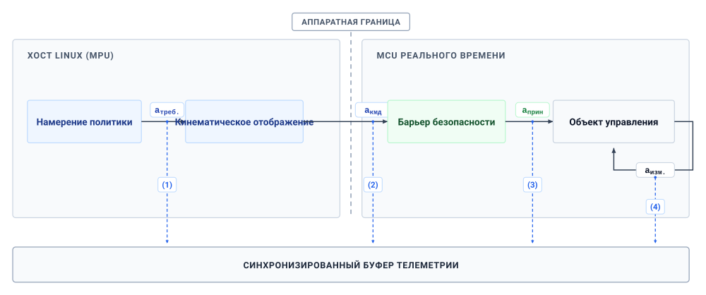
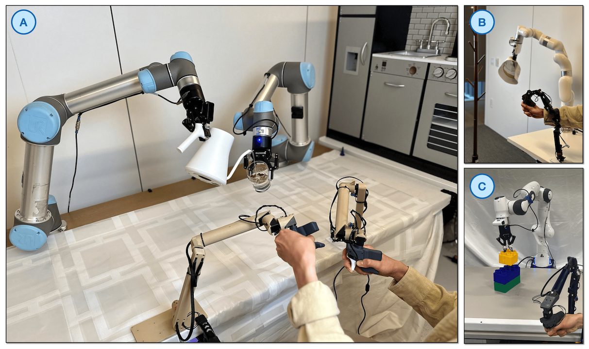
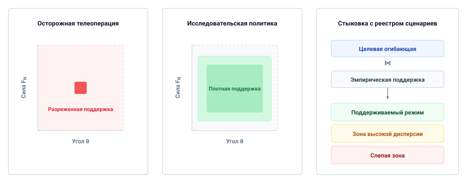
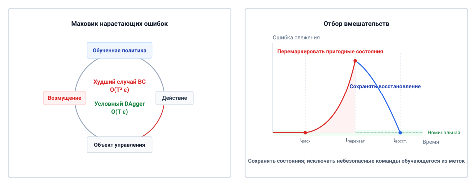
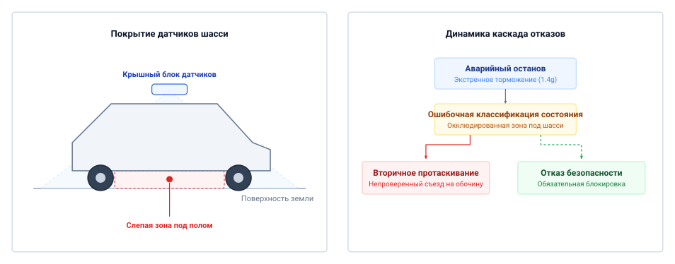

# Физические данные

## Цель

_Что физическая машина, собравшая датасет, неизгладимо впечатывает в политику, которая на нем обучается?_

Траектория робота отражает физическую машину, которая ее породила. Геометрия шарниров, люфт редуктора и трение в контакте формируют каждое движение, а тайминг датчиков определяет, какое наблюдение сопровождает каждую команду. Что принципиально, исходные действия меняются между предложением и исполнением: сначала они отображаются в дискретные задания, а затем допускаются, ограничиваются по скорости или насыщаются путем разрешения реального времени под границей предложения. Политика, обученная на этих записях, неизбежно усваивает условия сбора вперемешку с номинальной задачей. Успешные демонстрации также не содержат поведения восстановления, необходимого после того, как ошибка уводит машину с траектории, оставляя политику неподготовленной к отказным состояниям, которые порождают ее собственные ошибки.

Каждая физическая демонстрация расходует конечный ресурс актуаторов, механический износ и рабочее время реального оборудования. Поскольку одинаковые команды дают расходящуюся динамику на разных физических объектах управления, воплощенные датасеты плохо переносятся без явной калибровки. Модели большой емкости не могут преодолеть систематические пробелы записи одним лишь объемом; автономной политике нужны данные, обнажающие границу между номинальной работой и неучтенным возмущением. Физический датасет — это поэтому свидетельство взаимодействия одного конкретного объекта управления через каузальную границу. Ему можно доверять только тогда, когда его происхождение фиксирует, что было запрошено, что было допущено, что исполнило тело и какие эксплуатационные огибающие не исследовались никогда.

> **Цели обучения**
>
> - Оценить выход пригодных демонстраций из времени сбора и накладных расходов на сбросы сцены и заложить в бюджет механический износ, который расходует кампания
> - Проанализировать, как политика сбора ограничивает охват датасета и последующее поведение восстановления
> - Разделить неудавшиеся автономные действия и траектории человеческого восстановления в записях вмешательств с метками времени
> - Оценить, переносятся ли механические и сенсорные предпосылки датасета на другую машину
> - Спроектировать протокол происхождения, связывающий каждое наблюдение с запрошенным, отображенным, обеспеченным и измеренным действиями и с собирающим объектом управления
> - Проверить, поддерживает ли датасет заявленную область эксплуатации, сопоставив его заполненность с реестром сценариев

## Эндогенный опыт

Политика, обученная на сохраненных демонстрациях кампании открывания двери — чистых телеуправляемых открываниях клеточной двери складского мобильного манипулятора с пружинной защелкой, — все равно может дать сбой на защелке при первой автономной попытке. Одна из возможных причин — сдвиг, который создают собственные действия машины.[^fn-data-causal-loop] В фиксированном офлайн-датасете зрения предсказание модели не меняет следующий сохраненный пример. Здесь исполненное действие меняет траекторию тела, положение камеры и контакты, а значит — и последующие наблюдения ($s_{t+1} \sim P(s \mid s_t, a_t)$).

[^fn-data-causal-loop]: **Каузальная граница**: Каузальная граница между вычислениями и физикой установлена в разделе [«Каузальная граница»](01_causal_boundary.md#sec-boundary-causal-boundary). Поскольку эволюция состояния зависит от исполнения команды двигателем, действия политики возмущают распределение будущих наблюдений, что нарушает предположение о независимых и одинаково распределенных (i.i.d.) данных, лежащее в основе невоплощенного машинного обучения.

> **Эндогенный ковариантный сдвиг**
>
> ***Эндогенный ковариантный сдвиг*** — расхождение распределений в замкнутом контуре, при котором исполненные действия воплощенного агента изменяют его последующие физические состояния и сенсорные наблюдения ($s_{t+1} \sim P(s \mid s_t, a_t)$), уводя систему в области пространства состояний, не обеспеченные обучающими демонстрациями.
>
> 1.  **Значение**: Объясняет, как офлайн-обучение с подражанием может дать сбой при исполнении в замкнутом физическом контуре: возмущение способно увести систему в состояния, для которых у политики нет обучающей поддержки.
> 2.  **Отличие**: В отличие от экзогенного сдвига датасета, вызванного изменением окружающего освещения или сезонной погодой, эндогенный сдвиг активно порождается собственными действиями агента в замкнутом контуре, изменяющими его последующее распределение наблюдений.
> 3.  **Распространенная ловушка**: Попытка исправить отказ политики в замкнутом контуре сбором дополнительных номинальных демонстраций эксперта — это лишь увеличивает плотность данных вдоль многообразия успеха, не давая корректирующих данных восстановления, необходимых для выхода из вылазок за границу.

Этот сдвиг — обращенная к сбору данных сторона принципа [«Эндогенные данные»](part2_teaching.md#pri-vol4-endogenous-drift). Он превращает архив безупречных исполнений без траекторий восстановления в обузу, потому что первая ошибка политики выносит робота за пределы продемонстрированных состояний. Пусть $\pi$ — обученная политика, $\pi^*$ — эксперт, $J$ — ожидаемая накопленная стоимость задачи за $T$ шагов, а $\epsilon$ — вероятность расхождения на посещенных экспертом состояниях при 0–1 потере на действия. Если стоимость задачи на шаг лежит в $[0,1]$, обучение с подражанием допускает худший случай границы ([«квадратичный дрейф данных»](05_data.md#eq-data-quadratic-drift)):[^fn-ai-covariate-shift]

$$J(\pi)-J(\pi^*) \leq T^2\epsilon.$$

[^fn-ai-covariate-shift]: **Граница обучения с подражанием**: Граница, выведенная в [Ross et al., 2011](references.md#ross2011reduction), — это худший случай для ожидаемой накопленной стоимости, а не прогноз ошибки слежения; фактический дрейф зависит от объекта управления, задачи, политики и предохранителей. Раздел [«Обучение с подражанием и нарастающий ковариантный сдвиг»](appendix_ml.md#sec-appendix-ml-compounding) выводит эту границу и формулирует ее допущения о потере и ограниченной стоимости.

Сбор физического опыта тоже дорог. Каждая записанная секунда расходует усталостный ресурс актуаторов, нагревает обмотки двигателей, циклирует зубья редуктора и разряжает батарею.[^fn-data-hardware-wear] Отдых оператора, калибровка, сбросы сцены и неудачные или отвергнутые попытки оставляют меньше четверти планового времени ячейки в виде валидированных данных демонстраций ([«Стоимость демонстраций телеуправления»](05_data.md#sec-data-teleop-costs)). Физические данные демонстраций поэтому дефицитны, и при наивной записи они вводят обучение в заблуждение.

[^fn-data-hardware-wear]: **Усталостный ресурс оборудования**: Тепловые пределы актуаторов и износ редуктора, подробно рассмотренные в разделах [«Пределы передачи актуатора»](02_body.md#sec-body-actuator-limits) и [«Тепловые циклы нагрузки»](02_body.md#sec-body-thermal-duty-cycles), меняют трение в шарнирах по ходу кампании, поэтому конвейер, предполагающий стационарную динамику объекта управления, встречается с дрейфом по мере старения собирающей машины.

> ↰ **Предпосылка:** Теплоотдача актуатора ($dT/dt$) и пределы повреждения обмотки выведены в разделе [«Тепловые циклы нагрузки»](02_body.md#sec-body-thermal-duty-cycles).

Физическая команда также меняет смысл на пути к актуаторам. В машине, разделенной границей предложения,[^fn-data-proposal-permission] запрос оператора или политики отображается в задание, допускается или изменяется путем разрешения, и на него отвечает объект управления измеренным откликом. Запись только запроса обучает политику требованиям, которые объект управления никогда не смог бы исполнить, а запись только отклика учит ее структурному прогибу и люфту редуктора так, будто это осознанное мастерство человека.

[^fn-data-proposal-permission]: **Граница предложения**: Граница предложения, определенная в разделе [«Машина в пяти уровнях»](01_causal_boundary.md#sec-boundary-machine-model), разделяет обученные предложения и путь разрешения, который один только и может допустить их к актуаторам ([«Обеспечение безопасности»](12_enforcement.md#sec-enforcement)). Запись действия по обе стороны от нее удерживает вмешательства пути разрешения вне меток демонстратора.

Кампания сбора поэтому принимает два решения прежде, чем что-либо записать: какой источник будет выбирать действия и какую из четырех форм каждого действия датасет сохранит как метку.

## Откуда берутся физические данные

Физический датасет нельзя найти в готовом виде или извлечь из интернета. Каждый переход в архиве потребовал перемещать массу против трения на реальной машине. Трудность обучения по таким записям была видна на примере ALVINN (Autonomous Land Vehicle in a Neural Network) — системы Dean Pomerleau [Pomerleau, 1989](references.md#pomerleau1989alvinn), учившейся рулить по камерным изображениям человеческой езды. Поскольку водители-люди редко ошибались, в датасете не было восстановлений от края полосы, а малые ошибки исполнения накапливались в замкнутом контуре.

Источники физических данных различаются по тому, кто выбирает действие:

1. При **кинестетическом обучении** демонстратор, находящийся рядом с машиной, физически захватывает и перемещает обесточенные или компенсированные по гравитации шарниры механизма.
2. При **телеуправлении** удаленный оператор ведет входное устройство — такое как ведущее плечо, многоосевая спейс-мышь или отслеживаемый ручной контроллер, — передавая команды через программный интерфейс ведомому роботу.[^fn-hist-goertz-teleop]
3. При **программном сборе** инженер исполняет детерминированную управляющую процедуру, например конечный автомат, следящий за интерполированными сплайнами или примитивами с порогом по силе.
4. При **исследовательском сборе** активная политика выбирает действия, оптимизируя информационно-теоретическую цель, исследуя пространство состояний или максимизируя сигнал вознаграждения.
5. При **автономном журналировании в ходе эксплуатации** производственная политика командует актуаторами, выполняя работу на заводе или складе, и сохраняет входящие потоки датчиков на месте.

[^fn-hist-goertz-teleop]: **Родословная двустороннего телеуправления**: Raymond Goertz создал первые двусторонние телеманипуляторы со схемой «ведущий–ведомый» в национальной лаборатории Argonne в конце 1940-х и в 1950-х годах для обращения с радиоактивными материалами. Его звенья отражали силу через физический барьер, потому что операторы без кинестетического сопротивления заклинивали удаленный механизм.

Поскольку источник определяет, как машина подходит к миру, эти источники занимают непересекающиеся области состояний-действий даже на одной задаче. Рассмотрим освобождение защелки клеточной двери. Демонстратор, находящийся рядом и ведущий манипулятор, чувствует, как защелка заедает, и корректирует движение в запястье. Телеоператор, наблюдающий за видео, такого ощущения не имеет и тычет в ответную планку короткими движениями с паузами. Программный контроллер подходит вдоль одной запрограммированной траектории с постоянной скоростью, порождая один и тот же скачок силы о планку при каждой попытке. Частично обученная политика блуждает, заклинивая защелку под косыми углами, пока контактный порог срабатывания не обрывает попытку. Эти журналы — не зашумленные выборки одной траектории. Это выходы различных динамических систем с разными пропускными способностями, задержками и податливостями.

> ⇄ **Контраст:** Задержка дисплея и реакции оператора, задающая ритм движениям «шаг и ожидание» телеоператора ([«Стоимость демонстраций телеуправления»](05_data.md#sec-data-teleop-costs)), противопоставляется такту разрешения в $1\text{ ms}$, на котором проверяется каждая команда ([«Многотактные ритмы»](04_nervous_system.md#sec-nervous-cadences)).

Считать каждый записанный управляющий шаг независимым опытом — распространенная ошибка. Регистратор, работающий на высокой частоте управления, порождает огромное число шагов, но соседние шаги почти идентичны: два кадра, отстоящие друг от друга на несколько десятков миллисекунд, различаются лишь субмиллиметровыми смещениями и шумом датчиков. Охват растет с числом независимых эпизодов и различных физических конфигураций, а не с тактовой частотой дискретизации, поэтому скромный архив, охватывающий сотни положений детали и условий освещения, поддерживает куда больше, чем запись в десять раз длиннее на одной позиции стенда.

Симуляция избавляет от счета за износ и рассматривается в разделе [«Обучение политики»](06_training.md#sec-training). Когда синтетические траектории смешиваются с физическими журналами, каждая запись должна нести свой источник. Модель, обученная на недифференцированной смеси, наследует ошибки контакта физического движка там, где доминируют синтетические данные, и люфт и шум оборудования — там, где доминируют физические данные, и позднее никто не сможет сказать, что именно вызвало отказ на роботе. Запись, называющая свой источник, закрыла первое из двух решений кампании, и ей все еще предстоит указать, какую форму каждого действия она сохранила.

## Какое действие становится меткой

Когда захват касается ответной планки защелки клеточной двери, движение руки оператора уже превратилось в четыре разных сигнала, и то, какой из них датасет сохраняет как метку, определяет, чему обученная модель будет подражать. Машина разделяет свой путь управления между двумя процессорами ([«Кортеж четырехпоточного отбора действий»](05_data.md#fig-05-action-taps)), поэтому метку можно снять в двух вычислительных доменах:

- Непривилегированный **прикладной процессор** захватывает потоки камер, выполняет отображение входа телеуправления или прямой проход политики и отображает координаты.
- На стороне разрешения границы предложения ([«Машина в пяти уровнях»](01_causal_boundary.md#sec-boundary-machine-model)) микроконтроллер (MCU) безопасности работает на $1\text{ kHz}$ на «голом железе», выполняя импедансное управление, функции барьеров безопасности, ограничения скорости и ограничения тока.[^fn-hw-encoder-capture]

[^fn-hw-encoder-capture]: **Аппаратное прерывание таймера**: На MCU реального времени отсчеты энкодеров и показания шунтов тока фиксируются аппаратными таймерами и прямым доступом к памяти (Direct Memory Access, DMA), что удерживает дрожание выборки в пределах микросекунд и не позволяет дрожанию меток времени попасть в численное дифференцирование скорости и ускорения.

***Кортеж четырехпоточного отбора действий**: Четыре места, где может регистрироваться команда, — от исходного намерения политики на прикладном процессоре до измеренного отклика объекта управления. Какой отбор фиксирует датасет, определяет, чему модель учится подражать. Источник: архитектурный дизайн адаптирован из [Zhao et al., 2023](references.md#zhao2023learning) и [Wu et al., 2024](references.md#wu2023gello).*

Четыре точки отбора на этом пути управления фиксируют принципиально разную физическую семантику:

- **Запрошенное действие** ($a_{\text{req}}$): исходный вход оператора или предложение политики, снабженные тегами представления, единиц, системы координат и времени выдачи.
- **Отображенная команда** ($a_{\text{cmd}}$): переадресованное декартово или шарнирное задание, снабженное тегами нового представления, единиц, системы координат и времени отображения.
- **Обеспеченная команда** ($a_{\text{enf}}$): то же типизированное задание после того, как независимый путь безопасности допустил, изменил или отверг предложение.
- **Измеренный отклик** ($a_{\text{meas}}$): соответствующая измеренная позиция или скорость за заявленный интервал выборки; показания энкодеров и ток двигателя — отдельные сенсорные каналы, а не взаимозаменяемые координаты действия.

Только полный кортеж, записанный через границу между прикладным процессором и MCU, разделяет то, о чем просил оператор, и то, что позволил путь разрешения.

> **Четырехпоточный отбор действий**
>
> ***Четырехпоточный отбор действий*** $(a_{\text{req}}, a_{\text{cmd}}, a_{\text{enf}}, a_{\text{meas}})$ — синхронизированный по времени многоуровневый телеметрический протокол, фиксирующий сигнал действия на всех четырех стадиях каузальных преобразований: непривилегированное намерение оператора или политики ($a_{\text{req}}$), кинематически переадресованное задание ($a_{\text{cmd}}$), команда под управлением безопасности ($a_{\text{enf}}$) и отклик физического объекта управления ($a_{\text{meas}}$).
>
> 1.  **Значение**: Обучение политик подражания на исходных запрошенных действиях ($a_{\text{req}}$) вносит динамически неосуществимые команды, которые при развертывании вызывают срабатывания безопасности. Наоборот, обучение на измеренных откликах ($a_{\text{meas}}$) заставляет модель подражать механической податливости, люфту и внешним возмущениям, а не целенаправленному управлению. Запись всех четырех потоков позволяет отличить управляющее намерение от вмешательства пути разрешения.
> 2.  **Отличие**: В отличие от классических журналов телеметрии робота, фиксирующих лишь конечные состояния энкодеров двигателей или исходные входы джойстика телеуправления, четырехпоточный отбор сохраняет точные стадии каузальной фильтрации, примененные промежуточным ПО и аппаратурой безопасности.
> 3.  **Распространенная ловушка**: Запись потоков без меток времени, синхронизированных в оборудовании по IEEE 1588 Precision Time Protocol (PTP), обозначаемых $t_{\text{PTP}}$. Даже несколько миллисекунд расхождения часов между прикладным процессором и MCU разрушают временное выравнивание между визуальными наблюдениями и соответствующими действиями по моменту.

Запись правильной точки отбора не отвечает на вопрос, когда каждое записанное значение было истинным. Камеры интегрируют фотоны в окне экспозиции длительностью в десятки миллисекунд до считывания и передачи, датчики силы опрашиваются с частотой порядка сотни герц, шарнирные энкодеры и контуры тока работают на килогерцевом такте MCU, а контур действия выдает команды с частотой в десятки герц. Загрузчик данных, захватывающий последнюю доступную выборку, сопоставляет каждое действие с кадром камеры, экспозиция которого была центрирована за $25\text{--}40\text{ ms}$ до того, как кадр достиг памяти хоста, и политика учится отображать прошлые состояния в настоящие действия, с фазовым запаздыванием, впечатанным в ее веса. Регистраторы предотвращают это в три шага:

1. **Метка времени середины экспозиции:** Каждый кадр получает метку в середине своей экспозиции ([«Свежесть измерений»](02_body.md#sec-body-measurement-freshness)), фиксируемую на аппаратных триггерах, синхронизированных по PTP, или на внешних линиях синхронизации TTL, так что каждое наблюдение камеры несет время, когда оно было истинным.
2. **Кинематическая интерполяция:** Конфигурация шарниров на оптической метке времени камеры интерполируется между двумя ближайшими записями энкодеров MCU (форма сплайна приведена в разделе [«Гладкие траектории и безударная передача»](appendix_control.md#sec-appendix-control-splines)).
3. **Выравнивание перед сериализацией:** Такие контейнеры, как MCAP, LeRobot [Cadene et al., 2024](references.md#cadene2024lerobot) и RLDS [Open X-Embodiment Collaboration et al., 2024](references.md#open_x_embodiment_collaboration2024open), хранят многотактные потоки с теми метками времени, которые им даны, поэтому выравнивание по середине экспозиции должно происходить до записи пар состояние-действие.

> ↰ **Предпосылка:** Субмикросекундная синхронизация часов PTP через распределенные контроллеры шин установлена в разделе [«Передача команд вовремя»](04_nervous_system.md#sec-nervous-deterministic-fieldbuses).

Точка отбора и метка времени хороши ровно настолько, насколько хорош породивший их контур. В телеуправлении — до сих пор стандартном способе сбора высококачественных физических траекторий — этот контур проходит через человека, и интерфейс между человеком и машиной формирует записываемую динамику задолго до того, как данные достигнут модели.

## Стоимость демонстраций телеуправления

Телеуправление замыкает контур обратной связи через оператора, входное устройство, шину, контроллер двигателя и среду ([«Кинематически изоморфные стенды телеуправления»](05_data.md#fig-05-teleop-rig)). Камера захватывает рабочую область и передает ее потоком на дисплей; оператор видит сцену, принимает решение о коррекции и приводит в движение входное устройство; рабочая станция отображает это движение в задание и отправляет его на приводы двигателей; актуаторы разгоняют манипулятор против инерции, трения и контакта, а изменившаяся сцена достигает камеры на следующем цикле.

***Кинематически изоморфные стенды телеуправления**: Запись демонстраций на трех стендах «ведущий–ведомый», где ведущие устройства повторяют кинематику ведомых [Wu et al., 2024](references.md#wu2023gello). Поскольку ведущее устройство разделяет шарнирную структуру ведомого, интерфейсу не нужна обратная кинематика и он не наследует ее сингулярностей (математических мертвых зон, где шарниры выстраиваются в линию и теряют подвижность), сохраняя прямую координацию оператора на уровне шарниров. Тем не менее задержка непрерывных коррекций оператора все равно попадает в запись как фазовое запаздывание, так что демонстрация несет задержку оператора, словно она является политикой.*

Каждая стадия этого контура вносит задержку, влияющую на момент коррекции. В эталонной конфигурации с высокоскоростной камерой и проводной локальной сетью (иллюстративно; см. руководство читателю) обработка дисплея требует $t_{\text{disp}} = 50\text{ ms}$ на экспозицию, декодирование H.264 и обновление монитора. Зрительное восприятие человека и нейромышечная передача добавляют задержку реакции оператора $t_{\text{hum}} = 200\text{ ms}$ для непрерывных коррекций траектории. Квантование команды, ее пакетирование и транспорт по шине к контроллеру робота добавляют $t_{\text{cmd}} = 10\text{ ms}$. Нарастание момента актуатора и инерция конструкции накладывают механическую задержку отклика $t_{\text{mech}} = 80\text{ ms}$ до того, как робот достигнет заданного ускорения. **Круговая задержка телеуправления** $t_{\text{loop}}$ — время от события контакта до корректирующего отклика актуатора — равна их сумме:
$$t_{\text{loop}} = t_{\text{disp}} + t_{\text{hum}} + t_{\text{cmd}} + t_{\text{mech}} = 50\text{ ms} + 200\text{ ms} + 10\text{ ms} + 80\text{ ms} = 340\text{ ms}.$$

Когда в момент $t$ возникает смещение в контакте, оператор видит его в $t + 50\text{ ms}$, дает команду на коррекцию в $t + 250\text{ ms}$, и манипулятор противодействует в $t + 340\text{ ms}$, пока сам манипулятор продолжает движение под действием импульса и контактных сил. Регистратор, сопоставляющий наблюдение $s_t$ с командой, выданной в тот же момент, соединяет состояние с действием, выбранным для состояния на $250\text{ ms}$ старше. Политика учится этой задержке как осознанному поведению и перекорректирует или колеблется, работая автономно на частоте управления. Круговая задержка — поэтому свойство датасета, а не только стенда, поскольку она попадает в каждую демонстрацию как фазовое запаздывание, определяемое собственным временем реакции оператора.

Когда контактная сила отражается обратно в руку оператора при **двустороннем телеуправлении**, та же задержка становится угрозой устойчивости. Anderson и Spong показали, что задержка передачи превращает пассивное звено в источник энергии [Anderson and Spong, 1989](references.md#anderson1989bilateral). Запаздывающая сила реакции приходит в противофазе с рукой оператора, толкая ее по направлению движения и вводя ведущее и ведомое устройства в предельные циклы о жесткий контакт ([«Пассивность и энергетически ограниченное взаимодействие»](appendix_control.md#sec-appendix-control-passivity)). Контроллеры пассивности во временной области и преобразования волновых переменных стравливают эту энергию виртуальным демпфированием, а демпфирование фильтрует низкими частотами движение оператора, ослабляя именно те контактные сигналы, ради которых демонстрация и затевалась.

Таким образом, интерфейс фильтрует то, что демонстрация способна выразить. Ведущее устройство с отражением силы позволяет оператору чувствовать заедание; визуальный регулятор скорости побуждает к коротким движениям и паузам, пока оператор проверяет видео. Ведущее шарнирное устройство с обратным приводом, такое как ALOHA, записываемое на $50\text{ Hz}$ [Zhao et al., 2023](references.md#zhao2023learning), занимает промежуточное положение, передавая механическое ощущение ведущего устройства без силы ведомого. С любым из этих интерфейсов операторы замедляются возле контакта, потому что контур с высоким усилением, замкнутый вокруг $t_{\text{loop}}$, потерял бы фазовый запас. Раздел [«Интерфейсы телеуправления для сбора демонстраций»](05_data.md#tbl-05-teleop-taxonomy) перечисляет эти поведения как артефакты, которые следует проверять на данном стенде, а не как универсальные диапазоны.

| Интерфейс и обратная связь                                       | Отображение команд                                                                       | Контактная информация, доступная оператору                             | Возможный артефакт сбора, который следует проверить                     |
|:--------------------------------------------------------------|:-------------------------------------------------------------------------------------|:---------------------------------------------------------------------------|:----------------------------------------------------------------------------------|
| **Двустороннее ведущее устройство с отражением силы**          | Движение ведущего устройства отображается в шарниры ведомого; измеренная сила ведомого отражается в ведущее устройство | Зрение и физическая контактная сила, с учетом задержки канала и его точности | Контактные коррекции и колебания, когда запаздывающее отражение силы теряет пассивность |
| **Ведущее шарнирное устройство с обратным приводом (ALOHA)** [Zhao et al., 2023](references.md#zhao2023learning) | Положения шарниров ведущего устройства копируются в ведомый; демонстрация записывается на $50\text{ Hz}$ | Зрение и механическое ощущение ведущего устройства, без активного отражения силы ведомого | Предпочтения по позам в шарнирном пространстве и ненаблюдаемые контактные силы ведомого |
| **Регулятор скорости на 3D-мыши**                             | Отклонение устройства отображается в декартову скорость, затем следует обратная кинематика | Преимущественно визуальная обратная связь, если нет отдельного гаптического канала | Движение «шаг и ожидание» и паузы с нулевой скоростью при запаздывающей обратной связи |
| **Отслеживаемый пространственный контроллер**                 | Отслеживаемая поза руки отображается в позу инструмента со сцеплением и масштабированием | Визуальная обратная связь; опциональная вибрация не является направленным отражением силы | Разрывы при сцеплении и провалы в отслеживании позы                              |
| **Оснащенный датчиками экзоскелет**                           | Движение шарниров носимого устройства переадресуется в шарниры робота                  | Зависит от того, установлено ли активное отражение силы                     | Биомеханическая калибровка и смещение при переадресации                           |

***Интерфейсы телеуправления для сбора демонстраций**: Отображение и обратная связь определяют, что оператор способен продемонстрировать, а последний столбец называет артефакт, который следует проверять на данном стенде, задаче и операторе.*

Какой бы интерфейс ни держал оператор, стенд обязан записывать каждый поток, который порождает сеанс, включая все четыре точки отбора действия определения [«Четырехпоточный отбор действий»](05_data.md#dfn-data-four-stream-action-tap-tuple), и эта запись имеет собственный бюджет пропускной способности и хранения.

> **Бюджеты приема и хранения для нескольких камер**
>
> **Вопрос**: Какую непрерывную скорость приема и какой объем хранения порождает один телеуправляемый сеанс открывания двери на складском мобильном манипуляторе, если каждая камера и каждая ось записываются в необработанном виде?
>
> **Параметры** (геометрия камеры — из технического описания; форматы записи выбраны):
>
> - **Навигационная камера:** `4056` на `3040` пикс при `60 Hz`, записывается как 24-битный RGB ($3\text{ bytes/px}$).
> - **Камера запястья:** `1440` на `1080` пикс при `60 Hz`, записывается так же.
> - **Внешние камеры:** `2` RGB-D камеры, наблюдающие дверь, цвет — `1920` на `1080` пикс при `30 Hz`, глубина выровнена по цветному кадру как необработанные миллиметры в формате `uint16` ($2\text{ bytes/px}$).
> - **Кинематика:** `9` осей (два колеса базы, семь шарниров манипулятора) записываются на `1 kHz`. Каждый шаг хранит для каждой оси позицию и скорость (измеренный отклик $a_{\text{meas}}$), измеренный момент и запрошенные, отображенные и обеспеченные команды как 32-битные значения, плюс одну 64-битную метку времени, — итого `224` байта на шаг.
>
> **Расчет**:
>
> 1. **Пропускная способность необработанного видео:** навигационная камера выдает поток `2219.44 MB/s`, камера запястья — `279.94 MB/s`. Внешняя пара добавляет `373.25 MB/s` цвета и `248.83 MB/s` глубины, всего `622.08 MB/s`.
> 2. **Пропускная способность кинематики:** `224` байта на шаг при `1 kHz` — это `0.22 MB/s`.
> 3. **Суммарная непрерывная скорость приема:** потоки дают `3121.68 MB/s`, около `3.12 GB/s`.
> 4. **Расход хранилища за час и за смену:** несжатая телеметрия накапливается со скоростью `11.24 TB` в час, или `89.9 TB` за `8`-часовую смену сбора на одной машине.
>
> **Системный вывод**:
> Одна лишь навигационная камера записывает `4.0×` того, что выдерживает SATA SSD (`550 MB/s`). Весь сеанс укладывается в `7 GB/s` накопителя Gen4 NVMe, но лишь ценой расхода хранилища `11.24 TB` в час. Внутрикадровое сжатие видео с иллюстративным коэффициентом `8×` снижает скорость примерно до `390.2 MB/s` (`1.40 TB` в час) ценой задержки кодировщика и артефактов в кадрах, на которых будет обучаться политика. Кинематический поток, несущий все четыре точки отбора действия, составляет `0.007` процента байт. Запись, сохраняющая каузальную цепь, — самый дешевый поток для записи, поэтому регистратор, сбрасывающий данные под давлением буфера, никогда не должен сбрасывать ее первой.

Хранилище ограничивает объем записи сеанса; выход ограничивает долю данных, на которых стоит обучать. **Выход демонстраций** ($Y_{\text{usable}} = \lfloor T_{\text{motion}} / t_{\text{cyc}} \rfloor \cdot R$) — число сохраненных записей траекторий, которое дает запланированный сеанс после того, как запуск, калибровка, отдых оператора, сбросы и фильтрация качества забрали свою долю. Рассмотрим один иллюстративный сеанс кампании защелки, объявленной длительностью $T_{\text{sched}} = 60.0\text{ min}$. Запуск, калибровка и отдых оператора оставляют активное окно $T_{\text{motion}} = 35.0\text{ min}$. Каждая попытка — одно телеуправляемое открывание за $t_{\text{att}} = 25.0\text{ s}$ с последующим повторным защелкиванием двери ее фиксатором за $t_{\text{rst}} = 15.0\text{ s}$ ($t_{\text{cyc}} = 40.0\text{ s}$), так что в сеанс помещается `52` попытки. Отказы в ходе попыток (20 %) и последующая фильтрация (15 %) дают долю сохранения $R = (1 - 0.20)(1 - 0.15) =$ `0.68`, и сеанс дает `35.36` сохраненных эпизодов, `14.73 min` валидированных данных. Это чистая доля сеанса — валидированное время траектории к плановому времени ячейки — составляет `24.6` процента. Цель в `5 000` сохраненных демонстраций поэтому стоит `7 353` попыток и `141.4 h` планового времени ячейки, `4.07×` демонстрационного времени, которое кампания сохраняет ([«Бюджет сбора физических демонстраций за 60-минутный сеанс»](05_data.md#tbl-05-collection-budget)). Кампания закладывается в бюджет в валидированном времени траекторий, никогда — в часах работы площадки.

Износ накапливается за циклы, а не за часы. В иллюстративной модели износа запястья манипулятора волновая передача рассчитана на $L_{\text{gear}} = 5\,000\,000$ циклов напряжения, а внутренний жгут кабелей — на $L_{\text{cable}} = 200\,000$ циклов изгиба. Поиск ручки, освобождение защелки и распахивание двери добавляют около $n_{\text{gear}} = 14$ реверсов момента и $n_{\text{cable}} = 6$ циклов изгиба на каждое открывание, а обратный ход при повторном защелкивании добавляет еще два цикла изгиба. Неудачные попытки изнашивают шарнир не меньше сохраненных, поэтому счет предъявляется ко всем `7 353` попыткам: `102 942` циклов напряжения передачи, `2.1` процента расчетного ресурса, и `58 824` изгиба кабеля, `29.4` процента расчетного ресурса, за одну кампанию. График замены задает кабель, а не передача. Три кампании на одной машине израсходовали бы большую часть расчетного ресурса кабеля, а перемежающийся обрыв проводника портит именно те потоки датчиков, которые и записываются.

| Этап сеанса / активность         | Выделенная длительность ($\Delta t$)         | Доля фактического времени (\%) | Физическая операция и состояние управления                                                                             | Механизм нагрузки и износа оборудования                                                                                                                                                  | Чистый выход траекторий ($N_{\text{episodes}}$ / $T_{\text{yield}}$) |
|:---------------------------------|:----------------------------------------|:----------------------|:---------------------------------------------------------------------------------------------------------------|:----------------------------------------------------------------------------------------------------------------------------------------------------------------------------------|:-------------------------------------------------------------------|
| **Запуск ячейки и синхронизация шины** | $8.0\text{ min}$ ($480\text{ s}$)       | $13.3\%$              | Синхронизация шины (EtherCAT/CANopen), проверка сторожевого таймера безопасности, оптический возврат в исходное положение | Пусковой бросок тока; тепловой прогрев обмоток двигателей и сенсорных мостов                                                                                                  | $N = 0\text{ ep}$, выход $0.0\text{ min}$                          |
| **Калибровка и обнуление датчиков** | $7.0\text{ min}$ ($420\text{ s}$)       | $11.7\%$              | Прогон внутренних и внешних параметров камеры, обнуление смещения момента в шарнирах, возврат энкодеров в исходное положение | Статический удерживающий момент; тепловая стабилизация сенсорных мостов; нулевой динамический износ передачи                                                                                | $N = 0\text{ ep}$, выход $0.0\text{ min}$                          |
| **Отдых оператора и эргономика**   | $10.0\text{ min}$ ($600\text{ s}$)      | $16.7\%$              | Обязательные перерывы оператора для смягчения зрительного утомления, когнитивного насыщения и дрейфа тремора                   | Пассивное ожидание; включенные электромагнитные тормоза или удерживающий ток при нулевой скорости                                                                                                  | $N = 0\text{ ep}$, выход $0.0\text{ min}$                          |
| **Физические сбросы сцены**        | $13.0\text{ min}$ ($780\text{ s}$)      | $21.7\%$              | Дверь закрывается и повторно защелкивается своим фиксатором, обратный ход манипулятора ($15.0\text{ s/attempt}$)                         | $52\text{ return strokes} \times 2\text{ bends} = 104\text{ cable flex cycles}$; нулевая контактная нагрузка                                                                             | $N = 0\text{ ep}$, выход $0.0\text{ min}$                          |
| **Активные телеуправляемые попытки** | $21.67\text{ min}$ ($1300\text{ s}$)    | $36.1\%$              | Телеуправление человеком в реальном времени, ведущее подход к ручке, освобождение защелки и распахивание двери ($25.0\text{ s/attempt}$) | $52 \times 14 = 728\text{ torque reversals}$ на волновой передаче; $52 \times 6 = 312\text{ cable flex cycles}$; контактные нагрузки ниже `15 N` | $N = 52\text{ raw attempts}$, $21.67\text{ min}$ суммарного движения      |
| **Отказы в ходе попыток (с метками)**  | $-4.33\text{ min}$ ($-260\text{ s}$)    | $-7.2\%$              | Срыв ручки, заедание защелки, контактный порог срабатывания выше `15 N` (потеря $20\%$)  | Высокосиловые контактные переходные процессы; абразивный износ силиконовых накладок захвата                                                                                                             | $-10.4\text{ ep}$ от выхода успеха; валидные журналы сохранены              |
| **Фильтрация контроля качества после сбора** | $-2.60\text{ min}$ ($-156\text{ s}$)    | $-4.3\%$              | Офлайн-фильтрация: задержка канала $>100\text{ ms}$, визуальная окклюзия, колебания оператора (потеря $15\%$)          | Нулевой износ оборудования (офлайн-вычислительный проход валидации)                                                                                                                        | $-6.24\text{ ep}$ отброшено                                        |
| **Чистый выход валидированного датасета**  | **$14.73\text{ min}$** ($884\text{ s}$) | **$24.6\%$**          | Высококачественные синхронизированные мультимодальные траектории ($s_t, a_t$), допущенные в обучающий буфер                  | Расходует $2.1\%$ ресурса передачи запястья и $29.4\%$ ресурса внутреннего гибкого кабеля на кампанию в $5000\text{ episode}$                                                                   | **$N_{\text{usable}} = 35.36$** эпизодов                           |

***Бюджет сбора физических демонстраций за 60-минутный сеанс**: Время площадки, потери выхода и износ компонентов по этапам для одного сеанса кампании защелки ($N_{\text{att}} = 52$ попыток по $t_{\text{att}} = 25.0\text{ s}$, сброс $t_{\text{rst}} = 15.0\text{ s}$). Оставшиеся после последнего полного цикла `20 s` активного времени простаивают и не имеют строки. Меньше четверти часа сохраняется в виде сохраненных данных демонстраций.*

Телеуправляемые демонстрации ограничены тем, что оператор способен воспринять через дисплей, скоординировать через интерфейс и стабилизировать вопреки задержке контура, поэтому датасет отражает составную систему «человек–интерфейс», а не неограниченную выборку динамики объекта управления, и это смещение задает охват датасета ([«Охват политики сбора»](05_data.md#sec-data-policy-coverage)).

## Охват политики сбора

Физический датасет порождается исполнением действий на оборудовании и записью возникающих переходов. Записанные выборки определяют **эмпирическое распределение заполненности состояний-действий** [Spencer et al., 2021](references.md#spencer2021feedback) $d^{\pi_{\text{col}}}(s, a)$, а обучение с подражанием минимизирует ошибку предсказания, взвешенную им, так что обученная политика $\pi_\theta$ тренируется только на состояниях, где $d^{\pi_{\text{col}}}(s) > 0$. Датасет — не выборка физического пространства состояний. Это область, прочерченная политикой сбора $\pi_{\text{col}}$ под ее управляющими смещениями, задержками интерфейса и толерантностью к риску.

Рассмотрим иллюстративную контактную задачу — совмещение захвата с кромкой детали, — для эксплуатации которой требуются углы контакта в $\theta \in [-15.0^\circ, +15.0^\circ]$ и нормальные силы до $20.0\text{ N}$. При разбиении по $1.0^\circ$ и $1.0\text{ N}$ это сетка из 600 ячеек. Два коллектора записывают по $1\,000\,000$ переходов одинаковыми датчиками. Осторожный телеоператор удерживает контакт в пределах $\pm 2.0^\circ$ от перпендикуляра под $4.0$–$6.0\text{ N}$ и заполняет 8 ячеек, оставляя 98,7 % сетки пустыми. Исследовательская политика подходит во всем диапазоне углов, проскальзывает и нагружает контакт между $1.0$ и $18.0\text{ N}$, заполняя 510 ячеек и оставляя 15,0 % пустыми. Числа байт идентичны; вопросы, на которые способны ответить два датасета, — нет.

Метка действия существует лишь потому, что политика сбора посетила это состояние и выдала команду. В состоянии с нулевым числом посещений датасет не содержит ни предпочтительного действия, ни свидетельства того, что его нет, и функция потерь не отличает неустойчивую конфигурацию от безопасной, но непосещенной, или от разрушительной. Политика может обобщиться там, дать сбой или быть остановлена отдельным предохранителем, и один датасет не может сказать, какое именно; только целевой сбор, перемаркировка экспертом или отказ в автономных полномочиях закрывают ячейку. Допустим, политика, обученная на осторожных данных, возмущением трения сдвинута к $\theta = +4.5^\circ$, вне ее 8 продемонстрированных ячеек. Ее сеть теперь вычисляет вход, который ни одна демонстрация не ограничивает, и невалидированное действие несет ее к $+6.0^\circ$ при $11.0\text{ N}$ один управляющий шаг спустя — состоянию, для которого в архиве нет коррекции. Каждое следующее действие уводит ее все дальше от коридора, пока захват не заклинит о фиксатор. Это эндогенный ковариантный сдвиг ([«Эндогенный ковариантный сдвиг»](05_data.md#dfn-data-endogenous-covariate-shift)), действующий на разрыв охвата.

Измерять охват по крайним значениям собранных величин — значит ходить по кругу. Коллектор, записывающий силы только между $4.0$ и $6.0\text{ N}$, отчитается о полном охвате этого интервала. Охват должен оцениваться по внешнему **реестру сценариев** — таблице условий, требуемых при эксплуатации, разбитой на ячейки. Реестр сценариев — это записанная **область эксплуатационного назначения** (ODD): позы объекта, состояния поверхностей, нагрузки, скорости и возмущения, в которых машине предстоит работать. Датасет поддерживает ту часть ODD, которую покрывает стыковка его заполненности; остальное — его известное отсутствие.

Неподдерживаемые области находятся **реляционной стыковкой с огибающей поддержки**, сопоставляющей эмпирическую заполненность $d^{\pi_{\text{col}}}(s,a)$ (где машина бывала) с реестром сценариев $\mathcal{S}_{\text{req}}$ (где ей нужно бывать). Для каждой ячейки реестра стыковка сообщает число переходов $N_{\text{cell}}$ и тем самым разбивает ODD на поддерживаемые режимы ($N_{\text{cell}} \ge N_{\text{min}}$), зоны переходов с высокой дисперсией и слепые зоны нулевой поддержки ($N_{\text{cell}} = 0$). В слепой зоне нет обучающего надзора, поэтому путь разрешения должен решить, может ли политика там работать вообще; ячейки с малым числом посещений требуют проверок неопределенности и специфичных для сценария.

Потери валидации не обнаруживают дефицит. Отложенная выборка из тех же траекторий разделяет заполненность $d^{\pi_{\text{col}}}$, поэтому осторожный датасет может достигнуть почти нулевых потерь валидации, тогда как 98,7 % ячеек, требуемых ODD, не содержат примеров ([«Метрики охвата и потерь валидации по сценарным корзинам»](05_data.md#tbl-data-collector-coverage-ledger), [«Стыковка охвата и сценариев коллектора»](05_data.md#fig-05-collector-coverage-ledger)). Только отношение поддерживаемых ячеек реестра к требуемым, вычисленное до развертывания, измеряет охват.

| Метрика                                             | Осторожное телеуправление ($d^{\pi_{\text{teleop}}}$) | Исследовательская политика ($d^{\pi_{\text{expl}}}$)  | Системное следствие               |
|:---------------------------------------------------|:---------------------------------------------------|:----------------------------------------------|:----------------------------------|
| **Записанные переходы**                           | $1\,000\,000$ переходов ($100\text{ Hz}$)      | $1\,000\,000$ переходов ($100\text{ Hz}$) | Эквивалентный масштаб датасета          |
| **Охват эксплуатационной сетки**                      | $8\,/\,600$ корзин ($1.3\%$)                         | $510\,/\,600$ корзин ($85.0\%$)                 | Поддерживаемые ячейки ODD        |
| **Слепые зоны с нулевым счетчиком** ($N_{\text{cell}} = 0$) | $592\,/\,600$ корзин ($98.7\%$)                      | $90\,/\,600$ корзин ($15.0\%$)                  | Немониторируемый объем риска           |
| **Потери валидации на отложенной выборке** ($L_{\text{val}}$)    | $0.001\text{ rad}$                                 | $0.012\text{ rad}$                            | Потери валидации не диагностичны |
| **Нарастающий дрейф в замкнутом контуре**                  | Расхождение за пределами $\pm 2.5^\circ$                  | Ограниченное восстановление в пределах $\pm 15^\circ$        | Стабильность физической политики         |
| **Допуск к обучению**                             | **Отказать** (требовать целевого сбора)           | **Допустить** (слепые зоны остаются в каталоге)        | Аудиторский шлюз реестра сценариев        |

***Метрики охвата и потерь валидации по сценарным корзинам**: Метрики реляционной стыковки, сравнивающие осторожное телеуправление и охват исследовательской политики.*

***Стыковка охвата и сценариев коллектора**: Посещаемость состояний-действий осторожным телеоператором против исследовательской политики, сопоставленная с реестром сценариев, который требуется при эксплуатации. Осторожный коллектор концентрирует переходы в узком кластере и оставляет 98,7 % требуемых ячеек непосещенными, отчитываясь о почти нулевых потерях валидации, — это показывает, что статистическая сходимость ничего не говорит о физическом охвате. Реляционная стыковка разбивает ODD на поддерживаемые режимы, зоны переходов с высокой дисперсией и слепые зоны нулевой поддержки, где автономные управляющие полномочия должны быть отвергнуты.*

Кампания защелки показывает стыковку на работающей машине. Каждый сохраненный эпизод подходит к ответной планке с охраняемой скоростью `0.03 m/s`, отклоняясь от номинального положения планки в пределах $\pm$`0.5 mm`, и каждый сохраненный успех остается ниже порога срабатывания `15 N`. По реестру, содержащему только номинальную планку на охраняемой скорости, датасет выглядит полным. По реестру, который нужен двери, — три положения планки (номинальное и $\pm$`3 mm`) в сочетании с двумя скоростями подхода (`0.03 m/s` и `0.10 m/s`) — те же данные заполняют одну ячейку из `6`, а каждая смещенная планка и каждый подход с `0.10 m/s` не содержат ни одной демонстрации. Внутри датасета ничто не различает два ответа; различает их только внешний реестр. Поэтому `5` пустых ячеек следуют вместе с датасетом в раздел [«Обучение политики»](06_training.md#sec-training) как его известные отсутствия, и пока целевой сбор не заполнит их, машина должна этим условиям отказ, а не догадку.

> **Эмпирическая заполненность и стыковки с реестром сценариев**
>
> Прежде чем оценивать охват политики в области эксплуатационного назначения, проверьте свое понимание заполненности датасета и учета реестра сценариев:
>
> - **Эмпирическая поддержка против потерь валидации**: Можете ли вы объяснить, почему политика подражания способна достичь почти нулевых потерь валидации на отложенных тестовых данных, оставляя при этом 98 процентов требуемых ODD ячеек неподдержанными?
> - **Неподдерживаемые состояния**: Что может установить непосещенная ячейка сценария о поведении политики и какое дополнительное свидетельство или решение об отказе необходимо?
> - **Реляционные стыковки с реестром сценариев**: Умеете ли вы различать поддерживаемые номинальные режимы, зоны переходов с высокой дисперсией и слепые зоны нулевой поддержки при стыковке телеметрии с операционным реестром сценариев?

Запись дополнительных номинальных демонстраций вдоль коридора не может заполнить слепую зону. Для достижения пограничных состояний нужны супервизорные перехваты или намеренное возмущение, и данные, которые они порождают, создают собственные каузальные проблемы ([«Данные вмешательств и восстановления»](05_data.md#sec-data-intervention-recovery)).

## Данные вмешательств и восстановления

Когда опасное или пограничное состояние не встречается в обучающем датасете, инженер не может заключить, что физическая система естественным образом избегает этого состояния. Отсутствующее состояние в эмпирическом журнале соответствует одному из четырех различных физических механизмов в ходе сбора данных:

1. **Непосещенный номинальный путь**: Политика сбора никогда не посещала это состояние, потому что номинальные прогоны оставались целиком в пределах основного коридора задачи. Это отсутствие означает немониторируемую номинальную работу и обнаруживается сопоставлением журналов траекторий с реестром сценариев.
2. **Перехват путем разрешения**: Активный барьер безопасности или детерминированный рефлекс на пути разрешения обнаружил надвигающееся нарушение границы и оборвал движение до достижения состояния — так контактный порог срабатывания `15 N` поступает с попыткой открыть защелку. Это отсутствие обнаруживается непосредственно в журналах пути разрешения, фиксирующих срабатывание барьера.
3. **Перехват супервизором-человеком**: Оператор безопасности увидел развивающуюся опасность и отключил автономную политику до контакта. Это отсутствие обнаруживается по флагу отключения перехвата на шине транспортного средства или манипулятора.
4. **Цензура после сбора**: Машина действительно вошла в опасное состояние, столкнулась с препятствием или заклинила шарнир, но автоматизированный скрипт последующей обработки отбросил эпизод как испорченный или неполный. Это отсутствие не обнаруживается при инспекции датасета, поскольку переходы отказа были удалены до записи обучающих массивов на диск.

Каждый механизм порождает идентичный нулевой счетчик в ячейке сценария, однако одинаковое обращение с ними ведет к неверным выводам об устойчивости политики.

Человеческие перехваты и автоматические отключения вносят в данные флота ловушку отбора. Вмешательство происходит именно тогда, когда автономная политика вошла в область пространства состояний, с которой она справляется плохо, из-за чего ошибка слежения или неопределенность модели превышают эксплуатационный порог. Поскольку отключения запускаются неудачными прогонами, собранные данные вмешательств не взяты из номинального распределения состояний задачи. Траектория, записанная после такого перехвата, фиксирует эксперта, восстанавливающегося после возмущения краевого случая. Распределение состояний, посещенных при этих спасениях, обозначаемое $d^{\text{takeover}}$, обусловлено отказом политики, а не стандартным исполнением задачи. Обращение с журналами вмешательств так, будто они взяты из номинального распределения $d^{\pi^*}$, искажает обучающее распределение в сторону состояний, которые существуют лишь потому, что предыдущая политика дала сбой.

Прямое добавление спасенного эпизода в датасет обучения с подражанием может придать небезопасным командам политики вид демонстраций эксперта. До перехвата обученная политика может выдавать команды, увеличивающие ошибку курса или контактную силу; после перехвата эксперт выдает корректирующие команды из состояний, которые посещал обучающийся. Эти состояния дрейфа ценны для корректирующей агрегации, когда эксперт способен разметить там безопасное действие.

Чтобы разделить эти метки, необходимо локализовать **точку расхождения**, где автономная политика покинула номинальный путь (развитие раздела [«Многотактный мост»](04_nervous_system.md#sec-nervous-multi-rate-bridge)), а не считать перехват первой ошибкой. Супервизорный перехват вне контура (его задержку закладывает раздел [«Человеческие полномочия над исполнением команды»](14_intervention.md#sec-intervention-human-authority)) занимает больше времени, чем непрерывная коррекция контура телеуправления ([«Стоимость демонстраций телеуправления»](05_data.md#sec-data-teleop-costs)); при иллюстративных $100\text{ Hz}$ эта задержка охватывает много управляющих циклов, и все они записаны под полномочиями обучающегося.

Обнаружение $t_{\text{div}}$ в офлайн-конвейерах приема требует поиска назад во времени от метки времени физического перехвата по синхронизированному телеметрическому буферу до триггера:
$$\begin{aligned}
\hat{t}_{\text{div}} = \min \Bigl\{ t \in [t_{\text{takeover}} - \Delta t_{\text{lookback}}, t_{\text{takeover}}] \;\Big|\; &\|\mathbf{x}_{\text{plant}}(t) - \mathbf{x}_{\text{ref}}(t)\|_2 > \delta_{\text{tol}} \\
&\lor\; \text{Tr}(\boldsymbol{\Sigma}_{\pi}(t)) > \sigma_{\text{thresh}}^2 \Bigr\}.
\end{aligned}$$
Конвейер просматривает заявленное окно ретроспективы (здесь $\Delta t_{\text{lookback}}=1.0\text{--}2.0\text{ s}$) в поисках первого пересечения порога, используя калиброванные остатки слежения и, если доступна, неопределенность политики. Пороги специфичны для сценария.

**Отбор вмешательств** разделяет команды обучающегося, метки эксперта на состояниях, посещенных обучающимся, и восстановление после перехвата по меткам времени расхождения и перехвата. Команды обучающегося между расхождением и перехватом он сохраняет в аудиторском журнале с их истинными полномочиями и флагами безопасности, но никогда — как цели подражания для эксперта; состояния, которых они достигли, допускает к корректирующей агрегации только тогда, когда квалифицированный эксперт способен разметить там безопасное действие; а восстановление после перехвата записывает как отдельную экспертную последовательность. Состояния, обнажающие разрыв охвата политики, никогда не стираются.

Состояния между расхождением и перехватом — это место, где принцип [«Эндогенные данные»](part2_teaching.md#pri-vol4-endogenous-drift) становится конкретным. Их избрали собственные действия обучающегося, ни одна демонстрация их не посещает, и это те состояния, в которые политика обучения с подражанием попадает после первой ошибки, — поэтому их отсутствие дорого обходится. Подражание одним лишь состояниям эксперта допускает лишь квадратичную границу худшего случая [«квадратичный дрейф данных»](05_data.md#eq-data-quadratic-drift), $O(T^2\epsilon)$.

При **корректирующей агрегации**, такой как DAgger [Ross et al., 2011](references.md#ross2011reduction), эксперт размечает состояния, посещенные обучающимся, включая допустимые состояния дрейфа до перехвата. Обученная политика способна достичь границы стоимости, линейной по горизонту и по ее потере на состояниях, посещенных обучающимся, $O(T\epsilon)$.[^fn-math-dagger-bound]

[^fn-math-dagger-bound]: **Граница ошибки корректирующей агрегации**: DAgger [Ross et al., 2011](references.md#ross2011reduction) запрашивает эксперта о состояниях, посещенных обучающимся, и агрегирует эти размеченные состояния. Ее результат, линейный по горизонту, зависит от оракула-эксперта, регрета онлайн-обучения, ограниченной стоимости и измеренной потери результирующей политики. См. раздел [«Обучение с подражанием и нарастающий ковариантный сдвиг»](appendix_ml.md#sec-appendix-ml-compounding).

Для $T=500$ шагов ($5.0\text{ s}$ при $100\text{ Hz}$) и $\epsilon=0.01$ выражения $T^2\epsilon=2500$ и $T\epsilon=5$ иллюстрируют разную зависимость от горизонта. Поскольку оба члена опускают константы и опираются на разные допущения об ошибках, их отношение не есть улучшение в $500\times$. Поскольку стоимость на шаг не превышает единицы, накопленная стоимость задачи в этом примере сама не может превысить 500 ([«Ковариантный сдвиг и отбор вмешательств»](05_data.md#fig-05-compounding-error-flywheel)).

***Ковариантный сдвиг и отбор вмешательств**: Левая панель противопоставляет порядки границ стоимости условного обучения с подражанием и DAgger, а не измеренный дрейф траекторий. Правая панель показывает состояния, посещенные обучающимся, между расхождением и перехватом. Сохраняйте эти состояния для перемаркировки экспертом, когда она доступна; исключайте небезопасные команды обучающегося из целей «действия эксперта» и записывайте восстановление после перехвата отдельно. Основано на [Ross et al., 2011](references.md#ross2011reduction) и [Spencer et al., 2021](references.md#spencer2021feedback).*

Обучение последующих поколений политики на командах обучающегося из окна дрейфа, ошибочно размеченных как действия эксперта, может создать каскад переобучения:

1. **Поколение 1:** Политика работает с небольшой ошибкой калибровки, из-за чего манипулятор дрейфует к пределу момента шарнира, пока оператор-человек не схватывается за пульт перехвата.
2. **Поколение 2:** Если команды из окна дрейфа представлены как метки эксперта, политика учится повторять их в подобных неноминальных состояниях. На этом стенде это может усилить вылазки к пределу момента до коррекции.
3. **Поколение 3:** Операторы могут затем вмешиваться раньше. Частота вмешательств способна расти, тогда как потери валидации на ошибочно размеченном архиве падают, и офлайн-метрика выглядит лучше по мере ухудшения физической работы.

Чтобы обнаружить такой каскад, путь разрешения порождает **протокол вмешательства** на каждый перехват или срабатывание барьера,[^fn-std-iso-records] — обращенную к обучению сторону криминалистического протокола полномочий, который выстраивает раздел [«Журнал полномочий»](14_intervention.md#sec-intervention-authority-log). Протоколу вмешательства нужно больше, чем бинарный флаг на видео: буфер до триггера, достаточно длинный для заявленной ретроспективы (две секунды в этом примере), синхронизированные наблюдения и точки отбора действия, монотонная метка времени перехвата и идентификатор полномочий, а также последующая последовательность восстановления. Без свидетельств до триггера конвейер не может надежно локализовать $t_{\text{div}}$ или отделить небезопасные команды обучающегося от состояний, допустимых к перемаркировке экспертом.

[^fn-std-iso-records]: **Журналирование событий отказа**: Эта конструкция сбора сохраняет состояние до триггера, полномочия действия, коды отказов и образцы тока актуаторов при перехвате, с проверками целостности сохраненной записи. Такая телеметрия помогает отличить дрейф политики от отказов оборудования или среды.

> **Отбор вмешательств и границы нарастающей ошибки**
>
> Прежде чем отбирать журналы человеческих вмешательств для переобучения политики, проверьте свое понимание динамики нарастающей ошибки и атрибуции меток времени:
>
> - **Метки времени перехвата против меток времени расхождения**: Почему состояния дрейфа, посещенные обучающимся, сохраняются для возможной перемаркировки экспертом, а их небезопасные команды обучающегося исключаются из целей подражания эксперту?
> - **Прогрессирование каскада переобучения**: Можете ли вы описать, как обучение последующих поколений политики на необработанных журналах вмешательств ускоряет деградацию политики, несмотря на улучшение обучающих метрик?
> - **Условные границы ошибки**: Какие допущения отличают квадратичную границу худшего случая стоимости обучения с подражанием от результата DAgger, линейного по горизонту?

Даже с метками эксперта на состояниях, посещенных обучающимся, результирующий архив демонстраций остается привязанным к кинематике и динамике собирающей машины. Объединение демонстраций от разных манипуляторов, баз и эффекторов поднимает вопросы переноса между воплощениями из раздела [«Перенос между воплощениями»](05_data.md#sec-data-cross-embodiment).

## Перенос между воплощениями

Данные одной физической машины не представляют задачу. Каждая записанная траектория впечатывает физические характеристики собирающего оборудования в свои числовые значения, включая длины звеньев, пределы скоростей шарниров, оптические тракты датчиков, задержки связи и податливости контактных поверхностей. Когда инженер сохраняет след наблюдение-действие $(o_t, a_t)$, запись фиксирует не абстрактный навык манипулирования. Она фиксирует **контракт воплощения**, установленный между этой конкретной машиной и ее средой. Этот контракт охватывает геометрию датчиков и оптическую калибровку, период выборки и задержку транспорта шины восприятия, системы координат и кинематические пределы актуаторов, кривые насыщения момент-скорость двигателей (включая приведенную инерцию ротора $N^2 J_{\text{rotor}}$ в редукторных передачах, как установлено в разделе [«Пределы передачи актуатора»](02_body.md#sec-body-actuator-limits)), а также трение и податливость контактного интерфейса. Изменение любого параметра этого контракта меняет отображение между заданными входами и физическими переходами состояния.

Если контракт воплощения описывает одну машину, то **контракт совместимости воплощений** решает, могут ли записи, сделанные под одним контрактом воплощения, управлять другой машиной. Это формальная геометрическая, динамическая и временная спецификация (такая как та, что лежит в основе датасетов Open X-Embodiment [Open X-Embodiment Collaboration et al., 2024](references.md#open_x_embodiment_collaboration2024open) и DROID [Khazatsky et al., 2024](references.md#khazatsky2024droid)), которая не дает профилю силы или пространственной скорости, выученным на тяжелом промышленном манипуляторе, добраться до легкого настольного робота без масштабирования. Она определяет отображение прямой кинематики, нормализацию частоты управления ($\Delta t$) и пределы усилия актуаторов, необходимые до того, как многороботные траектории можно перенести на целевой физический объект управления.

Проектирование конвейера повторного использования данных требует отделить инварианты уровня задачи от специфичных для воплощения реализаций. Инвариант уровня задачи — это геометрическое или динамическое условие, требуемое средой, например приведение податливого щупа в контакт с клеммной площадкой под углом в пределах $5^\circ$ от нормали к поверхности при удержании нормальной силы между $2.0\text{ N}$ и $5.0\text{ N}$. Реализация, специфичная для воплощения, — это последовательность отсчетов шарнирных энкодеров, скважностей широтно-импульсной модуляции, задержек транспорта по шине и пиксельных растров камеры, которая достигла этого условия на конкретном испытательном стенде. Хотя контактная цель существует в мировых координатах, записанный датасет содержит лишь реализацию. Нисходящая модель, обученная прямо на этих необработанных записях, усваивает специфическую динамику исходного стенда, включая его структурный прогиб, люфт привода и вибрацию крепления камеры.

В иллюстративном примере рассмотрим перенос датасета, записанного на машине A, на машину B для идентичной задачи касания и захвата:

- **Машина A** использует захват с параллельными губками с диапазоном хода $0\text{ to }100\text{ mm}$, частотой команд $50\text{ Hz}$ (период $20\text{ ms}$), непрерывным пределом силы $40\text{ N}$ и камерой запястья, смещенной на $45\text{ mm}$ за центр инструмента, с задержкой транспорта $15\text{ ms}$.
- **Машина B** использует компактный захват с диапазоном хода $0\text{ to }60\text{ mm}$, частотой команд $20\text{ Hz}$ (период $50\text{ ms}$), непрерывным пределом силы $15\text{ N}$ и камерой запястья, смещенной на $20\text{ mm}$ за центр инструмента, с задержкой транспорта $35\text{ ms}$.

Отображение датасета с машины A через пределы машины B обнажает точки, где перенос механически терпит неудачу. Для объекта шириной $75\text{ mm}$ машина A раскрывается до $80\text{ mm}$ — команда, превышающая механический ход машины B на $20\text{ mm}$ и прижимающая ее ходовой винт к физическому концевому упору. В фазе удержания машина A прикладывает силу зажима $30\text{ N}$. Та же команда превышает непрерывный номинал машины B в $15\text{ N}$ вдвое, вводя усилитель двигателя в насыщение по току. Во временной области понижающая дискретизация траектории с $50\text{ Hz}$ на шину машины B с $20\text{ Hz}$ вызывает наложение частот высокочастотных переходов контакта и вносит фазовое запаздывание удержания нулевого порядка в $15\text{ ms}$ ([«Дискретная выборка и фазовое запаздывание нулевого порядка»](appendix_control.md#sec-appendix-control-zoh)). В сочетании с ростом задержки транспорта камеры на $20\text{ ms}$ ($35\text{ ms} - 15\text{ ms}$) машина B воспринимает события контакта на $35\text{ ms}$ позднее, чем машина A. При скорости подхода $0.10\text{ m/s}$ эта добавленная задержка от датчика до исполнения уносит захват на $3.5\text{ mm}$ за предполагаемую плоскость контакта прежде, чем можно выдать первую корректирующую команду, а расхождение в креплении камер $25\text{ mm}$ вносит визуальный параллакс, смещающий кажущееся положение границы детали в кадре.

Стандартные конвейеры машинного обучения сводят эти физические расхождения нормализацией каналов наблюдений и действий к $[0, 1]$ или $[-1, 1]$. Нормализация создает косметическое выравнивание числовых диапазонов, оставляя физическую несовместимость нетронутой. Если команда раскрытия нормализуется делением на максимальный ход, нормализованная команда $u = 0.80$ соответствует $80\text{ mm}$ на машине A, что проходит объект в $75\text{ mm}$. На машине B та же нормализованная команда $u = 0.80$ задает раскрытие $48\text{ mm}$ ($0.80 \times 60\text{ mm}$), из-за чего пальцы сталкиваются с объектом на траектории подхода. Нормализация пересчитывает числа, но она не может расширить ход актуатора, не может снизить электрическое сопротивление и не может устранить задержку транспорта. Когда распределения данных обоих воплощений вычерчены в нормализованном пространстве, траектории демонстраций выглядят идентичными, однако исполнить на целевом оборудовании без насыщения или ударных повреждений способно лишь подмножество, лежащее внутри физического пересечения (раскрытия менее $60\text{ mm}$, силы менее $15\text{ N}$ и пропускные способности команд менее $20\text{ Hz}$).

Объединенные корпуса поднимают эти вопросы в масштабе. Если наращивание объема демонстраций внутри одной узкой ячейки дает быстрое насыщение внутри распределения ($>85\text{ percent}$ успеха за 15 часов на ALOHA [Zhao et al., 2023](references.md#zhao2023learning)), то обобщение вне распределения (OOD) на новые сцены, отвлекающие визуальные текстуры и неучтенные вариации объектов остается слабым ($22\text{ percent}$, создавая огибающую хрупкости в 66 процентных пунктов). Преодоление этого отказа требует выйти за пределы захвата одной ячейки к сбору в естественных условиях и множественных сценах (такому как 564 кухонных и бытовых окружения в DROID [Khazatsky et al., 2024](references.md#khazatsky2024droid) или межучрежденческий BridgeData v2 [Walke et al., 2023](references.md#walke2023bridgedata)) и объединению гетерогенной кинематики между воплощениями (такому как 22 робототехнические платформы в Open X-Embodiment [Open X-Embodiment Collaboration et al., 2024](references.md#open_x_embodiment_collaboration2024open) и фундаментальные VLA, подобные $\pi_0$ [Black et al., 2024](references.md#black2024pi0)). Как показано на рисунке [«Рубеж масштабирования данных робототехники»](05_data.md#fig-05-data-scaling), наращивание часов многосценных и межвоплощенных демонстраций систематически сжимает этот разрыв обобщения с 66 процентных пунктов до 13 процентных пунктов.

***Рубеж масштабирования данных робототехники**: Часы реальных демонстраций против доли успеха в физических задачах манипулирования по трем эмпирическим режимам. Успех внутри распределения (ID) быстро насыщается внутри узких ячеек (Фаза I, режим запоминания), оставляя огибающую хрупкости в 66 процентных пунктов при новом освещении или положениях объектов (ALOHA [Zhao et al., 2023](references.md#zhao2023learning)). Сбор в разнообразных окружениях (Фаза II, BridgeData v2 [Walke et al., 2023](references.md#walke2023bridgedata) и DROID [Khazatsky et al., 2024](references.md#khazatsky2024droid)) и объединение гетерогенных робототехнических воплощений (Фаза III, Open X-Embodiment [Open X-Embodiment Collaboration et al., 2024](references.md#open_x_embodiment_collaboration2024open) и фундаментальные VLA [Black et al., 2024](references.md#black2024pi0)) сжимают разрыв обобщения до 13 процентных пунктов на 10 000 часов демонстраций.*

Расхождения по ходу, силе, частоте и точке обзора возникают в любом объединении ровно так же, как в примере с двумя захватами. Еще два расхождения возникают лишь тогда, когда объединение смешивает кинематические топологии:

1. **Несовместимость пространства действий**: Манипулятор с 7 степенями свободы записывает положения шарниров $\mathbf{q} \in \mathbb{R}^7$, двуручная рабочая станция — $\mathbf{q} \in \mathbb{R}^{14}$, а мобильная база ведет журнал планарных скоростей $(\dot{x}, \dot{y}, \dot{\theta})$. Поскольку метки шарнирного пространства не переносятся между топологиями, межвоплощенные модели обычно проецируют действия в декартову дельту эффектора:
   $$\Delta \mathbf{x}_t = (\Delta x, \Delta y, \Delta z, \Delta \phi_{\text{roll}}, \Delta \phi_{\text{pitch}}, \Delta \phi_{\text{yaw}}) \in SE(3), \quad a_{\text{gripper}} \in [0, 1].$$
   Дельта стандартизирует геометрию и отбрасывает динамику актуаторов. Смещение, тривиальное для промышленного манипулятора возле его номинальной конфигурации, способно унести легкий манипулятор через кинематическую сингулярность ([«Прямая кинематика и сингулярности»](appendix_control.md#sec-appendix-control-kinematics)), где требуемые скорости шарниров растут неограниченно и срабатывает защита от перегрузки по току.
2. **Проекция на нуль-пространство**: Отображение манипулятора с 7 степенями свободы в декартову дельту с 6 степенями свободы проецирует прочь одномерное нуль-пространство — угол поворота локтя $\psi$. На целевой машине решатель обратной кинематики разрешает эту избыточность по собственному критерию, например избеганию пределов шарниров или манипулируемости. Без позы локтя демонстратора целевой манипулятор может дрейфовать в пределы шарниров или размахивать локтем по фиксаторам при движениях, которые в исходных данных были свободны от столкновений.

Повторное использование физических данных между воплощениями требует формальной проверки совместимости на границе приема до того, как любая выборка войдет в обучающий буфер. Конвейер приема должен преобразовать записанный след через прямую кинематику, чтобы оценить согласованность координат [Lynch and Park, 2017](references.md#lynch2017modern), проверить, что все заданные скорости и ускорения шарниров лежат в пределах динамических ограничений целевой машины [Tedrake, 2023](references.md#tedrake2023manipulation), и проверить, что перцептивные признаки соответствуют полю зрения и разрешению целевого датчика. Действия, превышающие кинематическую достижимость или пределы усилия актуаторов, нельзя просто насыщать в момент исполнения; насыщение искажает профиль скорости и разрывает каузальную связь между наблюдаемыми ошибками и корректирующими движениями. Выборки, прошедшие проверку совместимости, допускаются; выборки, которые можно геометрически переадресовать через обратную кинематику, перемаркируются; а выборки, требующие недоступных физических полномочий или ненаблюдаемых состояний, отклоняются. Непроверенный конвейер приема через границу воплощения впрыскивает недействительную динамику в обучающее распределение модели. Результирующая политика отказывает не потому, что нейросеть недообучила функцию потерь. Она отказывает потому, что обучающий датасет содержал действия, физически корректные лишь на машине, которая их собрала.

Проверка совместимости охраняет одну границу, но данные, собранные на самой машине, могут испортиться и без пересечения воплощения. Дрейф оператора, сдвиги калибровки, несоответствие стендов и ошибочно классифицированные отказы портят физические данные, не трогая размерности тензоров ([«Как датасеты дают сбой»](05_data.md#sec-data-failure-modes)).

## Как датасеты дают сбой

Помимо отсутствий, которые объявляет реестр защелки (более быстрый подход и смещенная планка), более трудные отказы лежат внутри единственной поддерживаемой ячейки, где сохраненные демонстрации могут быть неверны способами, которых не видит ни одна тензорная проверка, ведь любая метрика, вычисленная на датасете, оценивает только содержащиеся в нем состояния.

Первый — дрейф оператора. За `141.4 h` планового времени ячейки кампании оператор, начинавший двигаться осознанно, с корректирующими поддвижениями и паузами у ответной планки, набирает мышечную память и начинает срезать углы и распахивать дверь по инерции. Поздние демонстрации опираются на тайминг, который машина не может воспроизвести под задержкой замкнутого контура при развертывании. Дрейф обнаруживается разбиением датасета на временные окна и сравнением длительности эпизодов, числа корректирующих рывков, величины команд и частоты вмешательств между ними. Объединение сдвинутых окон как одной одинаково распределенной выборки обучает политику, которая колеблется или бросается вперед в зависимости от того, с каким этапом кривой обучения оператора ей случилось подражать.

Второй — изменение машины между прогонами записи. Файловые контейнеры вроде HDF5, Zarr или Parquet обеспечивают согласованность табличной схемы и скрывают все остальное. Манипулятор, выключенный на ночь, перекалиброванный или задетый техником, меняет нулевые смещения энкодеров или внешние параметры камеры, а крепление камеры, сдвинутое на $3\text{ mm}$, перемещает деталь в кадре, пока массив сохраняет свою форму и тип. Синхронизация часов способна дрейфовать между контроллерами тем же образом, смещая пары «что манипулятор видит» и «что он чувствует» на десятки миллисекунд ([«Передача команд вовремя»](04_nervous_system.md#sec-nervous-deterministic-fieldbuses)).[^fn-data-host-timestamps] Рисунок [«Верификация внешней калибровки камер»](05_data.md#fig-05-camera-calibration) показывает визуальную половину проверки, в которой кинематическая модель робота, отрисованная по его шарнирным энкодерам, проецируется поверх каждого потока камеры, так что сдвиг внешних параметров проявляется как зазор между каркасом и манипулятором. Записываемая половина сопоставляет каждый эпизод с аудиторским следом идентификаторов калибровки и метрик здоровья часов, поскольку датасет, чьи траектории не разделяют одну действительную калибровку, заставляет обучающегося подгонять конфликтующие отображения в одних и тех же координатах.

[^fn-data-host-timestamps]: **Метки времени, назначаемые хостом**: В отличие от Ethernet с синхронизацией PTP, шины без аппаратной метки времени, такие как USB и классический CAN, предоставляют хосту назначать время прибытия, что добавляет задержку драйвера и дрожание планирования к каждой выборке.

***Верификация внешней калибровки камер**: Шесть сцен сбора DROID с URDF-сеткой робота, отрисованной по шарнирным энкодерам прямо поверх потока камеры [Khazatsky et al., 2024](references.md#khazatsky2024droid). Наложение превращает невидимый отказ в видимый: кронштейн, сдвинутый на несколько миллиметров, проявляется как расхождение между каркасом и манипулятором еще до того, как любая испорченная траектория достигнет обучающего конвейера. Именно неизменяемые хэши калибровки в записи датасета делают эту проверку аудируемой постфактум.*

Третий — несоответствие между номинально идентичными стендами, с которым флот сталкивается, как только второй мобильный манипулятор записывает демонстрации защелки для обучения первого. Два манипулятора одной модели могут различаться износом редуктора, тепловым поведением или фильтрами прошивки. В иллюстративном сравнении новый манипулятор показывает люфт $0.02^\circ$, а изношенный — $0.35^\circ$ с запаздыванием отклика момента $22\text{ ms}$, и демонстрации изношенного манипулятора несут компенсирующий упреждающий сигнал и усиление, которые колеблются на новом. Запись контракта воплощения каждого манипулятора (кинематика, серийные номера актуаторов, версии прошивок и динамическая модель), привязанная к каждому файлу, позволяет приему исключать траектории, не проходящие контракт совместимости цели.

Четвертый — смешение неудачных попыток с неудачными записями. Неудачная попытка — это полная физическая последовательность, не достигшая цели; ее отбрасывание создает смещение выживаемости и лишает датасет отказных состояний, необходимых стабилизирующей политике. Неудачная запись — это отказ журналирования, такой как потерянный пакет, испорченный кадр или переполнение буфера; ее сохранение без учета выдает нерегулярные периоды выборки за постоянный интервал управления. Прием поэтому относит каждую попытку к одной из трех категорий: сохраненный успех, сохраненный отказ или исключенная запись с ее кодом ошибки. В кампании защелки попытка, оборванная контактным порогом срабатывания, — неудачная попытка, и она остается в архиве, тогда как запись, чей силовой канал терял пакеты, покидает его с кодом ошибки.

Контракт единиц может дать сбой столь же безмолвно, и ни одна проверка формата этого не заметит ([«Несовпадение единиц Mars Climate Orbiter (1999)»](05_data.md#ws-data-mars-climate-orbiter-unit-mismatch)).

> **Несовпадение единиц Mars Climate Orbiter (1999)**
>
> **Контекст**: Во время девятимесячного перелета к Марсу в 1998 и 1999 годах Mars Climate Orbiter включал малые двигатели для разгрузки своих маховиков, а наземная навигационная группа вкладывала возникшие изменения скорости в траекторные модели, использовавшиеся для планирования каждого корректирующего маневра [Stephenson and others, 1999](references.md#nasa1999mco).
>
> **Механизм**: Наземный программный файл (называемый «Small Forces» в расследовании) сообщал импульс двигателя в фунт-силах-секундах ($\text{lbf}\cdot\text{s}$), тогда как траекторные модели, его потреблявшие, предполагали ньютон-секунды ($\text{N}\cdot\text{s}$), как требовала спецификация интерфейса. Поскольку $1\text{ lbf}\cdot\text{s} = 4.45\text{ N}\cdot\text{s}$, каждое событие разгрузки попадало в модели, заниженным в $4.45$ раза. Значения были хорошо сформированы, в диапазоне и ожидаемого типа, так что никакая проверка схемы не могла их отметить.
>
> **Последствия**: Накопленная ошибка так и не была устранена за время перелета. При вводе на орбиту аппарат прошел примерно в $57\text{ km}$ над поверхностью вместо запланированных $226\text{ km}$ и был потерян.
>
> **Реакция**: Совет по расследованию происшествия проследил потерю до отсутствующего преобразования единиц в наземном файле и рекомендовал проекту Mars Polar Lander проверить согласованность единиц во всем проектировании и эксплуатации и провести аудит всех данных, передаваемых между JPL и Lockheed Martin Astronautics, на соответствие спецификации интерфейса, а также усилить навигационную проверку и эскалацию аномалий.
>
> **Системный урок**: Число несет свой смысл только вместе со своими единицами и своей системой координат. Датасет робота подвержен тому же риску в каждой точке отбора действия и каждой калибровке. Запись, хранящая значение без единиц, системы координат и идентификатора калибровки, в которых оно было получено, пропускает несоответствующий стенд через любую тензорную проверку, поэтому протокол происхождения из раздела [«Схема датасета»](05_data.md#sec-data-schema) связывает с ними каждую точку отбора.

Помимо безмолвных несоответствий координат и единиц, происходит еще более опасный отказ, когда автономная политика встречает ситуацию, полностью отсутствующую в ее обучающем распределении. Если программное несоответствие единиц накапливает численную ошибку, то непосещенное состояние вынуждает обученную политику интерполировать или выбирать номинальные примитивы вне своей огибающей поддержки. Когда сенсорная окклюзия делает истинное физическое состояние ненаблюдаемым, результирующее исполнение способно превратить переживаемый инцидент в физическую катастрофу ([«Протаскивание пешехода роботакси Cruise (2023)»](05_data.md#ws-data-cruise-robotaxi-pedestrian-drag-2023-missing)).

> **Протаскивание пешехода роботакси Cruise (2023)**
>
> **Контекст**: 2 октября 2023 года в Сан-Франциско автономное роботакси, эксплуатируемое Cruise LLC, двигалось по городской полосе, когда соседний автомобиль под управлением человека сбил пешехода, швырнув ее через разделитель полос прямо на пути роботакси [National Highway Traffic Safety Administration, Office of Defects Investigation, 2023](references.md#nhtsa2023cruisepe); [Cruise LLC, 2023](references.md#nhtsa2023cruiserecall); [Quinn Emanuel Urquhart and Sullivan, LLP, 2024](references.md#quinnemanuel2024cruise).
>
> **Механизм**: Роботакси выполнило быстрый аварийный останов за $0.46\text{ s}$ при $1.4g$, остановившись над пешеходом, зажатым под шасси. Однако система обнаружения столкновений ошибочно классифицировала событие как боковое скользящее касание, а не как столкновение с препятствием под транспортным средством. Поскольку установленный на крыше лидар и периметральные камеры имели острую физическую слепую зону под полом, пешеход стал ненаблюдаемым. Обученная политика вождения, обученная на номинальных демонстрациях флота, где съезд с проезжей части после инцидента является стандартной практикой, выбрала номинальный примитив съезда с полосы, чтобы освободить проезжую часть. Обучающее распределение содержало ноль демонстраций послестолкновенных состояний с людьми, зажатыми под шасси ($d^{\pi_{\text{col}}}(s) = 0$).
>
> **Последствия**: Исполняя необоснованный примитив съезда вне своей огибающей обучающей поддержки, роботакси разогналось вперед и протащило зажатого пешехода на $20\text{ feet}$ ($6.1\text{ meters}$) со скоростью до $7\text{ mph}$ ($11\text{ km/h}$), причинив тяжелые вторичные травмы, прежде чем окончательно остановиться.
>
> **Реакция**: Регулирующие органы немедленно приостановили разрешения на коммерческое развертывание. Компания приземлила весь свой флот, переработала программное обеспечение восприятия и безопасности и ввела жесткие физические ограничители, требующие явных блокировок после столкновения и подтверждения телеуправления перед повторным включением любого транспортного средства.
>
> **Системный урок**: Инцидент Cruise ([«Отказ слепой зоны шасси Cruise»](05_data.md#fig-05-cruise-pedestrian-blindspot-drag)) демонстрирует смертельную опасность отсутствия поддержки в датасетах физического ИИ. Вне эмпирической огибающей поддержки продемонстрированных состояний политики не отказывают в безопасную пассивность — они интерполируют номинальные примитивы, превращающие переживаемый инцидент в фатальное взаимодействие. Датасеты должны ограничивать свои явные сценарные оболочки поддержки, а архитектуры — принудительно обеспечивать детерминированный отказ управления, когда сенсорные окклюзии и неопределенность после удара нарушают границы поддержки.

***Отказ слепой зоны шасси Cruise**: Датчики испытательного автомобиля на крыше обозревают периметр на уровне бампера и выше, оставляя слепую зону под полом, и последовавшая за этим каскадная цепь отказов. Первый останов сработал, остановив машину за $0.46\text{ s}$ при $1.4g$. Восстановление превратило столкновение в протаскивание: состояние было ошибочно классифицировано как боковое касание, включился номинальный примитив съезда с полосы, и момент привода был подан заново без какой-либо явной проверки зазора под шасси.*

Когда координатный отказ или ненаблюдаемая слепая зона сценария проходят прием, кривые потерь его не обнаруживают. Сеть усредняет конфликтующие демонстрации или галлюцинирует действия вне своей обучающей поддержки, сходясь по функции потерь обучения и порождая при этом опасные физические поведения при развертывании. Никакая операция над тензором не способна проверить, была ли откалибрована машина, не дрейфовал ли оператор и безопасны ли непосещенные области, поэтому история сбора должна записываться столь же строго, как признаки, — по схеме раздела [«Схема датасета»](05_data.md#sec-data-schema).

## Схема датасета

Рассмотрим иллюстративный аудит двух файлов кампании защелки, каждый из которых содержит одинаковое число пар состояние-действие с одинаковой частотой записи. Файл A получен от четырех авторизованных операторов в течение нескольких дней, не сообщает об ограничениях пути разрешения и показывает одни и те же накладки на кончиках пальцев на всем протяжении. Файл B получен от одного оператора, регистрирует 620 шагов, где предел скорости шарнира ограничил запрошенное движение, и охватывает переобнуление датчика силы в середине сеанса без перекалибровки внешних параметров камеры. Скрипт валидации, проверяющий формы тензоров и диапазоны значений, принимает оба, однако файл A способен поддержать утверждение о поддерживаемой ячейке, а файл B смешивает намерение оператора с действием пути разрешения через незафиксированное изменение в теле. Ничто в массивах не отличает одно от другого, поэтому различие должно жить в записи о том, как собирался каждый файл.

**Протокол происхождения демонстраций** — и есть эта запись: она связывает каждую демонстрацию с телом и условиями, ее породившими, и заявляет охват как стыковку датасета с реестром сценариев, никогда — как диапазон значений, который коллектору случилось записать. Она потребляет протокол передачи раздела [«Матрица передач»](04_nervous_system.md#sec-nervous-handoffs-matrix), сохраняя эксплуатационные условия и домены часов, в которых держатся бюджеты собирающей машины, и добавляет собственные поля: идентичность, калибровку и контактный износ отдельного объекта управления, породившего каждую демонстрацию, сеанс и его тайминг, четыре точки отбора действия, знаменатели сбора, дайджест реестра сценариев, по которому собирались данные, а также поддерживаемые ячейки реестра и известные отсутствия.

Каждая траектория в обучающем корпусе должна идентифицировать свой источник сбора, политику коллектора и полномочия исполнения. Когда данные происходят от человеческого телеуправления, запись фиксирует идентификатор оператора, аппаратуру интерфейса и тайминг транспорта, например ведущее плечо с 6 степенями свободы, дискретизированное на $100\text{ Hz}$ с дрожанием входа $0.8\text{ ms}$. Когда данные происходят от автономного или смешанного контроллера, запись хранит точный чекпоинт политики, версию планировщика и активную конфигурацию принудительного обеспечения, включая декартовы ограничивающие прямоугольники, пределы скоростей шарниров и пороги ограничения контактной силы. Траектории должны также фиксировать активное правило сохранения, документируя, был ли эпизод зафиксирован автоматически по завершении задачи, сохранен после явной проверки оператором или помечен для включения как поучительное восстановление после отказа.

Физическую машину нельзя идентифицировать общим названием модели. Запись данных специфицирует отдельный объект управления через внешние и внутренние калибровки датчиков, контракт действия, ревизии прошивок приводов двигателей и состояние износа компонентов. Заменяемые контактные поверхности меняют определяющую динамику. Захват, оснащенный податливыми силиконовыми накладками твердости $30\text{ A}$, дает иную контактную податливость и трение, чем тот же захват с изношенными полиуретановыми накладками $60\text{ A}$ при идентичных командах шарниров. Вехи обслуживания — такие как перетяжка кабелей, замена приводных ремней, замена редукторов и повторный монтаж камер, — записываются непосредственно в протокол состояния машины. Если манипулятор прошел перекалибровку шарниров между утренней и дневной сменами сбора, датасет должен обнажить эту границу, чтобы нисходящее обучение не пыталось свести два конфликтующих кинематических отображения в единую политику.

Учет объема датасета требует явных знаменателей и по времени, и по числу попыток, потому что счет сохраненных кадров или успешных эпизодов скрывает выход породившего их процесса. Запись поэтому отслеживает плановое время ячейки, время активного движения, предпринятые эпизоды, сохраненные успехи, сохраненные задачные отказы, исключенные записи и число независимых физических конфигураций задачи, так чтобы каждая попытка сводилась с сохраненным или исключенным эпизодом, а время, потраченное на сброс физической сцены, оставалось видимым.

Единственный столбец действия в датасете скрывает фильтрацию между запросом и откликом, поэтому запись сохраняет все четыре точки отбора действия определения [«Четырехпоточный отбор действий»](05_data.md#dfn-data-four-stream-action-tap-tuple) на каждом управляющем шаге. Записанные в паре с булевыми флагами перехвата, маркерами обрыва и числовыми кодами исключения, точки отбора показывают, где вмешивался путь разрешения и где запаздывание слежения разделяло команду и исполнение. Отбрасывание промежуточных представлений оставляет обучающий конвейер неспособным отличить осознанную человеческую демонстрацию от действия, сильно измененного путем разрешения.

Каждый физический датасет поддерживает лишь часть ODD, поэтому запись каталогизирует и поддерживаемые ячейки, и известные отсутствия, а указание того, чего нет, удерживает инженера от трактовки отсутствия обучающих отказов как свидетельства компетентности политики. Нисходящая верификация считает небезопасным любое отсутствие, оставленное записью вне каталога. Заполненная для кампании защелки, с каждой группой полей и поддерживаемой ею проверкой допуска, перечисленными в разделе [«Схема происхождения датасета демонстраций»](05_data.md#tbl-05-provenance-schema), запись выглядит так:

- **Знаменатели:** `52` попытки на запланированный сеанс при чистой доле сохранения `0.68`, так что `5 000` сохраненных успешных демонстраций стоят `7 353` попыток и `141.4 h` планового времени ячейки.
- **Правило сохранения:** попытка, чья контактная сила пересекает порог срабатывания `15 N`, обрывается на этом и сохраняется как отказ с меткой, вне счета демонстраций, если ее телеметрия валидна; запись, не прошедшая фильтрацию качества, исключается вместе со своим кодом исключения.
- **Реестр сценариев:** смещение планки (номинальное, +`3 mm`, −`3 mm`) в сочетании со скоростью подхода (`0.03 m/s`, `0.10 m/s`), `6` ячеек, хранящихся в записи как дайджест, а не как копия.
- **`supported_cells`:** номинальная планка при `0.03 m/s` — единственная ячейка, которую занимают сохраненные демонстрации.
- **`known_absences`:** остальные `5` ячеек — каждая смещенная планка и каждый подход с `0.10 m/s`.

| Запись происхождения           | Сохраняемые свидетельства                                                                                                                            | Решение о допуске                                                               |
|:----------------------------|:---------------------------------------------------------------------------------------------------------------------------------------------|:---------------------------------------------------------------------------------|
| **Сеанс**                 | Коллектор, оператор, версия политики, частота дискретизации и дрожание тайминга.                                                                         | Проверить авторизацию оператора и бюджет дрожания сеанса.                      |
| **Воплощение**              | Идентичность робота, геометрия, передачи, люфт и прошивка.                                                                                   | Проверить достижимость, динамику и пределы шарниров на целевом объекте управления.                     |
| **Калибровка датчиков**      | Геометрия камеры, синхронизация часов и смещение силы/момента.                                                                               | Проверить возраст калибровки и ошибку временной базы.                                        |
| **Контактный износ**            | Материал, твердость, трение, циклы изгиба и история обслуживания эффектора.                                                             | Повторно валидировать контактные данные после изменений материала или податливости.                    |
| **Четыре точки отбора действия**        | Запрошенные, отображенные, обеспеченные и измеренные значения, каждое со своими единицами и системой координат, плюс коды перехвата и ограничения.                              | Сравнивать однотипные выровненные значения; исключать действия пути разрешения из меток. |
| **Тайминг перехода**       | Времена середины экспозиции, выдачи действия, отображения, принудительного обеспечения, начала и конца отклика, с идентификаторами часов и ошибками синхронизации. | Проверить каузальный порядок и заявленное окно отклика.                             |
| **Знаменатели сбора** | Плановое время ячейки, время движения, попытки, сохраненные успехи и отказы, исключенные записи и конфигурации задачи.                   | Свести попытки с сохраненными и исключенными эпизодами.                       |
| **Сценарная поддержка**        | Дайджест реестра сценариев, поддерживаемые ячейки стыковки и известные отсутствия.                                                                 | Отклонять запросы эксплуатации вне поддерживаемых ячеек впредь до появления свидетельств.          |

***Схема происхождения датасета демонстраций**: Сохраняемые свидетельства и проверка допуска, применяемая к каждой группе полей протокола происхождения демонстраций; группы воплощения, калибровки датчиков и контактного износа связывают отдельный объект управления, собравший данные.*

Следующая запись в цепи — манифест политики из раздела [«Манифест политики»](06_training.md#sec-training-policy-manifest), который цитирует эту запись по дайджесту и может объявить ODD не шире перечисленных здесь поддерживаемых ячеек. За пределами обучения нисходящие стадии жизненного цикла потребляют запись данных для различных инженерных решений:

- Происхождение человеческих действий и перехватов напрямую питает супервизорный аудит раздела [«Вмешательство супервизора»](14_intervention.md#sec-intervention), где инженеры по безопасности оценивают согласованность демонстратора, хвосты задержек телеуправления и частоту вмешательств пути разрешения, чтобы оценить надежность человека.
- Границы охвата, реестры исключений и истории калибровки воплощения передаются в раздел [«Выпуск в эксплуатацию»](16_release.md#sec-release), где они формируют эмпирическую базовую линию кейса безопасности, проверяя, что обучающее распределение покрывает ODD, заявляемый выпуском, прежде чем обученной политике будут дарованы полномочия исполнения на физической машине.

Связывая траектории физических движений с проверяемыми метаданными воплощения, многопоточными кортежами действий и границами поддержки, схема происхождения делает видимой любую экстраполяцию в режимы, которых объект управления никогда не посещал, — чтобы нисходящие стадии могли ее отвергнуть.

> ↳ **Нисходящие стадии:** Известные отсутствия и схема границ ODD питают формальные утверждения кейса безопасности в разделе [«Кейсы безопасности и утверждения»](16_release.md#sec-release-safety-cases-claims).

## Заблуждения и ловушки

Чистый датасет может опускать состояния, с которыми развернутой машине приходится иметь дело. Охват зависит от политики сбора (оператора-человека или автоматизированного скрипта, порождающих движения), физического стенда и решений по отбору, определяющих, какие опыты выживают в архиве.

> **Заблуждение и ловушка**
>
> **Заблуждение**: *Огромный объем выборки компенсирует недостаток охвата эксплуатационного пространства состояний.*
>
> Задача слежения за поверхностью требует данных по 500 комбинациям силы, трения и угла контакта, но архив покрывает лишь 45. Еще один сеанс добавляет $72\,000$ управляющих шагов повторением номинальных движений в заполненных ячейках пространства состояний. Отчет о приеме конвейера показывает огромный рост данных с нулем потерянных пакетов, но физический охват остается неизменным. Плотно расположенные выборки описывают тот же ограниченный физический опыт более плотно; они не добавляют свидетельств о недостающих условиях трения или контакта. Приемка датасета должна поэтому измерять добавленный охват по операционному реестру сценариев. Дополнительные демонстрации окупают свой сбор, когда они закрывают недостающий режим или выявленную слабость, а не просто расширяют архив.

> **Заблуждение и ловушка**
>
> **Ловушка**: *Полагать, что метки физических демонстраций переживают механическое обслуживание или обслуживание контактного оборудования.*
>
> Техник по обслуживанию заменяет податливые кончики пальцев захвата на более жесткие накладки и регулирует его камерный кронштейн. Архивированные демонстрации все еще проходят проверки структурной схемы (типы данных и формы массивов остаются вполне корректными), но физическая реальность сместилась. Известная коррекция положения камеры может поддержать координатную перепроекцию данных зрения. Однако эта геометрическая коррекция не может установить, как новые, более жесткие кончики ведут себя в контакте — где они проскальзывают при меньших порогах силы, чем податливые. Исторические измерения силы и осязания остаются записями старого тела, поэтому их пригодность в качестве обучающих целей требует повторной валидации. Происхождение датасета должно идентифицировать механическое и калибровочное состояние стенда сбора, позволяя изменениям обслуживания запускать надлежащую проверку или повторный сбор.

> **Заблуждение и ловушка**
>
> **Ловушка**: *Отфильтровывать прерванные вмешательства безопасности, чтобы «очистить» датасет демонстраций.*
>
> Датасет вставки содержит 1000 попыток, включая 180 неноминальных прогонов, где контактные силы достигали или превышали пороговые пределы (такие как срабатывание безопасности $15.0\text{ N}$), оставляя 820 номинальных успехов (выход задачного успеха 82 процента). Скрипт отбора вырезает 180 прерванных или восстановительных прогонов, оставляя лишь 820 безупречных эпизодов, чьи контактные силы оставались ниже $8.0\text{ N}$. Когда возмущения при эксплуатации позднее подталкивают контактную силу робота к $9.5\text{ N}$, политика мгновенно оказывается вне сохраненного опыта, хотя аппаратный предел еще и не достигнут. Внешне более чистый обучающий набор стер решающие моменты приближения к физической границе и последовавшие вмешательства восстановления. Сохранение и идентификация этих эпизодов сохраняют свидетельства об отказе и восстановлении; их удаление за неуспешность создает вводящее в заблуждение представление о задаче.

> **Заблуждение и ловушка**
>
> **Ловушка**: *Объединять демонстрации, собранные через кинематически асимметричные ведущие интерфейсы.*
>
> Два оператора собирают демонстрации защелкивания, используя разные ведущие устройства (ручные контроллеры, которыми кукловодят робота). Один интерфейс допускает лишь две позиции крена запястья ($\theta_{\text{roll}} \in \{0.0^\circ, 90.0^\circ\}$); другой механически ограничивает крен диапазоном $[-15.0^\circ, +15.0^\circ]$. Объединение их 4000 эпизодов увеличивает объем, но ни один интерфейс не поставляет требуемых промежуточных ориентаций между $20.0^\circ$ и $70.0^\circ$. Политика, обученная на объединенном архиве, по-прежнему не имеет демонстраций для этих возмущений. Агрегация не может устранить слепую зону, общую для интерфейсов сбора. Команда должна вычертить записанные ориентации против требований задачи и проверить, способны ли ведущие устройства выразить недостающие движения, прежде чем выделять дополнительные часы сбора.

> **Заблуждение и ловушка**
>
> **Заблуждение**: *Сбор физических данных масштабируется линейно с часами труда, так же как интернет-скрейпинг масштабируется с вычислениями.*
>
> Команда проецирует бюджет своего двуручного датасета от начальной скорости 50 успешных эпизодов на час работы оператора. По мере продолжения сбора повторные физические удары повреждают редукторы, дрейф датчиков обесценивает некоторые демонстрации (по мере того как незакалиброванные углы шарниров постепенно разъезжаются с физической истиной), а утомление оператора меняет тайминг человеческих движений. Скорость сохраненных эпизодов падает, хотя запланированные часы труда неизменны. Короткий номинальный пробный прогон поэтому завышает устойчивую пропускную способность сбора. Планирование должно включать обслуживание, проверки калибровки, отдых и отвергнутые данные наряду со временем оператора. Полезная производственная мера — принятый опыт в задокументированных условиях, поскольку механически деградированные или плохо выровненные записи могут увеличивать хранилище, не увеличивая ценности датасета.

## Итоги

Сбор физических данных превращает механическую работу и усталость оборудования в поддерживаемые ячейки ODD робота. Сеанс сохраняет меньше четверти своего планового времени в виде валидированных демонстраций, и каждая попытка, сохраненная или нет, расходует расчетный усталостный ресурс запястья, поэтому архив дефицитен прежде, чем встанет вопрос о его качестве. Поскольку политика сбора выбирает собственные следующие наблюдения (принцип [«Эндогенные данные»](part2_teaching.md#pri-vol4-endogenous-drift)), охват — факт о том, как собирался архив, а не о том, что он содержит. Потери валидации, взятые из той же заполненности, не могут обнажить этот факт после окончания кампании, поэтому его приходится записывать, пока сбор еще наблюдаем, — как стыковку с объявленным реестром и как поля происхождения, фиксируемые на каждом шаге. Поддерживаемые ячейки, а не размер архива, ограничивают то, чему обученной на данных политике можно доверять, потому что функция потерь не может учесть физические отклики, с которыми робот никогда не сталкивался. Протокол происхождения демонстраций делает эту границу явной, связывая каждую демонстрацию с ее объектом управления, ее точками отбора действия и ячейками, которые она покрывает и пропускает.

> **Сбор физических данных и происхождение**
>
> * **Охват считает конфигурации, а не выборки:** Повторные номинальные движения добавляют строки, не добавляя ячеек сценариев, а соседние управляющие шаги — почти дубликаты. Досягаемость датасета — это его стыковка с реестром сценариев, охватывающим ODD, никогда — его число выборок или крайние значения, которые ему случилось записать.
> * **Потери валидации не видят разрыва охвата:** Отложенная выборка разделяет заполненность коллектора, поэтому почти нулевые потери валидации могут сосуществовать с пустотой большинства требуемых ячеек. Лишь стыковка с внешним реестром обнажает разрыв.
> * **Каждая точка отбора действия — разный сигнал:** Запрос, отображенное задание, обеспеченная команда и измеренный отклик различаются везде, где вмешивается путь разрешения или тело. Датасет, сохраняющий один из них, обучает на неосуществимых требованиях или на люфте, принятом за мастерство, и скрывает каждое вмешательство.
> * **Сохраняйте отказы и перехваты с правильной атрибуцией:** Цензура прерванных прогонов стирает состояния, ближайшие к границе. Команды обучающегося до перехвата остаются в записи для аудита и перемаркировки экспертом, но никогда — как метки эксперта, а восстановление после него есть отдельная экспертная последовательность.
> * **Данные остаются привязанными к собравшему их телу:** Геометрию камер можно перепроецировать, но контактный износ, податливость и люфт впечатаны в силовые и тактильные метки. Данные от измененного или иного тела требуют повторной валидации, а нормализация диапазона скрывает несоответствие, а не устраняет его.
> * **Отсутствия следуют вместе с датасетом:** Обучение не может синтезировать физику, которую сбор опустил, поэтому протокол происхождения перечисляет свои поддерживаемые ячейки и свои известные отсутствия. Политика, обученная на данных, позднее может объявить область эксплуатации не шире этих поддерживаемых ячеек.

> **От демонстраций к политикам**
>
> Какой источник опыта способен научить политику восстановлениям, которых ее демонстрации никогда не показывали? Протокол происхождения кампании защелки поддерживает лишь номинальную ответную планку при охраняемом подходе и перечисляет каждую другую ячейку как известное отсутствие. Раздел [«Обучение политики»](06_training.md#sec-training) подхватывает этот разрыв, сравнивая подражание, офлайн-обучение, симуляцию и тонкую настройку на машине по тому, какое восстановление каждое из них может поставить и какую динамику актуаторов каждое может спрятать, и фиксирует результат в манифесте политики, чей объявленный ODD не может превышать поддерживаемые ячейки.
