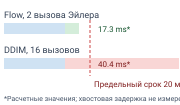
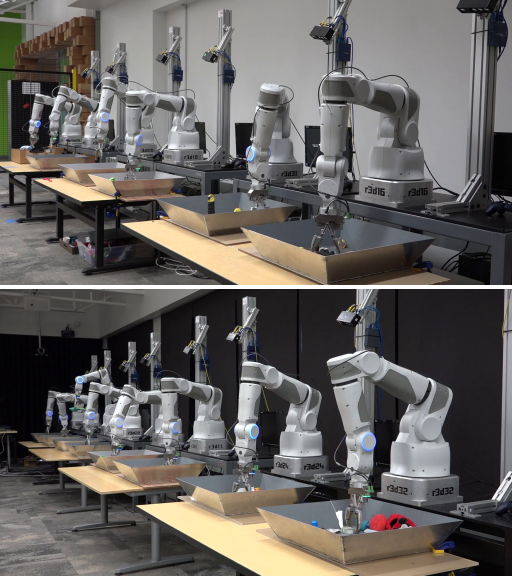
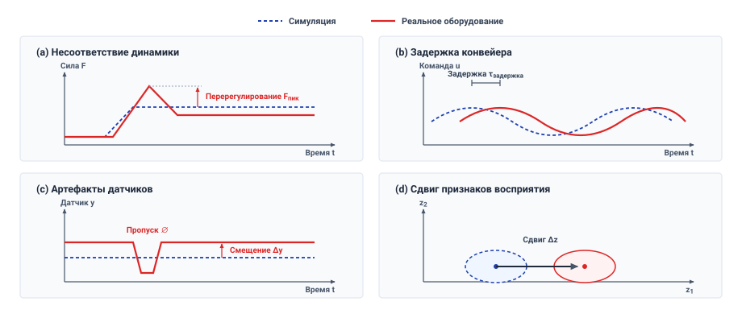
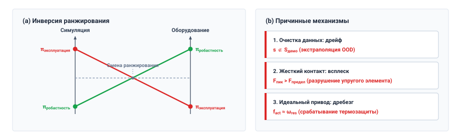

# Обучение политики

## Цель

_Почему политика, преуспевающая в каждом симулированном прогоне, может сломать оборудование при первом реальном контакте?_

Физические пробы и ошибки потребляют не только вычисления, но и само оборудование. Исследовательское действие способно перегреть обмотку двигателя, обрушить напряжение батареи или перегрузить передачу прежде, чем политика получит осмысленный сигнал награды. Поэтому синтез физических политик преимущественно смещается к офлайн-демонстрациям и высокоэмулируемым физическим симуляторам. Однако каждый источник опыта оставляет в обученных нейронных весах различные несмоделированные индуктивные смещения. Демонстрации покрывают лишь номинальные посещенные траектории, наивные функции потерь регрессии усредняют различные мультимодальные решения в нежизнеспособные интерполированные действия, а решатели симуляции вознаграждают нефизические контактные обходы, которые оборудование мгновенно наказывает.

Ни одно из этих расхождений не проявляется в офлайн-метриках обучения, но все они вместе с весами попадают на машину. Безопасное развертывание обученных политик требует выбора режимов обучения, соответствующих охвату датасета, измерения того, где численные решатели расходятся с реальной динамикой объекта управления по трению, податливости и задержкам, и строгого ограничения области, где политика остается корректной. Любое несмоделированное предположение, оставленное без проверки в ПО, в конечном итоге решается на каузальной границе, где команды доставляют электромагнитную энергию и необратимую механическую работу, которую ПО никогда не может отозвать.

> **Цели обучения**
>
> - Сравнивать режимы обучения по зависимости, которую каждый оставляет в весах, и отказу, который он порождает на оборудовании
> - Объяснять, почему малые ошибки клонированной политики накапливаются, как только она покидает продемонстрированные состояния
> - Объяснять, как функция потерь с квадратичной ошибкой превращает две допустимые демонстрации в действие, которого не совершал ни один демонстратор
> - Диагностировать отказ переноса, локализовав его в канале динамики, восприятия, внешнего вида или тайминга разрыва sim-to-real
> - Оценивать прогон тонкой настройки на реальной машине по наносимому им износу и аннулируемым прежним свидетельствам
> - Строить манифест политики, объявленная область эксплуатации которого исключает каждое состояние, не поддержанное данными или не смоделированное симулятором

## Синтез политик

Два обученных контроллера могут преуспевать в одной и той же задаче в номинальных условиях и все же отказывать на одной машине по разным причинам. Задача с защелкой клеточной двери из раздела [«Физические данные»](05_data.md#sec-data) имеет два таких контроллера. Первая политика защелки, `latch-bc-01`, была клонирована из демонстраций телеуправляемого открывания двери кампании защелки. Вторая, `latch-sim-02`, стартовала от `latch-bc-01` и была уточнена обучением с подкреплением в физическом симуляторе.

При номинальной ответной планке и охраняемой скорости подхода `0.03 m/s` (условно; см. руководство для читателя) обе политики открывают дверь. Их режимы отказа расходятся, как только условия покидают эту точку. Когда дверь просела и ее ответная планка стоит на несколько миллиметров вне номинала, первая коррекция клонированной политики попадает в состояние, которого ее демонстрации никогда не посещали, потому что кампания демонстраций не записывала смещенную планку. Каждая последующая команда, выдаваемая с выбранным периодом заданий `20 ms`, накапливает ошибку, пока захват не заклинит о край планки. Симулированная политика отказывает на номинальной планке. Ее симулятор моделировал контакт как мягкую штрафную пружину, поэтому оптимизатор обнаружил, что подход на `0.10 m/s` ничего не стоит. На реальной планке контактная сила растет пропорционально скорости подхода и времени, и на этой скорости она достигает предела защелки `100 N` через `2.5 ms` после касания — лишь немного дольше, чем отклик контактного контура `2 ms` (скорость, предел и время отклика условны). Это оставляет слишком мало времени на сброс скорости подхода, поэтому нырок перегружает защелку. Режим сбора данных определил, что видела политика, а симулятор сформировал ее предположения о физическом мире.

Оба отказа защелки разделяют одну структуру. Каждый режим обучения оставил в весах зависимость. Клонированная политика зависела от состояний, которые случайным образом покрыли ее демонстрации, а симулированная — от модели контакта, более мягкой, чем планка; в обоих случаях условие развертывания, нарушившее зависимость, произвело отказ, которого не показывал ни один обучающий балл. Практический выбор поэтому состоит в том, какой источник опыта учит необходимому восстановлению, не пряча динамику актуаторов, и какие физические свидетельства должны предшествовать полномочиям над актуаторами. Ответ путешествует с контрольной точкой в виде записи состояний, в которые она может входить. При любом режиме контрольная точка лишь предлагает фрагменты пути разрешения ([«Машина в пяти уровнях»](01_causal_boundary.md#sec-boundary-machine-model)), а обучение, никогда не моделировавшее этот путь, дает политику, чьи всплески момента путь разрешения обязан отклонять, или чьи предложения непрерывно задевают его пределы.

## Режимы синтеза политик

Задача защелки могла опираться на четыре источника опыта: телеуправляемые открывания двери из раздела [«Физические данные»](05_data.md#sec-data), журнал несовершенных или сценарных прогонов с дверью, симулятор клеточной двери и само плечо. Каждый покупает разную способность по разной физической цене, и [«Матрица компромиссов режимов синтеза политик»](06_training.md#tbl-06-regimes) ставит их рядом с отказом, за который каждый известен, и проверкой, которая его перехватывает.

| Режим синтеза политики                | Основная покупаемая способность                                                                                    | Бюджет данных и вычислений                                                                                                | Эффективность выборки и масштаб                                                                                          | Риски безопасности оборудования и износа                                                                                                             | Доминирующий режим отказа и перехватчик                                                                                                                                                                      |
|:-----------------------------------|:-------------------------------------------------------------------------------------------------------------------|:-------------------------------------------------------------------------------------------------------------------------|:---------------------------------------------------------------------------------------------------------------------|:----------------------------------------------------------------------------------------------------------------------------|:--------------------------------------------------------------------------------------------------------------------------------------------------------------------------------------------------------|
| **Поведенческое клонирование (BC)**     | Прямое подражание продемонстрированным траекториям без проектирования награды или идентификации системы             | $10^2$–$10^3$ траекторий телеуправления (данные $\sim 10$–$50\text{ h}$); вычисления $<50\text{ GPU-h}$                    | Контролируемое $\mathcal{O}(N)$ по демонстрациям эксперта; фиксированная пропускная способность данных $1\times$ реального времени | Минимальный риск исследования при записи; ноль исследования на оборудовании при оптимизации                                   | Квадратичное нарастание ошибки ($\mathcal{O}(T^2 \epsilon)$) через ковариантный сдвиг. *Перехватчик*: мониторы плотности на ядрах/Махаланобиса, ограничители на границе выпуклой оболочки                  |
| **Офлайн-/пакетное RL**                | Управляемая ценностью оптимизация политики по фиксированным гетерогенным неоптимальным журналам; сшивает переходы разных траекторий | $10^5$–$10^7$ записанных переходов с охватом состояние–действие; вычисления $100$–$500\text{ GPU-h}$                       | Офлайн $\mathcal{O}(N)$ по статическим датасетам; эффективно по выборке, но требует высокого перекрытия состояние–действие | Ноль рисков активного исследования при офлайн-обучении; запись требует клеточных стендов или безопасных сценарных контроллеров | Экстраполяция действий вне распределения и переоценка Q-ценности. *Перехватчик*: штрафные границы консервативного Q-обучения (CQL), фильтры поддержки действий                                             |
| **Обучение с подкреплением sim-to-real** | Открытие динамической незахватывающей манипуляции и подвижной локомоции через миллиарды неограниченных прогонов       | Ноль физических данных; $10^7$–$10^9$ симулированных переходов в $10^3$–$10^4$ GPU-средах; $500$–$5000\text{ GPU-h}$      | Низкая алгоритмическая эффективность выборки ($10^7$–$10^9$ шагов), компенсируемая ускорением симуляции $10^3\times$–$10^5\times$ | Ноль износа оборудования и повреждений при столкновениях во время обучения; серьезный риск развертывания при расхождении динамики объекта управления | Использование артефактов численного решателя (контактное взаимопроникновение, нулевая задержка). *Перехватчик*: бюджеты расхождения парных трасс, ограничители производной силы ($dF/dt$)                      |
| **Остаточное RL и тонкая настройка на реальной машине** | Прямая коррекция политики против физической податливости контакта, гистерезиса редуктора и истинного шума датчиков | $10^3$–$10^5$ физических шагов ($0.5$–$10\text{ h}$ времени по часам); вычисления $<20\text{ GPU-h}$                     | Требуется высокая эффективность выборки (SAC/TD3 или формулировка остаточного delta-действия); строго $1\times$ реального времени | Высокая физическая наработка; повторяющиеся ударные нагрузки разрушают редукторы; исследовательская дрожь тока поднимает температуру обмотки | Катастрофическое забывание номинальной устойчивости транзита, локальный коллапс политики. *Перехватчик*: границы дрейфа параметров ($\Vert\Delta \theta\Vert_2 \le \delta$), замороженные регрессионные наборы, тепловые ограничители |

***Матрица компромиссов режимов синтеза политик**: Сравниваемые четыре режима — поведенческое клонирование, офлайн-обучение с подкреплением, обучение с подкреплением sim-to-real и остаточное RL с тонкой настройкой. Колонки детализируют основную эксплуатационную способность, покупаемую в ходе обучения, репрезентативные бюджеты данных и вычислений, границы эффективности выборки, риски безопасности при сборе данных и доминирующие сигнатуры отказов с соответствующими перехватчиками пути разрешения.*

Из четырех **поведенческое клонирование** — самый дешевый путь к работающей политике и тот, чей режим отказа изучен лучше всего. Оно формулирует синтез политики как контролируемую регрессию или классификацию по собранному датасету пар состояние–действие эксперта $\mathcal{D} = \{(\mathbf{o}_t, \mathbf{a}_t)\}$. Следуя отборам действий из раздела [«Какое действие становится меткой»](05_data.md#sec-data-action-label), датасет демонстраций сопоставляет наблюдения либо с отображенными заданиями оператора, либо с заданиями, допущенными путем разрешения:
$$\mathcal{D}_{\text{intent}} = \left\{ \left(\mathbf{o}_t, \mathbf{a}_{\text{cmd}, t:t+H-1}\right) \right\} \quad \text{versus} \quad \mathcal{D}_{\text{verified}} = \left\{ \left(\mathbf{o}_t, \mathbf{a}_{\text{enf}, t:t+H-1}\right) \right\}$$
Клонирование отображенных заданий ($\mathbf{a}_{\text{cmd}}$) — намерения оператора в собственных координатах робота до того, как действует путь разрешения, — обучает модель демонстрационному намерению, тогда как клонирование заданий, допущенных путем разрешения ($\mathbf{a}_{\text{enf}}$), впечатывает его профили барьерного замедления прямо в веса сети, и политика наследует замедления, настроенные под пределы именно этого пути. В стандартной формулировке целевая функция оптимизации минимизирует многошаговую потерю предсказания по непрерывным последовательностям действий, взятым из траекторий демонстраций (классические формулировки регрессии см. в разделе [«Усреднение по модам и декодеры без него»](appendix_ml.md#sec-appendix-ml-multimodal)).[^fn-hist-alvinn-cloning]
Поскольку эта потеря штрафует лишь расхождение между командованным действием и записанной демонстрацией в наблюдаемых состояниях, обучающая цель не оценивает выполнение задачи, конечную стоимость или устойчивость замкнутой динамической системы. Она лишь подгоняет действия к наблюдениям.

> ↰ **Предпосылка:** Кортеж четырехпоточного отбора действий, разделяющий намерение и принудительное обеспечение, сформулирован в разделе [«Какое действие становится меткой»](05_data.md#sec-data-action-label).

[^fn-hist-alvinn-cloning]: **Искажение перспективы дороги в ALVINN**: Система Pomerleau Autonomous Land Vehicle in a Neural Network (ALVINN) [Pomerleau, 1989](references.md#pomerleau1989alvinn), о которой рассказано в разделе [«Откуда берутся физические данные»](05_data.md#sec-data-collection-sources), дрейфовала к краю полосы, потому что ее водители-люди никогда не демонстрировали восстановления от него. Чтобы поставить примеры восстановления без небезопасной езды, Pomerleau применил синтетическое искажение перспективы, отрисовывая сдвинутые вбок и повернутые изображения дороги в паре с преобразованными коррекциями руления, — ранний случай дополнения демонстраций восстановительными данными вне номинальной траектории.

### Сбой мультимодальности и усреднение по модам

Когда человеческие демонстраторы выполняют физическую задачу, их стратегия часто мультимодальна. Рассмотрим сценарий обхода препятствия, в котором мобильное основание или роботизированное плечо должно обойти центральный столб. Человек-демонстратор может в половине демонстраций проходить мимо столба слева, а в оставшейся половине — справа. Истинные данные демонстраций содержат различные допустимые выборы, но ноль примеров езды прямо посередине.

Детерминированная политика поведенческого клонирования с точечной регрессией не способна представить оба выбора для одного и того же наблюдения. Под функцией потерь с квадратичной ошибкой ее оптимальный выход — условное среднее (вывод см. в разделе [«Усреднение по модам и декодеры без него»](appendix_ml.md#sec-appendix-ml-multimodal)),[^fn-math-mode-averaging] здесь — середина между командами «повернуть налево» и «повернуть направо». Политика выдает нулевую боковую скорость, веля машине ехать прямо в препятствие — действие, которого никогда не было в датасете демонстраций.

[^fn-math-mode-averaging]: **Усреднение мод при $L_2$-потере**: При регрессионной потере $L_2$ ожидаемый риск $\mathcal{R}(\hat{a}) = \int \|\hat{a} - a\|_2^2 p(a \mid o) da$ строго выпукл по $\hat{a}$. Дифференцирование по $\hat{a}$ и приравнивание градиента к нулю дает $2 \int (\hat{a} - a) p(a \mid o) da = 0 \implies \hat{a}^* = \int a p(a \mid o) da = \mathbb{E}[a \mid o]$. Для нелинейного объекта управления $f_{\text{plant}}$ величина $\mathbb{E}[f_{\text{plant}}(a)]$ обычно отличается от $f_{\text{plant}}(\mathbb{E}[a])$; равенство может выполняться в отдельных распределениях. Для выпуклой стоимости действия $c(a)$ неравенство Йенсена дает $c(\mathbb{E}[a]) \le \mathbb{E}[c(a)]$, но оно не устанавливает физической безопасности усредненного действия. В примере с препятствием среднее лежит вне продемонстрированного множества допустимых путей.

Технологический объект управления показывает, что для усреднения мод не нужна геометрия. Допустим, демонстрации регулятора расхода чередуются между двумя иллюстративными режимами задвижки — байпасным режимом при 10 % открытия и режимом основной подачи при 90 % — в равных долях. Клонирование с квадратичной ошибкой выдает их среднее — 50 % открытия, — расход, которого не требует ни один режим и под который объект управления никогда не калибровали. Этот промежуточный расход может вызвать кавитацию подающего насоса и сорвать тепловой срок, на который был настроен каждый режим. Препятствие здесь ни при чем, поэтому никакая геометрическая проверка предложения его не поймает; его ловит только проверка по продемонстрированным режимам.

Граница мод также порождает отказ тайминга — временную несогласованность в высокочастотном одношаговом контроллере. В иллюстративном контроллере $50\text{--}100\text{ Hz}$ шум датчиков сдвигает последовательные наблюдения через эту границу, и политика, отображающая лишь $o_t \to a_t$, чередует запросы $+10\text{ N}\cdot\text{m}$ и $-10\text{ N}\cdot\text{m}$. Возбуждает ли это чередование резонанс, износ или нагрев обмотки, зависит от привода и нагрузки, поэтому это режим отказа, который следует проверять, а не свойство каждой одношаговой политики.

Усреднение мод — отказ на единичном наблюдении. У поведенческого клонирования есть второй отказ, проявляющийся только когда политика работает в замкнутом контуре. Ее собственные ошибки уводят машину с состояний, которые покрывают ее демонстрации, где функция потерь не подавала обучающего сигнала, — так `latch-bc-01` заклинивает на просевшей двери. По принципу [«Эндогенные данные»](part2_teaching.md#pri-vol4-endogenous-drift) собственные действия политики выбирают, какие состояния она посетит следующими, поэтому фиксированный архив не может их предвидеть, а для клонирования одним экспертом худший случай стоимости растет как квадрат горизонта ([«квадратичный дрейф данных»](05_data.md#eq-data-quadratic-drift), развито в разделе [«Эндогенный опыт»](05_data.md#sec-data-endogenous-experience)). Низкая валидационная потеря на отложенных демонстрациях поэтому измеряет точность лишь на состояниях, посещенных демонстратором; она ничего не говорит о том, как политика возвращается после смещения. Корректирующая агрегация размечает собственные состояния обучающегося и, при своих предположениях о разметке экспертом, снижает этот рост до линейного ([«Данные вмешательств и восстановления»](05_data.md#sec-data-intervention-recovery)), но на физической машине эти состояния достигаются запуском непроверенной политики, которая может ударить по фиксатору или повредить передачу до вмешательства супервизора.

> **Нарастающая ошибка прогона**
>
> ***Нарастающая ошибка прогона*** — квадратичное накопление дрейфа слежения замкнутого контура, возникающее, когда политика разомкнутого контура с контролируемым обучением исполняется последовательно на физической динамической системе; в ожидании она ограничена выражением:
> $$J(\pi) - J(\pi^*) \le \mathcal{O}(T^2 \epsilon)$$
> где $T$ — горизонт выполнения задачи, а $\epsilon = \mathbb{E}_{\mathbf{s} \sim d_{\pi^*}} [\mathbb{I}(\pi(\mathbf{s}) \ne \pi^*(\mathbf{s}))]$ — частота одношаговых ошибок политики на распределении демонстраций $d_{\pi^*}$.
>
> 1.  **Значение**: Доказывает, что минимизация одношаговой ошибки предсказания на офлайн-демонстрациях фундаментально недостаточна для устойчивости замкнутого контура; любая ненулевая частота ошибок $\epsilon > 0$ в конечном счете выносит физическое состояние за пределы продемонстрированной поддержки.
> 2.  **Отличие**: В отличие от статического контролируемого обучения, где валидационная ошибка масштабируется линейно с числом образцов, нарастающая ошибка прогона связывает ошибки политики с физикой среды, превращая малые начальные отклонения траектории в необратимое расхождение состояния.
> 3.  **Распространенная ловушка**: Предположение, будто низкая офлайн-валидационная потеря на отложенных сплитах демонстраций превращается в высокую долю успеха задачи в замкнутом контуре, с игнорированием того, что офлайн-датасеты не содержат ни одного примера возврата к номинальной поддержке после возмущения.

### Что меняет фрагментация действий — и что остается нерешенным

Фрагментация действий ([«Временное фрагментирование действий»](03_brain.md#dfn-brain-action-chunking)) способна улучшить временную согласованность и снизить частоту предложений в генеративных архитектурах, таких как диффузионные политики и Action Chunking with Transformers (ACT). Она также может устранить чередование из примера с границей мод выше. Политика фрагментации, предсказывающая $H$ будущих действий $\mathbf{a}_{t:t+H-1}$ разом, улучшает исполнение тремя механизмами:

1. **Временная и динамическая согласованность**: Вместо того чтобы порождать разрозненные одношаговые предсказания, которые дребезжат, модель предсказывает всю согласованную траекторию целиком.
2. **Сохранение выбранной моды**: Одношаговые марковские политики склонны к каузальной путанице, принимая мимолетные ложные корреляции за намерение задачи. Обусловливание историей траектории и предложение фрагмента помогают удержать выбранную моду в смежных действиях.
3. **Перепланирование на убывающем горизонте и временное ансамблирование**: Развернутая политика запрашивает свежий фрагмент каждые несколько шагов и смешивает перекрывающиеся предсказания ([«Питание, свежесть и стена памяти»](03_brain.md#sec-brain-cognitive-pipeline)), что допускает периодическую обратную связь при сохранении многошагового предложения.

Ни один из этих механизмов не меняет границу поддержки поведенческого клонирования $\mathcal{O}(T^2 \epsilon)$. Как продемонстрировано теоретически и эмпирически в разделе [«Нарастающий ковариантный сдвиг при обучении с подражанием»](06_training.md#fig-06-compounding-error), одношаговое поведенческое клонирование переживает крутое падение выживания задачи по мере роста горизонта прогона $T$, попадая в огибающую катастрофического вмешательства ($<18\text{ percent}$ survival) в пределах 250 шагов управления при $50\text{ Hz}$. Хотя временные архитектуры вроде BC-RNN отодвигают начало расхождения, их квадратичное нарастание ошибки асимптотически остается тем же. Напротив, интерактивная агрегация на политике (DAgger [Ross et al., 2011](references.md#ross2011reduction)) ограничивает рост ошибки линейно до $\mathcal{O}(T \epsilon)$, собирая обратную связь эксперта на состояниях, посещенных обучающимся. Без интерактивных супервизоров современные генеративные политики противостоят накапливающемуся дрейфу через фрагментацию действий ($K=16$), сокращающую эффективный горизонт исполнения до $T_{\text{eff}} = T/K$ (ACT [Zhao et al., 2023](references.md#zhao2023learning)), и непрерывную диффузионную перепланировку на убывающем горизонте [Chi et al., 2024](references.md#chi2024diffusionpolicy), удерживая выживание задачи выше $80\text{ percent}$ на протяженных 500-шаговых горизонтах манипулирования.

***Нарастающий ковариантный сдвиг при обучении с подражанием**: Выживание задачи и доля внутри огибающей в зависимости от горизонта прогона замкнутого контура $T$ при $50\text{ Hz}$ ($10\text{ seconds} = 500\text{ steps}$). Одношаговое поведенческое клонирование страдает от квадратичного нарастания ошибки $\mathcal{O}(T^2 \epsilon)$ [Ross et al., 2011](references.md#ross2011reduction), падая в огибающую катастрофического отказа в пределах 250 шагов. DAgger ограничивает накопление ошибки линейно $\mathcal{O}(T \epsilon)$ через интерактивную перемаркировку на политике. Современная фрагментация действий (ACT [Zhao et al., 2023](references.md#zhao2023learning)) сокращает эффективный горизонт нарастания на $K=16$, тогда как Diffusion Policy на убывающем горизонте [Chi et al., 2024](references.md#chi2024diffusionpolicy) достигает выживания выше 80 % на 500 шагах исполнения.*

Увеличение размера датасета, емкости модели или настройка способны снизить одношаговую частоту ошибок на оцениваемых наблюдениях и тем самым уменьшить вероятность первой ошибки политики за фиксированный горизонт. Это улучшение не характеризует происходящее после ошибки. Внешнее возмущение, неоткалиброванная полезная нагрузка или просадка напряжения тоже могут увести машину в слабо обеспеченные состояния без расхождения политики. Восстановительные данные, измеренная динамика и независимые пределы времени выполнения решают, остается ли любое из этих событий внутри физической огибающей.

Дрейф с продемонстрированных состояний не поднимает собственной тревоги, поэтому обнаружить его до физического контакта нельзя на офлайн-обучающей функции потерь. Нужна телеметрия времени выполнения, отслеживающая поддержку пространства состояний напрямую: измеряющая расстояние Махаланобиса в пространстве признаков, оценивающая эпистемическую неопределенность модели или обеспечивающая явный монитор огибающей на пути разрешения, срабатывающий, когда траектории состояний покидают выпуклую оболочку датасета демонстраций.

### Что стоит выбор декодера во время выполнения

Точечный регрессионный декодер усредняет различные допустимые действия в недопустимую команду, и несколько семейств декодеров избегают среднего: сети смеси плотностей, неявное клонирование на энергии, условная диффузия и сопоставление потоков, фрагментация со скрытыми переменными, такая как ACT, и дискретные токены действий в моделях зрение–язык–действие (VLA). Разделы [«Усреднение по модам и декодеры без него»](appendix_ml.md#sec-appendix-ml-multimodal) и [«Непрерывная диффузия траекторий и сопоставление потоков»](appendix_ml.md#sec-appendix-ml-diffusion) развивают их функции потерь и процедуры выборки. Ни один из них не поставляет отсутствующих состояний восстановления. Что выбор меняет для машины, — это его цена во время выполнения, потому что закрепленный на момент обучения декодер задает, сколько вычислений сети требует каждый фрагмент.

*Шаги шумоподавления задают время вывода фрагмента, и лишь малократный сэмплер синхронно укладывается в период заданий.*

Число шагов — это цена, которая достигает предельного срока управления. Диффузионный декодер порождает каждый фрагмент повторным шумоподавлением, и каждый шаг — полное вычисление предсказывающего шум действия выхода сети, поэтому время вывода масштабируется с числом шагов (член уточнения задержки фрагмента в разделе [«Питание, свежесть и стена памяти»](03_brain.md#sec-brain-cognitive-pipeline)). При числах шагов и времени на шаг, принятых в разделе [«Непрерывная диффузия траекторий и сопоставление потоков»](appendix_ml.md#sec-appendix-ml-diffusion), многократный сэмплер неявной модели диффузионного шумоподавления (DDIM) превышает период заданий `20 ms` при синхронном запуске, тогда как малократный сэмплер сопоставления потоков укладывается в него, лишь бы эти немногие шаги удовлетворяли критерию качества действий задачи. Декодер, который не может уложиться в период синхронно, работает асинхронно. Прикладной процессор обновляет буфер фрагментов с меньшей частотой, а путь разрешения читает новейший фрагмент со своей частотой, проверяет его свежесть и переходит на резерв, когда тот истекает, так что исполнение команды никогда не ждет инициатора. Собственная политика фрагментов машины — именно этот асинхронный случай. Она возобновляет фрагмент каждые `50 ms`, поэтому ее предельный срок вывода — этот период фрагмента, а период заданий `20 ms` лишь задает темп воспроизведения заданий внутри фрагмента.

Как описано в разделах [«Архитектура диффузионной политики»](appendix_ml.md#fig-diffusion-policy-architecture) и [«Непрерывная диффузия траекторий и сопоставление потоков»](appendix_ml.md#sec-appendix-ml-diffusion), политика обусловливается историей наблюдений изображений и состояний шарниров, чтобы итеративно шумоподавлять фрагмент действий $\mathbf{A}^0 \in \mathbb{R}^{K \times D_a}$ из чистого гауссова шума. Вместо исполнения всего горизонта предсказания машина отправляет горизонт исполнения микроконтроллеру реального времени до наступления перепланировки на убывающем горизонте. Формальный двухтактный конвейер — связывающий асинхронное обратное диффузирование на хосте с детерминированной сплайн-интерполяцией, ограничением частоты и безопасными ограничениями на микроконтроллере — изложен в разделе [«Непрерывная диффузия траекторий и сопоставление потоков»](appendix_ml.md#sec-appendix-ml-diffusion).

> ↳ **Далее:** Аппаратное размещение многотактных буферов фрагментов действий между прикладным процессором и микроконтроллером безопасности разработано в разделе [«Два пути на одном кристалле»](13_placement.md#sec-placement-two-paths-one-die).

### Офлайн-обучение с подкреплением и сдвиг распределения действий

Когда физические датасеты демонстраций $\mathcal{D} = \{(s_t, a_t, r_t, s_{t+1})\}$ содержат гетерогенные или неоптимальные траектории (например, смесь телеуправления, сценарных программ и исследовательской игры человека), поведенческое клонирование испытывает трудности, потому что относится ко всем демонстрациям с одинаковым контролируемым весом. В классическом обучении с подкреплением, формулируемом через марковские процессы принятия решений (MDP) [Sutton and Barto, 2018](references.md#sutton2018reinforcement), агент оптимизирует политику для максимизации ожидаемой дисконтированной кумулятивной награды $J = \mathbb{E}\left[\sum_{t=0}^\infty \gamma^t r(s_t, a_t)\right]$. **Офлайн-обучение с подкреплением (пакетное RL)** стремится оптимизировать политику напрямую из журналов записанных переходов без активного исследования на оборудовании, используя сигналы награды, чтобы сшить высокоэффективные составные траектории из разрозненных несовершенных демонстраций [Kumar et al., 2020](references.md#kumar2020conservative).

Однако применение стандартного Q-обучения к статическим офлайн-датасетам запускает режим отказа, известный как **переоценка действий вне распределения (OOD)**. В стандартном обучении с подкреплением алгоритм оценивает ценность будущих состояний, прося свою сеть ценности предсказать наивысшую возможную награду со следующего шага (формальные уравнения Беллмана см. в разделе [«Функции ценности и обоснование аффордансов»](appendix_ml.md#sec-appendix-ml-affordances)). Этот максимум берется по всему непрерывному пространству действий. Для действий, никогда не исполненных в записывающем датасете, сеть не получала обучающего сигнала и часто выдает ошибочно большие оценки ценности из-за дисперсии обобщения, предсказывая высокую награду за непробованное физическое действие. Алгоритм жадно выбирает эти ложные пики, распространяя чрезмерно оптимистичные ошибки ценности назад. При развертывании политика выбирает эти необеспеченные действия и способна командовать движениями, которые заклинивают шарнир или бьют в границу.

Чтобы уменьшить переоценку ценности без запросов к физической среде, **консервативное Q-обучение (CQL)** добавляет регуляризатор к офлайн-цели Беллмана.[^fn-math-cql-bound] Оно штрафует высокие ценности для действий, выбранных обученной политикой, относительно действий из записанных данных. Ограниченный охват состояние–действие и ошибка аппроксимации остаются, поэтому путь разрешения по-прежнему проверяет то, что предлагает итоговая политика.

[^fn-math-cql-bound]: **Область действия границы CQL**: При своих предположениях о покрытии данных, оптимизации и аппроксимации функций CQL строит консервативную оценку, чья *ожидаемая величина для политики* является нижней границей истинной величины этой политики [Kumar et al., 2020](references.md#kumar2020conservative). Это не поточечная граница для каждой пары состояние–действие или каждого датасета, и ожидаемый возврат не удостоверяет физическую безопасность.

Клонирование, фрагментация и офлайн-обучение ценности остаются внутри поддержки записанных данных, а консервативное Q-обучение делает офлайн-политику более осторожной, не расширяя эту поддержку. Когда в записанных переходах нет высокоэффективных траекторий или восстановительных маневров, которые требуются динамическому манипулированию или подвижной локомоции, система должна собирать новый опыт через пробы в замкнутом контуре.

## Обучение пробами

Клонированная политика защелки отказала на смещенной планке, потому что ни одна демонстрация никогда ее не показывала. Обучение пробами закрывает эту слепую зону, позволяя политике в замкнутом контуре порождать собственные траектории состояние–действие. Такие алгоритмы, как Q-обучение или градиенты политики, настраивают политику по наградам, зарабатываемым ее собственными действиями, поэтому исследовательское действие, толкающее захват с его номинального пути, вынуждает оптимизатора оценивать восстановление именно из этого возмущенного состояния, включая почти-столкновения и неустойчивые контакты, которых оператор никогда не проявляет. Выбирая переходы из распределения состояний, порождаемого текущими весами, обучение по пробам тренируется на состояниях, которых политика действительно достигает, что устраняет ковариантный сдвиг, лежащий за квадратичным ростом ошибки клонирования в худшем случае.

Исследование в замкнутом контуре на оборудовании оплачивается сначала календарным временем, которое зависит от того, сколько прогонов нужно алгоритму, сколько длится каждый прогон, сколько занимает сброс и сколько машин работает параллельно. Рассмотрим саму задачу открывания двери, в которой плечо регулирует контактные силы на активном горизонте $t_{\text{rollout}}$ = `8 s` — автономной контактной фазе открывания, а не полной попытки телеуправления. Обучение с подкреплением на высокоразмерных сенсорных входах может потребовать порядка $N = 10^6$ прогонов, чтобы обнаружить согласованные профили силы–скорости, — масштаб кампании захватов с [«Фермы обучения политик на физике»](06_training.md#fig-06-robot-arm-farm). На одной физической машине с $P = 1$ чистое время исполнения составляет уже `8.0 × 10⁶ s`, примерно `92.6 days` непрерывной круглосуточной работы, не считая накладных расходов на сбросы.

Учет фазы сброса обнажает истинное узкое место физического эксперимента во времени. Если специализированный автоматический фиксатор, более быстрый, чем повторная постановка защелки на стенде сбора ([«Стоимость демонстраций телеуправления»](05_data.md#sec-data-teleop-costs)), снова ставит защелку на дверь и возвращает плечо в исходную позу за $t_{\text{reset,auto}}$ = `4 s`, общее время сбора миллиона прогонов разрастается до `1.2 × 10⁷ s`, или `138.9 days`. Когда исследовательские траектории заклинивают кулачок защелки или вызывают срабатывания по перегрузке шарниров током, автоматический сброс становится невозможным, и оператору-человеку приходится освобождать защелку, заново ставить дверь и переиндексировать плечо. Если же каждый прогон требует ручного сброса в среднем $t_{\text{reset,manual}}$ = `30 s`, потребность во времени по часам вырастает до `439.8 days`. Масштабирование физического параллелизма до кластеров из $P = 14$ синхронизированных стендов ([«Ферма обучения политик на физике»](06_training.md#fig-06-robot-arm-farm)) сжимает календарную длительность до нескольких недель [Levine et al., 2018](references.md#levine2018learning), но пропорционально умножает физическую площадь, капитальные вложения, электропитание и надзорный труд человека.

***Ферма обучения политик на физике**: Четырнадцать манипуляторов собрали более 800 000 физических попыток захвата за несколько месяцев [Levine et al., 2018](references.md#levine2018learning). Аппаратный параллелизм делит календарное время, но не стоимость, поскольку каждая станция добавляет капитал, износ редуктора и подшипников, тепловую нагрузку на обмотки двигателей и долю надзорного труда, необходимую для уборки упавших предметов и расклинивания. Источник: [Levine et al., 2018](references.md#levine2018learning).*

Время часто не является связывающим ограничением; им является износ. Каждое открывание двери нагружает каждый шарнир плеча примерно через $n_{\text{rev}} = 4$ двунаправленных реверса нагрузки, поэтому $N = 10^6$ прогонов накапливают `4.0 × 10⁶` таких реверсов в трансмиссии.[^fn-hw-bearing-life] Те же миллион контактных событий изнашивают кулачок защелки и ответную планку, раздавливают податливые прокладки захвата и циклируют проводку плеча к усталостному разрушению.

[^fn-hw-bearing-life]: **Ресурс подшипника против реверсов команд**: ISO 281 оценивает усталостный ресурс качения подшипника при заданных нагрузке и скорости. Каталог редукторного блока может выражать $L_{10}$ подшипника волнового генератора в часах работы при номинальных условиях; ни одно из этих чисел не переводит командные реверсы в израсходованные редукторы без модели цикла нагрузки, специфичной для блока.

В чисто вычислительной среде исследовательская ветвь, ставшая численно неустойчивой, ничего не стоит, кроме отброшенного буфера. На работающей машине исследование необратимо. Неограниченный исследовательский момент вбивает захват в жесткие фиксаторы, гнет гибкие элементы тензодатчика, срывает зубья волновой передачи и нагревает статоры двигателей за порог изоляции класса F $155^\circ\text{C}$.[^fn-hw-thermal-insulation]

[^fn-hw-thermal-insulation]: **Предел температуры обмотки**: Раздел [«Тепловые циклы нагрузки»](02_body.md#sec-body-thermal-duty-cycles) дает класс нагревостойкости F по IEC 60085, лежащий в основе этого порога. Двухпозиционные (bang-bang) команды момента от нерегуляризованных функций награды способны удерживать ток достаточно высоким, чтобы быстро состарить изоляцию.

> ↰ **Предпосылка:** Тепловые пределы обмоток двигателей и кривые термического снижения номинала по моменту и скорости выведены в разделе [«Тепловые циклы нагрузки»](02_body.md#sec-body-thermal-duty-cycles).

Более того, физическая деградация меняет объект управления прямо в процессе обучения. По мере того как контактные поверхности полируются, люфт редуктора растет (увеличивая механический люфт или мертвую зону между зубьями), а конструкционные крепления ослабевают под повторяющейся вибрацией, физическое распределение переходов $p(s_{t+1} \mid s_t, a_t)$ на прогоне $n = 900\,000$ заметно отличается от первозданной динамики на прогоне $n = 1$. Управляемая машина мутирует под физической ценой сбора собственных обучающих данных.

Функция награды добавляет вторую хрупкость. В обучении по пробам скалярная награда — это спецификация интерфейса между намерением инженера и оптимизатором, и любое ограничение, которое она не измеряет и не штрафует, является свободной степенью свободы, которую оптимизатор будет использовать. Награда за быстрое слежение за заданием без штрафа за рывок или температуру обмотки сходится к двухпозиционному переключению между максимальным прямым и обратным усилием, которое вибрирует кронштейны и перегревает электронику привода. Когда контактная сила не измеряется, политика может научиться упираться шарниром с максимальным током в жесткий упор, потому что это убирает дрожание слежения. Сеть удовлетворяет предъявленной ей формуле, а не невысказанному здравому смыслу проектировщика.

Для систем с низкой размерностью, тривиальными сбросами, пренебрежимым износом и широкими запасами обучение с подкреплением прямо на оборудовании остается жизнеспособным. Симуляция становится обязательной там, где требуемое число образцов превышает время, бюджет, ресурс конструкции или допуск на риск аппаратуры, а $10^6$–$10^9$ переходов, нужных сложной политике мотора, переезжают в физический движок, параллельно работающий на вычислительном кластере.

Подмена меняет контракт между обучением и реальностью. Политика, обученная в симуляторе, не гнет никаких звеньев во время исследования, но наследует упущения награды и модели механики симулятора, и каждый несмоделированный разрыв трения, идеализированный контактный импульс и неохарактеризованная задержка становятся предположением, на которое она опирается. На физической машине эти неточности возвращаются как несмоделированные возмущения и отказы слежения.

## Симулятор как компонент системы

Считать симулятор внешним инструментом разработки — архитектурная ошибка. Компилятор производит машинные инструкции из исходного кода, но полученный двоичный файл не сохраняет скрытой зависимости от внутреннего аллокатора памяти компилятора, когда исполняется на стандартном оборудовании. Симулятор ведет себя иначе. Это восходящий компонент производства политик, чьи физические предположения, численные аппроксимации и упрощения границ навсегда впечатываются в параметры политики. Когда обученная нейронная сеть копируется на целевую машину, симулятор отсутствует в пути исполнения, однако политика действует так, будто каждая несмоделированная динамика этого симулятора остается истинной. Симулятор — активный компонент системной архитектуры со своей спецификацией, допусками и режимами отказа.

> **Вектор разрыва реальности sim-to-real**
>
> ***Вектор разрыва реальности sim-to-real*** $\boldsymbol{\Delta}_{\text{sim2real}} = [\Delta_{\text{dyn}}, \Delta_{\text{sens}}, \Delta_{\text{vis}}, \Delta_{\text{lat}}]$ — связанная многоканальная декомпозиция физических расхождений между симулированной и аппаратной средами, охватывающая механику контакта ($\Delta_{\text{dyn}}$), преобразование датчиков и шум ($\Delta_{\text{sens}}$), визуальный внешний вид ($\Delta_{\text{vis}}$) и асинхронные транспортные задержки и дрожание ($\Delta_{\text{lat}}$).
>
> 1.  **Значение**: Обращение с «разрывом реальности» как со скалярной метрикой сложности или чисто визуальным несовпадением областей заставляет инженеров упускать динамические и временные расхождения. Расхождения в противо-ЭДС актуаторов, податливости редуктора или дрожании шины истощают запас по фазе до того, как политика завершит свой первый физический шаг управления.
> 2.  **Отличие**: Неточное значение параметра (например, ошибка в 10 % массы звена) сохраняет каузальные дифференциальные уравнения движения, тогда как опущенный механизм (например, связь с нулевой задержкой или несмоделированное кулоновское прилипание–проскальзывание) полностью разрывает пути физической обратной связи, приводя политики к использованию нефизических артефактов симулятора.
> 3.  **Распространенная ловушка**: Полагаться исключительно на экстремальную рандомизацию области для перекрытия больших разрывов. Рандомизация параметров в нефизических диапазонах разбавляет емкость политики, приводя к излишне консервативному, вялому поведению, неспособному решать точные задачи на реальном оборудовании.

Как и любая аппаратная подсистема, симулятор требует формального контракта интерфейса, выраженного в величинах, которые можно измерить и заложить в бюджет. Этот контракт задает размерности наблюдений, границы действий, шаг времени симуляции $\Delta t$, транспортную задержку между выдачей команды и физическим исполнением команды, пределы момента и тока актуаторов, распределения шума датчиков, распределения сброса и условия завершения. Если симулятор задает контур наблюдений, работающий на $100\text{ Hz}$ с предполагаемым каналом датчика нулевой задержки и гауссовым шумом дисперсии $\sigma^2 = 1.0 \times 10^{-4}\text{ (rad/s)}^2$, политика учит коэффициенты обратной связи, настроенные под эту точную статистику сигнала, а несмоделированная задержка транспорта по шине $15\text{ ms}$ на физической машине аннулирует их. Двойник Dactyl ([«Схема переноса sim-to-real»](06_training.md#fig-06-sim2real-dactyl)) не мог в точности повторить свою физическую руку, поэтому его симулятор был откалиброван по реальной руке, а затем рандомизирован вокруг откалиброванных значений, и политика встретила несовпавший остаток как вариативность, против которой уже обучалась [Andrychowicz et al., 2020](references.md#andrychowicz2020learning).

Контракт интерфейса тем важнее, чем больше роль симуляции. [«Примеры пропускной способности симуляции»](06_training.md#fig-06-simulation-scaling) показывает пропускную способность прогонов, которую достигают некоторые параллельные ускорители, и для политик, требующих многих прогонов, симуляция способна стать основным источником обучающего опыта.

***Схема переноса sim-to-real**: Установка OpenAI Dactyl — 24-степенная Shadow Hand внутри клетки захвата движения рядом с цифровым двойником MuJoCo, в котором она обучалась [Andrychowicz et al., 2020](references.md#andrychowicz2020learning). Перенос покупается рандомизацией области по трению, демпфированию, усилениям актуаторов, массам, размерам и освещению вместе со смоделированными люфтом и задержкой действия, и работает это за счет того, что политика вынуждена считать несмоделированную физическую вариативность шумом, а не за счет повышения точности симулятора. Источник: [Andrychowicz et al., 2020](references.md#andrychowicz2020learning).*

> **Разрушение аппаратуры при переносе sim-to-real (2018)**
>
> **Контекст**: OpenAI обучила политику с подкреплением целиком в рандомизированной симуляции MuJoCo, чтобы переориентировать блок в 24-степенной Shadow Dexterous Hand, чьи шарниры приводятся через сухожилия двигателями в ее основании [Andrychowicz et al., 2020](references.md#andrychowicz2020learning).
>
> **Механизм**: Симулированная рука прикладывала момент прямо к своим шарнирам, тогда как физическая рука приводится сухожилиями и имеет значительный люфт. Авторы сглаживали каждое действие экспоненциальным скользящим средним — и в симуляции, и на роботе, — чтобы избежать резких изменений сигнала действия, способных повредить физическую руку.
>
> **Последствия**: Авторы сообщают о поломках робота во время физических экспериментов, чаще всего в вертикальном шарнире запястья, вероятно потому, что он несет наибольшую нагрузку. Каждый ремонт занимал время и часто менял аспекты системы, поэтому физические результаты собирались в разное время, и авторы относят поломки оборудования к ключевым трудностям работы.
>
> **Ответ**: Команда также обучила вторую политику с заблокированным шарниром крена запястья, и она перенеслась на физическую руку лучше.
>
> **Урок для систем**: Симулятор, который не изнашивается и не ломается, не способен заложить в награду цену физической наработки. Пределы, защитившие руку, — фильтр действия и заблокированный шарнир, — были наложены вне обученной политики, и каждый ремонт менял объект управления, на котором оценивалась политика.

***Примеры пропускной способности симуляции**: Иллюстративные значения шагов в секунду для различных симуляторов, задач, оборудования и настроек исполнения. Точки показывают, почему параллельные конструкции ускорителей способны поддерживать большие бюджеты прогонов; это не контролируемый продольный бенчмарк и не универсальный закон масштабирования.*

Когда симулятор использует неточную инерцию ротора, задавая $J = 2.0 \times 10^{-3}\text{ kg}\cdot\text{m}^2$ вместо истинных $2.5 \times 10^{-3}\text{ kg}\cdot\text{m}^2$, уравнения движения все равно вычисляют зависящий от ускорения инерционный момент. Ошибка параметра меняет величину отклика, но каузальная структура остается целой. Когда же симулятор опускает целый физический механизм — люфт трансмиссии, конструкционную податливость или дрожание межканальной связи, — он не просто зануляет соответствующий параметр. Он не предоставляет каузального механизма вовсе. Опущенная задержка или податливость представляют несмоделированную физическую степень свободы.[^fn-inc-dactyl-friction] Симулятор, опускающий податливость шарниров, допускает мгновенные реверсы момента, которые реальная трансмиссия превращает в нагружение зубьев шестерен и возбуждение структурных резонансов.

[^fn-inc-dactyl-friction]: **Рандомизация области OpenAI Dactyl**: На физической руке [Andrychowicz et al., 2020](references.md#andrychowicz2020learning) обнаружили, что политики, обученные без рандомизации физики или без добавленных моделей эффектов, которые симулятор опускает, — таких как люфт и задержка действия, — достигали куда меньшего числа последовательных вращений, чем политика, обученная со всеми ними.

Наиболее существенные упущения проистекают из того, как симуляторы обращаются с контактом. Жесткий контакт не гладок. Нормальная сила равна нулю, пока тела расходятся, и принимает любое сжимающее значение, препятствующее взаимопроникновению, как только они касаются, а скорость прыгает при ударе. Трение подчиняется кулоновскому конусу, и жесткие тела под кулоновским трением могут не иметь единственного решения вперед (парадокс Пенлеве). Физические движки идут по одному из двух численных путей ([«Механика контакта твердых тел»](appendix_control.md#sec-appendix-control-contact)). Комплементарные решатели сохраняют строгое невзаимопроникновение ценой, круто растущей с числом контактов, и могут зависать, когда геометрии защемляются. Штрафные и выпуклые релаксации заменяют жесткое ограничение виртуальным демпфером пружины, который быстро сходится на высоких частотах кадров, но позволяет твердым телам слегка взаимопроникать. Симулятор защелки идет вторым путем, и именно его мягкость `latch-sim-02` научился использовать.

### Контактная эксплуатация sim-to-real

Обучение с подкреплением оптимизируется против физики, которую представляет решатель, а не против физики объекта управления. В симуляторах, реализующих мягкие контактные релаксации или штрафные пружины, оптимизатор обнаруживает, что «погружение» в поверхность на $1.0\text{--}3.0\text{ mm}$ (отрицательный знаковый зазор $\phi(q) < 0$ между контактирующими поверхностями) дает два нефизических аффорданса:

1. Искусственная реакция демпфера пружины действует как мгновенный сток энергии, гася нисходящий импульс за один интеграционный шаг без отскока или пластической деформации.
2. Взаимопроникновение увеличивает эффективную площадь контактной поверхности в решателе, порождая нефизические боковые силы тяги, препятствующие проскальзыванию при агрессивных маневрах.

Плечо вбивает защелку в ее ответную планку с эффективной массой на стороне робота `12 kg` в центре инструмента. Допустим, штрафной контакт симулятора позволяет захвату погрузиться на иллюстративные `2.4 mm` в планку при быстром подходе `0.10 m/s`. Приравнивание кинетической энергии подхода к энергии пружины в пике сжатия дает пиковую силу $F_{\text{peak}} = v\sqrt{k\,m_{\text{eff}}}$, которая для симулированной пружины сводится к $m_{\text{eff}}v^2/\delta_{\text{pen}}$, или `50 N`, — ниже предела защелки `100 N`. Оптимизатор обучения с подкреплением фиксирует ноль штрафа за повреждения, высокую скорость задачи и максимальную награду и учится нырять в планку без торможения.

Когда политика переезжает на машину, реальная ответная планка не дает такой податливости. Ее контактная жесткость — иллюстративные `4.0 × 10⁵ N/m`, и тот же нырок достигает пика `219.1 N`, что в `4.4×` больше симулированной силы и в `2.2×` больше предела защелки. Способен ли путь разрешения предотвратить этот пик — вопрос времени. Контактная сила подчиняется $F = k\,\Delta x$ ([«Пределы передачи актуатора»](02_body.md#sec-body-actuator-limits)), и поскольку планка сжимается со скоростью подхода, $\Delta x = vt$ и сила растет как $F = kvt$ с момента касания. При быстром подходе предел защелки наступает через `2.5 ms` после касания — едва больше тех `2 ms`, которые нужны контактному контуру для отклика, тогда как при охраняемом подходе `0.03 m/s` он наступает через `8.3 ms`. Отклик, начинающийся с запасом `0.5 ms`, не способен замедлить плечо до пересечения силой предела, и нырок продолжается к этому пику. Предотвращение поэтому должно действовать до контакта. Независимо обеспечиваемая огибающая скорости подхода, например $v_{\text{max}}(z) \le \sqrt{2 a_{\text{brake}} z}$, где $z$ — оставшееся расстояние до планки, а $a_{\text{brake}}$ — валидированное замедление, ограничивает скорость касания, а контактный порог способен ограничить последующую нагрузку, лишь если его восприятие, отклик торможения и оставшееся сжатие валидированы. Именно контактный предельный срок, а не обучающая награда, ограничивает объявленный ODD политики защелки охраняемым подходом ([«Манифест политики»](06_training.md#sec-training-policy-manifest)).

Точность симулятора для контакта поэтому закладывается в бюджет в наблюдаемых механических величинах — тайминге начала контакта, пиковой нормальной силе, переданном импульсе, расстоянии проскальзывания и задержке раскрытия, — а не во внутренностях решателя. Расхождение может иметь и противоположный знак. Штрафной движок, разрешающий столкновение за один интеграционный шаг, концентрирует передачу импульса в резкий всплеск, тогда как деформация прокладки и конструкционная податливость на оборудовании растягивают ее на много миллисекунд. Интегрированный импульс может тогда почти совпадать, тогда как пиковая сила различается в несколько раз, и политика, научившаяся определять начало контакта по симулированному всплеску, никогда не видит этот всплеск на машине, поэтому продолжает давить, пока привод не достигнет предела по току.

> **Инвариант точности контакта**
>
> *Никогда не доверяйте симулированной политике контакта, успех которой зависит от мгновенного поглощения импульса или сцепления трения с нулевой задержкой; политика, полагающаяся на проникновение в цифровую поверхность, нагружает физическую деталь такой силой, которую симулятор никогда не показывал.*

Какие упущения важны, зависит от задачи. Политика, движущаяся только на высокой непрерывной скорости, может переносить грубую модель трения, потому что никогда не задерживается у порога статического трения, тогда как политика, регулирующая силу при удержании статического контакта, впадет в неконтролируемые колебания предельного цикла, если из симулятора опущены статическое трение, переходы прилипание–проскальзывание и мертвые зоны актуаторов.

> ⇄ **Сопоставление:** `2.4 mm` проникновения штрафной пружины — податливость, которую решатель выдумывает, тогда как люфт и кручение реальной трансмиссии, разобранные в разделе [«Пределы передачи актуатора»](02_body.md#sec-body-actuator-limits), — податливость, которую решатель твердого тела опускает.

Установление корректности компонента-симулятора требует **парного зондирования**. Инженер подает идентичные последовательности команд разомкнутого контура и симулятору, и физическому оборудованию, измеряя разницу между результирующими траекториями состояний относительно явных бюджетов ошибок. Для защелки это означает гнать одну и ту же команду подхода в симулированную и в реальную планку и сравнивать названные выше контактные величины, так чтобы расхождение закладывалось в бюджет в миллисекундах и ньютонах. Когда измеренная разница превышает допуск для эксплуатационной огибающей, симулятор дефектен для этой обучающей задачи.

Поскольку структурные предположения симулятора замораживаются в весах нейронной сети в ходе оптимизации, спецификация симулятора образует неизменяемый элемент конфигурации и идентичности политики. Каждый обученный артефакт политики обязан документировать полное происхождение от симулятора — поле `simulation_provenance` манифеста политики ([«Манифест политики»](06_training.md#sec-training-policy-manifest)). Развертывание политики без него — все равно что поставка прошивки без записи целевой архитектуры, для которой она компилировалась. Аудит этого происхождения требует большего, чем агрегированная доля прохождения; он требует декомпозиции разрыва реальности на каналы динамики, восприятия, внешнего вида и тайминга, которые раздел [«Из чего состоит разрыв»](06_training.md#sec-training-sim-to-real-gap) оценивает по одному.

## Из чего состоит разрыв

Симулятор защелки отклоняется от реальной клеточной двери двумя несвязанными способами: штрафной пружиной, куда более мягкой, чем ответная планка, и трактом команды без транспортной задержки, — а единая дистанция между симулированными и реальными траекториями смешала бы их в число, которое не называет ни того, ни другого. Ошибки в разных физических каналах несут разные единицы, распространяются по разным путям в замкнутом контуре и производят разные отказы, поэтому несовпадение есть вектор связанных компонентов, охватывающий динамику, восприятие, внешний вид и тайминг. Его оценивание — учет физических ошибок относительно допусков задачи по парным трассам команды–отклика, записанным при идентичных возбуждениях, и каждый канал требует собственного перехватчика. [«Многомерная таксономия разрыва реальности sim-to-real»](06_training.md#tbl-06-reality-gap) перечисляет перехватчики для динамики, которую она делит на строки актуатора и контакта, и для восприятия и тайминга; внешний вид оценивается в тексте ниже и на панели (d) раздела [«Вектор разрыва реальности sim-to-real»](06_training.md#fig-06-sim2real-gap).

Расхождение динамики измеряет различия между командованным усилием актуатора и результирующим физическим движением или контактной силой по всей эксплуатационной огибающей. Симулятор, моделирующий жесткое звено с нулевым люфтом и мгновенной контактной жесткостью, предсказывает более быстрый рост силы, чем трансмиссия, чьи податливость редуктора и задержка привода добавляют фазовое запаздывание, и политика, привязавшая начало контакта к симулированному нарастанию, продолжает давить на машину — расхождение контакта противоположного знака по сравнению с разделом [«Симулятор как компонент системы»](06_training.md#sec-training-simulator-component).

Расхождение восприятия измеряет несоответствия между истинным физическим состоянием и вектором наблюдений, доставляемым в сеть политики. Симулированный дальномер чист и равномерно квантован; физический несет смещение калибровки, шум, термический дрейф и пачки выпадений при зеркальных отражениях. Смещение сдвигает точку, в которой контроллер переключается с подхода на регулирование силы, а пачка выпадений ослепляет политику к поверхности во время снижения.

Расхождение внешнего вида — не среднеквадратичная ошибка, вычисленная по сырым пикселям камеры. Различия изображений между фотореалистичным рендерингом и физическими кадрами камеры доминируются высокочастотными фоновыми текстурами и мелкими паттернами шума датчика, которые могут не влиять на действие политики. Расхождение внешнего вида оценивается измерением отклонения в релевантных для политики перцептивных выходах — таких как оцененные нормали поверхности, ключевые точки объектов или активации пространственных признаков — при согласованных физических геометрии, освещении, материалах и настройках экспозиции камеры.

Расхождение тайминга управляет временным выравниванием захвата наблюдений, вычисления политики и исполнения команды. Идентичные переходы состояния, происходящие в различные моменты физического времени, не производят эквивалентной динамики замкнутого контура. Симулятор, мгновенно исполняющий наблюдение, вывод и исполнение команды в начале каждого дискретного шага, опускает экспозицию камеры, сериализацию по шине, хвостовую задержку вывода и транспорт по шине двигателя, а также их цикл-к-циклу дрожание. Каждая миллисекунда этой опущенной задержки — путь, который механизм проходит необслюдимым до начала корректирующего действия, и она разъедает демпфирование и запас по фазе замкнутого контура.

[«Вектор разрыва реальности sim-to-real»](06_training.md#fig-06-sim2real-gap) показывает все четыре канала, расходящиеся на иллюстративном линейном приводе, отдельном от мобильного манипулятора, который подходит к жесткой поверхности на `0.20 m/s` и регулирует контактную силу до `10 N`. Несмоделированная задержка привода $8\text{ ms}$ и более мягкая поверхность режут рост силы с `500 N/s` до `250 N/s`, так что целевая сила достигается за `40 ms`, а не `20 ms`, и привод перехлестывает на $3.0\text{ mm}$ до отключения по пределу тока. Смещение дальномера $+3.2\text{ mm}$ начинает регулирование силы слишком рано, а четырехкадровое зеркальное выпадение ослепляет снижение. Разница в 5,5 % сырых пикселей прячет сдвиг оценки контактного пятна на $6.0\text{ mm}$ — больше, чем допуск фаски $2.0\text{ mm}$, — а исполнение команды, приходящее с опозданием до `49.5 ms` на $P_{99}$, уносит привод на `5.9 mm` дальше того, что учел `20 ms` жесткий такт симулятора, до начала коррекции. Ни одно из этих расхождений не зафиксировалось бы в скалярной функции потерь.

***Вектор разрыва реальности sim-to-real**: Разрыв sim-to-real, декомпозированный по четырем физическим каналам — динамике (a), восприятию (c), внешнему виду как сдвигу перцептивных признаков (d) и таймингу (b), — каждый измеренный по парным трассам, а не по агрегированной функции потерь. Суть именно в декомпозиции, потому что четыре канала отказывают по-разному, а скалярная функция потерь усредняет их в число, которое не называет ни один. Расхождение в 5,5 % пикселей, выглядящее пустячным, маскирует пространственный сдвиг $6.0\text{ mm}$, превышающий допуск сборки.*

| Измерение разрыва реальности                    | Несмоделированный физический механизм                                                                                                                   | Номинальная спецификация симуляции против реального оборудования                                                                                                                                                                                                  | Скрытое использование политики / поведенческий отказ                                                                                                                                                                            | Диагностическая метрика парных трасс и допуск                                                                                                                                                                       | Аппаратный перехватчик и перехватчик пути разрешения                                                                                                                                                        |
|:-----------------------------------------|:-----------------------------------------------------------------------------------------------------------------------------------------------|:-------------------------------------------------------------------------------------------------------------------------------------------------------------------------------------------------------------------------------------------|:---------------------------------------------------------------------------------------------------------------------------------------------------------------------------------------------------------------------------|:-----------------------------------------------------------------------------------------------------------------------------------------------------------------------------------------------------------------|:----------------------------------------------------------------------------------------------------------------------------------------------------------------------------------------------|
| **Динамика актуатора и трансмиссии**       | Гармоническая податливость редуктора, кулоновское статическое трение, зависящее от скорости трение Стрибека и насыщение напряжения противо-ЭДС                           | Идеализированный источник прямого момента ($J_{\text{rotor}}=0$, $\tau_{\text{latency}}=0\text{ ms}$) против физической волновой передачи ($k_c=6.7\times 10^2\text{ N}\cdot\text{m/rad}$, люфт $\theta_b=0.08^\circ$, задержка шины $\tau=8\text{ ms}$)      | Политика командирует высокочастотные двухпозиционные реверсы момента ($>50\text{ Hz}$), вызывая механическую дребезгу, усталость шестерен и обмотки, перегруженные за порог термического снижения номинала                                                  | Расхождение отклика на ступенчатый момент: фазовое запаздывание $\Delta \phi \le 5^\circ$ на $10\text{ Hz}$; расхождение времени установления $\Delta t_{\text{settle}} \le 15\text{ ms}$; перерегулирование $\le 5\%$                              | Фильтрация действия нижних частот ($f_{\text{cutoff}} \le 20\text{ Hz}$), тепловые оценщики среднеквадратичного тока двигателя и ограничители скорости нарастания момента актуатора ($d\tau/dt \le \tau_{\text{max}}/\Delta t$)           |
| **Механика контакта и податливость**       | Вязкоупругая деформация поверхности, контактный гистерезис, негладкие переходы прилипание–проскальзывание и конечная фаза восстановления                          | Жесткий контакт точечной массы через LCP/штрафную пружину ($k_p=10^6\text{ N/m}$, восстановление $\Delta t_{\text{res}}=2\text{ ms}$) против физической контактной площадки ($k=8.0\times 10^4\text{ N/m}$, интервал деформации $\Delta t_{\text{def}}=18\text{ ms}$)   | Политика привязывает начало контакта к резкому симулированному всплеску силы, никогда не видит этот всплеск на более медленном реальном нарастании и продолжает давить, пока привод не достигнет предела по току                                                   | Ошибка контактного импульса $\Delta I \le 0.05\text{ N}\cdot\text{s}$; расхождение пиковой контактной силы $\Delta F_{\text{peak}} \le 15\text{ N}$; ошибка времени нарастания начала контакта $\Delta t_{\text{rise}} \le 5\text{ ms}$ | Регулятор огибающей скорости подхода ($v_{\text{safe}}(z) \propto \sqrt{2 a_{\text{brake}} z}$), ограничитель производной силы ($dF/dt \le 1.0\times 10^4\text{ N/s}$), податливые механические гибкие элементы |
| **Преобразование датчиков и профили шума** | Оптические выпадения при зеркальном отражении, искажения скользящего затвора CMOS, зависящий от освещенности шум и термический дрейг тензодатчика силы–момента                   | Синтетическое RGB-D с гауссовым шумом без смещения ($\sigma = 0.5\text{ mm}$, ноль выпадений) против физической глубины структурированного света (смещение $+3.2\text{ mm}$, пачки выпадений в 4 кадра, дрейф $0.4\text{ N}/10^\circ\text{C}$)                        | Политика вызывает преждевременное замедление над поверхностью или остается слепой при многокадровых выпадениях, уводя исполнительный орган за жесткие границы фиксатора к перегрузке по току при блокировке                                                | Расстояние Колмогорова–Смирнова распределений датчика $D_{\text{KS}} \le 0.05$; ошибка центроида активации пространственных признаков $\le 2.0\text{ mm}$; ноль устойчивых кадров выпадений ($N_{\text{drop}} = 0$)                   | Мультисенсорное слияние (IMU/энкодеры + зрение), фильтры удержания при оптических выпадениях, автокалибровка термического дрейфа, независимые оптические барьеры близости                                               |
| **Временные задержки и асинхронность шин**    | Переменные времена экспозиции камеры, сериализация по шинам PCIe/EtherCAT, хвостовая задержка нейронного вывода ($P_{99}$) и недетерминированное планирование ОС | Синхронный дискретный жесткий такт ($\Delta t = 20.0\text{ ms}$, нулевая транспортная задержка) против асинхронного физического конвейера ($\tau_{\text{total}} = 35.0\text{ ms}$ на $P_{50}$, $49.5\text{ ms}$ на $P_{99}$, дрожание $\pm 6.2\text{ ms}$) | Сильная эрозия запаса по фазе (потеря $>30^\circ$); политика переживает недемпфированные колебания, циклы охоты и ненаблюдаемое перемещение во время всплесков задержки ($5.9\text{ mm}$ на $P_{99}$ за пределами симулированного жесткого такта) | Дрожание задержки команда–отклик от конца до конца $\Delta \tau_{\text{jitter}} \le 2.0\text{ ms}$; возраст наблюдения в худшем случае $\tau_{\text{obs}} \le 25\text{ ms}$; ноль превышений предельного срока на $50\text{ Hz}$            | Планирование реального времени PREEMPT_RT / Xenomai, внедрение очереди задержки буфера действий в симуляцию, кинематическая экстраполяция (предиктор Смита)                                                       |

***Многомерная таксономия разрыва реальности sim-to-real**: Декомпозиция каналов динамики, восприятия и тайминга разрыва реальности, где динамика разделена на строки актуатора и контакта; внешний вид оценивается в тексте и на панели (d) раздела [«Вектор разрыва реальности sim-to-real»](06_training.md#fig-06-sim2real-gap). Колонки указывают несмоделированное физическое явление, репрезентативное количественное расхождение, скрытый управляющий обход, используемый оптимизатором, метрики верификации парных трасс, а также аппаратные меры и меры пути разрешения.*

Рандомизацию области часто считают методом стирания разрыва sim-to-real, но рандомизация параметров действует в жестких структурных пределах.[^fn-math-domain-randomization] Выборка коэффициентов трения по равномерному распределению от $\mu = 0.2$ до $\mu = 0.8$ или масс звеньев в пределах $\pm 20$ % расширяет охват обучения по механизмам, которые симулятор уже представляет. Она не способна синтезировать опущенный физический механизм, отсутствующую корреляцию состояний или несмоделированное редкое событие. Если дифференциальные уравнения симулятора опускают люфт редуктора, тепловое сопротивление в обмотках двигателя или вытеснение потоков в операционной системе, никакое распределение по массе звеньев не заставит политику выучить компенсацию этой динамики. Добавление неструктурированного гауссова шума к симулированным наблюдениям для маскировки несмоделированных эффектов способно ухудшить производительность, обучая политику снижать управляющие усиления и сужать эксплуатационную полосу, чтобы избегать действий, возбуждающих несмоделированные моды.

[^fn-math-domain-randomization]: **Ограниченная поддержка рандомизации области**: Рандомизация области оптимизирует ожидаемый возврат по вариациям параметров $\xi \sim \mathcal{P}(\Xi)$. Любое утверждение об обобщении распространяется лишь на поддержку $\mathcal{P}(\Xi)$ и ничего не говорит о динамике, опущенной в уравнениях движения симулятора. На механизме с несмоделированной податливостью передачи или дрожанием шины политика воспринимает эту динамику как необъясненный шум и может попасть в высокочастотный предельный цикл.

В пределах механизмов, которые симулятор все же моделирует, у рандомизации есть полезная ширина — **коридор рандомизации области**. Слишком узкое распределение делает политику хрупкой к вариативности, которую реально показывает объект управления, что рискует механическим ударом или тепловым срабатыванием, а слишком широкое толкает ее к консервативному управлению с низким усилением, отдающему пропускную способность. Удержание рандомизации внутри этого коридора, а не ее настройка пробами, требует фиксированного порядка работ. Идентификация системы на физическом стенде сначала измеряет номинальные массы, постоянные момента, задержки и трение. Затем границы рандомизации обосновываются механизмами, которые двигают эти параметры, — температурой обмотки для постоянной момента и состоянием поверхности для трения, — а не эвристическими интервалами. Обучение начинается в узкой полосе вокруг номинальных значений и расширяет ее лишь по мере того, как политика достигает объявленного порога успеха, — расписание, известное как адаптивная рандомизация области. Наконец, парные трассы аудируют каждый канал относительно его допуска, а расхождение сверх бюджета возвращает симулятор на доработку до развертывания любой политики, обученной на нем.

Того, чего рандомизация не достает, обязан ограничить путь разрешения. Каждое предложение проходит путь разрешения ([«Машина в пяти уровнях»](01_causal_boundary.md#sec-boundary-machine-model)), прежде чем достигнуть актуатора, и там ограничители скорости нарастания силы, пределы нарастания момента и регуляторы скорости удерживают его в рамках того, что покрывают валидированные предположения о восприятии и остановке.

> ↳ **Далее:** Субмиллисекундные барьерные фильтры (CBF), ограничивающие непроверенные предложения политики, сформулированы в разделе [«Минимальное вмешательство»](12_enforcement.md#sec-enforcement-minimal-intervention).

Декомпозиция разрыва на составляющие физические каналы дает два конкретных инженерных артефакта, а именно поддерживаемую область и явный остаточный список несовпадений. Поддерживаемая область — множество условий, в которых физическое оборудование соответствует симуляции в пределах валидированных допусков. Остаточный список несовпадений перечисляет каждую незакрытую разницу, остающуюся вне распределения обучения. Для симулятора защелки парные зонды еще не закрыли контактную жесткость ответной планки, которую его штрафная пружина задает куда мягче самой планки, и транспортную задержку актуатора, поэтому обе стоят во главе его остаточного списка, а поддерживаемая область исключает контактные состояния, которыми управляют эти два отклонения. Каждая запись остаточного списка определяет явное требование к мониторам времени выполнения и фильтрам безопасности, которые обязаны обнаруживать, когда физическое исполнение уходит за границу, где симулированная политика остается корректной. Оба артефакта переходят в манифест политики раздела [«Манифест политики»](06_training.md#sec-training-policy-manifest): остаточный список попадает в его журнал упущений, а каждое состояние вне поддерживаемой области вносится туда как исключение.

Даже при тщательной рандомизации области и калибровке контакта остаточные расхождения сохраняются в высокоточных, контактно-насыщенных режимах, и остаточный список симулятора защелки еще не пуст. Некоторые локальные несовпадения дешевле поглотить на развернутом объекте управления, чем смоделировать, — ценой износа и утраченных свидетельств.

## Точная настройка на реальной машине

Реальная клеточная дверь несет свою ответную планку с небольшим конструкционным смещением крепления от того места, куда поместил ее симулятор, — отклонение, которое симулятор не моделирует. Именно такое локальное измеримое несовпадение способна поглотить тонкая настройка на физическом оборудовании. Градиентные обновления, вычисленные по физическим прогонам, адаптируют политику к истинной податливости, контактной динамике и задержкам шин машины, но они не измеряют ни один из этих механизмов, поэтому два других отклонения симулятора — мягкая контактная пружина и отсутствующая транспортная задержка — остаются в журнале упущений, пока их не закроют парные зонды. У адаптации есть и физическая цена. В симуляторе выборка состояний у границы устойчивости стоит лишь вычислительных циклов, тогда как на оборудовании каждый образец расходует ресурс компонентов и рискует загнать машину в невосстановимое контактное состояние.

Стоимость обновления параметров политики на физическом оборудовании накапливается, потому что градиентные шаги, решающие локализованные контактные ошибки, одновременно потребляют конечный механический усталостный ресурс, нагревают обмотки двигателей и рискуют катастрофическим забыванием предварительно верифицированной номинальной устойчивости транзита.

Рассмотрим плечо складского мобильного манипулятора, адаптирующее `latch-sim-02` в `latch-res-03` — остаточного кандидата, добавляющего управляемую обученную коррекцию к замороженному выходу `latch-sim-02`, потому что реальная планка стоит в `1.5 mm` от того места, куда поместил ее симулятор. Захват ведет пружинную защелку мимо ее ответной планки, где негладкое кулоновское трение, геометрия поверхности кулачка и преднатяг пружины порождают резкие переходы прилипание–проскальзывание. Задания политики приходят каждые `20 ms` (`50 Hz`). Чтобы адаптировать ее параметры к контактной динамике ответной планки, рутина тонкой настройки на роботе собирает иллюстративные `20 000` шагов взаимодействия, представляющих `400 s` активной контактной и около-контактной работы. Поскольку политика должна исследовать, чтобы улучшаться, стохастические возмущения действий порождают непредсказуемые силовые переходные процессы прежде, чем низкоуровневые контроллеры безопасности смогут вмешаться. Если 1,5 % исследовательских шагов пробиваются мимо контактного порога `15 N` и бьют в жесткое плечо ответной планки до того, как путь разрешения ограничит команду, прогон тонкой настройки вносит `300` ударных нагрузок в трансмиссию.

Каждый из этих ударов рассеивает кинетическую энергию плеча в зубьях шестерен и подшипниках, и отнесение их к доле срока службы требует специфичной для привода модели спектра нагрузок и ресурса ([«Пределы передачи актуатора»](02_body.md#sec-body-actuator-limits)). Второе ограничение — тепло. Исследовательская дрожь поднимает среднеквадратичный ток через обмотки двигателя, и это джоулево нагревание способно довести обмотку до порога термического снижения номинала ([«Тепловые циклы нагрузки»](02_body.md#sec-body-thermal-duty-cycles)) за считанные минуты, если расписание обучения не закладывает интервалы охлаждения.

Помимо механического износа, адаптация в реальном мире подрывает статистическую верификацию, установленную при предварительном тестировании. В симуляции политику можно подвергнуть $1.0\times 10^7$ валидационных эпизодов при рандомизированных возмущениях, установив ограниченные ошибки слежения и хвостовое поведение вплоть до 99,9-го перцентиля ($P_{99.9}$). Как только обновления весов $\Delta\theta$ применены на оборудовании, каждое статистическое утверждение, обусловленное исходным вектором параметров $\theta_0$, недействительно. Обновленная политика может устранить стационарную ошибку силы против целевого фиксатора, однако градиентные шаги способны одновременно ухудшить точность слежения в свободном пространстве, снизить запасы по фазе (уменьшая запасы устойчивости) при высокоскоростном транзите или исказить профили отклика при аварийных остановах. Поскольку пропускная способность оборудования ограничена физическим временем, машина не может выполнить миллионы физических прогонов, чтобы заново установить эти доверительные границы. Адаптированная политика входит в производство с более узкой базой эмпирических свидетельств, чем замененная ею симулированная основа.

Тонкая настройка на развернутой машине поэтому превращает политику из квалифицированного замороженного компонента в эволюционирующее состояние. Квалификация зависит от контроля конфигурации, где точный хэш параметров соответствует документированному кейсу безопасности, поэтому каждое онлайн-обновление весов вновь открывает эту запись. Бремя предотвращения отказа переходит к детерминированным мониторам пути разрешения, которые обязаны перехватывать ошибки базовой политики и промежуточные поведения, порождаемые оптимизатором, пока он обновляется против физической обратной связи.

### Остаточные архитектуры политик и ограниченные полномочия

Остаточная политика способна локализовать адаптацию, не меняя замороженные веса базовой политики. Предлагаемый управляющий вход равен
$$u_{\text{prop}}(s) = \pi_{\text{base}}(s) + g(s)\,\Delta\pi_\theta(s),$$
где $\pi_{\text{base}}$ — квалифицированный номинальный контроллер, $\Delta\pi_\theta$ — обученная контактная коррекция, а независимо проверяемый затвор $g(s)\in\{0,1\}$ равен единице лишь внутри валидированной контактной области. Затвор устанавливает остаточную составляющую *в точности* в ноль в свободном пространстве и вне этой области; отсутствующий градиент награды так не сделал бы. Путь разрешения проверяет измеренное состояние и предложенную комбинированную команду до исполнения команды.

Ограничение величины $\|g(s)\Delta\pi_\theta(s)\|\le\Delta_{\max}$ ограничивает один аспект полномочий. Тот же путь обязан принудительно обеспечивать ограничения скорости коррекции и состояния, осуществимость на актуаторах и резерв, когда восприятие или предложение истекает. Допустимое множество остаточной составляющей должно вписываться в валидированный запас робастности *комбинированного* контроллера по всей заявленной эксплуатационной области; сопоставления произвольной величины момента с пассивностью или запасом по фазе недостаточно. Для стенда защелки мы допускали бы коррекцию только в фазе измеренного контакта, с нулевым выходом затвора свободного пространства и ограниченным нарастанием момента. После каждого обновления весов контактные и регрессионные тесты в свободном пространстве обязаны заново проверять слежение, остановку, тепловую нагрузку и ударную наработку прежде, чем новая контрольная точка получит полномочия. Обрезанная остаточная составляющая все еще способна возбудить колебания или насытить привод, если эти условия не выполняются.

Ограниченные остаточные полномочия ограничивают предлагаемую коррекцию, но сами по себе не могут предотвратить повреждение оборудования или устранить скрытые режимы отказа от более ранних обучающих решений. Каждая стадия синтеза политики — от приема демонстраций через контактный решатель симуляции до остаточных обновлений — оставляет собственную сигнатуру отказа в поведении замкнутого контура контроллера, и каждая сигнатура прослеживается назад до породившего ее обучающего предположения.

## Как выбор при обучении дает сбой

Физический отказ обученной политики редко бывает произвольным. Команда, вбивающая захват в ответную планку, была произведена оптимизацией по конкретным датасету, функции потерь и симулятору, и предположения этой оптимизации оставляют структурный след, который можно проследить до запуска машины. **Цепочка вывода уязвимостей политики** делает трассировку явной в пяти звеньях ($\text{Exposure} \to \text{Dependency} \to \text{Violated Assumption} \to \text{Observable Signature} \to \text{Permission-Path Interceptor}$). Обучающая наработка устанавливает обученную зависимость, условие развертывания ее нарушает, нарушение порождает сигнатуру в командах или объекте управления, а сигнатура называет перехватчик, который требуется пути разрешения. Каждая из трех контрольных точек защелки прогоняет цепочку один раз.

Для `latch-bc-01` наработка — телеуправляемые открывания двери из раздела [«Физические данные»](05_data.md#sec-data), а зависимость — поддержка этих демонстраций, которая покрывает лишь номинальную ответную планку при охраняемом подходе и ни одного из неноминальных состояний, которых достигала неудавшаяся попытка, потому что целями подражания политики были сохраненные успешные открывания (отказы по порогу остаются в архиве как отказы с меткой, а не как цели), а кампания никогда не смещала планку. Просевшая дверь ее нарушает. Сигнатура — нарастающий ковариантный сдвиг. Каждая коррекция, выдаваемая каждые `20 ms`, попадает все дальше от продемонстрированных состояний, однако каждая команда остается кинематически правдоподобной, поэтому предложение выглядит нормально, пока захват не заклинит о край планки. Политика не способна обнаружить собственное отклонение, поэтому перехватчиком должен быть монитор поддержки на входе пути разрешения, сопоставляющий измеренное состояние с поддерживаемыми ячейками и отклоняющий полномочия политики вне их. Без этого монитора отказ впервые становится видимым на контакте. Тест перед развертыванием следует из зависимости. Стендовые прогоны на намеренно смещенной планке — семействе состояний, которое соединение по заполненности кампании защелки уже перечисляет как известное отсутствие ([«Охват политики сбора»](05_data.md#sec-data-policy-coverage)), — показывают, срабатывает ли монитор до заклинивания захвата.

Для `latch-sim-02` наработка — симулированные открывания двери против штрафной контактной пружины без задержки команды, а зависимость — то, что быстрый нырок ничего не стоит, потому что мягкая пружина поглощает подход при симулированном пике `50 N`. Реальная планка ее нарушает. При подходе `0.10 m/s` жесткая планка гонит силу мимо контактного порога `15 N` почти мгновенно и далее к пределу защелки внутри контактного предельного срока, выведенного в разделе [«Симулятор как компонент системы»](06_training.md#sec-training-simulator-component), к пику `219.1 N`. Сигнатура — чрезмерный силовой переходный процесс, которого обучающая награда никогда не записывала. Порог его обнаруживает, но срабатывает внутри окна, которое плечо не может использовать, поэтому перехватчик — огибающая скорости подхода до контакта, а зависимость обнаруживается до развертывания парными контактными тестами, а не срабатыванием на машине.

Для `latch-res-03` наработка — узкий срез контактных шагов, собранных на одном стенде, а зависимость — перевес этих недавних переходов. Любое состояние, выпавшее из среза, ее нарушает, например транзит в свободном пространстве перед дверью или подход вне оси стенда. Сигнатура — регрессия, утраченная устойчивость в состояниях, смежных с настроенным контактом, и поскольку сеть присваивает допустимые выходы повсюду, ничего в ее командах не объявляет об утрате. Перехватчик отчасти процедурный, отчасти работает во время выполнения. Замороженный набор контактной и свободно-пространственной регрессии должен пройти прежде, чем новые веса получат полномочия, а остаточный затвор удерживает коррекцию в нуле вне фазы измеренного контакта. Исследование на стенде оставляет вторую сигнатуру, которую не записывает ни одна награда задачи, — удар и нагрев обмотки из раздела [«Точная настройка на реальной машине»](06_training.md#sec-training-real-machine-tuning), — поэтому путь разрешения обязан также следить за наблюдаемыми величинами, которые награда опустила, — такими как температура обмотки, спектры тока и энергия акселерометра.

Родословная от `latch-bc-01` до `latch-res-03` не списывает эти отказы со счетов; она перемещает доминирующий. Уточнение клонированной политики в симуляции обменяло дрейф на использование решателя, а настройка результата на стенде подавляет эту эксплуатацию на контакте, рискуя забыванием вышестоящих навыков. Более ранние механизмы остаются скрытыми в весах и возвращаются всякий раз, когда условия покидают огибающую, настроенную последней стадией.

Каждая цепочка поэтому оставляет три обязательства. Каждой зависимости нужен тест перед развертыванием, нагружающий границу, где обучение отклонилось от объекта управления. Каждой сигнатуре, проявляющейся в измеримой механической величине, нужен детектор времени выполнения на пути разрешения на частоте контура — будь то отклонение слежения, скорость нарастания силы или спектры тока. Там, где политика не способна обнаружить собственный отказ, как `latch-bc-01` вне своих продемонстрированных состояний, пути разрешения нужен монитор поддержки, манифест обязан исключить из своего объявленного ODD состояния, которых этот монитор не покрывает, а детерминированные блокировки должны отказывать политике в полномочиях там. Выполнение этих обязательств требует точной записи того, как была построена контрольная точка, — от исходных данных и динамики симулятора до членов награды и каждого последующего изменения. Эта запись и есть манифест политики.

## Манифест политики

Обученная политика дает сбой на стыках, где ее режим обучения, исходные демонстрации или симулятор отклоняются от физической реальности, и три цепи защелки только что локализовали по одному стыку на контрольную точку. Запись, которую обученная контрольная точка несет в оценку, должна зафиксировать все три.

**Манифест политики** записывает, как была произведена контрольная точка: ее обучающие стадии, поддержку данных, которую она наследует из записей происхождения, версии ее симуляторов и **журнал упущений** механизмов, которые они оставляют за бортом, и несовпадений, не закрытых парными зондами, износ, понесенный при адаптации, и объявляемую ею область эксплуатации ([«Схема манифеста политики»](06_training.md#tbl-06-training-schema)).

Манифест отделяет результаты оптимизации от условий, в которых у политики могут попросить работать. **Объявленный ODD** — та часть ODD из раздела [«Охват политики сбора»](05_data.md#sec-data-policy-coverage), на которую претендует манифест политики: поддерживаемые ячейки соединения данных минус каждое состояние, которое исключает журнал упущений. Высокая обучающая награда или низкая офлайн-потеря не показывают, что политика безопасна вне его, поэтому объявленный ODD вычисляется из соединения и журнала, никогда из обучающей кривой, а сходящаяся метрика не может заменить запас по режимам, которые никто не характеризовал.

| Поле схемы записи           | Физическая / вычислительная модальность данных                                                                                                                               | Гарантия происхождения и неизменяемости                                                      | Нисходящий верификатор и применение                                                                                          |
|:------------------------------|:---------------------------------------------------------------------------------------------------------------------------------------------------------------------|:-----------------------------------------------------------------------------------------|:---------------------------------------------------------------------------------------------------------------------|
| **`regime_sequence`**         | Массив стадий оптимизации ($\text{BC} \to \text{SimRL} \to \text{Residual}$), формулы потерь, веса награды и хэши критериев остановки                         | SHA коммита Git, UUID контрольных точек PyTorch/JAX, хэш параметров $H(\theta_k)$               | Прослеживание, какой режим ввел скрытые режимы отказа или дребезгу с высоким усилением                                            |
| **`data_support_ledger`**     | Дайджесты потребленных записей происхождения и сценарного журнала, относительно которого они измерялись; `supported_cells` и `known_absences` их соединения по заполненности | Цитирует каждую запись происхождения по дайджесту; ни одно поле датасета не копируется                       | Верхняя граница объявленного ODD; параметризует мониторы поддержки вне распределения                                  |
| **`negative_event_registry`** | Записи вмешательств ([«Данные вмешательств и восстановления»](05_data.md#sec-data-intervention-recovery)) из прогонов обучения и адаптации                                                                         | Цитирует каждую запись вмешательства по дайджесту; ее трасса до триггера не копируется            | Изоляция физических границ отказа и предотвращение обучения на испорченных прогонах дрейфа                          |
| **`simulation_provenance`**   | Сборка физического движка, метод интегрирования, шаг времени $\Delta t$, штрафные параметры решателя контакта и диапазоны рандомизации области $\mathcal{P}(\Xi)$                  | Хэш бинарного файла физического движка, хэш дерева ассетов URDF/MJCF                                    | Воспроизведение физики обучения и аудит бюджетов парных трасс                                                   |
| **`omission_log`**            | Механизмы, которые каждый симулятор оставляет за бортом (люфт, податливость, транспортная задержка), и остаточные несовпадения, не закрытые парными зондами, с состояниями, на которые каждое из них влияет | Привязан к описываемой им сборке симулятора; запись закрывается только свидетельствами парных трасс | Удаляет затрагиваемые состояния из объявленного ODD; переносится в пробелы охвата оценки и список отказов      |
| **`adaptation_wear_ledger`**  | Сериализованные идентификаторы оборудования, счетчики контактных ударов, тепловые журналы среднеквадратичного тока двигателя, индексы измененных слоев и хэш регрессионного набора                                     | Хэши сертификатов калибровки, журналы усталости за срок службы оборудования                           | Повторное открытие формальных кейсов квалификации и предотвращение молчаливой регрессии номинальных способностей                       |
| **`declared_odd_boundary`**   | Объявленный ODD: поддерживаемые ячейки минус состояния, исключаемые журналом упущений (для политики защелки — номинальная ответная планка при охраняемой скорости подхода)          | Никогда не превышает поддерживаемые ячейки `data_support_ledger`                               | Ограничивает целевую ODD, которую может выборочно оценивать оценка, и область, в которой путь разрешения допускает предложения политики |

***Схема манифеста политики**: Поля, которые манифест политики добавляет к потребляемым им записям происхождения, фиксирующие стадии синтеза политики, поддержку данных по дайджестам, спецификации физического движка и их журнал упущений, износ при тонкой настройке оборудования и объявленный ODD.*

Для защелки клеточной двери складского мобильного манипулятора компактный манифест связывает поля в одно решение:

- `regime_sequence`: контрольная точка демонстраций `latch-bc-01` → симулированное уточнение контакта `latch-sim-02` → управляемый остаточный кандидат `latch-res-03`; сохранить хэш каждой контрольной точки, спецификацию потери или награды и правило остановки.
- `data_support_ledger`: цитировать по дайджестам записи происхождения кампании защелки и ее сценарный журнал; их соединение поддерживает номинальную ответную планку при охраняемом подходе и перечисляет смещенную планку и более быстрый подход, чьи ячейки не содержат демонстраций, как известные отсутствия без метки восстановления.
- `simulation_provenance`: записать фактическую сборку решателя и контактные параметры.
- `omission_log`: симулятор примера моделирует контакт с ответной планкой штрафной пружиной, куда более мягкой, чем планка, и опускает транспортную задержку актуатора, поэтому контактные состояния, которыми управляют эти два отклонения, неверифицированы для контрольных точек, обученных в симуляции.
- `negative_event_registry`: цитировать по дайджесту запись вмешательства с ее трассой кольцевого буфера до триггера для каждого удара о плечо фиксатора, вето оператора или ограничения пути разрешения как свидетельство отказа с меткой, не считая небезопасные команды целями эксперта, и отмечать эпизоды, прерванные оператором, чтобы обновление не оценивало прерванную команду как успех.
- `adaptation_wear_ledger`: связать `latch-res-03` с конкретным стендом, кумулятивными контактными ударами, историей тока двигателя, измененными остаточными весами и результатом регрессии в свободном пространстве.
- `declared_odd_boundary`: поддерживаемые ячейки минус состояния, исключаемые журналом упущений, здесь — номинальная планка при охраняемом подходе `0.03 m/s`. Контактные состояния, которыми управляют два упущения, остаются вне объявленного ODD для каждой уточненной в симуляции контрольной точки — как `latch-sim-02`, так и `latch-res-03`, — пока парные зонды их не закроют. Смещенная планка и подход `0.10 m/s` лежат вне его, и быстрый подход остался бы вне даже с демонстрациями, потому что его контактный предельный срок ([«Симулятор как компонент системы»](06_training.md#sec-training-simulator-component)) почти ничего не оставляет сверх отклика контактного контура; там путь разрешения обязан навязать охраняемый подход или отказать политике в полномочиях.

Проверка выпуска отклонила бы `latch-res-03`, пока парные контактные зонды не количественно оценят ошибку контактной жесткости и опущенную задержку, а комбинированный контроллер не пройдет контактные, свободно-пространственные, остановочные тесты и тесты бюджета износа. То же правило оставляет `latch-bc-01` единственной контрольной точкой, которую может выборочно оценивать оценка, при условии что монитор поддержки ее цепи отказывает политике в полномочиях вне номинальной планки ([«Как выбор при обучении дает сбой»](06_training.md#sec-training-failure-modes)). Обученная без симулятора, она не несет исключений журнала упущений, поэтому ее объявленный ODD удерживает контактные состояния двери на номинальной планке и охраняемом подходе. Манифест фиксирует это решение и его свидетельства, а не превращает обучающий балл в разрешение.

Для поддержки данных манифест оставляет коллектор, экземпляр объекта управления, калибровку и отборы действий в записи происхождения раздела [«Схема датасета»](05_data.md#sec-data-schema) и цитирует каждую запись по дайджесту, а не копирует ее. Он также цитирует дайджест сценарного журнала, относительно которого измерялся охват, и переносит результат их соединения по заполненности ([«Охват политики сбора»](05_data.md#sec-data-policy-coverage)), а именно поддерживаемые ячейки и известные отсутствия. Поскольку цитирование идет по дайджесту, изменение любого датасета меняет соединение, и манифест, называющий вытесненный дайджест, больше не описывает свою контрольную точку. Состояние вне поддерживаемых ячеек, такое как смещенная планка защелки, тогда видно в записи как необеспеченная экстраполяция, а не продемонстрированная компетентность.

Когда веса политики оптимизируются в симуляции, манифест фиксирует хэш сборки физического движка, контракт интерфейса между политикой и симулятором, формулировку награды, метод численного интегрирования и шаг времени решателя,[^fn-rule-sim-timestep] например фиксированный шаг $2.0\text{ ms}$ на $500\text{ Hz}$. Он документирует распределения рандомизации области, примененные к массам звеньев, коэффициентам трения поверхностей, задержкам отклика актуаторов и профилям шума датчиков. Известные физические упущения, большинство которых выкинуто из графа симуляции ради сохранения пропускной способности обучения, попадают в журнал упущений наряду с любыми несовпадениями, которые парные зонды еще не закрыли ([«Из чего состоит разрыв»](06_training.md#sec-training-sim-to-real-gap)). Опираясь на динамику актуаторов, установленную в разделе [«Пределы передачи актуатора»](02_body.md#sec-body-actuator-limits), если симулятор твердого тела опускает податливость волновой передачи, конструкционный прогиб под полезной нагрузкой $5.0\text{ kg}$ или изменения теплового сопротивления в обмотках двигателей, запись перечисляет эти упущения как неверифицированные динамические предположения. Когда итоговая политика проявляет колебания предельного цикла при высоконагруженном контакте на физическом стенде, журнал упущений направляет диагноз к податливости шарниров, а не к необоснованному дрейфу параметров. Журнал ведется отдельно от описания симулятора, потому что каждая запись имеет нисходящее следствие: удаляет затрагиваемые состояния из объявленного ODD и становится пробелом охвата, который обязаны адресовать оценка и внедрение отказов.

[^fn-rule-sim-timestep]: **Выбор шага времени для штрафного контакта**: Нужный размер шага зависит от эффективной контактной массы, штрафной жесткости и демпфирования, интегратора и допусков решателя. Характерная временная шкала контакта меняется примерно как $\sqrt{m_{\text{eff}}/k_{\text{eff}}}$; уточняйте шаг времени, пока начало контакта, пиковая сила и импульс не сойдутся к точности, требуемой задачей.

Нисходящие инженерные команды потребляют манифест на протяжении всего жизненного цикла проектирования, оценки и выпуска. Протокол оценки из раздела [«Журналы оценки»](07_evaluation.md#sec-evaluation-logs) потребляет его напрямую. Его целевая ODD выбирается изнутри объявленного ODD, а каталог пробелов охвата наследует известные отсутствия и журнал упущений, поэтому оценочные наборы проверяют конкретные режимы отказа, которые предсказывает каждый режим обучения. Путь разрешения из раздела [«Обеспечение безопасности»](12_enforcement.md#sec-enforcement) берет объявленный ODD как внешний предел области, в которой он допускает предложения политики, и использует записанную поддержку, чтобы параметризовать детекторы вне распределения. Верификация в разделе [«Верификация»](15_verification.md#sec-verification) и кейс безопасности в разделе [«Выпуск в эксплуатацию»](16_release.md#sec-release) черпают из манифеста происхождение каждого обновления параметров и подтверждение того, что каждое упущение ограничено независимой физической блокировкой.

> ↳ **Далее:** Журнал упущений манифеста политики параметризует состязательные стенды внедрения отказов в разделе [«Вывод списка отказов»](15_verification.md#sec-verification-deriving-fault-list).

> **Манифесты политики и объявленные ODD**
>
> Перед выпуском обученной контрольной точки политики на физическую верификацию проверьте понимание манифеста политики, его журнала упущений и объявленного ODD:
>
> - **Заполните запись защелки**: Удар о плечо фиксатора произошел после того, как `latch-res-03` была обучена с мягким штрафным контактом и без задержки актуатора. Какой опущенный механизм должен попасть в `omission_log`, и какой парный зонд и решение о допуске должна записать манифест?
> - **Ограничение объявленного ODD**: Допустим, демонстрации собирались на быстром подходе и каждая запись журнала упущений закрыта парными зондами. Почему объявленный ODD политики защелки все равно исключал бы быстрый подход, какое сравнение тайминга это решает и что путь разрешения обязан навязать предложению, приходящему с этой скоростью?
> - **Журналирование негативных событий**: Почему манифест хранит трассу до триггера вето оператора или удара о фиксатор как свидетельство отказа с меткой, а не как цель подражания?
> - **Объявленные эксплуатационные границы**: `latch-bc-01` предлагает открыть дверь, пока ответная планка смещена от своего номинального крепления. Как путь разрешения использует журнал поддержки данных, чтобы классифицировать это состояние как необеспеченную экстраполяцию, а не продемонстрированную компетентность, и почему уверенный выход политики не меняет классификацию?

Манифест превращает историю обучения в утверждение с заявленными ограничениями, и запись защелки показывает решение, которое это утверждение поддерживает, отправляя `latch-bc-01` на оценку и удерживая `latch-res-03` вне службы, пока парные зонды не закроют ее упущения. Типичные способы, которыми это решение дает сбой, все допускают, чтобы обучающий балл заменял эти свидетельства.

## Заблуждения и ловушки

Минимизация потери на офлайн-сплите демонстраций или максимизация симулированного возврата измеряет соответствие обучающей среде, а не компетентность на машине. Когда цель вознаграждает поведение, эксплуатирующее курирование данных или аппроксимации симулятора, ранжирование кандидатных политик, установленное при обучении, переворачивается при развертывании ([«Инверсия ранжирования политик на аппаратуре»](06_training.md#fig-06-policy-ranking-inversion)), потому что виртуальная среда прощает маневры, которых не прощает реальное оборудование. Прежде чем обученная политика получит полномочия над актуаторами, каузальные предположения, связывающие ее обучающие метрики с физическими исходами, должны быть подвергнуты стресс-тесту.

***Инверсия ранжирования политик на аппаратуре**: (a) Наклонный график параллельных координат, иллюстрирующий инверсию ранжирования между баллом симулированного бенчмарка и выходом годных на физическом оборудовании: эксплуатирующая политика $\pi_{\text{exploit}}$ набирает наивысший балл в симуляции, играя на несмоделированных явлениях, но разваливается на оборудовании, тогда как робастная политика $\pi_{\text{robust}}$ сохраняет физический выход. (b) Каузальные механизмы отказа, ведущие к переворотам ранжирования: дрейф вне распределения из-за санитарной обработки данных ($\mathbf{s} \notin \mathcal{S}_{\text{demo}}$), всплески силы удара от жестких решателей контакта ($F_{\text{peak}} > F_{\text{limit}}$) и резонансная дребезга момента актуатора ($f_{\text{act}} \approx \omega_{\text{res}}$).*

> **Заблуждение и ловушка**
>
> **Ловушка**: *Санитарная обработка эпизодов восстановления ради более низкой офлайн-валидационной потери.*
>
> Допустим, архив защелки также хранил прогоны восстановления, и две политики защелки клеточной двери обучаются на разных его версиях. Одна сохраняет прогоны восстановления, в которых оператор отводил захват и заново ставил его после того, как кулачок защелки цеплялся за ответную планку; другая удаляет их и достигает более низкой потери на собственном отложенном сплите. Когда кулачок цепляется на машине, первая политика отводит и переставляет, а вторая продолжает давить вдоль продемонстрированного пути, пока контактный порог пути разрешения не остановит плечо. Поскольку в санитарно обработанном датасете нет примеров коррекции после ошибок, более низкая потеря лишь отражает искусственно упрощенный тестовый набор, а не лучшую обработку физических возмущений. Вычистка восстановительных данных сделала математическую задачу предсказания проще прямой ценой удаления корректирующего поведения, в котором развернутый контроллер физически нуждается. Кандидатные политики должны встретить одни и те же эксплуатационные возмущения прежде, чем их обучающие баллы смогут поддержать выбор развертывания.

> **Заблуждение и ловушка**
>
> **Заблуждение**: *Переход от человеческих демонстраций к обучению с подкреплением в симуляции устраняет отказы, которые обучение оставило в политике.*
>
> Сборочная команда заменяет поведенческое клонирование обучением с подкреплением в симуляции, чтобы исправить боковой дрейф при посадке прокладки. Новая политика устраняет дрейф, но вызывает дребезг момента $65\text{ Hz}$, который допускает предположение симулятора о безмассовом роторе, поскольку оно игнорирует инерцию, которую двигатель должен реверсировать. На физической машине дребезга возбуждает резонанс трансмиссии и нагревает обмотки статора до порога термического снижения номинала через потери $I^2R$ ([«Тепловые циклы нагрузки»](02_body.md#sec-body-thermal-duty-cycles)), поэтому приводы снижают номинал и большинство посадок не завершается. Изменение обучения адресовало один механизм отказа и обнажило другой, поэтому оценка должна прослеживать полную задачу через контакт и повторные операции и проверять предположения, введенные новым режимом, так же тщательно, как замененные им ограничения данных.

## Итоги

Каждый режим обучения покупает способность и оставляет зависимость в весах. Поведенческое клонирование зависит от состояний, которые случайно посещали его демонстраторы, и с точечным декодером усредняет сделанный ими выбор; симуляция зависит от ее модели контакта, ее тайминга и опущенных механизмов; тонкая настройка на машине зависит от узкого среза недавнего опыта и аннулирует свидетельства, собранные для замененных им весов. Ни одна из этих зависимостей не проявляется в обучающем балле. Каждая всплывает как предсказуемая сигнатура отказа, когда развертывание ее нарушает, поэтому обучение заканчивается записью, а не метрикой — манифестом политики, объявленный ODD которого не способна расширить ни одна обучающая кривая. Принцип [«Эндогенные данные»](part2_teaching.md#pri-vol4-endogenous-drift) уже требует, чтобы эта запись помечала состояния, которых достигают собственные коррекции клонированной политики без демонстраций, а симуляция добавляет второй вид отсутствий — механизмы, которые решатель опускает и которые не способна поставить никакая оптимизация против этого решателя.

> **Синтез политик и перенос sim-to-real**
>
> * **Каждый режим оставляет зависимость, не видимую ни в одном обучающем балле:** Офлайн-потеря и симулированный возврат вознаграждают соответствие данным и решателю. Ранжирование кандидатов поэтому способно перевернуться на оборудовании, а условие развертывания, нарушающее зависимость, производит предсказуемую сигнатуру отказа, которая называет детектор, нужный пути разрешения.
> * **Клонирование отказывает вне продемонстрированных состояний и между продемонстрированными модами:** Малые ошибки уносят машину в состояния, которых демонстрации никогда не посещали, где дрейф решают восстановительные данные или верифицированный монитор поддержки, а не фрагментация действий. Функция потерь с квадратичной ошибкой выдает условное среднее, которое может вести между двумя допустимыми путями прямо в препятствие, которого оба избегали; декодеры, представляющие моды, избегают среднего, но число шагов диффузионного декодера задает его время вывода относительно предельного срока, который его фрагменты обязаны соблюдать.
> * **Рандомизация покрывает параметры, а не отсутствующие механизмы:** Рандомизация области расширяет обучение по динамике, которую симулятор уже моделирует, а парные зонды оценивают оставшийся разрыв канал за каналом. Опущенные люфт, податливость или транспортная задержка остаются опущенными и попадают в журнал упущений.
> * **Тонкая настройка на оборудовании тратит износ и свидетельства:** Градиентные шаги на физических прогонах поглощают локальные контактные ошибки, потребляя ресурс компонентов и аннулируя каждое статистическое утверждение, сделанное для прежних весов. Они не закрывают упущение, и замороженный регрессионный набор должен пройти прежде, чем новая контрольная точка получит полномочия.
> * **Объявленный ODD никогда не превышает поддержку данных:** Манифест политики цитирует свои данные по дайджесту, держит журнал упущений собственным полем и объявляет лишь поддерживаемые ячейки минус исключения журнала, как бы хорошо политика ни набрала в обучении.

> **От манифеста политики к свидетельствам замкнутого контура**
>
> Сколько способна установить конечная серия чистых прогонов о контрольной точке, чей манифест уже ограничивает, где ей можно доверять? Раздел [«Оценка в замкнутом контуре»](07_evaluation.md#sec-evaluation) принимает манифест политики на вход. Прошитая в мобильный манипулятор `latch-bc-01` — контрольная точка, которую манифест допускает к оценке, — затем завершает двадцать последовательных прогонов с дверью, и вопрос становится: что эти прогоны показывают о машине и сколько еще их потребовалось бы для заявленной частоты отказов.
