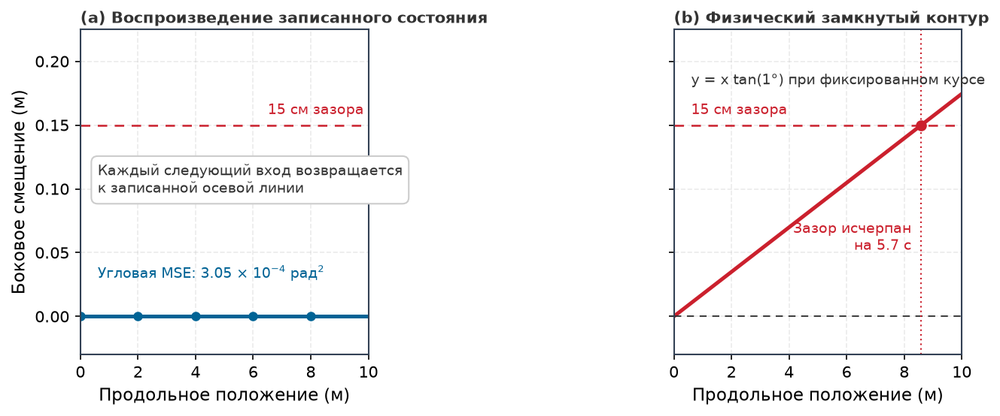
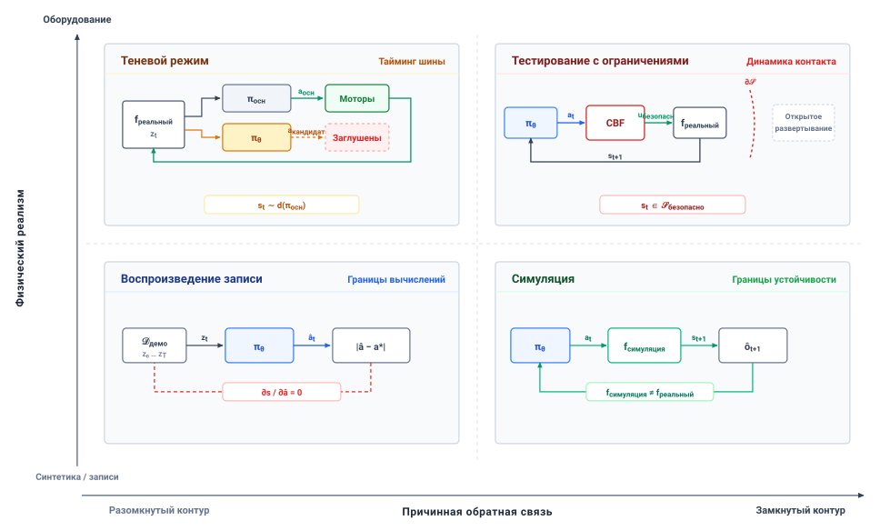
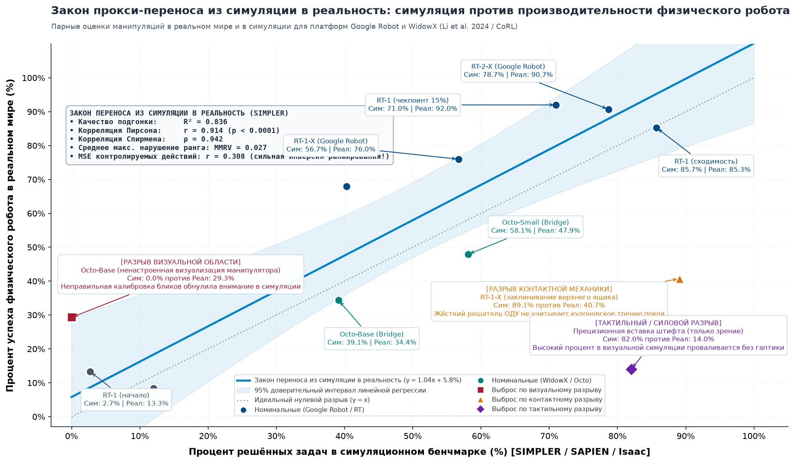
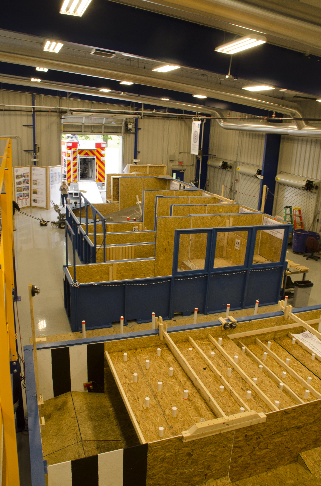
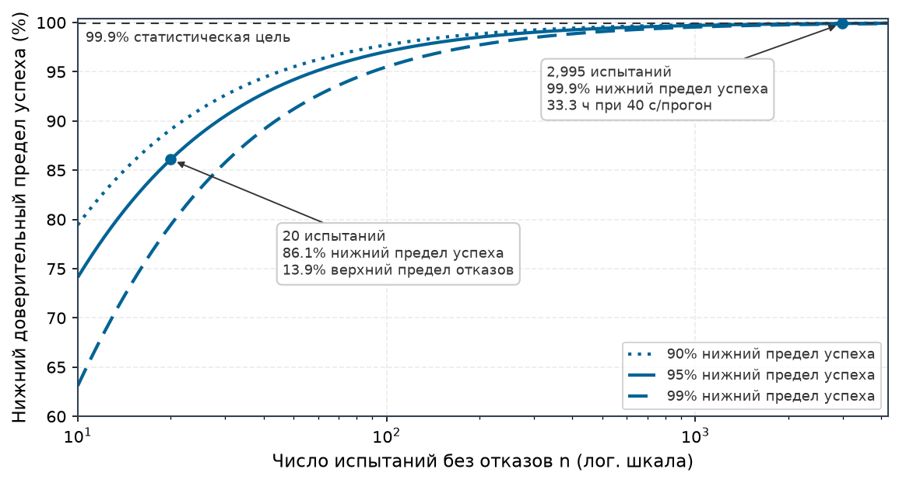

# Оценка в замкнутом контуре

## Цель

_Почему двадцать подряд физических испытаний без отказа говорят удивительно мало о том, безопасно ли выпускать машину в эксплуатацию?_

Двадцать подряд безошибочных прогонов показывают, что происходило в рамках конкретного протокола испытаний, а не как система ведет себя при вариативности открытого мира. Ограниченное число прогонов не обладает статистической мощностью, достаточной, чтобы наблюдать редкие хвостовые отказы, а испытания в номинальных условиях ничего не говорят о поведении при измененном трении, деградации датчиков или неожиданном вмешательстве человека. Офлайн-оценки бенчмарков лишь усиливают эту слепую зону, выставляя баллы по статическим журналам. При физическом развертывании действия замкнутого контура меняют будущие состояния и последующие наблюдения датчиков, порождая каскадный дрейф, в котором начальная микроошибка уводит систему в несмоделированную динамику.

Строгая физическая оценка должна отслеживать поведение замкнутого контура на интегрированной машине и количественно определять эмпирическую уверенность, поддерживающую каждое утверждение о надежности. Важно также, чтобы оценка очерчивала границу, где заканчиваются статистические свидетельства. Поскольку катастрофические физические отказы невозможно откатить назад, кампании испытаний вынужденно цензурируются на границе безопасной эксплуатации. Одними испытаниями нельзя продемонстрировать частоты отказов с тяжелыми последствиями; эмпирическая оценка служит системе тем, что жестко ограничивает утверждения выборочно исследованными областями эксплуатации, оставляя непроверенные пограничные состояния детерминированным мониторам времени выполнения, охраняющим каузальную границу.

> **Цели обучения**
>
> - Интерпретировать физические показатели успеха как условные свидетельства о заданной машине, среде и протоколе испытаний
> - Сравнивать точность предсказаний разомкнутого контура с поведением замкнутого контура, формируемым собственными действиями политики
> - Выбирать режим свидетельств (воспроизведение, симуляция, работа в тени или ограниченные физические испытания), способный ответить на данный вопрос оценки
> - Вычислять число прогонов и время испытаний, необходимые для поддержки заявленной цели надежности
> - Оценивать, какие редкие отказы остаются неподтвержденными осуществимыми испытаниями и имеющимися статистическими предположениями
> - Проектировать заранее объявленный протокол испытаний с фиксированными правилами исходов и полным учетом знаменателя для вмешательств и прерываний
> - Строить протокол оценки, который ограничивает утверждение целевой областью эксплуатации и относит непокрытые условия к мониторам времени выполнения

## Что устанавливают двадцать чистых прогонов

Сразу после офлайн-конвейера обучения `latch-bc-01` прошивается в складской мобильный манипулятор; это единственная контрольная точка, которую манифест политики из раздела [«Манифест политики»](06_training.md#sec-training-policy-manifest) объявляет пригодной для оценки. На первичной валидации машина завершает двадцать подряд прогонов своей задачи с дверью. Каждый прогон начинается с основания, отстоящего на `2 m` (условно; см. руководство для читателя) от двери клетки с пружинным замком; основание заезжает и останавливается, и, когда основание покоится, манипулятор снимает замок и открывает дверь на охраняемом подходе со скоростью `0.03 m/s` — без пересечения контактного порога и без вмешательства человека. Его эмпирическая выборочная доля успеха равна $\hat{p} = 1.00$ (100 %). В тестировании ПО чистое прохождение фиксированного набора тестов часто служит достаточным свидетельством для выпуска. В системной инженерии физического ИИ такой протокол оставляет решение о развертывании неразрешенным: двадцать чистых прогонов устанавливают лишь ограниченную статистическую нижнюю границу и оставляют существенную неопределенность в отношении ненаблюдавшихся отказов.

Привычный интервал Вальда ($p \pm z \sqrt{\hat{p}(1-\hat{p})/n}$) не может описать эту неопределенность, потому что при нуле отказов его дисперсионный член обращается в ноль и интервал вырождается в $[1.0, 1.0]$ — утверждение о достоверной надежности. Точная граница, напротив, обращает биномиальное распределение. Эта односторонняя **граница Клоппера—Пирсона** [Clopper and Pearson, 1934](references.md#clopper1934use) справедлива при любом объеме выборки, а ее приближенная форма — **правило трех** [Hanley and Lippman-Hand, 1983](references.md#hanley1983nothing): если $n$ независимых прогонов проходят без единого отказа, верхняя 95-процентная доверительная граница вероятности отказа $p_{\text{fail}}$ приблизительно равна $3/n$. Для двадцати прогонов с дверью ([«правило трех»](07_evaluation.md#eq-eval-rule-of-three)),

$$p_{\text{fail, upper}}^{95\%} \approx \frac{3}{20} = 0.15.$$

Точный расчет в блоке [«Вывод нижней границы для 20 прогонов»](07_evaluation.md#nbk-evaluation-derivation-20-run-lower-bound) сужает ее до верхнего предела отказов `13.9` %, что все равно не дотягивает машину до продемонстрированной надежности 95 %. Политика, которая отказывает один раз на каждые `eight` прогонов, все же завершает двадцать подряд прогонов в `6.9` % случаев.

> **Вывод нижней границы для 20 прогонов**
>
> **Задача**: Мобильный манипулятор выполняет $n =$ `20` физических прогонов открывания двери без единого пересечения контактного порога и без вмешательства человека ($k =$ `20`). Чему равна точная односторонняя нижняя доверительная граница `95` % для истинной вероятности успеха в эксплуатации $p$?
>
> **Математический вывод**: Для независимых одинаково распределенных испытаний Бернулли из объявленного эксплуатационного распределения испытаний $p_{\text{lower}}$ есть вероятность успеха, при которой `20` последовательных успехов имеют вероятность $\alpha=0.05$. Таким образом, односторонний нижний доверительный предел 95 % равен $p_{\text{lower}} = \alpha^{1/n} = (0.05)^{1/20} \approx$ `0.861` (`86.1` %); соответствующий верхний доверительный предел вероятности отказа составляет `13.9` %.
>
> **Системный вывод**: Наблюдение «`20` из `20` прошли» дает доверительный предел при этих предположениях о выборке, а не наблюдаемую частоту отказов, не средний интервал между отказами и не разрешение на развертывание. Обращение границы дает число прогонов, необходимое цели, $n = \lceil \ln\alpha / \ln p_{\text{target}} \rceil$, так что для нижнего предела успеха $99.9$ % требуются `2,995` последовательных прогонов без отказов, взятые из целевого распределения.

> ↰ **Предпосылки:** Физические границы отказов автономных мобильных роботов и манипуляторов установлены в разделе [«Какой бюджет ограничивает первым»](02_body.md#sec-body-archetype-matrix).

Оценка замыкает контур обучения Части II. Оценивание двадцати чистых прогонов, открывших эту главу, превращает опыт, зафиксированный в разделе [«Физические данные»](05_data.md#sec-data), и веса, обученные в разделе [«Обучение политики»](06_training.md#sec-training), в конкретное решение о том, какое физическое утверждение могут поддержать эти прогоны. Каждый прогон измеряет всю машину, а не одну только политику. Он фиксирует предложения политики, решения пути разрешения и реакцию Тела — включая то, какие предложения вне распределения путь разрешения отклоняет, какие пропускает и сколько остается остановочного запаса.[^fn-eval-safety-enforcement]

[^fn-eval-safety-enforcement]: **Обеспечение безопасности во время выполнения**: Отдельно верифицированный путь разрешения может отклонять предложения, нарушающие измеренное состояние, свежесть и ограничения актуаторов. Его охват обнаружения, худшее время отклика и имеющийся запас остановки должны быть проверены для конкретной реализации; одна лишь частота дискретизации 1 кГц не гарантирует перехвата до контакта.

Результат двадцати прогонов оставляет три вопроса открытыми: какой исход был выбран, что способен выявить каждый режим испытаний и какие опасности остаются вне свидетельств. Конечные прогоны ограничивают только то распределение, из которого они взяты, поэтому оценка полна лишь тогда, когда она также называет условия, которые не покрыла, и мониторы времени выполнения, которые нужны пути разрешения для этих условий. Доля успеха не значит ничего, пока не записана совокупность, из которой она извлечена.

## Что измеряет доля успеха

Оценочный бенчмарк обычно сообщает одну сводную статистику, например долю успеха 85 % на задаче обхода препятствий. В машинном обучении это число считают внутренней оценкой обученных весов модели, подобной точности top-one на статических датасетах классификации изображений. Для физической машины такая интерпретация неверна. У обученной политики нет независимой физической производительности. Бенчмарк измерял исполнение в замкнутом контуре всей физической системы на конкретной последовательности дней и состояний среды. Доля успеха — эмпирическое свойство связанной системы, включающей политику, механический объект управления, вычислительное оборудование, эксплуатационную среду и протокол испытаний.

Чтобы оценить политику, инженерная команда выполняет последовательность дискретных физических прогонов. Отдельный прогон полностью определен лишь тогда, когда каждая переменная, способная изменить траекторию физического состояния, зафиксирована или явно выбрана. Формально условие одного прогона задается кортежом $c = (s_0, e, m, \pi_\theta, \kappa)$, взятым из эксплуатационного распределения испытаний $\mathcal{D}$. Вектор $s_0$ представляет начальное состояние машины, включая позу SE(3), линейные и угловые скорости и позиции энкодеров шарниров. Вектор среды $e$ охватывает внешние переменные, такие как трение пола, освещенность окружающей среды, геометрия препятствий и температура окружающего воздуха. Состояние машины $m$ фиксирует физические и аппаратные свойства, включая заряд батареи, массу полезной нагрузки, износ шин, механический люфт в трансмиссии и параметры калибровки датчиков. Вычислительная конфигурация $\pi_\theta$ охватывает замороженные веса политики $\theta$, квантизацию вывода, предельные сроки диспетчеризации и версии ПО. Наконец, протокол завершения $\kappa = (T_{\max}, g, \phi)$ определяет предел времени выполнения $T_{\max}$, пространственную область цели $g$ и бинарную оценочную функцию $\phi$, отображающую полученную траекторию в конечный исход $Y \in \{0, 1\}$.

Истинная вероятность успеха по этому протоколу оценки — это математическое ожидание бинарного исхода задачи, усредненное по совместному распределению условий прогона, $p(\mathcal{D}) = \mathbb{E}_{c \sim \mathcal{D}}[\phi(\text{Traj}(c))]$ (формальный интеграл приведен в разделе [«Распределения траекторий и оцениваемые величины»](appendix_ml.md#sec-appendix-ml-trajectory-distribution)).
Здесь $\text{Traj}(c)$ — непрерывная физическая траектория, которая возникает, когда политика $\pi_\theta$ исполняется в физической среде и состоянии оборудования, заданных $c$. Эта зависимость показывает, почему вероятность успеха нельзя считать измерением одного лишь $\theta$. Веса модели $\theta$ составляют лишь один параметр внутри вектора условий $c$. Если изменится распределение трения пола или распределение начального заряда батареи, ожидаемая доля успеха изменится, оставаясь при неизменном $\theta$. Протокол выборки — не внешний прибор, измеряющий изолированную модель; он часть той математической величины, которую оценивают.

> **Оцениваемая величина замкнутого контура**
>
> ***Оцениваемая величина замкнутого контура*** — это ожидаемый исход физической задачи $p(\mathcal{D}) = \mathbb{E}_{c \sim \mathcal{D}}[\phi(\text{Traj}(c))]$, определенный на совместном распределении начальных состояний, износа механического объекта управления, физики среды, замороженных весов политики и оценочных предикатов:
> $$c = (s_0, e, m, \pi_\theta, \kappa) \sim \mathcal{D}$$
> а не внутреннее свойство весов нейронной политики, оцениваемых в изоляции.
>
> 1.  **Значение**: В статическом машинном обучении точность на отложенной выборке считают свойством модели $\pi_\theta$. В физическом ИИ замена изношенной шины, просадка напряжения батареи или изменение освещенности среды меняют функцию перехода физического состояния, не меняя ни одного веса. Распределение выборки эксплуатационных условий $\mathcal{D}$ — неразрывная часть оцениваемой величины.
> 2.  **Отличие**: В отличие от метрик валидации разомкнутого контура (таких как функция потерь на валидации или среднеквадратичная ошибка траектории), которые оценивают предсказания по замороженным записанным состояниям, оцениваемая величина замкнутого контура интегрируется по эндогенной петле обратной связи, в которой прошлые действия физически перемещают машину, прямо меняя будущие наблюдения датчиков, которые она получит.
> 3.  **Типичная ловушка**: Сообщение единственного процента успеха без заранее объявленных носителя, плотности и экологических границ тестового распределения $\mathcal{D}$. Любую физическую политику можно сделать сколь угодно успешной, испытывая ее исключительно в благоприятных невозмущенных состояниях.

Физические механизмы, меняющие $c$ между прогонами, действуют независимо от политики, и мобильный манипулятор проявляет каждый из них. По мере разряда батареи приводы теряют запас напряжения против противо-ЭДС, поэтому доступный на скорости момент падает вдоль кривой момент–скорость. Перемещающийся по площадке дневной свет удлиняет выдержку навигационной камеры и смазывает кадры при поворотах. Пыль на полу прохода снижает трение, которым могут воспользоваться тормоза. В манипуляторе повторные открывания двери нагревают обмотки шарниров ($I^2R$) и греют редукторы волновой передачи, что меняет их демпфирование и, поскольку звенья расширяются, смещает калибровку точки инструмента, так что захват встречает замок в несколько иной точке в дневном прогоне, чем в холодном утреннем. Веса во всех случаях идентичны, однако траектория может уйти от успеха к отказу.

Процедура сброса также сдвигает $c$. Оператор, который переустанавливает основание после трудного прогона, может невольно облегчить старт, а автоматический сброс, повторяющий один и тот же путь, циклически нагревает обмотки. Оператор, который перехватывает неудачный прогон и списывает его как сброс, стирает самый трудный отказ из выборки.

Поэтому статистическая оценка должна различать вариацию выборки и изменение оцениваемой величины. Когда $n$ прогонов взяты из фиксированного $\mathcal{D}$, выборочная доля $\hat{p} = \frac{1}{n} \sum_{i=1}^n Y_i$ колеблется вокруг $p(\mathcal{D})$, и стандартные оценщики ограничивают этот шум. Загрузка тележки или смещение ответной планки двери меняет эксперимент на другое распределение $\mathcal{D}'$ со своей $p(\mathcal{D}')$, и объединение двух выборок смешивает наблюдения от двух разных машин.

Поскольку вероятность успеха определена лишь относительно конкретного совместного распределения $\mathcal{D}$, предполагаемая область эксплуатации должна быть объявлена до отбора прогонов. **Целевая область эксплуатационного назначения (ODD)** — это часть объявленной ODD ([«Манифест политики»](06_training.md#sec-training-policy-manifest)), которую покрывает оценка; ее веса выборки определяют $\mathcal{D}$, и ни одно утверждение оценки не выходит за ее пределы. Если инженерная команда выполняет пятьдесят физических прогонов по произвольным траекториям и сообщает долю прохождения 90 %, знаменатель соответствует неопределенной совокупности. Измеренная доля успеха поддерживает утверждение о целевом распределении лишь тогда, когда носитель и веса выборки $\mathcal{D}$ заданы заранее, устанавливая явные границы для освещенности, диапазонов полезной нагрузки, коэффициентов трения поверхности и допустимых смещений начального состояния.

Извлечение корректных доверительных границ из эмпирических прогонов требует трех эксплуатационных условий:

1. *Независимая одинаково распределенная выборка:* Прогоны должны быть независимыми реализациями, взятыми из $\mathcal{D}$. Если тепловое накопление в обмотках двигателей или прогрессирующий механический износ снижают эффективность оборудования от прогона к прогону, исходы дрейфуют вместе с порядком прогонов, так что последовательные прогоны не являются ни независимыми, ни одинаково распределенными.
2. *Фиксированные предикаты исходов:* Бинарная оценочная функция $\phi$ и критерии завершения $\kappa$ должны оставаться неизменными в течение всей кампании. Изменение временного горизонта $T_{\max}$ или корректировка пространственного допуска области цели $g$ посреди испытаний меняет определение успеха.
3. *Полный учет знаменателя:* Каждый начатый прогон, прерванный из-за аппаратных отказов, тайм-аутов связи или аварийных остановов с функцией безопасности (например, превышения пределов мощности и усилия коллаборативного робота по ISO 10218 / ISO/TS 15066), должен быть записан как отказ ($Y = 0$). Отбрасывание прерванных прогонов подменяет истинную эксплуатационную надежность машины мерой условного исполнения на уцелевшем оборудовании.

Когда эти условия выполняются, физические прогоны дают несмещенную выборочную среднюю для системы замкнутого контура при $\mathcal{D}$. Физические прогоны также медленны, поэтому рабочие процессы оценки часто подменяют их офлайн-оценкой разомкнутого контура по записанным датасетам, которая измеряет, насколько точно кандидат воспроизводит записанные действия эксперта. Эта подмена предполагает, что точное предсказание продемонстрированных действий переносится на случай, когда собственные действия политики выбирают ее следующее состояние, и проверить это способен только замкнутый контур.

## Динамика замкнутого контура

Навигационная политика может почти в точности воспроизводить записанные прогоны по проходу и все же израсходовать запас основания до стеллажа раньше, чем пройдет треть прохода. Разница в том, что каждый вид теста возвращает в политику обратной связью. При **оценке разомкнутого контура** кандидата политики $\pi_\theta$ оценивают по статическому датасету записанных демонстраций $\mathcal{D}_{\mathrm{demo}} = \{(s_t^*, a_t^*)\}_{t=1}^T$. На каждом дискретном шаге $t$ политика получает записанное состояние демонстратора $s_t^*$ и выдает предсказанное действие $\hat{a}_t = \pi_\theta(s_t^*)$. Метрика ошибки, такая как среднеквадратичная ошибка или перекрестная энтропия, измеряет расстояние между $\hat{a}_t$ и записанным действием эксперта $a_t^*$. На шаге $t+1$ конвейер оценки подает из датасета следующее записанное состояние $s_{t+1}^*$. Действие $\hat{a}_t$, произведенное политикой, отбрасывается без исполнения на оборудовании, сохраняя последовательность входных состояний независимой от прошлых выходов политики. При **оценке замкнутого контура** политика предлагает $a_t = \pi_\theta(s_t)$; путь разрешения проверяет это предложение по измеренному состоянию и ограничениям, применяет $u_t$ (или резервный вариант), а объект управления эволюционирует как $s_{t+1} = f(s_t,u_t)$. Примененная команда меняет физическое состояние и последующие наблюдения, пересекая каузальную границу из раздела [«Каузальная граница»](01_causal_boundary.md#sec-boundary-causal-boundary).

Оценка разомкнутого контура испытывает действия вдоль траектории состояний демонстратора; политика с малой офлайн-ошибкой предсказания может отказывать, когда ее смещенные предложения допускаются до физического движения, потому что собственные действия уводят ее с состояний, на которых она обучалась. Это принцип эндогенных данных ([«Эндогенные данные»](part2_teaching.md#pri-vol4-endogenous-drift)); раздел [«Эндогенный опыт»](05_data.md#sec-data-endogenous-experience) разработал его следствие для данных, а оценка должна измерить его на машине. Дверная кампания не может показать этот эффект, поскольку ее основание стоит на месте, пока работает манипулятор, поэтому пример взят из навигационного стека той же машины, а не из политики замка, находящейся под оценкой. Основание проезжает проход длиной `30 m` на пределе хода `1.5 m/s` (оба значения условны), а номинальная демонстрация эксперта следует по осевой линии с курсом $\theta^* = 0\text{ rad}$ и боковым смещением $y^* = 0\text{ m}$. Предположим, кандидат навигационной политики имеет систематическое смещение курса $\epsilon_\theta = 1.0^\circ$ (`0.01745 rad`) на каждом шаге, и путь разрешения допускает каждое из этих предложений, поскольку ни одно из них само по себе неосуществимо, пока есть запас хода.

При оценке разомкнутого контура политика получает на каждом шаге состояние демонстратора $s_t^* = (x_t^*, 0, 0)$ и предсказывает поступательную скорость со смещением руления $1.0^\circ$. Офлайн-конвейер оценки фиксирует среднюю абсолютную угловую ошибку $1.0^\circ$ (`0.01745 rad`) и чрезвычайно низкую среднеквадратичную ошибку `$\text{MSE}_\theta = (0.01745)^2 \approx 3.05 \times 10^{-4}\text{ rad}^2$`.[^fn-math-openloop-mse] Однако при исполнении в замкнутом контуре, поскольку машина физически перемещается по ранее допущенным командам, нескорректированные ошибки курса непрерывно накапливаются во времени. При плоской кинематике одноколесной модели ($\dot{y} = v \sin \theta \approx v \epsilon_\theta$) этот постоянный угловой сдвиг интегрируется в кумулятивное боковое смещение:
$$y(t) = \int_0^t v \sin \epsilon_\theta \, d\tau \approx v \epsilon_\theta t$$
Основание имеет ширину `100 cm` в проходе шириной `130 cm`, что оставляет $W_{\text{clear}} =$ `15 cm` бокового запаса до стеллажа с каждой стороны, и дрейф израсходует этот запас за
$$t_{\text{impact}} = \frac{W_{\text{clear}}}{v \sin \epsilon_\theta},$$
что на пределе хода составляет `5.7 s`, после `8.6 m` пути и менее чем на трети прохода ([«Расхождение разомкнутого и замкнутого контуров»](07_evaluation.md#fig-07-open-vs-closed-loop)).[^fn-math-closedloop-lateral] Либо проверка запаса хода в пути разрешения останавливает основание вплотную к стеллажу, либо, без этой проверки, основание в него врезается. Оба исхода — неудачный прогон, который офлайн-оценка оценила как почти безупречный.

[^fn-math-openloop-mse]: **Маскирование масштаба метрики в потере регрессии**: Суммирование квадратов ошибок руления по тысячам валидационных кадров скрывает тяжелые, перемежающиеся ошибки направления. Единичный локальный выброс предсказания в $15^\circ$ математически смывается при усреднении по часам движения прямо по проходу. Кратковременный угловой выброс может иметь значение, если его интегрированное движение исчерпает запас хода раньше, чем отреагирует независимый путь разрешения; для оценки исхода нужны модель объекта управления и модели тайминга.

[^fn-math-closedloop-lateral]: **Кинематическое интегрирование смещения курса**: Этот пример удерживает курс при постоянном сдвиге $1^\circ$, поэтому $y(t)=v\sin(\epsilon_\theta)t$ линейно. Другой пример с постоянным смещением угловой скорости $\omega$ начинается с $\theta(t)=\omega t$ и имеет малый угол аппроксимации $y(t)\approx \tfrac12v\omega t^2$.

> **Слепота разомкнутого контура**
>
> Потеря разомкнутого контура измеряет подражание датасету; динамика замкнутого контура решает физическое выживание. Малая офлайн-ошибка предсказания все еще может дать большой физический вылет, если смещение сохраняется и путь разрешения его допускает.

Пример с проходом показывает обе причины, по которым оценка разомкнутого контура развязывается с выживанием в замкнутом контуре. Во-первых, статическая оценка не может интегрировать постоянную ошибку в смещение. Она возвращает машину в состояние эксперта на каждом такте часов, маскируя накопление ошибок интегрирования, тогда как в замкнутом контуре состояние с индексом $t$ — это развернутая композиция всех предыдущих действий:
$$s_t = f(f(\dots f(s_0, u_0)\dots, u_{t-2}), u_{t-1})$$
Постоянному смещению курса не нужен программный сбой: его создают дифференциальный износ шин, вибрация мачты камеры или уклон пола. Во-вторых, статическая оценка не может проследить за машиной в незнакомые состояния, к которым уводят ее ранние ошибки. Первое допущенное ошибочное действие перемещает основание из продемонстрированного состояния $s_1^*$ в непосещенное состояние $s_1$, и, отклонившись на несколько сантиметров от осевой линии, оно занимает состояния, отсутствующие в $\mathcal{D}_{\mathrm{demo}}$. Офлайн-метрика, вычисляемая только там, где $y = 0\text{ m}$, не содержит свидетельств о $\pi_\theta(s)$ при $y \neq 0\text{ m}$, и политика, которой никогда не показывали восстановление из смещенных состояний, может давать там большие ошибки, ускоряя расхождение, которое раздел [«Режимы синтеза политик»](06_training.md#sec-training-synthesis-regimes) проследил для обучения с подражанием.

Манипулятор показывает тот же разрыв в контакте. Ошибка позиции конечного эффектора в доли миллиметра за шаг офлайн оценивается как пренебрежимая декартова ошибка, но на замке этот сдвиг действует как клин. Жесткость замка превращает боковое смещение в реакцию ($F_{xy} = k_{\text{env}} \Delta_{xy}$), которая поднимается выше контактного порога `15 N` и обрывает попытку прежде, чем дверь откроется.[^fn-math-contact-bifurcation]

[^fn-math-contact-bifurcation]: **Нелипшицева бифуркация контакта**: Контакт твердых тел не является липшицевым, потому что конусы трения многозначны, а удары порождают скачки скорости ($v^+ \ne v^-$). Субмиллиметровое отклонение в точке контакта захвата может перевести траекторию со стабильного регулирования усилия на проскальзывание или заклинивание — разрыв, который офлайн-оценка по записанным состояниям не способна выявить.

Офлайн-оценки могут вводить в заблуждение и в пессимистичную сторону, когда задача допускает несколько допустимых действий. Если демонстратор обошел препятствие слева, оценка разомкнутого контура штрафует кандидата, который проходит справа (двухмодовый случай из раздела [«Режимы синтеза политик»](06_training.md#sec-training-synthesis-regimes)), хотя в замкнутом контуре оба достигают цели. Ошибка на уровне действий измеряет расхождение с одной записью, а не выполнение задачи.

> ⇄ **Сопоставление:** Потеря предсказания разомкнутого контура противопоставляется границам возраста информации от фотона до исполнения команды, разобранным в разделе [«Цена приема данных»](08_perception.md#sec-perception-cost-ingestion).

***Расхождение разомкнутого и замкнутого контуров**: Постоянный сдвиг курса $1.0^\circ$ дает угловую среднеквадратичную ошибку `$3.05 \times 10^{-4}\text{ rad}^2$` на записанных состояниях осевой линии. В проходе мобильного манипулятора допущенное движение навигационного стека с этим фиксированным смещением курса дрейфует линейно и достигает бокового запаса `0.15 m` через `5.7 s` на пределе хода `1.5 m/s`. Пример относится к навигационному стеку, а не к политике замка, находящейся под оценкой.*

Тот же разрыв отделяет каждую офлайн-метрику, обычно сообщаемую для обученной политики, от отказа машины, который она скрывает, и таблица [«Офлайн-метрики и скрываемые ими отказы»](07_evaluation.md#tbl-07-offline-closed-loop-disconnect) сопоставляет каждую с мерой замкнутого контура, которая его выявляет; среди них — время до вмешательства $T_{\text{TTI}}$, измеряемое от начала полномочий политики до первого перехвата пути разрешения (путь разрешения отклоняет предложение и применяет свой резервный вариант) или перехвата оператором.

| Офлайн-метрика                     | Предположение разомкнутого контура                                             | Почему это ломается в замкнутом контуре                                                                       | Отказ на машине                                                 | Мера замкнутого контура                                                                                                |
|:-----------------------------------|:-----------------------------------------------------------------|:---------------------------------------------------------------------------------------------------|:-----------------------------------------------------------------------|:-------------------------------------------------------------------------------------------------------------------|
| **Среднеквадратичная ошибка действия**      | Малые остатки дают малые отклонения пути                       | Постоянное смещение интегрируется в дрейф и уводит машину с продемонстрированных состояний        | Основание израсходует запас до стеллажа (остановка или удар)                    | Пиковое отклонение от опорной траектории; время до вмешательства ($T_{\text{TTI}}$) |
| **Точность дискретных действий**       | Правильные метки на журнальных состояниях дают идентичное исполнение         | Безобидные альтернативы и пограничные вылеты стоят того же; ошибки, коррелированные во времени, невидимы | Дребезг команд и перегрузка шарниров по моменту                                  | Пиковый рывок; соблюдение пределов момента актуаторов                                                                     |
| **Косинусная близость**              | Коллинеарные предложения дают стабильные траектории                            | Величина игнорируется, поэтому недобор исполнения вязнет на статическом трении, а перебор — проскальзывает   | Основание буксует или пробуксовывает; манипулятор вязнет, не дойдя до замка | Коэффициент проскальзывания и демпфирование ([«Проскальзывание колеса и границы трения»](appendix_control.md#sec-appendix-control-slip))                                                                |
| **Отрицательное логарифмическое правдоподобие**        | Правдоподобие в действии эксперта ухватывает распределение действий | Допустимые альтернативы, например обход препятствия с другой стороны, штрафуются                   | Допустимые политики отклоняются; шум демонстратора имитируется как дрожание         | Успех задачи в замкнутом контуре при случайных стартах                                                                    |
| **Потеря реконструкции или Шамфера** | Точное предсказание сцены дает безопасные планы                       | Пиксели фона перевешивают тонкие препятствия и контактную геометрию                                     | Фантомное торможение; задев кабеля или стеклянной перегородки                 | Измеренный запас хода; инвариантность условия барьера                                                                   |

***Офлайн-метрики и скрываемые ими отказы**: Каждая метрика разомкнутого контура предполагает, что распределение состояний демонстратора не затронуто ошибкой политики; на машине смещения интегрируются в дрейф, допустимые альтернативы штрафуются, а сдвинутые состояния порождают нарушения границ.*

Разрыв проходит и через границу предложения из раздела [«Машина в пяти уровнях»](01_causal_boundary.md#sec-boundary-machine-model). В двухпроцессорной реализации офлайн-воспроизведение трассы на прикладном процессоре измеряет только то, укладывается ли нейронный вывод в бюджеты памяти и вычислений. При физическом исполнении в замкнутом контуре каждое кандидатное предложение переходит к микроконтроллеру, на котором работает путь разрешения. Если предложения политики дрейфуют от цели или дребезжат, путь разрешения обнаруживает нарушение пространственной границы или истекшую аренду, отклоняет предложения и отдает команду на управляемую остановку. Оценивать политику офлайн, без физического объекта управления и пути разрешения в контуре, — значит оценивать тензорную арифметику, а не выживание машины; только замкнутый контур измеряет вылет траектории, тайминг вмешательства и измеренные характеристики пути разрешения.

> ↳ **Далее:** Детерминированный привратник и огибающие остановки для непроверенных нейронных политик выведены в разделе [«Огибающие остановки»](12_enforcement.md#sec-enforcement-stopping-envelopes).

Оценки разомкнутого контура не могут сертифицировать замкнутый контур, поэтому свидетельства об инициаторе должны исходить от исполнений, условия которых известны и записаны. Любая среда, в которой может исполняться политика, меняет какую-то часть контура — будь то объект управления, поток данных датчиков или полномочия над актуаторами, — и раздел [«Режимы свидетельств»](07_evaluation.md#sec-evaluation-evidence-regimes) упорядочивает эти среды по тому, что каждая может и чего не может показать.

## Режимы свидетельств

До своих двадцати прогонов с дверью политику замка можно было бы оценить по ее записанным демонстрациям, прогнать против смоделированной двери, запустить в тени, пока валидированный контроллер удерживает манипулятор, или испытать на настоящей двери с взведенным контактным порогом. Эти четыре среды — **режимы свидетельств** рисунка [«Режимы свидетельств оценки»](07_evaluation.md#fig-07-evidence-regimes) и таблицы [«Сравнение режимов свидетельств оценки»](07_evaluation.md#tbl-07-evidence-regimes), а именно: воспроизведение записей, симуляция замкнутого контура, работа в тени и ограниченные физические испытания. Каждый устанавливает разное отношение между политикой, ее сенсорными входами и состоянием машины, поэтому каждый поддерживает ограниченное утверждение. Ни один из четырех не устанавливает, как ведет себя неподдерживаемая политика при неограниченном физическом развертывании, поскольку каждый режим меняет либо каузальную обратную связь контура управления, либо распределение состояний, с которыми сталкивается машина.

***Режимы свидетельств оценки**: Режимы различаются по каузальной обратной связи (разомкнутый против замкнутого контура) и физической достоверности (записанное или синтетическое против живого оборудования). Воспроизведение не может наблюдать накапливающийся дрейф, симуляция оставляет разрыв реальности открытым, работа в тени запирает траекторию на базовом контроллере, а ограниченные испытания обрывают отказы на границе ограничения $\partial\mathcal{S}$. Ни один режим не испытывает развертывание за этой границей.*

При воспроизведении записей политика исполняется как прямой (feedforward) расчет по сохраненным буферам датчиков. Среда не реагирует на выходы политики, и последовательность состояний остается прикрепленной к траектории, записанной при сборе данных. Этот режим поддерживает утверждения о вычислительной пропускной способности, распределении памяти и потере по журнальному датасету — например, укладывается ли вывод в бюджет задержки на бортовом ускорителе и совпадают ли его числовые выходы с записанными действиями. Он не может поддержать ни одного утверждения о стабильности замкнутого контура, потому что предсказанное действие никогда не меняет следующего наблюдения; если политика выдает резкий поворот налево, следующий записанный кадр все равно показывает основание, едущее прямо.

Симуляция замкнутого контура восстанавливает петлю каузальной обратной связи, подменяя физическую машину и ее окружение явной математической моделью $f_{\text{sim}}$. Когда политика предлагает действие, а смоделированный путь разрешения выбирает $u_t$, симуляция интегрирует уравнения движения, обновляет сцену и рендерит синтетические входы датчиков для следующего цикла с индексом $t+1$. Этот режим поддерживает утверждения о поведении политики при смоделированной динамике — например, восстанавливается ли основание после начального смещения или избегает ли манипулятор самостолкновения во всем рабочем пространстве, — и тысячи экземпляров могут работать параллельно. Свидетельства справедливы только для $f_{\text{sim}}$; несмоделированные люфт, проскальзывание шин, переходы трения контакта и освещение исключены по построению, так что стабилизация $f_{\text{sim}}$ пока ничего не говорит об оборудовании.

Работа в тени устанавливает кандидатную политику на действующую физическую машину, пока валидированный базовый контроллер или оператор-человек сохраняет полномочия над актуаторами. Кандидатная политика получает живые кадры датчиков, выполняет бортовой вывод под реальной механической вибрацией и трафиком шин и вычисляет кандидатные действия $a_t^{\text{cand}}$.[^fn-hw-hil-bus] Эти кандидатные действия журналируются, но никогда не отправляются в приводы двигателей. Работа в тени поддерживает утверждения о тайминге исполнения — например, удерживает ли политика замка выбранный темп фрагмента `20 Hz` при эксплуатационной тепловой нагрузке, — и о том, как часто $a_t^{\text{cand}}$ расходится с базовым действием $a_t^{\text{base}}$ больше чем на заданный порог. Она разделяет ограничение воспроизведения, поскольку базовый контроллер удерживает машину на своей траектории; действие, которое завело бы основание в стеллаж, никогда его не двигает, и поток данных датчиков никогда не показывает отказ кандидата.

[^fn-hw-hil-bus]: **Конкуренция за шину при аппаратуре в контуре**: Хотя задержка вывода нейронного ускорителя в изоляции может демонстрировать низкую дисперсию, общие платы PCIe, передачи прямого доступа к памяти (DMA) и арбитраж шины CAN вносят переменное дрожание транспорта под производственной нагрузкой. Номинальный цикл вывода может растягиваться при насыщении шины памяти, истощая фазовый запас контуров управления с высокой частотой. В теневом режиме это дрожание задержки журналируется на реальном шинном трафике, не подвергая физическое шасси результирующим колебаниям траектории.

Ограниченные физические испытания замыкают каузальную петлю на реальном оборудовании, позволяя кандидатным предложениям доходить до актуаторов внутри ограниченной огибающей. Границы принимают форму физических тросов, ограничителей скорости, мягких испытательных клеток или самого пути разрешения ([«Машина в пяти уровнях»](01_causal_boundary.md#sec-boundary-machine-model)), который отклоняет небезопасные команды с валидированной скоростью отклика. Этот режим поддерживает утверждения о динамике контакта, насыщении актуаторов и шуме датчиков внутри испытанной огибающей — поэтому двадцать прогонов с дверью относятся к нему. Он не может установить хвостовое поведение политики в открытом развертывании, потому что каждое вмешательство троса или перехвата пути разрешения обрывает траекторию. Данные измеряют объединенную политику и путь разрешения внутри границы ограничения, а не неподдерживаемую политику.

Некоторые свойства переносятся через границы режимов. Числовые выходы для идентичных входных тензоров переносятся, как и алгоритмические инварианты, поэтому переполнение, насыщающее выход в симуляции, насытит его и на оборудовании при том же входе; измеренные тайминги и давление на память должны быть перепроверены под шинной, тепловой и диспетчерской нагрузкой каждого режима. Распределение состояний не переносится. В тот момент, когда модель среды меняется с $f_{\text{sim}}$ на $f_{\text{real}}$, или меняется испытываемый путь разрешения, последовательность состояний $s_0, s_1, \dots, s_t$ расходится.

Смотреть на эти режимы как на лестницу достоверности — ловушка. Переход от воспроизведения к симуляции, к теневому режиму и к ограниченным испытаниям не усиливает одно утверждение об уверенности; каждый шаг меняет одно искажение на другое. Симуляция покупает каузальность замкнутого контура ценой реального восприятия и контакта, теневой режим меняет каузальность обратно на реальные потоки датчиков и аппаратный тайминг, а ограниченные испытания восстанавливают и то и другое, но цензурируют состояния за своей границей безопасности. Ноль вмешательств на сотне ограниченных прогонов показывает, что траектории оставались там, где ограничения не вступали в силу, а не то, что частота отказов вне огибающей мала. Каждый вопрос принадлежит режиму, способному на него ответить ([«Сравнение режимов свидетельств оценки»](07_evaluation.md#tbl-07-evidence-regimes)). Для политики замка вопрос, укладывается ли вывод в период фрагмента, относится к воспроизведению, а затем к работе в тени на целевом оборудовании; вопрос, восстанавливается ли манипулятор после неверно поставленного первого контакта, относится к симуляции, где тысячи смещений не стоят износа; а вопрос, удерживают ли пружина двери и податливость захвата силу контакта ниже предела, — только к ограниченным физическим испытаниям. Каждый режим слеп к отказам, свойственным другим режимам.

| Режим свидетельств оценки       | Связь каузальной обратной связи                              | Обоснованность динамики среды                         | Поддерживаемые эмпирические свидетельства                            | Маскируемый режим отказа / искажение границы                                            |
|:---------------------------------|:------------------------------------------------------|:---------------------------------------------------------|:--------------------------------------------------------|:-------------------------------------------------------------------------------------|
| **Воспроизведение записей**              | Разомкнутый контур ($\partial s_{t+1}/\partial \hat{a}_t = 0$) | Статические буферы демонстраций $\mathcal{D}_{\text{demo}}$ | Бюджет задержки, объем DRAM, числовая точность      | Ковариантный сдвиг; ошибки никогда не меняют последующих наблюдений                          |
| **Симуляция замкнутого контура**       | Замкнутый контур ($s_{t+1} = f_{\text{sim}}(s_t, u_t)$)    | Оператор синтетической физики $f_{\text{sim}}$              | Кинематическая достижимость, большие параллельные наборы испытаний      | Разрыв sim-to-real; несмоделированные нелинейности контакта и проскальзывание шин                     |
| **Работа в теневом режиме**        | Разомкнутый контур для кандидата (действия заглушены)               | Физическая машина $f_{\text{real}}$                       | Конкуренция за шину, термическое троттлинг, реальный шум датчиков   | Запирание траектории; состояния привязаны к базовому контроллеру $d^{\pi_{\text{base}}}$ |
| **Ограниченные физические испытания** | Замкнутый контур с вето во время выполнения ($u_{\text{safe}}$)     | Физическая машина $f_{\text{real}}$ внутри огибающей       | Динамика контакта, податливость, трение, пределы актуаторов | Цензура состояний; перехваты пути разрешения и тросы обрывают хвосты отказов       |

***Сравнение режимов свидетельств оценки**: Компромиссы между связью каузальной обратной связи, достоверностью среды, поддерживаемыми эмпирическими утверждениями и экспериментальными искажениями границ в четырех режимах испытаний. Ни одна среда не оценивает открытое развертывание; строгая сертификация требует сочетания взаимодополняющих режимов, а не предположения о линейной лестнице достоверности.*

Количественную связь между смоделированными прокси-бенчмарками и производительностью робота в реальном мире определяет **закон прокси-переноса sim-to-real** ([«Закон прокси-переноса sim-to-real»](07_evaluation.md#fig-evaluation-sim-to-real-proxy-transfer)). Если офлайн-метрики разомкнутого контура (такие как среднеквадратичная ошибка действия) не способны предсказывать исходы замкнутого контура ($r = 0.308$, испытывая тяжелые инверсии ранжирования, как подробно показано в таблице [«Офлайн-метрики и скрываемые ими отказы»](07_evaluation.md#tbl-07-offline-closed-loop-disconnect)), то бенчмарки симуляции замкнутого контура, такие как SIMPLER [Li et al., 2024](references.md#li2024simpler), демонстрируют сильное линейное соответствие с успехом физической манипуляции через разные воплощения ($R^2 = 0.836$, Pearson $r = 0.914$, $p < 0.0001$; ранговая корреляция Спирмена $\rho = 0.942$).

Что принципиально, линейный закон переноса ($y = 1.04 x + 5.8\%$) надежно выполняется только внутри номинальных зрительных и кинематических огибающих. Перенос катастрофически ломается в трех различных режимах физического разрыва:

1. **Разрыв зрительной области**: Некалиброванное зеркальное освещение или расхождения рендеринга могут нарушать работу токенизаторов трансформеров зрения. Например, ненастроенные визуальные текстуры в Octo-Base обрушили смоделированную долю решений до $0.0\%$, несмотря на достигнутые $29.3\%$ успеха задачи в реальном мире.
2. **Разрыв механики контакта**: Физические движки твердых тел (такие как стандартные решатели ODE или Bullet) идеализируют динамику контакта многих тел и опускают нелинейное кулоновское сцепление. Политика RT-1-X при оценке открывания верхнего ящика достигла $89.1\%$ в симуляции, но упала до $40.7\%$ на реальном оборудовании из-за механического заклинивания направляющих.
3. **Разрыв тактильности и усилий**: Точная манипуляция (такая как субмиллиметровая вставка штыря) дает высокие зрительные доли решений в симуляции ($82.0\%$), но обрушивается в реальности ($14.0\%$), где одно лишь зрение не может обнаружить заклинивание контактного усилия.

Следовательно, хотя симуляция замкнутого контура служит эффективным фильтром предварительного отбора кандидатов политик, пределы физических испытаний остаются высшей инстанцией воплощенной компетентности.

***Закон прокси-переноса sim-to-real: доля решений бенчмарка симуляции против доли успеха физического робота**: Парные эмпирические оценки через воплощения Google Robot (Everyday Robots) и WidowX из бенчмарка SIMPLER [Li et al., 2024](references.md#li2024simpler). Номинальные политики демонстрируют плотный линейный перенос ($R^2 = 0.836$, Pearson $r = 0.914$, ранг Спирмена $\\rho = 0.942$, MMRV $= 0.027$), что резко контрастирует с офлайн-среднеквадратичной ошибкой действия при обучении с учителем ($r = 0.308$). Три отмеченных диагностических выброса иллюстрируют режимы отказа разрыва реальности: некалиброванный рендеринг зрения (квадрат), заклинивание трения контакта (треугольник) и отсутствие тактильного усилия (ромб).*

> **Компромиссы между режимами свидетельств**
>
> Прежде чем оценивать пределы физических испытаний, проверьте свое понимание режимов свидетельств и компромиссов достоверности:
>
> - [ ] **Компромиссы каузальности режимов**: Можете ли вы противопоставить свойства каузальной обратной связи воспроизведения записанной трассы симуляции замкнутого контура?
> - [ ] **Запирание траектории в теневом режиме**: Можете ли вы объяснить, почему оценка в теневом режиме на работающей машине не может испытывать маневры восстановления кандидатной политики?
> - [ ] **Перенос между режимами**: Можете ли вы описать, какие свойства надежно переносятся между режимами, а какое остается позади?

## Пределы физических испытаний

За утверждение о надежности платят прогонами. Выбор режима решает, что может показать тест, но на физической машине стоимость каждого прогона замкнутого контура задает объект управления, а не вычислительный бюджет, и статистика задает, сколько прогонов требует утверждение. Вместе эти две величины отделяют аргумент квалификации от анекдота.

### Сколько стоит физический прогон

Физический прогон потребляет больше, чем смоделированный шаг или время воспроизведения журнала. Он расходует календарное время, нагружает механические звенья, греет обмотки двигателей и рискует физически повредить оборудование. Дверная кампания показывает, как накапливается стоимость. В одном прогоне основание заезжает со своего отстояния `2 m` и останавливается, затем манипулятор снимает замок на охраняемом подходе со скоростью `0.03 m/s` и распахивает дверь, что вместе занимает `25 s` испытательной клетки (условно). Сброс, делающий следующий прогон независимой выборкой, снова запирает дверь, возвращает основание на отстояние и сбрасывает телеметрию прогона, добавляя `15 s` (условно), так что каждый прогон стоит `40 s`.[^fn-math-trial-cost] При таком цикле двадцать чистых прогонов, открывших главу, заняли `13.3 min`, а кампания, которую требует нижний предел успеха 99.9 % ([«Статистическое масштабирование гарантий»](07_evaluation.md#nbk-evaluation-statistical-scaling-high-reliability-assurance)), идет куда дольше, даже до того как обмотки манипулятора получат какой-либо тепловой отдых ([«Тепловые циклы нагрузки»](02_body.md#sec-body-thermal-duty-cycles)).

[^fn-math-trial-cost]: **Бюджет цикла физического прогона**: Длительность физического прогона включает как прогон, так и сброс: $T_{\text{trial}} = t_{\text{run}} + t_{\text{reset}} =$ `25 s` $+$ `15 s` $=$ `40 s` для двери. Бюджетирование одним лишь временем активного прогона дает нереалистичные сроки испытаний и соблазняет команды усекать интервалы сброса и остывания, что вызывает тепловую нестационарность от прогона к прогону.

Объект управления также меняется, пока накапливаются прогоны. Доверительная граница предполагает независимые выборки из стационарного процесса, а износ нарушает стационарность: люфт редуктора, радиус колеса, трение шин и демпфирование шарниров дрейфуют со скоростями, которые должны быть измерены на испытательном оборудовании. Объединение тысячи прогонов тогда обращается с прогрессией деградирующих машин как с повторными испытаниями одной, и поздний отказ может отражать изношенный объект управления, а не политику.

Цензура, встроенная в ограниченные испытания ([«Режимы свидетельств»](07_evaluation.md#sec-evaluation-evidence-regimes)), усиливает дрейф. Поскольку неудачный физический прогон нельзя отозвать (первый закон из раздела [«Четыре фундаментальных закона»](01_causal_boundary.md#sec-boundary-bedrock-laws)), механизмы безопасности вмешиваются до завершения отказа, и свидетельства обрываются там, где они вмешались. Состояния, которые команде важнее всего оценить — такие как потеря сцепления на скорости или столкновение, которого основание не может избежать, — это состояния, в которые она не может позволить машине войти, потому что занос в стеллаж повреждает шасси и сенсорную оснастку и выводит испытательную клетку из строя для ремонта. Клетки, геозоны и операторы с аварийными остановами обрезают каждый прогон на консервативной огибающей. Прогон фиксирует вмешательство, тогда как последствие выхода политики остается ненаблюдаемым; вмешательство остается в знаменателе, а последствие — неизвестным.

Для физического выживания среднее — неадекватное описание пика. Замку угрожает пиковая сила контакта прогона относительно предела повреждения `100 N`, как бы ни был скромен средний показатель, а длинная задержка шины может израсходовать остановочный запас, какова бы ни была малой средняя задержка. Теория экстремальных значений (EVT) предлагает кандидатные модели для максимумов, но семейство Гумбеля, Фреше или Вейбулла должно быть подогнано к определенной выборке блочных максимумов или превышений порога, проверено против альтернатив и сообщено вместе с его неопределенностью; один лишь физический механизм не выбирает семейство.[^fn-math-extreme-value] Без этих данных таблица [«Свидетельства пиковых возмущений и защита»](07_evaluation.md#tbl-07-extreme-value-tails) указывает, что измерять и какую защиту валидировать, вместо предсказания частот редких событий.

[^fn-math-extreme-value]: **Моделирование возмущений теорией экстремальных значений**: Теорема Фишера—Типпетта—Гнеденко описывает возможные предельные формы блочных максимумов при заявленных предположениях; она не назначает хвостовое семейство удару, блику или задержке по одному лишь физическому механизму.

| Канал возмущений     | Пиковая величина и выборочный протокол                    | Физическое последствие для испытания                             | Кандидатная защита для валидации                                                  |
|:------------------------|:-----------------------------------------------------|:---------------------------------------------------------|:----------------------------------------------------------------------------------|
| Вычислительная и шинная задержка | Полный возраст за цикл и пропуски предельных сроков         | Устаревшие предложения разъедают тормозной запас                     | Аренда свежести и независимо таймированный резервный вариант                                  |
| Удар контакта           | Кривая усилие–время, импульс и пик на пути нагрузки | Пластичность или перегрузка до того, как вступит в силу реактивная команда | Пассивная податливость и предел скорости до контакта; реактивные ограничения работают с последующей нагрузкой |
| Низкое сцепление            | Локальная оценка трения и остановочный отклик        | Проскальзывание удлиняет остановочный путь                           | Консервативный потолок скорости и испытанный резервный вариант на поверхностях с низким сцеплением               |
| Оптический блик           | Длительность насыщения и пропуски восприятия            | Ложный запас хода или потеря оценки состояния                   | Резервное восприятие и независимые физические ограничения                            |

***Свидетельства пиковых возмущений и защита**: Механизмы указывают измерения и средства защиты, а не семейство EVT или частоту событий. Любое количественное утверждение о хвосте требует определенной совокупности, подогнанной модели, проверок качества подгонки и неопределенности.*

Замок показывает, почему строка удара контакта сопоставляет измерение с защитой. Каждый прогон с дверью вносит один блочный максимум — пиковое усилие на замке, — а двадцати максимумов чересчур мало, чтобы подогнать хвост, предсказывающий, как часто прогон пересекает `100 N`. Монитор усилия, реагирующий только после контакта, тоже не может отменить первый пик; его измеренное обнаружение и отклик актуатора могут ограничить последующую нагрузку, тогда как охраняемый подход со скоростью `0.03 m/s`, предел скорости до контакта, резервирует запас для начального удара.

Распределение прогонов по парку машин не покупает независимость. Десять машин, испытываемых одновременно на одном складе, делят производственную партию, покрытие пола, систему вентиляции и операторов, обученных по одному протоколу, поэтому аномалия, отсутствующая на объекте, — такая как глазурь пола или блик под низким углом, — не достигает ни одной из них. Десять тысяч часов парка на одном объекте — это десять параллельных наблюдений одного узкого распределения, а не десять тысяч часов независимой наработки. Стандартизированные испытательные приспособления, такие как на рисунке [«Стандартизированный полигон оценки роботов»](07_evaluation.md#fig-07-nist-test-arena), покупают воспроизводимость, ограничивая пространство состояний приспособлением.

***Стандартизированный полигон оценки роботов**: Испытательные боксы роботов-спасателей NIST, снятые в 2013 году (Linda Joy/NIST) и впоследствии описанные в ASTM E54.08. Прогон без отказов по стандартизированным боксам устанавливает компетентность внутри полигона и ничего не говорит о бликах, загрязнителях поверхности или препятствиях вне его.*

### Прогоны на утверждение

Размер кампании без отказов задается обращением точной границы из раздела [«Что устанавливают двадцать чистых прогонов»](07_evaluation.md#sec-evaluation-closed-loop-survival) относительно числа прогонов, так что сколько прогонов должна выдать испытательная клетка, определяет утверждение, а не бюджет испытаний (см. рисунок [«Доверительные границы и бюджеты испытаний»](07_evaluation.md#fig-07-confidence-bounds) и таблицу [«Доверительные пределы после нуля отказов»](07_evaluation.md#tbl-07-confidence-bounds); выводы — в разделе [«Испытания без отказов и стена наработки»](appendix_ml.md#sec-appendix-ml-exposure)).

> **Статистическое масштабирование гарантий**
>
> **Задача**: Предположим, цель оценки требует одностороннего нижнего предела успеха $p_{\text{target}} = 0.999$ при доверительной вероятности 95 % ($\alpha = 0.05$). Если каждый прогон с дверью требует $T_{\text{trial}} =$ `40 s`, сколько прогонов без отказов и сколько календарного времени испытаний потребуется?
>
> **Расчеты**: Обращение границы из блока [«Вывод нижней границы для 20 прогонов»](07_evaluation.md#nbk-evaluation-derivation-20-run-lower-bound) дает $n = \lceil\ln(0.05)/\ln(0.999)\rceil = 2{,}995$ последовательных прогонов без отказов. При `40 s` на прогон это требует $T_{\text{total}} =$ `2,995` $\times$ `40 s` $\approx$ `33.3 h` (`1.4 days`) непрерывных испытаний. С протоколом безопасности на `two` оператора это потребляет `66.6 h` операторского времени, или более `eight` восьмичасовых смен.
>
> **Системный вывод**: Даже при цикле столь коротком, как у двери, нижний предел 99.9 % стоит `1.4 days` непрерывной занятости испытательной клетки, а более длинный цикл масштабирует это пропорционально. Замена компонента в ходе кампании может потребовать нового определения совокупности, а не объединения несовместимых прогонов.

Когда требование надежности задано как частота отказов $\lambda$ на час эксплуатации, число прогонов превращается во время наработки. **Стена наработки** — это наработка без отказов, необходимая тесту без событий, прежде чем он сможет ограничить интенсивность опасности. При модели постоянной интенсивности и доверительной вероятности 95 % $T \ge -\ln(0.05)/\lambda \approx 3.0/\lambda$: цель $\lambda=10^{-6}$ в час требует `$3.0 \times 10^{6}$` часов без отказов (`342` машинных года), а $\lambda=10^{-9}$ в час — `$3.0 \times 10^{9}$`.

Батлер и Финелли вывели из этой арифметики проектный вывод [Butler and Finelli, 1993](references.md#butler1993infeasibility) ([«Пределы испытаний сверхнадежности»](07_evaluation.md#psp-evaluation-untestable-reliability)). Парк машин не спасает тест, поскольку `100` стендов, работающих непрерывно, все равно потребовали бы около `3,420` календарных лет при $10^{-9}$ в час. Пробег дорожных транспортных средств упирается в ту же стену ([«Дефицит масштабирования автономных миль»](07_evaluation.md#fig-07-av-miles-scaling)), а симулированные мили не добавляют к нему физической наработки. Поэтому утверждение высокой гарантии опирается на независимо валидированные ограничения времени выполнения и структурированное внедрение отказов ([«Вывод списка отказов»](15_verification.md#sec-verification-deriving-fault-list)).[^fn-std-iso-asil]

[^fn-std-iso-asil]: **Область функциональной безопасности**: Стандарты функциональной безопасности определяют специфичные для контекста аппаратные метрики и процессы гарантий; одно число частоты отказов нельзя назначить всем системам физического ИИ или сертифицировать одним лишь пробегом. Пуассоновские примеры здесь — аналитические цели, а не заявления о соответствии IEC 61508 или ISO 26262.

> **Пределы испытаний сверхнадежности**
>
> **Результат**: Батлер и Финелли утверждали, что валидация требований сверхвысокой надежности для киберфизических систем, критичных для жизни (таких как коммерческое ПО дистанционного управления полетом, требующее частоты катастрофических отказов $\lambda \le 10^{-9}\text{ failures/hour}$), одними лишь эксплуатационными испытаниями невозможна [Butler and Finelli, 1993](references.md#butler1993infeasibility).

***Дефицит масштабирования автономных миль**: Сконструированные ряды физического и симулированного пробега на фоне таблицы 1 RAND [Kalra and Paddock, 2016](references.md#kalra2016driving), которая дает 275 миллионов физических миль без отказов для верхней доверительной границы 95 % на уровне человеческой смертности и 8,8 миллиарда миль для точности ±20 %. Симулированные мили не добавляют физической наработки.*

Стена наработки действует даже при требовании объекта куда более мягком, чем эти уровни. Предположим, складской мобильный манипулятор должен продемонстрировать частоту критических отказов $\lambda \le 1.0\times 10^{-4}\text{ failures/hour}$ (среднее время между критическими отказами $\text{MTBF} \ge 10{,}000\text{ hours}$) при статистической уверенности 95 % ($\alpha = 0.05$). Каждая миссия отбора занимает $t_{\text{mission}} =$ `360 s` (`0.10 h`) и покрывает `540 m` на пределе хода `1.5 m/s`. Автоматическая перезарядка на док-станции и сброс телеметрии добавляют $t_{\text{reset}} =$ `120 s`, итого `480 s` на цикл прогона. Диаметр ведущего колеса $D_{\text{wheel}} =$ `0.20 m`, а на ведущий редуктор приходится условный ресурс усталости подшипника $L_{10}$ в `$5.0 \times 10^{7}$` оборотов.

По стене наработки эта цель требует `29,957` часов без отказов (`3.42` года) непрерывной наработки. Дискретизация этого требования в миссии с бюджетом отказов на прогон $p_{\text{fail}} \le \lambda \cdot t_{\text{mission}} =$ `$1.0 \times 10^{-5}$` требует $N_{\text{req}} = \ln(\alpha)/\ln(1-p_{\text{fail}})$, или `299,572` последовательных прогонов без отказов. Это обращает границу нуля отказов из раздела [«Что устанавливают двадцать чистых прогонов»](07_evaluation.md#sec-evaluation-closed-loop-survival) для цели, далеко выходящей за практические бюджеты в десятки–тысячи прогонов. На единственном физическом стенде исполнение этих прогонов по `480 s` на цикл потребляет `39,943` часа (`4.56` года) и накапливает $N_{\text{rev}} = (N_{\text{req}} \cdot v \cdot t_{\text{mission}}) / (\pi D_{\text{wheel}}) \approx$ `$2.57 \times 10^{8}$` оборотов колеса.

Суммарное число оборотов колеса в `5.15` раза превышает номинал редуктора $L_{10}$, однако сравнение правомочно лишь после того, как передаточное отношение трансмиссии отобразит обороты колеса в обороты подшипника, причем $L_{10}$ — статистика ресурса совокупности при заданной нагрузке и скорости, а не срок разрушения. Кампания такой длины должна поэтому планировать обслуживание и замену компонентов и фиксировать каждую из них, прежде чем сможет объединять прогоны.

***Доверительные границы и бюджеты испытаний**: Односторонние нижние пределы успеха Клоппера—Пирсона после нуля отказов при доверительной вероятности 90, 95 и 99 %. При 95 % `20` независимых одинаково распределенных прогонов дают `86.1` %; для 99.9 % нужны `2,995` прогонов, или `33.3 h` при цикле двери `40 s`.*

| Прогоны без отказов $n$ |                      90 % нижний предел успеха |                      95 % нижний предел успеха |                      99 % нижний предел успеха |                      95 % верхний предел отказа |         Время испытания при цикле двери | Интерпретация при независимых одинаково распределенных выборках                |
|:------------------------|---------------------------------------------:|---------------------------------------------:|---------------------------------------------:|---------------------------------------------:|--------------------------------:|:---------------------------------------------------|
| 10                      | `79.43%` | `74.11%` | `63.10%` | `25.89%` |   `0.1 h` | Широкая неопределенность; отказов не наблюдалось             |
| 20                      | `89.13%` | `86.09%` | `79.43%` | `13.91%` |   `0.2 h` | Граница применима только к выборочному распределению     |
| 50                      | `95.50%` | `94.18%` | `91.20%` | `5.82%` |   `0.6 h` | Больше свидетельств; остаются непроверенные условия          |
| 100                     | `97.72%` | `97.05%` | `95.50%` | `2.95%` |  `1.1 h` | Из интервала не следует разрешение на развертывание |
| 250                     | `99.08%` | `98.81%` | `98.17%` | `1.19%` |  `2.8 h` | Проверьте оборудование и стационарность выборки           |
| 500                     | `99.54%` | `99.40%` | `99.08%` | `0.60%` |  `5.6 h` | Граница остается привязанной к объявленным условиям          |
| 1,000                   | `99.77%` | `99.70%` | `99.54%` | `0.30%` | `11.1 h` | Ниже цели нижнего предела 99.9 %                   |
| 2,995                   | `99.92%` | `99.90%` | `99.85%` | `0.10%` | `33.3 h` | Достигает этой статистической цели, если предположения выполняются  |

***Односторонние биномиальные доверительные пределы после нуля отказов**: Нижние пределы успеха равны $\alpha^{1/n}$, а соответствующий верхний предел отказа — $1-0.05^{1/n}$. Времена испытаний используют цикл двери `40 s`.*

Эти потолки ведут к архитектурному выводу. Безопасность физического ИИ не может опираться на статистическую уверенность в обученных весах, а классическое управление не предлагает аналитической замены инициатору.

Классический контроллер сертифицируется **функцией Ляпунова** $V(\mathbf{x}) > 0$ с $\dot{V}(\mathbf{x}) \le -\gamma V(\mathbf{x})$ на заданной области, а не подсчетом прогонов, а при возмущениях аргумент входно-состоятельной устойчивости (input-to-state stability) ограничивает ошибку состояния величиной входа при собственных модельных предположениях. Обученный инициатор не несет такого сертификата устойчивости. Проверка условия убывания через его негладкие активации — неконвексный поиск по миллионам параметров, его скрытые входы не несут физических единиц, на которых можно построить $V$, а разрывы контакта нарушают гладкость, которую предполагают доказательства. Вне своего обучающего распределения обученная политика может также резко менять выход, так что тень или блик камеры переворачивают направление предложенного движения. Поэтому бремя доказательства переносится с инициатора на низкоразмерную проверку на изолированном микроконтроллере. Две стратегии несут это бремя: одна во время выполнения, другая на стенде:

1. **Ограничение во время выполнения**: Ограничение физических полномочий обученной политики передачей пути разрешения пределов усилия коллаборативного робота, кинематических пределов ускорения и аварийных остановов — независимого детерминированного механизма ниже границы предложения из раздела [«Машина в пяти уровнях»](01_causal_boundary.md#sec-boundary-machine-model). Утверждение о защите тогда опирается на путь разрешения и его резервный вариант, чьи оценки состояния, модели объекта управления и актуаторов, тайминг отклика и зарезервированный остановочный запас должны быть валидированы отдельно от политики.
2. **Внедрение отказов на физических стендах**: Вместо того чтобы ждать, пока ударят пассивные возмущения, инженеры внедряют их сами. Внедренные прогоны следуют методу внедрения отказов из раздела [«Вывод списка отказов»](15_verification.md#sec-verification-deriving-fault-list); эта глава требует лишь, чтобы они попадали в тот же журнал полного знаменателя.

> **Размер выборки и целевое свидетельство MTBF**
>
> Прежде чем двигаться дальше, проверьте свое понимание масштабирования размера выборки и пределов физических испытаний:
>
> - [ ] **Стена наработки**: При стационарной пуассоновской модели отказов почему односторонний верхний предел интенсивности 95 %, соответствующий цели MTBF $10{,}000\text{-hour}$, требует `29,957` часов физической наработки без отказов?
> - [ ] **Исчерпание механической усталости**: Можете ли вы объяснить, почему обороты колеса нельзя сравнивать напрямую с номиналом подшипника $L_{10}$ без отображения через трансмиссию и условий нагрузки?
> - [ ] **Архитектурное ограничение против статистической выборки**: Можете ли вы объяснить, почему системы физического ИИ с высокой гарантией подменяют эмпирическое накопление черного ящика прогонов детерминированными мониторами времени выполнения?

Даже при строгих протоколах квалификации и автоматизированных испытательных клетках одной статистической выборки недостаточно, чтобы установить сверхнадежную автономность. То, что остается вне любой конечной кампании, и те мониторы времени выполнения, которые протокол должен для этого назначить, решают, насколько далеко свидетельства смогут унести решение о выпуске.

## Что оценка не может установить

Пределы оценки следуют из эндогенной петли раздела [«Динамика замкнутого контура»](07_evaluation.md#sec-evaluation-closed-loop-dynamics). Состояния, которые посещает физическая кампания, зависят от команд, допущенных путем разрешения, поэтому ни один фиксированный датасет не соответствует распределению состояний замкнутого контура кандидата, а симулятор подменяет собственную модель переходов моделью объекта управления (формальные распределения траекторий — в разделе [«Распределения траекторий и оцениваемые величины»](appendix_ml.md#sec-appendix-ml-trajectory-distribution)). Симулятор, который моделирует пол прохода с трением чистого, инспектированного бетона, не может показать, что основание делает на прозрачной масляной пленке, а тот, чьи актуаторы отвечают мгновенно, не может показать запаздывание реальной электрической постоянной времени статора; физическая траектория отклоняется от смоделированной, и отклонения накапливаются в состояния, которых не посещал ни один симулированный прогон. Поэтому тест ограничивает только то распределение, которое он действительно выбрал.

Следовательно, самое сильное заключение, которое может поддержать эмпирическая оценка, узко и условно. Дверная кампания устанавливает, что одна сборка ПО на одной ревизии оборудования, от выборочных начальных условий и внутри среды, присутствовавшей во время прогонов, отказывала с вероятностью ниже `13.9` % при доверительной вероятности 95 %. Она ничего не говорит о более холодном утре, снижающем номинал шарниров, о редукторе, чья податливость и люфт выросли со временем, или о смещенной ответной планке. Дополнительные прогоны на номинальной планке снижают выборочную неопределенность и ужимают границу ([«Доверительные пределы после нуля отказов»](07_evaluation.md#tbl-07-confidence-bounds)), но они не могут уменьшить структурную неопределенность в отношении несмоделированной физики или непосещенных условий; еще две тысячи прогонов измерили бы ту же ячейку с более высокой точностью и оставили бы ячейки со смещенной планкой, нагруженную машину и несмоделированную динамику, такую как дрожание шины, ровно такими же неподтвержденными, как прежде.

Поскольку оценка не может установить, как политика ведет себя вне выборочного распределения, каждая наблюдаемая граница утверждения нуждается в сигнале времени выполнения, пороге и испытанном отклике, а путь разрешения обязан принудительно обеспечивать независимые физические ограничения. Носитель распределения наблюдаем лишь частично, а детектор OOD имеет измеримые ложноотрицательные срабатывания, поэтому условия, которые нельзя надежно измерить датчиками, требуют ограничений ODD, пассивной защиты или иных независимых барьеров. Протокол оценки несет эти спецификации в своем поле `runtime_monitor_specs` (см. раздел [«Журналы оценки»](07_evaluation.md#sec-evaluation-logs)). Поле называет пять каналов мониторинга, чьи охват и отклик должны быть измерены:

1. **Монитор носителя входов / вне распределения (OOD):** Оценивает, отклоняются ли входящие наблюдения от испытанного распределения, используя откалиброванный балл, и сообщает о ложноотрицательных срабатываниях на отложенных сдвинутых условиях.
2. **Монитор задержки исполнения:** Измеряет возраст каждого вывода относительно объявленного предельного срока управления (например, период фрагмента политики замка `50 ms` при `20 Hz`), фиксирует пропуски и проверяет, что истечение аренды вызывает валидированный резервный вариант. Одна сводка $P_{99}$ — не жесткая граница предельного срока.
3. **Монитор запаса ограничений:** Отслеживает расстояние между текущим физическим состоянием и аппаратными пределами безопасности, включая пределы момента шарниров, температуру обмоток двигателей и свободное расстояние до препятствий относительно пределов, заданных для оборудования и модели остановки.
4. **Монитор частоты вмешательств:** Вычисляет частоту перехватов пути разрешения, обнаруживая, когда нестабильность политики вызывает чрезмерные коррекции.
5. **Монитор предположений о среде:** Измеряет внешние эксплуатационные условия, такие как сцепление поверхности, оцениваемое по проскальзыванию колес, и освещенность среды, измеряемая фотометрическими датчиками.

Монитор, который лишь записывает аномалию в журнал, ничего не защищает. Когда монитор сообщает, что условие покинуло целевую ODD или что вывод не уложился в свой предельный срок, путь разрешения отбрасывает предложение и действует на актуаторы через валидированный резервный вариант — ограничение скорости или управляемую остановку, — при условии, что измеренное состояние, возможности актуаторов и зарезервированный запас хода делают такой отклик осуществимым (логика резервирования — в разделе [«Безопасность и функции барьера управления»](appendix_control.md#sec-appendix-control-cbf)). Своевременное, уверенное предложение все равно проходит независимые проверки состояния, запаса хода и актуаторов, прежде чем будет применено какое-либо $u_t$.

Некоторые отказы не обнаруживает ни один монитор времени выполнения. Предложение может укладываться в каждый предельный срок, соблюдать каждый предел момента и возникать на знакомых входах, и все же уводить основание к стеклянной перегородке, которую зрительно-языковой стек [Brohan et al., 2023](references.md#brohan2023rt1) счел свободным пространством; измеренный запас хода неверен вплоть до контакта. Безопасность от таких отказов не может исходить от оценки или программных мониторов. Она требует физического зонирования, механических ограничителей тока и независимых барьеров безопасности, чья защитная способность валидируется независимо от обученной модели при заданных физических предположениях.

> ↳ **Далее:** Физические отказы, необнаружимые сенсорной телеметрией, формально каталогизированы в разделе [«Отказы без детекторов»](17_frontier.md#sec-frontier-failures-without-detectors).

Эти пределы действуют даже для безупречной кампании. Свидетельства, которые они пропускают, стоят не лучше породившей их кампании, а процедурные и статистические ошибки могут испортить кампанию задолго до того, как ее результат дойдет до протокола.

## Как оценка дает сбой

Систематические ошибки, подрывающие оценку политики, редко исходят от намеренного обмана. Они возникают, когда протокол отвечает на более простой вопрос, чем тот, который задает утверждение, и шесть повторяющихся моделей делают именно так: отбор среды, дрейф метрики, загрязнение тестовой выборки, досрочная остановка, фильтрация знаменателя и демонстрация, выданная за измерение.

Отбор среды возникает всегда, когда испытательный стенд уже, чем утверждение. Все двадцать прогонов с дверью встречали номинальную ответную планку на охраняемом подходе со скоростью `0.03 m/s` при остановленном основании и пустой тележке. Если отчет объявляет их долю успеха способностью машины открывать двери клеток на объекте, утверждение незаметно расширяется до `five` невыбранных ячеек журнала и нагруженной машины ([«Что оценка не может установить»](07_evaluation.md#sec-evaluation-limits)). Отбор среды обнаруживается сопоставлением журнала условий, фиксирующего измеренное положение ответной планки, скорость подхода, полезную нагрузку и состояние пола каждого прогона, с границами заявленной области; журнал, покрывающий одну ячейку, ничего не устанавливает о других.

Дрейф метрики возникает, когда оценочная метрика скользит от выполнения физической задачи к офлайн-суррогату, такому как совпадение действий, среднеквадратичная ошибка или косинусное расстояние между предсказанными командами и записанными действиями эксперта. Раздел [«Динамика замкнутого контура»](07_evaluation.md#sec-evaluation-closed-loop-dynamics) показал, почему такой балл не может сертифицировать замкнутый контур. Дрейф метрики обнаруживается требованием, чтобы основной оценочной метрикой был конечный исход замкнутого контура — такой как открытая дверь без пересечения контактного порога и с нулем перехватов пути разрешения, — а не ошибка предсказания разомкнутого контура.

Даже при физических прогонах замкнутого контура повторная настройка против фиксированной оценочной установки разрушает независимость результата. Когда команда корректирует гиперпараметры политики замка, фильтрацию наблюдений или контрольную точку после каждой партии прогонов на той же двери клетки, эта дверь перестает быть независимой отложенной выборкой. Каждое изменение поглощает информацию о положении ответной планки этой двери, ее пружине и освещении, и после достаточного числа раундов финальная контрольная точка отражает неявное обучение на самой тестовой двери, маскируя то, как политика реагирует на любую другую дверь. Это загрязнение тестовой выборки нельзя обнаружить, исследуя финальные веса модели или запуская единственный проверочный прогон на той же двери. Оно обнаруживается только через отслеживание происхождения — анализ хронологической истории версий политики, коммитов настройки и дат испытаний, чтобы подтвердить, что заявленная оценка выполнена на свежей, изолированной конфигурации, никогда не подвергавшейся итеративной настройке.

Протоколы оценки столь же уязвимы для непреднамеренного виш-пиккинга через досрочную остановку. Когда инженер следит за непрерывной последовательностью физических прогонов и останавливает эксперимент, как только достигнут целевой порог производительности или критерий статистической значимости, заявленная уверенность искажается. Если оценочная команда проводит эксперимент, где каждый просмотр несет номинальный порог ложноположительных срабатываний 5 %, досрочная остановка при наблюдении кажущегося успеха на нескольких контрольных точках оценки раздувает истинную частоту ошибок. `Five` независимых просмотров по 5 % дали бы `22.6` % вероятности хотя бы одного ложноположительного результата. Повторные просмотры одного накапливающегося прогона зависимы, поэтому раздувание для реального правила остановки должно вычисляться для этого правила. Досрочную остановку нельзя обнаружить по сводным таблицам или финальным долям прохождения. Она обнаруживается только аудитом заранее зарегистрированного протокола испытаний с проверкой того, что размеры выборки, условия остановки и контрольные точки оценки были зафиксированы до начала первого физического прогона.

У длинной кампании все же есть причина остановиться так рано, как позволяют свидетельства, потому что каждый прогон изнашивает стенд и тратит тепловой бюджет манипулятора ([«Пять физических бюджетов»](02_body.md#sec-body-five-budgets)). Чтобы остановиться досрочно, не раздувая ошибку I рода, оценочные команды применяют **последовательный критерий отношения вероятностей (SPRT)** Абрахама Вальда[^fn-math-wald-sprt] [Wald, 1945](references.md#wald1945sequential). Вместо того чтобы фиксировать размер выборки заранее или наивно подглядывать за промежуточными результатами, SPRT оценивает накопление свидетельств после каждого физического прогона, вычисляя кумулятивное отношение правдоподобия между приемлемой гипотезой надежности ($H_1$) и неприемлемой гипотезой отказа ($H_0$). Испытания динамически останавливаются в тот момент, когда накопленные свидетельства пересекают заранее объявленные пороги отношения правдоподобия. Для двух заданных простых гипотез и объявленного последовательного плана SPRT может уменьшить ожидаемое число выборок по сравнению с тестом фиксированного горизонта. Обычные формулы границ Вальда — это аппроксимации, искажаемые перелетом отношения правдоподобия; действительные ошибки I и II рода и экономия стенда должны быть вычислены или смоделированы для выбранных гипотез и модели исходов. Точные формулировки мартингалов логарифмического правдоподобия, обновления Бернулли и выводы границ Вальда см. в разделе [«Последовательный критерий отношения вероятностей»](appendix_ml.md#sec-appendix-ml-sprt).

[^fn-math-wald-sprt]: **Последовательный критерий отношения вероятностей (SPRT)**: Заранее объявленные границы отношения правдоподобия допускают корректную последовательную остановку для заданных гипотез, когда их действительные вероятности ошибок откалиброваны, включая перелет границы. Число сэкономленных прогонов зависит от траектории и гипотез; универсальной экономии износа не следует.

Родственное статистическое искажение возникает, когда знаменатель оценки незаметно фильтруется, нарушая условие полного знаменателя из раздела [«Что измеряет доля успеха»](07_evaluation.md#sec-evaluation-what-measured). Команда, отбрасывающая прогоны, закончившиеся программными тайм-аутами, аварийными остановами, обрывами связи датчиков или перехватами пути разрешения, как недействительные тестовые артефакты, сообщает успех лишь по уцелевшим прогонам. Если манипулятор открывает дверь в девяти попытках из десяти, а для десятой нужен перехват оператора, чтобы остановить захват, заклинивший о замок, удаление этой попытки поднимает кажущуюся долю успеха с 90 % до 100 %. Когда физические ограничения или пределы безопасности обрывают прогон до истечения его лимита времени $T_{\max}$, прогон записывается как цензурированный отказ, а не исключается из журнала. Чтение выживания на усеченных траекториях как эксплуатационной компетентности — **заблуждение цензурированного прогона**. Фильтрация знаменателя обнаруживается перекрестной сверкой низкоуровневой телеметрии актуаторов и журналов пути разрешения с журналом прогонов, подтверждающей, что каждый цикл включения питания и каждый ввод автономии соответствуют записанному исходу.

> **Мираж аварийности Autopilot по данным NHTSA 2017**
>
> **Контекст**: В январе 2017 года Национальное управление безопасности дорожного движения (NHTSA) закрыло предварительную оценку PE 16-007, открытую после смертельного столкновения Model S в режиме Autopilot во Флориде (см. раздел [«Как наблюдения дают сбой»](08_perception.md#sec-perception-failure-modes)) [{National Highway Traffic Safety Administration (NHTSA)}, 2017](references.md#nhtsa2017pe16007). Заключительный отчет сравнил частоты столкновений с срабатыванием подушек безопасности в рассматриваемых автомобилях Tesla до и после установки Autosteer и заявил, что «частота столкновений автомобилей Tesla снизилась почти на 40 процентов после установки Autosteer» — с 1,3 до 0,8 столкновения на миллион миль.
>
> **Механизм**: Частота делила срабатывания подушек безопасности на мили, пройденные до и после установки, и собственная сноска отчета отмечала, что частоты «относятся ко всем милям, пройденным до и после установки Autopilot, и не ограничены фактическим использованием Autopilot». Знаменатель поэтому никогда не измерял наработку собственно Autosteer, и к тому же был неполон. Повторное исследование Quality Control Systems Corporation показало, что показание одометра на момент установки, по-видимому, было сообщено менее чем для половины автомобилей, а точная наработка до и после установки могла быть вычислена лишь для 13 % из них [{Quality Control Systems Corp.}, 2019](references.md#qcs2019nhtsa). Пробег, который NHTSA оставила несосчитанным, поскольку его нельзя было отнести ни к одному из периодов, был сосредоточен среди автомобилей с наименьшей наработкой до установки.
>
> **Последствия**: В единственной когорте с полной наработкой в обоих периодах частота столкновений с срабатыванием подушек безопасности выросла после установки на 59 % — с 0,76 до 1,21 на миллион миль, результат, который повторное исследование оговорило фразой «если этим данным можно верить». Его авторы заключили, что общее снижение на 40 % было «артефактом обработки агентством информации о пробеге, которая в действительности отсутствует в исходном датасете». Повторное исследование тоже не измеряет эффект Autosteer. Оно показывает, что опубликованный знаменатель не мог поддержать заявленное снижение.
>
> **Реакция**: Исправление пришло извне агентства и через два года после заключительного отчета, потому что записи пробега по каждому автомобилю, вскрывшие знаменатель, были опубликованы лишь после иска по Закону о свободе информации к Министерству транспорта [{Quality Control Systems Corp.}, 2019](references.md#qcs2019nhtsa).
>
> **Урок для систем**: В оценке физического ИИ непроверенный знаменатель порождает статистический мираж. Агрегирование пробега в открытом мире без телеметрии ввода автономии, границ области эксплуатационного назначения (ODD) и полных записей наработки превращает отсутствующие данные в утверждение о безопасности. Оценка проверяет целостность своего знаменателя с той же строгостью, которую применяет к событиям отказов в своем числителе.

Искус заменить статистическую выборку визуальной правдоподобностью — распространенная уязвимость системной инженерии физических систем. Единственная видеозапись манипулятора, захватывающего неровную деталь, или мобильного робота, движущегося по захламленной комнате, — это демонстрация, а не измерение. Визуально убедительная демонстрация доказывает, что траектория состояния системы пересекает множество успеха хотя бы для одной последовательности начальных условий и возмущений среды, но не дает информации об объеме этого множества успеха. Поскольку человеческое восприятие настроено на плавное движение и согласованную кинематику SE(3), наблюдатель легко принимает кинематическую плавность за компетентность политики. Исполнение, кажущееся осмысленным и плавным, может работать в пределах $10\text{ mm}$ от кинематической сингулярности или нести неизмеренную ошибку слежения $P_{95}$, которая порождает столкновение в девяти повторах из десяти. Репрезентативная демонстрация не имеет статистического статуса. Репрезентативная кампания требует заранее объявленной выборки из целевой ODD или отдельного анализа по стратам, полного учета знаменателя и размера выборки, привязанного к заявленному утверждению.

Та же дисциплина управляет и сравнениями. Как формализовал Джейкоб Коэн в своем анализе статистической мощности[^fn-math-cohen-power] [Cohen, 1988](references.md#cohen1988power), чтобы решить, открывает ли `latch-bc-01` дверь клетки надежнее другой контрольной точки, требуются ошибка I рода ($\alpha$), ошибка II рода ($\beta$) и размер эффекта — наименьшая разница доли успеха, стоящая обнаружения. Двадцать прогонов на контрольную точку не несут заявленной мощности, пока эти величины и базовая доля успеха неизвестны, поэтому протокол фиксирует $\alpha$, $\beta$ и размер эффекта до первого прогона.

[^fn-math-cohen-power]: **Статистическая мощность физических испытаний**: Вероятность $1 - \beta$ правильно отклонить ложную нулевую гипотезу. Для сравнения двух политик вычислите мощность по базовой частоте, размеру эффекта, распределению выборки и выбранному тесту до сбора физических прогонов [Cohen, 1988](references.md#cohen1988power).

Каждая из этих патологий расширяет утверждение за пределы свидетельств, оставляя отчет более чистым на вид: благоприятный стенд, суррогатная метрика, загрязненная тестовая дверь, удачно выбранный момент остановки, отфильтрованный знаменатель или убедительное видео. Понимание механизмов, которыми дает сбой оценка, проясняет цель физических испытаний. Эмпирический прогон — не демонстрация, призванная убедить наблюдателя в том, что модель работает. Это инструмент, измеряющий, где отказывают полномочия политики, какие физические условия запускают отказ и сколько статистической уверенности поддерживают свидетельства. Документирование этих границ требует неизменяемого протокола, связывающего каждый прогон, каждое условие и каждое вмешательство с проверяемой физической величиной, и такой протокол задается в разделе [«Журналы оценки»](07_evaluation.md#sec-evaluation-logs).

## Журналы оценки

Когда двадцать прогонов с дверью окончены, оставшийся от них протокол — единственная форма, в которой остальная машина когда-либо их увидит, поэтому то, что этот протокол хранит, решает, какие утверждения выживут. **Протокол оценки** потребляет манифест политики из раздела [«Манифест политики»](06_training.md#sec-training-policy-manifest), ссылаясь на него по дайджесту, и добавляет поля, необходимые для аудита обученной политики, которую описывает манифест; он не выдвигает утверждений за пределы целевой ODD и назначает монитор времени выполнения для каждой наблюдаемой границы. Протокол связывает измеренные исходы с объявленными условиями и сохраняет человеческие наблюдения отдельно с указанием их источника. Он служит самодостаточным протоколом свидетельств, который фиксирует, что измерялось, при каких физических условиях, с какой уверенностью и какие эксплуатационные утверждения полученные свидетельства явно не поддерживают.[^fn-std-ul-sotif]

[^fn-std-ul-sotif]: **Безопасность предполагаемой функциональности (SOTIF)**: ISO 21448 и ANSI/UL 4600 предоставляют каркасы для рассуждений об опасностях предполагаемой функциональности и автономных систем. Неизменяемый протокол этой главы — предлагаемый инженерный артефакт свидетельств, а не конкретная форма, предписанная каким-либо из стандартов.

\Needspace{28\baselineskip}

| Поле схемы протокола           | Физическая / статистическая модальность                                                                                                                                                                                  | Криптографическая гарантия происхождения                                                    | Нисходящий проверяющий и использование                                                                                    |
|:------------------------------|:-----------------------------------------------------------------------------------------------------------------------------------------------------------------------------------------------------------------|:----------------------------------------------------------------------------------------|:---------------------------------------------------------------------------------------------------------------|
| **`target_odd_boundary`**     | Целевая ODD: выборочные ячейки объявленной ODD, здесь номинальная ответная планка на охраняемом подходе со скоростью `0.03 m/s` под собственной нагрузкой замка двери, основание остановлено                     | Подписанная спецификация ODD; должна лежать внутри `declared_odd_boundary` манифеста политики | Определение испытанных условий и калиброванных оповещений OOD; физическая блокировка остается независимой                      |
| **`component_hashes`**        | Дайджест манифеста политики, замороженные веса нейронной сети ($H(\theta)$), бинарный файл движка вывода, серийный номер шасси, партия шин, матрицы калибровки датчиков и сборка прошивки                                 | Бинарные дайджесты SHA-256, аппаратный UUID, ссылки на калибровочные сертификаты ISO 9001      | Поддержка прослеживаемости конфигурации; предотвращение незаписанных замен оборудования или драйверов                  |
| **`sampling_protocol`**       | Веса выборки целевого распределения или квоты по стратам, зерно ПСЧ, процедура сброса и аудит независимости                                                                                                       | Хеш скрипта конфигурации автоматизированного испытательного стенда, журнал последовательности телеметрии                | Аудит против досрочной остановки и проверка на скрытую автокорреляцию между прогонами                    |
| **`complete_outcome_ledger`** | Сырые счетчики исходов полного знаменателя: $n_{\text{attempted}}$, $n_{\text{success}}$, $n_{\text{estop}}$, $n_{\text{timeout}}$, $n_{\text{override}}$ (перехваты пути разрешения) и временные ряды $T_{\text{TTI}}$ | Монотонные микросекундные аппаратные метки времени, непрерывная телеметрия кольцевого буфера          | Предотвращение заблуждения цензурированного прогона; вычисление неискаженной эмпирической надежности                               |
| **`statistical_evidence`**    | Точная биномиальная граница с предположениями о выборке; пуассоновская интенсивность — только для отдельно смоделированной наработки в физических часах                                                                                                  | Криптографическая подпись верификации, воспроизводимый Python-скрипт оценки             | Передача ограниченных свидетельств и явных предположений в раздел [«Верификация»](15_verification.md#sec-verification)                                         |
| **`unsupported_gap_catalog`** | Явный каталог непосещенных пространств состояний и опущенной динамики (вода на поверхности, динамические толпы); содержит известные отсутствия протокола происхождения и журнал упущений манифеста                                 | Объявленный манифест неподдержки, подписанное заключение инженеров по безопасности                       | Параметризация проверок пути разрешения, ограничений CBF и резервных политик в Части III                |
| **`runtime_monitor_specs`**   | Для каждой наблюдаемой границы утверждения: сигнал, порог и испытанный отклик по пяти каналам раздела [«Что оценка не может установить»](07_evaluation.md#sec-evaluation-limits)                                                                           | Измеренные охват обнаружения и частота ложноотрицательных срабатываний по каждому каналу                         | Реализуется путем разрешения и полем работоспособности контракта наблюдений; читается протоколом принудительного обеспечения |

***Схема протокола предварительной оценки политики**: Поля, которые протокол оценки добавляет к потребляемому им манифесту политики, фиксирующие целевую ODD, дайджесты конфигурации, протокол выборки, журнал прогонов полного знаменателя, неасимптотические доверительные границы, непокрытые пробелы охвата и спецификации мониторов времени выполнения.*

Протокол оценки начинается с эксплуатационного утверждения и его формальных предикатов, как задано в схеме протокола предварительной оценки ([«Схема протокола предварительной оценки политики»](07_evaluation.md#tbl-07-evaluation-record-schema)). Он определяет математический критерий успеха, такой как снятие замка двери клетки и распахивание ее без пересечения контактного порога `15 N` и без перехвата политики путем разрешения. Он ограничивает целевую ODD, которая лежит внутри объявленной ODD манифеста политики, по физическим параметрам, названным манифестом, включая положение ответной планки, скорость подхода и нагрузку, которую создает дверь. Наконец, он называет целевую совокупность физических сред, к которой предполагается обобщить результат, отличая одну испытанную дверь клетки от дверей с другими ответными планками или жесткостью пружины. Определение этих границ в протоколе до начала прогонов предотвращает постфактум-корректировки критериев прохождения при появлении аномального поведения.

Протокол фиксирует неизменяемые криптографические идентификаторы для каждого программного и аппаратного компонента, чтобы обеспечить независимое воспроизведение физического исполнения. Эти идентификаторы включают хеши содержимого весов нейронной сети, конвейеров предобработки данных датчиков, файлов конфигурации политики, сборок движка симуляции, когда включены синтетические прогоны, и скриптов выполнения оценки. На физической системе протокол журналирует серийный номер шасси машины, партию резиновой смеси шин, матрицы калибровки датчиков, ревизии прошивки контроллеров двигателей и конфигурации коммуникационных шин. Замена объектива камеры, изменение версии прошивки драйвера или замена изношенных приводных ремней меняют физическую передаточную функцию машины, обесценивая исторические данные, если изменение не записано.

Протокол сохраняет протокол испытаний, зафиксированный до первого прогона, чтобы кампанию нельзя было остановить в благоприятный момент (опасность досрочной остановки из раздела [«Как оценка дает сбой»](07_evaluation.md#sec-evaluation-failure-modes)). Протокол заранее объявляет размер выборки $N_{\text{req}}$ из цели и уверенности утверждения, классы исходов и правило остановки: кампания без отказов останавливается на первом отказе и сообщает точную нижнюю границу, которую поддерживают ее успехи, либо завершает $N_{\text{req}}$ прогонов и сообщает $\alpha^{1/N_{\text{req}}}$. Объединенная биномиальная граница требует, чтобы каждое условие бралось независимо из целевого распределения, тогда как фиксированная сетка квот требует отдельного вывода по стратам и объявленных весов, прежде чем какое-либо утверждение охватит целевую ODD. Протокол документирует, как прогоны брались из ячеек целевой ODD, последовательность зерен псевдослучайного генератора, управляющую тем, где останавливается основание перед дверью, и последовательность сброса, выполняемую между последовательными прогонами, которая снова запирает дверь и возвращает основание на отстояние `2 m`. Когда основание возвращается на это отстояние под автономным управлением, тепловой нагрев батареи и дрейф одометрии вносят статистическую зависимость между смежными попытками. Протокол указывает, были ли прогоны статистически независимы или сцеплены в цепочку, и регистрирует каждый ручной сброс, аппаратное прерывание или отклонение от заранее заданного протокола.

Агрегированные проценты скрывают физические режимы отказов, определяющие риск системы. Каждый начатый прогон попадает ровно в один заранее объявленный класс: успех — достижение цели в пределах $T_{\max}$ без перехвата; цензурированный отказ, когда путь разрешения перехватил политику; тайм-аут; или аппаратный отказ, такой как обрыв шины или отказ привода. Протокол сообщает сырой счетчик в каждом классе и сообщает о нарушениях кинематических границ и ручных аварийных остановах как подсчеты того класса, в котором закончился каждый затронутый прогон. В дополнение к сводным итогам протокол сохраняет покадровые метаданные по прогонам, включая пиковые температуры обмоток двигателей, максимальные ошибки слежения траектории и длительности выполнения задачи. Ведение этой телеметрии гарантирует, что номинальные успехи, работающие у тепловых пределов или в пределах $5\text{ mm}$ от жесткой границы, видны при аудите. Каждый прогон, начатый под полномочиями политики, остается в знаменателе.

Статистическая спецификация определяет точечный оценщик, метод доверия, номинальный уровень доверия, распределение выборки и лежащие в основе математические предположения. Рядом с поддержанным утверждением протокол документирует неподдержанные утверждения и известные пробелы охвата; каталог начинается с известных отсутствий данных демонстраций и журнала упущений манифеста политики и добавляет то, что сами прогоны оставили непосещенным. Для каждого пробела, который можно измерить, спецификации мониторов времени выполнения называют сигнал, порог и испытанный отклик из раздела [«Что оценка не может установить»](07_evaluation.md#sec-evaluation-limits); пробел, который нельзя измерить, остается в каталоге как ограничение на эксплуатацию.

Рассмотрим дверную кампанию из двадцати прогонов, открывшую эту главу. Политика замка двадцать раз открывала дверь клетки с отстояния `2 m` на охраняемом подходе со скоростью `0.03 m/s`, при остановленном основании и без перехвата пути разрешения. Аудитор читает статистические свидетельства протокола как точную границу из раздела [«Что устанавливают двадцать чистых прогонов»](07_evaluation.md#sec-evaluation-closed-loop-survival) — нижний доверительный предел 95 % в `86.1` %, — и никогда как вырожденный интервал $[1.0, 1.0]$.

Заполненный протокол обнажает структурные пределы утверждения и показывает, насколько сильно свидетельства сузились по пути через Часть II. Журнал сценариев из раздела [«Охват политики сбора»](05_data.md#sec-data-policy-coverage) пересекал `three` положения ответной планки с `two` скоростями подхода — `six` ячеек всего, — а сохраненные демонстрации поддерживали `one`: номинальную планку на охраняемом подходе. Манифест политики сделал эту ячейку объявленной ODD для `latch-bc-01`, целевая ODD охватила всю ячейку, двадцать чистых прогонов были взяты из нее, и они ограничили вероятность отказа там значением `13.9` % — односторонним верхним доверительным пределом при испытанном одинаково распределенном распределении ([«Доверительные пределы после нуля отказов»](07_evaluation.md#tbl-07-confidence-bounds)). Все, что это сужение оставило за бортом, входит в каталог пробелов охвата как пробел, унаследованный кампанией, а не закрытый ею. Ячейки `five`, в которых не было ни одной демонстрации, не содержат и ни одного прогона, и каталог наследует журнал упущений манифеста, чьи `two` незакрытых упущения симулятора — мягкий штрафной контакт и отсутствующее транспортное запаздывание — запрещают повторно использовать этот протокол для любой контрольной точки, доработанной в симуляции. Прогоны добавляют собственный пробел: поскольку основание не везло ничего в своей тележке `50 kg`, протокол ничего не говорит о нагруженной машине. Протокол показывает, почему двадцать успешных прогонов не могут поддержать утверждение о высокой надежности, и дает фиксированное основание отклонить любое утверждение о готовности политики к развертыванию без мониторинга.

Протокол оценки не сертифицирует, что автономная машина безопасна. Он устанавливает эмпирические границы и статистическую неопределенность одного обученного компонента, работающего в контролируемых условиях. В разделе [«Верификация»](15_verification.md#sec-verification) верификационный аргумент потребляет эти протоколы оценки как формальные узлы свидетельств, сочетая границы политики со свидетельствами физических ограничителей и задержек пути разрешения, чтобы оценить, удовлетворяет ли интегрированная машина своему эксплуатационному кейсу безопасности.

> ↳ **Далее:** Неасимптотические границы прогонов Клоппера—Пирсона поставляют эмпирические узлы свидетельств для кейсов безопасности в разделе [«Кейсы безопасности и утверждения»](16_release.md#sec-release-safety-cases-claims).

> **Оценка падающей машины**
>
> **Вопрос**: Что говорит протокол охвата, когда каждый отказ в неподдержанной ячейке — это падение, повреждающее испытываемый образец?
>
> Неудачный прогон замка мобильного манипулятора заканчивается на контактном пороге с целым манипулятором, поэтому его кампания может продолжать выбирать трудную ячейку; неудачный прогон гуманоида может уничтожить оборудование кампании.
>
> * **Число падений — своя оцениваемая величина.** Неудачный прогон гуманоида может закончиться на полу с поврежденным испытуемым роботом, поэтому протокол сообщает падения с собственным знаменателем и доверительным пределом рядом с успехом задачи, а не сворачивает их в одну долю успеха.
> * **Знаменатель стратифицируется до сбора.** Страты возмущений (скользкий пол, изменение податливости пола, порог, толчок) и их веса фиксируются в протоколе выборки до первого прогона, потому что кампания на ровном полу ничего не ограничивает о пропущенных ею стратах.
> * **Баланс демонстратора не переносится.** Оператор-человек удерживает равновесие человеческим телом, а не телом робота, поэтому такая ячейка, как устойчивое тяжелое вытягивание, не имеет допустимых демонстраций; она входит в каталог пробелов охвата как известное отсутствие, и кампания не может закрыть его прогонами, которых она не может позволить себе проиграть.

Журнал, фиксирующий свой знаменатель, страты и пробелы охвата до сбора, делает протокол аудируемым, но он не может помешать читателю этого протокола делать выводы, которые он не поддерживает. Практики по-прежнему неверно читают метрики бенчмарков и растягивают свидетельства за пределы целевой ODD несколькими повторяющимися способами, и эти неверные прочтения — последняя опасность для утверждения.

## Заблуждения и ловушки

Оценка поддерживает утверждения только в пределах своих испытанных условий и ограничений. Эти ошибки возникают, когда команды растягивают результат за эти пределы или приписывают обученной политике архитектурную защиту.

> **Заблуждение и ловушка**
>
> **Заблуждение**: *Повторяющийся успех в единственном номинальном условии доказывает широкую эксплуатационную готовность.*
>
> Дверная кампания повторяет одно условие двадцать раз: номинальную ответную планку, охраняемый подход, остановленное основание, пустую тележку. При биномиальной модели эти прогоны дают нижнюю границу `86.1` % из блока [«Вывод нижней границы для 20 прогонов»](07_evaluation.md#nbk-evaluation-derivation-20-run-lower-bound) для этого условия — и ничего для остальных ячеек журнала или нагруженной тележки, сдвигающей моментные запасы манипулятора. Повторение условия заостряет номинальную оценку, тогда как критичные для развертывания огибающие остаются непроверенными. Утверждение о готовности должно назвать свою целевую ODD, распределить прогоны по физическим вариациям внутри нее и сообщить неопределенность внутри каждой испытанной ячейки.

> **Заблуждение и ловушка**
>
> **Заблуждение**: *Ноль отказов в 1,000 испытаниях доказывает соответствие спецификации надежности 99.9 %.*
>
> Предположим, политика замка открывает дверь `1,000` раз без срабатывания при требовании успеха 99.9 % при доверительной вероятности 95 %. Наблюдаемая доля успеха безупречна, однако односторонняя нижняя граница $0.05^{1/n}$ составляет всего `0.9970`, не дотягивая до требования ([«Доверительные пределы после нуля отказов»](07_evaluation.md#tbl-07-confidence-bounds)); для его выполнения нужны `2,995` чистых прогонов. Этот разрыв — дефицит свидетельств, а не отказ политики. Бюджет испытаний следует из утверждения и уровня доверия, зафиксированных заранее, и отчет сообщает нижнюю границу, а не безупречную долю.

> **Заблуждение и ловушка**
>
> **Заблуждение**: *Высокое офлайн-совпадение действий на статических журналах гарантирует физическую стабильность замкнутого контура.*
>
> Отчет об оценке, ссылающийся на близкое совпадение с действиями эксперта на записанных прогонах как на свидетельство для выпуска, измерил подражание на этих записях и ничего более. Политика прохода из раздела [«Динамика замкнутого контура»](07_evaluation.md#sec-evaluation-closed-loop-dynamics) почти в точности совпадала со своими записями и все же израсходовала боковой запас на ковариантный сдвиг. Совпадение может отбирать кандидатов перед физическими прогонами, но утверждение о стабильности замкнутого контура опирается только на исходы замкнутого контура, посчитанные по полному знаменателю, — защиту от дрейфа метрики из раздела [«Как оценка дает сбой»](07_evaluation.md#sec-evaluation-failure-modes).

> **Заблуждение и ловушка**
>
> **Ловушка**: *Приписывание обученной политике пережитых транспортных зависаний, с которыми справилась архитектура принудительного обеспечения.*
>
> Мобильный манипулятор выполняет 50 номинальных прогонов по проходу, и команда приписывает своей обученной политике терпимость к дрожанию шины SerDes. Затем квалификационный тест внедряет зависание почтового ящика, которое переживает выбранную аренду фрагмента `60 ms` из раздела [«Многотактные ритмы»](04_nervous_system.md#sec-nervous-cadences). Аренда истекает, путь разрешения обнаруживает устаревшую аренду и инициирует управляемую динамическую остановку, аналогичную остановке категории 1, из лестницы резервирования раздела [«Лестница резервирования»](12_enforcement.md#sec-enforcement-fallback-ladder). Этот отклик исходит от архитектуры принудительного обеспечения; записи номинального завершения не устанавливают, что нейронные веса обнаруживают зависание или компенсируют его. Внедрение отказов должно измерять обнаружение и остановочное поведение пути разрешения относительно доступного запаса остановочного пути, а отчет об оценке должен приписать защиту аппаратному механизму, ее обеспечившему.

## Итоги

Оценка в замкнутом контуре измеряет связанную политику, путь разрешения, объект управления, среду и протокол испытаний, поэтому доля успеха описывает объявленную совокупность, а не файл весов. Поскольку собственные допущенные действия машины выбирают состояния, в которые она попадает, — это принцип эндогенных данных Части II, — только прогоны, замыкающие контур через путь разрешения, измеряют, что делает инициатор; оценки разомкнутого контура не видят дрейфа, который эти действия порождают. Далее доверительная граница нуля отказов ограничивает выборочную совокупность при ее предположениях о выборке, а цензура на краю безопасной эксплуатации удерживает эту совокупность внутри огибающей, в которую кампания могла позволить себе войти. Дополнительные прогоны ужимают эту границу, не расширяя совокупность, а стена наработки помещает частоты редких опасностей за пределы любой кампании, которую может провести физическая машина.

Дверная кампания показывает форму выживающего утверждения. Двадцать чистых прогонов поддерживают нижнюю доверительную границу для номинальной ответной планки на охраняемом подходе при остановленном и ненагруженном основании — и ничего для ячеек со смещенной планкой, которых демонстрации никогда не покрывали, и для нагруженной машины. Каталог пробелов охвата фиксирует состояния, которых не посещал ни один прогон, — как предсказывает принцип эндогенных данных, их не содержит ни один датасет, — и относит их к независимым физическим ограничениям и осуществимому резервному варианту на пути разрешения, а не к инициатору, поскольку детектор OOD времени выполнения может пропустить то, чего никогда не видел.

Продукт главы — протокол оценки, и четыре его части движутся дальше:

1. *Ограниченное эксплуатационное утверждение:* Целевая ODD внутри объявленной ODD манифеста политики, где производительность была эмпирически охарактеризована.
2. *Воспроизводимая конфигурация и журнал:* Дайджесты весов, прошивок и калибровок, с каждым начатым, прерванным и перехваченным прогоном, сохраненным в знаменателе.
3. *Каталог пробелов охвата:* Известные отсутствия данных и журнал упущений манифеста, плюс условия, оставленные прогонами непосещенными.
4. *Спецификации мониторов времени выполнения:* Для каждой границы, которую можно измерить, — сигнал, порог и испытанный отклик, которые путь разрешения должен реализовать во время выполнения.

> **Оценка в замкнутом контуре и надежность выживания**
>
> * **Доля успеха принадлежит объявленной совокупности**: Доля отражает связанную политику, путь разрешения, объект управления, среду и протокол испытаний. Изменение полезной нагрузки, пола или процедуры сброса меняет оцениваемую величину, поэтому целевая ODD и ее веса выборки фиксируются до первого прогона.
> * **Только замкнутый контур измеряет инициатора**: Оценка разомкнутого контура возвращает машину в продемонстрированное состояние на каждом шаге. Постоянная ошибка курса $1.0^\circ$ офлайн оценивается как пренебрежимая, но израсходует боковой запас прохода `0.15 m` на протяжении `8.6 m`, потому что допущенные действия машины выбирают ее следующие состояния.
> * **Ноль отказов ограничивают частоту, не измеряя ее**: $n$ чистых независимых одинаково распределенных прогонов дают односторонний верхний предел отказов 95 % около $3/n$. Двадцать чистых прогонов оставляют место для вероятности отказа `13.9` %, а для нижнего предела успеха 99.9 % нужны `2,995` чистых прогонов.
> * **Стена наработки переносит редкие опасности на архитектуру**: Ограничение частоты $\lambda$ при нуле событий требует около $3/\lambda$ наработки без отказов, а объединенные часы парка делят полы, сборки и условия. Защита от редких опасностей поэтому опирается на путь разрешения, осуществимый резервный вариант и физические барьеры, но никогда — на обученные веса.
> * **Протокол оценки указывает, где заканчиваются его свидетельства**: Его утверждение остается внутри целевой ODD, его журнал удерживает каждый прерванный и перехваченный прогон в знаменателе, а его каталог пробелов и спецификации мониторов времени выполнения говорят времени выполнения, что должен покрывать путь разрешения.

> **От протокола оценки к восприятию во время выполнения**
>
> Часть II завершается протоколом, который ограничивает доверие к обученному инициатору его целевой ODD и назначает мониторы времени выполнения, которые должна поставлять остальная машина. Часть III строит время выполнения, удовлетворяющее этим обязательствам. Первое из них ложится на восприятие, поскольку монитор носителя входов или монитор задержки может действовать только по наблюдениям, несущим время захвата, систему координат и неопределенность. Раздел [«Сенсорное восприятие»](08_perception.md#sec-perception) прослеживает путь измерения от датчика до пространственного утверждения, которое путь разрешения может датировать, разместить и ограничить, прежде чем разрешить движение.

