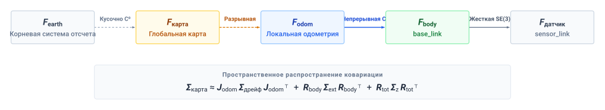
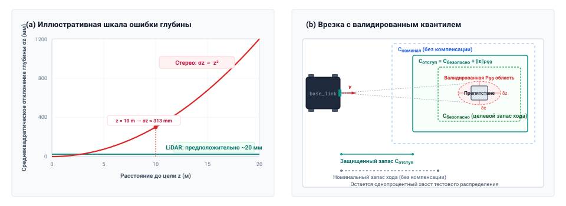

# Сенсорное восприятие

## Цель

_Почему обнаружение препятствия с точностью распознавания 99 % все же приводит к столкновению, если игнорировать отметку времени его захвата, систему координат и пространственную неопределенность?_

Обнаружение препятствия способствует безопасному движению лишь тогда, когда явно известны отметка времени его экспозиции, опорная система координат и пространственная ковариация. Физический мир непрерывно продвигается вперед, пока сенсор изображения интегрирует фотоны, переносит пиксели по шинам прямого доступа к памяти и подает тензоры в модель инференса. Точная оценка ограничивающего прямоугольника описывает геометрию, которой к моменту, когда актуатор создает момент, может уже не существовать. Механические вибрации, оптические искажения и тепловой дрейф камеры вносят пространственную неопределенность, меняя отношение между сырыми пиксельными координатами и физическими границами запаса хода.

Сообщение семантики объектов с высокой уверенностью без этих пространственных и временных квалификаций лишает нижестоящие контроллеры информации, необходимой для гарантии безопасного разделения. Восприятие реального времени должно сохранять происхождение каждого наблюдения — отслеживая отметки времени захвата через границы часовых доменов и ограничивая эллипсоиды ошибок измерения. В архитектуре физического ИИ восприятие служит мостом между сенсорным оборудованием каузальной границы и когнитивными рассуждениями в Мозге, преобразуя зашумленные сигналы в сертифицированные пространственные утверждения, которые детерминированный путь разрешения может проверить до того, как в движение будет вложена кинетическая энергия.

> **Цели обучения**
>
> - Задать контракт наблюдений, несущий время захвата, ограниченное преобразование часов, систему координат и неопределенность
> - Вычислить возраст наблюдения через конвейер сенсорики, транспорта, предобработки и инференса и преобразовать его в слагаемое остановочного бюджета
> - Диагностировать пространственные ошибки, вызванные таймингом датчика, движением во время захвата и рассогласованными системами координат
> - Объяснить, почему средняя пропускная способность захвата не ограничивает возраст кадра или запаздывание продления, и вычислить величину конкуренции хоста, которую выдерживает допуск на продление
> - Оценить, оставляет ли неопределенность наблюдения достаточно физического запаса для предложенного действия
> - Различить отказы восприятия, которые проверки времени выполнения могут обнаружить, и ошибки, остающиеся молчаливыми

## От фотонов к пространственным утверждениям

Зрительная модель складского мобильного манипулятора почти всегда способна распознать человека, выходящего из-за торца стеллажа, и все же передать планировщику положение, которое уже устарело. Мир продолжает двигаться, пока навигационная камера интегрирует и считывает свое изображение, а конвейер его обрабатывает. На этой машине между серединой экспозиции и моментом, когда наблюдение достигает любого потребителя, проходят иллюстративные `51.6 ms`, и на пределе ходовой скорости базы `1.5 m/s` машина за это время проходит `77.4 mm`. Точность распознавания не говорит о том, достаточно ли свежо это наблюдение для предложенного движения. В физическом ИИ у наблюдения есть срок годности.

Восприятие работает в Мозге, над границей предложения раздела [«Машина в пяти уровнях»](01_causal_boundary.md#sec-boundary-machine-model). Оно превращает фотоны, импульсы времени пролета и отраженные радиоволны в датированные пространственные утверждения и предлагает их, но не имеет полномочий над актуаторами; эти полномочия остаются у пути разрешения ниже границы.

Работа превращения фотонов в датированные утверждения не зависит от того, как нарисована архитектура. Сквозная политика зрение–действие [Brohan et al., 2023](references.md#brohan2023rt1); [Brohan et al., 2023](references.md#brohan2023rt2); [Zhao et al., 2023](references.md#zhao2023learning) отображает наблюдения камеры в предлагаемые действия внутри одной сети, тогда как классический модульный конвейер разделяет прием сенсорных данных, оценку состояния, построение карты и генерацию траекторий по отдельным процессам. Анализ зрения Марра [Marr, 1982](references.md#marr1982vision) отделяет то, чего должно достигать зрительное вычисление, от представления, которое его несет, и оборудования, которое его выполняет, и в физическом ИИ каждый из этих уровней должен быть реализован где-то между стимулом и откликом.

Когда инженерная команда объединяет эти обязанности в сквозной модели, обязанности остаются, но их промежуточные представления становятся труднее проверять независимо. Явный интерфейс может показать преобразование координат для проверки, нести предельный срок годности или позволить другому компоненту отвергнуть несогласованную оценку. Скрытое представление требует дополнительной инструментации или внешних проверок, чтобы дать сопоставимые свидетельства. Если восприятие примет отражение мокрого пола за свободный запас хода, инженеру нужен способ обнаружить или ограничить возникающую ошибку независимо от того, сколько программных модулей реализует конвейер.

Эти свидетельства начинаются там, где физическая энергия превращается в цифровые данные. От преобразования на матрице детекторов до потребления оценщиком состояния каждая стадия обработки добавляет возраст наблюдения. Фотоны, попадающие на матрицу фотодиодов CMOS-камеры, не мгновенно появляются как вложения признаков в инференс-движке; экспозиция, считывание, транспорт, перенос в память, предобработка и зрительный бэкбон берут каждая свою долю задержки. Если стадия восприятия передает нижестоящим компонентам ограничивающий прямоугольник обнаружения объекта без явной отметки времени и откалиброванного пространственного преобразования, нижестоящий планировщик оценит это препятствие относительно текущего положения шасси, ошибившись в нем на расстояние, которое машина прошла с момента захвата.

> ↰ **Предварительное требование:** Свежесть преобразования и старение измерений датчика выводятся в разделе [«Свежесть измерений»](02_body.md#sec-body-measurement-freshness).

> **Возраст пространственной информации**
>
> ***Возраст пространственной информации*** ($t_{\text{age}}$) — общее прошедшее физическое время между серединой интегрирования физической энергии ($t_{\text{exp}}/2$) на преобразователе и нижестоящим потреблением результирующего тензора наблюдения оценщиком состояния или политикой управления. Это часть возраста измерения от захвата до потребления, которую раздел [«Свежесть измерений»](02_body.md#sec-body-measurement-freshness) отсчитывает от преобразования, и основной текст называет ее возрастом наблюдения.
>
> 1.  **Значение:** Поскольку физическая масса движется, пока исполняется цифровое вычисление, сенсорная задержка превращается прямо в несмоделированное пространственное смещение ([«пространственное смещение»](08_perception.md#eq-percep-spatial-displacement)):
> 
>
>     $$\Delta \mathbf{x} = \int_{t_0}^{t_0+t_{\text{age}}} \mathbf{v}(t)\,dt$$
>
>     Этот непрерывный физический сдвиг исчерпывает геометрические буферы безопасности еще до того, как препятствие будет классифицировано.
> 2.  **Отличие:** В отличие от задержки программного конвейера (абсолютная длительность прямого прохода), возраст наблюдения учитывает весь физический путь: половину экспозиции, считывание, транспорт, DMA и очередь, обработку ISP, зрительный бэкбон и диспетчеризацию.
> 3.  **Типичная ловушка:** Считать отметку времени прибытия кадра ($t_{\text{recv}}$) в память пользовательского пространства временем наблюдения ($t_0$). Использование времени прибытия скрывает вышестоящие задержки захвата и транспорта и добавляет несмоделированное фазовое запаздывание в контуры обратной связи, потребляющие наблюдение.

### Временная группировка и размывание фазового запаса

Группировка повышает пропускную способность акселератора, амортизируя работу по нескольким изображениям, но сборка пакета из последовательных моментов захвата старит его ранний элемент. На темпе навигационной камеры `60 Hz` ($T_{\text{sample}} \approx$ `16.7 ms`) пакет из четырех последовательных кадров удерживает первый `50 ms`, второй и третий — `33.3 ms` и `16.7 ms`, а последний — не вовсе. Добавление ожидания самого старого кадра к возрасту наблюдения `51.6 ms` примерно удваивает его, до `101.6 ms`. Это далеко выше порога отказа — бюджетного возраста плюс границы преобразования часов, которые задает [«Контракт наблюдений»](08_perception.md#sec-perception-observation-contract), — поэтому на этой машине путь разрешения отвергает каждое утверждение, построенное из пакета, собранного через разные моменты захвата. Изображения, захваченные несколькими камерами одновременно, напротив, могут группироваться в пакет только тогда, когда пакет не добавляет возраста сверх бюджетных стадий и укладывается в свой предельный срок.

Возраст расходует и фазовый запас контура обратной связи, поскольку чистое запаздывание $t_{\text{age}}$ добавляет фазовое запаздывание $\omega t_{\text{age}}$ на частоте $\omega$ без изменения усиления. Поэтому контур с номинальным запасом $\text{PM}_{\text{nom}}$ на частоте среза усиления $\omega_c$ исчерпывает его, как только $t_{\text{age}} \ge \text{PM}_{\text{nom}}/\omega_c$, и экспозиция, обработка, транспорт, разрешение и задержка актуатора все черпают из этого единого потолка ([«Дискретная выборка и фазовое запаздывание нулевого порядка»](appendix_control.md#sec-appendix-control-zoh)).

За одну и ту же задержку платят дважды — как за фазовое запаздывание в контуре и как за путь к препятствию, — и потребитель может заложить в бюджет только измеримую задержку. Поэтому то, что передает восприятие, должно нести отметку времени, систему координат и пригодную границу ошибки, а преобразование, прием и геометрическая оценка могут каждая аннулировать их до того, как путь разрешения допустит движение.

## Что передает восприятие

Необработанное сенсорное оборудование дает электрические измерения, такие как напряжения фотодиодов, значения счетчиков времени пролета или емкостные смещения. Эти неструктурированные сигналы существенно отличаются от переменных состояния, необходимых нижестоящей автономии. Контроллер актуатора не может отслеживать желаемую силу по двумерной сетке сырых пиксельных интенсивностей, а оптимизатор траектории не может планировать свободные от столкновений пути по неорганизованным отражениям времени пролета. Нижестоящие подсистемы оценки, планирования и памяти требуют структурированных представлений физического состояния, включая метрические положения, скорости, ограничивающие объемы, нормали поверхностей и семантические классификации. Перевод сырых сенсорных потоков в эти представления — операционная обязанность конвейера восприятия. Каждое передаваемое им наблюдение должно нести для нижестоящего ПО три свойства: отметку времени захвата, опорную систему координат и огибающую неопределенности.

Первое обязательное свойство — **отметка времени захвата** $t_0$, задающая временную середину окна интегрирования физической энергии (действительный момент, когда затвор камеры был открыт или лазерный импульс послан). Датчики не делают мгновенных снимков; камера интегрирует фотоны в течение экспозиции, а механический лидар развертывает лазерные импульсы по дуге азимута за несколько миллисекунд. Нижестоящим оценщикам состояния требуется $t_0$, чтобы внести измерение в динамические уравнения движения машины. Отметка прибытия, против которой предупреждает определение, $t_{\text{recv}}$, отмечает момент, когда ядро операционной системы завершает передачу прямого доступа к памяти. Половина экспозиции, считывание, транспорт и прямой доступ к памяти (DMA) истекают до этого момента, поэтому смещение прибытия $\tau_{\text{recv}} = t_{\text{recv}} - t_0$ никогда не равно нулю, а подстановка времени прибытия вместо времени захвата портит оценщик состояния.

Величина этой порчи следует из [«пространственного смещения»](08_perception.md#eq-percep-spatial-displacement) со смещением прибытия вместо полного возраста, а при постоянной скорости $v$ сводится к $\Delta x = v\,\tau_{\text{recv}}$. На мобильном манипуляторе кадр навигационной камеры завершает передачу DMA через `26.6 ms` после середины экспозиции. Оценщик, проставляющий кадру отметку по прибытии, датирует его соответственно с опозданием, и на пределе ходовой скорости базы `1.5 m/s` он сопоставляет наблюдение с позой на `39.9 mm` дальше той, которую камера занимала в момент захвата.

> ↳ **Ниже по потоку:** Раздел [«Как преобразование устаревает»](09_memory.md#sec-memory-reference-frames) добавляет, как эти преобразования от датчика к телу устаревают со временем.

Второе обязательное свойство — идентификатор **опорной системы координат** $\mathcal{F}_{\text{sensor}}$. Любое пространственное измерение изначально выражено в локальной системе координат физического преобразователя. Камера измеряет углы пеленга относительно своего оптического центра, тогда как радар измеряет дальность и доплеровскую скорость относительно своей антенной решетки. Нижестоящие планировщики траекторий и карты препятствий работают в системе координат тела шасси $\mathcal{F}_{\text{body}}$ или в инерциальной навигационной системе $\mathcal{F}_{\text{world}}$. Преобразование наблюдения из $\mathcal{F}_{\text{sensor}}$ в $\mathcal{F}_{\text{body}}$ требует применения пространственного преобразования твердого тела, состоящего из матрицы поворота и вектора переноса, определяющих внешние параметры крепления датчика (точное физическое положение и ориентацию, где датчик прикручен к машине). Системы координат вложены от земного шара вниз до преобразователя, $\mathcal{F}_{\text{earth}} \to \mathcal{F}_{\text{map}} \to \mathcal{F}_{\text{odom}} \to \mathcal{F}_{\text{body}} \to \mathcal{F}_{\text{sensor}}$, и каждое звено этого дерева несет свое преобразование и свою неопределенность ([«Дерево систем координат и неопределенность»](08_perception.md#fig-08-coordinate-frame-tree)).

Когда выходы восприятия опускают идентификатор системы координат или полагаются на номинальные размеры CAD вместо откалиброванных физических внешних параметров, малые угловые смещения создают большие пространственные ошибки, растущие с расстоянием. Некалиброванная ошибка тангажа или рыскания $\theta =$ `1`° у датчика, обнаруживающего объект на дальности $d =$ `15 m`, вызывает поперечную ошибку положения $\Delta y \approx d \sin\theta$ в `0.26 m`, примерно в `1.7×` больше бокового запаса `0.15 m`, который база выдерживает от стеллажей, так что планировщик либо ведет машину в стеллажи, либо отвергает исправный проход как перекрытый.

[Соглашение о системах координат REP 105](https://reps.openrobotics.org/rep-0105/) именует эти системы и разделяет локально непрерывную позу `odom` и глобально скорректированную позу `map`. На мобильном манипуляторе $\mathcal{F}_{\text{body}}$ — это `base_link` базы, отслеживаемый через одометрическую систему `odom`, а последовательная цепь манипулятора отображает свой монтажный фланец `tool0` через углы шарниров обратно в `base_link`. Таблица [«Роли систем координат REP 105 для мобильного робота»](08_perception.md#tbl-08-rep105-tree) перечисляет роли и правило, которому следует каждый потребитель. Локальный контроллер потребляет непрерывную оценку и отвергает неожиданные скачки преобразований, а реализация все равно должна проверять отметки времени преобразований и неопределенность оценщика.

| Система         | Родитель в этом примере | Значение                                    | Правило потребителя                                                 |
|:--------------|:-----------------------|:--------------------------------------------|:--------------------------------------------------------------|
| `earth`       | root                   | Опциональная геодезическая система отсчета  | Проверять датум перед глобальной маршрутизацией                   |
| `map`         | `earth` если есть      | Глобальная локализация; коррекции могут скачкообразно меняться | Не допускать скачков релокализации в локальную обратную связь |
| `odom`        | `map`                  | Локально непрерывная оценка позы; может дрейфовать | Отслеживать движение локально; следить за неопределенностью и разрывами |
| `base_link`   | `odom`                 | Закрепленная на теле начало координат       | Поза тела по-прежнему наследует неопределенность одометрии        |
| `sensor_link` | `base_link`            | Откалиброванная система крепления датчика   | Применять актуальные по времени внешние параметры и их неопределенность |

***Роли систем координат REP 105 для мобильного робота**: Компактный пример глобальной, локальной, телесной и сенсорной систем координат. REP 105 требует, чтобы поза относительно `odom` оставалась непрерывной, но не предписывает гладкость $C^1$, скорость роста ковариации или фиксированную точность; для этого требуются специфичные для оценщика свидетельства.*

***Дерево систем координат и неопределенность**: Иерархия пространственных систем координат формализует разделение между непрерывным локальным мертвым счислением ($\mathcal{F}_{\text{odom}} \to \mathcal{F}_{\text{body}}$), потребляемым контурами высокочастотного слежения, и разрывными глобальными коррекциями карты ($\mathcal{F}_{\text{map}} \to \mathcal{F}_{\text{odom}}$), потребляемыми глобальными планировщиками. Пространственная ковариация наращивается вдоль кинематической цепи — от дрейфа одометрии через внешние параметры крепления к собственной ошибке измерения датчика, — поэтому нижестоящие потребители должны отвергать наблюдения, которым не хватает явного ключа координат $\mathcal{F}_{\text{sensor}}$, эпохи захвата $t_0$ и огибающей ковариации $\mathbf{\Sigma}_z$. Атрибуция: кинематическая схема книги, CC BY 4.0.*

Третье обязательное свойство — **представление неопределенности**, такое как ковариация $\mathbf{\Sigma}_z$ вместе с проверенным хвостом или жесткой границей ошибки, когда от нее зависит запас хода. Слабое освещение, атмосферное рассеяние, зеркальные поверхности и ошибка модели меняют распределение остатков. Ковариация описывает вторые моменты, а не область, гарантированно содержащую истинное состояние. Оценщики могут использовать ее для взвешивания инноваций относительно модели движения; заниженная ковариация может притянуть оценку состояния к ложному измерению и привести к плохим нижестоящим командам. Решения о безопасности должны также учитывать смещение, пропуски обнаружений и пределы валидации.

> **Три инварианта наблюдения**
>
> Передавайте утверждение восприятия с его временем захвата и часовым доменом, системой координат и квалифицированной неопределенностью. Отвергайте утверждение, когда что-либо из этого не может быть проверено для предложенного движения.

Вместе эти свойства составляют ядро контракта наблюдений, который [«Контракт наблюдений»](08_perception.md#sec-perception-observation-contract) превращает в запись, проверяемую каждым нижестоящим потребителем перед использованием. Отбрасывание неполного или неограниченного наблюдения позволяет нижестоящему оценщику распространять свое состояние вперед по физической динамике, плавно деградируя неопределенность во времени. Принятие необоснованного пакета, напротив, впрыскивает несмоделированные задержки, пространственные искажения и ложную уверенность прямо в контур управления. Обеспечение этого контракта требует проследить, как возникает наблюдение, начиная с аппаратного интерфейса, где физические явления снимаются впервые.

## Преобразование и калибровка датчиков

Запаздывание накапливается еще до того, как ПО получит хоть что-то, начиная с фотоячейки, где физические явления превращаются в электрический заряд. Камера не делает мгновенного снимка. Фотоны накапливаются на фотодиоде в течение конечной экспозиции $t_{\text{exp}}$, а значит, записанная интенсивность пикселя представляет временной интеграл яркости сцены $I(t)$ по этому интервалу:
$$I_{\text{pixel}} = \int_{0}^{t_{\text{exp}}} I(t)\,dt$$

Когда датчик или сцена движутся со скоростью $v$ во время экспозиции, резкая граница, такая как стойка стеллажа, размазывается по нескольким фотоячейкам — смаз движения шириной $\Delta x_{\text{blur}} = v\,t_{\text{exp}}$. Поскольку заряд накапливается за все окно, время, которое представляет накопленное изображение, — это середина экспозиции, отстающая от ее начала на $t_{\text{exp}}/2$. При экспозиции навигационной камеры `16 ms` на пределе ходовой скорости базы `1.5 m/s` изображение не записывает, где робот *находится*. Оно записывает, где робот *был* `8 ms` назад, размазанный по `24 mm` смаза движения.

### Искажения скользящего затвора и компенсация движения

Расписание окон экспозиции по пиксельной матрице определяет пространственную геометрию изображения. В датчике с **глобальным затвором** каждый пиксельный фотодиод накапливает заряд в один и тот же интервал времени и одновременно переносит накопленные электроны в экранированные узлы хранения. В датчике со **скользящим затвором** ограничения площади кремния и стоимости диктуют, что строки сбрасываются, экспонируются и считываются последовательно от верхней строки $y = 0$ до нижней строки $y = H - 1$. Каждая следующая строка начинает экспозицию через период строки $t_{\text{row}}$, создавая прогрессивное временное смещение по плоскости изображения:[^fn-hw-rolling-shutter]
$$t(y) = t_{\text{start}} + y \cdot t_{\text{row}}$$
где $t_{\text{start}}$ — начало экспозиции верхней строки. Когда тело движется поступательно со скоростью $v$ перпендикулярно вертикальной детали, строка $y$ захватывает ее со пространственным смещением:
$$\Delta x(y) = v \cdot y \cdot t_{\text{row}}$$

[^fn-hw-rolling-shutter]: **Эпиполярная геометрия скользящего затвора**: CMOS-сенсоры изображения со скользящим затвором сбрасывают, интегрируют и считывают строки пикселей последовательно по матрице, а не экспонируют все фотоячейки одновременно. Когда камера вращается во время этого интервала считывания, прямые физические края проецируются в изогнутые геометрические дуги по плоскости изображения. Этот прогрессивный сдвиг строк нарушает жесткие многовидовые эпиполярные ограничения, заставляя факторные графы визуально-инерциальной одометрии, которая оценивает движение, сливая признаки камеры с инерциальными измерениями, вычислять ложные глубины признаков, если только непрерывные B-сплайновые траектории камеры не интерполируют мгновенную позу каждой строки.

При вращательном движении искажение скользящего затвора становится нелинейным. Если камера подвергается угловому вращению с вектором угловой скорости $\boldsymbol{\omega} = [\omega_x, \omega_y, \omega_z]^T$ (например, быстрое рыскание или тангаж при агрессивных маневрах робота), действительная ориентация камеры непрерывно меняется по мере считывания строк. Физически камера указывает в немного разное направление для каждой строки. Для строки с вертикальной координатой $y$ дифференциальное вращение относительно начала кадра равно $\Delta \boldsymbol{\theta}(y) \approx \boldsymbol{\omega} \cdot y \cdot t_{\text{row}}$. Это зависящее от строки вращение изгибает прямые физические линии в кривые, вызывает расширение фокусного расстояния (масштабное искажение при тангаже) и сдвигает вертикальные стены в наклонные поверхности, что демонстрирует кривизна лопастей винта на рисунке [«Геометрия искажений скользящего затвора»](08_perception.md#fig-rolling-shutter-skew).

Рассмотрим навигационную камеру мобильного манипулятора, пока база проходит вертикальную стойку стеллажа на пределе ходовой скорости `1.5 m/s`. Скользящий затвор считывает `3 040` строк кадра за $t_{\text{readout}} =$ `16.6 ms`, так что межстрочный интервал составляет $t_{\text{row}} =$ `5.46 μs`. Стойка, охватывающая всю высоту кадра, не выглядит вертикальной в захваченной матрице. Нижняя строка ($y =$ `3 039`) снимается через `16.6 ms` после верхней строки ($y = 0$), давая суммарный пространственный сдвиг $\Delta x = v\,t_{\text{readout}}$ в `24.9 mm`.

Если нижестоящая реконструкция геометрии трактует это изображение как мгновенную жесткую проекцию, наклон `24.9 mm` попадает в карту препятствий нескорректированным. Это около шестой части бокового запаса `0.15 m`, который база выдерживает от стеллажей, и планировщик движения может прочитать наклоненную стойку как искусственное вторжение в свободный коридор. Локализационный допуск $\delta_{\text{loc}}$ остановочного бюджета предполагает, что этот сдвиг удален до того, как оценщик увидит кадр. Коррекция этого искажения требует **компенсации движения скользящего затвора** — алгоритма геометрического выпрямления в непрерывном времени, который использует высокочастотные (`1 000 Hz`) инерциальные угловые скорости ($\boldsymbol{\omega}$) и линейные скорости ($\mathbf{v}$), чтобы интерполировать мгновенную 6-степенную позу камеры $\mathbf{T}_{wb}(t(y))$ для каждой отдельной строки $y$, восстанавливая жесткую эпиполярную геометрию до 3D-триангуляции.

***Геометрия искажений скользящего затвора**: Фотография вращающихся лопастей винта, снятая CMOS-сенсором со скользящим затвором. Поскольку строки сенсора экспонируются и считываются последовательно сверху вниз, а не одновременно, быстрое физическое движение лопастей относительно периода строки ($t_{\text{row}}$) сдвигает и изгибает прямые жесткие структуры в нелинейные, разорванные геометрические дуги. В высокоскоростных воплощенных системах некомпенсированный сдвиг скользящего затвора вносит большие ошибки 3D-триангуляции и вторжение фантомных препятствий в нижестоящей визуально-инерциальной одометрии. (Источник: Wikimedia Commons, CC BY-SA 3.0).*

### Калибровка камеры

Компенсация скользящего затвора предполагает, что геометрия камеры уже известна, и каждое метрическое утверждение камеры опирается на эту калибровку. В **модели камеры-обскуры** [Hartley and Zisserman, 2003](references.md#hartley2003multiple) матрица внутренних параметров $\mathbf{K}$ отображает точку $\mathbf{P}_c = [X_c, Y_c, Z_c]^\top$ в оптической системе координат камеры в пиксель $[u, v]^\top$:

$$\begin{bmatrix} u \\ v \\ 1 \end{bmatrix} \sim \frac{1}{Z_c} \mathbf{K} \mathbf{P}_c = \frac{1}{Z_c} \begin{bmatrix} f_x & 0 & c_x \\ 0 & f_y & c_y \\ 0 & 0 & 1 \end{bmatrix} \begin{bmatrix} X_c \\ Y_c \\ Z_c \end{bmatrix}$$

где $f_x, f_y$ — фокусные расстояния в пикселях, а $(c_x, c_y)$ — главная точка. Инвертирование отображения восстанавливает только луч пеленга, вдоль которого любая глубина согласуется с пикселем:

$$\mathbf{r}(u, v) = \mathbf{K}^{-1} \begin{bmatrix} u \\ v \\ 1 \end{bmatrix} = \begin{bmatrix} \frac{u - c_x}{f_x} \\ \frac{v - c_y}{f_y} \\ 1 \end{bmatrix}$$

Метрическая глубина должна поэтому поступать из диспаратности стерео, датчика дальности или выученного априорного знания, каждый со своей ошибкой, и раздел [«Границы пространственной ошибки и запаса»](08_perception.md#sec-perception-error-clearance) относит эту ошибку на запас хода. Искажения объектива исправляются на стадии процессора изображительных сигналов таблицы [«Бюджет возраста информации при последовательной передаче»](08_perception.md#tbl-08-latency-budget). Вывод проекции, модель искажений и планарная калибровка Чжана [Zhang, 2000](references.md#zhang2000flexible) развиваются в разделе [«Проективная геометрия камеры и распространение ковариации»](appendix_systems.md#sec-appendix-systems-vision).

Отношение камеры к инерциальному измерительному блоку должно калиброваться в пространстве и во времени одновременно [Furgale et al., 2013](references.md#furgale2013unified). Ошибка внешнего поворота $\theta$ смещает точку на дальности $z$ примерно на $z\,\theta$, а смещение камеры относительно инерциального блока добавляет ускорения рычага ([«Пространственные системы координат и кинематика плеча»](appendix_control.md#sec-appendix-control-spatial)). Некалиброванное смещение $\Delta t$ между экспозицией и инерциальной выборкой сбивает ориентацию камеры на $\omega\,\Delta t$, пока база поворачивается с угловой скоростью $\omega$, смещая ту же точку примерно на $z\,\omega\,\Delta t$, так что ошибка тайминга растет и с угловой скоростью поворота, и с дальностью. Фиксация начал экспозиций и инерциальных выборок по одному аппаратному триггеру ограничивает это смещение, оставляя остаток, который оценивает онлайн-калибровка. Каждая из этих калибровок действует только внутри условий, при которых она подгонялась, поэтому запись наблюдения несет ревизию калибровки и ее диапазон действительности.

### Каскад задержек

Экспозиция и считывание — лишь первые стадии, которые проходит кадр. Суммирование стадий каскада задержек раздела [«Свежесть измерений»](02_body.md#sec-body-measurement-freshness) до диспетчеризации дает возраст наблюдения:
$$t_{\text{age}} = \frac{t_{\text{exp}}}{2} + t_{\text{readout}} + t_{\text{transport}} + t_{\text{DMA}} + t_{\text{ISP}} + t_{\text{backbone}} + t_{\text{IPC}}$$

> **Задержка преобразования и возраст информации**
>
> *Сценарий.* Мобильный манипулятор едет к торцу стеллажа на пределе ходовой скорости, когда выходит человек. Мы суммируем возраст наблюдения навигационной камеры $t_{\text{age}}$ от середины экспозиции до диспетчеризации наблюдения и вычисляем расстояние, которое база проходит за это время, $\Delta x = v\,t_{\text{age}}$.
>
> **Каскад задержек по стадиям**:
>
> 1. *Середина интегрирования экспозиции ($t_{\text{exp}}/2$):* экспозиция навигационной камеры $t_{\text{exp}} =$ `16 ms` (документация) $\implies \Delta t_1 =$ `8 ms`.
> 2. *Построчное считывание скользящего затвора ($t_{\text{readout}}$):* скользящее считывание кадра вносит $\Delta t_2 =$ `16.6 ms` (документация).
> 3. *Сериализация и транспорт MIPI CSI-2 ($t_{\text{transport}}$):* [буклет Sony IMX477](https://www.sony-semicon.com/files/62/pdf/p-13_IMX477-AACK_Flyer.pdf) указывает четырехканальный вариант до $2.1\text{ Gbps/lane}$. Бюджет назначает $\Delta t_3 =$ `0.8 ms` (иллюстративно) на остаточный транспорт после потокового считывания; это значение не равно размеру кадра, деленному на пиковую скорость канала.
> 4. *DMA-прием и очередь буферов V4L2 ядра ($t_{\text{DMA}}$):* разбросно-сборная запись в DRAM и прерывание драйвера $\implies \Delta t_4 =$ `1.2 ms` (иллюстративно).
> 5. *Дебайеризация и выпрямление аппаратным ISP ($t_{\text{ISP}}$):* выделенный проход аппаратного ISP на кристалле $\implies \Delta t_5 =$ `2.5 ms` (иллюстративно).
> 6. *Прямой проход тензора зрительного бэкбона ($t_{\text{backbone}}$):* квантованная по INT8 Vision Transformer на периферийном NPU $\implies \Delta t_6 =$ `22 ms` (иллюстративно).
> 7. *Упаковка ковариации и IPC без копирования ($t_{\text{IPC}}$):* диспетчеризация кольцевого буфера общей памяти $\implies \Delta t_7 =$ `0.5 ms` (иллюстративно).
>
> **Суммарный возраст наблюдения**:
> `$$t_{\text{age}} = 8 ms + 16.6 ms + 0.8 ms + 1.2 ms + 2.5 ms + 22 ms + 0.5 ms = 51.6 ms$$`
>
> **Смещение на пределе ходовой скорости**:
>
> На пределе ходовой скорости базы $v =$ `1.5 m/s`, удерживая скорость в окне возраста:
> `$$\Delta x = (1.5 m/s) \times (0.0516 s) = 0.0774 m = 77.4 mm$$`
>
> **Следствия для системы**: База проходит это расстояние прежде, чем любой потребитель прочтет кадр, показывающего человека. Пространственное распространение позы с отметками времени может правильно разместить старое наблюдение в текущей системе координат, но ни одна последующая стадия не возвращает уже пройденное расстояние.

Семь стадий таблицы [«Бюджет возраста информации при последовательной передаче»](08_perception.md#tbl-08-latency-budget) складываются в возраст наблюдения $t_{\text{age}}$ в `51.6 ms`, который входит в $\tau_{\text{delay}}$. Этот возраст завершает худший случай, оставленный открытым разделом [«Многотактные ритмы»](04_nervous_system.md#sec-nervous-cadences): инициатор, который продлевает свою аренду, а затем зависает. Кадр, показывающий человека, достигает инициатора лишь через $t_{\text{age}}$ после появления человека. Последнее продление, которое инициатор посылает до того, как мог бы увидеть человека, может уйти не позднее чем через $t_{\text{age}}$ после появления человека, и если затем инициатор зависает, аренда отсчитывает свою полную длину от этого продления. Задержка от появления человека до первой тормозящей силы составляет поэтому возраст плюс аренда `60 ms`, такт `1 ms`, цикл шины `1 ms` и `20 ms` начала торможения — суммарно $\tau_{\text{delay}}$ в `133.6 ms`.

Путь разрешения никогда не читает изображение, поэтому он не может уменьшить слагаемое возраста; возраст достигает его только через эпоху свидетельств предложения. На пределе ходовой скорости `1.5 m/s` слагаемое возраста наблюдения $v\,t_{\text{age}}$ добавляет `77.4 mm` к остановочному пути [«остановочного пути тела»](02_body.md#eq-body-stopping-distance). Нарастающий итог поднимается с `835.5 mm`, которые дали строки через путь аренды, до `912.9 mm`, что оставляет `187.1 mm` от свободного расстояния `1.10 m` до торца стеллажа.

| Стадия              |                                       Приращение |                                  Последовательный возраст после стадии | Что проверять                          |
|:-------------------|------------------------------------------------:|--------------------------------------------------------:|:----------------------------------------|
| Середина экспозиции  |  `8 ms` |  `8 ms` | Соглашение об отметках времени экспозиции и строк   |
| Скользящее считывание    |   `16.6 ms` |   `24.6 ms` | Выбранная строка и перекрытие с потоковой передачей |
| Остаточный транспорт | `0.8 ms` | `25.4 ms` | Выбранный режим датчика и приемник хоста  |
| DMA и очередь      |       `1.2 ms` |       `26.6 ms` | Арбитраж и хвост очереди              |
| ISP                |       `2.5 ms` |       `29.1 ms` | Режим и конкурирующие задачи                 |
| Зрительный бэкбон    |  `22 ms` |  `51.1 ms` | Нагрузка, часы, тепловое состояние          |
| Диспетчеризация           |       `0.5 ms` |         **`51.6 ms`** | Сквозной возраст от захвата до потребителя      |

***Бюджет возраста информации при последовательной передаче**: Приращения стадий навигационной камеры, принятые неперекрывающимися, складываются в ее возраст наблюдения. Реальный конвейер может перекрывать считывание, передачу и обработку, поэтому возраст, ограничивающий проект, — это измеренный возраст от захвата до потребителя, включая хвосты очередей.*

> **Возраст пространственной информации и бюджет остановки**
>
> Перед распространением зрительного восприятия в пространственное планирование проверьте ваше понимание того, как задержка конвейера создает несмоделированное пространственное смещение:
>
> - **Возраст пространственной информации**: Можете ли вы объяснить, как физическая задержка от экспозиции фотонов до диспетчеризации общей памяти превращается прямо в несмоделированное кинематическое смещение, размывая запасы хода до того, как политика управления успеет отреагировать?
> - **Середина экспозиции против отметки прибытия**: Можете ли вы описать, почему использование отметок времени получения ядром вместо середин интегрирования экспозиции в качестве эпохи захвата добавляет фазовое запаздывание, способное дестабилизировать замкнутые контуры обратной связи?
> - **Распространение позы от времени захвата**: Можете ли вы объяснить, как распространение позы машины вперед от времени захвата наблюдения правильно размещает старое наблюдение в текущей системе координат и почему это распространение не может вернуть уже пройденное расстояние?
> - **Возраст наблюдения в остановочном бюджете**: Можете ли вы объяснить, почему слагаемое возраста наблюдения $v\,t_{\text{age}}$ добавляется к остановочному пути и почему путь разрешения, никогда не читающий изображение, не может его уменьшить?

Последовательный бюджет трактует транспорт, DMA и очередь как фиксированные приращения, однако каждое зависит от того, что еще хост перемещает в тот же момент. В этих слагаемых трафик камеры может добавить возраст, который не измеряет ни один отдельный владелец стадии.

## Цена приема данных

Сырые потоки пикселей, приходящие по MIPI CSI-2 или Ethernet, потребляют DMA и обслуживание памяти прежде, чем инференс сможет их прочитать. На общем прикладном процессоре записи камеры могут также задерживать другие чтения хоста или переполнить приемник и потерять кадр.

### DMA-прием MIPI CSI-2 и буферы без копирования

Как только аналого-цифровые преобразователи на кристалле датчика оцифровывают заряды пикселей, кадр должен пройти через физическое межсоединение в память хоста. Потоки камеры входят в прикладный процессор по шине MIPI CSI-2.[^fn-hw-mipi-csi]

[^fn-hw-mipi-csi]: **Протокол шины MIPI CSI-2**: CSI-2 передает сериализованные потоки пикселей по линиям D-PHY или C-PHY приемнику хоста и контроллеру DMA. Он позволяет обойтись без сетевого стека, но задержки транспорта и очереди все равно зависят от режима датчика, скорости линии, контроллера и конкурирующего трафика; см. [«Почтовые ящики гетерогенного SoC и барьеры памяти»](appendix_systems.md#sec-appendix-systems-ipc).

> **Архитектура потока данных на кремнии**
>
> 1. **Физический уровень D-PHY / C-PHY**: физические линии сериализуют пакеты пикселей с поддерживаемой скоростью выбранного датчика и приемника; заголовки пакетов несут проверки ошибок.
> 2. **Контроллер хоста CSI-2 системы на кристалле (SoC)**: десериализует байтовые пакеты, снимает заголовки и проверяет целостность CRC.
> 3. **Контроллер разбросно-сборного DMA**: выделенный движок DMA переносит байтовые слова пикселей прямо в DRAM через внутреннее системное межсоединение (например, кроссбар AXI).
> 4. **Кольцевые буферы DMA ядра**: драйвер Linux `v4l2` может отображать буферы захвата в пользовательское пространство.

Как только запись DMA завершается, драйвер ядра генерирует прерывание.[^fn-hw-v4l2-dma] Драйвер может экспортировать DMA-буфер через `dma_buf`, чтобы совместимые тракты ISP или акселератора могли разделять хранилище без дополнительного копирования через ЦП. Преобразование формата, изменения раскладки или ограничения устройства все же могут потребовать копирования или преобразования.

[^fn-hw-v4l2-dma]: **Прямой доступ к памяти Video4Linux2**: Драйвер V4L2 может использовать разбросно-сборное или физически непрерывное DMA-хранилище и предоставлять буфер захвата через `V4L2_MEMORY_MMAP`, которым может делиться совместимый импортер `dma_buf`. См. [«Почтовые ящики гетерогенного SoC и барьеры памяти»](appendix_systems.md#sec-appendix-systems-ipc).

Выбор физического межсоединения диктует нижнюю границу транспорта датчика и накладных расходов приема хостом ([«Задержки от фотона до актуатора через интерфейсы камер»](08_perception.md#fig-08-perception-camera-latency-breakdown)). В робототехнических системах проектировщики часто выбирают интерфейсы камеры по механическому удобству (например, кабели USB 3.0), не учитывая налогов на очереди драйвера и пакетизацию протокола. Измерение полного каскада задержек от фотона до актуатора через четыре стандартных интерфейса воплощенного зрения обнаруживает совокупную цену этих транспортных решений. Тогда как стандартный промышленный USB 3.0 вносит существенную задержку замкнутого контура 58,4 мс из-за пакетизации драйвером класса USB Video Class (UVC), копирований ядра в пользовательское пространство и переменного опроса межкадрового интервала USB, встроенный MIPI CSI-2 достигает детерминированных 34,6 мс туда и обратно через прямой доступ к памяти (DMA) D-PHY непосредственно на SoC. Автомобильные сериализаторы/десериализаторы (SerDes) GMSL2 совпадают по задержке с MIPI CSI-2 (34,8 мс), одновременно удлиняя физический охват сигнала до 15 метров по легкому коаксиальному кабелю с задержкой сериализации на линии всего ≈50 мкс. Наконец, нейроморфные событийные камеры (такие как Prophesee Metavision DVS) полностью обходят обычную интеграцию экспозиции и считывание скользящего затвора, передавая асинхронные изменения полярности с микросекундными интервалами, что обеспечивает ультрабыстрое время реакции замкнутого контура 11,9 мс.

***Задержки от фотона до актуатора через интерфейсы камер**: Сравнение задержек по стадиям четырех интерфейсов камеры (нейроморфная событийная камера, встроенный MIPI CSI-2, автомобильный GMSL2 SerDes и промышленный USB 3.0 UVC), измеряющее совокупный путь от оптического преобразования до механического нарастания момента двигателя. USB 3.0 несет значительный налог драйвера и пакетизации (58,4 мс всего), встроенный MIPI CSI-2 и автомобильный GMSL2 обеспечивают детерминированный прием по DMA (34,6 мс и 34,8 мс), а нейроморфный DVS обходит кадровую экспозицию и скользящее считывание, достигая 11,9 мс реакции замкнутого контура.*

### Конкуренция за шину памяти и возраст наблюдения

Сырые скорости навигационной камеры и камеры запястья машины вычисляются в примере [«Бюджеты приема и хранения для нескольких камер»](05_data.md#nbk-data-ingestion-bandwidth-storage-budgets-multi-camera). Когда стек восприятия читает эти кадры, копирует или преобразует промежуточные буферы, а акселератор читает веса и записывает активации, контроллер памяти несет многократно превышающую скорость приема. Даже эта кратность при усреднении за секунду находится далеко внутри пиковой пропускной способности памяти.

Средняя пропускная способность не определяет задержку одного чтения. Синхронизированные камеры концентрируют свои DMA-записи в пачки, а гранулярность арбитража, приоритет чтения и размещение банков решают, сколько любой другой запрос ждет за ними. На мобильном манипуляторе пачка приходится только на прикладный процессор. Путь разрешения работает на собственном микроконтроллере и читает свое состояние из собственной памяти, поэтому пачка не может растянуть его такт, а размещение на общем кристалле, которое подвергло бы эти чтения, — то самое, которое отвергает раздел [«Конкуренция за общие ресурсы»](13_placement.md#sec-placement-resource-contention). Пачка достигает пути разрешения только как возраст кадра, на котором построено предложение, или запаздывание продления, которое посылает политика фрагмента, и у этих двух величин разные допуски. Кадр, который ждет за трафиком камеры и акселератора, достигает диспетчеризации старее бюджетных стадий, а порог отказа раздела [«Контракт наблюдений»](08_perception.md#sec-perception-observation-contract) не оставляет над ними запаса, поэтому каждое предложение, построенное на этом кадре, отвергается.

Фрагмент, чей инференс ждет за тем же трафиком, продлевает аренду с опозданием, и здесь правило аренды раздела [«Единый связанный бюджет анатомии»](04_nervous_system.md#sec-nervous-coupled-budget) оставляет `5 ms` дрожания продления сверх периода фрагмента `50 ms`. Конкуренция хоста может поэтому растянуть инференс политики фрагмента `40 ms` не более чем на `12.5` процента, а на практике меньше, поскольку тот же допуск удерживает также собственное дрожание инициатора и дрожание платформенной линии к микроконтроллеру ([«Решения по изоляции на кремнии»](13_placement.md#sec-placement-isolation-decisions)). Продление с опозданием `10 ms` позволяет аренде истечь и останавливает машину. Конкуренция на этом размещении стоит доступности, но никогда — расстояния, потому что путь разрешения отвергает то, что остановочный бюджет не зарезервировал.

Важно для самой камеры и то, как долго пачка удерживает шину. Если добавленная задержка превышает то, что может буферизовать FIFO приемника, приемник может переполниться и потерять кадр; порог зависит от его буфера и паттерна пачек. Потерянный кадр удваивает интервал между двумя иначе периодическими выборками, и потребитель трактует отсутствующее обновление как отказ по возрасту или последовательности, а не предполагает, что новое изображение прибудет по расписанию.

Аппаратные механизмы, управляющие доставкой кадров (кольца DMA, отображения IOMMU и арбитраж DRAM), рассматриваются в [Hennessy and Patterson, 2019](references.md#hennessy2019computer) и [Bryant and O'Hallaron, 2015](references.md#bryant2015computer). Для решения этой главы важная величина — возраст от захвата до потребителя и его хвост при намеченной нагрузке камеры.

Кадр, пришедший вовремя, отвечает лишь на вопрос, когда была снята сцена. Где находятся в ней объекты и насколько этой оценке можно доверять — вопрос отдельный, и ошибка в этом ответе расходуется из того же запаса хода.

## Границы пространственной ошибки и запаса

Когда восприятие помещает стойку стеллажа на несколько сантиметров дальше от пути базы, чем она стоит на самом деле, база планирует свой проход с этими сантиметрами, вычтенными из бокового запаса `0.15 m`, который она выдерживает от стеллажей, и ни одна стадия конвейера не решила их израсходовать. Как только нижестоящая логика управления использует оценочную координату для разрешения движения, пространственная ошибка становится физическим смещением, расходуемым из того же запаса хода, который удерживает машину от препятствия. Превращение сенсорного наблюдения в утверждение о запасе хода требует **метрического обоснования**, отображающего сырые измерения детектора в геометрическое пространство. Это обоснование опирается на обратную проекцию двумерных сенсорных координат в три измерения — обращение, предполагающее известную оптику, жесткое крепление и предсказуемые свойства поверхностей.

Математические принципы проекции и триангуляции, подробно изложенные в [Hartley and Zisserman, 2003](references.md#hartley2003multiple) и [Szeliski, 2022](references.md#szeliski2022computer), управляют тем, как шум измерения превращается в пространственное смещение. В пассивном стереозрении глубина $z$ вычисляется из базы $b$, фокусного расстояния $f$ и диспаратности $d$ через соотношение $z = \frac{f b}{d}$. Дифференцирование этой обратной проекции по диспаратности дает неопределенность глубины ([«неопределенность стерео»](08_perception.md#eq-percep-stereo-uncertainty)):

$$\delta z \approx \frac{z^2}{f b} \delta d$$

где $\delta d$ — малая ошибка диспаратности.[^fn-math-inverse-depth] Если $\delta d$ обозначает среднеквадратичное отклонение диспаратности $\sigma_d$, распространение первого порядка дает $\sigma_z\approx z^2\sigma_d/(fb)$. Удвоение дальности увеличивает это смоделированное среднеквадратичное отклонение в четыре раза при фиксированных $f$, $b$ и $\sigma_d$. Для далеких ориентиров оценщик вместо этого несет глубину как обратную глубину $\rho = 1/z$, ошибка которой остается примерно линейной, и это **метрическое обоснование обратной глубины** удерживает расширенный фильтр Калмана от расхождения на квадратичном хвосте. Импульсный датчик времени пролета вместо этого оценивает $z=c\Delta t/2$; его ошибка дальности зависит от его механизмов тайминга и детектирования и может быть примерно плоской в заданной рабочей области.

[^fn-math-inverse-depth]: **Параметризация обратной глубины**: В визуальной оценке состояния параметризация 3D-ориентиров обратной глубиной ($\rho = 1/z$) превращает нелинейное распределение ошибки глубины с тяжелыми хвостами ($\delta z \propto z^2$) в примерно гауссово пространство ошибок по плоскости изображения. При обратной глубине точки на оптической бесконечности ($z \to \infty$) имеют конечную дисперсию ($\rho \to 0$). Строгий вывод и формулировка через факторные графы — в разделе [«Пространственные представления и параметризация сцены»](appendix_ml.md#sec-appendix-ml-spatial).

Чтобы количественно оценить геометрию, примем иллюстративную стереопару (навигационная камера в одиночку восстанавливает только луч пеленга ([«луч пеленга»](08_perception.md#eq-percep-bearing-ray))) с $b =$ `0.20 m`, $f =$ `800` px и среднеквадратичным отклонением диспаратности $\sigma_d =$ `0.5` px на испытанном диапазоне. Распространение первого порядка дает $\sigma_z =$ `12.5 mm` на `2 m` и $\sigma_z =$ `312.5 mm` на `10 m` ([«Ошибка глубины и отступы запаса»](08_perception.md#fig-08-depth-uncertainty-clearance)). Это **масштабы одного среднеквадратичного отклонения**, а не отступы запаса или границы 99-го перцентиля. Пригодный отступ требует хвостового квантиля *полного пространственного остатка*, откалиброванного на намеченном датчике, дальности, текстуре, движении и условиях освещения, при отдельной обработке систематического смещения и пропусков обнаружений. Поэтому запас хода `150 mm`, выдерживаемый вдоль луча обзора до препятствия, нельзя расширить до действительного отступа `162.5 mm` или `462.5 mm` простым добавлением одного $\sigma_z$. Скорость должна быть снижена или предложение отвергнуто всякий раз, когда проверенные границы ошибки дальности и запаса остановки не помещаются.

### Запасы отступа и распространение по цепочке преобразований

Пространственная ошибка выходит за пределы оптической системы координат датчика. Чтобы управлять движением, оценочная точка должна распространиться через преобразования координат до системы координат основания робота и рабочего органа. Механика преобразований твердых тел и композиция кинематических систем SE(3) — стандартные результаты, рассматриваемые Крейгом [Craig, 2005](references.md#craig2005introduction) и в [Lynch and Park, 2017](references.md#lynch2017modern). Каждое звено этой цепочки преобразований вносит ошибки масштаба, дрейф калибровки крепления, квантование энкодеров шарниров и механическую податливость под нагрузкой (например, когда манипулятор слегка проседает под действием гравитации). Эффекты рычага линейно усиливают малый угловой поворот у крепления датчика с расстоянием, размазывая спроецированные координаты по широкой дуге. Если внешняя калибровка навигационной камеры смещается на $\theta =$ `0.005` rad относительно шасси, поперечная ошибка $\delta x \approx z\theta$ на $z =$ `10 m` составляет `50 mm`, равную по величине всему локализационному допуску `50 mm` $\delta_{\text{loc}}$, который остановочный бюджет удерживает вдоль направления движения. Сравнение здесь о масштабе, а не о распределении. Допуск несет малые проверенные остатки, такие как ход преобразования часов раздела [«Контракт наблюдений»](08_perception.md#sec-perception-observation-contract), и смещение, ему сопоставимое, есть отказ калибровки, который потребитель должен отвергнуть проверкой действительности калибровки, а не поглотить. В сочетании с квадратичной неопределенностью глубины суммарный вектор пространственной ошибки $\boldsymbol{\epsilon}_{\text{spatial}}$ на больших дальностях определяется глубиной вдоль оптической оси и угловыми эффектами рычага, перпендикулярными ей.

> ↳ **Ниже по потоку:** Огибающие пространственной ковариации раздувают вперед-инвариантные множества барьеров безопасности, выведенные в разделе [«Безопасные множества как условное разрешение»](12_enforcement.md#sec-enforcement-safe-sets-conditional-permission).

Каждый физический барьер безопасности работает, защищая геометрическую границу вокруг машины. Для вектора ошибки положения $\boldsymbol{\epsilon}_{\text{spatial}}$ неравенство треугольника дает консервативное соотношение между номинальным и истинным запасом хода:
$$C_{\text{true}} \ge C_{\text{nominal}} - \|\boldsymbol{\epsilon}_{\text{spatial}}\|$$
Для проверенного квантиля нормы ошибки 99-го перцентиля путь разрешения может выбрать **отступ запаса** $C_{\text{inset}}$ ([«отступ запаса»](08_perception.md#eq-percep-clearance-inset)):

$$C_{\text{inset}} = C_{\text{safe}} + \|\boldsymbol{\epsilon}_{\text{spatial}}\|_{P_{99}}$$

Здесь $C_{\text{safe}}$ — физический запас хода, который должно выдерживать движение, например боковой запас базы, а квантиль должен происходить из заданной, проверенной совокупности остатков для полной пространственной ошибки, включая смещение калибровки. Даже тогда он оставляет однопроцентный хвост под испытательным распределением; закрыть его смогли бы только обоснованная жесткая граница соответствующей ошибки, осуществимый путь остановки и отклик разрешения внутри оставшегося бюджета задержки. Рисунок [«Ошибка глубины и отступы запаса»](08_perception.md#fig-08-depth-uncertainty-clearance) показывает, как растущий масштаб ошибки глубины стерео может потребовать большего отступа на больших дальностях.

***Ошибка глубины и отступы запаса**: (A) Масштаб глубины стерео в одном среднеквадратичном отклонении растет с квадратом дальности при фиксированном разбросе диспаратности; квалифицированный датчик времени пролета может быть более плоским. (B) Проверенный квантиль *нормы ошибки* 99-го перцентиля увеличивает номинальный отступ запаса и оставляет остаточный хвост и риск смещения. Атрибуция: анализ геометрических ошибок книги, CC BY 4.0.*

Поскольку запас хода зависит от распространенной ошибки, нижестоящие планировщики и путь разрешения не могут потреблять сырые кортежи координат. Одна ковариация $\mathbf{\Sigma}\in\mathbb{R}^{3\times3}$ не говорит, оправдан ли отступ запаса в $10\text{ mm}$ или $500\text{ mm}$; для этого нужен независимо проверенный хвост или жесткая граница.

Когда пространственная ошибка квалифицирована, путь разрешения может расширить отступ запаса, обменивая скорость или рабочее пространство на разделение. Стена без текстуры, блики или утраченная калибровка могут аннулировать эту квалификацию, не делая числовую дисперсию буквально бесконечной. Путь разрешения должен тогда отвергнуть движение, зависящее от затронутого утверждения, и выбрать осуществимое резервирование.

На каждом кадре производитель строит пространственное утверждение в фиксированном порядке, и любой шаг может его завершить. Сначала он преобразует отметку времени захвата в часы потребителя с ограниченной ошибкой синхронизации и вычисляет $t_{\text{age}}$; если возраст плюс неопределенность часов превышают порог отказа, он помечает наблюдение устаревшим, и предложения, которым оно нужно, отвергаются. Путь разрешения повторяет эту проверку на своем такте по верхней границе возраста, которую несет диспетчеризованная запись ([«Контракт наблюдений»](08_perception.md#sec-perception-observation-contract)). Для свежего наблюдения производитель затем распространяет положение и неопределенность к моменту решения по проверенной модели движения, выводит обратной проекцией каждое пиксельное измерение в оптические координаты с сенсорной ковариацией,[^fn-math-unprojection-covariance] и переносит точку и ковариацию в систему координат тела распространением ошибки SE(3) первого порядка через откалиброванные внешние параметры. Проверенные остатки, включая смещение, затем задают радиус отступа, а когда действительной границы не остается, затронутое движение отвергается. Из восприятия выходит утверждение $(\mathbf{p}_{\text{body}}, \mathbf{\Sigma}_{\text{body}}, C_{\text{inset}}, t_{\text{age}})$, а не голая координата.

[^fn-math-unprojection-covariance]: **Метрическая обратная проекция и распространение ковариации**: Распространение первого порядка отображает ковариацию измерения в $\mathbf{\Sigma}_c = \mathbf{J}_{\text{unproj}}\mathbf{\Sigma}_{\text{meas}}\mathbf{J}_{\text{unproj}}^\top$, а затем в $\mathbf{\Sigma}_b = \mathbf{R}_{bc}\mathbf{\Sigma}_c\mathbf{R}_{bc}^\top + \mathbf{\Sigma}_{\text{ext}}$. Ее наибольшее собственное значение дает главный масштаб дисперсии, но **не** радиус ошибки 99-го перцентиля. Для квантиля требуется предположенное и откалиброванное распределение ошибки, включая смещение; см. [«Проективная геометрия камеры и распространение ковариации»](appendix_systems.md#sec-appendix-systems-vision).

### Выученные признаки сцены и глубина

Восприятие с открытым словарем добавляет выученный семантический слой поверх метрической сенсорики, построенный из **фундаментальных моделей зрения для 3D**. Самосупервизорный бэкбон, такой как DINOv2 [Oquab et al., 2023](references.md#oquab2023dinov2), дает плотные признаки патчей, сегментатор с подсказками, такой как SAM [Kirillov et al., 2023](references.md#kirillov2023segment), дает не зависящие от классов маски экземпляров, а системы, такие как ConceptGraphs [Kuwajerwala et al., 2024](references.md#kuwajerwala2024conceptgraphs); [Jatavallabhula et al., 2023](references.md#jatavallabhula2023conceptfusion) и Hydra [Hughes et al., 2022](references.md#hughes2022hydra) поднимают эти маски и признаки через откалиброванные глубину, внешние параметры и одометрию в **ориентированный на объекты 3D-граф сцены**, чьи узлы несут центроид, пространственную ковариацию и выровненное по тексту вложение.

Эти признаки расходуют бюджет вычислений и возраста [Williams et al., 2009](references.md#williams2009roofline). Гипотетический энкодер на `3 TFLOP` при частоте кадров навигационной камеры `60 Hz` потребовал бы `180` TFLOP/s непрерывной полезной пропускной способности еще до предобработки или трафика памяти, тогда как NVIDIA указывает до `43` плотных FP16 TFLOP/s для Jetson AGX Orin в своем [техническом буклете](https://www.nvidia.com/content/dam/en-zz/Solutions/gtcf21/jetson-orin/nvidia-jetson-agx-orin-technical-brief.pdf) — это пиковая арифметическая скорость, а не непрерывная пропускная способность модели. Энкодер не может работать на частоте камеры на этом процессоре даже на арифметическом потолке, поэтому восприятие расщепляется на **многочастотную иерархию**. Метрический прием на прикладном процессоре превращает DMA-буферы камеры в точки препятствий и сетки занятости на $30\text{--}60\text{ Hz}$ без тяжелого бэкбона, а фундаментальные модели обновляют семантические узлы графа сцены на ключевых кадрах на $1\text{--}5\text{ Hz}$. Медленное семантическое обновление допустимо только тогда, когда свежая метрическая сенсорика и путь разрешения удерживают физический запас между обновлениями.

Стадия подъема с камеры на вид сверху, такая как Lift-Splat-Shoot [Philion and Fidler, 2020](references.md#philion2020lift), разработанная в разделе [«Подъем с камеры на вид сверху»](appendix_ml.md#sec-appendix-ml-bev-lifting) ([«Подъем лучевой пирамиды камеры и BEV-сплаттинг»](appendix_ml.md#fig-08-ray-frustum-voxel-lifting)), помещает выученные гипотезы глубины из 2D-зрительных бэкбонов в метрическую сетку планировщика, но ее веса бинов глубины — это оценки модели, а не откалиброванная метрическая ошибка, поэтому отступ запаса [«отступа запаса»](08_perception.md#eq-percep-clearance-inset) все еще опирается на проверенные остатки.

Каждая граница этого раздела, метрическая или выученная, предполагает, что датчик ведет себя согласно калибровке. Распространение ограничивает ошибку датчика, работающего как смоделировано; оно ничего не говорит о датчике, который перестал работать так, продолжая выдавать кадры с номинальной частотой.

## Как наблюдения дают сбой

Навигационная камера может выйти из строя двумя способами, которые совершенно не похожи для ее потребителя. Если ее линия сериализатора теряет синхронизацию, драйвер поднимает ошибку и кадр никогда не приходит. Если свет через открытые ворота дока насыщает объектив, когда база поворачивает в проход, камера выдает полный кадр с номинальной частотой, в котором торец стеллажа — пятно насыщенного белого. Отказы восприятия делятся ровно по этой линии на два эксплуатационных класса. **Обнаружимые отказы** возникают, когда физический датчик или транспортная среда сообщает явное состояние ошибки. Линия сериализатор-десериализатор теряет синхронизацию (теряя синхронизацию часов), циклическая проверка избыточности обнаруживает испорченную полезную нагрузку, кадровый буфер переполняется или транспортная шина выходит по тайм-ауту. Эти отказы просто обрабатывать, поскольку аппаратный драйвер выставляет флаг ошибки на границе приема. Нижестоящие потребители регистрируют отсутствующий кадр и аннулируют устаревшие оценки состояния, а как только возраст свидетельств превышает свой бюджет, путь разрешения отказывает и переводит машину на проверенное резервирование. Напротив, **молчаливые отказы** возникают, когда аппаратура датчика и транспортный конвейер работают без ошибок, доставляя полностью заполненный, структурно корректный тензор, чьи численные значения искажают физический мир.

Физическая деградация оптического тракта — частый источник молчаливой ошибки.[^fn-hw-lidar-drift] Когда прямой солнечный свет попадает в оптическое отверстие, падающие фотоны превышают физическую емкость заряда («емкость полного колодца») CMOS-фотодиодов, удерживая интенсивности пикселей на их максимальном пределе квантования (обрезая изображение до чисто белого) на больших участках матрицы. Эта **насыщение динамического диапазона** уничтожает локальные пространственные градиенты. Извлекатели признаков, оценщики оптического потока и алгоритмы сопоставления диспаратности отказывают, потому что математическая оптимизация на однородном плоском поле дает нулевую информацию, однако драйвер выдает корректный кадр с номинальной строчной частотой. Слабо освещенные среды вносят противоположный режим отказа. По мере падения окружающей освещенности дискретное, случайное поступление отдельных фотонов (**фотонный шум отсчетов**) и собственные электрические флуктуации усилителя датчика (**шум считывания датчика**) доминируют в измерении. Отношение сигнал/шум обваливается, заставляя нижестоящие нейронные сети извлекать геометрические признаки из случайных шумовых флуктуаций, а не из физических границ сцены. Загрязнения окружающей среды на защитной линзе или купольном окне (такие как капли воды, летучая пыль или брызги грязи) действуют как нерегулярные преломляющие элементы и оптические фильтры нижних частот. Они ослабляют контраст, искажают пространственную геометрию и скрывают препятствия, пока транспортная шина продолжает работать, не выставив ни единого флага отказа.

[^fn-hw-lidar-drift]: **Дрейф дальности лидара и размазывание детектора**: Аналогичная молчаливая деградация происходит в приемниках активных лидаров времени пролета, использующих лавинные фотодиоды (APD) или однофотонные лавинные фотодиоды (SPAD). Когда испущенный лазерный импульс отражается от ретроотражающей поверхности, интенсивная энергия отражения вводит фотодетектор в нелинейное насыщение заряда, ускоряя пересечение порога фронтового дискриминатора через *дрейф дальности* (размазывание детектора). Результирующее искажение тайминга искусственно укорачивает расчетное время туда и обратно ($t_{\text{TOF}}$), смещая кажущуюся границу препятствия на несколько сантиметров в сторону датчика без выставления аппаратного отказа.

Аномалии тайминга и транспорта также могут молча испортить наблюдение. Если незащищенный физический интерфейс подвергается электромагнитным помехам, сбои бит десериализатора (когда аппаратура теряет или дублирует бит, рассоединяя весь последующий поток данных) могут изменить семантику полезной нагрузки, не аннулируя стандартные длины пакетов. Опаснее потерянного пакета, поскольку ничто не сигнализирует о нем, — наблюдение, доставленное с отметкой времени, неверно сообщающей его истинную эпоху захвата. Если сенсор изображения захватывает фотоны в эпоху $t_0$, но запоздавший обработчик прерываний или несинхронизированные системные часы проставляют результирующему буферу памяти $t_0 + \delta t$, нижестоящий оценщик состояния интегрирует пространственные признаки под неверной позой тела. Рассмотрим машину, движущуюся со мгновенной скоростью $v$ и линейным ускорением $a$ вдоль заданной траектории. Когда восприятие страдает от необнаруженной рассинхронизации тайминга $\delta t$, оценщик состояния относит обнаруженное положение препятствия к координатам тела в $t_0 + \delta t$, а не в $t_0$. За несмоделированный временной интервал $\delta t$ физическая ошибка оценки состояния $\Delta p$ между утверждаемым положением и истинным положением определяется соотношением кинематического дрейфа ([«кинематический дрейф»](08_perception.md#eq-percep-kinematic-drift)):

$$\Delta p = v \cdot \delta t + \frac{1}{2} a \cdot (\delta t)^2$$

Отметка прибытия из раздела [«Что передает восприятие»](08_perception.md#sec-perception-handoff) — это молчаливая рассинхронизация именно такого рода. При постоянной скорости хода слагаемое ускорения исчезает, оставляя смещение $v\,\tau_{\text{recv}}$ вычисленной там величины, и ничто не поднимает флаг отказа. Поскольку конвейер доставляет непрерывный поток корректных тензоров, оценщик состояния предполагает свежее наблюдение, вычисляя безопасные траектории актуаторов из устаревшей физики. Отсутствующий кадр вызывает известную потерю информации, с которой фильтр Калмана может справиться, расширяя свою ковариацию состояния. Кадр, пришедший вовремя с испорченной отметкой времени, заставляет фильтр сжать ковариацию вокруг неверного среднего, направляя актуаторы к препятствию, которое модель считает уже пройденным.

Защита от молчаливого отказа требует выделенных наблюдателей работоспособности времени выполнения на границе приема датчика. Наблюдатель гистограммы интенсивностей пикселей измеряет распределение сырых оцифрованных значений сразу после передачи прямого доступа к памяти, выявляя насыщение при переэкспозиции, когда значения концентрируются на максимальной разрядности, или закрытие объектива, когда пространственная дисперсия падает ниже эмпирического шумового пола. Аппаратный сторожевой таймер отслеживает межприходные интервалы по каналу прямого доступа к памяти, сигнализируя о транспортном дрожании, когда межкадровые интервалы превышают $T_{\text{nominal}} + 3\sigma_{\text{jitter}}$. Выше по стеку наблюдатель правдоподобия оптического потока сравнивает вычисленные векторы смещения пикселей с физической огибающей скорости тела, отвергая наблюдения, подразумевающие ускорения сверх механических возможностей. В мультимодальных конфигурациях проверка межсенсорной согласованности сравнивает высокочастотные (`1 000 Hz`) интегрирования инерциального измерительного блока с визуальной одометрией. Если зрительный конвейер сообщает, что машина неподвижна, а акселерометр измеряет удерживаемую собственную силу $2.0\text{ m/s}^2$ (физическое ускорение, ощущаемое корпусом датчика), наблюдатель обнаруживает расхождение и срабатывает как отказ восприятия.

Каждый наблюдатель работоспособности времени выполнения видит мир только через то, что сообщил преобразователь на каузальной границе раздела [«Каузальная граница»](01_causal_boundary.md#sec-boundary-causal-boundary), поэтому один сенсорный канал не может проверить собственные семантические интерпретации. Сборка камеры с чистой оптикой, сбалансированной экспозицией, свободным от дрожания транспортом и синхронизированным микросекундным таймингом все равно может представить наблюдение, которое приведет выученную модель к галлюцинации свободного пути или игнорированию препятствия. Поскольку глубокие зрительные модели проецируют высокомерные входы через сложные нелинейные многообразия, оптические аномалии внутри распределения (такие как высококонтрастная тень поперек прохода, человек, напечатанный на коробке, или зеркальные блики от термоусадочной пленки или мокрого пола) порождают правдоподобную пиксельную статистику, корректные поля оптического потока и высокую уверенность модели. Односенсорный наблюдатель оценивает, работал ли процесс сбора данных в номинальных пределах, а не соответствует ли выведенная семантика физической реальности. Вторая модальность, такая как лидар или радар, может подтвердить некоторые оптические утверждения, когда ее охват и зависимость отказов проверены. Отдельно проверенный путь разрешения может принудительно обеспечивать запас хода только в пределах своих предположений о сенсорике, модели, тайминге и актуаторах; ни один из путей не устанавливает безусловной семантической истины.

Сравнение в таблице [«Сравнение модальностей пространственных датчиков»](08_perception.md#tbl-08-sensor-modalities) показывает, что каждый сенсорный механизм может утверждать и что должно быть проверено перед объединением утверждений. Вторая модальность может уменьшить общий режим отказа только тогда, когда установлены ее собственные охват, тайминг, калибровка и корреляция отказов.

| Модальность          | Непосредственная физическая информация                                          | Главное ограничение                                                                              | Проверка, важная для разрешения                             |
|:------------------|:---------------------------------------------------------------------|:---------------------------------------------------------------------------------------------|:------------------------------------------------------|
| RGB-камера        | Пеленг, внешний вид и движение изображения                                | Масштаб монокулярной глубины неоднозначен; блики, темнота и окклюзия могут скрывать объекты          | Свежее время захвата и проверенное метрическое подтверждение |
| Откалиброванное стерео | Дальность из диспаратности на квалифицированной базе и области текстуры | Ошибка дальности растет с расстоянием при фиксированной ошибке диспаратности; калибровка и сопоставление могут дать сбой | Зависящая от дальности валидация остатков и смещения          |
| Импульсный лидар      | Дальность времени пролета в заданных направлениях                           | Точность, угловой охват и погодный отклик зависят от устройства и сцены             | Квалифицированная дальность, качество отражения и тайминг сканирования      |
| FMCW-радар        | Дальность и радиальная скорость обнаруженных отражений                        | Многолучевость, угловая неоднозначность и пороги обнаружения зависят от конфигурации                 | Ассоциация треков и охват пересекающихся целей    |
| Событийная камера      | Асинхронные события изменения яркости и сигналы движения                | Неподвижные объекты могут давать мало событий; пропускная способность выхода зависит от частоты событий и кодирования     | Работоспособность частоты событий и независимый источник метрической глубины |

***Сравнение модальностей пространственных датчиков**: Сенсорные механизмы дают дополняющие, но подверженные ошибкам утверждения. Численные дальность, точность, частота обновления и бюджеты линка требуют названного устройства и режима. Например, [Prophesee EVT2](https://docs.prophesee.ai/stable/data/encoding_formats/evt2.html) кодирует событие в 32 битах, поэтому нагрузка на линк событийной камеры растет с частотой ее событий до накладных расходов транспорта.*

> **Молчаливый пропуск в восприятии (2016)**
>
> **Контекст**: Tesla Model S 2015 года, ехавшая примерно $74\text{ mph}$ с активными адаптивным круиз-контролем и функцией Autosteer, врезалась в рефрижераторный полуприцеп, поворачивающий налево через ее путь, недалеко от Уиллистона, Флорида [National Transportation Safety Board, 2017](references.md#ntsb2017tesla).
>
> **Механизм**: Столкновение при пересечении путей лежало вне передне-задних режимов столкновений, для которых были спроектированы системы предупреждения и автоматического торможения 2015 года. NHTSA сообщало, что автоматическое торможение требовало согласия между камерой и радаром; необычные формы транспортных средств могли мешать классификации камерой ([NHTSA ODI PE16-007](https://static.nhtsa.gov/odi/inv/2016/INCLA-PE16007-7876.PDF)).
>
> **Последствия**: NTSB не обнаружило записанных указаний на то, что предупреждение о лобовом столкновении или автоматическое экстренное торможение обнаружили объект, и торможения до удара не было. Автомобиль проехал под прицепом, который срезал ему крышу ([«Повреждения при столкновении в Williston»](08_perception.md#fig-08-real-ntsb-williston-crash)).
>
> **Реакция**: NTSB рассмотрело пределы области эксплуатационного назначения и вовлеченность водителя наряду со системами предотвращения столкновений.
>
> **Урок для систем**: Отсутствие обнаружения — не свидетельство того, что пересекающий путь свободен. Проект разрешения должен учитывать охват обнаружения и неподдерживаемые сценарии; флаг работоспособности не может удостоверить, что каждый значимый объект был воспринят.

***Повреждения при столкновении в Williston**: Этот слайд презентации NTSB показывает повреждения на правой стороне полуприцепа и Tesla без крыши после столкновения 2016 года. Геометрия пересечения путей и отсутствие торможения до удара взяты из [отчета NTSB о происшествии](https://www.ntsb.gov/investigations/AccidentReports/Reports/HAR1702.pdf), а не только из фотографий. Фотографии на слайде NTSB приписаны дорожной полиции Флориды.*

Какую бы запись производитель ни приложил к наблюдению, она может обнаружить только те отказы, которые производитель способен проверить. Обнаружимые отказы и условия тайминга и калибровки вписываются в такую запись; молчаливые семантические ошибки, такие как пропуск в Уиллистоне, все еще требуют отдельных свидетельств.

## Контракт наблюдений

Нижестоящий трекер или путь разрешения не могут восстановить тайминг экспозиции, калибровку крепления или целостность записи из одного тензора. Поэтому производитель восприятия оборачивает каждое наблюдение в запись, и наблюдение непригодно без эпохи захвата, идентификатора часов, ограниченного преобразования в часы пути разрешения и калибровки внутри ее диапазона действительности, ревизию которой несет идентификатор кадра; потребитель отвергает запись, в которой чего-либо из этого нет, до чтения полезной нагрузки. Часовой домен и бюджет возраста $\mathcal{H}_1$ берутся из протокола передачи раздела [«Матрица передач»](04_nervous_system.md#sec-nervous-handoffs-matrix), который эта запись потребляет, а восприятие снабжает полями стороны захвата, позволяющими потребителю сверить с ними наблюдение.

> **Контракт наблюдений**
>
> ***Контракт наблюдений*** — формальная киберфизическая спецификация, управляющая сенсорными структурами данных, пересекающими вычислительные границы, привязывающая сырой тензор наблюдения к отметке времени середины его экспозиции ($t_{\text{capture}}$), границе ошибки синхронизации ($\epsilon_{\text{sync}}$), идентификатору системы координат датчика, положительно полуопределенной матрице пространственной ковариации ($\boldsymbol{\Sigma}$) и битовой маске работоспособности оборудования:
> $$\mathcal{O} = \langle t_{\text{capture}}, \epsilon_{\text{sync}}, \text{frame\_id}, \mathbf{T}_{\text{payload}}, \boldsymbol{\Sigma}, \text{mask}_{\text{health}}, \text{crc32} \rangle$$
>
> 1.  **Значение:** Позволяет нижестоящему оценщику состояния или пути разрешения вычислить верхнюю границу возраста для каждого утверждения, выбрать его действительное преобразование и ограничить его пространственную ошибку до того, как утверждение повлияет на предложение движения.
> 2.  **Отличие:** В отличие от обычного заголовка сетевого сообщения или схемы сериализации (например, Protocol Buffers), контракт наблюдений связывает целостность сериализации и происхождение сборки с физическим временем ($t_{\text{MCU}} = a t_{\text{capture}} + b$) и действительностью пространственного преобразования.
> 3.  **Типичная ловушка:** Трактовать выход восприятия как чистую геометрическую координату $[x, y, z]^\top$ без распространения ее пространственной ковариации или битовой маски работоспособности датчика, ослепляя нижестоящие фильтры безопасности к окклюзии датчика или ухудшенному освещению.

| Поле записи                               | Значение                                                           | Проверка потребителем                                                                                     | Навигационная камера                                                                                                           |
|:-------------------------------------------|:------------------------------------------------------------------|:---------------------------------------------------------------------------------------------------|:----------------------------------------------------------------------------------------------------------------------------|
| `capture_timestamp_ns`, `capture_clock_id` | Середина экспозиции в общих монотонных часах захвата          | Преобразовать во время микроконтроллера безопасности (MCU) действительным отображением с ограниченным расхождением до проверки возраста | Середина экспозиции на часах `cam_nav`; диспетчеризуется на `51.6 ms` позже ([«Бюджет возраста информации при последовательной передаче»](08_perception.md#tbl-08-latency-budget))   |
| `sync_error_ns`                            | Граница ошибки преобразования часов от захвата к MCU                    | Прибавить к худшему возрасту; отвергнуть при отсутствии или истечении                                                | `0.2 ms`, поэтому верхняя граница возраста при диспетчеризации составляет `51.8 ms` |
| `sequence_index`                           | Монотонный счетчик кадров камеры                                    | Обнаруживать пропуски и переупорядочивание                                                                         | Один отсчет на кадр при `60 Hz`                                                          |
| `sensor_frame_id`                          | Ключ дерева преобразований и ревизия калибровки                       | Выбрать действительное внешнее преобразование                                                               | `nav_cam` с ревизией его калибровки                                                                                     |
| `tensor_payload`                           | Формат, размеры, длина и буфер                            | Проверить границы и записать контрольную сумму перед чтением                                                 |                                                                                                                             |
| `spatial_covariance`                       | Положительно полуопределенная пространственная шкала ошибки                         | Использовать с отдельно откалиброванными смещением и границами хвоста                                                |                                                                                                                             |
| `calibration_metadata`                     | Внутренние и внешние параметры, коэффициенты, температура, диапазон действительности | Отвергать калибровку вне ее проверенной области                                                    |                                                                                                                             |
| `provenance_digest`                        | SHA-256 ревизий прошивки и модели                           | Совпадать с утвержденной сборкой; это не целостность полезной нагрузки                                            |                                                                                                                             |
| `payload_crc32`                            | CRC по сериализованному заголовку (за исключением этого поля) и полезной нагрузке     | Обнаруживать случайное повреждение записи; не аутентификация                                            |                                                                                                                             |
| `health_bitmask`                           | Флаги работоспособности оборудования и восприятия                            | Отвергать утверждения с отказами, критичными для безопасности                                                          | Биты потери синхронизации, линка, транспорта и насыщения; биты поддержки входа из раздела [«Что оценка не может установить»](07_evaluation.md#sec-evaluation-limits)                  |

***Схема протокола наблюдений физического ИИ**: Компактные поля, необходимые, чтобы датировать утверждение и привязать его к системе координат, оценить его неопределенность и проверить байты и породившую ревизию. Последний столбец заполняет поля, которые эта глава вычисляет для навигационной камеры мобильного манипулятора; ее возраст при диспетчеризации и граница преобразования часов иллюстративны. Ключевой аутентификатор — отдельное требование, если модель угроз включает злонамеренную модификацию.*

Поля в таблице [«Схема протокола наблюдений физического ИИ»](08_perception.md#tbl-08-observation-record-schema) — полный набор за кортежем определения — датируют каждое наблюдение и породившую его ревизию. Все камеры в этом примере фиксируют середины экспозиций в общем монотонном домене захвата; отметка времени — это **не** наносекунды от эпохи UNIX. Утверждение скользящего затвора должно также идентифицировать строку или область, чье время захвата оно представляет, а `sequence_index` обнаруживает пропущенные кадры независимо от преобразования часов. Если у MCU другие часы, служба синхронизации поставляет версионированное преобразование $t_{\text{MCU}}=a t_{\text{capture}}+b$ (где $t_{\text{capture}}$ — середина экспозиции $t_0$ из раздела [«Что передает восприятие»](08_perception.md#sec-perception-handoff)), его интервал действительности и измеренную границу ошибки $\epsilon_{\text{sync}}$. Диспетчеризация проставляет оценку верхней границы возраста $t_{\text{MCU,dispatch}}-t_{\text{MCU,capture}}+\epsilon_{\text{sync}}$ на часах MCU в тот момент, когда запись уходит инициатору. Предложение несет этот возраст к пути разрешения, который отвергает наблюдение, если преобразование недействительно или эта верхняя граница возраста превышает его порог отказа. Интервал от диспетчеризации до такта разрешения, содержащий инференс фрагмента и линк, — не возраст свидетельств; его зарезервирует аренда раздела [«Единый связанный бюджет анатомии»](04_nervous_system.md#sec-nervous-coupled-budget).

Для навигационной камеры порог — это возраст, зарезервированный остановочным бюджетом, плюс граница преобразования, `51.6 ms` плюс `0.2 ms`, то есть `51.8 ms`, и запись, покидающая диспетчеризацию, уже стоит на нем, поэтому любая дальнейшая задержка — от группировки кадров по разным моментам захвата или от конкуренции хоста — отвергается. Бюджет резервирует как расстояние только возраст `51.6 ms`; `0.3 mm` хода от границы на пределе хода несется внутри локализационного допуска $\delta_{\text{loc}}$.

Ключ преобразования и ревизия калибровки закрепляют метрические координаты.[^fn-hw-thermal-drift] Дайджест прошивки/модели поддерживает происхождение версии; `payload_crc32` обнаруживает случайные изменения фактического заголовка и полезной нагрузки после сериализации. Ни контрольная сумма, ни хеш сборки не доказывают семантической истины, и ни одно из них не аутентифицирует злонамеренного производителя без ключевой проверки.

[^fn-hw-thermal-drift]: **Механическое тепловое расширение**: Для стереобазы $b =$ `0.20 m` и несмоделированного изменения $|\delta b| =$ `0.1 mm` геометрия первого порядка дает $|\delta z|/z\approx|\delta b|/b$. На $z =$ `20 m` соответствующее смещение глубины составляет около `10 mm`, при условии что фокусное расстояние и диспаратность в остальном неизменны. Температурная компенсация должна проверяться на фактическом креплении и калибровке.

В битовой маске работоспособности младшие биты сообщают об аппаратных отказах, таких как потеря синхронизации или транспортные ошибки; старшие биты могут сообщать о проблемах перцептивной достоверности, таких как окклюзия или вход вне поддержки, испытанной при оценке, и эти биты поддержки входа реализуют наблюдатель времени выполнения, заданный в разделе [«Что оценка не может установить»](07_evaluation.md#sec-evaluation-limits). Установленный бит, критичный для безопасности, требует отказа по затронутому утверждению.

Явная раскладка записи также поддерживает внедрение отказов. Тест может изменить время захвата, опустить номер последовательности, раздуть сообщаемую ковариацию или установить флаг окклюзии, затем проверить, отвергает ли потребитель это утверждение или деградирует его в пределах своего бюджета. Такие мутации проверяют отклик на внедренные отказы записи; физические блики, ошибки калибровки и поведение актуатора все еще требуют отдельных испытаний в разделе [«Верификация»](15_verification.md#sec-verification).

> ↳ **Ниже по потоку:** Мутации контракта наблюдений подают в стенд верификации аппаратуре-в-контуре раздела [«Внедрение отказов на аппаратуре»](15_verification.md#sec-verification-hardware-fault-injection).

> **Проверки протокола наблюдений**
>
> Прежде чем подавать сырые сенсорные наблюдения в нижестоящие оценщики состояния, проверьте ваше понимание контрактов протокола наблюдений:
>
> - **Разбор записи**: Можете ли вы объяснить, почему бит работоспособности, контрольная сумма, действительное преобразование часов и проверка свежести должны предшествовать потреблению пространственного утверждения?
> - **Порча отметки времени против потерянных пакетов**: Можете ли вы описать, почему получение сенсорного кадра с рассинхронизированной отметкой времени деградирует оценку состояния куда сильнее, чем полная потеря пакета?
> - **Детерминированное внедрение отказов**: Можете ли вы различить физическое возмущение оптических датчиков и детерминированную мутацию полей в протоколе наблюдений общей памяти при автоматизированной верификации аппаратуре-в-контуре?

Пройденная проверка записи показывает лишь, что утверждение хорошо сформировано и датировано, а повторяющиеся ошибки систем восприятия начинаются, когда такой проход читается как свидетельство того, что утверждение истинно.

## Заблуждения и ловушки

Восприятие должно описывать мир в пределах жестких временных предельных сроков, необходимых для исполнения команды управления. Семантическая уверенность и высокая пространственная точность не могут компенсировать конвейеры, доставляющие устаревшие наблюдения, сливающие асинхронные экспозиции или читающие среднюю пропускную способность как границу возраста одного кадра.

> **Заблуждение и ловушка**
>
> **Заблуждение**: *Принятие наблюдения за высокую уверенность его семантической классификации независимо от его возраста.*
>
> Мобильный манипулятор получает высокую уверенность в том, что торец стеллажа впереди свободен, но зависание зрительного конвейера доставляет это наблюдение с опозданием на несколько кадров. Человек, вышедший после экспозиции, в этом кадре отсутствует. Оценка уверенности описывает более раннее изображение, а не нынешний запас хода. Принятие пакета как актуального может поэтому разрешить движение к занятому торцу стеллажа. Интерфейс восприятия должен сверять возраст измерения с порогом отказа ([«Контракт наблюдений»](08_perception.md#sec-perception-observation-contract)) и отвергать наблюдения, его превышающие. Любое продолженное распространение состояния без новых данных должно нести расширяющиеся ковариации кинематической неопределенности, ограничивающие достижимые множества динамических препятствий, позволяя контроллеру принудительно обеспечивать огибающие безопасности по мере старения исторических свидетельств.

> **Заблуждение и ловушка**
>
> **Ловушка**: *Слияние мультисенсорных пространственных наблюдений без субмиллисекундной аппаратной синхронизации часов.*
>
> Две камеры на мобильном манипуляторе наблюдают одну и ту же стойку стеллажа, пока база едет на пределе ходовой скорости `1.5 m/s`, но их часы различаются на $\Delta t_{\text{skew}}$. Трактовка двух времен экспозиции как равных помещает стойку на расстоянии $v\,\Delta t_{\text{skew}}$ друг от друга в двух видах, и ассоциация треков может затем расщепить один физический объект на два конфликтующих трека («двоение»). Пространственная калибровка не может исправить неизвестное временное смещение. Требование синхронизации должно следовать из допустимой ошибки положения и максимальной релевантной скорости, выражаясь как $\Delta t_{\text{skew}} \le \epsilon_{\text{pos}} / v_{\text{max}}$. Аппаратная синхронизация в момент экспозиции делает эту границу принудительно обеспечиваемой; выбор технологии тайминга (например, IEEE 1588 PTP) без предварительной проверки бюджета пространственной ошибки оставляет предположение слияния непроверенным.

> **Заблуждение и ловушка**
>
> **Ловушка**: *Вывод предельного срока критического чтения из средней пропускной способности камеры.*
>
> Приемлемая средняя загрузка ничего не говорит о том, сколько одно чтение ждет за синхронизированной пачкой захвата и инференса. На мобильном манипуляторе ни одно чтение пути разрешения не ждет за пачкой, потому что микроконтроллер читает из собственной памяти; пачка вместо этого старит кадр или задерживает фрагмент, который готовит прикладный процессор ([«Цена приема данных»](08_perception.md#sec-perception-cost-ingestion)), поэтому величины, которые нужно проверять при синхронизированной пачке, — это возраст хоста от захвата до диспетчеризации и его интервал продления, а не средняя пропускная способность.

## Итоги

Результат восприятия пригоден только тогда, когда его время захвата, преобразование часов, система координат и квалификация ошибки подходят предложенному движению. Возраст принадлежит измерению, а не несущему его конвейеру. Он начинается от середины экспозиции, и на мобильном манипуляторе возраст навигационной камеры от захвата до диспетчеризации — сама по себе строка остановочного бюджета и первый интервал задержки до торможения $\tau_{\text{delay}}$, отсчитываемый от момента появления человека. Оценщик, датирующий кадр по его прибытию, скрывает часть этого возраста, а не устраняет ее, а конкуренция за память хоста может лишь удлинить его, поэтому возраст, ограничивающий проект, — тот, что измерен под намеченной нагрузкой камеры. Путь разрешения отвергает любую запись, чья верхняя граница возраста превышает бюджетный возраст плюс границу преобразования часов, поэтому задержка сверх бюджета стоит доступности, но никогда — расстояния.

Пространственная ошибка расходуется из того же запаса хода. Ошибка глубины стерео растет с квадратом дальности при фиксированном шуме диспаратности, смещение внешних параметров добавляет ошибку рычага, растущую с расстоянием, и ни ковариация, ни выученная оценка глубины сами по себе не дают границы запаса хода 99-го перцентиля. Отступ запаса опирается на проверенные остатки, проверенное смещение и заявленный риск хвоста или жесткую границу.

Наиболее важные отказы — молчаливые, от неверно датированного кадра до насыщенного изображения или галлюцинированного свободного пути, поскольку ни один из них не поднимает флаг отказа. Контракт наблюдений позволяет потребителю отвергнуть все, что он может проверить до чтения полезной нагрузки (эпоху захвата, преобразование часов, систему координат, калибровку, целостность и работоспособность), а семантическая истина по-прежнему требует независимых свидетельств.

> **Пространственное восприятие и возраст информации**
>
> * **Возраст наблюдения начинается со захвата:** Зафиксированная аппаратно экспозиция, тайминг строк, когда это уместно, и ограниченное преобразование часов позволяют потребителю вычислить верхнюю границу возраста до допуска движения.
> * **Неверная отметка времени хуже потерянного кадра:** Потерянный кадр расширяет неопределенность оценщика; правдоподобный, но неверно датированный кадр сжимает ее вокруг неверной позы. Границы часов, счетчики последовательности и проверки возраста должны предшествовать любому использованию полезной нагрузки.
> * **Оценка модели — не геометрическая неопределенность:** Оценка классификации или бина глубины не дает откалиброванного пространственного хвоста. Метрическая ковариация, смещение и валидация остатков — отдельные входы решения о запасе хода.
> * **Калибровка может измениться:** Удар или температура могут изменить внешнее преобразование от датчика к телу. Сдвиг внешних параметров на `0.005` rad на `10 m` проецируется на `50 mm` поперечно — столько же, сколько весь допуск $\delta_{\text{loc}}$. Сдвиг такой величины — это отказ отвергнуть, а не ошибка для бюджета, поэтому каждая калибровка несет интервал действительности, который проверяет потребитель.
> * **Флаги работоспособности не могут удостоверить семантику:** Структурно корректная запись от исправного датчика все равно может описывать свободный путь, которого нет. Вторая модальность сужает этот разрыв только когда проверены ее охват и зависимость отказов.
> * **Восприятие дает датированные снимки:** Постоянная пространственная память распространяет состояние и неопределенность между наблюдениями и сквозь окклюзию; путь разрешения все равно проверяет, помещается ли это распространенное утверждение в запас движения.

Восприятие — это та точка, где принцип части «предложение — не разрешение» встречает свою оговорку о свежести в измеримой форме. Эпоха свидетельств предложения не лучше эпохи захвата и ограниченного преобразования часов, которые объявляет контракт наблюдений. Датчики записывают взаимодействия физической энергии, а не геометрическую истину, и утверждение, не способное показать, когда и где оно измерено, не может поддержать движение.

> **От сенсорных фотонов к пространственной памяти**
>
> Восприятие доставляет датированные наблюдения, но человек у торца стеллажа не остается в поле зрения между ними. Раздел [«Пространственная память»](09_memory.md#sec-memory) переносит пространственные оценки и их неопределенность через эти промежутки и задает истечение, позволяющее пути разрешения отвергнуть утверждение, как только окклюзия или возраст исчерпали проверенный запас движения.

