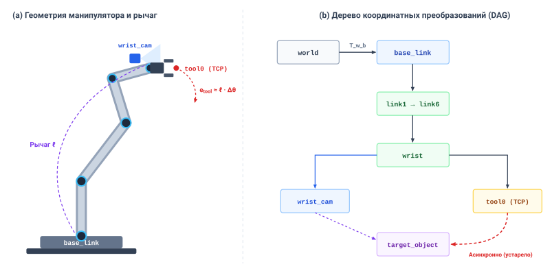
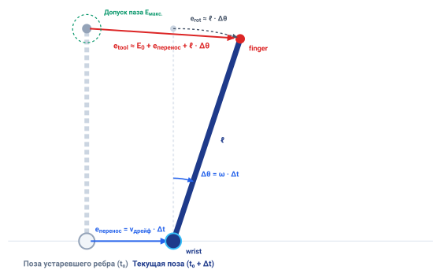
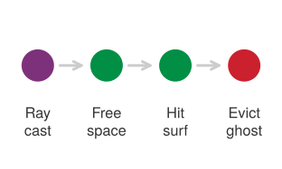
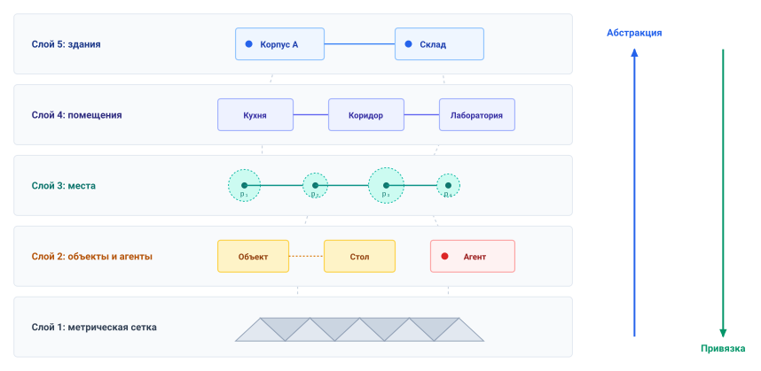
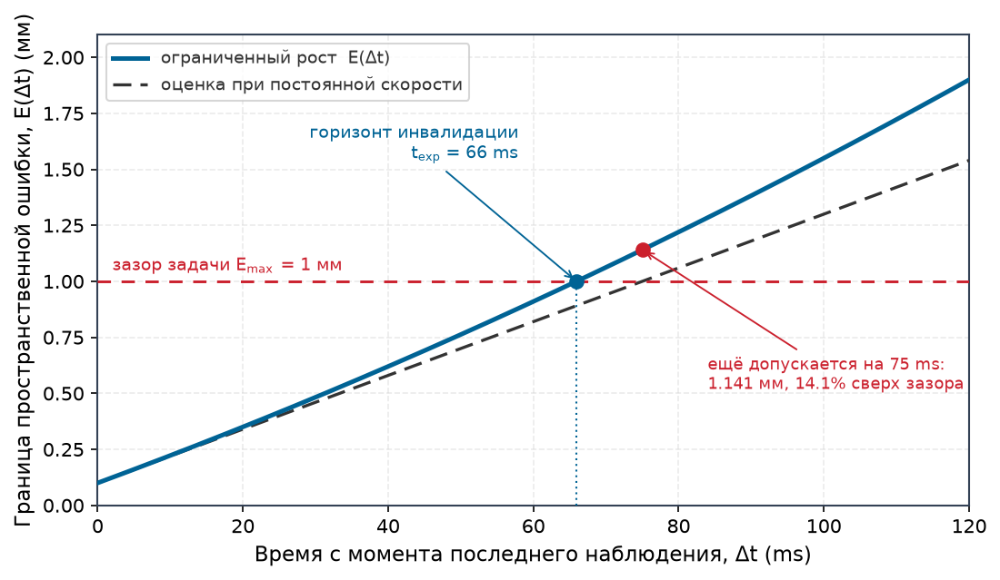

# Пространственная память

## Цель

_Как быстро пространственная оценка превращается в опасную выдумку, когда датчик теряет объект из виду?_

Динамическое препятствие остается критическим физическим ограничением еще долго после того, как оно окажется за непрозрачной преградой. Машина должна помнить о наличии препятствия, однако надежность его записанного состояния быстро деградирует с течением времени. Если относиться к устаревшему наблюдению как к истине в последней инстанции, возникает риск запланировать траектории через занятое физическое пространство, тогда как мгновенное отбрасывание записи стирает реальные опасности. Поэтому пространственная память должна отслеживать как оценку состояния, так и явную модель растущей неопределенности. Возраст захвата датчика, дрейф одометрии и калибровка системы координат определяют, остается ли запомненная сущность действительной для разрешения движения.

Программные сбои, такие как замороженные преобразования координат или молчаливая потеря слежения, могут обманным образом выдавать устаревшие оценки за свежие данные. Надежная система памяти должна принудительно обеспечивать ограниченное истечение оценки, отзывая полномочия предложения до того, как неопределенность выйдет за доступные огибающие свободного расстояния, и при этом ошибочно не считать ненаблюдаемые области свободным пространством. В архитектуре физического ИИ память наполняет модель мира Мозга выше границы предложения, тогда как детерминированный путь разрешения ниже проверяет, что каждая траектория опирается строго на неистекшие сертифицированные пространственные границы.

> **Цели обучения**
>
> - Задавать протоколы оценки, отделяющие возраст свидетельств от возраста оценки и содержащие систему координат, неопределенность и область действительности
> - Назначать истечение оценки по ограниченному росту неопределенности и физическому допуску задачи
> - Сравнивать пространственные представления по тому, что каждое может подтверждать о свободном расстоянии
> - Проектировать пространственные обновления, сохраняющие возраст свидетельств и отличающие отсутствующие наблюдения от проверенного свободного пространства
> - Диагностировать замороженные преобразования, фантомные трассы и ненаблюдаемый дрейф, проходящие проверки свежести и инноваций

## Сохранение пространственной оценки

Регистр памяти может без изменений хранить запись, тогда как описываемый ею мир движется. Когда складской мобильный манипулятор приближается к торцу стеллажа, стеллаж скрывает поперечный проход от навигационной камеры, и все, что камера видела там в последний раз, теперь существует лишь в памяти. Человек, невидимый за торцом стеллажа, может выйти в пространство, которое запись считает пустым, и переиздание записи с новой программной отметкой времени не может вернуть утраченные физические свидетельства. Поэтому пространственная память должна вносить в решение о разрешении движения время последнего измерения и правило роста ошибки.

> ↰ **Предпосылки:** Возраст наблюдений и откалиброванные пространственные ковариации порождаются в разделе [«Контракт наблюдений»](08_perception.md#sec-perception-observation-contract).

Физическая машина не может полагаться исключительно на сырые сенсорные наблюдения или статические регистры памяти. Ей требуется **оценка** — перенесенная вперед из исторических сенсорных свидетельств оценка физического состояния, явно связанная с расширяющейся моделью неопределенности.[^fn-mem-belief-state] Восприятие поставляет датированное откалиброванное наблюдение (как установлено в разделе [«Что передает восприятие»](08_perception.md#sec-perception-handoff)). Пространственная память должна определить, как долго это наблюдение в сочетании с динамическими моделями движения может продолжать разрешать физическое действие, пока неопределенность не поглотит оставшийся запас хода машины.

[^fn-mem-belief-state]: **Формализация оценки состояния**: В частично наблюдаемом марковском процессе принятия решений (POMDP) оценка представляет распределение вероятностей по скрытым состояниям. Интерфейс физического состояния дополнительно несет границу ошибки. Без значения, системы координат, эпохи свидетельств и применимой модели неопределенности нижележащий оптимизатор не может оценить свободное расстояние в период выпадения данных датчика.

Как второй из четырех этапов стороны предложения Части III, между восприятием и намерением, **пространственная память** переносит оценки геометрического и физического состояния вперед сквозь выпадения данных датчиков, окклюзии и переменные задержки обработки. Она расположена выше границы предложения ([«Машина в пяти уровнях»](01_causal_boundary.md#sec-boundary-machine-model)), поэтому запомненное состояние может формировать предложение, но не может подтвердить собственную свежесть; путь разрешения проверяет возраст свидетельств по собственным часам.

В программных системах возраст данных часто измеряют с момента сериализации сообщения, его публикации по межпроцессной шине или обновления в разделяемой таблице памяти. В системе физического ИИ это соглашение опасно. Распространение оценки состояния через расширенный фильтр Калмана на $1\text{ kHz}$ или переиздание кинематического преобразования $SE(3)$ на $200\text{ Hz}$ создает поток свежих программных отметок времени, но не освежает лежащую в основе физическую информацию. Истинный возраст оценки определяется строго эпохой свидетельств $t_0$ последнего физического измерения, которое ее ограничило. Нижележащий контур слежения, читающий оценку положения, порожденную интегрированием пути (dead reckoning) или раскатками политики, может видеть отметку публикации возрастом всего $2\text{ ms}$, тогда как физическая граница ошибки продолжает расширяться со скоростью ненаблюдаемого дрейфа. Проставление отметки времени на выходе инференса или на обращении к кэшу фиксирует, когда произошло вычисление, но ничего не говорит получателю о том, когда в последний раз проверялась реальность.

Одна лишь целостность памяти не может установить геометрическую действительность [Durrant-Whyte and Bailey, 2006](references.md#durrant2006simultaneous). Чтобы воспрепятствовать действию машины на устаревших данных, системы памяти должны рассматривать истечение как явное событие интерфейса. Каждая оценка несет предельный срок — свой горизонт инвалидации (выведенный в разделе [«Оценка сквозь окклюзию»](09_memory.md#sec-memory-belief-through-occlusion)), в который ее объявленная граница ошибки достигает физического запаса задачи. В этот предельный срок оценка перестает поддерживать движение, и путь разрешения отклоняет любое предложение, которое на нее еще опирается, и выбирает осуществимое резервирование.

Оценка, которая должна объявлять собственное истечение, должна передаваться с бо́льшим, нежели одно значение, поэтому первый вопрос передачи: что нужно потребителю, чтобы оценить хранимое значение после того, как датчик потерял объект из виду.

## Что передает память

Неаннотированный вектор, например $[0.142, -0.051, 0.812]$, поступающий по шине реального времени, ничего не сообщает о том, какая физическая сущность описывается, какая физическая размерность представлена и как масштабируется эта величина. Поэтому оценка, передаваемая потребителю, не может быть голым массивом чисел с плавающей точкой. Она представляет собой затухающую интерпретацию физических входов и должна нести свою эпоху, физическую неопределенность и систему координат, чтобы оставаться пригодной. Нижележащий контроллер, получающий сырые координаты без метаданных, вынужден полагаться на неявные соглашения, установленные при компиляции. Если оценщик выдает положения в метрах, а контроллер актуатора ожидает миллиметры, или если угловая скорость принимается за абсолютную ориентацию, результирующая команда регистрируется как тысячекратная ошибка слежения, поднимая ток двигателя до тепловых пределов актуатора, описанных в разделе [«Тепловые циклы нагрузки»](02_body.md#sec-body-thermal-duty-cycles). Чтобы предотвратить ошибочное толкование вдоль каузальной границы, установленной в разделе [«Каузальная граница»](01_causal_boundary.md#sec-boundary-causal-boundary), протокол оценки должен прежде всего задавать идентичность сущности, физическую величину и единицы измерения. Потребитель должен иметь возможность проверить, что значение представляет центр масс конкретной детали в метрах или нормальную силу контакта на кончике пальца в ньютонах, прежде чем направлять это число в закон управления.

Указание величины и единиц остается неполным без привязки значения к конкретной системе координат. Одни и те же пространственные координаты описывают совершенно разные физические реальности в зависимости от начала и ориентации системы координат. Декартово положение $[0.142, -0.051, 0.812]\text{ m}$ обозначает точку, подвешенную в свободном пространстве, при вычислении в базовой системе координат робота, но представляет точку в нескольких сотнях миллиметров внутри жесткого приспособления при интерпретации в системе координат фланца инструмента. Поскольку кинематические звенья гнутся, шарниры перемещаются, а преобразования координат обновляются с разной частотой, протокол оценки должен нести явный идентификатор системы координат. Наличие системы координат позволяет узлу-получателю отыскать соответствующее дерево пространственных преобразований и спроецировать хранимую геометрию в локальную систему координат, требуемую актуатору, не давая контроллеру действовать по геометрическим рассогласованиям, порождаемым движущимися кинематическими цепями.

Геометрия и идентичность описывают физическое состояние в один момент, но память должна также удерживать временной якорь этого состояния. Запись несет эпоху свидетельств $t_0$ физического взаимодействия или оптической экспозиции, которая последней ограничила оценку. В распределенных архитектурах промежуточные узлы часто переиздают данные, выполняют шаги предсказания фильтра Калмана или запускают распространение прямой кинематики для поддержания высокочастотных потоков управления, и ничего из этого не добавляет физических свидетельств. Поэтому поле должно неизменным проходить через каждую стадию переиздания, фильтрации и предсказания, чтобы потребители измеряли возраст информации относительно физического мира, а не относительно частоты планирования локального компьютера.

Порождение такой якорной оценки опирается на **многодатчиковую оценку состояния** — реализуемую либо через рекурсивные расширенные фильтры Калмана (EKF), безыскровые фильтры Калмана (UKF) [Kalman, 1960](references.md#kalman1960new), либо через нелинейную оптимизацию по факторным графам (сглаживание и картирование, SAM), — устоявшуюся математическую дисциплину, операционная роль которой состоит в отображении асинхронных гетерогенных сенсорных наблюдений (таких как высокочастотные ускорения ИНС, тики колесных энкодеров и низкочастотные утверждения зрения) в минимальную достаточную статистику скрытого физического состояния объекта управления. Архитектура физического ИИ абстрагирует внутреннюю численную механику этого конвейера слияния за контрактом пространственной оценки. Нижележащее планирование траекторий и принудительное обеспечение безопасности не пересчитывают ковариации инноваций датчиков и не решают заново факторные графы; им требуется лишь, чтобы оценщик состояния предоставлял несмещенный вектор состояния $\hat{\mathbf{x}}$, физически честную границу неопределенности $\mathbf{\Sigma}$ и истинную эпоху свидетельств $t_0$ измерений, которые его ограничили. Фундаментальное системное требование состоит не в выборе алгоритма фильтрации, а в обязанности оценщика честно моделировать расширение процессного шума сквозь слепые интервалы (непрерывное распространение ковариации ошибки выведено в разделе [«Распространение ковариации и наблюдаемость»](appendix_control.md#sec-appendix-control-covariance)) и отзывать свой статус действительности всякий раз, когда физический ранг наблюдаемости разваливается ([«Когда оценщик не может знать»](09_memory.md#sec-memory-state-estimation-bounds)).

Знание эпохи свидетельств $t_0$ устанавливает прошедшее время $\Delta t = t - t_0$, но прошедшее время само по себе не может определить, действительна ли оценка для данного действия. Две оценки одинакового возраста расходятся с разной скоростью в зависимости от физических ограничений. Сам торец стеллажа прикручен к полу, поэтому его запомненное положение остается в пределах ошибки локализации машины, сколь бы долго ни была слепа камера, тогда как человек, скрытый за ним, может двигаться со скоростью ходьбы и израсходовать тот же запас хода за несколько десятков миллисекунд.

Минимальные поля записи, необходимые потребителю для оценки хранимого состояния, можно вывести прямо из требования ограничить текущую ошибку. Пусть $E(\Delta t)$ представляет верхнюю границу расхождения между хранимым значением и истинным физическим состоянием после прошедшего времени $\Delta t = t - t_0$. Если оценщик устанавливает состояние в момент $t_0$ с начальной границей неопределенности $E_0$, а внешние возмущения или несмоделированные скорости заставляют истинное состояние расходиться с максимальной скоростью $r$, верхняя граница ошибки в текущий момент $t$ подчиняется линейному расширению $E(\Delta t) = E_0 + r\,\Delta t$. У торца стеллажа $E_0$ — это ошибка локализации машины, а $r$ — скорость ходьбы человека, которого может скрывать стеллаж; этот закон оценивается в разделе [«Оценка сквозь окклюзию»](09_memory.md#sec-memory-belief-through-occlusion). Опущение любого из слагаемых лишает потребителя возможности вычислить $E(\Delta t)$, поэтому начальная граница и скорость расширения являются структурно обязательными полями записи.

Выражение неопределенности через физические границы и скорости расширения отличает оценку физического ИИ от вероятностного балла уверенности. Сеть детекции объектов может выдать уверенность класса $0.94$, но этот softmax-балл не является откалиброванными свидетельствами ([«Когнитивные уязвимости»](03_brain.md#sec-brain-cognitive-vulnerabilities)), а нижележащий контроллер положения не может превратить безразмерную вероятность в безопасный запас смещения актуатора (то есть насколько далеко манипулятор может физически сдвинуться, прежде чем возникнет риск столкновения). Балл уверенности $0.94$ не содержит информации о том, неопределена ли граница препятствия на $2.0\text{ mm}$ или на $200\text{ mm}$, и не указывает, как быстро эта граница движется при наступлении окклюзии. Физическая запись памяти должна выражать начальную границу $E_0$ и скорость расширения $r$ в конкретных физических размерностях, таких как метры, радианы или ньютоны в секунду. Более того, эти скорости действительны только внутри объявленной области действительности, например максимального предполагаемого ускорения или проверенного коэффициента трения контакта. Если физические условия эксплуатации покидают эту область, скорость расширения больше не выполняется, и протокол оценки должен считаться недействительным.

Когда память передает кортеж, содержащий значение, систему координат, эпоху свидетельств $t_0$, начальную границу $E_0$ и скорость роста $r$, потребитель выполняет детерминированный шаг проверки, прежде чем применить данные к физическому управлению. Потребитель обладает допуском задачи $E_{\max}$, диктуемым физической задачей. Например, когда манипулятор вводит палец захвата в паз разблокировки защелки дверцы клетки, свободное расстояние паза задает $E_{\max}$, и неопределенность положения должна оставаться ниже его. Прочитав протокол оценки в текущий момент $t_{\text{now}}$, потребитель вычисляет прошедшее время $\Delta t = t_{\text{now}} - t_0$, оценивает текущую границу ошибки $E(\Delta t) = E_0 + r \Delta t$ и напрямую сравнивает результат с $E_{\max}$. Если $E(\Delta t) \le E_{\max}$, оценка проходит эту проверку истечения и может перейти к независимой проверке разрешения движения. В противном случае зависимое предложение отклоняется; контроллер выбирает валидированное удержание, поиск или остановку только тогда, когда это остается осуществимым.

> **Протокол пространственной оценки**
>
> ***Протокол пространственной оценки*** — типизированная запись, которая связывает идентифицированную физическую величину и единицу СИ с системой координат, эпохами свидетельств и оценки, преобразованием часов, начальной ошибкой, законом роста, областью действительности, истечением, происхождением и статусом жизненного цикла. Эти поля позволяют потребителю оценить свежесть до отдельной проверки разрешения движения.
>
> 1.  **Значение**: Состояние без границы ошибки и скорости роста не может быть безопасно оценено нижележащими контроллерами. По мере течения времени ($\Delta t = t_{\text{now}} - t_0$) ненаблюдаемое движение или дрейф датчика расширяют пространственную границу ошибки ($E(\Delta t) = E_0 + r \Delta t$). Когда эта граница превышает допуск задачи ($E(\Delta t) > E_{\max}$), запись истекает, и путь разрешения обязан отклонить зависимые предложения и выбрать осуществимую валидированную реакцию.
> 2.  **Отличие**: В отличие от безразмерной вероятности классификации (такой как $P(\text{object}) = 0.94$), протокол пространственной оценки предоставляет физически обоснованные метрические единицы (метры, радианы) и явную механику временного затухания.
> 3.  **Типичная ловушка**: Полагаться на внешних издателей, транслирующих сигналы инвалидации при окклюзии. Если канал связи пропадает или драйвер датчика зависает, нижележащий потребитель продолжает исполнять движения разомкнутого контура по замороженным оценкам, пока сам не оценит истечение записи.

Оценка протокола пространственной оценки зависит от вычисления прошедшего времени $\Delta t = t_{\text{now}} - t_0$ относительно физической реальности. Если потребитель не может проверить точный физический момент, когда произошло преобразование энергии, вычисленная граница ошибки $E(\Delta t)$ становится незаякоренной выдумкой, принимающей программные циклы вычисления за физические свидетельства. Эпоха оценки и преобразование часов, названные в определении, существуют для защиты этого якоря, тогда как происхождение и статус жизненного цикла — оставшиеся поля записи — развиваются вместе со схемой в разделе [«Схема пространственного состояния»](09_memory.md#sec-memory-spatial-state-schema).

## У состояния есть эпоха

Поза, покидающая детектор объектов, описывает, где деталь находилась, когда камера экспонировала кадр, а не где она есть в момент прихода сообщения. Поэтому каждое состояние отсылает к конкретному моменту — своей **эпохе**, и состояние, пересекающее физический конвейер, несет три эпохи, прежде чем контроллер сможет действовать. **Эпоха захвата** ($t_0$) — это эпоха захвата контракта наблюдений ([«Контракт наблюдений»](08_perception.md#sec-perception-observation-contract)), момент преобразования энергии на каузальной границе, например когда фотоны попадают на матрицу фотодиодов или цифровой регистр защелкивает отсчет энкодера, и протокол оценки несет ее как свою эпоху свидетельств.[^fn-hw-timer-capture] Память добавляет две следующие за ней эпохи. **Эпоха оценки** ($t_{\text{est}}$) отмечает момент, когда оценщик состояния или нейронная сеть завершили инференс по этим измерениям и свели их к конкретному утверждению о состоянии. **Эпоха публикации** ($t_{\text{pub}}$) отмечает момент, когда сериализованное сообщение было передано на транспортную шину для отправки нижележащим потребителям.

[^fn-hw-timer-capture]: **Аппаратный захват входа таймера**: Каналы захвата входа таймера микроконтроллера защелкивают значения счетчика в выделенные теневые регистры по переходам внешнего сигнала, обходя задержку прерывания операционной системы. Чтение регистров захвата без атомарной синхронизации с флагами переполнения таймера вызывает наложение 16-битного счетчика, вводя искусственные скачки отметок времени, равные периоду переполнения ($65.5\text{ ms}$ для таймера на $1\text{ MHz}$). В нижележащей зрительно-инерциальной одометрии эта временная разрывность порождает ложные всплески ускорений, дестабилизирующие фильтры ориентации платформы.

Схлопывание этих трех отметок времени в одну отметку получения или передачи разрушает физическую действительность состояния. Пометка позы временем публикации скрывает каждую миллисекунду экспозиции, считывания, инференса и планирования, ей предшествующих, тогда как гравитация, импульс и силы контакта без паузы продолжают действовать на физическую систему. Этот скрытый возраст есть смещение со скоростью, как установлено в разделе [«От фотонов к пространственным утверждениям»](08_perception.md#sec-perception-photons-to-claims); для навигационной камеры на пределе движения основания один лишь возраст к моменту отправки составляет несколько сантиметров пути, и все они невидимы для потребителя, читающего только отметку публикации. Состояние, фиксирующее лишь то, когда данные стали доступны, ничего не сообщает потребителю о физическом моменте, который представляет измерение, делая временное выравнивание невозможным.

> ↰ **Предпосылки:** Синхронизированная аппаратная простановка отметок времени по полевым шинам установлена в разделе [«Передача команд вовремя»](04_nervous_system.md#sec-nervous-deterministic-fieldbuses).

Даже когда система фиксирует истинные эпохи захвата, архитектуры физического ИИ опираются на распределенные узлы обработки, чьи часы локальных генераторов дрейфуют независимо. Синхронизация этих распределенных часов по стандартным сетевым шинам вносит ограниченную ошибку синхронизации, и эта временная неопределенность становится пространственной неопределенностью на относительной скорости того, что описывает запись.[^fn-hw-ptp-canfd] Протокол наблюдений из раздела [«Контракт наблюдений»](08_perception.md#sec-perception-observation-contract) уже несет эту границу как свою ошибку преобразования часов, и оценка, построенная на этом наблюдении, сохраняет ее. Каждый потребитель прибавляет границу к возрасту свидетельств перед суждением о свежести, а бюджет ошибки отводит расстояние, которое эта граница покрывает на относительной скорости записи, наряду с разрешением датчика и структурным прогибом.

[^fn-hw-ptp-canfd]: **Джиттер синхронизации часов полевой шины**: Архитектуры полевых шин демонстрируют различные аппаратные границы синхронизации часов: IEEE 1588 PTP через Ethernet достигает $\delta t < 1.0\,\mu\text{s}$, распределенные часы EtherCAT достигают аппаратного джиттера SYNC0 $<100\text{ ns}$, а битно-фазовая синхронизация CAN-FD дает $\pm 10\text{--}50\,\mu\text{s}$. Поскольку пространственная неопределенность масштабируется с относительной скоростью цели ($e_{\text{sync}} = v_{\text{rel}} \delta t$), синхронизация на уровне микросекунд необходима, чтобы удерживать временные ошибки в микрометровых механических бюджетах. Некалиброванный дрейф часов между распределенными узлами датчиков и двигателей ухудшает координацию многоосевого инструмента, порождая высокочастотную дребезгу в контурах момента шарниров.

Реальные физические системы никогда не дискретизируют все релевантные переменные состояния одновременно. В иллюстративном цикле тактильная матрица может защелкнуть показания нормальной силы в $t_1 =$ `12 ms`, оптическая камера слежения завершить интегрирование сигнала датчика в $t_2 =$ `18.5 ms`, а оптические энкодеры шарниров снять угловые положения в $t_3 =$ `21 ms`. Эти наблюдения происходят в разные эпохи и не могут быть объединены прямыми алгебраическими операциями. Слияние наблюдения камеры в $t_2$ с наблюдением энкодера в $t_3$ требует от потребителя спроецировать одно состояние через временной разрыв $\Delta t = |t_3 - t_2| =$ `2.5 ms` с помощью явных кинематических моделей и ограниченных скоростей (например, распространив историческое наблюдение камеры вдоль вектора скорости шарнира, чтобы согласовать его с мгновенным считыванием энкодера). Без истинной эпохи захвата для каждого отдельного сигнала расчет выравнивания не может определить знак или величину $\Delta t$. Экстраполяция состояния без точной эпохи приводит к тому, что алгоритм слияния вычисляет пространственные смещения от фиктивных временных базисов, накапливая ошибки на каждом цикле слияния.

Имея эти эпохи и границу синхронизации часов, содержащиеся в записи из раздела [«Что передает память»](09_memory.md#sec-memory-handoff), потребитель вычисляет прошедшую длительность между эпохой свидетельств и предельным сроком исполнения, оценивает худший случай расширения границы ошибки и определяет, остается ли состояние в пределах допусков задачи. Передача состояния без его эпохи захвата оставляет потребителя слепым к транспортным задержкам и джиттеру планирования, превращая детерминированное управление в угадывание разомкнутого контура. Поскольку физическая геометрия также меняется, когда тела движутся в пространстве, пространственные преобразования между системами координат подвержены тому же временному затуханию, неся собственные различные эпохи свидетельств.

## Как преобразование устаревает

Система координат привязывает координату, но в машине сама система координат движется. Раздел [«Что передает восприятие»](08_perception.md#sec-perception-handoff) снабдил каждое наблюдение именованной системой координат и соотнес системы координат датчика, тела, одометрии и карты через дерево преобразований. Дерево не показывает, как преобразование устаревает. Каждое ребро дерева на рисунке [«Кинематическое дерево координат манипулятора»](09_memory.md#fig-09-robot-transform-tree) хранит позу твердого тела в $SE(3)$, параметризованную углами шарниров [Lynch and Park, 2017](references.md#lynch2017modern); [Craig, 2005](references.md#craig2005introduction), и эта поза описывает машину только в эпоху, когда ее геометрия была измерена. Когда бортовой компьютер собирает в цепь преобразования, измеренные в разное время — из-за транспортной задержки, асинхронной дискретизации или пропущенных кадров, — произведением оказывается гибридная поза, которую машина никогда не занимала (кинематическая цепь выводится в разделе [«Прямая кинематика и сингулярности»](appendix_control.md#sec-appendix-control-kinematics)).

Преобразование также занимает несколько машинных слов, поэтому читатель, состязающийся с писателем, может увидеть старый поворот в паре с новым перемещением. Почтовый ящик seqlock из раздела [«Многотактные ритмы»](04_nervous_system.md#sec-nervous-cadences) закрывает эту гонку, не блокируя поток управления, поскольку каждый читатель делает одну ограниченную попытку на такт и никогда не ждет; разорванное чтение отбрасывается, а последнее валидированное преобразование стареет на его месте.

***Кинематическое дерево координат манипулятора и временная динамика**: Геометрия шарнирного манипулятора (a) и соответствующее ориентированное ациклическое дерево преобразований координат в ROS \\texttt{tf2} (b). Каждое ориентированное ребро хранит однородную матрицу преобразования, параметризованную состоянием шарниров. Составление преобразований из разных эпох захвата вводит ошибку позиционирования плеча $e_{\\text{tool}} \\approx \\ell\\,\\Delta\\theta$, тогда как некомпенсированное асинхронное ребро ссылается на устаревшие координаты (адаптировано из Craig 2005 и Foote 2013 [Craig, 2005](references.md#craig2005introduction); [Foote, 2013](references.md#foote2013tf)).*

Цена истекшего преобразования — прямое пространственное смещение (см. рисунок [«Устаревание преобразования и ошибка плеча»](09_memory.md#fig-frame-staleness-error)). Применяя к кинематике соотношение «возраст как смещение» из раздела [«От фотонов к пространственным утверждениям»](08_perception.md#sec-perception-photons-to-claims), некомпенсированная задержка превращается прямо в геометрическую ошибку позиционирования через плечо звеньев. Строгий вывод через векторное произведение для этого кинематического распространения ошибки см. в разделе [«Пространственные системы координат и кинематика плеча»](appendix_control.md#sec-appendix-control-spatial).

Как мало устаревания нужно, чтобы израсходовать допуск задачи, показывает паз разблокировки защелки, пока камера запястья еще видит его. Каждый кадр камеры запястья — один каждые `16.7 ms` — обновляет позу паза в системе координат камеры и вместе с ней ребро «паз — палец», по которому выравнивается контроллер, а палец должен оставаться в пределах допуска паза $E_{\max}$ в `1 mm`. Предположим, что это ребро пропустило один кадр. Исходя из начальной ошибки `0.1 mm`, боковое смещение пальца дрейфует не более чем на $e_{\text{trans}} = v_{\text{drift}}\,\Delta t$ при иллюстративной границе `12 mm/s` для его ненаблюдаемой боковой скорости, валидированной для рабочей области манипулятора, то есть на `0.20 mm`. Если кончик пальца находится на иллюстративном расстоянии $\ell$ = `0.15 m` от запястья, а запястье поворачивается с иллюстративной $\omega$ = `0.30 rad/s`, выравнивая палец, плечо добавляет $e_{\text{rot}} \approx \ell\,\omega\,\Delta t$, или `0.75 mm`. Шарнирные энкодеры измеряют этот поворот, но устаревшее ребро все еще датирует паз предыдущим кадром, тогда как поза запястья, с которой оно составляется, — текущая, и дерево возвращает гибридную позу, положение пальца, которого манипулятор никогда не занимал. Только составление паза с позой запястья собственной эпохи захвата — лекарство от пропущенного кадра — или истечение ребра убирает эту дугу. Оставленное в цепи, устаревшее ребро помещает палец с ошибкой `1.05 mm` — на 5 % больше, чем допускает паз, — причем бо́льшая часть этой ошибки идет от плеча, а не от дрейфа. Поскольку дерево преобразований вычисляется без ошибок, ничто не помечает устаревшую позу, и контроллер продолжает выравнивать палец по положению паза, смещенному больше, чем на свободное расстояние, что при неудачном подходе прижимает палец к ответной планке рядом с пазом.

***Устаревание преобразования и ошибка плеча у паза разблокировки защелки**: Ошибка пальца, когда ребро «паз — палец» пропускает один кадр камеры запястья длительностью $\\Delta t$. Боковой дрейф на границе скорости $v_{\\text{drift}}$ смещает палец на $e_{\\text{trans}} = v_{\\text{drift}}\\,\\Delta t$, тогда как поворот запястья с $\\omega$ отклоняет кончик пальца, находящийся на плече $\\ell$ от него, на $e_{\\text{rot}} \\approx \\ell\\,\\omega\\,\\Delta t$. Составление устаревшего ребра с текущей позой запястья добавляет обе величины к начальной ошибке $E_0$, поэтому ошибка пальца $e_{\\text{tool}} \\approx E_0 + e_{\\text{trans}} + \\ell\\,\\Delta\\theta$ превышает допуск паза $E_{\\max}$.*

> **Влияние устаревания**
>
> *Допустимый возраст преобразования задается точкой, которую оно обслуживает, а не шарниром, который оно измеряет. Точка инструмента дрейфует примерно со скоростью $v + \ell\omega$, поэтому чем длиннее плечо, тем раньше ребро истекает, и ребро, еще достаточно свежее, чтобы локализовать запястье, может быть слишком старым, чтобы локализовать центр инструмента.*

Дерево преобразований датирует собственную геометрию машины, а устаревшее ребро помещает инструмент с ошибкой на пропущенное движение, усиленную плечом. Мир вокруг машины стареет так же, но у него нет шарнирных энкодеров, чтобы сообщать о своем движении, поэтому память должна также удерживать окружающие поверхности и пространство между ними и должна фиксировать, какую часть этого пространства датчик действительно видел.

## Что может подтверждать память сцены

Робот, прошедший дальномерным датчиком по проходу, после этого удерживает три вида пространства: пространство, которое он видел занятым, пространство, которое он видел пустым, и пространство, которого он не видел никогда. Только второе может когда-либо поручиться, что путь свободен, и только пока его свидетельства свежи. Каждое представление сцены хранит некоторую версию этих трех состояний, и различаются они тем, что хранят и сколько это стоит. **Сетка занятости** [Elfes, 1989](references.md#elfes1989using) или ее разреженная октодерево-форма [Hornung et al., 2013](references.md#hornung2013octomap) хранит оценку занятости для каждой ячейки. **Усеченное знаковое поле расстояний (TSDF)** [Curless and Levoy, 1996](references.md#curless1996volumetric) хранит усеченное проективное расстояние до наблюдаемой поверхности вдоль каждого луча чувствительности. **3D-гауссов сплаттинг** [Kerbl et al., 2023](references.md#kerbl20233d) хранит оптимизированные примитивы, отрисовывающие новые виды с камеры. Память плотной сетки растет как куб числа ячеек по каждому измерению, тогда как октодерево, блоки поверхностной полосы TSDF и гауссова карта хранят только выделенную структуру, размер которой зависит от наблюдаемой геометрии и цели точности; обновления, лежащие в основе этих стоимостей, дают разделы [«Занятость в лог-шансах и слияние знаковых расстояний»](appendix_ml.md#sec-appendix-ml-voxels) и [«Параметры 3D-гауссова сплаттинга»](appendix_ml.md#sec-appendix-ml-3dgs). Для разрешения движения все они разделяют одно ограничение. Проективное расстояние — не евклидово расстояние до ближайшей поверхности, которое требуется решению о свободном расстоянии, а гауссова плотность не идентифицирует занятое пространство, поэтому ни одно из них само по себе не подтверждает свободное расстояние. Каждое должно быть прежде преобразовано в валидированный слой занятости или евклидово знаковое поле расстояний (ESDF) с явной политикой для неизвестного пространства, прежде чем путь разрешения сможет опрашивать его.

Выбор метрического представления определяет эмпирический компромисс Парето между объемом памяти и задержкой запросов пространственных столкновений (см. рисунок [«Рубеж представлений 3D-сцены»](09_memory.md#fig-09-memory-3d-representation-pareto)). Непрерывная оптимизация траекторий и рефлекторные контроллеры реального времени в контурах управления 1 кГц (периоды $1{,}000\ \mu\text{s}$) требуют, чтобы запросы свободного расстояния и градиента выполнялись менее чем за $10\ \mu\text{s}$ на десятках шарнирных точек тела робота. Хотя неявные нейронные представления, такие как координатные MLP (NeRF, iMAP), достигают минимальной плотности памяти ($\sim 0.08\ \text{MB/m}^3$), запрос знакового расстояния или занятости требует вычисления прямых проходов глубокой нейронной сети, что накладывает огромную вычислительную задержку ($>650\ \mu\text{s}$ на точку запроса) и запирает их в рамках вдумчивых офлайн-планировщиков. Иерархические октодеревья (OctoMap [Hornung et al., 2013](references.md#hornung2013octomap)) сжимают ненаблюдаемое свободное пространство до $0.18\text{--}1.25\ \text{MB/m}^3$, однако косвенное обращение через указатели при рекурсивном обходе дерева вызывает промахи кэша CPU, ограничивая скорость запросов величинами $24\text{--}38\ \mu\text{s}$. И наоборот, динамически хешированные усеченные знаковые поля расстояний (TSDF Voxblox [Oleynikova et al., 2017](references.md#oleynikova2017voxblox)) выделяют память только вокруг наблюдаемых поверхностных полос ($4.1\ \text{MB/m}^3$), обеспечивая лучевые запросы за $1.8\ \mu\text{s}$, тогда как распространение евклидовых знаковых полей расстояний (ESDF) увеличивает накладные расходы памяти до $28.5\ \text{MB/m}^3$, чтобы выдавать субмикросекундные ($0.85\ \mu\text{s}$) оценки расстояния с аналитическими непрерывными градиентами. Тем временем примитивы 3D-гауссова сплаттинга [Kerbl et al., 2023](references.md#kerbl20233d) занимают средний режим ($1.6\text{--}5.2\ \text{MB/m}^3$, $5.8\text{--}8.2\ \mu\text{s}$), позволяя фотографичную отрисовку излучения наряду с ускоренными проверками столкновений по иерархии ограничивающих объемов.

***Рубеж представлений 3D-сцены: объем памяти против задержки пространственных запросов**: Эмпирический компромисс Парето между неявными нейронными полями, иерархическими октодеревьями, 3D-гауссовым сплаттингом и хешированными воксельными сетками. Хотя неявные координатные MLP сжимают комнаты в мегабайты весов, многослойные прямые проходы превышают пределы запросов столкновений реального времени ($>100\\ \\mu\\text{s}$). Хешированные воксельные сетки (TSDF/ESDF Voxblox [Oleynikova et al., 2017](references.md#oleynikova2017voxblox)) потребляют $4.1\\text{--}28.5\\ \\text{MB/m}^3$, но дают субмикросекундные задержки запросов ($<2\\ \\mu\\text{s}$), необходимые для обслуживания реактивных контуров управления 1 кГц.*

То, что карта может подтвердить, определяется тем, как отраженный сигнал обновляет ее. Проходя луч от датчика до отражения [Amanatides and Woo, 1987](references.md#amanatides1987fast), карта утверждает **отрицательные свидетельства** в каждой ячейке, которую луч пересек, и положительные свидетельства в ячейке, где он закончился; обновление в лог-шансах дает раздел [«Занятость в лог-шансах и слияние знаковых расстояний»](appendix_ml.md#sec-appendix-ml-voxels). Отрицательные свидетельства позволяют карте списать фантомное препятствие, как только та же область видна пустой, вместо ожидания тайм-аута, и они же знаменуют предел того, что карта может сказать. Они покрывают только ячейки, которые действительный луч действительно прошел. Они ничего не говорят об объеме позади отражения, и новый проход по проходу не может обновить ячейку, скрытую за стеллажом, поэтому перекрытый поперечный проход остается неизвестным и по-прежнему нуждается в истечении. Каждое отражение также касается каждой ячейки вдоль своего луча, поэтому разреженное выделение экономит емкость, но не обход, и этот трафик достигает пути разрешения лишь как дополнительный возраст свидетельств ([«Конкуренция за общие ресурсы»](13_placement.md#sec-placement-resource-contention)).

*Активные отрицательные свидетельства вдоль линий видимости очищают фантомные препятствия, не дожидаясь затухания по тайм-ауту.*

Поскольку отрицательные свидетельства обновляют только ячейки, через которые прошел луч, время публикации карты не датирует ни одной из ее ячеек, поэтому манифест из раздела [«Манифест объемной оценки и свидетельства ячеек»](09_memory.md#tbl-09-schema-volumetric-belief) несет эпохи свидетельств для каждой ячейки. Эти эпохи не бесплатны: каждая выделенная ячейка хранит собственные отметки времени рядом с оценкой занятости, и они входят в бюджет памяти карты по той же причине, что и значение. Потребитель движения проверяет возраст свидетельств и состояние каждой ячейки, которую использует его путь, включая ячейки, помеченные как неизвестные, и выводит консервативное свободное расстояние из отдельно валидированного слоя.

| Поле карты                                 | Единица или тип                        | Значение и проверка потребителем                                                                      |
|:------------------------------------------|:------------------------------------|:------------------------------------------------------------------------------------------------|
| `voxel_grid_origin`, `voxel_resolution_m` | m; m                                | Пространственный якорь и шаг; должны совпадать с активной системой координат и калибровкой                                |
| `map_update_epoch`                        | ns на часах захвата                    | Последняя публикация/обновление карты; **не** свежесть каждой ячейки                                    |
| `cell_evidence_epoch`                     | ns на часах захвата на ячейку           | Последнее физическое наблюдение для этой ячейки; никогда не обновляется предсказанием или не связанными обновлениями карты |
| `free_space_sweep_epoch`                  | ns на часах захвата на ячейку занятости | Последний действительный наблюдаемый свободный луч через эту ячейку                                                  |
| `clock_conversion`, `sync_error_ns`       | отображение; ns                         | Преобразуют эпохи захвата в монотонные часы потребителя с ограниченной ошибкой                     |

***Манифест объемной оценки и свидетельства ячеек**: Заголовок карты описывает компоновку и время обновления, тогда как локальные для ячеек эпохи захвата определяют, свежа ли конкретная область пути. Потребитель считает ненаблюдавшиеся или истекшие ячейки неизвестными, если отдельно валидированная политика не разрешает проезд.*

Семантическая память расположена выше метрического слоя и наследует его ограничения. Помимо сырых метрических объемов и полей излучения, физическому ИИ на базе фундаментальных моделей требуется, чтобы пространственная память организовывала пространство в семантические иерархии. **3D-динамический граф сцены (DSG)**, сформулированный в Kimera [Rosinol et al., 2021](references.md#rosinol2021kimera) и расширенный в Hydra [Hughes et al., 2022](references.md#hughes2022hydra), соединяет метрический SLAM с символьными рассуждениями, структурируя пространственную память в пятиуровневый иерархический граф (см. рисунок [«Иерархический граф динамической 3D-сцены»](09_memory.md#fig-09-dynamic-scene-graph)):

1. *Метрико-семантическая сетка (уровень 1):* Высокоразрешающая треугольная сетка, фиксирующая тонкую геометрию поверхностей с семантическими метками вершин.
2. *Узлы объектов и агентов (уровень 2):* Ограниченные 3D-геометрические сущности с ориентированными ограничивающими параллелепипедами, визуальными вложениями и отслеживаемыми динамическими траекториями.
3. *Места и топология свободного пространства (уровень 3):* 3D-топология Вороного и навигационные сферы свободного расстояния ($p_i$) для планирования путей без столкновений.
4. *Комнаты и конструктивные ограждения (уровень 4):* Функциональные архитектурные подразделения, разделенные семантическими стенами и проемами.
5. *Здания и глобальная топология (уровень 5):* Верхнеуровневый семантический граф, управляющий распределением долгосрочных миссий.

***Иерархический граф динамической 3D-сцены**: Пятиуровневая пространственно-временная организация памяти, соединяющая метрический SLAM с символьными рассуждениями фундаментальных моделей. Уровень 1 фиксирует метрическую треугольную сетку; уровень 2 извлекает 3D-объекты и динамических агентов; уровень 3 моделирует топологические места через сферы свободного расстояния Вороного ($p_i$); уровень 4 структурирует архитектурные комнаты и проемы; а уровень 5 устанавливает глобальную топологию миссий здания. Вертикальные межуровневые ребра координируют восходящую абстракцию (сжатие метрических поверхностей в символические сущности) и нисходящее обоснование (перевод токенов задач в метрические координаты) (адаптировано из Rosinol et al. [Rosinol et al., 2021](references.md#rosinol2021kimera) и Hughes et al. [Hughes et al., 2022](references.md#hughes2022hydra)).*

Вычислительное преимущество этой двунаправленной иерархии состоит в том, как она разрешает напряжение «память — вычисления» на периферийных SoC. Восходящая абстракция схлопывает гигабайты плотных треугольных поверхностных сеток в символические подграфы размером в килобайты, позволяя фундаментальным обдумывателям оценивать долгосрочные планы задач, не исчерпывая пропускную способность LPDDR5 и не забивая KV-кэши миллионами сырых геометрических токенов. И наоборот, нисходящее обоснование позволяет высоким пространственным целям достигать локальных геометрических свидетельств. Обдумыватель опрашивает пространство, не иская каждую ячейку, однако каждый узел свеж лишь настолько, насколько свежи метрические ячейки под ним, и обоснование символической цели все равно заканчивается запросом свободного расстояния к валидированному метрическому слою.

Контекст обученной политики — память иного рода. Авторегрессионная политика удерживает свои недавние наблюдения в кэше «ключ-значение», рост которого выводит раздел [«Питание, свежесть и стена памяти»](03_brain.md#sec-brain-cognitive-pipeline), а **потоковое окно** ограничивает этот кэш, вытесняя его старейшие токены [Xiao et al., 2024](references.md#xiao2024streamingllm), закончились ли их физические последствия или нет. Человек, которого видели заходящим за стеллаж до начала окна, исчез из контекста, но не из прохода. Поэтому физический факт, который машина все еще должна соблюдать, живет в протоколе оценки с собственной эпохой свидетельств, а никогда — только в контексте политики.

Итак, для разрешения движения представление без эпохи есть непроверенное утверждение, а оценка, чья граница ошибки превышает допуск задачи, должна быть исключена из предложений движения до того, как путь разрешения рассмотрит команды актуаторов. Однако машина не может останавливать каждую операцию при первом же пропущенном кадре. Продление действия через короткие провалы сенсорики требует оценщиков, которые распространяют оценку вперед, пока не придут новые измерения, подтверждающие или исправляющие состояние.

## Оценка сквозь окклюзию

Когда прямое восприятие отказывает, система физического ИИ использует внутреннюю модель перехода для обновления своей оценки состояния. Фильтр Калмана обновляет оценки состояния по динамике объекта управления,[^fn-hist-bayesian-filter] тогда как обученная политика может предсказывать следующую относительную позу с помощью авторегрессионной сети. В любом случае предсказание экстраполирует старые свидетельства вперед, не обновляя их, как установлено в разделе [«Сохранение пространственной оценки»](09_memory.md#sec-memory-preserving-belief); оно сохраняет полезность наблюдения, компенсируя ожидаемое физическое движение, но не сбрасывает возраст лежащего в основе измерения.

[^fn-hist-bayesian-filter]: **Происхождение байесовской оценки состояния**: [Kalman, 1960](references.md#kalman1960new) ввел рекурсивную оценку состояния с минимальной среднеквадратичной ошибкой для линейных динамических систем. [Moravec and Elfes, 1985](references.md#moravec1985high) обобщили эти рекурсивные байесовские обновления на пространственные сетки занятости, моделируя неопределенность луча датчика через явные распределения дальность-пеленг. В воплощенных системах некомпенсированное распространение сквозь длительные выпадения данных датчиков приводит к рассеиванию байесовских распределений оценки, требуя явных горизонтов инвалидации для предотвращения расхождения управления разомкнутого контура.

Разница между предсказанием состояния и его наблюдением решает, что машине позволено делать у торца стеллажа. Человек может выйти туда в иллюстративное свободное расстояние `1.10 m` $D_{\text{clear}}$, которое защищает бюджет остановки, и, как только стеллаж скрывает поперечный проход, вопрос в том, как долго запомненный вид может поручиться, что поперечный проход все еще пуст.

Каждая физическая модель упрощает реальность, из-за чего ошибка между спроецированным состоянием и физическим миром непрерывно расширяется в течение слепого интервала. В оценке состояния эту дисперсию определяет **расширение ковариации при окклюзии** — непрерывное, управляемое физикой расширение неопределенности в периоды потери прямой видимости датчиком. Математически формализованное стохастическими моделями (такими как уравнение непрерывного распространения ковариации Ляпунова/Риккати, подробно разобранное в разделе [«Распространение ковариации и наблюдаемость»](appendix_control.md#sec-appendix-control-covariance)), это расширение количественно описывает растущее сомнение в том, где объект находится на самом деле, ограничивая ненаблюдаемое расхождение, вызванное неизвестными скоростями дрейфа и неожиданными физическими возмущениями, до того как датчик восстановит видимость. Для детерминированной разработанной модели предположим, что характеристики датчика и пределы возмущений устанавливают начальную границу ошибки положения $E_0$ в момент окклюзии ($\Delta t = 0$). Тогда предсказание деградируют два ограниченных слагаемых. Движение, не известное модели, вносит скорость дрейфа, ограниченную $v_{\text{drift}}$, а силы, которые она не моделирует, создают ускорение возмущения, ограниченное $a_{\text{dist}}$. За длительность окклюзии $\Delta t$ граница ошибки $E(\Delta t)$ тогда подчиняется квадратичному расширению:

$$E(\Delta t) = E_0 + v_{\text{drift}}\Delta t + \frac{1}{2}a_{\text{dist}}(\Delta t)^2$$

У торца стеллажа слагаемые принадлежат самой машине. Начальная ошибка — граница локализации $\delta_{\text{loc}}$, `50 mm`, поскольку машина знает расположение торца стеллажа лишь с этой точностью. Допуск — защитный запас $\delta_{\text{margin}}$, `100 mm`, который бюджет резервирует между остановившейся машиной и человеком. Человек, скрытый за стеллажом, может сократить этот запас со скоростью до границы скорости ходьбы $v_h$ в `1.6 m/s`, которую расчеты безопасных расстояний принимают для приближающегося человека. Поскольку $v_h$ ограничивает скорость напрямую, формула [«расширение окклюзии»](09_memory.md#eq-mem-occlusion-expansion) сохраняет только его линейное слагаемое, с $v_{\text{drift}} = v_h$ и $a_{\text{dist}} = 0$, и оценка того, что торец стеллажа свободен, истекает через $(\delta_{\text{margin}} - \delta_{\text{loc}})/v_h$, что составляет `31.25 ms`. Навигационная камера выдает кадр каждые `16.7 ms`, поэтому оценка устаревает менее чем за два кадра, а кадр, показавший поперечный проход пустым, к моменту отправки восприятием уже имеет возраст `51.6 ms` ([«Преобразование и калибровка датчиков»](08_perception.md#sec-perception-transduction-calibration)).

Ничто в программном обеспечении не отмечает момент истечения. Карта по-прежнему показывает поперечный проход свободным, и оценщик продолжает публиковать корректно оформленную запись, однако предсказание перестало функционировать как свидетельство. Поэтому память не может сертифицировать перекрытый торец стеллажа как свободный, как не может этого и кадр, который ее питает, и область остается неизвестной. Бюджет остановки защищает от статического препятствия на $D_{\text{clear}}$, такого как человек, вышедший и вставший в проходе, или упавший контейнер, и память добавляет к этому бюджету предельный срок, но не расстояние. Текущий итог на пределе движения остается равным `912.9 mm`, которые оставило [«Преобразование и калибровка датчиков»](08_perception.md#sec-perception-transduction-calibration).

Человек, продолжающий идти к машине в течение всей остановки, — другое препятствие. Расчет безопасного расстояния учитывает такое приближение как $v_h(\tau_{\text{delay}} + T_{\text{stop}})$ — скорость ходьбы, приложенную ко всему времени от обнаружения до полной остановки. На пределе движения `1.5 m/s`, где остановка с постоянным замедлением длится $T_{\text{stop}} = v/a_{\text{brake}}$, одно это слагаемое составляет `1.41 m` — больше, чем все свободное расстояние `1.10 m`, прежде чем учтено любое другое расстояние бюджета. Поэтому площадка обходится с приближающимся человеком правилом перехода, которым владеет эксплуатация площадки, размеченным на полу переходом и датчиком присутствия у торца стеллажа. Раздел [«Реестр остаточных утверждений»](17_frontier.md#sec-frontier-residual-claims-register) фиксирует предпосылку, на которой покоятся правила. Какое бы правило перехода площадка ни приняла, путь разрешения обязан отклонить любое предложение, чье свободное расстояние опирается на запомненную пустоту за пределами срока оценки.

> **Горизонт инвалидации оценки состояния**
>
> ***Горизонт инвалидации оценки состояния*** ($t_{\mathrm{exp}}$) — прошедшее время с момента последнего физического наблюдения, при котором валидированная граница ошибки оценки $E(\Delta t)$ впервые достигает допуска задачи $E_{\max}$:
> 
>
> $$t_{\mathrm{exp}} = \inf \{ \Delta t \ge 0 : E(\Delta t) \ge E_{\max} \}$$
>
> где $E(\Delta t)$ — закон роста с ограниченными возмущениями, такой как формула [«расширение окклюзии»](09_memory.md#eq-mem-occlusion-expansion), или откалиброванный квантиль ошибки, а оценка с эпохой свидетельств $t_0$ перестает поддерживать движение в $t_0 + t_{\mathrm{exp}}$.
>
> 1.  **Значение**: Формализует жесткую математическую границу, за которой распространяемая вперед оценка состояния перестает функционировать как действительные физические свидетельства, требуя от пути разрешения отклонить зависимые предложения движения до нарушения геометрического свободного расстояния.
> 2.  **Отличие**: В отличие от сторожевых таймеров тайм-аутов разомкнутого контура, следящих за интервалами сигнала живости программных процессов, горизонт инвалидации выводится из непрерывной физической кинематики, динамики ограниченных возмущений и ограничений механического свободного расстояния.
> 3.  **Типичная ловушка**: Разрешать нейронному планировщику или фильтру Калмана непрерывно экстраполировать оценки состояния в течение длительных выпадений данных датчиков, не ограничивая расширение ошибки, принимая гладкую математическую экстраполяцию за физическую истину в последней инстанции.

Когда конвейер датчиков восстанавливает прямую видимость, система не может просто перезаписать распространенное состояние новым измерением, как не может и слепо передать сырое измерение нижележащему контроллеру. Показания датчиков, полученные сразу после окклюзии, часто страдают от переходных световых бликов, частичной видимости краев или ошибок соответствия. До смешивания или сброса состояния оценщик должен вычислить **инновацию** — математическую проверку на реальность, определяемую как разность между новым измерением и тем местом, где внутренняя модель предсказывала позу. Если новое измерение попадает внутрь вычисленной границы ошибки $E(\Delta t)$, измерение подтверждает предположения модели о дрейфе, позволяя оценщику схлопнуть неопределенность и сбросить часы свидетельств. Если поступающее измерение оказывается вне этой границы, либо физический объект неожиданно переместился, либо датчик вернул выброс. Притягивание системы координат прямо к ошибочному выбросу говорит планировщику, что робот прыгнул, вводя мгновенный скачок положения в траекторию. Скачок требует ускорения, которого не способен обеспечить ни один привод, что прижимает актуаторы к текущему потолку раздела [«Пределы передачи актуатора»](02_body.md#sec-body-actuator-limits) и к тепловым пределам раздела [«Тепловые циклы нагрузки»](02_body.md#sec-body-thermal-duty-cycles). Оценщик должен изолировать расхождение, оценить, является ли измерение действительным, и отклонить разрывные скачки до обновления целей исполнения команды.

Предсказание модели служит временным мостом через отсутствующие или задержанные наблюдения, и мост держится, только пока накопленная ошибка модели остается меньше механического допуска задачи. Насколько скоро он рухнет, зависит от того, что движет ошибкой. У торца стеллажа одну лишь скорость задавала граница. У дверцы клетки ширина паза разблокировки защелки задает допуск $E_{\max}$ для пальца захвата, который должен войти в него, а несмоделированные силы добавляют слагаемые, растущие быстрее любой границы скорости. Между обновлениями датчиков оценщик распространяет состояние, интегрируя командуемые силы через свою модель объекта управления, без подтверждения обратной связью.

Стохастическая модель за этим распространением разделяет три механизма деградации. Неизмеренная ошибка скорости в начале окклюзии наращивает дисперсию положения как $\sigma_v^2(0)(\Delta t)^2$, а несмоделированные стохастические силы, такие как пульсация момента или структурная вибрация, интегрированные дважды, наращивают ее как $\frac{1}{3}q_c(\Delta t)^3$; именно эти слагаемые дисперсии должен поглощать откалиброванный квантиль. Постоянная несмоделированная сила, ограниченная $|a_{\text{dist}}|$, такая как тянущийся кабель или устойчивое силовое трение скольжения, напротив отклоняет тело не более чем на $\frac{1}{2}a_{\text{dist}}(\Delta t)^2$ — детерминированное слагаемое формулы [«расширение окклюзии»](09_memory.md#eq-mem-occlusion-expansion).[^fn-math-nonsmooth-contact]

[^fn-math-nonsmooth-contact]: **Негладкая контактная динамика**: Физический контакт поверхностей вводит многозначное трение Кулона и негладкие переходы прилипание–скольжение, ломающие линейные модели распространения ковариации. Переход между режимами прилипания и скольжения вносит разрывные скачки скорости, инвалидирующие непрерывные кинематические границы дрейфа. Управление этими переходами контактных режимов требует гибридных оценщиков состояния, переключающихся между различными матрицами роста ошибки при обнаружении порогов нормальной силы.

У дверцы клетки палец теперь входит в паз вслепую. На финальном подходе палец скрывает паз от камеры запястья, и палец должен оставаться в пределах `1 mm` от осевой линии паза — допуска задачи $E_{\max}$ (см. рисунок [«Неопределенность оценки и горизонт инвалидации»](09_memory.md#fig-uncertainty-growth)). Валидированная рабочая область манипулятора поставляет границы, уже учтенные для пропущенного кадра паза в разделе [«Как преобразование устаревает»](09_memory.md#sec-memory-reference-frames): начальную ошибку положения $E_0$ не более `0.1 mm` и ненаблюдаемую ошибку скорости $v_{\text{drift}}$ не более `12 mm/s`, а окклюзия добавляет еще одну — иллюстративное ускорение возмущения $a_{\text{dist}}$ не более `50 mm/s²`. Закон роста из формулы [«расширение окклюзии»](09_memory.md#eq-mem-occlusion-expansion) не несет дуги плеча, поскольку оценка составляет паз с позой запястья собственной эпохи захвата — лекарство от пропущенного кадра, — поэтому ошибка положения растет только через дрейф и возмущение.

Оценка этой границы роста с заданными параметрами дает `$E(\Delta t) = 0.1 + 12\,\Delta t + 25\,(\Delta t)^2$`, где $\Delta t$ в секундах, а $E(\Delta t)$ в миллиметрах. Приравнивание $E(\Delta t) = E_{\max}$ дает квадратное уравнение `$25\,(\Delta t)^2 + 12\,\Delta t - 0.9 = 0$`. Его единственный положительный действительный корень равен `66 ms`, так что предложение, зависящее от этой оценки, должно истечь к этому моменту. Если бы паз был обработан с зазором `0.30 mm`, допустимая ненаблюдаемая длительность сократилась бы до `16.1 ms` (`$25\,(\Delta t)^2 + 12\,\Delta t - 0.2 = 0$`). Ужесточение механического допуска в `3.3×` сокращает допустимую ненаблюдаемую длительность в `4.1×`, требуя повторного захвата датчиком или податливого импедансного удержания в этом более коротком окне. Напротив, если оценщик наивно предполагает постоянную скорость ($a_{\text{dist}} = 0$), он предсказывает действительный горизонт $(E_{\max} - E_0)/v_{\text{drift}}$, или `75 ms`. К этому прошедшему времени смоделированная граница достигает `1.141 mm`, превышая свободное расстояние на 14,1 %. Правило допуска только с постоянной скоростью продолжало бы принимать оценку еще `9 ms` после предельного срока ограниченной модели; произойдет ли контакт, зависит от пути и геометрии.

***Неопределенность оценки и горизонт инвалидации**: Пространственная граница ошибки $E(\\Delta t)$ пальца захвата, входящего в паз разблокировки защелки дверцы клетки, квадратично расширяющаяся при ненаблюдаемом распространении вперед до пересечения с зазором паза $E_{\\max} = 1\\text{ mm}$ в горизонте инвалидации $t_{\\text{exp}} = 66\\text{ ms}$. Пунктирная оценка с постоянной скоростью растет медленнее, а красный маркер показывает, что эта оценка все еще допускает оценку после того, как ограниченная ошибка прошла зазор. У оценки есть срок годности, определяемый физической динамикой возмущений, и только повторный захват датчиком сбрасывает часы свидетельств.*

Внутренняя **ковариационная матрица** оценщика отражает его стохастическую модель, а не измеренный жесткий максимум. Аргумент безопасности может опираться на один из двух видов границ. Закон роста с **ограниченными возмущениями** требует обоснованных пределов для начальной ошибки, скорости, ускорения, преобразования часов и смены режимов; тогда корень `31.25 ms` у торца стеллажа и корень `66 ms` у паза защелки являются условными предельными сроками худшего случая внутри этой области. Иначе ступенчатые выпадения и внешняя истина в последней инстанции могут откалибровать указанный квантиль остатка (например $P_{99}$ или $P_{99.9}$) под именованным тестовым распределением. Это дает вероятностный предел допуска с однопроцентным или 0,1-процентным хвостом до прочих ошибок модели и охвата. Запись и потребитель должны объявлять, какой режим применим, следить за его областью действительности и отклонять зависимое движение или выбирать валидированное осуществимое резервирование, когда свидетельства выходят за ее пределы.

Оба режима дают один и тот же вид предельного срока, поскольку определение [«Горизонт инвалидации оценки состояния»](09_memory.md#dfn-memory-belief-invalidation-horizon) спрашивает лишь, когда объявленная граница впервые достигает допуска задачи, какая бы модель ни породила эту границу. Истечение поэтому не есть ни произвольный сторожевой таймер связи, ни фиксированная эвристика $100\text{ ms}$, выбранная для удобства планирования. Это физический предельный срок, диктуемый геометрией задачи, полномочиями актуатора и динамикой возмущений, и после $t_0 + t_{\mathrm{exp}}$ ни один нижележащий контур не может предполагать, что оцененная поза лежит в пределах требуемого свободного расстояния.

Горизонт из формулы [«горизонт инвалидации»](09_memory.md#eq-mem-invalidation-horizon) не есть одна скалярная величина для всей машины. Полезная нагрузка, скорость и состояние контакта меняют границы возмущений, поэтому интерфейс состояния выбирает активное истечение для текущего режима эксплуатации, а переход из свободного движения в контакт, меняющий скорость за миллисекунды, полностью инвалидирует гладкую модель дрейфа. Три оценки на одной машине истекают по разным часам (см. таблицу [«Источники истечения оценки на машине»](09_memory.md#tbl-09-belief-decay-horizons)). Палец у паза защелки ограничен дрейфом и возмущением, действующими против миллиметрового допуска. Человек у торца стеллажа и коллега рядом с манипулятором ограничены одной и той же скоростью ходьбы, однако их оценки устаревают в разные моменты, потому что каждая исходит из разной начальной ошибки и сокращается к разному допуску.

| Оценка                   | Граница ошибки $E(t)$ (мм; $t$ в с)               |                               Предел задачи (мм) |                                         Корень | Реакция при истечении                                                  |
|:-------------------------|:------------------------------------------------|----------------------------------------------:|---------------------------------------------:|:--------------------------------------------------------------------|
| Человек за торцом стеллажа | `$50+1600t$`  |  `100` |  `31.25 ms` | Считать поперечный проход неизвестным; отклонить зависимое продвижение          |
| Палец у паза защелки        | `$0.1+12t+25t^2$` | `1` | `66 ms` | Отклонить введение; удерживаться податливо или заново захватить паз        |
| Коллега рядом с манипулятором  | `$15+1600t$`    |    `150` |    `84 ms` | Отозвать зависимое движение манипулятора; остановиться, только если остается тормозной запас |

***Источники истечения оценки на машине**: Каждый корень решает $E(t)=E_{\max}$ для модели ошибки и предела задачи данной оценки. Начальная ошибка коллеги иллюстративна, а ее допуск выбран, тогда как его скорость — та же граница скорости ходьбы, что и у торца стеллажа, поэтому обе строки о человеке растут линейно. Последний столбец называет реакцию, которую спровоцировал бы корень. Запись для оценки ручки кружки, которую потребляет раздел [«Обоснованное намерение»](10_intent.md#sec-intent), заполняется в разделе [«Схема пространственного состояния»](09_memory.md#sec-memory-spatial-state-schema).*

Каждый корень в этом разделе доверяет закону роста, из которого он был вычислен. Закон роста хорош лишь настолько, насколько машина способна ловить его отказы — через остаток при повторном захвате или ступенчатый тест выпадения, — а некоторые ошибки не порождают вовсе никакого остатка, поскольку ни один датчик на машине не может их увидеть.

## Когда оценщик не может знать

Иллюстративный тензодатчик на конце эффектора робота показывает устойчивые `5 N` — показание, которое подходит к любой истинной силе контакта, как только допущено неизвестное смещение. Оценщик или обученная модель, предсказывающие эту силу с уверенностью, не показали, что сила наблюдаема. В оценке состояния траектория состояния **наблюдаема** тогда и только тогда, когда история доступных выходов датчиков за конечное временное окно однозначно определяет начальное состояние машины, так что различные физические траектории порождают различные траектории датчиков, а не неразличимые последовательности измерений. Когда две различные физические истории состояний порождают в точности одну и ту же последовательность показаний датчиков, никакая математическая операция, фильтр или нейронная сеть, работающие где бы то ни было в машине, не могут определить, какую физическую траекторию тело действительно прошло. Машина получает идентичные потоки битов от своих сенсорных интерфейсов в обеих реальностях.

Чтобы увидеть, чем предсказуемость отличается от наблюдаемости, проследим за этим концом эффектора, когда он регулирует силу контакта о жесткую поверхность. Пусть истинная нормальная сила контакта равна $x(t)$, а схема обработки сигнала тензодатчика вносит неизвестное медленно меняющееся смещение датчика $b(t)$. Сырое измерение, доставляемое оценщику в каждом интервале дискретизации, есть $y(t) = x(t) + b(t)$. Предположим, датчик выдает постоянный поток $y(t) =$ `5 N`. Это наблюдение удовлетворяется истинной физической силой $x(t) =$ `5 N` при нулевом смещении $b(t) =$ `0 N`. Оно в равной мере удовлетворяется истинной силой $x(t) =$ `2 N` при смещении датчика $b(t) =$ `3 N`, или $x(t) =$ `0 N` при смещении $b(t) =$ `5 N`. Для любой произвольной траектории смещения $\Delta(t)$ пара состояний $(x(t) - \Delta(t), b(t) + \Delta(t))$ порождает в точности ту же последовательность измерений $y(t)$. Разность между истинной силой и смещением датчика лежит в **ненаблюдаемом подпространстве** системы измерений — структурной слепой зоне, где физические изменения идеально взаимно уничтожаются в данных датчика.

Поскольку поток измерений не может отличить физическую нагрузку от дрейфа датчика, оценщик вынужден опираться на априорные предположения о том, как развивается каждое состояние. Если фильтр Калмана или обученный рекуррентный оценщик сконфигурированы с убеждением, что смещение датчика $b(t)$ статично с почти нулевой дисперсией, он приписывает каждое изменение $y(t)$ изменениям истинной силы контакта $x(t)$. По мере поступления новых отсчетов с `1,000` $\text{Hz}$ фильтр включает входящие данные, многократно обновляя свое внутреннее состояние. Поскольку поступающие измерения совпадают с прямой проекцией динамики состояния, вычисленная ковариация состояния сжимается, и оценщик сообщает все более узкую границу неопределенности, публикуя оценку `5 N` $\pm$ `0.05 N` на $P_{99}$. Тем временем нагрев Джоуля ($I^2 R$) в обмотках статора шарнира ([«Тепловые циклы нагрузки»](02_body.md#sec-body-thermal-duty-cycles)) нагревает мост датчика (изменяя электрическое сопротивление металла при его расширении), из-за чего физическое смещение $b(t)$ дрейфует с термоупругой скоростью `0.2` $\text{N/min}$. За `15` $\text{min}$ $b(t)$ смещается на `3 N`. Истинная сила на поверхности упала с `5 N` до `2 N`, однако оценщик сообщает высокую уверенность в состоянии, которое дрейфануло на `60` процентов от своего номинального значения.

Нижележащая политика управления реагирует на эту ложную достоверность, командуя моменты двигателей для поддержания того, что считает преднатягом в `5 N`. Поскольку истинная сила равна всего `2 N`, сила трения в зоне контакта падает ниже сдвиговой нагрузки детали, из-за чего деталь выскальзывает из захвата и падает в оснастку. Этот отказ происходит, не спровоцировав ни единого внутреннего программного диагностического сигнала. Оценщик следит за своей последовательностью инноваций — инновацией из раздела [«Оценка сквозь окклюзию»](09_memory.md#sec-memory-belief-through-occlusion), вычисляемой на каждом отсчете между поступающими измерениями $y(t)$ и предсказанными измерениями $\hat{y}(t)$. В этом сценарии дрейфа оценщик предсказал $\hat{y}(t) = \hat{x}(t) + \hat{b}(t) =$ `5 N`, а физический датчик вернул $y(t) =$ `5 N`. Инновация равна нулю на каждом шаге времени. Проверка инновации измеряет лишь то, расходятся ли физические датчики с прямой проекцией внутреннего состояния. Она не может обнаружить ненаблюдаемый режим ошибки, потому что вдоль ненаблюдаемого многообразия выход датчика инвариантен к дрейфу.

Восстановление наблюдаемости требует, чтобы архитектура системы предоставила дополнительное ограничение, ломающее симметрию вдоль ненаблюдаемого подпространства. Инженерная конструкция достигает этого одним из трех способов. Во-первых, независимая сенсорика может ввести второй канал измерений с иной физикой отказов, например наблюдение за током двигателя шарнира или оптический датчик прогиба, не разделяющий термочувствительность тензодатчика. Во-вторых, машина может выполнить преднамеренное физическое возбуждение, приказав захвату кратковременно разорвать контакт с деталью на `40` $\text{ms}$, создавая известное граничное условие $x(t) =$ `0 N`, где измеренное значение датчика прямо обнажает $b(t)$. В-третьих, машина может полагаться на периодическое внешнее якорение, приводя инструмент в контакт с откалиброванным опорным тензодинамометром во время плановых цикл смены инструмента, чтобы сбросить оценку смещения.

Когда физическое состояние нельзя ограничить комплементарной сенсорикой или активным возбуждением, оценщик обязан считать это состояние ненаблюдаемым и отказаться публиковать ложную точность. Слой оценки должен пометить соответствующие размерности состояния как недоступные или расширить их границу ошибки в соответствии с худшим случаем физической скорости дрейфа лежащего в основе оборудования, а не со сжатой ковариацией алгоритма фильтрации. Формальный анализ наблюдаемости для линейных и нелинейных динамических систем — устоявшийся фундамент теории управления, строго рассмотренный [Kalman, 1960](references.md#kalman1960new) для линейных пространств состояний и [Hermann and Krener, 1977](references.md#hermann1977nonlinear) для нелинейных систем через **производные Ли** (см. раздел [«Распространение ковариации и наблюдаемость»](appendix_control.md#sec-appendix-control-covariance)). Системный инженер не выводит заново эти условия на ранг во время выполнения. Инженерная задача — определить, какие физические состояния не обладают полным рангом наблюдаемости при текущем наборе датчиков, и принудительно обеспечить, чтобы интерфейс состояния никогда не сообщал о статистической сходимости на неограниченной степени свободы.

Результаты наблюдаемости и сходимости оценки состояния приходят из теории управления и выполняются только при четырех явных допущениях. Во-первых, прямая модель датчика должна учитывать все физические связи без несмоделированных алгебраических зависимостей. Во-вторых, физические параметры, такие как жесткость компонентов и тепловые коэффициенты, должны оставаться в пределах предварительно откалиброванных диапазонов. В-третьих, шум датчиков должен оставаться нулевым по среднему и некоррелированным с командами актуаторов. В-четвертых, рабочая траектория машины должна избегать сингулярных конфигураций, приводящих к потере ранга **матрицей наблюдаемости** — математическому коллапсу, означающему, что некоторые физические состояния временно стали невидимы для датчиков. Оценщик проверяет эти допущения во время работы, перекрестно сверяя избыточные каналы измерений, проверяя датчики температуры среды и применяя активные процедуры повторного нуля до истечения оценки. Когда рабочее условие нарушает эти допущения — например, когда оптический датчик оказывается перекрыт или кинематическая конфигурация достигает сингулярного выравнивания, — оценщик отзывает статус действительности оценки, и нижележащие контроллеры переходят к консервативным пределам скорости и момента. Оценщик, отзывающий собственное утверждение, отказывает открыто; более тяжелые отказы — те, где ничто не отзывает.

## Как оценка дает сбой

Камера перестает поставлять кадры, однако транспортный узел продолжает переиздавать свое последнее преобразование с текущим временем, и проверка свежести по времени публикации в `5` $\text{ms}$ у нижележащего контроллера пропускает каждую копию. Этот отказ отличается по роду от камеры, которая просто замолкает, и это различие распределяет каждый сбой оценки по одной из двух форм. При **громком отказе** компонент останавливает выполнение, теряет пакет связи, очищает выходной буфер или выставляет явный бит ошибки. Нижележащие потребители немедленно наблюдают отсутствие данных или очищенный флаг действительности, что делает возможным валидированное резервирование — такое как удержание, остановка или режим податливости, — когда оно остается осуществимым. При **молчаливом отказе** слой памяти продолжает публиковать полную, численно корректно оформленную запись состояния с действительными битами статуса, индикаторами низкой дисперсии и непрерывными отметками времени, тогда как числа внутри записи расходятся с физической конфигурацией машины. Нижележащие контуры управления потребляют эти испорченные записи, не порождая исключения, вычисляя коррекции обратной связи относительно фантомной геометрии. Поскольку физические актуаторы исполняют команды, производные от этих правдоподобных записей, — такие как движение манипулятора к цели, которая теперь пересекает стену, — молчаливая порча состояния может передать силу через каузальную границу раздела [«Каузальная граница»](01_causal_boundary.md#sec-boundary-causal-boundary) прежде, чем любой программный монитор зарегистрирует аномалию.[^fn-std-amr-occlusion]

[^fn-std-amr-occlusion]: **Стандарты безопасности AMR**: ISO 3691-4 касается требований безопасности для без водительских промышленных тележек и их систем. Окклюзия и остановочный путь оцениваются для области эксплуатации каждой конструкции и ее конфигурации датчиков и актуаторов, а не принимаются как универсальные величины.

Опасность переиздания из раздела [«Сохранение пространственной оценки»](09_memory.md#sec-memory-preserving-belief) имеет имя — **замороженное преобразование**, — и это самый обманчивый молчаливый отказ, потому что устаревший пространственный снимок, переизданный с текущими отметками времени, маскирует мертвый датчик. На иллюстративной шкале времени оптический узел слежения вычисляет матрицу преобразования $T_{\text{camera}}^{\text{object}}$ с отметкой времени $t_0 = 0\text{ ms}$. Если оптический датчик отключается, теряет кадры или страдает от голодания потоков в $t =$ `10` $\text{ms}$, лежащий в основе алгоритм слежения перестает порождать новые пространственные свидетельства. Если промежуточное ПО передачи сообщений или промежуточный транспортный узел удерживает последнюю вычисленную матрицу в неистекшем буфере и переиздает ее с частотой цикла `1,000` $\text{Hz}$, порождая новую отметку времени передачи $t_k = t_0 + k\,T_{\text{rep}}$ с $T_{\text{rep}} =$ `1` $\text{ms}$, временное происхождение измерения стирается. Нижележащий контроллер слежения проверяет свежесть, вычисляя возраст данных как $\Delta t = t_{\text{now}} - t_{\text{msg}}$. Поскольку издатель проставил на сообщение текущие системные часы, $\Delta t$ оказывается меньше `1` $\text{ms}$, удовлетворяя строгому порогу свежести $\tau_{\text{max}} =$ `5` $\text{ms}$. Контроллер принимает преобразование как текущие свидетельства. Если физический объект движется со скоростью `0.5` $\text{m/s}$, а преобразование остается статичным, контроллер накапливает `50` $\text{mm}$ пространственной ошибки слежения за `100` $\text{ms}$, однако докладывает о нулевой оцененной дивергенции слежения.

**Трассы фантомных объектов** возникают, когда оценщик разъединяет время жизни пространственных координат и время жизни свидетельств существования. Модуль восприятия ведет трассу объекта, состоящую из вектора кинематического состояния $\mathbf{x} = [p, v]^T$ (кодирующего пространственное положение и скорость) и вероятности существования $p_{\text{exist}} \in [0, 1]$ (кодирующей уверенность в том, что объект физически реален). Когда физический объект убран из рабочей области или начинается окклюзия, сырые срабатывания детектора падают до нуля. Если слой оценки продолжает распространять $\mathbf{x}$ вперед по динамике процесса, тогда как затухание вероятности существования управляется большой постоянной времени (например, иллюстративное затухание, при котором $p_{\text{exist}}$ остается выше рабочего порога в течение $1500\text{ ms}$ без подкрепления), трекер поддерживает устойчивую фантомную сущность. Планировщик маршрутов проводит манипулятор вокруг пустого пространства, а автоматическая процедура захвата смыкает пальцы на пустой координате. Обнаружение фантомной трассы не может опираться на пассивное отсутствие измерений. Оно требует отрицательных свидетельств (см. раздел [«Что может подтверждать память сцены»](09_memory.md#sec-memory-scene-attention-buffers)), когда датчик прямой видимости описывает объем и подтверждает, что ожидаемая занятость пуста, или несбывшегося ожидания контакта, когда датчик силы регистрирует нулевую нагрузку на предсказанной границе контакта.[^fn-std-ul-iso]

[^fn-std-ul-iso]: **Стандарты безопасности автономных систем**: UL 4600 касается оценки безопасности автономных изделий, а ISO 26262 — функциональной безопасности автомобилей. Проверки возраста данных, инвалидации трасс и преобразований в этой главе являются требованиями к дизайну ее разработанной архитектуры, а не пунктами какого-либо из стандартов.

Ошибочные отнесения систем координат делятся по схожей границе между синтаксисом и семантикой. **Рассогласование системы координат, обнаруживаемое схемой**, возникает, когда издатель помечает преобразование недействительным или неопределенным идентификатором системы координат в графе дерева преобразований. Шина сообщений со статическим принудительным обеспечением схемы отклоняет пакет на границе сериализации, поскольку названную систему координат нельзя разрешить до известного родительского звена. Напротив, **семантически неверное назначение системы координат** возникает, когда инженер или файл конфигурации назначает действительный, корректный по типу идентификатор системы координат, представляющий неправильное физическое звено. Например, задание траектории центра инструмента с использованием преобразования голого монтажного фланца $T_{\text{flange}}$ вместо вынесенного кончика инструмента $T_{\text{tool}}$ удовлетворяет каждой проверке схемы, утверждению типа и тесту обхода дерева. В иллюстративной установке, где кончик инструмента отстоит на $150\text{ mm}$ за фланцем вдоль оси $z$ инструмента, ошибка «фланец как кончик» смещает целевую точку контакта на эту величину. Произойдет ли контакт, зависит от геометрии приспособления и допущенного пути. Обнаружение семантической ошибки системы координат требует проверок физической согласованности, таких как сверка измеренных моментов двигателей с аналитической динамической моделью манипулятора или перекрестная сверка наблюдений многокамерного оптического трекера с кинематикой шарнирных энкодеров.

Когда обновления датчиков выпадают, оценщик целиком полагается на свою предсказательную прямую модель, чтобы продвигать оценки состояния через слепой интервал. Хорошо сформулированный фильтр обновляет среднюю оценку состояния $\hat{\mathbf{x}}(t)$, монотонно расширяя ковариацию оценки $\mathbf{\Sigma}(t)$, чтобы отразить рост неограниченного процессного шума. **Самоуверенный предсказатель** занижает дисперсию процесса $\mathbf{Q}$, удерживая $\mathbf{\Sigma}(t)$ искусственно компактной в течение длительного предсказания, превышающего $200\text{ ms}$. Когда свежие сенсорные измерения наконец приходят, искусственно малая ковариация заставляет фильтр обесценивать поступающие наблюдения; он настолько сильно взвешивает свое внутреннее интегрирование пути, что классифицирует действительные измерения как статистические выбросы и отклоняет их. Инженеры выявляют самоуверенность при квалификации системы, выполняя ступенчатые синтетические окклюзии, систематически отбрасывая кадры датчиков на интервалы между $50\text{ ms}$ и $500\text{ ms}$ и оценивая инновацию при повторном захвате, $y(t) - \hat{y}(t)$. Если этот остаток последовательно превышает предсказанные границы ковариации $3\sigma$ в пятидесяти ступенчатых испытаниях, модель процессного шума недействительна. Дрейф вдоль ненаблюдаемой степени свободы, такой как проскальзывание детали внутри податливых накладок захвата, не порождает вовсе никакого остатка при повторном захвате (см. раздел [«Когда оценщик не может знать»](09_memory.md#sec-memory-state-estimation-bounds)). В масштабе транспортного средства оценка местности держится, пока ее не опровергнут сами колеса.

> **Ровер, застрявший в песке (2009)**
>
> **Контекст**: Колеса *Spirit* [начали тонуть](https://www.jpl.nasa.gov/images/spirits-view-from-troy) в мягком грунте на Трое на 1886-й сол, и к 1899-му сол ровер был завяз, как датируют подход и завязание [записи навигационной камеры JPL](https://www.jpl.nasa.gov/images/pia12140-spirit-close-to-troy-sol-1871/). Более темный верхний слой покрывал площадку; колеса прорвались сквозь него в более светлый материал ниже.
>
> **Механизм**: Вращение колес не давало ожидаемого поступательного движения, пока ровер тонул. JPL сообщил, что камень под аппаратом [мог коснуться его днища](https://www.jpl.nasa.gov/news/mars-rover-yielding-new-clues-while-lodged-in-martian-soil/); контакт был возможностью, а не установленным механизмом. Один лишь вид поверхности не мог установить несущее состояние грунта ниже.
>
> **Последствия**: Аварийные группы испытывали маневры извлечения, но *Spirit* не вернул подвижность. Событие иллюстрирует предел оценки местности: физическое взаимодействие дало свидетельства, которые предыдущая оценка проходимости не могла безопасно сохранить.
>
> **Реакция и урок**: JPL создал режим Slip Check после того, как *Opportunity* завязла в Purgatory Ripple ([технический отчет JPL](https://www-robotics.jpl.nasa.gov/media/documents/visual_odometry_thinking_while_driving_final.pdf)), поэтому проверки проскальзывания на основе визуальной одометрии существовали еще до Трои. Контроллер должен сравнивать вращение колес с проверенным движением, инвалидировать предположение о местности, когда эти свидетельства противоречат ему, и допускать дальнейшее движение только через осуществимую проверку разрешения.

Замороженные преобразования, фантомные трассы, ошибочно назначенные системы координат и самоуверенные предсказатели все пересекают границу между оценкой и управлением, и протокол пространственной оценки из раздела [«Что передает память»](09_memory.md#sec-memory-handoff) — та структура, которая обязана поймать их там, потому что случайный словарь значений и матриц не отличает активные свидетельства от закэшированного импульса. Поэтому каждый элемент пространственной памяти должен находиться внутри явной записи состояния, связывающей численное значение с его базовой системой координат, происхождением от датчика, границей роста и жестким предельным сроком инвалидации, который вынуждает нижележащих потребителей отклонять запись после прохождения этого срока.

## Схема пространственного состояния

Оценка пальца у паза защелки из раздела [«Оценка сквозь окклюзию»](09_memory.md#sec-memory-belief-through-occlusion) теперь несет все, что нужно потребителю, чтобы ее судить, а протокол пространственной оценки из раздела [«Протокол пространственной оценки»](09_memory.md#dfn-memory-spatial-belief-contract) — та структура, в которой эти величины путешествуют вместе. Из контрактов наблюдений раздела [«Контракт наблюдений»](08_perception.md#sec-perception-observation-contract) запись сохраняет эпоху захвата каждого наблюдения, идентификатор часов и границу преобразования, чтобы контроллер разрешения мог преобразовать часы захвата в собственные монотонные часы с ограниченной ошибкой до оценки возраста. Память вносит четыре поля собственных. Эпоха оценки датирует последнее вычисление и держится отдельно от эпохи свидетельств, которая датирует последнее физическое измерение; граница роста неопределенности указывает, как быстро накапливается ошибка без новых свидетельств; область действительности указывает, где эта граница выполняется; а истечение указывает, когда оценка перестает быть допустимой. Запись находится в состоянии `VALID`, пока свежие наблюдения ее ограничивают. Как только наблюдения прекращаются, предсказание может лишь нести ее вперед — в состояние `DEGRADED`, пока ее граница остается внутри допуска, и в состояние `EXPIRED`, когда эта граница достигает допуска или машина покидает область действительности; только свежее наблюдение возвращает ее в `VALID`. Запись находится в состоянии `UNOBSERVABLE`, когда датчики не могут вовсе ограничить величину (см. раздел [«Когда оценщик не может знать»](09_memory.md#sec-memory-state-estimation-bounds)). Таблица [«Полный протокол пространственной оценки»](09_memory.md#tbl-09-invalidation-epochs) заполняет запись для пальца как оценку с ограниченными возмущениями.

\Needspace{28\baselineskip}

| Поле                              | Пример значения записи                                                                                                                            | Проверка потребителем                                                                           |
|:-----------------------------------|:------------------------------------------------------------------------------------------------------------------------------------------------|:-----------------------------------------------------------------------------------------|
| Сущность и величина                | Палец захвата относительно паза разблокировки защелки, боковое смещение от осевой линии паза                                                      | Совпадение с целевой сущностью и величиной задачи                                                |
| Значение и единица СИ                  | Боковое смещение, хранимое в метрах; границы ниже показаны в миллиметрах для читаемости                                                         | Декодировать как метры, а не миллиметры или силу                                               |
| Система координат                              | Система координат `latch_slot` с ревизией преобразования калибровки камеры запястья                                                                 | Разрешить цепочку преобразований, действительную во времени                                                     |
| Эпоха свидетельств                     | $t_0$, последний захват камерой запястья до того, как палец перекрыл паз, на часах захвата камеры запястья                                   | Сохранять при предсказании и переиздании                                              |
| Эпоха оценки                     | Последнее распространение смещения на тех же часах захвата                                                                                     | Датировать распространенное оценочное значение; не обновлять свидетельства                                      |
| Преобразование часов                   | Версионированное $t_{\text{MCU}}=a t_{\text{capture}}+b$, ошибка не более `0.2 ms` ([«Контракт наблюдений»](08_perception.md#sec-perception-observation-contract)) | Отклонить, если преобразование истекло; добавить ошибку к верхней границе возраста                                     |
| Начальная ошибка                      | $E_0$ = `0.1 mm`                                                                                                       | Проверить начальную границу по калибровке                                              |
| Закон роста                         | `$E(t) = 0.1\text{ mm} + (12\text{ mm/s})\,t + \tfrac12(50\text{ mm/s}^2)\,t^2$`                                                                                                      | Сравнить на возрасте свидетельств с допуском паза                                          |
| Область действительности                    | Ускорение манипулятора и режим контакта не менялись с $t_0$; границы дрейфа и возмущений выше валидированы в этой области                        | Истечь немедленно при нарушении режима или границы остатка                                 |
| Истечение                             | $t_0$ + `66 ms`, где закон роста достигает допуска паза `1 mm`              | Отклонить зависимые предложения после истечения; более поздняя эпоха оценки не продлевает его |
| Происхождение                         | Идентификатор наблюдения камеры запястья, ревизия калибровки, хэш сборки оценщика                                                                         | Совпадение с одобренными источниками; хэш — происхождение версии, а не целостность полезной нагрузки                |
| Жизненный цикл                          | `VALID` при захвате, `DEGRADED`, как только палец перекрыл паз, `EXPIRED` в $t_0$ + `66 ms`                     | Никогда не восстанавливать `VALID` без свежих физических свидетельств                                    |
| Свидетельства ячеек карты, где применимо | Этой записью не используется; оценка карты, такая как поперечный проход у торца стеллажа, несет эпоху захвата для каждой ячейки и состояние свободно/занято/неизвестно         | Проверять **каждую** ячейку, используемую кандидатным путем; неизвестное остается неизвестным                   |

***Полный протокол пространственной оценки**: Значение, единица, сущность, система координат, две эпохи, преобразование часов, модель ошибки, область действительности, истечение, происхождение и жизненный цикл путешествуют вместе. Более поздняя эпоха оценки датирует вычисление, а не измерение, и не может продлить истечение за пределы $t_0 + t_{\text{exp}}$.*

Та же форма несет оценку, на которой строит раздел [«Обоснованное намерение»](10_intent.md#sec-intent), — позу ручки кружки, пока кружка едет по конвейеру выдачи к манипулятору. Ее система координат — базовая система координат робота, ее эпоха свидетельств — последний захват ручки камерой запястья, преобразованный под ту же границу часов `0.2 ms`, а ее начальная ошибка — `3 mm`. Ее закон роста отличается по роду от закона для пальца. Конвейер несет кружку со скоростью не более `0.20 m/s` — границу по скорости, а не по силе, — поэтому ошибка растет линейно от начального значения и достигает допуска захвата `15 mm` в $t_0$ + `60 ms`. Ее область действительности — конвейер, движущийся вперед в пределах этой скорости с устоявшейся на нем кружкой, поэтому удар, опрокидывающий или поднимающий кружку, а также конвейер, превышающий скорость или идущий назад, немедленно инвалидирует запись, сколько бы времени ни оставалось. Квалифицированный трекер, обновляющий запись на каждом кадре, заменяет этот закон дрейфа конвейера законом, ограниченным остаточным проскальзыванием конвейера ([«Цели с истекающим сроком»](10_intent.md#sec-intent-goals-expire)).

Потребитель любой из записей преобразует эпоху захвата в собственные часы, прибавляет запас ошибки часов к возрасту, проверяет статус жизненного цикла и область действительности и только затем оценивает $E(t)$ относительно допуска предлагаемого движения. Прохождение этих проверок допускает оценку к **отдельному решению о разрешении**; оно не приводит робота в действие. При истечении или ненаблюдаемости контроллер отклоняет зависимые предложения и выбирает валидированное резервирование, чье торможение, удержание или поиск остаются физически осуществимыми.

> **Истечение оценки, наблюдаемость и протокол оценки**
>
> Прежде чем перейти к заблуждениям, возникающим, когда действительным записям доверяют слишком сильно, проверьте свое понимание эпох свидетельств, истечения оценки, пределов наблюдаемости и протокола оценки:
>
> - [ ] **Классификация эпох**: Можете ли вы отличить эпоху свидетельств (захвата) ($t_0$) от эпохи оценки ($t_{\text{est}}$) и эпохи публикации ($t_{\text{pub}}$) и объяснить, почему проставление на оценке времени публикации скрывает смещение, накопленное с момента захвата?
> - [ ] **Физический горизонт инвалидации**: Можете ли вы объяснить, почему срок годности пространственной оценки при окклюзии задается свободным расстоянием задачи и ограниченным возмущением, а не программным тайм-аутом, и почему экстраполяция с постоянной скоростью допускает оценку за ее предельным сроком?
> - [ ] **Опасности ненаблюдаемого многообразия**: Можете ли вы объяснить, почему нулевая инновация ($y - \hat{y} = 0$) не обнаруживает дрейф смещения датчика, вызванный тепловым нагревом двигателя (нагрев Джоуля $I^2 R$) вдоль ненаблюдаемой степени свободы?
> - [ ] **Машина состояний жизненного цикла**: Можете ли вы проследить детерминированные переходы между `VALID`, `DEGRADED`, `EXPIRED` и `UNOBSERVABLE`, объясняя, почему запись состояния никогда не должна возвращаться в `VALID` без свежей аппаратной эпохи свидетельств $t_0$?

## Заблуждения и ловушки

По отдельности действительные записи не обязаны составлять согласованное описание рабочего пространства. Контроллер должен согласовать их время и лежащие за ними свидетельства, прежде чем использовать их вместе для разрешения движения.

> **Заблуждение и ловушка**
>
> **Ловушка**: *Оценка пространственного свободного расстояния между движущимися телами по асинхронным отметкам времени.*
>
> Основание едет к торцу стеллажа на своем пределе движения `1.5 m/s`, тогда как коллега идет к основанию с границей скорости ходьбы `1.6 m/s`, так что они сближаются со скоростью `3.1 m/s`. Их записи положений различаются по времени захвата на `20 ms`, и обе остаются внутри окна истечения `31.25 ms`. Прямое сравнение их объединяет положения, никогда не описывавшие один и тот же момент. За этот разрыв два тела сближаются на `62 mm` — больше, чем `50 mm` между границей локализации и защитным запасом. Отдельные проверки свежести не могут установить совместное свободное расстояние. Контроллер обязан распространить обе оценки к общему моменту оценки, перенеся каждую границу роста к этому мгновению, или ограничить допустимый сдвиг от скорости сближения и свободного расстояния.

> **Заблуждение и ловушка**
>
> **Заблуждение**: *Ограниченная пространственная ковариация доказывает, что физическая сущность все еще существует в рабочем пространстве.*
>
> Это фантомная трасса из раздела [«Как оценка дает сбой»](09_memory.md#sec-memory-failure-modes) у торца стеллажа. Человек выходит, обнаруживается и возвращается за стеллаж, а трекер продолжает предсказывать человека вдоль поперечного прохода с ковариацией ниже порога отклонения. Затем планировщик проводит основание вокруг предсказанного человека и считает остальной поперечный проход учтенным. Этот второй вывод проваливается, даже если человек действительно там, потому что отсутствие обнаружений в перекрытой области не является свидетельством ни присутствия, ни пустоты, а точная экстраполяция одной трассы не сертифицирует ничего о пространстве вокруг нее. Трекер обязан хранить свидетельства существования отдельно от пространственной ковариации, и только отрицательные свидетельства от датчика, который мог бы видеть поперечный проход, могут очистить пространство вокруг трассы.

## Итоги

Пространственная память переносит оценку через интервалы, когда ни один датчик ее не ограничивает. Перенос оценки вперед не есть ее обновление. Предсказатель, фильтр или переиздающий мост продвигают отметку времени состояния к текущему циклу, но свидетельства за этим состоянием остаются укорененными в эпохе захвата последнего физического измерения. Поэтому протокол пространственной оценки держит две эпохи раздельно — эпоху свидетельств, датирующую измерение, и эпоху оценки, датирующую вычисление, — и связывает обе с системой координат, начальной ошибкой, законом роста, областью действительности и истечением. Как бы часто ни пересчитывалась оценка, только свежее наблюдение восстанавливает действительный статус записи. Привязка к системе координат важна, потому что само преобразование есть оценка с собственной эпохой свидетельств, а устаревшее ребро проходит каждую проверку, которую дерево способно выполнить, тогда как определяемая им точка инструмента дрейфует за пределы свободного расстояния.

Время жизни оценки состояния не может управляться удобными программными тайм-аутами, такими как сторожевой таймер операционной системы или транспортный буфер, выставленный на круглые $100\text{ ms}$. Истечение — физический расчет, диктуемый допуском задачи и валидированной скоростью роста ненаблюдаемой ошибки. У торца стеллажа оценка того, что поперечный проход пуст, истекает через `31.25 ms` после последнего кадра, который его видел, — до того, как восприятие вообще отправит этот кадр, — независимо от того, остается ли программная очередь сообщений здоровой. Поэтому память не может сертифицировать перекрытый поперечный проход как свободный. Она добавляет предельный срок к бюджету остановки машины, но не расстояние; бюджет защищает только статическое препятствие, а человек, все еще идущий к машине, передается вместо этого правилу перехода площадки. Отрицательные свидетельства сортируют пространственные представления. Только пространство, которое действительный луч видел пустым, ручается за свободное расстояние, и только пока эти свидетельства свежи, поэтому ни отрисованный вид, ни время публикации карты не являются границей свободного расстояния.

> ↳ **Далее:** Криминалистическая запись истекших пространственных преобразований наполняет журналы полномочий в разделе [«Журнал полномочий»](14_intervention.md#sec-intervention-authority-log).

Два вида ошибок скрываются от проверок, которые потребитель способен выполнить. Замороженное преобразование или фантомная трасса публикует полные, свежие на вид записи, что делает их опаснее явного пропущенного кадра, потому что пропущенный кадр запускает валидированное резервирование, тогда как устаревшая запись, замаскированная под свежую, проходит недостаточную проверку свежести. Ненаблюдаемая ошибка скрывается еще глубже. Когда доступные датчики не могут отличить два физических состояния, инновация остается нулевой, а ковариация сжимается, тогда как истинная ошибка растет, — так было с оценкой силы, чье смещение датчика дрейфовало с нагревом обмотки. Только второй канал с иной физикой отказов, преднамеренное возбуждение или внешний опорный сигнал восстанавливают то, чего датчики не видят.

> **Возраст свидетельств и истечение оценки**
>
> * **Предсказание продвигает состояние, но никогда — свидетельства**: Распространение вперед перемещает отметку времени оценки в настоящее, но ее эпоха свидетельств остается на последнем физическом измерении. Возраст измеряется от этой эпохи, поэтому переизданная или экстраполированная состояние ровно так же стара, как и наблюдение под ней.
> * **Истечение — физический предельный срок**: Оценка истекает, когда ее валидированная граница ошибки $E(\Delta t)$ достигает допуска задачи $E_{\max}$, будь эта граница законом роста с ограниченными возмущениями или откалиброванным квантилем. Программный тайм-аут, выбранный для удобства планирования, ничего не говорит ни о том, ни о другом.
> * **Память добавляет предельный срок, но не расстояние**: Оценка у торца стеллажа устаревает за `31.25 ms` — меньше двух кадров камеры, — поэтому память не может сертифицировать перекрытую область как свободную. Бюджет остановки получает от памяти предельный срок, но не слагаемое расстояния и по-прежнему защищает только статическое препятствие. Неизвестное пространство остается неизвестным, и время публикации карты никогда не освежает ячейку, которую ни один датчик не пересмотрел.
> * **Устаревшие записи выглядят здоровее отсутствующих**: Замороженное преобразование, фантомная трасса или две записи, сравниваемые через несовпадающие эпохи, — все проходят проверки свежести, которые пропущенный кадр провалил бы. Существование, сдвиг между записями и эпохи преобразований — каждое требует собственной проверки относительно времени свидетельств.
> * **Ненаблюдаемая ошибка скрывается от проверок инновации**: Вдоль степени свободы, которую датчики не могут различить, остатки остаются нулевыми, а ковариация сжимается, пока ошибка растет. Независимая сенсорика, преднамеренное возбуждение или внешнее якорение должны поставить недостающее ограничение прежде, чем оценщик сможет заявить о сходимости.

Третий закон требует, чтобы путь разрешения решал каждое действие по состоянию, возраст которого известен (принцип [«Предложение — не разрешение»](part3_running.md#pri-vol4-proposal-permission)), а пространственная память дает этому возрасту его определение, отсчитывая его от эпохи свидетельств последнего физического измерения, а не от эпохи оценки последнего вычисления. Пространство, через которое не прошел ни один действительный луч, не имеет вовсе никакой эпохи свидетельств, поэтому оно достигает пути разрешения как неизвестное, без возраста, который мог бы сделать его свободным. Известный возраст все еще не лицензия. Он что-то значит только через закон роста, превращающий его в границу ошибки, и как бы точно возраст ни был известен, путь разрешения обязан отклонить состояние в предельный срок, когда эта граница достигает допуска задачи.

> **От действительных оценок к ограниченным целям**
>
> Что может разрешить действительная оценка? Память судит только о действительности. Она может сказать, что запомненный объект лежит в пределах заявленной границы до заявленного предельного срока, но не может сказать, что машине делать с этим объектом. В разделе [«Обоснованное намерение»](10_intent.md#sec-intent) человеческая цель — взять кружку с конвейера — становится арендой намерения, которая потребляет протокол оценки ручки кружки, переносит эпоху свидетельств этой оценки вперед как собственное время свидетельств, ограничивает свое истечение горизонтом этой оценки и дарует ограниченную цель с пределами усилий, но никогда — путь, и не дольше, чем поддерживают лежащие под ней свидетельства.
