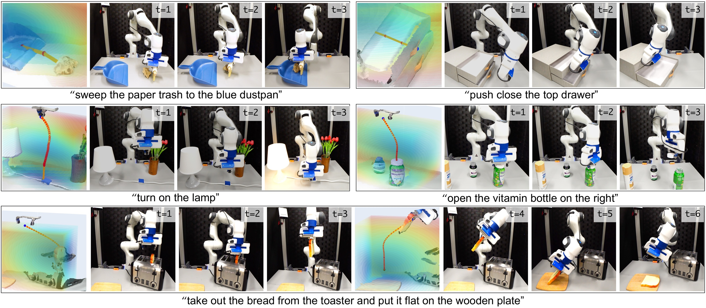
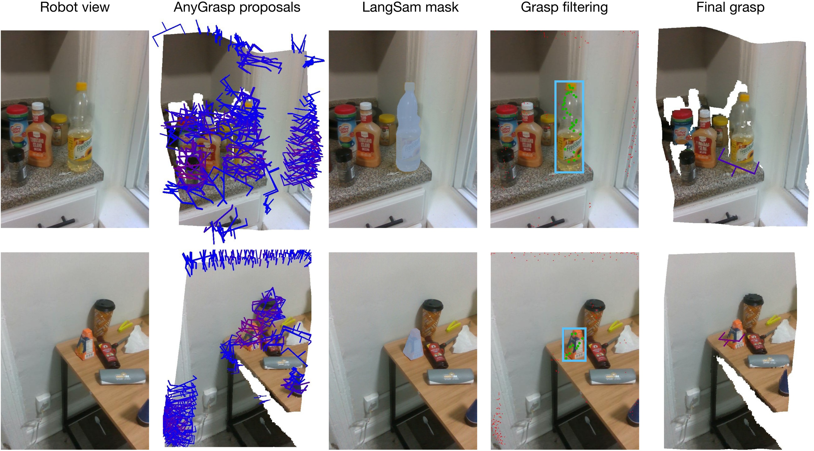
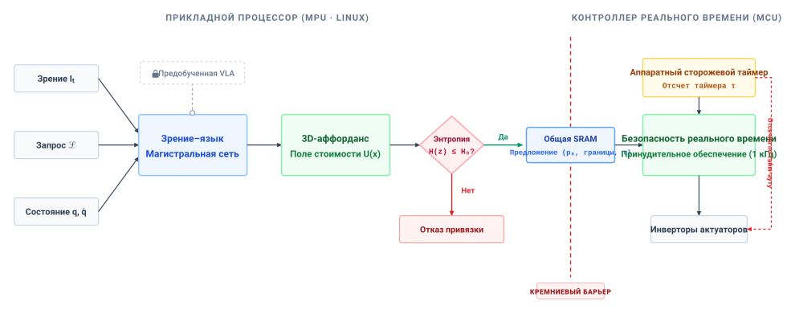
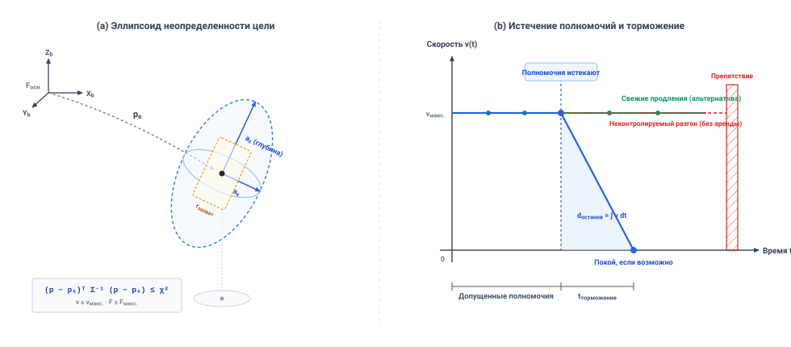
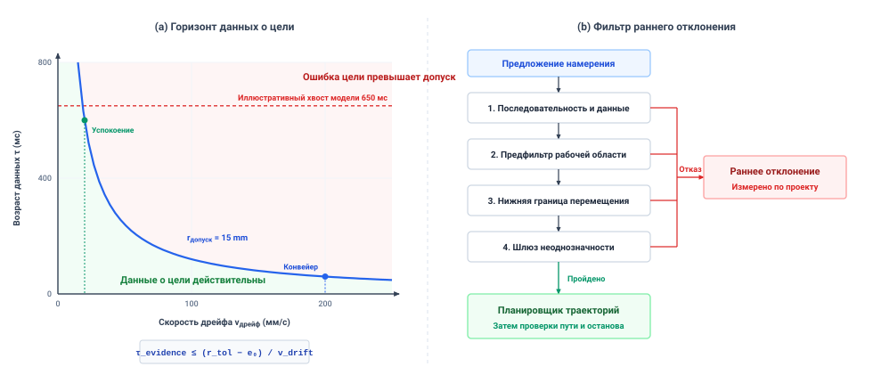

# Обоснованное намерение

## Цель

_Что должна нести автономная цель, чтобы медленная рассуждающая модель не загнала машину в ситуацию, которой больше нет?_

Высокоуровневая семантическая команда вроде «забери паллету» задает желаемый результат, оставляя существенные физические параметры — траекторию, силу контакта и временные границы — совершенно неопределенными. Поскольку физическая сцена непрерывно меняется, пока большие модели рассуждений или зрение–язык обдумывают, необработанные выходы модели нельзя исполнять без физического обоснования. Цель, достижимая в момент начала обдумывающего инференса, может стать полностью перекрытой до начала исполнения, даже если высокоуровневая декомпозиция задачи моделью была логически безупречна.

Обоснованное намерение переводит абстрактные указания в физически допустимые области, ограниченные явными арендами, пространственными допусками и жесткими предельными сроками. Когда аренда среды истекает или цель дрейфует за сертифицированные границы, безопасное замедление не может ждать, пока высокозадержечный контур обдумывания подтвердит тайм-аут. Слой реального исполнения должен независимо отозвать полномочия на движение и выполнить гарантированное резервирование. В стеке физического ИИ намерение мостит семантические цели Мозга к физическим пределам Тела, предоставляя детерминированной Нервной системе ограниченные аренды, которые безопасно истекают, если их не продлить.

> **Цели обучения**
>
> - Построить аренду намерения из протокола оценки состояния — с областью цели, огибающей ошибки, допуском задачи и потолками усилий
> - Вывести горизонт свидетельств цели из допуска задачи и дрейфа цели и отличить его от предельного срока остановки
> - Решить, когда неоднозначность обоснования или предпосылка о неверном объекте требуют отказа, а не допуска
> - Оценить, достижима ли предложенная цель в ее оставшемся окне свидетельств
> - Спроектировать истечение аренды, которое отзывает полномочия на движение, даже когда выдавший процесс не может его отменить

## Обоснованные аффордансы

Когда складскому мобильному манипулятору велено «взять красную кружку» с конвейера выдачи, указание задает результат, но оставляет путь, силу и предельный срок неопределенными. Инвертор двигателя принимает электрические команды, а не язык. Модели зрение–язык–действие (VLA) [Brohan et al., 2023](references.md#brohan2023rt1); [Brohan et al., 2023](references.md#brohan2023rt2) могут предлагать действия или цели, но частота их обновления зависит от модели и аппаратуры и может быть куда медленнее локального управления. Если цель движется во время инференса, устаревшее предложение может израсходовать запас хода. Поэтому системе нужны датированные геометрические свидетельства, ограниченные запросы и независимый путь разрешения, способный отозвать полномочия, пока модель молчит.

> ↰ **Предварительное требование:** Протокол оценки состояния, который потребляет аренда (эпоха свидетельств, начальная ошибка, закон роста), задан в разделе [«Схема пространственного состояния»](09_memory.md#sec-memory-spatial-state-schema).

Память может поставить пространственную оценку со сроком истечения ([«Оценка сквозь окклюзию»](09_memory.md#sec-memory-belief-through-occlusion)); она не может решить, какое действие эта оценка разрешает. **Намерение** закрывает этот разрыв, связывая высокоуровневую семантику задачи с ограниченной физической целью. Оно задает допустимую, ограниченную во времени цель до того, как планировщик траекторий раздела [«Планирование траекторий»](11_planning.md#sec-planning) построит непрерывный профиль движения к ней.

Связывание слов с физическими целями — робототехническая форма того, что Харнад назвал **проблемой обоснования символов** [Harnad, 1990](references.md#harnad1990symbol): чисто символьные или лингвистические токены внутри вычислительной системы не имеют внутреннего физического смысла, если они каузально не обоснованы в несимвольных сенсомоторных взаимодействиях с физической средой.[^fn-intent-symbol-grounding] Если ранние системы искусственного интеллекта, такие как SHRDLU Винограда [Winograd, 1972](references.md#winograd1972), оперировали внутри закрытых блочных миров с синтетическими аналитическими геометриями,[^fn-std-strips-planning] то современные системы физического ИИ должны обосновывать инструкции с открытым словарем в непрерывных, динамических и неопределенных физических пространствах.[^fn-intent-affordance-space]

[^fn-intent-symbol-grounding]: **Проблема обоснования символов**: Формулировка Стевана Харнада 1990 года утверждает, что одно лишь синтаксическое манипулирование не придает символам внутреннего смысла. В физическом ИИ обоснование связывает предложенную метку с датированными свидетельствами датчиков, откалиброванными метрическими системами координат и специфическими для задачи физическими проверками. Без этой связи планировщик может оптимизировать в сторону неверной физической цели.

[^fn-std-strips-planning]: **Классическое планирование STRIPS**: Классическое планирование представляет цели как логические предикаты в моделируемом мире. Динамические препятствия и пропадания сигналов датчиков могут обесценить физическую цель до ее планового использования.

[^fn-intent-affordance-space]: **Параметризация пространства аффордансов**: В робототехническом обучении аффордансы параметризуются как непрерывные пространственные вероятностные поля или многообразия достижимости над группой Ли $SE(3)$. Параметризация достижимости как явного многообразия позволяет низкоуровневым регуляторам оценивать физическую осуществимость до вызова вычислительно дорогих оптимизаторов траекторий.

> **Отказ при обосновании намерения**
>
> ***Отказ при обосновании намерения*** — правило допуска, по которому воплощенная система явно отклоняет семантически неоднозначные указания на естественном языке, возвращая типизированный статус отказа (`ERR_GROUNDING_AMBIGUITY`), вместо исполнения необоснованных догадок максимального правдоподобия через физические запасы хода.
>
> 1.  **Значение**: Отклоняет предложение, когда специфический для задачи тест неоднозначности ([«Как намерения дают сбой»](10_intent.md#sec-intent-failure-modes)) провален, до того как это предложение дойдет до генерации траекторий.
> 2.  **Отличие**: В отличие от отказа планирования траекторий, который не может найти свободный от столкновений путь к допустимой цели, отказ при обосновании отклоняет саму цель как физически необоснованную или неоднозначную до вызова планировщика.
> 3.  **Типичная ловушка**: Принудительная декодировка argmax-токена или догадка ближайшего соседа, когда кандидатные референты остаются неразрешенными, отправляющая объект управления к произвольной или опасной цели.

Что бы ни предложила модель, это должно оставаться ограниченным и во времени. Раздел [«Многотактное расписание»](10_intent.md#fig-intent-frequency-gap) показывает расписание, в котором медленная модель обдумывания, локальный трекер, контур разрешения и привод работают с разными частотами. Цель на конвейере, чьи свидетельства истекают за десятки миллисекунд, не может продлеваться моделью, обновляющейся раз в несколько сотен миллисекунд, поэтому требуется отдельный проверенный локальный путь наблюдений или пауза задачи. Частоты на рисунке иллюстративны, а раздел [«Цели с истекающим сроком»](10_intent.md#sec-intent-goals-expire) сопоставляет собственный темп намерения машины с горизонтом конвейера.

***Многотактное расписание**: Четыре иллюстративные частоты показывают, почему обдумывающее предложение не может служить сигналом живости двигателя или контура разрешения. Расписание не связывает размер модели с частотой. Локальный трекер может продлевать свидетельства цели, только если его датчик и границы ошибки независимо проверены. Собственные уровни машины — уровни раздела [«Многотактные ритмы»](04_nervous_system.md#sec-nervous-cadences); модель намерения машины работает быстрее показанной частоты обдумывания, а политика фрагмента здесь опущена.*

> ↰ **Предварительное требование:** Граница предложения и путь разрешения определены в разделе [«Машина в пяти уровнях»](01_causal_boundary.md#sec-boundary-machine-model).

Обоснование открытого указания поэтому заканчивается датированным **предложением намерения**, которое прикладной процессор отправляет через границу предложения. Оно запрашивает границы в пространстве, времени и усилии, а независимый путь разрешения проверяет каждую из них по настроенным пределам, текущему состоянию и запасу остановки до начала движения.

## Что передают намерения

Когда плечо тянется к красной кружке, Мозг не отправляет через границу предложения ни траекторий шарниров, ни напряжений обмоток. Он отправляет запрос ограниченных полномочий, и путь разрешения должен уметь проверить каждую его часть, прежде чем предоставит хоть что-то. Проверки — это допуск цели, действительность свидетельств, запрошенное усилие и осуществимое резервирование, и каждая существует потому, что задержанное предложение может провалиться по-разному. Раздел [«Аренда намерения»](10_intent.md#sec-intent-lease) называет протокол, который несет запрос и происхождение от протокола оценки состояния.

В физическом манипулировании изолированная координата неполна. В смысле Гибсона аффорданс — это относительное действию отношение между геометрией, достижимостью робота и пределами контакта [Gibson, 1979](references.md#gibson1979ecological). Поэтому предложение намерения запрашивает целевую позу в $SE(3)$ — пространстве трехмерных положений и ориентаций — и **область допуска задачи**, внутри которой задача считается выполненной. Этот допуск отличается от ковариации оценщика, которая описывает неопределенность цели. Для захвата кружки машиной утвержденный профиль задачи допускает `15 mm` поступательной ошибки. Тогда регулятор может завершить работу внутри этой области, а не интегрировать вечно к точному шумному пункту; он по-прежнему проверяет, что оценочная ошибка цели помещается в допуск.

Пространственная действительность в физическом мире недолговечна. Поэтому физическая цель несет эпоху свидетельств и конечное запрошенное истечение, а не полагается на асинхронное сообщение отмены[^fn-anti-async-abort] от слоя рассуждений. Модель, выдающая новый результат лишь раз за период, не может — даже до джиттера — продлить цель, чьи свидетельства действительны меньше этого периода. Независимый регулятор разрешения оценивает допущенный предельный срок на каждом цикле управления и прекращает слежение, когда истекают свидетельства или аренда. Настроенное удержание или остановку он выбирает только тогда, когда измеренное состояние и оставшийся запас делают такой отклик осуществимым.[^fn-std-iso-watchdog] Локальный таймер снимает зависимость от пакета аварийной остановки хоста; остановочный путь остается отдельным физическим обязательством.

[^fn-std-iso-watchdog]: **Аппаратные сторожевые таймеры безопасности**: В проекте безопасности можно использовать независимо тактируемый сторожевой таймер, чтобы обнаруживать пропущенные продления и запускать проверенный отклик без хоста. Safe Torque Off (безопасное снятие момента) убирает момент привода; само по себе оно не удерживает подвешенную нагрузку и не останавливает движущуюся массу в заданном запасе хода.

[^fn-anti-async-abort]: **Асинхронная диспетчеризация событий безопасности**: Опора на асинхронные сообщения отмены или сетевую диспетчеризацию событий для прерывания движения вносит недетерминированные задержки сериализации очередей, и каждая миллисекунда такой задержки — это незаторможенный ход на пределе привода основания. Локальный обратный отсчет может отозвать полномочия слежения при пропущенном продлении.

Цель, ограниченная в пространстве и времени, опасна, если регулятору позволены неограниченные физические усилия. Поэтому предложение намерения запрашивает потолки усилий по скорости, ускорению и вектору сил-моментов контакта. Модель может поставить цель чуть за поверхностью, которой она должна коснуться, из-за ошибки стерео-параллакса; жесткий позиционный регулятор тогда подаст избыточный восстанавливающий момент. Для охраняемого подхода плеча к двери клетки с пружинной защелкой предложение может запросить порог срабатывания в `15 N` как потолок контактной силы — намного ниже предела защелки `100 N` — и скорость подхода `0.03 m/s` как потолок скорости. Путь разрешения сравнивает каждый запрос с независимо настроенными потолками актуаторов и задачи, а затем допускает лишь осуществимое подмножество. Низкоуровневый **импедансный регулятор**[^fn-ctrl-impedance-intent] принудительно обеспечивает допущенные пределы.

[^fn-ctrl-impedance-intent]: **Регулирование механического импеданса**: Импедансное управление регулирует отношение между контактной силой и движением через эффективную массу, демпфирование и жесткость. Оно может снижать нагрузки в проверенном контактном режиме; первый удар и пиковая сила все равно зависят от скорости подхода, пассивной податливости, восприятия и отклика актуатора.

Пропуск любой из этих трех границ оставляет машину незащищенной при пропаданиях связи или зависаниях восприятия. Остановочный путь растет линейно с задержкой до торможения и квадратически со скоростью ([«остановочный путь тела»](02_body.md#eq-body-stopping-distance)). На движущемся основании, чей бюджет остановки измеряется расстоянием, зависший инициатор удлиняет слагаемое задержки на время, пока его последнее предложение сохраняет полномочия. Это время — аренда фрагмента раздела [«Многотактные ритмы»](04_nervous_system.md#sec-nervous-cadences), и оно входит в $\tau_{\text{delay}}$. Запас хода держится, только если независимо проверенная граница препятствия лежит за остановочным путем с добавленными запасами на модель и восприятие.

Аренда намерения — другой объект. Она ограничивает, как долго цель остается обоснованной, и ее истечение немедленно отзывает цель и заканчивает слежение, не добавляя слагаемого в бюджет остановки основания.

> **Истекшие полномочия и физический отклик**
>
> Три модели ниже отвечают на разные вопросы. Для расчета остановки нужны общая задержка до начала торможения и замедление, доступное из *текущего* состояния.
>
> 1. **Истечение намерения кружки:** Плечо тянется к красной кружке под намерением, допущенным без локального слежения. На `0.20 m/s` конвейер израсходует `12 mm` между начальной ошибкой `3 mm` и допуском `15 mm` за `60 ms`, и свидетельства цели истекают тогда, как утверждает протокол оценки рукоятки кружки из раздела [«Схема пространственного состояния»](09_memory.md#sec-memory-spatial-state-schema). Предположим, прикладной процессор зависает. Цель, которую зависший инициатор удерживал бы `200 ms`, отстояла бы от кружки на `43 mm`. Аренда не ждет инициатора. На `60 ms` намерение истекает, полномочия слежения плеча заканчиваются, и плечо входит в остановку, согласованную с его текущим состоянием, с началом в пределах `22 ms` (один такт разрешения, один цикл шины и начало торможения). Аренда фрагмента раздела [«Многотактные ритмы»](04_nervous_system.md#sec-nervous-cadences) — предохранитель, если это истечение так и не будет замечено. При локальном слежении те же `200 ms` оставляют цель с отклонением `13 mm`, внутри допуска, потому что горизонт слежения, выведенный в разделе [«Цели с истекающим сроком»](10_intent.md#sec-intent-goals-expire), равен `219 ms`; именно слежение делает обновление намерения с `5 Hz` жизнеспособным.
> 2. **Плечо у двери клетки:** На охраняемой скорости подхода `0.03 m/s` к ответной планке двери клетки с жесткостью `4.0 × 10⁵ N/m` модельная сила растет на `12 N/ms`. Порог срабатывания `15 N` и отклик контактного контура `2 ms` дают `39 N` **в момент начала команды торможения**; сила продолжает расти, пока плечо замедляется. Оставаясь ниже предела защелки `100 N`, остается лишь `0.15 mm` дальнейшего сжатия, поэтому плечо должно замедляться примерно на `3 m/s²` и остановиться примерно за `10 ms`. Способно ли плечо затормозить так резко с подхода — открытая предпосылка, которую способны уладить лишь испытания остановки плеча. Незаторможенное движение `200 ms` продвигает `6 mm` и дает `2,400 N` в модели линейной пружины — далеко за пределом защелки.
> 3. **Контраст с технологическим объектом:** У нагреваемого процесса нет тормозного хода, но полномочия его задания истекают так же, израсходованные как температура, а не как путь. При иллюстративной сосредоточенной теплоемкости `900 J/K` и некомпенсированном входе `3600 W` температура растет на `4 K/s`. Выбранный допуск перерегулирования задачи `2 K` израсходуется за `500 ms`, поэтому задание нагревателя, чей инициатор завис, должно потерять полномочия куда раньше этого интервала; `10 s` при том же нетто-тепловом входе дают модельный рост на `40 K`.

Эти три примера проясняют разделение полномочий. Высокоуровневые рассуждения могут предложить цель, временное окно и потолок усилий. Независимый путь разрешения определяет, какие пределы допустимы из измеренного состояния, настроенных потолков и осуществимого резервирования. Затем локальное управление отслеживает лишь допущенное предложение и отзывает полномочия при недействительных свидетельствах или истечении. Это напоминает разделение по приоритетам **субсумпционной архитектуры**[^fn-ai-subsumption-intent] [Brooks, 1986](references.md#brooks1986robust).

[^fn-ai-subsumption-intent]: **Принципы субсумпционной архитектуры**: Субсумпционная архитектура Родни Брукса разложила автономную робототехнику на асинхронные поведенческие слои с арбитражем по приоритетам, работающие на сенсорной обратной связи. Здесь обученный слой предлагает ограниченную цель, а независимый регулятор проверяет разрешение и выполняет проверенный отклик при истечении.

Обоснование предложения намерения в эти три границы требует формального преобразования из неоднозначных сенсорных входов в структурированные проверяемые предложения. Когда система обрабатывает высокоуровневое указание или последовательность визуальных токенов, исходное предложение редко бывает единственным однозначным набором координат. Оно начинается как неопределенная геометрическая гипотеза, которая должна нести собственную пространственную неоднозначность и собственные временные пределы, прежде чем может быть допущена в конвейер исполнения.

## От запроса к истекающему предложению

Инструкция на естественном языке становится опасной, когда непроверенная семантическая гипотеза командует движением. Когда оператор или высокоуровневый супервизор просит красную кружку, бортовая зрительно-языковая модель разбирает поток символов, проецирует признаки изображения в общее вложение и выбирает кандидатную визуальную область ограничивающего прямоугольника. Из этих пикселей сеть извлекает оценочную позу в $SE(3)$ и записывает значения координат в буфер памяти. На границе предложения ([«Машина в пяти уровнях»](01_causal_boundary.md#sec-boundary-machine-model)) необоснованная строка токенов становится запрошенным местом назначения; если ее допустят, она достигает каузальной границы как масса, скорость и ток.[^fn-math-semantic-metric]

Если визуальный остов свяжет языковой токен с соседним приспособлением или немаркированной калибровочной мишенью, результирующий вектор координат $\mathbf{p} \in \mathbb{R}^3$ войдет в конвейер траекторий как авторитетная физическая цель. Поскольку низкоуровневый привод двигателя измеряет лишь импульсы энкодера, температуры обмоток и фазовые токи, он не способен оценить, соответствует ли отслеживаемая координата задуманной кружке или пустому участку ленты.[^fn-math-vlm-lipschitz] Процесс обоснования должен выдать явное геометрическое предложение, включающее пространственную неопределенность, свидетельства выбора и временное истечение, прежде чем какой-либо планировщик движения его примет.

[^fn-math-semantic-metric]: **Семантико-метрическое преобразование**: Проецирование дискретных лингвистических вложений в непрерывные координаты $SE(3)$ требует непрерывной цепочки координатной калибровки от пикселей изображения до базовых систем координат актуаторов. Несмоделированная податливость крепления камеры или искажение объектива превращают пики семантического внимания в систематические метрические смещения. Если в цепочке преобразований нет жесткой внешней калибровки, высокая семантическая уверенность дает большие физические ошибки слежения на конце манипулятора.

[^fn-math-vlm-lipschitz]: **Чувствительность обученного выхода**: Обученная оценка позы может существенно измениться при изменении изображения или сцены, и эмпирическая оценка уверенности не ограничивает это изменение. Путь разрешения ограничивает допущенную цель и движение независимо проверяемыми геометрическими, статическими и актуаторными ограничениями.

**Обоснование аффордансов с открытым словарем** использует язык и наблюдения датчиков, чтобы предложить относящийся к задаче навык, пространственное поле или программу, и ни один из его выходов не является проверенной целью. SayCan [Ahn et al., 2023](references.md#ahn2022saycan) умножает предпочтение языковой модели на обученную оценку успеха каждого навыка ([«Функции ценности и обоснование аффордансов»](appendix_ml.md#sec-appendix-ml-affordances)), что дает ранжирование, обусловленное обучением и наблюдением, а не вето на перекрытое или невозможное движение. VoxPoser [Huang et al., 2023](references.md#huang2023voxposer) ([«Обоснование 3D-аффордансов манипулятора»](10_intent.md#fig-10-real-grounded-affordance-franka)) заставляет языковую модель писать код, компонующий 3D-карты притяжения и отталкивания в рабочем пространстве робота для использования оптимизатором траекторий как стоимостей, и градиенты по полю стоимости не сертифицируют ни свободу от столкновений, ни пределы момента. Code as Policies [Liang et al., 2023](references.md#liang2023code) генерирует программы, вызывающие API восприятия и параметризованные примитивы движения, и сгенерированная программа может зависнуть так же верно, как и модель, поэтому обратный отсчет и путь разрешения удерживают управление, что бы ни делала программа. OK-Robot ([«Конвейер обоснования захвата с открытым словарем»](10_intent.md#fig-10-real-open-vocab-grounding)) фильтрует кандидатные захваты выбором объекта, обусловленным языком, и сегментационная маска за таким выбором — кандидатная область изображения, а не проверенный 3D-корпус. Раздел [«Представления обоснования и вопросы допуска»](10_intent.md#tbl-10-grounding-paradigms) излагает, что каждый вид представления отправляет дальше и что пути разрешения еще нужно, прежде чем любое из них станет допущенным запросом. Каждому нужны как минимум именованная система координат, единицы СИ, датированные свидетельства и собственные проверки пути разрешения.

***Обоснование 3D-аффордансов манипулятора**: VoxPoser компонует управляемые языком 3D-карты ценности для задач манипулирования [Huang et al., 2023](references.md#huang2023voxposer). Показанная исследовательская система предлагает пространственные цели; независимая обертка разрешения и остановки потребовала бы отдельного проектирования и валидации. (Источник: Huang et al., 2023 [Huang et al., 2023](references.md#huang2023voxposer), CC BY 4.0).*

***Конвейер обоснования захвата с открытым словарем**: OK-Robot сочетает кандидатные захваты с выбором объекта, обусловленным языком, и геометрической фильтрацией [Liu et al., 2024](references.md#liu2024okrobot). Показанный исследовательский конвейер предлагает захват; ограниченный допуск, предельный срок свидетельств и независимая проверка разрешения — архитектурная обертка, разработанная в этой главе, а не заявленная особенность изображения.*

| Источник предложения        | Представление, отправляемое дальше                      | Ранняя проверка                                          | Остающиеся необходимые свидетельства                                                   |
|:--------------------------|:--------------------------------------------------------|:-----------------------------------------------------------|:-------------------------------------------------------------------------------------------------|
| 2D-рамка или маска          | Область изображения плюс измеренная глубина и калибровка камеры | Отклонять при отсутствии глубины или цели вне проверенной области | Ошибка 3D-позы, окклюзия, идентичность объекта и запас огибаемого пути                  |
| 3D-признак или поле ценности | Кандидатная цель или поле стоимости в заявленной системе координат | Отклонять цели вне рабочего пространства и устаревшие ячейки карты | Консервативная занятость, политика неизвестного пространства, пределы актуаторов и тайминга |
| VLA с токенами действий     | Декодированное действие в обученном диапазоне действий   | Отклонять выходящие за диапазон или недопустимые предложения | Зависящий от состояния физический предел и независимое разрешение; бины токенов не дают доказательства запаса хода |
| Навык, выбранный языком     | Идентификатор навыка с оценкой успеха                    | Ранжировать или отклонять низкоуверенных кандидатов      | Текущие предусловия, осуществимость пути и отдельное физическое принудительное обеспечение |

***Представления обоснования и вопросы допуска**: Выходы разных семейств моделей требуют разных преобразований до физической проверки разрешения.*

Дискретизированные выходы не несут метрической границы, и два распространенных вида лишены ее по разным причинам. RT-1 [Brohan et al., 2023](references.md#brohan2023rt1) и OpenVLA [Kim et al., 2024](references.md#kim2024openvla) квантизуют каждое измерение действия робота на 256 бинов поверх обученного диапазона, поэтому декодированный бин есть действие и не кодирует запаса хода ни до какой цели. [Токены локализации PaliGemma](https://google-research.github.io/big_vision/big_vision/configs/proj/paligemma/) квантизуют нормализованные координаты изображения, которые становятся позой в системе координат основания лишь с измеренной глубиной, цепочкой калибровки и моделью ошибки, чьи слагаемые внешней калибровки и глубины могут доминировать над самой квантизацией.

Чтобы не дать обученному выходу выдать себя за детерминированное задание, источник должен сохранять идентичность референта и датированные свидетельства, его избравшие. Его протокол наблюдений может содержать ограничивающие прямоугольники, веса внимания, вероятности классов и полную ориентированную ковариационную оценку. Предложение намерения ([«Аренда намерения»](10_intent.md#sec-intent-lease)) ссылается по дайджесту и эпохе свидетельств на протокол оценки состояния, построенный из этого наблюдения ([«Схема пространственного состояния»](09_memory.md#sec-memory-spatial-state-schema)); оно несет кандидатную позу, консервативные границы ошибки в системе координат основания, допуски задачи и запрошенное истечение, а не эти полные поля стороны источника. Независимый путь разрешения проверяет связанные свидетельства и запрос по собственным пределам. Объект может сместиться или оказаться перекрытым после экспозиции камеры, поэтому координата без действительной связи со свидетельствами и предельного срока не может оставаться авторизованной целью.

Когда зрительно-языковая модель видит несколько кандидатных объектов, argmax может скрыть неразрешенный выбор. Цифровая рекомендация все еще может ввести пользователя в заблуждение, но у нее нет прямого пути к актуаторам; у робота допущенное пространственное предложение может сдвинуть массу. Если красная стеклянная банка стоит рядом с красной кружкой на конвейере выдачи, плохо обоснованная догадка может выбрать банку. Система должна сохранять идентичность кандидатов и откалиброванную неопределенность, отклоняя предложение при превышении специфического для задачи порога неоднозначности. Тогда путь разрешения поддерживает осуществимое удержание или остановку, пока источник ищет более ясное наблюдение или указание.

Формально **неоднозначность обоснования с открытым словарем** — это состояние, при котором проекции мультимодальных признаков дают многовершинные апостериорные распределения, перекрывающиеся геометрические гипотезы или неразрешимые свидетельственные ничьи между кандидатными физическими референтами, требующие явного отказа при обосновании (`ERR_GROUNDING_AMBIGUITY`), а не оптимистичного разрешения ничьих argmax. Высокая энтропия по распределению кандидатных референтов $\mathbf{z}$, $H(\mathbf{z}) > H_{\text{thresh}}$, — один из его сигналов, и фильтр источника раздела [«Конвейер обоснованных намерений»](10_intent.md#fig-10-vla-cross-attention-intent-lease) может отклонить по этому сигналу до того, как предложение пересечет границу предложения. Тест, который должен держаться для каждого предложения, — независимый подсчет кандидатов в окне захвата ([«Как намерения дают сбой»](10_intent.md#sec-intent-failure-modes)), ибо уверенно ошибающаяся модель может сообщить низкую энтропию.

***Конвейер обоснованных намерений**: Эта предложенная реализация превращает мультимодальные входы в кандидатное пространственное поле, применяет энтропийный фильтр источника и передает ограниченный запрос через границу предложения от прикладного процессора к микроконтроллеру безопасности (MCU). MCU проверяет возраст свидетельств, настроенные пределы и осуществимое резервирование, прежде чем допустить локальный обратный отсчет. Перекрестное внимание и промптинг поставляют предложения, а не сертифицированные физические ограничения (синтезировано из Huang et al. [-[Huang et al., 2023](references.md#huang2023voxposer)], Ahn et al. [-[Ahn et al., 2023](references.md#ahn2022saycan)] и Gray [-[Gray and Cheriton, 1989](references.md#gray1989leases)]).*

Рассмотрим оценку моделью обоснования рукоятки красной кружки по единственному виду камеры запястья, снятому издалека, до начала подхода плеча. В иллюстративной откалиброванной гауссовой модели локализации главные стандартные отклонения в системе координат датчика составляют `4 mm`, `5 mm` и `12 mm` — наибольшее вдоль оси глубины камеры, которая есть также ось подхода захвата. **95-процентная статистическая область** вокруг оценочного положения рукоятки $\mathbf{p}_0$ использует квадрат расстояния Махаланобиса $(\mathbf{p}-\mathbf{p}_0)^T\mathbf{\Sigma}^{-1}(\mathbf{p}-\mathbf{p}_0)\le\chi^2_{3,0.95}$, где квантиль при трех степенях свободы равен `7.815`, что дает главные полуоси `11.2 mm`, `14.0 mm` и `33.5 mm`. Раздел [«Неопределенность локализации и истечение полномочий»](10_intent.md#fig-10-intent-lease-envelope) противопоставляет эту неопределенную цель отдельному допуску захвата кружки `15 mm`. Обе боковые полуоси помещаются в допуск, но полуось глубины — нет, поэтому эта оценка проваливает допуск и требует лучшего восприятия, иного подхода или отказа.

Захват, допущенный в разделе [«Аренда намерения»](10_intent.md#sec-intent-lease), опирается на лучшее восприятие. Его протокол оценки состояния ([«Схема пространственного состояния»](09_memory.md#sec-memory-spatial-state-schema)) происходит от более близкой съемки камерой запястья на подходе, которая ограничивает начальную ошибку величиной `3 mm`. Даже 95-процентная область этой допущенной оценки оставляет остаточный хвост и сама по себе не может сертифицировать запас хода, поэтому предложение намерения несет консервативные границы ошибки в системе координат основания, а не претендует на кодирование этой ковариации.

***Неопределенность локализации и истечение полномочий**: Панель (a) набрасывает статистический эллипсоид неопределенности цели рядом с отдельным допуском задачи захвата. Панель (b) сравнивает контрфактические траектории: синяя истекает и тормозит, зеленая продолжается лишь при свежих продлениях, а красная показывает движение без аренды. Успокоится ли синяя траектория перед препятствием, зависит от общей задержки до торможения, замедления и запаса хода.*

Обнаружение с большой оценкой неопределенности может быть отклонено настроенным статистическим фильтром. Уверенное обоснование неверной физической сущности может пройти этот фильтр. Предположим вместо этого, что тонкостенная стеклянная банка прибывает одна туда, где должна быть кружка, и зрительно-языковая модель присваивает ей высокий балл уверенности, когда ее просят о красной кружке. Модель выдает острое геометрическое предложение с малой дисперсией, центрированное на стекле. Планировщик траекторий получает координату, вычисляет решение обратной кинематики $SE(3)$, проверяет пределы шарниров и подтверждает, что путь проходит мимо всех препятствий в статической карте среды. Путь разрешения может найти предложенное движение в пределах своих настроенных геометрических и силовых границ. Если эти границы допускают силу захвата, нужную керамической кружке, плавная геометрически допустимая траектория может раздавить стекло, несмотря на прохождение проверок.

Этот отказ обнруживает границу между тем, что путь разрешения может проверить, и чем он должен принять как непроверенную предпосылку. Путь разрешения проверяет границы координат, кинематическую достижимость, пределы моментов шарниров и геометрические столкновения по известным сеткам занятости. Эти физические проверки не устанавливают, что координата называет задуманный объект, поэтому предпосылка о том, что захваченный объект и есть названный объект, лежит вне досягаемости пути разрешения. Ей нужны собственные свидетельства задачи, и она путешествует с кружкой в ветвь передачи кейса выпуска ([«Полный разбор случая»](16_release.md#sec-release-case-worked-full)) и в реестр утверждений, которые свидетельства машины оставляют открытыми ([«Реестр остаточных утверждений»](17_frontier.md#sec-frontier-residual-claims-register)).

Мультимодальное извлечение признаков, выравнивание перекрестного внимания и обоснование фраз с открытым словарем принадлежат литературе по компьютерному зрению и языку [Kamath et al., 2021](references.md#kamath2021mdetr); [Gu et al., 2022](references.md#gu2022open); [Radford et al., 2021](references.md#radford2021learning); [Liu et al., 2023](references.md#liu2023grounding). Архитектура физического ИИ потребляет эти модели обоснования, не опираясь на их внутренние активации для безопасности, и даже отфильтрованный поток предложений все еще нуждается в независимой проверке разрешения движения. Языковой фильтр задач AutoRT поднял долю приемлемых предложенных задач, но все же пропускал небольшую долю небезопасных, а его развертывание опиралось на паузу по силе в шарнирах, аварийные остановы и надзор человека, а не на промпт ([«Фильтрация задач и надзор AutoRT (2024)»](10_intent.md#ws-intent-autort-hallucination-constitution)) [Ahn et al., 2024](references.md#ahn2023autort).

> **Фильтрация задач и надзор AutoRT (2024)**
>
> **Контекст**: AutoRT использовал языковые модели, чтобы предлагать и фильтровать задачи для мобильных манипуляторов в офисных окружениях [Ahn et al., 2024](references.md#ahn2023autort). Авторы собрали 77 000 роботизированных эпизодов более чем на 20 роботах; последовательность «схватить зеркало — разбить объект — ударить по шасси», ранее приписанную этому исследованию, они не сообщали.
>
> **Свидетельства**: В размеченной выборке из 259 предложенных задач 228 первоначально были признаны приемлемыми. После фильтра аффордансов LLM 200 из 214 сохраненных задач были приемлемы, подняв долю приемлемых примерно с 88 до 93 %, но оставив часть неподходящих задач. В статье прямо сказано, что конституционный промптинг не может гарантировать соблюдение.
>
> **Реакция**: Сообщенное развертывание дополняло промпты паузой по силе в шарнирах, физическими аварийными остановами и надзором человека с прямой видимостью, если рабочая зона не была ограждена. Это различные средства контроля с разным охватом; сам промпт не был сертифицированным геометрическим или физическим супервизором безопасности.
>
> **Урок для систем**: Обученный фильтр задач может улучшить поток предложений, однако независимый путь разрешения и резервирования все равно должен валидировать каждое физическое действие для заявленной области эксплуатации.

Откуда бы ни пришла обоснованная цель, это также утверждение о моменте. Красная кружка, которую модель выбрала верно в момент съемки, продолжает двигаться с конвейером, поэтому предложение, верное в момент выдачи, становится неверным без изменения своего содержимого. Оно поэтому должно нести предельный срок, который путь разрешения может принудительно обеспечить без модели.

## Цели с истекающим сроком

Предположим, прикладной процессор зависает, пока плечо тянется к красной кружке. Отказ, из-за которого необходима отмена, — тот же отказ, который не дает отмене быть отправленной, ибо явное прерывание требует работающих отправителя, планировщика и канала связи. Поэтому аренда намерения должна истекать сама. Это принцип [«Предложение — не разрешение»](part3_running.md#pri-vol4-proposal-permission), примененный к цели. Путь разрешения владеет резервированием, которое может выполнить без инициатора, поэтому независимый обратный отсчет отзывает полномочия слежения зависшего предложения, не дожидаясь модели. Это переносит примитив аренды [Gray and Cheriton, 1989](references.md#gray1989leases) на физический регулятор: истечение запускает отдельно проверенное резервирование, чья способность остановиться перед опасностью зависит от текущего состояния, запаса хода, полномочий актуатора и общей задержки отклика.[^fn-hw-watchdog-rtt]

> ↰ **Предварительное требование:** Бюджеты кинетического импульса и ограничения остановочного пути происходят из раздела [«Кинетический импульс»](02_body.md#sec-body-kinetic-momentum).

Предельный срок свидетельств цели следует за скоростью, с которой физическая цель может расходиться со своим последним измерением. Предположим, проверенные границы ограничивают относительный дрейф цели величиной $v_{\text{drift}}$, а начальную ошибку положения — $e_0$ внутри заявленной области применимости протокола оценки состояния, и задача допускает ошибку цели $r_{\text{tol}}$. Тогда горизонт — это [«горизонт инвалидации»](09_memory.md#eq-mem-invalidation-horizon), примененный к [«расширению окклюзии»](09_memory.md#eq-mem-occlusion-expansion) с $a_{\text{dist}}=0$, где $e_0$ записан вместо $E_0$ и $r_{\text{tol}}$ вместо $E_{\max}$:

$$\tau_{\text{ev}} \le \frac{r_{\text{tol}} - e_0}{v_{\text{drift}}}$$

[^fn-hw-watchdog-rtt]: **Аппаратные счетчики обратного отсчета сторожевого таймера**: Обнаружение пропущенного продления — лишь первое слагаемое бюджета реакции. Распространение команды привода, включение тормоза и физическое замедление добавляют каждое свое отдельно измеренное слагаемое.

Когда $r_{\text{tol}}\le e_0$, цель недопустима в момент съемки. Регулятор отклоняет зависимое движение. Даже когда [«граница дрейфа аренды»](10_intent.md#eq-intent-lease-drift-bound) дает положительный горизонт, отдельная проверка разрешения движения должна сверить текущий запас хода с общей задержкой восприятия, разрешения, связи и начала торможения плюс физическим тормозным путем, как в разделе [«Нервная система»](04_nervous_system.md#sec-nervous).

Если нужна также проверенная граница возмущающего ускорения $a_{\text{dist}}$, возвращается квадратичное слагаемое [«расширения окклюзии»](09_memory.md#eq-mem-occlusion-expansion), и его положительный корень при $r_{\text{tol}}$ сокращает горизонт свидетельств.

Для красной кружки на конвейере выдачи обоснованная цель движется со скоростью `0.20 m/s`. Допуск захвата `15 mm` и начальная ошибка `3 mm` оставляют `60 ms` **горизонта свидетельств цели** по [«границе дрейфа аренды»](10_intent.md#eq-intent-lease-drift-bound). Растяжение горизонта до периода обновления `200 ms` модели намерения машины с `5 Hz` позволило бы модельной ошибке цели достичь `43 mm`, то есть `28 mm` сверх допуска. Модель намерения, чей один инференс занимает `160 ms`, не может сама обновить `60 ms` цель для непрерывного движения. Без квалифицированного трекера конвейер должен замедлиться или остановиться, либо задачу следует отклонить. При дрейфе `20 mm/s` та же граница дает горизонт свидетельств `600 ms` ([«Горизонт свидетельств цели и ранние фильтры»](10_intent.md#fig-10-lease-dynamics-tradeoff)).

Квалифицированный локальный трекер меняет арифметику. Он заново измеряет кружку в каждом кадре и следует за скоростью конвейера, поэтому скорость конвейера больше не управляет ошибкой. Та же начальная ошибка `3 mm` по-прежнему списывается с допуска, оставляя `12 mm` остаточному проскальзыванию в `0.50 m/s²`. Против этого бюджета одно остаточное проскальзывание задает горизонт слежения за свидетельствами, который решает раздел [«Питание, свежесть и стена памяти»](03_brain.md#sec-brain-cognitive-pipeline), — `219 ms`. Трекер продлевает эти свидетельства с собственной частотой, поэтому в горизонт должны помещаться период трекера плюс его задержка. Модель намерения лишь подтверждает заново, какая кружка имеется в виду, и каждое ее продление несет свежие свидетельства трекера, а не кадр, который модель читала последним. Какой бы горизонт ни применялся, он ограничивает аренду намерения на эту цель ([«Аренда намерения»](10_intent.md#sec-intent-lease)).

***Горизонт свидетельств цели и ранние фильтры**: Панель (a) строит границу $\tau_{\text{ev}}\le(r_{\text{tol}}-e_0)/v_{\text{drift}}$; ее зеленая область означает лишь то, что цель остается внутри допуска задачи. Иллюстративный инференс с хвостовой задержкой в 650 мс не может продлить 60 мс конвейерный случай. Панель (b) показывает стадии раннего отклонения, предшествующие полной проверке пути и остановки.*

Связывание действительности свидетельств цели с темпом модели рассуждений создает опасность дрейфа. Предположим, проект привязывает свидетельства кружки к выходу модели намерения, а не к трекеру, так что действует непрослеженный горизонт `60 ms`, а один инференс доходит до хвостовой задержки `650 ms`. Продление записи цели до `650 ms` исключительно ради сокрытия этой задержки оставило бы ее оценку вне заявленной огибающей ошибки на `590 ms`. Предел `60 ms` — это предельный срок действительности свидетельств, и продлить его могут только новые свидетельства, вновь проверенные относительно движения; более быстрые вычисления — не могут.

Непрерывное слежение требует *свежих физических свидетельств*, а не просто нового пакета от того же устаревшего кадра. Продление на основе новой съемки должно прийти до истечения текущих свидетельств и допущенных полномочий, причем в его бюджет входят съемка, обработка, передача, неопределенность часов и время разрешения. Простое условие $T_{\text{period}}+t_{\text{latency}}<\tau_{\text{ev}}$ — лишь необходимая проверка планируемости. Когда приходит свежее предложение, планировщик может вычислить стык с ограничением рывка от измеренного состояния. Он допускает этот стык, только если огибаемый путь, новые свидетельства и резерв остановки остаются осуществимыми; резкая смена цели может вместо этого потребовать отказа или проверенной остановки.

Когда обратный отсчет, взведенный MCU в момент допуска, исчерпывается — работает еще хост или нет, — независимый регулятор отзывает полномочия предложения и выбирает ранее проверенный отклик для измеренной нагрузки и режима контакта. Активное удержание положения требует момента и может защитить подвешенную нагрузку; контролируемое замедление требует тормозной способности и запаса хода; снятие момента может подходить некоторым приводам, но может освободить нагрузку или оставить импульс неконтролируемым. Инициатор может запросить режим, но он не может выбрать конечное действие для MCU. Допуск не удается, когда из текущего состояния не остается осуществимого отклика.

Безопасное исполнение истекающей аренды предполагает, что командуемое геометрическое предложение действительно достижимо физическим телом. Если предложенная координата лежит за кинематической достижимостью или требует скоростей шарниров, превышающих пределы актуаторов в окне аренды, предоставление аренды растрачивает полномочия управления и может вызвать срабатывание защиты от перегрузки по току, когда двигатель тянет избыточный ток к невозможной скорости. Определение кинематической и динамической допустимости цели относится к этапу до того, как генератор траекторий примет аренду, устанавливая физический фильтр между высокоуровневым намерением и исполнением движения.

## Допустимые множества целей

Если красная кружка проезжает мимо по дальней стороне ленты, за достижимостью плеча от места стоянки основания, никакая последовательность моментов шарниров не приведет захват к ее рукоятке. Эта невозможность должна быть поймана на границе предложения, до того как цель войдет в очередь оптимизации траекторий. Когда вышестоящая зрительно-языковая модель или нейронная политика выдает координату, обращение с этим предложением как с непроверенным кандидатом защищает конвейер движения реального времени от исполнения или даже оценки невозможных движений. Анализ кинематического рабочего пространства, заимствованный из классических формулировок [Craig, 2005](references.md#craig2005introduction); [Lynch and Park, 2017](references.md#lynch2017modern), определяет замкнутое пространственное многообразие достижимых конфигураций конца манипулятора (физический 3D-объем, до которого может дотянуться рука робота) при заданных размерах звеньев, пределах хода шарниров и геометрии крепления.[^fn-math-workspace-manifold] Аналитическая проверка достижимости оценивает, пребывает ли целевая поза $SE(3)$ $\mathbf{p}_{\text{target}}$ внутри этого многообразия рабочего пространства $\mathcal{W}$, а проверка занятости сверяет, что ограничивающий объем цели не пересекает известных постоянных препятствий, и обе достаточно дешевы для запуска до оптимизации траекторий ([«Горизонт свидетельств цели и ранние фильтры»](10_intent.md#fig-10-lease-dynamics-tradeoff), панель b). Передача недостижимой цели оптимизатору траекторий заставляет решатель искать в пустом пространстве решений, превращая геометрическую невозможность в вычислительный сбой. Прохождение этих дешевых тестов необходимо, но никогда не достаточно, ибо ориентация шарниров, огибаемые препятствия, момент, тепловое состояние, неизвестное пространство и запас остановки все еще требуют проверенного пути и решения о разрешении.

> ↳ **Ниже по потоку:** Допустимые области цели задают граничные условия для генерации сплайнов в разделе [«Непрерывные траектории»](11_planning.md#sec-planning-continuous-trajectories).

[^fn-math-workspace-manifold]: **Границы кинематического рабочего пространства и сингулярности**: Кинематическое рабочее пространство определяет непрерывное многообразие поз задачного пространства, достижимых манипулятором при заданной геометрии звеньев и пределах хода шарниров. У границ рабочего пространства и внутренних сингулярных конфигураций кинематический якобиан $\mathbf{J}(\mathbf{q})$ теряет ранг, требуя бесконечных скоростей шарниров для поддержания конечного декартова движения конца манипулятора. Принудительное применение фильтров многообразия рабочего пространства на границе предложения не дает оптимизаторам траекторий загонять актуаторы в кинематическую блокировку.

Цель внутри статического рабочего пространства может все еще быть недостижимой в пределах времени действия ее свидетельств. **Динамическая достижимость** — условие, что конец манипулятора может переместиться из измеренного состояния $(\mathbf{p}_0, \mathbf{v}_0)$ в целевую позу в пределах оставшегося окна $t_{\text{exp}} - t_{\text{now}}$, соблюдая пределы скорости, ускорения, рывка и теплового момента. Какой бы профиль ни следовали актуаторы, ни одно движение не покрывает расстояние $d$ быстрее, чем позволяет его потолок скорости, поэтому допуск требует по крайней мере
$$\frac{d}{v_{\max}} \le t_{\text{exp}} - t_{\text{now}}.$$
Пределы ускорения и рывка лишь удлиняют проезд, поэтому предложение, проваливающее это неравенство, проваливает и любой более полный тест. Раздел [«Кинематическая достижимость и огибающие намерения»](appendix_control.md#sec-appendix-control-reachability) выводит треугольные, трапециевидные и ограниченные по рывку профили, которые порождают эти пределы.

На плече свидетельства кружки под квалифицированным трекером действительны `219 ms`, и при пределе скорости инструментального центра `1 m/s` захват покрывает в этом окне не более `219 mm`. Предложение, выданное с захватом в `300 mm` от рукоятки, требует по крайней мере `300 ms` проезда, поэтому MCU отклоняет его с `ERR_DYNAMIC_TIME_INSUFFICIENT` до решения какого-либо пути. Без трекера окно сжимается до `60 ms`, а достижимость — до `60 mm`, так что непрослеженное движение может закрыть лишь последние несколько сантиметров подхода. Прохождение неравенства лишь допускает более полную проверку пути, момента и остановки.

Эта граница и стоящие за ней более полные проверки опираются на заимствованную механику твердых тел при трех предположениях: кривые момента и скорости актуаторов остаются в номинальных тепловых номиналах, энкодеры шарниров точно сообщают начальное состояние $(\mathbf{p}_0, \mathbf{v}_0)$, а масса нагрузки соответствует инерционной модели за пределами актуаторов. Репрезентативная реализация пути разрешения мониторит ток шарниров, температуру двигателя и задержку связи с частотами, выбранными из бюджетов объекта управления и датчиков. Эти наблюдения могут обнаружить некоторые отклонения от модели, но не способны проверить каждое предположение, например инерцию нагрузки, на каждом такте.

Если температуры обмоток двигателя превышают тепловые пороги раздела [«Тепловые циклы нагрузки»](02_body.md#sec-body-thermal-duty-cycles), путь разрешения вводит термическое снижение номинала, уменьшая максимально допустимые ускорение ($a_{\max}$) и скорость ($v_{\max}$) в реестре параметров. Измерение внешней силы, указывающее на отклонение массы нагрузки, снижает те же пределы. Фильтр намерения немедленно оценивает последующие входящие аренды по этим сниженным физическим пределам. Событие снижения номинала может сделать ранее допущенный путь неосуществимым; регулятор должен проверить его заново и выбрать осуществимое резервирование, если запас потерян.

Когда фильтр достижимости отклоняет предложение намерения, он не должен просто выбросить пакет. Выбрасывание без обратной связи оставляет вышестоящую модель рассуждений в неведении, почему движения не произошло, вынуждая ее ждать сквозного тайм-аута задачи. Фильтр намерения генерирует немедленный структурированный диагностический пакет, возвращаемый прямо в слой рассуждений через границу предложения. Эта диагностическая нагрузка содержит классификацию отклонения, например нарушение кинематического рабочего пространства (`ERR_WORKSPACE_OUT_OF_BOUNDS`), недостаточность динамического времени (`ERR_DYNAMIC_TIME_INSUFFICIENT`) или пересечение столкновения огибаемого объема (`ERR_OCCUPANCY_BLOCKED`), вместе с численными запасами провала. При провале динамической достижимости обратная связь возвращает недостаток между нижней границей проезда и оставшимся окном, а также максимально достижимое расстояние вдоль командного вектора в пределах выделенной аренды. При нарушении статического рабочего пространства обратная связь дает проекцию цели на границу $\mathcal{W}$ (ближайшую физическую точку, до которой рука реально может дотянуться). Слой рассуждений использует этот структурированный сигнал, чтобы скорректировать свое предложение на следующем цикле инференса — получив более свежие свидетельства, выбрав альтернативный подход, замедлив или приостановив процесс, либо предложив перестановку основания. Он не может продлить горизонт свидетельств без нового обоснования.

Фильтры достижимости убирают цели, до которых тело не может дотянуться или не может дотянуться вовремя, оставляя полное движение планировщику и пути разрешения.

## Как намерения дают сбой

Когда зрительно-языковая модель выдает целевую позу $SE(3)$ для физического манипулятора, эта поза может провалиться несколькими различными способами. Это может быть галлюцинированная цель, порожденная из визуальных паттернов внимания на отражающих фонах текстур. Это может быть устаревшая цель, представляющая объект, который коллега-человек толкнул или сдвинул мгновения назад, пока конвейер камеры буферизовал кадры. Это может быть неоднозначность референции, когда модель произвольно выбирает одну из двух одинаковых красных кружек рядом на конвейере, не разрешая, какая из них нужна задаче. Или это может исходить от сдвига сцены вне распределения, такого как неожиданное освещение или пыль на оптической линзе, ухудшающие точность пространственного предсказания сети. Несмотря на разные причины, эти отказы приходят дальше по потоку в одной форме.

Планировщик получает датированное предложение цели, а не команду актуатора. Поза в пустом месте может привести к напрасному движению; поза внутри занятого приспособления может привести к контакту, если более поздние проверки пути и разрешения провалятся. В случае неверного объекта, напротив, геометрия может быть допустимой, тогда как выбранный объект семантически неверен. Поэтому независимый путь разрешения проверяет то, что может измерить (свежесть, охват, геометрию, текущее состояние и пределы актуаторов), не претендуя на проверку смысла задачи.

Свежее наблюдение глубины может отклонить предложенный захват, чьи необходимые свидетельства объекта отсутствуют в покрытой видимой области. Отсутствие отраженного сигнала в перекрытой или ненаблюдаемой области оставляет область неизвестной. Специфический для задачи тест неоднозначности выполняется на каждом предложении, уверенно оно или нет, ибо высокий балл описывает уверенность модели и не может показать, что в окне захвата нет второго кандидата. Тест отклоняет окно, содержащее два кандидата, и предмет уходит коллеге для ручного захвата. Путь разрешения выполняет его на своей стороне границы предложения, как затвор неоднозначности раздела [«Горизонт свидетельств цели и ранние фильтры»](10_intent.md#fig-10-lease-dynamics-tradeoff) (панель b), на свидетельствах, которых модель обоснования не производит; энтропийный фильтр источника может отклонить раньше, но не может его заменить.

Раздел [«Отказы обоснования и пределы их свидетельств»](10_intent.md#tbl-10-grounding-failure-modes) группирует эти отказы по проверке, которая их ловит, добавляет два, которых выход модели не может обнаружить, пока не обнажат их контакт или тайминг (ошибочно классифицированный аффорданс и цель, недостижимая в своем окне), и разделяет проверки допуска от откликов после начала движения или контакта. У защелки двери клетки из раздела [«Истекшие полномочия и физический отклик»](10_intent.md#nbk-intent-lease-duration-collision-exposure-tradeoff-across) отклик контактного контура в `2 ms` уже оставляет `39 N` к началу команды торможения, а пик приходит позже, поэтому предконтактные пределы скорости и силы, отклик актуатора, податливость и имеющийся запас хода определяют, останется ли полная контактная кривая внутри проверенных контактных пределов.

\Needspace{28\baselineskip}

| Отказ                                                                        | Свидетельство или проверка                                                                                                  | Допуск или отклик                                                                                       | Физический предел для проверки                                                                                                    |
|:-------------------------------------------------------------------------|:-------------------------------------------------------------------------------------------------------------------------------|:---------------------------------------------------------------------------------------------------------------|:------------------------------------------------------------------------------------------------------------------------------------|
| **Фантомная цель:** артефакт изображения в пустом пространстве               | Свежие свидетельства глубины и занятость целевой области с проверкой охвата и окклюзии                                       | Отклонять предложение при отсутствии необходимых свидетельств объекта; запрашивать другой ракурс, если область неизвестна | Отклонение предшествует движению, только если предложение еще не было допущено. Одни лишь отсутствующие отражения не доказывают пустого пространства. |
| **Устаревшая цель:** деталь сдвинулась после съемки                          | Преобразованное время съемки, ограниченная ошибка часов, локальное слежение и огибающая ошибки цели                          | Отзывать зависимое слежение при провале предела свидетельств; выбирать проверенное резервирование       | Общая задержка обнаружения, связи, исполнения команды и торможения должна помещаться в измеренный запас хода.                      |
| **Семантическая неоднозначность:** два кандидатных объекта в окне захвата    | Независимый подсчет кандидатов в окне захвата по свежим свидетельствам глубины; энтропия модели как более ранний сигнал источника | Отклонять допуск и направлять предмет коллеге для ручного захвата                                        | Один неверный объект проходит подсчет, а уверенная модель может сообщить низкую энтропию; независимые физические проверки остаются необходимыми. |
| **Ошибочно классифицированный аффорданс:** привинченное приспособление выбрано как захватываемое | Остатки контактной силы и движения после контакта; предконтактные проверки задачи/геометрии, где возможно          | Ограничивать предконтактные скорость и силу, затем вызывать проверенный контактный отклик при пересечении порога | Реактивное срабатывание не ограничивает первый пик удара; испытывайте полную кривую силы, задержку отклика и энергию остановки.     |
| **Динамическая недостижимость:** цель нельзя достичь в ее действительном окне | Нижняя граница проезда от потолка скорости, затем полная проверка пути и остановки                                           | Отклонять предложение, чья нижняя граница превышает оставшееся окно свидетельств                         | Прохождение нижней границы не доказывает ни свободного от столкновений движения, ни осуществимой остановки.                        |

***Отказы обоснования и пределы их свидетельств**: Каждая проверка адресует свой класс отказов. Таблица разделяет отклонение предложения и отклик на уже движущийся объект управления.*

Каждая строка таблицы поэтому требует, чтобы предложение несло свои пространственные границы, происхождение своих свидетельств и свое истечение в форме, которую путь разрешения может проверить без модели. Отклоненное предложение возвращает причину обученному слою; допущенное предложение остается под независимыми проверками разрешения, пока объект управления движется. Предложение несет эти поля через границу предложения, а протокол, который предоставляет из него путь разрешения, и есть аренда намерения.

## Аренда намерения

Аренда намерения берет свое происхождение от памяти. Ее предок — протокол оценки состояния раздела [«Схема пространственного состояния»](09_memory.md#sec-memory-spatial-state-schema), названный дайджестом, и эпоха свидетельств этого протокола, преобразованная в часы MCU, становится временем свидетельств аренды. Сама аренда несет область цели, огибающую ошибки и допуск задачи, запрошенный вектор сил-моментов, запрошенный конечный режим, горизонт свидетельств и истечение. Это аренда в смысле раздела [«Многотактные ритмы»](04_nervous_system.md#sec-nervous-cadences), здесь на цели, а запрашивающее ее предложение идет под заголовком предложения с нагрузкой намерения вместо фрагмента. Допущенное намерение предоставляет цель и потолки усилий, но никогда не путь.

> ↳ **Раскладка байтов:** Поля, типы и смещения нагрузки намерения даны в разделе [«Полезная нагрузка намерения»](appendix_systems.md#sec-appendix-systems-wire-intent).

На работающей машине предложение идет от прикладного процессора к MCU как сообщение фиксированного размера со статическим разбором в ограниченном общем почтовом ящике,[^fn-intent-intercore-channel] так что его время разбора может быть измерено относительно предельного срока управления. Сообщение лишь транспортирует запрос; независимый регулятор разрешения владеет настроенными потолками силы, потолками предельных сроков и зависящим от состояния резервированием.

[^fn-intent-intercore-channel]: **Межъядерная связь через границу предложения**: RPMSG поверх статически ограниченного общего кольца SRAM — один из транспортов. Число копирований, обслуживание кэша, когерентность и худшее время передачи зависят от SoC и драйвера, а независимый таймер MCU обнаруживает потерянные продления даже сквозь панику ядра хоста. См. раздел [«Почтовые ящики гетерогенного SoC и барьеры памяти»](appendix_systems.md#sec-appendix-systems-ipc).

Ковариационный эллипсоид оценки рукоятки кружки из раздела [«От запроса к истекающему предложению»](10_intent.md#sec-intent-request-to-proposal) — это оценка локализации на стороне источника. Предложение не пытается закодировать общую ориентированную ковариацию $3\times3$; вместо этого его границы несут три консервативные **огибающие ошибки положения** $(e_x,e_y,e_z)$ и три запрошенных **допуска задачи** $(r_x,r_y,r_z)$ в именованной системе координат основания робота. Огибающая и допуск сохраняют различие, проведенное в разделе [«Что передают намерения»](10_intent.md#sec-intent-handoff), поэтому допуск требует $0\le e_i\le r_i$ на каждой оси. Источник должен обосновать любое преобразование ковариации в огибающую, включая калибровочное смещение и заявленный хвостовой риск. Допуски ориентации и правила режимов контакта приходят из независимо утвержденного профиля задачи; предложение несет только саму целевую ориентацию.

Время свидетельств предложения — это **эпоха свидетельств протокола оценки состояния**, никогда не эпоха его оценки, преобразованная в часы MCU по правилу часов раздела [«Многотактные ритмы»](04_nervous_system.md#sec-nervous-cadences). MCU сопоставляет и дайджест предка, и эту эпоху с сохраненным протоколом оценки состояния и добавляет границу ошибки отображения к своему тесту возраста. Запрошенное истечение использует те же часы, поэтому MCU может сравнить его напрямую с ограничивающими его свидетельствами и предельным сроком остановки. Дайджест предка — это **происхождение, а не аутентификация сообщений**, по политике целостности раздела [«Многотактные ритмы»](04_nervous_system.md#sec-nervous-cadences). Он не доказывает, кто выбрал цель, пределы или запрошенный конечный режим, и предложение намерения не несет ключевого тега, ибо путь разрешения допускает его по содержанию, а не по происхождению.

Допущенное намерение проходит состояния «Ожидание», «Активное», «Обновленное», «Истекшее» и «Прерванное». MCU входит в «Активное» лишь после проверки запроса по независимо настроенным потолкам и осуществимому отклику из измеренного состояния. Продление требует более нового номера последовательности, свежего протокола оценки состояния и новой проверки разрешения; оно не продлевает полномочия автоматически. Достижение утвержденного допуска задачи завершает цель. Непредвиденный контакт или потеря необходимой оценки прерывает зависимое движение.

> **Аренда истекающего намерения**
>
> ***Аренда истекающего намерения*** ($\mathcal{L}_{\text{intent}}$) — это ограниченная по времени авторизация исполнения, выданная независимым путем разрешения, которая связывает допущенную целевую позу и потолки усилий с монотонным аппаратным предельным сроком $t_{\text{exp}}$:
> $$t_{\text{exp}} = \min(t_{\text{evidence}} + \tau_{\text{ev}}, \; t_{\text{issue}} + \tau_{\text{lease}}, \; t_{\text{stop\_deadline}})$$
> по истечении которого полномочия слежения за движением автоматически отзываются без необходимости явного пакета отмены.
>
> 1.  **Значение**: Отзывает полномочия слежения по аппаратному предельному сроку, когда вышестоящее обдумывание зависает, так что проверенное резервирование стартует, не дожидаясь инициатора.
> 2.  **Отличие**: В отличие от сетевого keepalive или программного пинга, аренда намерения связывает горизонт физических свидетельств датчиков ($\tau_{\text{ev}}$) с динамической осуществимостью торможения, и ее истечение наступает не позже предельного срока остановки, при котором проверенное резервирование еще помещается в оставшийся запас хода.
> 3.  **Типичная ловушка**: Щедрый размер длительностей аренды для маскировки хвостовой задержки ($P_{99}$) нейронного инференса, что создает ненаблюдаемое окно разомкнутого контура, где робот движется по среде, которая могла измениться.

По истечении таймер отзывает полномочия слежения, и MCU запускает — из своих утвержденных откликов удержания, контролируемого замедления и снятия момента — тот, который правило раздела [«Цели с истекающим сроком»](10_intent.md#sec-intent-goals-expire) выбирает для измеренной нагрузки и режима контакта. Запрошенный конечный режим носит рекомендательный характер, поэтому запрос снятия момента над подвешенной нагрузкой не может отменить питаемое удержание, которого такая нагрузка требует. Ни период проверки `1 kHz`, ни аппаратное прерывание не устанавливают физическую остановку в пределах одного периода.

Поля предложения поддерживают многослойные проверки от самых дешевых, и одна реализация упорядочивает их в этой ограниченной последовательности допуска:

1. **Свидетельства и последовательность:** Считать полный пакет предложения. Отклонить старый номер последовательности или дайджест предка и эпоху свидетельств, не совпадающие с сохраненным протоколом оценки состояния. Вычислить возраст свидетельств в монотонном домене MCU и добавить ограниченную ошибку преобразования часов. Отклонить, когда этот возраст превышает горизонт свидетельств цели.
2. **Пределы предложения:** Проверить конечность значений позы, нормализацию кватерниона, оси ошибки в системе координат основания и допуска задачи, а также запрошенный вектор сил-моментов по утвержденным пределам задачи и актуаторов. Проверить известную занятость и политику неизвестного пространства.
3. **Динамический допуск:** Использовать текущие скорость, запас хода и состояние актуаторов, чтобы отклонить предложения, уже проваливающие нижнюю границу времени проезда. Требовать, чтобы общий ход от восприятия до начала торможения плюс тормозной путь помещались в текущий запас хода до предоставления движения. Если из этого состояния нет осуществимого резервирования — отклонить предложение. Отклонить также, когда свежие свидетельства показывают более одного кандидата в окне захвата, и отправить предмет коллеге для ручного захвата. Эта стадия допускает цель и потолки усилий, но никогда не путь; допуск всей траектории принадлежит протоколу планировщика ([«Поведение на стыке»](11_planning.md#sec-planning-behavior-seam)).
4. **Фиксация полномочий:** Сохранить только одобренные MCU цель, потолки усилий, истечение не позже предельного срока свидетельств и выбранное резервирование. Взвести локальный таймер на допущенный интервал. Ненадежные запрошенные истечение и конечный режим не управляют приводом напрямую.
5. **Проверка времени выполнения:** На каждом настроенном такте управления и при соответствующем аппаратном событии отказа сравнивать измеренное состояние с допущенными пределами. По истечении свидетельств, пропущенном продлении или наблюдаемом нарушении отозвать предложение и запустить ранее проверенный отклик. Последующие торможение и удержание имеют собственные измеренную задержку и физический запас.

Заполненная для красной кружки, аренда, допущенная для захвата, несет шесть записей. Ее предок — протокол оценки рукоятки кружки из раздела [«Схема пространственного состояния»](09_memory.md#sec-memory-spatial-state-schema), сопоставленный по дайджесту и эпохе свидетельств. Ее цель — поза рукоятки, а огибающая ошибки — начальная ошибка `3 mm` этого протокола, внутри допуска задачи `15 mm`. Ее горизонт свидетельств — возраст, при котором определяющий закон роста достигает этого допуска: `60 ms` по закону дрейфа ленты протокола и `219 ms` по закону остаточного проскальзывания обновленного протокола квалифицированного трекера. Ее потолок скорости — предел скорости инструментального центра плеча `1 m/s`, и предметно-специфического потолка вектора сил-моментов она не запрашивает, ибо для кружки он не зарегистрирован. Настроенные потолки задачи и актуаторов по-прежнему ограничивают вектор сил-моментов, а хрупкость обрабатывается контролем площадки над тем, какие предметы попадают на конвейер, а не регулятором. Ее запрошенный конечный режим — захват, затем удержание к передаче, хотя MCU все равно выбирает резервирование из своих утвержденных откликов. Ее истечение — минимум из этого горизонта свидетельств, настроенного потолка аренды и предельного срока остановки.

Этот протокол дает разделу [«Верификация»](15_verification.md#sec-verification) конкретный интерфейс для тестов внедрения отказов, в которых испорченные кватернионы, устаревшие записи съемки, избыточные запросы силы и несовместимые конечные запросы должны каждый отклоняться при испытанных условиях состояния и тайминга.

> **Истекающее намерение и полномочия резервирования**
>
> Прежде чем двигаться дальше, проверьте свое понимание того, как предложение отклоняется или допускается и как задается и отзывается предоставленная из него аренда:
>
> - [ ] **Отказ при неоднозначности**: Почему окно захвата с двумя кандидатами должно отклонять предложение, и почему этот тест должен выполняться и на уверенном предложении, и на неуверенном?
> - [ ] **Предпосылка о неверном объекте**: Какая предпосылка о захваченном объекте остается вне пути разрешения, даже когда каждая проверка координат, достижимости и силы проходит, и где вместо этого машина несет эту предпосылку?
> - [ ] **Горизонт свидетельств**: Можете ли вы объяснить, почему горизонт свидетельств аренды намерения ограничен допуском задачи и дрейфом цели, а не периодом модели рассуждений, и почему его раздувание ради сокрытия хвостовой задержки инференса оставляет движение на устаревшей цели?
> - [ ] **Домен часов**: Почему MCU должен преобразовать эпоху свидетельств протокола оценки состояния в собственные монотонные часы с ограниченной ошибкой преобразования, прежде чем проверять возраст и запрошенное истечение?
> - [ ] **Выбор резервирования**: Можете ли вы объяснить, почему MCU должен выбирать осуществимый утвержденный отклик удержания, замедления или снятия момента из измеренного состояния нагрузки, а не подчиняться запрошенному конечному режиму предложения?

## Заблуждения и ловушки

Каждая ошибка в этом разделе доверяет вышестоящему сообщению большего, чем оно значит. Локальные проверки должны отклонять цель или отзывать полномочия слежения над ней, когда истекают ее свидетельства или исчезает ее физическое обоснование, и решать они должны по свидетельствам, которыми инициатор не управляет, даже пока его сообщения остаются корректно оформленными и уверенными.

> **Заблуждение и ловушка**
>
> **Заблуждение**: *Продление, вычисленное от того же устаревшего кадра, является действительным продлением.*
>
> Модель намерения машины перечитывает свой последний кадр камеры запястья с красной кружкой и отправляет продление с более новым номером последовательности, более поздним временем выдачи и той же позой. Каждое поле, которое стал бы проверять keepalive, продвинулось, однако с тех пор, как появились свидетельства, обосновавшие цель, не было снято ни одного изображения, и кружка продолжала двигаться со скоростью `0.20 m/s`. Поскольку аренда датирует свои свидетельства эпохой свидетельств протокола оценки состояния, а не временем выдачи продления, MCU сопоставляет дайджест предка и эпоху продления с сохраненным протоколом, находит эпоху неизменной и продолжает отсчитывать возраст от исходной съемки. Цель все равно истекает через `60 ms` после этой съемки. Регулятор, датирующий свидетельства по прибытию сообщения, позволил бы потоку корректно оформленных продлений неограниченно удерживать устаревшую цель, превращая опасность дрейфа из раздела [«Цели с истекающим сроком»](10_intent.md#sec-intent-goals-expire) из единичного позднего инференса в постоянное условие.

> **Заблуждение и ловушка**
>
> **Ловушка**: *Разрешение неистекшей временной аренды продолжать командовать движением при нарушении пространственных границ цели.*
>
> Плечо машины опускает захват к красной кружке под намерением с допуском захвата `15 mm`. Проскальзывание на конвейере выдачи уносит кружку за этот допуск, пока в аренде еще остается время. Метка времени все еще допускает исполнение, но цель покинула область $SE(3)$, которая обосновывала подход. Продолжение до истечения сохранило бы устаревшую, потенциально сталкивающую команду. Локальные контуры восприятия и разрешения должны сравнивать наблюдаемую цель с пространственными границами намерения и отзывать разрешение, когда эти границы нарушаются. Кодирование этого геометрического условия в аренде позволяет регулятору прервать спуск, не дожидаясь нового высокоуровневого плана.

> **Заблуждение и ловушка**
>
> **Заблуждение**: *Уверенному обоснованию не нужен путь отказа.*
>
> Оценка уверенности не может удостоверить, что сцена содержит только одного кандидата. Проект, отправляющий на тест неоднозначности лишь низкоуверенные предложения, трактует балл модели как свидетельство о сцене, тогда как это отчет модели о самой себе. Стеклянная банка рядом с красной кружкой из раздела [«От запроса к истекающему предложению»](10_intent.md#sec-intent-request-to-proposal) приходит с высоким баллом и тугой геометрической огибающей, поэтому проект с фильтром по баллу пропускает тест ровно там, где тест был нужен. Путь отказа должен работать на каждом предложении и опираться на свидетельства, которых модель не производит. Проверка того, что окно захвата содержит ровно один объект, отклоняет сцену «банка рядом с кружкой» при любом балле. То, чего такая проверка не видит, — одинокая банка, прибывающая туда, где должна быть кружка, — остается предпосылкой, которую путь разрешения называет, а не улаживает, а сдерживает ее процедура подачи площадки, допускающая на конвейер только предметы из объявленного списка станции.

> **Заблуждение и ловушка**
>
> **Заблуждение**: *Нейронные сети могут разрешить бимодальную пространственную неоднозначность усреднением кандидатных положений цели.*
>
> Машина видит две одинаковые красные кружки, поставленные в нескольких сантиметрах друг от друга на конвейере выдачи, и получает их пространственное среднее как цель захвата. Середина лежит в пустом пространстве, поэтому усреднение уничтожило различие $SE(3)$, которого требует задача. Обе кружки реальны, поэтому проверка новизны из раздела [«Оценка сквозь окклюзию»](09_memory.md#sec-memory-belief-through-occlusion) не отклоняет ни одно измерение до слияния. Каждая гипотеза по отдельности остра, и фильтр, примененный к любой из них, проходит. Проверка окна из раздела [«Как намерения дают сбой»](10_intent.md#sec-intent-failure-modes) все равно ловит случай, ибо насчитывает два кандидата в окне захвата, и фильтр допуска отклоняет предложение и поддерживает удержание, что бы ни сообщала оценка после слияния. Ковариационный фильтр поймал бы это только для оценщика, сообщающего бимодальную неоднозначность, которым усредняющий оценщик не является. Интерфейс намерения должен сохранять статистическую неопределенность, а не схлопывать конкурирующие гипотезы объекта во внешне точную декартову координату, ибо лишь представление, хранящее обе гипотезы, позволяет проверке, отличной от подсчета окна, увидеть неоднозначность.

## Итоги

Обоснованное намерение встречает запрос, чей смысл путь разрешения проверить не может, и соблюдает третий закон — предложение не есть разрешение, — ибо путь предоставляет лишь то, что может проверить. Обученная модель предлагает датированную цель и описание неопределенности. Протокол, который путь разрешения предоставляет из этого предложения, — аренда намерения, берущая эпоху свидетельств и предка из протокола оценки состояния раздела [«Пространственная память»](09_memory.md#sec-memory) и предоставляющая цель и потолки усилий с истечением не позже горизонта свидетельств, который задают дрейф цели и допуск задачи. Затем независимый обратный отсчет отзывает полномочия, которых зависшая модель никогда не смогла бы отменить. Независимый путь разрешения проверяет возраст свидетельств цели, настроенные границы движения, текущее состояние, запас пути и осуществимое резервирование до применения движения. Горизонт свидетельств цели $\tau_{\text{ev}}\le(r_{\text{tol}}-e_0)/v_{\text{drift}}$ ограничивает, как долго может использоваться оценка цели при ее заявленной границе дрейфа; он не дает времени на остановку, которое должна найти отдельная проверка общей задержки и торможения в пределах доступного физического запаса хода.

Красная кружка на конвейере делает ограничение темпа конкретным. Ее непрослеженные свидетельства длятся `60 ms`, и модель намерения машины с `5 Hz`, обновляющаяся каждые `200 ms`, не может поддерживать эту цель сама. Квалифицированный локальный трекер может обновлять ее из новых свидетельств и удлинить горизонт до `219 ms`, оставляя модели намерения лишь подтверждение, какая кружка имеется в виду; иначе машина замедляется, останавливается или отказывается от задачи. Истечение отзывает полномочия слежения предложения и вызывает отклик, проверенный для измеренного состояния. Оно не может отменить уже исполненное движение.

Что обоснованное намерение добавляет к закону, — это возраст свидетельств на движущейся цели и отказ как ответ пути разрешения на то, что он может обнаружить, но не разрешить. Цель, до которой плечо не может дотянуться в окне ее свидетельств, проваливает нижнюю границу проезда до решения любого пути; окно захвата с двумя кандидатами проваливает тест неоднозначности, и каждое отклонение возвращает причину, с которой инициатор может работать. Случай неверного объекта отмечает предел этой машины. Уверенное обоснование неверной сущности проходит каждую геометрическую и временную проверку, поэтому предпосылка о том, что захваченный объект и есть названный, остается открытой, а не улаживается регулятором. После контакта срабатывание по силе ограничивает последующие нагрузки лишь через измеренный отклик, а предконтактные пределы ограничивают первый удар.

> **Обоснованное намерение на границе предложения**
>
> * **Аренда предоставляет цель, но никогда не путь:** Мозг поставляет цель, эпоху свидетельств, огибающую ошибки, допуски задачи и запрошенное истечение, и не пишет заданий актуаторов. Путь разрешения допускает цель и потолки усилий, истекающие на ранее всего из горизонта свидетельств, потолка аренды и предельного срока остановки.
> * **Свидетельства истекают вместе с дрейфом:** Дрейф цели и допуск задачи задают конечный горизонт действительности в заявленной области применимости. Свежая метка времени не делает цель правильной, и продлить ее могут только свежие свидетельства, но никогда не более быстрая модель.
> * **Предельный срок свидетельств — не предельный срок движения:** Путь разрешения раздельно бюджетирует восприятие, связь, принудительное обеспечение, задержку актуатора и тормозной путь для текущего состояния и запаса хода.
> * **Геометрия не может проверить смысл:** Уверенное обоснование неверного объекта может пройти каждую проверку координат, достижимости и силы. Этой предпосылке нужны собственные свидетельства задачи, ибо путь разрешения не может ее уладить.
> * **Отказ — допустимый исход:** Неоднозначная идентичность, устаревшие свидетельства, недостаточная достижимость или неосуществимая остановка могут каждая отклонить предложение, а структурированное отклонение говорит инициатору, что изменить. У каждой проверки свой предел свидетельств.

> **От аренд намерения к планированию траекторий**
>
> Допущенная аренда называет датированную цель, но траектория, которая к ней приходит, поступает фрагментами, и следующий фрагмент еще в пути, пока текущий исполняется. Раздел [«Планирование траекторий»](11_planning.md#sec-planning) принимает аренду на вход и спрашивает, что машина делает, когда следующий фрагмент опаздывает, а это требует, чтобы каждая принятая траектория сохраняла допущенную цель достижимой в пределах допустимых рывка, момента и запаса хода, с остановкой, остающейся исполнимой из каждого состояния, которого она может достичь.
