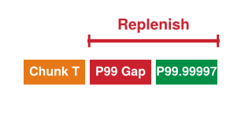
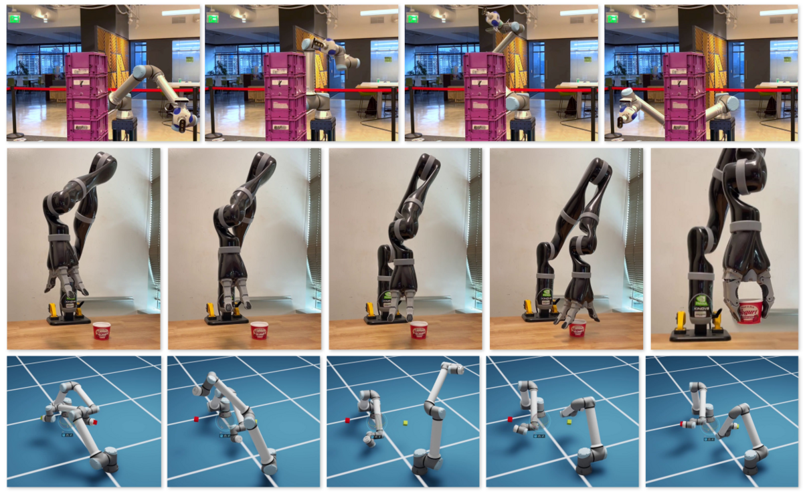
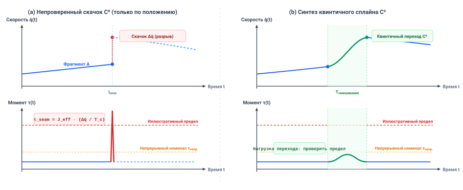
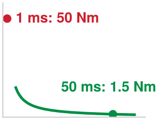
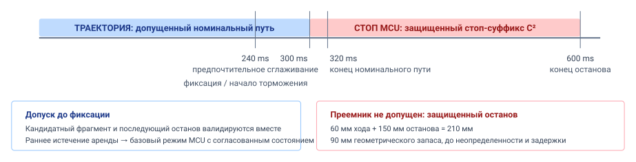

# Планирование траекторий

## Назначение

_Что делает физическая машина в незапланированные миллисекунды, когда очередной нейронный фрагмент траектории опаздывает?_

Движущаяся физическая машина несет непрерывный импульс, пока высокомощные нейронные политики вычисляют предстоящие фрагменты траекторий. Если исполняемая последовательность действий завершается до прихода ее преемника, накат вслепую расходует запас хода, необходимый для безопасной остановки. И наоборот, резкое вставление неограниченного предложения в текущую траекторию требует мгновенных ускорений шарниров, которые нарушают пределы момента актуаторов или вызывают разрушительный структурный резонанс в механической передаче.

Планирование траекторий разрешает это вычислительно-физическое несоответствие, превращая дискретные выводы модели в непрерывные, кинематически осуществимые профили движения. Каждый отправленный фрагмент траектории должен гарантировать $C^2$-непрерывность на стыках фрагментов и нести инвариантный, предварительно верифицированный стоп-суффикс. Это стоп-продолжение гарантирует, что уровень исполнения в реальном времени сможет безопасно остановить движение в текущих границах запаса хода, если нижележащие вычисления столкнутся с хвостовой задержкой или аппаратными отказами. В стеке физического ИИ планирование согласует асинхронный вывод Мозга с переменной задержкой с ритмом исполнения Нервной системы в жестком реальном времени.

> **Цели обучения**
>
> - Выбирать горизонты траектории по задержке замены, возрасту свидетельств о цели и времени, необходимому для остановки
> - Оценивать осуществимость траектории и непрерывность на стыке относительно пределов актуаторов и передачи тела
> - Отличать отказы траектории, обнаруживаемые до исполнения, от тех, что требуют контроля во время физического движения
> - Вычислять путь, который добавляет согласованный стоп-суффикс к бюджету остановки машины, и сравнивать его со свободным расстоянием
> - Задавать предельный срок обязательства и согласованную остановку, которыми управляют запаздывающая или никогда не приходящая замена траектории
> - Строить протокол траектории, который путь разрешения может допустить по содержимому, — по его родительской аренде, предельным срокам и стопу

## Непрерывные траектории

Рука складского мобильного манипулятора, тянущаяся к кружке на движущемся конвейере, обладает физической массой, структурной инерцией $\mathbf{M}(\mathbf{q})$ и непрерывной кинетической энергией $E_k = \frac{1}{2} \dot{\mathbf{q}}^T \mathbf{M}(\mathbf{q}) \dot{\mathbf{q}}$. Она не может мгновенно изменить скорость или направление. Даже когда вышестоящая автономия выдает аренду намерения с ограниченным временем, санкционируя движение к обоснованной семантической цели, само по себе это семантическое разрешение не может повернуть валы двигателей. Машина должна синтезировать непрерывное номинальное движение, пока действительны свидетельства о цели, плюс отдельно санкционированное стоп-продолжение на случай окончания полномочий слежения. На этой машине контур слежения шарниров руки оценивает обратную связь и задания с частотой `1 kHz` (по документации; см. руководство для читателя); этот период не определяет физический отклик остановки. Над этим контуром находится Мозг, где современные политики роботизированного обучения, такие как Action Chunking with Transformers (ACT) [Zhao et al., 2023](references.md#zhao2023learning) или основанные на оценках Diffusion Policies [Chi et al., 2024](references.md#chi2024diffusionpolicy), обрабатывают мультимодальные наблюдения и синтезируют будущие эталонные траектории на прикладном процессоре.[^fn-plan-action-chunking] Задержка вывода меняется от загрузки и конкуренции за ресурсы. Для политики фрагментов машины иллюстративно заложен бюджет `40 ms` на один проход по P99, включая зрение, однако помехи от памяти или планировщика могут растянуть один проход свыше `150 ms`, поэтому горизонт выбирается по хвосту развертывания, а не по бюджету.

> ↰ **Предпосылка:** Кинетическая энергия ($E_k$) и пределы моментов шарниров установлены в разделе [«Кинетический импульс»](02_body.md#sec-body-kinetic-momentum).

Если архитектура предсказывает действия на один шаг вперед ($N = 1$), контур слежения двигателя голодает. Если она генерирует многошаговый фрагмент действий из $N > 1$ заданий на конечном будущем горизонте, машина должна пересечь **стык исполнения** — стыковку, где задания одного фрагмента сменяются заданиями следующего. Когда активный фрагмент траектории завершает исполнение до того, как его замена пройдет хвост распределения задержки вывода, регулятор сталкивается с разрывом исполнения. Если регулятор удерживает конечное положение, эталонная скорость ступенчато падает до нуля и требует от привода снять импульс руки за один такт сервосистемы. Если вновь прибывший фрагмент начинается со скоростью или ускорением, расходящимися с физическим состоянием движущегося механизма, задаваемый момент меняется ступенькой и возбуждает конструкцию.

[^fn-plan-action-chunking]: **Представления фрагментирования действий**: фрагменты ACT и Diffusion Policy не несут ограничений на граничные производные, поэтому планировщик обязан предложить переходный мост через каждый стык перепланирования, а путь разрешения проверяет его до допуска.

> **Кинодинамическая огибающая осуществимости**
>
> ***Кинодинамическая огибающая осуществимости*** — это подмножество пространства состояний, из которого физическая машина может отслеживать кандидатную траекторию при строгом соблюдении одновременно пределов момента актуаторов, потолков скорости и границ рывка, с непрерывными положением, скоростью и ускорением на стыках сегментов, не превышая механических запасов остановки.
>
> 1.  **Значимость**: геометрическая свобода от столкновений необходима, но недостаточна для физического исполнения; рука может следовать свободной от столкновений траектории, которая тем не менее требует моментов двигателей, превышающих непрерывные тепловые номиналы, или создает ускорения, опрокидывающие недоактуированное основание. Огибающая фиксирует условия, при которых модель предсказывает отслеживаемое движение; время выполнения, датчики и проверки актуаторов все равно должны их подтвердить.
> 2.  **Отличие**: в отличие от чисто кинематической достижимости (которая оценивает, могут ли звенья робота достичь пространственной конфигурации), кинодинамическая осуществимость включает временную параметризацию, пределы сил и моментов актуаторов, приведенную инерцию и механические тормозные дистанции.
> 3.  **Типичная ловушка**: проверка осуществимости только в дискретных маршрутных точках. Интерполяционные сплайны между точками выборки могут давать внутриинтервальные превышения скорости и всплески момента, нарушающие пределы двигателя, даже когда каждая отдельная точка проходит проверку.

Намерение определяет допустимую цель; планирование поставляет непрерывное движение, временную параметризацию и динамические пределы, необходимые для достижения этой цели. По ту сторону границы предложения ([«Машина в пяти уровнях»](01_causal_boundary.md#sec-boundary-machine-model)) план не является командой, записываемой в регистры актуаторов. Это непривилегированное предложение, отправляемое с прикладного процессора микроконтроллеру безопасности (MCU), где регулятор слежения его исполняет, а путь разрешения ([«Обеспечение безопасности»](12_enforcement.md#sec-enforcement)) проверяет.[^fn-plan-nervous-gatekeeper] Поскольку задержка вывода имеет длинный хвост, нижележащий регулятор в этой конструкции потребляет допущенные эталоны по собственным часам и не может приостановить физическое движение, пока модель не закончит. Поэтому план должен быть самодостаточным. Он несет собственное состояние стыка, непрерывное вплоть до ускорения ($C^2$),[^fn-plan-c2-spline] собственные предельные сроки и собственную остановку — стоп-суффикс, допускаемый вместе с номинальным движением, так что стоп-продолжение существует до того, как оно понадобится.

> ↰ **Предпосылка:** Истекающие аренды намерения задают ограниченные временные окна, разряжаемые траекториями, в разделе [«Аренда намерения»](10_intent.md#sec-intent-lease).

[^fn-plan-nervous-gatekeeper]: **Детерминированная проверка предложений**: путь разрешения изолирует непривилегированные предложения траекторий в аппаратно управляемых промежуточных буферах и допускает предложение только после проверки там же ([«Поведение на стыке»](11_planning.md#sec-planning-behavior-seam)), так что ни одно непроверенное задание не доходит до регистров управления двигателем. Об архитектурах фильтра безопасности времени выполнения см. [«Детерминированный привратник»](12_enforcement.md#sec-enforcement-deterministic-gatekeeper).

[^fn-plan-c2-spline]: **Непрерывность производных $C^2$**: непрерывность $C^2$ означает, что положение, скорость и ускорение остаются непрерывными функциями времени на границах траекторий. В двигателях с постоянными магнитами (PMSM) электромагнитный момент напрямую связан с квадратурной составляющей тока статора ($\tau = K_t I_q$). Ступенька ускорения в этой модели требует конечной ступеньки момента и тока, тогда как ступенька скорости означает идеальный импульс ускорения.

Импульс, длинный хвост вывода и стык, который должен оставаться непрерывным, вместе определяют, что должен содержать план. Первое решение поэтому заключается в том, что планировщик передает регулятору слежения и пути разрешения, пока рука еще движется.

## Что передает планирование

Для двухшарнирной руки пара углов шарниров $(q_1,q_2)$ есть точка **пространства конфигураций** $\mathcal{C}$. Препятствие исключает некоторые пары углов, оставляя $\mathcal{C}_{\mathrm{free}}=\mathcal{C}\setminus\mathcal{C}_{\mathrm{obs}}$. Кривая в этом свободном множестве указывает, куда рука может двигаться, но не то, как быстро она может двигаться и могут ли ее двигатели создать требуемый момент [Lozano-P{\'e}rez, 1983](references.md#lozanoperez1983spatial). **Траектория** назначает кривой время и выдает $\mathbf{x}(t)=[\mathbf{q}(t)^T,\dot{\mathbf{q}}(t)^T,\ddot{\mathbf{q}}(t)^T]^T$. Планировщик предлагает этот индексируемый по времени эталон, а путь разрешения проверяет его до того, как какое-либо задание дойдет до привода. Одна лишь геометрическая траектория не дает ни времязадания, ни запаса хода для резервирования.

Планировщик передает **протокол траектории** — неизменяемое предложение, которому следует регулятор слежения и которое допускает путь разрешения. Он именует свою систему координат $\mathcal{F}$, время свидетельств $t_0$, начальное эталонное состояние и четыре предельных срока в **домене монотонных часов MCU**: номинальное слежение начинается в $t_{\mathrm{start}}$, номинальные задания заканчиваются в $t_{\mathrm{plan\_exp}}$, замена закрывается в $t_{\mathrm{commit}}$, а допущенная остановка завершается в $t_{\mathrm{stop\_end}}$. Он также связан с истечением активного намерения $t_{\mathrm{intent\_exp}}$. Пересчет с датчиков и часов хоста несет ограниченную ошибку. Планировщик планирует каждую замену относительно более ранней цели — предельного срока стыковки $t_{\mathrm{blend}}$, к которому преемник должен быть допущен и в котором свободное расстояние руки до препятствий проверяется в последний раз; это цель расписания, а не поле протокола.

Путь разрешения разрешает номинальный **TRACK** только пока действительны намерение и план, поэтому истечение намерения немедленно завершает TRACK, что бы ни позволяли собственные предельные сроки протокола. Вторые часы также ограничивают TRACK. Политика фрагментов предлагает скорость основания и целевые значения шарниров руки вместе, поэтому одна аренда фрагмента ([«Многотактные ритмы»](04_nervous_system.md#sec-nervous-cadences)) управляет обоими телами, и только допущенный фрагмент ее обновляет, каждые `50 ms` на этой машине. Когда аренда истекает через `60 ms` после последнего допуска, каждое тело входит в собственную остановку: основание — в резидентный стоп, а рука — в резервирование, согласованное с состоянием, отдельно верифицированную остановку, которая заново решает $C^2$-профиль своего согласованного стоп-суффикса от измеренного состояния. Руке нужно отдельное резервирование, потому что ее согласованный стоп-суффикс привязан к положению, которое рука займет в $t_{\mathrm{commit}}$. Истечение намерения или отказ, делающий путь недействительным до $t_{\mathrm{commit}}$, отправляет руку в то же резервирование.

После истечения остановка руки начинается на один такт разрешения, один цикл шины и одно срабатывание тормоза позже; вместе с самой арендой эти задержки составляют задержку от обновления до срабатывания из раздела [«Многотактные ритмы»](04_nervous_system.md#sec-nervous-cadences). Обязательство ограничивает аренду сверху, поскольку начало остановки должно наступить к $t_{\mathrm{commit}}$, так что ни одна аренда не может длиться дольше, чем $t_{\mathrm{commit}}$ минус эти три задержки. Только аренда, идущая вблизи этого потолка, позволяет протоколу дойти до $t_{\mathrm{commit}}$ без преемника; такой протокол переходит в **STOP** по своему согласованному стоп-суффиксу, который может завершиться и после истечения разрешения на слежение по намерению. На этой машине аренда `60 ms` истекает задолго до обязательства, поэтому остановившийся инициатор встречается с задержкой от обновления до срабатывания, а не с потолком, и раздел [«Поведение на стыке»](11_planning.md#sec-planning-behavior-seam) относит эту задержку на запас хода руки.

Два потребителя читают разные части протокола. Трекер интерполирует допущенный эталон, метки времени и слагаемые опережающего управления, чтобы вести актуаторы по гладкой траектории. Независимый путь разрешения читает происхождение, времязадание, динамические допущения, границы действительности и стоп-суффикс, и он контролирует текущие пределы и полномочия, не наследуя утверждение планировщика об осуществимости как доказательство; новое препятствие, изменившаяся полезная нагрузка или контактное событие могут отозвать TRACK и вызвать резервирование, согласованное с состоянием. Поскольку каждому полю передачи соответствует проверка времени выполнения, Нервная система может допускать быстрое движение, не предполагая успеха следующего цикла вывода. Создание такого протокола начинается с цели, которая не несет никакого времязадания.

## От цели к траектории

Аренда намерения для кружки, которую рука берет с конвейера для коллеги на упаковочном посту, выдает область целей и потолки усилий ([«Аренда намерения»](10_intent.md#sec-intent-lease)), но ни один актуатор не способен исполнить область. Регулятору слежения нужна траектория, которая назначает целевые состояния, слагаемые опережающего управления и метки времени на ограниченном интервале. Если бы обученная политика могла выдавать допустимые токи двигателей на частоте контура шарниров `1 kHz`, планирования как архитектурной ступени не существовало бы, и машина работала бы как высокочастотный регулятор с обратной связью. Вместо этого обученным политикам требуются десятки или сотни миллисекунд на вычисление последовательности движения, тогда как регулятор слежения и путь разрешения работают детерминированно с фиксированными периодами порядка миллисекунд.

Классические планировщики на основе сэмплирования отвечают на геометрическую половину этой задачи. Вероятностная дорожная карта [Kavraki et al., 1996](references.md#kavraki1996probabilistic) или быстро исследующее случайное дерево [LaValle, 1998](references.md#lavalle1998rapidly) ищут в $\mathcal{C}_{\text{free}}$ путь без столкновений, не строя явной модели препятствий. Путь из такого поиска, как и фрагмент от обученной политики, по-прежнему не несет ни времязадания, ни производных на концах, ни остановки — а именно это и поставляет настоящая глава.

Обученные инициаторы связывают медленный вывод и быстрое управление актуаторами посредством фрагментирования действий со скользящим горизонтом ([«Питание, свежесть и стена памяти»](03_brain.md#sec-brain-cognitive-pipeline)): предсказывают многошаговую последовательность, исполняют префикс и перепланируют по свежим наблюдениям. Три вида инициаторов выполняют эту роль, и каждый важен здесь своей задержкой и непрерывностью того, что он выдает. ACT [Zhao et al., 2023](references.md#zhao2023learning) предсказывает $N$ будущих заданий шарниров разом и сглаживает перекрывающиеся фрагменты временным ансамблированием из раздела [«Питание, свежесть и стена памяти»](03_brain.md#sec-brain-cognitive-pipeline), которое усредняет задания, но оставляет непрерывность производных на стыке фрагментов за настоящей главой. Diffusion Policy [Chi et al., 2024](references.md#chi2024diffusionpolicy) подавляет шум во фрагменте горизонта $T_p$ (16 шагов в реальной настройке Push-T), исполняет подмножество $T_a$ (шесть там) и перепланирует по следующему наблюдению; ее итеративное шумоподавление добавляет зависящую от загрузки задержку и дисперсию. Обученное начальное приближение для оптимизатора траекторий с ограничениями может сократить итерации решателя, когда оно попадает вблизи осуществимой области, но оно также может выбрать неверную сторону препятствия или не уложиться в предельный срок. Ни один из этих выходов не является сертификатом осуществимости, и допускается только кандидат, прошедший полные проверки траектории, стыка, момента и остановки.

Эта структура со скользящим горизонтом повторяет классическое **модельно-прогнозное управление (MPC)** и оптимизацию траекторий, где оптимизатор планирует траекторию на конечном горизонте $T$, исполняет начальный префикс и решает задачу заново из обновленного состояния в следующем цикле. Классический MPC формулирует синтез траектории как явную численную задачу оптимизации с ограничениями: минимизацию функции стоимости при аналитической динамике системы ($\dot{\mathbf{x}} = f(\mathbf{x}, \mathbf{u})$) и жестких неравенствах на физические границы ($\mathbf{x} \in \mathcal{X}_{\text{safe}}$) и моменты актуаторов ($\mathbf{u} \in \mathcal{U}_{\text{adm}}$). Там, где аналитические модели точно описывают физический объект управления, а размерности состояния остаются компактными, MPC дает строгие гарантии соблюдения ограничений и устойчивости замкнутого контура. Однако классическая оптимизация траекторий наталкивается на «Классическую стену» из раздела [«Классическая стена»](03_brain.md#sec-brain-classical-wall) при применении к неструктурированной манипуляции в открытом мире: численные решатели не могут непосредственно потреблять высокоразмерные семантические токены (такие как сырые пиксели камеры или инструкции на естественном языке), а негладкая механика контакта или деформируемые объекты порождают комбинаторные локальные минимумы, делающие численную оптимизацию в реальном времени неразрешимой внутри периодов управления. Генеративное фрагментирование действий решает проблему семантического приема, обучая непрерывные мультимодальные распределения траекторий прямо по визуальным демонстрациям, но жертвует аналитическими гарантиями. Поэтому архитектура физического ИИ рассматривает обученные политики фрагментирования как непривилегированных семантических инициаторов на многосекундных горизонтах задачи, полагаясь на проверки кинодинамической осуществимости и контракты стыков, развитые в этой главе, чтобы гарантировать физическую допустимость до исполнения команды. Исполнение этих проверок осуществимости и бесшовная замена активной траектории вносят вычислительные и транспортные задержки, которые должны быть строго ограничены на всех циклах замены.

Планируемая величина — это **задержка замены** $L$: прошедшее время от наблюдения, необходимого для нового предложения, через передачу, вывод, валидацию полной траектории и допуск. Иллюстративная ведомость этапов политики фрагментов машины содержит `15 ms` считывания датчиков, `5 ms` DMA, `40 ms` вывода политики, `2 ms` десериализации, `18 ms` валидации и `1 ms` активации — итого `81 ms`. Когда этапы перекрываются или делят конкуренцию за ресурсы, сумма перцентилей этапов не является перцентилем суммы ([«Свежесть измерений»](02_body.md#sec-body-measurement-freshness)), поэтому горизонт выбирается по сквозному распределению $L$.

$$L = t_{\mathrm{sense\_ingress}} + t_{\mathrm{ipc\_dma}} + t_{\mathrm{infer}} + t_{\mathrm{deser}} + t_{\mathrm{validate}} + t_{\mathrm{admit}}$$

Выбор горизонта предсказания фрагмента действий $H$ вносит фундаментальную системную дилемму между амортизацией вычислений и реактивной отзывчивостью ([«Дилемма горизонта фрагмента действий»](11_planning.md#fig-11-planning-action-chunk-horizon)). Высокомощные модели зрение–язык–действие (VLA) и диффузионные политики требуют существенной задержки вывода ($t_{\mathrm{infer}} \approx 180\ \text{ms}$ на встроенных ускорителях). Если планировщик оценивает действия по одному шагу ($H = 1$), коэффициент загрузки вычислений превышает 100 % ($t_{\mathrm{infer}} / \Delta t = 900\%$), лишая питания контур управления 50 Гц ($\Delta t = 20\ \text{ms}$) и заставляя робота делать паузы и дрожать между последовательными шагами. Расширение горизонта предсказания $H$ амортизирует вывод по многошаговым окнам исполнения, снижая коэффициент загрузки ускорителя ниже 50 %, начиная с $H \ge 18$. Однако исполнение длинного фрагмента в разомкнутом контуре раздувает среднюю задержку реакции на динамические препятствия, $\tau_{\mathrm{react}} \approx \frac{1}{2} H \Delta t + t_{\mathrm{infer}}$. При $H > 36$ ($>720\ \text{ms}$ физического окна) задержка реакции превышает порог обхода динамических препятствий ($\sim 350\ \text{ms}$), и доля успешных решений задачи в замкнутом контуре в динамических средах падает с 90 % до единичных процентов. Выбор горизонта фрагмента действий в парето-оптимальном окне $H^* \in [16, 24]$ достигает необходимого баланса: коэффициент загрузки вычислений остается удобно амортизированным на уровне 38–45 %, а задержка реакции держится ниже 400 мс, сохраняя высокие показатели успеха в замкнутом контуре как в статических, так и в динамических условиях эксплуатации.

***Дилемма горизонта фрагмента действий: амортизация вычислений против задержки реакции на динамику**: двухпанельная системная оценка по горизонту фрагмента действий $H$ при контуре управления 50 Гц ($\\Delta t = 20\\ \\text{ms}$) и задержке вывода модели 180 мс. Вверху: коэффициент загрузки вычислений GPU (красный) опускается ниже потолка осуществимости в реальном времени в 100 % лишь при $H \\ge 9$, тогда как средняя задержка реакции на непредвиденные препятствия (синий) растет линейно с длиной горизонта. Внизу: доля успешных манипуляций в замкнутом контуре на неподвижных объектах (зеленый) и движущихся препятствиях (оранжевый). Хотя статические задачи терпят длинные горизонты ($H > 30$), динамические взаимодействия в рабочей области рушатся из-за задержки разомкнутого контура, устанавливая эмпирическое парето-оптимальное рабочее окно $H^* \\in [16, 24]$ (окно исполнения $320\\text{--}480\\ \\text{ms}$).*

Сумма компонентов в уравнении [«задержка замены»](11_planning.md#eq-plan-replacement-latency) — это прошедший путь замены, а не абсолютная метка времени. Рассмотрим типовой перепланировщик, медленнее обновления фрагментов этой машины, который совершает `$K=3000$` передач за десятиминутное задание на частоте `5 Hz`. Если каждая передача независимо имеет вероятность $0.01$ превысить бюджет $P_{99}$, ожидаемое число запоздавших передач равно `30`, а вероятность того, что *все* придут вовремя, составляет `$(0.99)^{3000}\approx8 \times 10^{-14}$`. Коррелированная конкуренция группирует промахи, что нарушает независимость, предполагаемую этой арифметикой. Равномерное распределение целевого превышения на задание $\epsilon_{\mathrm{mission}}=10^{-3}$ дает по объединяющей оценке целевую величину на передачу `$\epsilon\le\epsilon_{\mathrm{mission}}/K\approx3.3 \times 10^{-7}$`. Соответствующий `$P_{99.99997}$` — это **проектная целевая квантиль**, распределение риска, а не наблюдаемая задержка. Развертывание либо подтверждает ее репрезентативными нагрузочными испытаниями и консервативной границей, либо принимает более высокую частоту резервирования.

*Хвостовая цель распределяет риск замены; наблюдаемая задержка и доверительная граница определяют, достоверен ли выбранный предельный срок.*

Следующий запрос уходит не позднее чем через $T_{\mathrm{request}}$ после начала активного фрагмента. Допуск должен завершиться **до** $t_{\mathrm{commit}}$, а не просто до последнего номинального задания. При целевой задержке замены $Q_{1-\epsilon}(L)$ и резерве $T_{\mathrm{reserve}}$ требуется $t_{\mathrm{commit}}-t_{\mathrm{start}}\ge T_{\mathrm{request}}+Q_{1-\epsilon}(L)+T_{\mathrm{reserve}}$. Допущенной остановке затем требуется еще $T_{\mathrm{stop}}$ под полномочиями MCU. Полный **временной горизонт** $T_{\mathrm{record}}$, который должен покрывать протокол независимо от кодирования, имеет нижнюю границу:

$$T_{\mathrm{record}}\ge T_{\mathrm{request}}+Q_{1-\epsilon}(L)+T_{\mathrm{reserve}}+T_{\mathrm{stop}}$$

Полная длительность в уравнении [«горизонт фрагмента действий»](11_planning.md#eq-plan-action-chunk-horizon) включает стоп-суффикс. Политика фрагментов машины выдает задание каждые `20 ms` (период задания $\Delta t_{\text{step}}$), по `16` на фрагмент, так что один фрагмент несет `320 ms` номинального движения. Для руки, отслеживающей конвейер, выбранные задержка запроса `60 ms`, целевая задержка замены `160 ms` и резерв `20 ms` при отдельно проверенной остановке `300 ms` требуют по меньшей мере `540 ms` полных полномочий движения, или `27` **эквивалентов длительности** периода задания. Это не означает `27` сохраненных заданий: $N$ в протоколе считает только номинальные отсчеты; остановка представляется своими отдельно верифицированными полиномиальными коэффициентами. Горизонт полномочий, покрывающий лишь задержку запроса, целевую задержку замены и резерв, опустил бы запас хода для остановки.

Политика фрагментов отправляет следующий запрос в слоте обновления через `50 ms` после начала каждого фрагмента ([«Питание, свежесть и стена памяти»](03_brain.md#sec-brain-cognitive-pipeline)), поэтому в установившемся режиме несколько запросов находятся в полете одновременно, допущенный фрагмент приходит каждые `50 ms`, и их задержки перекрываются. Граница устанавливает $T_{\mathrm{request}}$ на `10 ms` выше этого слота, поэтому она сохраняет силу и для запроса, уходящего с опозданием до этой величины.

Целевая задержка замены — это квантиль проектного хвоста всего пути замены, поэтому она лежит далеко за пределами как `40 ms` прохода политики по P99, так и ведомости этапов в `81 ms`. Предельный срок стыковки должен наступать не ранее чем через `240 ms` после начала — сумму задержки запроса, целевой задержки замены и резерва, — а разобранный в примере предельный срок обязательства `300 ms` из раздела [«Поведение на стыке»](11_planning.md#sec-planning-behavior-seam) оставляет `60 ms` сверх этой цели. В разобранном примере руки номинальные задания фрагмента заканчиваются на `320 ms`, а допущенная остановка завершается на `600 ms`, так что полное окно полномочий охватывает `30` эквивалентов длительности периода задания.

Окно замены `240 ms` — это предел руки, а не ее рабочий случай. Общая аренда из раздела [«Что передает планирование»](11_planning.md#sec-planning-handoff) истекает, как только допуск отстает от своего слота более чем на `10 ms`, поэтому замена, отнимающая весь проектный хвост, заканчивается резервированием руки, согласованным с состоянием, задолго до предельного срока стыковки, а это окно вместо этого задает, как долго может длиться любая аренда на этой руке.

Эта временная нижняя граница конкурирует с возрастом свидетельств о цели. Даже при квалифицированном локальном трекере, где лишь остаточное проскальзывание конвейера уводит кружку от предсказания трекера, раздел [«Цели с истекающим сроком»](10_intent.md#sec-intent-goals-expire) показывает, что одно наблюдение остается в допуске захвата меньшее время, чем `300 ms` обязательства. Одно наблюдение поэтому не может обосновать номинальное слежение до обязательства. Трекер обязан доставить свежие свидетельства до окончания своего горизонта; иначе TRACK завершается по истечении свидетельств, а MCU использует резервирование, согласованное с состоянием. Продление метки времени цели из-за длинного вычислительного хвоста перевернуло бы правило разрешения.

Каким бы ни был инициатор, системный интерфейс рассматривает обученную модель как стохастического производителя фрагментов движения, характеризуемого эмпирическим профилем задержки и выходным горизонтом $N$; диффузионные расписания, кэширование внимания и генерация токенов формируют этот профиль, но лежат ниже первой бюджетируемой величины. Буфер исполнения поглощает задержку вывода, пока регулятор продолжает реагировать на возмущения — как показывают восстановления Push-T на рисунке [«Восстановление после возмущения Push-T»](11_planning.md#fig-11-action-chunking-trace). Выбор $N$ по верифицированному распределению задержки снижает риск запоздалой замены; защищенный стоп обрабатывает промах.

***Восстановление после возмущения Push-T**: Chi et al. приводят реальную конфигурацию Push-T с 16 предсказанными и 6 исполняемыми шагами действий; команды 10 Гц интерполировались до 125 Гц. Восстановления показывают перепланирование в замкнутом контуре; эксперимент не включает ни стоп-суффикса, ни случая голодания вывода [Chi et al., 2024](references.md#chi2024diffusionpolicy).*

Перепланировщик замены обязан учитывать движение во время собственных вычислений. При иллюстративной задержке `80 ms` и постоянной скорости шарнира `0.50 rad/s` устаревшая поза эпохи запроса отстает от движущегося эталона на `0.040 rad` (`2.29`°). Предлагаемая замена может вместо этого начинаться с проекции эталона активного плана в предполагаемом стыке:

$$\Delta q_{\mathrm{reference}}=\int_{t_0}^{t_{\mathrm{seam}}}\dot q_A(t)\,dt,\qquad \hat{\mathbf{x}}_{\mathrm{seam}}=\mathbf{x}_A(t_{\mathrm{seam}})$$

Проецируемый стык из уравнения [«разрыв задержки исполнения»](11_planning.md#eq-plan-execution-delay-gap) полезен для построения кандидата; контакт, ошибка слежения или изменения планирования могут сделать объект управления иным. Поэтому MCU измеряет текущее состояние энкодера, валидирует фактический стык $(q,\dot q,\ddot q)$ и любой мост и отказывает кандидату вне допустимой области. Согласование двух *эталонных* траекторий делает $C^2$-непрерывными эталоны, а не объект управления.

> **Обусловленность будущим состоянием**
>
> ***Обусловленность будущим состоянием*** — это практика генерации кандидатных планов движения, привязанных к ожидаемому состоянию на момент исполнения, а не к устаревшему состоянию, измеренному в момент начала планирования.
>
> 1.  **Значимость**: компенсирует вычислительную задержку $\Delta t_{\text{plan}}$, убирая скачок эталона при передаче траектории, который создало бы планирование от устаревшего состояния, без остановок с нулевой скоростью между фрагментами.
> 2.  **Отличие**: отлично от оценки состояния или фильтрации; это стратегия планирования эталона, проецирующая допущенную траекторию вперед, а не фильтрующая шум датчиков.
> 3.  **Типичная ловушка**: рассматривать предсказанное состояние исполнения как измеренное; если возмущение смещает объект управления во время планирования, кандидат остается недопустимым, пока MCU не проверит стык по состоянию энкодера.

Теперь горизонт подчинен двум парам часов. Он должен быть достаточно длинным, чтобы замена по проектному хвосту успела прибыть до обязательства, а позади нее оставалась остановка, и это же окно ограничивает аренду сверху. Свидетельства о цели, тем временем, должны оставаться свежими все время, пока идет TRACK. Однако замена, прибывшая вовремя, обеспечивает лишь временную непрерывность плана. Несомые ею задания также должны лежать в пределах того, что шарниры способны выдать, и стыковаться с фактической скоростью и ускорением механизма на стыке.

> **Горизонт фрагмента действий и бюджет хвостовой задержки**
>
> Прежде чем перейти от времязадания замены к осуществимости самого движения, проверьте свою способность выбрать горизонт фрагмента действий по хвосту задержки:
>
> - [ ] **Наработка задания и хвостовые квантили**: в приведенной иллюстрации независимых передач какова вероятность одного или нескольких пропусков предельных сроков $P_{99}$ за `3000` передач и почему это не измеренная частота отказов задания?
> - [ ] **Компромисс выбора горизонта**: можете ли вы отличить риск голодания буфера траектории от слишком короткого фрагмента действий от риска немоделируемого дрейфа состояния и устаревшего восприятия от чрезмерно длинного фрагмента?
> - [ ] **Проецируемое состояние стыка**: можете ли вы объяснить, почему кандидат, построенный от проекции эталона активного плана, все равно требует проверки по состоянию энкодера и моста при допуске?

## Кинодинамическая осуществимость

Кандидатная траектория — это геометрическое и времязаданное предложение, а не разрешение на движение. Прежде чем представить ее, планировщик проводит предварительный отбор, проверяя, лежит ли верифицированное начальное состояние внутри кинодинамической огибающей осуществимости кандидата: оцениваются положение и скорость шарниров, предсказанные момент и ток актуаторов, пределы контакта, свободное расстояние до препятствий и согласованный стоп-суффикс на предлагаемом горизонте. Для руки модель твердого тела отображает $\mathbf{q}(t)$, $\dot{\mathbf{q}}(t)$ и $\ddot{\mathbf{q}}(t)$ в $\boldsymbol{\tau}(t)=\mathbf{M}(\mathbf{q})\ddot{\mathbf{q}}+\mathbf{C}(\mathbf{q},\dot{\mathbf{q}})\dot{\mathbf{q}}+\mathbf{g}(\mathbf{q})$ и $I_i(t)=\tau_i(t)/k_{\tau,i}$ [Craig, 2005](references.md#craig2005introduction); [Lynch and Park, 2017](references.md#lynch2017modern). Отбор планировщика — не допуск; MCU повторяет решающую проверку и допускает ограниченную траекторию только если ее настроенные пределы и полный запас остановки выдерживаются для верифицированного начального состояния; далее во время исполнения он проверяет слежение, свежесть и оставшийся бюджет остановки. Оптимизатор может сгладить путь или уменьшить близость к препятствиям, но разрешение на движение определяют допущенная траектория и резидентный стоп, а не целевое значение оптимизатора ([«Оптимизация траектории в реальном времени»](11_planning.md#fig-11-manipulator-trajectory)).

> ↰ **Предпосылка:** Пределы насыщения по моменту актуаторов и масштабирование инерции ротора ($N^2 J$) выведены в разделе [«Пределы передачи актуатора»](02_body.md#sec-body-actuator-limits).

***Оптимизация траектории в реальном времени**: ускоренное GPU генерирование движения, исполняющее на аппаратуре сплайны с минимальным рывком, обходящее динамическое препятствие по полю знаковых расстояний, исполняющее ограниченный захват с подъемом и координирующее две руки в общей рабочей области. Расстояние до столкновения оценивается в непрерывном времени, а не в маршрутных точках, что и позволяет переоптимизировать траекторию в процессе ее исполнения. Адаптировано из [Sundaralingam et al., 2023](references.md#sundaralingam2023curobo).*

Осуществимость, проверенная только в маршрутных точках, — не осуществимость движения. Механизм следует интерполированной траектории между отсчетами с шагом $T_s$, поэтому одна лишь проверка в $t_k = k T_s$ допускает превышение производными своих границ внутри $[t_k, t_{k+1}]$. Если интерполятор может приложить до $a_{\max}$ внутри отсчета, худший случай треугольного разворота ускорения через середину выборочного интервала позволяет скорости превысить отсчитанные значения на величину до $\Delta v \le \frac{1}{4} a_{\max} T_s$, так что два отсчета чуть ниже $v_{\max}$ могут охватить пик выше него и вызвать срабатывание ограничения по превышению скорости между двумя допустимыми маршрутными точками. Чтобы ограничить скорость в непрерывном времени без оценки каждой точки, фильтр допуска проверяет сжатый предел $|\dot{q}_k| \le v_{\max} - \frac{1}{4} a_{\max} T_s$, поглощающий наибольшее внутриотсчетное превышение.

Сцепление по отдельности осуществимых фрагментов может создать неосуществимый стык. Согласование только положения ($C^0$) может оставить ступеньку скорости; согласование скорости ($C^1$) — конечную ступеньку ускорения и момента. В приближении жесткой инерции заданное изменение скорости $\Delta\dot q$, растянутое на сервопериод $T_c$, требует момента по уравнению [«момент на стыке»](11_planning.md#eq-plan-seam-torque), где $J_{\mathrm{eff}}=J_L+N_g^2J_{\text{rotor}}$ — инерция выходной стороны: инерция нагрузки плюс приведенная через передаточное отношение $N_g$ инерция ротора. Физический привод насыщает или фильтрует этот запрос в соответствии со своими пределами по току и податливостью. Рисунок [«Требования стыка и проверенный мост»](11_planning.md#fig-11-action-chunk-seam-continuity) помещает этот запрос рядом с его средством — конечным $C^2$-мостом, устраняющим ступеньку эталонной скорости.

$$\tau_{\mathrm{request}}=J_{\mathrm{eff}}\frac{\Delta\dot q}{T_c}$$

***Требования стыка и проверенный мост**: согласованная по положению ступенька скорости создает большой одно-тактовый *запрос* инерционного момента. Конечный $C^2$-мост устраняет ступеньку эталонной скорости, но его внутренние рывок, момент и отклик шарнира все равно требуют валидации.*

> **C² стык сплайна**
>
> ***$C^2$ стык сплайна*** — это стыковка траектории, обеспечивающая непрерывность вплоть до второй производной по времени (положение, скорость и ускорение) между примыкающими сегментами движения.
>
> 1.  **Значимость**: предотвращает мгновенные ступеньки ускорения между фрагментами траектории, ограничивая всплеск инерционного момента $\tau_{\text{step}} = J_{\text{eff}} \Delta\ddot{q}$, требуемый от актуаторов.
> 2.  **Отличие**: отлично от непрерывности $C^1$ (которая согласует лишь скорость и допускает конечные скачки ускорения) и непрерывности $C^0$ (которая согласует лишь положение и допускает бесконечные импульсы ускорения).
> 3.  **Типичная ловушка**: предположение, что непрерывность $C^2$ гарантирует осуществимость по моменту; хотя ускорение и непрерывно, внутренние скорости, ускорения или рывки внутри моста сглаживания все еще могут нарушать физические пределы актуаторов или запаса хода.

Передача формирует отклик на то, что выдает привод. Для двухинерционной модели с инерцией нагрузки $J_L$, приведенной инерцией двигателя $J_{\text{ref}}=N_g^2J_{\text{rotor}}$ и жесткостью связи $k_\theta$ частоты антирезонанса и резонанса [для этой модели](https://link.springer.com/article/10.1186/s10033-024-01041-5) равны $\frac{1}{2\pi}\sqrt{k_\theta/J_L}$ и $\frac{1}{2\pi}\sqrt{k_\theta(1/J_L+1/J_{\text{ref}})}$. В шарнирах руки с волновой передачей приведенная инерция ротора и податливая передача могут усиливать резкое изменение эталона, поэтому допуску нужны идентифицированные, зависящие от нагрузки моды шарнира, и он проверяет экстремумы моста, момент и пределы привода по ним. Ни одна частота, жесткость или диапазон рывка не переносится между изделиями без измеренных параметров.[^fn-rule-servo-bandwidth]

Сглаживание ступеньки скорости на стыке требует онлайн-смешения сплайнов траектории $C^2$, которое следует рассматривать как синтез совершенно нового плана движения, а не как косметическую фильтрацию. Когда планировщик вставляет полиномиальный мост $\theta_{\mathrm{blend}}(t)$ на переходном интервале $T_{\mathrm{blend}}$ — длительности, отличной от предельного срока стыковки $t_{\mathrm{blend}}$, — чтобы соединить фрагмент $A$ и входящий фрагмент $B$, результирующий сегмент моста должен пройти ровно те же проверки динамической осуществимости, что и основные фрагменты.[^fn-hw-jerk-limits]

[^fn-hw-jerk-limits]: **Рывок траектории**: целевая функция по рывку может сделать конкретный мост гладче. Одного лишь конечного предела рывка недостаточно, чтобы исключить энергию вблизи измеренного резонанса; полный спектр команды и отклик замкнутого контура должны быть проверены для данного шарнира и нагрузки.

[^fn-rule-servo-bandwidth]: **Выборка и механические моды**: период управления, более быстрый, чем механическая мода, может помочь разрешить эту моду, но не является доказательством устойчивости. Запас по фазе регулятора, задержка датчика, демпфирование, фильтрация и полоса пропускания актуатора должны быть валидированы для идентифицированного шарнира.

Мост является полиномом пятого порядка (квинтическим), поскольку момент следует за ускорением ($\tau = J_{\mathrm{eff}}\ddot\theta$ в модели жесткой инерции), поэтому мост, согласующий лишь скорость, все равно оставляет ступеньку ускорения, а с ней и ступеньку момента $J_{\mathrm{eff}}\Delta\ddot\theta$. Для непрерывности $C^2$ через стык мост должен согласовать положение, скорость и ускорение на обоих концах — всего шесть граничных условий:
$$\theta(0) = \theta_0, \quad \dot{\theta}(0) = \dot{\theta}_0, \quad \ddot{\theta}(0) = \ddot{\theta}_0$$
$$\theta(T_{\mathrm{blend}}) = \theta_1, \quad \dot{\theta}(T_{\mathrm{blend}}) = \dot{\theta}_1, \quad \ddot{\theta}(T_{\mathrm{blend}}) = \ddot{\theta}_1$$
где $(\theta_0, \dot{\theta}_0, \ddot{\theta}_0)$ — конечное физическое состояние фрагмента $A$ в момент стыка, а $(\theta_1, \dot{\theta}_1, \ddot{\theta}_1)$ — целевое состояние на входящем фрагменте $B$ в $t = T_{\mathrm{blend}}$. Согласование шести граничных условий требует шести независимых коэффициентов ($a_0 \dots a_5$), однозначно задающих полином пятой степени:
$$\theta(t) = a_0 + a_1 t + a_2 t^2 + a_3 t^3 + a_4 t^4 + a_5 t^5$$
Шесть коэффициентов следуют в замкнутой форме из этих граничных условий ([«Гладкие траектории и безударная передача»](appendix_control.md#sec-appendix-control-splines)), а рывок моста меняется квадратично во времени и конечен на конечном сглаживании. Допуск должен проверять его экстремумы и измеренный отклик шарнира; одних лишь концов $C^2$ недостаточно для подавления всей резонансной энергии.

Полином фиксированной степени может быть вычислен на выбранном регуляторе с ограниченным объемом работы на ось. Синтез коэффициентов и проверки экстремумов всей траектории происходят при допуске; измеренное худшее время выполнения, включая обращения к памяти и контроль, должно укладываться в настроенный сервопериод.

От представления зависит то, что можно доказать при допуске. Таблица [«Представления траекторий и обязательные проверки»](11_planning.md#tbl-11-trajectory-representations) разделяет непрерывность, которую дает представление, и динамические проверки, которые все еще требуются. B-сплайн степени $p$ имеет непрерывность $C^{p-r}$ во внутреннем узле кратности $r$; его выпуклая оболочка управляющих точек ограничивает положение, но не автоматически скорость, момент или запас хода. Минимизация интегрального функционала рывка требует решения этой задачи оптимизации; сам выбор B-сплайна ее не решает.

| Представление          | Собственное свойство стыка                                                    | Проверки до исполнения                                          |
|:-----------------------|:-------------------------------------------------------------------------------|:----------------------------------------------------------------|
| Квинтический мост       | Может согласовать $q,\dot q,\ddot q$ на обоих концах; рывок вообще говоря квадратичен. | Проверить внутренние экстремумы, момент, запас хода и допуск по времени. |
| B-сплайн               | Непрерывность зависит от степени и кратности узла.                             | Проверить производные, динамику, запас хода и результат оптимизатора.   |
| Фрагмент действий ACT   | Дискретные задания; удержание нулевого порядка дает скачки на тактах, линейная интерполяция есть $C^0$. | Построить и допустить осуществимый мост и стоп.                 |
| Фрагмент действий Diffusion | Дискретные отсчитанные действия; нет собственных полномочий актуатора.       | Валидировать времязадание, состояние, мост, пределы и стоп.               |

***Представления траекторий и обязательные проверки**: Гладкая параметризация помогает сформировать кандидата, но сама по себе не доказывает динамическую осуществимость.*

> **Ускорение на стыке и запросы момента**
>
> Для учебного примера с зарегистрированной моделью CSG-25-50-2UH приведенная инерция ротора составляет `0.25 kg·m²`. Коррекция разрыва эталонной скорости `0.2 rad/s` за один такт `1 ms` требует `50 N·m` инерционного момента. [Спецификация производителя](https://www.harmonicdrive.net/products/gear-units/gear-units/csg-2uh/csg-25-50-2uh) дает номинальный L10 `51 N·m` и повторяемый пик `127 N·m`; этот одно-тактовый **запрос** ниже номинального значения. Симметричное $C^2$-сглаживание скорости за `50 ms` дает средний инерционный момент `1 N·m` и пиковый `1.5 N·m` — снижение пикового запроса в `33.3×`. Суммарный момент все равно включает нагрузку, гравитацию, трение и отклик управления; требуется полная проверка пика и теплового режима.

*В этой модели инерции $C^2$-сглаживание снижает пиковый запрос инерционного момента в 33,3 раза.*

Дрожание выхода в обученных предложениях — родственный отказ. Стохастическое сэмплирование может порождать последовательные фрагменты, каждый отсчет которых удовлетворяет пределам положения и скорости, тогда как задаваемое ускорение быстро меняет знак, и каждый разворот требует от привода разворота момента — с последующими переходами тока и нагревом $I^2R$, если привод его отслеживает ([«Пределы передачи актуатора»](02_body.md#sec-body-actuator-limits)).[^fn-hw-thermal-derating] Системный инженер закладывает эту вариацию как тепловой подъем актуатора и усталость передачи, а не как воспринимаемую шероховатость; траектория, возбуждающая структурные резонансы или превышающая тепловые пределы привода, неосуществима, как бы близко ее маршрутные точки ни следовали задаче. Даже кандидат, прошедший все внутренние проверки и проверки стыка, все равно должен предусматривать замену, которая никогда не придет.

[^fn-hw-thermal-derating]: **Термическое снижение номинала актуатора**: нагрев Джоуля ($I^2R$) в обмотках поднимает температуру статора, а сверх предела ухудшает поток магнита и изоляцию, поэтому контроллеры двигателей принудительно обеспечивают кривые снижения номинала, ограничивающие непрерывный момент. Профиль скорости, игнорирующий этот регулятор, упирается в ограничение по току посреди траектории и теряет слежение.

## Поведение на стыке

Предположим, политика фрагментов зависает, пока рука тянется к кружке. На этой машине общая аренда заканчивает ожидание через `60 ms` после последнего допуска, и рука входит в резервирование, согласованное с состоянием, по пути от обновления до срабатывания из раздела [«Что передает планирование»](11_planning.md#sec-planning-handoff). Собственные предельные сроки протокола определяют, как долго можно позволять длиться любой аренде, потому что до начала остановки рука продолжает движение, и каждая миллисекунда ожидания MCU — это пробег, который ее остановка больше не сможет использовать. Допустим поэтому, что аренда дойдет до своего потолка, и предельный срок стыковки $t_{\mathrm{blend}}$ минует без допущенной замены. Четыре предельных срока из раздела [«Что передает планирование»](11_planning.md#sec-planning-handoff), сопоставленные в монотонных часах MCU с $t_{\mathrm{intent\_exp}}$, теперь определяют, что произойдет. Замена может быть допущена вплоть до $t_{\mathrm{commit}}$ — входа в согласованный стоп-суффикс, длительность которого равна $T_{\mathrm{stop}}=t_{\mathrm{stop\_end}}-t_{\mathrm{commit}}$. Она должна пройти полную проверку допуска до этого отсечения; запоздалый отчет о прогрессе от хоста не имеет полномочий.

Для входа на крейсерском режиме с $q(t_{\mathrm{commit}})=q_c$, скоростью $v_c>0$ и нулевым ускорением на входе остановка $C^2$, согласованная по положению и скорости, за длительность $T$ использует $u=(t-t_{\mathrm{commit}})/T$:

$$q(u)=q_c+v_cT\left(u-u^3+\tfrac12u^4\right),\qquad 0\le u\le1$$

Дифференцирование уравнения [«C² стоп-суффикс»](11_planning.md#eq-plan-c2-stopping-suffix) дает скорость $v_c(1-3u^2+2u^3)$ и ускорение $-6v_c u(1-u)/T$, пиковое замедление $1.5v_c/T$, а остановочный путь $v_cT/2$. В отличие от переключения с постоянным замедлением, его ускорение начинается и заканчивается нулем. Удержание пика на достоверном замедлении $a_{\text{brake}}$ фиксирует $T=1.5v_c/a_{\text{brake}}$ и путь $0.75v_c^2/a_{\text{brake}}$ — в полтора раза больше пути при постоянном замедлении $v_c^2/2a_{\text{brake}}$, поэтому в бюджете остановки стоп-суффикс ведет себя как постоянное торможение с $a_{\text{eff}}=a_{\text{brake}}/1.5$. Ненулевое измеренное ускорение на входе требует общей квинтической кривой, согласующей фактические $(q,\dot q,\ddot q)$ на входе и нулевые конечные скорость и ускорение; путь разрешения проверяет ее внутренние скорость, ускорение, рывок, момент и запас хода.

В разобранном случае руки предельный срок стыковки составляет `240 ms`, согласованное обязательство — `300 ms`, конец номинальных заданий — `320 ms`, а конец остановки — `600 ms`, так что $T$ равно `300 ms`. При пределе скорости центра инструмента (TCP) руки `1 m/s` пиковое замедление стоп-суффикса равно `5 m/s²`, а проходимый путь — `150 mm`. Свободное расстояние проверяется в последний раз в предельный срок стыковки, поэтому крейсерский участок с `240 ms` до физического начала торможения в `300 ms` относится на этот запас и составляет `60 mm`; полный путь `210 mm` оставляет `90 mm` от `300 mm` свободного расстояния до препятствия. Ошибка датчиков и модели все равно должна покрываться этим геометрическим запасом. Указанные `300 ms` — это **физическое начало стоп-суффикса**, поэтому MCU должен закрыть допуск замены и заблаговременно сработать на любую задержку связи или актуатора $\delta$ к этому моменту минус $\delta$. Если он этого не сделает, добавится $v_c\delta$ пробега и конец остановки сместится; запас `90 mm` тогда станет меньше. Номинальные задания заканчиваются на `320 ms`, тогда как STOP на MCU продолжается до `600 ms`, и случай предполагает, что свежие свидетельства о цели удерживают TRACK действительным все это время ([«От цели к траектории»](11_planning.md#sec-planning-goal-to-trajectory)). Рисунок [«Номинальное слежение и стоп-суффикс»](11_planning.md#fig-11-seam-timeline-fallback) помещает эти моменты на одну ось и разделяет два режима владения, так что точка окончания номинального слежения по эталону может быть прочитана относительно отдельно санкционированной остановки, доводящей руку до покоя.

Зависание на этой машине никогда не доходит до обязательства. Один такт разрешения, один цикл шины и срабатывание тормоза — вместе `22 ms` — ставят начало остановки руки через `82 ms` после последнего допуска, или `82 mm` пробега при пределе TCP. От крейсерского режима с нулевым ускорением $C^2$-профиль согласует руку в любой момент своего запуска, поэтому резервирование, согласованное с состоянием, проходит те же `150 mm`, что и согласованный стоп-суффикс. Путь от обновления до срабатывания таким образом расходует `232 mm` из `300 mm` свободного расстояния и оставляет `68 mm` против `90 mm`, когда остановка начинается в обязательстве. Поскольку начало остановки должно наступить к обязательству в `300 ms`, аренда может длиться не более `278 ms`.

На руке от обязательства зависит, уцелеет ли запас `90 mm`. Аренда на `200 ms` длиннее потолка руки `278 ms` позволила бы слежению идти настолько же дальше обязательства, а крейсерский ход на пределе TCP добавил бы `200 mm` до той же остановки и нарушил бы `300 mm` свободного расстояния на `110 mm`. Более поздняя остановка все равно должна согласовываться с ее фактическим входным состоянием; этот контрфактический пример удерживает крейсерскую скорость постоянной лишь для показа утраченного запаса. Рука, ожидающая так долго, может уже занимать состояние, из которого ни одно допустимое управление не избегает столкновения с препятствием.

> **Состояние неизбежного столкновения**
>
> ***Состояние неизбежного столкновения*** (ICS) — это любое динамическое состояние объекта управления $\mathbf{x}(t) \in \mathcal{X}$, из которого каждая физически допустимая будущая траектория управления $\mathbf{u}_{[t, \infty)} \in \mathcal{U}$ неизбежно приводит к столкновению с препятствием или границей ограничения:
> $$\mathbf{x} \in \text{ICS}(\mathcal{X}_{\text{obs}}) \iff \forall \mathbf{u}(\cdot) \in \mathcal{U}, \; \exists \tau \ge t \text{ such that } \mathbf{x}(\tau) \in \mathcal{X}_{\text{obs}}$$
> где $\mathcal{U}$ обозначает допустимое множество входов управления, ограниченное моментом актуаторов, силой сцепления и пределами замедления.
>
> 1.  **Значимость**: устанавливает предельный срок обязательства $t_{\text{commit}}$ при планировании со скользящим горизонтом; продолжение номинального движения после него без допущенного преемника может увести объект управления в ICS, и никакое более позднее перепланирование не вернет его обратно.
> 2.  **Отличие**: в отличие от статических геометрических проверок столкновений, которые оценивают лишь мгновенное пространственное пересечение ($\mathbf{x} \in \mathcal{X}_{\text{obs}}$), ICS идентифицирует динамически захваченные состояния, где текущий импульс и конечный тормозной момент делают будущее нарушение границы физически неизбежным.
> 3.  **Типичная ловушка**: отсрочка экстренного торможения в ожидании, что запаздывающий нейронный планировщик завершит уклоняющуюся траекторию, без учета того, что движущаяся масса входит в ICS задолго до геометрического контакта.

***Номинальное слежение и стоп-суффикс**: в разобранном примере рука допускает проверенную замену до физического начала остановки в `300 ms`. Номинальные эталоны закончились бы на `320 ms`, тогда как отдельно санкционированная остановка $C^2$ достигает покоя на `600 ms`. Стоп-суффикс согласован с состоянием обязательства; более ранняя инвалидация требует резервирования, согласованного с состоянием. Все предельные сроки используют монотонные часы MCU, а физический запас хода включает полный отклик и остановку.*

Эти предельные сроки и защищаемая ими остановка фиксируются при допуске, до начала движения. Кандидат декларирует допущения о полезной нагрузке, контакте, усилии и препятствиях. MCU сначала валидирует свой фиксированный заголовок и происхождение, затем проверяет полную ограниченную траекторию и стоп-суффикс, включая стык $(q,\dot q,\ddot q)$ относительно текущего состояния энкодера, внутренние экстремумы, запас хода, остановочный путь и осуществимый отклик из каждого достижимого до обязательства состояния. Скан по $N$ заданиям есть $O(N)$, даже с фиксированным максимумом $N$ и измеренным худшим временем выполнения; после допуска отдельная проверка $O(1)$ на каждом такте читает текущее состояние и локальный эталон. Замена, полученная после предельного срока стыковки, проходит ту же проверку со сжатым мостом, чьи повышенные ускорение и момент его экстремумы все равно должны пройти, а если проверка не успевает завершиться до обязательства, MCU сохраняет текущий протокол. Кандидат, полученный после обязательства, не может вернуть израсходованный запас хода.

Планировщик предлагает стоп-суффикс, но MCU записывает валидированную полезную нагрузку и коэффициенты остановки в защищенную память **до** включения TRACK и выбирает этот резидентный путь в момент обязательства без чтения DRAM хоста, так что сбой хоста, зависание шины или испорченный общий пакет не могут стереть остановку.[^fn-hw-dma-pingpong] Если измеренное состояние выходит за область входа зафиксированного стоп-суффикса, MCU использует резервирование, согласованное с состоянием; отключение момента или пружинный тормоз не являются универсальной заменой управляемой остановке, особенно с подвешенным грузом ([«Лестница резервирования»](12_enforcement.md#sec-enforcement-fallback-ladder)).

[^fn-hw-dma-pingpong]: **Контракты общей памяти между ядрами**: реализация с общей памятью требует протокола владения, обслуживания кэша там, где это необходимо, и упорядочения release/acquire. MCU валидирует завершенного кандидата и копирует допущенный план и стоп в защищенную память до активации.

Основание мобильного манипулятора останавливается так же и по своей собственной причине. Загруженный стеллаж с контейнерами переносит достоверное замедление машины только если это замедление достигается плавно; остановка, начинающаяся и заканчивающаяся нулевым ускорением, стоит в полтора раза больше пути, чем резкая при том же пике. Эта цена теперь входит в бюджет остановки. На пределе хода `1.5 m/s` стоп-суффикс с пиком на достоверных `2 m/s²` длится `1,125 ms` и проходит `843.75 mm` против `562.5 mm` торможения с постоянным замедлением из уравнения [«остановочный путь тела»](02_body.md#eq-body-stopping-distance). Стоп-суффикс поэтому добавляет `281.25 mm` к бюджету, который раздел [«Преобразование и калибровка датчиков»](08_perception.md#sec-perception-transduction-calibration) оставил на уровне `912.9 mm`, давая нарастающий итог `1,194.15 mm`. Этот итог превышает свободное расстояние до торца стеллажа `1.10 m` на `94.15 mm`. Это условие остановки принципа [«Закон необратимости»](part1_anatomy.md#pri-vol4-irreversibility) с еще одним слагаемым, потому что остановка, которую выдерживает груз, — остановка более длинная, а добавляемый ею путь берется из того же свободного расстояния. С такой остановкой машина больше не может двигаться на пределе хода и все же остановиться перед человеком, вышедшим у торца стеллажа. Из слагаемых бюджета вернуть этот путь можно только ценой скорости, и раздел [«Огибающие остановки»](12_enforcement.md#sec-enforcement-stopping-envelopes) устанавливает ее, как только последнее слагаемое внесено.

Для любого из тел решения о допуске и резервировании из таблицы [«Решения по слежению и резервированию»](11_planning.md#tbl-11-seam-fallback-hierarchy) отличаются от аварийного отключения питания.

| Состояние                  | Триггер                                                                          | Действие MCU и требуемые свидетельства                                                                                                                     |
|:---------------------------|:---------------------------------------------------------------------------------|:-----------------------------------------------------------------------------------------------------------------------------------------------------|
| TRACK, обычный обмен       | Замена проходит полную проверку допуска до обязательства.                        | Зафиксировать новый номинальный путь и собственную остановку, затем передать управление на проверенном $C^2$-стыке.                                   |
| TRACK, поздний кандидат    | Кандидат прибывает после предельного срока стыковки, но до обязательства.        | Допустить, только если сжатый мост, полный путь, стоп и времязадание все еще укладываются; иначе сохранить текущий протокол.                          |
| STOP, согласованный стоп-суффикс | К моменту обязательства не допущен преемник.                               | MCU следует своему защищенному стоп-суффиксу от валидированного входного состояния; номинальное слежение может закончиться, пока STOP продолжается.     |
| STOP, ранняя инвалидация   | Истечение аренды, истечение намерения, контакт, несоответствие состояния или отказ до обязательства. | MCU выбирает резервирование, согласованное с состоянием, с зарезервированным запасом хода.                       |
| Реакция на отказ           | Управляемая остановка не может быть гарантирована из измеренного состояния.     | Применить специфичный для машины ответ на риск (который может включать запрет привода, тормоз или податливость) только при его валидированных допущениях о нагрузке и времязадании. |

***Решения по слежению и резервированию**: сбой хоста не удаляет зафиксированную остановку. TRACK — номинальный режим; STOP — ступень остановки лестницы резервирования из раздела [«Лестница резервирования»](12_enforcement.md#sec-enforcement-fallback-ladder).*

> **Обязательство и полный запас остановки**
>
> Прежде чем принять обязательство по фрагменту действий для автономной машины, проверьте свое понимание предельных сроков обязательства, бюджетов остановки и непрерывности траектории:
>
> - [ ] **Различие предельных сроков**: можете ли вы различить конец номинальных заданий, физическое завершение остановки и истечение свидетельств о цели?
> - [ ] **Непрерывный вход**: почему переключение с постоянным замедлением провалило бы $C^2$-согласование при входе с крейсерским режимом нулевого ускорения?
> - [ ] **Запас хода и задержка**: запас руки `90 mm` уже относит на себя крейсерский ход от предельного срока стыковки до обязательства. Куда должен быть отнесен нерезервированный запаздывающий $\delta$ сверх него и сколько этого запаса расходует $v_c\delta$?

Каждая строка таблицы [«Решения по слежению и резервированию»](11_planning.md#tbl-11-seam-fallback-hierarchy) предполагает, что ее триггер достигает MCU вовремя. Отказ может впервые проявить себя в кандидате, на стыке или в мире, и каждый из них доходит до MCU по своему расписанию.

## Как планы дают сбой

К моменту исполнения план может стать неосуществимым. Между синтезом в обученной политике и исполнением команды на каузальной границе ([«Каузальная граница»](01_causal_boundary.md#sec-boundary-causal-boundary)) состояние машины дрейфует, среда меняется, либо стык между последовательными фрагментами нарушает динамические ограничения. То, где отказ впервые становится видимым, определяет, какая подсистема держит сигнал и сколько времени у нее есть, чтобы обнаружить и отвергнуть план.

Самый ранний отказ — фрагмент, недействительный еще до того, как он дойдет до приводов. **Предисполнительная проверка границ** оценивает каждого кандидата при допуске относительно фиксированных кинематических и динамических пределов, вычисляя запас $M(t) = L_{\mathrm{limit}} - |x(t)|$ в каждой точке траектории для положения $q$, скорости $\dot{q}$ и ускорения $\ddot{q}$. Любой отсчет за своим пределом делает $M(t)$ отрицательным в этот момент, и проверка отвергает фрагмент с протоколом отказа, именующим канал шарнира, предел, время нарушения и отрицательный запас. Отказ при допуске не вызывает динамического возмущения, потому что машина остается на своей ранее валидированной траектории.

**Проверка границы** — это страж допуска для стыка из раздела [«Кинодинамическая осуществимость»](11_planning.md#sec-planning-kinodynamic-feasibility). Она сопоставляет кандидата с активным планом и измеренным состоянием шарниров в $t_{\mathrm{seam}}$, включая $\Delta q$, $\Delta\dot q$ и $\Delta\ddot q$, и ограничивает момент, запрашиваемый стыком, уравнением [«момент на стыке»](11_planning.md#eq-plan-seam-torque).

Для шарнира CSG-25-50 из тетради по стыкам учет только его приведенной инерции ротора `0.25 kg·m²` за один такт `1 ms` и отнесение всего повторяемого пикового номинала `127 N·m` на это ускорение дают *идеализированный потолок* `0.51 rad/s` для $\Delta\dot q$. Доступный запас меньше после учета инерции звеньев и полезной нагрузки, гравитации, трения, другого задаваемого момента, времени нарастания тока, а также тепловых или шинных ограничений. Путь разрешения обязан использовать этот зависящий от состояния запас и измеренный отклик привода при оценке конечного моста. Он отвергает прямой разрыв скорости, даже если его одно-тактовая арифметика укладывается ниже этого потолка; ограниченный $C^2$-мост и его внутренние проверки все равно требуются.[^fn-inc-seam-trip]

[^fn-inc-seam-trip]: **Отклик привода и резонанс**: резкая команда может возбудить *идентифицированные* упругие моды шарнира, но их частоты и демпфирование зависят от передачи и нагрузки. Ограничение по току, обнаружение выхода из насыщения, реакция шины постоянного тока и отключение зависят от выбранного драйвера и его конфигурации; см. [описание защиты драйвера затвора TI](https://www.ti.com/document-viewer/lit/html/SLVAG18/GUID-1263241E-9C90-419F-B3D8-D2F599BCABEA).

Даже при пройденных всех предисполнительных проверках и проверках границ изменения физического мира могут сделать план неосуществимым. Захваченная деталь может выскользнуть из заданной позы $\mathrm{SE}(3)$, в рабочую область может попасть немоделированное препятствие, либо накопится структурная ошибка слежения сверх допустимых допусков. **Мониторы времени выполнения** обнаруживают неосуществимость из-за изменившегося мира по четырем выделенным сигналам: расхождение состояния шарниров, скорость ошибки слежения, непредвиденные контактные усилия и инвалидация геометрических допущений, декларируемых протоколом ([«Контракт траектории»](11_planning.md#sec-planning-trajectory-contract)). Допуск ошибки слежения $\epsilon_{\mathrm{pos}}$ — это свободное расстояние от описываемого объема, то есть расстояние между описываемым объемом плановой траектории и ближайшей границей препятствия, за вычетом допуска на деформацию конструкции и податливость редуктора $\delta_{\mathrm{deflect}}$. Для руки мобильного манипулятора, тянущейся за ограждение конвейера, заложенное в бюджет свободное расстояние от описываемого объема `0.020 m` и допуск на немоделированный прогиб полезной нагрузки и податливость редуктора $\delta_{\mathrm{deflect}}$ `0.005 m` оставляют допуск $\epsilon_{\mathrm{pos}}$ в `0.015 m`. Допуск ограничивает границу слежения сверху, но не заменяет ее. Собственная валидированная граница трекера руки — экземпляр $\epsilon_{\text{track}}$ для руки того, что раздел [«Что передает трекер»](12_enforcement.md#sec-enforcement-handoff) валидирует для основания, — должна укладываться в эти `0.015 m`, и проверка на каждом такте срабатывает по $\epsilon_{\text{track}}$. Если измеренная ошибка положения инструмента в декартовых координатах $\|\mathbf{x}_{\mathrm{tool,actual}}(t)-\mathbf{x}_{\mathrm{tool,planned}}(t)\|$ превышает $\epsilon_{\text{track}}$ или шестиосевой датчик силы и момента сообщает о немоделированном контакте `10 N` в этом примере свободного пространства, монитор отзывает номинальное слежение и запрашивает валидированное резервирование, согласованное с состоянием. Фактическое замедление начинается после измеренных задержек обнаружения, отправки и отклика актуатора.

План может также исчерпать свои номинальные эталоны до того, как следующий кандидат пройдет допуск. MCU не должен ждать, пока указатель исполнения выйдет за пределы массива, или рассматривать удержание конечного положения как остановку. На этой машине аренда фрагмента заканчивает ожидание первой, а аренда, идущая к своему потолку, достигает правила обязательства из раздела [«Поведение на стыке»](11_planning.md#sec-planning-behavior-seam), которое MCU применяет в собственных монотонных часах. Полный запас остановки включает обнаружение, отправку, отклик актуатора и движение по выбранному профилю; предположительного постоянного замедления недостаточно для разобранного $C^2$-стоп-суффикса.

Каждый детектор этого раздела опирается на явный контракт между генератором траекторий и средой выполнения. План, доставленный как необработанный список координат, без своего срока действия, границ запаса хода, граничных производных и резервирования, оставляет путь разрешения неспособным отличить, остается ли текущее движение безопасным или дрейфануло в неосуществимость.

## Контракт траектории

Каждый раз, когда политика фрагментов предлагает `16` новых заданий для движения к кружке, путь разрешения должен решить, допускать ли их, ничего не спрашивая у планировщика. Протокол траектории — неизменяемый и передаваемый на каждом цикле перепланирования — делает это решение возможным. Ни одно его номинальное задание не допускается, если согласованный стоп-суффикс протокола не является резидентным и осуществимым из каждого достижимого до $t_{\text{commit}}$ состояния. Он подчинен аренде намерения из раздела [«Аренда намерения»](10_intent.md#sec-intent-lease), чей дайджест он несет как родительский, и каждое предлагаемое им задание преследует цель аренды, не превышая ее потолков усилий. Протокол хранит движение как массивы заданий или коэффициенты сплайна вместе с ритмом выборки (на этой машине период `20 ms` $\Delta t_{\text{step}}$, поток заданий `50 Hz`), номинальным концом $t_{\mathrm{plan\_exp}}$ (`320 ms` для одного фрагмента) и единицами СИ. Имея систему координат и время свидетельств из раздела [«Что передает планирование»](11_planning.md#sec-planning-handoff), единицы и ритм в передаче, контроллер шарниров интерполирует задания и вычисляет производные без несоответствий систем координат и без опоры на окружающие системные часы.

> ↳ **Далее:** предложения осуществимости траектории отдельно проверяются относительно условных функций барьера управления в разделе [«Безопасные множества как условное разрешение»](12_enforcement.md#sec-enforcement-safe-sets-conditional-permission).

Физическая осуществимость зависит от сцены и нагрузки, использованных для валидации плана. Поэтому неизменяемый сайдкар идентифицирует эпохи карты препятствий, допущения о полезной нагрузке и трении, пределы, версию валидатора, измеренный запас и исходное наблюдение, а дайджест в фиксированном заголовке связывает его с заданиями. Валидатор доказывает осуществимость остановки только при этих допущениях, и они не могут утверждать больше, чем оценила выборка, поэтому полезная нагрузка и трение, декларируемые сайдкаром, должны лежать внутри целевой области эксплуатационного назначения (ODD) из раздела [«Журналы оценки»](07_evaluation.md#sec-evaluation-logs). Путь разрешения отзывает TRACK, когда живое состояние выходит за них, поскольку записанный запас действителен только для сцены, относительно которой он вычислялся. Начальное зерно решателя и хеш модели относятся в аудиторский сайдкар ради воспроизводимости там, где это поддерживает инструментальный цикл, а не в поток сервосистемы на каждом такте.

На этой машине выход политики фрагментов поставляет лишь номинальную часть каждого протокола траектории. Планирование добавляет состояние стыка, четыре предельных срока и согласованный стоп-суффикс, так что путь разрешения допускает один поток протоколов. Фиксированный заголовок группирует поля каждого протокола по назначению. Поля происхождения дают порядковый номер, время свидетельств $t_0$ и дайджест родительской аренды намерения. Временны́е поля дают четыре предельных срока из раздела [«Что передает планирование»](11_planning.md#sec-planning-handoff), и полномочия слежения протокола заканчиваются на раннейшем из: его предельный срок обязательства, истечение аренды фрагмента ([«Многотактные ритмы»](04_nervous_system.md#sec-nervous-cadences)) через `60 ms` после последнего допущенного фрагмента, истечение родительского намерения и истечение свидетельств о цели. Поля стыка дают систему координат, входное состояние каждого шарнира $(q,\dot q,\ddot q)$ и коэффициенты стоп-суффикса. Поля содержимого дают вид и размер полезной нагрузки и один дайджест по нагрузке заданий и сайдкару. Полезная нагрузка заданий переменной длины и неизменяемый сайдкар происхождения и допущений находятся вне фиксированного заголовка, и MCU проверяет их дайджест до проверки допуска из раздела [«Поведение на стыке»](11_planning.md#sec-planning-behavior-seam). Дайджест нагрузки связывает содержимое, а родительский дайджест связывает происхождение. Протокол не несет ключевого тега, потому что путь разрешения допускает предложение по его содержимому, а не по происхождению ([«Многотактные ритмы»](04_nervous_system.md#sec-nervous-cadences)).

> ↳ **Раскладка байтов:** смещения и размеры полей протокола траектории приведены в разделе [«Полезная нагрузка траектории»](appendix_systems.md#sec-appendix-systems-wire-trajectory).

Заполненный для одного движения к кружке, протокол представляет собой временную шкалу рисунка [«Номинальное слежение и стоп-суффикс»](11_planning.md#fig-11-seam-timeline-fallback) с именованными полями. Его родитель — аренда намерения для кружки, связанная дайджестом; его система координат — базовая система координат машины, и каждое временное поле задано в монотонных часах MCU. Измеренные от $t_{\mathrm{start}}$, временны́е поля содержат обязательство `300 ms`, номинальный конец `320 ms`, который дают `16` заданий по `20 ms`, и конец остановки `600 ms`; предельный срок стыковки `240 ms` — цель расписания, а не поле. Поля стыка содержат стоп-суффикс $C^2$ на `300 ms` с пиком `5 m/s²`, останавливающий руку с предела TCP `1 m/s` за `150 mm`. Пока протокол действует, аренда фрагмента `60 ms` ограничивает его слежение, истечение ведет к резервированию, согласованному с состоянием, по пути, расходующему `232 mm` из `300 mm` свободного расстояния, а обязательство ограничивает эту аренду величиной `278 ms`. Сайдкар декларирует полезную нагрузку не более `3 kg`, свободное пространство до захвата и сцену внутри целевой ODD. Каждое поле — то, что путь разрешения проверяет при допуске или контролирует на каждом такте, не спрашивая планировщика о его намерениях.

В разобранном случае предельные сроки удовлетворяют $t_{\mathrm{start}}\le t_{\mathrm{commit}}<t_{\mathrm{plan\_exp}}<t_{\mathrm{stop\_end}}$. MCU применяет эти предельные сроки по правилам TRACK и STOP из раздела [«Что передает планирование»](11_planning.md#sec-planning-handoff), и метка времени в заголовке не может сделать несогласованный стоп-суффикс безопасным. Журнал фиксирует времена свидетельств, запроса, валидации, допуска, активации, передачи и завершения остановки в общем пересчитанном домене, так что фактическая задержка отклика может быть измерена.

Каждый протокол в цепочке времени выполнения — от контракта наблюдений через протокол оценки состояния и аренду намерения до самого протокола траектории — теперь именует то, на чем он опирается, и срок своего истечения. Протокол траектории доказывает лишь то, что планировщик мог предвидеть: остановку, осуществимую из достижимых до обязательства состояний при сцене и нагрузке из его сайдкара. Несколько из последующих заблуждений принимают это ограниченное доказательство за более широкое.

## Заблуждения и ловушки

Траектория остается осуществимой, только пока ее физические допущения выдерживаются на границах фрагментов и во время резервирования. Проверки допуска и исполнения должны охватывать эти переходы так же, как и номинальный путь.

> **Заблуждение и ловушка**
>
> **Заблуждение**: *Статические проверки допуска защищают машину от смещений препятствий во время активного исполнения.*
>
> Рука начинает допущенное движение к кружке, когда ограждение конвейера свободно от ее описываемого объема. Во время исполнения коллега задвигает контейнер на путь инструмента. Проверка допуска была верна для прежней геометрии, но больше не поддерживает продолжение движения. Контроль исполнения обязан обнаружить изменившийся запас хода и начать замедление, пока остается достаточное тормозное пространство. Проектирование должно ограничивать скорость, с которой изменения рабочей области становятся видимыми через задержку сенсорной шины, и резервировать необходимый запас остановки для реагирования до того, как обновленная геометрия станет неизбежной.

> **Заблуждение и ловушка**
>
> **Ловушка**: *Проверка каждого фрагмента действий по отдельности без рассмотрения движения, которое фрагменты составляют.*
>
> Рука получает последовательные фрагменты, каждый из которых разворачивает направление шарнира. Каждый фрагмент проходит собственные проверки ускорения и рывка, однако последовательность порождает колебательное движение, способное возбудить резонансные частоты привода через податливость редуктора. Допуск обязан сравнивать производные на каждом стыке и удерживать достаточно длинную недавнюю историю движения, чтобы обнаруживать повторяющиеся развороты, приводящие к нагреву Джоуля ($I^2R$) в статоре. Двигатель и передача исполняют составную траекторию, и рассмотрение фрагментов как независимых запросов скрывает поведение, проявляющееся только при соединении запросов.

> **Заблуждение и ловушка**
>
> **Ловушка**: *Отсрочка перехода к резервированию за жесткий горизонт остановки в надежде, что задержанные вычисления закончат.*
>
> С арендой, доведенной до своего потолка `278 ms`, протокол разобранной руки заканчивает номинальные задания на `320 ms` и несет `300 ms` согласованный стоп-суффикс, который должен завершиться к `600 ms`, поэтому MCU обязан перейти к резервированию на `300 ms`, если не допустил валидную замену. В этот момент прикладной процессор сообщает, что вывод почти завершен, но он не доставил исполняемый план. Ожидание расходует запас хода, зарезервированный для замедления. MCU обязан следовать согласованному стоп-суффиксу в точке обязательства. Отчеты о прогрессе не могут продлить механический бюджет остановки; только новая валидированная траектория может оправдать продолжение исполнения.

> **Заблуждение и ловушка**
>
> **Ловушка**: *Опора исключительно на опережающие динамические модели, когда физический контакт или масса полезной нагрузки могут резко измениться.*
>
> Рука поднимает предмет у своей границы полезной нагрузки `3 kg`, используя опережающий момент, вычисленный для нагруженной руки. Предмет выскальзывает из захвата, но приводы продолжают прикладывать тот же подъемный момент к теперь уже разгруженной руке, и она ускоряется вверх. Допущенная траектория не изменилась; изменилась динамика, которая делала ее команды уместными. Контроль по обратной связи должен обнаружить возникающую ошибку слежения и ограничить команды в пределах доступного запаса до удара о механический предел или термического снижения номинала. Опережающая модель улучшает номинальное слежение, но не заменяет проверки времени выполнения на резкие изменения полезной нагрузки или контакта.

> **Заблуждение и ловушка**
>
> **Заблуждение**: *Траектория может опустить достижимый конечный стоп-суффикс, если ожидается, что замены планов придут вовремя.*
>
> На пределе хода `1.5 m/s` основанию мобильного манипулятора требуется стоп-суффикс $C^2$ длительностью $T=1.5v_c/a_{\text{brake}}$ — `1,125 ms` при достоверных `2 m/s²`, — чтобы остановиться, не превышая этого замедления. Предлагаемый стоп-суффикс, размеренный по времени постоянного замедления $v_c/a_{\text{brake}}$, короче на треть, поэтому его профиль достигает пика $1.5a_{\text{brake}}$, за пределами того, что выдерживает нагруженный стеллаж. Ожидание следующего плана не делает это резервирование исполняемым. Ворота допуска обязаны проверять $T_{\mathrm{stop}} \ge 1.5\,v_c/a_{\text{brake}}$ для фиксируемого $C^2$-профиля и отвергать протокол, который не проходит. Каждая принятая траектория требует физически достижимого пути завершения на случай, когда замена так и не станет доступной.

## Итоги

Траектория — это времязаданное предложение, и формирует ее случай, когда следующая опаздывает. Квантиль задержки вывода — это целевой риск планирования, а не сертификат безопасности. Он задает, как часто машина должна ожидать запоздалую замену, а резидентный стоп — это то, что машина делает, когда такая замена наступает. Двое часов ограничивают горизонт с противоположных сторон. Вычислительный хвост отодвигает точку обязательства позже, тогда как свидетельства о цели истекают по собственному расписанию; на конвейере даже отслеживаемое наблюдение кружки истекает до разобранного обязательства `300 ms` ([«Цели с истекающим сроком»](10_intent.md#sec-intent-goals-expire)), поэтому слежение столь длительное время требует свежих свидетельств, а не более поздней метки времени.

В точке обязательства встречаются эти результаты. Замена должна пройти полный допуск до $t_{\mathrm{commit}}$, а не просто до последнего номинального задания. На этой машине общая аренда `60 ms` заканчивает зависание задолго до этого и отправляет руку в резервирование, согласованное с состоянием, с оставшимися `68 mm` свободного расстояния; обязательство ограничивает эту аренду величиной `278 ms`, а протокол, дошедший до обязательства без преемника, воспроизводит $C^2$-стоп-суффикс, зафиксированный MCU до начала движения. Крейсерские `60 mm` и стоп-суффикс `150 mm` разобранной руки оставляют `90 mm` геометрического запаса до неопределенности и нерезервированной задержки. На основании мобильного манипулятора стоп-суффикс, который выдерживает стеллаж с контейнерами, поднимает бюджет остановки на пределе хода до `1,194.15 mm`, превышая свободное расстояние до торца стеллажа `1.10 m`.

> **Времязаданное движение и независимая остановка**
>
> * **Квантиль задержки — это целевой риск**: целевая задержка замены по проектному хвосту распределяет риск запоздалого плана и никогда не сертифицирует прибытие, поэтому каждая допущенная траектория несет резидентный стоп на случай промаха.
> * **Принимайте обязательство до расхода запаса хода**: допуск закрывается в $t_{\mathrm{commit}}$ — предельном сроке, выбранном так, чтобы согласованная остановка еще уместилась, — и обязательство ограничивает аренду фрагмента, которая первой заканчивает зависание. На руке аренда, идущая на `200 ms` дальше обязательства, нарушает свободное расстояние `300 mm` на `110 mm`.
> * **Возраст свидетельств и вычислительный хвост расходятся**: длинный хвост отодвигает обязательство, тогда как свидетельства о цели истекают по собственным часам. Слежение за горизонтом свидетельств требует свежего наблюдения, никогда — растянутой метки времени.
> * **Плавная остановка — остановка более длинная**: остановка $C^2$ при том же пиковом замедлении проходит в полтора раза больше пути, чем при постоянном замедлении, и на мобильном манипуляторе добавление этого слагаемого уносит бюджет за свободное расстояние до торца стеллажа на пределе хода.
> * **Ступень, первой увидевшая отказ, им владеет**: недействительный фрагмент, неосуществимый стык и изменившийся мир впервые становятся видимыми при допуске, на стыке и во время движения, поэтому каждая ступень держит собственный сигнал и собственный временной бюджет на отвержение плана.
> * **Непрерывность — не осуществимость**: стык $C^2$ убирает скачки эталона, но внутренние рывок, момент, резонанс и запас хода моста все равно должны проверяться на фактическом приводе.
> * **Планировщик предлагает, MCU допускает**: протокол траектории связывает задания, предельные сроки и коэффициенты остановки под дайджестом родительской аренды, поэтому путь разрешения судит предложение по содержимому и удерживает остановку, которую не может стереть ни один сбой хоста.

> **От принятых планов к разрешению на каждом такте**
>
> Эта глава допускает целые предложения. MCU проверяет полную траекторию и ее согласованный стоп до обязательства и фиксирует стоп в защищенной памяти. Допуск судит план по состоянию, в котором машина находилась в момент прихода плана, однако пока план исполняется, объект управления может отставать от эталона, может появиться препятствие, а актуатор может насытиться. Раздел [«Обеспечение безопасности»](12_enforcement.md#sec-enforcement) проверяет каждый такт по живому состоянию, уменьшает остановочный путь на ошибку слежения, которую может ограничить регулятор, и владеет лестницей резервирования, чья ступень остановки воспроизводит резидентный стоп этой главы. Этот отступ — последнее слагаемое бюджета остановки машины, и его добавление устанавливает скорость, с которой мобильный манипулятор может идти по проходу.
