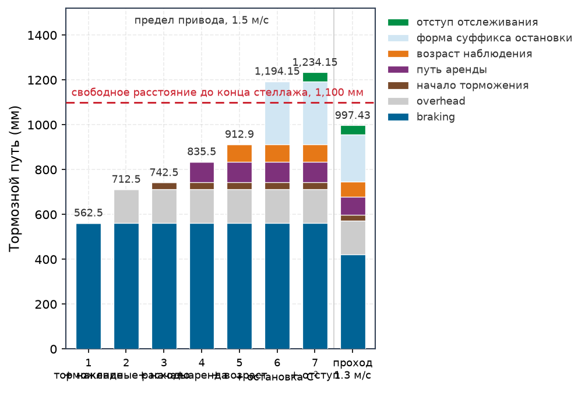
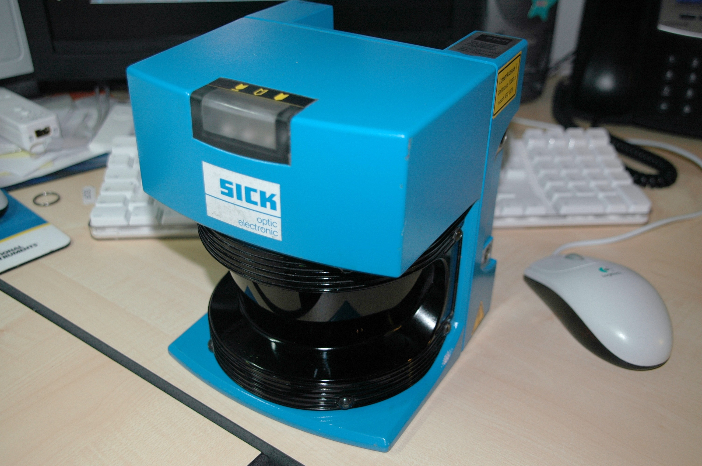
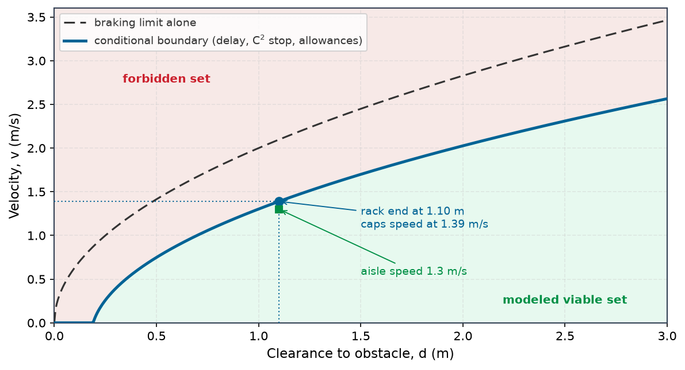
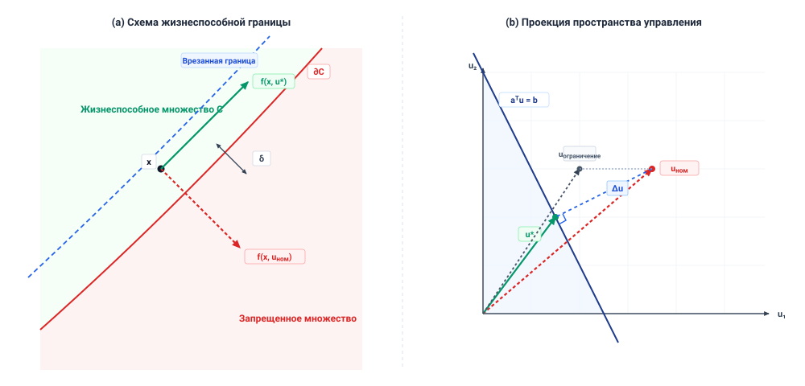
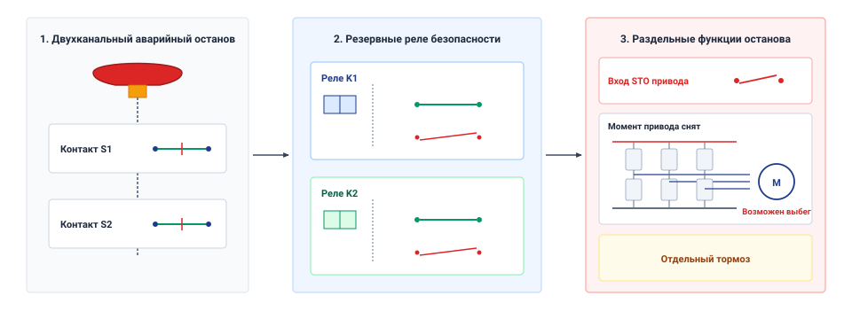
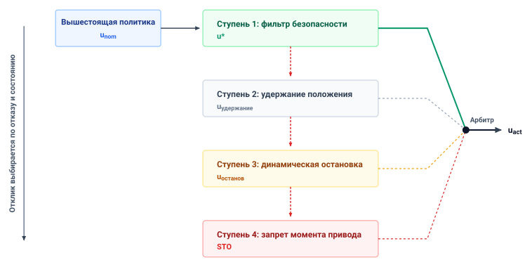
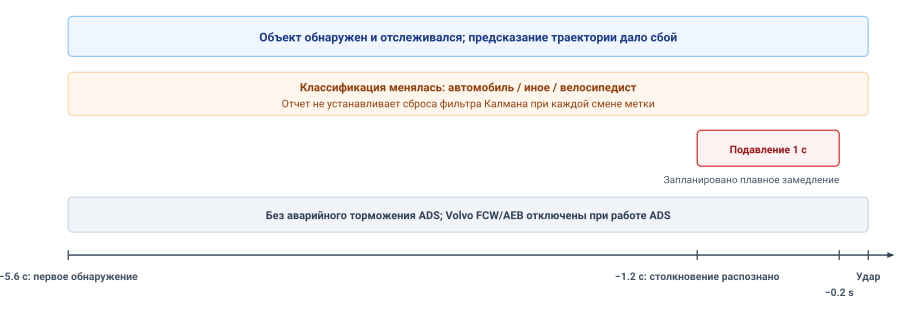

# Обеспечение безопасности

## Цель

_Как непривилегированное программное предложение превращается в физический момент, и что позволяет привратнику вовремя отвергнуть его?_

Нейронная политика может предлагать команды, нарушающие геометрический запас хода, превышающие пределы скоростей шарниров или выводящие момент актуатора в насыщение. Как только непроверенная команда превращена в фазовые токи двигателя, обнаружить галлюцинацию нейронной сети слишком поздно: кинетическая энергия уже затрачена. Независимый путь принудительного обеспечения реального времени должен оценивать предложения-кандидаты до того, как они пересекут каузальную границу, и сохранять непреклонные аппаратные полномочия отвергать или проецировать их в строгие субмиллисекундные предельные сроки.

Своевременного отказа недостаточно; выбранный резервный отклик должен оставаться динамически выполнимым при фактическом физическом состоянии. Механический тормоз не способен обеспечить идеализированное замедление, если тепловое насыщение или просадка напряжения питающей шины ухудшают создание момента. Принудительное обеспечение во время выполнения связывает функции барьера управления с контурами обратной связи реального времени, чтобы проверять, что огибающие остановки остаются строго внутри проверенных запасов хода. В стеке физического ИИ принудительное обеспечение воплощает основную обязанность детерминированной Нервной системы: поддерживать непреклонный путь разрешения между статистическими предложениями Мозга и физическим исполнением Телом.

> **Цели обучения**
>
> - Объяснить связь между точностью слежения, разрешением команд и независимым принудительным обеспечением на границе актуатора
> - Диагностировать, как частота обновления, задержка обратной связи и насыщение актуатора ограничивают корректирующее управление
> - Рассчитать готовый бюджет остановки и устанавливаемый им потолок скорости по задержке отклика, торможению, локализации и ошибке слежения
> - Оценить зависящим от скорости барьером, должна ли команда трекера, вычисленная по принятому предложению, быть принята, спроецирована или отвергнута
> - Выбирать резервные отклики, когда сенсорика, вычисления или пределы актуатора обесценивают обычное принудительное обеспечение
> - Построить протокол принудительного обеспечения, связывающий каждую проверку с ее детектором, ее резервным откликом и потребляемыми ею записями

## Детерминированный привратник

Микроконтроллер безопасности (MCU) допускает пробег складского мобильного манипулятора по проходу лишь после того, как подобранный стоп-суффикс, названный в его протоколе траектории ([«Контракт траектории»](11_planning.md#sec-planning-trajectory-contract)), размещен в памяти MCU и выполним из каждого достижимого до обязательства состояния. Этот допуск проверяет план однажды, до начала движения. Затем машина исполняет план по одному миллисекундному такту, и на каждом такте живое состояние может отклониться от того, которое предполагал планировщик. База отстает от заданной ссылочной траектории, человек выходит у торца стеллажа, нагрузка нагружает руку, или политика фрагментов предлагает задание, которого принятый план никогда не содержал. Далее описывается проверка, выполняемая на каждом такте, и отклик, который она выбирает, когда уже не подходит даже резидентная остановка.

Обученные инициаторы, стоящие за этими командами, могут выдавать невыполнимые траектории или команды по шарнирам за пределами моментов актуаторов, и по закону необратимости из раздела [«Четыре фундаментальных закона»](01_causal_boundary.md#sec-boundary-bedrock-laws) никакой обработчик исключений не может отозвать импульс, который придает ток в обмотке, поэтому плохую команду следует остановить прежде, чем она дойдет до привода.

Поэтому принудительное обеспечение сохраняет задачную компетентность обученных политик, отказывая им в полномочиях на геометрический запас хода, тепловые пределы и инварианты безопасности человека. Механизм принуждения из раздела [«Многотактные ритмы»](04_nervous_system.md#sec-nervous-cadences), привратник пути разрешения на каждом такте, находится на стороне разрешения границы предложения. Это компонент жесткого реального времени, который оценивает предложения-кандидаты, проверяет инвариантные границы состояния и обладает исключительными аппаратными полномочиями разрешить ток или скомандовать резервную остановку.

В принятой этой главой конструкции механизм принуждения работает на микроконтроллерном аппаратном обеспечении на голом железе, подключенном напрямую к приводам двигателей и энкодерам шарниров, и оценивает поступающие задания на каждом миллисекундном цикле управления по проверенным ограничениям с помощью **функций барьера управления (CBF)**[^fn-enf-barrier-function] [Ames et al., 2019](references.md#ames2019control). Когда предложение безопасно, оно проходит к приводам двигателей без изменений. Когда предложение едва угрожает границе, квадратичная программа активного множества (CBF-QP) минимально изменяет команду, минимизируя отклонение момента и принудительно обеспечивая выведенное ограничение.[^fn-enf-quadratic-program] Когда предложение структурно неверно или инициатор замолкает, привратник разрывает командный канал и запускает автономную последовательность резервного замедления.

[^fn-enf-barrier-function]: **Функции барьера управления и прямая инвариантность**: Функции барьера управления задают непрерывно дифференцируемый сертификат $h(\mathbf{x}) \ge 0$ на допустимом безопасном множестве $\mathcal{C}$, принудительно обеспечивая ограничение на производную направленного запаса $\dot{h}(\mathbf{x}, \mathbf{u}) \ge -\gamma(h(\mathbf{x}))$. Принудительное обеспечение этого неравенства делает $\mathcal{C}$ инвариантным в прямом смысле: состояния, инициализированные в жизнеспособном множестве, могут оставаться там, пока барьер выполним и заявленные допущения о модели и тайминге соблюдаются. При приближении к границе ограничение вынуждает противодействующие входы исполнения команды, которые гасят импульс до возможного физического контакта.

[^fn-enf-quadratic-program]: **Квадратичное программирование активного множества для защитных экранов**: На микроконтроллере на голом железе решатель активного множества, ограничивающий свои линейные ограничения активными контактами границы и не выделяющий динамической памяти, может ограничить завершение фиксированным пределом итераций на проверенной платформе; универсального предела $150\,\mu\text{s}$ из типа решателя не следует. Если численная плохая обусловленность препятствует сходимости до предельного срока контура, решатель корректно прерывается в резервное автономное замедление.

Однако механизм принуждения не может гарантировать безопасность за пределами точности слежения лежащего под ним контура управления, поскольку каждый сертификат барьера предполагает, что контроллер слежения следует заданным ссылочным траекториям с ограниченной ошибкой.

## Что передает трекер

Трекер, контроллер обратной связи, превращающий каждую принятую ссылочную траекторию в команду момента на каждом такте ([«Что передает планирование»](11_planning.md#sec-planning-handoff)), изолирует механизм принуждения от внутренней механики объекта управления, и через интерфейс вверх проходит лишь одна из его гарантий. Эта гарантия — явная граница **худшей ошибки слежения** ($\epsilon_{\text{track}}$) между тем, куда машина была направлена командой, и тем, где ее масса находится на самом деле. В проверенной огибающей ускорения ссылочной траектории, нагрузки, температуры и возмущений трекер может обеспечивать переходную границу $\|x(t) - r(t)\| \le \epsilon_{\text{track}}$ на всем маневре. Механизм принуждения не рассматривает передаточные функции, корневые годографы или усиления контроллера; для ПО над контуром трекер — черный ящик, удерживающий физическое движение в пределах границы ошибки $\epsilon_{\text{track}}$ от заданной траектории.

Эта граница — физическое расстояние, задаваемое инерцией ротора, податливостью передачи и пределами момента актуатора. Стационарный расчет жесткости уравновешивает несмоделированное возмущение восстанавливающим действием жесткости замкнутого контура, но не ограничивает переходное перерегулирование или установление, поэтому границе также требуются проверенная динамика или испытания на полном маневре.[^fn-math-tracking-error]

[^fn-math-tracking-error]: **Жесткость слежения замкнутого контура и границы возмущений**: Постоянная сила и эффективная жесткость замкнутого контура определяют статический прогиб. Переходное слежение зависит также от инерции, демпфирования, формы команды и насыщения. Возмущения вне проверенной огибающей обесценивают заявленную трубу; им не требуется порождать экспоненциальное расхождение.

На базе складского мобильного манипулятора проверка на полном маневре устанавливает $\epsilon_{\text{track}} =$ `40 mm` (иллюстративно; см. Руководство для читателя). Контроллер удерживает эту границу, лишь пока соблюдаются три условия. Ссылочная траектория не может требовать ускорений сверх того, что способны отдать приводы, внешние возмущения должны оставаться ниже $d_{\text{max}}$, а актуаторы должны работать ниже пределов непрерывного термического снижения номинала из раздела [«Тепловые циклы нагрузки»](02_body.md#sec-body-thermal-duty-cycles) и пределов своей шины напряжения. Ссылочная траектория, требующая большего ускорения, чем позволяет пиковый момент, выводит контур в насыщение, интегратор наращивает накопление, и база отстает от ссылочной траектории на величину, растущую с каждой миллисекундой насыщения. Вне своей номинальной огибающей контроллер не дает никакой границы.

Поскольку база может отстать от своей ссылочной траектории до $\epsilon_{\text{track}}$, на каждый геометрический и динамический запас, который оценивает механизм принуждения, накладывается врезка этой величины. Ссылочная траектория, выдерживающая запас хода $c$ до торца стеллажа, гарантирует базе лишь $c - \epsilon_{\text{track}}$, поэтому механизм принуждения проверяет ссылочную траекторию по требуемому запасу плюс `40 mm`, а раздел [«Огибающие остановки»](12_enforcement.md#sec-enforcement-stopping-envelopes) переносит эту врезку в остановочный путь, где задержка и ошибка локализации тоже расходуют запас. Если изношенные подшипники привода, износ шин или измененные параметры двигателя удвоили бы истинную ошибку до `80 mm` без изменения протокола, база израсходовала бы еще `40 mm` запаса, который механизм принуждения считает сохраняющимся за ней. Ухудшенная граница слежения незаметно разъедает каждый запас выше себя.

> ↰ **Предварительное требование:** Наложение врезки на пространственный запас хода по ковариации датчиков и транспортной задержке берет начало в разделе [«Границы пространственной ошибки и запаса»](08_perception.md#sec-perception-error-clearance).

Граница слежения, никогда не проверяемая во время выполнения, — это допущение, а не контракт. Нервная система должна публиковать $\epsilon_{\text{track}}$ с рабочими условиями, которые ее проверяют, и следить за мгновенной ошибкой $e(t) = \|x(t) - r(t)\|$ на каждом такте. Когда $e(t)$ превышает границу — при всплеске возмущения или термическом троттлинге, — контракт нарушен, и путь разрешения должен обесценить пространственные допущения фильтров выше себя прежде, чем несмоделированный прогиб причинит повреждение.

> **Инвариант запаса врезки**
>
> Каждая пространственная и динамическая граница безопасности, которую оценивает механизм принуждения, должна быть уменьшена врезкой проверенной худшей ошибки слежения лежащего в основе контура слежения, а [«огибающая остановки»](12_enforcement.md#eq-enforce-stopping-envelope) переносит эту врезку вместе с ходом за время транспортного запаздывания в каждую проверку допуска. Механизм принуждения, оценивающий сертификаты барьера по номинальным геометрическим границам без врезки, допустит траектории, физически сталкивающиеся с препятствиями, как только ошибка слежения достигнет своей сертифицированной границы.

Синтез контроллеров слежения, наблюдателей и компенсации возмущений относится к литературе по управлению [Slotine and Li, 1991](references.md#slotine1991applied); [Åström and Murray, 2021](references.md#astrom2021feedback). В современных реализациях физического ИИ «трекер» редко бывает элементарным контуром обратной связи с одним входом и одним выходом; обычно он структурирован как **каскадная иерархия управления** (отображающая декартовы цели траектории в ссылочные скорости шарниров, а скорость — в фазовые токи векторного управления на $10\text{--}25\text{ kHz}$) или как высокочастотный **модельно-прогнозный контроллер слежения (MPC)**, работающий на $100\text{--}500\text{ Hz}$ в прошивке на голом железе и решающий локализованную квадратичную программу для динамической компенсации возмущений. И все же, независимо от внутренней математической изощренности, оптимальный трекер остается семантически слепым: у него нет внутренней модели запасов хода до препятствий, замысла задачи или близости человека, и он исполнит столкновительную траекторию в стальную стойку с той же динамической точностью, что и свободное неперекрытое пространство. Более того, при несмоделированных физических возмущениях — например, масле на поверхности, вызывающем грубое проскальзывание шин, или внезапном термическом снижении тока — даже оптимальный контроллер слежения может гарантировать слежение лишь в пределах своей проверенной трубы ошибки $\epsilon_{\text{track}}$. Поэтому механизм принуждения рассматривает трекер строго как границу контракта: он инкапсулирует весь стек обратной связи внутри сертифицированной границы $\epsilon_{\text{track}}$, оценивая предложения-кандидаты по сертификатам барьера с прямой инвариантностью до того, как любая команда достигнет уровня слежения.

## Полномочия на отказ

Фрагмент приходит от прикладного процессора вовремя, корректно сформированным и неся свежее время свидетельств, а одно из его заданий направило бы руку в стойку стеллажа. Ничто в пакете не помечает это задание как неверное. Поэтому путь разрешения не дает полномочий входящему обученному предложению, пока оно не пройдет настроенные проверки состояния, входа, свежести и запаса остановки. Это третий закон, предложение — не разрешение (принцип [«Предложение — не разрешение»](part3_running.md#pri-vol4-proposal-permission)), принудительно обеспечиваемый по одному такту. Обученная политика не несет гарантии устойчивости, не ограничивает дисперсию своих выходов и не знает пределов тока актуаторов или механического напряжения, поэтому ее выходы носят рекомендательный характер.

Архитектура Simplex [Sha, 2001](references.md#sha2001using) — одна из реализаций пути разрешения. Она разрешает напряжение между задачной производительностью и безопасностью, разлагая систему управления на четыре структурных компонента:

1. **Продвинутый контроллер**: непроверенная высокоемкая обученная модель (например, сеть зрение–язык–действие, резидуальная политика обучения с подкреплением [Johannink et al., 2019](references.md#johannink2019residual) или диффузионная политика, исполняемая на прикладном процессоре), оптимизирующая сложную открытую задачную производительность.
2. **Базовый контроллер безопасности**: сертифицированный детерминированный контроллер высокой надежности (на этом пути разрешения — подобранный стоп-суффикс, принятый вместе с траекторией в разделе [«Поведение на стыке»](11_planning.md#sec-planning-behavior-seam), резидентный в прошивке MCU на голом железе), выступающий доверенной низкоуровневой базой стабилизации физического объекта управления и обеспечивающий проверенную устойчивость и поведение при останове в заявленных условиях.
3. **Менеджер безопасности**: детерминированная логика арбитража, непрерывно оценивающая состояние машины по множествам барьера с прямой инвариантностью, границам ошибки слежения и предельным срокам исполнения.
4. **Выходной селектор**: атомарный аппаратный или прошивочный мультиплексор реального времени, направляющий сигналы исполнения команды на мост двигателя. Селектор допускает проверенное предложение, когда условия соблюдаются, и переходит на резидентную базу в пределах своей проверенной задержки отклика, когда эти условия нарушаются.

По этому контракту восходящая политика никогда не командует объектом управления напрямую. Вместо этого связь через каузальную границу идет через аренду фрагмента из раздела [«Многотактные ритмы»](04_nervous_system.md#sec-nervous-cadences) — разрешение типа «мертвая рука», истекающее без продления свежим предложением. Прикладной процессор передает векторы управления-кандидаты структурированными пакетами через почтовые ящики общей SRAM по настроенному межпроцессорному каналу, например RPMsg.[^fn-hw-rpmsg-lease] Каждое предложение начинается с заголовка предложения ([«Многотактные ритмы»](04_nervous_system.md#sec-nervous-cadences)), и MCU проверяет его время свидетельств и истечение на каждом цикле управления, добавляя границу ошибки пересчета часов из заголовка. Если предложение свежее, состояние остается в проверенной жизнеспособной области, а ошибка слежения остается ограниченной, выходной селектор позволяет предложению (или его минимально спроецированному варианту) управлять актуаторами. Если аренда истекает без продления, слежение расходится или предложение угрожает физическим границам, выходной селектор отзывает разрешение и в одностороннем порядке включает базовый контроллер безопасности.[^fn-hw-pwm-tripzone] К восходящей политике не обращаются, она не ведет переговоров и не обладает аппаратным механизмом переопределить селектор.

[^fn-hw-rpmsg-lease]: **Сообщения между удаленными процессорами**: Linux RPMsg обеспечивает обмен сообщениями на основе virtio между процессорами. Владение буферами, копирования, задержки диспетчеризации и худшее время передачи зависят от платформы; OpenAMP предлагает отдельный API без копирования. Аренда требует измеренного ограниченного пути доставки.

[^fn-hw-pwm-tripzone]: **Аппаратные аварийные цепи и зоны срабатывания PWM**: Настроенный внешний вход аварийного разрыва таймера, например `TIMx_BKIN`, может принудительно перевести выходы PWM в заданное состояние, не дожидаясь прерывания. `EPWM_TZFRC` — механизм программного принуждения, а не внешний вход срабатывания. Состояние выхода и время отклика зависят от таймера, затворного драйвера, монтажа и квалификационных испытаний; срабатыванию по-прежнему требуется физически пригодный путь остановки.

Когда предложение противоречит физическим ограничениям, механизм принуждения выбирает между фильтрацией и вето. Фильтрация применяется, когда предложение структурно корректно, а близкая допустимая команда все еще служит его замыслу. Такой случай дает открываемая рукой дверь клетки с пружинным фиксатором. Предложение политики фрагментов приблизиться к ответной планке двери на `0.10 m/s` корректно сформировано, но зона двери допускает лишь охраняемое приближение на `0.03 m/s` целевой области эксплуатационного назначения (ODD) — единственную скорость, которую покрывают ее демонстрации и испытания ([«Журналы оценки»](07_evaluation.md#sec-evaluation-logs)). Этот потолок отмечает, где кончаются свидетельства, а не физика планки. Поэтому механизм принуждения сохраняет направление и цель приближения и проецирует лишь его скорость на потолок `0.03 m/s` — ограничение, которое квадратичная программа наименьшего изменения из раздела [«Минимальное вмешательство»](12_enforcement.md#sec-enforcement-minimal-intervention) принудительно обеспечивает рядом с полупространствами, которые выводит функция барьера управления.

Фильтрация должна уважать импульс так же, как положение, ибо актуаторы все еще должны суметь остановить машину до исчезновения запаса хода ([«Безопасные множества как условное разрешение»](12_enforcement.md#sec-enforcement-safe-sets-conditional-permission)). Проецирование допустимо, лишь когда исправленная команда сохраняет направление и цель предложения, меняет его непрерывно и остается далеко от опасности. Структурно неверное предложение — например, разрывный скачок заданного положения, ускорение за пределами доступного момента или траектория, направленная в неподвижное препятствие, — указывает, что восприятие или инференс вошли в несмоделированный режим отказа, а проецирование его на ближайшую безопасную границу исполнило бы движение, не связанное ни с каким замыслом задачи. Механизм принуждения накладывает вето на такое предложение, и выходной селектор передает полномочия локальному резервированию.

Фильтрация и вето происходят во время выполнения, и обучение политики не может заменить ни то, ни другое. Как утверждает раздел [«Заблуждения и ловушки»](01_causal_boundary.md#sec-boundary-fallacies-pitfalls), штрафные слагаемые и потери барьера формируют распределение, которое политика учит, но не ограничивают то, что развернутая политика выдает, а обучение с подкреплением с ограничениями ограничивает лишь ожидаемую стоимость нарушений, что допускает редкое столкновение с большим импульсом, лишь бы среднее оставалось ниже своего предела. Поэтому путь разрешения проверяет каждого кандидата на своей границе исполнения команды независимо от того, какая цель обучала инициатора, а когда предложение безопасно, проверка прозрачна и обученная компетентность проходит к приводу без изменений.

Аренда фрагмента, `60 ms` на этой машине, также сохраняет полномочия механизма принуждения, когда восходящий хост зависает. Отдельный сигнал живости хоста `100` $\text{Hz}$ имеет тайм-аут молчания `30 ms`. Контур MCU `1 kHz` подкармливает собственный `5 ms` сторожевой таймер лишь после успешного цикла; отдельное внешнее аварийное отключение покрывает отказ MCU. На каждом тайм-ауте MCU отзывает предложение и исполняет резидентное резервирование, подобранное по состоянию, при условии что зарезервированный запас и доступное торможение еще достаточны. На складском мобильном манипуляторе, если инициатор продлил аренду и затем завис, тормоз все равно начинается в пределах `82 ms` после последнего действительного продления. Этот случай истечения аренды предполагает, что отдельный сигнал живости остается активным, пока свежие допустимые предложения перестают поступать; полный отказ хоста запускает `30 ms` тайм-аут сигнала живости раньше. Когда опасность — человек, выходящий у торца стеллажа, возраст кадра, впервые показавшего этого человека, добавляется к задержке от продления до начала, и раздел [«Огибающие остановки»](12_enforcement.md#sec-enforcement-stopping-envelopes) относит сумму на проверку допуска. Именно принудительное обеспечение аренды на приводе, а не доверие хосту отозвать собственное предложение, вообще ограничивает эту задержку.

Разрыв восходящих полномочий требует определенного физического отклика на низшем аппаратном интерфейсе. Нулевой командный пол — настроенный отклик на исчезновение активного программного управления, причем запись нуля в привод дает разную механику на разных актуаторах. Нулевой ток в низкофрикционном прямом приводе позволяет нагруженной силой тяжести руке опускаться, если только отдельное удерживающее устройство не несет нагрузку, тогда как нулевая скорость в жестком контуре положения может запросить большой переходный процесс. Раздел [«Целостность электропитания»](02_body.md#sec-body-power-integrity) описывает три обесточенных состояния, в которые может перейти привод (свободный выбег, динамическое торможение короткозамкнутыми фазами или пружинный тормоз); в какое из них переходит каждый привод — выбор, который эта глава делает ступень за ступенью.

Отказ — стационарное решение, а не только аварийное исключение. На каждом миллисекундном такте управления механизм принуждения проверяет свежесть предложения по аренде и порогу возраста свидетельств, сигнал живости хоста, ошибку слежения, пределы актуатора и кинетические пределы, а также выполнимость резидентного резервирования, и если одна проверка не пройдена, отзывает предложение и выбирает резидентный отклик, соответствующий текущему состоянию и доступному запасу. Этот путь должен сохранять способность действовать при отказе восходящего источника предложений, а его положение в сигнальной цепи определяет, что он может видеть и как быстро действовать.

## Где размещается механизм принуждения

Положение механизма принуждения в сигнальном конвейере задается масштабом времени динамики и задержками каналов, которые его питают, и каждая машина, превращающая обученные предложения в движение, предлагает две естественные позиции. Выше по потоку от контура обратной связи кинематический проверщик ссылочных траекторий валидирует путевые точки, координатные цели или векторы скорости до их входа в контур слежения; на частотах планирования от $10$ до $50\text{ Hz}$ он может проверить сегмент траектории $300\text{ ms}$ по границам рабочего пространства и моделям самостолкновений. Его сила — пространственное предвидение, а ограничение — слепота к фактическому состоянию объекта управления, поэтому ссылочная траектория, проходящая мимо стойки стеллажа с зазором меньше переходного перерегулирования базы, проходит все восходящие проверки, пока база все же ударяет стойку.

> ↳ **Ниже по потоку:** Гетерогенное кремниевое разделение механизма принуждения по изолированным анклавам микроконтроллера нанесено на карту в разделе [«Два пути на одном кристалле»](13_placement.md#sec-placement-two-paths-one-die).

Ниже по потоку от контроллера обратной связи, рядом с силовой электроникой, проверщик команд просматривает фазовые токи, коэффициенты заполнения и ссылочные моменты шарниров непосредственно перед записью в аппаратные регистры. Работая на частоте внутреннего контура машины `1 kHz`, он предотвращает перегрузку по току, перегрузку по моменту и тепловой разгон, отсекая или обнуляя сигналы за номинальными характеристиками объекта управления, но отказывается от предвидения. Момент, прочно укладывающийся в непрерывный номинал, выглядит безопасным для скалярного ограничителя, даже когда он ускоряет опускающийся шарнир руки к станции упаковки быстрее, чем оставшийся ход может поглотить, и ограничитель не регистрирует отказа до тех пор, пока допустимый обратный момент еще может предотвратить столкновение.

Это разделение меняет задержку на видимость. Проверщик ссылочных траекторий на этих частотах планирования видит на несколько шагов вперед, но не может реагировать на резонанс, усиление шума или неустойчивость выше своей частоты обновления. Проверщик команд действует на каждом такте, но его горизонт в один шаг создает динамические ловушки, где каждый мгновенный момент законен, пока не достигнуто невосстановимое состояние.

Размещение также определяет, как механизм принуждения входит в вычислительную ткань. Встроенный в линию механизм принуждения просматривает каждую команду до того, как ее прочтет следующая стадия, что не оставляет непроверенных команд, но помещает его худшее время выполнения на критический путь контура `1000 μs`, где перерыв выводит из строя весь цикл. Параллельный монитор на отдельном ядре сохраняет тайминг контура и открывает предохранительный контактор или переводит привод в динамическое торможение при обнаружении нарушения, но его задержки обнаружения и сигнализации, ограниченные циклом монитора и дрожанием шины, должны быть оплачены более широкими запасами или меньшей скоростью.

Поскольку ни одно из одиночных положений не дает одновременно динамического предвидения и мгновенной защиты, архитектуры физического ИИ разрешают это напряжение через **двухстадийный шаблон принудительного обеспечения**. Этот шаблон отображается на двухпроцессорную реализацию модели машины ([«Где проходит путь разрешения»](04_nervous_system.md#sec-nervous-silicon-partitioning)):

- **Восходящая стадия (рекомендательная предпроверка коридора на прикладном процессоре):** Работая на частоте фрагментов (`20` $\text{Hz}$ на этой машине) на непривилегированном ядре прикладного микропроцессора, эта стадия просеивает многошаговые фрагменты траекторий, выдаваемые обученной политикой, по динамическому коридору остановки при худших параметрах торможения и по статическим огибающим рабочего пространства, прежде чем упаковать путевые точки в арендуемое предложение фрагмента, отправляемое по RPMsg. Стадия носит рекомендательный характер. Она избавляет MCU от предложений, которые были бы отвергнуты, но работает на стороне инициатора границы предложения, поэтому обязательный допуск траектории и ее стоп-суффикса остается за MCU ([«Поведение на стыке»](11_planning.md#sec-planning-behavior-seam)).
- **Нисходящая стадия (мгновенный защитный экран CBF-QP на MCU на голом железе):** Работая внутри строгого таймерного контура прерываний `1 kHz` (`1000 μs`) на изолированном MCU, эта стадия получает предложенное задание из общей SRAM, проверяет границы ошибки слежения, решает квадратичную программу функции барьера управления активного множества (CBF-QP) в предварительно выделенной статической SRAM и ограничивает сырые команды тока и момента непосредственно перед записью в регистры таймеров PWM. Принудительно обеспечиваемый ею барьер сводится к одношаговому выпуклому проецированию ([«Безопасные множества как условное разрешение»](12_enforcement.md#sec-enforcement-safe-sets-conditional-permission)), время выполнения которого должно быть ограничено на выбранном аппаратном обеспечении.

Рекомендательная предпроверка отсеивает за отсутствием выполнимой остановки до отправки фрагмента, а стадия на стороне привода проверяет текущие наблюдения и команды на каждом такте, но ни одна стадия не может восстановить состояние, уже исчерпавшее тормозной запас.

Правильное размещение не помогает, если входы механизма принуждения разделяют режимы отказа с компонентом, который он проверяет. Механизм принуждения, вычисляющий расстояния столкновений по карте глубины, порожденной той же нейронной моделью восприятия, что планировала движение, обманут той же артефактом вне распределения, поэтому независимое принудительное обеспечение требует независимой сенсорики и изолированных вычислений. MCU считывает энкодеры и концевые выключатели, подключенные к его собственным GPIO и регистрам захвата таймеров, вне виртуального пространства памяти и планировщика Linux, а проверка столкновений считывает лидар безопасности или датчик близости, обработка которых использует детерминированную пороговую логику, а не обученный инференс. Там, где независимого датчика нет, — как для трения под колесами базы или массы груза, которую выводит лишь оценщик, — независимую физическую гарантию построить нельзя, и утверждение сильно лишь настолько, насколько ограничена неопределенность оценщика или премиса, которую заявляет протокол. Каждый инвариант, который механизм принуждения проверяет — восходящий или на клеммах двигателя, — все еще предполагает, что объект управления сохраняет полномочия остановить собственное движение до запретной границы.

> **Правило независимости монитора**
>
> Путь разрешения никогда не должен оценивать оценку состояния, порожденную компонентом, который он призван ограничивать, а равно разделять неперебиваемую шину связи, матрицу памяти или дерево часов с непроверенными процессами. Там, где независимая сенсорика физически невозможна, утверждение безопасности опирается на ограниченную модельную неопределенность оценщика, а не на аппаратное обеспечение.

## Огибающие остановки

Главы, которым принадлежит слагаемое остановки, каждая добавила его в бюджет складского мобильного манипулятора у торца стеллажа, и осталось одно слагаемое. Огибающая остановки — множество состояний, из которых проверенный тормозной отклик может остановить движение до границы, а закон необратимости (принцип [«Закон необратимости»](part1_anatomy.md#pri-vol4-irreversibility)) задает его проверку, $d_{\text{stop}} \le D_{\text{clear}}$, где каждый член $d_{\text{stop}}$ взят из измеренного предела этой машины. Резервирование этого отклика стоит достижимой скорости, ибо скорость увеличивает слепой ход линейно, а тормозной путь — квадратично. Машина должна оставаться внутри этой огибающей до того, как произойдет отказ или небезопасное предложение.

Задержка до торможения $\tau_{\text{delay}}$ в остановочном пути раздела [«Кинетический импульс»](02_body.md#sec-body-kinetic-momentum) уже включает собственный такт контура разрешения механизма принуждения, который раздел [«Многотактные ритмы»](04_nervous_system.md#sec-nervous-cadences) закладывает в бюджет через путь аренды. Остается разрыв между ссылочной траекторией и следующим за ней объектом управления.

Путь разрешения закрывает этот разрыв границей слежения $\epsilon_{\text{track}}$ из раздела [«Что передает трекер»](12_enforcement.md#sec-enforcement-handoff) и защищает остановочный путь [«остановочный путь тела»](02_body.md#eq-body-stopping-distance), уменьшенный на нее врезкой. Заданная ссылочная траектория может быть допущена, лишь если объект управления, способный отстать от нее до $\epsilon_{\text{track}}$, все еще может остановиться внутри $D_{\text{clear}}$. Условие допуска — огибающая остановки:[^fn-math-stopping-dist]

$$v\,\tau_{\text{delay}} + \frac{v^2}{2a_{\text{eff}}} + \delta_{\text{loc}} + \delta_{\text{margin}} + \epsilon_{\text{track}} \le D_{\text{clear}}$$

Здесь $a_{\text{eff}}$ — замедление, которое фактически использует резидентная остановка, равное достоверному замедлению $a_{\text{brake}}$ для остановки с постоянным замедлением и меньшее, когда остановка сформирована как в разделе [«Поведение на стыке»](11_planning.md#sec-planning-behavior-seam); $\delta_{\text{loc}}$ — граница локализации, а $\delta_{\text{margin}}$ — фиксированный защитный запас. Левая часть — остановочный путь $d_{\text{stop}}(v)$ из [«остановочный путь тела»](02_body.md#eq-body-stopping-distance) плюс врезка слежения $\epsilon_{\text{track}}$.

[^fn-math-stopping-dist]: **Кинематический остановочный путь и компоненты задержки**: Уменьшенный на врезку остановочный путь в этой модели складывается из пяти слагаемых: слепого хода, тормозного пути под достоверным замедлением, границы локализации, фиксированного защитного запаса и переходной границы слежения. Пропуск вычислительного транспортного запаздывания или ошибки слежения ведет к преждевременному вторжению на физические препятствия до того, как сможет включиться пиковое торможение. Формальные кинематические выводы см. в разделе [«Кинематические огибающие остановки и запаздывание информации»](appendix_systems.md#sec-appendix-systems-stopping).

При этих допущениях о задержке, оценке и торможении любое предложение траектории, помещающее машину на расстояние меньше $d_{\text{stop}}(v) + \epsilon_{\text{track}}$ по [«огибающая остановки»](12_enforcement.md#eq-enforce-stopping-envelope) от физического ограничения вдоль направления движения, небезопасно и физически недопустимо. Огибающая остановки фундаментально анизотропна; препятствие позади мгновенного вектора скорости требует запаса только для ошибки слежения по положению $\epsilon_{\text{track}}$.

Для складского мобильного манипулятора врезка равна границе слежения базы `40 mm`, и это последнее слагаемое расстояния, которое получает бюджет. На пределе хода `1.5 m/s` подобранный стоп-суффикс раздела [«Поведение на стыке»](11_planning.md#sec-planning-behavior-seam) уже довел нарастущий итог до `1 194.15 mm`, перевалив за свободное расстояние `1.10 m` у торца стеллажа. Врезка поднимает его до `1 234.15 mm` — на `134.15 mm` больше свободного расстояния.

Каждое другое слагаемое [«огибающая остановки»](12_enforcement.md#eq-enforce-stopping-envelope) теперь закреплено за главой, которой оно принадлежит: достоверное замедление и фиксированные накладные расходы — за [«Кинетический импульс»](02_body.md#sec-body-kinetic-momentum), путь аренды — за [«Многотактные ритмы»](04_nervous_system.md#sec-nervous-cadences), возраст наблюдения — за [«Преобразование и калибровка датчиков»](08_perception.md#sec-perception-transduction-calibration), форма остановки — за [«Поведение на стыке»](11_planning.md#sec-planning-behavior-seam), а врезка — за этой главой. Скорость — единственное слагаемое, которое машина еще может выбирать. При $\tau_{\text{delay}} =$ `133.6 ms` и $a_{\text{eff}} =$ `1.33 m/s²` у стоп-суффикса ([«C² стоп-суффикс»](11_planning.md#eq-plan-c2-stopping-suffix)) [«огибающая остановки»](12_enforcement.md#eq-enforce-stopping-envelope) выдерживается вплоть до потолка `1.39 m/s`. Готовый бюджет поэтому устанавливает скорость хода `1.3 m/s`, ниже этого потолка. На скорости хода остановке требуется `997.4 mm`, и `102.6 mm` свободного расстояния остаются неизрасходованными. [«Бюджет остановки складского манипулятора»](12_enforcement.md#tbl-enforcement-stopping-budget) перечисляет каждую строку на обеих скоростях, а [«Бюджет остановки, строка за строкой»](12_enforcement.md#fig-enforcement-stopping-budget) изображает их.

| Строка | Добавлено в | Слагаемое | На пределе хода (мм) | Нарастающий итог (мм) | Остаток $D_{\text{clear}}$ (мм) | На скорости хода (мм) |
|----:|:-----------------------------------------|:---------------------------------------------------------------------------------------------------------------------------------------------------------------------------|-----------------------------------------------------------:|----------------------------------------------------:|-----------------------------------------------------:|-----------------------------------------------------------:|
|   1 | [«Кинетический импульс»](02_body.md#sec-body-kinetic-momentum)               | Торможение, $v^2/2a_{\text{brake}}$                                                                                                                                           | `562.5` | `562.5` | `537.5` | `422.5` |
|   2 | [«Кинетический импульс»](02_body.md#sec-body-kinetic-momentum)               | Накладные расходы, $\delta_{\text{loc}}+\delta_{\text{margin}}$                                                                                                                     |    `150` | `712.5` | `387.5` |    `150` |
|   3 | [«Кинетический импульс»](02_body.md#sec-body-kinetic-momentum)               | Начало торможения, $vT_{\text{act}}$                                                                                                                                             | `30` | `742.5` | `357.5` | `26` |
|   — | [«Питание, свежесть и стена памяти»](03_brain.md#sec-brain-cognitive-pipeline)            | Только время: политика фрагментов может продлить аренду; развертка весов модели намерения `98.0 ms` — нет                                |                                                          — |                                                   — |                                                    — |                                                          — |
|   4 | [«Многотактные ритмы»](04_nervous_system.md#sec-nervous-cadences)                    | Путь аренды, $v(T_{\text{lease}}+T_{\text{tick}}+T_{\text{bus}})$ на `62 ms`                                                  | `93` | `835.5` | `264.5` | `80.6` |
|   5 | [«Преобразование и калибровка датчиков»](08_perception.md#sec-perception-transduction-calibration) | Возраст наблюдения, $v\,t_{\text{age}}$ на `51.6 ms`                                                                                   |   `77.4` | `912.9` | `187.1` |   `67.08` |
|   — | [«Оценка сквозь окклюзию»](09_memory.md#sec-memory-belief-through-occlusion)     | Только время: оценка того, что закрытый торец стеллажа свободен, истекает через `31.25 ms`, менее двух кадров камер, поэтому память не может ее сертифицировать |                                                          — |                                                   — |                                                    — |                                                          — |
|   6 | [«Поведение на стыке»](11_planning.md#sec-planning-behavior-seam)              | $C^2$ стоп-суффикс, $0.75v^2/a_{\text{brake}}$ вместо $0.5v^2/a_{\text{brake}}$                                                                                        | `281.25` | `1 194.15` |      `$-94.15$` | `211.25` |
|   7 | [«Огибающие остановки»](12_enforcement.md#sec-enforcement-stopping-envelopes)      | Врезка слежения, $\epsilon_{\text{track}}$                                                                                                                                  |       `40` | `1 234.15` |      `$-134.15$` |       `40` |
|     |                                          | **Итого**                                                                                                                                                                  |        `1 234.15` |                                                     |                                                      | `997.43` |
|     |                                          | **Остаток $D_{\text{clear}}$**                                                                                                                                             |            `$-134.15$` |                                                     |                                                      |       `102.57` |

***Бюджет остановки складского манипулятора**: Каждая пронумерованная строка — это расстояние, которое добавляет одна глава, при нагрузке и на сухом полу, на пределе хода `1.5 m/s` и на скорости хода `1.3 m/s`; нарастающий итог и остаток приведены для предела хода относительно свободного расстояния `1.10 m`. Строка 6 заменяет торможение с постоянным замедлением резидентной остановкой $C^2$, поэтому ее вклад — добавленное расстояние. Строки по времени расстояния не добавляют.*

***Бюджет остановки, строка за строкой**: Каждый столбец — нарастущий итог после того, как одна глава добавила свое слагаемое, на пределе хода, с нагрузкой, на сухом полу. Торможение, накладные расходы, начало торможения, путь аренды и возраст наблюдения остаются внутри свободного расстояния; подобранный стоп-суффикс уносит итог за него, а врезка слежения увеличивает превышение. Последний столбец — готовый бюджет на выбранной скорости хода, который укладывается в свободное расстояние с остатком, который расходуют последующие главы.*

Готовый бюджет защищает от неподвижного препятствия на $D_{\text{clear}}$ — например, человека, вышедшего из-за стеллажа и остановившегося, или упавшего контейнера, — поэтому он предполагает, что препятствие остается там, где было в начале остановки. Человек, продолжающий идти к базе на протяжении всей остановки, закрывает зазор и с дальней стороны ([«Оценка сквозь окклюзию»](09_memory.md#sec-memory-belief-through-occlusion)), и учет этого приближения сверх готового бюджета ограничил бы базу `0.46 m/s` на этом торце стеллажа. Проход, удерживаемый на такой скорости, замедлил бы каждый пробег ради встречи, от которой правило пересечения может держать подальше от остановки, поэтому площадка отвечает идущему человеку правилом, а не скоростью, а раздел [«Реестр остаточных утверждений»](17_frontier.md#sec-frontier-residual-claims-register) держит открытым премису, на которой это правило покоится: никто не приближается к торцу стеллажа во время остановки. Таким образом, механизм принуждения гарантирует бюджет против неподвижного препятствия, а не безопасность человека, продолжающего идти в остановку.

Последующие главы расходуют остаток или ограничивают лежащую под ним премису. На скорости хода неизрасходованное расстояние длится `78.9 ms` ([«Переходы полномочий»](14_intervention.md#sec-intervention-authority-transitions)). Достоверное замедление ограничивает лишь на полах с коэффициентом трения не ниже `0.204`, поскольку $a=\min(a_{\text{brake}},\mu g)$, поэтому на полу, обследованном до `0.12`, потолок падает до `1.09 m/s` ([«Реестр остаточных утверждений»](17_frontier.md#sec-frontier-residual-claims-register)).

Зависший инициатор израсходовал бы больше всего остатка. Будь аренда фрагмента из раздела [«Полномочия на отказ»](12_enforcement.md#sec-enforcement-authority-refuse) отдана на откуп хосту, последнее предложение, сохранявшее полномочия `200 ms` вместо аренды `60 ms`, добавило бы к остановке `182 mm` и унесло базу на `79.4 mm` за свободное расстояние у торца стеллажа.

Тот же бюджет задает размер любой защитной сенсорики, останавливающей базу независимо от инициатора. Мобильная база может обнаруживать торец стеллажа через оцененное по риску защитное поле, спроектированное по применимым стандартам на транспортные средства и машины, включая ISO 3691-4 и ISO 13849, — например, через лазерный сканер безопасности времяпролетного типа, показанный в разделе [«Промышленный лазерный сканер безопасности»](12_enforcement.md#fig-12-real-laser-scanner), и это защитное поле должно быть не короче бюджета остановки.

***Промышленный лазерный сканер безопасности**: Сканер может создавать поле раннего предупреждения и защитное поле. Поле предупреждения запрашивает более раннее замедление; сигнальный выход защитного поля питает контроллер, выбирающий оцененный по риску останов. Длина защитного поля должна включать отклик сканера, задержку контроллера и привода, тормозной путь и неопределенность. Движущийся AMR не становится безопасным от одного лишь снятия момента двигателя.*

***Условная огибающая остановки**: Для базы складского мобильного манипулятора параболическая граница разделяет состояния с смоделированным тормозным запасом и состояния, уже его исчерпавшие. Врезка включает задержку до торможения, более мягкое замедление подобранного стоп-суффикса и допуски локализации, защиты и слежения. Кривые действительны лишь для заявленного достоверного замедления и рабочей огибающей.*

На плоскости расстояние–скорость раздела [«Условная огибающая остановки»](12_enforcement.md#fig-12-stopping-envelope-phase-plane) уравнение остановки проводит параболическую границу между состояниями, которые еще могут остановиться, и состояниями, уже исчерпавшими свой запас, а разрыв с кривой чистого торможения — это запас, потребляемый задержкой до торможения, более мягким замедлением подобранного стоп-суффикса и фиксированными допусками. Подобно тому как roofline-модель [Williams et al., 2009](references.md#williams2009roofline) ограничивает достижимую пропускную способность пропускной способностью памяти, огибающая остановки ограничивает законную скорость свободным расстоянием — как бы быстро ни предлагала политика фрагментов. Чтобы ехать быстрее, инженер должен повысить достоверное замедление $a_{\text{brake}}$, сократить $\tau_{\text{delay}}$ или ужесточить $\epsilon_{\text{track}}$ и $\delta_{\text{loc}}$.

Эти параметры нестационарны. Предмет в захвате повышает инерцию руки и снижает замедление, которое ее шарниры способны создать в пределах пикового момента, масло на полу снижает сцепление под достоверным замедлением базы, а повторные жесткие остановы нагревают роторы и инверторы до термического снижения номинала ([«Тепловые циклы нагрузки»](02_body.md#sec-body-thermal-duty-cycles)). Механизм принуждения, рассматривающий $a_{\text{brake}}$ как константу из технического описания, недооценивает огибающую именно под большой нагрузкой, поэтому он должен использовать независимо ограниченную тормозную способность и снижать допустимую скорость при изменении проверенных условий трения, нагрузки или теплового режима; неопределенная оценка сама по себе не может восстановить гарантию.

Адаптация работает, лишь пока оценки состояния механизма принуждения точны, а актуаторы еще способны отдать силу. Если загрязнение уводит сцепление к нулю или длительный цикл нагрузки загоняет обмотки за их потолки, предполагаемое замедление исчезает, и как только требуемый момент превышает то, что аппаратное обеспечение способно создать, механизм принуждения может обнаружить нарушение, но больше не может ему помешать.

## Когда у принуждения кончаются полномочия

В теории управления **насыщение актуатора** — ограниченная нелинейность, добавляющая фазовое запаздывание и вызывающая нарастание накопления в контроллерах обратной связи. Для пути разрешения оно непосредственнее: это мгновение, когда двигатель отдает все, что может, а механизм принуждения теряет мощность, которую предполагает его гарантия безопасности. Когда актуатор достигает своего механического предела (пиковый момент), электрического предела (напряжение шины или отсечка по току) или теплового предела ([«Тепловые циклы нагрузки»](02_body.md#sec-body-thermal-duty-cycles)), корректирующее действие $u_{\text{corr}}$ не может быть отдано в скомандованной величине, и никакую границу нельзя защитить силой, которую Тело не способно создать.

Огибающая остановки, вычисленная при номинальных допущениях, становится недействительной, как только полномочия израсходованы, ибо момент, затраченный на удержание груза против силы тяжести или подъем на уклон, недоступен для торможения.[^fn-math-margin-loss] При стационарном моменте смещения $\tau_{\text{bias}}$ эффективное замедление, доступное для гашения вращательного движения, равно:

$$\alpha_{\text{eff}} = \frac{\tau_{\max} - \tau_{\text{bias}}}{J}$$

где $J$ — инерция механизма, а $\tau_{\max}$ — предел пикового динамического момента. В линейных поступательных системах с массой $m$ и силой смещения $u_{\text{bias}}$ [«эффективное замедление»](12_enforcement.md#eq-enforce-effective-deceleration) принимает эквивалентную форму $a_{\text{eff}} = (u_{\max} - |u_{\text{bias}}|) / m$. Привод, тратящий три четверти момента на удержание постоянной скорости на уклоне, сохраняет четверть на торможение, что учетверяет его тормозной путь.

[^fn-math-margin-loss]: **Момент смещения актуатора и потеря запаса остановки**: Когда актуатор выделяет постоянный базовый момент на противодействие гравитационной нагрузке или стационарному трению, доступный запас аварийного торможения пропорционально обваливается. На вертикальных и сильно нагруженных осях это истощение чистого динамического момента заставляет остановочные пути учетверяться под внешне скромными нагрузками смещения. Подробный вывод насыщенных полномочий и сжатия запаса остановки см. в разделе [«Безопасность и функции барьера управления»](appendix_control.md#sec-appendix-control-cbf).

Рассмотрим руку складского мобильного манипулятора, несущую кружку с конвейера раздачи вниз к коллеге на станции упаковки, когда нагруженный шарнир опускается с угловой скоростью $\omega_0 =$ `1.2` $\text{rad/s}$ (значения сценария иллюстративны; см. Руководство для читателя). Эффективная длина звена $\ell =$ `0.80 m`, поэтому рабочая точка движется со скоростью `0.96 m/s`, в пределах ограничения `1 m/s` для свободного пространства руки; лишь финальное приближение к руке коллеги идет на куда более низкой скорости передачи, которую записывает [«Протокол принудительного обеспечения»](12_enforcement.md#sec-enforcement-telemetry). Инерция шарнира с кружкой $J =$ `3 kg·m²`, а пиковый момент шарнира $\tau_{\max} =$ `87 N·m`. Без гравитационного смещения ($\tau_{\text{bias}} = 0$) весь пиковый момент доступен для торможения, и угловое замедление равно $\alpha_{\text{nom}} = \tau_{\max}/J =$ `29` $\text{rad/s}^2$. Угол остановки с $\omega_0$ равен $\Delta \theta_{\text{nom}} = \omega_0^2 / (2 \alpha_{\text{nom}}) =$ `0.0248` $\text{rad}$ (`1.42`$^\circ$), что перемещает рабочую точку $d_{\text{tool,nom}} = \ell \Delta \theta_{\text{nom}} =$ `19.86 mm` по ее дуге.

Однако при спуске собственная геометрия руки и кружка нагружают шарнир вниз направленным смещением $\tau_{\text{bias}} =$ `65.25 N·m` — 75 % его пикового момента. По [«эффективное замедление»](12_enforcement.md#eq-enforce-effective-deceleration) чистый момент, оставшийся на торможение, равен $\tau_{\max} - \tau_{\text{bias}} =$ `21.75 N·m`, и угловое замедление падает вчетверо до $\alpha_{\text{eff}} =$ `7.25` $\text{rad/s}^2$. Угол остановки растет вчетверо до `0.0993` $\text{rad}$ (`5.69`$^\circ$), и инструмент проходит `79.45 mm` — незапланированное превышение на `59.59 mm`. Если механизм принуждения оценивает огибающие барьера по моменту из технического описания $\tau_{\max}$, а не по чистому запасу $\tau_{\max} - \tau_{\text{bias}}$, реальная остановка уходит на `59.59 mm` дальше предсказанной. Заканчивается ли это превышение на поверхности станции, зависит от запаса, с которого начинается торможение, — его оценивает барьер раздела [«Безопасные множества как условное разрешение»](12_enforcement.md#sec-enforcement-safe-sets-conditional-permission). Рука коллеги не должна никогда оказываться ближе, чем смещенная остановка руки в `79.45 mm` плюс ее слепой ход, до включения канала передачи.

Интегрирующее звено под механизмом принуждения добавляет штраф задержки во время насыщения. Пока актуатор отсечен и ошибка слежения сохраняется, интегратор продолжает накапливать команду, которую объект управления не может исполнить, и когда механизм принуждения командует полное торможение, выход остается прижатым к переднему пределу, пока этот интеграл не раскрутится обратно. Если ошибка накапливалась `200 ms`, раскрутка задерживает чистую тормозную силу на $\tau_{\text{unwind}} =$ `150 ms`. На базе мобильного манипулятора на скорости хода `1.3 m/s` эта задержка добавляет $v\,\tau_{\text{unwind}} =$ `195 mm` неторможения — почти вдвое больше `102.6 mm`, которые готовый бюджет остановки раздела [«Огибающие остановки»](12_enforcement.md#sec-enforcement-stopping-envelopes) оставляет в запасе. Ограничение против нарастания, обратный расчет и условное интегрирование устраняют это в контуре [Åström and Hägglund, 2006](references.md#astrom2006advanced); [Franklin et al., 1998](references.md#franklin1998digital); требование принудительного обеспечения — измерить оставшуюся задержку раскрутки и запланировать ее нетормозимое расстояние внутри горизонта остановки.

Насыщение — один из немногих аппаратных отказов с прямым детерминированным детектором внутри пути разрешения. На каждом такте $1\text{ ms}$ путь разрешения сравнивает скомандованное усилие $u_{\text{cmd}}$ с осуществимым усилием $u_{\text{act}} = \text{clip}(u_{\text{cmd}}, u_{\text{min}}, u_{\text{max}})$. Ненулевая разность или регистр состояния инвертора, сообщающий о насыщении по пределу тока, показывают, что актуатор исчерпал свои полномочия, причем длительность и величина ограничения отслеживают оставшиеся полномочия без шумной внешней оценки состояния.

Поскольку израсходованные полномочия сразу меняют остановочный путь, механизм принуждения в реальном времени включает их в огибающую, пересчитывая $a_{\text{eff}} = (u_{\text{max}} - |u_{\text{bias}}|) / m$ перед проверкой следующего сегмента траектории. Допустимая скорость падает по мере расходования полномочий, и когда вычисленная остановка больше не помещается внутрь свободного расстояния, механизм принуждения должен скомандовать замедление, пока полномочий еще достаточно.

Исчерпание полномочий должно также доходить до планировщика. Политика `20` $\text{Hz}$, продолжающая командовать ускорения двигателю, о насыщении которого сообщил контур `1 kHz`, планирует против Тела, которое не способно их исполнить, поэтому путь разрешения сообщает о насыщении как о нарушении активного ограничения, отзывает активную траекторию и требует перепланирования из ограниченного полномочиями состояния машины.

> **Инвариант полномочий актуатора**
>
> Функция барьера управления, как она сформулирована в разделе [«Безопасность и функции барьера управления»](appendix_control.md#sec-appendix-control-cbf), математически действительна, лишь пока физические актуаторы сохраняют достаточный запас по току, напряжению и температуре, чтобы отдать вычисленную корректирующую силу: $u^* \in [u_{\min}, u_{\max}]$. Когда стационарная сила тяжести или трение израсходуют рабочую огибающую актуатора, механизм принуждения должен динамически сжимать безопасное множество до того, как полномочия управления на границе исчезнут.

> **Огибающая остановки и запас актуатора**
>
> Рассмотрите, как огибающая остановки и лежащие под ней полномочия актуатора ограничивают допустимое движение:
>
> - [ ] **Квадратичное масштабирование огибающей**: Сможете ли вы объяснить, почему бюджет остановки растет быстрее скорости, так что скорость хода задает готовый бюджет, а не предел хода, и почему никакая политика планирования не может обойти этот кинематический пол?
> - [ ] **Транспортное запаздывание против тормозной мощности**: Сможете ли вы различить пространственную цену вычислительного транспортного запаздывания ($v \cdot \tau_{\text{delay}}$) и активного торможения ($v^2 / 2 a_{\text{brake}}$), определив, какое слагаемое доминирует на низких ползучих скоростях против высоких транспортных?
> - [ ] **Обвал эффективного замедления**: Сможете ли вы описать физический механизм, из-за которого остановочный путь учетверяется, когда стационарная сила тяжести потребляет 75 процентов пикового момента актуатора?
> - [ ] **Динамическое сжатие безопасного множества**: Сможете ли вы объяснить, почему путь разрешения должен активно сжимать допустимое пространство состояний, когда актуатор приближается к тепловому или электрическому насыщению, а не ждать, пока ошибка слежения нарушит жесткий предел?

## Безопасные множества как условное разрешение

Как только учтен его момент смещения, опускающейся руке из раздела [«Когда у принуждения кончаются полномочия»](12_enforcement.md#sec-enforcement-exhausted-authority) требуется `79.45 mm` хода инструмента, чтобы остановиться, и этот ход растет с квадратом скорости приближения. Запаса, достаточного на одной скорости, поэтому слишком мало на более высокой, и механизму принуждения нужен предикат одновременно по положению и скорости, который он может оценивать на каждом такте часов управления. В теории управления **безопасное множество** $\mathcal{C}$ определяется как суперуровневое множество нуля непрерывно дифференцируемого скалярного сертификата $h(x): \mathcal{X} \to \mathbb{R}$, такого что
$$\mathcal{C} = \{x \in \mathcal{X} \mid h(x) \ge 0\}, \quad \partial \mathcal{C} = \{x \in \mathcal{X} \mid h(x) = 0\}.$$
Математическая основа **прямой инвариантности**, заложенная Blanchini [Blanchini, 1999](references.md#blanchini1999set), сформулированная через анализ достижимости Гамильтона–Якоби и ядра жизнеспособности Mitchell, Bayen и Tomlin [Mitchell et al., 2005](references.md#mitchell2005time) и расширенная через функции барьера управления в работах [Ames et al., 2014](references.md#ames2014control) и [Ames et al., 2019](references.md#ames2019control),[^fn-math-nagumo-invariance] характеризует условия, при которых допустимый контроллер может удерживать состояние в жизнеспособном множестве. Один лишь геометрический запас хода не является этим множеством, когда тормозной момент конечен.

[^fn-math-nagumo-invariance]: **Теорема Нагумо о жизнеспособности и касательные конусы границы**: Теорема Нагумо устанавливает, что замкнутое множество инвариантно в прямом смысле тогда и только тогда, когда вектор скорости системы принадлежит касательному конусу множества в каждой граничной точке. Функции барьера управления синтезируют это геометрическое условие в аффинные ограничения неравенств реального времени на момент актуатора. Нарушение этого условия субтангенциальности вызывает немедленный выход из множества, делая последующее принудительное обеспечение границы недостижимым; см. раздел [«Безопасность и функции барьера управления»](appendix_control.md#sec-appendix-control-cbf).

> **Фильтр безопасности на функции барьера**
>
> ***Фильтр безопасности на функции барьера*** — это фильтр ограниченной оптимизации, проецирующий непроверенные номинальные предложения управления $\mathbf{u}_{\text{nom}}$ на безопасное множество с прямой инвариантностью $\mathcal{C} = \{\mathbf{x} \mid h(\mathbf{x}) \ge 0\}$ решением квадратичной программы:
> $$\min_{\mathbf{u}} \frac{1}{2}\|\mathbf{u} - \mathbf{u}_{\text{nom}}\|^2 \quad \text{s.t.} \quad \mathbf{a}(\mathbf{x})^\top \mathbf{u} \le b(\mathbf{x}), \quad \mathbf{u}_{\min} \le \mathbf{u} \le \mathbf{u}_{\max}$$
> которая принудительно обеспечивает линейные ограничения тормозных полупространств ($\mathbf{a}(\mathbf{x})^\top \mathbf{u} \le b(\mathbf{x})$), оставляя нетронутыми входы-кандидаты, удовлетворяющие безопасной границе, и минимально проецируя нарушающие входы в пространстве управления.
>
> 1.  **Значение**: Вместо невозможной задачи доказать формальную безопасность сквозь миллиарды неинтерпретируемых весов нейронной сети фильтр CBF-QP разделяет инновацию политики верхнего уровня и принудительное обеспечение безопасности нижнего. Обученной модели позволено исследовать сложные стратегии манипулирования или навигации, тогда как детерминированный механизм принуждения способен сохранять проверенное жизнеспособное множество, пока его физические допущения остаются истинными.
> 2.  **Отличие**: В отличие от эвристического ограничителя, независимо выводящего каналы управления в насыщение (и разрушающего многоосевую координацию), фильтр CBF-QP выполняет оптимальное ортогональное проецирование в пространстве управления, минимизируя выбранное расстояние в пространстве моментов; он не сохраняет автоматически декартову траекторию.
> 3.  **Типичная ловушка**: Формулирование ограничений барьера на сырых геометрических координатах без учета относительной степени ($r = 2$) или тормозной инерции. Если барьер не включает остановочный путь ($\Delta d_{\text{stop}} = v\,\tau_{\text{delay}} + v^2 / 2a_{\text{brake}}$), фильтр вмешивается слишком поздно — после того как импульс транспортного средства уже сделал столкновение с границей неизбежным.

Когда трекер превращает непроверенные задания обученной политики в номинальный момент $\mathbf{u}_{\text{nom}}$, механизм принуждения не прогнозирует весь будущий путь машины. Он оценивает одно неравенство полупространства в текущем состоянии $\mathbf{x}$ — линейное ограничение, ограничивающее безопасное приближение к границе. Если предложенное действие удовлетворяет $\mathbf{a}(\mathbf{x})^\top \mathbf{u}_{\text{nom}} \le b(\mathbf{x})$, механизм принуждения передает его двигателю нетронутым; если оно нарушает выполнимое полупространство, механизм принуждения проецирует его вектор момента.

Барьер на одно лишь расстояние от руки до поверхности станции зарегистрировал бы опасность, лишь когда импульс уже сделал контакт неизбежным,[^fn-math-cbf-degree] поэтому барьер должен нести кинетический угол остановки ($\omega^2 / 2\alpha$ для скорости приближения $\omega$ и границы торможения $\alpha$) наряду с положением — требование, следующее из **относительной степени**. Актуаторы командуют ток и момент, момент создает ускорение, поэтому положение отделено от входа двумя интегрированиями:
$$\text{Actuation } u \xrightarrow{\int \frac{1}{m} dt} \text{Velocity } v \xrightarrow{\int dt} \text{Position } x$$
Эта двухшаговая каскадная связь определяет относительную степень $r = 2$. Однократное дифференцирование запаса дает скорость:
$$\dot{d} = -v$$
Вход $u$ пока не появляется, ибо двигатель не может мгновенно изменить скорость. Лишь вторая производная привносит второй закон Ньютона ($m \ddot{x} = u - d_{\text{ext}}$):
$$\ddot{d} = -\dot{v} = -\left( \frac{u - d_{\text{ext}}}{m} \right)$$

[^fn-math-cbf-degree]: **Относительная степень и сертификаты барьера с учетом инерции**: Когда барьер безопасности контролирует положение, а актуатор командует момент, управляющий вход отделен от ограничения двумя интегрированиями по времени ($r=2$). Принудительное обеспечение пространственного барьера нулевого порядка без встраивания кинетического остановочного пути создает задачу оптимизации с нулевыми полномочиями управления на границе. Барьер, зависящий от скорости, способен поддержать аргумент обусловленной прямой инвариантности, пока торможение остается выполнимым и соблюдаются запасы состояния, задержки и слежения; см. раздел [«Безопасность и функции барьера управления»](appendix_control.md#sec-appendix-control-cbf).

Правило для грубого расстояния $\dot d\ge-\gamma d$ не может напрямую ограничить этот вход момента: $\dot d=-v$ не содержит $u$. Для приближающейся руки обозначим $D=d_{\text{tool}}/\ell$ — оставшийся угловой запас, $\omega>0$ — ее скорость приближения, $J\dot\omega=\tau+\tau_{\text{bias}}$, а $\alpha$ — проверенную нижнюю границу доступного углового торможения. Определим кинетический барьер

$$h(D,\omega)=D-\frac{\omega^2}{2\alpha},\qquad \dot h=-\omega-\frac{\omega(\tau+\tau_{\text{bias}})}{J\alpha}.$$

Грубое расстояние $D$ имеет относительную степень два; этот зависящий от скорости $h$ имеет относительную степень один при $\omega>0$. Требование $\dot h+\gamma h\ge0$ порождает действительное аффинное полупространство момента

$$\tau\le-\tau_{\text{bias}}+J\alpha\left(\frac{\gamma h}{\omega}-1\right),\qquad -\tau_{\max}\le\tau\le\tau_{\max}.$$

В неподвижном состоянии ($\omega=0$) контроллер использует отдельную проверку допуска «без приближения и ускорения»; он не делит на ноль.

Перенесем сценарий опускающейся руки из раздела [«Когда у принуждения кончаются полномочия»](12_enforcement.md#sec-enforcement-exhausted-authority) в этот барьер: $J=$ `3 kg·m²`, $\tau_{\text{bias}}=$ `65.25 N·m` к станции, $|\tau|\le$ `87 N·m`, $\alpha=(\tau_{\max}-\tau_{\text{bias}})/J=$ `7.25` $\text{rad/s}^2$, $\ell=$ `0.80 m`, $\omega=$ `1.2` $\text{rad/s}$ и $\gamma=$ `10` $\text{s}^{-1}$. Это заявленные входные данные сценария на уровне шарнира; смещение не выводится из одной лишь массы груза. При запасе инструмента `110 mm` до поверхности станции $D=$ `0.1375` $\text{rad}$ и $h=$ `0.0382` $\text{rad}$, поэтому [«кинетический момент»](12_enforcement.md#eq-enforce-kinetic-torque) требует, чтобы шарнир тормозил моментом не менее `80.1 N·m`. При `79.45 mm` $h=0$, и требование достигает `87 N·m` — полного пикового момента шарнира. При `70 mm` оно требует `89.1 N·m` — больше, чем шарнир способен создать, поэтому это состояние уже вне смоделированного жизнеспособного множества. Механизм принуждения должен предотвратить вход в него; резервирование, запущенное оттуда, не может вернуть утраченный запас.

Реальная машина не реализует ни точной обратной связи по состоянию, ни мгновенного момента. Нарастание тока статора, дрожание шины и податливость редуктора задерживают и смягчают корректирующее действие, поэтому механизм принуждения оценивает барьер относительно границы, уменьшенной врезкой вызываемого ими худшего тормозного дефицита, и вмешивается раньше по траектории.

Гарантия безопасности, которую дает расчет барьера, строго обусловлена. Утверждение прямой инвариантности требует выполнимого барьера и следующих ограниченных условий; список необходим для этой конструкции и не является исчерпывающим тестом «тогда и только тогда»:

1. **Точность модели**: Номинальная динамика объекта управления $f(x)$ и $g(x)$ должна воспроизводить истинную динамику системы в пределах сертифицированной границы ошибки параметров.
2. **Границы возмущений**: Внешние силы и несмоделированное трение, действующие на массу, должны строго оставаться в пределах смоделированной огибающей возмущений $|d(t)| \le d_{\max}$.
3. **Полномочия исполнения команды**: Физические актуаторы должны обладать достаточным запасом по напряжению, току и температуре, чтобы реализовать скомандованную корректирующую силу без насыщения ($u^* \in [u_{\min}, u_{\max}]$).
4. **Детерминизм решателя**: Решатель оптимизации или алгоритм проецирования должны завершаться строго в пределах выделенного бюджета выполнения ($T_{\text{solve}} \le T_{\text{budget}} < T_{\text{loop}}$).
5. **Инвариантность дискретизации**: Дискретный интервал выборки $T_{\text{ctrl}}$ должен быть достаточно мал, чтобы дрейф состояния между отсчетами не нарушал границу инвариантности в непрерывном времени.

Каждое условие отображается на бюджет. Точность модели и границы возмущений дают идентификация системы и нагрузочные испытания на стенде, полномочия исполнения команды — кривые динамометра и тепловые пределы ([«Тепловые циклы нагрузки»](02_body.md#sec-body-thermal-duty-cycles)), детерминизм решателя — статический анализ худшего времени выполнения на MCU, а дискретизация — период контура, который при $T_{\text{ctrl}} =$ `1 ms` должен удерживать дрейф при удержании нулевого порядка между отсчетами в пределах доли $\delta_{\text{margin}}$.

Условие, за которым не следит ни один детектор, — это допущение, поэтому путь разрешения прикрепляет к каждому свой детектор: **наблюдатель возмущений** сравнивает предсказанное и измеренное ускорение на каждом цикле, регистры состояния инвертора и шунты тока сообщают о насыщении актуатора, аппаратный сторожевой таймер и счетчик циклов отсчитывают решателю время до предельного срока, а счетчики отметок времени на шине датчиков ловят дрожание и пропущенные отсчеты.

Когда любой детектор срабатывает, премиса безопасного множества нарушилась, и механизм принуждения не должен пересчитывать барьер по оптимистичным параметрам. Он передает полномочия через выходной селектор резервированию, подобранному по состоянию, чье время отклика и тормозной запас были зарезервированы до отказа; последующие ступени способны лишь ограничить вред, когда жизнеспособное множество уже потеряно. Безопасное множество — действительное разрешение, лишь пока его рабочий контракт цел, и путь разрешения обеспечивает безопасность знанием о том, когда этот контракт нарушился.

## Минимальное вмешательство

Предположим, политика фрагментов предлагает задания, из которых трекер вычисляет момент, запрещаемый кинетическим барьером [«кинетический момент»](12_enforcement.md#eq-enforce-kinetic-torque). Замена обученных команд вручную сконструированным консервативным контроллером выбрасывает компетентность, оправдывающую модель, а жесткое торможение при первой же встрече с границей создает всплески ускорения и прерывает задачу. Принцип **минимального вмешательства**, напротив, оставляет принятое предложение неизменным, когда оно удовлетворяет каждому активному ограничению, и меняет его лишь тогда, когда проецирование необходимо и выполнимо. Принудительное обеспечение тогда действует как **защитный экран** (оператор проецирования), принимая предложение как замысел по умолчанию и вычисляя наименьшую поправку, удерживающую систему внутри инвариантного множества.

> ↰ **Предварительное требование:** Номинальные задания траектории и упреждающие моменты синтезирует планировщик в разделе [«От цели к траектории»](11_planning.md#sec-planning-goal-to-trajectory).

Этот фильтр — CBF-QP из определения [«Фильтр безопасности на функции барьера»](12_enforcement.md#dfn-enforcement-control-barrier-function-cbf-qp) [Ames et al., 2016](references.md#ames2016control). На каждом дискретном интервале управления $T_{\text{ctrl}} = 1.0\text{ ms}$ на микроконтроллере на голом железе трекер вычисляет номинальную команду момента $\mathbf{u}_{\text{nom}} \in \mathbb{R}^m$ на каждом такте по принятой ссылочной траектории ([«Что передает планирование»](11_planning.md#sec-planning-handoff)), а механизм принуждения решает выпуклую задачу[^fn-hw-cortex-cycles]

$$\min_{\mathbf{u}} \frac{1}{2}\|\mathbf{u} - \mathbf{u}_{\text{nom}}\|^2 \quad \text{s.t.} \quad \mathbf{a}(\mathbf{x})^\top \mathbf{u} \le b(\mathbf{x}), \quad \mathbf{u}_{\min} \le \mathbf{u} \le \mathbf{u}_{\max}$$

где $\mathbf{a}(\mathbf{x})^\top \mathbf{u} \le b(\mathbf{x})$ — ограничение момента, выведенное из зависящего от скорости барьера, такого как [«кинетический момент»](12_enforcement.md#eq-enforce-kinetic-torque),[^fn-math-cbf-lie] а $[\mathbf{u}_{\min}, \mathbf{u}_{\max}]$ — проверенная огибающая момента актуатора.

[^fn-math-cbf-lie]: **Функции барьера управления и производные Ля**: В нелинейной теории управления неуправляемый дрейф и полномочия управления актуатором формализуются производными Ля ($L_f h(x)$ и $L_g h(x)$). Когда граница безопасности имеет относительную степень один, управляющий вход появляется прямо в первой производной по времени функции барьера, давая мгновенное аффинное ограничение на скомандованный момент. Если относительная степень равна двум, механизм принуждения должен вычислять производные высших порядков, чтобы насыщение актуатора не сделало нарушения границы неизбежными; см. раздел [«Безопасность и функции барьера управления»](appendix_control.md#sec-appendix-control-cbf).

[^fn-hw-cortex-cycles]: **Худшее время выполнения и сложность QP активного множества**: На микроконтроллерах безопасности на голом железе QP-фильтры безопасности исполняются в статических массивах памяти с фиксированными пределами итераций. Хотя типичные времена решения активного множества лежат между $60\text{--}120\ \mu\text{s}$, решение без ограничения может продлиться до $600\ \mu\text{s}$ при плохо обусловленной или почти вырожденной геометрии ограничений — дольше всего предельного срока разрешения. Фиксированный предел итераций существует, чтобы исключить этот случай. Он ограничивает решение заявленной долей цикла, поэтому бюджет тайминга покрывает ограниченный решатель, а не неограниченный худший случай.

Когда принудительно обеспечивается одно активное линейное ограничение барьера $\mathbf{a}^\top \mathbf{u} \le b$ в [«квадратичная программа CBF»](12_enforcement.md#eq-enforce-cbf-qp), оптимизация допускает точное ортогональное проецирование в замкнутой форме, выведенное в разделе [«Квадратичная программа минимального вмешательства»](appendix_control.md#sec-appendix-control-cbf-qp):

$$\mathbf{u}^* = \mathbf{u}_{\text{nom}} - \frac{\mathbf{a}^\top \mathbf{u}_{\text{nom}} - b}{\|\mathbf{a}\|^2} \mathbf{a}$$

где оптимальный множитель Лагранжа $\lambda^* = (\mathbf{a}^\top \mathbf{u}_{\text{nom}} - b) / \|\mathbf{a}\|^2$ масштабирует вектор минимального вмешательства $\Delta \mathbf{u} = -\lambda^* \mathbf{a}$.

Арифметика проецирования яснее всего на двухосевом манипуляторе с иллюстративными значениями. Его трекер, следующий заданиям от неограниченной нейронной политики, вычисляет номинальные моменты шарниров $\mathbf{u}_{\text{nom}} = [$ `3.5`, `3` $]^\top\text{ N}\cdot\text{m}$. Предположим, абстрактное полупространство безопасности уже выведено и проверено, $\mathbf{a}^\top \mathbf{u} \le b$ с $\mathbf{a} = [$ `2`, `1` $]^\top$ и $b =$ `5` $\text{N}\cdot\text{m}$, с пределами актуаторов по шарнирам $\pm$`5` $\text{N}\cdot\text{m}$. Кандидат дает $\mathbf{a}^\top \mathbf{u}_{\text{nom}} =$ `10` $\text{N}\cdot\text{m}$ и нарушает границу на `5` $\text{N}\cdot\text{m}$.

По [«проецирование CBF»](12_enforcement.md#eq-enforce-cbf-projection), $\lambda^* =$ `1`, и команда минимального вмешательства равна $\mathbf{u}^* = [$ `1.5`, `2` $]^\top\text{ N}\cdot\text{m}$, что точно удовлетворяет полупространству, пока оба шарнира остаются в своих пределах, с нормой вмешательства `2.236` $\text{N}\cdot\text{m}$.

Покоординатное ограничение показывает, зачем нужно проецирование. Ограничение шарнира 1 до `2` $\text{N}\cdot\text{m}$ при пропуске шарнира 2 с `3` $\text{N}\cdot\text{m}$ дает $\mathbf{a}^\top \mathbf{u}_{\text{clip}} =$ `7` $\text{N}\cdot\text{m}$ — все еще `2` $\text{N}\cdot\text{m}$ за ограничением — и перекашивает вектор момента с `40.6`$^\circ$ до `56.3`$^\circ$. Таким образом, ограничитель и нарушает ограничение, и искажает команду. Проецирование удовлетворяет ограничению наименьшим возможным изменением момента, хотя оно тоже поворачивает вектор момента, поэтому траекторию рабочего органа все еще нужно проверять по связанной модели объекта управления.

[«Кинетический барьер и проецирование момента»](12_enforcement.md#fig-12-cbf-safety-filter) показывает оба взгляда. В пространстве состояний (панель a) предложения, пересекающие барьер, отклоняются вдоль врезанной границы $\partial \mathcal{C}$; в пространстве управления (панель b) механизм принуждения проецирует $\mathbf{u}_{\text{nom}}$ на полупространство $\mathbf{a}^\top \mathbf{u} \le b$, тогда как независимо ограниченный вектор остается вне его.

***Кинетический барьер и проецирование момента**: Панель (a) схематично показывает зависящую от скорости жизнеспособную границу, врезанную относительно геометрического запаса; одно лишь грубое расстояние имеет относительную степень два для момента. Панель (b) иллюстрирует евклидово проецирование на заданное полупространство момента. Нормаль $[2,1]$ и порог $5\text{ N}\cdot\text{m}$ — абстрактные арифметические входы, а не коэффициенты, выведенные из примера с рукой.*

Выбор фильтра связывает математическое условие с измеренным бюджетом выполнения и доступной тормозной мощностью машины. Как резюмирует таблица [«Решения фильтра безопасности»](12_enforcement.md#tbl-12-safety-filter-architectures), архитектурные различия касаются обработки относительной степени, худшего времени выполнения решателя (WCET), гарантий прямой инвариантности и направленной точности. Независимое ограничение может пропустить связанные ограничения; CBF-QP способен принудительно обеспечить выведенное полупространство, если оно выполнимо и завершается внутри проверенного цикла. Прогнозные фильтры [Wabersich and Zeilinger, 2021](references.md#wabersich2021predictive) меняют более длинный горизонт на зависящие от конфигурации вычислительные затраты.

| Фильтр                         | Вход и условие                                           | Что он может установить                                            | Основная задача валидации                                         |
|:-------------------------------|:--------------------------------------------------------------|:-----------------------------------------------------------------|:-----------------------------------------------------------------------------|
| Независимое ограничение момента       | Каждая ось проверяется отдельно                                  | Аппаратный предел амплитуды, а не связанный тормозной запас         | Испытывать связанный вектор нагрузки и поведение при останове                    |
| CBF-QP первого порядка             | Барьер, чья первая производная содержит вход             | Обусловленная инвариантность из жизнеспособного начального состояния               | Валидировать модель, выполнимое множество момента и границу цикла         |
| Кинетический / барьер высших порядков | Ограничение положения со скоростью и тормозными полномочиями | Обусловленный запас остановки до геометрического контакта             | Ограничить момент смещения, задержку, ошибку оценки и дискретизацию |
| Предвычисленная жизнеспособная область      | Поиск состояния в допустимом входе                               | Включение для смоделированной области                               | Проверить охват поиска и интерполяцию                     |
| Прогнозный фильтр безопасности       | Траектория с конечным горизонтом и терминальное множество                    | Рекурсивная выполнимость лишь при допущениях о терминальном множестве и тайминге | Ограничить полное время решения и резервирование при тайм-ауте                |

***Решения фильтра безопасности**: Физическое утверждение фильтра зависит от выбранного барьера и проверенного объекта управления, а не от названия алгоритма. Номинальные измерения решения не являются худшими предельными сроками.*

Работа рядом с активной границей безопасного множества может порождать дребезг. Если обученная политика повторно предлагает небезопасную команду, дискретное принудительное обеспечение может переключать активное ограничение на последовательных тактах `1 ms`. В зависимости от объекта управления и контроллера быстрые изменения момента могут возбудить структурную моду или увеличить нагрев двигателя и износ передачи. Проверенный граничный слой или гистерезис могут уменьшить переключения, но добавляемая ими ошибка слежения должна укладываться в проверенный запас остановки.

Вектор вмешательства $\Delta u = u^* - u_{\text{nom}}$ также измеряет здоровье восходящей политики. Политика, работающая внутри своего обучающего распределения, дает нулевое вмешательство на большинстве циклов, поэтому рост частоты или величины вмешательств может указывать на дрейф предложения, изменившуюся задачу или изменившийся объект управления. Суммированная за иллюстративное скользящее окно $W = 500\text{ ms}$ как $\sum_{k} \|u_k^* - u_{\text{nom}, k}\| \Delta t$, эта метрика позволяет пути разрешения помечать расхождение для журналирования или уведомления оператора, пока по-тактовые пределы все еще защищают объект управления.

В этой гетерогенной конструкции защитный экран исполняется внутри таймерного обработчика прерываний `1 kHz` на MCU. Ненагруженный цикл захвата, валидации и типичного решения активного множества завершается примерно за `135` $\mu\text{s}$ — иллюстративную оценку, а не границу. Проверенный путь вместо этого объявляет худшее время выполнения `250` $\mu\text{s}$ для всего цикла ([«Таймеры реального времени, сторожевые таймеры и планируемость»](appendix_systems.md#sec-appendix-systems-timers)), распределенное между стадиями ниже, и вся последовательность должна завершиться внутри предельного срока `400` $\mu\text{s}$:

1. **Вход в прерывание и захват состояния (`30` $\mu\text{s}$):** Аппаратный таймер запускает ISR, и прошивка защелкивает регистры энкодеров колес и шарниров и последний отсчет IMU.
2. **Проверка предложения и аренды (`15` $\mu\text{s}$):** MCU просматривает кольцевой буфер общей SRAM, заполняемый прикладным процессором через RPMsg или общую память. Он проверяет контрольную сумму, подтверждает порядок следования, читает эпоху свидетельств предложения и выполняет две проверки возраста — по ней и по аренде. Верхний возраст свидетельств, на которых построено предложение, проставленный при отправке, не может превышать порог отказа `51.8 ms`, который складывается из возраста наблюдения `51.6 ms`, начисленного бюджетом остановки, и границы пересчета часов `0.2 ms` ([«Контракт наблюдений»](08_perception.md#sec-perception-observation-contract)). Собственный возраст предложения на часах MCU не может превышать аренду фрагмента `60 ms`. MCU также читает таймер сигнала живости хоста, помечающий хост немым, когда сигнал живости не приходил в течение тайм-аута `30 ms`.
3. **Проверка контракта слежения (`10` $\mu\text{s}$):** Прошивка оценивает мгновенную ошибку слежения $e(t) = \|x(t) - r(t)\|$ относительно сертифицированной границы $\epsilon_{\text{track}}$.
4. **Решение защитного экрана CBF-QP (`150` $\mu\text{s}$):** Решатель QP активного множества, работающий в предварительно выделенной статической DTCM SRAM ([«Где проходит путь разрешения»](04_nervous_system.md#sec-nervous-silicon-partitioning)), вычисляет активные неравенства барьера и находит $u^* = \arg\min_u \frac{1}{2}\|u - u_{\text{nom}}\|^2$. Фиксированный предел итераций удерживает решение в пределах его доли даже при плохо обусловленной геометрии ограничений; номинальные решения для одного или двух активных ограничений завершаются с большим запасом внутри нее. Динамическое выделение памяти запрещено, ибо поиск в куче не имеет ограниченной длительности.
5. **Выбор выхода и подготовка заданий (`15` $\mu\text{s}$):** Если QP выполним и ограничения соблюдаются, $u^*$ подготавливается как принятые задания для следующего кадра EtherCAT к приводам, чьи контуры тока его применяют и чья точность момента проверяется испытаниями, а не выводится из их частоты; предложение, не прошедшее валидацию, оставляет в силе ранее принятые задания. Если аренда фрагмента истекла, сигнал живости хоста замолчал, общая управляющая шина сообщает о пониженном напряжении, ошибка слежения превышает $\epsilon_{\text{track}}$, насыщение актуатора делает выполнимое множество управления пустым ($\mathcal{U}_{\text{safe}} = \emptyset$) или сработал детектор рабочего контракта — наблюдатель возмущений или предельный срок решателя, — выходной селектор отзывает политику и выбирает остановку, подобранную по состоянию. В неподвижном состоянии тот же триггер аренды, сигнала живости или пониженного напряжения выбирает вместо этого удержание с питанием.
6. **Завершение и резерв (`30` $\mu\text{s}$):** MCU проверяет запись в регистр и подкармливает собственный сторожевой таймер лишь после успеха цикла. Резерв поглощает разброс стадий выше; цикл, не завершившийся к предельному сроку, передает полномочия резидентному резервированию до следующего такта. Пропущенный такт поэтому стоит базе `1.3 mm` пути на скорости хода. [«Проверка разделения испытаниями»](13_placement.md#sec-placement-testing-separation) проверяет, удерживается ли заявленный WCET под нагрузкой, чтобы такты не пропускались.

Каждая стадия этого цикла предполагает, что решение возвращает выполнимую команду. Когда насыщение опустошает допустимое множество момента, аренда истекает или цикл перерастает свой предельный срок, проецировать нечего, и путь разрешения должен уже держать отклик, который он способен исполнить без инициатора.

## Лестница резервирования

Резервирование должно быть выбрано до того, как допустимое множество станет пустым. Как только оно пусто, резервирование способно локализовать отказ или ограничить вред, но не может обещать избежать пересечения границы. Отклик также не может быть одиночным переключателем. Разрыв питания шины при каждом касании предложения границы барьера порождает нескоординированное замедление и непрерывные срывы миссии, тогда как опора на программную оптимизацию во время сквозного пробоя инвертора ([«Пределы передачи актуатора»](02_body.md#sec-body-actuator-limits)) сжигает затворные драйверы раньше, чем успеет запуститься обработчик прерывания. Поэтому путь разрешения держит несколько резидентных откликов и детерминированно выбирает между ними — от выполнимого проецирования до специфичного для объекта управления контролируемого останова или снятия момента.

Подобно тому как арбитраж робототехники на основе поведения и архитектура подчинения [Brooks, 1986](references.md#brooks1986subsumption) позволяют условию выбрать, какой уровень управляет актуаторами, **лестница резервирования** — это набор из четырех детерминированных откликов (project: QP-проецирование минимального вмешательства; hold: активное удержание положения; stop: контролируемый динамический останов; inhibit: запрет момента привода), каждый из которых работает на исполняющей подложке, пережившей его триггер; путь разрешения выбирает между ними по не пройденной проверке и состоянию объекта управления в момент отказа, а не поднимается по ним по порядку.

Первая ступень, проецирование минимального вмешательства, работает на каждом цикле, пока множество выполнимого управления непусто ($\mathcal{U}_{\text{safe}} \neq \emptyset$), вычисляя $u^* = \arg\min_u \|u - u_{\text{nom}}\|^2$ с ограничением активными неравенствами барьера в пределах ее доли `150` $\mu\text{s}$ от цикла. Она преуспевает, лишь пока ограничения барьера и достижимые моменты пересекаются, поэтому путь допуска должен сохранять жизнеспособность до того, как насыщение опустошит $\mathcal{U}_{\text{safe}}$. Если невыполнимость все же возникает, MCU отзывает предложение и вызывает лучший доступный отклик, подобранный по состоянию.

Там, где объект управления может быть удержан, а не остановлен, откликом является контролируемое замедление в удержание положения с питанием, аналогичное останову категории 2.[^fn-std-iec60204-sil3] Путь разрешения гасит движение и удерживает текущую координату $x_{\text{hold}}$ под обратной связью замкнутого контура, причем приводы продолжают модулировать ток против силы тяжести и нагрузки. Эта ступень тратит электрическую энергию и накапливает тепловой долг в обмотках ([«Тепловые циклы нагрузки»](02_body.md#sec-body-thermal-duty-cycles)), но не изнашивает тормоз и сохраняет кинематическое состояние, поэтому после свежего предложения и проверки состояния механизм принуждения может возобновиться без приводки в исходное положение. На складском мобильном манипуляторе эта ступень отвечает на истекшую аренду или немой сигнал живости лишь в неподвижном состоянии. То же истечение в движении выбирает ступень остановки, ибо резидентная остановка — единственное замедление, чьи время и расстояние бюджет остановки уже допустил. Если слежение превышает свою границу, MCU выбирает проверенную остановку, и удержание остается уместным, лишь пока доступный момент и обратная связь его поддерживают.

[^fn-std-iec60204-sil3]: **Функции останова машин**: IEC 60204-1 различает неуправляемое снятие питания (категория 0), контролируемый останов с последующим снятием питания (категория 1) и контролируемый останов с сохранением питания (категория 2). Функции приводов IEC 61800-5-2, такие как STO, SS1 и SS2, могут реализовывать части этих откликов. Требуемый уровень работоспособности, архитектура цепи и подходящий останов определяются оценкой риска, специфичной для машины; ISO 13849-1 не предписывает одного универсального PL или числа каналов.

Когда движущееся Тело теряет полномочия своего предложения или нарушаются допущения о слежении или модели, откликом является контролируемый динамический останов, аналогичный останову категории 1 по IEC 60204-1. На базе складского мобильного манипулятора эта ступень исполняет резидентный стоп-суффикс, принятый вместе с траекторией ([«Поведение на стыке»](11_planning.md#sec-planning-behavior-seam)), а не составляет останов в момент отказа. Со скорости хода `1.3 m/s` стоп-суффикс $C^2$ достигает пика достоверного замедления `2 m/s²`, длится `975 ms` и покрывает `633.75 mm` — тормозное слагаемое, уже зарезервированное в бюджете остановки раздела [«Огибающие остановки»](12_enforcement.md#sec-enforcement-stopping-envelopes). Кинетическая энергия, которую снимает остановка, рекуперирует через инвертор в шину постоянного тока ([«Целостность электропитания»](02_body.md#sec-body-power-integrity)), поэтому емкость шины и тормозной чоппер должны поглотить всплеск без отказа по перенапряжению.[^fn-hw-chopper-clamp] Снятие питания, если оно предусмотрено, следует за измеренным состоянием покоя.

[^fn-hw-chopper-clamp]: **Тормозные чопперы и ограничение перенапряжения шины постоянного тока**: При рекуперативном останове категории 1 механическая кинетическая энергия течет через мост инвертора в конденсаторы шины постоянного тока ($\Delta E = \frac{1}{2} m v^2$). Достаточно рассчитанные чоппер и резистор способны рассеивать энергию при росте напряжения шины постоянного тока; пороги переключения, энергия импульса и тепловое поведение должны быть проверены для профиля остановки. Другие конструкции используют механическое рассеивание или аккумулятор, способный принимать рекуперацию.

Отдельная функция привода последней надежды способна запрещать создаваемый двигателем момент. Safe Torque Off (STO) привода сама по себе не разъединяет шину постоянного тока, не приводит механический тормоз и не останавливает движущийся двигатель; двигатель может идти выбегом. На показанной архитектуре внешний контроллер безопасности может также командовать отдельно рассчитанными контактором и пружинным тормозом. Их отклик и тормозная способность должны быть измерены как один специфичный для объекта управления путь, ибо снятие момента, пока нагруженная силой тяжести рука или движущееся транспортное средство все еще зависит от торможения с питанием, может усугубить опасность. На складском мобильном манипуляторе этот путь — STO плюс девять пружинных тормозов, срабатывающих через `30 ms`–`80 ms` после спада тока катушки, — является ступенью запрета, и он не запланирован в бюджете. Он отвечает лишь на потерю собственного цикла MCU, и на нем не покоятся никакие утверждения об останове или снятии.

Потеря питания не идет этим путем. Путь разрешения работает на изолированной шине с поддержкой в течение `2 s` ([«Какой бюджет ограничивает первым»](02_body.md#sec-body-archetype-matrix)), поэтому просадка общей управляющей шины приходит как флаг пониженного напряжения, и механизм принуждения отвечает на него ступенью остановки. Поддержка переживает самый долгий останов, который механизм принуждения может скомандовать внутри огибающей. Начало остановки следует за флагом в пределах `22 ms`, резидентная остановка с потолка `1.09 m/s` на полу, обследованном до трения `0.12`, занимает `1395.4 ms`, а тормоза срабатывают в покое в пределах `80 ms`, так что каждый тормоз затянут `1497.35 ms` после флага, с запасом поддержки `502.65 ms`.

> ↰ **Предварительное требование:** Аппаратные зоны срабатывания и динамическое шунтовое торможение нижними MOSFET вводятся в разделе [«Полномочия исполнения команды»](04_nervous_system.md#sec-nervous-actuation-authority).

Системные инженеры физического ИИ должны различать **отказобезопасные** и **отказоустойчивые** объекты управления при настройке терминальных резервирований. Для машины, уже находящейся в механически ограниченном покое, снятие момента привода может быть безопасным после проверки удержания. Однако в недоактуированных, неустойчивых в разомкнутом контуре или высокоимпульсных машинах внезапное обесточивание актуаторов само по себе опасно:

1. **Летательные аппараты (мультироторы и eVTOL)**: Снятие момента двигателя роняет аэродинамическую тягу до нуля, превращая летающего робота в баллистический снаряд в неуправляемом свободном падении.
2. **Динамические шагающие системы (двуногие гуманоиды)**: При динамическом перемещении на $1.5\text{ m/s}$ центр масс находится вне опорного многоугольника. Внезапное снятие момента, необходимого для баланса, может вызвать падение; направление и последствия зависят от фазы походки и доступного удержания.
3. **Высокоскоростные автономные транспортные средства**: Снятие управляемого рулевого управления или торможения на загородной скорости может устранить полномочия, необходимые для контролируемого останова; исход зависит от динамики транспортного средства и резервного исполнения команды.

Для таких динамических систем терминальное резервирование не может быть простым нескоординированным отключением питания. Вместо этого путь разрешения должен исполнять детерминированный **маневр минимального риска (MRM)**, работающий на независимом квалифицированном контроллере с необходимыми сенсорикой и полномочиями исполнения команды. Для летающих и шагающих роботов любой контролируемый спуск или восстановление баланса должны быть проверены на оставшиеся полномочия тяги, контакта, энергии и оценки состояния. Дорожному транспортному средству нужен оцененный по риску путь торможения и рулевого управления с питанием. Проводка, несущая запрос снятия момента, — это внешняя блокировка раздела [«Полномочия исполнения команды»](04_nervous_system.md#sec-nervous-actuation-authority) ([«Примерная схема аварийного останова»](12_enforcement.md#fig-12-estop-interlock)), которая держит пружинный тормоз на собственном пути, ибо снятие момента и гашение движущейся нагрузки — разные функции, несущие разные свидетельства валидации.

***Примерная схема аварийного останова**: Два контакта аварийного останова питают реле безопасности и входы Safe Torque Off (STO) приводов. Пружинный тормоз показан отдельным путем; внешний контактор питания, если установлен, обеспечивает гальваническое разъединение. Диаграмма иллюстрирует физическую изоляцию; движущийся двигатель может идти выбегом после STO, поэтому физический остановочный путь должен быть независимо проверен для нагрузки и состояния.*

Архитектурная необходимость независимых аварийных цепей на аппаратном уровне продемонстрирована историческими последствиями устранения физических блокировок в пользу логики программных решений ([«Устранение программной блокировки Therac-25»](12_enforcement.md#ws-enforcement-therac-25-software-interlock-elimination)).

> **Устранение программной блокировки Therac-25**
>
> **Контекст**: AECL Therac-25 был медицинским линейным ускорителем двойного режима ($25\text{ MeV}$ электроны / рентген) и автоматизированным столом для радиотерапии, управляемым одним мини-компьютером PDP-11 с прошивкой на ассемблере для однопроцессорной системы [Leveson and Turner, 1993](references.md#leveson1993investigating).
>
> **Механизм**: В предшествующих моделях (Therac-6 и Therac-20) физическая безопасность обеспечивалась независимыми аппаратными блокировками: электромеханическими микропереключателями, механическими фиксаторами поворотного стола и аналоговыми схемами диодного переключения, физически не позволявшими ускорителю испускать высокотоковый пучок, пока вольфрамовая мишень сглаживания пучка не была механически заблокирована на месте. В Therac-25 инженеры удалили все физические аппаратные блокировки для снижения производственных затрат, передав исключительное принудительное обеспечение безопасности ПО. Одновременно две скрытые программные ошибки обходили программные проверки: общая 8-битная переменная (`Class3`) переполнялся с 255 до 0 ($0\text{xFF} \to 0\text{x00}$) при настройке, минуя оценку блокировки; а условие гонки позволяло быстрым нажатиям на терминале (менее 8 секунд) менять рабочие режимы, не сверяя физическое положение поворотного стола с командной энергией высокотокового пучка.
>
> **Последствия**: Между 1985 и 1987 годами шесть пациентов получили массивные радиационные передозировки до $25\,000\text{ rad}$ (более чем в 100 раз превышающие задуманную лечебную дозу), что привело к катастрофическим радиационным ожогам, тяжелым физическим травмам и гибели нескольких пациентов.
>
> **Ответ**: Регулирующие органы остановили эксплуатацию машин, что вызвало комплексные расследования, приведшие к современным стандартам инженерии программного обеспечения медицинских устройств, обязательным независимым аппаратным блокировкам безопасности и формальной верификации критичных для безопасности состояний конкурентности.
>
> **Системный урок**: Чисто программные фильтры безопасности, исполняемые на сложных недетерминированных вычислительных стеках, не могут заменить независимые аппаратные зоны срабатывания на голом железе. Катастрофа Therac-25 — каноническое историческое доказательство того, что устранение физических блокировок в пользу логики программных решений превращает переходные ошибки конкурентности и арифметические переполнения прямо в катастрофические физические выбросы энергии. В физическом ИИ программные функции барьера управления и экраны проецирования во время выполнения — рекомендательные фильтры безопасности; терминальная ступень запрета всегда должна заканчиваться квалифицированными для устройства аппаратными блокировками, такими как Safe Torque Off и механические тормоза.

Ступени обменивают время вмешательства, доступные полномочия управления и стоимость восстановления. Контролируемый останов требует зарезервированного запаса и работающего привода, и специфичный для объекта управления отклик каждой ступени должен быть проверен для состояний, из которых она может быть введена. [«Доступные отклики принудительного обеспечения»](12_enforcement.md#fig-12-fallback-ladder) упорядочивает четыре ступени по условиям отказа, выбирающим каждую из них.

> **Динамическая лестница резервирования**
>
> ***Динамическая лестница резервирования*** — это набор резидентных защитных откликов ($u \in \{\mathcal{P}_{\mathcal{C}}(u_{\text{nom}}), u_{\text{hold}}, u_{\text{brake}}, u_{\text{STO}}\}$), из которых детерминированный арбитр выбирает один на каждом такте в соответствии с не пройденной проверкой (нарушение инварианта, перерыв по таймингу или аппаратный отказ) и измеренным состоянием объекта управления, так что один триггер может выбирать разные ступени в движении и в покое.
>
> 1.  **Значение**: Системы физического ИИ не могут относиться ко всем отказам одинаково; снятие питания актуаторов на динамических, недоактуированных или высокоимпульсных объектах управления (например, шагающие роботы на ходу, мультироторы в полете) может вызвать падение или кувырок, требуя подобранного по состоянию замедления перед терминальным снятием момента.
> 2.  **Отличие**: В отличие от программных обработчиков исключений, раскручивающих стек вызовов или убивающих поток процесса, динамическая лестница резервирования действует против физической инерции, сопоставляя каждой ступени оставшиеся валидные сенсорику, полномочия управления и зарезервированный тормозной запас.
> 3.  **Типичная ловушка**: Читать ступени как эскалацию, в которой нижняя, такая как Safe Torque Off (STO), обеспечивает более быстрое или более безопасное гашение. У каждой ступени свои условия ввода, а ступень запрета снимает момент, сама по себе ничего не гася.

***Доступные отклики принудительного обеспечения**: Детерминированный арбитр может выбрать выполнимое проецирование момента, контролируемое удержание, контролируемый останов или запрет момента привода в соответствии с текущим отказом и измеренным состоянием объекта управления. Отклики — это альтернативы с разными предпосылками; спуск по диаграмме не означает роста физической безопасности или более быстрого гашения.*

> **Резервирование Cruise после удара (2023)**
>
> **Контекст**: В октябре 2023 года автомобиль с водителем сбил пешехода на пути роботакси Cruise в Сан-Франциско [Exponent, Inc., 2023](references.md#exponent2024cruise).
>
> **Механизм**: Транспортное средство Cruise сначала затормозило и остановилось. Затем его система ошибочно классифицировала событие как боковой удар и, отслеживая пешехода лишь прерывисто в секунды до удара, начала уборку на обочину примерно через $1.83\text{ s}$ после контакта. Транспортное средство протащило пешехода около $20\text{ ft}$ с максимальной заявленной скоростью $7.7\text{ mph}$.
>
> **Ответ**: Независимая реакция на удар и нахождение под днищем должна отзывать обычные полномочия политики, сохранять торможение и рулевое управление, необходимые для контролируемого останова, и удерживать транспортное средство после остановки.
>
> **Системный урок**: Маневр после контакта не может выводить свободное пространство по исчезнувшему отслеживаемому объекту. Резервирование должно использовать независимые свидетельства и сохранять способность тормозить и удерживать.

Категории останова IEC 60204-1 называют функции приводов, а не отклики объекта управления, и таблица [«Функции останова и физический отклик»](12_enforcement.md#tbl-12-iec60204-stopping-categories) разделяет функцию, которую называет каждая категория, и физический отклик, который все еще должен быть испытан.

| Отклик                                                    | Момент двигателя и питание                                                         | Обязательство физического останова                                                                           | Надлежащее применение                                          |
|:------------------------------------------------------------|:-------------------------------------------------------------------------------|:---------------------------------------------------------------------------------------------------|:---------------------------------------------------------|
| Допущенная фильтрация                                          | Привод остается активным                                                           | Перепроверять выполнимый кинетический барьер и границу слежения на каждом такте                                 | Номинальная работа внутри проверенной огибающей          |
| Контролируемое удержание (категория 2 / подобное SS2)                     | Питание сохраняется для торможения и удержания                                             | Проверять остановочный путь, тепловой запас и поддержку статической нагрузки                                | Удержание, когда обратная связь и полномочия момента доступны |
| Контролируемый останов с последующим снятием момента (категория 1 / подобное SS1) | Питание сохраняется на время замедления; момент снимается после                | Проверять полное торможение и время перехода под нагрузкой                                             | Движущаяся машина с достаточным зарезервированным запасом            |
| Снятие момента (категория 0 / подобное STO)                      | Привод не может создать скомандованный момент; изоляция шины постоянного тока — отдельная функция | Движущийся двигатель может идти выбегом; отдельному тормозу или механическому удержанию нужны собственные время и расчет | Состояние, для которого доказана безопасность потери момента       |

***Функции останова и физический отклик**: Каждая категория останова отображена на называемую ею функцию привода и оставляемый ею на испытание отклик объекта управления. Ни одна категория останова сама по себе не дает рейтинга целостности безопасности, тормоза, гальванической изоляции или гарантированного остановочного пути.*

> **Выбор физического резервирования**
>
> Прежде чем выбирать стратегию защитного резервирования, проверьте свое понимание зависящих от состояния режимов остановки, функций безопасности и тайминговых резервов:
>
> - [ ] **Останов, зависящий от состояния**: Почему торможение с питанием может быть безопаснее STO для движущегося AMR, тогда как запрет момента привода может быть уместен после того, как отдельно проверенное удержание удержит неподвижную руку?
> - [ ] **Независимые функции**: Что запрещает STO, а какие отдельные функции снимают питание шины или приводят пружинный тормоз?
> - [ ] **Тайминг и запас**: Какие измеренные задержки обнаружения, диспетчеризации, привода и тормоза входят в резерв остановки?
> - [ ] **Утраченная жизнеспособность**: Что резервирование еще способно сделать, когда допустимое множество момента пусто?

## Как принудительное обеспечение дает сбой

Каждая ступень лестницы резервирования предполагает, что исполняющее ее аппаратное обеспечение остается независимым от отказа, который ее выбрал. Вторичный процессор рядом с основным вычислительным модулем выглядит независимым, однако общий стабилизатор, кварц или земляная плоскость могут сбросить, остановить или исказить оба чипа в одно и то же мгновение — как когда замыкание на стороне хоста тянет шину ниже порога микроконтроллера или обратные токи драйвера двигателя подбрасывают землю под его шинами. ПО на любом из чипов не видит этих отказов, поэтому путь разрешения держит собственные питание, часы и землю ([«Аппаратная изоляция»](04_nervous_system.md#sec-nervous-hardware-isolation)).

Изолированный механизм принуждения все еще отказывает, когда его вычисления выпадают из фазы с объектом управления, ибо решение, перерастающее свой такт, действует по состоянию, которое машина уже покинула, а в недодемпфированном узле тормозной момент, вычисленный для более раннего состояния, может питать структурный резонанс, а не гасить его. Сторожевой таймер, прерывающий запоздавший цикл, не может отозвать движение, накопленное за время перерыва, поэтому утверждение о тайминге покоится на заявленном WCET и на измерениях под нагрузкой из раздела [«Проверка разделения испытаниями»](13_placement.md#sec-placement-testing-separation).

Механизм принуждения видит объект управления лишь через оценки состояния, поэтому групповая задержка фильтра, податливость передачи, проскальзывание энкодера и дрейф теплового смещения могут удерживать сообщаемое состояние в пределах его границ, пока физическое звено уже их пересекло. Перекрестные проверки по независимым энкодерам или датчикам момента ловят большие расхождения, но медленный дрейф ниже порога остается скрытым до контакта.

Детерминизм гарантирует, что вычисление завершается фиксированным числом циклов с побитово идентичными выходами, но ничего не говорит о том, соответствуют ли уравнения объекту управления. Механизм принуждения, исходящий из премисы трения базы `0.204` на полу, который масло сделало более скользким, отыгрывает резидентную остановку точно по расписанию, пока шины не способны отдать ее замедление, и база проезжает за торец стеллажа при соблюденных предельных сроках. Никакой тайминговый монитор не видит этого отказа, а раздел [«Реестр остаточных утверждений»](17_frontier.md#sec-frontier-residual-claims-register) держит открытым его премису о трении.

Конкуренция за общее межсоединение системы на кристалле (SoC) может победить механизм принуждения, соблюдающий собственный предельный срок, ибо всплеск прямого доступа к памяти (DMA) камеры или массивная запись во флеш, удерживающие матрицу шины после решения, добавляются прямо к возрасту команды на приводе, пока инвертор держит последнее задание. Размещение машины держит путь разрешения вне этой шины ([«Конкуренция за общие ресурсы»](13_placement.md#sec-placement-resource-contention)), поэтому всплеск на прикладном процессоре доходит до него лишь как возраст свидетельств, и стадия 2 цикла отказывает любому предложению, которое всплеск состарил сверх порога отказа.

Механизм принуждения, размещенный как задача операционной системы реального времени, а не как прерывание на голом железе, добавляет инверсию приоритета на уровне операционной системы, где поток телеметрии низкого приоритета держит мьютекс, нужный механизму принуждения `1 kHz`, а поток среднего приоритета мешает держателю работать, и проверка ждет без ограничения. Таймерное прерывание машины и почтовый ящик без блокировок исключают этот случай по конструкции. На механизме принуждения, размещенном в задаче, наследование приоритета (`PTHREAD_PRIO_INHERIT`) или блокировка с потолком ограничивает ожидание, а раздел [«Передача команд вовремя»](04_nervous_system.md#sec-nervous-deterministic-fieldbuses) рассматривает этот отказ на бортовом аппаратном обеспечении.

Ускоритель радиотерапии Therac-25 показывает отказ конкурентности, позади которого нет ничего независимого. Там, где его предшественники имели независимые защитные цепи и механические блокировки, Therac-25 полагался главным образом на ПО, работавшее на том же компьютере, что и лечение, где гонка при вводе данных оператором и однобайтовый счетчик, переполнявшийся до нуля, каждый позволяли машине испустить высокотоковый пучок без установленной мишени [Leveson and Turner, 1993](references.md#leveson1993investigating). Между 1985 и 1987 годами шесть пациентов получили массивные передозировки, и несколько погибли.

Каждый режим отказа в слое принудительного обеспечения восходит к разрыву независимости или расхождению между внутренней моделью объекта управления и физической реальностью. Сертификат барьера, двухъядерный корпус и планировщик с нулевым дрожанием устанавливают безопасность лишь внутри огибающей, где питание остается изолированным, оценки соответствуют механике и соблюдаются предельные сроки, поэтому механизм принуждения, который будут аудировать по этим отказам, должен заранее заявить эту огибающую: что он предполагал, что проверял на каждом такте и какой отклик выбирает каждая не пройденная проверка.

## Протокол принудительного обеспечения

Когда база складского мобильного манипулятора отвергает предложение у торца стеллажа, поздний читатель журнала должен суметь сказать, какой порог не пройден, какой детектор его измерил и какую ступень он выбрал. **Протокол принудительного обеспечения** — это спецификационный контракт и аудиторский журнал времени выполнения, по которому на каждом такте привод получает либо проецирование $u_{\text{nom}}$ на безопасное множество, либо отклик лестницы резервирования, и ничего более.

Протокол потребляет четырех предшественников, взятых из двух линий записей, встречающихся здесь. Офлайн-линия фиксирует, что объект управления может делать и что инициатор показал, что он может делать, а линия времени выполнения фиксирует, что инициатор предлагает сейчас. Протокол траектории из раздела [«Контракт траектории»](11_planning.md#sec-planning-trajectory-contract) поставляет принятую ссылочную траекторию и ее подобранный стоп-суффикс. Протокол оценки из раздела [«Журналы оценки»](07_evaluation.md#sec-evaluation-logs) поставляет спецификации мониторов времени выполнения и каталог пробелов охвата, которые становятся каналами мониторов протокола. Манифест политики из раздела [«Манифест политики»](06_training.md#sec-training-policy-manifest) поставляет заявленную область эксплуатационного назначения (ODD), и область действительности остается внутри ее выборочной части. Протоколы пределов из раздела [«Замер пределов машины»](02_body.md#sec-body-measuring-limits) поставляют пределы торможения, начала и актуаторов с их условиями. К ним протокол принудительного обеспечения добавляет то, что гарантирует путь разрешения: проверенную границу слежения $\epsilon_{\text{track}}$, время и расстояние остановки ($t_{\text{stop}}, d_{\text{stop}}$, ограничивающие длительность и смещение, необходимые для гашения импульса объекта управления), коэффициенты функций барьера управления, период контура, пороги по проверкам с их ступенями лестницы резервирования и область действительности.

> ↳ **Ниже по потоку:** Высокочастотные события отказа механизма принуждения наполняют журналы форензических свидетельств, анализируемые в разделе [«Журнал полномочий»](14_intervention.md#sec-intervention-authority-log).

Заполненный для машины, протокол фиксирует остановки базы у торца стеллажа, а также область действительности и каналы руки у двери и на станции упаковки:

- Граница слежения $\epsilon_{\text{track}}$ составляет `40 mm` — врезка строки 7 в [«Бюджет остановки складского манипулятора»](12_enforcement.md#tbl-enforcement-stopping-budget).
- Резидентная остановка — стоп-суффикс $C^2$, который длится `975 ms` и покрывает `633.75 mm` со скорости хода `1.3 m/s`, либо `1125 ms` и `843.75 mm` с предела хода `1.5 m/s`.
- Период контура составляет `1 ms` с заявленным WCET `250` $\mu\text{s}$ внутри предельного срока `400` $\mu\text{s}$. Рядом работают три таймера: аренда фрагмента `60 ms`, сигнал живости хоста `100` $\text{Hz}$ с тайм-аутом молчания `30 ms` и сторожевой таймер `5 ms`.
- Область действительности руки охватывает дверь и станцию упаковки. У двери это целевая ODD из раздела [«Журналы оценки»](07_evaluation.md#sec-evaluation-logs), допускающая лишь номинальную планку, собственную нагрузку двери, остановленную базу и охраняемое приближение. На станции упаковки она допускает захват кружки с конвейера под действующей арендой намерения ([«Аренда намерения»](10_intent.md#sec-intent-lease)) и следующую за ней передачу.
- Каналы руки — это потолки, которые механизм принуждения применяет к рабочей точке. Канал скорости приближения из `runtime_monitor_specs` протокола оценки ограничивает ее до `0.03 m/s` внутри зоны двери. Захват кружки идет под пределом `1 m/s` для TCP в свободном пространстве. Пока коллега держит `accept_item` ([«Человеческие полномочия над исполнением команды»](14_intervention.md#sec-intervention-human-authority)), канал передачи ограничивает приближение к руке коллеги до `0.10 m/s`, ниже потолка контактной силы `0.118 m/s`, и он включается прежде, чем рука окажется ближе смещенной остановки руки плюс ее слепой ход.
- Для базы обычная конфигурация действительна на полах с трением не ниже `0.204`, где ограничивает достоверное замедление. Ограниченная конфигурация действительна вплоть до обследованного трения пола `0.12`; ее стоп-суффикс рассчитан на пик `1.177 m/s²`, который этот пол допускает, и на останов с `1 m/s` требуется `1274.6 ms` и `637.3 mm`, ниже потолка `1.09 m/s` для обследованного пола. Каждая конфигурация несет собственный дайджест, а манифест выпуска ([«Манифест выпуска»](16_release.md#sec-release-manifest)) называет обе.

Каждая числовая запись протокола несет категорию свидетельств своего протокола пределов ([«Замер пределов машины»](02_body.md#sec-body-measuring-limits)) — измеренную, выведенную, из технического описания или иллюстративную, — и категории несут очень разную практическую достоверность. Время остановки базы `975 ms` выведено. Оно следует из формы стоп-суффикса $C^2$ и из достоверного замедления, которое само иллюстративно, и предполагает, что привод отдает скомандованный ток, а шины держат пол на протяжении всей остановки. Лишь нагрузочные остановочные испытания на самом полу превращают его в измеренное значение, и эти испытания обнажают то, чего не содержит ни один вывод, — в частности, разброс начала торможения и трение фактической поверхности пола. Даже тогда измеренная выборка представляет границу лишь с обоснованным худшим отказом и заявленными рабочими условиями. Запись категории не позволяет интегратору принять выведенную остановку за измеренный аппаратный предел.

Протокол отображает отдельно квалифицированные пороги на защитные действия, и на машине маршрутизация зависит от того, движется ли Тело. Маршрутизация не опирается на грубые строки ошибок или неколичественные флаги здоровья. База остается на ступени project, где CBF-QP может корректировать команды, пока ошибка слежения удовлетворяет $e(t) \le \epsilon_{\text{track}} =$ `40 mm`, кинетический барьер остается выполнимым, а решатель удерживается в заявленной доле `150` $\mu\text{s}$ бюджета цикла. Новое предложение, не прошедшее валидацию при действующей аренде, отвергается, и ранее принятые задания остаются в силе до истечения этой аренды. В движении истекшая аренда, немой сигнал живости, флаг пониженного напряжения на общей управляющей шине, ошибка слежения за $\epsilon_{\text{track}}$, насыщение, опустошающее выполнимое множество управления, или сработавший детектор рабочего контракта (наблюдатель возмущений или предельный срок решателя) выбирают ступень stop, которая отыгрывает резидентную остановку на базе и подобранную по состоянию остановку на руке. В покое то же истечение аренды или сигнала живости или тот же флаг пониженного напряжения выбирают ступень hold, ибо не остается движения, которое нужно гасить. Сторожевой таймер MCU `5 ms` обнаруживает пропущенные успешные циклы; эта конструкция также предполагает независимо смонтированный выход супервизора или внешнее аварийное отключение, запрашивающие ступень inhibit при отказе MCU. Его полный отклик срабатывания должен быть измерен. Контактор, если установлен, — независимо отсчитываемая функция изоляции питания.

Каждое поле протокола — либо поле целостности, либо порог, который читает одна из этих проверок: последовательный номер и контрольная сумма предложения, его возраст свидетельств относительно порога отказа `51.8 ms` (запланированный возраст наблюдения плюс граница пересчета часов), его собственный возраст относительно аренды, граница слежения, потолки скоростей шарниров и скорости изменения момента, запасы барьера, пределы фазового тока и напряжения шины, а также тайм-аут сторожевого таймера. Протокол связывает каждый порог с независимым аппаратным обеспечением, которое его измеряет, и со ступенью, которую выбирает не пройденная проверка. [«Контракт состояний принудительного обеспечения»](12_enforcement.md#tbl-12-fallback-hierarchy) группирует эти ступени по пути полномочий, остающемуся активным после не пройденной проверки, вместе с таймером, запускающим каждую из них.

> ↳ **Раскладка байтов:** Поля, типы и единицы протокола принудительного обеспечения приведены в разделе [«Протокол принудительного обеспечения»](appendix_systems.md#sec-appendix-systems-wire-enforcement).

| Состояние     | Триггер и полномочия                                                                                                                                                                                                                         | Проверка тайминга                                                                                                                                                                                | Физический отклик, подлежащий валидации                                                                                                 |
|:----------|:----------------------------------------------------------------------------------------------------------------------------------------------------------------------------------------------------------------------------------------------|:--------------------------------------------------------------------------------------------------------------------------------------------------------------------------------------------|:------------------------------------------------------------------------------------------------------------------------------|
| `PROJECT` | Свежее предложение, здоровый сигнал живости, выполнимый кинетический барьер; предложение, не прошедшее валидацию при неистекшей аренде, отвергается, и принятые задания остаются в силе                                                                    | Цикл $1\text{ ms}$; заявленный WCET полного цикла `250` $\mu\text{s}$ внутри предельного срока `400` $\mu\text{s}$ | Отслеживать принятый момент в пределах проверенной ошибки и тормозного резерва                                                                |
| `HOLD`    | В покое: возраст предложения выше аренды `60 ms`, сигнал живости хоста молчит дольше `30 ms` или пониженное напряжение общей шины                                  | Истечение обнаруживается на часах MCU в пределах одного такта                                                                                                                                            | Удержание положения с питанием против силы тяжести и нагрузки; возобновление только по свежему принятому предложению                                   |
| `STOP`    | В движении: истечение аренды или сигнала живости, пониженное напряжение общей шины, ошибка слежения за $\epsilon_{\text{track}}$, пустое выполнимое множество управления или сработавший наблюдатель возмущений либо предельный срок решателя, пока доступно торможение с питанием | Включать обнаружение, диспетчеризацию, нарастание привода и отклик тормоза                                                                                                                                 | Резидентная остановка на базе, подобранная по состоянию остановка на руке; измеренный остановочный путь под нагрузкой; никаких утверждений после утраты жизнеспособности |
| `INHIBIT` | Независимо смонтированный супервизор или внешнее аварийное отключение обнаруживает потерю цикла MCU                                                                                                                                                                          | Предполагаемое обнаружение `5 ms` плюс измеренный отклик привода, контактора или тормоза                                                                    | STO снимает момент двигателя, и пружинные тормоза срабатывают после спада тока катушки; не запланировано в бюджете, поэтому на нем не покоятся утверждения об останове             |

***Контракт состояний принудительного обеспечения**: Предложение `20` $\text{Hz}$, аренда фрагмента `60 ms`, сигнал живости хоста `100` $\text{Hz}$ и контур MCU `1 kHz` имеют различные пути продления и отказа.*

Ни одна гарантия принудительного обеспечения не действует, когда машина работает вне своей спроектированной физической среды, поэтому протокол ограничивает динамику объекта управления явной областью действительности. Потолок руки у двери покоится на свидетельствах. Одна лишь арифметика допустила бы приближение политики фрагментов на `0.10 m/s` из раздела [«Полномочия на отказ»](12_enforcement.md#sec-enforcement-authority-refuse), чей предельный срок контакта `2.5 ms` все еще превышает контур контакта `2 ms`, но ни демонстрации, ни оценочные испытания, стоящие за политикой, не включают эту скорость ([«Журналы оценки»](07_evaluation.md#sec-evaluation-logs)), поэтому механизм принуждения проецирует предложение до `0.03 m/s` и журналирует канал, который его ограничил. Потолок передачи, напротив, покоится на контактной модели, располагаясь ниже потолка контактной силы — скорости, на которой незапланированное касание руки коллеги достигло бы контактного критерия ([«Человеческие полномочия над исполнением команды»](14_intervention.md#sec-intervention-human-authority), — и более быстрое предложение проецируется и журналируется тем же образом.

Живое состояние вне области действительности, обнаруженное оценщиками машины, — например, нагрузка, никогда не объявленная в манифесте, — отвергается как любая другая не пройденная проверка, а супервизорские мониторы, помечающие его, отзывают диспетчеризацию политики и выбирают подобранную по состоянию остановку. Пол ниже премисы трения базы не является таким состоянием, ибо ни один датчик на машине не наблюдает трение под ее колесами. Обычная конфигурация поэтому покоится на этом трении как на премисе, а ограниченная конфигурация — на обследовании пола ([«Реестр остаточных утверждений»](17_frontier.md#sec-frontier-residual-claims-register)).

Протокол принудительного обеспечения связывает предложенное движение с проверенными допущениями, порогами и наблюдаемым резервным откликом. Исполняющая платформа все еще должна выдерживать свой тайминговый и физический тормозной контракт под нагрузкой. Механизм принуждения, размещенный на общей шине памяти, может быть математически верифицирован и все же зависнуть, когда эта шина насыщается во время высокоскоростного транзитного маневра, и тогда отказ происходит во времени, а не в логике.

## Заблуждения и ловушки

Физическое принудительное обеспечение останавливает машину до столкновения, лишь пока его исполнение своевременно, а обратная связь по состоянию пригодна. Поэтому тесты отказов проверяют отклик, когда любое из этих допущений нарушено, а не одни лишь номинальные уравнения фильтра.

> **Заблуждение и ловушка**
>
> **Ловушка**: *Полагаться на то, что компьютеры политики верхнего уровня способны исполнить грациозное завершение работы.*
>
> Прикладной процессор складского мобильного манипулятора терпит панику ядра, пока база едет на `1.3 m/s`. Отказавший хост не может сгенерировать траекторию замедления, а снятие разрешения привода до нулевого момента оставило бы базу идти выбегом к торцу стеллажа. MCU вместо этого обнаруживает немой сигнал живости в пределах тайм-аута `30 ms`, прочно внутри пути аренды, который резервирует бюджет, и отыгрывает резидентный стоп-суффикс $C^2$, останавливающий базу за `975 ms` на `633.75 mm`. Обработчик завершения работы хоста может координировать упорядоченную остановку при нормальной работе, но защита от отказа хоста требует пути остановки, запаса и полномочий момента, которые остаются после исчезновения хост-процесса.

> **Заблуждение и ловушка**
>
> **Заблуждение**: *Математически корректный фильтр безопасности гарантирует безопасность, даже когда лежащая в основе обратная связь по состоянию дрейфовала.*
>
> Граница слежения базы `40 mm` ограничивает разрыв между ссылочной траекторией и состоянием, которое сообщают ее энкодеры колес, а не разрыв между этим состоянием и полом. Проскальзывание колес или смещенный энкодер могут сделать базу кажущейся дальше от торца стеллажа, чем она есть, и решатель CBF-QP тогда удовлетворяет своему неравенству на дрейфовавшей оценке, пока физическая база расходует запас, которого бюджет ей никогда не давал. Лишь независимый канал — такой как IMU или дальность сканера безопасности до стеллажа — обнажает расхождение, и лишь пока отказ наблюдаем через него. Квалификация должна ограничить, насколько далеко оценка может дрейфовать до обнаружения, и бюджет должен нести эту ошибку в допуске локализации, ибо врезка слежения не может ее поглотить.

> **Заблуждение и ловушка**
>
> **Ловушка**: *Увязывать полномочия безопасности торможения со стохастической семантической классификацией, а не с детерминированным пространственным запасом.*
>
> Когда торможение зависит от восходящей классификации и предсказания траектории, обнаруженный объект все равно может не запустить эффективную остановку. При столкновении в Tempe в марте 2018 года ([«Хронология обнаружения и торможения в Tempe»](12_enforcement.md#fig-12-uber-tempe-timeline)) экспериментальная система автоматизированного вождения впервые обнаружила пешехода за $5.6\text{ s}$ до удара, но не предсказала ее траекторию. Она распознала неизбежное столкновение за $1.2\text{ s}$ до удара, на одну секунду подавила свой план движения, затем спланировала плавное замедление, а не аварийное торможение; отчет NTSB не говорит, что фильтр Калмана сбрасывался при каждой смене классификации. Штатные функции предупреждения о столкновении и аварийного торможения Volvo были отключены во время работы ADS ([«Когда граница отказывает»](01_causal_boundary.md#sec-boundary-when-fails)). Независимая проверка геометрического запаса требует собственных проверенных сенсорики, тормозных полномочий и тайминга. Она отказывает по расстоянию и скорости сближения, какую бы метку объект ни носил.

***Хронология обнаружения и торможения в Tempe**: NTSB сообщает о первом обнаружении за $5.6\text{ s}$ до удара и распознавании неизбежного столкновения за $1.2\text{ s}$ до удара. ADS подавила свой план движения на одну секунду, а затем спланировала плавное замедление; аварийное торможение не выполнялось. Классификация и предсказание траектории дали сбой. Функции предупреждения о лобовом столкновении и автоматического аварийного торможения Volvo были отключены, пока работала экспериментальная ADS. Отчет не говорит, что фильтр Калмана сбрасывался при каждой смене метки. (Адаптировано из NTSB/HAR-19/03 [National Transportation Safety Board, 2019](references.md#ntsb2019uber).)*

## Итоги

Система физического ИИ относит разрешение актуаторов на путь, независимый от обученных предложений. Кинетический барьер может помочь сохранить проверенное жизнеспособное множество, когда ошибка состояния, несоответствие модели, исполнение команды и задержка отклика остаются внутри своих заявленных границ. Если тормозные полномочия или запас утрачены, механизм принуждения может отозвать предложение, но не может заявлять, что последующее резервирование восстановит исходное безопасное множество.

Физический запас, защищающий машину, никогда не является статическим геометрическим измерением. Это составной запас, складывающийся из задержки до торможения, торможения под достоверным замедлением, допусков локализации и защиты и границы слежения. Складской мобильный манипулятор на скорости хода `1.3 m/s` показывает сумму. Слепой ход за $\tau_{\text{delay}}$ берет `173.68 mm`, стоп-суффикс остановки $C^2$ — `633.75 mm`, граница локализации и защитный запас — `150 mm`, врезка слежения — `40 mm`. Вместе им требуется `997.43 mm` из `1.10 m` свободного расстояния у торца стеллажа, и остается `102.57 mm`. Бюджет, учтя лишь торможение с постоянным замедлением, допустил бы предел хода, где готовый бюджет переваливает за свободное расстояние.

Планировщик проверяет будущую траекторию; локальный кинетический барьер проверяет текущее предложение относительно смоделированной способности остановиться. Для движения с управлением моментом грубый запас имеет относительную степень два. Зависящий от скорости барьер из [«кинетический барьер»](12_enforcement.md#eq-enforce-kinetic-barrier) порождает аффинное условие момента из [«кинетический момент»](12_enforcement.md#eq-enforce-kinetic-torque) при положительной скорости приближения. Эта локальная вычислительная процедура все еще зависит от зарезервированной остановки, точного состояния и своевременной доставки момента.

Пути разрешения нужен независимый отклик, когда источник предложений зависает. На складском мобильном манипуляторе аренда фрагмента `60 ms`, тайм-аут сигнала живости хоста `30 ms` и сторожевой таймер MCU `5 ms` обнаруживают разные отказы. MCU отзывает полномочия предложения и выбирает предварительно проверенный отклик, подобранный по состоянию; снятие момента отвечает лишь на потерю собственного цикла MCU, ибо любой другой триггер, который маршрутизирует протокол, выбирает запланированную остановку в движении или удержание в покое.

Протокол принудительного обеспечения — это место, где встречаются две линии записей. Каждая запись сохраняет свою категорию свидетельств, поэтому протокол заявляет, что путь разрешения предполагал, столь же явно, как и то, что он проверял.

> **Обусловленное принудительное обеспечение и физическая остановка**
>
> * **Слежение — ограниченная премиса:** Стационарная ошибка не ограничивает переходный процесс, поэтому врезка запаса требует переходной границы, проверенной на полном маневре в рабочей огибающей.
> * **Готовый бюджет задает скорость:** Слепой ход, торможение под резидентной остановкой, переходная ошибка слежения и ошибка оценки положения входят в одну проверку допуска, поэтому свободное расстояние, а не предел хода, решает, как быстро машина может двигаться.
> * **Управляемый барьер включает скорость:** Грубое расстояние имеет относительную степень два для момента. Кинетический барьер остановки дает полупространство момента при положительной скорости приближения, в пределах рабочего контракта барьера.
> * **Резервирование зависит от состояния:** Выполнимое проецирование, удержание с питанием, контролируемое торможение и запрет момента привода имеют разные предпосылки. Пустое допустимое множество не может гарантировать безопасную остановку.
> * **Независимые часы обнаруживают разные отказы:** Возраст свидетельств, возраст предложения, сигнал живости хоста, ход цикла MCU и внешние аварийные отключения проверяются раздельно; ни один тайм-аут не является универсальной гарантией торможения.
> * **Отказ должен оставить запись:** Протокол принудительного обеспечения связывает каждый порог с детектором, который его измеряет, и со ступенью, которую выбирает не пройденная проверка, поэтому премисы каждой гарантии могут быть испытаны на кремнии и оценены при выпуске.

Лестница резервирования превращает закон «предложение — не разрешение» в проверку, которую MCU исполняет на каждом такте, ибо каждая не пройденная проверка выбирает ступень, зарезервированную до отказа, а инициатор не может ни задержать этот выбор, ни переопределить его. Кинетический барьер увязывает этот закон с необратимостью, делая разрешение зависящим от скорости наряду с положением, ибо состояние, из которого резидентная остановка уже не помещается, потеряно до касания любой границы.

> **От сертификатов барьера к гетерогенному размещению на SoC**
>
> Могут ли обученные инициаторы делить шасси и шину памяти с путем разрешения, не задерживая его? Протокол принудительного обеспечения объявляет худший цикл внутри предельного срока разрешения на каждом такте. Этот предельный срок — утверждение о кремнии, и результат барьера действует, лишь пока путь разрешения его выдерживает. В разделе [«Размещение на кремнии»](13_placement.md#sec-placement) мы разделяем обученных инициаторов и путь разрешения по вычислительным тканям и называем испытания под нагрузкой, которые показали бы, могут ли голодание памяти, троттлинг тактовой частоты или конкуренция за шину задержать разрешение или резервирование, записывая их в протокол размещения.
