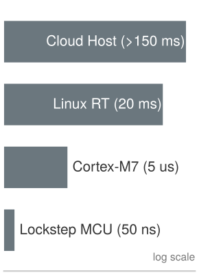
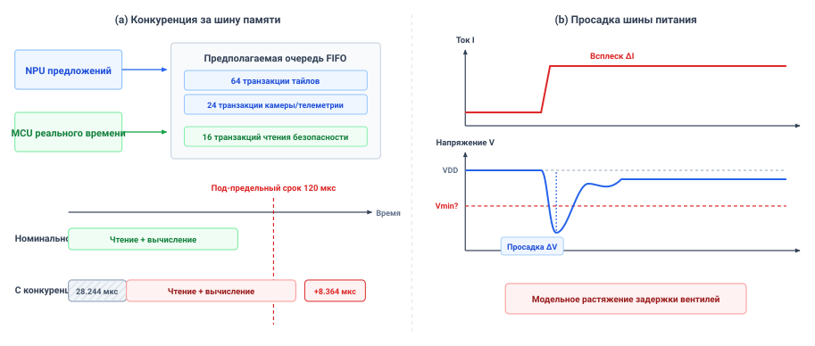
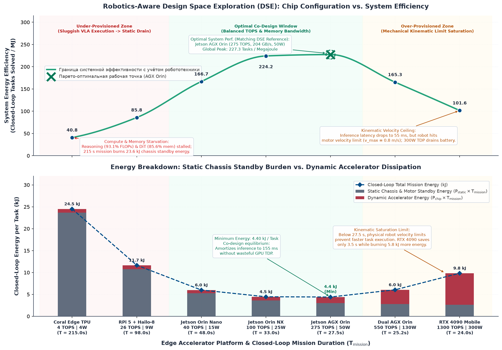

# Размещение на кремнии

## Цель

_Почему обученная модель способна задержать проверку безопасности, которая выполняется на другом ядре процессора?_

На схемах программной архитектуры путь предложения и путь разрешения часто изображены как чисто разделенные функциональные блоки. На физическом кремнии разнородные программные компоненты неизбежно конкурируют за общие аппаратные ресурсы: шины памяти, сети распределения питания, деревья тактовых сигналов и пути теплоотвода. Высокопроизводительный всплеск нейронного инференса способен насытить общее межсоединение памяти или вызвать индуктивную просадку напряжения на питающих шинах, задерживая проверку безопасности, выполняемую на соседнем ядре процессора, пока физическое шасси продолжает выбег.

Программные кольца привилегий управляют разрешениями адресного пространства, а не планированием транзакций или задержками очередей DRAM. Поэтому логическая изоляция не способна гарантировать худшее время выполнения при пиковой конкуренции. Проверить предельные сроки способно лишь эмпирическое стрессовое измерение под враждебными нагрузками. Для принудительного обеспечения гарантий реального времени необходимы изоляция на аппаратном уровне, выделенные каналы памяти или физически отдельные анклавы микроконтроллера. В стеке физического ИИ аппаратное размещение задает вычислительный фундамент Нервной системы, гарантируя, что детерминированные проверки принудительного обеспечения завершаются до того, как команды пересекут каузальную границу.

> **Цели обучения**
>
> - Перечислить ресурсы памяти, межсоединений, питания, тактовых сигналов, сброса и теплоотвода, которые делят пути предложения и разрешения
> - Объяснить, почему средняя загрузка шины не может ограничить предельный срок, опираясь на размер транзакции, политику очередей и тайминг банков
> - Задать размер окна обслуживания оконного сторожевого таймера по измеренному дрожанию завершения для неблокирующего обмена записями между двумя путями
> - Проанализировать, как просадка шины и термический троттлинг растягивают время выполнения пути разрешения на разных временных масштабах
> - Спроектировать загруженное стрессовое испытание, порогом фальсификации которого служит заявленное худшее время выполнения пути разрешения
> - Выбрать между резервированием, разбиением, сокращением нагрузки и переносом по измеренным помехам и временному допуску аренды
> - Построить протокол размещения, фиксирующий область действия загруженных наблюдаемых максимумов, меры устранения и непроверенные условия для рассмотрения выпуска

## Кремниевая подложка

Складской мобильный манипулятор несет свой прикладной процессор и свой путь разрешения в одном шасси. На схеме его программной архитектуры граница предложения между Мозгом и Нервной системой — чистая пунктирная линия. Барьерный фильтр и лестница резервирования раздела [«Обеспечение безопасности»](12_enforcement.md#sec-enforcement) сохраняют свои гарантии, только пока путь разрешения завершает свою проверку внутри предельного срока на каждом такте, а это условие зависит от того, где выполняется проверка, чего схема не показывает. На физическом кремнии пунктирная линия способна схлопнуться на один общий кристалл. Предположим, оба пути работали бы на одной гетерогенной системе на кристалле (SoC) — размещении, которое эта машина отвергает. Политика фрагментов и модель намерения исполнялись бы на встроенном акселераторе, а путь разрешения — на соседнем ядре реального времени. Когда модель намерения начинает проход инференса по своим весам с миллиардами параметров, одновременно активируются миллиарды транзисторов. Этот всплеск тока ($dI/dt$) наводит индуктивную и резистивную просадку напряжения ($\Delta V = L \cdot dI/dt + IR$) во внутренней сети распределения питания (PDN) кристалла, рискуя нестабильностью тактовой частоты и нарушениями времени установления в соседней логике реального времени.[^fn-place-voltage-droop] Одновременно плотные тензорные матричные перемножения насыщают общую шину памяти LPDDR, передавая гигабайты карт активаций и вытесняя закрепленные сенсорные таблицы механизма принуждения из кеша последнего уровня.

[^fn-place-voltage-droop]: **Механика индуктивной просадки напряжения**: В высокопроизводительном проектировании VLSI индуктивная просадка напряжения ($\Delta V = L \cdot dI/dt$) возникает на паразитной индуктивности ($L$) выводов корпуса распределения питания и кремниевых сетях питания, когда большое число логических вентилей переключается одновременно. Если напряжение локальной шины опускается ниже минимального рабочего порога ($V_{\min}$), цифровые триггеры испытывают нарушения времени установления, метастабильности или сбросы по просадке питания, нарушающие детерминированное выполнение реального времени.

Когда путь разрешения читает сенсорный буфер, а рабочая нагрузка предложения занимает общий контроллер памяти, его запросы встают в очередь за трафиком прямого доступа к памяти, и ожидание способно израсходовать ту долю предельного срока, которая была нужна вычислению механизма принуждения. Логическая привилегия ничего не делает против этого ожидания, ибо она управляет тем, к каким адресам может прикасаться задача, а не тем, где ждут ее запросы в очереди памяти.

> ↰ **Предварительное требование:** Аппаратные ритмы выполнения и тайминговые циклы микроконтроллера заданы в разделе [«Многотактные ритмы»](04_nervous_system.md#sec-nervous-cadences).

Обе работы машины ощутили бы связь общего кристалла. Для базы класса 1 остановка памяти во время извлечения признаков задерживает отказ пути разрешения, пока нагруженная база приближается к торцу стеллажа, и каждый такт задержки сверх того, что считает бюджет остановки, — это ход, который она никогда не резервировала. Для руки класса 2 всплеск акселератора, вытесняющий таблицы пути разрешения из общего кеша, задерживает проверку контакта, пока захват давит на дверцу клетки с пружинной защелкой.

Согласно сквозной аргументации в системном проектировании [Saltzer et al., 1984](references.md#saltzer1984end), защита памяти и изоляция процессов операционной системы сами по себе не устанавливают операционную независимость. На гетерогенном кристалле[^fn-place-system-chip] **операционная независимость** требует, чтобы активность на стороне предложения не могла вынести выполнение принудительного обеспечения за его жесткий физический предельный срок и чтобы отказы или тепловые перегрузки на стороне предложения не могли лишить путь разрешения полномочий на отказ.

[^fn-place-system-chip]: **Архитектура гетерогенной системы на кристалле**: Гетерогенные SoC объединяют несколько различных вычислительных доменов на одной кремниевой подложке, сочетая высокопроизводительные прикладные процессоры и нейронные акселераторы с детерминированными островками безопасности реального времени. Хотя блоки управления памятью изолируют программные адресные пространства между доменами, аппаратные подсистемы продолжают делить сети распределения питания, деревья распределения тактовых сигналов и контроллеры DRAM. При пиковых когнитивных всплесках нагрузки нескоординированная конкуренция за ресурсы в этих общих физических структурах способна ухудшить время отклика реального времени за критические физические предельные сроки.

Поскольку этими связями управляют физические твердотельные явления, а не программные абстракции, архитектурные заявления об изоляции следует рассматривать как гипотезы, подлежащие фальсификации измерением. Проверка такого утверждения требует четырех инженерных шагов: инвентаризации каждого общего кремниевого ресурса и его претендентов; стрессовой кампании, которая доводит путь предложения до худшей конкуренции за вычисления, память и шину, записывая распределение задержек и наблюдаемый максимум пути разрешения; измерений просадки напряжения и температуры перехода под непрерывной нагрузкой; и протокола размещения, который сопоставляет наблюдаемые максимумы с предельным сроком вместе с условиями, оставшимися непроверенными. Эти шаги повторяются в остальной части главы, которая рассматривает общий кристалл как размещение, отвергаемое машиной, а дискретный контроллер — как используемое ею. Она начинается с того, что должен вычислять каждый путь, где он работает и сколько запаса он сохраняет, когда с ним ничего не конкурирует.

Историческая эволюция архитектур физического ИИ укоренена в физических пределах полупроводникового масштабирования ([«Пятьдесят лет масштабирования микропроцессоров (1975–2025)»](13_placement.md#fig-placement-fifty-year-microprocessor-trend)). За пятьдесят лет прогресса микропроцессоров (1975–2025) вычислительные системы пересекли две крупные архитектурные границы. В эру классического масштабирования (1975–2004) закон Мура и масштабирование Деннарда позволяли тактовой частоте экспоненциально вырастать с $2\,\text{MHz}$ до $3.8\,\text{GHz}$ без роста плотности тепловой мощности. Автономная робототехника шла на этой волне напрямую, переходя от миникомпьютеров вне робота, связанных кабелем (Shakey), к бортовым стойкам VMEbus (CMU Navlab 1) и встроенным материнским платам x86 (Stanford Stanley).

Когда масштабирование Деннарда рухнуло в 2004 году, статические токи утечки ограничили частоту одноядерных процессоров величиной около $3.8\,\text{GHz}$, остановив эру частотного масштабирования. Промышленная робототехника адаптировалась архитектурами с разделением: детерминированные микроконтроллеры взяли на себя подсчитываемые по циклам контуры коммутации двигателей полевой шины на $1\,\text{kHz}$, а прикладные процессоры занялись многопоточной генерацией траекторий. С приходом высокоемкого глубокого обучения и фундаментальных моделей зрение–язык–действие (VLA) физический ИИ встретил второе, жесткое аппаратное ограничение: **тепловой и батарейный потолок полезной нагрузки мобильного робота** ($15\text{--}60\,\text{W}$). Серверные акселераторы, потребляющие $300\text{--}700\,\text{W}$, невозможно термически рассеять или запитать от батареи на автономном мобильном манипуляторе или гуманоиде. Это ограничение вынудило к применению специализированных акселераторов (DSA) и гетерогенных периферийных систем на кристалле (таких как NVIDIA Jetson AGX Orin и Drive Thor), увеличивших плотность бортовых вычислений на девять порядков ($10^9\times$) при строгом соблюдении мобильных пределов мощности. Самое последнее препятствие: последовательное декодирование токенов в авторегрессионных VLA уперлось в **стену когнитивного обдумывания** ($1\text{--}3\,\text{Hz}$), что подтолкнуло переход к потоковому сопоставлению (flow matching) и диффузионным политикам с временным фрагментированием действий, возвращающим частоты замкнутого контура управления к $30\text{--}50\,\text{Hz}$.

***Пятьдесят лет масштабирования микропроцессоров (1975–2025)**: Вверху: количество транзисторов (закон Мура), тактовая частота и пиковый серверный TDP против теплового бюджета полезной нагрузки мобильного робота ($15\text{--}60\,\text{W}$), показывающие разрушение масштабирования Деннарда 2004 года на $3.8\,\text{GHz}$. Внизу: плотность бортовых вычислений при полезной нагрузке $\le 60\,\text{W}$ (GFLOPS и эквивалент TOPS, рост $10^9\times$) против частоты обдумывания контура восприятие–действие (Гц), сопоставляющая детерминированный базис полевой шины $1\,\text{kHz}$, стену обдумывания авторегрессионных VLA $1\text{--}3\,\text{Hz}$ и фрагментирование действий потокового сопоставления $30\text{--}50\,\text{Hz}$. (Вехи адаптированы по Karl Rupp и базе данных Stanford CPU).*

Соединение высокоемкого нейронного обдумывания с периферийным кремнием требует иных принципов компиляции, нежели универсальные облачные вычисления. Облачные движки инференса оптимизируют среднюю пропускную способность (токены в секунду) динамической группировкой пакетов, трассировкой графа во время выполнения и выделением памяти из кучи (`malloc`). В овеществленной системе физического ИИ эти практики опасны. Динамическое выделение памяти вносит фрагментацию кучи и конкуренцию за блокировки распределителя, а компиляция в момент запуска и ошибки подкачки добавляют многомиллисекундную хвостовую задержку ($P_{99.9}$), которая прямо крадет запас остановки ([«Огибающие остановки»](12_enforcement.md#sec-enforcement-stopping-envelopes)). Поэтому периферийные компиляторы физического ИИ принудительно обеспечивают **предварительную (AOT) статическую компиляцию графа**: топология графа выполнения навсегда заморожена, размеры тензоров фиксированы, и каждый промежуточный буфер активаций отображается на статическое, предварительно выделенное смещение физической памяти до начала исполнения команды, гарантируя нулевое число динамических выделений во время выполнения.

Помимо устранения хвостовой задержки, компиляция на периферийных SoC управляется термодинамикой и стеной памяти. Как установлено в разделе [«Питание, свежесть и стена памяти»](03_brain.md#sec-brain-cognitive-pipeline), перемещение данных по внешней шине динамической памяти (DRAM) потребляет примерно $10\text{--}20\times$ больше энергии на бит, чем арифметические операции внутри кремниевых регистров или статической памяти (SRAM). На автономном мобильном роботе, работающем в тепловом бюджете полезной нагрузки $15\text{--}60\,\text{W}$, передача промежуточных тензоров активаций туда и обратно по шине DDR быстро исчерпывает теплорассеивающую способность шасси. **Слияние операторов** компилирует многослойные подграфы (такие как свертка + смещение + активация или проекция внимания + LayerNorm) в единые слитые ядра, исполняемые целиком внутри кремниевых регистровых файлов и локальных кешей SRAM и устраняющие трафик внешней памяти. Параллельно **снижение числовой точности** (квантование весов и активаций с FP32/FP16 вниз до INT8 или FP4) действует как прямой множитель пропускной способности шины памяти. Уменьшение разрядности операндов вдвое удваивает эффективную пропускную способность кроссбара памяти, прямо снижая загрузку шины памяти и сохраняя ее пропускную способность для одновременного мониторинга безопасности реального времени.

## Два пути на одном кристалле

Мобильный манипулятор распределяет свое управление между двумя путями с противоречивыми требованиями. Путь предложения запускает политику фрагментов на прикладном процессоре с `20 Hz`, принимая потоки навигационной камеры и камеры запястья и выдавая вместе целевую скорость базы и целевые положения шарниров руки. Его P99-инференс, включая зрение, занимает `40 ms` (иллюстративно; см. Руководство для читателя) из каждого периода фрагмента в `50 ms`; прямых аппаратных полномочий над приводами он не имеет и работает в непривилегированном пользовательском пространстве. Путь разрешения работает на дискретном микроконтроллере безопасности (MCU) с `1 kHz`. На каждом такте он сверяет последнее предложение с огибающей остановки раздела [«Огибающие остановки»](12_enforcement.md#sec-enforcement-stopping-envelopes) и подготавливает допущенные задания для кадра EtherCAT к приводам. Он должен завершиться внутри выбранного предельного срока `400 μs` в пределах своего такта `1 ms`, и работает в привилегированной области выполнения реального времени на двухъядерном контроллере с дублированным (lockstep) исполнением,[^fn-place-asild-lockstep] чья диагностика компаратора покрывает собственный отказ пути разрешения, ибо проверка огибающей не способна обнаружить отказ в ядре, которое ее исполняет. Только путь разрешения владеет доступом через память-отображенный ввод-вывод (MMIO) к мастеру полевой шины, несущему команды приводов.

[^fn-place-asild-lockstep]: **Двухъядерное дублированное (lockstep) исполнение**: Два ядра могут исполнять согласованные потоки инструкций, а логика компаратора обнаруживает выбранные расхождения. Охват обнаружения, задержка, уязвимость общей шины и диагностический отклик зависят от устройства и кейса безопасности применения, поэтому lockstep — один элемент аргумента ASIL D, но не весь он.

> **Разбиение гетерогенного кремния**
>
> ***Разбиение гетерогенного кремния*** — архитектурное распределение стохастических высокоемких когнитивных нагрузок (восприятие, оценка обученной политики) и детерминированных контуров безопасности (проверки инвариантов безопасности, допуск и резервирование) по специализированным областям выполнения, изолированным аппаратно.
>
> 1.  **Значение:** Размещение высокоемкого нейронного обдумывания и принудительного обеспечения безопасности реального времени на одной универсальной операционной системе или вычислительной машине создает отказы общего режима. Вытеснение потоков ядра, динамическое выделение памяти и планирование варпов GPU добавляют многомиллисекундную хвостовую задержку, из-за которой путь разрешения пропускает физические предельные сроки управления.
> 2.  **Отличие:** В отличие от логической изоляции программных процессов (таких как контейнеры Linux или приоритеты процессов POSIX), разбиение кремния принудительно обеспечивает изоляцию независимыми аппаратными регистрами, тесно связанными статическими памятями (TCM) и выделенными периферийными шинами.
> 3.  **Типичная ловушка:** Считать, что привязка задач к ядрам CPU дает настоящее разделение областей отказа, тогда как ядра по-прежнему делят кеши, контроллеры памяти, деревья тактовых сигналов и питающие шины.

> ↰ **Предварительное требование:** Субмиллисекундный предельный срок выполнения механизма принуждения CBF-QP установлен в разделе [«Минимальное вмешательство»](12_enforcement.md#sec-enforcement-minimal-intervention).

Оба процессора запускают разные виды ПО, следуя двухпроцессорной реализации раздела [«Где проходит путь разрешения»](04_nervous_system.md#sec-nervous-silicon-partitioning). Инференс предложений, запись телеметрии, сетевое взаимодействие и фиксация отказов работают на прикладном процессоре под Linux, чей хвост планирования остается открытым для дрожания ядра и драйверов даже в конфигурации реального времени.[^fn-place-preempt-rt] Принудительное обеспечение и проверка сенсоров работают на дискретном микроконтроллере безопасности как прошивка на голом железе за аппаратным блоком защиты памяти,[^fn-place-memory-partitioning] причем интерфейсы энкодеров, ИМУ и таймерные каналы подключены к нему напрямую. Каждое предложение достигает микроконтроллера по межсоединению на уровне платы и публикуется там через seqlock-почтовый ящик раздела [«Многотактные ритмы»](04_nervous_system.md#sec-nervous-cadences), так что никакая динамическая память со случайным доступом (DRAM) не разделяется между путями. По питанию оба пути делят только аккумулятор. Микроконтроллер, логика приводов и катушки пружинных тормозов находятся на изолированной шине раздела [«Какой бюджет ограничивает первым»](02_body.md#sec-body-archetype-matrix), которая не несет нагрузки стороны предложения и поддерживается локальным накопителем `2 s`, дольше любой остановки, которую механизм принуждения может скомандовать внутри огибающей ([«Лестница резервирования»](12_enforcement.md#sec-enforcement-fallback-ladder)). Поэтому просадка общей управляющей шины не способна сбросить путь разрешения.

[^fn-place-preempt-rt]: **PREEMPT_RT**: Конфигурация Linux реального времени снижает часть задержек планировщика, но ее хвост зависит от ядра, драйверов, нагрузки и общего оборудования. Без измерений не следует ни переносимого результата ниже $50\,\mu\text{s}$, ни сравнения с голым железом.

[^fn-place-memory-partitioning]: **Аппаратная защита памяти и домены IOMMU**: Физические кремниевые структуры, принудительно обеспечивающие пространственную изоляцию адресов. Пока встроенный блок защиты памяти (MPU) ограничивает выполнение потоков CPU границами сегментов памяти, блок управления памятью ввода-вывода (IOMMU) транслирует и контролирует запросы прямого доступа к памяти (DMA) от мастеров периферийных шин (таких как нейронные акселераторы PCIe или десериализаторы камер), физически препятствуя недоверенному устройству портить буферы состояния безопасности.

На ненагруженной машине вычислительные бюджеты выглядят щедрыми. Иллюстративные частные издержки на микроконтроллере безопасности отводят чтение энкодеров, ИМУ и эпохи свидетельств предложения `40 μs`, оценку ограничений `80 μs`, а подготовку допущенных заданий для кадра приводов `15 μs`. Цикл механизма принуждения без нагрузки в сумме занимает `135 μs`, что при тактовой частоте микроконтроллера `400 MHz` составляет `54 000` циклов. Против предельного срока `400 μs` ненагруженный путь оставляет `265 μs` запаса, а заявленное худшее время выполнения `250 μs` — квалифицированный бюджет раздела [«Минимальное вмешательство»](12_enforcement.md#sec-enforcement-minimal-intervention) — все еще оставляет `150 μs`. На прикладном процессоре инференс политики фрагментов `40 ms` оставляет `10 ms` от ее периода в `50 ms`. Рассмотренные изолированно, оба контура работают с удобными запасами.

*Кандидатные области выполнения различаются своими средствами контроля тайминга; размещение определяют измеренные хвосты.*

Назначение задач разным ядрам процессора не создает независимых областей отказа, если кремниевая инфраструктура общая.[^fn-std-cast-32a] Раздел [«Аппаратная изоляция»](04_nervous_system.md#sec-nervous-hardware-isolation) проследил эти пути общей причины на плате машины, где отдельные корпуса и изолированная шина разрезают пути памяти и питания. На общем кристалле — отвергнутом для этой машины варианте — они перемещаются внутрь одного корпуса. Ядро реального времени исполняет инструкции независимо от прикладного процессора, однако оба ядра опираются на общие аппаратные службы:

- *Общая маршрутизация прерываний:* Универсальный контроллер прерываний (GIC) маршрутизирует периферийные и межпроцессорные уведомления по общей ткани, где поток прерываний от пакетов Ethernet на прикладном процессоре способен задержать таймерное прерывание, запускающее контур разрешения `1 kHz`.
- *Общие контроллеры памяти:* Оба пути обращаются к одному контроллеру динамической памяти и кроссбару межсоединений, где большие загрузки матричных плиток от нейронного акселератора насыщают командные очереди DRAM, превращая ожидаемое обращение к кешу второго уровня $20\text{ ns}$ на ядре реального времени в обращение к основной памяти за $350\text{ ns}$.[^fn-place-cache-coloring]
- *Общие деревья тактовых сигналов:* Ядра делят фазовые автоподстройки частоты (PLL) для генерации тактов, где переходные процессы динамического масштабирования напряжения и частоты (DVFS) на прикладном процессоре вносят дрожание тактовой частоты в соседние домены реального времени.
- *Общие питающие шины:* Единая сеть распределения питания (PDN) подает ток в оба домена, где переключающиеся всплески от нейронного акселератора роняют внутреннюю шину напряжения, рискуя порчей логических состояний или сбросами по просадке питания.
- *Общие домены сброса:* Паника ядра на прикладном процессоре, вызывающая аппаратный сброс сторожевого таймера, способна опустить общую периферийную шину или системное межсоединение, отключая выходы приводов и оставляя базу без разрешенной команды.

[^fn-place-cache-coloring]: **Окрашивание кеша и разбиение по путям (ways)**: Методы распределения общей емкости кеша между конкурирующими задачами. Программное окрашивание кеша разбивает выделение физических страниц так, чтобы адреса разных процессов отображались на непересекающиеся наборы кеша, тогда как аппаратные механизмы разбиения (такие как ARM Memory System Resource Partitioning and Monitoring, MPAM, или Intel Cache Allocation Technology, CAT) динамически ограничивают кеш-пути (ways), которые способен выделить недоверенный нейронный акселератор, предотвращая вытеснение линий в критичных потоках безопасности.

Конкуренция за общие аппаратные ресурсы в этих доменах — не просто пассивная неэффективность планирования; она устанавливает активный **киберфизический вектор атаки**. В гетерогенном SoC, где сторонние нейронные нагрузки или программные контейнеры, открытые сети, делят кремний с путем разрешения, скомпрометированный прикладной процессор способен проводить намеренные атаки отказа в обслуживании (DoS) против физической безопасности. Порождая патологический невыровненный трафик памяти или вызывая «трещотку» кеш-линий (используя механизмы побочных каналов кеша или помехи в стиле Rowhammer), атакующий на непривилегированном пути предложения способен намеренно насытить очереди контроллера памяти, задерживая обращения микроконтроллера безопасности к памяти и вынуждая пропуски предельных сроков. Аналогично враждебная нагрузка способна запускать высокочастотные паттерны переключения тензорных ядер, рассчитанные на максимизацию индуктивной просадки $L \cdot dI/dt$, вгоняя общую сеть распределения питания в просадку и вызывая аппаратные сбросы общего режима. В архитектурах физического ИИ изоляция программных процессов не защищает от электрической и микроархитектурной связи; принудительно обеспечиваемые аппаратные разбиения качества обслуживания (такие как ARM MPAM) и физическое разделение кремния — фундаментальные средства киберфизической защиты.

[^fn-std-cast-32a]: **Авиационная сертификация многопроцессорных систем**: FAA Advisory Circular AC 20-193 и CAST-32A формализуют анализ помех для критичных по безопасности авиационных систем. Руководство требует ограничивать худшие времена выполнения, показывая, что общие кеши, кроссбары межсоединений и контроллеры памяти не способны привести к пропуску предельных сроков критичными задачами. Без принудительно обеспечиваемых аппаратных разбиений качества обслуживания или выделенных каналов межсоединений межъядерный трафик памяти обесценивает одноядерную границу тайминга.

Поскольку изоляция программных процессов не способна смягчить эти аппаратные связи тайминга и защиты, первичной архитектурной защитой становится физическое размещение на кремнии. Для контура разрешения машины сравним три размещения. Общие прикладные ядра открывают контур разрешения хвосту планирования ядра и драйверов, описанному ранее, — хвосту, способному вынести его не только за предельный срок `400 μs`, но и за сам такт `1 ms`. Кластер реального времени на прикладном SoC сохраняет собственное ядро, но делит контроллер памяти кристалла, шины и тепловой путь; раздел [«Тепловая и временная связь»](13_placement.md#sec-placement-thermal-timing-coupling) показывает троттлинг тактовой частоты, который его отвергает. Используемый машиной дискретный микроконтроллер безопасности платит за свое разделение транспортом — переходом на уровне платы от прикладного процессора, которого не требует ни один вариант с общим кристаллом и который раздел [«Решения по изоляции на кремнии»](13_placement.md#sec-placement-isolation-decisions) относит на счет аренды. Выбор между тремя опирается на измеренный отклик от сенсора до привода каждого варианта под помехами, а не на число используемых им корпусов.

Принцип [«Предложение — не разрешение»](part3_running.md#pri-vol4-proposal-permission) требует пути разрешения, который обученные нагрузки не могут задержать, и три размещения различаются именно тем, какие ресурсы оба пути все еще делят. Даже разделение дискретного микроконтроллера — утверждение о тайминге под нагрузкой, которое способно поддержать лишь измерение его такта под этой нагрузкой. У каждого ресурса, который делят оба пути, есть претенденты на этот такт, и первыми сталкиваются они в системе памяти.

## Конкуренция за общие ресурсы

У каждого общего физического ресурса несколько претендентов; метрика загрузки, игнорирующая одновременную конкуренцию, не способна ограничить предельный срок. Если бы мобильный манипулятор разместил свой путь разрешения на прикладном SoC, путь предложения, путь разрешения и системная инфраструктура напрямую конкурировали бы за одни и те же контроллеры памяти, коммутаторы-кроссбары и шины распределения питания. Среди цифровых претендентов на этой общей шине памяти были бы DMA-потоки камер и лидара, складывающие кадры в DRAM, нейронный акселератор, забирающий матрицы весов модели и промежуточные тензоры активаций, ядро реального времени, читающее свои таблицы ограничений и историю сенсоров, буферы записи актуаторов для команд приводов, контроллеры кеша, исполняющие выгрузку «грязных» линий, и процессы диагностического журналирования, пишущие записи состояния в энергонезависимое хранилище. На собранной машине те же всплески остаются на прикладном процессоре, где задерживают наблюдение и фрагмент, а не такт разрешения. Путь разрешения встречает их как возраст свидетельств ([«Цена приема данных»](08_perception.md#sec-perception-cost-ingestion)), отказывая свидетельствам старше своего порога отказа и входя в резервирование, если ни один допущенный фрагмент не продлевает аренду.

На общем кристалле **конкуренция за шину-кроссбар и банки DRAM** — это задержка в очереди, когда транзакции памяти и DMA делят межсоединение и контроллер, а ее граница зависит от размера транзакции, политики очередей и тайминга банков.[^fn-place-dram-bandwidth]

[^fn-place-dram-bandwidth]: **Конфликты банков DRAM**: Другая строка в том же активном банке может потребовать предзаряда и активации перед обслуживанием столбца. Фактическое отображение банков, перекрытие и планирование определяют добавленную задержку.

Средняя потребность каждого претендента следует из размера его передачи и частоты событий, и на общем канале LPDDR потоки камер, выборка весов с частотой политики, чтения механизма принуждения, записи приводов, выгрузки и журналирование вместе занимают в среднем небольшую долю ее пропускной способности. Инженер, смотрящий только на этот средний уровень, заключает, что большая часть шины свободна. Арбитры памяти не планируют средние скорости. Они арбитрируют дискретные всплески, и две нагрузки с одинаковой средней пропускной способностью мешают друг другу по-разному, если одна передает небольшими пакетами, а другая приходит длинными насыщающими блоками.

Арифметическая интенсивность [Williams et al., 2009](references.md#williams2009roofline) говорит, ограничена ли процедура в стационарном режиме вычислительными устройствами или пропускной способностью памяти; она ничего не говорит о том, какой запрос ждет, когда два пути приходят к шине одновременно. Пока веса приходят из DRAM, арифметическая интенсивность акселератора равна нулю, и он действует как высокопроизводительный движок прямого доступа к памяти, насыщающий общую шину. Потоковая передача весов — это и то, что ограничивает частоту свежих предложений стеной памяти раздела [«Питание, свежесть и стена памяти»](03_brain.md#sec-brain-cognitive-pipeline). Размещение видит другую сторону этого предела, ибо каждая передача весов, ограничивающая инициатор, — это трафик, за которым ждал бы размещенный рядом путь разрешения.

Как долго ждет чтение безопасности, зависит от арбитража транзакций и планирования DRAM. Акселератор, перемещающий веса плитками в $262\,144$ байта, не выдает один пакет: [спецификация Arm AXI4](https://documentation-service.arm.com/static/64256e84314e245d086bc88f) допускает не более 256 тактов на пакет и запрещает пакету пересекать границу адреса в $4\,096$ байта, так что на предполагаемом 128-битном внутреннем пути плитка превращается в 64 выровненные транзакции. Транзакция в полете может быть невытесняемой, а блокируют ли оставшиеся транзакции плитки более позднее чтение безопасности, зависит от того, реализует ли контроллер обход по приоритету. DRAM добавляет собственную задержку, ибо за раз открыта только одна строка в банке: подобно клерку, которому нужно закрыть один ящик, прежде чем открыть другой, чтение закрытой строки ждет предзаряд ($t_{\text{RP}}=14\text{ ns}$) и активацию ($t_{\text{RCD}}=14\text{ ns}$) перед обслуживанием столбца.

Контроллеры, использующие планирование **сначала готовый — сначала пришедший (FR-FCFS)**, пропускают готовые попадания в строку вперед более старых запросов, а потоковый акселератор поставляет попадания в строку в избытке, так что этой политике нужна собственная граница голодания. Под очередью FIFO, не пропускающей более поздние приходы вперед чтения безопасности, идеализированное ожидание равно

$$t_{\text{queue}} = \sum_{k \in \mathcal{Q}} \frac{B_k}{\text{BW}_{\text{peak}}} + N_{\text{conflicts}} (t_{\text{RP}} + t_{\text{RCD}})$$

где $\mathcal{Q}$ содержит транзакции перед чтением, $B_k$ — число байтов каждой, $N_{\text{conflicts}}$ считает переключения банков, а $\text{BW}_{\text{peak}}$ — оптимистичная скорость обслуживания, так что накладные расходы арбитража и регенерации добавляются к результату.

> **Загруженное чтение пути разрешения на общем кристалле**
>
> **Задача**: Предположим, путь разрешения читал бы свой сенсорный снимок из общей DRAM прикладного SoC. Сколько транзакций могло бы стоять в очереди перед этим чтением, прежде чем такт превысит свой допуск на восприятие, заявленное худшее время выполнения и свой предельный срок?
>
> **Переменные**: Такт отводит `40 μs` на восприятие и `95 μs` на оценку ограничений и запись кадра приводов, внутри предельного срока `400 μs`. Снимок занимает `4 096` байта на канале `12.8` GB/s. Перед ним в FIFO стоят одна плита весов (`64` транзакции), передача камеры и запись телеметрии: `88` транзакций, `360 448` байта, `3` переключения банка.
>
> **Расчет**: По [«очереди DRAM»](13_placement.md#eq-placement-dram-queuing), обслуживание накопившихся `360 448` байт со скоростью `12.8` GB/s плюс `3` переключения по `28` ns занимает `28.244` $\mu\text{s}$. Сам снимок читается за `0.32` $\mu\text{s}$, так что загруженное чтение занимает `28.564` $\mu\text{s}$ и оставляет `11.436` $\mu\text{s}$ допуска на восприятие. Вторая накопившаяся порция превысила бы его. Заявленное худшее время выполнения `250 μs` пересекается, как только чтение превысит `155 μs`, а на это нужно более `5` накопившихся порций, и это пересечение уже опровергает независимость, хотя такт еще укладывается в свой предельный срок. Сам предельный срок держится, пока чтение не превысит `305 μs`, а на это нужно более `10` накопившихся порций, так что такт, укладывающийся в срок, — не свидетельство исправности размещения. При проверенном обходе по приоритету впереди ждет только одна транзакция в полете, и чтение занимает `0.64` $\mu\text{s}$.
>
> **Системный вывод**: Граница чтения принадлежит контроллеру памяти, а не нагрузке. Она существует, лишь если контроллер ограничивает, сколько трафика он пропускает перед чтением безопасности, или позволяет этому чтению обойти очередь, а контроллер FR-FCFS, обслуживающий потоковый акселератор, не дает ни того, ни другого, если его конфигурация не квалифицирована на это. Дискретный микроконтроллер машины устраняет вопрос, читая свой снимок из тесно связанной памяти на собственной шине.

Конкуренция распространяется на сеть распределения питания, где претенденты соревнуются за заряд, а не за пропускную способность. Просадка раздела [«Кремниевая подложка»](13_placement.md#sec-placement-silicon-substrate), $\Delta V = L\,dI/dt + IR$, растет вместе со скоростью и величиной ступени тока. Внешний стабилизатор напряжения откликается слишком медленно, чтобы уловить наносекундную ступень тока, поэтому первый заряд идет от развязывающей емкости на кристалле, а когда она исчерпана, общая шина просаживается под каждым питаемым ею ядром.

На общей шине $V_{\text{core}} =$ `0.85` $\text{V}$ с индуктивностью корпуса $L =$ `30` $\text{pH}$ и сопротивлением $R =$ `8` $\text{m}\Omega$ ступень тока акселератора $\Delta I =$ `6` $\text{A}$ за `2` $\text{ns}$ создает `90` $\text{mV}$ индуктивной и `48` $\text{mV}$ резистивной просадки, `138` $\text{mV}$ всего, просадку на `16.2` процента до `0.712` $\text{V}$. Модель вентилей с альфа-степенным законом[^fn-hw-alpha-power] превращает эту просадку в увеличение задержки распространения на `39` процентов ([«Индуктивная просадка и растяжение задержки вентилей»](appendix_systems.md#sec-appendix-systems-droop) выводит оба шага). Это задержка вентиля, а не такта. Израсходует ли она запас пути разрешения, вызовет сброс по просадке питания или ничего не сделает, зависит от минимального рабочего напряжения устройства и политики тактовой частоты, и решить это способны лишь измерения шины и тайминга под заявленной ступенью тока. Оба канала помех — очередь FIFO межсоединения и просадка напряжения питающей шины — структурированы на рисунке [«Каналы помех гетерогенного SoC»](13_placement.md#fig-13-soc-contention-droop). Общий кристалл оставляет эти вопросы открытыми для каждого всплеска акселератора; дискретный микроконтроллер на собственной шине и собственной питающей шине их не наследует.

***Каналы помех гетерогенного SoC**: (a) В очереди FIFO шины памяти накопленные фоновые транзакции задерживают чтение безопасности и выносят чтение вместе с вычислением за предельный срок; обход по приоритету меняет ожидание. (b) В сети распределения питания внезапная ступень тока матричного акселератора ($\Delta I = 6.0\text{ A}$ за $2.0\text{ ns}$) создает $138\text{ mV}$ индуктивной и резистивной просадки, нелинейно растягивая задержку распространения вентилей по альфа-степенному закону. Пересечение минимального рабочего порога $V_{\min}$ влечет нарушения тайминга или сброс по просадке.*

[^fn-hw-alpha-power]: **Модель задержки КМОП с альфа-степенным законом**: Модель использует $t_{\text{prop}} \propto V/(V-V_{\text{th}})^\alpha$ с $V_{\text{th}}=0.42\text{ V}$ и $\alpha=1.3$. Она связывает напряжение питания с задержкой переключения одного вентиля; отказы установления и поведение при просадке питания приходят из характеристики устройства.

Обнаружение этих взаимодействий требует инструментации вне затронутого ядра, ибо ПО на остановленном или замедленном ядре не способно засечь собственную задержку. Счетчики контроллера памяти, мониторы шин, тепловые диоды и регистры причины сброса фиксируют связь.

Общий кристалл способен учитывать эти связи аппаратно — арбитром кроссбара, который направляет помеченные транзакции безопасности через собственную очередь, дозируя всплески акселератора кредитами пропускной способности, и контроллером управления питанием, который при тепловом пороге затроттливает только тактовую частоту акселератора. Каждое из этих свойств принадлежит контроллеру и должно подтверждаться испытанием размещения, а не быть параметром планировщика, который блок-схема может допустить по умолчанию. Арбитраж решает, когда транзакция движется, а не что она несет. То, что пересекает физическую границу между двумя путями, должно быть определено явными гарантиями относительно момента выработки, действительности и отклика на отказ.

## Контракт границы

Что пересекает границу между путем предложения и путем разрешения по контракту границы, — это запись, а не безусловный указатель в общую память, ибо передача необработанного адреса памяти через границу доверия напрямую связывает читателя с внутренним расположением памяти писателя, временем его выполнения и областью отказа. Если политика фрагментов, работающая на акселераторе, предоставляет лишь указатель на свой частный выходной буфер, у пути разрешения нет механизма определить, продолжает ли писатель изменять буфер, завис ли он посреди инференса или встретил необработанный отказ. Поэтому полезная нагрузка границы должна быть неизменяемой, самодостаточной записью. Пересекающая границу запись — это заголовок предложения раздела [«Многотактные ритмы»](04_nervous_system.md#sec-nervous-cadences), публикуемый через его seqlock-почтовый ящик; размещение не добавляет полей, только свидетельство того, что обмен укладывается в свой предельный срок под нагрузкой. Путь разрешения читает запись как изолированный снимок, оценивая ее временную свежесть и физическую действительность до того, как какое-либо задание дойдет до привода.

Сохранение временной изоляции — пересекает ли обмен общий кристалл или платное межсоединение машины, — требует устранения блокирующей синхронизации на интерфейсе обмена. Если контур разрешения захватит блокировку, удерживаемую генератором предложений, зависание инференса способно задержать физическое решение. Поэтому зависание хоста на $25\text{ ms}$ должно оставлять механизм принуждения `1 kHz` работающим на каждом такте: он может использовать последний проверенный фрагмент, только пока его аренда и текущее состояние остаются допустимыми, а затем переходить к своему независимо проверенному резервированию. Выделение памяти и журналирование на пути разрешения также нуждаются в измеренных временных границах. Производитель может зависать или терять обновления; он не может создавать противодавление ритму принудительного обеспечения объекта управления.

Правила отклонения почтового ящика из раздела [«Отказы контракта границы и матрица резервирования»](04_nervous_system.md#tbl-04-boundary-fallbacks) не дают отказавшему производителю заставить механизм принуждения ждать. Отклоненное предложение оставляет допущенные задания в силе до истечения аренды; если ни одно допустимое предложение не продлит ее и машина движется, MCU исполняет ступень останова лестницы резервирования раздела [«Лестница резервирования»](12_enforcement.md#sec-enforcement-fallback-ladder) — резидентную остановку базы и согласованную с состоянием остановку руки, и ни одна из них не ждет инициатора. Это резервирование все равно должно завершаться в ограниченное время, а испытание размещения измеряет эту границу под нагрузкой на кремнии, который размещает путь.

### Оконные сторожевые таймеры и живость выполнения

Программные границы памяти и неблокирующие seqlock-механизмы защищают от разорванных чтений, но не гарантируют, что код механизма принуждения жив и продвигается через запланированные операции. Живость механизма принуждения принадлежит собственному сторожевому таймеру раздела [«Многотактные ритмы»](04_nervous_system.md#sec-nervous-cadences), который подкармливается только после завершенного такта. Обратный отсчет сторожевого таймера, обслуживаемый из таймерного прерывания, остается слепым к мертвой задаче — отказ, разобранный в деле *Bookout v. Toyota*. На общем кремнии механизм принуждения может также быть голодан из-за конкуренции межсоединения или работать слишком быстро после порчи тактовой частоты, поэтому размещению нужна более сильная форма этого собственного сторожевого таймера — та, что ограничивает подкормку с обеих сторон.

Архитектуры физического ИИ с высокой целостностью поэтому принудительно обеспечивают **оконные сторожевые таймеры**. Оконный сторожевой таймер отклоняет любое обновление, произошедшее слишком рано или слишком поздно. Аппаратный таймер задает окно обслуживания, параметризованное нижней границей (закрытое окно, $T_{\text{lower}}$) и верхней границей (открытое окно, $T_{\text{upper}}$):

1. **Нарушение ранней подкормки ($t_{\text{service}} < T_{\text{lower}}$)**: Если ПО пытается обновить сторожевой таймер до истечения нижнего порога, аппаратура немедленно запускает аварийный сброс. Ранняя подкормка может указывать, что ПО обошло обязательные алгоритмические стадии, ветвилось в патологический короткий цикл или получило ускорение выполнения из-за порчи тактовой частоты.
2. **Нарушение поздней подкормки ($t_{\text{service}} > T_{\text{upper}}$)**: Если таймер отсчитал за $T_{\text{upper}}$, не получив действительного обновления, счетчик переполняется вниз, подавая аппаратный сброс. Поздняя подкормка может указывать, что механизм принуждения был голодан по циклам вычисления из-за конкуренции межсоединения, завис на необработанном исключении или был задержан чрезмерными вытеснениями из кеша.
3. **Действительное окно обслуживания ($T_{\text{lower}} \le t_{\text{service}} \le T_{\text{upper}}$)**: Обновление внутри окна показывает, что путь подкормки выполнил свое временное условие; прогресс задачи все равно требует подходящего вызова-ответа или независимого наблюдения.

Если контроллер подкармливает один раз после каждого успешного такта, сторожевой таймер измеряет интервал *между подкормками*. Пусть смещение завершения $c_n$ от начала такта $n$ лежит в $[c_{\min},c_{\max}]$, а вариация фазы такта ограничена $J_{\text{phase}}$. Консервативный диапазон интервала между подкормками равен
$$T_{\text{feed}}\in[T_{\text{period}}-(c_{\max}-c_{\min})-J_{\text{phase}},\;T_{\text{period}}+(c_{\max}-c_{\min})+J_{\text{phase}}].$$
Настройте $T_{\text{lower}}$ и $T_{\text{upper}}$ вокруг этого *измеренного или обоснованного* диапазона, удерживая отклик позднего срабатывания в пределах отдельно выведенного бюджета отказов объекта управления. Одного времени выполнения одного такта недостаточно для задания интервала обслуживания сторожевого таймера. На машине $T_{\text{period}}$ — это такт `1 ms`, а заявленный худший случай `250 μs` поставляет $c_{\max}$. Ненагруженный путь `135 μs` не поставляет $c_{\min}$, ибо самая короткая ветвь механизма принуждения может завершиться раньше номинальной, поэтому нижняя граница берется из кратчайшего завершения, записанного стрессовой кампанией. $J_{\text{phase}}$ — дрожание таймера тактов микроконтроллера относительно его опоры, измеренное под той же нагрузкой. Этот диапазон дал бы собственному сторожевому таймеру машины, знающему лишь тайм-аут, недостающее $T_{\text{lower}}$, тогда как $T_{\text{upper}}$ остается на выбранном тайм-ауте `5 ms`, так что окно терпит несколько пропущенных тактов, прежде чем сработает.

Эта терпимость намеренна. Один пропущенный такт стоит миллиметров хода на скорости хода ([«Проверка разделения испытаниями»](13_placement.md#sec-placement-testing-separation)), что укладывается в бюджет отказов, а окно, закрывающееся на одной поздней подкормке, остановило бы здоровый механизм принуждения ради этого смещения. Нижняя граница, взятая из оценок, а не записанных завершений, срабатывает на здоровых тактах, а верхняя граница шире бюджета отказов скрывает голодание, ради которого окно существует.

Некоторые конструкции добавляют **контрольные точки с вызовом-ответом**: подкормка зависит от свежей проверки сенсоров, оценки разрешения и проверок выходного состояния, а не только от обработчика прерывания таймера. Ее охват отказов зависит от того, где генерируется вызов, кто может вычислить или повторить ответ и способны ли отказавшие состояния механизма принуждения все еще исполнять путь подкормки. Охват этой схемы поэтому — результат внедрения отказов, а не свойство токена.

Однако установление чистых границ в памяти, арбитраже межсоединений и живости выполнения сторожевого таймера решает лишь логическую и временную половину совместного размещения. Когда акселератор и процессор реального времени делят один кремниевый кристалл, высокая мощность, рассеиваемая при плотных матричных операциях, проводится прямо через подложку, поднимая локальные температуры перехода и меняя скорости переключения транзисторов на соседних ядрах.

## Тепловая и временная связь

Каждый ватт, рассеиваемый на кремниевом кристалле, уходит в единственный тепловой домен. На общем SoC матричные блоки, прикладные ядра, интерфейс памяти и встроенные стабилизаторы нагревают один корпус, и если контур разрешения потребляет малый, стабильный базовый уровень, путь предложения колеблется вместе со своей нагрузкой. Ограниченная теплопроводность корпуса к окружающей среде позволяет пиковой активности акселератора поднимать температуру перехода каждой схемы на кристалле.

В системной инженерии физического ИИ **термический троттлинг тактовой частоты** — это автоматическое, аппаратно принудительное снижение тактовой частоты процессора, запускаемое, когда длительный высокомощный когнитивный инференс поднимает температуру кремниевого перехода ($T_j$) за тепловые пороги срабатывания ($T_{\text{trip}}$). Чтобы предотвратить повреждение кристалла, аппаратура резко режет тактовую частоту. Это вносит затяжное, зависящее от температуры замедление (гистерезис), раздувающее времена выполнения даже после спада когнитивной нагрузки, и способное вынести соседние контуры безопасности реального времени за их жесткие физические предельные сроки.

Отсек электроники в основании машины находится при окружающей температуре `45`$^{\circ}\text{C}$. [«Закрытый модуль периферийных вычислений»](13_placement.md#fig-13-jetson-orin) показывает набор разработчика того класса модулей, который машина использует как прикладной процессор; его корпус не обнажает ни теплового пути, ни тактовых доменов, от которых зависит следующая оценка. Предположим, общий SoC охлаждался бы кондуктивно с **тепловым сопротивлением переход–окружающая среда** $\theta_{\text{JA}} =$ `2` $\text{K/W}$ и **тепловой постоянной времени** $\tau_{\text{th}} =$ `8` $\text{s}$. Контур разрешения вместе с питанием холостого хода и памяти потребляет `4` $\text{W}$ и удерживает переход на `53`$^{\circ}\text{C}$. Непрерывный инференс предложений добавляет потери акселератора, трафика памяти и стабилизаторов, и в общей сложности `26` $\text{W}$ поднимают стационарный режим на $P\,\theta_{\text{JA}} =$ `52` $\text{K}$ до $T_j =$ `97`$^{\circ}\text{C}$.

***Закрытый модуль периферийных вычислений**: На фотографии — коробка Jetson AGX Orin Developer Kit и закрытый вентилируемый корпус. SoC, память, охлаждающее оборудование и тактовые домены не видны; тепловая модель в тексте — отдельный иллюстративный сценарий. Фотография: [Auledas](https://commons.wikimedia.org/wiki/File:NVidia_Jetson_Orin_AGX.png), [CC BY 4.0](https://creativecommons.org/licenses/by/4.0/), через Wikimedia Commons; локальная копия перекодирована.*

Одного лишь теплового управления достаточно, чтобы отвергнуть размещение на общем кристалле для мобильного манипулятора. Предположим, его путь разрешения работал бы на кластере реального времени прикладного SoC с $f_{\text{nom}} =$ `1.2 GHz`, расходуя $N_{\text{cycles}} =$ `300 000` циклов на такт — в несколько раз больше `54 000` циклов, которые требуются дискретному микроконтроллеру без нагрузки, ибо кластер без тесно связанной памяти платит циклами заполнения кеша и когерентности за каждое чтение снимка и таблицы. Когда переход пересекает $T_{\text{trip}} =$ `95`$^{\circ}\text{C}$, регулятор опускает кластер до $f_{\text{throt}} =$ `600 MHz`, и цикл механизма принуждения растягивается до $t_{\text{exec,throt}} =$ `500 μs`, пропуская предельный срок `400 μs` на `100 μs` (превышение на `25` процентов) и далеко превышая заявленную границу, на которой был вымерен каждый запас выше механизма принуждения. Дискретный микроконтроллер работает на собственных тактовой частоте и питающей шине, вне досягаемости этого регулятора.

Превышение переживает нагрузку, потому что регулятор применяет **зависящий от состояния гистерезис**, восстанавливая `1.2 GHz`, только когда переход остынет до $T_{\text{clear}} =$ `85`$^{\circ}\text{C}$, дабы тактовая частота не колебалась вокруг пороговой линии. С остановленной политикой и питанием, вернувшимся к `4` $\text{W}$, переход релаксирует к своему базису `53`$^{\circ}\text{C}$:

$$T_j(t) = T_{j,\text{target}} + (T_{j,\text{start}} - T_{j,\text{target}}) e^{-t/\tau_{\text{th}}}$$

где $T_{j,\text{start}}$ — температура перехода в момент начала троттлинга, $T_{j,\text{target}}$ — базовое равновесие, а $\tau_{\text{th}}$ — тепловая постоянная времени корпуса. Решение [«восстановления после охлаждения»](13_placement.md#eq-placement-cooling-recovery) для падения с `95` до `85`$^{\circ}\text{C}$ дает $t_{\text{recov}} = \tau_{\text{th}} \ln[(T_{j,\text{start}} - T_{j,\text{target}})/(T_{\text{clear}} - T_{j,\text{target}})] =$ `2.18 s`. При такте машины `1 ms` в это охлаждение попадают `2 175` запланированных тактов, и конструкции с общим кристаллом потребовалось бы отдельно синхронизированное резервирование, активное для каждого из них.

Растянутый цикл на общем кристалле может также прийти от **электрической связи питающих шин**, на другом временном масштабе. Просадка шины раздела [«Конкуренция за общие ресурсы»](13_placement.md#sec-placement-resource-contention) приходит в пределах наносекунд после всплеска акселератора, тогда как тепловая связь нарастает за секунды, пока тепло диффундирует через корпус, поэтому временной отказ, отслеживающий температуру перехода $T_j(t)$, а не переходные процессы $V_{\text{core}}(t)$, — это троттлинг, а не обвал шины.

> **Температура перехода и троттлинг**
>
> ![Динамическая временная диаграмма гистерезиса термического троттлинга тактовой частоты. Слева: кривая охлаждения температуры перехода, показывающая, что после остановки когнитивного инференса в момент t=0 охлаждение с 95 °C до порога запаса 85 °C занимает 2,18 секунды. Справа: сравнение внутри одного миллисекундного такта управления: номинальное выполнение на 1,2 ГГц завершается за 250 микросекунд с запасом 150 микросекунд до предельного срока 400 микросекунд, против затроттленного выполнения на 600 МГц, растягивающегося до 500 микросекунд — превышение предельного срока на 25 процентов, — пока во время охлаждения под ударом остаются 2 175 запланированных тактов; управление должно нести отдельное резервирование.](images/13_placement/svg/chk_placement_thermal_throttling_hysteresis.svg)
>
> Прежде чем полагаться на программное тепловое управление для гарантий безопасности реального времени, проверьте свое понимание динамики температуры перехода и гистерезиса троттлинга тактовой частоты:
>
> - [ ] **Память тепловой массы о задержках**: Можете ли вы объяснить, почему физическая тепловая масса действует как длительная память о времени выполнения задач реального времени, даже после того как вызывающая когнитивная нагрузка прекращена?
> - [ ] **Размер восстановления после охлаждения**: Можете ли вы вывести время восстановления $t_{\text{recov}}$, необходимое SoC с тепловой постоянной времени $\tau_{\text{th}} =$ `8` $\text{s}$, чтобы остыть с $T_{\text{trip}} =$ `95`$^{\circ}\text{C}$ до $T_{\text{clear}} =$ `85`$^{\circ}\text{C}$ при базовом равновесии `53`$^{\circ}\text{C}$?
> - [ ] **Назначение гистерезиса регулятора**: Можете ли вы объяснить назначение температурного гистерезиса ($T_{\text{trip}}$ против $T_{\text{clear}}$) в аппаратных тепловых регуляторах и описать, как он предотвращает высокочастотные колебания тактовой частоты?
> - [ ] **Решение о физическом раздельном размещении**: Какие измеренные свидетельства тактовой частоты, питания и тайминга оправдали бы общий кристалл и когда потребовался бы отдельный контроллер?

## Проверка разделения испытаниями

Утверждение независимости при любом размещении — это проверяемая граница задержки принудительного обеспечения и доступности отказа в рамках заявленных нагрузок предложений, температур кристалла и режимов. Если конкуренция задерживает отказ за физический предельный срок, заявленное операционное разделение несостоятельно.

> ↳ **Ниже по потоку:** Враждебные микроархитектурные испытания конкуренции питают набор внедрения отказов на аппаратуре в разделе [«Внедрение отказов на аппаратуре»](15_verification.md#sec-verification-hardware-fault-injection).

Порог прохождения этого эксперимента исходит из проверяемого утверждения. Путь разрешения машины объявляет худшее время выполнения $C_{\text{wcet}} =$ `250 μs` и должен завершать каждый такт внутри выбранного предельного срока $D_{\text{enf}} =$ `400 μs`, который помещается внутрь такта $T_{\text{tick}} =$ `1 ms`. Каждое измеренное время принудительного обеспечения $t_{\text{enf}}$ должно уважать эту цепочку, как утверждает [«порог фальсификации»](13_placement.md#eq-placement-falsification-threshold):

$$t_{\text{enf}} \le C_{\text{wcet}} < D_{\text{enf}} < T_{\text{tick}}$$

Заявленная граница $C_{\text{wcet}}$ — это **порог фальсификации**. Если любой проверяемый цикл принудительного обеспечения превысит ее, гипотеза независимости опровергнута, даже когда цикл все еще укладывается в предельный срок, ибо каждый запас выше механизма принуждения — от его предельного срока до такта, который считает бюджет остановки, — был вымерен по заявленному числу. Измеренный максимум способен опровергнуть заявленную границу, но не установить ее, ибо кампания отбирает только те состояния, которых достигает, а на спекулятивных ядрах временные аномалии способны поднять истинный худший случай выше каждого записанного цикла.[^fn-math-wcet-anomalies]

[^fn-math-wcet-anomalies]: **Микроархитектурные временные аномалии**: В архитектурах с внеочередным и спекулятивным исполнением локальное улучшение производительности, такое как попадание в кеш или ускоренная оценка ветвления, способно изменить планирование инструкций и конкуренцию за ресурсы, приводя к чистому росту глобального времени выполнения. Это контринтуитивное поведение обесценивает простой композиционный анализ худшего времени выполнения. Верификации безопасности нужна обоснованная граница для заявленной нагрузки, арбитража, температуры и условий отказов; одних измерений и одного лишь неспекулятивного ядра недостаточно, чтобы установить жесткую сквозную границу.

> **Худшее время выполнения**
>
> ***Худшее время выполнения*** — формальная верхняя граница физической длительности по настенным часам, необходимой вычислительной задаче для полного завершения на целевой аппаратной платформе при всех допустимых входах, состояниях архитектурной конкуренции и условиях эксплуатации:
> $$t_{\text{exec}} \le t_{\text{WCET}} \le t_{\text{deadline}}$$
>
> 1.  **Значение:** В киберфизических контурах управления корректность зависит не только от числовой валидности выхода, но и от момента его доставки; оптимальная команда управления, доставленная после жесткого физического предельного срока, функционально эквивалентна полному отказу системы.
> 2.  **Отличие:** В отличие от среднего времени выполнения ($\bar{t}$) или высоких квантилей ($P_{99}$), характеризующих пропускную способность ПО мягкого реального времени, WCET — это абсолютная детерминированная граница, которая должна выполняться при одновременном насыщении шины памяти, «трещотке» кеша и штормах перерываний периферии.
> 3.  **Типичная ловушка:** Полагаться на эмпирическое профилирование выполнения или средние значения бенчмарков для установления WCET на современных суперскалярных или внеочередных процессорах. Микроархитектурные временные аномалии (когда локальное попадание в кеш или успех предсказания ветвления парадоксально увеличивают общее время выполнения) означают, что одних эмпирических испытаний недостаточно, чтобы доказать истинную глобальную верхнюю границу без формального статического анализа и границ конкуренции оборудования.

Ход, поставленный на кон в одном такте, невелик, из-за чего границу легко недооценить. Готовый бюджет раздела [«Бюджет остановки складского манипулятора»](12_enforcement.md#tbl-enforcement-stopping-budget) останавливает машину за `997.4 mm` на скорости хода `1.3 m/s`, с `102.6 mm` внутри свободного расстояния `1.10 m`, а один пропущенный такт добавляет лишь $v\,T_{\text{tick}} =$ `1.3 mm`. Размещение защищает саму границу, ибо $\tau_{\text{delay}}$ считает ровно один $T_{\text{tick}}$, а конкуренция без границы — это остановка неизвестной длины.

Опровержение утверждения независимости требует синтетических нагрузок, спроектированных для индукции худшей конкуренции за ресурсы, а не стандартных бенчмарков, сообщающих среднюю пропускную способность. Высокая средняя загрузка распределяет обращения к памяти равномерно по тактам, делая систему вроде бы безопасно ненагруженной, тогда как истинная физическая помеха проявляется пиками во время синхронизированных всплесков, когда несколько компонентов требуют одних и тех же проводов в один и тот же момент. Стенд испытаний должен намеренно затапливать общие каналы памяти невыровненными передачами прямого доступа к памяти, вызывать «трещотку» общей емкости кеша выгрузкой «грязных» линий от тензоров весов трансформера, запускать матричные перемножения акселератора, индуцирующие быстрые просадки напряжения питающей шины ($L \cdot di/dt$), и передавать пиковым потоком телеметрию сенсоров, пока диагностическое журналирование пишет в энергонезависимую flash-память. Эти стрессовые профили воспроизводят переходную конкуренцию, возникающую, когда модель предложения начинает большой проход внимания ровно в ту микросекунду, когда контур разрешения читает свой сенсорный снимок.

Инструментация фиксирует вход в принудительное обеспечение после согласованности сенсорного снимка ($t_0$), завершение разрешения ($t_1$) и публикацию допущенных заданий в кадр приводов ($t_2$). Они диагностируют вычисления и диспетчеризацию, но $t_2$ — еще не торможение. Прибытие кадра к приводу ($t_3$) и измеренное начало торможения ($t_4$) замыкают физическую цепочку. Конечная точка, которая имеет значение, — $t_4$, измеренный от последнего действительного продления аренды, с учетом ошибки часов. Начало торможения должно наступить в пределах `82 ms` — суммы аренды, одного такта, одного цикла шины и задержки начала торможения из раздела [«Многотактные ритмы»](04_nervous_system.md#sec-nervous-cadences). Одной границы вычислений `250 μs` недостаточно.

Механизмы связи накапливаются через физическую, электрическую и логическую области, требуя полной факториальной экспериментальной матрицы. Оценка охватывает холодные условия перехода ($T_j = 35^\circ\text{C}$) и теплый переход, удерживаемый на уровне или выше порога троттлинга $T_{\text{trip}}$ раздела [«Тепловая и временная связь»](13_placement.md#sec-placement-thermal-timing-coupling), простаивающий путь предложения против насыщенного движка предложений, исполняющего инференс максимальным пакетом, отключенное циклическое диагностическое журналирование против потоковой записи на полной пропускной способности энергонезависимой памяти и номинальные команды слежения против команд, нарушающих границу и запускающих процедуры отказа. Проверка путей отказа под полным стрессом обязательна, ибо выполнение безопасной ограничивающей траектории или вход в аварийное отключение вовлекает холодные ветви, некешированный код обработки ошибок и вторичные шинные транзакции, которые никогда не исполняются при стационарной езде по проходу.

На отвергнутом размещении с общим кристаллом пара, ради которой существует матрица, конкретна. Человек выходит у торца стеллажа, и путь разрешения берет свою ветвь отказа к ступени останова — холодный путь через некешированный код. В тот же миг прикладной процессор, зафиксировавший ту же аномалию, начинает диагностический дамп памяти по общей ткани прямого доступа к памяти. Набор тестов, раздельно исполняющий отказ и диагностическое журналирование, проходит оба и никогда не измеряет пару, ибо две подсистемы конкурируют за один контроллер памяти, только когда работают вместе.

Рассмотрим иллюстративную стрессовую трассу в $10^7$ тактов для отвергнутого размещения — путь разрешения на кластере реального времени прикладного SoC. При одном такте в `1 ms` трасса охватывает `10 000 s`, или `2` ч `46` мин `40` с, без учета сброса и настройки. Холодная трасса имеет $P_{50}=$ `95 μs`, $P_{99}=$ `128 μs` и наблюдаемый максимум `152 μs`; теплая, нагруженная трасса имеет $P_{50}=$ `210 μs`, $P_{99}=$ `330 μs`, $P_{99.9}=$ `395 μs` и наблюдаемый максимум `468 μs`. Нагруженный $P_{99}$ уже превышает заявленную границу `250 μs`, а максимум пересекает предельный срок `400 μs`, так что трасса опровергает это размещение.

Если бы трасса прошла, ее такты показали бы лишь, что наблюдаемые помехи оставались ниже порога в проверенных состояниях. Отчет дает распределение задержек, наблюдаемый максимум, число выборок, длительность и непроверенные условия, включая деградацию питания, электромагнитные помехи и старение.[^fn-hw-silicon-aging]

[^fn-hw-silicon-aging]: **Старение кремниевой подложки и временные запасы**: Долгосрочные механизмы деградации подложки, такие как нестабильность порога при отрицательном смещении (NBTI) и инъекция горячих носителей (HCI), годами эксплуатации постепенно увеличивают задержки переключения транзисторов. В сочетании с переходной просадкой напряжения питания при внезапных ступенях тока нескольких ядер ($\frac{di}{dt}$) старый кремний испытывает задержки распространения, превышающие проектные запасы. В системах жесткого реального времени эти физические деградации тайминга вызывают перемежающиеся гонки и пропуски предельных сроков планировщика, которые никогда не проявляются при чистой стендовой квалификации.

> **Перегрузка радара Apollo 11 и перезагрузки (1969)**
>
> **Контекст**: 20 июля 1969 года лунный модуль Apollo 11 *Eagle* выполнял управляемое снижение к поверхности Луны. Аппаратный вычислитель Apollo (AGC), машина на $1.024\text{ MHz}$ с программной памятью на ферритовых сердечниках, исполнял контуры навигации, управления и дросселирования двигателя снижения под асинхронным Executive с планированием по приоритетам, разработанным в приборной лаборатории MIT [NASA Manned Spacecraft Center, 1969](references.md#martin1969apollo11); [Mindell, 2008](references.md#mindell2008digital).
>
> **Механизм**: С переключателем режима радиолокатора сближения вне положения `LGC` резольверы радара возбуждались источником $800\text{ Hz}$, синфазным по частоте, но не по фазе с опорой системы навигации. Связанные блоки данных читали разность фаз как движение антенны и посылали компьютеру непрерывный поток счетных импульсов. [Отчет о полете NASA, раздел 16](https://www.nasa.gov/wp-content/uploads/static/apollo50th/pdf/A11_MissionReport.pdf) приводит максимум 12 800 импульсов в секунду от двух блоков данных, каждый из которых занимал один цикл памяти $11.7\,\mu\text{s}$, или 15 процентов машинного времени, тогда как при управляемом снижении компьютер обычно работал примерно на 90 процентов загрузки. Повторяющиеся задания, которые не могли завершиться, планировались заново, каждое резервируя еще одну область памяти, пока у Executive не кончились области.
>
> **Последствия**: До фазы низкого гейта снижения произошло пять сигналов переполнения Executive (1201 и 1202). В отчете о полете указывается, что производительность функций навигации и управления не пострадала.
>
> **Отклик**: Каждый сигнал запускал программный перезапуск, и AGC возобновлял свою основную работу навигации и индикации по приоритетам, пока экипаж и центр управления оценивали сигналы, а снижение продолжалось. В последующих миссиях блоки данных обнулялись всякий раз, когда переключатель находился не в `LGC`, устраняя ложные импульсы в их источнике.
>
> **Системный урок**: Периферия способна потреблять вычислительные мощности в тот самый миг, когда они нужны навигации. Современные испытания размещения должны учитывать асинхронную нагрузку периферии и проверять, что критический путь и его поведение восстановления остаются в заявленных временных границах.

Сигналы Executive Apollo 11 и инверсия приоритетов Mars Pathfinder (разобранные в разделе [«Передача команд вовремя»](04_nervous_system.md#sec-nervous-deterministic-fieldbuses)) иллюстрируют две различные формы конкуренции за ресурсы реального времени. В Apollo 11 периферия потребляла вычислительные мощности; в Pathfinder задача низкого приоритета удерживала ресурс, который была нужна задаче высокого приоритета.

Неудавшееся испытание помех указывает, где предполагаемое разделение может обрушиться: кеш, арбитраж памяти, тепловые тактовые частоты, питание или выходные очереди. Дальнейшая инструментация локализует механизм до того, как команда зарезервирует, разобьет или переместит общий ресурс.

## Решения по изоляции на кремнии

Опровергнутое утверждение независимости оставляет четыре средства, каждое со своей ценой ([«Матрица решений по переразмещению нагрузки и изоляции»](13_placement.md#tbl-13-replacement-decisions)): статическое резервирование, пространственное разбиение, сокращение нагрузки и физический перенос на отдельный кремний.

| Стратегия устранения     | Целевой слой связи                                            | Механизм реализации                                                                              | Компромисс системной инженерии                                                             | Остаточная уязвимость                                                                | Триггер физического переноса на кремний                                                        |
|:-------------------------|:-----------------------------------------------------------------|:-------------------------------------------------------------------------------------------------|:-----------------------------------------------------------------------------------------------------------------|:--------------------------------------------------------------------------------------------|:-------------------------------------------------------------------------------------------------------------|
| **Статическое резервирование**   | Время выполнения CPU, вытеснение при планировании ОС                     | Планирование с фиксированными приоритетами и вытеснением (`SCHED_FIFO`), статическое нарезание временных слотов (ARINC 653)        | Простаивающая мощность (потеря пропускной способности $20\text{--}40\%$); нераспределенные циклы пропадают в спокойных состояниях             | Микроархитектурная конкуренция ниже видимости ОС (общий L3, конфликты банков DRAM)       | Остановки шины памяти или кеша нарушают предельные сроки реального времени, несмотря на $100\%$ выделение ядра CPU                   |
| **Пространственное разбиение** | «Трещотка» емкости кеша, конкуренция за шину DRAM                    | Разбиение кеша по путям (ways) (ARM MPAM, Intel CAT), домены MPU/IOMMU, ограничители скорости AXI QoS           | Структурная фрагментация; уменьшение рабочего набора L3 для восприятия (штраф доступа к DRAM $+15\text{--}30\text{ ns}$) | Неразбиваемые очереди контроллера DRAM, переупорядочение по локальности строк, просадка напряжения PDN   | Ступени тока матричного движка ($\Delta I > 10\text{ A}$) вызывают просадку шины, или остановки очереди DRAM превышают запас |
| **Сокращение нагрузки**   | Насыщение пропускной способности памяти, пиковая тепловая мощность                 | Квантование модели (INT8/FP8), прореживание контекста, уменьшение частоты политики вдвое                          | Ухудшенная точность слежения политики; рост фазового запаздывания управления у границ динамической устойчивости                 | Общие деревья распределения тактовых сигналов, общие блоки управления питанием (PMU), единые домены сброса | Точность модели падает ниже эксплуатационных пределов, или отказы общих тактовых сигналов/сброса распространяются через домены         |
| **Физический перенос**  | Общие питание, тактовые сигналы, сброс или неограниченная помеха контроллера | Отдельный MCU механизма принуждения с независимо оцененными питанием, тактовыми сигналами, памятью и путем сенсор/актуатор | Больше площади платы и бюджет внешней связи                                                             | Остаются отказы жгута, приемопередатчика и общего питания                                       | Выбирать, когда общий кристалл не способен представить свидетельства требуемого тайминга и сдерживания отказов                 |

***Матрица решений по переразмещению нагрузки и изоляции**: Пути устранения на случай, когда испытание фальсифицирует независимость на общем кремнии. Каждое средство обменивает различные инженерные валюты (пропускную способность, емкость, задержку, площадь платы) на устранение каналов конкуренции до эскалации до физически разделенного кремния.*

**Статическое резервирование** сохраняет физическое размещение нагрузок на общем чипе, выделяя гарантированную долю общего ресурса критическому пути. Резервирование назначает критическому контуру выделенные слоты выполнения или фиксированную пропускную способность шины памяти. Цена резервирования — простаивающая мощность. Если бы путь разрешения машины делил кристалл, слот арбитра, размеренный по худшему случаю чтения его снимка, оставался бы зарезервированным в каждом такте `1 ms`, недоступный для модели политики даже при припаркованном основании и без происходящей остановки.

**Пространственное разбиение** делит физические аппаратные структуры так, что нагрузки больше не конкурируют за одни и те же физические ячейки.[^fn-std-iso-placement] Разбиение кеша по путям (ways), привязка к ядрам и выделенные каналы памяти устанавливают аппаратные барьеры внутри одного кристалла. Цена разбиения — утраченная гибкость и структурная фрагментация. Разделение восьмимегабайтного общего кеша на шестимегабайтный раздел для модели политики и двумегабайтный раздел для таблиц пути разрешения предотвращает вытеснение кеш-линий через границу. Однако это навсегда ограничивает рабочий набор обученной модели, вынуждая более высокие частоты обращений к DRAM и увеличивая среднюю задержку памяти на десятки наносекунд на каждом шаге инференса.

[^fn-std-iso-placement]: **Автомобильная свобода от влияния (FFI)**: ISO 26262, часть 9, формализует Freedom From Interference (FFI) как отсутствие каскадных отказов между программными элементами с разными уровнями целостности безопасности. В гетерогенных робототехнических SoC достижение FFI требует принудительно обеспечиваемого аппаратного пространственного разбиения (блоки защиты памяти, страничные таблицы IOMMU) и временнóго разбиения (арбитраж шины с фиксированными приоритетами, TDMA-межсоединения), чтобы недоверенные модели восприятия не ухудшали задачи принудительного обеспечения, критичные по безопасности.

**Сокращение нагрузки** разрешает конкуренцию уменьшением вычислительной или памятной следы некритичной нагрузки, пока ее пиковый спрос не окажется в неконкурируемых запасах общей системы. Инженер может проредить журналирование телеметрии с $1\text{ kHz}$ до $100\text{ Hz}$, квантовать веса политики с шестнадцатибитной плавающей точки до восьмибитных целых, вдвое сократив трафик шины памяти, или понизить частоту политики фрагментов. Цена сокращения — ухудшение функциональных полномочий. На мобильном манипуляторе аренда ограничивает последний рычаг. Период фрагмента длиннее аренды `60 ms` раздела [«Многотактные ритмы»](04_nervous_system.md#sec-nervous-cadences) позволяет предложениям истекать между продлениями, поэтому частота политики должна оставаться выше `16.7 Hz`, даже не считая дрожания продления, что оставляет мало места ниже ее `20 Hz`. Квантование весов способно ухудшить точность политики на допусках захвата при подборе с конвейера.

Если резервирование, разбиение и сокращение нагрузки не способны установить требуемую границу отклика, кандидатом становится физический перенос. Он достигает связей, недоступных резервированию и разбиению, — таких как общий домен сброса или тактовых сигналов, позволяющий одному отказу остановить оба пути; разбиенный SoC, заявляющий сдерживание такого отказа, обязан показать это проектом и испытаниями внедрения отказов. Отдельный контроллер устраняет эти пути общей причины ровно настолько, насколько спроектированы и испытаны независимость его питания, тактовых сигналов, сброса, сенсоров и актуаторов, а цель целостности, которой он служит, опирается на кейс безопасности применения, а не на счет корпусов. Внешний контроллер также добавляет обязательства транспорта и общего питания, поэтому его путь сенсоров и актуаторов должен измеряться как целое.

Перенос нагрузки на отдельный кремний редко бывает локальной правкой. Он запускает каскад корректировок размещения и связи по всей машине, и мобильный манипулятор показывает, куда приходится эта цена. Слагаемое $T_{\text{bus}}$ раздела [«Многотактные ритмы»](04_nervous_system.md#sec-nervous-cadences) не меняется, ибо команды приводов пересекают полевую шину EtherCAT независимо от того, где работает путь разрешения. Перенос добавляет переход предложения от прикладного процессора к микроконтроллеру по межсоединению на уровне платы вместо почтового ящика на кристалле. Эта задержка не вносит нового слагаемого в $\tau_{\text{delay}}$. Предложение, пришедшее с опозданием, тратит часть допуска на дрожание продления `5 ms`, который правило аренды раздела [«Единый связанный бюджет анатомии»](04_nervous_system.md#sec-nervous-coupled-budget) помещает в разрыв между периодом фрагмента `50 ms` и арендой `60 ms`. Конкуренция за память хоста берет из того же допуска, поэтому максимум, на который она может растянуть инференс политики фрагментов `40 ms`, — `12.5` процента ([«Цена приема данных»](08_perception.md#sec-perception-cost-ingestion)). Худший случай межсоединения, измеренный под нагрузкой, должен поэтому укладываться в то, что оставляют от допуска эта конкуренция и собственное дрожание инициатора.

Более трудное решение — куда подключается каждый сенсор. Машина держит энкодеры и ИМУ на стороне микроконтроллера, за межсоединением, ибо именно их путь разрешения читает на каждом такте, а камеры и лидар оставляет на прикладном процессоре, ибо именно их потребляют обученные модели, а путь разрешения читает лишь эпоху свидетельств предложения. Перенос интерфейса камеры на микроконтроллер разгрузил бы основной чип, но заставил бы обученные модели получать свой поток наблюдений по более медленному внешнему межсоединению и добавил бы к возрасту наблюдения, который измерял раздел [«Сенсорное восприятие»](08_perception.md#sec-perception). Каждое решение о переразмещении распространяется через физические межсоединения, сдвигая узкие места от арбитров памяти на кристалле к числу выводов на уровне платы, прокладкам проводов и последовательным шинам.

Выбор оборудования в физическом ИИ нельзя отвязать от механической динамики овеществления. Если обычные наборы бенчмарков оценивают периферийные акселераторы по изолированным метрикам, таким как теоретический пиковый TOPS или чистая пропускная способность пакетного инференса, овеществленные системы работают под энергетическими ограничениями замкнутого контура, где вычислительная задержка и физическое движение жестко связаны ([«Исследование пространства конструкций с учетом робототехники (DSE)»](13_placement.md#fig-placement-robotics-aware-dse)). Оценка конфигураций периферийных акселераторов вдоль континуума — от сверхмаломощных периферийных TPU до многоваттных рабочих GPU — обнажает инвертированную-U парето-границу эффективности.

Слабые акселераторы (такие как периферийный TPU на $4\,\text{TOPS}$ или неускоренный CPU) несут долгие задержки инференса зрение–язык–действие ($>200\,\text{ms}$ на шаг), растягивая задачу выбора и укладки более чем на три минуты ($T_{\text{mission}} = 215\,\text{s}$). Все это время электроника основания робота, сенсоры, токи удержания двигателей и системы теплового управления непрерывно потребляют статическую мощность дежурного режима ($P_{\text{static}}$). Следовательно, статический энергетический штраф ($P_{\text{static}} \times T_{\text{mission}} = 23.65\,\text{kJ}$) доминирует в общем потреблении миссии, давая плохую чистую эффективность системы ($40.8\,\text{tasks/MJ}$). И наоборот, оснащение периферии настольными GPU ($300\,\text{W}$ TDP) сокращает время выполнения модели до $55\,\text{ms}$, но система упирается в кинематический потолок скорости робота ($v_{\text{max}} = 0.8\,\text{m/s}$). Предельная экономия времени ($27.5\,\text{s} \to 24.0\,\text{s}$) не компенсирует массивное динамическое рассеяние мощности чипа ($P_{\text{chip}} \times T_{\text{mission}}$), и суммарная энергия на задачу взлетает до $9.84\,\text{kJ}$. Оптимальное окно совместного проектирования возникает в точке баланса (пример — Jetson AGX Orin на $50\,\text{W}$), где инференс модели достаточно амортизирован, чтобы предотвратить статическую утечку энергии шасси, не вводя ненужных штрафов динамической мощности.

***Исследование пространства конструкций с учетом робототехники (DSE)**: Вверху: энергоэффективность системы (решенные в замкнутом контуре задачи на мегаджоуль), проявляющая инвертированную-U парето-границу вдоль семи конфигураций периферийного оборудования. Медленный инференс на недоукомплектованных чипах ведет к статической утечке энергии шасси, тогда как переукомплектованные акселераторы упираются в насыщение кинематической скорости ($v_{\text{max}} = 0.8\,\text{m/s}$) и страдают от чрезмерного динамического тепловыделения. Внизу: разложение энергии на задачу, раскладывающее статическую энергию дежурного режима шасси и двигателей ($P_{\text{static}} \times T_{\text{mission}}$) против динамического рассеяния акселератора ($P_{\text{chip}} \times T_{\text{mission}}$) и выявляющее оптимальный минимум в $4.40\,\text{kJ}$ на задачу для сбалансированных периферийных SoC.*

## Распределение аппаратных ресурсов

У мобильного манипулятора теперь есть размещение для его пути разрешения, предельный срок, оценка выполнения без нагрузки и испытание, способное опровергнуть разделение. Ничто из этого не доходит до решения о выпуске, пока не записано вместе с условиями, при которых оно держится. **Протокол размещения** потребляет протокол принудительного обеспечения раздела [«Протокол принудительного обеспечения»](12_enforcement.md#sec-enforcement-telemetry), из которого берет заявленное худшее время выполнения и предельный срок пути разрешения, и добавляет свидетельства того, что заявленная граница держится под нагрузкой на кремнии, где работает путь: область выполнения, привилегию, период, наблюдаемые максимумы без нагрузки и под нагрузкой, настройки арбитража, пороги просадки и тепловые пороги, меры устранения и дайджест журнала испытаний. Нагруженные максимумы решают утверждение независимости, которое держится, только пока каждый из них остается на уровне или ниже заявленного худшего времени выполнения под заявленной нагрузкой; как утверждал раздел [«Передача команд вовремя»](04_nervous_system.md#sec-nervous-deterministic-fieldbuses) для любого наблюдаемого распределения задержек, выборочный максимум — свидетельство об этой границе и никогда ее не заменяет.

Протокол состоит из двух частей. Компактный заголовок хранит значения конфигурации и наблюдаемые максимумы и несет дайджест внешнего журнала испытаний. В журнале хранится то, что не укладывается в фиксированную раскладку: инвентаризации, распределения задержек и числа выборок за каждым максимумом, условия испытаний, меры устранения и открытые пределы.

> ↳ **Раскладка по байтам:** Смещения и размеры полей протокола размещения приведены в разделе [«Протокол размещения»](appendix_systems.md#sec-appendix-systems-wire-placement).

Для мобильного манипулятора заголовок фиксирует такт `1 ms`, предельный срок `400 μs` и иллюстративную оценку без нагрузки `135 μs`, которая еще не является измеренным максимумом. Флаги мер устранения заголовка включают изолированную шину пути разрешения. Ее поле загрузки остается пустым, ибо для этой машины еще не существует журнала испытаний под нагрузкой. Заполнить его можно лишь кампанией раздела [«Проверка разделения испытаниями»](13_placement.md#sec-placement-testing-separation), выполненной на самой машине: дискретный микроконтроллер тикает, пока прикладной процессор ведет пиковый инференс предложений с полным журналированием, при теплом переходе, с ветвью отказа, исполняемой в тех же пробах. Каждый нагруженный максимум, записанный этой кампанией, должен остаться на уровне или ниже заявленных `250 μs`, а начало торможения, отсчитанное от последнего действительного продления, должно наступить в пределах `82 ms`. Пока эти измерения не существуют, утверждение независимости разрешения, которое взвешивает раздел [«Выпуск в эксплуатацию»](16_release.md#sec-release), покоится на заявленной границе без ничего за ней, и вердикт, которому нужно это утверждение, не может быть вынесен на его основе.

Внешний журнал инвентаризирует каналы памяти, разделы кеша, движки DMA, питающие шины и их конкурирующих претендентов. Для каждого он фиксирует конфигурацию арбитража и измеренные помехи. Для шины разрешения он фиксирует поддержку `2 s`, которую проверяет внедрение пропадания подкормки раздела [«Внедрение отказов на аппаратуре»](15_verification.md#sec-verification-hardware-fault-injection), и список претендентов, который несет само утверждение об изоляции: микроконтроллер, логику приводов и катушки пружинных тормозов и никакой нагрузки стороны предложения.

Измерению помех нужны его рабочие условия: хеши модели и прошивки, политика тактовой частоты, корпус и тепловой интерфейс, окружающая и температуры перехода, питающая шина, настройки арбитража, генераторы трафика, частоты дискретизации, инструментация, число выборок и длительность испытания. Журнал несет эти поля рядом с распределениями задержек и непроверенными состояниями, которые они квалифицируют, а наблюдаемые максимумы заголовка резюмируют эти распределения. Трасса в $10^7$ тактов раздела [«Проверка разделения испытаниями»](13_placement.md#sec-placement-testing-separation) охватывает лишь `2` ч `46` мин `40` с работы одной машины — слишком мало, чтобы обнаружить любую помеху реже примерно одного такта из $10^7$, и слишком слабое свидетельство для парка машин.

Каждая запись размещения требует заранее объявленного критерия фальсификации, записанного до исполнения испытания. Этот критерий задает физический порог, составляющий архитектурный отказ, — такой как любой цикл принудительного обеспечения длиннее заявленного худшего случая `250 μs` во время одновременных всплесков нейронного акселератора и передач DMA. Протокол фиксирует измеренное распределение относительно этого критерия и указывает, устояло ли проверяемое утверждение или было опровергнуто. Когда помеха нарушает целевой бюджет и вынуждает инженерное изменение, протокол описывает точно примененную меру устранения — например, включение ограничения пропускной способности шины памяти для нейронного акселератора. Запись должна также документировать граничные условия, не проверенные во время прогона испытания, — такие как рабочие состояния выше окружающей температуры отсека `45`$^{\circ}\text{C}$, внедрение многобитовых ошибок памяти или одновременные отказные состояния сенсорных приемопередатчиков.

Раздел [«Верификация»](15_verification.md#sec-verification) потребляет записанные точки арбитража и общие питающие шины как карту целей для внедрения аппаратных и программных отказов, намеренно портя общие структуры, чтобы проверить, совпадает ли распространение отказов с предсказанными областями отказа. Раздел [«Выпуск в эксплуатацию»](16_release.md#sec-release) включает записанные нагруженные границы выполнения и непроверенные пределы испытаний в формальный кейс безопасности, превращая эмпирические измерения в доказательные аргументы для эксплуатационного развертывания.

> ↳ **Ниже по потоку:** Кейсы безопасности аппаратного размещения служат доказательными обоснованиями для промышленного развертывания в разделе [«Кейсы безопасности и утверждения»](16_release.md#sec-release-safety-cases-claims).

> **Когда резервирование — шаг**
>
> **Вопрос**: Какие строки бюджета остановки выживают, когда резервирование — шаг, а не остановка?
>
> Размещение защищает один такт, который считает $\tau_{\text{delay}}$, и бюджет остановки Части III полон для машины, чье резервирование тормозит ее до покоя, как у мобильного манипулятора. У шагающего гуманоида нет состояния покоя, в которое можно затормозить посреди шага, поэтому его резервирование — восстановительный шаг, и каждую строку бюджета нужно перепроверить против этого маневра.
>
> * **Возраст наблюдения выживает.** Возраст по-прежнему превращается в смещение ([«От фотонов к пространственным утверждениям»](08_perception.md#sec-perception-photons-to-claims)), а на поворачивающейся голове ошибка угловая. Некалиброванный сдвиг камеры–ИМУ `10 ms` при повороте головы `1.5` rad/s смещает точку в `5 m` впереди на `7.5 cm`.
> * **Обязательство меняется.** Зафиксированный стоп-суффикс раздела [«Поведение на стыке»](11_planning.md#sec-planning-behavior-seam) становится проверенным шагом, допускаемым вместе с траекторией как раньше, но завершающимся на новой точке опоры, а не в покое.
> * **Врезка меняется.** Ограничение баланса может иметь относительную степень выше единицы — тот случай, который раздел [«Безопасные множества как условное разрешение»](12_enforcement.md#sec-enforcement-safe-sets-conditional-permission) разрешает для чистого запаса хода, вкладывая скорость в барьер. Барьеру баланса нужна та же конструкция, и врезка слежения тогда применяется к порождаемому им барьеру.

## Заблуждения и ловушки

Размещение определяет физические ресурсы, которые делят сложные алгоритмы предложений и критичные процедуры принудительного обеспечения. Трассы нормальной работы не способны доказать, что эти системы действительно независимы, когда редкие физические события — такие как переходные процессы напряжения питания, отказы тактовых сигналов, конкуренция за память или зависший производитель — нагружают эти общие аппаратные пути.

> **Заблуждение и ловушка**
>
> **Заблуждение**: *Логические кольца привилегий защищают механизмы принуждения реального времени от электрической просадки общей шины.*
>
> Предположим, мобильный манипулятор поместил бы свое lockstep-ядро разрешения на питание акселератора в одном SoC. Просадка раздела [«Конкуренция за общие ресурсы»](13_placement.md#sec-placement-resource-contention) тогда растянула бы задержку распространения каждого вентиля на этой общей шине на `39` процентов, включая вентили ядра разрешения, какой бы приоритет ни имело его ПО. Ядро, чья тактовая частота оставляет меньше временнóго запаса, чем это растяжение, пропускает время установления на своих критических путях. Оба lockstep-ядра видят одну и ту же просадку, поэтому способны зафиксировать одно и то же неверное значение, а компаратор останется немым, либо детектор просадки сбрасывает механизм принуждения, пока основание движется. Контроллер доступа решает, по каким адресам механизм принуждения может писать; у него нет слагаемого для напряжения на его триггерах. Квалификация размещения должна ограничить просадку развязывающей емкостью или пределами скорости нарастания $di/dt$ и показать временной запас под заявленной ступенью тока, либо убрать общее питание. Машина убирает его, работая путем разрешения на изолированной шине с поддержкой раздела [«Какой бюджет ограничивает первым»](02_body.md#sec-body-archetype-matrix), из которой акселератор не потребляет.

> **Заблуждение и ловушка**
>
> **Ловушка**: *Совместное использование фазовых автоподстроек частоты (PLL) или контроллеров сброса между доменами предложения и разрешения.*
>
> Если бы прикладной процессор машины и домены разрешения делили одну PLL и один контроллер сброса ([«Аппаратная изоляция»](04_nervous_system.md#sec-nervous-hardware-isolation)), тепловой отказ тактовой частоты или сброс сторожевого таймером зависшего кластера политики мог бы остановить и домен разрешения. Номинальная блок-схема показывает отдельные процессоры, однако оба зависят от хрупкой кремниевой инфраструктуры, которую одно событие способно молча выключить. Проследите деревья тактовых сигналов и сброса через физическую реализацию, чтобы обеспечить независимые ресурсы для непрерывного принудительного обеспечения. Приводам основания и руки также нужен определенный аппаратный переход в безопасное состояние, когда разрешенные команды перестают поступать; перезапуск прикладного процессора не может быть единственным механизмом восстановления.

> **Заблуждение и ловушка**
>
> **Заблуждение**: *Низкая средняя загрузка шины памяти гарантирует ограниченную задержку чтения для задач безопасности реального времени.*
>
> Предположим, путь разрешения машины читал бы свой сенсорный снимок из общей DRAM, где умеренное среднее использование шины скрывает всплески камеры и журналирования, совпадающие с его чтениями. Загруженное чтение раздела [«Загруженное чтение пути разрешения на общем кристалле»](13_placement.md#nbk-placement-loaded-read) укладывается в допуск на восприятие, только пока перед ним стоит одна накопившаяся порция, и ничто в среднем не ограничивает, сколько их будет. Предполагаемый хвост чтения `320 μs` оставляет `80 μs` от предельного срока `400 μs` — меньше, чем `95 μs`, которые требуют оценка ограничений и запись кадра приводов, так что эта конфигурация несостоятельна. Согласованный снимок TCM способен убрать чтение из общей DRAM, если его завершение DMA, емкость и локальное время передачи квалифицированы. Одной средней загрузки недостаточно, чтобы установить предельный срок.

> **Заблуждение и ловушка**
>
> **Ловушка**: *Использование блокирующих программных мьютексов через границы межпроцессорной связи с недоверенными нейронными политиками.*
>
> Политика фрагментов падает посреди публикации фрагмента из `16` заданий. Механизм принуждения, вынужденный захватить блокировку, удерживаемую этим производителем, замер бы вместе с ним, поэтому контракт границы раздела [«Контракт границы»](13_placement.md#sec-placement-boundary-contract) не допускает блокирующей синхронизации. Его seqlock позволяет механизму принуждения отклонить разорванную запись, не ожидая, и продолжить своим резервированием, но лишь если само поведение повторных попыток имеет границу. Контракт связи должен задавать временное поведение прерванных публикаций столь же строго, как формат полезной нагрузки.

## Итоги

Платформы физического ИИ размещают обученных инициаторов на прикладных процессорах и акселераторах, а путь разрешения — на микроконтроллере на голом железе, однако одного этого распределения недостаточно, чтобы развести их, ибо границы привилегий не управляют ни одним из физических ресурсов, которые оба пути все еще делят. Разбиение поэтому остается проектной гипотезой, пока загруженное испытание не опровергнет ее.

Физическую изоляцию должны подкреплять измеренные границы очередей памяти, арбитража кроссбара, переходных процессов питания и пути актуаторов. Результат размещения — эмпирическое утверждение, ограниченное областью измеренных условий. Успешный протокол размещения показывает, что при заявленной стрессовой нагрузке, исполняемой при определенной окружающей температуре, с фиксированными политиками управления тактовой частотой и задокументированными областями отказов, общие физические подложки кристалла не привели к тому, что недоверенный путь нарушил временные ограничения пути безопасности. На складском мобильном манипуляторе изображение политики фрагментов и пути разрешения в отдельных рамках на архитектурной схеме не изолировало бы их от общего стабилизатора напряжения, общей шины-кроссбара памяти или радиатора, зажатого поверх обоих кластеров процессоров. Если бы акселератор, исполняющий обученное предложение, потреблял пиковый ток, пока каждый канал памяти обслуживает передачи прямого доступа к памяти, результирующее падение напряжения достигло бы размещенного рядом ядра разрешения за наносекунды, а тепло — за секунды; машина помещает это ядро на отдельный кремний именно по этой причине. Границы, начерченные при системном проектировании, существуют на кремнии, лишь будучи проверенными против этих общих электрических, тепловых и архитектурных пределов.

Протокол размещения несет эти свидетельства дальше. Он берет заявленное худшее время выполнения и предельный срок пути разрешения из протокола принудительного обеспечения и добавляет нагруженные наблюдаемые максимумы для заявленных условий испытаний, запасы очередей общих ресурсов и питания, общие пути отказов питания, тактовых сигналов, сброса и памяти, а также условия, оставшиеся непроверенными. Собственный протокол машины удерживает иллюстративную оценку без нагрузки `135 μs` против заявленного худшего случая `250 μs` внутри предельного срока `400 μs` и все еще ждет нагруженный журнал, который должен назвать политику арбитража, тактовые частоты, число выборок и физическую конечную точку до того, как на него сможет опереться любое заявление о выпуске.

С завершением этого анализа размещения стадии Части III складываются в единую машину, которую надлежит измерять как одно целое. Контракт наблюдений, протокол оценки, аренда намерения, протокол траектории, протокол принудительного обеспечения и протокол размещения образуют одну цепь, каждое звено которой — утверждение с условиями, поэтому порождающие их стадии нельзя считать независимыми программными модулями, общающимися через идеализированный канал. Логические границы, установленные в предыдущих главах, дают структуру, нужную для рассуждений о полномочиях и распространении отказов, но их исполнением управляет физическая реальность. Контроллер памяти следует настроенному арбитражу и планированию строк, которые не обязаны отражать программную привилегию, а прерывание способно прийти во время любой из нагрузок. Когда путь разрешения допускает задание скорости основания, действие — последний шаг конвейера, чьи временные, энергетические и памятные следы должны измеряться вместе на одном шасси. Ранние главы предполагали, что обученные нагрузки не могут задержать путь разрешения, которого требует принцип [«Предложение — не разрешение»](part3_running.md#pri-vol4-proposal-permission), а размещение превращает это допущение в фальсифицируемый порог с испытанием на стресс и протоколом за ним. Часть IV наследует три вещи, которые цепь оставляет открытыми: запас готового бюджета остановки, неурегулированную предпосылку правила пересечения площадки и пустое поле загрузки протокола размещения.

> **Гетерогенное размещение на кремнии и конкуренция за память**
>
> * **Логическое разделение — гипотеза об аппаратуре:** Кольца привилегий управляют тем, к каким адресам может прикасаться задача, а не тем, где ждут ее запросы, какая шина ее питает и от какого дерева тактовых сигналов и сброса она зависит. Утверждение независимости держится, лишь после того как загруженное испытание не смогло его опровергнуть.
> * **Средние не могут ограничить предельный срок:** На отвергнутом общем кристалле одна накопившаяся порция транзакций плиток весов, камеры и телеметрии растягивает чтение снимка пути разрешения с `0.32` до `28.564` $\mu\text{s}$. Более `5` таких порций пересекают заявленное худшее время выполнения, чего ничто в среднем не запрещает. Размер транзакции, политика очередей и поведение обхода решают ожидание, поэтому граница принадлежит контроллеру памяти.
> * **Связь идет на трех временных масштабах:** Просадка шины действует за наносекунды, очередь — за микросекунды, а термический троттлинг длится секунды после остановки нагрузки. В отвергнутом размещении с общим кристаллом вдвое сниженная тактовая частота растягивает `250 μs` цикл механизма принуждения до `500 μs` на `2 175` тактов.
> * **Заявленная граница — порог фальсификации:** Любой нагруженный цикл выше заявленного худшего времени выполнения опровергает независимость, даже когда предельный срок еще держится, ибо каждый запас выше механизма принуждения был вымерен по этому числу. Успешная трасса поддерживает только проверенные ею состояния.
> * **Опровергнутое утверждение требует выбора с ценой:** Резервирование стоит простаивающей мощности, разбиение — рабочего набора, сокращение нагрузки — полномочий политики, а перенос добавляет межсоединение на уровне платы, чей худший случай должен укладываться в допуск на дрожание продления аренды.
> * **Протокол размещения задает область показанного:** Он берет заявленное худшее время выполнения и предельный срок из протокола принудительного обеспечения и добавляет нагруженные наблюдаемые максимумы, меры устранения и непроверенные условия. На мобильном манипуляторе поле загрузки все еще пусто, поэтому утверждение независимости доходит до рассмотрения выпуска без свидетельств.

> **От размещения вычислений к вмешательству супервизора**
>
> Что происходит с бюджетом остановки, когда самая медленная задержка принадлежит человеку? Каждая задержка, рассмотренная в этой главе, принадлежала машине (чтение в очереди, растянутый вентиль, затроттленная тактовая частота), и каждую можно ограничить или опровергнуть испытанием на шасси. Раздел [«Вмешательство супервизора»](14_intervention.md#sec-intervention) открывает Часть IV задержкой, которую не может ограничить никакое размещение. Удаленный ассистент, перехватывающий мобильный манипулятор в проходе, реагирует медленнее любого слагаемого, измеренного здесь, по межсоединению, которым путь разрешения не управляет, и эта реакция тратит тот же бюджет остановки. Полномочия должны тогда переходить между обученным инициатором, путем разрешения и человеком так, чтобы сама передача не порождала движения, которое она призвана предотвратить, и каждый такт должен фиксировать, кто ими владел.

