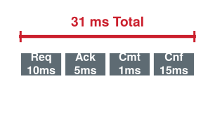
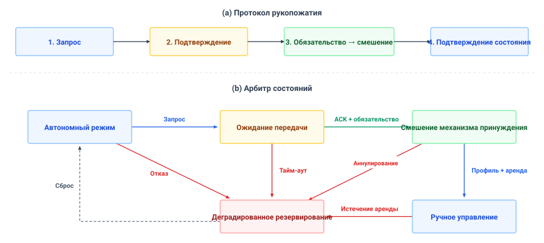
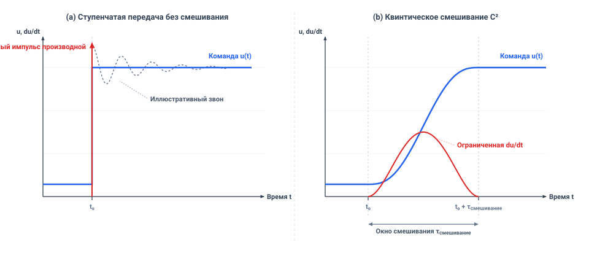

# Вмешательство супервизора

## Цель

_Когда человек хватается за органы управления работающей машины, как передать кинетические полномочия, не вызвав самое столкновение, которое он стремился предотвратить?_

Когда человек-супервизор заявляет полномочия над автономной системой, запрос перехвата достигает аппаратуры, уже движущейся под нейронным управлением. Наивное смешивание человеческих и автоматических команд без строгого арбитража дает конфликтные управляющие воздействия, тогда как мгновенное переключение грозит тяжелым механическим ударом или внезапной потерей сцепления. Безопасная архитектура вмешательства должна явно назначать кинетические полномочия, принудительно обеспечивать безударную передачу команды и проверять, что передача сохраняет динамическую осуществимость на всем окне перехода.

Ключевой момент: когнитивное время реакции человека и задержка передачи телеметрии расходуют тот же физический бюджет остановки, что и алгоритмическая задержка; оператор не может служить резервированием безопасности с нулевой задержкой. Когда сигналы живости супервизора пропадают или передача буксует, машина должна независимо включать детерминированное резервирование. Каждое вмешательство должно неизменяемо записываться с микросекундными метками времени, чтобы отделить автономные отказы от восстановлений оператором. В пределах огибающей управления супервизорное вмешательство рассматривает человеческий вход как внешнее предложение, которое должно пройти через детерминированный путь разрешения, прежде чем пересечь каузальную границу.

> **Цели обучения**
>
> - Определить разрешения оператора, связывающие допущенные действия с охватом, предельными сроками и требованиями аутентификации
> - Рассчитать позднейшее время резервирования и потолки скорости перехвата по задержке реакции и оставшемуся запасу хода для остановки
> - Спроектировать передачи полномочий с единственным источником записи в актуатор и сохранением непрерывности команды в пределах физических ограничений
> - Различать отказ политики, передачу полномочий и человеческое восстановление в протоколах полномочий с метками времени
> - Оценить, может ли протокол полномочий восстановить полномочия команд и физические исходы после инцидента

## Разделенные полномочия

Человека-супервизора часто рисуют одной стрелкой к объекту управления. Когда паллета блокирует проход, складскому мобильному манипулятору нужен удаленный ассистент, который перехватит управление, однако на выбранной скорости хода `1.3 m/s` пауза в `2 s` (условная величина; см. Руководство для читателя) до торможения унесла бы его на `2.6 m` — более чем вдвое свободного расстояния `1.10 m` у торца стеллажа. Запрос оператора достигает машины, уже движущейся по допущенной команде; он не может стереть импульс или заставить актуатор откликнуться мгновенно. Арбитр — шаг выбора источника в пути разрешения — должен решить, кто может предложить следующую команду, а механизм принуждения, его проверка допуска, — допустить или отвергнуть ее; и то и другое работает на микроконтроллере безопасности (MCU). У объекта управления все еще должен оставаться достаточный запас хода, чтобы выполнить выбранную остановку. Резкое переключение задания запрашивает ступень момента, которую приводы и нагрузка должны поглотить. Запоздалое переключение может исчерпать пространство для остановки, даже когда оба регулятора по отдельности ведут себя хорошо.

> ↰ **Предпосылка:** Граница предложения из раздела [«Машина в пяти уровнях»](01_causal_boundary.md#sec-boundary-machine-model) и третий закон из раздела [«Четыре фундаментальных закона»](01_causal_boundary.md#sec-boundary-bedrock-laws), который она принудительно обеспечивает, задают базис для супервизорного вытеснения.

Классические *иронии автоматизации* Бейнбриджа [Bainbridge, 1983](references.md#bainbridge1983ironies) отмечают, что автономная система склонна оставлять человеческих операторов ответственными за редчайшие, наиболее сложные пограничные случаи, одновременно лишая их непрерывного ручного участия, необходимого для поддержания ситуационной осведомленности. Когда удаленный ассистент перехватывает мобильный манипулятор в заблокированном проходе, супервизорные полномочия действенны лишь тогда, когда они отображаются на исполнимый физический отклик, ограниченный моментом актуатора и пределами термического снижения номинала. Перехват управления уже движущейся машиной заставляет систему разрешить два тесно связанных вызова одновременно: арбитраж дискретных состояний без неоднозначности в программном обеспечении и непрерывный переход траектории без механического удара в объекте управления. В дискретном программном обеспечении архитектура должна исключить исполнение с раздвоенным управлением, когда обученная политика и человек-оператор выдают одновременные конфликтные задания момента. В контроллере этой главы на $1\text{ kHz}$ независимый механизм принуждения отзывает токен исполнения политики — ее право иметь допущенные предложения, — и фиксирует ее последнюю одобренную заданную величину в момент обязательства, после чего остается единственным источником записи в актуатор на всем последующем смешивании. В непрерывной динамике путь разрешения должен выполнить безударную передачу: смешивание между зафиксированными концами команды, согласование начальных скоростей, разгон каждой команды в пределах ее потолка скорости нарастания и проверку измеренных пределов объекта управления в ходе перехода.

События вмешательства достигают и жизненного цикла машинного обучения. Спасенный эпизод, записанный без момента своей передачи, выглядит как экспертная демонстрация тех самых состояний на грани отказа, из-за которых потребовалось спасение. Раздел [«Данные вмешательств и восстановления»](05_data.md#sec-data-intervention-recovery) показывает, как корректирующая агрегация вместо этого метит собственные состояния обучаемого, а для этого протокол вмешательства должен сохранять трассировку из времени до перехвата. Поэтому криминалистический протокол полномочий проставляет метки времени каждого перехода полномочий по часам микроконтроллера безопасности. Момент обязательства отмечает границу между отказными свидетельствами, принадлежащими политике, и человеческим восстановлением.

Первое проектное решение — операционное. Оно закрепляет, какое именованное вмешательство может достичь какого физического канала и как долго машина может его ждать.

## Человеческие полномочия над исполнением команды

Удаленный ассистент, расчищающий заблокированный проход, и коллега, снимающий кружку с захвата, действуют на одной машине, и ни один не должен обладать полномочиями другого. Полномочия нельзя привязать к обобщенной человеческой роли или абстрактному блоку надзора. Они должны привязываться к конкретным именованным операциям с явными временными бюджетами, физическими степенями свободы и детерминированными правилами вытеснения. Вместо того чтобы давать оператору широкие административные полномочия, путь разрешения ведет явную **матрицу возможностей** — таблицу разрешений, отображающую отдельные операции (такие как аварийное отключение питания, корректировка скорости, вето на путь траектории или ручное управление базой и рукой) на аутентифицированные роли, что отражает классические таксономии человеческого супервизорного управления[^fn-std-sheridan-supervisory] [Sheridan, 1992](references.md#sheridan1992telerobotics) и многоуровневой автоматизации [Parasuraman et al., 2000](references.md#parasuraman2000model). Каждая запись этой матрицы определяет точные каналы актуаторов, которыми управляет операция, уровень вытеснения, который она несет над обученной политикой, и максимальную допустимую задержку распространения от физического входа до отклика актуатора.

[^fn-std-sheridan-supervisory]: **Уровни супервизорного управления**: [Sheridan and Verplank, 1978](references.md#sheridan1978human) сформулировали десятиуровневую таксономию супервизорного управления — от человека, выполняющего всю задачу без помощи компьютера, до компьютера, который решает и действует, игнорируя человека. Матрица возможностей проводит такие различия по каждой операции, а не однажды для всей машины.

Именование операций разделяет **вмешательство** и **принудительное обеспечение безопасности** — два механизма, которые системные архитектуры обычно смешивают. Принудительное обеспечение отказывает кандидатному действию, предложенному обученной моделью, в разрешении — изменяя, ограничивая или отвергая задание, — и оставляет машину под автономным управлением. Вмешательство передает полномочия от модели внешней сущности, завершая автономную работу и давая супервизору право предлагать, тогда как каждая команда все еще проходит через путь разрешения. **Фильтр принудительного обеспечения** стоит в быстром контуре управления и не дает политике требовать маневр с превышением тока или нарушать сертификат барьера [Ames et al., 2019](references.md#ames2019control) при номинальном слежении, соблюдая тепловые пределы актуатора, установленные в разделе [«Пять физических бюджетов»](02_body.md#sec-body-five-budgets), и границы кинодинамической осуществимости из раздела [«Кинодинамическая осуществимость»](11_planning.md#sec-planning-kinodynamic-feasibility). Механизм вмешательства лишает политику токена исполнения, когда нарушена эксплуатационная граница или оператор требует управления. Система, оснащенная принудительным обеспечением, но лишенная вмешательства, не может быть перенацелена, когда меняется человеческий замысел или внешние условия выходят за проектную огибающую политики. И наоборот, система с вмешательством, но без принудительного обеспечения позволяет запаздывающему оператору довести объект управления до структурного отказа при номинальном ручном управлении.

Например, удаленный ассистент, наблюдающий за мобильным манипулятором, может обладать подписанной возможностью **вето на траекторию** для канала планировщика базы: роль `remote_assistant`, операция `veto_path`, канал `planner_proposal`, уровень вытеснения выше обученного планировщика, но ниже локального механизма принуждения, аутентифицированная сессия и одноразовый код (nonce), а также выведенный из запаса хода предельный срок подтверждения. Механизм принуждения отвечает на действительное вето проверенным локальным удержанием или остановкой. Та же сессия несет вторую запись, `manual_drive`, на каналах скорости базы и шарниров руки, которая активируется лишь через передачу, принимающую обязательство в пределах выведенного из запаса хода предельного срока, и истекает вместе с арендой ручного управления из раздела [«Переходы полномочий»](14_intervention.md#sec-intervention-authority-transitions); каждая команда, которую она несет, все еще проходит проверку разрешения. Пакет момента привода колеса с этим удостоверением отклоняется, поскольку ни одна запись не дает канал момента привода колес базы. Коллега на упаковочной станции обладает другой записью, `accept_item`, которая позволяет коллеге взять из захвата кружку, которую рука сняла с конвейера выдачи ([«Обоснованное намерение»](10_intent.md#sec-intent), [«Планирование траекторий»](11_planning.md#sec-planning)). Эта запись не дает полномочий на движение. Канал передачи предмета протокола принудительного обеспечения ([«Протокол принудительного обеспечения»](12_enforcement.md#sec-enforcement-telemetry)) ограничивает приближение руки к руке коллеги скоростью `0.10 m/s` — ниже потолка контакта `0.118 m/s`, и никакая возможность не снимает этот потолок. Каждая запись возможности связывает актора, операцию, канал, предельный срок, аутентификацию, уровень вытеснения и резервирование; одна лишь действительная подпись не дает полномочий на движение.

Когда оператор предпринимает вмешательство, человеческая биология накладывает бюджет задержки жесткого реального времени, прежде чем станет возможным любое физическое корректирующее действие. Время реакции человека — не единичное событие, а каскадный конвейер физиологических и механических стадий. Для оператора, следящего за потоком телеметрии машины, стадия сенсорного узнавания охватывает время, за которое свет достигает сетчатки, проходит по зрительному пути и регистрируется как оптическая аномалия. Затем следует стадия ситуационной оценки, в которой оператор осознает, что обученная политика дрейфует к опасности, и выбирает подходящее противодействие. Наконец, стадия моторного исполнения охватывает передачу моторных сигналов по спинному мозгу, набор мышц кисти и физическое перемещение переключателя переопределения. Сумма длительностей этих последовательных стадий устанавливает физиологический **нижний предел реакции перехвата**. С учетом сетевого транспорта и задержки коммуникационного рукопожатия $T_{\text{comm}}$ суммарная задержка супервизорного перехвата $T_{\Sigma}$ раскладывается так:

$$T_{\Sigma} = T_{\text{sensory}} + T_{\text{cognitive}} + T_{\text{motor}} + T_{\text{comm}}$$

На протяжении этого интервала реакции машина продолжает двигаться по последней допущенной команде, пока сигнал вмешательства не достигнет арбитра, поэтому прибавление задержки перехвата $T_\Sigma$ к $\tau_{\text{delay}}$ в уравнении [«остановочный путь тела»](02_body.md#eq-body-stopping-distance) дает расстояние, которое расходует передача. Поскольку ход за время реакции растет и от задержки, и от скорости, задержка, помещающаяся на ползучем ходу, может израсходовать весь запас хода на скорости хода.

> ↰ **Предпосылка:** Уравнение остановочного пути, предтормозную задержку которого удлиняет перехват, выведено в разделе [«Кинетический импульс»](02_body.md#sec-body-kinetic-momentum).

Готовый бюджет остановки из раздела [«Огибающие остановки»](12_enforcement.md#sec-enforcement-stopping-envelopes) ([«Бюджет остановки складского манипулятора»](12_enforcement.md#tbl-enforcement-stopping-budget)) показывает, во сколько обходится [«нижний предел реакции»](14_intervention.md#eq-intervention-reaction-floor) мобильному манипулятору. На скорости хода `1.3 m/s` он оставляет `102.6 mm` из свободного расстояния `1.10 m` у торца стеллажа. Задержка перехвата прибавляется к собственной предтормозной задержке машины $\tau_{\text{delay}}$, и каждая ее миллисекунда становится ходом на скорости хода:

1. **Режим 1: прямое двустороннее телеуправление**: Ассистент в контуре с гаптическим каналом и активным проприоцептивным контуром откликается в пределах условных $T_{\Sigma,1} =$ `150 ms`, включая транзит по шине. За эту задержку машина проходит `195 mm` — уже больше запасного интервала, поэтому на скорости хода даже с этим перехватом остановка машины закончилась бы за свободным расстоянием у торца стеллажа. Решение бюджета относительно скорости с прибавленным к $\tau_{\text{delay}}$ значением $T_{\Sigma,1}$ ограничивает машину `1.22 m/s`.
2. **Режим 2: пассивный супервизорный перехват вне контура**: Когда ассистент пассивно наблюдает телеметрию нескольких машин, сенсорное узнавание потребляет $T_{\text{sensory}} =$ `300 ms`, когнитивная ситуационная оценка требует $T_{\text{cognitive}} =$ `1,200 ms`, моторное срабатывание переключателя занимает $T_{\text{motor}} =$ `300 ms`, а сетевой транспорт и накладные расходы протокола рукопожатия добавляют $T_{\text{comm}} =$ `200 ms`. По [«нижнему пределу реакции»](14_intervention.md#eq-intervention-reaction-floor) задержка перехвата возрастает до $T_{\Sigma,2} =$ `2 s`, за которые машина проходит `2.60 m` — более чем вдвое свободного расстояния — до любой тормозной команды. То же решение ограничивает машину `0.40 m/s`.

В режиме 2 на скорости хода машина достигла бы неподвижного препятствия у торца стеллажа на полной скорости, ибо контакт происходит раньше, чем начинается торможение. Поэтому задержка повторного вовлечения человека устанавливает потолок эксплуатационной скорости, который не способен поднять ни актуатор с большим усилением, ни тормозная колодка, а раздел [«Переходы полномочий»](14_intervention.md#sec-intervention-authority-transitions) превращает эти два потолка в скорости, на которых машина может запрашивать каждый вид перехвата.

> **Бюджет перехвата и запас свободного расстояния**
>
> **Концепция**: Остановочный путь при человеческом вмешательстве суммирует каждый источник задержки и расстояния, прежде чем машина остановится. На мобильном манипуляторе есть четыре слагаемых:
>
> 1. **Слепой ход машины**: расстояние, пройденное за собственную предтормозную задержку машины ($v\,\tau_{\text{delay}}$), из раздела [«Бюджет остановки складского манипулятора»](12_enforcement.md#tbl-enforcement-stopping-budget).
> 2. **Ход перехвата**: расстояние, пройденное за то, как оператор воспринимает препятствие, решает, действует, а команда пересекает сеть ($v\,T_{\Sigma}$).
> 3. **Резидентная остановка**: $C^2$ стоп-суффикс из раздела [«Поведение на стыке»](11_planning.md#sec-planning-behavior-seam), $v^2/(2a_{\text{eff}})$ при $a_{\text{eff}} = a_{\text{brake}}/1.5$.
> 4. **Постоянные накладные расходы**: $\delta = \delta_{\text{loc}} + \delta_{\text{margin}} + \epsilon_{\text{track}}$.
>
> **Проработанное сравнение**: На скорости хода $v =$ `1.3 m/s` против свободного расстояния `1.10 m` у торца стеллажа:
>
> - **Прямое двустороннее телеуправление** ($T_{\Sigma,1} =$ `150 ms`):
>   `$$d_{\text{stop},1} = v\,\tau_{\text{delay}} + v\,T_{\Sigma,1} + \frac{v^2}{2a_{\text{eff}}} + \delta = 173.68 + 195 + 633.75 + 190 = 1192.43\text{ mm}$$`
> - **Перехват вне контура** ($T_{\Sigma,2} =$ `2 s`):
>   `$$d_{\text{stop},2} = v\,\tau_{\text{delay}} + v\,T_{\Sigma,2} + \frac{v^2}{2a_{\text{eff}}} + \delta = 173.68 + 2600 + 633.75 + 190 = 3597.43\text{ mm}$$`
>
> **Системный вывод**: Пассивное наблюдение раздувает задержку перехвата с `150 ms` до `2 s` и увеличивает остановку с `1.19 m` до `3.60 m` — в `3.0×` раза. Ни одна не помещается в свободное расстояние `1.10 m` на скорости хода, поэтому машина замедляется, прежде чем просить любую из них. Кинематический вывод этих остановочных путей см. в разделе [«Кинематические огибающие остановки и запаздывание информации»](appendix_systems.md#sec-appendix-systems-stopping).

Физическое напряжение между задержкой человеческой реакции и остановочным путем простирается на каждую мобильную воплощенную систему — от складских манипуляторов в помещении до автономных автомобилей на скоростях шоссе ([«Бюджет реакции супервизора и запас остановки»](14_intervention.md#fig-14-human-takeover-reaction-margin)). Остановочный путь раскладывается на два фундаментально различных кинематических режима: линейное расстояние дрейфа за время реакции $d_{\mathrm{drift}} = v \cdot (T_{\Sigma} + \tau_{\mathrm{delay}})$, за которое машина проходит неторможеной под сенсорной, когнитивной и сетевой задержкой, а затем следует квадратичное кинетическое рассеяние $d_{\mathrm{brake}} = v^2 / (2 a_{\mathrm{eff}})$. Поскольку дрейф за время реакции масштабируется линейно со скоростью, а торможение — квадратично, супервизор вне контура, пассивно наблюдающий с удаленной консоли ($T_{\Sigma} \approx 2.5\ \text{s}$), накапливает свыше 72 метров слепого дрейфа на 100 км/ч, прежде чем включатся физические тормозные колодки. При оценке относительно фиксированного запаса видимости впереди ($d_{\mathrm{clear}} = 60\ \text{m}$) оставшийся запас хода $M = d_{\mathrm{clear}} - d_{\mathrm{stop}}$ задает жесткий эксплуатационный потолок. За порогами критической скорости — от 33,7 км/ч для дистанционного телеуправления до 78,3 км/ч для внимательного оператора в контуре — запас хода становится отрицательным ($M < 0$), делая высокоскоростное столкновение физически неизбежным независимо от тормозной силы.

***Бюджет реакции супервизора и запас остановки**: Двухпанельный кинематический анализ по скорости автомобиля в четырех режимах супервизорного вовлечения ($T_\\Sigma \\in [0.8, 1.5, 2.5, 4.0]\\ \\text{s}$) с бортовой задержкой шины 100 мс и торможением $a_{\\mathrm{eff}} = 6.0\\ \\text{m/s}^2$. Слева: разложение остановочного пути на линейный дрейф за время реакции и квадратичный тормозной путь против дистанций город (30 м), пригород (60 м) и шоссе (100 м). Справа: оставшийся запас хода $M = d_{\\mathrm{clear}} - d_{\\mathrm{stop}}$ при прямой видимости 60 м впереди. Точки пересечения обозначают критические потолки скорости, за которыми столкновение физически неизбежно до полной остановки.*

Раздел [«Задержка перехвата и потолок скорости»](14_intervention.md#tbl-14-teleop-stability) распространяет два режима перехвата на прочие способы, которыми площадка может позволить человеку вмешаться, каждый с условной задержкой. Каждая строка прибавляет свою задержку к $\tau_{\text{delay}}$ и решает готовый бюджет остановки относительно наибольшей скорости, с которой машина все еще останавливается внутри свободного расстояния у торца стеллажа. Потолок падает с `1.22 m/s` для прямого двустороннего телеуправления до `0.40 m/s` для перехвата вне контура, и ни один режим не помещается на скорости хода `1.3 m/s`. Последний столбец называет локальную защиту, которая должна удерживать машину в безопасности, пока идет эта задержка.

| Режим вмешательства              |                                                              Выбранная суммарная задержка |                                 Добавленный ход на скорости хода |                                             Потолок скорости | Локальная защита                 |
|:-------------------------------|----------------------------------------------------------------------------------:|------------------------------------------------------------:|----------------------------------------------------------:|:---------------------------------|
| Прямое двустороннее телеуправление |                             `150 ms` |  `195 mm` |  `1.22 m/s` | Квалифицированные проверки пассивности и скорости  |
| Непрерывное управление по скорости   |                              `450 ms` |   `585 mm` |   `0.96 m/s` | Бортовой допуск скорости и запаса хода  |
| Супервизорная выдача путевых точек  |                              `1,150 ms` |   `1,495 mm` |   `0.60 m/s` | Локальное вето на препятствие и резервирование |
| Перехват вне контура           |                                   `2,000 ms` |        `2,600 mm` |        `0.40 m/s` | Независимая остановка в ожидании   |
| Физический защитный вход      | `250 ms` — отклик человека и устройства | `325 mm` | `1.13 m/s` | Оцененная по риску защитная остановка    |

***Задержка перехвата и потолок скорости**: Каждая строка прибавляет свою выбранную задержку к предтормозной задержке машины $\tau_{\text{delay}}$ и решает готовый бюджет остановки из раздела [«Бюджет остановки складского манипулятора»](12_enforcement.md#tbl-enforcement-stopping-budget) относительно наибольшей скорости, с которой машина все еще останавливается внутри свободного расстояния у торца стеллажа.*

Человеческая реакция медленна и склонна к прерываниям, поэтому ручные полномочия не могут быть бессрочным состоянием. Если оператор принял управление, а затем испытал потерю беспроводных пакетов, физическую недееспособность или когнитивное отвлечение, машина не может оставаться на дрейфе под устаревшими ручными заданиями. Архитектура защищается от выпадений оператора, ограничивая ручные полномочия настроенными и проверенными временными арендами (таймерами обратного отсчета, истекающими без активного периодического продления) и аппаратными **устройствами включения**, которые требуют непрерывного физического участия для поддержания каналов исполнения команды ([«Промышленный пульт обучения»](14_intervention.md#fig-14-teach-pendant)). В коммуникационной модели на основе аренд окно делегирования размеряется по коммуникационным бюджетам и бюджетам остановки машины, как показывает аренда ручного управления мобильного манипулятора в разделе [«Переходы полномочий»](14_intervention.md#sec-intervention-authority-transitions). Консоль оператора должна непрерывно транслировать аутентифицированные пакеты поддержания соединения, продляя аренду до истечения предельного срока. Если одно окно аренды истекает без продления или оператор отпускает пружинный физический предохранительный выключатель на контроллере, ручные предложения отзываются в квалифицированный предельный срок обнаружения, а механизм принуждения командует специфичную для объекта управления проверенную остановку или удержание лестницы резервирования ([«Лестница резервирования»](12_enforcement.md#sec-enforcement-fallback-ladder)).[^fn-std-iso13849-takeover]

[^fn-std-iso13849-takeover]: **Устройства включения на три позиции**: Упомянутое руководство по эксплуатации ABB документирует трехпозиционную рукоятку включения и предел ручного режима $250\text{ mm/s}$ для этого робота. Отпускание или чрезмерное сжатие рукоятки — запрос в настроенный контур безопасности, а оценка риска машины по ISO 13849-1 устанавливает требуемый уровень исполнения и выбираемую контуром остановку.

***Промышленный пульт обучения**: Вид спереди пульта ABB с дисплеем, кнопками, приводом аварийного останова и кабелем. Его задняя рукоятка включения, внутренняя разводка каналов, время отклика и поведение при остановке здесь не видны. Руководство ABB документирует трехпозиционную рукоятку и предел ручного режима 250 мм/с для указанной конфигурации. Фотография [Auledas](https://commons.wikimedia.org/wiki/File:Teach_Pendant_ABB.JPG), [CC BY-SA 4.0](https://creativecommons.org/licenses/by-sa/4.0/), через Wikimedia Commons; локальная копия перекодирована.*

Даже пока оператор удерживает активную аренду, механизм принуждения оценивает человеческие задания по тем же сертификатам барьера, пределам тока и кинематическим пределам, что и обученную модель. Если оператор впадает в панику и командует поворот базы, который опрокинет нагруженную стеллажную тележку, или запрашивает момент шарнира, срезающий зубья редуктора актуатора руки, механизм принуждения отвергает команду. Таким образом, человеческая команда остается предложением, и принцип [«Предложение — не разрешение»](part3_running.md#pri-vol4-proposal-permission) применяется к ней без изменений. Вмешательство передает право предлагать от обученной политики прочь, тогда как право допускать остается за путем разрешения. Остается спроектировать, как право предлагает переходит из рук в руки, на каком такте, и что делает машина, когда передача буксует.

## Переходы полномочий

Владение управлением должно быть дискретным состоянием, а не выводом из смешанной команды. Когда инженерная команда пытается смягчить переходы непрерывным усреднением управляющих векторов автономной политики и человека-оператора, результирующая команда может не выражать ни одного из намерений. Если удаленный ассистент ведет базу влево в обход паллеты, а обученный планировщик ведет вправо, чтобы обойти ее с другой стороны, линейная интерполяция двух команд удерживает курс прямо и ведет базу в паллету.[^fn-hw-fbw-override] Чтобы устранить эту неоднозначность, полномочия управления над каждым каналом актуатора — будь то приводы базы или шарниры руки — должны в каждый дискретный такт времени $t$ разрешаться в единственное взаимоисключающее состояние $S_t \in \{\text{Autonomous}, \text{Handover-Pending}, \text{Blend}, \text{Human-Manual}, \text{Fallback}, \text{Protective}\}$. Состояние резервирования записывает ступень лестницы резервирования ([«Лестница резервирования»](12_enforcement.md#sec-enforcement-fallback-ladder)), которую исполняет путь разрешения (удержание, остановка или запрет), а защитное состояние достигается только из независимого защитного входа или квалифицированного критического отказа. Путь разрешения вычисляет логику арбитража, определяет активное состояние и фиксирует эту идентичность на шине, прежде чем диспетчеризовать задания низкоуровневым контроллерам двигателей. Ни в один момент два управляющих источника не пишут в актуатор. В `BLEND` механизм принуждения единолично владеет каналом актуатора и интерполирует между зафиксированной последней одобренной ссылочной величиной политики и проверенной целью человека.

[^fn-hw-fbw-override]: **Исключительность записи в полевую шину**: Арбитраж полномочий требует аппаратно обеспечиваемой исключительности в распределенных полевых шинах. Двойная запись в сегменты CAN-FD или EtherCAT от автономных и ручных контроллеров порождает недетерминированное дребезговое срабатывание актуаторов и колебания тока инвертора. Квалифицированный арбитр и разрешения шины должны исключить запись двух программных источников в один канал актуатора.

Каждое ребро в разделе [«Матрица переходов автомата состояний полномочий»](14_intervention.md#tbl-14-authority-state-matrix) называет свое условие и предельный срок, своего единственного владельца актуатора и резервирование, применяемое при сбое условия или истечении активной аренды.

> ↳ **Далее:** Эти переходы перехвата становятся отказными случаями полномочий, выводимыми в разделе [«Вывод списка отказов»](15_verification.md#sec-verification-deriving-fault-list).

| Откуда → куда                                           | Условие и предельный срок                                                                                      | Владелец актуатора / команда                                                                                                  | Отклик на отказ                                    |
|:----------------------------------------------------|:--------------------------------------------------------------------------------------------------------|:--------------------------------------------------------------------------------------------------------------------------|:----------------------------------------------------|
| Autonomous → Handover-Pending                       | Политика запрашивает надзор; предельный срок вычисляется из запаса хода                                           | Механизм принуждения допускает предложения политики, пока они осуществимы                                                                           | Проверенное резервирование при достижении предельного срока              |
| Autonomous или Handover-Pending → Blend              | Подтвержденный ACK оператора, свежее состояние, осуществимая цель и запас остановки; обязательство на такте управления | При обязательстве отзывается токен политики, фиксируются последняя одобренная команда и проверенная ручная цель; в актуатор пишет **только механизм принуждения** | Отклонить недействительную цель; использовать резидентное резервирование          |
| Blend → Human-Manual                                | Профиль завершен и аренда ручного управления остается действительной                                                        | Механизм принуждения допускает живые человеческие предложения в пределах физических ограничений                                                               | Проверенное резервирование при потере аренды или устройства включения |
| Handover-Pending, Blend или Human-Manual → Fallback | Тайм-аут, устаревшая аренда или недействительное состояние                                                                  | Путь разрешения исполняет проверенную ступень HOLD или STOP и записывает ее                                               | Повторное взведение лишь после проверенной процедуры восстановления      |
| Любое состояние → Protective                              | Независимый защитный вход или квалифицированный критический отказ                                                | Контур безопасности / контроллер выбирает специфичную для объекта управления защитную остановку                                                          | Проверенные торможение или удержание, а не одно лишь снятие момента   |

***Матрица переходов автомата состояний полномочий**: Каждая строка называет единственного владельца актуатора и зависящее от состояния резервирование. В примере используется такт арбитра $1\text{ ms}$. Состояние `BLEND` интерполирует только зафиксированные проверенные концы под владением механизма принуждения.*

Переключение полномочий между этими дискретными состояниями требует детерминированного **четырехфазного протокола рукопожатия** (`Request` $\to$ `Acknowledge` $\to$ `Commit` $\to$ `Confirm`). Исполняемый механизмом принуждения, эта четырехстадийная транзакция принудительно обеспечивает взаимное исключение, проверяет криптографическую свежесть (чтобы команды не были устаревшими сетевыми эхами) и атомарно переносит полномочия исполнения команды между дискретными держателями через границу синхронного такта. Последовательность исключает раздвоенное командное противоборство, когда два управляющих источника пытаются вести аппаратуру в противоположных направлениях в одном вычислительном цикле. На первой фазе, фазе *Request*, сущность сигнализирует намерение передать управление. Это происходит либо когда оператор заявляет переопределение через физический вход — нажатие кнопки или усилие на консоли выше откалиброванного порога, — либо когда автономная политика обнаруживает ухудшение уверенности сенсоров и запрашивает принятие управления человеком. На второй фазе, фазе *Acknowledge*, механизм принуждения проверяет предпосылки целевого состояния: действительность данных сенсоров, активность связи и физическую способность получателя принять полномочия командования. На третьей фазе, фазе *Commit*, механизм принуждения исполняет переход состояния на границе синхронного такта управления, отзывая токен политики на затронутых обязательством каналах, фиксируя ее последнюю допущенную конечную величину и проверенную цель человека и назначая механизму принуждения исключительное владение актуатором на всем `BLEND`. В финальной фазе, фазе *Confirm*, путь разрешения транслирует по сети пакет подтверждения состояния и запускает физическую обратную связь — такую как гаптическая вибрация или оптические индикаторы, — чтобы сообщить оператору канал за каналом, активно ли смешивание или ручное управление; потерянное подтверждение не меняет зафиксированного владельца.

*Иллюстративный четырехфазный бюджет в сумме дает 31 мс; после обязательства смешением владеет механизм принуждения.*

Каждая фаза в разделе [«Тайминг четырехфазной передачи»](14_intervention.md#tbl-14-handshake-protocol) несет бюджетную границу, условие и владельца, а также обработку отказа. Транзакция отвергает подделанные инъекции переопределения и направляет прерванные передачи на отдельно проверенный путь резервирования.

| Фаза          | Бюджетная граница | Условие и владелец                                                                                 | Обработка отказа                                                              |
|:---------------|---------------:|:------------------------------------------------------------------------------------------------|:------------------------------------------------------------------------------|
| 1. Request     |          10 ms | Аутентифицированная роль и свежий nonce, приведенный к часам; владелец не меняется                            | Отклонить недействительный пакет; сохранить текущий квалифицированный режим                            |
| 2. Acknowledge |           5 ms | Проверить состояние, ручную цель и полный запас остановки                                               | Отклонить запрос; вызвать резервирование, если текущий режим не может продолжаться               |
| 3. Commit      |      1 ms tick | Отозвать токен политики, зафиксировать оба проверенных конца, назначить **механизму принуждения** единственный путь записи в актуатор | Частичных обязательств в запрошенной маске каналов не бывает; резервирование при сбое условия |
| 4. Confirm     |          15 ms | Объявить `BLEND`, затем `MAN` лишь после проверки профиля и аренды                                 | Потерянное уведомление оповещает оператора, но не отменяет обязательство                          |

***Тайминг четырехфазной передачи**: Бюджеты фаз в сумме дают $10+5+1+15=31\text{ ms}$. Подтверждение и физическое смешивание отличаются от атомарного обязательства владения.*
Поскольку человеческое внимание непостоянно, запрос передачи, инициированный автономной политикой, не может оставаться открытым бесконечно. Если машина на скорости встречает границу области эксплуатационного назначения (ODD) и запрашивает вмешательство, оператор, отвлеченный, спящий или недееспособный, не завершит рукопожатие. Автомат состояний принудительно обеспечивает более ранний из настроенного потолка протокола и выведенного из запаса хода позднейшего времени резервирования. Рассмотрим неподвижное препятствие на свободном расстоянии $D_{\text{clear}}$ — случай, от которого защищает бюджет остановки, — с поступательной скоростью $v>0$, замедлением резидентной остановки $a_{\text{eff}}>0$, постоянными накладными расходами $\delta_{\text{loc}}+\delta_{\text{margin}}+\epsilon_{\text{track}}$ и собственной предтормозной задержкой машины $\tau_{\text{delay}}$. Решение огибающей остановки уравнения [«огибающая остановки»](12_enforcement.md#eq-enforce-stopping-envelope) относительно задержки, которую может добавить запрос, дает позднейшее время после запроса, к которому может быть диспетчеризовано резервирование:

$$T_{\text{latest}} = \frac{D_{\text{clear}}-\delta_{\text{loc}}-\delta_{\text{margin}}-\epsilon_{\text{track}}-v^2/(2a_{\text{eff}})}{v}-\tau_{\text{delay}},\qquad T_{\text{timeout}}=\max\!\left(0,\min(T_{\text{config}},T_{\text{latest}})\right).$$

Микроконтроллер безопасности диспетчеризует резервирование **не позднее** последнего такта разрешения перед этим предельным сроком; неположительное $T_{\text{latest}}$ требует немедленного резервирования и может означать, что остановка уже неосуществима. На мобильном манипуляторе таким препятствием служит паллета, оставленная сразу за торцом стеллажа и появляющаяся в поле зрения лишь на свободном расстоянии, а числитель — это свободное расстояние у торца стеллажа минус готовый бюджет остановки из раздела [«Бюджет остановки складского манипулятора»](12_enforcement.md#tbl-enforcement-stopping-budget) без его слепого хода ($v\,\tau_{\text{delay}}$), который формула вычитает как время. Таким образом, $T_{\text{latest}}$ — это запасной интервал бюджета, затраченный как время. Если политика запрашивает передачу на скорости хода `1.3 m/s`, в запасе у машины `102.6 mm`, поэтому $T_{\text{latest}}=$ `78.9 ms`. На такте разрешения `1 ms` резервирование начинается к `78 ms` — задолго до истечения настроенного потолка `500 ms`. $T_{\text{latest}}$ — зависящий от состояния предельный срок; самого настроенного потолка недостаточно для развертываемого правила безопасности.

Предельный срок решает, какие перехваты машина может запрашивать на скорости. Четырехфазное рукопожатие `31 ms` из раздела [«Тайминг четырехфазной передачи»](14_intervention.md#tbl-14-handshake-protocol) помещается в него, поэтому аутентифицированное обязательство может успеть до того, как должно начаться резервирование. Человек не способен откликнуться так быстро. Перехват в контуре на `150 ms` из раздела [«Человеческие полномочия над исполнением команды»](14_intervention.md#sec-intervention-human-authority) требует скорости `1.22 m/s` или меньше, поэтому перед его запросом машина замедляется до выбранной `1.2 m/s`. Там бюджет оставляет `209.7 mm`, [«позднейшее резервирование»](14_intervention.md#eq-intervention-latest-fallback) дает $T_{\text{latest}}=$ `174.7 ms`, и перехват принимает обязательство с запасом `24.7 ms`. Предельный срок на замедлении, а не на скорости хода, управляет каждым перехватом в контуре, который запрашивает машина. Перехват вне контура на `2 s` требует `0.40 m/s` или меньше, поэтому машина запрашивает его лишь на выбранном ползучем ходу `0.3 m/s` или с места. Скрытая паллета не позволяет ни того ни другого, поэтому машина отвечает на нее собственной остановкой и запрашивает перехват вне контура с места. Замедленное приближение и ползучий ход управляют запросами, которые машина способна предвидеть, и потому удаленный ассистент, обводящий ее вокруг препятствия, перехватывает управление с одной из этих скоростей или с остановки — никогда на скорости хода.

Когда полномочия находятся в $\text{Human-Manual}$, машина должна проверить сигнал вовлечения, которого требует ее проект делегированного управления. Консоль телеуправления может ощущать хват, взгляд или усилие, и проектировщик выбирает между ними по измеренному охвату и частоте ложных потерь. Аренда ручного управления $T_{\text{lease,man}}$ из раздела [«Человеческие полномочия над исполнением команды»](14_intervention.md#sec-intervention-human-authority) — аренда в смысле раздела [«Многотактные ритмы»](04_nervous_system.md#sec-nervous-cadences) на вход оператора — здесь установлена на выбранную `100 ms`. После истечения автомат состояний блокирует возврат в $\text{Autonomous}$ или $\text{Human-Manual}$, пока не выполнены заданные условия сброса. Эти условия могут потребовать полной остановки, расследования отказа и нового рукопожатия.

Когда несколько источников управления предлагают команды, путь разрешения разрешает выбор источника через фиксированную иерархию арбитража [Brooks, 1986](references.md#brooks1986robust), вычисляемую каждый цикл ниже границы предложения из раздела [«Машина в пяти уровнях»](01_causal_boundary.md#sec-boundary-machine-model). Независимый механизм принуждения допускает, изменяет или отвергает выбранного кандидата в пределах настроенных физических ограничений. В $\text{Human-Manual}$ при живой аренде человеческое предложение имеет приоритет над выученным. В $\text{Autonomous}$ обученная политика может предлагать действия к допуску. Арбитраж с фиксированными состояниями в этой конструкции занимает ограниченную работу за такт; ему не требуется живого переговора между двумя инициаторами.

Интерфейс вмешательства во время выполнения соединяет четырехфазное рукопожатие с арбитром с ограниченными тайм-аутами и явными переходами резервирования ([«Рукопожатие полномочий и состояния владельца»](14_intervention.md#fig-14-authority-handshake-fsm)).

***Рукопожатие полномочий и состояния владельца**: Запрос и подтверждение предшествуют атомарному обязательству. При обязательстве токен политики отзывается, а механизм принуждения владеет смешением между проверенными зафиксированными концами; ручные предложения начинаются лишь после завершения профиля при живой аренде. Тайм-аут вызывает отдельно проверенное резервирование.*

Единственный писатель делает полномочия однозначными в каждом такте управления, однако переключение без смешивания все еще может запросить резкое изменение команды. Если последний допущенный момент политики на шарнире руки отличается от цели оператора, прямая замена этих заданий запрашивает всю разницу как ступень в пределах одного такта. Зафиксировавший обязательство механизм принуждения вместо этого использует зафиксированные концы, чтобы сгенерировать проверенный профиль перехода с зарезервированным запасом остановки ([«Непрерывные траектории»](11_planning.md#sec-planning-continuous-trajectories)).

> **Протоколы передачи полномочий и ограничение тайм-аутов**
>
> Прежде чем проектировать протоколы рукопожатия для передачи полномочий человек—робот, проверьте понимание автоматов переходов состояний и динамики тайм-аутов:
>
> - [ ] **Семантика переходов конечного автомата**: Сможете ли вы проследить детерминированное прохождение между состояниями Autonomous, Handover-Pending, Blend, Human-Manual и Fallback и назвать условие и единственного владельца актуатора на каждом ребре?
> - [ ] **Кинематически ограниченные тайм-ауты**: Сможете ли вы вычислить, почему окно тайм-аута $T_{\text{timeout}}$ для неподтвержденного запроса перехвата должно динамически ограничиваться оставшимся физическим свободным расстоянием, а не фиксироваться как произвольный таймер операционной системы?
> - [ ] **Асимметричная иерархия вытеснения**: Сможете ли вы объяснить, почему квалифицированный локальный защитный путь должен укладываться в свой измеренный предельный срок, тогда как восстановление автономных полномочий требует нового рукопожатия допуска?
> - [ ] **Резервирование при истекшей передаче**: Сможете ли вы объяснить, почему истекшая или неподтвержденная передача уходит на проверенную ступень остановки, а не обратно к деградировавшей политике, которая ее запросила?
>
> *Если какие-либо переходные пути допускают необработанные тайм-ауты или неопределенные промежуточные состояния, протокол полномочий уязвим к путанице режимов и неконтролируемому исполнению команды. Пересмотрите этот раздел, прежде чем переходить к гладкому смешиванию команд.*

## Передача без разрыва

В момент обязательства $t_0$ механизм принуждения фиксирует последнюю допущенную команду политики $\mathbf u_0$ и проверенную цель человека $\mathbf u_1$. Прямое переключение запросило бы $\Delta\mathbf u=\mathbf u_1-\mathbf u_0$ в один такт. Ее идеальная производная команды разрывна, но реальный объект управления фильтрует команду через конечную динамику приводов, тормозов и механики. Большое изменение может возбудить редуктор руки, превысить доступное сцепление ведущих колес или сместить тележку на ее стеллаже. Поэтому передача проверяет и скорость нарастания, и полный запас остановки, а не предполагает, что программный такт мгновенно превращается в физическую силу ([«Каузальная граница»](01_causal_boundary.md#sec-boundary-causal-boundary)).

Устранение этой ступенчатой разрывности требует плавного смешивания старой и новой команд в конечном временном окне $\tau_{\text{blend}}$ — прием, известный как **безударная передача**. Линейное смешивание меняет наклон на своих концах. Для изменения заданного ускорения с фиксированными концами безударный профиль $C^2$ плавно входит и выходит, убирая скачки команды и ее первых двух производных на концах. Стандартная кривая для этого — квинтическое сглаживание.

> **C² безударный профиль передачи полномочий**
>
> ***$C^2$ безударный профиль передачи полномочий*** — это принадлежащий механизму принуждения профиль команды между двумя проверенными зафиксированными заданными величинами $\mathbf u_0$ и $\mathbf u_1$, параметризованный монотонной весовой функцией $\alpha(t) \in [0,1]$ с исчезающими первой и второй граничными производными ($\dot{\alpha} = \ddot{\alpha} = 0$) на конечном окне смешивания $\tau_{\text{blend}}$, обеспечивающий непрерывность заданного ускорения и ограниченную производную-рывок при передачах полномочий.
>
> 1.  **Значение**: Ступень задания имеет неограниченную идеальную производную. Профиль команды $C^2$ устраняет этот разрыв; измеренное слежение актуатора и пределы объекта управления все еще решают физическую осуществимость.
> 2.  **Отличие**: В отличие от пандуса линейной интерполяции, проявляющего разрывы производной на своих концах, квинтический сплайн $C^2$ принудительно обеспечивает исчезающие первую и вторую производные ($\dot{\alpha} = \ddot{\alpha} = 0$) и на входе, и на выходе, делая заданное ускорение непрерывным с нулевым рывком на концах при фиксированных концах.
> 3.  **Распространенная ловушка**: Использование $\tau_{\text{blend}} < 1.875 |\Delta \mathbf u|/j_{\text{allowable}}$ при фиксированном изменении команды ускорения нарушает заявленный предел рывка команды ([«Гладкие траектории и безударная передача»](appendix_control.md#sec-appendix-control-splines)). Резонанс, проскальзывание и остановочный путь требуют испытаний на самом объекте управления.

Механизм принуждения смешивает с квинтическим сглаживанием, чьи коэффициенты следуют из требования нулевых первой и второй производных на обоих концах окна ([«Гладкие траектории и безударная передача»](appendix_control.md#sec-appendix-control-splines)). Это то же свойство $C^2$, на которое опирается планировщик на своем стыке, где при переключении не появляется ступень ускорения ([«Поведение на стыке»](11_planning.md#sec-planning-behavior-seam)); здесь переключение происходит между инициаторами, а не между сегментами траектории. Приложение также выводит кратчайшее окно, удерживающее фиксированное изменение заданного ускорения в пределах выбранного предела рывка команды $j_{\text{allowable}}$. Та же граница применима к команде момента, поэтому иллюстративное изменение `15 N·m` в одном из моментов шарниров руки под потолком скорости нарастания `750 N·m/s` занимает по крайней мере `37.5 ms`.

Увеличение $\tau_{\text{blend}}$ снижает пиковый рывок команды профиля, но откладывает полную цель человека и может удлинить остановочную траекторию. Рассмотрим перехват удаленным ассистентом базы мобильного манипулятора, принятый обязательством, пока машина идет на $v =$ `1.2 m/s`, до которых замедлилась перед запросом ([«Переходы полномочий»](14_intervention.md#sec-intervention-authority-transitions)), и предположим, ассистент командует остановку с замедлением торможения сценария — фиксированной ступенью $|\Delta a| =$ `2 m/s²` от зафиксированной команды хода. Механизм принуждения удерживает смешивание в пределах $j_{\text{allowable}} =$ `8.89 m/s³` — пикового рывка $6v/T_{\text{stop}}^2$ резидентной остановки с той же скорости ([«Поведение на стыке»](11_planning.md#sec-planning-behavior-seam)), так что передача нагружает стеллажную тележку не резче, чем собственная остановка машины. Затем граница сглаживания задает минимальное окно смешивания `421.88 ms`. Вес сглаживания усредняется до половины за окно, поэтому база покинула бы смешивание на `0.78 m/s`, пройдя `455.4 mm`, а торможение оттуда до полной цели заняло бы еще `151.4 mm` — итого `606.8 mm` до покоя.

> ↰ **Предпосылка:** Профили безударной передачи с ограниченным ускорением строятся на физических ограничениях остановки, принудительно обеспечиваемых в разделе [«Огибающие остановки»](12_enforcement.md#sec-enforcement-stopping-envelopes).

Мгновенный ступенчатый перехват остановился бы на `360 mm`, поэтому безударное смешивание накладывает пространственный штраф `246.8 mm`.[^fn-math-trajectory-blend] Смешанная остановка также на `66.8 mm` длиннее резидентной остановки `540 mm` с той же скорости. Таким образом, смешивание расходует запас остановки сверх остановки, которую держит бюджет. Механизм принуждения допускает каждый смешиваемый такт, лишь пока резидентная остановка из результирующего состояния все еще помещается, а там, где не помещается ни одно смешивание, база получает саму резидентную остановку — суффикс, который исполняет ступень остановки лестницы резервирования ([«Лестница резервирования»](12_enforcement.md#sec-enforcement-fallback-ladder)). Обход окна смешивания применением ступени ускорения в пределах одного такта разрешения `1 ms` вместо этого запросил бы рывок команды около `2,000 m/s³` за этот такт. Идеализированная ступень — лишь база для сравнения.

[^fn-math-trajectory-blend]: **Штраф торможения при безударной передаче**: Штраф принадлежит профилю сглаживания, его фиксированным концам и заявленной ступени ускорения; другой профиль или другая пара концов дают иной штраф.

Смешивание команд устраняет выбранный разрыв выхода, но дежурный человеческий контур обратной связи все еще может накапливать интегральную ошибку, будучи отсоединенным от объекта управления. **Согласование начальных условий** предсмещает этот регулятор по измеренному состоянию до обязательства, избегая переходного процесса простаивающего интегратора. Оно не заставляет выверенную цель человека равняться последней команде политики. Механизм принуждения фиксирует оба конца, размеряет смешивание по их фактической разнице и проверяет результирующую команду и запас остановки на всем протяжении передачи.

Чтобы проверить передачу, запишите профиль команды, ток двигателя, движение энкодера и инерционный отклик шасси на общей шкале времени с ограниченной ошибкой выравнивания. Ступенчатая команда имеет разрыв производной в идеальной модели; звон, высокий рывок и проскальзывание — возможные *наблюдения*, а не неизбежные осциллограммы. Квинтическая кривая с фиксированными концами ограничивает заданную скорость нарастания, а раздел [«Ступенчатая и квинтическая передача команды»](14_intervention.md#fig-14-bumpless-transfer-dynamics) схематически сопоставляет два профиля. Измеренный отклик объекта управления устанавливает, уложилась ли передача в свои физические пределы.

***Ступенчатая и квинтическая передача команды**: Сопоставляются ступень и квинтическое смешивание с фиксированными концами. Синим показана команда; красным — ее идеальная производная, а серый звон схематичен. Профиль ограничивает заданную скорость нарастания для принятых концов.*

Контур механизма принуждения на $1\text{ kHz}$ собирает четырехфазное рукопожатие, предсмещение интегратора и квинтическое смешивание $C^2$ в один протокол на микроконтроллере безопасности. Каждый такт он опрашивает состояние объекта управления, запас остановки, защитные входы и аренду полномочий. Он принимает обязательство смены владельца лишь на квалифицированном такте обязательства, следующем за проверенным подтверждением, смешивает только между зафиксированными концами и проверяет каждого смешиваемого кандидата до диспетчеризации, а при истечении аренды или сбое проверки запаса хода переходит на резервирование.

> ↳ **Протокол:** Ритм механизма принуждения, инварианты памяти и записи и пошаговые действия для каждого состояния даны в разделе [«Протокол передачи полномочий»](appendix_systems.md#sec-appendix-systems-authority-protocol).

Когда смешивание завершено и удаленный ассистент удерживает руку в Human-Manual, ведя ее через ведущее устройство с силовой обратной связью, рука должна откликаться либо на движение оператора, либо на усилие оператора. **Импедансное управление** [Hogan, 1985](references.md#hogan1985impedance) отрисовывает усилие из измеренного движения через виртуальный пружинный демпфер раздела [«Импедансное управление для безопасности контакта»](02_body.md#psp-body-impedance-control) и подходит для шарниров, которые можно вести вручную. **Адмиттансное управление** измеряет усилие оператора датчиком силы-момента на запястье и поддается движению при жестком слежении за положением, что подходит приводам с высоким передаточным отношением, чья приведенная инерция ротора $N^2 J$ сопротивляется перемещению вручную ([«Пределы передачи актуатора»](02_body.md#sec-body-actuator-limits)). Любой из режимов замыкает контур через оператора, механизм и транспортную задержку, и устойчивость этого контура зависит от хвата, усилений и задержки, поэтому каждый режим должен испытываться на пассивность во всем своем указанном рабочем диапазоне. Пассивный телеоператор — то есть ведущее устройство, линия связи и рука вместе, как их видит рука оператора, — никогда не возвращает оператору больше энергии, чем тот вложил. Механизм принуждения сохраняет свои пределы запаса хода и момента, какой бы режим ни использовало ведущее устройство.

Смешивание, предсмещение и податливое взаимодействие все предполагают, что формируемые ими предложения исходят от оператора, имеющего право управлять рукой, а усилие, измеренное датчиком, само по себе не несет удостоверения. Если путь разрешения принимает запрос передачи без проверки личности, неаутентифицированная инъекция команды или неисправная подсистема может захватить полномочия и переопределить машину в движении. Поэтому механизмы, делающие вмешательство плавным, должны сочетаться с механизмами, устанавливающими, кому позволено вмешиваться.

## Аутентификация вмешательства

Пакет `veto_path` удаленного ассистента и подделанный пакет момента привода колеса могут достигнуть мобильного манипулятора по одной и той же беспроводной линии в одном и том же цикле управления. Путь разрешения должен не дать фальсификатору захватить физические полномочия и одновременно позволить авторизованному оператору остановить машину до столкновения. Эти требования противоречат друг другу, поэтому операции вмешательства классифицируются по совершаемой ими механической работе. Снятие питания или подача механического тормоза физически отличаются от инъекции активных команд движения, и два действия не требуют одинаковых механизмов проверки. Защитная остановка — тормозящая или удерживающая ступень лестницы резервирования, а не одно лишь снятие момента ([«Лестница резервирования»](12_enforcement.md#sec-enforcement-fallback-ladder)). Напротив, инъекция заданий скорости базы, момента колеса или скорости шарниров вносит в систему свежую механическую мощность. Неавторизованная или искаженная команда движения может разогнать движущуюся массу в препятствие, тогда как доверенный защитный вход вне полосы запрашивает специфичную для объекта управления остановку минимального риска.

Команды движения вносят активные кинетические опасности, поэтому механизм проверки должен укладываться и в границу задержки, и в границу свежести, вытекающие из кинематики маневра. Проверка подписи и проверка окна повтора сетевой команды движения или переопределения — это еще одна задержка, прежде чем сможет начаться торможение. Она прибавляется к включению актуатора $T_{\text{act}}$, задержке шины $T_{\text{bus}}$ и прочим слагаемым $\tau_{\text{delay}}$ ([«остановочный путь тела»](02_body.md#eq-body-stopping-distance)), поэтому для неподвижного препятствия на свободном расстоянии $D_{\text{clear}}$ и поступательной скорости $v$ максимально допустимая задержка проверки $T_{\text{auth,max}}$ — это и есть предельный срок передачи, $T_{\text{latest}}$ из уравнения [«позднейшее резервирование»](14_intervention.md#eq-intervention-latest-fallback).

На мобильном манипуляторе на скорости хода `1.3 m/s` эта граница равна `78.9 ms`. Допустим, на микроконтроллере работают два иллюстративных верификатора — медленный и быстрый:

- **Верификатор A (медленный)**: Проверка занимает $t_{\text{auth,A}} =$ `180 ms` — больше предельного срока. Пока проверяется подпись, машина проходит `234 mm` — на `131.4 mm` больше запаса, поэтому ее остановка заканчивается на это расстояние за свободным расстоянием у торца стеллажа.
- **Верификатор B (быстрый)**: Проверка занимает $t_{\text{auth,B}} =$ `15 ms` — с большим запасом внутри предельного срока. За время проверки машина проходит `19.5 mm` и сохраняет `83.1 mm` запаса.

**Приоритет шины CAN:** Передающий кадр CAN не вытесняем. Идентификатор с более высоким приоритетом побеждает лишь при следующей возможности арбитража; политика буфера контроллера и худший случай сериализации текущего кадра должны включаться в измеренную границу доставки. Независимый защитный вход обходит эту общую очередь везде, где того требует кейс безопасности.

Требования свежести вытекают из той же кинематики. Если окно аутентификации допускает дрейф метки времени или порог возраста сообщения $\tau_{\text{fresh}} =$ `100 ms`, аутентифицированный пакет, повторенный с границы этого окна, командует действие, основанное на положении базы, смещенном на $\Delta x = v\,\tau_{\text{fresh}} =$ `130 mm` на скорости хода, — больше, чем весь запас `102.6 mm`.

Доверенный, независимо подключенный защитный вход оценивается своим контуром безопасности, не дожидаясь сетевой подписи, и его отклик — это выбранная и проверенная для объекта управления остановка или удержание. Сетевые пакеты движения или перехвата проходят проверки возможностей и аутентификации. Искаженная контрольная сумма, устаревший nonce или сбойная подпись в этой сети отклоняются, записываются и обрабатываются так, как указывает правило A4 раздела [«Журнал полномочий»](14_intervention.md#sec-intervention-authority-log); некорректный трафик не приобретает полномочий командовать тормоз. Если продление действительной команды потеряно, отдельно контролируемая аренда истекает, и механизм принуждения вызывает свое проверенное резервирование. Это разделение сохраняет доступный локальный защитный путь и одновременно не дает произвольному сетевому шуму вынудить небезопасную остановку.

Аутентификация и транспортная задержка достигают и обучения. Обучающий симулятор, всегда поставляющий немедленное человеческое спасение, может недооценивать рискованные состояния. Если развернутое вмешательство несет задержки аутентификации, транспорта и исполнения команды, политика, обученная при таком несоответствии, может посещать состояния, из которых спасение уже невозможно. Лекарство — смоделировать квалифицированную задержку и путь резервирования в обучении и оценке с аппаратурой в контуре, сохранять неудавшиеся посещенные обучаемым состояния и испытывать фактическое распределение запасов хода.

> ↰ **Предпосылка:** Микросекундные регистры маскирования переопределения на полевых шинах реального времени реализованы в разделе [«Полномочия исполнения команды»](04_nervous_system.md#sec-nervous-actuation-authority).

Инвентаризация полномочий должна включать диагностические, отладочные, загрузочные и монтажные пути, способные повлиять на исполнение команды. Промышленный проект может отключать отладочный доступ, аутентифицировать команды обслуживания, защищать обновления загрузки и принудительно обеспечивать разрешения шины в соответствии со своей моделью угроз и отказов. Задача верификации — показать, что каждый достижимый путь записи в актуатор либо закрыт полномочиями разрешения, либо защищен независимо. Аргумент этого раздела покрывает удаленную инъекцию пакетов по беспроводным линиям, повтор на внутренних шинах и команды со скомпрометированного прикладного процессора. Физическое вмешательство в конструкцию лежит вне его, а должен ли кейс безопасности отвечать на такое вмешательство, зависит от модели угроз, доступа к осмотру и конструктивного оформления.

Аутентификация устанавливает, кто имеет право на перехват. Она не гарантирует, что передача оставит машину под согласованным управлением. Когда полномочия передаются, пока база несет импульс, а приводы руки отдают момент, политика, оператор и механизм принуждения должны согласиться, кто держит каждый канал. Передача дает сбой, когда это согласие распадается.

## Как передача дает сбой

Передача может дать сбой, даже когда каждый компонент исправен. Когда автономная политика и человек-оператор делят полномочия, сбой может произойти через путаницу режимов и неоднозначность полномочий, когда машина считает, что человек управляет эксплуатационной осью, а человек считает, что юрисдикция остается за машиной. В многоосевых физических системах полномочия часто раскладываются по каналам, и на мобильном манипуляторе они делятся между базой и рукой. Если обученная политика встречает несмоделированное отражение от поверхности и незаметно уступает руку удаленному ассистенту, не освобождая базу, ассистент, ведущий руку, может полагать, что база стоит на месте, тогда как политика все еще ведет ее к торцу стеллажа. И наоборот, если ассистент командует базе остановиться, прошивка, передающая лишь базу, оставляет политику руки, все еще тянущуюся к тележке наперекор замыслу ассистента. В телеметрических журналах этот отказ проявляется как разрозненные флаги управления, где биты полномочий переключаются асинхронно между потоками исполнения. Однако на интерфейсе человек—машина это состояние остается необнаруженным, пока кинематическая ошибка не превысит физический запас хода, ибо ни одна из претендующих сторон не получает немедленного однозначного сигнала о частичном отходе другой. Владение по каналам допускает такую частичную передачу, поэтому протокол должен сделать ее явной. Каждый запрос называет охватываемые каналы в своей маске каналов, автомат состояний раздела [«Переходы полномочий»](14_intervention.md#sec-intervention-authority-transitions) принимает обязательство состояний владельца только для этих каналов, а фаза Confirm объявляет оператору владельца каждого канала, так что база, оставшаяся у политики, показана как принадлежащая политике.

Даже при определенных протоколах передачи полномочий человеческая нервная система не способна соответствовать предельным срокам отклика движущейся массы. Удаленный ассистент в прямом управлении мобильным манипулятором отвечает в пределах перехвата в контуре на `150 ms` из раздела [«Человеческие полномочия над исполнением команды»](14_intervention.md#sec-intervention-human-authority). Когда тот же ассистент пассивно наблюдает за несколькими машинами, пока работают их политики, ситуационная осведомленность ослабевает, и неожиданный запрос передачи встречает перехват вне контура на `2 s`. Как показал раздел [«Человеческие полномочия над исполнением команды»](14_intervention.md#sec-intervention-human-authority), машина, оставленная на скорости хода, проходит за этот разрыв более чем вдвое свободного расстояния у торца стеллажа — прежде чем ассистент воспримет препятствие, восстановит пространственную ориентацию и подаст вход. Камеры, направленные на оператора, могут отслеживать направление взгляда и закрытие глаз. Они не способны измерить понимание геометрии сцены, поэтому рост задержки обнаруживается лишь после того, как предельный срок отклика прошел.

В Tempe угасание бдительности встретилось с отключенным путем остановки ([«Когда граница отказывает»](01_causal_boundary.md#sec-boundary-when-fails)) [{National Transportation Safety Board}, 2019](references.md#ntsb2019uber). В инциденте Cruise автомобиль, остановившийся после наезда на пешехода, начал съезд на обочину и протащил ее под собой ([«Лестница резервирования»](12_enforcement.md#sec-enforcement-fallback-ladder)) [{Quinn Emanuel Urquhart and Sullivan, LLP}, 2024](references.md#quinnemanuel2024cruise). Первый случай спрашивает, остановил ли бы автомобиль в пределах оставшегося запаса контракт наблюдения за оператором, подкрепленный независимой остановкой, а второй — должна ли неопределенность контакта отзывать полномочия на движение до установления проверенного удержания.

Когда вмешательство происходит, пока актуатор прикладывает усилие, ручной вход и механизм принуждения могут противодействовать друг другу. Например, удаленный ассистент, ведущий руку под `manual_drive` через ведущее устройство с силовой обратной связью, может командовать шарниром к пределу положения, в котором его удерживает механизм принуждения. Тогда запрошенный командой ассистента момент и ток привода, удерживающий этот шарнир, действуют друг против друга на одном звене. Если контуру человек—устройство недостает фазового запаса, повторные корректировки могут колебаться с частотой, заданной усилениями, задержкой, хватом и механикой шарнира. Механизм принуждения должен удерживать физический предел, пока ведущее устройство делает противодействующее усилие и активный режим понятными ассистенту.

Некоординированные передачи также портят данные, извлекаемые из журналов флота. Если сегменты вмешательств попадают в обучение поведенческим клонированием или диффузией без маскирования вмешательств, которое использует записанный момент обязательства, чтобы отделить собственные состояния политики от восстановления, политика учит аварийное восстановление как номинальное поведение, и потеря на валидации по фрагментам траектории не вскрывает порчу.

\clearpage

> **Блокировки контакта с землей на рейсе 2904**
>
> 
>
> **Контекст**: На рейсе Lufthansa 2904 в Варшаве экипаж запросил замедление, которого логика контакта с землей самолета не предоставила, поскольку каждая тормозящая функция несла свою собственную предпосылку по ощущаемому состоянию [{Main Commission Aircraft Accident Investigation Warsaw and German Federal Bureau of Aircraft Accident Investigation}, 1994](references.md#bfu1994warsaw).
>
> **Механизм**: Правая опора коснулась мокрой полосы примерно за девять секунд до левой. Выпуск интерцепторов требовал сжатия обеих стоек **или** превышения обеими скоростями колес 72 узлов; реверс тяги требовал обеих стоек. Тормоза колес имели отдельный допуск по скорости колес и альтернативный режим. Каждая предпосылка действовала как запись возможности, предоставляя функцию лишь в ощущаемом состоянии, и вместе они удерживали запрошенное замедление.
>
> **Последствия и урок**: Торможение колес началось примерно через четыре секунды после касания левой опоры, около тринадцати секунд после первого касания правой. Самолет выкатился за полосу, покинув ее конец на скорости 72 узла. Матрица возможностей, допускающая операции по эксплуатационным предпосылкам, должна сигнализировать командиру о невыполненной предпосылке, называть ощущаемое состояние, которого она ждет, и испытываться против состояний — таких как одна сжатая стойка на мокрой полосе, — в которых ее предпосылки расходятся с замыслом оператора.

Арбитр раздела [«Переходы полномочий»](14_intervention.md#sec-intervention-authority-transitions) существует, чтобы предотвращать эти отказы, ибо архитектура управления не может полагаться на неявные передачи, человеческую внимательность или переопределения момента ad hoc. Показать после происшествия, что он сработал, можно лишь по записи, ведущейся на каждом такте, канал за каналом. Решить после происшествия, отвечала ли остановка на действительное нарушение границы, недействительный токен или шум на линии безопасности, можно, лишь если эта запись по тактам переживает циклы питания и остановки планировщика.

## Достоверные операционные журналы

Запись, поддерживающая аргумент спустя месяцы, имеет требования, которых лишен отладочный журнал. Отладочный журнал может буферизоваться в энергозависимом пользовательском пространстве и теряться при обратном давлении. Если асинхронная запись на диск теряет три строки трассировки при остановке операционной системы, инженер теряет незначительный диагностический контекст, а приложение продолжает работать. Отсутствующие записи ослабляют реконструкцию через каузальную границу, установленную в разделе [«Каузальная граница»](01_causal_boundary.md#sec-boundary-causal-boundary). Когда рука бьет стеллажную тележку, установить, командовала ли обученная политика недопустимый момент, не сумел ли механизм принуждения его ограничить или вмешался ли оператор слишком поздно, можно лишь по ограниченной записи с проверкой целостности плюс независимым наблюдениям объекта управления.[^fn-std-ptp-edr] Криминалистический журнал существует поэтому не для того, чтобы помогать разработчику в построчной трассировке кода. Его цель — сохранить то, что было опрошено, предложено, допущено и диспетчеризовано. Ток двигателя, движение энкодера и датчики контактной силы дают отдельные физические наблюдения; одни команды не доказывают приложенную силу или причину столкновения.

[^fn-std-ptp-edr]: **Журналирование по протоколу точного времени (PTP)**: В отличие от устаревших регистраторов событий, пишущих с грубыми интервалами $10\text{ Hz}$, реконструкция инцидентов физического ИИ требует субмиллисекундной точности. Квалифицированная установка PTP может выровнять часы названных устройств с измеренной границей ошибки преобразования. Упорядочение событий требует, чтобы интервалы вокруг меток времени, экспозиция и дискретизация сенсоров и отклик актуатора не перекрывались.

Выбранная конструкция управления на $1\text{ kHz}$ записывает каждый такт структурированный кортеж полномочий и действия с задекларированной обработкой потерь. Минимальный **кортеж свидетельств** имеет вид $\langle t_{\text{MCU}}, S_{\text{auth}}, \mathbf{x}_{\text{state}}, \mathbf{u}_{\text{prop}}, \mathbf{u}_{\text{enf}}, \mathbf{u}_{\text{act}}, \text{ID}_{\text{operator}}\rangle$ и фиксирует обе стороны границы предложения ([«Машина в пяти уровнях»](01_causal_boundary.md#sec-boundary-machine-model)). В этой структуре $t_{\text{MCU}}$ — время события в наносекундах по часам микроконтроллера безопасности, преобразованное из любых других часов с записанной границей ошибки, $S_{\text{auth}}$ записывает активное состояние полномочий, указывающее, удерживает ли управление автономная политика, ручное переопределение или смягчение отказа, а $\text{ID}_{\text{operator}}$ идентифицирует аутентифицированный источник любого активного вмешательства. Три вектора действия отображаются на отборы действий раздела [«Какое действие становится меткой»](05_data.md#sec-data-action-label): $\mathbf{u}_{\text{prop}}$ — запрошенное действие $a_{\text{req}}$, а $\mathbf{u}_{\text{enf}}$ — принудительно обеспеченная команда $a_{\text{enf}}$. Отображенная команда $a_{\text{cmd}}$ лежит между ними и не требует собственного поля, когда предложение уже приходит в координатах актуатора. Поле $\mathbf{u}_{\text{act}}$ — команда, диспетчеризуемая приводам, а измеренный отклик $a_{\text{meas}}$ исходит из наблюдений объекта управления в $\mathbf{x}_{\text{state}}$. Пропуск одного элемента может ограничить конкретный каузальный вопрос, поэтому запись декларирует, что каждое поле измеряет на самом деле. Если журнал пишет $\mathbf{u}_{\text{act}}$ без $\mathbf{u}_{\text{prop}}$, исследователи теряют сопоставление политики и команды. Если $\mathbf{u}_{\text{enf}}$ опущен, журнал теряет сопоставление предложенного и допущенного. Сцепленные с метаданными целостности и преобразования часов, эти кортежи образуют криминалистический протокол полномочий, который задает раздел [«Журнал полномочий»](14_intervention.md#sec-intervention-authority-log).

Упорядочение этих кортежей требует физической целостности меток времени, а не программных запросов часов. Программные метки времени, получаемые из вызовов операционной системы, наследуют дрожание планирования, задержки переключения контекста и переменные задержки обслуживания прерываний, которые на нагруженных прикладных процессорах могут превышать $5\text{ ms}$. За интервал $5\text{ ms}$ внутренний контур управления на $1\text{ kHz}$ исполняет пять полных циклов управления. Если операционная система записывает прибытие команды ручного вмешательства с задержкой $5\text{ ms}$, запись помещает команду оператора после отклика актуатора, инвертируя физическую причину и следствие. Аппаратная метка времени фиксирует заданное электрическое событие — такое как поступление кадра или фронт защитного входа, — после преобразования часов с ограниченной ошибкой. Исследователи могут упорядочить команду и обнаруженный контакт, лишь когда их неопределенность меток времени, окна дискретизации и задержки сенсоров не перекрываются.

Непрерывное сохранение полных потоков сенсоров и высокочастотной телеметрии в энергонезависимое хранилище превышает и границы пропускной способности, и границы ресурса встроенной аппаратуры. Четыре камеры сеанса телеуправления мобильного манипулятора транслируют необработанные кадры с частотой приема, которую размеряет раздел [«Стоимость демонстраций телеуправления»](05_data.md#sec-data-teleop-costs), — частотой, которую выдерживает лишь накопитель Gen4 NVMe, поэтому сегменты этих кадров до срабатывания и после срабатывания далеко превосходят память любого микроконтроллера. Необработанные кадры не принадлежат кольцу SRAM микроконтроллера. Кортеж управления $1\text{ kHz}$ — малая доля этого потока и может использовать ограниченное кольцо малой памяти. Если требуются полные необработанные кадры, выделите отдельный уровень DRAM или хранилища, размеренный по измеренному бюджету потока, либо сохраняйте выбранные или сжатые кадры с декларируемой потерей детализации. При срабатывании запечатайте сегмент до срабатывания и продолжайте писать отсчеты после срабатывания в другой выделенный сегмент; заморозка единственного кольца потеряла бы обещанные свидетельства после события. Записи кадров сохраняют свои исходные моменты захвата, а кортежи управления — свои моменты выдачи и отбора на $1\text{ kHz}$. Фоновое сохранение не должно блокировать механизм принуждения.

Окно до срабатывания должно захватывать момент расхождения политики, а не только момент физического перехвата. Когда обученная политика командует ошибочную траекторию, человеческие операторы и внешние процессы мониторинга проявляют задержки реакции от сотен миллисекунд до нескольких секунд, прежде чем распознают отклонение и заявят полномочия. Если кольцевой буфер записывал бы данные лишь с момента, когда оператор дернул переключатель переопределения, телеметрия зафиксировала бы спасение, опустив аномальные команды, сделавшие спасение необходимым. Захват задекларированного интервала до срабатывания позволяет исследователям просмотреть предложения и состояния политики до вмешательства; было ли предложение небезопасным, требует современной модели, оценки состояния и физических свидетельств. Без истории до расхождения оценка не может отделить необходимое спасение от преждевременного прерывания, и посещенные обучаемым состояния, нужные корректирующему перемаркированию, утрачены.

Целостность и хранение могут использовать защищенную цепочку хешей и независимо испытанное хранилище с защитой от потери питания. Внутри Нервной системы процедуры журналирования собирают кортежи свидетельств в фиксированные блоки, соответствующие $100\text{ ms}$ исполнения. Каждый блок хешируется через SHA-256, и его хеш конкатенируется с хешем предыдущего блока, образуя криптографическую цепочку только на добавление. При защищенном хранении ключа и якоря изменение зафиксированного блока обнаружимо по сохраненной цепочке; потеря до обязательства и скомпрометированные ключи остаются отдельными режимами отказа. Одна реализация периодически якорит корневые хеши в защищенном энергонезависимом хранилище. Цепочка хешей не дает ни сохранности, ни полного захвата событий, поэтому кейс безопасности испытывает хранение ключа, то, какие зафиксированные блоки переживают потерю питания, как помечаются прерванные записи и где отсутствуют интервалы.

Сохраненный журнал с проверкой целостности может установить записанные значения полномочий и команд для своих опрошенных интервалов. Он не может сказать, были ли эти значения разрешены. Для этого суждения нужен манифест, по которому читается журнал: он называет, кто может держать каждый канал, при каких условиях и в каких предельных сроках, а записи журнала должны нести поля, на которые ссылаются правила манифеста.

## Журнал полномочий

У исследователя, который спрашивает недели спустя после перехвата в заблокированном проходе, кто вел базу, когда она приближалась к торцу стеллажа, есть только то, что записала машина. Протокол полномочий потребляет две записи из Части III. Из протокола принудительного обеспечения раздела [«Протокол принудительного обеспечения»](12_enforcement.md#sec-enforcement-telemetry) он берет ступени лестницы резервирования, поэтому каждое записанное им резервирование называет ступень, которую исполнял путь разрешения. Из протокола размещения раздела [«Распределение аппаратных ресурсов»](13_placement.md#sec-placement-hardware-allocation) он берет измеренный тайминг пути входа оператора. И он добавляет две собственные части. Статический манифест полномочий — матрица возможностей раздела [«Человеческие полномочия над исполнением команды»](14_intervention.md#sec-intervention-human-authority) в машиночитаемой форме — связывает каждый канал актуатора с его авторизованными акторами, эксплуатационными предпосылками, уровнями вытеснения и предельными сроками переходов и загружается с проверкой до того, как приводы актуаторов получат питание. Потактовый **криминалистический протокол полномочий** — отдельный поток, который записывает для каждого такта, кто держал полномочия и что было предложено, допущено и доставлено, так что такт без записи читается как пробел, а никогда как подразумеваемое одобрение; ни одна из частей не заменяет другую.

Статический манифест полномочий задает каждое разрешенное взаимодействие как жесткий контракт между физической платформой и ее потенциальными операторами. Каждая запись идентифицирует отдельную физическую область полномочий через аппаратную маску актуаторов, класс авторизованной сущности (такой как локальный физический оператор, удаленная консоль телеуправления, автономная политика траекторий или контур аварийной остановки) и целочисленный **уровень вытеснения**. Сущность, предъявляющая вектор команды, должна доказать свои полномочия криптографическими удостоверениями ролей, проверяемыми путем разрешения, прежде чем ее вход сможет войти в конвейер исполнения команды. Команда сетевого оператора приходит как нагрузка OPERATOR под заголовком предложения из раздела [«Многотактные ритмы»](04_nervous_system.md#sec-nervous-cadences), неся роль оператора, запрошенную маску каналов, команду, nonce и ключевой тег. Рядом с удостоверением запись задает политику взаимного исключения для канала, потолок скорости команды $r$ (насколько быстро может меняться запрошенная команда), активную длительность смешивания $\tau_{\text{blend}}$, принудительно обеспечивающую $C^2$ безударный профиль передачи полномочий для поддержания границ кинодинамической осуществимости, установленных в разделе [«Кинодинамическая осуществимость»](11_planning.md#sec-planning-kinodynamic-feasibility), и конечное состояние резервирования, в которое аппаратура входит при обрыве активной сессии.

Каждая потактовая запись криминалистического протокола полномочий несет время события по часам микроконтроллера безопасности, каналы актуаторов, к которым применяется решение, состояние полномочий (`AUTO`, `PEND`, `BLEND`, `MAN`, `FALLBACK` со своей ступенью лестницы или `PROTECTIVE` — коды шести состояний раздела [«Переходы полномочий»](14_intervention.md#sec-intervention-authority-transitions)), аутентифицированную роль оператора, причину любого вытеснения, коэффициент смешивания профиля, принадлежащего механизму принуждения, предложенные, допущенные и доставленные команды, опрошенное состояние объекта управления и ключевую связь с предыдущим блоком журнала. Версионированный статический манифест поставляет единицы векторов, порядок полей, отображение часов и его границу ошибки, правила удостоверений и аппаратные средства контроля доступа.

> ↳ **Раскладка байтов:** Поля, типы и смещения криминалистического протокола полномочий даны в разделе [«Протокол полномочий и полезная нагрузка оператора»](appendix_systems.md#sec-appendix-systems-wire-authority).

Отображение этих записей на мобильный манипулятор требует ограничить четыре временных параметра его пределами: бюджет реакции оператора (задержка перехвата $T_{\Sigma}$ из уравнения [«нижний предел реакции»](14_intervention.md#eq-intervention-reaction-floor) для используемого режима перехвата), **задержку протокола рукопожатия** $T_{\text{handshake}}$, аренду ручного управления $T_{\text{lease,man}}$ и минимальное окно смешивания $\tau_{\text{blend}}$. Раздел [«Окна смешивания на мобильном манипуляторе»](14_intervention.md#tbl-14-authority-timing-contract) приводит их для двух командных каналов машины — базы и руки, — которыми одна сессия удаленного ассистента управляет вместе.

| Канал машины           | Изменение команды и выбранный потолок скорости нарастания                                                                                                                                                                                | Окно сглаживания $\tau_{\text{blend}}\ge1.875\lvert\Delta u\rvert/r$, целые такты | Время человека / протокола                                                                                 | Контракт резервирования                                                                                                                                          |
|:--------------------------|:----------------------------------------------------------------------------------------------------------------------------------------------------------------------------------------------------------------------|-----------------------------------------------------------------------------------:|:------------------------------------------------------------------------------------------------------|:-----------------------------------------------------------------------------------------------------------------------------------------------------------|
| Команда ускорения базы | Ползучий ход на `0.3 m/s` до торможения на `2 m/s²`; $r=$ `35.56 m/s³` — пиковый рывок резидентной остановки на ползучем ходу |                              `106 ms` | `2 s` / `31 ms` | Аренда ручного управления `100 ms`; потолок ожидания `500 ms`, сокращаемый запасом хода |
| Команда момента шарнира руки  | `15 N·m`; скорость момента $r=$ `750 N·m/s`                                                                                                    |                                  `38 ms` | `150 ms` / `31 ms`  | Та же аренда ручного управления; ее потеря вызывает проверенную остановку руки                                                                                           |

***Окна смешивания на мобильном манипуляторе**: Одна сессия удаленного ассистента управляет обоими каналами, и каждое окно округляется вверх до целых тактов разрешения `1 ms`. Потолок скорости нарастания $r$ ограничивает производную каждой *команды*. Строка базы размерена на ползучий ход вне контура, где ее смешивание помещается в запас остановки; на скорости перехвата в контуре не помещается ни одно смешанное командование базы, и база получает резидентную остановку. Каждая аренда и каждый предельный срок ожидания должны помещаться в зависящий от состояния запас остановки.*

Рассмотрим перехват в контуре удаленным ассистентом мобильного манипулятора, запрошенный после того, как машина замедлилась до `1.2 m/s` и приняла обязательство по записи `manual_drive` ассистента. Бюджет реакции оператора $T_{\Sigma}$ задает максимальную длительность, которую путь разрешения допускает между выдачей требования перехвата и обнаружением первой команды ассистента; здесь это перехват в контуре на `150 ms` из раздела [«Человеческие полномочия над исполнением команды»](14_intervention.md#sec-intervention-human-authority), уже включающий транспорт. Задержка рукопожатия $T_{\text{handshake}}$ определяет предельный срок туда-обратно для взаимной аутентификации и подтверждения состояния по шине, заложенный в `31 ms` по четырехфазному протоколу из раздела [«Тайминг четырехфазной передачи»](14_intervention.md#tbl-14-handshake-protocol); она входит в $T_{\Sigma}$, а не прибавляется к нему. Аренда ручного управления $T_{\text{lease,man}}$ из раздела [«Переходы полномочий»](14_intervention.md#sec-intervention-authority-transitions) задает самое длинное молчание, терпимое от ассистента, прежде чем путь разрешения объявит отказ линии и вернется к траектории резервирования, здесь `100 ms`. Наконец, окно смешивания $\tau_{\text{blend}}$ управляет скоростью передачи полномочий для предотвращения механического удара, и раздел [«Окна смешивания на мобильном манипуляторе»](14_intervention.md#tbl-14-authority-timing-contract) приводит его для каждого канала. Окно базы зависит от ее скорости, ибо пиковый рывок резидентной остановки, который ограничивает смешивание по границе сглаживания раздела [«Передача без разрыва»](14_intervention.md#sec-intervention-bumpless-transfer), растет с падением скорости; поэтому таблица размеряет его на ползучем ходу `0.3 m/s`.

Перехват в контуре оставляет `29.7 mm` свободного расстояния у торца стеллажа на `1.2 m/s` — те `24.7 ms`, на которые он опережает $T_{\text{latest}}$ ([«Переходы полномочий»](14_intervention.md#sec-intervention-authority-transitions)). Этот остаток ограничивает саму передачу. Любая дальнейшая задержка до того, как может начаться остановка, пока полномочия переходят из рук в руки, должна уложиться в остаток, и механизм принуждения проверяет резидентную остановку по нему на каждом такте передачи. Ни одно смешивание базы не проходит эту проверку на этой скорости. Смешивание ступени к торможению с `1.2 m/s` увеличивает ход плюс резидентную остановку из смешанного состояния до `197.6 mm` — далеко за остаток, поэтому в этой сессии база получает резидентную остановку и смешивается только рука. После перехвата вне контура на `2 s` на ползучем ходу остается `236.2 mm`, и смешивание на ходу расходует не более `12.3 mm` из них. Когда ассистент удерживает `MAN`, задержка перехвата израсходована, и механизм принуждения переоценивает бюджет каждый такт, подставляя аренду ручного управления вместо аренды фрагмента `60 ms` в $\tau_{\text{delay}}$. Аренда `100 ms` добавляет `48 mm` хода на этой скорости, что покрывает запас `209.7 mm`.

Верификация берет тестовые входы из статического манифеста, а свидетельства — из схемы событий. Поле `authority_claims` манифеста передает разделу [«Вывод списка отказов»](15_verification.md#sec-verification-deriving-fault-list) четыре правила полномочий по идентификаторам, каждое из которых становится аппаратным отказным случаем в контуре на машине:

- **A1.** В каждый канал актуатора пишет один путь принудительного обеспечения, даже когда второй ведущий узел шины пытается записать в канал привода базы, а политика и удаленный ассистент командуют одновременно.
- **A2.** Ни один источник не обходит активный источник более высокого уровня или независимую проверку разрешения. Предложение политики в `MAN` игнорируется, а команда ассистента, противоречащая допущенному пределу механизма принуждения, все равно проверяется.
- **A3.** Неподтвержденная передача резервируется к $T_{\text{timeout}}$ из раздела [«Переходы полномочий»](14_intervention.md#sec-intervention-authority-transitions) — более раннему из настроенного потолка и выведенного из запаса хода предельного срока уравнения [«позднейшее резервирование»](14_intervention.md#eq-intervention-latest-fallback), который равен `174.7 ms` на замедлении до `1.2 m/s` перед перехватом в контуре и `78.9 ms` для передачи, запрашиваемой политикой на скорости хода `1.3 m/s`.
- **A4.** Повторенный пакет `veto_path`, `manual_drive` или `accept_item`, а также пакет с плохой меткой аутентификации блокирует затронутый канал, оставляет полномочия без изменений и записывает событие.

При сборке кейса безопасности для эксплуатационной сертификации раздел [«Выпуск в эксплуатацию»](16_release.md#sec-release) оценивает протокол полномочий как свидетельство для утверждения C6 — утверждения о том, что полномочия передаются так, как задают эти четыре правила. Оценка безопасности рассматривает заявленные ограничения полномочий, свидетельства реализации, охват отказов и испытанную эксплуатационную огибающую. Сертификационный пакет соединяет статический манифест полномочий с измерениями объекта управления, которых требует от каждой передачи раздел [«Передача без разрыва»](14_intervention.md#sec-intervention-bumpless-transfer), и с трассировками исполнения кампании внедрения отказов, показывающими любые пробелы в аудиторском следе. Измерения объекта управления нужны потому, что передача, корректная на шине, все еще может проскользить базой или сдвинуть стеллажную тележку. Измеренная задержка вытеснения в этих трассировках — процентиль испытанного распределения, а не граница ([«Передача команд вовремя»](04_nervous_system.md#sec-nervous-deterministic-fieldbuses)).

> ↳ **Далее:** Криминалистические протоколы полномочий поставляют свидетельственные артефакты для кейсов безопасности эксплуатации в разделе [«Кейсы безопасности и утверждения»](16_release.md#sec-release-safety-cases-claims).

## Заблуждения и ловушки

Смена регистра полномочий не завершает безопасную передачу. Машина должна сохранить свой запас остановки и функции принудительного обеспечения через всю передачу, а результирующие журналы должны различать вмешательство и экспертное восстановление.

> **Заблуждение и ловушка**
>
> **Ловушка**: *Рассматривать тайм-аут человеческого перехвата как статическую временную задержку, а не как динамический пространственный бюджет остановки.*
>
> Мобильный манипулятор запрашивает перехват на скорости хода `1.3 m/s` при настроенном окне подтверждения `500 ms`. Выжидание окна до торможения покрывает `0.65 m`, и вместе с остальной частью готового бюджета остановки остановка заканчивается на `0.55 m` за свободным расстоянием `1.10 m` у торца стеллажа. То же окно помещается на ползучем ходу `0.3 m/s`, где бюджет оставляет `2.8 s` до того, как должно начаться резервирование. Окно, безопасное в одном состоянии, переполняется в другом, поэтому тайминг передачи должен следовать текущей скорости, запасу хода и правдоподобному замедлению, а автономное резервирование начинается, пока остановка еще помещается.

> **Заблуждение и ловушка**
>
> **Заблуждение**: *Ручной перехват человеком должен обходить автоматические барьеры безопасности и давать неограниченные полномочия над актуатором.*
>
> Удаленный ассистент перехватывает базу мобильного манипулятора, чтобы обвести ее вокруг паллеты, а выбранный путь ведет к стойке стеллажа. Переключение на человеческое управление меняет лишь того, кто посылает команду; оно не меняет физических реалий импульса, трения или близких препятствий. В этой архитектуре механизм принуждения должен продолжать проверять ручное предложение по допустимому множеству движений и ограничивать его, когда существует кинодинамически осуществимая альтернатива (опираясь на принципы осуществимости из раздела [«Кинодинамическая осуществимость»](11_planning.md#sec-planning-kinodynamic-feasibility)). Если запрос не может быть допущен, по-прежнему применяется определенное автономное резервирование. Перехват позволяет оператору направлять планирование задачи; он не делает пределы силы, запаса хода и остановки необязательными на границе шарнирного актуатора.

> **Заблуждение и ловушка**
>
> **Ловушка**: *Полагаться на криптографическую аутентификацию без ограничения скорости трафика, достигающего верификатора.*
>
> Микроконтроллер безопасности мобильного манипулятора проверяет каждый удаленный пакет перехвата быстрым верификатором из раздела [«Аутентификация вмешательства»](14_intervention.md#sec-intervention-authenticating-intervention) — `15 ms` на подпись. Проверка отвергает подделанный пакет, лишь затратив на него это время. Если неисправный или скомпрометированный узел на линии шлет пакеты `manual_drive`, не проходящие проверку, быстрее, чем верификатор их освобождает, всего `5` таких пакетов в очереди перед настоящим `veto_path` удаленного ассистента задерживают его допуск до `90 ms` — мимо предельного срока резервирования `78.9 ms` $T_{\text{latest}}$ на скорости хода. Независимо подключенный защитный вход не ждет в этой очереди, но ждет каждая сетевая команда. Аутентификация сохраняет целостность команды, оставляя угрозу доступности. Фильтрация почтового ящика и ограничение скорости по источникам должны ограничивать трафик до того, как он достигнет верификатора, а квалификация должна испытывать и отклонение команд, и тайминг принудительного обеспечения под допущенной нагрузкой.

> **Заблуждение и ловушка**
>
> **Заблуждение**: *Обучение прямо на сырых журналах человеческих вмешательств захватывает экспертные демонстрации.*
>
> Конвейер обучения рассматривает каждый перехват удаленным ассистентом мобильного манипулятора как экспертную демонстрацию и обучается на предшествующем окне действий. Журналы смешивают настоящие отказы политики, осторожные ранние вмешательства и кинематические ошибки оператора, а сам переход управления часто включает рывки физических корректировок, запаздывающие нейромышечные ответы и нерешительные поправки, пока человек ориентируется в сцене. Клонирование этих сегментов может воспроизвести неустойчивое поведение, из-за которого восстановление было трудным, а не то восстановление, которому команда хочет научить. Кураторство датасета должно идентифицировать, почему произошло вмешательство, кто держал регистр полномочий и какие команды действительно восстановили приемлемую работу. Просмотренные траектории восстановления могут поставлять полезные демонстрации, но ни метка времени вмешательства, ни полные ручные полномочия сами по себе не устанавливают, что записанное поведение пригодно для подражания.

## Итоги

Человеческие полномочия над воплощенной системой физического ИИ нуждаются в инженерном контракте реального времени, который арбитрирует перехват, отзывает полномочия автономной политики при обязательстве и выбирает проверенное резервирование в пределах доступного физического бюджета. Супервизорное вмешательство управляет переходом между инициаторами, тогда как независимый механизм принуждения проверяет допущенную команду и исполняет выбранную остановку при истечении аренды. Сетевые команды достигают механизма принуждения лишь после проверок возможностей и аутентификации, чья собственная стоимость делает ограничение скорости перед верификатором частью проекта, тогда как доверенная защитная проводка обходит сеть полностью. На мобильном манипуляторе на скорости хода `1.3 m/s` готовый бюджет остановки оставляет `102.6 mm`, что покупает `78.9 ms` ожидания, прежде чем машина должна диспетчеризовать собственную остановку. Поэтому машина замедляется до `1.2 m/s` перед запросом перехвата в контуре и до ползучего хода `0.3 m/s` или полной остановки — перед запросом перехвата вне контура.

Передача управления от активной политики требует времени, ибо замена допущенного задания политики на другую человеческую цель за один цикл $1\text{ ms}$ запрашивает ступень момента. $C^2$ безударный профиль передачи полномочий вместо этого плавно меняет параметр полномочий $\alpha(t)$ от нуля до единицы между зафиксированными концами команды. Его дискретная реализация должна соблюдать пределы скорости команды и запас остановки из раздела [«Огибающие остановки»](12_enforcement.md#sec-enforcement-stopping-envelopes).

На мобильном манипуляторе механизм принуждения смешивает базу лишь с ползучего хода `0.3 m/s`, на протяжении `106 ms`. На скорости перехвата в контуре `1.2 m/s` ни одна смешанная команда базы не помещается в оставшийся запас хода, поэтому база получает резидентную остановку, а рука смешивается на протяжении `38 ms`. Механизм принуждения допускает каждый смешиваемый такт лишь с проверенным запасом остановки и контролирует отклик объекта управления.

Протокол полномочий делает каждое вмешательство проверяемым. Его статический манифест связывает каждый канал актуатора с его акторами, уровнями и предельными сроками, а его потактовые записи фиксируют, кто держал полномочия и что было предложено, допущено и доставлено, называя ступени резервирования из протокола принудительного обеспечения и тайминг пути оператора из протокола размещения. Записанное обязательство отмечает зафиксированную границу, где полномочия автономной политики были отозваны, — с оговоркой о границах часов и дискретизации регистратора, — а цепочка хешей с защищенными ключами способна выявить позднейшую правку. Записи команд и полномочий поддерживают реконструкцию лишь в паре с независимыми свидетельствами сенсоров, тока и контакта и их временной неопределенностью.

Для обучения модели интервал до обязательства — **принадлежащий политике** сегмент, даже когда человек решает вмешаться. Сохраняйте его посещенные обучаемым состояния, небезопасные предложения и флаги полномочий как отказные свидетельства и кандидатов на экспертное перемаркирование; исключайте небезопасные команды политики из экспертных целей подражания. Смешивание после обязательства — переходные данные, принадлежащие механизму принуждения. Демонстрациями должны становиться лишь просмотренные состояния и действия человеческого восстановления после передачи, отвечающие критериям валидности задачи.

> **Супервизорное вмешательство и ограниченная передача полномочий**
>
> * **Запас хода управляет ожиданием:** На скорости хода запас машины покупает `78.9 ms`; на замедлении до `1.2 m/s` он покупает `174.7 ms`, которые управляют каждым перехватом в контуре. Перехвату вне контура на `2 s` нужна скорость ниже `0.40 m/s`. Диспетчеризуйте резервирование по более раннему из настроенного потолка и зависящего от состояния предельного срока остановки.
> * **Один писатель актуатора:** Обязательство отзывает токен политики на затронутых каналах и фиксирует ее последнюю допущенную команду. Механизм принуждения владеет `BLEND` и проверяет человеческие предложения по тем же физическим пределам.
> * **Гладкие команды стоят остановочного пути:** Профиль ускорения $C^2$ с фиксированными концами ограничивает рывок команды. Его дополнительный остановочный путь должен быть зарезервирован.
> * **Раздельные пути остановки:** Доверенная защитная проводка вызывает оцененный по риску отклик объекта управления. Недействительные сетевые пакеты отклоняются; потеря действительного продления вызывает резервирование по аренде.
> * **Каузальные данные вмешательства:** Записанное обязательство разделяет принадлежащие политике состояния до перехвата, нужные корректирующему перемаркированию ([«Данные вмешательств и восстановления»](05_data.md#sec-data-intervention-recovery)), и человеческое восстановление после него. Используйте лишь просмотренные действия восстановления после передачи как цели подражания.
> * **Полномочия становятся свидетельством:** Потактовая запись считает отсутствующую запись пробелом, а никогда — одобрением. Четыре правила полномочий манифеста становятся отказными случаями, которые внедряет верификация, а их записи о прохождении вместе с протоколом полномочий служат свидетельством для утверждения выпуска C6.

Полномочия человека над машиной даются на свидетельствах и истекают вместе с ними, как принцип [«Свидетельства ограничивают полномочия»](part4_governing.md#pri-vol4-evidence-bounds-authority) требует для каждой власти, которую машина чтит. Удостоверение и принятое рукопожатие — свидетельства, которые ее дарят; аренда ручного управления — предел возраста этих свидетельств, и когда вход оператора перестает ее продлевать, полномочия истекают в резервирование, которым владеет путь разрешения. Уровень вытеснения не переживает истечения, и удаленный ассистент, державший базу до него, не держит полномочий после него. Возврат управления любому инициатору ждет условий сброса, заданных автоматом состояний, и свежих свидетельств.

> **От отзыва полномочий к физической верификации**
>
> Показывает ли чистый журнал полномочий, что правила полномочий соблюдаются? Не показывает, ибо ни одна записанная передача не испытала двойного писателя, повторенный пакет или неподтвержденный запрос, для сдерживания которых эти правила существуют. Раздел [«Верификация»](15_verification.md#sec-verification) превращает A1–A4 в отказные случаи рядом с отказами торца стеллажа, внедряет каждый с нагруженной базой, приближающейся к торцу стеллажа, и замеряет каждый отклик приборами, независимыми от собственного журнала машины, чтобы резервирование передачи отсчитывалось от его начала на приводе, а не от записи арбитра о нем.
