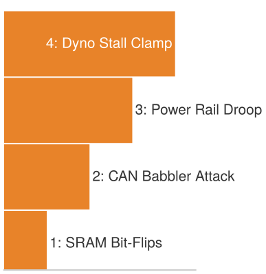
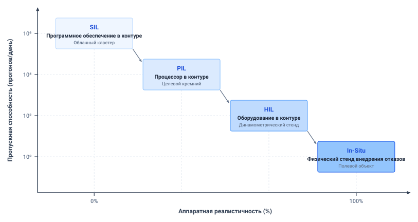

# Верификация

## Цель

_Почему робот, проработавший недели без единого происшествия, не является свидетельством безопасности машины?_

Недели эксплуатации без происшествий устанавливают поведение лишь при встреченных безобидных условиях; они не дают эмпирических свидетельств того, что машина переживет аномалии пограничных случаев. Автономный робот кажется безупречно надежным, пока несмоделированное возмущение — застывший кадр камеры, просроченный фрагмент траектории или индуктивная просадка шины питания — не бросает вызов непроверенным программным допущениям. Ожидание редких пограничных случаев при пассивной эксплуатации неприемлемо: событие, в десять раз более редкое, требует в десять раз большей наработки, чтобы его наблюдать, а его появление в эксплуатации рискует обернуться катастрофическим физическим ущербом.

Верификация всей системы превращает допущения безопасности в систематические воспроизводимые эксперименты по внедрению отказов, выполняемые в симуляции, на стендах с процессором в контуре и физических динамометрических стендах. Каждый эксперимент бросает вызов границам тайминга, свежести данных и кинетических полномочий, проверяя, обнаруживает ли машина отказы и принудительно обеспечивает ли безопасное резервирование в пределах объявленных бюджетов. Внутри огибающей управления строгая верификация связывает когнитивные модели Мозга, детерминированные мониторы Нервной системы и физическую динамику Тела в эмпирические свидетельства, способные обосновать, ограничить или отклонить развертывание.

> ↰ **Предпосылки:** Физические режимы отказов и пределы измерений, дающие цели верификации, происходят из раздела [«Замер пределов машины»](02_body.md#sec-body-measuring-limits).

> **Цели обучения**
>
> - Определить эксплуатационную огибающую и вывести ее условия прохождения из бюджета остановки машины
> - Вывести список отказов из проектных записей и прямого физического анализа, включая отказы полномочий и составные отказы
> - Оценить, какие испытания в симуляции и на аппаратуре поддерживают каждое утверждение и где заканчиваются их свидетельства
> - Применить расчет выборки при нуле пропусков к объявленной взвешенной совокупности отказов и указать, что он оставляет непокрытым
> - Спроектировать испытания внедрения отказов, бросающие вызов утверждениям о тайминге, действительности данных и полномочиях на физической аппаратуре
> - Построить протоколы отказов, сохраняющие неудавшиеся, невалидные и ненаблюдаемые испытания отличными от прошедших

## Почему эксплуатация — не свидетельство

Журнал эксплуатации без происшествий отвечает лишь на условия, которые он встретил. Он не упражняет застывший кадр камеры, просадку питания или шину, занятую трафиком DMA. Ожидание этих условий медленно, поскольку событие, в десять раз более редкое, требует в среднем в десять раз большей наработки для наблюдения (стена наработки из раздела [«Пределы физических испытаний»](07_evaluation.md#sec-evaluation-trial-limits)), а на машине это еще и небезопасно: когда событие наконец происходит в эксплуатации, оно приходит как движение, которое не может отозвать никакое программное действие. Поэтому верификация всей системы превращает каждое утверждение безопасности в преднамеренный отказ, внедряемый под сдерживанием и оцениваемый по оракулу испытания и пределам, объявленным до прогона. Утверждения происходят из записей, которые произвели предыдущие главы, завершаясь протоколом полномочий из раздела [«Журнал полномочий»](14_intervention.md#sec-intervention-authority-log), который называет, кто может командовать каждым каналом актуатора и что должно произойти, когда передача остается без ответа.

Рассмотрим складской мобильный манипулятор, идущий по проходу на `1.3 m/s` (выбрано; см. Руководство для читателя) к торцу стеллажа, откуда может выйти человек. Недели чистых прогонов на этой скорости мало что говорят о четырех отказах, которые проект, по утверждению, содержит: инициаторе, обновляющем аренду, а затем зависающем (F1), наблюдении, достигающем пути разрешения с устаревшим или испорченным временем съемки (F2), пачке потерянных кадров EtherCAT между путем разрешения и приводами (F3) и просадке шины управления `24 V`, когда пачка инференса совпадает с двигателями привода (F4). Ни один из них не проявляется в журнале эксплуатации, поскольку каждый оставляет машину работающей нормально до момента, когда нужна остановка. Аренда ловит зависание, проверка эпохи свидетельств — устаревшее время съемки, сторожевой таймер полевой шины привода — потерянный кадр, а монитор пониженного напряжения пути разрешения, на собственной шине с поддержкой, — просадку общей шины. Каждый отказ внедряется у торца стеллажа вместе с четырьмя отказами полномочий, которые передает [«Журнал полномочий»](14_intervention.md#sec-intervention-authority-log) (A1–A4), и каждое испытание остановки оценивается по границам начала и расстояния, которые [«Эксплуатационная огибающая»](15_verification.md#sec-verification-operating-envelope) выводит из бюджета остановки.

Внедренный отказ превращает физический прогон в результат испытания, способный поддержать кейс безопасности, только когда прогон несет пять составляющих:

1. **Ограниченное утверждение:** указывающее точный инвариант, который машина должна поддерживать (для основания у торца стеллажа — остановку, завершающуюся внутри свободного расстояния `1.10 m`);
2. **Определенные условия испытания:** задающие начальную скорость, полезную нагрузку, трение пола, температуру окружающей среды и диапазон напряжения питания;
3. **Заранее зафиксированный оракул:** автоматизированный оценщик, который проверяет записанную телеметрию против утверждения без вмешательства человека и постфактум-корректировок;
4. **Заявленную процедуру выборки и внедрения:** намеренно подводящую машину к пределам ее производительности и внедряющую отказы в датчики, шины и актуаторы; и
5. **Происхождение:** полную запись метаданных весов модели, калибровочных таблиц, серийных номеров датчиков и сырых журналов шины, позволяющую независимое воспроизведение.

Утверждение об остановке основания и утверждение о силе защелки манипулятора требуют отдельных огибающих, точек внедрения и условий прохождения; эта глава следует утверждению об остановке. Первое решение — где номинальное регулирование должно уступить независимому отклику сдерживания.

## Эксплуатационная огибающая

**Эксплуатационная огибающая** — это целевая ODD ([«Что измеряет доля успеха»](07_evaluation.md#sec-evaluation-what-measured)), расширенная внутрь до собственных условий машины: вычислительной нагрузки, напряжения питания, дрожания шины, теплового состояния и времени реакции оператора. Множества вложены: ODD содержит объявленный ODD, который содержит целевую ODD, а эксплуатационная огибающая связывает целевую ODD с внутренними условиями машины. Определение этой огибающей требует точных числовых границ, чтобы автоматизированный испытательный стенд мог детерминированно вести систему через каждое ограничение. Для мобильного манипулятора огибающая — это набор объявленных точек, а не одно номинальное условие: скорость хода `1.3 m/s` в проходе; полезные нагрузки от нуля до грузоподъемности стеллажа `50 kg`; трение пола не менее `0.204` — величины, которую требует достоверное замедление `2 m/s²`, — на сухих проходах и не менее `0.12` на полах под режимом инспекции площадки; и температуры окружающей среды от `5 °C` до `35 °C`. Для инспектируемых полов огибающая объявляет ограниченную точку на `1 m/s` — скорость ограниченной конфигурации, которую протокол принудительного обеспечения объявляет действительной вплоть до этого трения ([«Протокол принудительного обеспечения»](12_enforcement.md#sec-enforcement-telemetry)), — а испытания там используют испытательный пол, чье измеренное трение равно квалификационной величине `0.12`, так что проверяемая ими остановка — та, которую ограничивает трение.

Каждая точка сопряжена с внутренними условиями машины: нагрузкой прикладного процессора вплоть до пиковой пачки инференса, шиной управления в любой точке от точки разряда аккумулятора `21.5 V` до номинальных `24 V`, дрожанием EtherCAT и тепловым состоянием микроконтроллера безопасности. Еще одна точка — `1.2 m/s`, до которых машина замедляется, прежде чем запросит перехват в контуре удаленным ассистентом, и только эта точка несет время перехвата `150 ms` ([«Переходы полномочий»](14_intervention.md#sec-intervention-authority-transitions)).

Эксплуатационная огибающая отличается от более широкой **огибающей выживания**, которая ее включает. Внутри эксплуатационной огибающей обученная политика и контуры слежения регулируют процесс. Когда возмущение, отказ датчика или зависание вычислений толкают машину за эту границу, номинальное регулирование уступает, и целью становится приведение тела к ограниченному безопасному состоянию до нарушения структурных пределов. Для мобильного манипулятора огибающая выживания — более широкая область скорости, трения пола и состояния машины, в пределах которой ступень остановки лестницы резервирования и ее ступень блокировки как крайняя мера ([«Лестница резервирования»](12_enforcement.md#sec-enforcement-fallback-ladder)) все еще способны привести основание к покою до торца стеллажа и удержать силу контакта манипулятора ниже его предела. За ней лежит структурный отказ, где запасенная энергия превышает то, что аппаратура способна рассеять.

Определение границы эксплуатационной огибающей требует выводить пределы из первых принципов, а не провозглашать удобные программные тайм-ауты. У торца стеллажа предел — бюджет остановки. Остановочный путь растет линейно с задержкой до торможения и квадратично со скоростью ([«остановочный путь тела»](02_body.md#eq-body-stopping-distance)), а завершенный бюджет из раздела [«Огибающие остановки»](12_enforcement.md#sec-enforcement-stopping-envelopes) ([«Бюджет остановки складского манипулятора»](12_enforcement.md#tbl-enforcement-stopping-budget)) с его задержкой до торможения `133.6 ms`, гладкой резидентной остановкой, которую берет на себя [«Поведение на стыке»](11_planning.md#sec-planning-behavior-seam), и врезкой слежения устанавливает потолок `1.39 m/s` на сухом полу. На выбранной `1.3 m/s` машине требуется `997.4 mm` из свободного расстояния `1.10 m`, и она сохраняет `102.6 mm` в резерве — расстояние, которое она проходит за `78.9 ms`.

Отсюда следуют две границы оракула, и каждое испытание остановки в этой главе оценивается по обеим. Начало торможения должно наступить не позднее `82 ms` после последнего валидного обновления — это путь аренды из раздела [«Многотактные ритмы»](04_nervous_system.md#sec-nervous-cadences): аренда `60 ms`, один такт `1 ms` контура разрешения, один цикл шины `1 ms` и `20 ms` на начало торможения. Отказы шины F4 берут свое начало вместо этого от флага пониженного напряжения. Остановка, измеренная приборами, независимыми от машины, должна завершиться в пределах расстояния, допустимого от того же события, к которому отнесен отказ. Для отказа, следующего за появлением цели, это расстояние — `997.4 mm`, которые допускает бюджет. Зависший инициатор не дает появления цели, поэтому его остановка, как и ее начало, измеряется от последнего валидного обновления, а ход во время `82 ms` до начала торможения, резидентная остановка и врезка слежения дают `780.4 mm` на скорости хода в проходе.

Ни одна из границ не зависит от инициатора. Политика фрагментов, которая зависает, не может задержать начало торможения, потому что остановка начинается при истечении аренды, а не когда инициатор замечает, поэтому испытание F1 измеряет путь разрешения, а не политику. Бюджет защищает статическое препятствие на свободном расстоянии, а испытание против статической цели ничего не говорит о человеке, который все еще идет к машине, — предпосылке, которую несет правило перехода площадки ([«Оценка сквозь окклюзию»](09_memory.md#sec-memory-belief-through-occlusion)).

Регулятор потока, удерживающий буферный бак ниже переливного порога, — контрастный пример класса 3 для этой части, — проверяет другую величину. Его оракул — объем, а не расстояние. Когда уровень находится на пороге срабатывания `88 L`, на `7 L` ниже порога `95 L`, а чистый приток составляет `1.40 L` каждую секунду после отказа верхнего клапана и срабатывания выпускного насоса, бак переполняется через `5 s`. Защитный путь, обнаруживающий за `210 ms` и закрывающий свой отсечной клапан за `1.20 s`, завершается на `3.59 s` раньше. Та же задержка шины `150 ms`, которая стоила бы мобильному манипулятору `195 mm` — `1.9` его резерва, — добавляет баку `0.21 L`. Поэтому список отказов регулятора внедряет длительные задержки и отказавшие клапаны, тогда как список машины обязан разрешать десятки миллисекунд.

На мобильном манипуляторе отдельные минимальные и максимальные значения для отдельных переменных не улавливают истинную эксплуатационную границу, поскольку физические и вычислительные измерения связаны. Скорость хода `1.3 m/s` в проходе и инспектируемый пол с трением `0.12` каждый лежит внутри своих объявленных диапазонов, однако вместе они выпадают из огибающей. На таком трении пола достоверное замедление задает не тормоз, а трение, и оно падает до `1.18 m/s²`. Резидентная остановка удлиняется, и бюджет на `1.3 m/s` растет до `1.44 m`, мимо свободного расстояния `1.10 m`; граница скорости на этом полу — `1.09 m/s`, поэтому ограниченная точка огибающей лежит ниже ее. Полезная нагрузка связана менее заметно. Она не входит ни в одно слагаемое бюджета, но достоверное замедление было объявлено для загруженной машины, поэтому кампания, выполняемая только без нагрузки, никогда не проверяет величину, на которой покоится бюджет. Истинная эксплуатационная граница — поверхность в пространстве состояний, параметров и задержек, и валидный набор верификации обязан зондировать эту комбинированную поверхность, а не изолированные скалярные пределы.

Граница остается честной, только если каждый параметр несет свою единицу, свое происхождение, свою калиброванную неопределенность и инженера, ответственного за него. Достоверное замедление `2 m/s²` неполно, пока запись не говорит, получено ли оно из испытаний остановок на загруженной массе, из технического листа привода или из модели трения и с каким разрешением внешний эталон расстояния измерял каждую остановку. Новый компаунд протектора колеса или новая прошивка ведомого устройства EtherCAT обязывают этого владельца пересмотреть, не сдвинулась ли граница.

Испытание огибающей означает атаку ее граничной поверхности. Внутренние точки, где основание ползет без нагрузки по сухому полу на свежих кадрах камеры, показывают лишь, что машина работает при идеальных условиях. Испытательный стенд помещает точки на каждой существенной границе, чуть внутри и чуть снаружи. Точки чуть внутри проверяют, что политика сохраняет устойчивость замкнутого контура под наибольшим допустимым напряжением; точки на границе проверяют, что запасы переживают номинальный шум датчиков; точки чуть снаружи проверяют, что механизм принуждения предсказуемо забирает полномочия у политики и останавливает основание в пределах огибающей выживания, пока свободное расстояние не израсходовано.

Зондирование этой граничной поверхности формализует критическое различие между классической **функциональной безопасностью** (регулируемой ISO 26262 и IEC 61508) и **безопасностью предполагаемой функциональности (SOTIF)** (регулируемой ISO 21448). Классические рамки функциональной безопасности предполагают, что эксплуатационные опасности возникают от *отказов системы*: порванных жгутов проводов, электрических коротких замыканий, битовых переключений в памяти или синтаксических ошибок программного обеспечения. Если каждый аппаратный и программный компонент работает строго по своей инженерной спецификации, классическая функциональная безопасность считает систему неопасной. В системах физического ИИ эта предпосылка не выполняется. Визуальный трансформер или обученный оценщик глубины могут выполняться с нулевыми отказами памяти, нулевыми числовыми исключениями и битово-точным исполнением инструкций и все же не обнаружить препятствие из-за несмоделированного солнечного блика, ретроотражающих поверхностей или новых семантических объектов вне обучающего распределения. Эта опасность возникает от **функциональной недостаточности** — фундаментального ограничения производительности обученного восприятия в открытых средах, происходящего при полном отсутствии электрического или программного отказа. Верификация эксплуатационной огибающей по SOTIF требует систематически идентифицировать эти неизвестно-небезопасные условия через адверсариальный поиск границ, картографировать огибающую, в пределах которой восприятие статистически действительно, и демонстрировать, что детерминированный механизм принуждения ловит функциональную недостаточность до нарушения физического запаса. И все же, хотя SOTIF проверяет, что система безопасно отвечает на сенсорную неоднозначность в мире, конечная способность механизма принуждения остановить физический импульс все еще опирается на детерминированную целостность нижележащей аппаратуры под электрическим и механическим напряжением.

> **Принцип аппаратной фальсификации**
>
> Если свойство безопасности нельзя детерминированно фальсифицировать, внедряя физический или электрический отказ в целевую аппаратуру, это свойство является непроверенным допущением, а не инженерным инвариантом.

Как только каждое ограничение, бюджет задержки и предел среды выражены числом, проектные утверждения предыдущих глав становятся целями для внедрения отказов, каждое с порогом, который должен вызвать защитное вмешательство.

## Вывод списка отказов

Первый источник отказов — проектные записи, обращенные вспять. Разделы от [«Физические данные»](05_data.md#sec-data) до [«Оценка в замкнутом контуре»](07_evaluation.md#sec-evaluation) излагают свойства обученной политики: ее обучающее распределение, ее допущения о состоянии-действии и ее потолки задержки инференса. Разделы от [«Сенсорное восприятие»](08_perception.md#sec-perception) до [«Размещение на кремнии»](13_placement.md#sec-placement) излагают свойства интерфейсов и выполнения, такие как распределение шин, свежесть наблюдений и границы оценивания, а раздел [«Вмешательство супервизора»](14_intervention.md#sec-intervention) излагает, как быстро полномочия могут покинуть отказывающую политику и кто держит перекрытие. Если записи машины утверждают, что политика фрагментов обновляет свое предложение каждые `50 ms` на любой скорости вплоть до предела ходовой скорости `1.5 m/s`, набор верификации обращает это утверждение вспять, внедряя зависшие обновления, задержанные наблюдения и показания энкодера вне диапазона, чтобы проверить, обнаруживает ли путь разрешения нарушение в пределах своего бюджета.

Для единичного отказа ограниченное утверждение и процедура внедрения этого списка становятся пятиэлементной цепью, включающей отрицаемое условие, физическую точку внедрения, ожидаемый детектор, ограниченный отклик и наблюдаемое условие прохождения, и записанное проектное свойство становится проверяемым отказом только тогда, когда определены все пять. Для F2 навигационная камера штампует каждый кадр в момент съемки, а возраст кадра при отправке ограничен бюджетом `51.6 ms` ([«Преобразование и калибровка датчиков»](08_perception.md#sec-perception-transduction-calibration)). Преобразование этого штампа в часы микроконтроллера безопасности добавляет границу `0.2 ms` контракта наблюдений ([«Контракт наблюдений»](08_perception.md#sec-perception-observation-contract)), поэтому путь разрешения отказывает свидетельствам, чей верхний возраст превышает `51.8 ms`. Отрицаемое свойство удерживает кадр на процессоре изображений, сохраняя его штамп съемки, так что кадр приходит за этим порогом. Ожидаемый детектор — проверка пути разрешения эпохи свидетельств каждого предложения, обязательный отклик — отказ от любого предложения, построенного на этих свидетельствах, с последующей резидентной остановкой, а наблюдаемое условие прохождения — пара границ оракула: начало торможения в пределах `82 ms` после последнего валидного обновления и измеренная остановка в пределах `997.4 mm`. Когда какой-либо элемент этой цепи нельзя определить или наблюдать, система содержит **разрыв верификации**. Разрыв верификации указывает, что утверждение нельзя фальсифицировать испытанием. Такие разрывы нельзя игнорировать; они требуют выделенных аппаратных средств измерения, более узкого эксплуатационного утверждения или перепроектирования пути выполнения.

Обращение достигает и допущений обученного инициатора, поскольку сдвиг распределения — отказ системы, даже когда каждый кадр приходит целым. Политика фрагментов, обученная в симуляции на сухом бетоне с трением `0.60`, предлагает замедления, которые пол с трением `0.12` превращает в проскальзывание колес. Обращение этого оценочного утверждения означает внедрение несмоделированного сцепления. Смещение датчиков и возмущения данных внедряются по той же причине: политика с высокой номинальной наградой все равно может командовать дрожащими актуаторами, как только ее входы возмущены. Тогда машина отказывает на валидных, неиспорченных командах, потому что программное обеспечение и механика остаются связанными через каузальную границу ([«Каузальная граница»](01_causal_boundary.md#sec-boundary-causal-boundary)).

На каждом межмодульном контракте список отказов отрицает свойство в его физической точке передачи: свежесть наблюдений, действительность состояния, срок жизни намерения, предельные сроки планирования, независимость принудительного обеспечения и распределение ресурсов. Для аренды фрагментов `60 ms` из раздела [«Многотактные ритмы»](04_nervous_system.md#sec-nervous-cadences) испытательная среда внедряет иным образом валидное предложение через `65 ms` после его последнего обновления и подтверждает, что путь разрешения отклоняет его как истекшее. Для заявленной независимости механизма принуждения от вычислителя политики испытание насыщает общую шину памяти трафиком DMA и подтверждает, что механизм принуждения все еще укладывается в свой предельный срок `400 μs` внутри каждого такта `1 ms`. Дисциплина работает в обе стороны. Голодание шины, рассинхронизация часов и колебания питания внедряются там, где проект заявляет устойчивость, потому что отказ, взятый из общего меню, выдумывает требование, которому машина никогда не была предназначена удовлетворять.

У обращения есть структурный предел. Оно производит только отказы, которые проектная команда уже смоделировала, поэтому список полн ровно настолько, насколько полны проектные утверждения. Если ни одна запись не говорит, как ведет себя пружинный тормоз основания, когда его накладка глазуруется после повторных остановок, обращать нечего, и отказ никогда не достигает набора.

Второй, независимый источник работает вперед от физической машины, перечисляя, что способны сделать тело, силовая сеть, пол и среда независимо от того, во что верит программное обеспечение. Колеса буксуют, когда командуемое замедление превышает то, что пол способен передать; тормозные накладки глазуруются при повторных остановках; шины изнашиваются и меняют радиус качения, который предполагает одометрия; вибрация привода ослабляет крепление камеры, пока ее калибровка не дрейфует. Эти опасности происходят из механики и трибологии, вне каждой абстракции, над которой рассуждает программное обеспечение. Рамка **Systems-Theoretic Accident Model and Processes (STAMP)**[^fn-std-stpa-leveson] [Leveson, 2011](references.md#leveson2011engineering) вносит их в анализ опасностей.

Например, начнем с физической опасности основания, которое продолжает движение после того, как путь разрешения скомандовал остановку у торца стеллажа. Небезопасное управляющее действие — продолжающийся момент привода после команды остановки. Испытание внедряет залипший контактор включения привода или залипший соленоид снятия тормоза на испытательном проходе, наблюдает скорость колес и ток тормоза независимо от командуемого бита остановки и требует, чтобы путь разрешения снял питание привода через свой второй канал — безопасное снятие момента. Заранее зафиксированное условие прохождения — измеренная остановка в пределах `997.4 mm` на всех объявленных точках скорости, полезной нагрузки и трения пола; незамеренная скорость колеса делает испытание ненаблюдаемым для утверждения о торможении. Эта прямая цепь дает внедрение и оракул, даже если исходные программные требования опустили залипший контактор.

*Внедрение отказов поднимается от программных битовых переключений до физического заклинивания вала динамометра.*

[^fn-std-stpa-leveson]: **Анализ опасностей STAMP/STPA**: STAMP, разработанный в MIT Nancy Leveson, трактует безопасность как задачу управления, а не задачу надежности компонентов, поэтому опасности возникают как небезопасные управляющие действия на интерфейсах — например, на стыке, где задержка шины или запаздывание фильтра разрушают запас устойчивости. STPA — метод анализа опасностей, построенный на этой рамке.

Работа вперед обнажает классы отказов, которых не подразумевает ни одна программная запись: потерю синхросигнала, просадки питания, оставляющие логические уровни между допустимыми порогами, помехи переключения привода, наводимые в линии энкодера, испорченную память конфигурации и линии сброса, мостики между доменами, которые должны быть независимы. Если бы микроконтроллер безопасности и прикладной процессор разделяли один кристалл управления питанием, переходное пониженное напряжение во время пачки инференса могло бы сбросить микроконтроллер в момент, когда инициатор теряет управление. Ни одна программная запись не содержит этого отказа, потому что каждый модуль предполагает свое питание идеальным.

Прямой анализ также проверяет утверждения о независимости по общей причине из разделов [«Нервная система»](04_nervous_system.md#sec-nervous) и [«Размещение на кремнии»](13_placement.md#sec-placement). Два пути, изолированные на схеме, часто делят одну физическую уязвимость — когда, например, лидар и резервный концевой выключатель бампера проложены через один кабельный тракт, разделяют аналоговый опорный сигнал внутри одного преобразователя или построены на таймерной кремниевой логике с одинаковыми errata. Переходный процесс, вызывающий защелкивание обоих каналов разом, обесценивает любой аргумент, рассматривающий их отказы как независимые. **Анализ общих причин** прослеживает трассировку, цепи питания и деревья синхросигнала, чтобы ни одно единичное физическое событие не могло вывести из строя и политику, и механизм вмешательства.

Физический источник распространяется на ошибки оператора и предвидимое неправильное использование ([«Вмешательство супервизора»](14_intervention.md#sec-intervention)). Персонал площадки перемыкает датчик присутствия у торца стеллажа во время обслуживания, оставляет тележку-паллетовоз поперек размеченного перехода или выключает предупреждающий маяк, чтобы заглушить его, а удаленные ассистенты запрашивают скорости, которых проход не позволяет. Когда удаленный ассистент командует предел ходовой скорости `1.5 m/s` в проходе, испытательный стенд обязан проверить, что команда отклонена по возможностям или ограничена записью `manual_drive` до скорости хода `1.3 m/s` в проходе и что проверка разрешения выполняется на ней, как на любом другом предложении.

Работа вперед от физической машины добавляет один представительный механический класс — заклинивание актуатора — к списку, выведенному из записей, в таблице [«Классы аппаратных и киберфизических отказов»](15_verification.md#tbl-15-fault-classification). Полнота по-прежнему требует отдельного аргумента анализа опасностей для заданного объекта управления и эксплуатационной огибающей.

Работа вперед от физических преобразователей также требует испытаний против **киберфизических атак на уровне преобразования**. В связанных автономных системах физический ИИ вводит поверхности атак, обходящие традиционные абстракции сетевых экранов за счет использования физики сенсорного преобразования. Резонансная акустическая инъекция (нацеленная на микромеханические контрольные массы MEMS-гироскопов ультразвуковыми частотами) способна вызывать ложные угловые скорости в инерциальной навигации, не испортив ни одного пакета шины. Аналогично оптическая лазерная инъекция и стробирующая подсветка скользящего затвора могут насыщать фотодиоды камеры, ослепляя оценщики дальности, тогда как адверсариальные физические патчи (высококонтрастные геометрические узоры, размещенные на стенах склада или поверхностях пола) способны использовать градиентный ландшафт нейронных бэкбонов восприятия, вызывая пропуски обнаружения препятствий. По **ISO/SAE 21434 (дорожные транспортные средства — инженерия кибербезопасности)** эти угрозы проектируются совместно с отказами функциональной безопасности: киберфизическое вторжение оценивается по его способности пересечь каузальную границу в опасное исполнение команды. Набор верификации обязан подтвердить, что междатчиковые проверки правдоподобия механизма принуждения (такие как сопоставление одометрии колес с оптическим потоком или проверка эпох свидетельств камеры против границ интегрирования IMU) обнаруживают аномалии преобразования и включают лестницу резервирования прежде, чем ложные перцептивные утверждения смогут командовать моментом.

Помимо обращенных утверждений и прямых опасностей, список отказов обязан проверять случаи полномочий A1–A4 из раздела [«Журнал полномочий»](14_intervention.md#sec-intervention-authority-log), каждый — строку таблицы [«Классы аппаратных и киберфизических отказов»](15_verification.md#tbl-15-fault-classification), с машиной в состоянии, делающем вмешательство срочным: загруженное основание приближается к торцу стеллажа. Предельный срок передачи проверяется на обеих скоростях, где его устанавливает [«Переходы полномочий»](14_intervention.md#sec-intervention-authority-transitions). Когда машина замедлилась до `1.2 m/s` для запроса в контуре, резерв `209.7 mm` дает неподтвержденной передаче `174.7 ms` на резервирование; на скорости хода `1.3 m/s` в проходе, для передачи, которую политика запрашивает без замедления, время до резервирования сжимается до `78.9 ms`. Передача, проверяемая на стоящем основании, не проверяет ни одного из предельных сроков, которые важны.

| Область отказа и режим отказа                   | Физический механизм и точка внедрения                                                                                                                                                      | Целевое проявление и каузальное воздействие                                                                                                                                                                                              | Примитив обнаружения и бюджет задержки                                                                                                                            | Принудительно обеспечиваемый безопасный отклик и ограниченное восстановление                                           | Наблюдаемый критерий прохождения                                                                                                                                                                                                                                                                 |
|:----------------------------------------------|:------------------------------------------------------------------------------------------------------------------------------------------------------------------------------------------|:----------------------------------------------------------------------------------------------------------------------------------------------------------------------------------------------------------------------------------|:----------------------------------------------------------------------------------------------------------------------------------------------------------------|:------------------------------------------------------------------------------------|:------------------------------------------------------------------------------------------------------------------------------------------------------------------------------------------------------------------------------------------------------------------------------------------|
| **Зависание инициатора (F1)**                       | Политика фрагментов обновляет аренду один раз, затем ее задача убивается или ее выход замораживается на прикладном процессоре                                                                             | Нет новых предложений; последний допущенный фрагмент продолжает поставлять задания, пока основание движется                                                                                                                                        | Истечение аренды на пути разрешения (`60 ms`); тайм-аут сигнала живости хоста (`30 ms`) | Отозвать полномочия предложения; выполнить резидентную остановку                                    | Начало торможения $\le$ `82 ms` после последнего валидного обновления; ход от этого обновления до покоя $\le$ `780.4 mm`                                                                                              |
| **Устаревшее время наблюдения (F2)**               | Кадр навигационной камеры удерживается на процессоре изображений с сохраненным штампом съемки, или штамп испорчен, через встроенный перехватчик кадров                                         | Предложения, построенные на свидетельствах, чей верхний возраст превышает `51.8 ms` — возраст по бюджету плюс граница преобразования часов; основание действует по старому виду торца стеллажа                                  | Проверка возраста эпохи свидетельств на каждом такте контура разрешения                                                                                                          | Отклонять предложения, построенные на устаревших свидетельствах; выполнить резидентную остановку                 | Начало торможения $\le$ `82 ms` после последнего валидного обновления; измеренная остановка $\le$ `997.4 mm`                                                                                                                              |
| **Потерянные кадры EtherCAT (F3)**                 | Кадры теряются или портятся на порту ведомого устройства привода, внедрение через узел возмущения полевой шины                                                                                               | Состояние энкодера и команды привода пропускают циклы; доставленная команда стареет на один цикл `1 ms` на каждый потерянный кадр                                                                                     | Проверка рабочего счетчика и прибытия кадров; сторожевой таймер связи привода                                                                                           | Привод входит в свою сконфигурированную остановку; путь разрешения командует резидентную остановку        | Начало торможения $\le$ `82 ms` после последнего валидного обновления; измеренная остановка $\le$ `997.4 mm`; ноль необработанных исключений шины                                                                                               |
| **Просадка шины управления (F4a)**                  | Программируемая нагрузка постоянного тока воспроизводит переходный процесс «пачка инференса плюс привод» на общей шине управления `24 V` в точке разряда аккумулятора              | Общая шина проседает до `17.3 V`, ниже отсечки регулятора `18 V`; прикладной процессор уходит в просадку питания, и его датчики могут замереть на правдоподобных значениях | Флаг пониженного напряжения общей шины, поднимаемый путем разрешения на его изолированной шине с поддержкой                                                                      | Командовать STOP; выполнить резидентную остановку                                                 | Начало торможения $\le$ `22 ms` после флага; измеренная остановка $\le$ `997.4 mm`; путь разрешения никогда не сбрасывается (непрерывный сигнал живости на независимом цифровом регистраторе)                                                            |
| **Потеря питания шины разрешения (F4b)**           | Питание накопителя поддержки шины разрешения размыкается во время самой долгой остановки, которую механизм принуждения может допустить на инспектируемом полу, от ее потолка `1.09 m/s`                               | Путь разрешения, логика привода и катушки тормоза работают только от накопителя                                                                                                                                                              | Флаг потери питания на шине разрешения                                                                                                                           | Завершить резидентную остановку; затормозить каждый пружинный тормоз при полной остановке                    | Остановка завершается и каждый тормоз срабатывает до того, как шина достигнет отсечки (`1497.35 ms` из `2 s` поддержки); любой сброс — `FAIL`                                                                                   |
| **Заклинивание актуатора и механическое заедание**           | Заклинивание подшипника колеса или тянущий тормоз, внедрение через колесный зажим или динамометр                                                                                                          | Заблокированный ротор; одно заблокированное колесо разворачивает основание; быстрый нагрев обмотки статора ($I^2 R$)                                                                                                                                             | Монитор перегрузки по фазе двигателя и заедания скорости на эффекте Холла, в пределах границы обнаружения                                                                        | Обесточить силовой каскад; включить пружинный тормоз                        | Температура статора $T_{\text{coil}} < 155^\circ\text{C}$ (предел класса F, [«Тепловые циклы нагрузки»](02_body.md#sec-body-thermal-duty-cycles)); основание остается внутри бокового запаса `0.15 m`                                                                                           |
| **Передача полномочий (A1): дублирующий писатель** | Второй ведущий узел шины пишет в канал привода основания (дублирующий идентификатор EtherCAT или запись DMA), пока политика и удаленный ассистент командуют одновременно                                                 | Два писателя на одном канале; доставленная команда больше не является допущенной                                                                                                                                                   | Права записи шины или DMA; протокол полномочий для расследования на каждый такт                                                                                                | Отклонить чужую запись; путь принуждения остается единственным писателем                 | Запись отклонена; каждый протокол полномочий для расследования в окне показывает одного писателя                                                                                                                                                                                                            |
| **Передача полномочий (A2): обход уровней**      | Предложение политики внедряется, пока активен `MAN`; команда удаленного ассистента, противоречащая допущенному пределу механизма принуждения                                                                       | Более низкий уровень вытесняет активный более высокий, либо команда ассистента минует проверку разрешения                                                                                                                                  | Проверка уровня арбитром; проверка разрешения, применяемая к каждому источнику                                    | Игнорировать предложение политики; ограничить или отклонить команду ассистента, как любое предложение | Арбитр игнорирует предложение; проверка разрешения по-прежнему выполняется для команды ассистента                                                                                                                                                                                                  |
| **Передача полномочий (A3): истечение срока передачи** | Ввод ассистента заморожен во время `PEND`; кадры подтверждения теряются, на скорости перехвата и на скорости хода в проходе                                                                         | Машина ждет передачу, которую никто не завершает                                                                                                                                                                             | Таймер предельного срока передачи в арбитре                                                                                                                          | Запустить валидированное резервирование                                                        | Резервирование стартует к $T_{\text{timeout}}=\max(0,\min(T_{\text{config}},T_{\text{latest}}))$: `174.7 ms` на `1.2 m/s`, `78.9 ms` на `1.3 m/s` |
| **Передача полномочий (A4): аутентификация**   | Повторно воспроизведенный перехваченный пакет `veto_path`, `manual_drive` или `accept_item`; пакет с плохой меткой                                                                                         | Неаутентифицированный источник получает полномочия                                                                                                                                                                                         | Проверка метки и свежести для каждой команды ассистента и коллеги                                                                                                 | Заблокировать канал; оставить полномочия неизменными                                     | Канал заблокирован, полномочия неизменны, событие записано                                                                                                                                                                                                                                       |

***Классы аппаратных и киберфизических отказов**: Отказы у торца стеллажа F1–F4 и четыре случая отказов полномочий (A1–A4), которые передает [«Журнал полномочий»](14_intervention.md#sec-intervention-authority-log), каждый сопоставлен своей точке внедрения, детектору, отклику и наблюдаемому критерию прохождения на складском мобильном манипуляторе, плюс один прямой механический отказ.*

### Составные отказы

Каждая строка таблицы [«Классы аппаратных и киберфизических отказов»](15_verification.md#tbl-15-fault-classification) внедряет одно возмущение, однако машина в эксплуатации редко встречает их поодиночке. Случайное комбинирование строк раздуло бы список, не найдя сочетаний, которые важны, поэтому связанные возмущения перечисляются вместо этого из общих причин. Испытательная ведомость протокола размещения ([«Распределение аппаратных ресурсов»](13_placement.md#sec-placement-hardware-allocation)) называет каждый ресурс, которым путь разрешения делится с обученными нагрузками, и каждая общая шина, часы или цепь становятся одним составным отказом, внедряемым в причине, а не в ее симптомах. Просадка общей шины может замедлить механизм принуждения, заморозить датчик на правдоподобном значении и сбросить регистратор за тот же интервал. Пачка на общей шине старит наблюдения, одновременно задерживая собственные чтения пути разрешения и сигнал живости, который обнаружил бы задержку. Отказ в общих часах сдвигает метки времени каждой записи, пересекающей границу предложения, разом, поэтому проверки свежести проходят на данных, которые уже стары. Оракул составного отказа поэтому проверяет защитный отклик против его предельного срока и также проверяет, что свидетельства, нужные для оценки этого отклика, пережили ту же причину; ловушки из раздела [«Заблуждения и ловушки»](15_verification.md#sec-verification-fallacies-pitfalls) показывают оба провала вместе. Общая причина, которую ведомость не называет, не может быть перечислена таким способом, поэтому прямой анализ физической машины остается отдельным источником отказов.

Список отказов теперь содержит обращенные проектные утверждения, прямые классы физических отказов, четыре случая полномочий и составные отказы, извлеченные из названных общих причин. Он говорит, что внедрять, но не где внедрение реально, и этот выбор решает, что способно доказать каждое испытание.

## Лестница квалификации

Симулятор способен за ночь вызвать зависание инициатора F1 на каждой выборочной скорости и нагрузке, но он не может просадить шину управления F4, потому что у смоделированной шины нет регулятора, который вышел бы из отсечки, и нет микроконтроллера, который сбросился бы. Каждая среда оценки замыкает, разрывает или подменяет различные звенья контура, идущего от восприятия через инференс, шины, приводы и объект управления, поэтому среды не образуют иерархию. Высшая ступень не может поглотить низшую; каждая дает особую категорию свидетельств и остается слепой к остальным ([«Четырехступенчатая лестница квалификации»](15_verification.md#fig-15-qualification-ladder)).

> **Четырехступенчатая лестница квалификации**
>
> ***Четырехступенчатая лестница квалификации*** — структурированная последовательность киберфизических сред оценки, замыкающая, разрывающая или подменяющая отдельные дуги каузального контура, чтобы уравновесить комбинаторную пропускную способность испытаний против физической и временной точности выполнения. Ее четыре стадии — программное обеспечение в контуре (Software-in-the-Loop, SIL), процессор в контуре (Processor-in-the-Loop, PIL), оборудование в контуре (Hardware-in-the-Loop, HIL) и физические стенды внедрения отказов in-situ.
>
> 1.  **Значимость**: Ни одна испытательная среда не способна валидировать систему физического ИИ. Программные симуляторы позволяют массивные комбинаторные проходы ($>10^8\text{ cycles/day}$), но опускают конкуренцию за шину целевого кремния и износ материалов; физические стенды обнажают подлинную механику и электрические переходные процессы, но не способны выполнять разрушительные проходы отказов в масштабе.
> 2.  **Отличие**: В отличие от кумулятивной испытательной лестницы, где высшие ступени поглощают низшие, каждая ступень квалификации упражняет взаимодополняющие, не пересекающиеся каузальные механизмы, оставаясь слепой к другим.
> 3.  **Распространенная ловушка**: Предположение, что прохождение обширной симуляции с программным обеспечением в контуре (SIL) влечет безопасность на встроенной аппаратуре. SIL абстрагирует дрейф часов микроконтроллера, зависания шины DMA, дрожание прерываний и просадку напряжения питания.

Таблица [«Четырехступенчатая лестница квалификации»](15_verification.md#tbl-15-qualification-ladder) дает подложку каждой ступени, отказы, которые она способна внедрять, ее пропускную способность и то, где заканчиваются ее свидетельства. Для мобильного манипулятора свидетельства с программным обеспечением в контуре заканчиваются на модели объекта управления, где тормоз, смоделированный как лаг первого порядка, не имеет температуры накладки, проскальзывания шины или предела момента. Процессор в контуре добавляет кросс-скомпилированный бинарный файл на целевом кремнии и потому проверяет квантование и запас стека; стенды с оборудованием в контуре ставят двухпроцессорную реализацию из раздела [«Где проходит путь разрешения»](04_nervous_system.md#sec-nervous-silicon-partitioning), ее полевую шину, источники питания и каскады привода против объекта управления на программируемой пользователем вентильной матрице (FPGA) или динамометра; а физические стенды внедрения отказов добавляют серийное основание, тормоза, жгут и пол. Два источника рядом с лестницей раскрывают контур целиком. Воспроизведение трассы сохраняет реальный шум датчиков, но поставляет кадры, последовавшие за исходной командой, а не за новой. Работа в тени запускает кандидата рядом с действующим контроллером, так что если кандидат предлагает скорость, которая унесла бы основание за торец стеллажа, его журнал записывает команду, пока действующий контроллер удерживает основание там, где ему надлежит. Ни то ни другое не показывает физического следствия команды.

Развертывание в тени не может позволить зависшему инициатору вести основание к торцу стеллажа, где может находиться человек, симулятор не способен обнаружить гонку в кремнии приемопередатчика, а аппаратный стенд не способен выполнить миллионы рандомизированных прогонов, которых требует хвостовая статистика. Поэтому каждое внедрение отказа направляется на ступень, упражняющую его каузальный механизм.

***Четырехступенчатая лестница квалификации**: Четыре ступени, обменивающие пропускную способность на точность, от примерно $10^6$ чисто программных прогонов в день при нулевой аппаратной реалистичности до горстки in-situ физических внедрений отказов при полной реалистичности. Лестница — не продвижение к точности, а последовательность различных слепых зон, потому что каждая стадия устанавливает свидетельства только внутри собственного каузального контура и остается слепой к каждому механизму вне его.*

| Ступень квалификации и подложка                                     | Реалистичность каузального контура (вычисления, шина, актуатор, объект управления)                                                                                                          | Механизм и охват внедрения отказов                                                          | Пропускная способность и масштабирование выборки                                                                          | Физическая и временная точность                                                            | Первичный оракул испытания и предел свидетельств                                                                                                                                                  |
|:-------------------------------------------------------------------|:-------------------------------------------------------------------------------------------------------------------------------------------------------------|:-------------------------------------------------------------------------------------------|:-----------------------------------------------------------------------------------------------------|:----------------------------------------------------------------------------------------|:-----------------------------------------------------------------------------------------------------------------------------------------------------------------------------------------|
| **Программное обеспечение в контуре (SIL)** (рабочая станция хоста / облачный кластер)  | **Вычисления:** синтетические / хост x86; **Шина:** идеализированный буфер без копирования; **Актуатор:** линейная / насыщающаяся модель; **Объект управления:** численный решатель ОДУ/ДУ с частными производными         | Битовые переключения тензоров, синтетические потери датчиков, проходы по трению пола, полезной нагрузке и задержкам    | $10^3\text{--}10^5\times$ проходов в реальном времени параллельно ($>10^8\text{ cycles/day}$)                      | Высокая математическая гибкость; нулевая реалистичность целевого кремния, тайминга шины или электрики   | **Оракул:** коридоры математических утверждений и инварианты состояния. **Предел:** не способен валидировать тайминг выполнения на цели или несмоделированную физическую динамику.                                    |
| **Процессор в контуре (PIL)** (целевой SoC / эмуляция ядра MCU)  | **Вычисления:** реальный целевой кремний (ARM/RISC-V); **Шина:** смоделированное межсоединение шин; **Актуатор:** эмулируемый регистр команд; **Объект управления:** модель хоста реального времени | Вытеснение из кеша инструкций, порча регистров через JTAG/BIST, внедрение дрожания прерываний | $0.1\text{--}1.0\times$ реального времени; ограничено межплатформенной синхронизацией                           | Точен по набору инструкций и компилятору; абстрагирует аналоговые линии шины и противо-ЭДС актуатора | **Оракул:** состояние регистров цели и границы выполнения WCET. **Предел:** игнорирует физическую конкуренцию за шину приемопередатчика, просадку напряжения и тепловой рост.                                    |
| **Оборудование в контуре (HIL)** (целевые ECU + стенд объекта управления реального времени) | **Вычисления:** серийные ECU / NPU; **Шина:** реальные физические CAN/Ethernet; **Актуатор:** реальные приводы двигателей / динамометр; **Объект управления:** стенд объекта на FPGA с жестким реальным временем     | Обрыв/короткое замыкание вывода, набивка кадров CAN / «болтливый идиот», просадка шины питания, ступени нагрузки        | $1.0\times$ строгого реального времени (ограничение настенных часов $24\text{ h/day}$)                                    | Высокая электрическая, временная и протокольная точность; ограничена точностью модели объекта на FPGA    | **Оракул:** CRC протокола, мониторы предельных сроков шины и тайминги блокировок. **Предел:** не способен выполнить разрушительную физическую перегрузку или смоделировать износ шин и накладок.                        |
| **Физический стенд внедрения отказов** (динамометрическая ячейка / полевой объект)            | **Вычисления:** серийные ECU / NPU; **Шина:** серийный жгут и датчики; **Актуатор:** реальные физические механизмы; **Объект управления:** реальные основание, манипулятор и пол       | Колесные зажимы, заедание магнитного тормоза, тепловой нагрев, дрейф смещения преобразователей                 | $1.0\times$ настенных часов; ограничено механическим износом и тепловым сбросом ($<10^3\text{ cycles/day}$) | Полная подлинная физика (трение Кулона, проскальзывание колес, тепловыделение, износ)        | **Оракул:** независимые физические средства сдерживания и датчики выхода. **Предел:** высокая финансовая стоимость каждого испытания; разрушительные испытания не масштабируются до статистических хвостовых границ. |

***Четырехступенчатая лестница квалификации через киберфизические границы**: Четыре среды квалификации, сопоставленные по вычислительной подложке, упражняемым элементам каузального контура, примитивам внедрения отказов, пропускной способности выполнения, физической и временной точности и оракулу испытания.*

Граница точности испытательной среды — это место, где модель, эмулированная шина или воспроизведенная трасса разрывают обмен энергией и информацией между вычислениями и механикой ([«Каузальная граница»](01_causal_boundary.md#sec-boundary-causal-boundary)). Механизм, который модель опускает, не может отказаться в ней. Шарнир с несмоделированным кулоновым трением покоя и запаздыванием статора стоит неподвижно в течение мертвого времени, которого симулятор никогда не показывает, а затем отстает от смоделированной траектории — пример класса опущенных механизмов из раздела [«Из чего состоит разрыв»](06_training.md#sec-training-sim-to-real-gap), который способна обнажить только ступень с реальным шарниром.

Чтобы предотвратить ложную уверенность, каждый сообщаемый результат верификации обязан явно указывать, какие элементы каузального контура были физически реальны, какие — смоделированы, какие — воспроизведены из статических журналов, какие — обойдены и какие остались ненаблюденными. Утверждение, что путь разрешения остановил основание в пределах `997.4 mm`, ничего не значит без указания, был ли сигнал скорости колеса порожден дифференциальным уравнением, считан с физического энкодера через реальную полевую шину или воспроизведен из цифрового буфера. Уточнение этого каузального отображения обнажает допущения, лежащие в основе каждого испытания, так что несмоделированная физика не может скрыть скрытую опасность.

Каждая ступень возвращает трассу, а каузальное отображение говорит, какие звенья в этой трассе были реальны. Ни то ни другое не говорит, прошло ли испытание. Две границы у торца стеллажа из раздела [«Эксплуатационная огибающая»](15_verification.md#sec-verification-operating-envelope) до сих пор были числами, а оценка испытания требует превратить их в предикат, фиксируемый до прогона и применяемый без суждений после него.

## Оракулы отказов и приемка

Внедренный отказ всегда производит реакцию — в переходных процессах телеметрии и в движении актуатора, а иногда в сгоревшем компоненте. Без оракула, зафиксированного заранее, инженеры судят после прогона о графиках временных рядов по грубым симптомам — например, расплавило ли джоулево тепло фазный провод или выбросил ли контроллер необработанное исключение, — и испытание становится анекдотом. **Оракул** — предикат, полностью определенный до прогона, который оценивает испытание против его утверждения.

Физические системы отказывают через переходные процессы, а не в изолированные мгновения, поэтому оракул — это временная спецификация. **Сигнальная временная логика (Signal Temporal Logic, STL)** сочетает физические предикаты, такие как остановочный путь ниже предела, с логическими связками и временными окнами, так что условие должно всегда выполняться на интервале, в конце концов произойти в пределах предельного срока или сохраняться, пока не произойдет другое событие (синтаксис в разделе [«Сигнальная временная логика и непрерывная робастность»](appendix_ml.md#sec-appendix-ml-stl)).

STL также снабжает верификацию **количественной семантикой робастности**. Вместо простого флага прошел/не прошел робастность — непрерывный численный балл, измеряющий *насколько далеко* система осталась от нарушения своих запасов безопасности.[^fn-math-stl-robustness]

[^fn-math-stl-robustness]: **Количественная семантика робастности**: Каждый предикат имеет знаковый запас в собственной физической единице: запас хода может использовать метры, начало торможения — миллисекунды, а сила контакта — ньютоны. Отрицательный запас фальсифицирует этот предикат. Минимум по разнородным единицам бессмыслен; объединенный безразмерный балл STL требует, чтобы каждый запас был разделен на заранее объявленную положительную шкалу той же единицы. Запись сохраняет исходные запасы и шкалы, так что прохождение или провал остаются физически интерпретируемыми.

Оракул у торца стеллажа имеет эту форму. Начало торможения должно в конце концов наступить в пределах `82 ms` после последнего валидного обновления, а ход основания должен всегда оставаться в пределах расстояния, допустимого от события, к которому отнесен отказ, — `997.4 mm`, которые допускает бюджет на `1.3 m/s` с момента появления цели, или `780.4 mm` от последнего валидного обновления для зависания. Если внедренный отказ задерживает начало торможения на `30 ms` за его границу, основание проходит еще `39 mm` прежде, чем начнет замедляться, и останавливается после `1 036.4 mm`, все еще не дотягивая до свободного расстояния `1.10 m`. Робастность предиката расстояния тем не менее отрицательна на `39 mm`, а предикат начала проваливается на `30 ms`. Каждый балл количественно оценивает провал в собственной единице без ручной проверки.

Робастность превращает верификацию из случайных испытаний в **фальсификацию временной логики как адверсариальную оптимизацию**. Равномерная выборка многомерного пространства состояний требует неподъемного числа испытаний, чтобы достичь редкого провала, поэтому движок фальсификации ищет вместо этого возмущения — такие как шум датчиков, падения напряжения и трение, — которые опускают балл робастности ниже всего. Он использует черноящичные оптимизаторы, такие как эволюционные стратегии или байесовская оптимизация, либо градиенты через дифференцируемый симулятор, где он существует, а отрицательный балл дает конкретную траекторию контрпримера.

Формальная верификация самой сети, такая как решатель Reluplex [Katz et al., 2017](references.md#katz2017reluplex), способна доказать, что малая кусочно-линейная сеть никогда не выдает небезопасную команду на допустимом множестве состояний, но ее стоимость растет экспоненциально с глубиной сети и не достигает динамики замкнутого контура. Поэтому верификация сочетает такие границы с фальсификацией, внедрением отказов на аппаратуре и принудительным обеспечением времени выполнения.

Оценке также нужно **правило невалидного испытания** для прогона, который среда не смогла доставить. Если снижение номинала от контроля тяги на стыке пола замедляет основание до внедрения, так что оно встречает отказ ниже объявленных `1.3 m/s`, испытание не проверило точку огибающей, о которой заявляет. Если инжектор кадров переполняет собственную очередь и теряет пакет отказа прежде, чем тот достигнет приемопередатчика, машина так и не встретила возмущение. Оценка такого прогона как прошедшего изготавливает уверенность, а оценка как провала винит машину за оснастку. Поэтому оракул возвращает один из четырех вердиктов. `PASS` означает, что каждый заранее зафиксированный предикат удержался; `FAIL` — что измеренный предикат был нарушен; `INVALID` — что внедрение или предусловие не выполнилось; и `UNOBSERVABLE` — что эталонные данные, нужные для оценки испытания, потеряны, при сохранении частичной трассы. При любом из двух последних вердиктов поле, которое испытание не измерило, помечается недоступным, но никогда нулем. Ни один из вердиктов никогда не считается `PASS`, и ни один не исключается из отчета об охвате.

Предварительная фиксация отделяет свидетельства от постфактум-рассказов. Поведение при внедрении отказов шумно и неожиданно, а критерии, согласованные после того, как трасса увидена, дрейфуют вслед за ней. Превышение объясняют вариацией пола, а начало позже границы `82 ms` извиняют тем, что основание все равно остановилось до торца стеллажа.

Заранее зафиксированная запись закрепляет предикаты STL, физические единицы и любые шкалы нормализации, границы времени отклика и триггеры инвалидации до первого внедрения. Оценщик сохраняет знаковый запас для каждого предиката и возвращает `PASS`, только если каждый требуемый запас и граница тайминга проходят. Если остановка превышает свою границу на несколько миллиметров или начало торможения пропускает свой предельный срок на $2\text{ ms}$, запись указывает, какой измеренный предикат провалился; трасса и последующий анализ определяют, вызвано ли это трением пола, запаздыванием тормоза, снижением номинала или диагностической задержкой. Предварительная фиксация — то место, где принцип [«Свидетельства ограничивают полномочия»](part4_governing.md#pri-vol4-evidence-bounds-authority) впервые связывает испытание. Выпуск будет даровать полномочия по этим записям, поэтому вердикт, оцененный правилом, пересмотренным после того, как трасса была увидена, даровал бы полномочия силой исхода, а не испытания.

> **Оракулы временной логики и предварительная фиксация испытаний**
>
> Прежде чем выполнять автоматическую фальсификацию против политик физического ИИ, проверьте ваше понимание спецификаций временной логики и критериев валидности испытаний:
>
> - [ ] **Интерпретация количественной робастности**: Сможете ли вы объяснить, как сигнальная временная логика заменяет бинарные утверждения прошел/не прошел метрикой знакового расстояния и как отрицательный балл количественно оценивает глубину физического провала?
> - [ ] **Адверсариальная оптимизация траекторий возмущений**: Сможете ли вы описать, как черноящичные оптимизаторы используют баллы количественной робастности, чтобы обнаружить худшие сочетания задержки, шума и трения?
> - [ ] **Инвалидация испытания против критериев провала**: Сможете ли вы различить выполнение, фальсифицирующее инвариант безопасности, и невалидное испытание, в котором отказали предусловия стенда или механизмы внедрения отказов?

Зафиксировав оракул до первого внедрения, каждое испытание получает один из четырех вердиктов прежде, чем кто-либо начнет спорить о его трассе, а знаковый запас указывает, насколько оно было от каждой границы. Однако оракул хорош ровно настолько, насколько хорош прогон, который он оценивает. Лестница способна фальсифицировать контракт в симуляции, но только внедрение на целевой аппаратуре может показать, задерживает ли просадка общей шины или пачка на общей шине путь разрешения и укладываются ли собственные таймеры цели в предельные сроки, которые проверяет оракул.

## Внедрение отказов на аппаратуре

Отказ, внедренный в симуляции, проверяет отклик симулятора. Симуляции предполагают идеальные часы, изолированную память, детерминированные переключения контекста и линейную задержку межсоединений, тогда как на машине своевременность вмешательства решают конкуренция на общей шине, дрейф часов между микроконтроллерами, зависания DMA и падение напряжения на индуктивных драйверах. Поэтому внедрение происходит на целевой аппаратуре, через реальные приемопередатчики, таймеры, общие шины и путь принудительного обеспечения, тогда как независимый стенд сдерживания защищает испытательный полигон.

**Внедрение отказов in-situ** — намеренное детерминированное внесение физических, электрических и вычислительных возмущений (включая защелкивание регистров датчиков, дрейф часов, конкуренцию за шину, просадки питания и заедания нагрузки актуатора) непосредственно в целевую серийную аппаратуру и механику при работе под подлинными электрическими, тепловыми и динамическими нагрузками.

Рассмотрим F2 на аппаратуре. На `1.3 m/s` основание проходит `1.3 mm` каждую миллисекунду, поэтому устаревание, не обнаруженное за порогом `51.8 ms`, расходует резерв напрямую. Оставшись необнаруженным в течение `78.9 ms`, оно поглощает все `102.6 mm`. Ни время чтения из технического листа камеры, ни метка времени на одном кадре не устанавливают, как быстро замечает путь разрешения. Измеренное время обнаружения $P_{99}$ оставляет худший случай неограниченным ([«Передача команд вовремя»](04_nervous_system.md#sec-nervous-deterministic-fieldbuses)), поэтому утверждение о сдерживании нуждается в границе обнаружения, обоснованной на объявленной огибающей вычислительной нагрузки, нагрузки шины и теплового состояния.

Испытание двухпроцессорной реализации ([«Где проходит путь разрешения»](04_nervous_system.md#sec-nervous-silicon-partitioning)) требует физического внедрения отказов на границах, которые называют ее утверждения. Таблица [«Классы аппаратных и киберфизических отказов»](15_verification.md#tbl-15-fault-classification) дает детектор, отклик и условие прохождения каждого случая; список добавляет, как внедряется каждый отказ и, где это важно, где отсчитываются его события:

- **Внедрение устаревшего наблюдения (F2):** Встроенный перехватчик на FPGA удерживает кадр навигационной камеры на процессоре изображений или подавляет обновления энкодера, сохраняя исходную аппаратную метку времени. Срабатывание детектора, начало торможения и скорость колеса измеряются на независимых приборах.
- **Отзыв истекшей аренды (F1):** Испытательный стенд позволяет инициатору обновиться один раз, а затем подавляет каждое последующее обновление. Истечение аренды, отзыв на следующем такте `1 ms` механизма принуждения и начало торможения измеряются каждое на собственном проводе и собственных часах.
- **Внедрение потерянного кадра (F3):** Узел возмущения полевой шины теряет или портит кадры EtherCAT на порту ведомого устройства привода, пока основание движется. Каждый потерянный цикл `1 ms` стоит `1.3 mm` хода на скорости хода в проходе.
- **Внедрение просадки шины управления и потери питания (F4a, F4b):** Программируемая нагрузка потребляет переходный ток `70 A` от пачки инференса, совпадающей с двигателями привода (просадка питания из раздела [«Заблуждения и ловушки»](02_body.md#sec-body-fallacies-pitfalls)), с общей шины управления в точке разряда аккумулятора `21.5 V`, пока путь разрешения работает на изолированной шине с поддержкой, которую рассчитывает [«Лестница резервирования»](12_enforcement.md#sec-enforcement-fallback-ladder) и несет протокол размещения ([«Распределение аппаратных ресурсов»](13_placement.md#sec-placement-hardware-allocation)). Независимый цифровой регистратор записывает сигнал живости пути разрешения, а начало торможения отсчитывается от флага пониженного напряжения. F4b размыкает питание шины разрешения во время самой долгой остановки, которую механизм принуждения может допустить на инспектируемом полу, — резидентной остановки с ее потолка `1.09 m/s`. Сброс пути разрешения — `FAIL` в любом из двух испытаний, каково бы ни было остановочное расстояние, потому что остановка, которую потеря питания передает пружинным тормозам в середине движения, — не та остановка, которую бюджет утверждения закладывает.
- **Внедрение дублирующего писателя (A1):** Второй ведущий узел шины пишет в канал привода основания — либо кадром под идентификатором EtherCAT механизма принуждения, либо записью DMA в регистр команд привода, — пока политика и удаленный ассистент командуют одновременно.
- **Внедрение обхода уровней (A2):** Стенд подает предложение политики, пока активен `MAN`, и, в отдельном испытании, команду удаленного ассистента, противоречащую допущенному пределу механизма принуждения.
- **Внедрение зависания передачи (A3):** Стенд замораживает ввод удаленного ассистента во время `PEND` и теряет кадры подтверждения на обеих скоростях, а начало резервирования отсчитывается на приводе, а не в журнале арбитра.
- **Внедрение повтора и подделки (A4):** Стенд воспроизводит перехваченный пакет `veto_path`, `manual_drive` или `accept_item` и отправляет другой, с испорченной меткой аутентификации.

Запись траектории состояния, идентичности детектора, метки времени отказа и времени восстановления ограниченного состояния требует средств измерения, электрически и логически независимых от машины, таких как оптические энкодеры на валу и высокоскоростные камеры на изолированных цифровых регистраторах. Бортовой демон журналирования портится тем самым отказом, который пытается захватить, потому что отказавший процессор или насыщенная шина задерживают сериализацию журнала.[^fn-hw-trace-instrumentation] Независимые измерения также отвергают ложные прохождения, в которых машина выжила по причинам, отсутствующим в утверждении безопасности. Внедренный отказ потерянного кадра может вызвать срабатывание неотслеживаемого теплового выключателя или вспомогательной петли заземления, обесточивающей приводы, так что пружинный тормоз остановит основание в пределах бюджета, тогда как программный механизм принуждения завис в инверсии приоритетов. Оракул, проверяющий только остановочное расстояние, оценил бы такое испытание как прошедшее. Испытательный стенд обязан проверить, что путь механизма принуждения, названный в утверждении безопасности, выполнил корректирующее действие.

[^fn-hw-trace-instrumentation]: **Неинтрузивное аппаратное трассирование**: Неинтрузивное трассирование использует выделенные аппаратные отладочные блоки кремния (такие как ARM CoreSight Embedded Trace Macrocell) и внешние снифферы шины на FPGA, прослушивающие внутренние транзакции шины без отъема циклов выполнения CPU. Буферизуя трассы выполнения в выделенной высокоскоростной SRAM, развязанной с системной шиной памяти, аппаратные анализаторы захватывают метки времени реакции на отказ с точностью до цикла, не возмущая расписания потоков реального времени. Опора на программные демоны журналирования вносит эффекты наблюдателя Гейзенберга, где накладные расходы журналирования маскируют именно те условия гонки, которые проверяются.

Сигнал живости — еще один источник ложных прохождений, поэтому испытание должно нацеливаться на то, что он может пропустить. Раздел [«Аппаратная изоляция»](04_nervous_system.md#sec-nervous-hardware-isolation) рассказывает о механизме, который аргументировал эксперт истца в судебном разбирательстве по непреднамеренному ускорению Toyota [Barr, 2013](references.md#barr2013toyota): прерывание таймера продолжало обслуживать сторожевой таймер, пока управляющие задачи могли умирать, и выводит правило, что подача таймера доказывает лишь, что путь подачи работал ([«Инвариант живости сторожевого таймера»](15_verification.md#psp-verification-watchdog-liveness), [«Проверка гипотезы о сторожевом таймере, слепом к задаче»](15_verification.md#ws-verification-toyota-unintended-acceleration-limits-task-blind)). Тестовый вектор для этого правила убивает управляющую задачу или замораживает ее выход, пока прерывание таймера остается живым, и измеряет команду актуатора и выход сторожевого таймера на приборах, независимых от контроллера. На мобильном манипуляторе F1 — этот вектор, примененный к инициатору. Сигнал живости хоста может продолжать сообщать о живом процессе после того, как задача политики фрагментов погибла, поэтому F1 проходит по началу торможения, измеренному на приводе, и никогда — по сигналу живости в журнале. Поскольку исторический механизм приписан, а не установлен, стендовый результат говорит за проверяемый проект, а не за какое-либо транспортное средство.

> **Инвариант живости сторожевого таймера**
>
> Сторожевой таймер, питаемый периодическим прерыванием таймера, показывает лишь, что обработчик прерывания выполнился, а не то, что критичные для безопасности задачи приложения уложились в свои предельные сроки или выполнились без порчи. Квалифицированная кампания внедрения отказов явно разделяет прогресс задач и живость таймера, проверяя физическое отключение при гибели задачи, голодании потока и замороженных регистрах управления.

> **Проверка гипотезы о сторожевом таймере, слепом к задаче**
>
> **Контекст**: Судебное разбирательство по электронному управлению дросселем Toyota (ETCS-i) (*Bookout v. Toyota*, 2013) подняло вопросы о том, может ли критичная задача управления дросселем умереть, пока прерывание таймера продолжает обслуживать аппаратный сторожевой таймер [Barr, 2013](references.md#barr2013toyota).
>
> **Механизм для проверки**: Эксперт истца Michael Barr дал показания о сценарии гибели задачи, связанном с битовыми переключениями и порчей памяти при переполнении стека. Тестовый вектор убивает задачу реального времени управления дросселем, оставляя аппаратное прерывание таймера активным, а затем независимо измеряет положение дросселя и выводы сброса сторожевого таймера. Поскольку [расследование NHTSA/NASA](https://www.nhtsa.gov/sites/nhtsa.dot.gov/files/nhtsa-ua_report.pdf) не установило электронной причины непреднамеренного ускорения, это приписанная испытательная гипотеза, а не подтвержденный отказ транспортного средства.
>
> **Оракул**: Работающий сигнал живости сторожевого таймера — недостаточное свидетельство, если утверждение безопасности требует своевременного, специфичного для задачи управления в замкнутом контуре. Оракул верификации обязан записать, возвращается ли объект управления независимо к валидированному безопасному состоянию (такому как холостой ход двигателя или механическое перекрытие тормоза) в пределах своего физического предельного срока, когда выполнение задачи замирает.
>
> **Урок системного проектирования**: Внедряйте тот режим отказа, который сигналы живости могут пропустить, затем измеряйте физический отклик на независимых средствах измерения. Устройства защиты памяти (MPU), независимые супервизорные ядра и умные оконные сторожевые таймеры, требующие явных криптографических подписей задач, — варианты, чей охват отказов должен быть продемонстрирован на целевой платформе.

Механизм вмешательства должен испытываться в условиях, которые делают вмешательство необходимым. Механизм принуждения, чисто перехватывающий управление на свободном стенде, не дает свидетельств для производства, где в кризис политика работает на пиковой пропускной способности, шины памяти несут потоки датчиков высокого разрешения, каналы DMA перемещают буферы кадров, а основание несет свой загруженный стеллаж на скорости хода в проходе. Стенд внедряет отказы под объявленной тепловой и электрической нагрузкой и измеряет как отзыв по истечении аренды, так и, отдельно, время от диагностического флага до начала торможения на приводе. Если путь вмешательства делит арбитр шины с нейронным ускорителем, перехват может застрять за пакетной передачей, которую нельзя вытеснить, и кейс безопасности, предполагавший мгновенный перехват, рушится в поле, если перехват проверялся только на тихой шине.

> ↰ **Предпосылки:** Микроархитектурные стресс-паттерны непосредственно опираются на измерения конкуренции за память из раздела [«Конкуренция за общие ресурсы»](13_placement.md#sec-placement-resource-contention).

Кампания выполняет каждое внедрение по одному фиксированному протоколу, чтобы вердикт следовал из процедуры, а не из того, кто читает трассу. Оркестратор испытаний сперва проверяет каждое предусловие — температуру, напряжение шины, скорость колеса — против его объявленного допуска, в единице этой величины, и испытание, начавшееся вне допуска, завершается как `INVALID` еще до любого внедрения. Затем он приводит логический анализатор, объект управления и эталонные цифровые регистраторы к одним опорным часам, дает основанию успокоиться в своей точке огибающей и запускает внедрение по триггерной линии, штампующей начало отказа на этих часах. Флаг детектора, перехват на приводе и прибытие в ограниченное состояние отсчитываются от этого штампа на изолированном анализаторе, тогда как эталонные датчики, подключенные к реле шунтирующей защиты, способны отключить питание актуаторов, если основание покинет огибающую выживания. Заранее зафиксированный оракул оценивает трассу от независимых эталонных приборов по вердиктам и правилу прохождения из раздела [«Оракулы отказов и приемка»](15_verification.md#sec-verification-oracles-acceptance), а неполные эталонные кадры всплывают только на этой стадии, после того как внедрение выполнено, как `UNOBSERVABLE`. Оркестратор подписывает заголовок записи и связывает его с комплектом свидетельств через дайджест.

> ↳ **Протокол:** Раздел [«Протокол внедрения отказов»](appendix_systems.md#sec-appendix-systems-fault-protocol) дает протокол стадия за стадией, с его кодами ошибок, для читателя, строящего оркестратор испытаний.

Испытание распределенных контуров обнажает риск преобразования часов, даже когда каждый процессор укладывается в свое локальное расписание. Порог отказа F2 опирается на границу `0.2 ms` для преобразования штампа съемки в часы микроконтроллера безопасности, и эта граница сама является утверждением для проверки. Возьмем иллюстративные пределы осцилляторов ±`100` ppm на прикладном процессоре и ±`50` ppm на микроконтроллере безопасности, плюс отдельно ограниченный вклад `50` ppm от температуры, которого эти спецификации не включают. Тогда худшая относительная частота составляет `200` ppm, и один только дрейф израсходовал бы границу `0.2 ms` за `1 s` без ресинхронизации. Здоровый период синхронизации `100 ms` ограничивает этот вклад дрейфа величиной `20 μs`; сетевая ошибка и ошибка преобразования должны закладываться в бюджет отдельно.

Предположим, два хороших кадра синхронизации приходят с интервалом `400 ms`, тогда как три запланированных кадра между ними потеряны. Затемнение длится четыре периода синхронизации, и ограниченный вклад дрейфа растет до `80 μs`. Если наблюдаемое дрожание синхронизации имеет стандартное отклонение $\sigma_{\text{jitter}}$ = `15 μs`, добавление одного сигма к частоте дрейфа $r_{\text{drift}}$, умноженной на затмение $T_{\text{blackout}}$, дает

$$\Delta t_{\text{one-sigma scenario}}=r_{\text{drift}}\,T_{\text{blackout}}+\sigma_{\text{jitter}}$$

или `95 μs`. Величина в один сигма из раздела [«дрейф часов»](15_verification.md#eq-verification-clock-drift) — не жесткая граница; детерминированный предельный срок требует обоснованной огибающей дрожания и испытания преобразования часов. Пятый пропущенный период дает `100 μs` одного только дрейфа, до дрожания, — половину границы `0.2 ms`, на которой покоится порог F2.

Каждое внедрение на аппаратуре завершается тем же обязательством. Детектор, сработавший в момент отказа, момент отказа, перехват на приводе и физический исход измеряются на приборах, которых отказ не достает, на одних опорных часах, и испытание, потерявшее любой из них, не показало того, что собиралось показать. Поэтому аппаратная кампания производит записи, а не счет прохождений, каждая связывающая одно испытание с его утверждением, его точкой огибающей, его сборками и его свидетельствами.

> ↳ **Далее:** Результаты стресс-испытаний с оборудованием в контуре снабжают свидетельские обоснования кейсов безопасности в разделе [«Кейсы безопасности и утверждения»](16_release.md#sec-release-safety-cases-claims).

## Манифест отказов

Когда завершается испытание F4a, основание выполнило свою резидентную остановку, пока прикладной процессор уходил в просадку питания, и единственным свидетелем порядка этих событий, а также никогда не прерывавшегося сигнала живости пути разрешения, является трасса на независимом цифровом регистраторе. Выпуск может учесть это испытание, только если трасса остается связанной с утверждением, точкой огибающей и проверенными сборками. **Протокол отказа** связывает небольшой фиксированный заголовок с сохраняемым комплектом свидетельств через дайджест.

Рядом с проектными контрактами, случаями полномочий A1–A4 и ведомостью размещения, которыми список отказов уже пользуется, запись потребляет два еще не названных источника: журнал упущений манифеста политики ([«Манифест политики»](06_training.md#sec-training-policy-manifest)) и каталог пробелов охвата протокола оценки ([«Журналы оценки»](07_evaluation.md#sec-evaluation-logs)), которые называют условия, которых обученный инициатор никогда не видел. Вместе заголовок и комплект идентифицируют утверждение, рабочую точку, внедрение, аппаратные и программные сборки, сырую трассу, детектор, тайминг отклика, физический исход и аномалии. Фиксированный заголовок содержит поля, общие для каждого испытания. Его поля идентификации называют испытание и его утверждение, точку огибающей, внедренный отказ по режиму, величине и цели и дайджест заранее зафиксированного оракула. Его поля исхода несут измеренные времена обнаружения и перехвата, знаковый запас для утверждения, статус вердикта, дайджест комплекта свидетельств и подпись заголовка. Переменная трасса остается в комплекте.

Один протокол F1, взятый в ограниченной точке огибающей, `1 m/s` на инспектируемом полу, с нагруженным до `50 kg` стеллажом, заполняет все поля заголовка, кроме исхода ([«Протокол отказа F1 в точке ограниченной огибающей»](15_verification.md#tbl-15-f1-record)). Как и для всякого зависания, оракул расстояния отнесен к последнему валидному обновлению. Ход во время `82 ms` до начала торможения, резидентная остановка на полу с трением `0.12` и врезка слежения вместе дают `759.3 mm` — короче, чем `960.9 mm`, которые бюджет допускает на этой скорости с момента появления цели. Поле исхода не содержит значения и помечено недоступным. Ни одно испытание в этой книге не выполнялось, поэтому поле называет измерение, которое его заполнит, и пока это измерение не существует, запись не несет вердикта.

| Испытание и утверждение                                                                                | Точка огибающей                                                                                                                                                                                                                                          | Оракул, заранее объявленный от последнего валидного обновления                                                                                         | Детектор и свидетель                                                                             | Исход, который предстоит измерить                                                                                                 | Вердикт                                                        |
|:-----------------------------------------------------------------------------------------------|:--------------------------------------------------------------------------------------------------------------------------------------------------------------------------------------------------------------------------------------------------------|:----------------------------------------------------------------------------------------------------------------------------------------|:-------------------------------------------------------------------------------------------------|:-----------------------------------------------------------------------------------------------------------------------|:---------------------------------------------------------------|
| F1, зависание инициатора: задача политики фрагментов убита через такт после обновления; утверждение об остановке у торца стеллажа | `1 m/s`; полезная нагрузка `50 kg`; испытательный пол с измеренным $\mu =$ `0.12`; шина управления на номинальных `24 V` | Начало торможения $\le$ `82 ms`; ход до покоя $\le$ `759.3 mm` | Таймер аренды на пути разрешения; истечение, отзыв и начало — каждое на собственном проводе и собственных часах | Число испытаний; максимальное начало и максимальный ход по испытаниям, каждое со своим знаковым запасом; недоступно до измерения | Нет до оценки; `PASS` только если оба запаса неотрицательны |

***Протокол отказа F1 в точке ограниченной огибающей**: Поля заголовка испытания зависания инициатора на складском мобильном манипуляторе, с оракулом, зафиксированным до прогона, и исходом, оставленным как измерение, которое должно его заполнить.*

> ↳ **Раскладка байтов:** Раздел [«Протокол отказа»](appendix_systems.md#sec-appendix-systems-wire-fault) раскладывает заголовок поле за полем, включая кодирование недоступного значения, для читателя, строящего ведомость.

Запись сохраняет четыре вердикта из раздела [«Оракулы отказов и приемка»](15_verification.md#sec-verification-oracles-acceptance) различными поле за полем. Выключатель, не допустивший запрошенного внедрения, делает испытание `INVALID`, и для испытания, прерванного до внедрения, время обнаружения, время перехвата и запас недоступны, а не равны нулю; комплект записывает флаг валидности для каждого измеренного поля и причину его отсутствия, и оракул проверяет эти флаги и вердикт прежде, чем выполнять любую арифметику, так что недоступное поле никогда не попадает в счет прохождений или в статистику задержки либо запаса.

Единственный агрегированный процент скрывает, где кампания никогда не бывала. Машина, пережившая 98 % пяти тысяч испытаний с отказами, показала немного, если все пять тысяч выполнялись при комнатной температуре на тихой шине памяти. Поэтому охват сообщается по отдельным измерениям: требования функциональной безопасности, границы физической огибающей, физические и логические точки внедрения, хвосты тайминга, ревизии аппаратных сборок и многоотказные комбинации. Для мобильного манипулятора охват границ отслеживает, внедрялись ли отказы с пустым и полным стеллажом, на скорости хода по сухим полам и на ограниченной скорости по инспектируемым, и с шиной управления в точке разряда аккумулятора. Охват хвостов тайминга изолирует внедрения, нацеленные на задержку диспетчеризации $P_{99}$ контура разрешения и пиковую утилизацию прямого доступа к памяти. Машина достигает приемлемой верификации не тогда, когда средний индекс охвата превышает произвольный порог, а когда минимальный охват по каждому отдельному измерению удовлетворяет требованиям кейса безопасности.[^fn-std-iso-injection]

[^fn-std-iso-injection]: **Область действия стандартов гарантий**: ISO 26262-5 касается электрической и электронной аппаратуры дорожных транспортных средств. Его метрики единичных и скрытых отказов относятся к архитектуре и распределенным целям безопасности; это не агрегированный $C_{\text{diag}}$ из раздела [«Охват отказов при заявленных предположениях»](15_verification.md#nbk-verification-hardware-fault-injection-coverage-mean-time). Внедрение отказов — один из способов проверить диагностические допущения, наряду с анализом и другими свидетельствами. ANSI/UL 4600 обрамляет кейс безопасности автономного транспортного средства несколькими видами свидетельств. Ни один стандарт не делает фиксированное число испытаний HIL достаточным для выпуска.

Повторные испытания что-то значат только там, где что-то варьируется. Детерминированный скрипт отказа, пятьсот раз выполненный на цифровом стенде с фиксированными начальными условиями, состояниями регистров, делителями часов и входами, каждый раз исполняет одну и ту же последовательность ветвлений и говорит не больше одного прогона. На испытательном проходе повторение выбирает трение пола, асинхронные приходы прерываний, арбитраж шины и фазу между часами датчика и циклом инференса, поэтому оно измеряет разброс и хвост распределения времени отклика.

Когда $n$ независимых испытаний Бернулли, выбранных из объявленного распределения отказов, дают ноль пропущенных смягчений, результат устанавливает одностороннюю верхнюю доверительную границу на вероятность пропуска для этого распределения. Подсчет — это расчет выборки при нуле отказов из раздела [«Пределы физических испытаний»](07_evaluation.md#sec-evaluation-trial-limits), примененный к внедренной совокупности отказов, а не к прогонам политики. При доверии `95` % предел `1` % требует `299` внедрений без пропусков, а предел `0.1` % требует `2 995`. Чтобы вывести взвешенный по FIT охват аппаратуры ([«Охват отказов при заявленных предположениях»](15_verification.md#nbk-verification-hardware-fault-injection-coverage-mean-time) определяет интенсивность FIT и веса $\lambda_i$), внедрения должны представлять веса исходных отказов $\lambda_i$ либо использовать обоснованное стратифицированное взвешивание и анализ по каждой страте.[^fn-math-zero-failure]

[^fn-math-zero-failure]: **Выборка испытаний и старение**: Биномиальный подсчет предполагает независимые одинаково распределенные исходы Бернулли при объявленном распределении внедрений; он не требует пуассоновских приходов событий. Повторные нагревы, износ или изменения контактов могут нарушить независимость и потребовать схемы испытаний, стратифицированной по состоянию.

Граница применима только когда исходы внедрений удовлетворяют объявленным предположениям о независимости и выборке. Повторные остановки нагревают обмотки привода ($I^2R$) и тормозную накладку, меняя их сопротивление и трение, и связывают последующие испытания с предыдущими. Кампания, выполненная на сухом проходе при комнатной температуре, не может установить предел для инспектируемого пола или для конца огибающей при `5 °C`.

> **Охват отказов при заявленных предположениях**
>
> **Сценарий:** Предположим, интенсивности отказов компонентов $\lambda_i$ суммируются в $\lambda_{\text{raw}}$ = `9 800` FIT, где один FIT — один отказ на $10^9$ часов наработки. Четыре иллюстративных вклада: датчики `1 500`, вычисления `1 000`, приемопередатчики и управление питанием `2 500` и затворные драйверы `4 800` FIT. Пусть $C_{\text{diag}}$ — доля этих отказов, чье опасное последствие успешно смягчено, взвешенная по применимым интенсивностям отказов. Тогда
> $$\lambda_{\text{unmitigated}}=\lambda_{\text{raw}}(1-C_{\text{diag}}).$$
> Следовательно, целевая интенсивность $\lambda_{\text{target}}$ требует $C_{\text{diag}}\ge1-\lambda_{\text{target}}/\lambda_{\text{raw}}$, что составляет `98.9796` % для выбранной цели `100` FIT и `99.8980` % для цели `10` FIT.
>
> Подсчеты вида «ноль пропусков», такие как `299` внедрений для предела `1` %, действительны только для совокупности отказов, выбранной пропорционально ее весам $\lambda_i$. Равномерные внедрения по компонентам с неравными интенсивностями оценивают другое распределение, если только исходы не взвешены и каждая страта не имеет достаточных свидетельств. Испытание обязано записать, какой режим внедрялся, был ли он обнаружен и достиг ли объект управления своего допустимого состояния.

Часы наработки не способны закрыть то, что оставляют открытым внедрения. Испытание без событий не может достичь интенсивностей опасности, которых требует утверждение выпуска (стена наработки из раздела [«Пределы физических испытаний»](07_evaluation.md#sec-evaluation-trial-limits)), поэтому протокол отказа несет никогда не внедренное столь же заметно, как и прошедшее. Он перечисляет каждую комбинацию параметров, опущенную из-за пределов стенда, полосы пропускания датчиков или стоимости разрушительных испытаний, и непроверенная область поэтому не может попасть в кейс безопасности раздела [«Выпуск в эксплуатацию»](16_release.md#sec-release) как проверенный запас.

Эта математическая граница между эмпирической наработкой на дороге и квалификацией безопасности формализована как **астрономическая стена наработки** ([«Астрономическая стена наработки»](15_verification.md#fig-15-astronomical-exposure-wall)). Как установлено в работе [Butler and Finelli, 1993](references.md#butler1993infeasibility), демонстрация сверхнадежной интенсивности отказов $\lambda$ со статистической уверенностью требует нуля отказов на горизонте наработки, обратно пропорциональном цели: $N \approx -\ln(1 - C) / \lambda$, что дает $N \approx 3.0 / \lambda$ на стандартном уровне доверия 95 %. Для критичных для безопасности автомобильных систем, регулируемых ISO 26262 ASIL D ($\lambda \le 10^{-8}\ \text{h}^{-1}$, или 10 FIT), или систем гражданской авиации, регулируемых правилами FAA и IEC 61508 SIL 4 ($\lambda \le 10^{-9}\ \text{h}^{-1}$, или 1 FIT), валидация критичной для жизни безотказности чисто через статистическую черноящичную эксплуатацию требует от 300 миллионов до 3 миллиардов последовательных часов наработки без отказов — охватывающих от 34 000 до более чем 340 000 непрерывных лет наработки транспортного средства. Даже крупнейшие в истории коммерческие автономные флоты, такие как беспилотные операции Waymo с более чем 200 миллионами миль (около 7 миллионов часов наработки) или флот Tesla с контролем со стороны клиентов уровня L2 с более чем 8 миллиардами миль (около 250 миллионов часов), сталкиваются с непреодолимым дефицитом верификации в один-три порядка по сравнению со стандартами ASIL D и SIL 4. Следовательно, статистические черноящичные испытания флота не способны квалифицировать автономность, критичную для жизни; безопасность системы должна вместо этого быть математически сертифицирована через формальную архитектуру времени выполнения, детерминированные аварийные пороги и адресное внедрение отказов на оборудовании в контуре.

***Астрономическая стена наработки: целевые интенсивности отказов против требуемых часов наработки без отказов**: Логарифмическое масштабирование требуемых непрерывных часов наработки без отказов ($N = 3.0 / \lambda$ при доверии 95 %, темно-синий; $N = 4.61 / \lambda$ при доверии 99 %, пунктирный серо-синий) по целевым часовым интенсивностям отказов $\lambda$. Опорные пороги отмечают частоту аварий по данным полиции, промышленные стандарты (IEC 61508 SIL 1 и SIL 2), базовые уровни смертности при вождении человеком (NHTSA), функциональную безопасность автомобилей (ISO 26262 ASIL B и ASIL D) и потолки катастроф коммерческой авиации (1 FIT / SIL 4). Горизонтальные пунктирные линии показывают реальные эмпирические часы наработки ведущих автономных флотов (Cruise до приостановки, Waymo без водителя только с пассажиром и Tesla уровня L2 с контролем со стороны клиентов). Вертикальный красный интервал выделяет 43-кратный дефицит верификации между 200 миллионами беспилотных миль Waymo (≈7 миллионов часов) и 300 миллионами часов наработки без отказов, необходимыми для статистического демонстрирования соответствия ISO 26262 ASIL D.*

## Заблуждения и ловушки

Машина способна пройти каждый изолированный отказный тест и все же отказать, когда общая шина, часы или цепь связывают отказы или выводят из строя их детекторы. Это составные отказы, которые [«Вывод списка отказов»](15_verification.md#sec-verification-deriving-fault-list) перечисляет из общих причин. Составные испытания ловят такие провалы только тогда, когда достаточно гальванически или логически независимых средств измерения переживает отказ, чтобы установить последовательность событий.

> **Заблуждение и ловушка**
>
> **Заблуждение**: *Независимые локальные сторожевые таймеры гарантируют соблюдение сквозного физического предельного срока.*
>
> Остановка у торца стеллажа должна начаться в пределах задержки до торможения `133.6 ms`, которую резервирует бюджет. Каждая стадия проходит свой локальный сторожевой таймер: камера укладывается в свои времена экспозиции и чтения, бэкбон восприятия — в свое время инференса, аренда срабатывает на `60 ms`, и тормоз начинается в пределах `20 ms` после команды. Очередь между процессором изображений и бэкбоном, удерживающая кадры на лишние `100 ms` под нагрузкой, лежит между этими проверками, так что ни один отдельный тайм-аут ее не обнаруживает. На `1.3 m/s` она добавляет `130 mm` хода против резерва `102.6 mm`, и остановка превышает свободное расстояние на `27.4 mm`. Только проверка, сопоставляющая время съемки каждого наблюдения с моментом, когда путь разрешения действует по нему, видит очередь. Верификация обязана прослеживать полный интервал от восприятия до исполнения команды под совпадающей нагрузкой и включать дрожание связи в бюджет. Локальные сторожевые таймеры остаются полезны, но их границы поддерживают сквозное утверждение только тогда, когда композиция, включая каждую передачу и каждую задержку буфера, укладывается в физическую огибающую отклика.

> **Заблуждение и ловушка**
>
> **Ловушка**: *Разрешение диагностическому журналированию и телеметрии высокой пропускной способности делить полевые шины с контурами безопасности реального времени.*
>
> Предположим, мобильный манипулятор делит один сегмент EtherCAT между восприятием, исполнением команды, принудительным обеспечением и записью свидетельств. Диагностический дамп памяти поднимает утилизацию шины до 98 %, вызывая дрожание сетевой передачи, которое задерживает и команды привода, и телеметрию, нужную для оценки их физического эффекта. Та же конкуренция за полосу пропускания задерживает также сигналы живости безопасности и журналы, которые объяснили бы отказ. Раздельное тестирование каждого потока пропускает эту общую зависимость. Критичный трафик требует ограниченного обслуживания через валидированную диспетчеризацию сети, чувствительной ко времени (TSN) и аппаратный приоритет, либо отдельных физических каналов, тогда как диагностический трафик должен оставаться в пределах своего выделенного бюджета. Составные нагрузочные испытания обязаны подтверждать, что журналирование не может помешать ни безопасности отклика, ни наблюдению этого отклика.

> **Заблуждение и ловушка**
>
> **Ловушка**: *Опора на программные детекторы аномалий, делящие электропитание или режимы отказа с наблюдаемыми актуаторами.*
>
> Просадка питания шины управления замораживает канал энкодера колеса на правдоподобных `1.3 m/s`, тогда как отказ привода несет основание на его пределе ходовой скорости `1.5 m/s` — скорости, на которой завершенный бюджет больше не укладывается в свободное расстояние ([«Огибающие остановки»](12_enforcement.md#sec-enforcement-stopping-envelopes)). Кадры энкодера остаются хорошо оформленными, а значение остается в пределах номинала, поэтому путь разрешения, читающий этот канал, не распознает превышение скорости. Изолированное испытание отказа привода не обнаружило бы этот отказ по общей причине, если бы питание энкодера оставалось здоровым. Верификация обязана исследовать, может ли один отказ вывести из строя свидетельства, нужные для обнаружения другого. Гальванически изолированное восприятие и явные проверки заявленного поведения с залипшим сигналом должны поддерживать отклик, вместо предположения, что правдоподобное измерение есть работающее измерение.

> **Заблуждение и ловушка**
>
> **Заблуждение**: *Расчет ненаблюдаемого исхода испытания, в котором диагностические регистраторы теряли пакеты, как свидетельства безопасности.*
>
> Во время составного отказного испытания конкуренция за шину теряет пакеты регистратора, а сброс сторожевого таймера стирает трассу в энергозависимой SRAM. Машина не врезается в торец стеллажа, но команда больше не может восстановить ее пиковые силы удара, ее траекторию $\mathrm{SE}(3)$ или ее тайминг отклика. Это наблюдение не может установить силы и пределы остановки, которые задают критерии приемки, поскольку они не измерялись. Испытание должно остаться неубедительным для этих утверждений, а отказ записи рассматривается как дефект средств измерения. Прежде чем повторять испытание, команда обязана сделать так, чтобы требуемый путь свидетельств пережил внедренные электрические условия. Визуально благоприятный исход не может заменить количественные измерения, заданные критериями приемки безопасности.

## Итоги

Мобильный манипулятор, проходящий свой проход неделями без происшествий, показал, что его номинальный контур работал при условиях, которые он встретил. Чтобы проверить его утверждение об остановке, команда должна также заставить зависнуть его инициатора, состарить его наблюдения, потерять кадры его полевой шины и просадить его шину управления у торца стеллажа, измеряя, следует ли начало торможения за событием, к которому отнесен каждый отказ, в пределах своей границы, и приходит ли основание в покой внутри расстояния, которое его оракул допускает от этого события. Четыре правила полномочий атакуются на том же загруженном подходе, каждое против своего условия прохождения, от отклоненной чужой записи до резервирования, стартующего до предельного срока передачи. Каждый тест связывает проектное утверждение, внедрение, детектор, отклик и измеренный исход объекта управления. Прохождение одного условия сужает неопределенность; оно не доказывает безопасность каждой комбинации отказов и состояний старения.

Номинальная эксплуатационная огибающая и отдельно объявленная огибающая выживания придают этим испытаниям смысл. Пересечение номинальной границы может быть валидным испытанием выживания, если внедренное состояние, средства измерения и оракул приемки остаются внутри плана испытания. Испытание становится `INVALID`, когда отказывают инжектор или предусловия; оно становится `UNOBSERVABLE`, когда потеряны требуемые эталонные данные. Валидный провал за номинальной огибающей способен обнажить неадекватное резервирование или предел сдерживания. Эти вердикты сохраняют свидетельства, которые скрыл бы простой процент прохождений.

Симуляция способна выбирать многие сценарии трения и тайминга, но не может установить несмоделированный износ накладок или электрический отклик. Физическое испытание выбирает эти эффекты при своих конкретных аппаратных и экологических условиях. Внедрения без пропусков ограничивают вероятность пропуска только для своего объявленного распределения отказов; часы наработки без событий ограничивают частоту происшествий только при объявленной модели наработки. Ни то ни другое не заменяет измеренный отклик актуатора и независимо допущенное резервирование.

> ↳ **Далее:** Непроверенные эксплуатационные режимы, выявленные при фальсификации, питают анализ эпистемической границы в разделе [«Эпистемические пределы»](17_frontier.md#sec-frontier-epistemic-limits).

> **Верификация с оборудованием в контуре и внедрение отказов**
>
> * **Прослеживайте полный отклик:** Зафиксируйте заранее отказ, детектор, предельный срок, физический оракул и путь свидетельств. Локальные прохождения сторожевых таймеров не складываются в сквозной предел.
> * **Бросайте вызов общим ресурсам:** Совпадающие отказы шины, питания и восприятия способны вывести из строя и защитный отклик, и его свидетеля.
> * **Сохраняйте вердикты различными:** Валидное нарушение — провал; нарушенные предусловия — `INVALID`; потерянная обязательная телеметрия — `UNOBSERVABLE`.
> * **Указывайте совокупность свидетельств:** Сообщайте проверенные эксплуатационные условия и условия выживания, веса отказов, хвосты тайминга, сборки и пробелы. Подсчет без событий — условная доверительная граница.
> * **Переносите запись дальше:** Версионированный протокол отказа поставляет одну часть кейса безопасности выпуска, рядом с анализом, архитектурой и полевыми свидетельствами.

> **От протоколов отказов к решению о выпуске**
>
> Верификация передает выпуску форму протоколов отказов и оставляемые ими пробелы. Для каждого утверждения эта форма фиксирует точки огибающей и сборки, которых должны достичь его испытания, оракул, задаваемый до каждого прогона, и вердикты, которые испытание способно вернуть, и она называет области, куда не доходит ни одно испытание. Еще ни одна запись не несет измеренного вердикта, поэтому ни одна не говорит, может ли машина ездить по проходу. Раздел [«Выпуск в эксплуатацию»](16_release.md#sec-release) берет эту форму записи, вместе с записями полномочий, размещения и оценки, и спрашивает, какие утверждения они поддерживают, какой вердикт из этого следует и какие действующие условия должны продолжать выполняться, чтобы этот вердикт оставался действительным.
