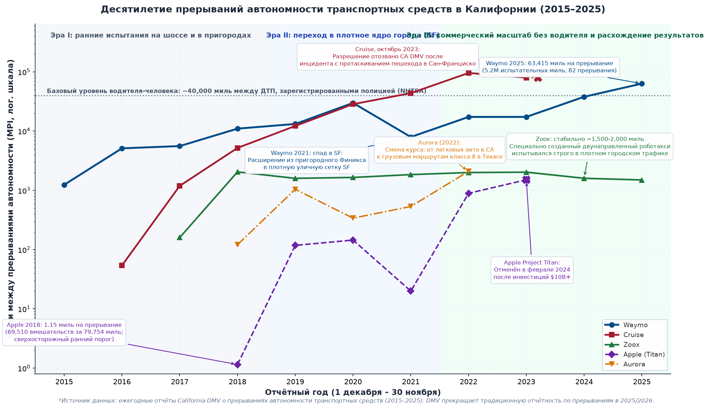
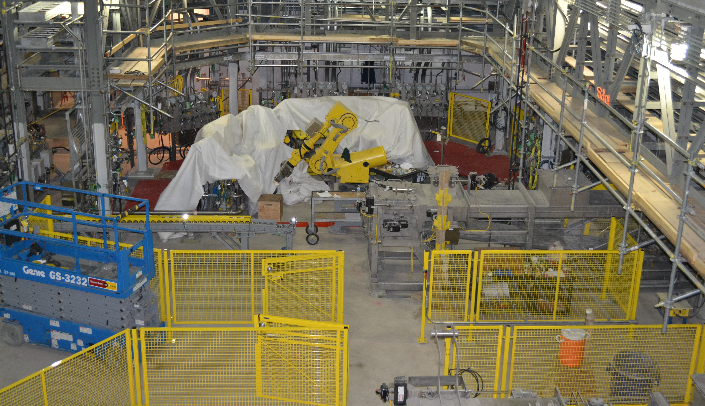

# Выпуск в эксплуатацию

## Цель

_Под какой проверяемой цепью физических свидетельств автономной машине разрешено двигаться среди людей?_

Выпуск автономной машины дает программному обеспечению полномочия прикладывать физические силы в неограниченных средах рядом с людьми. Такие полномочия развертывания требуют проверяемого кейса безопасности, связывающего эксплуатационные утверждения напрямую с эмпирическими свидетельствами от интегрированного физического объекта управления. Высокая точность валидации не может гарантировать, что робот остановится в пределах доступного свободного расстояния, а журнал испытаний без инцидентов не подтверждает надежность аварийного резервирования, когда критические сенсоры переживают немые аппаратные отказы.

Решение о выпуске должно точно указывать, какие эмпирические измерения поддерживают каждое обоснование, и явно очерчивать средовые допущения, ограничивающие их действительность. Немоделированные смещения нагрузки, износ пола или тепловой дрейф способны мгновенно аннулировать кейс безопасности, даже когда веса нейросети остаются неизменными; там, где свидетельства не могут разрешить эксплуатационную предпосылку, отказ — единственный приемлемый инженерный вердикт. В рамках огибающей управления выпуск в эксплуатацию сводит предложения Мозга, путь разрешения Нервной системы и физические пределы Тела в проверяемый манифест, который отзывает полномочия движения в тот миг, когда свидетельства истекают.

> **Цели обучения**
>
> - Построить кейс утверждение–аргумент–свидетельство, связывающий ограниченную эксплуатационную огибающую с проверяемыми физическими свидетельствами
> - Оценить, являются ли предпосылки каждого утверждения измеренными, иллюстративными или неизвестными, и выбрать поддерживаемый ими вердикт
> - Определить измерения, которые сняли бы отказ, и ограничения, которые сохранил бы условный вердикт
> - Задать действующие условия, отзывающие полномочия эксплуатации, когда износ, дрейф или изменения конфигурации аннулируют выпуск
> - Диагностировать необеспеченные обоснования и составные противодоводы через критический обзор аргумента выпуска
> - Спроектировать манифест выпуска, связывающий восходящие записи дайджестами и отказывающий в движении при любом несоответствии

## Решение о развертывании

Каталог записей пройденных тестов и трасс аппаратных отказов сам по себе не решает, может ли автономная машина двигаться среди людей. В веб-сервисе регрессия в новой сборке стоит отката и нескольких испорченных записей. В физическом ИИ выпуск делегирует полномочия над массой, силой и скоростью. Верификация уже подвергала допущения машины о тайминге, конкуренции и сенсорике испытанию внедренными отказами, и передает она свои записи отказов, каждую с заранее объявленным оракулом, и оставленные ими пробелы. Поэтому инженерная задача смещается от поиска дефектов к ограничению того, что свидетельства дозволяют. Ни точность валидации ([«Динамика замкнутого контура»](07_evaluation.md#sec-evaluation-closed-loop-dynamics)), ни серия чистых демонстраций ([«Почему эксплуатация — не свидетельство»](15_verification.md#sec-verification-fault-injection)) не решают эту задачу, и решение о развертывании — не статистический прогноз. Это инженерный арбитраж того, ограничивают ли свидетельства физический риск эксплуатации в названной области.

> ↰ **Предварительное требование:** Эмпирические свидетельства верификации, поддерживающие утверждения выпуска, добываются в разделе [«Внедрение отказов на аппаратуре»](15_verification.md#sec-verification-hardware-fault-injection).

Выпуск, который прорабатывает эта глава, — служба складского мобильного манипулятора на одной площадке: проезд по проходам мимо торцов стеллажей, где может стоять человек, открывание двери клетки с пружинным замком и передача керамической кружки, которую машина берет с конвейера станции комплектации, коллеге на упаковочном посту. Каждая работа несет свой критерий — свободное расстояние для основания и контактную силу для руки, — и точность модели не устанавливает ни одного из них. Поэтому выпуск опирается на свободное расстояние до контакта, измеренную тормозную способность, ограниченный полный путь отклика и подписанные записи отказов из раздела [«Манифест отказов»](15_verification.md#sec-verification-fault-manifest).

Вердикт выпуска — ограниченное, отменяемое суждение. Глава строит это суждение из эксплуатационной огибающей, дерева утверждение–аргумент–свидетельство, трех подписанных вердиктов, действующих условий, чей отказ отзывает вердикт, проработанного арбитража и критического обзора, который ему нужно выдержать, а также манифеста выпуска, отказывающего в движении, когда работающая машина больше не соответствует своим подписанным свидетельствам.

## Вопрос выпуска

Для мобильного манипулятора вопрос выпуска звучит так: отвечают ли свидетельства физическому критерию каждой из трех его работ внутри очерченной огибающей. Аргумент называет физические границы, заданный набор отказов и проверенные путь разрешения и путь резервирования. Он может поддержать отзывное пожалование полномочий слежения, пока эти условия держатся; он не может вывести защиту от каждого возможного отказа из конечных тестов ([«Кейс безопасности утверждение–аргумент–свидетельство»](16_release.md#dfn-release-goal-structured-safety-case)).

> **Кейс безопасности утверждение–аргумент–свидетельство**
>
> ***Кейс безопасности утверждение–аргумент–свидетельство*** — проверяемый структурированный аргумент гарантии для заданной физической машины, эксплуатационной огибающей, критериев опасности и модели отказов, связывающий верхнеуровневые утверждения безопасности с конкретными эмпирическими свидетельствами через явные инженерные обоснования.
>
> 1.  **Значение**: Превращает субъективную неформальную уверенность в развертывании в проверяемый фальсифицируемый инженерный аргумент, связывающий высокоуровневые цели безопасности с конкретными эмпирическими свидетельствами через весь физический стек.
> 2.  **Отличие**: В отличие от наборов модульных тестов ПО или статических скоркартов валидации моделей, физический кейс безопасности явно связывает границы области эксплуатационного назначения, журналы внедрения аппаратных отказов и пороги срабатывания механизма принуждения времени выполнения, чтобы продемонстрировать ограниченный остаточный риск.
> 3.  **Типичная ловушка**: Считать кейс безопасности ретроспективным чек-листом соответствия, заполняемым после разработки, а не живым архитектурным контрактом, управляющим интеграцией функций и воротами выпуска.

Кейс выпуска очерчивается эксплуатационной огибающей — целевой ODD в паре с собственными внутренними условиями машины. Безусловный (`UNCOND`) вердикт санкционирует всю эксплуатационную огибающую ([«Эксплуатационная огибающая»](15_verification.md#sec-verification-operating-envelope)), условный (`COND`) — названную ее часть, а отказ (`REFUSE`) — никакую. Для мобильного манипулятора эксплуатационная огибающая допускает движение по проходам до `1.3 m/s` (выбрано; см. руководство для читателя) с нагруженным стеллажом ящиков не более `50 kg`, по полам, обследованным на коэффициент трения не ниже `0.204`, мимо торцов стеллажей со свободным расстоянием не менее `1.10 m`. Она допускает подходы к двери на `0.03 m/s` и передачи предметов коллеге на `0.10 m/s`.

> ↰ **Предварительное требование:** Область эксплуатационного назначения и ее известные отсутствия определены в разделе [«Охват политики сбора»](05_data.md#sec-data-policy-coverage).

Внутри этих границ обученная политика может предлагать действия по всей номинальной огибающей задачи, но каждое действие по-прежнему требует независимого разрешения. Условные состояния контролируемых измерений ([«Эксплуатационная огибающая складского манипулятора»](16_release.md#tbl-16-odd-invariants)) сужают эту огибающую; например, машина замедляется до `1.2 m/s`, прежде чем запросить перехват в контуре. Ограниченный режим вердикта `COND` сужает ее дальше: на полу, известном лишь по регламенту осмотров площадки, машина идет на `1 m/s`, ниже потолка `1.09 m/s` для осмотренных полов.

Как формализовано в таблице [«Эксплуатационная огибающая складского манипулятора»](16_release.md#tbl-16-odd-invariants), каждое контролируемое измерение разбито на номинальные, условные и запрещающие состояния. Условное состояние ограничивает допускаемые предложения. Запрещающее состояние отзывает разрешение на слежение и выбирает проверенное резервирование ([«Лестница резервирования»](12_enforcement.md#sec-enforcement-fallback-ladder)). Таблица перечисляет измерения, в пределах которых удерживает машину монитор времени выполнения или процедура площадки; внутренние условия из раздела [«Эксплуатационная огибающая»](15_verification.md#sec-verification-operating-envelope), такие как температура окружающей среды, напряжение шины и вычислительная нагрузка, входят через записи отказов, испытанные в этих условиях.

\Needspace{28\baselineskip}

| Измерение огибающей / инвариант | Номинальная огибающая ($\mathcal{S}_{\mathrm{nom}}$) | Условная граница ($\mathcal{S}_{\mathrm{cond}}$) | Жесткий отказ ($\mathcal{S}_{\mathrm{refuse}}$) | Монитор времени выполнения и частота | Действие механизма принуждения и задержка |
|:-------------------------------|:--------------------------------------------------------------------------------------------------------------------------|:------------------------------------------------------------------------------------------------------------------------------------------------------------------------------------------------------------|:-----------------------------------------------------------------------------------------------------------------------------------------------------------------------|:---------------------------------------------------------------------------------------|:-------------------------------------------------------------------------------|
| **Скорость в проходе** | $v\le$ `1.3 m/s` | `1.2 m/s` до запроса перехвата в контуре; `0.3 m/s` до перехвата вне контура | Измеренная скорость выше подписанной `1.3 m/s` (потолок `1.39 m/s`) или недействительная оценка скорости | Энкодеры и инерциальный блок, каждый такт разрешения `1 ms` | Ограничивать допускаемую скорость; отказывать выше подписанной скорости |
| **Трение пола** | Обследовано $\mu\ge$ `0.204` (сухой бетон около `0.60`) | Только регламент осмотров ($\mu\ge$ `0.12`): ограниченные `1 m/s`, ниже потолка `1.09 m/s` | Необследованный пол или сообщенная пленка; прозрачная масляная пленка ($\mu\approx$ `0.05`) невидима для камер | Обследование пола и процедура площадки по проливам; бортовых измерений нет | Ограничивать скорость по зонам пола; отказывать проходу |
| **Нагрузка стеллажа ящиков** | $0\le m\le$ `50 kg`, действительная оценка нагрузки (всего не более `368 kg`) | Оценка устарела с последнего подбора: только задачи при неподвижной руке | Нагрузка выше емкости или недействительная оценка | Тензодатчики стеллажа, при каждом подборе | Отказывать в движении по проходу до повторного взвешивания |
| **Свободное расстояние у торца стеллажа** | Обследовано $D_{\text{clear}}\ge$ `1.10 m` на каждом торце стеллажа | Более короткое обследованное расстояние: сниженная подписанная скорость из того же бюджета | Необследованный торец стеллажа или препятствие в пределах свободного расстояния | Обследование площадки; лидар и навигационная камера с частотой кадров | Ограничение скорости на каждый торец стеллажа; останов при обнаруженном препятствии |
| **Подход к защелке двери** | $v\le$ `0.03 m/s`, ответная планка в номинальном положении | Нет; демонстрации не покрывают других состояний защелки | Подход на `0.10 m/s` или смещенная планка | Чувствительность к контактной силе руки в контактном контуре `2 ms` | Срабатывание на `15 N`; отказывать необеспеченному подходу |
| **Передача коллеге** | Скорость центра инструмента $\le$ `0.10 m/s` под `accept_item` | Коллега присутствует без `accept_item`: остановиться, не доходя до точки передачи | Скорость центра инструмента выше подписанной `0.10 m/s` (потолок `0.118 m/s`) или контакт вне оцененного кейса | Шарнирные энкодеры на каждом такте разрешения; чувствительность к контактной силе руки | Ограничивать скорость центра инструмента; отказывать выше подписанной скорости |

***Эксплуатационная огибающая складского манипулятора**: Каждое перечисленное измерение имеет непересекающиеся номинальные, условные и запрещающие интервалы. Условная работа требует, чтобы каждое измерение оставалось в подписанном допустимом интервале; отсутствующие или недействительные измерения отказывают. Частоты сенсоров и тормозной отклик — обязательства валидации объекта управления.*

Защитимое утверждение выпуска называет свой объект управления, геометрию контакта и набор отказов.[^fn-std-isots15066-biomech] Кейс машины использует три критерия. Основание останавливается в пределах свободного расстояния `1.10 m`, не достигнув человека, вышедшего у торца стеллажа; рука открывает дверь, не превышая предела защелки `100 N`; а передача никогда не давит на коллегу с пиковой силой выше выбранных `50 N` для оцененного случая контакта. Утверждение основания защищает неподвижного человека; человек, все еще идущий к машине, — отдельная предпосылка, которую несет правило пересечения на площадке ([«Оценка сквозь окклюзию»](09_memory.md#sec-memory-belief-through-occlusion)). Аргумент выпуска должен продемонстрировать, какие человеческие контакты исключены до удара, какие обнаруженные контакты покрывает модель и какие единичные отказы обрабатывает независимое резервирование. Остановка после контакта сама по себе не ограничивает первый пик силы.[^fn-math-contact-mechanics]

[^fn-std-isots15066-biomech]: **Биомеханические пределы ISO/TS 15066**: Спецификация дает зависящие от области тела и типа контакта данные о силе и давлении [isots15066, 2016](references.md#isots15066). Оценка площадки должна выбрать применимую область тела, геометрию контакта и метод измерения. Используемый здесь критерий передачи — консервативный критерий кейса, а не универсальный порог ISO/TS 15066 и не граница травмы.

[^fn-math-contact-mechanics]: **Силовая модель механики контакта**: Эластодинамическая модель связывает поступательную кинетическую энергию, эффективную движущуюся инерцию и жесткость контактного интерфейса, чтобы определить переходную пиковую силу удара при несмягченном столкновении. Удар о жесткую границу концентрирует запасенную кинетическую энергию в субмиллисекундный импульс с жестким усилением силы, тогда как упругая податливость удлиняет время деформации и рассеивает энергию на более длинном ходе. Формальная эластодинамическая выводка и односторонние контактные формулировки даны в разделе [«Механика контакта твердых тел»](appendix_control.md#sec-appendix-control-contact).

Рассмотрим руку на ее пределе скорости в свободном пространстве `1 m/s` с эффективной массой на стороне робота в центре инструмента `12 kg`. При не заторможенном упругом контакте с рукой коллеги, смоделированном с эффективной жесткостью тканей $k_h$ в `15,000 N/m`, пиковая контактная сила следует из уравнения [«сила без торможения»](16_release.md#eq-release-unbraked-force):

$$F_{\text{unbraked}} = v\,\sqrt{k_h\,m_{\text{eff}}}$$

На пределе свободного пространства эта идеальная упругая модель предсказывает `424 N`, или `8.5×` критерия `50 N`, поэтому рука не может войти в неразделенный контакт на этой скорости без более сильного измеренного защитного аргумента. То же уравнение ограничивает скорость передачи предмета, которую запечатывает протокол принудительного обеспечения ([«Протокол принудительного обеспечения»](12_enforcement.md#sec-enforcement-telemetry), [«Человеческие полномочия над исполнением команды»](14_intervention.md#sec-intervention-human-authority)), ибо критерий допускает не более `0.118 m/s`. На выбранных `0.10 m/s` модель предсказывает `42.4 N` — внутри критерия.

Утверждение основания — бюджет, а не единичная сила, и слагаемые задержки, которые должна засвидетельствовать эта глава, — это путь аренды и возраст наблюдения, которые называют его утверждения. На скорости прохода `1.3 m/s` готовый бюджет ([«Бюджет остановки складского манипулятора»](12_enforcement.md#tbl-enforcement-stopping-budget)) составляет `997.4 mm` против свободного расстояния `1.10 m`, запас — `102.6 mm`. Этот запас — весь допуск на ошибку во входах бюджета. Небюджетированная задержка `78.9 ms`, предельный срок передачи $T_{\text{latest}}$ из раздела [«Переходы полномочий»](14_intervention.md#sec-intervention-authority-transitions), израсходует его, равно как загруженное замедление на 14 % ниже `2 m/s²`, которые предполагает бюджет. Утверждение об остановке с неизмеренными входами не может показать, что его запас переживает их ошибки.

Вопрос выпуска для мобильного манипулятора свелся к трем ограниченным критериям: основание останавливается в пределах свободного расстояния, рука открывает дверь под пределом защелки, а передача предмета укладывается в контактный критерий. Ни одно вычисление само по себе не разрешает ни одного из них, ибо каждое наследует предпосылки о замедлении, задержке и контакте, которые сами должны быть засвидетельствованы, и каждая предпосылка может устареть в службе по мере износа тормозов, загрязнения пола и дрейфа сенсоров ([«Действующие условия вердикта»](16_release.md#sec-release-standing-conditions)). Связать каждое утверждение с его предпосылками, а каждую предпосылку — с ее свидетельствами, и есть работа кейса безопасности.

## Кейсы безопасности и утверждения

Никакая инспекция мобильного манипулятора не может подтвердить, что его нагруженное основание остановится, не достигнув человека у торца стеллажа. Это утверждение должно быть разложено, пока каждая ветвь не окончится чем-то измеренным, а кейс безопасности — структурированный аргумент, фиксирующий это разложение. Опираясь на структуру аргументации Стивена Тулмина [Toulmin, 1958](references.md#toulmin1958uses), нотацию структурирования целей (GSN)[^fn-std-gsn-argument] [Kelly, 1998](references.md#kelly1998arguing); [Kelly and Weaver, 2004](references.md#kelly2004goal) и стандарт оценки автономности UL 4600 [Koopman, 2020](references.md#koopman2020how), эта глава конструирует кейс безопасности утверждение–аргумент–свидетельство из раздела [«Кейс безопасности утверждение–аргумент–свидетельство»](16_release.md#dfn-release-goal-structured-safety-case). Его корень — утверждение, утверждающее измеримое физическое свойство, например остановку основания в пределах свободного расстояния. Поскольку это утверждение нельзя валидировать напрямую, стратегии разбивают его по режимам эксплуатации, классам опасности или подсистемам, и каждое подутверждение оканчивается дальнейшими подутверждениями или свидетельствами, ограниченными контекстом и допущениями, при которых держатся его связи.

[^fn-std-gsn-argument]: **Нотация структурирования целей**: Разработанная Тимом Келли в Йоркском университете, GSN задает явную графическую грамматику структурирования и аудита кейсов гарантии безопасности [Kelly, 1998](references.md#kelly1998arguing); [Kelly and Weaver, 2004](references.md#kelly2004goal). Нотация разлагает верхнеуровневые цели безопасности на контекстные подутверждения, стратегии аргументации и решения, обоснованные тестовыми артефактами.

Действительность структуры опирается на различение свидетельства и демонстрации. **Демонстрация** — запись успешного выполнения задачи на неохарактеризованном тестовом распределении, например длинная серия чистых открываний двери, когда ответная планка всегда в номинальном положении. Она измеряет среднюю производительность, но не ограничивает ни хвост, ни режимы отказа вне семплированной траектории. Свидетельство — фальсифицируемый калиброванный артефакт с количественными границами, например распределение худшего тайминга из аппаратных трасс выполнения, остановочные испытания под нагрузкой по режимам замедления или испытание внедрением отказов, загоняющее машину к границе ее огибающей. Артефакт без количественной неопределенности или тот, что никогда не испытывает границу, остается демонстрацией и не может поддержать выводную связь.

Связывание свидетельства с утверждением требует **обоснования** — выводного правила, объясняющего, почему данные поддерживают утверждение. Для обученной политики обоснование индуктивно: оно рассуждает от эпизодов тестов без отказов к будущей службе, и стена наработки из раздела [«Пределы физических испытаний»](07_evaluation.md#sec-evaluation-trial-limits) показывает, почему эта связь не может одна нести утверждение с тяжелыми последствиями. Никакая кампания без единого события, ни на одной машине, ни на флоте, не достигает частот опасности, которые называют такие утверждения, в любом практическом графике. Аргумент должен поэтому добавить архитектурное обоснование, обосновывающее утверждение независимым путем разрешения ([«Обеспечение безопасности»](12_enforcement.md#sec-enforcement)), который ограничивает момент актуатора и отзывает движение всякий раз, когда обученная команда покидает допустимый набор. Это обоснование сужает утверждение, а не ускользает от стены, ибо путь разрешения меняет утверждение лишь для тех опасностей, которые он обнаруживает и останавливает вовремя ([«Что метод не может установить»](17_frontier.md#sec-frontier-method-limits)).

Это напряжение между индуктивными свидетельствами флота и гарантией, критичной для безопасности, иллюстрирует десятилетие данных об отключениях автономных транспортных средств, представляемых в Департамент транспортных средств Калифорнии ([«Десятилетие отключений автономных транспортных средств в отчетах California…»](16_release.md#fig-release-decade-california-dmv-disengagements)). Между 2015 и 2025 годами разработчики записали десятки миллионов миль публичных испытаний по дорогам Калифорнии. За это десятилетие мили между отключениями (MPI) росли через три различных эры:

1. **Эра I: ранние испытания на шоссе и в пригородах (2015–2018)**: Системы работали преимущественно на хорошо размеченных магистральных коридорах и шоссе. Разработчики установили базовые ритмы автономности, нарастив от сотен миль между человеческими вмешательствами до нескольких тысяч миль.
2. **Эра II: переход в плотное городское ядро (2018–2021)**: Флоты мигрировали в плотные городские среды, и прежде всего в сложную дорожную сеть Сан-Франциско. Этот сдвиг среды обнажил неохарактеризованные краевые случаи — пешеходов, выходящих между двойными парковками, жесты объезда дорожных работ и динамические окклюзии, — временно заморозив или опустив отчетный MPI (например, метрика Waymo упала с $29{,}945$ миль в 2020 году до $7{,}965$ миль в 2021 году, прежде чем восстановиться).
3. **Эра III: коммерческий масштаб без водителя и расхождение (2021–2025)**: Упразднение бортового водителя безопасности привело к резкому стратегическому расхождению. Waymo масштабировала коммерческие перевозки только с пассажирами, превысив $63{,}000$ миль на одно отключение в 2025 году при более чем пяти миллионах испытательных миль. Aurora развернула свою калифорнийскую программу с легковыми автомобилями в сторону коммерческих грузовых коридоров класса 8 в Техасе. Apple отменила инициативу Project Titan в начале 2024 года после многомиллиардной НИОКР, испытывавшей трудности с чувствительностью ранних вмешательств. Наиболее поучительно, что Cruise перевалила $80{,}000$ миль на одно отключение в калифорнийских отчетах вскоре до того, как октябрьское 2023 года столкновение с протаскиванием пешехода в Сан-Франциско привело к немедленному регуляторному отзыву ее разрешений на автономные испытания и развертывание.

Фундаментальный системный урок раздела [«Десятилетие отключений автономных транспортных средств в отчетах California…»](16_release.md#fig-release-decade-california-dmv-disengagements) в том, что индуктивное обоснование, выведенное лишь из совокупного пробега флота, не может установить утверждение о катастрофической опасности. Высокий MPI указывает на операционную зрелость в номинальных условиях, но не ограничивает тяжесть или вероятность отказов хвостовых событий при немоделированных физических взаимодействиях. Кейсы безопасности для физического ИИ должны сочетать эмпирическую наработку с детерминированными архитектурными механизмами принуждения, остающимися действительными, когда обученные политики встречают новые сдвиги распределения.

Инженерный кейс безопасности не существует в институциональном вакууме. Внутри команды разработки дерево утверждение–аргумент–свидетельство устанавливает техническую уверенность в том, что физические риски ограничены; вне команды оно формирует свидетельскую основу для предписанного регуляторного разрешения и юридической подотчетности. Когда автономная система переходит из лаборатории в коммерческое развертывание, ее утверждения безопасности пересекаются с тремя главными опорами управления:

1. **Закон ЕС об искусственном интеллекте (классификация высокого риска):** По Закону ЕС об искусственном интеллекте ИИ-системы, развертываемые как компоненты безопасности в физическом оборудовании, коллаборативных роботах или автономном транспорте, классифицируются как *системы ИИ высокого риска*. Соблюдение предписывает проверяемую систему управления рисками, охватывающую операционный жизненный цикл, верифицированное управление данными, документирующее распределения обучения и оценки ([«Схема датасета»](05_data.md#sec-data-schema)), интерфейсы человеческого надзора, способные к вмешательству в реальном времени ([«Человеческие полномочия над исполнением команды»](14_intervention.md#sec-intervention-human-authority)), и журналирование событий с обнаружением подделки ([«Достоверные операционные журналы»](14_intervention.md#sec-intervention-trustworthy-logs)) ради судебно-медицинской восстановимости после любого аномального контакта.
2. **Отраслевая обязательная сертификация:** За пределами горизонтального регулирования ИИ воплощенные системы обязаны удовлетворять отраслевым предписаниям безопасности: предрыночные процедуры Управления по контролю за продуктами и лекарствами США (FDA) (510(k) и De Novo) для автономной хирургической робототехники, требующие валидации человеческого фактора по ANSI/AAMI HE75 и контроля жизненного цикла ПО по IEC 62304; сертификаты летной годности Федерального авиационного управления (FAA) (Part 107/135) для автономной авиационной логистики; и стандарты UNECE/NHTSA (такие как UN R157 для автоматизированного рулевого управления), регулирующие системы автоматизированного вождения.
3. **Перераспределение юридической ответственности:** В классической заводской автоматизации, где роботы работают внутри блокированных клеток ([«Промышленная ячейка точечной сварки»](03_brain.md#fig-industrial-welding)), физические несчастные случаи разбираются преимущественно по правовой доктрине *неосторожности оператора* — оценивается, нарушил ли персонал цеха протоколы безопасности или обошел блокировки. Когда автономная машина работает без физических ограждений в разделяемых с людьми пространствах, юридическая ответственность кардинально смещается к *строгой ответственности производителя за продукцию*. Немоделированный сбой восприятия или перелет слежения — уже не ошибка оператора; это предполагаемый дефект конструкции, производства или неспособности инструктировать. В этом правовом режиме криптографически подписанный кейс безопасности и манифест выпуска — не просто хорошая инженерная практика, а окончательная свидетельская запись, устанавливающая, что инженерная команда ограничила остаточный риск по современным стандартам до публичного выпуска.

***Десятилетие тенденций отключений автономных транспортных средств в отчетах California DMV (2015–2025)**: Годовые мили между отключениями (MPI, логарифмическая шкала) по крупнейшим разработчикам автономных транспортных средств (Waymo, Cruise, Zoox, Apple Project Titan и Aurora) в охват трех исторических эксплуатационных эр. Горизонтальная пунктирная линия отмечает базовый уровень человеческого водителя — примерно 40 000 миль между ДТП, о которых сообщала полиция (NHTSA). Вехи отмечают просадку Waymo при переходе в плотную городскую среду в 2021 году, отзыв разрешений Cruise в октябре 2023 года после столкновения с тяжелыми последствиями, устойчивый режим городских роботакси Zoox, отмену программы Apple и достижение Waymo 63 415 миль на одно отключение в 2025 году. (Источник данных: ежегодные отчеты California DMV об отключениях автономных транспортных средств, 2015–2025).*

Каждая связка опирается также на контекстные допущения, и незаявленное из них охраняется лишь той проверкой, которая случайно оказалась ниже по потоку. Обоснование остановки предполагает среди прочего, что проход остается достаточно освещенным для номинальной экспозиции навигационной камеры. Допустим, тусклый проход удваивает эту экспозицию с `16 ms` до `32 ms`. Поскольку возраст изображения отсчитывается от середины экспозиции, каждое наблюдение приходит на `8 ms` старше, чем начисляет бюджет, что без проверки унесло бы основание еще на `10.4 mm` на скорости прохода `1.3 m/s` — около 10 % от бюджетного запаса `102.6 mm`. Проверка возраста на пути разрешения, напротив, отвергает эти кадры, и основание останавливается в проходе, который кейс считал проезжим. Команда встречает свое допущение об освещении как необъяснимую потерю службы, и лишь проверка, которую кейс никогда не связывал с освещением, помешала ей стать молчаливой потерей свободного расстояния. Допущение, которого не видит ни одна проверка времени выполнения, не имеет такой страховки, как показывает локализационный допуск в составном отказе раздела [«Критический обзор»](16_release.md#sec-release-adversarial-review). Поэтому надежный аргумент формулирует каждую физическую зависимость как ограниченный элемент контекста с монитором времени выполнения, обнаруживающим ее нарушение.

> ↳ **Ниже по потоку:** Эпистемические допущения, вложенные в обоснования кейса безопасности, критически разбираются в разделе [«Эпистемические пределы»](17_frontier.md#sec-frontier-epistemic-limits).

Слабейшее звено управляет каждым деревом утверждение–аргумент–свидетельство. Кейс безопасности — не агрегат, в котором перевыполнение одной ветви компенсирует дефицит другой. Высокая точность на бенчмарке распознавания не компенсирует неохарактеризованный хвост задержек на шине CAN, равно как обширная симуляция политики не компенсирует отсутствие данных об износе тормозов. Если остановка основания раскладывается на подутверждения о торможении, тепловой защите приводов ([«Тепловые циклы нагрузки»](02_body.md#sec-body-thermal-duty-cycles)) и ограничении траектории, отказавшее обоснование в любой ветви аннулирует корневое утверждение. Поэтому арбитр, разбирающий кейс, ищет не число поддерживающих артефактов, а единственный слабейший связующий элемент, чей отказ допустил бы вред.

### Соотнести аргументацию безопасности с машиной

Для руки мобильного манипулятора рамки оценки робота и интеграции задают ISO 10218-1 и ISO 10218-2, а ISO/TS 15066 информирует кейс совместного контакта, как только аргумент называет касаемую область тела, давление, геометрию и метод измерения [isots15066, 2016](references.md#isots15066). Утверждения основания, составляющие большую часть кейса, аргументируются от его измеренного бюджета остановки и обследования площадки. Стандарты дорожных транспортных средств ISO 26262 и ISO 21448 одалживают аргументу свое различие между отказами и пределами намеренной функции, но не сертифицируют ничего об этой машине [iso26262, 2018](references.md#iso26262); [iso21448, 2022](references.md#iso21448).

Скоркарт утверждение–аргумент–свидетельство в таблице [«Разбор утверждение–аргумент–свидетельство для складского манипулятора»](16_release.md#tbl-16-cae-scorecard) формулирует шесть утверждений и соотносит каждое физическое обоснование с его арбитражом по свидетельствам этой книги. Утверждение C3 показывает решение: масляная пленка способна лишить торможение сцепления, поэтому номинальная точность модели не может оправдать неограниченный вердикт. Физически осуществимое условие, таким образом аннулирующее обоснование, является его **противодоводом (defeater)**, а раздел [«Критический обзор»](16_release.md#sec-release-adversarial-review) превращает поиск противодоводов в метод обзора. Утверждение C6 стоит лишь на записях отказов, испытывающих четыре правила полномочий, которые передает раздел [«Журнал полномочий»](14_intervention.md#sec-intervention-authority-log) (A1–A4).

\Needspace{24\baselineskip}

| Утверждение | Обоснование и эксплуатационные допущения на машине | Арбитраж по свидетельствам книги |
|:----------------------------|:--------------------------------------------------------------------------------------------------------------------------------------------------------------------------------------------------------------------------------------------------------------------------------------------------------------------------------------------------------------------------------------------------------------------------------------------------------------------------------------------------------------------------------------------------------------------------------------------------------------------------------------------------------------------------------------------------------------------------------------------------------------------------------------------------------------------------------------------------------------------------------------------------------------------------------------------------------------------------------------------------------------------------------|:-------------------------------------------------------------------------------------------------------------------------------------------------------------------------|
| C1. Контакт и остановка | Основание: остановка `997.4 mm` на `1.3 m/s` ([«Бюджет остановки складского манипулятора»](12_enforcement.md#tbl-enforcement-stopping-budget)) в пределах свободного расстояния `1.10 m` до человека, стоящего у торца стеллажа, причем неиспытанная при `368 kg` нагрузка остается открытой предпосылкой; Дверь: сила защелки `39 N` на команде торможения, при этом рука останавливается в пределах дальнейших `0.15 mm` (около `3 m/s²`) под пределом `100 N`; Кружка: подобрана с конвейера под пределом центра инструмента `1 m/s` по отслеживаемому намерению и передана коллеге на `0.10 m/s`, под выведенным потолком `0.118 m/s`, с контактной силой `42.4 N` под критерием `50 N`, причем захваченный объект считается кружкой, которую называет задача | `REFUSE`: достоверное замедление, начало торможения, ошибки слежения и локализации, замедление руки и жесткость тканей иллюстративны; предпосылка обоснования неизвестна |
| C2. Тайминг разрешения | Начало торможения не позднее `82 ms` после последнего действительного продления; худшее время выполнения механизма принуждения `250 μs` в предельном сроке `400 μs`; заявленное допущение: утверждение покрывает отказы, которые путь разрешения переживает, lockstep-диагностика покрывает собственный отказ пути ([«Два пути на одном кристалле»](13_placement.md#sec-placement-two-paths-one-die)), а ступень ингибирования лестницы резервирования не несет бюджета ([«Лестница резервирования»](12_enforcement.md#sec-enforcement-fallback-ladder)) | `REFUSE`: худшее время выполнения заявлено, а не измерено под нагрузкой |
| C3. Тормозное сцепление | Трение пола не ниже `0.204` на каждом проходе; противодовод — прозрачная масляная пленка | `REFUSE`; открытая предпосылка переходит в [«Реестр остаточных утверждений»](17_frontier.md#sec-frontier-residual-claims-register) |
| C4. Возраст наблюдения | Возраст навигационной камеры `51.6 ms` внутри бюджета, с резервированием на устаревшие данные | `REFUSE`: цепочка возраста иллюстративна |
| C5. Независимость разрешения | Нагруженные максимумы записи размещения остаются в пределах заявленного `250 μs` худшего времени выполнения, а значит ниже предельного срока, и общие причины испытаны ([«Распределение аппаратных ресурсов»](13_placement.md#sec-placement-hardware-allocation)) | `REFUSE`, пока не существует журнал испытаний размещения |
| C6. Передача полномочий | Один писатель на канал актуатора; ни один источник не обходит более высокий уровень полномочий или проверку разрешения; неподтвержденная передача резервируется по выведенному из свободного расстояния $T_{\text{timeout}}$ из раздела [«Переходы полномочий»](14_intervention.md#sec-intervention-authority-transitions) (`174.7 ms` на замедлении до `1.2 m/s` перед перехватом в контуре; `78.9 ms` для запроса на `1.3 m/s`); недействительная аутентификация блокирует канал ([«Журнал полномочий»](14_intervention.md#sec-intervention-authority-log)) | `REFUSE`, если у любого из A1–A4 нет записи отказа `PASS` ([«Манифест отказов»](15_verification.md#sec-verification-fault-manifest)); ограничить локальной работой, если не проходят только случаи удаленного канала |

***Разбор утверждение–аргумент–свидетельство для складского манипулятора**: Шесть утверждений и их арбитраж по свидетельствам этой книги. Отказавшая или неизвестная ветвь не может быть компенсирована номинальной точностью модели.*

> **Декомпозиция утверждение–аргумент–свидетельство и индуктивные обоснования**
>
> Прежде чем представлять кейс безопасности на арбитраж, проверьте его структуру:
>
> - [ ] **Фальсифицируемость верхнеуровневого утверждения**: Сможете ли вы сформулировать верхнеуровневое утверждение как фальсифицируемое физическое высказывание, например остановку в пределах свободного расстояния, а не пожелание?
> - [ ] **Действительность обоснования**: Сможете ли вы назвать обоснование, связывающее каждый стенд с утверждением выше, и предпосылки, при которых это обоснование держится?
> - [ ] **Перечисление противодоводов**: Сможете ли вы показать, где противодовод вроде загрязнения объектива или коллизий арбитража шины появляется в графе аргументов?
> - [ ] **Происхождение свидетельств**: Сможете ли вы проследить каждый конечный узел свидетельств до подписанной испытательной трассы и действующей калибровки?

## Три вердикта

Каждая строка таблицы [«Разбор утверждение–аргумент–свидетельство для складского манипулятора»](16_release.md#tbl-16-cae-scorecard) заканчивается арбитражем, и решение о выпуске сводит все дерево к одному из трех вердиктов: **безусловная работа**, **условная работа** и **отказ в работе**. Первый, безусловная работа, дарует полную огибающую, названную в подписанном кейсе выпуска, пока его действующие условия остаются истинными. Каждое утверждение об опасности в этом кейсе требует свидетельств для заданных объекта управления, нагрузки, области эксплуатационного назначения и набора отказов, причем тепловая емкость тормозов, свободное расстояние остановки и границы ошибки слежения квалифицированы для этой огибающей ([«Тепловые циклы нагрузки»](02_body.md#sec-body-thermal-duty-cycles)), а независимые проверки разрешения — везде, где обученные предложения могут дойти до актуаторов ([«Каузальная граница»](01_causal_boundary.md#sec-boundary-causal-boundary)). Вердикт не устраняет остаточные или вновь обнаруженные опасности; он санкционирует эксплуатацию по оцененным утверждениям и требует отзыва, когда их предпосылки отказывают.

Второй вердикт, условная работа, применяется, когда свидетельства показывают машину безопасной внутри ограниченной части эксплуатационной области, но не содержат обоснований для полной огибающей. Выпуск тогда принудительно обеспечивает физические, кинематические или средовые границы, исключающие непроверенные опасные состояния, такие как снижение номинала скорости шарниров, ограниченный диапазон освещенности или барьер, удерживающий людей вне досягаемости манипулятора. Там, где контактную силу нельзя ограничить при неразделенном совместном присутствии, ограниченный кейс может потребовать оцененное ограждение и проверенные блокировки доступа ([«Пример физического разделения»](16_release.md#fig-16-real-robot-safety-cell)), испытанные так, чтобы защитный останов завершался прежде, чем человек достигнет опасной рабочей зоны.

***Пример физического разделения**: Желтая промышленная рука работает за желтым сетчатым ограждением. Ограждение может быть одним из условий ограниченного выпуска, когда его поддерживают проверенная блокировка доступа и испытание останова. Источник: U.S. Army Chemical Materials Activity / PEO ACWA.*

Каждое условие, приложенное к вердикту выпуска, — обязывающий контракт, и каждое называет число, которое принудительно обеспечивает путь разрешения, а не потолок, который допускает физика. Передача предмета показывает разницу. Контракт подписывает скорость центра инструмента ниже потолка, который контактный критерий допускает по формуле [«сила без торможения»](16_release.md#eq-release-unbraked-force), а разрыв между двумя скоростями — это запас на то, чего монитор не видит в момент выборки: рост скорости между выборками, ошибку энкодера и отклик привода на ограничение. Контракт, подписанный на потолке, не оставляет места этим слагаемым, и кейсу выпуска нужна измеренная граница для каждого, прежде чем подписанная скорость сможет держаться.

> ↰ **Предварительное требование:** Детерминированное покрытие резервированием, поддерживающее условные вердикты выпуска, опирается на раздел [«Лестница резервирования»](12_enforcement.md#sec-enforcement-fallback-ladder).

Условие осмотренного пола следует тому же правилу. Там, где регламент осмотров площадки удостоверяет коэффициент трения всего `0.12`, достоверное замедление падает до того, что поддерживает это трение, и бюджет, допускающий `1.39 m/s` на обследованных полах, допускает лишь `1.09 m/s`. Контракт обязателен, только пока держатся его предпосылки.

Третий вердикт, отказ в работе, — обязательный исход всякий раз, когда кейс безопасности содержит отсутствующие обоснования, неохарактеризованные хвостовые задержки, неполное покрытие внедрением отказов или неконтролируемые режимы отказа. Если худший случай механизма принуждения под нагрузкой размещения никогда не измерялся относительно его предельного срока `400 μs` или набор отказов опустил испытания общих причин, которые называет размещение, опасность остается неколичественной и не может поддержать выпуск. Точно так же отказ требуется, когда измерение противоречит модели за слагаемым бюджета, например когда остановочные испытания под нагрузкой замедляются ниже `2 m/s²`, которые предполагает бюджет.

Вердикт отказа — инженерный результат, а не административная неудача. Он переносит спор между графиком и безопасностью на свидетельства, изолируя разорванное звено в дереве аргументов. Если выпуск отвергнут потому, что остановочные испытания под нагрузкой противоречат тормозному слагаемому, команда не дискутирует о терпимости к риску, а повторяет испытания на рабочей массе, пока не станет известен нижний хвост замедления, перевычисляет слагаемое остановки из этого хвоста и возвращается на повторный арбитраж, лишь когда бюджет прохода замыкается на измеренном значении. Вердикт отказа определяет точную свидетельскую проверку, которая должна пройти прежде, чем повторный арбитраж станет возможен.

Ответственность за решение о выпуске должна лежать на идентифицируемом **ведущем системном арбитре**, а не распыляться между командами разработки. Когда команда зрения подписывается под оценками обнаружения, поставщик актуаторов — под кривыми момента, а команда обучения — под сходимостью политики, каждый полагает, что запас обеспечивает другой слой. Лишь арбитр свидетельствует, что интегрированная система удовлетворяет кейсу безопасности, и это свидетельство связывает вердикт с набором неизменяемых технических артефактов, включая криптографический хэш проверенных весов политики, журналы калибровки контактной силы руки, испытания начала торможения вместе с отдельно обоснованной границей худшего отклика и остановочные испытания на рабочей массе, устанавливающие достоверное замедление. Подпись фиксирует ограниченное суждение арбита об этих свидетельствах и заданной области эксплуатации.

Арбитр подписывает одно из трех решений из таблицы [«Три подписанных вердикта выпуска для манипулятора»](16_release.md#tbl-16-verdicts-taxonomy). Условному вердикту нужна отдельно свидетельствуемая ограниченная огибающая; известную дыру в номинальном аргументе нельзя просто переписать как безопасное ограничение. Ни один вердикт не сдвигает границу предложения. И под `UNCOND`, и под `COND` политика лишь предлагает, а механизм принуждения по-прежнему допускает каждое действие, как требует принцип [«Предложение — не разрешение»](part3_running.md#pri-vol4-proposal-permission), поэтому выпуск задает огибающую, которую принудительно обеспечивает путь разрешения, и никогда не дарует политике собственных полномочий.

| Подписанный вердикт | Требуемые свидетельства | Разрешение и пределы времени выполнения | Триггер истечения или отказа |
|:---------------|:-----------------------------------------------------------------------------------------------------------------|:-----------------------------------------------------------------------------------------------------------------------------------------------------------------------|:----------------------------------------------------------------|
| `UNCOND` | Полное утверждение эксплуатационной огибающей, измеренные пределы объекта управления и тайминга, независимо проверенные разрешение и резервирование | Политика предлагает по всей *подписанной* огибающей задачи; каждое действие проходит через механизм принуждения | Отказывают свидетельства, конфигурация, калибровка или действующая предпосылка |
| `COND` | Утверждение ограниченной эксплуатационной огибающей и ее собственные свидетельства, пределы и охват отказов | Политика предлагает только в пределах подписанных сниженных пределов; каждое действие проходит через механизм принуждения | Любая ограниченная предпосылка становится ложной или неизвестной |
| `REFUSE` | Отсутствующие, противоречивые, истекшие или неаутентифицированные критические свидетельства | Нет разрешения на автономное слежение; выполнить оцененный останов или удержание — ступень лестницы резервирования, которую кейс выпуска проверил для объекта управления ([«Лестница резервирования»](12_enforcement.md#sec-enforcement-fallback-ladder)) | Повторный арбитраж с восстановленными свидетельствами |

***Три подписанных вердикта выпуска для манипулятора**: Полная работа и ограниченный режим сохраняют независимое послайдовое разрешение. Отказ — действенный инженерный результат.*

Ни один из трех вердиктов не является вечной милостью. В передачах появляется люфт, трущиеся поверхности изнашиваются, на линзах копится пленка, а распределения среды меняются, поэтому работа под `UNCOND` или `COND` несет обязательства на весь срок развертывания. Износ тормозов, снижающий загруженное замедление на величину, которая израсходует запас бюджета прохода ([«Вопрос выпуска»](16_release.md#sec-release-question)), не оставляет бюджету запаса ни на какую другую ошибку входа. Этот износ должен провалить действующее условие (запланированное остановочное испытание или проверенный самотест тормозов), прежде чем машина снова войдет в проход, ибо остановка в службе обнаружила бы его сначала у торца стеллажа. Каждое такое обязательство связывает предпосылку с детектором и откликом, что делает его одним из действующих условий, которые несет вердикт.

## Действующие условия вердикта

Вердикт выпуска зависит от физических предпосылок с разными графиками наблюдений. Утверждение о торможении мобильного манипулятора опирается на трение пола не ниже `0.204`, которое сухой бетон около `0.60` превышает, но разовое обследование не может покрыть проливы или износ поверхности. Кейсу нужен график осмотров пола и правило останова или исключения после загрязнения, при этом любой бортовой монитор сцепления задается отдельно. Калибровка контактной силы руки восстанавливается с задокументированным интервалом. Каждая предпосылка должна оставаться действительной с темпом, которого требует ее физический режим отказа. По принципу [«Свидетельства ограничивают полномочия»](part4_governing.md#pri-vol4-evidence-bounds-authority) вердикт дарует полномочия на каждое эксплуатационное условие, и эти полномочия длятся, только пока свидетельства за каждой предпосылкой остаются актуальными.

Каждая контролируемая предпосылка требует и детерминированного детектора времени выполнения, и заранее выделенного отклика. Если кейс утверждает, что возраст наблюдения навигационной камеры остается внутри `51.6 ms`, которые начисляет бюджет, но в ПО нет аппаратного компаратора меток времени, измеряющего этот возраст на каждом кадре, предпосылка не контролировалась. Она молча деградировала в допущение. Нагрузка стеллажа ящиков, ограниченная его емкостью `50 kg`, меняется лишь когда рука ставит или убирает ящик, поэтому проверки при каждом подборе достаточно, тогда как скорость и действительность аренды проверяются на каждом такте разрешения `1 ms`.

Оценка контролируемых предпосылок во время выполнения обнажает трихотомию **принадлежности огибающей** ([«Трихотомия огибающих»](16_release.md#dfn-release-envelope-trichotomy)). Бинарная проверка предполагает нормальное выполнение всякий раз, когда не поднят флаг отказа, но принадлежность огибающей имеет три состояния: известно истинное, известно ложное и неизвестное. Принадлежность известно истинна, когда телеметрия верифицирована, метки времени укладываются в свои предельные сроки, а оценщики сходятся с ограниченной ковариацией. Когда физический предел нарушен — например, ошибка слежения основания превысила границу `40 mm`, которую врезает огибающая остановки, — состояние известно ложно. Когда оптический энкодер теряет связь, кадр камеры приходит с несовпадением контрольной суммы CRC, или расходится расширенный фильтр Калмана, машина не может определить, внутри она своей подписанной эксплуатационной огибающей или снаружи. При движущейся массе неизвестное состояние трактуется как пребывание вне огибающей, ибо предположение безопасности в эпистемическом разрыве, пока машина едет вслепую, позволяет кинетической энергии накапливаться неизмеренной.

> **Трихотомия огибающих**
>
> 
>
> ***Трихотомия огибающих*** — эпистемическая классификация здоровья киберфизической системы с тремя состояниями относительно ее сертифицированной эксплуатационной огибающей: *известно истинное* (верифицированное состояние с ограниченной ковариацией телеметрии внутри границ огибающей), *известно ложное* (верифицированное нарушение границы, запускающее детерминированный аппаратный отказ) и *неизвестное* (эпистемическая неопределенность состояния из-за потери сенсора, порчи кадра или расхождения оценщика).
>
> 1.  **Значение**: Неизвестное состояние — не свидетельство нарушения границы, но и не поддержка продолжения слежения. Решение о разрешении — отказ и в неизвестном, и в известно ложном состоянии; журналируемая причина остается различной, а отклик зависит от проверенной способности объекта управления к останову или удержанию.
> 2.  **Отличие**: В отличие от бинарной булевой проверки статуса (`is_safe == true`), трихотомия огибающих отделяет эпистемическую слепоту от активных нарушений, гарантируя, что потеря телеметрии никогда не принимается за безопасное свободное расстояние.
> 3.  **Типичная ловушка**: Переходить по умолчанию в режим «fail-open» или удерживать последние известные команды при потере связи. Замороженные команды при немоделированной динамике быстро оборачиваются механическими столкновениями.

Те же три состояния управляют свидетельствами за каждой предпосылкой. Испытание, помеченное `UNOBSERVABLE` или `INVALID` в разделе [«Оракулы отказов и приемка»](15_verification.md#sec-verification-oracles-acceptance), не поставляет свидетельств, поэтому предпосылка, которую оно должно было проверить, остается неизвестной, а неизвестная предпосылка отказывает зависящему от нее утверждению; лишь записи `PASS` считаются для вердикта, а запись `FAIL` делает предпосылку известно ложной.

Отклик на неоцениваемую предпосылку следует из физического следствия продолжения движения без телеметрии, а не из метки тяжести. Когда мобильный манипулятор идет по проходу на `1.3 m/s` с полным стеллажом ящиков, его загруженная масса `368 kg` несет `311 J` кинетической энергии. Если его лидар перестает передавать обновления, каждая миллисекунда слепого хода приближает машину к препятствию, не нанесенному на карту, на `1.3 mm`. Кейс безопасности заранее фиксирует три отклика. Два из них существуют лишь там, где покрывает их подписанный кейс: **деградированный режим**, продолжающий работу, когда резервные сенсоры все еще ограничивают неопределенность положения, например с переходом на колесную одометрию и уменьшением скорости в проходе вдвое до `0.65 m/s`, и ограниченный режим вердикта `COND`, ограничивающий момент или запирающий предложения в заранее вычисленном коридоре. Третий — ступень STOP лестницы резервирования ([«Лестница резервирования»](12_enforcement.md#sec-enforcement-fallback-ladder)) — не нуждается в таком покрытии и использует настроенную последовательность привода и торможения при потере наблюдаемости; его способность остановиться в пределах свободного расстояния зависит от текущей скорости, задержки отклика и измеренной тормозной способности.

Даже когда каждая контролируемая предпосылка остается известно истинной, а периодические перекалибровки проходят, **вердикт выпуска** несет метку времени истечения и бюджет циклов. Часы работы и механические циклы способны менять объект управления так, как телеметрия времени выполнения наблюдает не полностью. На зубьях шестерен может появиться поверхностное выкрашивание,[^fn-rule-fatigue-derating] эластомерные уплотнения твердеют, а конструкционный крепеж теряет преднатяг затяжки. Специфичные для нагрузки данные усталости и план осмотров задают подписанные пределы часов работы и циклов; достижение любого из пределов требует повторного арбитража, прежде чем будет разрешено дальнейшее движение.

[^fn-rule-fatigue-derating]: **Бюджет механической усталости**: Модель накопленного повреждения, такая как правило Майнера ($\sum_i n_i/N_i$), способна организовать измеренный спектр нагрузок применительно к специфичным для компонента данным усталости; это аппроксимация, а не универсальный предельный срок отказа. Оцененные нагрузки, неопределенность, свидетельства осмотров и следствия остановки определяют любое подписанное снижение номинала нагрузки и предел циклов. Истекший предел отзывает применимый кейс выпуска, а не молча продлевает службу.

Действующие условия, влияющие на движение, нуждаются в пути принудительного обеспечения с измеренным бюджетом обнаружения и отклика. В архитектуре раздела [«Обеспечение безопасности»](12_enforcement.md#sec-enforcement) независимый механизм принуждения проверяет предложения и контролируемые предпосылки до выдачи разрешения актуатору.[^fn-hw-wdt-interlock] Путь разрешения машины решает на такте `1 ms`. Его граница `82 ms` от последнего действительного продления до начала торможения покрывает инициатора, переставшего продлевать. Предпосылку, которую механизм принуждения контролирует сам, нужно лишь такт, передача по шине и начало торможения — `22 ms` в бюджете, — и кейс выпуска обязан измерить каждое из этих слагаемых. Когда предпосылка неизвестна или ложна, механизм принуждения отзывает разрешение на слежение и командует ступень лестницы резервирования, подходящую состоянию объекта управления ([«Лестница резервирования»](12_enforcement.md#sec-enforcement-fallback-ladder)), и подписанный кейс выпуска должен включать этот выбор останова и его измеренный тайминг.

[^fn-hw-wdt-interlock]: **Аппаратные блокировки сторожевых таймеров**: Сторожевой таймер способен обнаружить пропущенный настроенный сигнал живости. Затем независимо соединенный супервизор запрашивает проверенный останов привода; детектор, проводка, привод, тормоз и отклик нагрузки входят в анализ тайминга и отказов.

Итак, вердикт держится, только пока каждое из его действующих условий известно истинно, проверяется с темпом, который задает его режим отказа, и обеспечено откликом, чей тайминг кейс измерил. Определив утверждения, вердикты и условия, которые их отзывают, арбитр может взять шесть утверждений мобильного манипулятора по одному и решить его выпуск по свидетельствам, которыми обладает эта книга.

## Полный разбор случая

Арбитр берет каждое из шести утверждений таблицы [«Разбор утверждение–аргумент–свидетельство для складского манипулятора»](16_release.md#tbl-16-cae-scorecard), находит предпосылку, которая несет его обоснование, и спрашивает, какого рода число поддерживает эту предпосылку. Дверная ветвь C1 показывает процедуру полностью.

На охраняемой скорости подхода `0.03 m/s` к ответной планке `4.0 × 10⁵ N/m` контактная сила растет по мере сжатия планки, пока не сработает порог `15 N`, а отклик контактного контура `2 ms` добавляет дальнейшее сжатие до начала команды торможения ([«Что передают намерения»](10_intent.md#sec-intent-handoff)):

$$F_{\text{cmd}} = F_{\text{trip}} + k_{\text{latch}}\,v_{\text{latch}}\,T_c$$

Вычисление [«вдавливание срабатывания»](16_release.md#eq-release-trip-indentation) дает `39 N` на команде торможения — далеко внутри предела защелки `100 N`. Предел по-прежнему связывает последующий останов, ибо планка продолжает сжиматься, пока рука замедляется:

$$x_{\max} = \frac{F_{\text{cmd}}}{k_{\text{latch}}} + \frac{v_{\text{latch}}^2}{2a_{\text{arm}}} \le \frac{F_{\text{lim}}}{k_{\text{latch}}}$$

Тормозное слагаемое в [«связанное вдавливание»](16_release.md#eq-release-coupled-indentation) игнорирует работу пружины, которая укоротила бы ход руки, что удерживает границу консервативной. Ниже предела планка может сжаться лишь еще на `0.15 mm`, поэтому рука должна замедляться примерно на `3 m/s²` и остановиться в пределах примерно `10 ms`.[^fn-math-tripwire-math] При необеспеченном подходе `0.10 m/s` те же два уравнения дают `95 N` на команде торможения и требуют `400 m/s²`. Это требование согласуется с двумя причинами, по которым эксплуатационная огибающая ([«Эксплуатационная огибающая складского манипулятора»](16_release.md#tbl-16-odd-invariants)) допускает лишь охраняемый подход. На более высокой скорости предельный срок контакта едва превышает отклик контактного контура ([«Синтез политик»](06_training.md#sec-training-policy-synthesis)), а демонстрации не содержат примеров этого ([«Как датасеты дают сбой»](05_data.md#sec-data-failure-modes)).

[^fn-math-tripwire-math]: **Приведенная инерция ротора в динамике удара**: Зубчатый шарнир может приводить инерцию ротора приблизительно как $N^2J_{\rm rotor}$ в координату шарнира. Его вклад в точке контакта зависит также от геометрии кинематики и податливости. Идеальный одномерный расчет исключает этот вклад и нарастание тормозного момента; кейсу выпуска нужны измеренные или смоделированные границы, прежде чем считать его силовой результат физическим максимумом.

Ни один из результатов не вызывает сомнений как арифметика. Дверная ветвь проваливается на своей предпосылке. Достигает ли рука, несущая импульс подхода, этого замедления в пределах доли миллиметра — свойство ее приводов и тормозов, и ни одна запись в этой книге его не измеряет. Замедление иллюстративно, поэтому предпосылка неизвестна, а ветвь отвергается.

Остальные ветви проваливаются так же. Бюджет основания `997.4 mm` наследует иллюстративные значения достоверного замедления, начала торможения, ошибки слежения и локализации, а его запас `102.6 mm` мал против правдоподобной ошибки любого из них. Кружечная ветвь C1 отвергается по двум предпосылкам. Ее сила передачи укладывается под критерий лишь через иллюстративную жесткость тканей, а ее предпосылка обоснования — что объект, который хватает рука, и есть кружка, которую называет задача, — неизвестна, ибо уверенное обоснование на стеклянной банке того же цвета проходит каждую геометрическую проверку ([«От запроса к истекающему предложению»](10_intent.md#sec-intent-request-to-proposal)) и ни одна запись в этой книге не решает, какой объект держит рука. Тайминг разрешения C2 опирается на заявленное худшее время выполнения `250 μs` рядом с ненагруженными `135 μs`, никогда не измеренное под худшей нагрузкой размещения. Возраст наблюдения `51.6 ms` у C4 добавляет показание из технического описания к иллюстративным слагаемым конвейера. C5 и C6 ссылаются на записи, которые эта книга описывает, но не содержит: журнал испытаний размещения и запись `PASS` для каждого из A1–A4. C3 отличается по роду. Его предпосылка — трение пола не ниже `0.204` на каждом проходе — может быть обследована на сухом полу, но прозрачная масляная пленка выглядит для камер как сухой бетон, и никакое измерение на машине не может ее исключить.

Итак, каждое утверждение опирается минимум на одну предпосылку, которую свидетельства книги оставляют неизвестной, и арбитр подписывает `REFUSE`. Вердикт не находит машину небезопасной. Его входы иллюстративны, поэтому и решение иллюстративно. Оно показывает, как решался бы этот выпуск, и не может лицензировать машину. По четвертому закону ([«Четыре фундаментальных закона»](01_causal_boundary.md#sec-boundary-bedrock-laws)) предпосылка, которую свидетельства не могут разрешить, должна ограничивать эксплуатацию, и на этих свидетельствах каждое утверждение несет такую. Отказ — также самый полезный результат главы, ибо он называет измерения, которые изменили бы его. Таблица [«Измерения, сдвигающие вердикт к COND»](16_release.md#tbl-16-cond-measurements) перечисляет их с предпосылкой, которую каждое разрешает, и ограничением, которое снял бы поддерживающий результат.

| Измерение | Разрешаемая им предпосылка (значение в этой книге) | Утверждения | Что снимает поддерживающий результат |
|:--------------------------------------|:--------------------------------------------------------------------------------------------------------------------------------------|:-------|:---------------------------------------------------------------------------------------------------------------------------------------------------------------------------------------------|
| Остановочные испытания на рабочей массе | Достоверное замедление нижнего хвоста (`2 m/s²`) | C1 | Бюджет основания и его потолок `1.39 m/s`, так что можно подписать скорость в проходе |
| Испытания начала торможения | Начало торможения (`20 ms`) | C1, C2 | Граница `82 ms` от последнего действительного продления до начала торможения |
| Сквозная трасса возраста | Возраст наблюдения (`51.6 ms`) | C4 | Слагаемое возраста бюджета и порог устаревших данных |
| Хвосты ошибки слежения и локализации | Граница слежения (`40 mm`) и граница локализации (`50 mm`) | C1 | Слагаемое врезки и накладные слагаемые бюджета |
| Обследование площадки | Свободное расстояние у торца стеллажа (`1.10 m`) | C1 | Подписанная скорость на каждом обследованном торце стеллажа |
| Обследование пола | Трение сухого пола (`0.60`) против требуемых `0.204` | C3 | Только обследованные проходы; пленка остается ненаблюдаемой, поэтому утверждение о проходе достигает не более `COND` на осмотренных полах ниже потолка `1.09 m/s` |
| Трасса инференса | Инференс фрагмента на 99-м процентиле (`40 ms`) | Нет | Доступность службы: продление каждого фрагмента внутри аренды `60 ms`; граница C2 держится и без этого |
| Тайминг механизма принуждения под нагрузкой | Худшее время выполнения механизма принуждения (`250 μs`, заявлено) | C2, C5 | Предельный срок `400 μs` под худшей нагрузкой размещения |
| Остановочные испытания руки | Замедление руки с охраняемого подхода (требуется около `3 m/s²`) | C1 | Открывание двери на охраняемом подходе |
| Испытания силы передачи | Пиковая контактная сила на скорости передачи (`42.4 N` выведено; жесткость тканей иллюстративна) | C1 | Передача кружки коллеге на `0.10 m/s` под `accept_item` |
| Испытания с оператором | Тайминг перехвата и передачи полномочий | C6 | Дистанционный перехват, когда у каждого из A1–A4 есть запись `PASS`; иначе только локальная работа |

***Измерения, сдвигающие вердикт к `COND`**: Каждая строка называет предпосылку, которую измерение разрешает на складском мобильном манипуляторе, и ограничение, которое снял бы поддерживающий результат; трасса инференса касается лишь доступности службы.*

Кейсу `COND` понадобилась бы каждая строка таблицы, кроме касающейся только доступности трассы инференса и испытаний с оператором, и от испытаний с оператором он мог бы отказаться, лишь удерживая полномочия локально, где случаи полномочий удаленного канала не возникают. Локальной работе все равно нужна запись `PASS` для каждого задействованного ею случая полномочий, а C5 все равно нужен журнал испытаний размещения с его испытаниями общих причин. Ни то ни другое не является строкой таблицы.

Даже при всех этих свидетельствах, поддерживающих его предпосылки, максимум, что могли бы лицензировать результаты, — названная часть эксплуатационной огибающей. Основание могло бы ездить по проходам на ограниченных `1 m/s`, ниже потолка `1.09 m/s` для осмотренных полов, только по осмотренным полам, с механизмом принуждения в ограниченной конфигурации ([«Протокол принудительного обеспечения»](12_enforcement.md#sec-enforcement-telemetry)) и действующим правилом пересечения на каждом торце стеллажа. Рука могла бы открывать дверь на охраняемом подходе при номинальном положении планки и остановленном основании, а также брать кружку и передавать ее под `accept_item` на `0.10 m/s`, при удержании подачи станции в ее объявленном списке предметов и окне единичного подбора. У предпосылки обоснования нет строки вовсе, ибо никакое испытание нынешними сенсорами машины не может ее разрешить, а список подачи и единичность ограничивают ее, а не закрывают. Нормальный режим `1.3 m/s` остается неподписанным при любых результатах, ибо масляная пленка оставляет открытой его предпосылку о трении. Ограничения, несущие эти предпосылки, и свидетельства, которые закрыли бы их, принадлежат реестру остаточных утверждений из раздела [«Реестр остаточных утверждений»](17_frontier.md#sec-frontier-residual-claims-register) ([«Отказ и путь к условному выпуску»](16_release.md#chk-release-refusal-and-path-to-cond)).

> **Отказ и путь к условному выпуску**
>
> Прежде чем одобрять условный выпуск машины, проверьте свое понимание того, как предпосылка, а не вычисление, решает утверждение:
>
> - [ ] **Предпосылка против арифметики**: Сможете ли вы объяснить, почему сила защелки на команде торможения не вызывает сомнений, а дверная ветвь C1 все равно отвергается?
> - [ ] **Необеспеченный подход**: Сможете ли вы, используя [«вдавливание срабатывания»](16_release.md#eq-release-trip-indentation) и [«связанное вдавливание»](16_release.md#eq-release-coupled-indentation), показать, почему эксплуатационная огибающая допускает лишь охраняемый подход к двери?
> - [ ] **Отказ как результат**: Сможете ли вы назвать для одного отвергнутого утверждения измерение, которое сняло бы его, и ограничение, которое осталось бы после поддерживающего результата?

## Критический обзор

Допустим, измерения таблицы [«Измерения, сдвигающие вердикт к COND»](16_release.md#tbl-16-cond-measurements) пришли и поддерживают кейс `COND` для мобильного манипулятора. Прежде чем арбитр его подпишет, кейс должен выдержать обозревателя, чья задача — его сломать. **Критический обзор** — структурированный аудит, который обращается с кейсом безопасности как с аргументом для атаки, а не с запиской в пользу развертывания. Подтверждающее смещение уводит собственный сбор данных кейса к условиям, где обученные модели преуспевают, а обозреватель обращает эту позу, ища необеспеченные обоснования, неохарактеризованные физические переходы и краевые условия, разрывающие контракт выпуска. Аргумент, разваливающийся на бумаге перед противником, который пытается спровоцировать физическое нарушение, не дает поводов ожидать, что машина выдержит службу.

Обзор оценивает каждый свидетельский узел дерева аргументов четырьмя пробами. Первая оспаривает **эмпирическую достаточность**: покрыли ли испытания физические крайности эксплуатационной огибающей. Остановочные испытания с нагруженным основанием на сухом бетоне при трении около `0.60` поддерживают обоснование того, что основание достигает там своего достоверного замедления. Ограниченный режим, однако, допускает полы, которые регламент осмотров площадки удостоверяет лишь до `0.12`, такие как полоса, отполированная трафиком, где основание может ехать на ограниченных `1 m/s`, которые объявляет раздел [«Эксплуатационная огибающая»](15_verification.md#sec-verification-operating-envelope), ниже потолка `1.09 m/s`. Если набор испытаний не содержит нагруженных остановок на таких полах на этой скорости, обоснование ограниченного режима не обеспечено, и аудит охвата находит в обзоре тот пробел, который служба иначе нашла бы у торца стеллажа. Масляная пленка не входит в эту пробу, ибо огибающая отказывает ей напрямую, а C3 считает ее противодоводом. Вторая проба рассматривает **перенос домена** — утверждения, где симуляция подменяет аппаратное измерение. Детектор людей может набирать высокие баллы на отрисованных проходах и все же пропускать человека, частично скрытого за паллетами в стрейче при собственном освещении площадки. Его бенчмарковая полнота — прокси, оценивающий подготовленные кадры, а не цепь от пропущенного человека до команды останова, поэтому обозреватель просит свидетельства по этой цепи из парных испытаний с аппаратурой в контуре на реальных торцах стеллажей.

Третья проба атакует **структурную независимость**: делят ли обученная модель и механизм принуждения безопасности общий ресурс,[^fn-hw-soc-shared] конкуренция за который способна задержать доставку данных сенсора. На мобильном манипуляторе такая задержка вошла бы в цепочку возраста наблюдения `51.6 ms` у C4, где ее не показал бы тест тайминга ни одного отдельного компонента. Стресс-тесты и анализ тайминга под худшей нагрузкой размещения должны установить границу взаимных помех; модульные тесты на свободной шине не могут. Четвертая проба выявляет **неконтролируемый дрейф состояния**. Износ способен менять податливость редуктора[^fn-hw-cycloidal-drive] и отклик между током двигателя и движением звена. Поэтому обозреватель просит парные трассы торможения и контакта в состояниях износа, прежде чем принять предпосылку останова руки в дверной ветви C1 ([«Полный разбор случая»](16_release.md#sec-release-case-worked-full)). Одно лишь срабатывание по току двигателя не устанавливает, что изношенный объект управления остается внутри измеренных кейсом пределов силы и остановки.

[^fn-hw-soc-shared]: **Разделение ресурсов системы на кристалле**: Система на кристалле (SoC) объединяет процессорные ядра, акселераторы, контроллеры памяти и периферийные шины на одном кристалле, поэтому нейронный инференс и монитор реального времени, разделяющие ее межсоединение и кэши, конкурируют за них, если размещение не разделяет их.

[^fn-hw-cycloidal-drive]: **Динамика циклоидного редуктора**: Циклоидные редукторы используют эксцентриковый кулачок и роликовые пальцы, чтобы достигать высоких передаточных отношений при малом люфте. Износ качающегося контакта повышает их крутильную податливость и добавляет фазовое запаздывание между двигателем и звеном, что задерживает тормозной отклик и повышает пиковую контактную силу.

Обозреватели воплощают эти уязвимости в действие, конструируя явные противодоводы для каждого обоснования. Самые трудные для восприятия сочетают мелкие аномалии, каждая из которых остается в своих пределах, — составные отказы, которые раздел [«Вывод списка отказов»](15_verification.md#sec-verification-deriving-fault-list) выводит из общих причин.

Рассмотрим навигационную камеру мобильного манипулятора с легкой пылевой пленкой на объективе, крепление, сместившееся в пределах допуска после ослабления крепежа и теперь дрожащее, когда основание переезжает швы пола, а также жгут, чье изгибание на этих швах поднимает частоту ошибок на его линии сериализатора/десериализатора (SerDes). Каждая проверка показывает норму. Камера докладывает о достаточной видимости, проверка крепления фиксирует значение в допуске, а счетчики ошибок SerDes остаются ниже своего порога тревоги. Аномалии не могут сочетаться в возрасте, ибо путь разрешения отказывает любому наблюдению, чей верхний возраст превышает бюджетный возраст плюс границу пересчета часов ([«Контракт наблюдений»](08_perception.md#sec-perception-observation-contract)), поэтому кадр, задержанный ретрансляциями за этот порог, стоит доступности, а не свободного расстояния. Они сочетаются в положении. Приглушенный контраст оставляет сопоставителю признаков более слабые совпадения. Крепление дрожит и размывает сопоставляемые кадры, смещая каждое совпадение на угол, который калибровка еще принимает. Кадры, которые жгут теряет на ретрансляции, удлиняют интервалы между привязками, над которыми накапливается дрейф одометрии. Каждая ошибка остается в своем допуске, но все три попадают в единственный локализационный допуск бюджета остановки, который никакая проверка времени выполнения не измеряет напрямую. Этот допуск размерен по измеренному хвосту ошибки локализации ([«Измерения, сдвигающие вердикт к COND»](16_release.md#tbl-16-cond-measurements)), а не как худшая сумма допусков его вкладчиков, что отдало бы подписанную скорость ради покрытия каждого вкладчика на краю его диапазона одновременно. Испытания с чистым объективом, плотным креплением и исправным жгутом никогда не семплируют это совпадение, поэтому три ошибки вместе способны превысить допуск. Превышение берется из запаса ([«Вопрос выпуска»](16_release.md#sec-release-question)), и основание едет дальше к торцу стеллажа с меньшим запасом, чем предполагает подписанный кейс, пока каждая диагностика докладывает о нормальной работе.

> ⇄ **Контраст:** Утверждения об алгоритмических возможностях противопоставлены физическим пределам насыщения актуатора, установленным в разделе [«Пределы передачи актуатора»](02_body.md#sec-body-actuator-limits).

Обзор аудирует также целостность исполнения пути разрешения: могут ли инференс или фоновые службы обойти, испортить или морить голодом механизм принуждения ([«Обеспечение безопасности»](12_enforcement.md#sec-enforcement)) или человеческие переопределения ([«Вмешательство супервизора»](14_intervention.md#sec-intervention)), последние покрыты C6 в таблице [«Разбор утверждение–аргумент–свидетельство для складского манипулятора»](16_release.md#tbl-16-cae-scorecard). Ниже границы предложения ([«Машина в пяти уровнях»](01_causal_boundary.md#sec-boundary-machine-model)) оба сохраняют невытесняемый приоритет над обученными моделями, а противник спрашивает, способны ли сбежавший поток политики, исключение времени выполнения акселератора или наводнение телеметрии насытить каналы памяти, заклинить спинлок ядра или просадить шину. Обозреватель принимает независимость **пути разрешения** и несущую его на мобильном манипуляторе шину с поддержкой лишь по физическому внедрению отказов, включая насыщение шины, удаление подачи и убитую задачу инициатора (F1), ибо C2 заявляет лишь те отказы, которые путь разрешения переживает. Эти испытания — записи журнала отказов, набора подписанных записей отказов из раздела [«Манифест отказов»](15_verification.md#sec-verification-fault-manifest). Если путь разрешения реализован ПО пользовательского пространства, а не изолированными потоками жесткого реального времени и выделенными аппаратными линиями прерываний, обозреватель помечает связь как разорванную.

Когда атака преуспевает, кейс нельзя спасти правкой описаний утверждений или вставкой произвольных запасов. Разорванное обоснование прослеживается до его системного отказа, неохарактеризованной физической границы, неадекватного датасета или немоделированной задержки, и дефект возвращается в подсистему-владельца. Наблюдатель тока двигателя, проваливающийся на податливости редуктора, возвращается в механическую спецификацию как пределы износа и оценка податливости времени выполнения, а конкуренция за шину, задерживающая механизм принуждения, возвращается в вычислительную архитектуру как разделение памяти и планирование реального времени. Кейс возвращается инженерной команде с названными разорванными обоснованиями, и лишь обновленные границы, перевычисленные остановочные пути и возобновленная верификация открывают арбитраж заново.

Обзор должен также повторяться, ибо однажды принятый кейс может разрушаться в службе без какого-либо единичного изменения, которое заставило бы составить новый. *Нормализация отклонений* называет это разрушение, при котором аномалии, не причиняющие вреда, начинают читаться как приемлемый операционный шум, а не как свидетельство против обоснования [Leveson, 2011](references.md#leveson2011engineering); [Vaughan, 1996](references.md#vaughan1996challenger) ([«Challenger и опыт как граница (1986)»](16_release.md#ws-release-challenger-experience-base-as-boundary)).[^fn-inc-challenger-rogers] На мобильном манипуляторе это выглядело бы как описанный выше составной противодовод, растянутый на месяцы: локализационные остатки, подползающие к краю своего допуска, отказы по возрасту, отбрасываемые как назойливые остановки, остановки, кончающиеся чуть дольше, чем в испытаниях, и срабатывания механизма принуждения, сбрасываемые без разбора трассы. Когда пороги расширяются, запасы подрезаются ради пропускной способности, а тревоги подавляются, потому что пока ничего не пошло не так, разрыв между подписанной огибающей и поведением машины расширяется, пока рутинное возмущение не исчерпает оставшееся.

[^fn-inc-challenger-rogers]: **Повторяющаяся эрозия как принятый риск**: Президентская комиссия по расследованию катастрофы шаттла «Челленджер» [{Presidential Commission on the Space Shuttle Challenger Accident}, 1986](references.md#rogers1986challenger) установила, что эрозия уплотнительных колец и прорыв газов повторялись на более ранних полетах и что NASA и подрядчик двигателя «принимали нарастающий риск, видимо, потому, что в прошлый раз им это сошло с рук».

> **Challenger и опыт как граница (1986)**
>
> **Контекст**: Твердотопливные ускорители космического челнока «Шаттл» собирались из сегментов, чьи стыки герметизировались первичным и вторичным уплотнительными кольцами [{Presidential Commission on the Space Shuttle Challenger Accident}, 1986](references.md#rogers1986challenger). В этой цепи нет обученной модели. Зафиксированный ею провал арбитража — тот самый, ради предотвращения которого существуют вердикты этой главы: старт, одобренный для условий, которых свидетельства не покрывали.
>
> **Механизм**: Температура окружающей среды на старте составляла $36^\circ\text{F}$ — на 15 градусов холоднее любого предыдущего запуска. Упругость уплотнительного кольца падает с температурой, и холодное кольцо слишком медленно возвращается в форму, чтобы следить за зазором стыка, который открывает давление зажигания. В канун старта инженеры Morton Thiokol, подрядчика двигателя, рекомендовали не запускать ниже $53^\circ\text{F}$ — температуры уплотнительного кольца самого холодного предыдущего полета, чьи стыки показали худший на тот момент прорыв газов. Этот предел был краем летного опыта, а не квалифицированной границей. Менеджеры NASA возразили квалификационной температурой, относившейся к массивной температуре топлива, а не к уплотнениям.
>
> **Последствия**: Утечка продуктов сгорания через задний стык правого ускорителя, начавшаяся в момент зажигания или вскоре после него, ослабила или пробила внешний бак. Аппарат разрушился примерно через 73 секунды после старта, и все семь членов экипажа погибли.
>
> **Ответные меры**: Комиссия отнесла отказ к «неудачной конструкции, неприемлемо чувствительной к ряду факторов», и температура стоит во главе списка этих факторов. Комиссия рекомендовала изменить стык и сертифицировать новую конструкцию испытаниями «по всему диапазону эксплуатационных условий, включая температуру».
>
> **Системный урок**: Руководство Thiokol изменило рекомендацию своих инженеров по настоянию Космического центра Маршалла NASA. Вице-президент Thiokol по инженерии дал показания: «Мы должны были доказать им, что мы не готовы». Бремя доказательства сместилось с того, чтобы показать стык безопасным внутри своих свидетельств, на то, чтобы показать его небезопасным вне свидетельств, где данных не существовало. Вердикт выпуска удерживает бремя там, где помещает его трихотомия огибающей. Условие вне свидетельств, такое как температура уплотнения ниже всего летного опыта, неизвестно, и вердикт отказывает ему.

Посылка перехвата в Tempe ([«Когда граница отказывает»](01_causal_boundary.md#sec-boundary-when-fails)) была условием того же рода, а раздел [«Как передача дает сбой»](14_intervention.md#sec-intervention-failure-modes) поставил поднятый ею вопрос наблюдения оператором. Выпуск, опирающийся на такую предпосылку, должен связать ее отклик — отказ или ограниченный кейс — вместе с ее испытанными физическими пределами.

## Манифест выпуска

Вердикту выпуска нужен подписанный артефакт, фиксирующий решение, физические условия и истечение. Этот артефакт — **манифест выпуска**, неизменяемая запись, связывающая журнал верификации с подписанным вердиктом ведущего системного арбитра и отказывающая в движении всякий раз, когда исполняемые образы или свидетельства больше не соответствуют его дайджестам.[^fn-hw-crypto-manifest] Он потребляет журнал отказов через его корневой дайджест и связывает три дальнейшие записи как листы свидетельств подписанного графа аргументов: запись полномочий из раздела [«Журнал полномочий»](14_intervention.md#sec-intervention-authority-log), запись размещения из раздела [«Распределение аппаратных ресурсов»](13_placement.md#sec-placement-hardware-allocation) и запись оценки из раздела [«Журналы оценки»](07_evaluation.md#sec-evaluation-logs). К ним он добавляет корень утверждений, дайджест аргумента, дайджесты образов, ссылки на калибровку, вердикт, его действующие условия, бюджет дрейфа и истечение. Дайджесты образов покрывают веса политики, логику механизма принуждения в обеих ее конфигурациях протокола принудительного обеспечения — нормальной и ограниченной, которую загрузил бы кейс `COND` ([«Протокол принудительного обеспечения»](12_enforcement.md#sec-enforcement-telemetry)), — а также ядро реального времени. Бюджет жизненного цикла по часам работы и циклам стоит рядом с календарным истечением, а подпись арбитра покрывает всю запись. Ссылки на свидетельства должны разрешаться в просмотренные версии записей прежде, чем будет выдано разрешение.

> ↳ **Раскладка байтов:** Поля, типы и дайджесты манифеста выпуска даны в разделе [«Манифест выпуска»](appendix_systems.md#sec-appendix-systems-wire-release).

[^fn-hw-crypto-manifest]: **Криптографический манифест и аппаратное аттестация кремния**: Хранилище OTP/eFuse может закреплять ключ верификации или его дайджест. Изменяемые подписанные манифесты и хэши образов пребывают в защищенном хранилище; PCR TPM накапливают измеренное состояние загрузки, а не хранят вердикт напрямую. При неудачной валидации отозвать разрешение и выполнить оцененный останов. Второй программный банк является приемлемым резервированием, лишь если имеет собственную действительную подпись, кейс выпуска и актуальные физические действующие условия.

Таблица [«Конвейер выпуска с закрытием при отказе»](16_release.md#fig-16-release-record) помещает аутентификацию и проверки действующих условий до любого разрешения на эксплуатацию, и ворота выполняют их в фиксированном порядке до подачи питания на силовые каскады двигателей. Каждая проверка может лишь отказывать. Сначала она сверяет цепь ключей арбитра, которую закрепляет аппаратный корень, и ее состояние отзыва, затем подпись манифеста, истечение и бюджеты жизненного цикла, а также каждый активный дайджест образа, так что измененный файл весов или битовый поток механизма принуждения отказывает в разрешении. Далее она аутентифицирует полный журнал отказов, чьи индивидуально подписанные записи входят в манифест как один корневой дайджест, вместе со ссылками на калибровку. Один лишь дайджест не устанавливает ни действительности записи, ни достаточности теста, поэтому ворота также проверяют подпись каждой записи и полноту журнала по просмотренному индексу свидетельств. Действующие условия приходят последними, и известно ложная или неизвестная предпосылка отказывает так же твердо, как плохая подпись, сохраняя собственную журналируемую причину. Лишь когда каждая проверка проходит, ворота загружают подписанную огибающую, и даже тогда механизм принуждения все еще проверяет каждое предложенное действие. Таблица [«Таблица истинности авторизации выпуска»](16_release.md#tbl-16-release-authorization) дает исходы. Устаревшая калибровка — тот случай, который их различает, ибо она отказывает полному кейсу и поддерживает `COND` лишь там, где отдельно подписанный ограниченный кейс покрывает ровно это состояние.

> ↳ **Протокол:** Пошаговый протокол авторизации ворот дан в разделе [«Протокол ворот выпуска»](appendix_systems.md#sec-appendix-systems-release-protocol).

***Конвейер выпуска с закрытием при отказе**: Подписанный вердикт и корень свидетельств проходят аутентификацию ключей, образов и полного журнала отказов, затем проверки актуальной калибровки, тормозов и эксплуатационной огибающей. Любая из проверок может отказать в разрешении. Лишь действительный подписанный полный или отдельно подписанный ограниченный кейс доходит до послайдового принудительного обеспечения. Атрибуция: команда создателей учебника (CC BY-NC-ND 4.0).*

\Needspace{22\baselineskip}

| Подписанный кейс | Проверки свидетельств и действующих условий | Ограниченный кейс, покрывающий устаревшую калибровку | Результат ворот |
|:-------------------------|:------------------------------------------------------------------------------------------|:-------------------------------------------|:--------------------------------------------------|
| `UNCOND` | Все действительны и актуальны | Не нужен | Полная огибающая *предложения* под механизмом принуждения; `UNCOND` |
| `COND` | Все ограниченные свидетельства действительны и актуальны | Включается, если калибровка устарела | Подписанная ограниченная огибающая под механизмом принуждения; `COND` |
| `UNCOND` или `COND` | Несовпадение корня/подписи журнала отказов, истечение, несовпадение образа или неизвестная физическая предпосылка | Любой | Разрешение выключено; `REFUSE` |
| `UNCOND` | Калибровка устарела | Нет | Разрешение выключено; `REFUSE` |
| Отдельно подписанный `COND` | Устарела только названная калибровка; ограниченные свидетельства и пределы действительны | Да | Ограниченная огибающая; `COND` |
| `REFUSE` | Любой | Любой | Разрешение выключено; `REFUSE` |

***Таблица истинности авторизации выпуска**: Ограниченный режим — отдельное аутентифицированное утверждение, никогда не неподписанный даунгрейд полного кейса.*

Каждому листу свидетельств нужен идентификатор его необработанной трассы, прибора, калибровки, конфигурации и тестового скрипта. Измеренный хвост тайминга входит как процентиль, а утверждение о жестком отклике требует отдельно обоснованной границы из раздела [«Передача команд вовремя»](04_nervous_system.md#sec-nervous-deterministic-fieldbuses). Критерий передачи коллеге требует временных рядов тензодатчика для заданного суррогата телесной области и геометрии. Связанные записи позволяют аудитору повторить тест и определить, где утверждение перестает действовать.

Манифест выпуска называет конфигурацию и физические пределы, для которых применим его вердикт. Измененный файл весов политики, приоритет реального времени, драйвер или неверифицированная ревизия компонента требуют нового кейса или явно одобренного эквивалента. Для мобильного манипулятора подписанные пределы износа по люфту шарниров и толщине тормозных накладок происходят из измеренных свидетельств остановки и нагрузки. Условия отказа эксплуатационной огибающей включают нагрузку стеллажа ящиков выше его емкости, которую контролируют тензодатчики стеллажа, и необследованный пол, что обеспечивает процедура площадки ([«Эксплуатационная огибающая складского манипулятора»](16_release.md#tbl-16-odd-invariants)). Манифест подписывает также изолированную шину с поддержкой пути разрешения как действующее условие, размеренную в разделе [«Лестница резервирования»](12_enforcement.md#sec-enforcement-fallback-ladder), причем самотест емкости ее накопителя поддержки воротит разрешение при каждом включении питания. Когда измеренное условие пересекает подписанный предел, путь разрешения отзывает разрешение на слежение в свои заданные сроки обнаружения и отклика и командует оцененное резервирование.

Полевая телеметрия записывает остатки момента, тайминг контура и срабатывания механизма принуждения для разбора дрейфа, тогда как путь разрешения проверяет подписанные живые пороги с темпом, которого требует объект управления. Тормозной отклик, измеренный на плановом осмотре за пределами подписанного бюджета свободного расстояния, или устаревшая калибровка отзывает текущий вердикт, и переустановка более раннего подписанного образа не может вернуть изношенные тормоза. Если отдельно подписанный кейс `COND` не покрывает это физическое состояние, объект управления использует свой оцененный останов и ожидает обслуживания и повторного арбитража ([«Таблица истинности авторизации выпуска»](16_release.md#tbl-16-release-authorization)).

> ↳ **Ниже по потоку:** Предпосылки, которые оставляет открытыми манифест выпуска, становятся записями реестра остаточных утверждений из раздела [«Реестр остаточных утверждений»](17_frontier.md#sec-frontier-residual-claims-register).

Каждый отказ в этой главе оканчивается оцененным остановом, который предполагает, что остановленная машина безопасна, — предположение, проваливающееся для машины, которая падает при останове ([«Когда снятие момента вредит»](16_release.md#capstone-release-humanoid-crucible)).

> **Когда снятие момента вредит**
>
> **Вопрос**: Какой вердикт применим, когда снятие момента причиняет вред?
>
> Заторможенное основание в покое не хранит энергии, способной дойти до коллеги, но вертикальный гуманоид хранит свою опасность в собственной позе. Ни один вердикт, даже `REFUSE`, не действует для гуманоида без утверждения о том, что его отклик на предотвращение падения работает.
>
> * **Безопасное снятие момента на вертикальном двуногом — это падение.** Функция привода, снимающая момент двигателя ([«Полномочия исполнения команды»](04_nervous_system.md#sec-nervous-actuation-authority)), оставляет массу робота падать с высоты стояния, поэтому никакой подписанный вердикт не может назвать снятие момента оцененным остановом гуманоида.
> * **Отклик на предотвращение падения сам есть исполнение команды.** Приседание, шаг или опускание робота на пол под питанием — командное движение, которому нужны собственное утверждение, собственные свидетельства и место в наборе отказов. Вердикт `REFUSE` все равно зависит от той части машины, которая удерживает его стоящим.
> * **Износ отзывает разрешение на ходьбу.** Трение подошвы и люфт шарниров дрейфуют за пределы, которые предполагали свидетельства предотвращения падения, и пересечение подписанного предела износа отнимает разрешение ходить прежде, чем отклик на падение, на котором держится разрешение, перестает работать.

> **Вывод вердикта из собственных измерений**
>
> Таблица [«Измерения, сдвигающие вердикт к COND»](16_release.md#tbl-16-cond-measurements) не содержит измеренных значений, ибо их нет в этой книге. Заполните ее собственными значениями — из испытаний на машине, которую вы можете тестировать, или из выбранных вами чисел, — и выведите вердикт, который они поддерживают:
>
> - [ ] **Градация значений**: Для каждой строки запишите ваше значение и его источник и оцените предпосылку как измеренную, из технического описания, иллюстративную или неизвестную. Выбранное вами число градируется как иллюстративное, а номинальное значение производителя — как из технического описания; измеренное означает ваше собственное испытание или опубликованное измерение, на которое вы ссылаетесь.
> - [ ] **Вывод вердикта**: Кейсу `COND` требуется, чтобы каждая опираемая им предпосылка была градирована как измеренная, поэтому таблица, в которой любая опираемая предпосылка градирована иначе, все еще поддерживает лишь `REFUSE`. Пересчитайте бюджет основания и его запас из ваших значений. Если каждая опираемая предпосылка измерена, назовите огибающую, которую подписывает кейс `COND`, и предпосылку, которая удерживает нормальный режим неподписанным. Если какая-то не измерена, выведите вердикт, который таблица *поддержала бы*, будь эти значения измерены, и пометьте этот вердикт как гипотетический.
> - [ ] **Метка артефакта**: Пометьте заполненную таблицу как собственную работу, чьи значения не лицензируют никакую машину.

## Заблуждения и ловушки

> **Заблуждение и ловушка**
>
> **Заблуждение**: *Статистическое покрытие подменяет детерминированные архитектурные обоснования.*
>
> Команда представляет миллионы симулированных часов и тысячи циклов без инцидентов как аргумент выпуска. Запись поставляет свидетельства об испытанных условиях, но демонстрация катастрофической частоты отказов, которую называет утверждение выпуска, может потребовать большей физической наработки, чем позволяет любой график ([«Пределы физических испытаний»](07_evaluation.md#sec-evaluation-trial-limits)). Симуляция также сохраняет допущения своих физических моделей, такие как идеализированное трение Кулона или бесконечно жесткие редукторы. Кейс выпуска должен объяснить, как архитектурное принудительное обеспечение — например, независимый путь разрешения, отзывающий движение и командующий проверенный останов, — ограничивает вредное поведение политики, и он должен представить свидетельства этого механизма при заявленных допущениях. Эмпирическая производительность и архитектурные обоснования отвечают на разные вопросы; большое число испытаний не может заменить отсутствующий аргумент, связывающий полномочия актуатора с физическими пределами.

> **Заблуждение и ловушка**
>
> **Заблуждение**: *Вердикт выпуска — постоянная сертификация безопасности.*
>
> Машина проходит валидацию и входит в производство под подписанным кейсом безопасности. Со временем износ тормозных накладок удлиняет остановочные пути, кинематическая калибровка дрейфует из-за тепловых циклов, а оптическое загрязнение ухудшает сенсорику. ПО может остаться неизменным, пока физические допущения, поддерживающие выпуск, отказывают. Манифесту выпуска нужны требования обслуживания и триггеры аннулирования, привязанные к соответствующим счетчикам жизненного цикла или измеренному дрейфу, с определенными ограничениями на случай, когда эти условия проваливаются. Подпись фиксирует ответственность за ограниченное решение о выпуске; она не делает аппаратные возможности испытанного тела постоянными.

> **Заблуждение и ловушка**
>
> **Ловушка**: *Полагаться на незаявленные средовые допущения в поддержку утверждения безопасности.*
>
> Команда верифицирует тормозную производительность основания в хорошо освещенных проходах на чистых полах, и ее кейс указывает трение пола, но никогда — его освещенность. Тусклый проход затем стоит службе через возраст изображения, который случайно видит проверка времени выполнения ([«Кейсы безопасности и утверждения»](16_release.md#sec-release-safety-cases-claims)), и стоит свободного расстояния через более слабые совпадения признаков, чью ошибку локализации не видит ни одна проверка, — против допуска, размеренного хорошо освещенными испытаниями ([«Критический обзор»](16_release.md#sec-release-adversarial-review)). Механический тормоз работает ровно как испытано, и каждая диагностика показывает норму, пока запас остановочного пути сжимается. Кейс безопасности должен заявлять средовые условия, от которых зависят его утверждения, и объяснять, как эксплуатация остается в их пределах. Там, где мониторинг способен обнаружить нарушение, он должен запускать определенное ограничение или резервирование; незаявленное допущение не поставляет ни проверяемого условия выпуска, ни пригодной границы времени выполнения.

## Итоги

Выпуск в эксплуатацию связывает кейс утверждение–аргумент–свидетельство с измеренной эксплуатационной огибающей, подписанной конфигурацией и путем разрешения, способным отозвать движение. Подпись устанавливает санкционированный кейс; проверки времени выполнения определяют, держатся ли еще его физические предпосылки.

> **Выпуск в эксплуатацию и защитимые кейсы безопасности**
>
> * **Огибающая ограничивает утверждение:** Утверждение выпуска покрывает лишь те скорости, нагрузки, полы, свободные расстояния и случаи контакта, для которых собраны свидетельства, и каждое измерение огибающей нуждается в мониторе времени выполнения или процедуре площадки, удерживающих машину внутри.
> * **Слабейшая ветвь решает:** Дерево утверждение–аргумент–свидетельство — не среднее. Высокая точность в одной ветви не компенсирует отсутствующее обоснование в другой, поэтому арбитр ищет единую предпосылку, чей отказ допустил бы вред.
> * **Неизвестная предпосылка отказывает:** Неизвестная принадлежность огибающей трактуется как пребывание вне огибающей, а испытание, помеченное `INVALID` или `UNOBSERVABLE`, не поставляет свидетельств. На иллюстративных входах этой книги каждое утверждение несет такую предпосылку, поэтому вердикт мобильного манипулятора — `REFUSE`.
> * **Отказ — результат:** Отказ называет измерения, которые сняли бы его, такие как остановочные испытания на рабочей массе и тайминг механизма принуждения под худшей нагрузкой, и ограничение, которое оставил бы каждый результат, включая масляную пленку, которую никакое измерение на машине не закрывает.
> * **Ни один вердикт не сдвигает границу предложения:** И под `UNCOND`, и под `COND` политика лишь предлагает, а механизм принуждения допускает каждое действие. Ограниченный режим нуждается в собственном подписанном кейсе, никогда — в неподписанном даунгрейде.
> * **Манифест истекает вместе со своими свидетельствами:** Манифест выпуска связывает записи оценки, размещения, полномочий и отказов дайджестами и отказывает в движении при любом несоответствии. Износ и дрейф отзывают его, а откат ПО не может вернуть изменившийся объект управления.

Четвертый закон ([«Четыре фундаментальных закона»](01_causal_boundary.md#sec-boundary-bedrock-laws)), сформулированный как принцип [«Свидетельства ограничивают полномочия»](part4_governing.md#pri-vol4-evidence-bounds-authority), дарует полномочия по записанным свидетельствам и позволяет им истечь вместе с этими свидетельствами, а действующие условия — то место, где это истечение становится механизмом. Каждое связывает предпосылку с детектором, темпом и откликом, поэтому остановочные испытания на рабочей массе, которые поддержали бы условный вердикт для мобильного манипулятора, становятся, будучи подписанными, теми свидетельствами, чей распад его и завершает. По записям этой книги эта милость так и не наступает, ибо каждое из шести утверждений опирается на предпосылку, оставленную иллюстративной или неизвестной. Ручная аренда ограничивала полномочия оператора возрастом его свидетельств ([«Переходы полномочий»](14_intervention.md#sec-intervention-authority-transitions)), а предварительное обязательство привязывало вердикт теста к правилу, зафиксированному до прихода свидетельств ([«Оракулы отказов и приемка»](15_verification.md#sec-verification-oracles-acceptance)). Выпуск — самая широкая милость, которую дарует книга, и даже здесь допуск остается ниже границы предложения.

> **От отвергнутого выпуска к тому, что поддерживают свидетельства**
>
> Какие предпосылки не может закрыть ни одно свидетельство? Утверждение C3 держит самый простой случай. Никакое измерение на машине не может исключить масляную пленку позади него, и новые испытания теми же сенсорами этого не изменят; лишь новый преобразователь — детектор пленки на полу, — мог бы. Условный выпуск поэтому удерживает это условие вне подписанной огибающей, а не разрешает его. Заключение, раздел [«Эпистемическая граница»](17_frontier.md#sec-frontier), возвращается к вопросу, с которого книга открылась, отвечает на него тем, что поддерживают свидетельства, и вносит каждую предпосылку, оставленную открытым этим выпуском, — масляную пленку первую, — в реестр остаточных утверждений с тестом, который ее закрыл бы.

