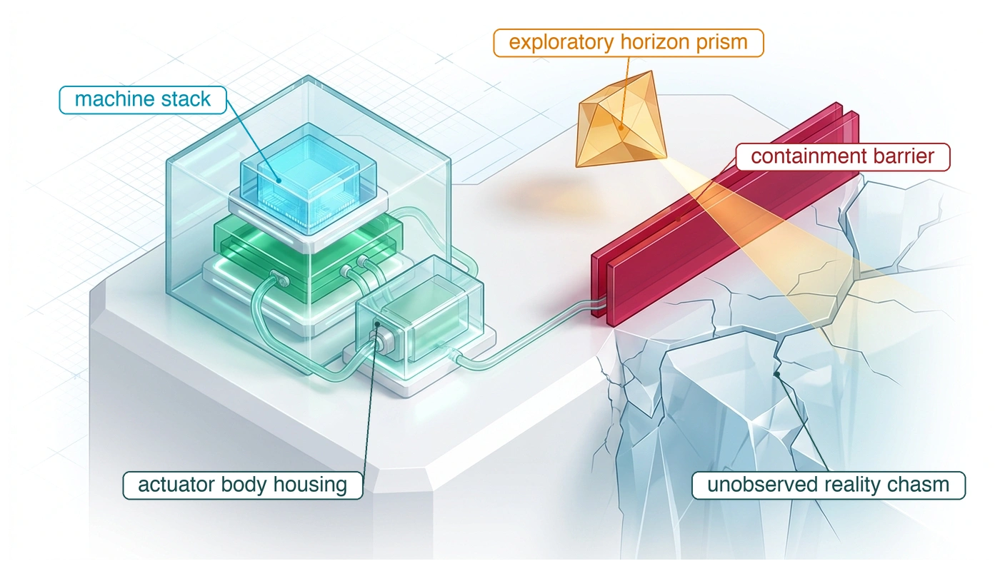
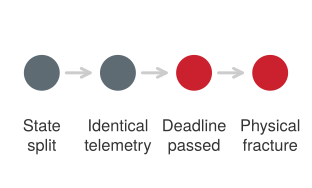

# Эпистемическая граница

## Цель

_Сколько полномочий может держать машина, когда свидетельства не способны уладить каждую предпосылку, на которой покоится ее безопасность?_

Вступительная глава спрашивала, какие гарантии должна принудительно обеспечивать машина, прежде чем обученное предложение командует физической работой. Предшествующие главы установили архитектурный ответ: независимый путь разрешения реального времени, решающий по свидетельствам с ограниченным возрастом, работающий строго в пределах запаса, не израсходованного задержкой, и опирающийся на проверенное резервирование остановкой. И все же каждая формальная гарантия остается условной от неизмеренных физических предпосылок.

Тормозной сертификат предполагает минимальный коэффициент трения поверхности, который бортовые сенсоры не могут измерить до контакта; барьерный фильтр предполагает неиспорченную оценку состояния и номинальный момент актуатора; а выпуск в эксплуатацию предполагает средовые границы, испытанные на конечной наработке. Когда редкие опасности ускользают от эмпирического наблюдения, инженерная добросовестность требует называть каждую непроверенную предпосылку и ограничивать эксплуатационные полномочия, а не предполагать безопасность по умолчанию. Поскольку каузальная граница никогда не ослабевает, когда свидетельства кончаются, автономные полномочия должны прекращаться ровно там, где кончаются физические свидетельства.

> ↰ **Предварительное требование:** Четыре закона из раздела [«Четыре фундаментальных закона»](01_causal_boundary.md#sec-boundary-bedrock-laws), которыми эта глава завершается.

> **Цели обучения**
>
> - Оценить, какие утверждения безопасности превышают свидетельства, доступные для конкретной физической машины
> - Определить, способен ли детектор идентифицировать опасность до того, как эффективное вмешательство станет невозможным
> - Составить записи реестра остаточных утверждений, каждую с ограничением, владельцем и размеренным замыкающим испытанием, из открытых предпосылок выпуска
> - Классифицировать открытую предпосылку по отсутствующему наблюдаемому, оценке, теории или охвату, которые закрыли бы ее
> - Проследить четыре фундаментальных закона через незнакомую машину и указать, какую предпосылку каждого из них оставляют открытой свидетельства

## Эпистемические пределы

У каждого инженерного метода есть эпистемическая граница, где истекают его формальные гарантии. В физическом ИИ эта граница — не просто алгоритмический недостаток; это физическое столкновение между вычислительной задержкой, сенсорной наблюдаемостью и механической инерцией. Масштабирование числа параметров фундаментальных моделей способно дать исключительную семантическую широту, но оно не может согнуть законы движения: с ростом сетей инференсная задержка расширяет коридор реакции, обменивая маневренность на глубину обдумывания.

> **Закон масштабирования задержки воплощения**
>
> ***Закон масштабирования задержки воплощения*** — физическое ограничение, гласящее, что масштабирование числа параметров нейронной политики дает убывающую отдачу в эксплуатационной безопасности, если только инференсная задержка не уменьшается пропорционально, ибо физическое расстояние реакции $d_{\text{react}} = v \cdot (t_{\text{inference}} + t_{\text{actuation}}) + \frac{v^2}{2 a_{\max}}$ растет линейно с вычислительной задержкой.
>
> 1.  **Значение**: Устанавливает, что интеллект в физических системах нельзя масштабировать одним лишь добавлением параметров модели, ибо вычислительная задержка прямо ухудшает динамическую устойчивость и пространственный запас хода для остановки.
> 2.  **Отличие**: В отличие от законов масштабирования вычислений в статическом языковом моделировании, где задержка влияет лишь на скорость генерации токенов, масштабирование задержки воплощения напрямую связывает вычислительную задержку с механическими постоянными времени реакции ($t_{\text{react}} \ge t_{\text{inference}} + t_{\text{actuation}}$).
> 3.  **Типичная ловушка**: Развертывание многомиллиардных фундаментальных моделей прямо в контуре замкнутого управления под предположением, что большая семантическая рассудительность компенсирует небюджетированную задержку отклика.

Это напряжение, закодированное в разделе [«Закон масштабирования задержки воплощения»](17_frontier.md#dfn-frontier-embodied-latency-scaling-law), показывает, почему одного лишь масштабирования параметров недостаточно для решения задачи безопасности реального времени. Более того, как управляется законом необходимого разнообразия Эшби [Ashby, 1956](references.md#ashby1956introduction), контроллер не способен регулировать возмущения, которых его сенсорная архитектура не воспринимает. Когда немоделированное возмущение входит в физический объект управления, никакой объем латентных вычислений не компенсирует отсутствующих физических свидетельств.

Паллетная тележка с текущей гидравлической линией переезжает через один проход площадки, где работает складской мобильный манипулятор, и оставляет на бетоне прозрачную пленку жидкости. Бюджет остановки машины предполагает, что пол способен дать трение, которого требует ее достоверное замедление, и на сухом бетоне он дает. Под пленкой может не дать, и ни навигационная камера, ни лидар не отличат пленку от сухого пола. Путь разрешения может уложиться в каждый предельный срок, аренда фрагмента может истечь вовремя, и тормоз может включиться по расписанию, а остановка все равно выйдет за торец стеллажа, ибо отказавшее слагаемое — предпосылка, о которой не докладывает ни один сенсор машины. Отсутствующие свидетельства — это нижняя граница локального трения до начала торможения.

Решение о выпуске из раздела [«Кейсы безопасности и утверждения»](16_release.md#sec-release-safety-cases-claims) уже встретилось с этой предпосылкой. Его утверждение C3, тормозное сцепление, было отвергнуто по собственным свидетельствам книги и передано этой главе как открытая предпосылка. Достоверное замедление машины равно меньшему из того, что дают ее тормоза, и того, что дает пол, $a = \min(a_{\text{brake}}, \mu g)$. Достоверному замедлению `2 m/s²`, заданному в разделе [«Кинетический импульс»](02_body.md#sec-body-kinetic-momentum), нужен коэффициент трения не ниже `0.204`. Сухой бетон при $\mu$ `0.60` дает куда больше, поэтому связывают тормоза. Прозрачная пленка при $\mu$ = `0.05` (оба коэффициента иллюстративны; см. руководство для читателя) дает лишь `0.49 m/s²`, и связывает трение. На скорости хода `1.3 m/s` готовый бюджет раздела [«Бюджет остановки складского манипулятора»](12_enforcement.md#tbl-enforcement-stopping-budget), `997.4 mm` на сухом полу, растет на пленке до `2.95 m` против свободного расстояния `1.10 m`. Предпосылка о трении не стала открытой, когда появилась пленка. Нормальный режим, выбранный в разделе [«Огибающие остановки»](12_enforcement.md#sec-enforcement-stopping-envelopes), опирался на эту нижнюю границу трения на каждом проходе, включая сухие, и там тоже ничего ее не измеряло.

У каждого инженерного метода есть граница, где истекают его гарантии. Физическая стена раздела [«Четыре фундаментальных закона»](01_causal_boundary.md#sec-boundary-bedrock-laws) — одна такая граница, ибо более крупная обученная модель не может уменьшить ход, который стоит машине ее собственная задержка. Закон необходимого разнообразия Эшби [Ashby, 1956](references.md#ashby1956introduction) называет другую, ибо контроллер не способен регулировать возмущение, которого его сенсоры не воспринимают. На мобильном манипуляторе масляная пленка — такое возмущение. Контактный предел руки у дверной защелки покоится на предпосылке того же рода: защелка держит при каждой силе ниже контактного потолка руки, а коррозия или износ могут уронить предел текучести защелки ниже этого потолка, пока датчики момента шарниров читают ровно то, что читали бы против исправной защелки. Химический регулятор потока, удерживающий давление линии ниже своего предела, зависит от не сдвинувшегося давлительного преобразователя, а отложение на мембране может увести этот ноль до тех пор, пока контур регулирует по фантомному показанию, а истинное давление превышает предел.

В каждом случае машина может покинуть свои предположенные условия, пока ее телеметрия остается номинальной. Успешные испытания не способны закрыть такой разрыв, ибо стена наработки, которую выводит раздел [«Пределы физических испытаний»](07_evaluation.md#sec-evaluation-trial-limits), ставит частоту редкой опасности за пределы любой практической кампании без отказов. Кейс безопасности должен назвать отсутствующую предпосылку, ограничить эксплуатацию, пока она остается открытой, и указать, какие свидетельства закрыли бы ее. Для каждой открытой предпосылки эта дисциплина спрашивает, что машина может измерить, что ее актуаторы все еще способны предотвратить и какое утверждение должно остаться открытым.

## Что метод не может установить

Утверждение выпуска мобильного манипулятора для прохода — цепь звеньев, и какие звенья ей нужны, зависит от опасностей и выбранной защиты. Аргумент должен установить область эксплуатации, измеренные границы актуаторов и остановки, контракты компонентов и независимое разрешение для обученных предложений ([«Машина в пяти уровнях»](01_causal_boundary.md#sec-boundary-machine-model)). Опасности, контролируемые обнаружением во время выполнения, требуют также измеренного покрытия детектора и своевременного мониторинга. Опасности, контролируемые вместо этого пассивными пределами или эксплуатационными ограничениями, требуют свидетельств, что эти меры держатся на заявленной огибающей нагрузки, износа и наработки. Обширные свидетельства для одного звена не могут компенсировать неподдержанную предпосылку в другом.[^fn-hist-popper-falsification]

[^fn-hist-popper-falsification]: **Фальсификация по Попперу**: Карл Поппер формализовал асимметрию эмпирической индукции: ни одна конечная последовательность безопасных наблюдений не способна доказать универсальную безопасность, тогда как единственный противодовод ее опровергает. Часы наработки флота устанавливают доли выживания строго в наблюдаемых стационарных условиях, а не гарантии вне распределения. Экстраполяция нуля наблюдаемых инцидентов на неограниченные среды порождает иллюзорное чувство безопасности, разрушающееся при встрече с немоделированными пограничными случаями.

Каждая предпосылка кейса безопасности несет один из пяти статусов руководства для читателя (установлено измерением или выводом, предположено, решено подотчетным суждением, не поддержано или вне модели угроз). Трихотомия огибающих ([«Трихотомия огибающих»](16_release.md#dfn-release-envelope-trichotomy)) помещает предпосылку, которую проверяет монитор времени выполнения, в известно-истинное, известно-ложное или неизвестное. Предпосылки, ограничивающие свидетельства здесь, — те, которых не способна проверить ни одна ныне служащая система мониторинга, поэтому ни одна не может стать известно-истинной, и ограничивать эксплуатацию вокруг них должен выпуск, а не монитор. Для основания утверждение об остановочном пути опирается на предположенный коэффициент трения между колесом и полом, который нельзя измерить до начала торможения. Для руки контактный аргумент зависит от заявленной нижней границы прочности защелки и предметов, которых она касается, — границы, решенной инженерным суждением о структурной текучести, — пока настоящая прочность защелки остается неизмеренной между контрольными испытаниями. Для регулятора потока утверждение о давлении предполагает преобразователь, чей ноль не сдвинулся, — предпосылку, которую не способно проверить его собственное показание. Явное именование этих предпосылок не ослабляет запись выпуска. Оно устанавливает физическую огибающую, внутри которой вердикт выпуска обоснован, и вне которой он перестает действовать.

Разделение измерения от суждения фундаментально для системной инженерной дисциплины. Эмпирическое тестирование и статистическая характеристика способны оценить физическую наработку, количественно охарактеризовать шум сенсоров и ограничить параметрическую неопределенность, но ни одно измерение не способно выбрать приемлемый **остаточный риск** или решить, кто в эксплуатационной среде должен нести этот риск. Такой выбор — подотчетные человеческие решения, которые должны записываться как явные суждения, а не маскироваться под эмпирические находки. Точно так же **модель угроз** ограничивает действительность записи. Эмпирическое тестирование на номинальной эксплуатации флота и случайных компонентных отказах не дает никаких свидетельств о намеренных противодействующих атаках. Запись о безопасности, показывающая, что зрительный конвейер справляется с шумом сенсоров, размытием объектива и частичными окклюзиями, не дает статистической поддержки утверждениям об устойчивости к противодействующему оптическому проецированию, порче параметров модели или намеренному отказу в обслуживании на внутренней коммуникационной шине.

Возьмем в качестве системной цели иллюстративные $10^{-9}\text{ h}^{-1}$ — частоту, которую никакой стандарт не назначает этой машине и которую, по стене наработки из раздела [«Пределы физических испытаний»](07_evaluation.md#sec-evaluation-trial-limits), одни лишь часы эксплуатации не способны продемонстрировать.[^fn-math-exposure-updates] Остающийся вопрос — что способен добавить к утверждению путь разрешения, когда он действует между предложением и исполнением команды как щит безопасности из раздела [«Минимальное вмешательство»](12_enforcement.md#sec-enforcement-minimal-intervention), и какие из его предпосылок требуют собственных свидетельств.

[^fn-math-exposure-updates]: **Свидетельства при обновлениях**: Обновленная модель может изменить распределение предложений. Более ранние данные можно объединять лишь с обоснованным аргументом эквивалентности конфигурации и наработки; обновление автоматически не стирает каждое наблюдение. Модель постоянной частоты стены наработки требует также обоснованного обращения с общими условиями флота и коррелированными отказами.

Аргумент щита *условен*, а не умножение, применяемое к наблюдаемым инцидентам системы. Число инцидентов флота не может заменить собой частоту предложений, ибо опасные предложения, предотвращенные щитом, в нем никогда не появляются. Для заданного класса опасности $h$ пусть $\lambda_{\mathrm{proposal},h}$ — частота опасных предлагаемых действий до разрешения, а $c_h=P(\mathrm{intercept}\mid\mathrm{hazardous\ proposal},h)$ — измеренное покрытие перехвата для этого класса. С отдельно ограниченным слагаемым аппаратных отказов и отказов общей причины $\lambda_{\mathrm{other}}$ модель может использовать уравнение [«защищенная опасность»](17_frontier.md#eq-frontier-shielded-hazard):

$$\lambda_{\mathrm{system},h} \le \lambda_{\mathrm{proposal},h}(1-c_h)+\lambda_{\mathrm{other}}$$

Соотношение требует действительного оракула предложений, своевременного обнаружения, полномочий актуатора и обоснованного обращения с коррелированными отказами. Оно не дает доверия масляной пленке или ослабленной защелке, которых щит не способен наблюдать, и никакой выпуск не следует из арифметики, пока не подтверждена каждая предпосылка.

> **Расчет условного щита**
>
> **Задача**: Сто роботов ведут полностью разобранный журнал предложений за один 90-дневный цикл, судимый проверенным контрфактическим оракулом, и журнал не фиксирует ни одного опасного предложения. Если бы покрытие перехвата именованного щита для этого класса опасности было независимо установлено на уровне $c=0.9999$, уложился бы смоделированный остаток в системную цель $10^{-9}\text{ h}^{-1}$?
>
> **Граница предложений**: В стационарной пуассоновской модели ноль опасных предложений за `2.16 × 10⁵` предложение-часов дают одностороннюю 95-процентную верхнюю границу `1.387 × 10⁻⁵` $\text{h}^{-1}$.
>
> **Остаток**: При аппаратном остатке и остатке отказов общей причины, принятых равными нулю для этого расчета, уравнение [«защищенная опасность»](17_frontier.md#eq-frontier-shielded-hazard) дает `1.387 × 10⁻⁹` $\text{h}^{-1}$ — **выше** цели. Покрытие, которого требует цель, составляет не менее `0.9999279`.
>
> **Требуемые свидетельства о предложениях**: При $c=0.9999$ граница частоты предложений должна упасть до `1 × 10⁻⁵` $\text{h}^{-1}$. Ноль разобранных опасных предложений потребовал бы тогда `3.00 × 10⁵` предложение-часов, или `124.822` дней для 100 единиц, `34.8` дня сверх цикла.
>
> **Системный вывод**: Щит меняет системное утверждение лишь для тех классов опасности, которые он способен обнаружить и перехватить вовремя. Частота предложений, условное покрытие перехвата, аппаратные отказы и отказы общей причины требуют отдельных свидетельств. Масляный или материальный отказ вне покрытия сенсорики щита остается в реестре остаточных утверждений.

Когда эмпирическая наработка флота не пробивает астрономическую стену наработки, системную безопасность не спасти простым отступлением в офлайн-математическое доказательство ([«Рубеж разрешимости формальной верификации»](17_frontier.md#fig-17-state-space-formal-verification-frontier)). Формальная верификация безопасности сталкивается с таким же неумолимым эпистемическим пределом: **проклятием размерности** на непрерывных пространствах состояний. Классический анализ достижимости Гамильтона–Якоби (HJ) решает уравнение в частных производных для множества уровня по дискретизированной сетке пространства состояний, давая точную обратно достижимую трубу и инвариантное относительно управления безопасное множество. Однако его память и вычислительная сложность растут экспоненциально как $\mathcal{O}(N^d)$, где $N$ — разрешение сетки по оси, а $d$ — размерность пространства состояний. При $d > 6$ достижимость HJ сталкивается с непроницаемой «стеной сетки» (Grid Wall): с трактуемой легкостью она решает 3D машину Дубинса или 4D кинематическое транспортное средство за секунды, но требует веков вычислений и эксабайт памяти для 7D кинодинамического транспортного средства, 12D квадрокоптера или 30D мобильного манипулятора. Статистическая верификация на основе семплирования (такая как адаптивное стресс-тестирование и сценарная оптимизация) пробивает экспоненциальную стену сетки, масштабируясь полиномиально как $\mathcal{O}(d^2)$ вплоть до 50 измерений и более; однако она покупает разрешимость ценой отказа от детерминированных гарантий безопасности, давая лишь вероятностные границы вероятностно приблизительно корректного (PAC) ($1 - \epsilon$), по своей природе слепые к враждебным сингулярностям нулевой меры. Современные нейронные барьерные сертификаты (NBC), синтезируемые инструментами верификации методом ветвей и границ (такими как $\alpha,\beta$-CROWN), устанавливают многообещающий промежуточный рубеж, верифицируя прямую инвариантность на 12D–30D робототехнических системах через выпуклые релаксации ($\mathcal{O}(d^k)$). Даже тогда, когда размерность состояния растет до связанных многороботиных роев ($d \ge 48$), времена верификации снова устремляются к неразрешимости, показывая, что формальные методы подменяют время наработки потолками размерности пространства состояний, а не устраняют эпистемические пределы.

***Рубеж разрешимости формальной верификации**: Время вычислений (секунды, логарифмическая шкала), необходимое для синтеза или верификации безопасных управляющих инвариантов, как функция размерности непрерывного пространства состояний $d$. Достижимость Гамильтона–Якоби (красная) дает детерминированные непрерывные гарантии через уравнения в частных производных на сетке ($\\mathcal{O}(N^d)$), наталкиваясь на экспоненциальную стену сетки при $d > 6$. Статистическая верификация на основе семплирования (зеленая пунктирная, $\\mathcal{O}(d^2)$) масштабируется полиномиально до высоких измерений, но дает лишь вероятностные PAC-границы ($1 - \\epsilon$), слепые к отказам углов нулевой меры. Нейронные барьерные сертификаты, верифицируемые SMT-решателями методом ветвей и границ ($\\alpha,\\beta$-CROWN, темно-синие, $\\mathcal{O}(d^k)$), двигают формальный рубеж через 12D квадрокоптеры, 16D двуногих роботов и 30D мобильные манипуляторы, прежде чем вычислительные пределы масштабирования ограничат связанные многоагентные рои ($d \\ge 48$).*

Каждая из этих предпосылок — от трения под пленкой до покрытия щита для класса опасности, которого он может не наблюдать — оканчивается одинаково: названа выпуском и оставлена неразрешенной его свидетельствами. Выпуск, останавливающийся на их именовании, лишь перечислил свои оговорки. Ему нужна запись, превращающая каждую такую предпосылку в ограничение с владельцем и испытанием, способным его снять.

## Реестр остаточных утверждений

Отказ в утверждении C3 не убрал предпосылку о трении из машины, и непроверенная предпосылка остается независимо от того, записывает ли ее отчет о безопасности. **Реестр остаточных утверждений** потребляет манифест выпуска из раздела [«Манифест выпуска»](16_release.md#sec-release-manifest), извлекая из него каждую предпосылку, которую выпуск оставил открытой или неподдержанной. Открытая запись ограничивает полномочия, пока не пройдет ее предварительно объявленное замыкающее испытание. Реестр отображает каждую такую предпосылку, и каждый неконтролируемый инвариант, на его отсутствующее физическое наблюдаемое, активное сдерживание или эксплуатационное ограничение, ответственного человека и предварительно объявленное замыкающее испытание. Без этих четырех компонентов неразрешенная предпосылка — незаписанный риск, а не запись реестра. Реестр — то место, где принцип [«Свидетельства ограничивают полномочия»](part4_governing.md#pri-vol4-evidence-bounds-authority) достигает предпосылок, которые свидетельства не смогли уладить, удерживая полномочия в ограничении всюду, где отсутствуют поддерживающие свидетельства.

Каждая запись связывает неподдержанное утверждение с конкретным неизмеримым физическим наблюдаемым. В машине, движущей массу, обученная политика не способна уладить свойство безопасности, ибо сенсоры не могут преобразовать соответствующее состояние среды, вычислительная подложка не может обработать измерение в предельный срок управления, или физическое взаимодействие нельзя наблюдать до возникновения контакта. Инженер обязан определить **отсутствующее наблюдаемое** с физической точностью, а не статистическими абстракциями. Охарактеризовать неизвестный отказ как «латентное состояние вне распределения» не дает никакого действенного сигнала контуру разрешения для запуска физического вмешательства. Напротив, указание неизмеренного коэффициента трения поверхности, необнаруженной оптической засветки через матрицу линз камеры или ненаблюдаемой микротрещины в корпусе актуатора идентифицирует точный физический дефицит. Именование отсутствующего наблюдаемого устанавливает границу, где обученный вывод останавливается, а физическая неопределенность начинается.

Масляная пленка дает мобильному манипулятору его первую запись. Предпосылка в том, что каждый пол прохода дает коэффициент трения не менее `0.204` — значения, которого требует его достоверное замедление. Отсутствующее наблюдаемое — трение под прозрачной пленкой, которой навигационная камера и лидар не отличают от сухого бетона. Остановка со скорости хода, помещающаяся в свободное расстояние на сухом полу, выходит за него на пленке, поэтому предел скорости, налагаемый записью, может держаться лишь на полах, чье трение измерено или контролируется.

Открытая запись требует **эксплуатационного отклика**. Для проходов максимум, что допускает запись, — ограниченный режим `1 m/s` на полах в регламенте осмотров площадки. Осмотренный пол дает $\mu \ge$ `0.12`, что дает достоверное замедление `1.18 m/s²` и потолок `1.09 m/s`, так что ограниченный режим лежит ниже своего потолка.[^fn-math-velocity-clamp] Маршрут, которого регламент осмотров не покрывает, исключается, либо машина на него не выпускается.

[^fn-math-velocity-clamp]: **Кинетическое снижение номинала скорости**: $E_k=mv^2/2$ убывает квадратично со скоростью. Остановочный путь все еще зависит от проверенного достоверного замедления и полной задержки отклика; один лишь регистр скорости не способен компенсировать сколь угодно низкое трение.

Ограниченный режим требует владельца, способного удерживать его физические предпосылки истинными. Владелец этой записи — служба площадки через свою процедуру при разливе для маршрутов паллетных тележек, которая задает интервал осмотров и называет условие, отзывающее разрешение. Подписанный предел скорости на пути разрешения принудительно обеспечивает ограничение, но утверждение о трении нельзя поддерживать одним лишь значением скорости.

Каждая запись требует **замыкающего испытания**, объявленного до сбора данных. Для пленки испытание должно квалифицировать новый преобразователь, ибо никакое измерение камерой или лидаром не способно исключить прозрачную пленку, и новые испытания ими не закрыли бы запись. Испытание — детектор пленки на полу, чья доля пропусков ограничена 0,1 % `2,995` испытаниями с заранее внесенными пленками без отказов ([«Пределы физических испытаний»](07_evaluation.md#sec-evaluation-trial-limits)); пока оно не пройдено, ограничение держится. Меньшая кампания не добирает. Ноль пропусков в `1,000` независимых испытаниях ограничивает вероятность пропуска лишь значением `0.002991` с 95 % достоверностью. Детектор должен также докладывать о пленке достаточно рано, чтобы обнаружение, разрешение и торможение вместе уложились в свободное расстояние, а распределение испытаний, дистанция обнаружения, задержка, ложные срабатывания и трение после обнаружения должны быть объявлены заранее. Рефлекс проскальзывания колеса может ограничить последующее движение, но не способен установить трение до того, как колеса дойдут до пленки.

Тот же проход несет вторую запись. Бюджет остановки защищает неподвижное препятствие. Человек, продолжающий идти к машине сквозь всю остановку, добавляет расстояние, которого бюджет никогда не начисляет ([«Оценка сквозь окклюзию»](09_memory.md#sec-memory-belief-through-occlusion)), а раздел [«Огибающие остановки»](12_enforcement.md#sec-enforcement-stopping-envelopes) показал, что его начисление ограничило бы основание у этого торца стеллажа скоростью куда ниже его скорости хода. Предпосылка в том, что во время остановки никто не подходит к торцу стеллажа, а отсутствующее наблюдаемое — присутствие в поперечном проходе, который скрывает стеллаж. Правило пересечения на площадке, размеченная на полу зона пересечения плюс датчик присутствия у торца стеллажа, — это ограничение, и его владелец — служба площадки. Замыкающее испытание квалифицирует датчик присутствия тем же размерением без отказов.

Станция комплектации добавляет третью запись, и она принадлежит руке. Ее предпосылка в том, что предмет, который рука захватывает и затем передает коллеге под `accept_item` ([«Человеческие полномочия над исполнением команды»](14_intervention.md#sec-intervention-human-authority)), — тот предмет, который называет задача. Раздел [«От запроса к истекающему предложению»](10_intent.md#sec-intent-request-to-proposal) показал, как эта предпосылка отказывает. Тонкостенная красная стеклянная банка рядом с красной кружкой на конвейере выдачи притягивает уверенную привязку, и неверная цель проходит каждую геометрическую проверку, которую применяют планировщик и путь разрешения. Отсутствующее наблюдаемое — идентичность и хрупкость, которых ни камера запястья, ни модель привязки не способны установить до контакта.

Ограничение этой записи состоит из двух частей. Служба площадки допускает на конвейер лишь предметы из объявленного списка предметов станции комплектации, где нет хрупкого двойника, а станция допускает захват лишь когда окно единичного подбора содержит ровно один предмет, так что второй предмет отказывает намерению и отправляет предмет коллеге для ручного подбора. Единичный подбор делает привязку неоднозначной для допускаемых предметов, но не поставляет сведений об идентичности, а ошибочно направленная банка, прибывшая одна, сдерживается лишь процедурой подачи. Этот остаток и есть причина, по которой запись остается открытой. Потолок силы захвата, заданный для самого хрупкого двойника, потребовал бы предела разрушения для каждого предмета, который может прибыть, — само по себе неизмеренную предпосылку, — поэтому реестр на нем не опирается. Владелец списка подачи и правила единичности — служба площадки совместно с профилем задачи. Замыкающее испытание — квалифицированная проверка идентичности на станции, чтение метки или проверка веса и кода, чья доля ложных принятий ограничена 0,1 % с 95 % достоверностью теми же `2,995` испытаниями без отказов, проводимыми здесь на заранее внесенных двойниках.

Раздел [«Реестр остаточных утверждений для прохода и станции»](17_frontier.md#tbl-17-claims-register) ставит три записи рядом. Каждая строка несет четыре компонента, которых требует реестр, так что любую запись можно аудировать без окружающей ее прозы.

\Needspace{31\baselineskip}

| Утверждение и отсутствующее состояние                                                                                                    | Механизм опасности                                                                                                                                                                                                                                                     | Активное сдерживание и ответственный                                                                                                                                                                                                                                                                                     | Предварительно объявленное замыкающее испытание                                                                                                                                                                                                                                                                             |
|:---------------------------------------------------------------------------------------------------------------------------------------|:----------------------------------------------------------------------------------------------------------------------------------------------------------------------------------------------------------------------------------------------------------------------|:------------------------------------------------------------------------------------------------------------------------------------------------------------------------------------------------------------------------------------------------------------------------------------------------------------------------|:-----------------------------------------------------------------------------------------------------------------------------------------------------------------------------------------------------------------------------------------------------------------------------------------------------------------------------|
| **Тормозное сцепление**: каждый пол прохода дает $\mu \ge$ `0.204`; трение под прозрачной пленкой не наблюдается. | При $\mu$ = `0.05` достоверное замедление падает до `0.49 m/s²`, и готовый бюджет на `1.3 m/s` растет до `2.95 m` против свободного расстояния `1.10 m`. | `1 m/s` на осмотренных полах ($\mu \ge$ `0.12`, потолок `1.09 m/s`); неосмотренные маршруты исключены. *Ответственный*: служба площадки через процедуру при разливе для маршрутов паллетных тележек.                                                             | Детектор пленки на полу с долей пропусков не более `0.1%` при `95%` достоверности, из `2,995` испытаний с заранее внесенными пленками без отказов, плюс испытания тайминга и свободного расстояния; ограничение держится, пока испытание не пройдено.                               |
| **Идущий человек**: во время остановки никто не подходит к торцу стеллажа; присутствие в скрытом поперечном проходе не наблюдается.                 | Человек, идущий с `1.6 m/s` сквозь всю остановку, ограничил бы основание скоростью куда ниже его скорости хода у торца стеллажа ([«Огибающие остановки»](12_enforcement.md#sec-enforcement-stopping-envelopes)).                                                                                             | Правило пересечения, размеченная на полу зона пересечения плюс датчик присутствия у торца стеллажа. *Ответственный*: служба площадки.                                                                                                                                                                                                                   | Квалифицировать датчик присутствия тем же размерением без отказов, `2,995` испытаний без отказов для границы пропусков `0.1%`.                                                                                                                                                 |
| **Идентичность предмета**: схваченный предмет — тот, который называет задача; идентичность и хрупкость до контакта не наблюдаются.            | Уверенная привязка к тонкостенной стеклянной банке рядом с красной кружкой проходит каждую геометрическую проверку, а захват, нужный керамической кружке, может раздавить стекло.                                                                                                               | Подача допускает на конвейер лишь предметы из объявленного списка станции, и ни один из них не является хрупким двойником; единичность допускает захват лишь при одном предмете в окне единичного подбора. Предмет вне списка, прибывший один, сдерживается лишь процедурой подачи. *Ответственный*: служба площадки совместно с профилем задачи. | Квалифицированная проверка идентичности на станции (чтение метки или проверка веса и кода) с долей ложных принятий не более `0.1%` при `95%` достоверности, из `2,995` испытаний с заранее внесенными двойниками без отказов; ограничение держится, пока испытание не пройдено. |

***Реестр остаточных утверждений для прохода и станции**: Три открытые предпосылки за скоростью хода мобильного манипулятора и его подбором. Для каждой реестр называет отсутствующее физическое наблюдаемое, опасность, которую оно допускает, эксплуатационное ограничение и его ответственного, а также предварительно объявленное замыкающее испытание, которое сняло бы ограничение.*

Конвейер выпуска записывает каждую запись по фиксированной схеме, и ее поля, единицы и инварианты появляются вместе с другими макетами записей в разделе [«Реестр остаточных утверждений»](appendix_systems.md#sec-appendix-systems-wire-residual-claims).

Все три записи закрываются лишь квалифицированным детектором: детектором пленки на полу для первой, датчиком присутствия у торца стеллажа для второй и проверкой идентичности на станции для третьей. Каждое замыкающее испытание должно поэтому показать, что квалифицированный детектор докладывает вовремя, — два детектора прохода достаточно рано, чтобы путь разрешения успел остановить машину, а проверка идентичности — до того, как станция допустит захват, — и это требование к таймингу имеет собственный физический предел.

## Отказы без детекторов

Монитор времени выполнения сам является физической подсистемой. Чтобы работать как **практический детектор**, он должен удовлетворять трем связанным параметрам: полному охвату распределения отказов, ограниченной доле ложных срабатываний и задержке обнаружения, строго меньшей времени до вреда физической системы. На скорости хода `1.3 m/s` готовый бюджет остановки раздела [«Бюджет остановки складского манипулятора»](12_enforcement.md#tbl-enforcement-stopping-budget) оставляет мобильному манипулятору неизрасходованными `102.6 mm` свободного расстояния, которые машина проходит за `78.9 ms` ([«Переходы полномочий»](14_intervention.md#sec-intervention-authority-transitions)). Детектор человека у торца стеллажа, добавляющий к пути наблюдения больше этого, — не детектор для этой опасности. Детектор пленки на полу встречает более строгую форму того же испытания. Его дистанция обнаружения за вычетом хода за время его собственной задержки должна покрывать остановку по сухому полу до края пленки, ибо доклад, пришедший, когда колеса уже на пленке, оставляет остановку `2.95 m` против свободного расстояния `1.10 m`. Детектор, докладывающий позже, — механизм журналирования после инцидента. Точная классификационная метка, порожденная после пересечения необратимого порога, генерирует диагностические свидетельства, но не способна служить защитой времени выполнения.

Фундаментальный предел обнаружения во время выполнения проистекает из наблюдаемой неразличимости. Рассмотрим два физических состояния мира, $S_A$ и $S_B$. В состоянии $S_A$ скомандованная траектория актуатора $u(t)$ безопасна. В состоянии $S_B$ та же траектория $u(t)$ причиняет структурное повреждение или травму человеку, требуя от пути разрешения вмешаться и скомандовать останов. Динамика тела накладывает жесткий предельный срок $t_{\text{deadline}}$, определяемый временем отклика актуатора и импульсом системы, после которого физического контакта или механической текучести предотвратить нельзя. Если история телеметрии $y(t)$, которую дает бортовая аппаратура, идентична для $S_A$ и $S_B$ на всем интервале $t \le t_{\text{deadline}}$, ни один алгоритм, работающий с этими наблюдениями, не способен надежно отличить безобидное состояние от опасного. Идентичные трассы исключают специфичный для состояния отклик до этого предельного срока. Консервативное действие, выбранное для обоих состояний, или пассивный механический предел могут все еще защитить их, если действительны их собственные допущения о запасе хода и силе.

*Идентичная телеметрия до контакта препятствует программному вмешательству до наступления необратимого физического повреждения.*

> **Наблюдаемая неразличимость**
>
> ***Наблюдаемая неразличимость*** — физическое условие, при котором два различных состояния мира, одно номинальное ($S_A$) и одно опасное ($S_B$), порождают идентичную сенсорную телеметрию до вреда ($y_A(t) \equiv y_B(t)$) вплоть до физического предельного срока действия системы ($t_{\text{deadline}} = t_{\text{harm}} - t_{\text{act}}$).
>
> 1.  **Значение**: Без различающей физической энергии до предельного срока действия своевременная алгоритмическая дифференциация физически и математически невозможна. Масштабирование параметров нейронной модели, увеличение размера датасета или ускорение вычислений инференса не способны разделить состояния, испускающие нулевую различающую физическую энергию до времени до вреда.
> 2.  **Отличие**: В отличие от эпистемической неопределенности или высокой энтропии классификатора (которые сигнализируют, что модель знает о недостатке свидетельств), наблюдаемая неразличимость часто сочетается с высокой выходной уверенностью и почти нулевой энтропией, ибо нейронная сеть отображает испорченные наблюдения в номинальные латентные многообразия.
> 3.  **Типичная ловушка**: Полагаться на программные детекторы аномалий или ошибку реконструкции VAE, чтобы поймать деградацию без детекторов. Когда физика сенсоров ослепляет преобразователь, как это делает пьезорезистивный дрейф кристалла, или опасное состояние лежит вне сенсорного пути, как ослабленная защелка для канала шарнира, детектор аномалий потребляет телеметрию, не несущую никакого следа отказа, и молчаливо отказывает.

В обученной политике восприятия–действия тот же предел проявляется как обучение на шорткатах (shortcut learning). Модель зрение–язык–действие (VLA) [Brohan et al., 2023](references.md#brohan2023rt1); [Brohan et al., 2023](references.md#brohan2023rt2) или политика подражания [Zhao et al., 2023](references.md#zhao2023learning) минимизирует свою функцию потерь на каких бы то ни было корреляциях, содержащихся в демонстрациях, и там, где трение, прочность материала или инерция полезной нагрузки не наблюдаются, она может выучить некаузальные визуальные признаки, такие как блики на полу или угол освещения, как их прокси. При сдвиге распределения эти прокси отказывают, однако энкодер все еще способен отображать незнакомое наблюдение в известную ему область латентного пространства, так что политика действует с высокой уверенностью и малым разногласием ансамбля. Оценка неопределенности, вычисленная из того же латентного представления — будь то расстояние Махаланобиса, дисперсия dropout или остаток реконструкции, — наследует ту же слепоту и не способна служить независимым детектором. Мозг не способен обнаружить собственный отказ на шорткате, поэтому физическое сдерживание покоится на пути разрешения ниже границы предложения, а не на самооценке модели.

Сенсорное аппаратное обеспечение показывает тот же предел на больших длительностях. Давлительный преобразователь регулятора потока дрейфует, когда отложения накапливаются на его мембране, а преобразователь, чей ноль уведен вниз, докладывает ту же тенденцию, что и линия, действительно работающая на более низком давлении. Единственный канал докладывает один скаляр, и ни один алгоритм на этом сигнале не отличает изменившийся процесс от деградировавшей калибровки. Без независимого опорного преобразователя или контрольной проверки нулевой точки дрейф необнаружим во время выполнения.[^fn-hw-piezoresistive-drift]

[^fn-hw-piezoresistive-drift]: **Дрейф пьезорезистивного преобразователя**: Релаксация механического напряжения, поверхностное окисление и температурные циклы меняют пьезорезистивный коэффициент кремниевых тензодатчиков за длительные кампании. Монолитные программные фильтры не способны отделить медленный дрейф базового напряжения от истинных приращений давления процесса, порождая ненаблюдаемый переход состояния. Предотвращение избыточного давления требует поэтому независимых физических контрольных проверок нулевой точки или архитектур сенсорики с двумя разнородными преобразователями.

Ослабленная защелка на двери — случай той же границы для руки, и более быстрый. Пока защелка не текла, датчики момента шарниров читают те же моменты против ослабленной защелки, что и против исправной, ибо обе несут одну и ту же контактную силу, и канал не держит следа оставшейся прочности. Текучесть необратима, и никакая команда, выданная после нее, не восстанавливает защелку, поэтому более быстрый классификатор на канале момента шарнира ничего не защищает. Обоснованные отклики поставляют то, чего этому каналу недостает. Контрольное испытание устанавливает прочность защелки на заявленный интервал, и оно покрывает интервал лишь если коррозия и износ не способны уронить предел текучести ниже контактного потолка между двумя испытаниями, — скорость, которую должен поддерживать журнал обслуживания, а не канал момента. Пассивный податливый элемент в запястье вместо этого удерживает контактную силу ниже заявленной нижней границы прочности защелки на механически ограниченном ходе, так что предпосылка больше не зависит от состояния защелки. Уравнение [«пассивная податливость»](17_frontier.md#eq-frontier-passive-compliance) дает потолок жесткости этого элемента, с $F_{\text{allow}}$, заданным заявленной нижней границей, который держится лишь если элемент несет всю контактную нагрузку, ход не может пройти свой упор, а испытания износа и удара поддерживают модель.[^fn-math-contact-lipschitz]

$$k_{\text{spring}} \le \frac{F_{\text{allow}}-F_{\text{preload}}}{\Delta x_{\text{stall}}}$$

> ↰ **Предварительное требование:** Отказы, необнаружимые сенсорной телеметрией, ставят под вызов контракты наблюдений, сформулированные в разделе [«Контракт наблюдений»](08_perception.md#sec-perception-observation-contract).

[^fn-math-contact-lipschitz]: **Граница контакта**: Жесткий удар и переходы трения способны инвалидировать гладкую модель свободного движения. Пиковая контактная сила и повреждение компонентов требуют измеренных жесткости, демпфирования, геометрии и отклика актуатора; ни контроллер, ни пассивная деталь по отдельности не дают универсальной границы.

Выброс на скважине Deepwater Horizon отказал способом, противоположным столкновению в Темпе из раздела [«Когда граница отказывает»](01_causal_boundary.md#sec-boundary-when-fails), где сенсоры обнаружили пешехода, но спроектированное подавление удержало торможение, которого требовало то состояние. В выбросе защитное устройство действовало, но по состоянию, о котором не докладывал ни один сенсор. Более быстрый запуск или более широкие полномочия не изменили бы исхода, ибо ни одно измерение не разделяло состояние, для которого защита была квалифицирована, и фактическое. Более своевременное правило отклика и восстановленный резервный тормозной путь адресуют отказ вроде темпского. Лишь квалификация и сенсорика, распространенные на каждое состояние, с которым может встретиться защита, способны починить другой род — отказ без детекторов, который описывает этот раздел и который ставит на проходе масляная пленка.

\Needspace{0.57\textheight}

> **Отказ срезного превентора Deepwater Horizon (2010)**
>
> **Контекст**: 20 апреля 2010 года скважина Макондо в Мексиканском заливе выбросилась под буровой платформой *Deepwater Horizon*. Последним физическим барьером сдерживания был подводный превентор (BOP) — блок гидравлических клапанов и глухих срезных превенторов массой около $400$ тонн, закрепленный на устье скважины примерно в $1{,}500\text{ m}$ под поверхностью [{U.S. Chemical Safety and Hazard Investigation Board}, 2014](references.md#csb2014macondo).
>
> **Механизм**: Взрывы, вероятно, активировали автоматическую систему «мертвая рука» превентора, которая должна была закрыть глухой срезной превентор, разрезать бурильную трубу и загерметизировать скважину. К тому моменту бурильная труба внутри превентора выгнулась от центра. Перепад давления между внутренней и наружной сторонами трубы поместил ее в эффективное сжатие — механизм потери устойчивости, которого прежние расследования не идентифицировали. Превентор не был спроектирован на разрезание трубы вне центра. Превентор проколол и частично перерезал трубу, но не смог полностью закрыться и загерметизировать скважину.
>
> **Последствия**: Поток через проколотую трубу возобновился быстро. Одиннадцать членов экипажа погибли, платформа затонула примерно через 36 часов после взрывов, и около 5 миллионов баррелей нефти вылилось в Мексиканский залив [{U.S. Chemical Safety and Hazard Investigation Board}, 2014](references.md#csb2014macondo).
>
> **Ответные меры**: [U.S. Chemical Safety Board](https://www.csb.gov/csb-board-approves-final-report-finding-deepwater-horizon-blowout-preventer-failed-due-to-unrecognized-pipe-buckling-phenomenon-during-emergency-well-control-efforts-on-april-20-2010-leading-to-environmental-disaster-in-gulf-of-mexico/) рекомендовал изменения в конструкции, испытаниях и надзоре за превенторами. Его расследование также нашло два случая ошибочного монтажа проводки и два отказа резервных батарей в системах управления глухим срезным превентором.
>
> **Системный урок**: Положение трубы внутри превентора было состоянием, о котором не докладывал ни один сенсор, и превентор все равно действовал по нему ($y_A(t) \equiv y_B(t)$ для центрированной и выгнутой трубы). Его квалифицированная геометрия резания не покрывала фактическое условие. Защита должна быть квалифицирована через каждое физическое состояние, с которым она может встретиться, включая положение трубы, и через независимые отказы управления, задокументированные CSB.

Когда у режима отказа нет практического детектора, остальные отклики — ограничить полномочия актуатора под проверенной моделью силы или запаса хода, сузить область эксплуатации, добавить независимую сенсорику или запланировать контрольные испытания. Предел силы опирается на эту проверенную модель, ибо ISO 10218 и ISO/TS 15066 действуют в своих областях применения промышленных роботов и не дают универсального предела силы для этой машины. Активная сенсорика сама является исполнением команды. Небольшое дрожание колес — активный зонд для пленки, — измеряет сцепление лишь там, где колеса уже стоят, поэтому не способно закрыть запись о трении. Поскольку зонд не должен проскальзывать за зарезервированный запас хода, независимый путь разрешения должен допускать каждую команду зонда в отдельно проверенной огибающей энергии, контакта, запаса хода и тайминга и выбирать согласованное по состоянию резервирование, когда нужная граница недоступна. Если ни одна из этих мер не способна поддержать утверждение, эксплуатация должна быть удержана.

Кейс безопасности должен задокументировать эти пробелы. Раздел [«Два предела утверждения»](17_frontier.md#fig-17-epistemic-limits) отмечает, где аргумент кончается. Реестр остаточных утверждений записывает слепую зону детектора, определяя множество физических состояний, порождающих неразличимые наблюдения, наряду с максимальной длительностью наработки, допускаемой между физическими контрольными испытаниями. Трактовать необнаружимый отказ как решенную задачу времени выполнения подрывает действительность кейса безопасности. Сохранение точной границы, где сенсорика останавливается, вынуждает инженерную организацию опираться на физические ограничения, а не на программный оптимизм.

***Два предела утверждения**: Панель (a) показывает состояния с идентичной телеметрией до предельного срока. Ограничение скорости полезно лишь с поддержанной огибающей торможения и свободного расстояния. Панель (b) показывает наработку без событий, требуемую для утверждения о редкой частоте в выбранной пуассоновской модели; аргумент барьера требует также наблюдаемого состояния, выполнимого управляющего действия и действительных допущений о тайминге.*

Каждый режим без детекторов все еще оставляет обоснованный отклик, и раздел [«Таксономия физических отказов без детекторов»](17_frontier.md#tbl-17-detectorless-modes) ставит четыре из них рядом.[^fn-hw-motor-thermal]

[^fn-hw-motor-thermal]: **Тепловое состояние двигателя**: Сопротивление обмотки и поток магнита могут меняться с температурой. Меняет ли это полномочия торможения, зависит от привода, пределов тока, нагрузки и измеренной тепловой модели; для осей под гравитационной нагрузкой может потребоваться отдельный путь удержания.

| Отказ и отсутствующее состояние                                                                            | Почему существующий канал может его пропустить                                                      | Дефицит предельного срока или свидетельств                                                                                     | Обоснованный отклик                                                                                                                   |
|:----------------------------------------------------------------------------------------------------------|:-----------------------------------------------------------------------------------------------------|:-----------------------------------------------------------------------------------------------------------------------------|:---------------------------------------------------------------------------------------------------------------------------------------|
| **Дрейф датчика давления**: нулевое смещение меняется со старением или отложениями.                             | Один канал не способен отделить истинное изменение давления от собственного дрейфа смещения.                       | Дрейф может длиться, пока процесс не достигнет своего предела давления; детектору нельзя доверять без второго опорного преобразователя. | Независимый откалиброванный канал давления, контрольное испытание и расчетный предохранительный путь.                                                              |
| **Потеря прочности защелки**: коррозия или износ роняют предел текучести защелки ниже контактного потолка. | Датчики момента шарниров читают ту же контактную силу против ослабленной защелки, что и против исправной. | Прочность защелки не измеряется между контрольными испытаниями, а текучесть необратима, поэтому позднейшая команда не восстанавливает защелку.  | Пассивный податливый элемент, размеренный уравнением [«пассивная податливость»](17_frontier.md#eq-frontier-passive-compliance) по заявленной нижней границе прочности защелки, либо контрольные испытания защелки. |
| **Потеря потока ротора**: отдаваемый момент отличается от оценки по току.                           | Ток статора сам по себе не измеряет постоянную момента после повреждения магнита.                    | Ось под гравитационной нагрузкой может иметь мало времени на останов после потери доступного момента.                                       | Измерять момент или состояние ротора, снижать номинал в пределах испытанных границ и проверять путь удержания или контролируемой остановки.                              |
| **Сдвиг обученного восприятия**: оптический артефакт принимается за известную сцену.                     | Уверенность модели может оставаться высокой, даже когда физическая сцена отличается.                           | Одна лишь уверенность или ошибка реконструкции не ограничивает запас хода или отклик остановки.                                    | Независимые проверки дальности/запаса хода и допущенная огибающая движения, с записью остаточных слепых зон.                                |

***Таксономия физических отказов без детекторов**: Четыре режима отказа — в преобразовании, контакте, приводе и обученном восприятии, — чьи безопасные и опасные состояния выглядят одинаково для существующего канала до времени до вреда. Для каждого таблица дает, почему канал его пропускает, какой предельный срок или свидетельства он не способен выдержать, и отклик, который все еще поддерживает утверждение.*

Каждая строка проваливает испытание практического детектора, ибо существующий канал дает идентичные наблюдения для безопасного и опасного состояния, пока не пройдет предельный срок. Каждый обоснованный отклик поставляет то, чего этому каналу недостает: второй опорный преобразователь, пассивный предел нагрузки, прямое измерение момента или независимую проверку дальности. Что это за отсутствующий элемент и может ли он быть построен, решает род пробела, который записывает каждая запись реестра.

## Что изменило бы эти ответы

Трем записям реестра остаточных утверждений мобильного манипулятора недостает одного и того же элемента — квалифицированного детектора для состояния, о котором не докладывает ни один сенсор в эксплуатации. Сортировка каждого записанного пробела по отсутствующему превращает реестр из списка оговорок в инженерную повестку, и записанный пробел попадает в один из четырех классов, определяемых отсутствующим элементом. Он проистекает из **неизмеренного наблюдаемого**, когда истинное физическое состояние (такое как скрытый внутренний дефект) нельзя отличить по данным сенсоров до предельного срока действия; из **дефицита оценки**, когда хвостовая вероятность отказа не может быть ограничена, ибо эти редкие события требуют неразрешимой физической наработки; из **теоретического дефицита**, когда у обученной политики нет ограниченного соотношения между условиями обучения и устойчивостью исполнения; или из **несоответствия охвата**, когда целевое утверждение превышает то, что системная архитектура физически способна поддержать. Все три записи машины принадлежат первому классу. Больше испытаний модели привязки на станции комплектации или больше пробегов остановки на сухих полах рассматривали бы их как дефициты оценки, которыми они не являются. Именование отсутствующей способности определяет точное физическое или математическое требование, которое сняло бы запись.

Закрытие пробела из неизмеренного наблюдаемого требует нового физического измерения, разделяющего ранее неразличимые состояния в пределах предельного срока пути разрешения. Для пленки программный фильтр или обученный оценщик на навигационной камере и лидаре не способны быть этим измерением, ибо они потребляют те же наблюдения, которые уже не разделяют пленку и сухой пол. Детектор пленки на полу должен откликаться на пленку через независимый физический канал, и он закрывает запись лишь если выдерживает требование к таймингу раздела [«Отказы без детекторов»](17_frontier.md#sec-frontier-failures-without-detectors), держит ограниченную долю ложных срабатываний и отказывает независимо от камер.

Закрытие дефицита оценки требует заменить сырые счетчики выборок оценщиками, чьи смещение и дисперсия могут быть ограничены аналитически. Больше записей ненарушенной эксплуатации или прогоны симулированных эпизодов, чья точность в хвосте не проверена, не способны ограничить хвостовую частоту. Схема важностного семплирования или адаптивного стресс-тестирования способна, если она демонстрирует консервативные оценки на эталонных распределениях с известным ответом и докладывает эффективную независимую наработку, а не сырые счетчики испытаний. Десять тысяч симулированных траекторий, исследующих одну локальную область поверхности столкновения, мало что говорят о других, поэтому эффективный размер выборки должен быть оценен по весам и их зависимости (о хвостовых границах высоких квантилей и моделировании экстремальных значений см. раздел [«Теория экстремальных значений и хвостовой риск»](appendix_ml.md#sec-appendix-ml-evt)).

Закрытие теоретического дефицита требует ограниченного аналитического утверждения в паре с механизмом времени выполнения, проверяющим его предпосылки. Для политики, обученной подражанием или обучением с подкреплением, дефицит — отсутствие какой-либо гарантии ограниченных выходов при сдвиге распределения, и ни асимптотическая сходимость, ни граница, опирающаяся на непроверяемую константу Липшица, его не закрывают. Теория должна указать инвариант, который она гарантирует, и область поддержки, на которой он держится, а машина должна нести монитор, помечающий, когда ее состояние покидает эту поддержку, с ограниченными ошибкой оценщика и задержкой решения и проверенной согласованной по состоянию остановкой.

Чтобы предотвратить проникновение исследовательского оптимизма в кейс безопасности, каждый кандидатный прорыв должен проходить оценку по предварительно объявленному замыкающему испытанию. Испытание определяет отсутствующее звено аргумента, числовой порог, требуемый для достаточности, и независимые свидетельства, необходимые для его проверки. Прорыв проваливает испытание, если он лишь перемещает допущение в менее видимый слой системы. Замена нейросетевого контроллера барьерной функцией управления, чей сертификат предполагает совершенно известную линейную динамику, не закрывает теоретический дефицит. Она лишь перемещает немоделированную динамику из непрозрачных весов сети в производную барьера. Кандидатный прорыв останавливается до того, как он способен изменить вердикт безопасности, всякий раз, когда его валидация опирается ровно на те непроверенные свойства, которые он был призван установить.

Направления исследований в физическом машинном обучении должны судиться исключительно по тому, превращают ли они открытое остаточное утверждение в проверенные свидетельства, способные изменить эксплуатационный вердикт. Общие улучшения на таблицах лидеров бенчмарков, такие как снижение средней ошибки слежения на 3 процента или более высокая награда на стандартном наборе задач, не дают никаких свидетельств к закрытию неподдержанной связи безопасности. Исследовательский проект становится релевантным для физического развертывания лишь тогда, когда его результат нацелен на конкретную запись реестра утверждений — будь то поставкой отсутствующего преобразователя, ограничением хвостового оценщика или снабжением проверяемым во время выполнении доказательством устойчивости. Если прорыв улучшает среднюю производительность, но оставляет слепую зону детектора или хвостовую неопределенность неизменными, пределы полномочий машины остаются ровно там, где были.

Некоторые пробелы не способно закрыть ни одно известное средство измерения, схема семплирования или математическая каркасная теория. Когда физические законы, вычислительные пределы или экономические ограничения исключают необходимое измерение или доказательство, кейс безопасности не может оставаться приостановленным в ожидании будущего открытия. Сужение физических полномочий актуатора, ограничение области эксплуатационного назначения (ODD) или отказ эксплуатировать машину — не признание исследовательского поражения. Это инженерное решение. Классическое отказоустойчивое проектирование пришло к тому же выводу: надежная эксплуатация происходит из порогов самоконтроля и структурной изоляции, сдерживающих отказы, а не из устранения каждого возмущения. Рука с податливым запястьем, ограничивающим контактную силу ниже заявленной нижней границы прочности защелки, не нуждается в обнаружении ослабленной защелки, чтобы сохранить ее целой. Реестр остаточных утверждений записывает границу проверяемого знания, а путь разрешения и пассивные пределы машины принудительно обеспечивают ограничения, удерживающие последствия того, что остается неизвестным.

Реестр, испытание практического детектора и четыре класса пробелов до сих пор применялись к машинам, чьи записи уже существовали. Метод должен держаться и для машины без записей, где инженер должен решить, какие предпосылки измерить, какие ограничить, а какие оставить открытыми.

## Обобщение на незнакомые системы

Примененные по порядку к машине, ранее не рассматривавшейся, четыре закона из раздела [«Четыре фундаментальных закона»](01_causal_boundary.md#sec-boundary-bedrock-laws) изолируют ее опасности до подачи питания на аппаратуру. Рассмотрим автоматизированную упаковочную ячейку, спроектированную для готовых блюд. Машина перемещает жесткие пластиковые лотки по линейному рельсу, прижимает нагретую запаивающую головку к кромкам лотков для соединения барьерной полимерной пленки и впрыскивает пар под давлением в полости продукта для бланширования ингредиентов непосредственно перед запайкой. Эта ячейка связывает все три класса машин из раздела [«Три класса машин»](01_causal_boundary.md#sec-boundary-four-archetypes) в одном корпусе: лоток как движущаяся масса, запаивающая головка как контактная сила, а пар как тепловой поток.

Первый закон спрашивает, чего ячейка не может отменить, поэтому оценка начинается с каталогизации необратимых изменений состояния, которые ячейка способна произвести, и физических границ, которые ими управляют. Нагруженный пищевой лоток, проезжающий по линейному транспортному рельсу, несет импульс. Когда лоток ударяет о препятствие, кинетическая энергия рассеивается через пластическую деформацию контейнера и структивный прогиб рамы — переход состояния, который нельзя обратить командой приводному двигателю на реверс. Механизм запайки вводит вторую необратимую границу. Актуатор прижимает алюминиевую запаивающую головку при $180^\circ\text{C}$ к кромке лотка, расплавляя полимерные связующие слои. Если актуатор прикладывает силу сверх предела текучести стенки контейнера при сжатии, кромка теряет устойчивость, разрушая герметичную геометрию. Подсистема пара вводит третью необратимую границу через энтальпийный обмен. Пар, подаваемый при $120^\circ\text{C}$, отдает тепло продукту; температура продуктовой зоны может оставаться ниже лишь под измеренной моделью теплоотдачи и выдержки. После денатурации белков и разрыва клеточных стенок при избыточном тепловом воздействии охлаждение камеры не восстанавливает текстуру продукта.

Поскольку импульс лотка уже задан и необратим, путь разрешения должен действовать до того, как каретка израсходует свой запас хода. Рассмотрим, с иллюстративными значениями на всем протяжении, линейную каретку массой $m_{\text{carriage}} = 12.0\text{ kg}$, транспортирующую нагруженный лоток с номинальной скоростью $v_{\text{nom}} = 1.50\text{ m/s}$ к станции оптического контроля, чей механический затвор дает физический запас хода $D_{\text{clear}} = 60.0\text{ mm}$ до контакта с жестким упором рамы. Над головой расположена зрительная система, обнаруживающая закрывающийся контрольный затвор. Контроллер командует электромагнитный тормоз пути с достоверным замедлением $a_{\text{brake}} = 15.0\text{ m/s}^2$ — значением, предполагающим, что трение колодок и рельса остается таким, как испытано. Чтобы определить, способна ли бортовая зрительная система остановить каретку до удара, требуется вычислить предтормозную задержку $\tau_{\text{delay}}$ по всему пути от наблюдения до торможения: оптическая экспозиция и интеграция со строчной разверткой ($t_{\text{exp}} = 16.0\text{ ms}$), передача прямого доступа к памяти (DMA) и инференс нейронного детектора ($t_{\text{inf}} = 36.0\text{ ms}$), задержка шины арбитража безопасности CAN-FD ($t_{\text{bus}} = 2.0\text{ ms}$) и время нарастания потока соленоида тормоза ($t_{\text{sol}} = 10.0\text{ ms}$), в сумме $\tau_{\text{delay}} = 16.0 + 36.0 + 2.0 + 10.0 = 64.0\text{ ms} = 0.064\text{ s}$.

За эту задержку каретка проходит вслепую $d_{\text{blind}} = v_{\text{nom}} \tau_{\text{delay}} = 1.50\text{ m/s} \times 0.064\text{ s} = 96.0\text{ mm}$, что само по себе превышает запас хода $60.0\text{ mm}$, поэтому физический предельный срок пропущен до начала торможения. Когда соленоид наращивает поток и механические колодки вступают в контакт, замедление поглощает дополнительное расстояние $d_{\text{brake}} = \frac{v_{\text{nom}}^2}{2 a_{\text{brake}}} = \frac{(1.50\text{ m/s})^2}{2 \times 15.0\text{ m/s}^2} = 75.0\text{ mm}$. Остановочный путь раздела [«Кинетический импульс»](02_body.md#sec-body-kinetic-momentum) — сумма этих двух слагаемых: слепого хода, растущего линейно со скоростью, и тормозного пути, растущего с ее квадратом, так что $d_{\text{stop}} = d_{\text{blind}} + d_{\text{brake}} = 96.0\text{ mm} + 75.0\text{ mm} = 171.0\text{ mm}$. Эта остановка превышает физический запас хода с дефицитом $\Delta d = d_{\text{stop}} - D_{\text{clear}} = 111.0\text{ mm}$, и машина не способна остановиться перед смоделированным затвором на этой скорости, опираясь на этот зрительный путь.

Второй закон спрашивает, что показали обученные инициаторы ячейки. Три из них предлагают здесь действия, по одному в каждой области. Зрительная модель выводит содержимое лотка, предлагая скорости транзита каретки; мультимодальная сеть оценивает толщину упаковочной пленки, предлагая усилия запайки и длительности выдержки; а термический оценщик предлагает длительности импульсов парового клапана по входной температуре продукта. Действия каждого инициатора выбирают часть того, что он наблюдает дальше ([«Эндогенный опыт»](05_data.md#sec-data-endogenous-experience)). Более медленная каретка меняет смазанность движения и тайминг кадров, которые видит зрительная модель; более долгая выдержка меняет пленку, которую читает следующая оценка толщины; а импульс пара меняет температуру продукта, которую получает термический оценщик. Их компетентность поэтому простирается лишь до состояний, которые покрыла оценка в замкнутом контуре, и вопрос для этой ячейки — содержит ли целевая ODD ее протокола оценки ([«Журналы оценки»](07_evaluation.md#sec-evaluation-logs)) состояния, которые допустит эксплуатация. Ограничение, наложенное после обучения, само является изменением эксплуатационных условий. Если демонстрации собирались на номинальной скорости транзита, режим со сниженным номиналом, которого требует утверждение выпуска ячейки, перемещает зрительную модель в условия, которых ее оценка никогда не семплировала, так что ограничение, сокращающее остановку, открывает и режим без свидетельств. Либо оценка семплирует ограниченный режим до выпуска, либо утверждение выпуска записывает этот режим как открытую предпосылку.

Третий закон помещает эти предложения под разделение полномочий, которое инициаторы не способны задержать или исказить. Путь разрешения не дает предложениям дойти до актуаторов напрямую. Его независимая кинематическая проверка на $1\text{ kHz}$ следит за оптическими энкодерами вдоль рельса, допуская скорость каретки лишь там, где покрытие дальномера, измеренный запас хода затвора и проверенный путь остановки поддерживают огибающую. Для запаивающей головки механический ограничитель силы удерживает передаваемую силу на выбранных $220\text{ N}$ — потолок, который держится, лишь пока держится калибровка ограничителя. Для системы подачи пара независимый температурный путь закрывает паровой клапан, когда снятая температура продуктовой зоны достигает $105^\circ\text{C}$ или выдержка достигает $400\text{ ms}$. Обученная политика сохраняет полномочия оптимизировать пропускную способность и качество запайки в этих границах, но путь разрешения сохраняет исключительные полномочия разрешить физическое исполнение.

Четвертый закон превращает то, что поддерживают свидетельства, в утверждение выпуска и называет то, что оно оставляет открытым. Протокол свидетельств способен поддержать ограниченное кинетическое утверждение после испытаний покрытия дальномера, запаса хода затвора и торможения. Прошивочное ограничение скорости размерено тем же остановочным путем. Требование, чтобы остановка укладывалась в физический запас хода с запасом безопасности $d_{\text{margin}} \ge 15.0\text{ mm}$, накладывает ограничение $d_{\text{stop}}(v) \le 45.0\text{ mm}$. Снижение рабочей скорости укорачивает оба слагаемых, и снижение номинала втрое, с $v_{\text{nom}} = 1.50\text{ m/s}$ до прошивочного ограничения $v_{\text{clamp}} \le 0.50\text{ m/s}$, сжимает слепой ход линейно с $96.0\text{ mm}$ до $d_{\text{blind}} = 0.50\text{ m/s} \times 0.064\text{ s} = 32.0\text{ mm}$, тогда как тормозной путь падает в девять раз с $75.0\text{ mm}$ до $d_{\text{brake}} = \frac{(0.50\text{ m/s})^2}{2 \times 15.0\text{ m/s}^2} \approx 8.3\text{ mm}$. Совокупная остановка $d_{\text{stop}} = 40.3\text{ mm}$ укладывается в порог $45.0\text{ mm}$, сохраняя физический запас $19.7\text{ mm}$. Одновременно кинетическая энергия каретки ($E_k = \frac{1}{2} m v^2$) падает квадратично на 88,9 %, с $13.5\text{ J}$ до $1.50\text{ J}$.

Сборка протокола свидетельств вскрывает также утверждения, остающиеся неподдержанными. Чтобы оценить герметичность запайки, инженерная команда испытывает зрительную модель, инспектирующую оптическое рассеяние через паровую камеру на предмет микроразрывов запаивающей пленки. Внутри камеры локальная конденсация пара создает оптические рефракционные картины, имитирующие дефекты пленки и одновременно маскирующие истинные проколы. Поскольку в ячейке нет независимого физического сенсора, измеряющего целостность запайки пленки в реальном времени под плотным паром, это утверждение не имеет практического детектора. Пометка этого звена в реестре утверждений как не имеющего детекторов и неподдержанного — не упущение в документации, а точное утверждение того, что свидетельства способны обосновать.

Остановка со сниженным номиналом поддерживает поэтому *кандидатный ограниченный режим* для транспортировки на $0.50\text{ m/s}$, при условии что заявленные 64 мс сквозной задержки, достоверное замедление $15\text{ m/s}^2$ и запас хода $60\text{ mm}$ проверены вместе. Запайка и термическая обработка остаются условными от испытаний ограничителя силы, отсечки, пределов материала и независимого пути отказов. Автономная приемка упаковки отвергается, ибо пар способен скрывать дефекты пленки от доступного зрительного сенсора, а пример не установил целостность запайки независимо. Это звено могло бы быть закрыто контролем на утечку после охлаждения или по падению вакуума, испытанным аргументом материала и процесса, пленкой с самопоказанием или обязательным последующим контролем. Модель пропускной способности не заменяет этих физических свидетельств.

Оценка ячейки не начиналась с архитектуры модели, обучающих функций потерь или результатов бенчмарков. Она начиналась с физического тела, где масса, сила и энергия создают необратимые изменения состояния, и закончилась протоколом свидетельств, помечающим ее открытые связи и ограничивающим полномочия тем, что поддерживают свидетельства. Нейронная сеть, предсказывающая высокую вероятность безопасной остановки, все равно разобьется, если тормоза не успеют включиться до исчерпания запаса хода.

## Что оставляют открытым четыре закона

Работающая машина заканчивает книгу отказом. По свидетельствам книги арбитр раздела [«Полный разбор случая»](16_release.md#sec-release-case-worked-full) подписывает `REFUSE` на всех шести утверждениях, ибо каждое опирается на предпосылку, которую записи оставляют иллюстративной или неизвестной. Измерения раздела [«Измерения, сдвигающие вердикт к COND»](16_release.md#tbl-16-cond-measurements) сдвинули бы этот вердикт лишь часть пути. Когда они поддержат предпосылки, которые улаживают, максимум, что мог бы подписать выпуск, — `COND` для названной части огибающей, покрывающей движение по проходам в ограниченном режиме `1 m/s` на осмотренных полах, дверь на охраняемом подходе и передачу коллеге. Нормальный режим `1.3 m/s` остался бы неподписанным, ибо он опирается на нижнюю границу трения, которую масляная пленка оставляет открытой. Под любым вердиктом три записи раздела [«Реестр остаточных утверждений для прохода и станции»](17_frontier.md#tbl-17-claims-register) остаются открытыми, каждая со своим владельцем и замыкающим испытанием, и все три — неизмеренные наблюдаемые, которых способен закрыть лишь квалифицированный детектор: детектор пленки на полу, квалифицированный датчик присутствия у торца стеллажа и квалифицированная проверка идентичности на станции комплектации. Ни одна из них не является несоответствием охвата или теоретическим дефицитом. Полномочия машины останавливаются там, где говорит реестр.

Этот вердикт — четыре закона, примененные к одной машине, а упаковочная ячейка пронесла те же законы через машину, которую книга не рассматривала. Каждый закон также возглавлял одну часть этой книги, и каждая часть передавала дальше записи, излагающие собственные условия. Вместе эти записи несут ответ на вопрос, с которого книга открылась, и они также отмечают, где этот ответ останавливается. Раздел [«Замкнутая каузальная петля»](17_frontier.md#fig-17-causal-loop-synthesis) рисует петлю, которую они защищают. Мозг предлагает, путь разрешения допускает или отвергает каждое предложение по свежему состоянию, а Тело доставляет допущенную команду через Границу в Мир, который продолжает эволюционировать независимо от того, наблюдает ли его какой-либо уровень.

![Пять вложенных уровней внутри пунктирной огибающей управления: Мозг, Нервная система, Тело, Граница и Мир, с пунктирной границей предложения между Мозгом и Нервной системой. Стрелки идут вниз от Мозга к Миру, с метками «предложение», «допущенная команда», «ток в обмотке» и «сила и движение». Обратная стрелка идет от Мира к Границе, затем вверх по боковому коридору к Нервной системе с меткой «свежее состояние» и к Мозгу с меткой «наблюдения». Метки задают модели намерения 1–5 Гц, политике фрагментов 10–50 Гц, восприятию на частоте сенсоров, контуру разрешения 1 кГц в одной реализации и контуру тока 10–25 кГц; Граница событийно-тактовая, Мир непрерывен, а управление не имеет частоты управления.](images/17_frontier/svg/fig17_closed_loop_synthesis.svg)
***Замкнутая каузальная петля**: Мозг предлагает через границу предложения, а путь разрешения в Нервной системе допускает, изменяет или отвергает каждое предложение до того, как Тело действует. Ток Тела становится силой и движением на Границе, Мир эволюционирует, а Граница возвращает измерения с моментами захвата пути разрешения и Мозгу. Не каждое состояние Мира достигает сенсора. Огибающая управления окружает все пять уровней и меняется в масштабе времени выпусков, а не циклов управления. Контур разрешения 1 кГц — одна реализация, а не универсальная частота.*

Раздел [«Четыре закона и что они оставляют открытым»](17_frontier.md#tbl-17-master-synthesis) связывает каждый закон с записями, которые его несут, предпосылкой, которую его свидетельства не всегда способны уладить, и ограничением, которое держится, пока предпосылка остается открытой. Числа, которых требует каждая строка, приходят от конкретной машины и ее протоколов пределов, а не из таблицы.

\Needspace{25\baselineskip}

| Закон                            | Часть                                                                                              | Записи, которые его несут                                                                                                    | Предпосылка, которую не всегда способны уладить свидетельства                                                                        | Что ограничивает эксплуатацию, пока она открыта                                                                                                      |
|:-------------------------------|:-------------------------------------------------------------------------------------------------|:-------------------------------------------------------------------------------------------------------------|:----------------------------------------------------------------------------------------------------------------------------|:--------------------------------------------------------------------------------------------------------------------------------------------------|
| **Необратимость**            | I ([«Физическое тело»](02_body.md#sec-body), [«Когнитивный мозг»](03_brain.md#sec-brain), [«Нервная система»](04_nervous_system.md#sec-nervous))                                                          | Протоколы пределов ([«Физическое тело»](02_body.md#sec-body)); пределы инициатора ([«Когнитивный мозг»](03_brain.md#sec-brain)), которые входят в протокол передачи ([«Нервная система»](04_nervous_system.md#sec-nervous)) | Каждый измеренный предел, такой как трение пола, полезная нагрузка, начало торможения или возраст наблюдения, все еще держится при нынешних условиях | Потолок скорости или силы, размеренный по достоверному пределу, аренда, выведенная из бюджета остановки, и резервирование, достижимое из текущего состояния |
| **Эндогенные данные**            | II ([«Физические данные»](05_data.md#sec-data), [«Обучение политики»](06_training.md#sec-training), [«Оценка в замкнутом контуре»](07_evaluation.md#sec-evaluation))                                                   | Протокол происхождения демонстраций, манифест политики, протокол оценки                                          | Состояния, в которые входит машина, лежат внутри целевой ODD, которую семплировала оценка в замкнутом контуре                                 | Эксплуатация, ограниченная целевой ODD, с монитором времени выполнения на каждой границе, которую можно контролировать                                              |
| **Предложение — не разрешение** | III ([«Сенсорное восприятие»](08_perception.md#sec-perception), [«Пространственная память»](09_memory.md#sec-memory), [«Обоснованное намерение»](10_intent.md#sec-intent), [«Планирование траекторий»](11_planning.md#sec-planning), [«Обеспечение безопасности»](12_enforcement.md#sec-enforcement), [«Размещение на кремнии»](13_placement.md#sec-placement)) | Контракт наблюдений, протокол оценки, аренда намерения, протокол траектории, протокол принудительного обеспечения, протокол размещения   | Путь разрешения видит свежее, различимое состояние и укладывается в свой предельный срок под нагрузкой                                     | Отказ и лестница резервирования; истекшая аренда или устаревшие свидетельства убирают разрешение, не дожидаясь инициатора                           |
| **Свидетельства ограничивают полномочия**  | IV ([«Вмешательство супервизора»](14_intervention.md#sec-intervention), [«Верификация»](15_verification.md#sec-verification), [«Выпуск в эксплуатацию»](16_release.md#sec-release))                                          | Протокол полномочий, протокол отказов, манифест выпуска и реестр остаточных утверждений этой главы           | Предпосылки утверждения выпуска все еще держатся после выпуска                                                                  | Условный вердикт с действующими условиями и запись реестра, ограничивающая полномочия, пока не пройдет ее замыкающее испытание                       |

***Четыре закона и что они оставляют открытым**: Каждый закон возглавляет одну часть книги и несется записями этой части. Две последние колонки называют предпосылку, которую его свидетельства не всегда способны уладить, и ограничение, которое держится, пока предпосылка открыта, — для конкретной машины, а не как универсальный аппаратный пол.*

Четыре решения удерживают ограничения последней колонки таблицы действенными. Во-первых, сохранять каждую открытую запись через обновления модели, пока предварительно объявленное замыкающее испытание не поставит свидетельства. Во-вторых, сохранять обученные выходы как предложения и поддерживать независимо проверенные путь разрешения и путь резервирования, чьи процессор, период планирования, покрытие сенсоров и отклик актуатора следуют измеренным предельным срокам объекта управления. В-третьих, использовать пассивные пределы лишь там, где их путь нагрузки, ход, износ и последствия остановки испытаны. В-четвертых, требовать от названных инженерных и эксплуатационных владельцев подписания условий выпуска и определения измерений, отзывающих полномочия. Вниз по этой колонке каждый закон оканчивается одинаково: ограничением, которое держится, пока свидетельства не снимут его, а не гарантией, которая держится независимо от свидетельств.

## Заблуждения и ловушки

Некоторые опасности ненаблюдаемы через доступные сенсоры, а некоторым утверждениям требуется больше наработки, чем способно накопить проектирование. Оба предела должны формировать эксплуатационные полномочия, а не исчезать в балле уверенности.

> ↰ **Предварительное требование:** Разрыв между проверенными моделями и немоделированным трением ставит под вызов кейсы безопасности в разделе [«Кейсы безопасности и утверждения»](16_release.md#sec-release-safety-cases-claims).

> **Заблуждение и ловушка**
>
> **Ловушка**: *Полагаться на одно лишь зрительное восприятие, когда физическая опасность наблюдаемо неразличима.*
>
> Мобильный манипулятор приближается к прозрачной пленке гидравлической жидкости, которую его навигационная камера и лидар не отличают от сухого бетона, порождая наблюдаемую неразличимость. Когда колеса входят в пленку и буксуют без сцепления, проскальзывание обнажает изменившуюся поверхность лишь после того, как предположенное остановкой замедление исчезло. Визуально чистый путь ничего не говорит о трении, которого требует допущенная скорость. Эксплуатационная огибающая должна учитывать это ненаблюдаемое условие через обоснованные ограничения скорости или независимо проверенную сенсорику. Реестр остаточных утверждений должен сохранять допущение о трении и его меру сдерживания, а не трактовать отсутствие визуальных свидетельств как свидетельства сцепления.

> **Заблуждение и ловушка**
>
> **Заблуждение**: *Измерений температуры статора и тока достаточно, чтобы обнаружить деградацию потока магнитов ротора.*
>
> Строка о потоке ротора раздела [«Таксономия физических отказов без детекторов»](17_frontier.md#tbl-17-detectorless-modes) уже называет этот пробел. Момент подчиняется $\tau = K_t I$ ([«Физическое тело»](02_body.md#sec-body)), поэтому, когда повреждение магнита роняет $K_t$, привод все еще докладывает скомандованный ток и ожидаемое джоулево тепло, пока шарнир отдает меньше момента, чем подразумевает этот ток. Номинальный ток не является доказательством полномочий момента, поэтому квалификация должна проверять способность к моменту независимо, а путь удержания не должен предполагать исходный момент.

> **Заблуждение и ловушка**
>
> **Заблуждение**: *Массивная облачная симуляция способна заменить физическую наработку при сертификации безопасности в открытом мире.*
>
> Команда гоняет миллиарды симулированных часов в облаке, чтобы обойти стоимость физической наработки. Свидетельства симуляции действительны лишь для собственной модели симулятора ([«Режимы свидетельств»](07_evaluation.md#sec-evaluation-evidence-regimes)), а симулированный пол с трением осмотренного бетона ничего не говорит о прозрачной пленке ([«Что оценка не может установить»](07_evaluation.md#sec-evaluation-limits)). Повторы внутри этой замкнутой модели не добавляют свидетельств о физике, которую она опускает, поэтому они не способны провалидировать точность sim-to-real (переноса из симуляции в реальность) против условий развертывания. Симуляция остается полезной для логических проверок и регрессий, тогда как физическим утверждениям безопасности требуются также измерения или проверенные эксплуатационные огибающие для машины. Кейс выпуска должен различать симулированные свидетельства и свидетельства того, что его допущения держатся на физической системе.

## Итоги

На каузальной границе ([«Каузальная граница»](01_causal_boundary.md#sec-boundary-causal-boundary)) вычислительное решение становится частью продолжающегося, необратимого физического процесса. Архитектура, развитая на протяжении этой книги, связывает эту физическую необратимость с измеренными бюджетами, явными интерфейсами, независимым принудительным обеспечением и подотчетными решениями о выпуске. Ее рубеж лежит в предпосылках, от которых эти механизмы все еще зависят, но которые не способны полностью наблюдать или верифицировать. На работающей машине арифметика бюджета остановки не изменилась, когда появилась масляная пленка, но одно из ее слагаемых с самого начала покоилось на полу, которого ничего не измеряло, и необратимость сделала это неизмеренное слагаемое столь же обязывающим, как любое измеренное. Инженерная запись должна обнажать такие пределы и позволять им ограничивать эксплуатацию столько, сколько работает машина, а не только в день подписания выпуска. Инженерное дело воплощенного интеллекта требует знать, когда доступных свидетельств достаточно для действия, а когда нет.

> **Эпистемическая граница и то, что оставляют открытым законы**
>
> * **Открытая предпосылка ограничивает полномочия:** Реестр остаточных утверждений берет каждую предпосылку, которую манифест выпуска оставил открытой, и дает ей отсутствующее наблюдаемое, ограничение, владельца и замыкающее испытание, объявленное заранее. На проходе запись о трении удерживает любой выпуск в его ограниченном режиме на осмотренных полах, пока детектор пленки на полу не пройдет это испытание.
> * **Поздний детектор — лишь регистратор:** Детектор защищает от опасности, лишь если его задержка помещается в неизрасходованный остановкой запас. Когда безопасные и опасные состояния дают идентичную телеметрию до предельного срока действия, ни один алгоритм не разделяет их вовремя, и нести утверждение должны пассивная податливость, ограниченная огибающая или второй физический канал.
> * **Испытания не достигают частоты редкой опасности:** Стена наработки из раздела [«Пределы физических испытаний»](07_evaluation.md#sec-evaluation-trial-limits) ставит частоту редкой опасности за пределы любой практической кампании без отказов. Щит между предложением и исполнением команды заслуживает доверия лишь для классов опасности, которые он способен наблюдать и перехватить вовремя, а его частота предложений, покрытие и слагаемые отказов общей причины требуют собственных свидетельств.
> * **Исследование имеет вес, когда закрывает запись:** Новый сенсор, оценщик или доказательство важны для развертывания лишь тогда, когда закрывают именованную запись реестра, поставляя отсутствующее наблюдаемое, ограничивая хвост или проверяя собственные предпосылки во время выполнения. Запись, которую ничто не способно закрыть, разрешается сужением полномочий или удержанием эксплуатации, а не ожиданием.
> * **Каждый закон оставляет предпосылку открытой:** Необратимость покоится на измеренных пределах, которые все еще держатся; эндогенные данные — на целевой ODD, покрывающей состояния, в которые входит машина; предложение — не разрешение — на свежем и различимом состоянии; а свидетельства ограничивают полномочия — на предпосылках, которые все еще держатся после выпуска. Полномочия останавливаются там, где останавливаются эти свидетельства.

> **От физического ИИ к системной дисциплине**
>
> Эта книга завершает исследование полной архитектуры систем машинного обучения. На протяжении системного курса мы исследовали единичную машину (освоение кремниевого контракта, арифметической интенсивности, иерархий памяти и локального аппаратного ускорения), распределенные флоты (навигация по тканям коллективных коммуникаций, отказоустойчивость, оркестрация кластеров и инфраструктура высокопроизводительного обслуживания) и агентные программные траектории (конструирование песочниц исполнения, динамических рабочих наборов контекста и детерминированных проверочных обвязок для автономного многошагового рассуждения). Здесь машинное обучение покидает цифровую область, чтобы обитать в воплощенном физическом интеллекте, — где обученные фундаментальные модели выступают непривилегированными генераторами предложений, системы нервной связи реального времени принудительно обеспечивают проверенные эксплуатационные границы, а искусственный интеллект наконец встречается с непреклонными законами сохранения физической вселенной. Эта работа посвящается студентам, исследователям и системным инженерам, принимающим вызов — дать машинам безопасные и умелые руки в открытом физическом мире.

*Prof. Vijay Janapa Reddi, Harvard University*

