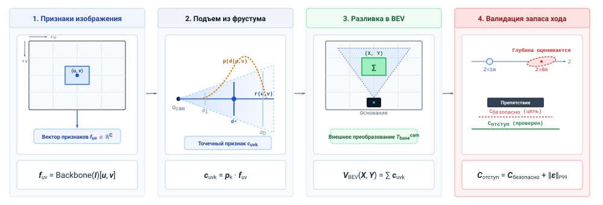
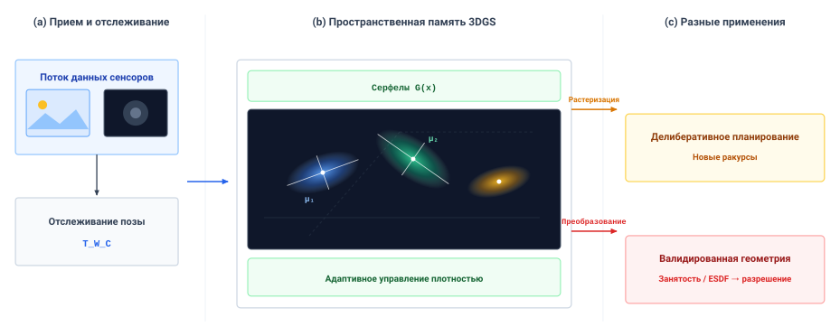
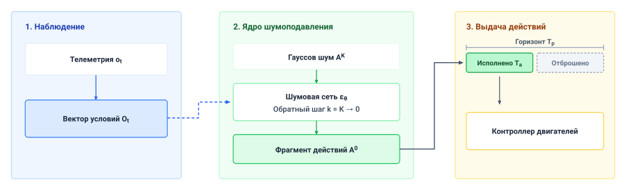
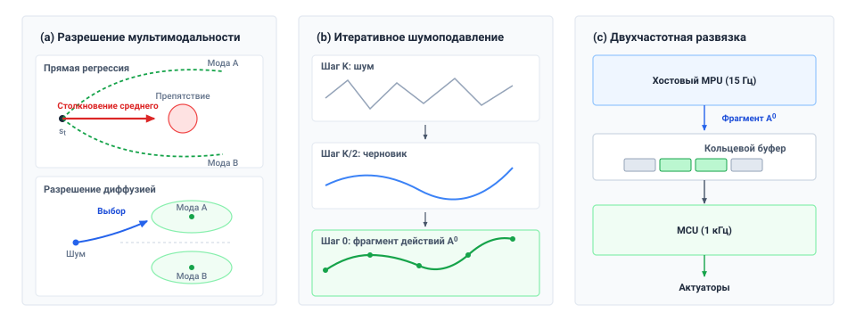

<a id="sec-appendix-ml"></a>

# Основы машинного обучения

Это приложение собирает модели машинного обучения, статистические границы и пространственные представления, используемые на протяжении всей книги. Каждый раздел формулирует предположения, при которых его результат справедлив, чтобы читатель мог проверить их на конкретной машине.

## Как пользоваться этим приложением

Обращайтесь к этому приложению, когда в главах этой книги встречаются узкие места конкретных обучающихся систем, пределы статистической верификации или границы представлений:

| Когда встречается этот системный симптом                                        | Смотрите                      | За этим количественным инструментом                                                |
|--------------------------------------------------------------------------------|------------------------------|---------------------------------------------------------------------------|
| Модель зрение–язык галлюцинирует действия при восприятийной неоднозначности        | [«Вероятность, теория информации и калибровка»](appendix_ml.md#sec-appendix-ml-probability) | Метрики апостериорной энтропии, неопределенность Шеннона и пороги отказа    |
| Переуверенные выходы сети командуют агрессивные действия вне распределения    | [«Переуверенность softmax и ошибка калибровки»](appendix_ml.md#sec-appendix-ml-calibration) | Геометрия симплекса softmax и ожидаемая ошибка калибровки (ECE)             |
| Дрейф внешних параметров нескольких камер, 2D-токенизации или геометрии 3D-сцены           | [«Пространственные представления и параметризация сцены»](appendix_ml.md#sec-appendix-ml-spatial)     | Преобразования $SE(3)$, эмбеддинги патчей, внимание и метрический 3D-подъем    |
| Признаки камеры нужно разместить в одной метрической сетке плоскости земли                 | [«Подъем с камеры на вид сверху»](appendix_ml.md#sec-appendix-ml-bev-lifting) | Гипотезы глубины Lift-Splat, размер пирамиды и BEV-сплаттинг              |
| Дифференцируемая реконструкция 3D-сцены расходится при отслеживании в реальном времени      | [«Параметры 3D-гауссова сплаттинга»](appendix_ml.md#sec-appendix-ml-3dgs)        | Параметры 3D-гауссова сплаттинга и проекция ковариации                |
| Картирование занятости сохраняет фантомные препятствия после перемещения объектов                 | [«Занятость в лог-шансах и слияние знаковых расстояний»](appendix_ml.md#sec-appendix-ml-voxels)      | Обновления вокселей в лог-шансах, слияние TSDF и трафик DRAM при трассировке лучей             |
| Малый шум датчика порождает взрывные неограниченные команды актуаторам         | [«Lipschitz-непрерывность и спектральная нормализация»](appendix_ml.md#sec-appendix-ml-lipschitz)   | Границы Lipschitz-непрерывности и спектральная нормализация                    |
| Политика поведенческого клонирования дрейфует в невосстановимые состояния вне траектории    | [«Обучение с подражанием и нарастающий ковариантный сдвиг»](appendix_ml.md#sec-appendix-ml-compounding) | Нарастающая ошибка $\mathcal{O}(T^2 \epsilon)$ и линейное снижение DAgger |
| L2-регрессия усредняет бимодальные демонстрации в путь между модами    | [«Усреднение по модам и декодеры без него»](appendix_ml.md#sec-appendix-ml-multimodal)  | Доказательство условного ожидания и семейства декодеров, его избегающие      |
| Генеративный декодер не успевает завершить фрагмент в пределах периода заданий          | [«Непрерывная диффузия траекторий и сопоставление потоков»](appendix_ml.md#sec-appendix-ml-diffusion)   | Цена выборки диффузии и сопоставления потоков относительно предельного срока управления    |
| Офлайн-обучение с подкреплением выбирает необоснованные разрушительные задания приводов | [«Функции ценности и обоснование аффордансов»](appendix_ml.md#sec-appendix-ml-affordances) | Переоценка ценности по Беллману и обоснование аффордансов в SayCan              |
| Верификация меняющихся во времени свойств физической безопасности на непрерывных трассах     | [«Сигнальная временная логика и непрерывная робастность»](appendix_ml.md#sec-appendix-ml-stl)         | Синтаксис сигнальной временной логики (STL) и количественная степень робастности     |
| Испытания парка без отказов не могут ограничить частоты редких катастрофических событий          | [«Испытания без отказов и стена наработки»](appendix_ml.md#sec-appendix-ml-exposure)    | Правило трех, разложение Вальда и точные границы Клоппера — Пирсона           |
| Износ физического стенда взрывно растет при квалификации политики с фиксированной выборкой        | [«Последовательный критерий отношения вероятностей»](appendix_ml.md#sec-appendix-ml-sprt)        | Последовательный критерий отношения вероятностей (SPRT) и границы остановки Вальда     |
| Удары контактных столкновений и всплески задержек превосходят границы гауссова 6-сигма     | [«Теория экстремальных значений и хвостовой риск»](appendix_ml.md#sec-appendix-ml-evt)         | Теория экстремальных значений (GEV/GPD) и выбор аппаратных запасов по высоким квантилям          |

<a id="sec-appendix-ml-probability"></a>

## Вероятность, теория информации и калибровка

Автономные машины должны рассуждать о неопределенности количественно — в восприятии, оценке намерения и моделировании мира.

### Условная вероятность и правило Байеса

Условная вероятность $P(Y \mid X)$ характеризует вероятность события $Y$ при наблюденном свидетельстве $X$. По правилу Байеса:
$$ P(\theta \mid \mathcal{D}) = \frac{P(\mathcal{D} \mid \theta) P(\theta)}{P(\mathcal{D})} $$
где $P(\theta)$ представляет априорное распределение по параметрам модели $\theta$, $P(\mathcal{D} \mid \theta)$ — правдоподобие физического датасета $\mathcal{D}$, а $P(\theta \mid \mathcal{D})$ — обновленное апостериорное распределение.

### Энтропия Шеннона и пороги неоднозначности

Энтропия $H(X)$ количественно оценивает ожидаемую неопределенность или информационное содержание в распределении вероятностей. Для дискретной случайной величины $X$, принимающей значения в алфавите $\mathcal{X}$:[^fn-ml-shannon-entropy]
$$ H(X) = - \sum_{x \in \mathcal{X}} P(x) \log_2 P(x) $$
Если два объекта отнесения получили равные оценки, энтропия кандидатных действий *модели* высока. Откалиброванный порог, специфичный для задачи, способен вызвать отказ от обоснования (`ERR_GROUNDING_AMBIGUITY`) и проверенную задержку, пока ищутся лучшие свидетельства. Уверенно ошибающаяся модель может иметь низкую энтропию, поэтому этот порог — лишь один из входов в разрешение.

[^fn-ml-shannon-entropy]: **Информационная энтропия Шеннона**: Энтропия количественно оценивает среднюю неопределенность внутри заданного дискретного распределения. Ее физический смысл зависит от того, откалибровано ли это распределение по соответствующим объектам отнесения и наблюдениям.

<a id="sec-appendix-ml-calibration"></a>

### Переуверенность softmax и ошибка калибровки

Стандартные классификационные головы нейросетей нормализуют сырые векторы логитов $\mathbf{z} \in \mathbb{R}^K$ в категориальные распределения с помощью функции softmax:
$$ \sigma(\mathbf{z})_i = \frac{e^{z_i / T}}{\sum_{j=1}^K e^{z_j / T}} $$
где $T > 0$ — гиперпараметр температуры. Оператор softmax проецирует логиты на симплекс вероятностей $\Delta^K$ исключительно алгебраическим возведением в экспоненту. Большая выходная вероятность указывает лишь на относительное разделение логитов, а не на подлинную эпистемическую достоверность.

Чтобы количественно оценить, совпадают ли предсказанные вероятности с эмпирическими физическими частотами, инженерия надежности вычисляет **ожидаемую ошибку калибровки (ECE)**:[^fn-ml-binned-ece]
$$ \text{ECE} = \sum_{m=1}^M \frac{|B_m|}{N} \left| \text{acc}(B_m) - \text{conf}(B_m) \right| $$
где интервал $[0, 1]$ разбит на $M$ интервалов одинаковой ширины $B_m$, $|B_m|$ — число наблюдений в интервале $m$, $N$ — общее число наблюдений, $\text{conf}(B_m)$ — средняя достоверность, а $\text{acc}(B_m)$ — эмпирическая точность. В физической автономности неоткалиброванная модель с высоким ECE сообщает ложную достоверность в условиях вне распределения, вводя в заблуждение любой резервный триггер или человека-супервизора, которые управляются по этой достоверности, и удерживая их от вмешательства.

[^fn-ml-binned-ece]: **Ожидаемая ошибка калибровки**: Биннинговые метрики калибровки количественно оценивают расхождение между достоверностью нейронных предсказаний и достигнутой эмпирической точностью по интервалам достоверности. Стандартные нерегуляризованные глубокие сети проявляют существенную переуверенность, поскольку минимизация кросс-энтропии уводит логиты к крайним значениям. Опора на неоткалиброванные оценки достоверности для управления резервными механизмами безопасности позволяет незамеченным сдвигам распределения портить исполнение команд в замкнутом контуре.

<a id="sec-appendix-ml-spatial"></a>

## Пространственные представления и параметризация сцены

Воплощенные физические агенты воспринимают, манипулируют и перемещаются в евклидовом 3D-пространстве.

### Преобразования специальной евклидовой группы SE(3)

Преобразования жесткого тела в 3D-пространстве принадлежат специальной евклидовой группе $SE(3)$, сочетая матрицу поворота $3 \times 3$ $\mathbf{R} \in SO(3)$ с вектором переноса $\mathbf{t} \in \mathbb{R}^3$:
$$ \mathbf{T} = \begin{bmatrix} \mathbf{R} & \mathbf{t} \\ \mathbf{0}^\top & 1 \end{bmatrix} \in SE(3) $$
Однородная точка $\tilde{\mathbf{p}} = [\mathbf{p}^\top, 1]^\top \in \mathbb{R}^4$ преобразуется между системами координат линейным умножением матрицы на вектор:
$$ \tilde{\mathbf{p}}' = \mathbf{T} \tilde{\mathbf{p}} $$
Пусть $\mathbf{T}_{AB}$ отображает координаты, выраженные в системе $B$, в систему $A$. Для мира $W$, базы робота $B$, исполнительного органа $E$ и камеры $C$ цепь имеет вид $\mathbf{T}_{WC}=\mathbf{T}_{WB}\mathbf{T}_{BE}\mathbf{T}_{EC}$. Допустимое жесткое преобразование имеет обратное $\mathbf{T}^{-1} = [\mathbf{R}^\top, -\mathbf{R}^\top \mathbf{t}; \mathbf{0}^\top, 1]$; численная точность по-прежнему зависит от откалиброванных преобразований и их неопределенности.

<a id="sec-appendix-ml-patch-embedding"></a>

### Токенизация визуальных патчей, внимание и метрический 3D-подъем

Воплощенные модели зрение–язык–действие (VLA) и пространственные трансформеры преобразуют непрерывные сенсорные потоки в дискретные токены для нейронного внимания, а затем поднимают кандидатные предсказания в 3D-евклидовы координаты для физических рассуждений. Разделы [«Выученные представления»](03_brain.md#sec-brain-learned-representations) и [«Питание, свежесть и стена памяти»](03_brain.md#sec-brain-cognitive-pipeline) используют полученные здесь числа токенов, чтобы оценить трафик памяти прикладного процессора.

#### 2D-токенизация патчей vision-трансформера

Рассмотрим RGB-изображение $\mathbf{X} \in \mathbb{R}^{H \times W \times C}$, снятое бортовой камерой с пространственным разрешением $H \times W$ и $C$ цветовыми каналами. Подача сырых пикселей в многослойный перцептрон отбросила бы пространственную локальность и раздула число параметров, поэтому фронтенд vision-трансформера разбивает изображение на неперекрывающуюся последовательность из $N$ патчей по $P \times P$ пикселей, где $P$ обычно 14 или 16:
$$ N = \frac{H \cdot W}{P^2} $$
Каждый патч, индексируемый своей строкой и столбцом $(u, v)$ в плоскости камеры, разворачивается в вектор $\mathbf{x}_p^{(u, v)} \in \mathbb{R}^{P^2 C}$. Обучаемое линейное проектирование $\mathbf{W}_{\text{patch}} \in \mathbb{R}^{(P^2 C) \times d_{\text{model}}}$ отображает каждый развернутый патч в скрытую размерность трансформера $d_{\text{model}}$. Самовнимание инвариантно к перестановкам и обращается со своими входами как с неупорядоченным множеством, поэтому модель ничего не знает о пространственной близости, пока положение не добавлено явно:
$$ \mathbf{z}_0^{(u, v)} = \mathbf{x}_p^{(u, v)} \mathbf{W}_{\text{patch}} + \mathbf{E}_{\text{pos}}^{2D}(u, v) + \mathbf{e}_{\text{cam}} $$
2D-эмбеддинг положения $\mathbf{E}_{\text{pos}}^{2D}(u, v)$ раскладывается вдоль вертикальной оси $u$ и горизонтальной оси $v$, используя синусоидальные частотные полосы или обучаемые эмбеддинги координат. Он кодирует положение в плоскости изображения и не несет метрического 3D-расстояния. Когда несколько камер питают одну модель — например, камера над головой для контекста сцены и камера на запястье для миллиметрового совмещения, — обучаемый идентификатор камеры $\mathbf{e}_{\text{cam}} \in \{\mathbf{e}_{\text{overhead}}, \mathbf{e}_{\text{wrist}}\}$ различает их системы координат. Некоторые архитектуры также добавляют в начало последовательности сводный токен $\mathbf{x}_{\text{class}} \in \mathbb{R}^{d_{\text{model}}}$.

Чтобы размерности были конкретны, возьмем квадратный RGB-кадр со стороной `224` пикселей (иллюстративно; см. руководство для читателя) и размером патча $P =$ `14`. Кадр делится на `16` патчей в сторону, всего `256`. Каждый патч несет `196` пикселей по `3` цветовым каналам — развернутый вектор из `588` значений, — и $\mathbf{W}_{\text{patch}}$ отображает каждый такой вектор в `4096`-мерное пространство модели. Один кадр становится `256` токенами шириной `4096`. Робот с `3` камерами (двумя на запястье и одной над головой) подает `3` $\times$ `256` = `768` визуальных токенов на шаг до добавления любого текстового или проприоцептивного токена.

Затем визуальные токены присоединяются к остальной части входа. Команда на естественном языке вроде «возьми красную кружку за ручку» токенизируется байтовым парным кодированием в текстовые эмбеддинги $\mathbf{z}_{\text{text}} \in \mathbb{R}^{L \times d_{\text{model}}}$. Конфигурация робота (углы шарниров $\mathbf{q}_t$, скорости шарниров $\dot{\mathbf{q}}_t$ и состояние захвата) проходит через линейный слой в проприоцептивные токены $\mathbf{z}_{\text{state}} \in \mathbb{R}^{K_s \times d_{\text{model}}}$. Три потока конкатенируются в одну мультимодальную входную последовательность:
$$ \mathbf{Z} = [\mathbf{z}_{\text{vision}} \,|\, \mathbf{z}_{\text{text}} \,|\, \mathbf{z}_{\text{state}}] \in \mathbb{R}^{N_{\text{total}} \times d_{\text{model}}} $$

#### Самовнимание по объединенной последовательности

Объединенная последовательность $\mathbf{Z}$ проходит через стек слоев трансформера — от 32 до 80 в современных VLA-бэкбонах, каждый из которых состоит из многоголового самовнимания и прямой сети. Самовнимание проецирует токены в запросы $\mathbf{Q} = \mathbf{Z} \mathbf{W}_Q$, ключи $\mathbf{K}_{\text{attn}} = \mathbf{Z} \mathbf{W}_K$ и значения $\mathbf{V} = \mathbf{Z} \mathbf{W}_V$ и вычисляет парные веса внимания по всей последовательности:
$$ A_{i, j} = \frac{\exp\left(\mathbf{q}_i^\top \mathbf{k}_j / \sqrt{d_k}\right)}{\sum_{m} \exp\left(\mathbf{q}_i^\top \mathbf{k}_m / \sqrt{d_k}\right)} $$
Текстовый токен вроде «ручка» может обращать внимание на визуальные токены патчей, но высокий вес внимания — это не проверенное место захвата и не метрическая поза. Обученный пространственный декодер способен выдать 2D-тепловую карту аффордансов, а размещение захвата в 3D все равно требует свидетельств глубины, калибровки камеры и метрического подъема, описанного ниже. Кольцевой кеш ключ-значение (KV) хранит предыдущие состояния токенов для внимания. Он не отслеживает постоянство объектов и не поддерживает 3D-положение и скорость; явный оценщик состояния обязан связывать наблюдения между кадрами и расширять свою неопределенность, пока кружка закрыта от взгляда.

#### Обратная проекция отверстия и метрический 3D-подъем

Стандартные 2D-токены патчей не имеют метрического масштаба из-за проективной неоднозначности: вдоль любого оптического луча $\lambda [u, v, 1]^\top$ бесконечно много 3D-точек проецируются в одинаковые координаты пикселей. Чтобы взаимодействовать с физическими барьерными фильтрами управления, кинематическими калькуляторами остановки и огибающими запаса до препятствий, 2D-визуальные предсказания должны подниматься в метрические 3D-координаты $\mathbf{p}_W \in \mathbb{R}^3$.

Пусть $\mathbf{u} = [u, v]^\top$ обозначает координаты пикселя на матрице изображения, а откалиброванная матрица внутренних параметров камеры отверстия имеет вид:
$$ \mathbf{K} = \begin{bmatrix} f_x & 0 & c_x \\ 0 & f_y & c_y \\ 0 & 0 & 1 \end{bmatrix} $$
где $(f_x, f_y)$ — фокусные расстояния в пикселях, а $(c_x, c_y)$ — главная точка. При наличии выровненного метрического измерения глубины $d = z > 0$ (полученного из стереодиспаратности, лидара времяпролета или откалиброванных датчиков глубины) 3D-положение в системе координат камеры $\mathbf{p}_C \in \mathbb{R}^3$ восстанавливается обратным проектированием внутренних параметров:
$$ \mathbf{p}_C = d \cdot \mathbf{K}^{-1} \begin{bmatrix} u \\ v \\ 1 \end{bmatrix} = \begin{bmatrix} (u - c_x) \frac{d}{f_x} \\ (v - c_y) \frac{d}{f_y} \\ d \end{bmatrix} $$
Преобразование $\mathbf{p}_C$ в систему базы робота или мира $W$ использует жесткое внешнее преобразование $\mathbf{T}_{WC} \in SE(3)$, определенное в этом разделе:
$$ \tilde{\mathbf{p}}_W = \mathbf{T}_{WC} \tilde{\mathbf{p}}_C \implies \mathbf{p}_W = \mathbf{R}_{WC} \mathbf{p}_C + \mathbf{t}_{WC} $$
Путь разрешения и оценщики кинематической досягаемости требуют именно этой метрической 3D-реконструкции; необоснованные 2D-токены не способны установить, удовлетворяет ли предложенная траектория физическим границам запаса $d_{\text{stop}}$.

<a id="sec-appendix-ml-bev-lifting"></a>

### Подъем с камеры на вид сверху

Представление вида сверху (bird's-eye view, BEV) помещает признаки каждой камеры в одну метрическую сетку на плоскости земли — ту систему координат, в которой работают планировщики и проверки запаса. Архитектура **Lift-Splat-Shoot (LSS)** [Philion and Fidler, 2020](references.md#philion2020lift) строит эту сетку из монокулярных признаков за три шага — три первые стадии рисунка [«Подъем лучевой пирамиды камеры и BEV-сплаттинг»](appendix_ml.md#fig-08-ray-frustum-voxel-lifting).

1. **Извлечение признаков.** Визуальный бэкбон, такой как DINOv2 [Oquab et al., 2023](references.md#oquab2023dinov2) или легкая сверточная сеть, отображает изображение $\mathbf{I} \in \mathbb{R}^{H \times W \times 3}$ в сетку векторов признаков:
   $$ \mathbf{f}_{u, v} = \text{Backbone}(\mathbf{I})[u, v] \in \mathbb{R}^C $$
   Прямая проекция ([«проекция отверстия»](08_perception.md#eq-percep-pinhole-projection)) сворачивает каждый 3D-луч в один пиксель, поэтому признак $\mathbf{f}_{u, v}$ представляет целый луч в пространстве, а его метрическая глубина неизвестна.

2. **Подъем.** LSS представляет эту неоднозначность, а не разрешает ее. Вдоль луча пеленга $\mathbf{K}^{-1}[u, v, 1]^\top$ из [«луч пеленга»](08_perception.md#eq-percep-bearing-ray) сеть выставляет оценки $D$ дискретным интервалам глубины, покрывающим $[d_{\min}, d_{\max}]$, например `64` интервалов от `0.5 m` до `20 m`, расположенных линейно или логарифмически:
   $$ \mathbf{p}_{u, v} = \text{softmax}(\mathbf{d}_{u, v}) \in \Delta^{D-1} $$
   Внешнее произведение поднимает каждый 2D-признак в пирамиду 3D-точек — по одной на каждую гипотезу глубины:
   $$ \mathbf{c}_{u, v, k} = \mathbf{p}_{u, v}(k) \cdot \mathbf{f}_{u, v} \in \mathbb{R}^C \quad \text{at } \mathbf{P}_c(u, v, d_k) = d_k \mathbf{K}^{-1} \begin{bmatrix} u \\ v \\ 1 \end{bmatrix} $$
   Для карты признаков `128` ячеек в сторону, с `64` интервалами глубины и `64` каналами признаков тензор пирамиды содержит около `67.1 million` значений — `134.2 MB` на кадр при FP16. На частоте камеры этот тензор есть трафик памяти, который должен нести прикладной процессор, поэтому реализации держат его в буферах с нулевым копированием на акселераторе.

3. **Сплаттинг.** Откалиброванное внешнее преобразование $\mathbf{T}_{\text{base}}^{\text{cam}} = [\mathbf{R}_{\text{base}}^{\text{cam}} \mid \mathbf{t}_{\text{base}}^{\text{cam}}] \in SE(3)$ отображает каждую точку пирамиды из оптической системы координат камеры в систему координат базы робота:
   $$ \mathbf{P}_{\text{base}} = \mathbf{R}_{\text{base}}^{\text{cam}} \mathbf{P}_c + \mathbf{t}_{\text{base}}^{\text{cam}} $$
   Рабочее пространство дискретизируется в сетку вертикальных столбцов, например `200` ячеек в сторону, покрывающих квадрат `20 m` с разрешением `0.1 m`. Сплаттинг суммирует каждый признак пирамиды, попадающий в столбец $(X, Y)$, используя ускоренные кумулятивные суммы или пулинг point-pillar [Philion and Fidler, 2020](references.md#philion2020lift); [Liu et al., 2023](references.md#liu2023bevfusion):
   $$ \mathbf{V}_{\text{BEV}}(X, Y) = \sum_{(u, v, k) \in \text{Pillar}(X, Y)} \mathbf{c}_{u, v, k} $$
   Сплаттинг выравнивает гипотезы камер в одной метрической системе координат. Он не способен заполнить область, которую не видела ни одна камера, или устранить ошибку масштаба глубины, поэтому контур, который он назначает пешеходу, по-прежнему зависит от гипотез глубины и калибровки.

<a id="fig-08-ray-frustum-voxel-lifting"></a>


***Подъем лучевой пирамиды камеры и BEV-сплаттинг**: LSS [Philion and Fidler, 2020](references.md#philion2020lift) помещает выученные гипотезы глубины от каждой камеры в общую метрическую BEV-систему координат; это преобразование координат не разрешает монокулярную неоднозначность глубины. Финальная врезка про запас требует отдельно проверенных метрических остатков, смещения и выбранного хвостового квантиля или детерминированной границы ошибки до выдачи разрешения. (Архитектура адаптирована из [Philion and Fidler, 2020](references.md#philion2020lift).)*

Softmax по интервалам глубины выражает назначаемые моделью веса, и его энтропия не является откалиброванной ковариацией метрики. Поэтому врезка про запас из раздела [«Границы пространственной ошибки и запаса»](08_perception.md#sec-perception-error-clearance) опирается на отдельно проверенные пространственные остатки, а не на веса подъема.

### Параметризация обратной глубины

В визуально-инерциальной одометрии и SLAM представление далеких 3D-ориентиров в стандартных декартовых координатах $(x, y, z)$ порождает крайнюю нелинейность: малые ошибки отслеживания пикселей дают квадратичные ошибки глубины ($\delta z \propto z^2$).

При **параметризации обратной глубины** 3D-признак параметризуется 6-мерным вектором $\mathbf{y} = [x_0, y_0, z_0, \theta, \phi, \rho]^\top$, где $(x_0, y_0, z_0)$ — оптический центр в момент первого наблюдения, $(\theta, \phi)$ — азимут и угол места, а $\rho = 1/d$ — обратная глубина:[^fn-ml-inverse-depth]
$$ \mathbf{p}(d) = \begin{bmatrix} x_0 \\ y_0 \\ z_0 \end{bmatrix} + \frac{1}{\rho} \begin{bmatrix} \cos\phi \sin\theta \\ -\sin\phi \\ \cos\phi \cos\theta \end{bmatrix} $$
На оптической бесконечности ($d \to \infty$) обратная глубина стремится к нулю ($\rho \to 0$). Эта параметризация способна улучшить обусловленность оценщика для далеких признаков; форма ковариации и численная устойчивость по-прежнему зависят от модели измерений, предположений о шуме и реализации оценщика.

[^fn-ml-inverse-depth]: **Параметризация обратной глубины**: Civera и коллеги использовали обратную глубину для представления далеких визуальных ориентиров в монокулярной оценке.

<a id="sec-appendix-ml-3dgs"></a>

### Параметры 3D-гауссова сплаттинга

Непрерывные нейронные представления сцены параметризуют физическое окружение наборами 3D-гауссиан [Kerbl et al., 2023](references.md#kerbl20233d). Каждый гауссиан $G_i(\mathbf{x})$ определяется четырьмя основными атрибутами:

1. **Положение ($\boldsymbol{\mu}_i \in \mathbb{R}^3$):** трехмерный пространственный центр.
2. **Матрица ковариации ($\boldsymbol{\Sigma}_i \in \mathbb{R}^{3 \times 3}$):** задает эллипсоидную форму и ориентацию. Чтобы $\boldsymbol{\Sigma}_i$ оставалась положительно полуопределенной на всем градиентном спуске, она разлагается на матрицу поворота $\mathbf{R}_i \in SO(3)$ (параметризованную единичным кватернионом $\mathbf{q}_i$) и диагональную матрицу масштабирования $\mathbf{S}_i = \text{diag}(s_{x,i}, s_{y,i}, s_{z,i})$:
   $$ \boldsymbol{\Sigma}_i = \mathbf{R}_i \mathbf{S}_i \mathbf{S}_i^\top \mathbf{R}_i^\top $$
3. **Представление цвета ($c_i$):** параметризуется коэффициентами сферических гармоник (SH), чтобы моделировать зависящую от точки наблюдения зеркальную яркость.
4. **Непрозрачность ($\alpha_i \in [0, 1]$):** моделируется сигмоидной активацией $\alpha_i = \sigma(o_i)$, чтобы обеспечить непрерывные градиенты плотности.

При рендеринге в реальном времени 3D-гауссианы проецируются в систему координат камеры через якобиево приближение $\mathbf{J} \in \mathbb{R}^{2 \times 3}$, давая спроецированную 2D-ковариацию:
$$ \boldsymbol{\Sigma}_{2D} = \mathbf{J} \mathbf{W} \boldsymbol{\Sigma} \mathbf{W}^\top \mathbf{J}^\top $$
где $\mathbf{W}\in SO(3)$ — вращательная часть преобразования из мира в камеру; перенос входит в спроецированное среднее, а не в эту ковариацию. Дифференцируемая тайловая растеризация сортирует гауссианы по глубине и вычисляет накопление цвета с альфа-смешиванием:
$$ C = \sum_{i \in \mathcal{N}} c_i \alpha_i \prod_{j=1}^{i-1} (1 - \alpha_j) $$
Эти дифференцируемые параметры поддерживают рендеринг новых ракурсов. Ни плотность гауссиан, ни ее пространственная производная не являются консервативной поверхностью столкновения, поэтому разрешение на запас требует отдельно проверенной геометрической экстракции, преобразования в занятость/ESDF или независимого датчика дальности, учитывающих неизвестное пространство и геометрическую ошибку ([«Гауссова память и передача запаса»](appendix_ml.md#fig-3dgs-slam-splatam)). Частота рендеринга и задержка запроса столкновения — разные измерения. Раздел [«Что может подтверждать память сцены»](09_memory.md#sec-memory-scene-attention-buffers) опирается на это различие, отказываясь принимать отрендеренный вид за границу запаса.

<a id="fig-3dgs-slam-splatam"></a>


***Гауссова память и передача запаса**: Наблюдения камеры обновляют гауссову сцену для рендеринга новых ракурсов. Ее визуальный выход не поставляет напрямую консервативное расстояние столкновения; требуется отдельно проверенная геометрия или преобразование в занятость и проверка разрешения [Kerbl et al., 2023](references.md#kerbl20233d); [Matsuki et al., 2024](references.md#matsuki2024gaussian).*

Память на примитив зависит от его упаковки и порядка сферических гармоник, поэтому след карты — это число ее примитивов, умноженное на эту упаковку. Плотная кубическая сетка вместо этого хранит $O(N^3)$ ячеек, а разреженная карта занятости — только выделенную структуру, чей размер зависит от наблюдавшейся геометрии и цели по точности. Рисунок [«Сценарии хранения пространственной памяти»](appendix_ml.md#fig-09-volumetric-memory-scaling) ставит три модели хранения рядом.

<a id="fig-09-volumetric-memory-scaling"></a>

***Сценарии хранения пространственной памяти**: Плотный куб использует четыре байта на воксель, октодерево выделяет по одной 32-байтной ячейке поверхности на квадрат размерности сетки, а гауссова сцена держит фиксированное число и упаковку, пока разрешение сетки меняется. Это модели хранения, а не измеренные тесты времени выполнения при равной точности; число гауссиан должно расти, если более строгая цель по геометрии этого требует.*

Для гауссовой упаковки на графике `500,000` примитивов по `56` байт требуют `28 MB`. При развертывании представление выбирается после измерения полноты карты, времени обновления, времени запроса и преобразования, нужного для консервативного запаса.

<a id="sec-appendix-ml-voxels"></a>

### Занятость в лог-шансах и слияние знаковых расстояний

Дискретные объемные сетки моделируют неопределенность занятости через рекурсивную байесовскую оценку. Пусть $m_i$ обозначает бинарное состояние занятости вокселя $i$ ($m_i = 1$ занят, $m_i = 0$ свободен).

Используя преобразование лог-шансов $L(x) = \ln \frac{P(x)}{1 - P(x)}$, рекурсивная байесовская фильтрация сворачивает нелинейное умножение вероятностей в аддитивные линейные обновления:[^fn-ml-log-odds]
$$ L_t(m_i) = L_{t-1}(m_i) + \ln \frac{P(m_i \mid z_t)}{1 - P(m_i \mid z_t)} - \ln \frac{P(m_i)}{1 - P(m_i)} $$
где $P(m_i \mid z_t)$ — обратная модель датчика, а $P(m_i)$ — априорное распределение. Вдоль надежного луча дальности пройденные ячейки получают свидетельства свободного пространства, а измеренный возврат — свидетельства занятости; пространство за возвратом остается неизвестным, пока его не наблюдают отдельно. Аддитивное обновление может использовать ограниченные лог-шансы с фиксированной точностью, но ошибка датчика, движущиеся объекты и возраст свидетельств все равно важны.

[^fn-ml-log-odds]: **Рекурсивная занятость в лог-шансах**: Формулировка лог-шансов отображает значения вероятностей из ограниченного единичного интервала на неограниченную вещественную прямую, превращая нелинейные байесовские произведения в быстрые сложения. Динамические диапазоны ограничиваются верхними и нижними границами насыщения, чтобы предотвратить залипание насыщения. Отсутствие ограничения значений лог-шансов задерживает очистку динамических препятствий, когда физические объекты покидают рабочее пространство.

#### Занятость октодерева и трассировка лучей по свободному пространству

Картирование сеткой занятости [Elfes, 1989](references.md#elfes1989using) разбивает пространство на ячейки и применяет это обновление к каждой ячейке, которой касается луч. Объемная трассировка лучей проходит линию видимости каждого возврата обходом трехмерного цифрового дифференциального анализатора (3D-DDA) [Amanatides and Woo, 1987](references.md#amanatides1987fast). Иерархические хранилища, такие как OctoMap [Hornung et al., 2013](references.md#hornung2013octomap) и OpenVDB [Museth, 2013](references.md#museth2013vdb), выделяют ячейки только там, где прошли лучи, поэтому память следует за наблюденным объемом, а не за ограничивающим кубом ([«Вероятностное объемное картирование октодеревом»](appendix_ml.md#fig-09-octomap-volumetric-mapping)). Свидетельства свободного пространства позволяют карте списать фантомное препятствие, как только та же область увидена пустой, тогда как ячейка, которую не наблюдали никогда, остается неизвестной, сколь бы долго ни работала карта. Раздел [«Что может подтверждать память сцены»](09_memory.md#sec-memory-scene-attention-buffers) применяет это правило к проходу, где только свежие свидетельства свободного пространства могут поручиться, что путь свободен.

<a id="fig-09-octomap-volumetric-mapping"></a>


***Вероятностное объемное картирование октодеревом**: Проход по коридору, реконструированный из сырого облака точек в вероятностное октодерево и далее в явные свободное, занятое и неизвестное пространства [Hornung et al., 2013](references.md#hornung2013octomap). Третья панель — то, что отличает пространственную память от накопленного облака точек: трассировка лучей записывает свидетельства пустоты вдоль линий видимости, позволяя карте активно списывать след фантомного препятствия вместо ожидания истечения тайм-аута. (Источник: Hornung et al. / Autonomous Intelligent Systems Lab, University of Freiburg, CC BY 3.0).*

#### Слияние усеченных знаковых расстояний

Усеченное знаковое поле расстояний (TSDF), объемно сливаемое на частоте камеры в KinectFusion [Newcombe et al., 2011](references.md#newcombe2011kinectfusion) и инкрементально на роботах в Voxblox [Oleynikova et al., 2017](references.md#oleynikova2017voxblox), хранит в каждом вокселе $\mathbf{v}$ *метрическое проективное расстояние* $D(\mathbf{v}) \in [-\mu, +\mu]$, положительное перед наблюденным возвратом вдоль его луча, и безразмерный вес слияния $W(\mathbf{v})$. Для откалиброванного изображения глубины центр вокселя преобразуется в координаты камеры $\mathbf{p} = [p_x, p_y, p_z]^\top$ и проецируется в пиксель $(u, v)$. Его проективная выборка равна $s = Z_{\text{meas}}(u, v) - p_z$. Для луча дальности эквивалентная выборка вдоль луча равна $s = r_{\text{hit}} - r_{\text{voxel}}$; обе положительны до попадания. У возврата выборка ограничивается в метрах и сливается в текущее взвешенное среднее:
$$ d_{\mu}(\mathbf{v}) = \max(-\mu, \min(\mu, s)), \qquad D_t(\mathbf{v}) = \frac{W_{t-1}(\mathbf{v}) D_{t-1}(\mathbf{v}) + w_t d_{\mu}(\mathbf{v})}{W_{t-1}(\mathbf{v}) + w_t} $$
где $w_t$ — безразмерный вес наблюдения, а хранимый вес $W_t = W_{t-1} + w_t$ ограничен сверху $W_{\max}$. Слияние использует допустимую позу момента захвата и отказывается от выборки старше последней эпохи свидетельств вокселя. Отрицательная выборка сразу за измеренным возвратом вносит вклад в локальный нулевой переход по модели поверхности; она не подтверждает невиданный интерьер препятствия.

Интерполяция наблюденных выборок дает приближенный градиент у нулевого перехода, ограниченный неизвестными вокселями, проективным смещением, дискретизацией и движущимися объектами. Поэтому проективный TSDF — не то евклидово расстояние до ближайшей поверхности, которое нужно решению о запасе. Запрос запаса поэтому читает проверенные занятость или евклидово знаковое поле расстояний (ESDF) с политикой неизвестного пространства — то преобразование, которое [«Что может подтверждать память сцены»](09_memory.md#sec-memory-scene-attention-buffers) требует от каждого представления сцены, прежде чем путь разрешения на него опирается.

#### Обновление одного кадра и его трафик памяти

@Algo-volumetric-tsdf-raycast применяет оба обновления для одного кадра глубины, а следующий за ним расчет оценивает трафик обновлений, который [«Что может подтверждать память сцены»](09_memory.md#sec-memory-scene-attention-buffers) относит на шину памяти. Он отвергает кадр, не касаясь карты, если его эпоха захвата слишком стара или старше последних свидетельств любой ячейки, которую он обновил бы, затем очищает и помечает занятость вдоль каждого луча и сливает выборки TSDF только внутри полосы усечения. Каждая обновленная ячейка получает эпоху захвата, а не время обновления, так что более поздний потребитель может судить о свежести каждой ячейки.

```pseudocode
#| label: algo-volumetric-tsdf-raycast
#| pdf-line-number: true
#| pdf-right-comment: false
#| html-comment-delimiter: "▷"
\begin{algorithm}
\caption{Трассировка лучей занятости и метрическое слияние TSDF}
\begin{algorithmic}
\Require возвраты $\mathcal{P}$, захваченные в $t_0$ в одном такте захвата; допустимая поза; занятость $\mathcal{O}$; метрический TSDF $\mathcal{V}$; усечение $\mu$; период полураспада свидетельств $t_{1/2}$; сериализованные обновления для каждой ячейки
\Ensure наблюденные свободные/занятые ячейки и поверхностные выборки TSDF обновлены без освежения невиданных ячеек
\State $(t_{0,c},\epsilon_{\text{sync}})\gets\Call{ConvertCaptureToControllerClock}{t_0}$
\If{преобразование часов недопустимо или $t_{\text{now},c}-t_{0,c}+\epsilon_{\text{sync}}>\tau_{\max,\text{age}}$}
    \State \Return $\text{STATUS\_FRAME\_TOO\_STALE}$
\EndIf
\If{любая целевая ячейка занятости или TSDF имеет $t_{\text{last}}>t_0$}
    \State \Return $\text{STATUS\_OUT\_OF\_ORDER}$ \Comment{проверка перед изменением карты}
\EndIf
\For{\textbf{each} return $\mathbf{p}_k\in\mathcal{P}$}
    \State $(\mathbf{r}_{\text{dir}},r_{\text{hit}})\gets\Call{RayFromPoseAndReturn}{\mathbf{p}_k}$
    \Statex \Comment{Занятость: измеренный свободный луч и попадание, а не расстояние TSDF}
    \For{\textbf{each} ячейка $c$, пройденная до попадания}
        \State $c\gets\Call{GetOrAllocateOccupancy}{\mathcal{O},c}$
        \State $c.L\gets\Call{ClampLogOdds}{c.L+L_{\text{free}}}$; $c.t_{\text{last}}\gets t_0$
    \EndFor
    \State обновить наблюденную ячейку попадания значением $L_{\text{occupied}}$ и эпохой $t_0$
    \Statex \Comment{TSDF: сливать метрические выборки только в узкой полосе поверхности}
    \For{\textbf{each} воксель $v$ с $|r_{\text{hit}}-r_v|\le\mu$}
        \State $\text{vox}\gets\Call{GetOrAllocateTSDF}{\mathcal{V},v}$
        \State $d_\mu\gets\Call{Clamp}{r_{\text{hit}}-r_v,-\mu,+\mu}$ \Comment{положительно до попадания}
        \State $W_{\text{old}}\gets 0$ if $\text{vox}.W=0$, else $\text{vox}.W\,2^{-(t_0-\text{vox}.t_{\text{last}})/t_{1/2}}$
        \State $w_{\text{obs}}\gets 1$ \Comment{безразмерная иллюстративная достоверность}
        \State $\text{vox}.D\gets(W_{\text{old}}\text{vox}.D+w_{\text{obs}}d_\mu)/(W_{\text{old}}+w_{\text{obs}})$
        \State $\text{vox}.W\gets\min(W_{\text{old}}+w_{\text{obs}},W_{\max})$; $\text{vox}.t_{\text{last}}\gets t_0$
    \EndFor
\EndFor
\State \Return $\text{STATUS\_MAP\_UPDATED}$
\end{algorithmic}
\end{algorithm}
```
<a id="nbk-memory-memory-footprint-dram-bandwidth-3d-tsdf"></a>

> **Пропускная способность DRAM для воксельных сеток 3D TSDF**
>
> **Практический инженерный вопрос**: Каковы полезная нагрузка расстояний и весов и смоделированная пропускная способность DRAM для разреженных и плотных представлений TSDF?
>
> *1. Плотное размещение.* Манипуляционная ячейка `10 m` $\times$ `10 m` $\times$ `3 m` (`300 m³`) с шагом `1 cm` содержит `300,000,000` вокселей. При `4` байтах на воксель (16-битное расстояние плюс 16-битный вес слияния), без занятости, эпох свидетельств на ячейку и накладных расходов распределителя, полезная нагрузка расстояний и весов составляет `1.20 GB`. Уточнение шага до `5 mm` для контакта инструмента поднимает счет до `2,400,000,000` вокселей и частичную полезную нагрузку до `9.60 GB`, что само по себе превышает иллюстративный бюджет памяти `8 GB`.
>
> *2. Разреженное размещение.* Поверхности занимают тонкое многообразие внутри объема. Группировка вокселей в листовые блоки по `512` вокселей и выделение только внутри полосы усечения, составляющей, как предполагается, `3` % объема, дает `17,579` блоков. С `32`-байтной заголовочной записью листа полезная нагрузка составляет `36.6 MB` при `1 cm` и `292.5 MB` при `5 mm`. Полная карта должна также закладывать в бюджет отдельный слой занятости, эпохи на ячейку, поиск блоков и метаданные распределителя, а также емкость под политику неизвестного пространства.
>
> *3. Обход и трафик DRAM.* Поток глубины `640` $\times$ `480` на `60 Hz` подает `18.432 million` лучей в секунду. Вдоль луча длиной `3 m` с шагом `1 cm` обход посещает `300` ячеек. `294` ячейки до попадания получают обновления свободного луча занятости, а `6` ячеек у возврата — слияние TSDF. Разреженное размещение TSDF экономит емкость карты; оно не устраняет ни обход, ни обновления занятости. При `8` байтах предполагаемого трафика чтения/записи на обновление отправка каждого обновления в DRAM стоит `44.2 GB/s`. При предполагаемой доле попаданий в кеш `95` % и для обновлений занятости, и для обновлений TSDF смоделированная потребность в DRAM падает до `2.21 GB/s` — снижение в `20×`. Частота попаданий зависит от перекрытия лучей, атомарных операций, вытеснений и отложенной записи на выбранном аппаратном обеспечении; это вход, который нужно измерять, а не свойство структуры карты.
>
> **Системный вывод**: Разреженное размещение дает в `33×` меньшую смоделированную полезную нагрузку TSDF в этом сценарии с долей поверхности, тогда как потребность шины зависит от измеренной локальности и от всей работы с пройденными ячейками. Поместится ли эта потребность рядом с выводом политики на общей шине — вопрос конкуренции из раздела [«Конкуренция за общие ресурсы»](13_placement.md#sec-placement-resource-contention).

<a id="sec-appendix-ml-sensitivity"></a>

## Аппроксимация функций и границы чувствительности

Нейросеть, отображающая состояние датчиков в команды, нуждается в границе того, насколько далеко ее выход может сместиться при смещении входа.

<a id="sec-appendix-ml-lipschitz"></a>

### Lipschitz-непрерывность и спектральная нормализация

Нейронная политика $\pi: \mathcal{X} \to \mathcal{U}$ является $L$-Lipschitz-непрерывной, если существует неотрицательная скалярная постоянная $L$ такая, что для всех $\mathbf{x}_1, \mathbf{x}_2 \in \mathcal{X}$:
$$ \| \pi(\mathbf{x}_1) - \pi(\mathbf{x}_2) \|_{\mathcal{U}} \le L \| \mathbf{x}_1 - \mathbf{x}_2 \|_{\mathcal{X}} $$
Для прямой сети с $K$ слоями $\pi(\mathbf{x}) = \phi_K(\mathbf{W}_K \dots \phi_1(\mathbf{W}_1 \mathbf{x}))$ пусть $L_{\phi_k}$ ограничивает наклон каждой функции активации на области входов. Совокупная граница имеет вид:
$$ L \le \prod_{k=1}^K L_{\phi_k}\| \mathbf{W}_k \|_2. $$
ReLU и Tanh в обычных скалярных формах 1-Lipschitz-непрерывны; точный GeLU имеет максимальную производную около $1.1289$, поэтому присвоение ему множителя единица занизило бы границу.

### Усиление возмущений и супервизорское ограничение

В физических системах входное состояние $\mathbf{x}$ искажается шумом измерения датчика $\delta \mathbf{x}$, ограниченным $\|\delta \mathbf{x}\| \le \epsilon$. Вызванное этим отклонение командного управляющего действия ограничено:
$$ \| \delta \mathbf{u} \| = \| \pi(\mathbf{x} + \delta \mathbf{x}) - \pi(\mathbf{x}) \| \le L \epsilon $$
Постоянная имеет размерность выходных единиц на входную единицу. Для иллюстративной политики, отображающей положение в метрах в момент в ньютонах на метр, $L=10^3\text{ N}\cdot\text{m}/\text{m}$ и $\epsilon=1\text{ mm}$ допускают изменение команды до $1\text{ N}\cdot\text{m}$. Превышает ли это запас момента, зависит от шарнира и режима работы. **Спектральная нормализация** способна понизить верхнюю границу чувствительности сети. Она ограничивает сеть, а не объект управления, поэтому стабильность, безопасный момент и допустимость измерений датчика по-прежнему исходят от отдельного предела актуатора и зависящей от состояния проверки разрешения.

<a id="sec-appendix-ml-compounding"></a>

## Обучение с подражанием и нарастающий ковариантный сдвиг

Поведенческое клонирование формулирует приобретение физической политики как обучение с учителем — регрессию по парам состояние–действие демонстратора.

<a id="sec-appendix-ml-multimodal"></a>

### Усреднение по модам и декодеры без него

Рассмотрим целевую функцию обучения с подражанием, минимизирующую среднюю квадратичную ошибку (потерю $L_2$) по распределению демонстраций $P(o, a)$:
$$ \min_\pi \mathbb{E}_{(o, a) \sim \mathcal{D}} \left[ \| a - \pi(o) \|^2 \right] $$
Развертывание целевой функции показывает, что оптимальный неограниченный регрессор $\pi^*(o)$ равен **условному математическому ожиданию**:
$$ \pi^*(o) = \mathbb{E}[a \mid o] = \int a P(a \mid o) \, da $$
Когда поведение демонстратора по своей природе мультимодально — например, объезд препятствия поворотом налево ($a = +1.0$) или направо ($a = -1.0$) с равной вероятностью $P(a = +1) = P(a = -1) = 0.5$, — условное ожидание вычисляет арифметическое среднее:
$$ \pi^*(o) = 0.5(+1.0) + 0.5(-1.0) = 0.0 $$
Исполнение этого усредненного действия командует нулевое отклонение руления, направляя физического робота прямо в центральное препятствие.

#### Семейства декодеров

Декодер избегает среднего, представляя условное распределение действий, а не его ожидание. Приведенные ниже семейства меняют цену вывода на выразимые ими распределения, и ни одно не поставляет состояния восстановления, которых нет в демонстрациях. Раздел [«Режимы синтеза политик»](06_training.md#sec-training-synthesis-regimes) сравнивает их по числу вычислений сети, которое стоит каждый фрагмент, — именно там выбор достигает предельного срока управления.

1. **Сети смеси плотностей.** Голова модели смеси гауссиан (GMM) параметризует выход политики как условную смесь из $M$ гауссовых компонент:
   $$ \pi(a \mid o) = \sum_{m=1}^M w_m(o) \, \mathcal{N}\left(\mu_m(o), \Sigma_m(o)\right) $$
   где сеть предсказывает веса смеси $w_m(o)$, средние компонент $\mu_m(o)$ и ковариации $\Sigma_m(o)$. Это дает логарифм правдоподобия в замкнутой форме и точную плотность за один прямой проход. Обучение по методу максимального правдоподобия склонно к коллапсу мод и числовой сингулярности, голова плохо масштабируется до многомерных многошаговых траекторий, а число компонент $M$ должно быть задано заранее, что отказывает при неравномерном ветвлении демонстраций.

2. **Неявное поведенческое клонирование.** Неявное поведенческое клонирование (IBC) [Florence et al., 2022](references.md#florence2022implicit) обучает энергетическую модель $E_\theta(o, a) \in \mathbb{R}$ с контрастивными или InfoNCE-целевыми функциями, назначающую низкую энергию продемонстрированным парам состояние–действие и высокую — контрфактическим действиям. Вывод приближенно решает
   $$ a^* = \arg\min_a E_\theta(o, a) $$
   Энергия способна представлять разрывные, резко мультимодальные распределения и невыпуклые границы, недоступные непрерывному прямому отображению. Вывод — это итеративный поиск, чьи цена и качество зависят от оптимизатора, числа кандидатов и устройства, а невыпуклая энергия может вернуть локальный минимум.

3. **Условная диффузия и сопоставление потоков.** Diffusion Policy [Chi et al., 2024](references.md#chi2024diffusionpolicy) и декодеры сопоставления потоков порождают целый фрагмент действий итеративным шумоподавлением или интегрированием ОДУ. Их целью обучения служит введенный шум или векторное поле, обусловленные испорченным фрагментом, наблюдением и шагом, а не само чистое действие, поэтому потеря с квадратичной ошибкой никогда не усредняет несовместимые моды. Раздел [«Непрерывная диффузия траекторий и сопоставление потоков»](appendix_ml.md#sec-appendix-ml-diffusion) выводит обе целевые функции и оценивает цену их шагов выборки.
4. **Фрагментация со скрытыми переменными.** Action Chunking with Transformers (ACT) [Zhao et al., 2023](references.md#zhao2023learning) предсказывает фрагмент $\mathbf{A}_t = (\mathbf{a}_t, \mathbf{a}_{t+1}, \dots, \mathbf{a}_{t+K-1}) \in \mathbb{R}^{K \times D_a}$ из текущего наблюдения $\mathbf{o}_t$ условным вариационным автоэнкодером (CVAE), построенным из энкодера и декодера Transformer. При обучении энкодер сжимает продемонстрированные фрагменты и наблюдения в низкоразмерную скрытую переменную стиля $\mathbf{z} \sim q_\phi(\mathbf{z} \mid \mathbf{o}_t, \mathbf{A}_t)$, оптимизируемую через вариационную нижнюю границу:
   $$ \mathcal{L}_{\text{ACT}}(\theta, \phi) = \mathbb{E}_{(\mathbf{o}_t, \mathbf{A}_t) \sim \mathcal{D}, \mathbf{z} \sim q_\phi(\mathbf{z} \mid \mathbf{o}_t, \mathbf{A}_t)} \left[ \|\mathbf{A}_t - \pi_\theta(\mathbf{o}_t, \mathbf{z})\|_1 \right] + \beta D_{\text{KL}}\left( q_\phi(\mathbf{z} \mid \mathbf{o}_t, \mathbf{A}_t) \,\parallel\, \mathcal{N}(\mathbf{0}, \mathbf{I}) \right) $$
   На этапе вывода скрытый код выбирается из априорного распределения $\mathbf{z} \sim \mathcal{N}(\mathbf{0}, \mathbf{I})$ или устанавливается в его среднее $\mathbf{z} = \mathbf{0}$. Каждый код выбирает одно согласованное продемонстрированное намерение — например, обойти препятствие слева или завести кабель в верхний фиксатор, — и декодер выдает для него внутренне согласованный фрагмент.

5. **Дискретные токены действий.** Модели зрение–язык–действие, такие как RT-1, RT-2 и OpenVLA [Brohan et al., 2023](references.md#brohan2023rt1); [Brohan et al., 2023](references.md#brohan2023rt2); [Kim et al., 2024](references.md#kim2024openvla), дискретизируют каждое непрерывное измерение действия на $B$ равных интервалов, обычно 256, и выдают один токен на измерение:
   $$ \text{bin}(a_k) = \left\lfloor \frac{a_k - a_{\min}}{a_{\max} - a_{\min}} \times (B - 1) \right\rfloor $$
   Категориальный выход избегает усреднения мод и заново использует выходную голову языковой модели. Он несет ошибку квантования $\Delta a = (a_{\max} - a_{\min})/B$ и требует $D_a$ последовательных предсказаний токенов на действие, поэтому его задержка растет с размерностью действия.

<a id="sec-appendix-ml-diffusion"></a>

### Непрерывная диффузия траекторий и сопоставление потоков

Непрерывная диффузия траекторий рассматривает синтез политики как генеративное шумоподавление над непрерывными многошаговыми фрагментами траекторий действий $\mathbf{A} \in \mathbb{R}^{K \times D_a}$, обусловленными историями визуальных и проприоцептивных наблюдений $\mathbf{O}$ [Chi et al., 2024](references.md#chi2024diffusionpolicy). Вместо предсказания неограниченной точечной оценки через среднюю квадратичную ошибку диффузионные модели представляют сложные мультимодальные распределения действий, не схлопываясь в усреднение мод.

Рисунок [«Архитектура диффузионной политики»](appendix_ml.md#fig-diffusion-policy-architecture) показывает структуру политики. Она обусловливается короткой историей изображений камеры и состояния робота, шумоподавляет кандидатный фрагмент из гауссова шума за $K$ итераций и отправляет лишь префикс фрагмента, прежде чем планировать заново.

<a id="fig-diffusion-policy-architecture"></a>


***Архитектура диффузионной политики**: Политика непрерывной диффузии траекторий для зрительно-моторного управления, шумоподавляющая кандидатный фрагмент действий из гауссова шума за $K$ итераций и отправляющая лишь его префикс перед повторным планированием. Асинхронное буферирование и независимый путь разрешения с высокой частотой могут разделить более медленную генерацию фрагментов и исполнение команды. Условное шумоподавление способно представлять альтернативные продемонстрированные пути, не беря их средне-регрессионного среднего. (Адаптировано из Chi et al. [Chi et al., 2024](references.md#chi2024diffusionpolicy)).*

#### Прямая диффузия и расписание дисперсий

Процесс прямой диффузии постепенно портит эталонный продемонстрированный фрагмент действий $\mathbf{A}^0 \sim q(\mathbf{A})$ гауссовым шумом на $N$ дискретных шагов времени (или при непрерывном диффузионном времени $t \in [0, 1]$):
$$ q(\mathbf{A}^k \mid \mathbf{A}^{k-1}) = \mathcal{N}\left(\mathbf{A}^k; \sqrt{1 - \beta_k} \mathbf{A}^{k-1}, \beta_k \mathbf{I}\right) $$
где $\{\beta_k \in (0, 1)\}_{k=1}^N$ обозначает заранее заданное расписание дисперсий. Определив $\alpha_k = 1 - \beta_k$ и $\bar{\alpha}_k = \prod_{s=1}^k \alpha_s$, получим, что маргинальное распределение на шаге $k$ допускает гауссову выборку в замкнутой форме прямо из $\mathbf{A}^0$:
$$ q(\mathbf{A}^k \mid \mathbf{A}^0) = \mathcal{N}\left(\mathbf{A}^k; \sqrt{\bar{\alpha}_k} \mathbf{A}^0, (1 - \bar{\alpha}_k) \mathbf{I}\right) $$
что позволяет немедленно выбирать зашумленные траектории в замкнутой форме, не моделируя промежуточные марковские шаги:
$$ \mathbf{A}^k = \sqrt{\bar{\alpha}_k} \mathbf{A}^0 + \sqrt{1 - \bar{\alpha}_k} \boldsymbol{\epsilon}, \quad \boldsymbol{\epsilon} \sim \mathcal{N}(\mathbf{0}, \mathbf{I}) $$

#### Обратное шумоподавление и сопоставление score-функций

Генеративный обратный процесс синтезирует траекторию действия из чистого гауссова шума $\mathbf{A}^N \sim \mathcal{N}(\mathbf{0}, \mathbf{I})$, параметризуя условное распределение обратного перехода $p_\theta(\mathbf{A}^{k-1} \mid \mathbf{A}^k, \mathbf{O})$:
$$ p_\theta(\mathbf{A}^{k-1} \mid \mathbf{A}^k, \mathbf{O}) = \mathcal{N}\left(\mathbf{A}^{k-1}; \boldsymbol{\mu}_\theta(\mathbf{A}^k, \mathbf{O}, k), \boldsymbol{\Sigma}_k\right) $$
Оптимизация вариационной нижней границы правдоподобия данных репараметризует среднее $\boldsymbol{\mu}_\theta$ через сеть предсказания шума $\boldsymbol{\epsilon}_\theta$:
$$ \boldsymbol{\mu}_\theta(\mathbf{A}^k, \mathbf{O}, k) = \frac{1}{\sqrt{\alpha_k}} \left( \mathbf{A}^k - \frac{\beta_k}{\sqrt{1 - \bar{\alpha}_k}} \boldsymbol{\epsilon}_\theta(\mathbf{A}^k, \mathbf{O}, k) \right) $$
Сеть шума оптимизируется упрощенной $L_2$-целью шумоподавляющего сопоставления score-функций:
$$ \mathcal{L}_{\text{diff}}(\theta) = \mathbb{E}_{k \sim \mathcal{U}\{1, N\}, \boldsymbol{\epsilon} \sim \mathcal{N}(\mathbf{0}, \mathbf{I}), (\mathbf{O}, \mathbf{A}^0) \sim \mathcal{D}} \left[ \left\| \boldsymbol{\epsilon} - \boldsymbol{\epsilon}_\theta\left(\sqrt{\bar{\alpha}_k}\mathbf{A}^0 + \sqrt{1 - \bar{\alpha}_k}\boldsymbol{\epsilon}, \mathbf{O}, k\right) \right\|^2 \right] $$
По формуле Твиди оценка шума пропорциональна score-функции Стейна (пространственному градиенту логарифма плотности данных): $\nabla_{\mathbf{A}^k} \ln p(\mathbf{A}^k \mid \mathbf{O}) \approx -\boldsymbol{\epsilon}_\theta(\mathbf{A}^k, \mathbf{O}, k) / \sqrt{1 - \bar{\alpha}_k}$. Обусловливание по этой score-функции направляет стохастическую выборку к высокоплотным модам демонстраций, а не к усреднению несовместимых мод в столкновение с препятствием.

#### Непрерывное сопоставление потоков и регрессия векторного поля

Тогда как стандартная диффузия интегрирует стохастические СДУ, **непрерывное сопоставление потоков** [Lipman et al., 2022](references.md#lipman2022flow) порождает траектории вдоль детерминированных потоков вероятности, заданных обыкновенными дифференциальными уравнениями (ОДУ):
$$ \frac{d\mathbf{x}_t}{dt} = v_\theta(\mathbf{x}_t, t, \mathbf{O}) $$
При условном векторном поле оптимального транспорта непрерывный путь линейно интерполирует между исходным шумом $\mathbf{x}_0 \sim \mathcal{N}(\mathbf{0}, \mathbf{I})$ и целью-демонстрацией $\mathbf{x}_1 \sim q(\mathbf{x})$:
$$ \psi_t(\mathbf{x}_0) = (1 - t) \mathbf{x}_0 + t \mathbf{x}_1, \quad t \in [0, 1] $$
Эталонное поле скоростей вдоль этого пути постоянно: $\dot{\psi}_t(\mathbf{x}_0) = \mathbf{x}_1 - \mathbf{x}_0$. Нейросеть $v_\theta$ обучается прямой регрессией:
$$ \mathcal{L}_{\text{FM}}(\theta) = \mathbb{E}_{t \sim \mathcal{U}[0, 1], \mathbf{x}_0 \sim \mathcal{N}(\mathbf{0}, \mathbf{I}), \mathbf{x}_1 \sim \mathcal{D}} \left[ \left\| v_\theta\left((1 - t)\mathbf{x}_0 + t\mathbf{x}_1, t, \mathbf{O}\right) - (\mathbf{x}_1 - \mathbf{x}_0) \right\|^2 \right] $$
Более прямые условные пути позволяют низкопорядковому решателю, такому как метод Эйлера или Рунге — Кутты, достигнуть заданного качества действия меньшим числом вычислений функции, чем требуется искривленной диффузионной траектории. Сколько вычислений достаточно и какую задержку они стоят — свойства обученной модели и устройства, а не самого сопоставления потоков.

#### Шаги шумоподавления против предельного срока управления

Обратная выборка вычисляет шумоподавитель один раз на шаг, последовательно, поэтому время вывода фрагмента растет с числом шагов.[^fn-ml-denoising-latency] Декодер, чье время фрагмента превышает период заданий, не может работать в такт с контроллером. Вместо этого он работает асинхронно. Прикладной процессор порождает фрагменты с меньшей частотой в буфер через границу предложения ([«Машина в пяти уровнях»](01_causal_boundary.md#sec-boundary-machine-model)), а путь разрешения считывает новейший фрагмент со своей частотой, интерполирует его и ограничивает скорость его нарастания, прежде чем любая команда достигнет привода. @Algo-diffusion-policy-trajectory формализует этот конвейер в двухпроцессорной реализации, а рисунок [«Шумоподавление фрагмента действий и скользящий горизонт»](appendix_ml.md#fig-diffusion-denoising-process) его иллюстрирует. Раздел [«Режимы синтеза политик»](06_training.md#sec-training-synthesis-regimes) использует приведенные ниже времена, чтобы показать, какой сэмплер укладывается в период заданий.

[^fn-ml-denoising-latency]: **Бюджет задержки диффузионного шумоподавления**: Число последовательных вычислений шумоподавителя и их задержка зависят от сэмплера, бэкбона и аппаратного обеспечения.

```pseudocode
#| label: algo-diffusion-policy-trajectory
#| pdf-line-number: true
#| pdf-right-comment: false
#| html-comment-delimiter: "▷"

\begin{algorithm}
\caption{Шумоподавление фрагмента траектории диффузионной политики и двухчастотное исполнение команды}
\begin{algorithmic}
\Require буфер истории наблюдений $\mathbf{O}_t = (\mathbf{o}_{t-H+1}, \dots, \mathbf{o}_t)$, сеть предсказания шума $\boldsymbol{\epsilon}_\theta$, расписание шума $\{\alpha_k, \bar{\alpha}_k, \sigma_k\}_{k=1}^{N_{\text{diff}}}$, горизонт фрагмента $K$, период цикла микроконтроллера безопасности $\Delta t_{\text{mcu}}$
\Ensure задание момента шарнира на частоте линии управления / вектор действия $\mathbf{a}_t$
\Statex
\State \textbf{Прикладной процессор: асинхронная генерация фрагментов траектории ($10\text{--}20\text{ Hz}$)}
\State $\mathbf{E}_t \gets \Call{VisualEncoder}{\mathbf{O}_t}$
\State $\mathbf{A}^{N_{\text{diff}}} \sim \mathcal{N}(\mathbf{0}, \mathbf{I}_{K \times D_a})$ \Comment{инициализировать обратную диффузию из гауссова шума}
\For{$k = N_{\text{diff}}$ \textbf{down to} $1$}
    \State $\hat{\boldsymbol{\epsilon}} \gets \boldsymbol{\epsilon}_\theta(\mathbf{A}^k, \mathbf{E}_t, k)$
    \State $\boldsymbol{\mu}_k \gets \frac{1}{\sqrt{\alpha_k}} \left( \mathbf{A}^k - \frac{1 - \alpha_k}{\sqrt{1 - \bar{\alpha}_k}} \hat{\boldsymbol{\epsilon}} \right)$
    \State $\mathbf{z} \sim \mathcal{N}(\mathbf{0}, \mathbf{I})$ \textbf{if} $k > 1$ \textbf{else} $\mathbf{z} \gets \mathbf{0}$
    \State $\mathbf{A}^{k-1} \gets \boldsymbol{\mu}_k + \sigma_k \mathbf{z}$
\EndFor
\State $\mathbf{A}_{\text{chunk}} \gets \mathbf{A}^0$
\State $\Call{DepositSpscRingBuffer}{\mathbf{A}_{\text{chunk}}}$ \Comment{безблоковая запись в общий буфер}
\Statex
\State \textbf{Микроконтроллер безопасности: синхронное детерминированное исполнение команды ($1\text{ kHz}$)}
\If{$\Call{HasNewChunk}{\text{SPSC}}$}
    \State $\Call{UpdateSplineKnots}{\text{SPSC}}$
\EndIf
\State $\mathbf{a}_{\text{raw}} \gets \Call{CubicSplineInterpolate}{\mathbf{A}_{\text{chunk}}, t_{\text{current}}}$
\State $\Delta \mathbf{a} \gets \Call{clamp}{\mathbf{a}_{\text{raw}} - \mathbf{a}_{\text{prev}}, -\dot{\mathbf{a}}_{\max} \Delta t_{\text{mcu}}, +\dot{\mathbf{a}}_{\max} \Delta t_{\text{mcu}}}$ \Comment{кинематический ограничитель скорости нарастания}
\State $\mathbf{a}_{\text{clamped}} \gets \mathbf{a}_{\text{prev}} + \Delta \mathbf{a}$
\State $\mathbf{a}_t \gets \Call{SafetyGovernorClamp}{\mathbf{a}_{\text{clamped}}}$ \Comment{детерминированное принудительное обеспечение огибающей}
\State $\Call{TransmitPwmRegisters}{\mathbf{a}_t}$
\State $\mathbf{a}_{\text{prev}} \gets \mathbf{a}_t$
\State \Return $\mathbf{a}_t$
\end{algorithmic}
\end{algorithm}
```
<a id="fig-diffusion-denoising-process"></a>


***Шумоподавление фрагмента действий и скользящий горизонт**: (a) Разрешение мультимодальности: прямая регрессия со средней квадратичной ошибкой усредняет расходящиеся демонстрации в недопустимое столкновение с препятствием, тогда как диффузионная политика стохастически выбирает согласованную продемонстрированную моду. (b) Итеративное шумоподавление траектории: начиная из гауссова шума $\mathbf{A}^K \sim \mathcal{N}(\mathbf{0}, \mathbf{I})$, обратная диффузия постепенно разрешает грубую траекторию в гладкий фрагмент действий $\mathbf{A}^0$. (c) Двухчастотное разделение: асинхронный нейронный планировщик на прикладном процессоре наполняет кольцевой буфер без блокировок, питая микроконтроллер безопасности на $1\,\text{kHz}$, исполняющий детерминированную сплайн-интерполяцию и безопасные ограничения. (Адаптировано из Chi et al. [Chi et al., 2024](references.md#chi2024diffusionpolicy)).*

Рассмотрим руку с семью степенями свободы и двухпальцевым захватом ($D_a = 8$), политика которой генерирует фрагменты из `16` заданий с выбранным периодом заданий `20 ms` (`50 Hz`) — горизонт `320 ms`. Сеть предсказания шума — это одномерная временная сверточная U-Net с `48 million` параметров, `96 MB` при FP16. Приведенные ниже времена — иллюстративные входы, а не измерения какого-либо устройства. Бюджет состоит из трех частей.

1. **Восприятие.** Визуальный энкодер обрабатывает два синхронизированных RGB-потока (на запястье и над плечом) в обусловливающий эмбеддинг $\mathbf{E}_t$ за $t_{\text{vis}} =$ `14 ms` на фрагмент. Поскольку признаки извлекаются один раз на фрагмент до начала шумоподавления, $t_{\text{vis}}$ — постоянная цена независимо от расписания выборки.
2. **Шумоподавление.** Каждый обратный шаг вычисляет $\boldsymbol{\epsilon}_\theta$ на `14.2 GFLOP`. При пиковой пропускной способности `204.8 GB/s` однократная потоковая передача весов занимает не менее `0.469 ms`, а арифметическая интенсивность составляет около `147.9 FLOP/byte`. С накладными расходами запуска ядер и выталкиванием активаций время одного вычисления равно $t_{\text{step}} =$ `1.65 ms`, после чего цену задает сэмплер. Стандартный сэмплер DDIM с `16` шагами шумоподавляется за `26.4 ms`, давая полную задержку вывода `40.4 ms`. Декодер сопоставления потоков, интегрированный `2` вычислениями по методу Эйлера, — при допущении, что двух шагов достаточно для критерия качества действий задачи, — требует `3.3 ms`, итого `17.3 ms`.
3. **Предельный срок.** При синхронном запуске против периода `20 ms` сэмплер DDIM превышает его на `102` % еще до каких-либо накладных расходов планировщика. Двухвычислительный декодер потоков укладывается с запасом только на вычисления `2.7 ms` (`13.5` %), и он может работать в такт, лишь если укладываются также измеренная хвостовая задержка, передача по шине и планирование операционной системы. При асинхронном запуске на `15 Hz` (период `66.7 ms`) сэмплер DDIM освежает буфер фрагментов с запасом `26.3 ms`. Путь разрешения — на 1 kHz в двухпроцессорной реализации — тем временем интерполирует фрагмент `320 ms` и проверяет его свежесть, переходя на резерв, когда фрагмент истекает.

### Нарастающая квадратичная ошибка при поведенческом клонировании

Офлайн-оценка с учителем выбирает из фиксированного распределения демонстраций. В исполнении замкнутого контура текущее действие $a_t$ влияет на последующее физическое состояние $s_{t+1}$ и следующее распределение наблюдений.

Пусть $\pi^*$ — эксперт, а $\hat{\pi}$ — обучающийся. Предположим, что его вероятность ошибки не превышает $\epsilon$ на каждом шаге при индексируемом по времени распределении состояний эксперта $d_{\pi^*}^{t}$:
$$ \forall t\le T:\quad \mathbb{E}_{s \sim d_{\pi^*}^{t}} [ \ell(s, \hat{\pi}) ] \le \epsilon. $$
Ошибка может увести робота в состояния, которые демонстрации эксперта посещали редко. Офлайн-точность при $d_{\pi^*}^{t}$ не дает сопоставимой границы ошибки действия в этих индуцированных состояниях.

Соединим траектории обучающегося и эксперта до их первого расхождения. Если граница ошибки действует на каждом посещенном экспертом шаге, объединение границ дает $P_t\le t\epsilon$ для расхождения к шагу $t$.[^fn-ml-compounding-error] Если дополнительная последующая цена после расхождения не превышает $C_{\max}$ за шаг, то:
$$ J(\hat{\pi})-J(\pi^*) \le C_{\max}\sum_{t=1}^{T}P_t \le \frac{T(T+1)}{2}\epsilon C_{\max}=\mathcal{O}(T^2\epsilon). $$
Это верхняя граница при заявленных предположениях о цене и распределении [Ross et al., 2011](references.md#ross2011reduction). Одна лишь точность валидации на одном шаге не способна предсказать конкретную вероятность отказа замкнутого контура.

[^fn-ml-compounding-error]: **Нарастание ошибки при обучении с подражанием**: Ross и коллеги проанализировали, как действия обучающегося сдвигают распределение состояний. Корректирующие метки эксперта на состояниях, посещенных обучающимся, способны снизить эту экспозицию.

### Линейное снижение интерактивной агрегации данных (DAgger)

Алгоритм **DAgger** (агрегация датасета) [Ross et al., 2011](references.md#ross2011reduction) противостоит этому сдвигу распределения, собирая обучающие данные под индуцированным обучающимся распределением состояний $d_{\hat{\pi}_i}$.

На каждой итерации обучения $i$:

1. Исполнить политику $\hat{\pi}_i$ под применимой огибающей безопасности, чтобы собрать траектории $\mathcal{T}_i = \{s_1, s_2, \dots, s_T\}$.
2. Запросить эксперта, чтобы разметить каждое посещенное состояние $s_t \in \mathcal{T}_i$ оптимальным восстановительным действием $a^* = \pi^*(s_t)$.
3. Агрегировать восстановительный датасет $\mathcal{D} \leftarrow \mathcal{D} \cup \{(s_t, a^*)\}$.
4. Переобучить политику $\hat{\pi}_{i+1}$ на агрегированном датасете.

Для границы DAgger сделаем более сильное предположение, чем прежнее пошаговое $C_{\max}$: одно ошибочное действие, за которым следует эксперт, меняет ожидаемую оставшуюся цену не более чем на $u_{\max}$, независимо от горизонта. При метках эксперта на состояниях, посещенных обучающимся, онлайн-обучающемся без сожаления, достаточной емкости гипотез и допустимой границе конечной выборки $\delta_N$ выбранная политика может удовлетворять границе вида
$$ J(\hat{\pi})-J(\pi^*) \le T u_{\max}(\epsilon_N+\gamma_N+\delta_N), $$
где $\epsilon_N$ — лучшая в классе потеря на распределении индуцированных состояний, $\gamma_N$ — среднее сожаление онлайн-обучения, а $\delta_N$ покрывает обобщение на конечной выборке и выбор политики. Она масштабируется линейно по $T$ лишь когда $u_{\max}=\mathcal{O}(1)$ и эти ошибки остаются контролируемыми. Состояниям дрейфа нужны корректирующие метки эксперта; одно лишь добавление восстановительных траекторий их не поставляет.

<a id="sec-appendix-ml-trajectory-distribution"></a>

### Распределения траекторий замкнутого контура и оцениваемые величины

Оценка обученной политики $\pi_\theta$ в воплощенном замкнутом контуре требует различать статические распределения демонстраций и индуцированные кандидатом физические распределения.

Пусть физический прогон параметризован начальным состоянием $s_0 \sim p(s_0)$, параметрами среды $e \sim P(e)$ (освещение, трение поверхности, геометрия препятствий), параметрами объекта управления $m \sim P(m)$ (масса полезной нагрузки, инерции звеньев) и параметрами пути разрешения $\kappa \sim P(\kappa)$ (длительности аренды, пороги барьера). При кандидатной политике $\pi_\theta$ и динамике переходов физического объекта управления $P(s_{t+1} \mid s_t, u_t)$ совместная плотность вероятности исполненной траектории $\tau = (s_0, u_0, s_1, u_1, \dots, s_T)$ на горизонте $T$ равна:
$$ P(\tau \mid \pi_\theta) = p(s_0) \prod_{t=0}^{T-1} \pi_\theta(u_t \mid o_t) P(s_{t+1} \mid s_t, u_t) $$
где $o_t = g(s_t, e)$ представляет функцию наблюдения.

Индуцированное политикой $\pi_\theta$ дисконтированное распределение посещаемости состояний (маргинальное распределение по состоянию) $d^{\pi_\theta}(s)$ имеет вид:
$$ d^{\pi_\theta}(s) = (1 - \gamma) \sum_{t=0}^\infty \gamma^t P(s_t = s \mid \pi_\theta) $$
или в случае конечного горизонта без весов: $\bar{d}^{\pi_\theta}(s) = \frac{1}{T} \sum_{t=0}^{T-1} P(s_t = s \mid \pi_\theta)$.

Дан бинарный индикатор успеха задачи $\phi(\tau) \in \{0, 1\}$ (например, достижение целевого приемника без превышения пределов момента или запаса); истинная вероятность успеха задачи замкнутого контура по области эксплуатации $\mathcal{D}$ есть формальный интеграл:
$$ p(\mathcal{D}) = \mathbb{E}_{c \sim \mathcal{D}}[\phi(\text{Traj}(c))] = \int \phi\left(\text{Traj}(s_0, e, m, \pi_\theta, \kappa)\right) \, dP(s_0, e, m, \kappa) $$
Поскольку распределение посещенных состояний $d^{\pi_\theta}$ зависит прямо от предложений политики $u_t$, офлайн-оценки по фиксированным записанным датасетам $\mathcal{D}_{\text{demo}}$ оценивают предсказания при $d^{\pi^*}$ и потому не дают статистической границы по $d^{\pi_\theta}$, когда команды кандидата отклоняются от действий демонстратора.

<a id="sec-appendix-ml-affordances"></a>

## Функции ценности и обоснование аффордансов

Обучение с подкреплением оптимизирует последовательное физическое принятие решений через накопление ожидаемого вознаграждения.

### Оптимальность Беллмана и переоценка вне распределения

Оптимальная функция ценности состояние–действие $Q^*(s, a)$ удовлетворяет уравнению оптимальности Беллмана:
$$ Q^*(s, a) = R(s, a) + \gamma \mathbb{E}_{s' \sim P(\cdot \mid s, a)} \left[ \max_{a' \in \mathcal{A}} Q^*(s', a') \right] $$
При статических офлайн-данных максимизация может запросить обученного критика о действиях, слабо представленных в обучении. Переоценка ценности способна тогда благоприятствовать предложению вне распределения. Такому предложению все еще нужна независимо проверенная огибающая действий, прежде чем оно достигнет актуатора.

### Обоснованный аффордансами выбор навыков в SayCan

Фреймворк SayCan [Ahn et al., 2023](references.md#ahn2022saycan) объединяет семантические знания языковых моделей большой емкости с физическими ограничениями аффордансов от обученных политик.

Пусть $\ell$ представляет высокоуровневую языковую инструкцию, а $a$ — доступный низкоуровневый навык. Вероятность исполнить навык $a$ в текущем физическом состоянии $s$ разлагается в произведение двух вероятностей:
$$ P(a \mid s, \ell) \propto P_{\text{LLM}}(a \mid \ell) \cdot V_{\text{policy}}(s, a) $$
где:

- $P_{\text{LLM}}(a \mid \ell)$ представляет **семантическое априорное распределение**, оценивая, вносит ли навык $a$ логический вклад в завершение инструкции $\ell$.
- $V_{\text{policy}}(s, a) \in [0, 1]$ представляет **вероятность физического аффорданса**, моделируемую обученной функцией ценности, которая предсказывает вероятность успешно исполнить навык $a$ из текущего состояния $s$.

Если обученная ценность правильно назначает недоступному навыку почти нулевую оценку, произведение понижает его приоритет. Обученная оценка оценивает успех; она не ограничивает ни путь, ни контактную силу, ни запас, поэтому требуется отдельная проверка разрешения на движение.

<a id="sec-appendix-ml-stl"></a>

## Сигнальная временная логика и непрерывная робастность

Верификация того, удовлетворяет ли физическая автономная система требованиям динамической безопасности, требует выйти за пределы мгновенных булевых утверждений к непрерывным временным спецификациям.

### Синтаксис и семантика сигнальной временной логики

**Сигнальная временная логика (STL)** оценивает физические сигналы непрерывного времени $\mathbf{x}(t)$ по временным требованиям, заданным на интервалах времени $[a, b]$:
$$ \varphi ::= \top \mid \mu \mid \neg \varphi \mid \varphi_1 \wedge \varphi_2 \mid \square_{[a, b]} \varphi \mid \diamondsuit_{[a, b]} \varphi \mid \varphi_1 \mathcal{U}_{[a, b]} \varphi_2 $$
где $\mu = (g(\mathbf{x}) \ge 0)$ — атомарный предикат (например, запас $d(t) - d_{\min} \ge 0$), $\square_{[a, b]}$ обозначает оператор **Всегда**, $\diamondsuit_{[a, b]}$ — оператор **В конце концов**, а $\mathcal{U}_{[a, b]}$ — оператор **До тех пор, пока**.

### Количественная степень робастности

Помимо булевого вердикта выполнимости ($\mathbf{x} \models \varphi$), STL допускает знаковую **количественную метрику робастности** $\rho(\mathbf{x}, \varphi, t)$.[^fn-ml-stl-robustness] Для формулы, сочетающей давление, скорость и силу, сначала определим безразмерные атомарные запасы $\bar g_i(\mathbf{x})=g_i(\mathbf{x})/s_i$, где каждый положительный масштаб $s_i$ имеет ту же единицу СИ, что и его предикат. Тогда минимум и максимум ниже сравнивают однородные величины:
$$
\begin{aligned}
\rho(\mathbf{x}, \mu, t) &= \bar g(\mathbf{x}(t)) \\
\rho(\mathbf{x}, \neg \varphi, t) &= -\rho(\mathbf{x}, \varphi, t) \\
\rho(\mathbf{x}, \varphi_1 \wedge \varphi_2, t) &= \min\left( \rho(\mathbf{x}, \varphi_1, t), \rho(\mathbf{x}, \varphi_2, t) \right) \\
\rho(\mathbf{x}, \square_{[a, b]} \varphi, t) &= \min_{t' \in [t+a, t+b]} \rho(\mathbf{x}, \varphi, t') \\
\rho(\mathbf{x}, \diamondsuit_{[a, b]} \varphi, t) &= \max_{t' \in [t+a, t+b]} \rho(\mathbf{x}, \varphi, t')
\end{aligned}
$$
Знак $\rho$ указывает на выполнение или нарушение, тогда как его нормированная величина безразмерна и зависит от объявленных масштабов. Сохраняйте каждый сырой физический запас и единицу отдельно в протоколе отказа; единый минимум из метров, ньютонов и килопаскалей не имеет физического смысла.

[^fn-ml-stl-robustness]: **Робастность сигнальной временной логики**: Количественная семантика отображает трассу и формулу в знаковую оценку. Ее величина наследует единицы атомарного предиката, лишь когда все сочетаемые предикаты используют соизмеримые единицы; иначе объявленная нормировка дает безразмерную оценку. Отрицательные оценки выявляют нарушения для поисков фальсификации, в пределах ограничений дискретного времени и измерений.

<a id="sec-appendix-ml-exposure"></a>

## Испытания без отказов и стена наработки

Предположим, что вариант выпуска выбирает целевую частоту катастрофических событий $\lambda_*=10^{-9}/\text{h}$ и спрашивает, что способна установить одна лишь наработка без событий при доверии 95 %. Эта численная цель — допущение сценария, а не частота, универсально назначаемая IEC SIL, автомобильному ASIL или обученной политике.

Для $n$ независимых испытаний Бернулли одинаковой длительности с вероятностью события $p$ в каждом испытании вероятность нулевого числа событий равна:
$$ P(\text{zero failures}) = (1 - p)^n \le e^{-p n} $$

Чтобы исключить гипотетическую вероятность события $p$ на одно испытание при одностороннем доверии $1-\alpha$, вероятность нулевого числа событий под этой гипотезой должна быть не более $\alpha$:
$$ (1 - p)^n \le \alpha $$

Взяв натуральный логарифм обеих частей:
$$ n \ln(1 - p) \le \ln \alpha $$

Для редких событий, где $p \ll 1$, использование ряда Тейлора $\ln(1 - p) \approx -p$ дает:[^fn-ml-rule-three]
$$ -n p \le \ln \alpha \implies n \ge \frac{-\ln \alpha}{p} = \frac{\ln(1/\alpha)}{p} $$

[^fn-ml-rule-three]: **Статистическое правило трех**: Ноль событий в $n$ независимых испытаниях Бернулли дают точную одностороннюю верхнюю вероятность 95 % $1-0.05^{1/n}$, при малых вероятностях приблизительно $3/n$. Непрерывные часы работы вместо этого требуют объявленной модели частоты событий. Ни одно из вычислений автоматически не покрывает изменившиеся конфигурации или ненаблюдавшиеся классы опасностей.

Для стандартного доверия 95 % ($\alpha = 0.05$):
$$ n \ge \frac{-\ln(0.05)}{p} = \frac{2.99573}{p} \approx \frac{3}{p} $$
Этот результат — правило трех из раздела [«Что устанавливают двадцать чистых прогонов»](07_evaluation.md#sec-evaluation-closed-loop-survival), знакомое из инженерии надежности и биостатистики.

### Стена наработки

Для непрерывного времени работы предположим, что инциденты следуют стационарному однородному пуассоновскому процессу с частотой $\lambda$, а часы парка применимы к той же конфигурации. Тогда $P(N_H=0)=e^{-\lambda H}$, что дает $\lambda_U=-\ln(0.05)/H$ после нуля инцидентов. Для выбранного $\lambda_*$ требуемая наработка равна:
$$ H \ge \frac{-\ln(0.05)}{10^{-9}/\text{h}} \approx 3.00 \times 10^9\text{ h} \approx 342{,}000\text{ machine-years}. $$

Наработка обратно пропорциональна выбранной частоте. Парк в принципе мог бы накопить эти часы, но парку из 100 машин потребовалось бы около 3420 лет непрерывной работы, что непрактично для иллюстрируемого цикла выпуска. Изменение весов, калибровки или прошивки требует аргумента эквивалентности конфигурации, прежде чем прежние свидетельства можно объединять; оно не обнуляет механически каждое наблюдение. Часы парка без событий ограничивают инциденты интегрированной системы по модели, а не опасные предложения, остановленные щитом. Раздел [«Пределы физических испытаний»](07_evaluation.md#sec-evaluation-trial-limits) использует этот результат, чтобы показать: испытание без событий не способно достичь такой частоты.

### Разложение нормального доверительного интервала Вальда и точные границы Клоппера — Пирсона

В стандартных бенчмарках машинного обучения эмпирические частоты успеха или отказов обычно сводят с помощью асимптотического нормального приближения Вальда. Для $k$ наблюдавшихся отказов на $n$ независимых испытаний Бернулли выборочная доля отказов равна $\hat{p} = k/n$. Двусторонний доверительный интервал Вальда $(1-\alpha)$ имеет вид:
$$ \text{CI}_{\text{Wald}} = \hat{p} \pm z_{1-\alpha/2} \sqrt{\frac{\hat{p}(1 - \hat{p})}{n}} $$
где $z_{1-\alpha/2}$ — критическое значение стандартного нормального распределения ($z_{0.975} \approx 1.96$ при доверии 95 %).

При квалификации физической автономности кандидатные системы подвергают стресс-испытаниям без отказов ($k = 0$). При $k = 0$ выборочная доля равна $\hat{p} = 0$, из-за чего член выборочной дисперсии $\hat{p}(1-\hat{p})/n$ оказывается точно равен нулю:
$$ \text{CI}_{\text{Wald}}\Big|_{k=0} = 0 \pm z_{1-\alpha/2} \sqrt{0} = [0, 0] $$
Таким образом, интервал Вальда утверждает при доверии 95 %, что вероятность отказа после конечного прогона испытаний точно равна нулю. Он игнорирует неопределенность выборки, и его покрытие любой положительной вероятности отказа равно нулю.

Чтобы сохранить неасимптотическую статистическую строгость, квалификация физической автономности требует **точных биномиальных доверительных интервалов Клоппера — Пирсона** [Clopper and Pearson, 1934](references.md#clopper1934use). Интервал Клоппера — Пирсона $[p_L, p_U]$ обращает точную функцию биномиального распределения без нормальных приближений:
$$
\sum_{x=k}^n \binom{n}{x} p_L^x (1 - p_L)^{n - x} = \frac{\alpha}{2}, \quad \sum_{x=0}^k \binom{n}{x} p_U^x (1 - p_U)^{n - x} = \frac{\alpha}{2}
$$
Эти границы могут быть вычислены в точной замкнутой форме через квантили бета-распределения:
$$ p_L = B\left(\frac{\alpha}{2}; \, k, \, n - k + 1\right), \quad p_U = B\left(1 - \frac{\alpha}{2}; \, k + 1, \, n - k\right) $$
Когда отказов не происходит ($k = 0$), нижняя граница равна $p_L = 0$, а односторонняя верхняя доверительная граница удовлетворяет $(1 - p_U)^n = \alpha$, давая:
$$ p_U = 1 - \alpha^{1/n} $$
При малом $p_U$ разложение в ряд Тейлора первого порядка дает правило трех: $p_U \approx -\ln(\alpha)/n \approx 3/n$ при $\alpha = 0.05$. В отличие от вырожденного интервала Вальда интервал Клоппера — Пирсона имеет покрытие не меньше $1 - \alpha$ при любом $n \ge 1$.

<a id="sec-appendix-ml-sprt"></a>

## Последовательный критерий отношения вероятностей

Оценка воплощенных физических политик на физическом аппаратном обеспечении дорога и ведет к механическому износу. Испытание с фиксированным размером выборки требует заранее задать число наблюдений $N$ и выполнить все $N$ физических испытаний, даже если система отказывает на первых прогонах или свидетельства уже решающие. И наоборот, наивная ранняя остановка (прекращение испытания, как только превышен номинальный порог) вносит смещение факультативной остановки, раздувающее ошибку I рода (объявление небезопасной политики безопасной).

**Последовательный критерий отношения вероятностей (SPRT)** Абрахама Вальда [Wald, 1945](references.md#wald1945sequential) обходится с факультативной остановкой для двух заранее объявленных простых гипотез, обновляя отношение правдоподобия после каждого прогона и сравнивая его с границами остановки.

### Логарифм отношения правдоподобия и обновления Бернулли

Пусть $x_1, x_2, \dots, x_m$ обозначают независимые исходы испытаний из последовательных физических прогонов. Рассмотрим две конкурирующие операционные гипотезы:

- Нулевая гипотеза $H_0$: вероятность отказа системы неприемлема ($p = p_0$).
- Альтернативная гипотеза $H_1$: вероятность отказа системы удовлетворяет цели безопасности ($p = p_1 < p_0$).

После наблюдения $m$ испытаний накопленный логарифм отношения правдоподобия $\Lambda_m$ равен:
$$
\Lambda_m = \sum_{i=1}^m \ln \frac{P(x_i \mid H_1)}{P(x_i \mid H_0)}
$$
Для дискретных испытаний Бернулли, где $x_i \in \{0, 1\}$ ($x_i = 1$ означает отказ задачи, а $x_i = 0$ — успех задачи), пусть $k = \sum_{i=1}^m x_i$ — накопленное число отказов за $m$ прогонов. Логарифм отношения правдоподобия сводится к точной оценке в замкнутой форме:
$$
\Lambda_m = k \ln \left(\frac{p_1}{p_0}\right) + (m - k) \ln \left(\frac{1 - p_1}{1 - p_0}\right)
$$

### Границы остановки Вальда и правила решений

Даны объявленная частота ошибки I рода $\alpha$ (максимально допустимая вероятность ложно принять $H_1$, когда верна $H_0$) и частота ошибки II рода $\beta$ (максимально допустимая вероятность ложно отвергнуть $H_1$, когда верна $H_1$); испытание идет по правилу остановки Вальда:
$$
B < \Lambda_m < A
$$
где обычные приближения границ Вальда имеют вид:
$$
A = \ln \left(\frac{1 - \beta}{\alpha}\right), \quad B = \ln \left(\frac{\beta}{1 - \alpha}\right)
$$
На каждом шаге оценки $m$:

1. Если $\Lambda_m \ge A$: остановиться и предпочесть $H_1$ указанной $H_0$ под моделью испытания; это не общая сертификация безопасности.
2. Если $\Lambda_m \le B$: остановиться и предпочесть $H_0$ указанной $H_1$; не выпускать по этим свидетельствам.
3. Если $B < \Lambda_m < A$: накопленные свидетельства остаются неубедительными; выполнить прогон $m+1$.

### Оптимальность среднего числа наблюдений

Для независимых одинаково распределенных исходов под этими двумя простыми гипотезами SPRT обладает результатом об эффективности по среднему числу наблюдений относительно сопоставимых испытаний.[^fn-ml-sprt-optimality] Действительная экономия машино-часов зависит от двух вероятностей событий, допусков ошибок, перерегулирования на границах остановки и цены испытания. Показанные пороги — приближения; для выбранного протокола нужен расчет операционных характеристик на конечной выборке или откалиброванное моделирование.

[^fn-ml-sprt-optimality]: **Последовательный критерий отношения вероятностей Вальда**: Результат об эффективности предполагает указанные простые гипотезы и независимые одинаково распределенные исходы. Последовательный дизайн способен рано остановить бесперспективное испытание, не заявляя фиксированный процент сэкономленных часов робота.

<a id="sec-appendix-ml-evt"></a>

## Теория экстремальных значений и хвостовой риск

При своих условиях центральная предельная теорема описывает нормированные суммы и средние, а не хвост каждого возмущения. Проектирование запаса или теплового режима может вместо этого зависеть от максимума по объявленному блоку наработки:
$$
M_n = \max\{X_1, X_2, \dots, X_n\}
$$
Даже истинное стандартное нормальное распределение имеет односторонние вероятности превышения около $2.87\times10^{-7}$ на $5\sigma$ и $9.87\times10^{-10}$ на $6\sigma$. При 1000 независимых выборок в секунду соответствующие средние ожидания составляют около 0,97 часа и 11,7 дня. Данные о контактах и задержках на шине могут иметь иные хвосты или зависимость; их семейство и высокие квантили должны оцениваться по релевантным измерениям, а не назначаться по имени механизма.

### Теорема Фишера — Типпетта — Гнеденко

Для независимых одинаково распределенных наблюдений по блокам, чьи нормированные максимумы имеют невырожденный предел, теорема Фишера — Типпетта — Гнеденко [Coles, 2001](references.md#coles2001introduction) ограничивает этот предел семейством **обобщенных экстремальных значений (GEV)**:[^fn-ml-extreme-frechet]
$$
G(z) = \exp\left( -\left[ 1 + \xi \left(\frac{z - \mu}{\sigma}\right) \right]^{-1/\xi} \right)
$$
при $\xi\ne0$ и $1+\xi(z-\mu)/\sigma>0$, с параметрами сдвига $\mu$, масштаба $\sigma>0$ и формы $\xi$. Кандидатные предельные семейства:

1. **Гумбель (тип I, $\xi = 0$):** непрерывный предел при $\xi\to0$, часто рассматриваемый для наблюдений с легким хвостом:
   $$
   G(z) = \exp\left( -\exp\left(-\frac{z - \mu}{\sigma}\right) \right)
   $$
2. **Фреше (тип II, $\xi > 0$, с индексом хвоста $\alpha = 1/\xi$):** возможный предел для степенных хвостов ($P(X > x) \sim x^{-\alpha}$), если это поддерживается измеренной выборкой и подгонкой. Приведенное выше общее выражение GEV поставляет его CDF без изменения соглашений о сдвиге и масштабе.
3. **Вейбулл (тип III, $\xi < 0$):** возможный предел, когда измеряемая величина имеет конечную верхнюю границу. Номинальный механический упор сам по себе не ограничивает каждую измеренную силу или задержку.

[^fn-ml-extreme-frechet]: **Семейство хвостов — это эмпирическое утверждение**: Положительная подогнанная форма GEV предполагает модель тяжелого хвоста для измеренных блоков наработки; это не делает все силы столкновения распределениями Фреше. Размер блока, зависимость, выбор порога, диагностика подгонки и неопределенность параметров влияют на оценку высокого квантиля.

### Превышения порога и обобщенное распределение Парето

Для подходящего базового распределения и достаточно высокого порога $u$ превышение $Y=X-u$ при $X>u$ может аппроксимироваться **обобщенным распределением Парето (GPD)**. Анализ превышений порога сохраняет больше превышений, чем один максимум на блок, но требует внимания к кластерным зависимым событиям:
$$
H(y) = 1 - \left( 1 + \frac{\xi y}{\tilde{\sigma}} \right)^{-1/\xi}
$$
где $\tilde{\sigma}>0$ — масштаб порога, а выражение действует на своей области определения; случай $\xi=0$ определяется через предел.

### Аппаратный запас и выбор квантилей

Для подогнанного GPD с долей превышений $N_u/n$ одной из возможных оценок высокого квантиля при вероятности превышения на выборку $\epsilon<N_u/n$ и $\xi\ne0$ является:
$$
z_{\epsilon} = u + \frac{\tilde{\sigma}}{\xi} \left( \left(\frac{n}{N_u} \epsilon\right)^{-\xi} - 1 \right)
$$
где $N_u$ — число превышений порога за $n$ измеренных циклов. При $\xi=0$ его непрерывный предел равен $z_\epsilon=u+\tilde\sigma\ln[(N_u/n)/\epsilon]$. Любая из оценок должна нести неопределенность подгонки и выборки, а ее квантиль — вероятностная оценка, а не жесткая физическая граница.

Проектировщик может использовать подогнанные хвосты, чтобы выбирать уровни испытаний и кандидатные запасы. Критичной по безопасности границе запаса или силы дополнительно нужны проверенная рабочая огибающая, отклик актуатора, порог материала и политика для наблюдений вне диапазона свидетельств. Последовательная упругость, физические упоры или независимо синхронизируемое ограничение — возможные защиты, когда их собственное поведение измерено для данной машины.

## Для дальнейшего чтения

Для более глубокого фундаментального понимания теории машинного обучения, последовательной статистики и моделирования экстремальных значений обращайтесь к следующим авторитетным источникам:

* **Deep Learning** [Goodfellow et al., 2016](references.md#goodfellow2016deep) — комплексное изложение оптимизации нейросетей, регуляризованного обучения представлений и границ чувствительности Lipschitz.
* **An Introduction to Statistical Modeling of Extreme Values** [Coles, 2001](references.md#coles2001introduction) — утверждает определенные математические основы GEV, GPD и количественной оценки хвостового риска.
* **Sequential Analysis** [Wald, 1945](references.md#wald1945sequential) — развивает математический каркас от первых принципов и доказательства оптимальности среднего числа наблюдений для последовательного критерия отношения вероятностей.
* **A Reduction-Based Framework for Sequential Prediction** [Ross et al., 2011](references.md#ross2011reduction) — утверждает теоретические основы нарастания ошибки при обучении с подражанием и выводит алгоритм DAgger.
