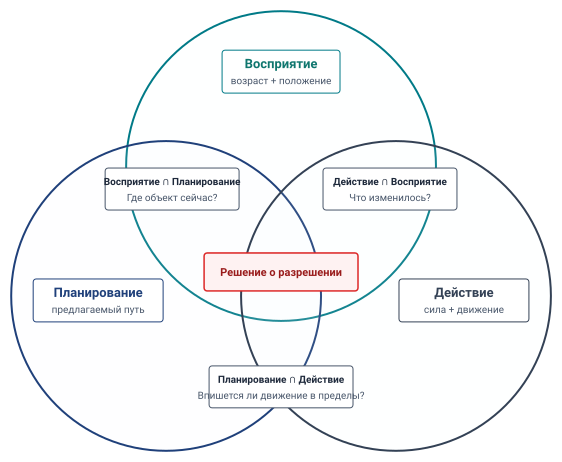

# Диагностический справочник S·P·A

Когда основание складского мобильного манипулятора останавливается за свободным расстоянием у торца стеллажа, причиной могут быть устаревшие сенсорные свидетельства (Восприятие), неосуществимая путевая точка (Планирование) или изношенный тормоз, отдающий меньшее замедление, чем предполагалось (Действие). **Таксономия S·P·A** находит первый нарушенный контракт среди **Восприятия**, **Планирования** и **Действия**. Журналы и физические измерения затем проверяют этот диагноз до того, как будет допущено средство.

## Как использовать это приложение

Используйте этот диагностический справочник, когда воплощенная система нарушает огибающую безопасности, пропускает предельный срок исполнения, дребезжит при контакте или сбивает аппаратные блокировки. Проработайте диагностику четырьмя систематическими проходами:

1. **Описать физический симптом и связывающий бюджет**: Зафиксировать наблюдаемое нарушение остановочного пути, переход контактной силы, тепловое срабатывание или превышение предельного срока механизмом принуждения, включая единицы, нагрузку, эксплуатационное состояние и предел, настроенный для этой машины.
2. **Локализовать кандидатную ось или пересечение**: Использовать [«Справочник осей S·P·A»](appendix_spa.md#tbl-spa-components-ref) для первого прохода по трем основным осям. Когда симптом затрагивает тайминг интерфейсов, представления состояния или полномочия исполнения команды, перейти прямо к ландшафту пересечений в разделе [«Таксономия пересечений S·P·A»](appendix_spa.md#tbl-spa-intersections).
3. **Проверить количественную гипотезу**: Измерить кандидатное ограничение или бюджет приборами из раздела [«Матрица поиска неисправностей производства физического ИИ»](appendix_spa.md#tbl-spa-troubleshooting), такими как рассинхронизация меток времени, время очереди шины, фазовый ток или ошибка слежения.
4. **Вмешаться и переснять через каузальную границу**: Применить средство и заново провести измеренный тест на заявленной огибающей нагрузки, тайминга и отказов.

Физический симптом определяет наиболее эффективную точку входа. Нестабильные контактные колебания должны немедленно обследовать границу Действие–Восприятие ($A \cap S$). Внезапный разрыв задания или измеренный переход момента указывают на границу Планирование–Действие ($P \cap A$). Торможение при фантомном препятствии или дрейф под окклюзией указывают на интерфейс Восприятие–Планирование ($S \cap P$). Дрожание предельного срока при одновременном нейронном инференсе указывает прямо на решение о разрешении в центре ($S \cap P \cap A$).

## Диагностическое резюме: оси S·P·A

Таксономия S·P·A разлагает киберфизическую петлю на три оси. Раздел [«Справочник осей S·P·A»](appendix_spa.md#tbl-spa-components-ref) перечисляет ограничение или бюджет для проверки для каждой из них; это не все законы сохранения.

\Needspace{28\baselineskip}

| Ось              | Эксплуатационная роль                    | Ограничение или бюджет для проверки                                               | Диагностическое действие                                                                              | Место в книге       |
|:--------------|:------------------------------------|:---------------------------------------------------------------------------------|:-----------------------------------------------------------------------------------------------|:-----------------|
| **Восприятие (S)** | Захват и оценка физического состояния | Возраст свидетельств, поле зрения, пересчет часов, неопределенность и транспорт сенсоров | Сравнить эпохи захвата и свидетельств каждой ячейки с измеренным состоянием и предельным сроком разрешения | [«Пространственная память»](09_memory.md#sec-memory)      |
| **Планирование (P)**  | Предложить цель и траекторию     | Действительность намерения, вычислительная задержка, динамика и допуск стоп-суффикса        | Сравнить предложенные цели и будущие состояния с независимо проверенными пределами                   | [«Планирование траекторий»](11_planning.md#sec-planning)    |
| **Действие (A)**   | Приложить и измерить силу             | Ток, момент, тепловой запас, отклик тормоза и кинетический запас хода         | Измерить отклик от команды до силы и достигнутую остановку под заявленной нагрузкой                    | [«Обеспечение безопасности»](12_enforcement.md#sec-enforcement) |

***Справочник осей S·P·A**: Оси организуют диагностику вокруг измеренных ограничений и бюджетов, с главой, развивающей каждый контракт.*

Хотя это разделение по одной оси полезно для первичной сортировки, производственные отказы редко зарождаются в одном изолированном компоненте. Чаще отказ сидит на **границе** между двумя осями — такой как несглаженная ступень траектории, возбуждающая высокую механическую инерцию ротора, или вход прямого доступа к памяти (DMA) камеры, насыщающий кроссбар памяти, нужный таймерам двигателей реального времени. Разрешение таких отказов требует картирования ландшафта пересечений.

## Ландшафт пересечений

Раздел [«Ландшафт пересечений S·P·A»](appendix_spa.md#fig-spa-triad) показывает, как пересекаются Восприятие, Планирование и Действие, с решением о разрешении в центре, где встречаются все три. В этом приложении мы формализуем этот ландшафт в эксплуатационную системную диагностическую матрицу.

***Ландшафт пересечений S·P·A**: Восприятие, Планирование и Действие встречаются попарно в трех физических решениях: обнаружить объект сейчас, проверить, что предложенное движение укладывается в пределы, и измерить, что изменилось после действия. Их центр — решение о разрешении, где независимый путь разрешения проверяет общий физический бюджет до исполнения команды.*

Каждое пересечение — проверяемая передача. Раздел [«Таксономия пересечений S·P·A»](appendix_spa.md#tbl-spa-intersections) называет режим отказа и свидетельства, необходимые прежде чем предложенное исправление заслужит разрешения.

| Пересечение                     | Контракт передачи                                           | Отказ для проверки                                                                | Свидетельства и кандидатное средство                                                                                               |
|:---------------------------------|:-----------------------------------------------------------|:-------------------------------------------------------------------------------|:----------------------------------------------------------------------------------------------------------------------------|
| **$S\cap P$** — оценка           | Наблюдения становятся оценками состояния с метками времени и системой координат          | Свежая публикация карты скрывает старый воксель или незамеченный предмет остается неизвестным | Проверить эпохи свидетельств каждой ячейки, свободные и занятые лучи и преобразования систем координат; использовать отдельно проверенный слой коллизий |
| **$P\cap A$** — движение           | Предложение становится допущенной, согласованной по состоянию траекторией   | Стык запрашивает ступень момента или стоп-суффикс больше не помещается в запас хода | Проверить входное состояние, производные, аренду и запас хода; отвергнуть неосуществимый стык и использовать резидентную остановку                   |
| **$A\cap S$** — обратная связь         | Исполнение команды меняет состояние, о котором докладывают сенсоры            | Контактная сила растет до следующего полезного семпла или актуатор насыщается     | Измерить отклик от команды до силы и задержку возврата сенсора; выбрать локальный рефлекс и пассивный предел там, где это обосновано                   |
| **$S\cap P\cap A$** — разрешение | Независимые ворота превращают предложение в физическое действие | Помехи вычислений, памяти, питания или часов задерживают отказ                   | Измерить отклик под конкуренцией; отозвать слежение и квалифицировать изоляцию или переместить путь, если его граница не держится            |

***Таксономия пересечений S·P·A**: Четыре передачи находят самый ранний нарушенный физический контракт и свидетельства, требуемые для его починки; справочник осей выше ссылается на лежащие в основе главы.*

## Матрица поиска неисправностей производства физического ИИ

Когда работающая машина нарушает физические пределы или программные инварианты, используйте раздел [«Матрица поиска неисправностей производства физического ИИ»](appendix_spa.md#tbl-spa-troubleshooting), чтобы сопоставить наблюдаемые диагностические симптомы со связывающей осью и высокоэффективным средством.

| Наблюдаемый симптом                                                  | Кандидатная граница | Различающее измерение                                                                                | Кандидатный отклик                                                                                                   |
|:--------------------------------------------------------------------|:-------------------|:----------------------------------------------------------------------------------------------------------|:---------------------------------------------------------------------------------------------------------------------|
| Контактные колебания, пока рука открывает дверь клетки с пружинным замком    | $A\cap S$          | Измерить фазовый запас и нарастание силы против задержки от сенсора до момента при фактической жесткости контакта | Квалифицировать локальный контур импеданса, предел скорости подхода и пассивную податливость для этого контакта                        |
| Ступень момента или тока на стыке фрагмента действий                 | $P\cap A$          | Сравнить трассы энкодера, фазового тока и запрошенного ускорения на измеренном входном состоянии             | Допустить согласованный по состоянию мост $C^2$ и зарезервировать стоп-суффикс; сведение в разделе [«Планирование траекторий»](11_planning.md#sec-planning) специфично для профиля |
| Остановка при фантомном препятствии в проходе                                   | $S\cap P$          | Различить наблюдаемые свободные, занятые и неизвестные лучи; проверить возраст свидетельств по вокселям                     | Очищать лишь наблюдаемое свободное пространство и заново проверить преобразование занятости в разрешение                                     |
| Механизм принуждения пропускает свой настроенный предельный срок при входе камеры       | $S\cap P\cap A$    | Соотнести пропуски времени отклика с очередью шины, переключениями банков, промахами кеша и владением DMA             | Квалифицировать обход QoS или когерентный локальный снимок безопасности; переснять под конкуренцией                                   |
| Звено или деталь текут при контакте                             | $A$                | Сравнить измеренные силу и смещение с испытанными пределами материала и оснастки                       | Снизить допущенную скорость или силу и квалифицировать податливый путь нагрузки                                                     |
| Обновление политики приходит после ее допущенного горизонта фрагмента              | $P\cap A$          | Измерить хвост обновления, истечение аренды и состояние передачи резервирования                                        | Укоротить допущенное действие или использовать остановку, которой владеет путь разрешения; не продлевать разрешение от одного лишь процентиля |
| Просадка шины питания микроконтроллера безопасности (MCU) во время всплесков ускорителя  | $S\cap P\cap A$    | Измерить осциллограмму шины, запас пути, порог супервизора и результирующее время отклика                      | Охарактеризовать развязку, скорость нарастания тока или физическую изоляцию питания                                                   |
| Основание дрейфует к лицу стеллажа несмотря на низкую офлайн-ошибку предсказания | $A\cap S$          | Сравнить смещение по курсу в замкнутом контуре, боковой запас хода и зависящее от поверхности торможение                            | Испытать прогоны в замкнутом контуре и наложить осуществимый коридор и границу остановки                                              |

***Матрица поиска неисправностей производства физического ИИ**: Каждая строка — гипотеза, измерение и кандидатное средство; приемка зависит от заявленных пределов машины.*

\Needspace{0.72\textheight}

## Системная карта показателей S·P·A

До выпуска используйте раздел [«Карта показателей систем физического ИИ S·P·A»](appendix_spa.md#tbl-spa-scorecard), чтобы назвать свидетельства, необходимые для каждой передачи. Ее проверки — примеры, а не переносимые пороги прохождения: подписанный кейс выпуска должен поставить фактические пределы, эксплуатационную огибающую, семантику достоверности или жесткой границы и резервирование для машины.

| Граница                             | Пример проверки приемки для заявленной машины                                                                                                                        | Отклик, если проверка не проходит                                                                          |
|:-------------------------------------|:-----------------------------------------------------------------------------------------------------------------------------------------------------------------------|:-----------------------------------------------------------------------------------------------------|
| **Восприятие** — часы захвата            | Ограничить ошибку пересчета от захвата до MCU и включить ее в возраст свидетельств                                                                                                   | Пересинхронизировать или удержать движение, когда граница истекает                                              |
| **Восприятие** — прием данных                | Измерить худшую допущенную заполненность очереди сенсоров/DMA, долю потерь и время передачи под одновременной нагрузкой                                                                  | Зарезервировать емкость или снизить нагрузку сенсорики; потерянные кадры не обновляют оценку                          |
| **Планирование** — горизонт фрагмента             | Допустить преемника до предельного срока обязательства либо передать резидентной или согласованной по состоянию остановке                                                                        | Использовать измеренные хвосты обновления как свидетельства, а не как гарантию худшего случая                                 |
| **Планирование** — динамика                  | Проверить положение, скорость, ускорение, момент и стоп-суффикс против фактических пределов шарниров и пути                                                           | Отвергнуть или перепланировать неосуществимый фрагмент                                                                 |
| **Действие** — тормоз и контакт          | Проверить достигнутое замедление и отклик силы по нагрузке, износу, поверхности и температуре                                                                             | Снизить номинал скорости, сменить оснастку или отказаться от неиспытанного состояния                                           |
| **Действие** — тепло                    | Удерживать измеренные температуры обмотки и привода внутри номиналов устройства при заявленном режиме нагрузки                                                                                 | Снизить нагрузку или войти в проверенный режим остановки/удержания                                                    |
| **$S\cap P$** — пространственные свидетельства     | Сохранять эпоху свидетельств каждой ячейки и различать наблюдаемые свободное, занятое и неизвестное                                                                               | Отказывать в неизвестном запасе хода или получить новое наблюдение                                                 |
| **$P\cap A$** — стык                 | Проверить согласованное входное состояние, пределы производных и полный запас хода для остановки до обязательства                                                                            | Использовать резидентную или согласованную по состоянию остановку, которой владеет путь разрешения, если преемник отсутствует или недействителен |
| **$A\cap S$** — рефлекс               | Ограничить отклик от сенсора до силы относительно специфичного для контакта предельного срока вреда                                                                                               | Снизить энергию подхода или добавить проверенный пассивный предел                                              |
| **$S\cap P\cap A$** — вычисления        | Квалифицировать WCET пути разрешения относительно его предельного срока в бюджете цикла раздела [«Обеспечение безопасности»](12_enforcement.md#sec-enforcement), с отдельно забюджетированными опросом, валидацией, записью и диспетчеризацией | Отозвать разрешение слежения до того, как превышение цикла израсходует запас остановки                         |
| **$S\cap P\cap A$** — общий кремний | Измерить отклик механизма принуждения при худшей допущенной конкуренции шины, питания и тепла                                                                                       | Квалифицировать QoS/локальные снимки или переместить путь, если изоляцию нельзя показать                        |
| **$S\cap P\cap A$** — разрешение     | Верифицировать допущения модели/состояния, осуществимый вход CBF, запасы часов и оценки и согласованное по состоянию резервирование                                                           | Отвергать предложение, когда предпосылка отсутствует; один лишь результат QP не доказывает безопасности пути               |

***Карта показателей систем физического ИИ S·P·A**: Примеры проверок выпуска по трем осям и их передачам. Каждая строка требует специфичного для случая порога и свидетельств.*
