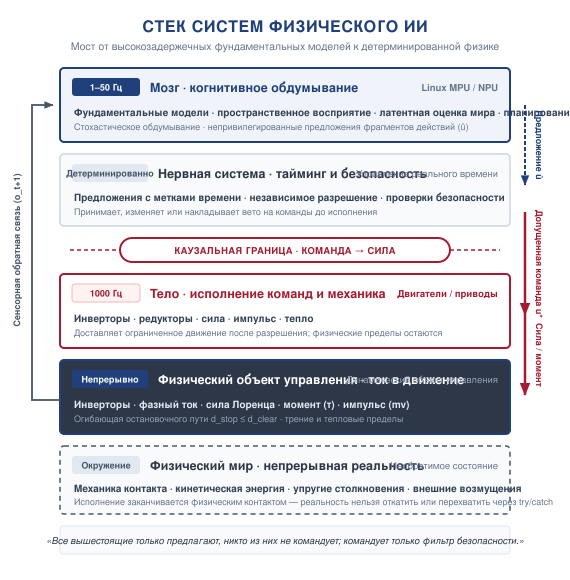
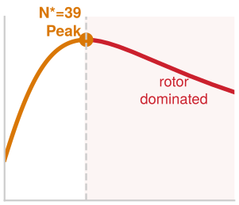

# Предисловие

## Кому эта книга

Этот учебник предназначен студентам компьютерных наук и инженерных специальностей, исследователям машинного обучения, инженерам-робототехникам и архитекторам встроенных систем, которые хотят строить воплощенные интеллектуальные системы, безопасно воспринимающие, рассуждающие и действующие в физическом мире.

Рекомендательная модель заканчивается на дисплее или человеческом решении, поэтому ее вычисление можно повторить или отменить до того, как что-либо за пределами компьютера отреагирует на результат. Ее ошибки все еще могут причинить вред, но только через того или то, кто или что отвечает на них.

В физическом ИИ программное обеспечение управляет материей, импульсом и энергией. Когда зрительно-языковая модель предлагает движение для мобильного основания или шарнирной роботизированной руки, исполнение пересекает каузальную границу в непрерывную ньютонову физику. Если команда исполнения превышает предел текучести редуктора или предел теплового рассеяния инвертора, физическое оборудование ломается. Как только кинетическая энергия высвобождена или материал поддается деформации, программное обеспечение не может отменить этот переход состояния.

Построение систем, выживающих в этой реальности, требует общей системной инженерной дисциплины, и читатели приходят к ней с трех направлений:

* **Практики машинного обучения**: Переход от точности на статическом тестовом наборе, оцениваемой на сохраненных датасетах. В физическом ИИ действия через замкнутый контур обратной связи меняют будущие сенсорные наблюдения ($s_{t+1} \sim P(s \mid s_t, a_t)$), поэтому политика уносится прочь от состояний, на которых ее обучали, а худший случай стоимости этого дрейфа растет с квадратом горизонта ([«Четыре фундаментальных закона»](01_causal_boundary.md#sec-boundary-bedrock-laws)). Практики учатся формулировать политики непрерывных действий, оценивать выживаемость в замкнутом контуре и подавать непривилегированные предложения в независимый путь разрешения.
* **Инженеры-робототехники и специалисты по управлению**: Дополнение классических контуров обратной связи высокоемкими нейронными фундаментальными моделями. Современные модели зрение–язык–действие (VLA) обеспечивают семантическое понимание сцены с открытым словарем и мультимодальную генерализацию, но они суть обученные инициаторы, работающие на десятках герц с переменной задержкой, поэтому независимый путь разрешения, чья частота следует из бюджета остановки объекта управления, обязан проверять то, что они предлагают. Инженеры по управлению учатся строить этот путь, включая фильтры безопасности, такие как функции барьера управления, на кремнии реального времени.
* **Архитекторы встроенных систем и кремния**: Управление многотактным исполнением на гетерогенных платформах системы на кристалле (SoC). Архитекторы учатся изолировать высокопропускные нейронные ускорители от микроконтроллера безопасности, на котором работает путь разрешения, не допуская, чтобы конкуренция за коммутатор шины памяти, голодание прямого доступа к памяти (DMA) и просадка напряжения питания нарушали жесткие физические предельные сроки.

---

## Зачем учебник по системам физического ИИ

Эта книга подходит к физическому ИИ с системной перспективы от первых принципов. Ее охват яснее всего виден рядом с двумя соседними видами книг, которыми она не является.

* **Это не книга по классической теории управления**: Мы не развиваем подробно преобразования Лапласа в непрерывном времени, контурные интегралы или доказательства устойчивости по Ляпунову. Формальные доказательства непрерывного управления и выводы достижимости собраны в приложениях тома для необязательного углубления.
* **Это не традиционная книга по кинематике робототехники**: Мы не разбираем параметрические матрицы Денавита — Хартенберга, каталоги передач прямой кинематики или специализированные эвристики механического проектирования.

Вместо этого мы рассуждаем от физических принципов (сохранение энергии и импульса, кинематика остановки, тепловое рассеяние и трение Кулона) и от архитектуры вычислительных систем (многотактные контуры исполнения, конкуренция за шину памяти, асинхронные очереди сообщений и пути разрешения, проверяющие обученные предложения).

### Механизмы — до той глубины, которая меняет бюджет

Эта книга не рассматривает обученные модели или блоки управления как черные ящики, но и не обозревает их внутренности. Механизм появляется в основном тексте на той глубине, на которой он меняет число, которое машина должна закладывать в бюджет: задержку, след в памяти, запас хода или свидетельства, на которых может покоиться утверждение. Декодер фрагмента действий проявляется через горизонт, который он поставляет, и время, которое занимает новый фрагмент. Представление сцены проявляется через память, которую оно занимает, и возраст свидетельств, которые оно хранит. Барьерный фильтр проявляется через предпосылки, в которых нуждается его гарантия, и предельный срок, который он должен выдержать. Внутренние детали, не сдвигающие ни одного такого числа, включая арифметику патчевой токенизации и внимания, функции потерь декодера и методы восстановления поверхностей, вынесены в приложения по машинному обучению и управлению для желающих читателей.

### Задержка — это расстояние

Машина продолжает движение, пока она воспринимает, принимает решения и ждет свои тормоза. Каждая миллисекунда между наблюдением и моментом, когда нарастает тормозная сила, расходуется как ход навстречу тому, чего машина не должна достигнуть, поэтому рабочая скорость, задержка, запас хода и тормозная способность образуют один бюджет, а не четыре отдельных спецификации. Книга строит этот бюджет для одной машины, добавляя каждое слагаемое в главе, которой оно принадлежит, начиная с остановочного пути тела в разделе [«Кинетический импульс»](02_body.md#sec-body-kinetic-momentum). Время вывода обученной модели попадает в бюджет только через возраст свидетельств, которые она передает дальше, потому что каждый такт решает, можно ли продолжать движение, путь разрешения, а не модель.

---

## Что обещает эта книга

Эта книга не обещает машину, доказуемо безопасную. Никакая конечная кампания испытаний, фильтр времени выполнения или схема сертификации не дают этого для обученной системы в открытом мире, и главы говорят так всюду, где это важно. Книга учит нечто более узкое. Она показывает, как построить машину, чьи обученные предложения не могут санкционировать собственное движение, чей путь разрешения решает по свидетельствам известного возраста в пределах запаса, который задержка еще не израсходовала, и чья каждая гарантия записана вместе с предпосылками, на которых она покоится. Барьерный фильтр защищает объект управления, только пока держатся его модель, его оценка состояния, его полномочия актуатора и его предельный срок. Выпуск в эксплуатацию оправдан только для условий, которые покрывают его свидетельства. Предпосылка, которую свидетельства не могут урегулировать, ограничивает то, что машина может делать, вместо того чтобы быть выброшенной через предположение. Заключительная глава возвращается к вступительному вопросу с этим ответом. Гарантия условна, и инженерное дело — знать ее условия и фиксировать их.

---

## Машина в пяти уровнях

Машина в этой книге имеет пять уровней. В Мозге обитают обученные инициаторы, которые пересматривают цели на нескольких герцах и выдают короткие последовательности действий на десятках герц. Ниже границы предложения Нервная система держит путь разрешения, который допускает, изменяет или отклоняет каждое предложение по свежему состоянию и владеет резервированием. Тело — это объект управления под его приводами, Граница — это место, где команды становятся током, а мир становится измерением, а Мир — это все, чем машина не владеет. Управление окружает все пять уровней как огибающая жизненного цикла, решая, кто может командовать машиной и какие свидетельства дают ей право работать. Мозг предлагает; разрешает только путь разрешения. Раздел [«Машина в пяти уровнях»](01_causal_boundary.md#sec-boundary-machine-model) дает полную модель и ее частоты.

---

## Три класса машин

Чтобы системные концепции оставались конкретными, этот учебник обосновывает свои принципы на трех классах машин из раздела [«Три класса машин»](01_causal_boundary.md#sec-boundary-four-archetypes):

1. **Класс 1 · Мобильность, доминируемая массой (AMR и квадрупеды)**: Плоские транспортные основания и ногопоходные платформы (такие как Spot от Boston Dynamics), навигирующие по открытым объектам и пересеченной местности. Управляются импульсом транспортного средства, трением Кулона шина — дорога и стопа — грунт, кинематическими огибающими остановочного пути и конвейерами восприятия с несколькими камерами / лидаром в условиях искажений скользящего затвора.
2. **Класс 2 · Манипуляция, доминируемая контактом**: Многозвенные роботизированные руки, выполняющие сложные контактные задачи. Управляются нелинейной динамикой руки, приведенной инерцией ротора ($J_{\text{ref}} = N^2 J_{\text{rotor}}$), податливостью циклоидного редуктора и сдерживанием контактной силы.
3. **Класс 3 · Технологические и энергетические системы, доминируемые потоком**: Высоконапорные гидравлические контуры, химические периодические реакторы и тепловые установки. Управляются энтальпийным обменом, динамикой жидкости в трубах, переходными процессами давления и необратимыми термодинамическими фазовыми переходами.

Сквозь всю книгу идет одна машина — складской мобильный манипулятор из раздела [«Три класса машин»](01_causal_boundary.md#sec-boundary-four-archetypes), — и каждая глава добавляет в бюджеты этой машины то, чем она владеет. Каждая часть завершается проверкой своего закона на гуманоиде, который связывает все три класса на одном шасси.

---

## Как читать эту книгу: последовательная дуга против модульного выбора

Этот учебник поддерживает два режима чтения:

### Для последовательных читателей (накопительная учебная дуга)

Читатели, идущие от обложки до обложки, проходят введение, четыре части и заключение, и каждую часть ведет один из четырех законов книги. Раздел [«Архитектура этой книги»](01_causal_boundary.md#sec-boundary-book-architecture) прослеживает цепь протоколов, которые главы передают друг другу.

* **Введение** ([«Каузальная граница»](01_causal_boundary.md#sec-boundary)) спрашивает, что должна гарантировать машина, прежде чем предложение обученной модели превратится в физическую работу.
* **Часть I: Анатомия машины** превращает первый закон, необратимость, в бюджеты времени, расстояния, момента, тепла и напряжения.
* **Часть II: Обучение машины** спрашивает, на чем покоится компетенция обученного инициатора по второму закону, эндогенным данным, когда его собственные действия выбирают, что он увидит следующим.
* **Часть III: Работа машины** строит время выполнения вокруг третьего закона: предложение — не разрешение.
* **Часть IV: Управление машиной** применяет четвертый закон, свидетельства ограничивают полномочия, чтобы решить, кто может командовать машиной и при каких условиях она может работать.
* **Заключение** ([«Эпистемическая граница»](17_frontier.md#sec-frontier)) отвечает на вступительный вопрос тем, что подтверждают свидетельства.

### Для выборочного чтения и модульных курсов

Преподавателям и практикам часто нужно изучать одну тему изолированно, например конвейеры DMA датчиков, фрагментирование траекторий или функции барьера управления. Чтобы поддержать модульное использование без путаницы с необходимой подготовкой:

* **Ориентация в начале каждой главы**: Каждая глава начинается с раздела ориентации, который обрамляет основную проблему и формулирует ее физические ставки, а стек в начале каждой главы отмечает уровень, над которым работает глава.
* **Явный базовый контекст**: Всякий раз, когда глава опирается на ключевое понятие, установленное ранее (такое как граница предложения, бюджет остановки или три класса машин), текст дает немедленную встроенную пояснительную ориентацию и точную перекрестную ссылку на раздел.
* **Самодостаточные разобранные примеры**: Каждая глава содержит самостоятельные аналитические выводы, исполняемые расчеты на Python и промышленные разборы случаев, которые можно изучать независимо.

Стек упорядочен по частоте управления и полномочиям, а не только по программным зависимостям.

Стек без выделенного уровня обозначает главы об управлении, потому что управление — это огибающая вокруг всех пяти уровней, а не один из них.

Главы о теле, нервной системе и мозге выделяют свой уровень на стеке: [«Физическое тело»](02_body.md#sec-body), [«Нервная система»](04_nervous_system.md#sec-nervous) и [«Когнитивный мозг»](03_brain.md#sec-brain).

### Заметки на полях

На полях размещаются небольшие безнумерные визуальные заметки рядом с отрывком, где связь, разрыв масштаба или порог видны лучше всего. Это пособия для чтения, а не рисунки для цитирования, и они бывают пяти видов.

* **Лестницы** охватывают порядки величин (такие как частоты исполнения от переключения инвертора вниз до пересмотра моделью намерения или пропускные способности приема данных датчиков).
* **Изломы порога** отмечают точку, за которой тенденция перестает держаться (такую как приведенная инерция ротора, ограничивающая ускорение шарнира, рост силы с жесткостью контакта или рост хвостовой задержки с конкуренцией за шину памяти).
* **Огибающие бюджета** сопоставляют конкурирующие требования с предельным сроком (такие как времена шумоподавления диффузии против периодов управления или бюджеты цикла полевой шины).
* **Полосы последовательности** показывают многотактный тайминг (такой как рукопожатия полномочий, окна фрагментов скользящего горизонта или шаги, запечатывающие протокол).
* **Каузальные цепи** прослеживают, как распространяется отказ и как далеко он достигает (такое как путь от незамоделированного артефакта симулятора до поврежденной детали).

### Золотая нить: сквозной форензический след

Чтобы связать абстрактные концепции всех семнадцати глав в связную инженерную реальность, эта книга протягивает сквозной реальный сценарий — **Золотую нить** — через четыре части и пять уровней машины:

* **Часть I · Физический вызов (опасность объекта управления)**: Автономный мобильный робот (AMR) движется по промышленному проезду со скоростью $v = 1.3\text{ m/s}$. Без предупреждения на его пути появляется препятствие с ограниченным свободным расстоянием. Физическая тормозная способность объекта управления, трение Кулона шина — пол и задержка отклика актуатора диктуют жесткий бюджет остановки ($d_{\text{stop}} \le D_{\text{clear}}$), который не может обойти никакая программная оптимизация.
* **Часть II · Разрыв обучения (сбой политики)**: Бортовая политика зрение–язык–действие (VLA), обученная на номинальных демонстрациях без внезапных вторжений, сталкивается с острым ковариантным сдвигом вне распределения ($\mathcal{O}(T^2 \epsilon)$). Вместо торможения генеративный декодер фрагмента действий предлагает агрессивный увод, нарушающий кинематические пределы поворота и дестабилизирующий шасси.
* **Часть III · Исполнение во время выполнения (узкое место кремния)**: Экспозиция камеры + транспорт SerDes + нейровывод съедают критические миллисекунды неуправляемого движения, прежде чем будет выдано предложение действия. Когда предложение достигает почтового ящика разделяемой памяти, гетерогенная конкуренция за шину памяти системы на кристалле угрожает предельному сроку реального времени.
* **Часть IV · Щит безопасности (детерминированное вмешательство)**: Работая на изолированном микроконтроллере безопасности реального времени, высокочастотный рефлекторный путь вычисляет функцию барьера управления ($h(x) \ge 0$). Вычислив, что предложенный увод нарушит допустимую огибающую остановки, квадратичная программа минимально проецирует предложение в допустимое тормозное ограничение, безопасно останавливая шасси до контакта, не полагаясь на оптимизм программного обеспечения.

## Смежные книги курса систем машинного обучения

Этот учебник входит в курс *Machine Learning Systems*. *Introduction to Machine Learning Systems* рассматривает, как модели используют вычисления и память на одной машине. *Scaling Machine Learning Systems* расширяет эту инженерную область до координации распределенного обучения и вывода на кластерных флотах.

Курс также обращается к системам, совершающим автономные действия. *Agentic Machine Learning Systems* фокусируется на состоятельных целенаправленных траекториях в цифровых программных средах, тогда как *Physical AI Systems* рассматривает действия, порождающие силу, движение и термодинамические изменения в физическом мире. Каждый текст предлагает комплементарную перспективу, и эта книга самодостаточна, развивая физические, вычислительные и архитектурные принципы, необходимые для проектирования надежных воплощенных машин.
