

# Введение

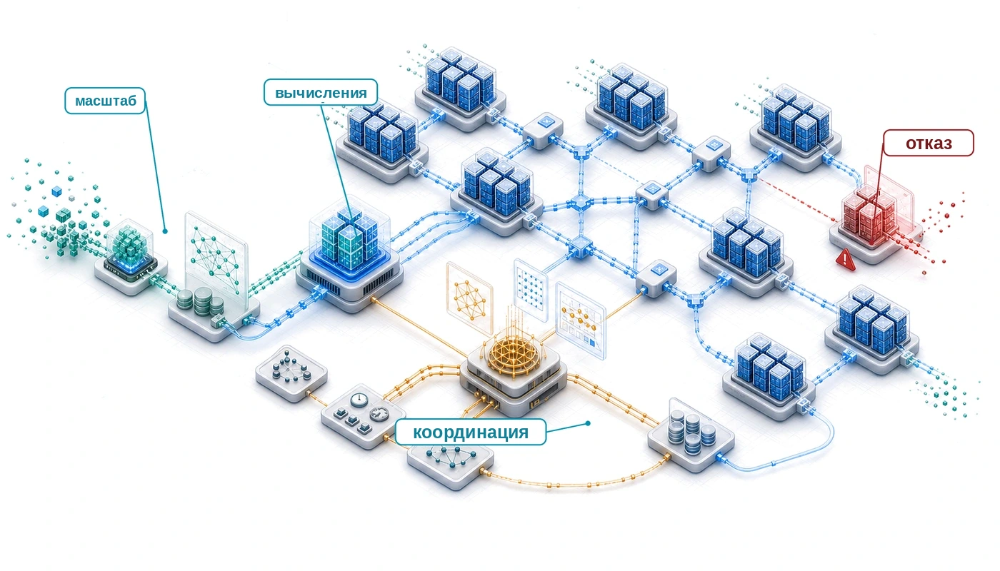

## Назначение

_Почему инженерные принципы, которые работают на одной машине, ломаются в промышленном масштабе?_

Машинное обучение в масштабе подчиняется собственной физике. На одном узле производительность часто определяется стеной памяти: данные должны поступать к ускорителю достаточно быстро, чтобы вычисления не простаивали. В распределенном кластере та же проблема растягивается на множество машин. Данные должны проходить по сетевым каналам между стойками, и самое медленное общее звено может ограничить всю задачу. Отказы оборудования тоже меняют характер. Когда задача обучения на одном ускорителе прерывается, это неприятность; когда выходит из строя один узел в кластере из 10 000 узлов, он может остановить парк машинного обучения, о котором пойдет речь в этой главе. Поэтому одного умения работать с машинным обучением на одной машине уже недостаточно. Масштаб создает иной инженерный рельеф, который требует дополнительных принципов, архитектур и способов рассуждения о том, что заставляет системы работать. Этот рельеф также усиливает общественное влияние, поскольку такие системы могут обслуживать миллиарды пользователей. Смещение любой модели может причинить вред, но смещение в широко используемой базовой модели способно распространиться на множество нижестоящих систем. Дисциплина, которую строит эта книга, — физика распределения: вычисления, коммуникация и координация превращают алгоритмические решения в вопросы топологии, отказоустойчивости, безопасности и управления.

> **Цели обучения**
>
> - Объяснить, как вычисления, коммуникация и координация расширяют взгляд «данные — алгоритм — машина» на промышленные парки
> - Применить закон парка, чтобы оценить налог на координацию и классифицировать режимы масштабирования
> - Проанализировать пределы законов масштабирования, когда рост определяют надежность, пропускная способность сети, энергия или ограничения управления
> - Диагностировать риски распределения в масштабе парка по разрывам надежности, компромиссам между согласованностью и доступностью, интенсивности коммуникации и обычной частоте отказов
> - Синтезировать принципы проектирования стека парка на уровнях физической инфраструктуры, операционного управления и общественного регулирования

## Момент масштаба

Машинное обучение на одном ускорителе определяется локальной иерархией памяти и арифметической интенсивностью: это физика кремния. Граница систем одной машины проявляется тогда, когда эта локальная машина перестает быть системой целиком. По мере того как модели переходят от исследовательских прототипов к глобальным сервисам, определяющие ограничения выходят наружу: в стойки, сети, системы электропитания и механизмы восстановления. Этот переход не является плавной экстраполяцией; это и есть **момент масштаба**.

Момент масштаба — это физическая и эксплуатационная перестройка, которая происходит, когда модели сталкиваются с тремя повторяющимися стенами: памяти, сети и энергии. Эти три стены составляют канонический триплет, на котором строится книга. На одном ускорителе часто связывает память; но после распределения коммуникационно интенсивной нагрузки по тысячам узлов **сетевая стена** может заменить локальную память в качестве основного узкого места производительности. Ее жесткие пределы включают бисекционную пропускную способность — совокупную пропускную способность по самому узкому разрезу, который делит парк пополам, — и задержку, ограниченную скоростью света. Обслуживание миллиардов пользователей способно упереться в **энергетическую стену**, и тогда термодинамическая эффективность становится инженерным требованием первого порядка. Преодоление этих стен также открывает **разрыв надежности**: аппаратный отказ становится обычным событием, а не редким исключением.

С 2012 года до середины 2020-х годов, по публичным и сторонним оценкам, объем вычислений для обучения вырос примерно с $10^{18}$ FLOP у AlexNet до приблизительно $10^{25}$ FLOP у ведущих крупных моделей, то есть примерно на семь порядков. Разница качественная, а не только количественная. Вычисления, коммуникация и координация теперь превращают алгоритмические решения в вопросы топологии, отказоустойчивости, безопасности и управления.

***Надежность парка резко падает по мере роста числа узлов.***

Рассмотрим сценарий обучения класса GPT-4 на гипотетическом кластере из 25 000 GPU класса A100, который работает 90 дней. Эти значения иллюстративны и не раскрыты OpenAI (OpenAI et al., 2023). В кластере такого размера вероятность хотя бы одного отказа за интервал $t$ (определяемая системным средним временем между отказами (MTBF), $\text{MTBF}_{\text{system}}$) равна $\Pr(\text{отказ до } t) = 1 - e^{-t/\text{MTBF}_{\text{system}}}$ и становится обязательным ограничением. Пример с расчетом в [блокноте «Масштаб и надежность»](#nbk-introduction-scale-reliability) устанавливает арифметику для одного кластера; приложение «Основы надежности» формализует каскад MTBF, который определяет частоту отказов в парках из тысяч GPU, так что читатель может предсказать частоту прерываний для парка любого размера.

> **Масштаб и надежность**
>
>
> **Задача**: обучение модели класса GPT-4 использует 25 000 GPU. Если MTBF каждого отдельного GPU составляет 50 000 часов (типичная для центров обработки данных величина, которую берут в примерах надежности для парков), как часто аппаратные отказы будут прерывать задачу обучения?
>
> **Расчет**:
>
> 1. Системный MTBF: системный MTBF равен MTBF компонента, деленному на число независимых GPU. При значениях этого сценария 50 000 часов, деленные на 25 000 GPU, дают около 2 часов.
> 2. Суточная частота отказов: 24 часа, деленные на 2 часа, дают около 12 отказов в сутки.
> 3. Общее число отказов за год: 25 000 GPU, умноженные на (8 760 часов, деленные на 50 000 часов), дают около 4 380 отказов в год.
>
> **Системный вывод**: в этом режиме отказы компонентов повторяются на протяжении всего долгого запуска. Ручной перезапуск не масштабируется; систему нужно проектировать на отказоустойчивость с самого начала. Аппаратуру уже нельзя считать безотказной абстракцией, поэтому автоматическое сохранение состояния и восстановление становятся эксплуатационными требованиями.
>

Опубликованный запуск обучения Llama 3 компании Meta показывает ту же арифметику надежности на реальной крупной системе.

> **Обучение, которое падало каждые несколько часов (2024)**
>
>
> **Контекст**: Meta сообщает, что обучала Llama 3 405B на 16 384 GPU H100 в течение 54-дневного снимка предобучения (Dubey et al., 2024).
>
> **Механизм**: кластер из 16 384 GPU испытал 419 непредвиденных прерываний, в среднем по одному отказу каждые три часа. Основные причины — ошибки памяти GPU, тихое повреждение данных и обрывы сетевых каналов.
>
> **Последствия**: без автоматического восстановления ручное вмешательство съело бы более 80 процентов календарного времени работы кластера и остановило бы эффективную пропускную способность обучения.
>
> **Исправление**: Meta внедрила автоматические проверки состояния, быстрое контрольное сохранение на постоянное хранилище и динамическую изоляцию узлов, сократив среднее время восстановления до минут.
>
> **Системный урок**: момент масштаба превращает надежность из спецификации оборудования в требование к проектированию распределенной системы. Модель в масштабе парка обучается не только оптимизатором, но и механизмами восстановления.
>

Механизмы восстановления, которые определили запуск Llama 3, появились потому, что размеры кластеров взорвались. Чтобы понять, почему запуску сейчас нужны сотни циклов перезапуска, полезно проследить траекторию вычислений, которая вывела парки на этот масштаб. История машинного обучения определяется масштабом: каждый крупный скачок возможностей возникал из способности применять вычисления в масштабах, которые раньше были недостижимы, и поэтому системная инженерия стала центральной для развития ИИ.

Требования к вычислениям растут экспоненциально. AlexNet обучали на двух GPU GTX 580 примерно 5–6 дней (Krizhevsky et al., 2012). BERT потребовал 64 тензорных процессора (TPU)[^fn-tpu-systolic-array] на 4 дня, то есть примерно 6 144 часа работы чипов (Devlin et al., 2019).

[^fn-tpu-systolic-array]: **Тензорный процессор (TPU)**: специализированная интегральная схема Google (ASIC), построенная вокруг систолического массива $256{\times}256$, то есть сетки ячеек умножения с накоплением, которые передают частичные суммы соседним ячейкам. Она жертвует универсальностью GPU ради производительности на ватт в 15–30 раз выше на матричных нагрузках машинного обучения. Для масштаба парка важно следующее: поды TPU v4 достигают совокупных 1,1 EFLOP/s, а выделенное межчиповое соединение с пропускной способностью 4 800 Гбит/с на чип делает их единым распределенным компьютером, а не набором быстрых чипов. Без этого соединения обучение BERT на 64 чипах было бы ограничено коммуникацией задолго до того, как упиралось бы в вычисления.

GPT-3 потребовал, по оценкам, $3{,}14 \times 10^{23}$ FLOP при обучении на GPU V100 в высокопроизводительном кластере Microsoft (Brown et al., 2020). Окружающая инфраструктура Microsoft того времени достигала примерно 10 000 GPU; это и есть ориентир по размеру кластера, который использован на [рисунке](#fig-cluster-size-explosion) (Langston, 2020; Patterson et al., 2021). PaLM обучали на 6 144 чипах TPU v4 примерно 60 дней, что составило около $10^{24}$ FLOP (Chowdhery et al., 2022). Отчет OpenAI о GPT-4 не раскрывал размер модели, оборудование для обучения и объем вычислений, поэтому сценарий класса GPT-4 в этом разделе следует читать как иллюстративный, а не как опубликованную конфигурацию (OpenAI et al., 2023). Эти примеры укладываются в быстрый рост вычислений для обучения, задокументированный более ранними исследованиями трендов (Amodei et al., 2018; Sevilla et al., 2022). В [таблице](#tbl-training-compute-evolution) сдвиг масштаба виден явно: бюджеты обучения переходят от экспериментов на одной машине к распределенным системам, где число аппаратных единиц, календарное время и эксплуатационная координация становятся частью проекта модели.

| **Модель**               | **Год** |                        **GPU/TPU**                        |                     **Время обучения**                      |                 **Оценка FLOP**                 |
|:-------------------------|:-------:|:---------------------------------------------------------:|:-----------------------------------------------------------:|:-----------------------------------------------:|
| **AlexNet**              |  2012   |                          2 GPU                            |                         5–6 дней                            |                    ~$10^{18}$                   |
| **BERT-Large**           |  2018   |                          64 TPU                           |                           4 дня                             |                    ~$10^{20}$                   |
| **GPT-3**                |  2020   |            1 024 GPU V100 (оценка запуска)               |                    не менее 29 дней                         |              $3{,}14 \times 10^{23}$ FLOP        |
| **PaLM**                 |  2022   |                         6 144 TPU                         |                         около 60 дней                       |                    ~$10^{24}$                   |
| **Сценарий класса GPT-4**|  2023   |             ~25 000 GPU (иллюстративно)                   |                ~90 дней (иллюстративно)                     |                 ~$10^{25}$ (сценарий)           |

***Эволюция вычислений при обучении**: рост масштаба аппаратуры и длительности обучения по опубликованным вехам и иллюстративному сценарию класса GPT-4. Видно, почему распределенные системы становятся центральными, когда бюджеты обучения переходят от масштаба $10^{18}$ к крупнейшим запускам.*

Объем вычислений — лишь одно измерение. [рисунке](#fig-cluster-size-explosion) показывает связанный рост самого размера кластера: число ускорителей, которые использовали для обучения ключевых моделей за последнее десятилетие.

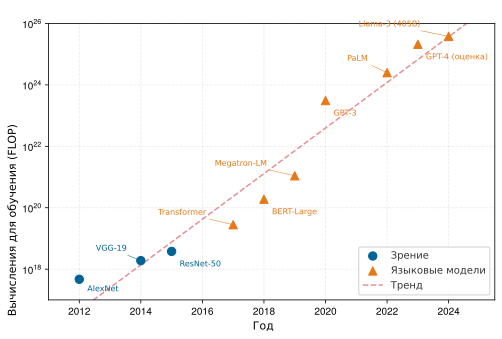

***Тренды вычислений для обучения (2012–2024)**: экспоненциальный рост вычислений для обучения ключевых моделей машинного обучения. Объем вычислений (в FLOP) вырос примерно на семь порядков, что отражает переход от экспериментов на одном узле к масштабным распределенным паркам.*
[Рисунок с трендом вычислений](#fig-training-compute-trend) показывает этот рост для моделей зрения и языковых моделей. Объем вычислений — лишь одно измерение. [Рисунок о размере кластера](#fig-cluster-size-explosion) показывает связанный рост самого размера кластера: число ускорителей, которые использовали для обучения ключевых моделей за последнее десятилетие.

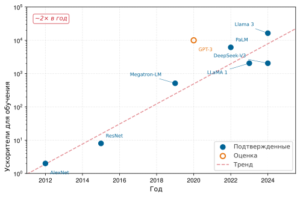

***Взрыв размера кластера**: число ускорителей, использованных для обучения ключевых моделей, 2012–2024. Подтвержденные по опубликованным статьям значения показаны заполненными кружками; оценка для GPT-3 (пустой маркер) отражает примерный размер кластера по объявлениям инфраструктуры Microsoft, а не точное опубликованное число. Пунктирная линия тренда соответствует примерно двукратному росту размера кластера в год — темпу, который опережает закон Мура и порождает инфраструктурные задачи, рассматриваемые во всей книге.*

[Рисунок о размере кластера](#fig-cluster-size-explosion) показывает, что размеры кластеров выросли примерно на четыре порядка чуть более чем за десятилетие: от двух GPU для AlexNet до более чем 16 000 H100 для Llama 3. Этот эмпирический путь лежит в основе момента масштаба: ведущим моделям потребовались гораздо большие парки ускорителей, чем более ранним вехам глубокого обучения. Одна кривая, однако, не объясняет, какое ограничение ломается первым. Обучение больших языковых моделей, обслуживание рекомендаций и федеративное мобильное обучение — все они сталкиваются с масштабом парка, но каждый нагружает свою часть системы.

> **Маячные архетипы в масштабе**
>
> **Маячные архетипы** — это канонические нагрузки, которые удерживают момент масштаба конкретным на протяжении всей книги. На этом этапе их роль — показать, что «больше машин» — не одна инженерная задача: доминирующее ограничение зависит от того, что должно пересечь границу парка. Полный перечень с отображением на таксономию C³ и анализом связывающих ограничений приведен в разделе [разделе](#sec-vol2-introduction-archetypes).
>
> - **Архетип A (GPT-4/Llama-3)**: очень большие языковые модели переходят от ограничения памяти на одном устройстве к параллелизму моделей на нескольких узлах и конвейерному параллелизму, поэтому для коммуникационно интенсивных разбиений коммуникация может стать узким местом.
> - **Архетип B (DLRM в масштабе)**: нагрузки рекомендательных моделей глубокого обучения (DLRM) переходят от размещения таблиц эмбеддингов в локальной памяти к **шардированию эмбеддингов** на сотнях узлов, поэтому узким местом становится координация маршрутизации разреженных признаков, размещения шардов и планирования запросов.
> - **Архетип C (федеративный MobileNet)**: мобильный вывод и адаптация на устройстве переходят от одного устройства к федеративному обучению на миллиардах устройств, поэтому узким местом становятся вычислительный и энергетический бюджеты каждого устройства.

Эти архетипы превращают кривую роста в инженерный вопрос. Одно и то же увеличение числа ускорителей может породить сетевую стену, узкое место координации разреженной маршрутизации или потолок вычислений на одном устройстве. Если архетипы направляют внимание на нагрузку, то параллельный набор системных линз делает то же для подложки, направляя внимание на физику центров обработки данных, топологию сети и распределенную согласованность. В сочетании с ростом федеративного обучения (глава «Периферийный интеллект») это разнообразие сделало системную инженерию центральной для машинного обучения в масштабе. Изощренный алгоритм, который не масштабируется, часто приносит меньше практической пользы, чем более простой алгоритм, эффективно развернутый на масштабируемой инфраструктуре.

Переход от обучения на одной машине к распределенному обучению вносит качественные изменения в поведение системы. [Рисунок о разрыве масштаба](#fig-scale-moment-discontinuity) сопоставляет два режима: нагрузку на одной машине, которую часто определяет стена памяти, и нагрузку в масштабе парка, в которой коммуникация может доминировать, отказы становятся обычным делом на долгих запусках, а управление усложняется.

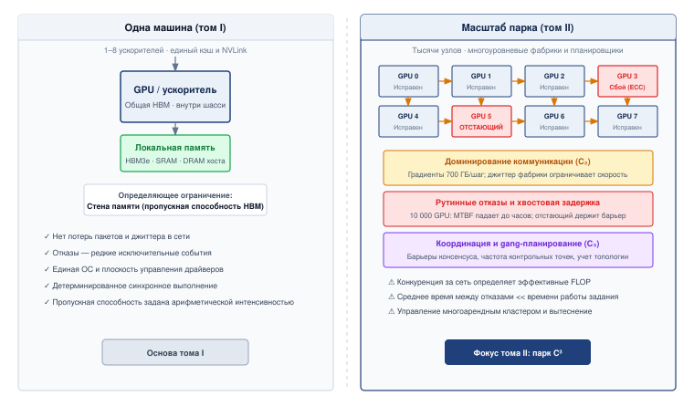

***Разрыв масштаба**: нагрузки на одной машине (слева) часто упираются в пропускную способность локальной памяти и не требуют координации между узлами. Нагрузки в масштабе парка (справа) могут упираться в коммуникацию, сталкиваться с обычными отказами компонентов на долгих запусках и требовать управления в пределах большей операционной границы.*

Разрыв, показанный на [рисунке](#fig-scale-moment-discontinuity), качественный, а не только количественный. В масштабе парка связывающее ограничение может сместиться от локального кремния к сетевой ткани, а устойчивость становится наравне с оптимизацией главной заботой. Единица вычислений — уже не один сервер, а **парк машинного обучения** (Machine Learning Fleet): взаимосвязанная распределенная система, спроектированная как единый согласованный механизм.

> **Определение: парк машинного обучения**
>
> ***Парк машинного обучения*** — это распределенная система из тысяч взаимосвязанных ускорителей, массивов хранения и сетевых фабрик, которая работает как единый согласованный компьютер.
>
> 1. **Значение**: парк координирует синхронное состояние всех узлов, где полное время $T$ определяется самым медленным рабочим узлом (отстающим). Ему нужна бисекционная пропускная способность ($\text{BW}_{\text{bisect}}$), которая растет вместе с совокупной вычислительной мощностью парка ($R_{\text{peak}}$).
> 2. **Отличие**: в отличие от традиционных кластеров (например, Spark, MapReduce), которые управляют независимыми асинхронными задачами, парк машинного обучения работает в режиме синхронной жесткой связанности: все рабочие узлы должны достичь барьера шага обучения, прежде чем кто-либо сможет продвинуться, поэтому для поддержания пропускной способности нужна почти идеальная надежность.
> 3. **Типичная ошибка**: распространено заблуждение, что парк машинного обучения — это «просто больше серверов». На деле это компьютер масштаба склада (WSC), где сеть выступает системной шиной, а оркестратор — операционной системой.

По мере того как системы выходят за пределы одного узла, возникает фундаментальное физическое ограничение: **стена бисекционной пропускной способности**,[^fn-bisection-bandwidth-etymology] которая ограничивает, как быстро данные могут пересечь сетевую середину. В масштабе парка сеть часто определяет пропускную способность модели сильнее, чем вычисления.

[^fn-bisection-bandwidth-etymology]: **Бисекционная пропускная способность** (из теории графов): минимальная совокупная пропускная способность всех каналов, разрез по которым разделил бы сеть на два набора узлов равного размера. В распределенном машинном обучении именно этот «наихудший» разрез определяет узкое место синхронизации кластера: синхронизация AllReduce не может идти быстрее бисекционной пропускной способности, сколько бы GPU ни добавили.

На одном GPU воспроизводимое обучение требует детерминированных ядер и настроек исполнения в дополнение к фиксированным коду, данным и случайным начальным значениям (seed). В масштабе тысяч GPU возникают новые явления. Разделы сети могут расколоть кластер на группы, которые обучаются независимо, что приводит к расхождению модели. Отстающие (рабочие узлы, которые обрабатывают данные медленнее соседей из-за разброса оборудования или теплового троттлинга) могут задержать всю задачу обучения. Аппаратные отказы, которые происходят раз в машинный год, при работе с 10 000 машин становятся ежедневными событиями.[^fn-failure-rates-fleet] Системы должны сохранять контрольные точки достаточно часто, чтобы потеря дневного прогресса становилась приемлемой, а не катастрофической.

[^fn-failure-rates-fleet]: **Частота аппаратных отказов в масштабе**: отдельные GPU выходят из строя с частотой 1–2 процента в год в обычных условиях, но при интенсивных нагрузках обучения эта частота превышает 9 процентов. Умножьте это на размер парка, и отказ станет обычным делом: Meta сообщила о 419 непредвиденных прерываниях за 54-дневное обучение Llama 3 на 16 384 H100, примерно по одному каждые три часа; неисправности GPU и памяти с высокой пропускной способностью (HBM3) вызвали более половины из них. Автоматическое контрольное сохранение и восстановление поддерживали эффективное время обучения выше 90 процентов, что показывает: в масштабе парка инженерная задача смещается от предотвращения отказов к минимизации задержки восстановления.

Эти вызовы масштаба стимулировали инвестиции в инфраструктуру крупных ИИ-организаций. Research SuperCluster компании Meta, анонсированный в 2022 году, содержал 16 000 GPU NVIDIA A100, соединенных сетью InfiniBand 200 Гбит/с[^fn-infiniband-rdma-v2] (AI, 2022). Поды TPU v4 Google содержат 4 096 чипов с совокупной вычислительной мощностью 1,1 EFLOP/s (Zu et al., 2024). Суперкомпьютер Microsoft Azure для OpenAI достиг более 10 000 GPU в 2020 году, а более поздние анонсы дата-центров Azure AI описывают обучающие фабрики с десятками тысяч GPU (Langston, 2020; Microsoft, 2025). Масштаб моделей определяет масштаб инфраструктуры. В приложение «Основы коммуникации» собраны эти константы пропускной способности межсоединений, и они подставляются в модель коммуникации $\alpha$-$\beta$, которая позволяет перевести пропускную способность и задержку канала в предсказанную стоимость передачи.

[^fn-infiniband-rdma-v2]: **InfiniBand**: появившийся в 1999 году в результате слияния NGIO компании Intel и инициатив Compaq/IBM Future I/O, InfiniBand изначально задумывался как замена шине PCI. Его отличительная для машинного обучения черта — прямой удаленный доступ к памяти (RDMA): он обходит ядро ОС и передает данные напрямую между памятью приложений на разных машинах с задержкой порядка микросекунд. HDR InfiniBand обеспечивает около 25 ГБ/с полосы на канал; NDR — около 50 ГБ/с. Этот разрыв пропускной способности по сравнению с обычными Ethernet-каналами определяет, будет ли обучение больших моделей ограничено вычислениями или коммуникацией.

Момент масштаба объясняет, почему экспоненциальный рост спроса на вычисления выводит некоторые системы машинного обучения за пределы одной машины: коммуникация становится потенциальным узким местом, отказ компонентов — обычным делом на долгих запусках, а обязательства по управлению — более весомыми. Следующий вопрос — как организовать инженерный ответ. Установленные техники распределенных систем остаются необходимыми, но глобальные барьеры и большое общее состояние модели меняют их стоимость и определяют, какие механизмы восстановления и согласованности применимы. Архитектурная иерархия масштаба парка делает эти зависимости явными.

## Стек парка: иерархия архитектуры

Apache Spark (Zaharia et al., 2016) обычно обрабатывает задачи с параллелизмом по данным с явными границами перемешивания (shuffle); веб-микросервис обычно обрабатывает запросы, сбои которых можно изолировать. Крупные синхронные задачи обучения, напротив, обновляют общее состояние модели на тысячах ускорителей каждые несколько сотен миллисекунд. Глобальные барьеры и большое состояние делают отстающих, восстановление и коммуникацию более тесно связанными, чем в этих примерах, хотя парк по-прежнему опирается на установленные механизмы распределенных систем. Чтобы систематически рассуждать о возникающих зависимостях, эта книга использует четырехуровневый стек парка, который связывает сырые ресурсы кластера с приложениями ИИ глобального масштаба.

[Рисунок о режимах масштабирования](#fig-vol2-system-scaling-regimes) показывает переход от одного узла к парку. Слева — режим одного узла из 1–8 ускорителей, где локальная память может задавать связывающее ограничение. Стрелка масштабирования ведет в распределенный режим, где тысячи узлов координируются через высокоскоростную коммутационную фабрику. Для коммуникационно интенсивных синхронных нагрузок узкое место может затем сместиться к стене бисекционной пропускной способности, поскольку сетевые перегрузки и задержка передачи сообщений съедают растущую долю времени шага.

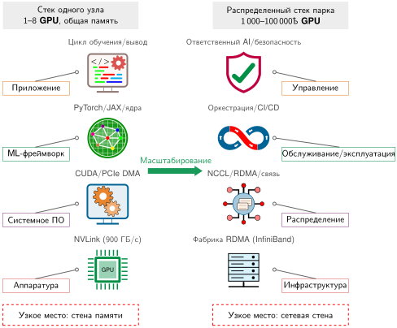

***Режимы масштабирования систем машинного обучения**: масштабирование распространяет стек одного узла на распределенный стек парка. Пропускная способность локальной памяти часто ограничивает нагрузки на одном узле; бисекционная пропускная способность может ограничивать распределенные коммуникационно интенсивные нагрузки. Владение перемещением данных внутри узла остается предпосылкой для распределенного масштабирования.*

Архитектура стека на [рисунке](#fig-vol2-system-scaling-regimes) не меняется с масштабом: каждая система машинного обучения по-прежнему имеет аппаратуру, системную оболочку, нагрузку и миссию. Меняется физика на каждом уровне. Читайте рисунок снизу вверх. В нижнем ряду аппаратура (NVLink со скоростью 900 ГБ/с внутри одного узла) становится инфраструктурой (фабрика RDMA InfiniBand, охватывающая стойки, со скоростью 400 Гбит/с на канал), и узкое место смещается от стены памяти к стене бисекционной пропускной способности. Уровнем выше системное ПО (единая среда выполнения CUDA, которая управляет прямым доступом к памяти по PCIe (DMA)) становится распределением (библиотека коллективных коммуникаций NVIDIA [NCCL] и библиотеки RDMA, которые координируют тысячи процессов в фабрике).

Два верхних уровня тоже меняются. Фреймворк ML (PyTorch или JAX, выполняющие цикл обучения на одном узле) становится обслуживанием и эксплуатацией (оркестрация и конвейеры непрерывной интеграции и непрерывного развертывания (CI/CD), которые планируют распределенные задачи и управляют поэтапными развертываниями). Наверху приложение (один скрипт обучения или сервис вывода) становится управлением (политика ответственного ИИ, аудит безопасности и многопользовательский контроль доступа), потому что развертывание в масштабе парка расширяет организационные задачи за пределы одной машины. Четыре уровня образуют стек парка:

1. **Инфраструктура** (аппаратура, двигатель): физический фундамент. Этот уровень задает сырые возможности парка: $R_{\text{peak}}$ и $\text{BW}$ на узел, связанные фабрикой RDMA InfiniBand. Повторяющийся аппаратный ориентир этого введения — NVIDIA H100, который служит конкретным эталонным ускорителем, а не абстрактной заглушкой.
2. **Распределение** (системы, автомобиль): коммуникационная подложка. Этот уровень задает оболочку кластера: NCCL, библиотеку коллективных операций, которая реализует редукции и широковещание на GPU-фабриках; коллективные RDMA-операции, координирующие тысячи ускорителей; бисекционную пропускную способность; эффективность использования энергии (PUE), то есть накладные расходы энергии здания сверх ИТ-нагрузки; и частоту отказов (MTBF).
3. **Обслуживание и эксплуатация** (нагрузки, маршрут): уровень оркестрации. Он управляет математической нагрузкой, разбитой по кластеру $(O, D_{\text{vol}}, \text{CI})$, через конвейеры развертывания и планирование, где $O$ — число локальных операций, $D_{\text{vol}}$ — объем данных, а $\text{CI}$ — интенсивность коммуникации (CI): сетевые байты на локальную операцию FLOP. Типичные нагрузки включают GPT-4 и DLRM.
4. **Управление** (миссии, пункт назначения): контекст миссии. Это вершина стека, где политика ответственного ИИ, безопасность и многопользовательский контроль доступа задают поведение всего парка. Миссия (например, обучение передовых моделей) вводит высокоуровневые требования (например, «доступность сервиса 99,99 процента»), которые определяют конфигурацию каждого нижележащего уровня.

Эта иерархия гарантирует, что каждое распределенное инженерное решение опирается на контекст миссии. Например, миссия «Обучение передовых моделей» воплощает архетип A (GPT-4/Llama-3) из канонического перечня тома ([разделе](#sec-vol2-introduction-archetypes)) и работает на кластере из оборудования H100. Повторное использование этих персонажей там, где они проясняют ограничение главы, сохраняет физику масштаба прослеживаемой, не заставляя каждую нагрузку появляться в каждой главе.

### Независимые задачи против синхронной динамики парка

Многие распределенные системы изолируют работу в задачи или запросы, чтобы один отказ не останавливал несвязанную работу. **MapReduce** (Dean et al., 2004), например, разбивает вход на задачи и может повторно выполнять упавшие или медленные части. Поисковые системы и банковские базы данных используют другие формы репликации, разбиения и координации; они не обязательно независимы или асинхронны. Полезный контраст, следовательно, проходит между доменами отказов и паттернами связанности, а не между «традиционными» системами и системами ML.

Крупные синхронные задачи обучения работают в режиме **синхронной жесткой связанности**. Архитектуры серверов параметров (Li et al., 2014) и среды коллективных операций управляют распределенным состоянием, но синхронная оптимизация многократно обновляет большое общее состояние модели, а не выполняет независимые одноразовые задачи. В каждой точке синхронизации прогресс может зависеть от самого медленного участвующего рабочего узла, поэтому устойчивое замедление одного узла на 10 процентов может обернуться штрафом по времени шага, близким к 10 процентам, если этот узел лежит на критическом пути. Коммуникационно тяжелые разбиения также могут стать ограниченными бисекционной пропускной способностью, потому что большие градиентные или активационные тензоры пересекают сеть на каждом шаге. Эти свойства не отменяют установленных методов восстановления; они повышают стоимость восстановления и ограничивают, какие стратегии репликации, повторного выполнения и согласованности сохраняют полезный прогресс обучения.

[Рисунок о барьерной синхронизации](#fig-traditional-vs-ml-fleet) наглядно показывает этот контраст: в MapReduce рабочие узлы пишут независимо в общее хранилище, и отстающий задерживает только собственное разбиение, тогда как в парке машинного обучения каждый рабочий узел должен прийти к барьеру AllReduce, прежде чем шаг обучения сможет продолжиться.

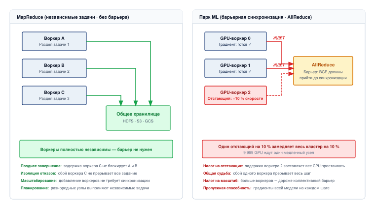

***Барьерная синхронизация против независимых задач**: рабочие узлы MapReduce (слева) действуют независимо, записывая результаты в общее хранилище без координации. Отстающий задерживает только собственный вывод. Рабочие узлы парка ML (справа) должны синхронизировать градиенты на барьере AllReduce на каждом шаге обучения, поэтому один отстающий, замедленный на 10 процентов, замедляет весь кластер на 10 процентов.*

Схема синхронизации на [рисунке](#fig-traditional-vs-ml-fleet) объясняет, почему повторное выполнение задач в стиле MapReduce нельзя перенести без изменений на каждую задачу обучения. Когда все рабочие узлы участвуют в общем шаге, восстановление должно вернуть взаимно согласованное состояние модели, оптимизатора и входных данных, прежде чем скоординированный прогресс возобновится.

> **Контрольные вопросы: мышление парка**
>
> Эти вопросы проверяют, ясно ли мышление парка:
>
> - **Задержка отстающего**: объясните, почему один медленный рабочий узел (отстающий) непропорционально сильно влияет на синхронную задачу обучения ML по сравнению с задачей MapReduce.
> - **Узкое место бисекции**: определите, какая задача с большей вероятностью сделает бисекционную пропускную способность главным узким местом производительности: традиционная веб-раздача или обучение ML.
> - **Жесткая связанность**: объясните синхронную жесткую связанность и свяжите ее с глобальным барьером в конце каждого шага обучения.
> - **Миф о линейном ускорении**: классифицируйте утверждение как истинное или ложное: добавление GPU к задаче обучения всегда приводит к линейному ускорению процесса обучения.

### Переход к компьютеру масштаба склада

Парк машинного обучения требует взгляда **компьютера масштаба склада (WSC)**[^fn-wsc-barroso-datacenter]. Взгляд, ориентированный на машину, рассматривает центр обработки данных как здание, в котором размещено много компьютеров; взгляд компьютера масштаба склада рассматривает сам центр обработки данных как компьютер.

- **Сетевая фабрика**: системная шина.
- **Распределенное хранилище**: локальный диск.
- **Оркестратор парка**: операционная система.

Чтобы освоить этот материал, нужно сделать мысленный сдвиг: инженер больше не пишет код для CPU, а пишет логику для 100-мегаваттного компьютера, занимающего тысячи стоек. Компьютер масштаба склада — распространенная парадигма для крупных моделей, тогда как альтернативные архитектуры, например **вычислители на целой пластине** (wafer-scale engine), пытаются свернуть всю эту иерархию обратно в один кусок кремния, обменивая модульность распределенного кластера на экстремальную пропускную способность внутрикристальной коммуникации.

[^fn-wsc-barroso-datacenter]: **Компьютер масштаба склада (WSC)**: Барросо и Хельцле, позднее вместе с Клидарасом, описали сам центр обработки данных как компьютер. Для парков ML подача питания, топология охлаждения, расположение оптической сети и бисекционная пропускная способность становятся ограничениями первого порядка: объект мощностью 100 МВт может ограничивать пропускную способность обучения сильнее, чем TFLOP/s отдельного ускорителя.

*Синхронизация градиентов становится определяющей стоимостью распределенного обучения.*

### Коммуникация может стать доминирующей

Эти характеристики нагрузки порождают два дальнейших следствия в масштабе, оба выражают канонический триплет, введенный на моменте масштаба: коммуникация может стать доминирующей стоимостью (сетевая стена), а отказ компонентов становится обычным явлением для достаточно больших или долгоживущих задач (разрыв надежности). На одном GPU плотная нагрузка обучения может большую часть времени выполнять матричные умножения и не создавать межузловой коммуникации. Распределение вносит коммуникацию, доля которой зависит от модели, стратегии разбиения, коллективного алгоритма, топологии, точности и перекрытия с вычислениями.

На больших масштабах коммуникация может доминировать в коммуникационно интенсивных разбиениях. Распределенное обучение с параллелизмом по данным синхронизирует градиенты между рабочими узлами после каждого батча. Для модели со 175 млрд параметров градиенты FP32 занимают около 700 ГБ до применения какого-либо коллективного алгоритма. В Ring All-Reduce каждый рабочий узел отправляет и получает примерно $2(N-1)/N$ размеров градиентного тензора, потому что каждый байт градиента совершает около двух обходов кольца: один для редукции и один для возврата широковещанием; глава «Коллективные коммуникации» выводит этот множитель. Поэтому сетевой трафик зависит от точности, числа рабочих узлов, реализации коллективной операции и разбиения. На более медленных межсоединениях или в разбиениях с малым объемом вычислений на передаваемый байт он может занимать большую долю каждой итерации, а не пренебрежимо малую.
Это соотношение объясняет, почему системы распределенного обучения так агрессивно оптимизируют коммуникацию. **Horovod** использует Ring All-Reduce, интеграцию с NCCL и Tensor Fusion для улучшения коллективной коммуникации (Sergeev et al., 2018); **Megatron-LM** применяет параллелизм моделей (Shoeybi et al., 2019); а **ZeRO** уменьшает избыточность памяти (Rajbhandari et al., 2020). Для текущего рассуждения важно соответствие по ролям: Horovod представляет среду коллективных операций, NCCL — бэкенд коммуникации GPU, Tensor Fusion — путь слияния градиентов, Megatron-LM — разбиение модели, а ZeRO — шардирование состояния оптимизатора. В масштабе парка эти техники — условия жизнеспособности, а не необязательные улучшения производительности.

### Отказ становится рутиной

Арифметика надежности, установленная на моменте масштаба, уже показала второе следствие: при тысячах GPU аппаратура выходит из строя каждые несколько часов, ручное вмешательство становится невозможным, и система должна самовосстанавливаться за счет частого контрольного сохранения, избыточных рабочих узлов и автоматического восстановления. Формальная модель доступности и ее архитектурные последствия рассматриваются в разделе «Разрыв надежности» ([разделе](#sec-vol2-introduction-reliability-gap)).

Доминирование коммуникации и регулярные отказы — следствия момента масштаба, но они не объясняют, что движет неослабевающий рост размера парка. Ответ лежит в наборе эмпирических зависимостей, которые связывают качество модели с инвестициями в ресурсы. Именно эти зависимости сделали инфраструктуру компьютера масштаба склада экономической необходимостью, а не инженерной роскошью.

## Законы масштабирования ИИ

Обучение GPT-3 потребовало примерно $3 \times 10^{23}$ операций с плавающей запятой (Brown et al., 2020). Публичные оценки обучения моделей класса GPT-4 часто составляют порядка $10^{25}$ FLOP, хотя OpenAI не раскрывала фактический объем вычислений и конфигурацию оборудования (OpenAI et al., 2023; Patel et al., 2023). Эти оценки важны, потому что каждое увеличение вычислений на порядок требовало соответствующего расширения парка машинного обучения.

Эта закономерность не случайна. Сформулированный Ричем Саттоном «горький урок» выразил лежащий в основе принцип: производительность в машинном обучении в первую очередь определяется применением общих методов в массовом масштабе, а не вкладыванием человеческих знаний в алгоритмы (Sutton, 2019). Законы масштабирования формализуют это наблюдение количественно: потери модели уменьшаются по степенному закону от объема вычислений, размера данных и числа параметров, $\mathcal{L}(X) \propto X^{-\alpha_{\text{scale}}}$ (Kaplan et al., 2020; Hoffmann et al., 2022). Поэтому каждое улучшение потерь одного и того же размера требует непропорционально больших ресурсов — системное следствие, которое эта книга позже называет универсальным законом масштабирования. Каждое измерение масштабирования (параметры, данные и вычисления) по-разному взаимодействует с ограничениями инфраструктуры, поэтому в промышленном масштабе необходима многомерная оптимизация эффективности.

### Эмпирические свидетельства законов масштабирования

Быстрая эволюция возможностей ИИ с конца 2010-х годов иллюстрирует эту траекторию масштабирования. GPT-1 (2018) содержала 117 миллионов параметров и выполняла простое продолжение предложений. GPT-2 (2019) выросла до 1,5 миллиарда параметров и научилась связно генерировать абзацы.

GPT-3 (2020) расширилась до 175 млрд параметров и научилась сложной генерации текста в разных областях. Каждое увеличение размера модели приносило заметно лучшие возможности при экспоненциально растущей стоимости.

Закономерность выходит за пределы языковых моделей. В компьютерном зрении число параметров выросло примерно на порядок от AlexNet (2012) до крупных визуальных трансформеров, и каждое поколение обменивало лучшую точность на пропорционально большие вычисления и объем обучающих данных. Та же связка вынудила обучение моделей зрения перейти на инфраструктуру с несколькими ускорителями.

Гипотеза масштабирования лежит в основе этого прогресса: более крупные модели улавливают более тонкие закономерности данных, что дает лучшую точность и обобщающую способность. Однако эта траектория вводит критические ресурсные ограничения. Обучение GPT-3 потребовало примерно $3{,}14 \times 10^{23}$ операций с плавающей запятой — это эквивалентно непрерывной работе игрового ПК в течение сотен лет — с существенными финансовыми и экологическими затратами.

Эти ресурсные требования показывают, почему законы масштабирования необходимы для эффективного распределения ресурсов. [Рисунок с трендами вычислений](#fig-compute-trends) показывает, как вычислительные требования обучения больших моделей выросли неустойчивыми темпами, опережая улучшения аппаратного обеспечения по закону Мура.

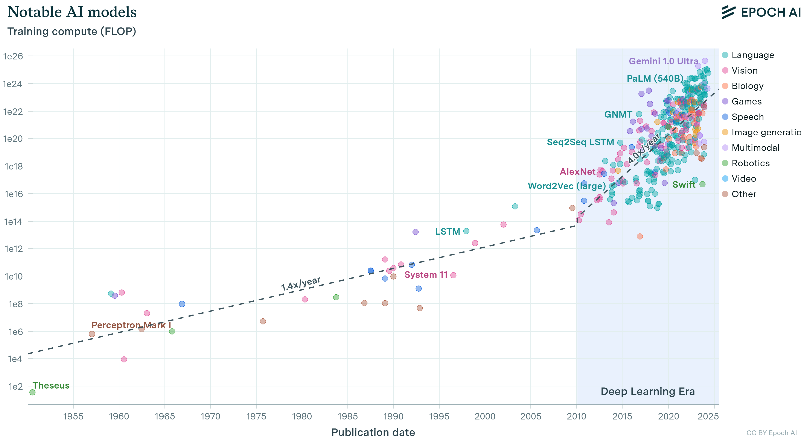

***Тренды вычислений для обучения моделей**: вычисления для обучения росли экспоненциально и резко ускорились в эпоху глубокого обучения. Самый быстрый участок был еще круче: вычисления удваивались примерно каждые 3,4 месяца.*

Эти масштабные соотношения дают количественную основу для навигации по компромиссам. Производительность модели следует степенным зависимостям: улучшения стабильны, но дают убывающую отдачу. Поэтому оптимальное распределение ресурсов требует согласования размера модели, объема данных и вычислительного бюджета, а не масштабирования одного измерения в отрыве от остальных. Вычислительные характеристики, которые определяют потребности этих нагрузок в ресурсах, решают, как они нагружают распределенную инфраструктуру.

> **Справка: вычисления в трансформере**
>
> Трансформеры обрабатывают последовательности с помощью механизмов самовнимания, которые вычисляют связи между всеми парами токенов. Вычислительная стоимость этой архитектуры растет квадратично с длиной последовательности ($\mathcal{O}(S^2)$, где $S$ — длина последовательности), поэтому распределение ресурсов особенно критично для языковых моделей. Термин «FLOP» (операции с плавающей запятой) обозначает полный объем вычислительной работы, а «токены» — отдельные единицы текста (обычно субслова), которые модели обрабатывают при обучении.

### Вычислительно-оптимальное распределение ресурсов

Эмпирические исследования больших языковых моделей (LLM) показывают, что при фиксированном вычислительном бюджете и в пределах изученного режима масштабирования баланс размера модели и размера набора данных (измеряемого в токенах[^fn-tokens-bpe-tokenizer]) может минимизировать потери при обучении.

[^fn-tokens-bpe-tokenizer]: **Токены**: субсловные единицы, которые создают алгоритмы вроде кодирования парами байтов (byte-pair encoding); они итеративно объединяют самые частые пары символов в корпусе. Размер словаря токенов создает прямой системный компромисс: более крупные словари могут сократить длину последовательности для одних языков и областей, но они расширяют таблицу эмбеддингов примерно пропорционально размеру словаря. GPT-3 использовала словарь из 50 257 токенов; переход к 100 тысячам и более токенов в новых моделях поэтому обменивает эффективность токенизации на дополнительную память для эмбеддингов.

[Рисунок](#fig-compute-optimal) иллюстрирует этот принцип через три связанных представления. Левая панель показывает кривые IsoFLOP, где каждая кривая соответствует постоянному числу операций с плавающей запятой (FLOP[^fn-flops-work-rate]) при обучении трансформера. Впадины на этих кривых определяют наиболее эффективный размер модели для каждого вычислительного бюджета. Центральная и правая панели показывают, как оптимальное число параметров и токенов предсказуемо растет с увеличением вычислительного бюджета, подтверждая, что вычислительно-оптимальное обучение требует согласованного масштабирования. Аннотированные маркеры экстраполируют эти аппроксимации на бюджет уровня передовых моделей около $10^{24}$ FLOP, где вычислительно-оптимальная точка приходится примерно на 63 миллиарда параметров, обученных на примерно 1,4 триллиона токенов. Эта пара и есть соотношение Chinchilla в действии — около 20 токенов на параметр: параметры и токены растут вместе, а не одно из измерений вырывается вперед.

[^fn-flops-work-rate]: **FLOP и FLOP/s**: ключевое различие. FLOP обозначает полный объем вычислительной работы (выполненных операций), тогда как FLOP/s — пропускную способность аппаратуры (операций в секунду); путаница между ними приводит к неверным оценкам стоимости. GPT-3 потребовала $3{,}14 \times 10^{23}$ FLOP работы; A100 обеспечивает 312 TFLOP/s пропускной способности. Деление работы на пиковую пропускную способность дает идеальное календарное время; фактическое время примерно равно $\text{работа}/(\eta_{\text{hw}} R_{\text{peak}})$, поэтому утилизация ниже единицы умножает идеальное время на $1/\eta_{\text{hw}}$.

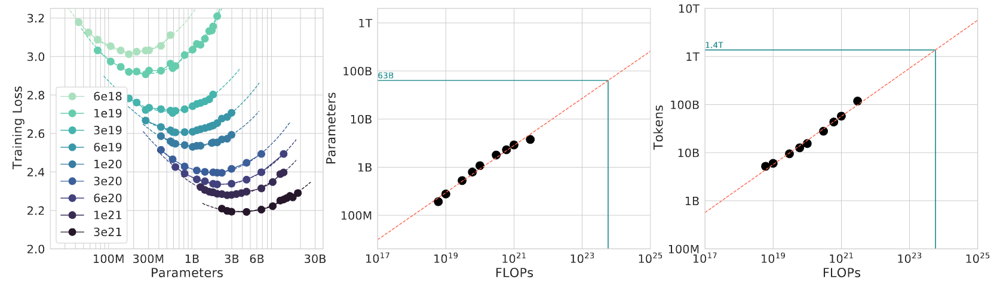

***Оптимальное распределение вычислений**: при фиксированных вычислительных бюджетах производительность языковой модели зависит от баланса размера модели и объема обучающих данных; оптимальное число параметров и требования к токенам растут вместе с вычислениями.*

(Kaplan et al., 2020) — это работа Каплана с соавторами, которая показала, что потери трансформерных языковых моделей следуют предсказуемым степенным зависимостям от числа параметров, размера набора данных (измеряемого в токенах) и полного вычислительного бюджета. Каплан с соавторами показали не то, что каждое измерение можно наращивать вслепую; они показали, что качество модели зависит от скоординированного распределения ресурсов. Эту мысль позже уточнил анализ вычислительно-оптимального масштабирования Chinchilla (Hoffmann et al., 2022).

[Рисунок](#fig-kaplan-scaling) показывает кривые тестовых потерь для моделей от $10^3$ до $10^9$ параметров и выявляет два вывода. Более крупные модели достигают лучшей эффективности по выборке: они выходят на целевые уровни производительности с меньшим числом токенов обучения. По мере роста вычислительных ресурсов оптимальный размер модели растет соответственно, а потери предсказуемо снижаются, если вычисления распределены эффективно.

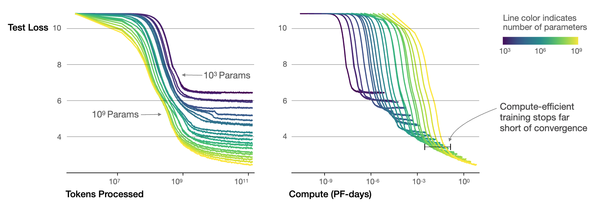

***Законы масштабирования и вычислительная оптимальность**: более крупные модели стабильно достигают лучшей производительности при росте обучающих данных и вычислений; оптимальный размер модели зависит от доступного вычислительного бюджета.*

Оптимальное распределение вычислений следует результату Chinchilla: размер модели и число обучающих токенов должны масштабироваться примерно пропорционально для вычислительно-оптимального обучения, с соотношением порядка 20 токенов обучения на параметр (Hoffmann et al., 2022). Это исправило более раннее указание, которое предпочитало делать модели крупнее, обучая их на сравнительно меньшем числе токенов.

Эти предсказания предполагают идеальную утилизацию вычислений, и это допущение ломается в распределенном обучении. Накладные расходы на коммуникацию растут неблагоприятно с размером системы и создают узкие места пропускной способности, которые снижают эффективную утилизацию. На масштабе тысяч GPU утилизация зависит от разбиения и межсоединения: Нараянан с соавторами (Narayanan et al., 2021) сообщают, что запуски Megatron-LM на 3 072 GPU A100 достигали 52 процентов пиковой пропускной способности устройств, и отмечают, что более медленные межсоединения или коммуникационно тяжелые разбиения мешают масштабированию.

### Математические основы и режимы эксплуатации

Степенные зависимости выражают поведение масштабирования математически, хотя интуиция за этими закономерностями важнее для проектирования системы, чем точная формулировка. Уравнения этого раздела объясняют, почему один и тот же парк может попадать в разные режимы эксплуатации. Эти режимы определяются тем, как распределяются вычисления и данные, где наступает убывающая отдача и сколько вычислений система тратит до ответа.

> **Формулировка: степенная зависимость масштабирования**
>
> Законы масштабирования формально выражаются как степенные зависимости. Общая форма такова:
>
> $$
> \mathcal{L}(X) = A_{\mathcal{L}} X^{-\alpha_{\text{scale}}} + C_{\mathcal{L}}
> $$
>
> где потери $\mathcal{L}$ уменьшаются по мере роста количества ресурса $X$ по степенному закону с показателем $\alpha_{\text{scale}}$, плюс базовая константа $C_{\mathcal{L}}$. Здесь $\mathcal{L}(X)$ — потери, достигнутые при заданном количестве ресурса, например параметров, токенов или вычислений; $A_{\mathcal{L}}$ и $C_{\mathcal{L}}$ — константы, зависящие от задачи; а $\alpha_{\text{scale}}$ — показатель масштабирования, который характеризует скорость улучшения производительности. Чем больше $\alpha_{\text{scale}}$, тем эффективнее улучшение производительности при масштабировании.

Эти предсказания находят сильную эмпирическую поддержку в нескольких конфигурациях моделей. [Рисунок](#fig-loss-vs-n-d) показывает, как потери на раннем останове предсказуемо меняются и с размером набора данных, и с размером модели, подтверждая, что кривые обучения для разных конфигураций совпадают при подходящей параметризации.

#### Режимы масштабирования с ограниченными ресурсами

Применение законов масштабирования на практике — это диагностика дефицита: полезный вопрос в том, какой ресурс первым мешает сбалансированному росту. Вычислительный бюджет, доступность данных и размер модели создают три режима с разными оптимальными реакциями.

*Режимы масштабирования: дефицит вычислений, дефицит данных или баланс.*

Три режима определяют подходящую реакцию масштабирования:

- **Режим, ограниченный вычислениями**: дефицит вычислений ограничивает потенциал масштабирования, несмотря на обилие обучающих данных. Поэтому академические институты, стартапы и команды с жесткими сроками часто обучают более мелкие модели дольше, чтобы максимизировать утилизацию.
- **Режим, ограниченный данными**: дефицит данных возникает, когда вычислительные ресурсы превышают то, что может поддержать доступный набор данных. Поэтому команды в специализированных, проприетарных или ограниченных требованиями приватности областях часто обучают более крупные модели на меньшем числе шагов оптимизации, чтобы извлечь больше информации из ограниченных примеров.
- **Оптимальный режим**: сбалансированные вычисления и данные следуют законам вычислительно-оптимального масштабирования, как показала модель Chinchilla компании DeepMind: она превзошла значительно более крупные модели благодаря пропорциональному масштабированию размера модели и обучающих данных (Hoffmann et al., 2022).

Понимание того, какой режим управляет данным проектом, предотвращает распространенные неэффективности: переизбыточно параметризованные модели при недостатке обучающих данных или недопараметризованные модели, которые тратят доступные вычисления впустую.

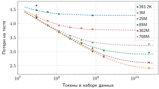

***Потери в зависимости от размера набора данных для разных масштабов моделей**: более крупные модели дают меньшие потери, но все кривые демонстрируют убывающую отдачу при большом числе токенов.*

Производительность улучшается по предсказуемым закономерностям, но нужное проектное действие меняется с доступностью ресурсов и с точкой жизненного цикла, где тратятся вычисления. Для проектирования системы важны еще два различия: как производительность меняется с размером набора данных и в какой точке жизненного цикла применяются дополнительные вычисления.

Размер набора данных проходит через три собственные фазы ([рисунок](#fig-data-scaling-regimes)). При малом числе примеров ошибка обобщения высока и нестабильна. По мере роста данных она предсказуемо падает по степенному закону — это режим, в котором дополнительные данные дают наибольший прирост. В конце концов она выходит на плато у предела шума, где больше данных дает пренебрежимо малый выигрыш. Системное следствие состоит в том, что конечные качественные данные, а не вычисления, становятся связывающим ограничением, когда модель входит в режим насыщения. Поэтому эффективность по данным дополняет масштабирование грубой силой. Глава «Распределенное обучение» (глава «Распределенное обучение») показывает, как это насыщение перестраивает конвейеры обучающих данных и бюджеты.

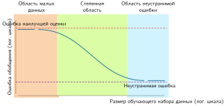

***Режимы масштабирования по данным**: ошибка обобщения имеет три фазы — режим малых данных с высокой дисперсией, степенной режим с предсказуемым снижением и режим неустранимой ошибки.*

Различие жизненного цикла называет три точки, в которых парк может вкладывать вычисления, как показано на [рисунке](#fig-scaling-regimes). Это предобучение — длинный, чувствительный к отказам запуск, который реализует закон масштабирования в календарном времени. Затем постобучение — адаптация, где дообучение и оптимизация предпочтений заменяют один огромный запуск множеством меньших задач с интенсивной координацией. И наконец, вычисления на этапе тестирования (test-time), где дополнительные шаги рассуждения на каждый запрос обменивают задержку и пропускную способность обслуживания на точность. Каждая из этих точек смещает связывающее ограничение в другую часть парка, поэтому полное рассмотрение относится к соответствующим нагрузкам: глава «Распределенное обучение» (глава «Распределенное обучение») — для запусков предобучения и постобучения, а глава «Вывод» (глава «Вывод») — для вычислений на этапе тестирования при обслуживании. Для развертываний с ограниченными ресурсами постобучение и масштабирование на этапе тестирования часто оказываются практичнее, чем переобучение модели с нуля.

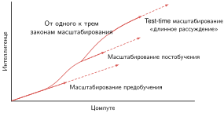

***Три фазы масштабирования**: интеллект улучшается через последовательные режимы — предобучение, постобучение и масштабирование на этапе тестирования.*

### Практическое применение в проектировании систем

При выборе размера GPT-3 компания OpenAI не проводила исчерпывающего поиска архитектуры: она экстраполировала кривые масштабирования с небольших экспериментов, чтобы заранее выбрать размер модели и бюджет токенов. Это решение — самая ясная иллюстрация того, как законы масштабирования определяют проектирование систем и планирование ресурсов. В хорошо определенных режимах эксплуатации производительность модели определяется главным образом масштабом, а не особенными архитектурными новшествами; однако убывающая отдача означает, что каждое дополнительное улучшение требует экспоненциально растущих ресурсов ради все меньшей выгоды.

Конкретно авторы использовали экстраполяции законов масштабирования, чтобы выбрать размер модели и обучающие данные, опираясь на знания того времени (Brown et al., 2020; Kaplan et al., 2020). Они масштабировали уже проверенную архитектуру трансформера до 175 млрд параметров и примерно 300 млрд токенов, что позволило заранее предсказать производительность модели и потребности в ресурсах. Позже результаты Chinchilla показали, что эта точка была недообучена относительно вычислительно-оптимального распределения токенов (Hoffmann et al., 2022).

Законы масштабирования выполняют несколько практических функций. При планировании ресурсов эмпирические кривые масштабирования помогают оценить отдачу от инвестиций в размер модели, расширение набора данных и длительность обучения при фиксированном вычислительном бюджете. Тренды масштабирования также показывают, когда архитектурные изменения дают значимое улучшение по сравнению с выигрышем от одного лишь масштабирования, что снижает потребность в исчерпывающем поиске архитектур. Когда семейство моделей демонстрирует благоприятное поведение при масштабировании, масштабирование существующей архитектуры часто эффективнее перехода к непроверенным конструкциям.

Те же принципы работают и в обратном направлении для сред с ограниченными ресурсами. В периферийных и встраиваемых средах законы масштабирования позволяют проектировщикам выбирать меньшие конфигурации, которые дают приемлемую точность в рамках ограничений развертывания. Количественная оценка компромиссов «масштаб — производительность» помогает определить, когда грубое масштабирование становится неэффективным, и указывает на сжатие моделей, передачу знаний и аппаратно-ориентированное проектирование.

Законы масштабирования работают также как диагностические инструменты. Выход производительности на плато при росте ресурсов может указывать на насыщение по измерению (недостаток данных относительно размера модели) или на неэффективную утилизацию вычислений. Эта диагностическая способность делает законы масштабирования одновременно прогностическими и предписывающими: они предсказывают, какие ресурсы нужны для целевой способности, и показывают, *почему* система работает хуже предсказанной траектории.

### Устойчивость и стоимость

Законы масштабирования показывают пути роста производительности, одновременно выявляя стремительно растущие ресурсные требования. По мере расширения моделей затраты на обучение и развертывание растут непропорционально, создавая напряжение между выигрышем в производительности и эффективностью системы. Обучение крупнейших моделей требует распределенной инфраструктуры из сотен или тысяч ускорителей, которая расходует десятки тысяч GPU-дней и миллионы киловатт-часов электроэнергии. Глава «Распределенное обучение» (глава «Распределенное обучение») рассматривает, как распределенное обучение вносит дополнительную сложность, связанную с накладными расходами на коммуникацию, синхронизацией и эффективностью масштабирования.

Большим моделям также нужны обширные высококачественные наборы данных, чтобы раскрыть свой потенциал. По мере того как модели приближаются к насыщению доступных качественных данных, особенно в обработке естественного языка, выигрыш от масштабирования данных может становиться ничтожным. Поэтому эффективность по данным — необходимое дополнение к грубому масштабированию.

Самая острая из этих стоимостей — экологическая, и она зависит от решения, которое оператор парка действительно принимает: где разместить кластер. Один и тот же запуск обучения может отличаться примерно в 40 раз по выбросам CO₂ в зависимости от местоположения энергосети: от гидроэнергетики Квебека, около 20 г CO₂/кВт·ч, до угольной энергетики Польши, около 800 г CO₂/кВт·ч.[^fn-carbon-grid-intensity] Этот единственный выбор размещения вместе с планированием заданий, которое переносит нагрузки на часы с низким уровнем выбросов, делает выбор площадки центра обработки данных решением первого порядка, а не запоздалой мыслью. Финансовые затраты движутся параллельно: обучение крупной базовой модели обходится в миллионы долларов, что ограничивает, кто вообще может проводить крупномасштабные исследования. Глава «Устойчивый ИИ» (глава «Устойчивый ИИ») развивает полный учет энергии и углеродного следа, который превращает эти давления в ограничения проектирования.

[^fn-carbon-grid-intensity]: **Углеродоемкость обучения**: оценочные выбросы обучения GPT-3 составили около 552 тонн CO₂. Опубликованные оценки относят обучение больших языковых моделей к диапазону от 10² до 10³ тонн, хотя цифры сильно зависят от оборудования, загрузки и структуры электроэнергии (Patterson et al., 2021).

Законы масштабирования не гарантируют безграничного улучшения. Каждый инкрементальный выигрыш в производительности нужно сопоставить с его ресурсной стоимостью. По мере приближения систем к практическим пределам масштабирования акцент смещается от одного лишь масштабирования к эффективному масштабированию: балансу производительности, стоимости, энергопотребления и воздействия на окружающую среду.[^fn-scaling-saturation-qualifier]

[^fn-scaling-saturation-qualifier]: **Насыщение законов масштабирования**: хотя степенные зависимости подразумевают неограниченный прирост, эмпирические данные выявляют точки **семантического насыщения**, где добавление данных или параметров дает ничтожное улучшение полезности на нижестоящих задачах. Этот режим «убывающей отдачи» вынуждает инженеров систем переходить от грубого масштаба к эффективности по данным и сжатию моделей, чтобы извлечь дополнительную ценность при фиксированных бюджетах мощности.

### Условия нарушения законов масштабирования

Законы масштабирования выполняются в определенных режимах эксплуатации, но нарушаются на их границах. По мере расширения систем они сталкиваются с условиями, в которых предположения о плавном и предсказуемом масштабировании перестают действовать. Эти точки нарушения выявляют неэффективности, которые требуют более тонких подходов к проектированию.

Большинство этих нарушений имеют одну коренную причину: рост одного измерения опережает другие. Hoffmann et al. (2022) показывают, что многие большие языковые модели были недообучены, потому что размер модели рос быстрее бюджета обучающих токенов, и что вычислительно-оптимальное обучение требует масштабирования параметров и токенов вместе. Тот же дисбаланс проявляется и в других формах. Расписания и скорости обучения, которые не перенастроены под большую модель, не дают ей раскрыть потенциал, несмотря на затраченную инфраструктуру. Конечные качественные данные в конце концов дают убывающую предельную полезность, поэтому большие модели начинают запоминать, а не обобщать. Аппаратные потолки по пропускной способности памяти, мощности межсоединений и производительности ввода-вывода ограничивают, насколько вообще можно распределить модель с триллионом параметров. В предельном случае даже сбалансированное масштабирование достигает пределов того, чему может научить обучающее распределение: показатели в бенчмарках продолжают расти, а обобщение — нет, и модели становятся хрупкими перед состязательными или внераспределительными входами. В [таблице](#tbl-scaling-breakdown) систематизированы эти режимы отказа: каждый тип нарушения сопоставлен с коренной причиной и типичным сценарием, чтобы практики могли предвидеть неэффективность до выделения бюджета.

| **Измерение масштабирования** | **Тип нарушения** | **Коренная причина** | **Пример сценария** |
|:------------------------------|:-----------------:|:-----------------------------------------------|:----------------------------------------------|
| **Размер модели**             | Переобучение      | Емкость модели превышает доступные данные      | Модель на миллиард параметров на ограниченном наборе данных |
| **Размер обучающих данных**   | Убывающая отдача  | Насыщение новой или разнообразной информацией  | Масштабирование веб-текста за пределы полезного порога |
| **Бюджет вычислений**         | Недоиспользование ресурсов | Недостаточно шагов обучения или неэффективное использование | Большая модель с урезанной длительностью обучения |
| **Несбалансированное масштабирование** | Неэффективность | Несогласованный рост модели, данных и вычислений | Удвоение размера модели без дополнительных данных или времени |
| **Все измерения**             | Семантическое насыщение | Исчерпание обучаемых закономерностей в области | Нет дальнейшего прироста, несмотря на масштабирование всех входов |

***Типы нарушений масштабирования**: несбалансированное масштабирование размера модели, объема обучающих данных и вычислительных ресурсов приводит к конкретным режимам отказа, таким как переобучение или убывающая отдача, влияющим на производительность и эффективность системы. Таблица классифицирует эти нарушения, указывает их коренные причины и приводит типичные сценарии, помогая выбирать более эффективное проектирование системы и распределение ресурсов.*

> **Контрольные вопросы: применение законов масштабирования**
>
> Эти вопросы проверяют, используются ли законы масштабирования как инструменты распределения ресурсов:
>
> - **Режим вычислений и данных**: выберите между обучением более крупной модели за меньшее число шагов и обучением меньшей модели за большее число шагов, когда у команды фиксированные вычисления, но ограниченные обучающие данные.
> - **Нарушение масштабирования**: определите нарушение масштабирования, которое следует из удвоения числа параметров ($P$) при неизменном размере набора данных ($D$).
> - **Оптимальность Chinchilla**: объясните, почему оптимальность Chinchilla служит целью распределения ресурсов, и назовите минимизируемую величину.
> - **Вычисления и возможности**: классифицируйте утверждение как истинное или ложное: законы масштабирования предсказывают, что удвоение вычислений всегда удваивает возможности модели.

Эти точки нарушения показывают, что законы масштабирования описывают эмпирические закономерности при конкретных условиях, которые становится трудно сохранять в масштабе. Понимание того, где и почему масштабирование перестает быть эффективным, стимулирует разработку стратегий, повышающих производительность без опоры исключительно на масштаб.

### Сочетание эффективности и масштабирования

Законы масштабирования показывают стены; инженерия эффективности прокладывает пути в обход них. Насыщение данных, инфраструктурные узкие места и убывающая отдача задают жесткие пределы того, чего может достичь грубое масштабирование. Однако те же ограничения указывают на решения по трем взаимосвязанным измерениям:

- **Алгоритмическая эффективность**: такие техники, как разреженность и дистилляция, извлекают больше возможностей на FLOP.
- **Эффективность по данным**: курикулярное обучение и активный отбор извлекают больше информации из каждого обучающего примера.
- **Системная эффективность**: скрытие коммуникации и перекрытие конвейера извлекают большую утилизацию с каждого ускорителя.

Каждое измерение решает свое нарушение из [таблицы](#tbl-scaling-breakdown), и каждое получает подробное рассмотрение в следующих главах.

Законы масштабирования и методы эффективности определяют, сколько вычислений требуют большие модели и насколько хорошо парк их использует. Однако они не касаются физических и логических ограничений, которые сам парк накладывает. Аппаратура выходит из строя, пропускная способность насыщается, распределенные системы сталкиваются с фундаментальными невозможными результатами, а общественное влияние в масштабе требует управления. Эти ограничения нельзя оптимизировать прочь; вокруг них нужно проектировать.

## Ограничения масштаба

Три стены описывают, где производительность упирается в ограничение; стоящие за ними ограничения шире. Парк машинного обучения работает в рамках трех категорий неустранимых ограничений: физических (сами стены памяти, сети и энергии, а также разрыв надежности, который открывается с ростом парка), логических (распределенные системы сталкиваются с невозможными результатами, такими как теорема CAP) и общественных (масштаб усиливает влияние каждого технического решения). Понимание этих ограничений — предпосылка для диагностической рамки, которая следует дальше.

### Разрыв надежности

В традиционном программном обеспечении аппаратура выступает как надежная абстракция. Один сервер обычно имеет доступность «четыре девятки» (99,99 процента), то есть простаивает примерно 53 минуты в год. Однако парк машинного обучения работает в масштабе, где эта абстракция разрушается, и открывается **разрыв надежности**: компоненты, надежные по отдельности, не означают, что каждый компонент, нужный нерезервированной задаче, будет доступен одновременно. Для задачи на 25 000 GPU, которая может продвигаться только при доступности каждого GPU, перемножение доступностей компонентов при допущении независимости дает вероятность того, что все необходимые компоненты доступны в один и тот же момент ($A_{\text{all}}$):

$$ A_{\text{all}} = (A_{\text{component}})^N $$

Здесь $N$ — число независимых компонентов, которые задача требует одновременно, а $A_{\text{component}}$ — доступность одного компонента. Инженерный вывод заключен в показателе степени: каждый добавленный обязательный компонент снижает вероятность доступности полного набора, поэтому инженерия надежности становится задачей масштабирования, а не уборкой.

Если каждый узел имеет доступность 99,9 процента, а нерезервированная задача требует каждый узел, вероятность того, что все 1 000 необходимых узлов доступны одновременно, составляет всего 36,8 процента. Если масштабировать задачу до 10 000 необходимых узлов, эта вероятность падает до 0,0045 процента. [Рисунок о коллапсе надежности](#fig-reliability-gap-collapse) показывает это экспоненциальное падение для двух уровней доступности узла при размерах задачи от 1 до 10 000 GPU.

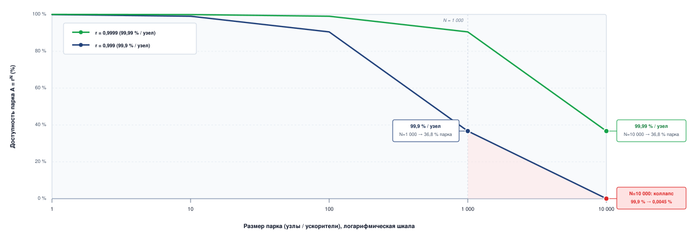

***Коллапс надежности**: одновременная доступность всех узлов, нужных нерезервированной задаче, быстро падает с ростом размера задачи, даже при высокой доступности одного узла.*

Экспоненциальное падение на [рисунке](#fig-reliability-gap-collapse) делает архитектурное следствие ясным: нерезервированная задача не может полагаться на доступность каждого нужного узла на масштабе парка. Хотя этот раздел иллюстрирует концепцию одной цифрой доступности узла, приложение «Основы надежности» выводит полный каскад вероятностей отказа, необходимый для определения интервалов контрольных точек и избыточности. Инженерный урок состоит в том, что отказ — обычный случай. В масштабе устойчивость вытесняет предотвращение в качестве главной цели: система обменивает абсолютное время безотказной работы на скорость восстановления, качество контрольных точек и автоматический ремонт. Главная задача главы «Отказоустойчивость» (глава «Отказоустойчивость») — именно этот сдвиг: от попыток держать каждый компонент работающим к обеспечению того, что парк самовосстанавливается при отказах компонентов.

### Интенсивность коммуникации (отношение CI)

Если железный закон одной машины определяет, как система выполняется, то **интенсивность коммуникации (CI)** определяет, где она останавливается. На одном ускорителе модель Roofline определяет, является ли ядро ограниченным вычислениями или памятью. В масштабе парка этот анализ переносится на сеть.

Интенсивность коммуникации определяется как отношение объема данных, переданных по сети, к числу операций, выполненных локально:

$$\text{CI} = \frac{\text{Байты, переданные (сеть)}}{\text{FLOP, выполненные (локально)}}$$

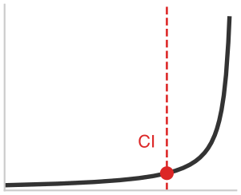

*За обрывом интенсивности коммуникации добавление GPU перестает помогать.*

Низкая интенсивность коммуникации характерна для вычислительно тяжелых нагрузок, чьи ускорители большую часть времени заняты математикой, поэтому масштабирование сравнительно легко. Высокая интенсивность коммуникации описывает нагрузки, сетевой спрос которых приближается к балансу доступной фабрики. В этом режиме может сработать бисекционная пропускная способность, и добавление ускорителей может замедлить обучение, а не ускорить его. Граница зависит от конфигурации, поскольку определяется и локальной вычислительной производительностью, и эффективной сетевой пропускной способностью.

Оптимизации коммуникации и масштабирования — от разреженности градиентов (отправки меньшего числа байтов градиента) до 3D-параллелизма (разбиения измерений данных, тензоров и конвейера по разным уровням фабрики) — стремятся снизить неперекрытую интенсивность коммуникации, чтобы парк машинного обучения действовал как единый массивный компьютер, а не как набор простаивающих процессоров, ожидающих провода. Хотя этот раздел применяет отношение качественно, приложение «Основы парка» анализирует интенсивность коммуникации в конкретных режимах и показывает точку насыщения пропускной способности, за которой добавление ускорителей перестает повышать пропускную способность.

> **Контрольные вопросы: требование масштаба**
>
> Эти вопросы проверяют, сместился ли взгляд на масштаб от локального выполнения к распределенным ограничениям:
>
> - **Интенсивность коммуникации**: объясните в терминах отношения CI, почему добавление узлов ($N$) к нагрузке с высоким CI может замедлить обучение, а не ускорить его.
> - **Разрыв надежности**: объясните разрыв надежности, из-за которого кластер из 10 000 GPU не может оставаться «абсолютно здоровым».
> - **Арифметика или коммуникация**: отличите арифметическую интенсивность (локальная память) от интенсивности коммуникации (глобальная сеть).

### Почему распределение трудно

Масштаб вынуждает к распределению: ни одна машина не обеспечивает вычислений, нужных крупнейшим моделям, и ни одна централизованная система не может собрать все источники данных, которые порождают глобальные пользовательские базы. Однако координация вычислений между физически разделенными машинами, связанными сетями с конечной пропускной способностью, создает ограничения, которые никакая инженерия не может устранить.

Первый стрессор возникает внутри центров обработки данных, где синхронное обучение должно решить, сколько согласованности сохранять при разделах и отказах. Второй возникает на периферии, где сами устройства ненадежны, ограничены по питанию и связаны политиками.

#### Реальность теоремы CAP

**Теорема CAP**[^fn-cap-theorem-ml] утверждает, что асинхронная распределенная система при сетевом разделении не может гарантировать одновременно атомарную **согласованность** и **доступность**. **Устойчивость к разделению** (partition tolerance) описывает сетевое условие, при котором действует этот компромисс, а не третье взаимозаменяемое свойство, которым систему можно просто пожертвовать.

[^fn-cap-theorem-ml]: **Теорема CAP (Consistency, Availability, Partition Tolerance)**, или теорема Брюера: Брюер сформулировал гипотезу (Brewer, 2000), а Гилберт и Линч доказали, что асинхронная система не может гарантировать одновременно атомарную согласованность и доступность, когда сеть может разделиться (Gilbert et al., 2002). Синхронное и асинхронное обучение дают полезную аналогию для этого компромисса, но свежесть градиентов — не то свойство атомарной согласованности, о котором говорит теорема.

По этой аналогии синхронное обучение отдает предпочтение общему актуальному состоянию модели, но может остановиться, когда нужный рабочий узел становится недоступен. Асинхронное обучение может продолжаться при отстающих или недоступных рабочих узлах, но может использовать устаревшие версии модели. Федеративное обучение аналогично принимает временно расходящиеся локальные модели, чтобы прерывистые периферийные устройства могли участвовать без постоянного соединения.

#### Сложность распределения на периферии

Задачи координации, рассмотренные до сих пор, предполагают распределение в центрах обработки данных, где машины работают в управляемых помещениях. На сетевой периферии эти задачи усиливаются по каждому измерению.

Миллиарды смартфонов и устройств интернета вещей работают в неконтролируемой среде с ненадежным соединением и ограниченным питанием. Требования приватности, согласия или политики могут не позволять необработанным данным покидать устройство, что делает федеративное обучение естественной архитектурой (McMahan et al., 2017). Прерывистое соединение вынуждает систему переносить асинхронные обновления, растянутые на дни. Эти ограничения требуют архитектурных подходов (дифференциальная приватность, вывод на устройстве и сжатие моделей), которые принципиально отличаются от машинного обучения в центрах обработки данных.

Когда системы машинного обучения работают в масштабе миллиардов пользователей, их общественное влияние требует внимания, выходящего за пределы технического совершенства. Управление становится инженерным требованием.

### Почему управление важно в масштабе

*В масштабе парка техническая ошибка становится общественным риском.*

Масштаб и распределение усиливают влияние за пределами инженерии. Когда система обслуживает миллиарды пользователей, техническая ошибка становится общественным риском. Это усиление порождает требования управления, которыми могут безопасно пренебречь системы малого масштаба. Управление выполняет роль **плоскости управления** (Control Plane) парка машинного обучения, а не набора внешних правил.

Эта плоскость управления прежде всего должна защищать парк. Системы ML сталкиваются с особыми угрозами безопасности, которые усиливаются в промышленном масштабе. Атаки извлечения моделей крадут проприетарную интеллектуальную собственность через запросы к API. Отравление данных внедряет в модели закладки, которые остаются скрытыми, пока их не активирует конкретный вход. В масштабе парка эти угрозы становятся экономически привлекательными целями для изощренных злоумышленников. Защита парка требует системных подходов: контроля доступа, дифференциальной приватности (глава «Безопасность и приватность») и непрерывного мониторинга поведения, которые далеко выходят за рамки традиционной периметровой безопасности.

Та же плоскость управления должна обеспечивать аудируемость парка. Системы, работающие в масштабе, привлекают внимание регуляторов. Режимы вроде **Закона ЕС об ИИ** (EU AI Act) и местных законов о приватности делают **аудируемость** архитектурным требованием для многих развертываний. Доказать, что модель, обученная на 10 000 GPU, не поглощала запрещенных данных, требует сквозного отслеживания происхождения данных. Создание понятного человеку объяснения для рекомендации, которая выдается за доли миллисекунды, требует методов, заложенных в архитектуру обслуживания. Выполнение этих требований требует технических возможностей (журналов аудита, тестирования смещения и управления согласиями), встроенных в инфраструктуру с первого дня.

Помимо юридического соответствия, парк машинного обучения несет этические обязательства. Алгоритмы рекомендаций формируют общественный дискурс; алгоритмы найма влияют на средства к существованию. Эти системы не падают с громким журналом сбоев; они выходят из строя незаметно, через смещение и поляризацию. Ответственный ИИ — это инженерная практика, которая рассматривает справедливость, прозрачность и подотчетность как инварианты: жесткие ограничения, нарушение которых должно вызывать остановку всей системы.

## Таксономия C³: основания масштаба

Физические, логические и общественные ограничения, только что рассмотренные, делают неизбежной одну реальность: парк машинного обучения нельзя рассматривать как просто более крупный сервер. На одной машине диагностика производительности следует **таксономии «Данные · Алгоритм · Машина» (D·A·M)**, которую приложение «Таксономия D·A·M» развивает как полную рамку для одного узла. В этой рамке данные определяют, из какой информации учится модель; алгоритм задает математические операции для выполнения; а машина предоставляет кремний и иерархию памяти, которые выполняют эти операции.

Когда нагрузки растягиваются на тысячи взаимосвязанных узлов, узкое место выполнения смещается. Аппаратура центров обработки данных закупается и прокладывается по трем физическим опорам: **вычисления, сеть и хранение** (глава «Вычислительная инфраструктура», глава «Сетевые фабрики», глава «Хранение данных»). Однако во время работы распределенное выполнение тратит календарное время в трех различных операционных измерениях: **вычисления ($C_1$)**, **коммуникация ($C_2$)** и **координация ($C_3$)**. Вместе они образуют **таксономию C³**.

Хранение не отсутствует в этой модели времени выполнения; скорее, оно служит устойчивой физической подложкой, охватывающей все три измерения. Оно выступает как продолжение иерархии памяти узла в вычислениях ($C_1$), как высокопроизводительный конвейер потоковой передачи в коммуникации ($C_2$) и как долговечный механизм контрольных сохранений, необходимый для отказоустойчивой координации ($C_3$).

Один и тот же симптом на уровне парка может возникать в любом из трех измерений. Обучение на 10 000 ускорителей с низкой пропускной способностью может означать, что арифметические ядра недоутилизируют тензорные ядра (вычисления), что синхронизация градиентов насыщает бисекционную пропускную способность (коммуникация) или что один тепловой отстающий либо сброс контрольной точки задерживает барьер кластера (координация). Считать каждое замедление сетевой проблемой или проблемой компилятора значит рисковать оптимизацией не того компонента. Полезная таксономия распределенных систем должна разделять эти причины, не притворяясь, что они независимы.

Каждое объяснение требует разных доказательств. Гипотеза о вычислениях направляет инженера к утилизации FLOP модели (MFU), слиянию операторов и насыщению пропускной способности памяти. Гипотеза о коммуникации направляет к утилизации сетевых каналов, сериализации коллективных операций и потере пакетов. Гипотеза о координации направляет к хвостовой задержке отстающих, времени ожидания на барьерах и накладным расходам на контрольные сохранения. Эти исследования не взаимозаменяемы. Более быстрые оптические коммутаторы не ускорят тензорные ядра, простаивающие из-за задержек пропускной способности памяти, а переход на GPU следующего поколения не вернет календарное время, потерянное из-за отстающих на синхронном барьере.

Как и в системах одной машины, определяющим пределом является *связывающее ограничение*: узкое место, ослабление которого дает сквозное сокращение времени обучения или задержки обслуживания. Таксономия C³ поэтому представляет собой операционный диагностический цикл: определить связывающую ось, применить соответствующее системное вмешательство и измерить заново, поскольку ослабление одного ограничения часто смещает узкое место на другое.

> **Определение: таксономия C³**
>
> ***Таксономия C³*** — это диагностическая рамка, которая классифицирует время выполнения распределенного обучения машинного обучения и узкие места системы по трем операционным измерениям: вычисления ($C_1$, математика), коммуникация ($C_2$, провод) и координация ($C_3$, логика). Цель — определить, какое измерение связывает производительность в масштабе парка.
>
> 1. **Значение**: диагностическая сила конкретна даже до изучения сложных распределенных трасс. Если ускорители вычисляют с низким MFU, потому что тензорные ядра голодают без локальных операндов или из-за неслитых ядер, связывающая ось — вычисления ($C_1$). Если ускорители простаивают, ожидая передачи градиентов AllReduce или тензоров активаций по сетевой фабрике, связывающая ось — коммуникация ($C_2$). Если прогресс останавливается из-за ожидания на барьере, вызванного отстающими, откатов восстановления узла или вытеснений при групповом планировании, связывающая ось — координация ($C_3$).
> 2. **Отличие**: в отличие от категорий закупок центров обработки данных (вычисления, сеть, хранение), которые классифицируют физические аппаратные активы, таксономия C³ классифицирует стоимость выполнения во время работы. Хранение не выполняет арифметику модели; оно служит устойчивой физической подложкой во всех трех измерениях (локальный NVMe в $C_1$, потоковая передача удаленных наборов данных в $C_2$ и долговечные контрольные сохранения в $C_3$).
> 3. **Типичная ошибка**: рассмотрение трех измерений как независимых переменных. Переход на более быстрые ускорители ($C_1$) часто превращает задачу, ограниченную вычислениями, в задачу, ограниченную коммуникацией ($C_2$). Шардирование состояний модели для устранения избыточности памяти ($C_1$) увеличивает объем коллективной коммуникации ($C_2$) и сложность координации состояний ($C_3$). Измерения движутся вместе.

Прежде чем исследовать, как эти три измерения взаимодействуют, нужно понять каждое из них в его собственных терминах.

### Три измерения парка

#### Вычисления ($C_1$): подложка узла

**Вычисления ($C_1$, математика)** описывают локальное выполнение на отдельном серверном узле. Они охватывают физическую аппаратуру ускорителя: блоки матричного умножения, тензорные ядра, векторные исполнительные блоки, SRAM на кристалле, стеки памяти с высокой пропускной способностью (HBM3e) и локальные слои твердотельных накопителей NVMe (Non-Volatile Memory Express).

Определяющее напряжение оси вычислений — **стена памяти**: современные ускорители выдают сотни терафлопс или петафлопс сырой арифметической пропускной способности, но выборка весов и активаций из внешней памяти требует на порядки больше времени и энергии, чем сама арифметика. Высокопроизводительная инженерия ML на уровне подложки узла сосредоточена на максимизации **утилизации FLOP модели (MFU)** через слияние операторов, смешанные численные форматы (FP8, BF16) и постадийную подготовку по иерархии памяти, чтобы дорогие тензорные ядра оставались загруженными, а не голодали без операндов (глава «Вычислительная инфраструктура», глава «Хранение данных», глава «Инженерия производительности»).

#### Коммуникация ($C_2$): сетевой хребет

**Коммуникация ($C_2$, провод)** описывает перемещение данных между физически разделенными узлами. Она охватывает как фабрики масштабирования вверх внутри корпуса сервера (такие как NVLink и NVSwitch), так и сети кластера масштабирования вширь (такие как InfiniBand, RoCEv2, оптические приемопередатчики и топологии Клоза с оптимизацией под рельсы).

В масштабе парка коммуникация несет три различных класса трафика: обновления параметров и синхронизацию градиентов во время распределенного обучения, промежуточные тензоры активаций между стадиями конвейера и потоковую передачу шардов наборов данных с удаленных массивов хранения. Определяющее ограничение — **конечная бисекционная пропускная способность**: перемещение терабайтов состояния через оптические коммутаторы вносит задержку сериализации, джиттер пакетов и перегрузки. Инженерная цель коммуникационного хребта — минимизировать налог на коммуникацию ($T_{\text{comm}}$), чтобы ускорители не простаивали, ожидая, пока байты пересекут фабрику (глава «Сетевые фабрики», глава «Коллективные коммуникации»).

#### Координация ($C_3$): уровень оркестрации

**Координация ($C_3$, логика)** описывает программную плоскость управления, протоколы синхронизации и механизмы управления состоянием, которые связывают тысячи отдельных, отказывающих машин в согласованный распределенный компьютер.

На одной машине накладные расходы координации практически пренебрежимы: тривиальная синхронизация потоков или задержка запуска ядра. В масштабе парка координация становится узким местом производительности и надежности первого класса. Она охватывает групповые планировщики кластера (Slurm, Kubernetes, Ray), семантику глобальных барьеров, распределенный консенсус, сердцебиения для обнаружения отказов и периодическое контрольное сохранение состояния в долговечное хранилище. Координация ограничена **коллапсом надежности** ($A_{\text{all}} = (A_{\text{node}})^N$) и **усилением отстающих**: когда тысячи узлов должны синхронизироваться на барьере AllReduce, весь кластер продвигается только так быстро, как его самое медленное устройство. Инженерия слоя координации сосредоточена на максимизации **goodput** (полезной пропускной способности) за счет замены синхронных барьеров асинхронным перекрытием, ускорения обнаружения отказов и ограничения отката восстановления (глава «Отказоустойчивость», глава «Оркестрация парка», глава «Эксплуатация в масштабе»).

### Проекция: от D·A·M к C³

Одноузловая таксономия D·A·M и таксономия C³ для парка работают в паре. D·A·M описывает нагрузку: *существительные* системы (обучающие данные, выполняемый алгоритм, аппаратная подложка). Таксономия C³ описывает налог выполнения: *глаголы* парка (вычисление математики, передача результатов, координация состояния). Приложение «Таксономия D·A·M» рассматривает одноузловую линзу D·A·M; таксономия C³ проецирует эту нагрузку на распределенный парк.

Растягивание алгоритма по узлам создает коммуникацию ($C_2$), например операции AllReduce для синхронизации градиентов между репликами с параллелизмом по данным. Растягивание данных по узлам требует координации ($C_3$) через распределенные сэмплеры, барьеры эпох и неблокирующее контрольное сохранение. Наконец, управление аппаратными сбоями в масштабе компьютера склада требует оркестрации и динамического восстановления узлов ($C_3$). Инженерия систем ML в масштабе парка требует решать задачи на пересечении D·A·M и C³, а не рассматривать каждое измерение в отрыве от других.

### Ландшафт пересечений C³

Выделив три измерения, важно понять ключевую идею инженерии распределенных систем ML: они никогда не работают в изоляции. Если бы вычисления, коммуникация и координация были независимыми, распределенные системы масштабировать было бы просто: достаточно было бы обновить ускорители, установить более быстрые сетевые приемопередатчики или усовершенствовать планировщик по отдельности. На практике основные узкие места и архитектурные прорывы находятся на их попарных пересечениях:

- **Вычисления ∩ Коммуникация ($C_1 \cap C_2$) — скрытие сетевой задержки**: когда арифметическая пропускная способность опережает время передачи по сети, система должна совмещать вычисления с коммуникацией. Техники включают конвейеризацию 1F1B, перекрытие потоков CUDA, настройку отношения коммуникации к вычислениям ($\rho$) через накопление градиентов, слияние ядер GEMM-AllReduce и сжатие FP8 на проводе (глава «Распределенное обучение», глава «Коллективные коммуникации»).
- **Вычисления ∩ Координация ($C_1 \cap C_3$) — максимизация полезной пропускной способности парка**: накладные расходы распределенной оркестрации и восстановления угрожают оставить дорогие ускорители простаивающими. Соединение этих измерений требует неблокирующего асинхронного контрольного сохранения в локальные слои NVMe, сокращения пузырей конвейера, пересчета активаций в памяти вместо отката и быстрого опустошения узла для минимизации радиуса поражения отказа (глава «Отказоустойчивость», глава «Оркестрация парка»).
- **Коммуникация ∩ Координация ($C_2 \cap C_3$) — коллективная синхронизация**: сетевые фабрики должны соответствовать семантике синхронизации. Это пересечение управляет хвостовой задержкой барьерной синхронизации (эффект усиления отстающих), иерархическими коллективными операциями, которые изолируют внутриузловой NVLink от межузлового InfiniBand, моделями ограниченной устарелости (bounded staleness) и планированием коллективных операций с учетом топологии (глава «Коллективные коммуникации», глава «Отказоустойчивость»).

В центре ($C_1 \cap C_2 \cap C_3$) сходятся все три ограничения одновременно. Это дисциплина **инженерии систем машинного обучения масштаба парка** (Fleet-Scale ML Systems Engineering): балансировка 4D-параллелизма (данных, тензора, конвейера и параллелизма экспертов), управление шардированными состояниями памяти (FSDP2, ZeRO-3) и обслуживание базовых моделей при строгих бюджетах задержки (глава «Распределенное обучение», глава «Вывод», глава «Периферийный интеллект»).

[Рисунок](#fig-c3-taxonomy) показывает полный ландшафт совместного проектирования, синтезируя три операционных измерения, их попарные взаимодействия и центральную дисциплину.

***Ландшафт пересечений C³**: три измерения разбивают время выполнения на вычисления, коммуникацию и координацию; попарные пересечения определяют, как скрывается задержка и синхронизируются коллективные операции, а в центре — инженерия систем ML масштаба парка.*

Читайте диаграмму Венна на [рисунке](#fig-c3-taxonomy) от внешних областей к центру: сначала диагностируйте, какое чистое измерение или попарное пересечение связывает, а затем примените соответствующее системное вмешательство.

Окружают эти три операционных измерения бесспорные **операционные инварианты** (Operating Invariants), развитые в части IV: термодинамические пределы энергии и охлаждения, которые ограничивают центры обработки данных (глава «Устойчивый ИИ»), гарантии безопасности от состязательных атак и дифференциальной приватности, требуемые от распределенных конвейеров (глава «Безопасность и приватность»), устойчивость к тихому повреждению и сдвигу распределения (глава «Надежный ИИ») и системные инварианты управления, аудита и безопасности, необходимые при работе в общественном масштабе (глава «Ответственный ИИ»). Как и ландшафт D·A·M для одного узла, рисунок C³ служит ориентиром для всех шестнадцати глав впереди: сначала диагностируйте, какое пересечение связывает, затем вмешивайтесь.

### Закон парка

Ландшафт пересечений C³ определяет, *где* распределенное выполнение тратит время и где проявляются компромиссы. Чтобы превратить эту диагностическую карту в предсказательное инженерное знание, нужно управляющее уравнение, которое учитывает каждую микросекунду распределенного шага. На одной машине время выполнения определяется железным законом производительности $T \approx D_{\text{vol}}/\text{BW} + O/(R_{\text{peak}}\eta_{\text{hw}}) + L_{\text{lat}}$, который раскладывается на перемещение данных, вычисления и накладные расходы. В масштабе парка этого взгляда на одну машину уже недостаточно. Формула ниже задает **закон парка**, который раскладывает идеализированный шаг распределенного обучения на члены двигателя C³:

$$ T_{\text{step}}(N) = \frac{T_{\text{compute}}}{N} + T_{\text{comm}}(N) + T_{\text{sync}}(N) - T_{\text{overlap}} $$
Каждый член закона парка напрямую соответствует области ландшафта C³ на [рисунке](#fig-c3-taxonomy):

- $\frac{T_{\text{compute}}}{N}$ — член **вычислений ($C_1$)**, который предполагает в идеале делимую локальную арифметику для фиксированной нагрузки, распределенной по $N$ устройствам.
- $T_{\text{comm}}(N)$ — член **коммуникации ($C_2$)**, учитывающий время передачи по проводу для перемещения градиентов, активаций и шардов параметров по сетевой фабрике.
- $T_{\text{sync}}(N)$ — член **координации ($C_3$)**, учитывающий время, которое тратится на семантику барьеров, ожидание отстающих, решения планировщика кластера и восстановление после отказов.
- $T_{\text{overlap}}$ — член **совместного проектирования ($C_1 \cap C_2$, $C_1 \cap C_3$, $C_2 \cap C_3$)**, представляющий коммуникацию или координацию, скрытые за полезными вычислениями с помощью таких техник, как конвейеризация 1F1B, перекрытие потоков CUDA и асинхронное контрольное сохранение.

Слабое масштабирование, дисбаланс нагрузки, изменения емкости памяти и алгоритмические изменения требуют модификации этих членов, а не рассмотрения $T_{\text{compute}}/N$ как инварианта. Формула ниже переписывает это разложение в виде доли времени вычислений — доли календарного времени, потраченного на полезную математику:

$$ f_{\text{compute}} = \frac{T_{\text{compute}}/N}{T_{\text{step}}(N)} $$

Это разложение — диагностический инструмент. Когда $f_{\text{compute}}$ падает ниже 0,5, более половины шага тратится вне полезной локальной арифметики. Таксономия C³ показывает, куда уходит время: если доминирует $T_{\text{comm}}(N)$, нужно улучшать межсоединения или перекрывать коммуникацию с вычислениями; если доминирует $T_{\text{sync}}(N)$, стоит рассмотреть асинхронные методы или снизить частоту барьеров; если доминирует $T_{\text{compute}}/N$, время шага задает локальная арифметика. **Смещение накладных расходов** — диагностическая эвристика: снижение одних накладных расходов может переносить стоимость между тремя измерениями. Асинхронное обучение убирает часть барьеров координации, но вводит устарелость градиентов; конвейерный параллелизм может снизить часть коммуникационной нагрузки, но добавляет время пузырей.

Метрика Google **ML Productivity Goodput** дает производственную реализацию этой рамки. Goodput раскладывает сквозную продуктивность обучения на три мультипликативных фактора: **Program Goodput** ($\eta_{\text{program}}$), который измеряет, насколько эффективно код использует аппаратуру (вычисления); **Runtime Goodput** ($\eta_{\text{runtime}}$), который учитывает потери от задержек коммуникации и отказов (коммуникация); и **Scheduling Goodput** ($\eta_{\text{scheduling}}$), который учитывает потерянное время из-за вытеснений и перенастроек (координация). Таксономия C³ — теоретическая рамка, а Goodput — то, как производственные команды ее измеряют.

Закон парка — временная диагностика эффективности парка во времени и энергии: он спрашивает, какая доля каждого распределенного шага остается полезными вычислениями после учета коммуникации, синхронизации и перекрытия. Приложение «Закон парка в таксономии C³» развивает полный вывод и относит каждый член к физической причине.

### Инвариант энергии и масштаба

Закон парка управляет временем, а **инвариант энергии и масштаба** управляет устойчивостью и экономической жизнеспособностью парка. В масштабе каждый шаг обучения — термодинамическое событие. Формула ниже определяет **энергетическую продуктивность парка** ($\rho_{\text{energy}}$), измеряемую в FLOP/Дж, как отношение полезной работы к суммарной потребленной энергии:

$$ \rho_{\text{energy}} = \frac{O_{\text{useful}}}{E_{\text{compute}} + E_{\text{cooling}} + E_{\text{network}}} $$

где $O_{\text{useful}}$ — полезная работа в FLOP, а $E_{\text{network}}$ часто становится заметной долей общего бюджета при перемещении терабайтов по оптическим фабрикам. Владение масштабом требует оптимизации по Парето-фронту обоих законов: минимизировать $T_{\text{step}}$ и одновременно максимизировать $\rho_{\text{energy}}$. Хотя этот раздел вводит инвариант концептуально, приложение «Основы парка» подробно описывает иерархию энергии в масштабе и термодинамические ограничения, которые задают предел для $\rho_{\text{energy}}$.

Энергетическая метрика — лишь половина диагностики масштабирования. Производственной команде также нужен скаляр эффективности по времени, который показывает, сокращают ли дополнительные устройства время шага или только увеличивают накладные расходы координации.

Эффективность масштабирования парка ($\eta_{\text{scaling}}$) — это отношение идеального времени параллельного шага к фактическому времени шага:

$$ \eta_{\text{scaling}} = \frac{T_1}{N \times T_N} $$

где $T_1$ — время одного устройства для той же работы, а $T_N = T_{\text{step}}(N)$ — время шага на $N$ устройствах. Приложение «Разложение по компонентам» в таксономии C³ дает технику разбиения $T_{\text{step}}(N)$ на члены и разобранные примеры, которые позволяют читателю вычислить $\eta_{\text{scaling}}$ численно.

> **Справка: распределенная ловушка закона Амдала**
>
> Закон парка применяет рассуждение Амдала (Amdahl, 1967) к эксперименту сильного масштабирования: фиксированный объем полезной работы делится между большим числом устройств, а члены коммуникации и координации измеряются для этой конфигурации. Потолок ускорения в 5 раз следует только при условии, что 20 процентов исходной нагрузки остаются принципиально последовательными, когда вычисления ускоряются. Измеренная доля сети 20 процентов при одном числе устройств не инвариантна автоматически: изменение разбиения, топологии, коллективного алгоритма или перекрытия может изменить как ее абсолютное время, так и долю в шаге. Поэтому закон парка диагностирует предел масштабирования для заявленной нагрузки и конфигурации, а не утверждает универсальную долю сети.

Применение обоих законов к оценке синхронизации в масштабе GPT-3 делает видимым ожидаемый налог на коммуникацию и его термодинамический аналог в тех же терминах, что и уравнение масштабирования: тот же кольцевой AllReduce, который лишает ускорители времени, на каждом шаге расходует и энергию.

*На масштабе только около 4 процентов времени шага приходится на вычисления; основную часть занимает синхронизация.*

> **Налог на коммуникацию и энергию**
>
>
> **Задача**: какая доля времени вычислений и стоимость сетевой энергии на конечной точке получаются в иллюстративном сценарии синхронизации GPT-3 при использовании Ethernet 100 Гбит/с и InfiniBand 200 Гбит/с?
>
> **Физика**: для синхронизации 175 млрд параметров (FP16) кольцевой AllReduce должен переместить примерно 700 ГБ данных через каждую участвующую конечную точку ускорителя за итерацию.
>
> **Анализ**: закон парка раскрывает налог на коммуникацию.
>
> - **InfiniBand** (200 Гбит/с): при оптимистичной модели передачи на номинальной скорости линии доля времени вычислений составляет всего 4,1 процента: ускорители вычисляют 4,1 секунды из каждых 100 секунд, а остальное — открытое время коммуникации.
> - **Ethernet** (100 Гбит/с): меньшая скорость линии снижает долю времени вычислений до 2,1 процента: ускорители продуктивны примерно 2,1 секунды из каждых 100 секунд.
>
> **Энергия**: энергетическая стена — термодинамическая стоимость той же синхронизации. Синхронизация градиентов на каждой конечной точке потребляет около 84 Дж в сетевой фабрике (при 15 пДж/бит). В запуске обучения из 1 000 000 шагов одно лишь сетевое перемещение на конечной точке составляет около 84 МДж энергии до умножения на число участвующих ускорителей.
>
> **Системный вывод**: этот нижний граничный сценарий предполагает эффективную передачу на заявленной скорости линии и не учитывает топологию коллективной операции, программные накладные расходы, конкуренцию и перекрытие. Даже при этой оптимистичной границе неперекрытая синхронизация может оставлять ускорители простаивающими, а то же перемещение данных расходует энергию на каждом шаге. Поэтому больше ускорителей не гарантирует пропорционального ускорения без скрытия коммуникации, сжатия и фабрики, согласованной с нагрузкой.
>

## Основополагающие понятия

Стек парка — организующий стержень этой книги. C³ и закон парка дают ее линзу производительности: C³ относит время распределенного шага к вычислениям, коммуникации и координации, а закон парка количественно оценивает их влияние на масштабирование. Маячные архетипы дают ее линзу нагрузок, проверяя эти ограничения в плотном обучении, разреженных рекомендациях и федеративных периферийных режимах. Остальные конструкции — подчиненные отображения: D·A·M описывает нагрузку, которую распределяет C³; AI-триада прослеживает зависимости между данными, алгоритмами и инфраструктурой; а пятиопорная рамка сопоставляет эти зависимости с операционной ответственностью. [Рисунок](#fig-fleet-stack) организует эти линзы в **стек парка** — четырехуровневую рамку, где инженерные решения внизу ограничивают возможности наверху.

***Стек парка**: организующая рамка этой книги. Архитектура строится от уровня инфраструктуры (вычисления, сеть, данные) через уровень распределения (параллелизм, коммуникация, отказоустойчивость) и уровень обслуживания (вывод, производительность, периферия, эксплуатация) до уровня управления (безопасность, устойчивость, устойчивое развитие, ответственная инженерия). Инженерные решения внизу ограничивают возможности наверху.*

Этот слоистый порядок структурирует четыре части учебника: физическую подложку, логику распределения, развертывание в масштабе и ответственный парк. Подробная карта глав приведена в разделе «Структура тома» ([разделе](#sec-vol2-introduction-structure)); здесь стек задает порядок зависимостей.

**AI-триада в масштабе** — напоминание о зависимостях внутри этого стека. Каждая система машинного обучения состоит из трех взаимозависимых компонентов: данных, которые направляют поведение, алгоритмов, которые выучивают закономерности, и вычислительной инфраструктуры, которая обеспечивает и обучение, и вывод. В промышленном масштабе эти взаимозависимости усиливаются. Сценарий класса GPT-4 с объемом около $10^{25}$ FLOP потребовал бы инфраструктуры, способной эффективно синхронизировать градиенты на десятках тысяч GPU. Обучающие данные такого масштаба требуют распределенных систем хранения с шаблонами доступа, оптимизированными под нагрузки ML. [Рисунок](#fig-vol2-ai-triad) визуализирует эти зависимости между данными, алгоритмами и инфраструктурой и показывает пространство оптимизации, с которым должны справляться инженеры систем ML.

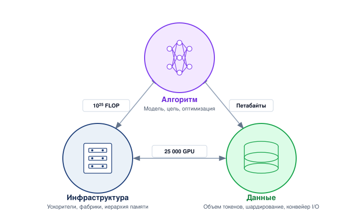

***AI-триада в масштабе**: три взаимозависимых компонента каждой системы ML; изменение любой вершины каскадом затрагивает остальные.*

**Пятиопорная рамка** превращает ограничения уровней в домены ответственности. Инженерия данных определяет, что парк должен принимать, преобразовывать и обслуживать; разработка моделей определяет архитектуры и процедуры обучения, которые потребляют эти данные в масштабе. Оптимизация затем связывает модель с ее ограничениями развертывания, сжимая или ускоряя нагрузку, когда бюджеты задержки, памяти или мощности становятся связывающими. Инфраструктура развертывания предоставляет облачные платформы, сетевые фабрики и иерархии хранения, которые делают парк работоспособным. Эксплуатация замыкает цикл, измеряя, остается ли развернутая система надежной, безопасной и эффективной при изменении производственных данных и условий аппаратуры.

Производственные фреймворки важны потому, что каждый реализует одни и те же абстрактные примитивы под разными названиями и с разными границами ответственности. [Таблица](#tbl-framework-rosetta-stone) дает сопоставление фреймворков как переводной справочник для примитивов, развитых в стеке парка, а не как рейтинг инструментов.

| **Абстрактный примитив** | **PyTorch (нативный)** |  **DeepSpeed**   |     **Megatron-LM**      |    **JAX/XLA**    |     **Ray**      |
|:-----------------------|:--------------------:|:----------------:|:------------------------:|:-----------------:|:----------------:|
| **Параллелизм данных**      |         DDP          | DeepSpeedEngine  | DistributedDataParallel  | pmap/jit(sharded) |    Ray Train     |
| **Шардированный параллелизм данных** |         FSDP         |    ZeRO-1/2/3    | FullyShardedDataParallel |   sharding.Mesh   |  FSDP Strategy   |
| **Тензорный параллелизм**    |       DTensor        |   InferenceTP    |    Column/RowParallel    |     xmap/spmd     |   Ray Train TP   |
| **Конвейерный параллелизм**  |        PiPPy         |  PipelineModule  |     PipelineParallel     |       GSPMD       |   Ray Train PP   |
| **Накопление градиентов**    | backward(accumulate) | grad_accum_steps |      grad_acc_steps      |      lax.scan     | Ray Train Config |
| **Контрольные сохранения**   |    torch.save/DCP    | save_checkpoint  |     save_checkpoint      |       orbax       |  ray.checkpoint  |
| **Оркестрация**              |       torchrun       |  deepspeed CLI   |     megatron_main.py     |  jax.distributed  |     Ray Core     |

***Розеттский камень фреймворков**: сопоставление абстрактных примитивов распределенного ML с их реализациями в основных фреймворках. Примитивы разбираются там, где становятся связывающими ограничениями: распределенное обучение (глава «Распределенное обучение»), коллективные коммуникации (глава «Коллективные коммуникации»), вывод (глава «Вывод») и эксплуатация (глава «Эксплуатация в масштабе»).*

Эти примитивы повторяются по всей книге; таблица — справочник, к которому стоит возвращаться по мере знакомства с каждым примитивом, а не учебный план для запоминания. **Шесть принципов системной инженерии** задают стандарт для отдельных проектных решений: инструментировать в первую очередь; проектировать с запасом в 10 раз; ожидать, что узкие места будут мигрировать; считать отказ установившимся состоянием; накапливать небольшие выигрыши эффективности по всему парку; согласовывать аппаратуру с алгоритмами. В масштабе парка утверждение о производительности или надежности полезно только тогда, когда оно инструментировано, поскольку причина может находиться в модели, планировщике, сети, уровне хранения или пути обслуживания. Эта дисциплина измерений поддерживает проектирование с запасом 10×: прототип еще не архитектура, пока не показывает, где остается запас. По мере роста масштаба узкие места смещаются от локальных вычислений к коммуникации и координации, аппаратные отказы становятся обычными, а небольшие выигрыши в эффективности становятся существенными, поскольку повторяются по всему парку. Совместное проектирование аппаратуры следует той же логике: топология сети, иерархия хранения и выбор ускорителя определяют, какие алгоритмы остаются практичными. Это практики, которые применяет инженер парка; том завершается тем, что перегоняет то, чему они служат, в устойчивые принципы распределенных систем машинного обучения.

Вместе эти фреймворки предполагают знакомство с системами машинного обучения на одной машине: как модели обучаются, оптимизируются и развертываются на отдельных устройствах. Эта книга учит инженеров масштабировать, распределять и управлять ими в глобальном парке машинного обучения.

### Три системных архетипа

Абстрактные рамки становятся конкретными через конкретные нагрузки. Три маячных архетипа в масштабе появляются там, где они освещают центральное ограничение главы; ни одна глава не обязана втискивать все три в свой аргумент. Вместе они выбирают разные режимы C³, нагружая по-разному коммуникацию, координацию или вычисления.

#### Архетип A (GPT-4/Llama-3)

GPT-4 и Llama-3 — авторегрессионные архитектуры трансформеров, которые генерируют текст по одному токену за раз. В масштабе одного ускорителя авторегрессионные языковые модели — зонды пропускной способности памяти; в масштабе сотен миллиардов параметров, а в некоторых проприетарных системах, возможно, и больше, обучение требует устойчивых вычислений порядка ExaFLOP/s, распределенных между тысячами и десятками тысяч ускорителей, тогда как обслуживание требует пропускной способности памяти, достаточной для загрузки миллиардов весов на каждый генерируемый токен. Задача парка — разбить очень большие модели по парку ускорителей с помощью 3D-параллелизма (данных, тензора и конвейера), не порождая столько градиентного или активационного трафика, чтобы сеть стала связывающим узким местом. Поэтому архетип A зондирует измерение коммуникации C³, хотя его фактический доминирующий член зависит от модели, разбиения, топологии и степени перекрытия.

#### Архетип B (DLRM в масштабе)

DLRM — производственная архитектура Meta для персонализированного ранжирования контента. В отличие от LLM, которые определяются плотными матричными умножениями, рекомендательные модели получают свою емкость из массивных таблиц эмбеддингов — разреженных структур поиска, которые отображают миллиарды признаков пользователей и объектов в плотные векторы. Один производственный экземпляр DLRM может содержать 10 ТБ и более параметров эмбеддингов, что намного превышает память любого ускорителя. Задача парка — шардировать эти таблицы эмбеддингов по сотням узлов, обрабатывая миллионы запросов в секунду (QPS) с хвостовой задержкой менее 100 мс и одновременно управляя конкуренцией за коммуникацию all-to-all, сложность которой $\mathcal{O}(N^2)$, между шардами эмбеддингов и плотными слоями. В таксономии C³ архетип B нагружает координацию: маршрутизация разреженных признаков, размещение шардов, планирование запросов и согласованность обновлений эмбеддингов определяют, можно ли обслужить трафик all-to-all в пределах ограничений хвостовой задержки.

#### Архетип C (федеративный MobileNet)

MobileNet — семейство эффективных сверточных нейронных сетей, созданных для вывода на устройстве при жестких бюджетах питания и памяти. В условиях федеративного обучения экземпляры MobileNet обучаются локально на миллионах разнородных периферийных устройств (смартфонах, датчиках интернета вещей, медицинских носимых устройствах), и сырые данные никогда не покидают устройство. Режим ограничений качественно отличается от архетипов центров обработки данных: вычислительные бюджеты измеряются в ваттах, а не в мегаваттах, и требования приватности или политики могут запрещать централизованное объединение данных. В таксономии C³ архетип C доминируется вычислениями на уровне отдельного устройства: каждый локальный шаг обучения ограничен кремниевой оболочкой периферийного устройства в ваттах, а не сетевой пропускной способностью парка или протоколами координации. Задача парка — координировать обновления моделей по миллионам таких ограниченных по вычислениям ненадежных устройств, периодически усредняя обновления устройств на координаторе (федеративное усреднение), сохраняя гарантии сходимости при данных, которые не являются независимыми и одинаково распределенными (i.i.d.), и при прерывистом соединении.

Читайте три архетипа как зонды ограничений, а не как каталог семейств моделей. Случай LLM спрашивает, может ли плотная синхронизация сохранять полезность тысяч ускорителей; случай DLRM спрашивает, может ли маршрутизация разреженных признаков уложиться в бюджеты хвостовой задержки; а случай федеративного MobileNet спрашивает, могут ли локальные ограничения устройств быть скоординированы в статистически согласованное обновление. [Таблица](#tbl-vol2-lighthouse-archetypes) суммирует три канонические нагрузки, которые отслеживаются в этой книге.
| **Архетип** | **Доминирующее ограничение C³** | **Задача парка** |
|:------------|:--------------------------------|:-----------------|
| **Архетип A (GPT-4/Llama-3)** | Коммуникация (на уровне всего парка) | Разбить сотни миллиардов параметров, а возможно, и более крупные проприетарные модели, на тысячах и десятках тысяч GPU с помощью 3D-параллелизма, не допуская, чтобы сеть стала узким местом. |
| **Архетип B (DLRM в масштабе)** | Координация (маршрутизация и размещение) | Шардировать таблицы эмбеддингов объемом от 10 ТБ по сотням узлов; обрабатывать миллионы QPS с хвостовой задержкой менее 100 мс, управляя маршрутизацией разреженных признаков, размещением шардов и конкуренцией all-to-all со сложностью $\mathcal{O}(N^2)$. |
| **Архетип C (федеративный MobileNet)** | Вычисления (оболочка устройства) | Координировать обучение на миллионах ограниченных по вычислениям ненадежных периферийных устройств с помощью федеративных обновлений; сырые данные не могут покидать устройство. |

***Маячные архетипы в масштабе**: три канонические нагрузки, которые отслеживаются в этой книге, с доминирующим ограничением каждой и задачей масштаба парка, которую она ставит.*

## Структура этого учебника

Этот учебник организован вокруг стека парка: от физической подложки через логику распределения к общественному управлению. Последовательность глав — это карта зависимостей, а не перечень тем: физические ограничения кремния и охлаждения задают сетевую прокладку; сетевые ограничения задают разбиение обучения; разбитые алгоритмы задают отказоустойчивость и оркестрацию; а оркестрация парка задает эксплуатацию в производстве, безопасность и управление. Каждая часть рассматривает фундаментальное препятствие масштаба, которое не дает решению для одной машины работать в промышленном масштабе ([рисунок](#fig-vol2-roadmap)).

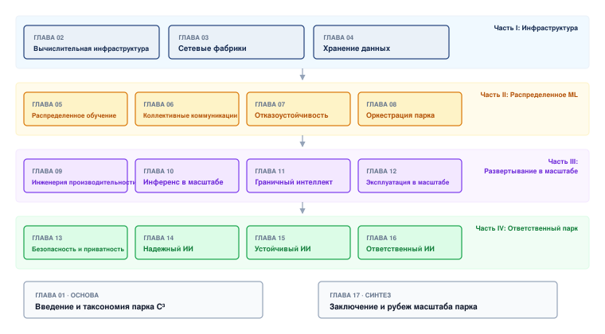

***Карта глав второго тома**: последовательность из семнадцати глав в четырех базовых частях и итоговом синтезе, от физической инфраструктуры через распределенные системы и развертывание к общественному управлению.*

Инфраструктурная линия начинается с препятствия, которое не может игнорировать ни один алгоритм: ни один сервер не имеет достаточно памяти, питания, охлаждения или ввода-вывода, чтобы обучить самые крупные модели. Поэтому глава «Вычислительная инфраструктура» начинается с высокоплотного кремния и физики объекта, глава «Сетевые фабрики» превращает изолированные машины в «градиентную шину» масштаба кластера, а глава «Хранение данных» завершает подложку, поддерживая питание ускорителей и не давая хранению стать скрытым узким местом.

Линия распределения начинается, когда физический парк уже существует и налог на координацию становится неизбежным. Разделение математики между машинами создает две новые проблемы: реплики должны обмениваться состоянием достаточно быстро, чтобы вести себя как один оптимизатор, а отказы становятся обычным явлением, а не исключением. глава «Распределенное обучение» развивает стратегии разбиения для моделей от сотен миллиардов до триллионов параметров, глава «Коллективные коммуникации» объясняет примитивы коммуникации, которые связывают независимые узлы в согласованный компьютер, глава «Отказоустойчивость» рассматривает скорость восстановления как более важную, чем время безотказной работы отдельного узла, а глава «Оркестрация парка» управляет многопользовательским кластером, где задачи должны размещаться, изолироваться и переназначаться.

Линия развертывания переходит от обучения модели к экономичному ее обслуживанию. Когда модель попадает в производство, связывающий вопрос уже не только время обучения; важно, остаются ли задержка, утилизация и стоимость обслуживания на протяжении всего срока службы в рабочем диапазоне. глава «Инженерия производительности» закрывает разрыв между пиковой мощностью аппаратуры и фактической пропускной способностью через слияние ядер и компиляцию, глава «Вывод» превращает эти локальные оптимизации в системы обслуживания для миллионов пользователей, глава «Периферийный интеллект» переносит интеллект ближе к устройствам с бюджетами питания в милливатты, а глава «Эксплуатация в масштабе» развивает плоскость управления для мониторинга состояния, дрейфа и производительности в глобальных развертываниях.

Линия управления рассматривает ответственность как инженерный слой, а не как послесловие. В глобальном масштабе технические ошибки становятся общественными опасностями: противники могут отравить данные или извлечь веса, входы из открытого мира могут сломать хрупкие модели, потребление энергии становится ограничением парка, а сбои управления могут превратить техническую возможность в социальный вред. глава «Безопасность и приватность», глава «Надежный ИИ», глава «Устойчивый ИИ» и глава «Ответственный ИИ» развивают эти обязательства как свойства системы, которые нужно проектировать, измерять и эксплуатировать.

## Заблуждения и ловушки

Следующие заблуждения и ловушки описывают архитектурные ошибки, которые тратят ресурсы разработки, не попадают в целевые показатели производительности или развертывают системы, критически не соответствующие их операционным ограничениям. Каждая из них — образец, который наблюдался многократно при переходе от машинного обучения на одной машине к парку машинного обучения.

> **Заблуждение и ловушка**
>
> **Заблуждение:** *фокус на алгоритмической эффективности при игнорировании согласованности с аппаратной системой.*
>
> Инженеры часто оптимизируют FLOP и число параметров, полагая, что эти метрики предсказывают производительность развертывания. Реальная эффективность зависит от того, насколько хорошо математика согласована с лежащей в основе аппаратурой. Например, неструктурированное прореживание достигает разреженности 80 процентов, но не дает ускорения на плотной аппаратуре (такой как тензорные ядра NVIDIA), тогда как структурированное прореживание с разреженностью 50 процентов может дать до 2× пропускной способности разреженной арифметики на поддерживаемой аппаратуре и ядрах, но не гарантирует сквозного ускорения. Модель, сокращенная с 10 млрд до 3 млрд параметров (снижение FLOP на 70 процентов), может дать лишь 20-процентное улучшение задержки, потому что доминируют узкие места пропускной способности памяти, а шаблон прореживания не имеет дружественной аппаратуре структуры.

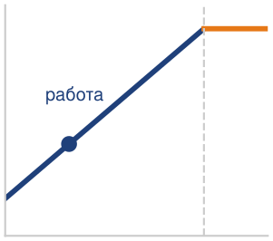

*Одно лишь сокращение FLOP оставляет задержку ограниченной памятью.*

> **Заблуждение и ловушка**
>
> **Ловушка:** *оптимизация одной метрики без проверки системных компромиссов.*
>
> **Ошибка универсальной эффективности** предполагает, что такие оптимизации, как квантование или дистилляция, — «бесплатные выигрыши». В производстве каждая оптимизация вносит конкретные компромиссы. Квантование INT8 дает четырехкратное сокращение памяти, но обычно стоит 1–2 процентов точности. Дистилляция знаний дает сжатие в 2–4 раза, но требует дорогостоящего обучения модели-учителя. Оптимальная архитектура требует балансировки точности, задержки и мощности, а не простой минимизации потребления ресурсов.

> **Заблуждение и ловушка**
>
> **Заблуждение:** *требования к эффективности развертывания на периферии — это просто уменьшенные версии облачных требований.*
>
>
> Это **«облегченное облако»** (Cloud-Lite) заблуждение рассматривает периферийные системы как облачные системы с ограниченными ресурсами. Периферийные устройства сталкиваются с качественно иными ограничениями. Например, автомобиль, движущийся со скоростью 120 км/ч, проходит 3,33 м за каждые 100 мс задержки обработки, и это расстояние добавляется к его пути реакции. Если облачные развертывания масштабируются до киловатт, периферийные системы работают при бюджетах питания 5–15 Вт. Оптимизированная для облака модель с точностью 95 процентов и задержкой 50 мс может оказаться непригодной на периферийном устройстве, где тепловой троттлинг увеличивает задержку до 200 мс и разряжает батарею меньше чем за час.

> **Заблуждение и ловушка**
>
> **Ловушка:** *предположение, что законы масштабирования линейно предсказывают требования к эффективности на всех масштабах.*
>
>
> **Линейная ошибка масштабирования** возникает, когда команды экстраполируют требования к ресурсам с помощью степенных зависимостей, не учитывая накладные расходы координации. $\mathcal{L}(X) = A_{\mathcal{L}} X^{-\alpha_{\text{scale}}} + C_{\mathcal{L}}$ работает в проверенных диапазонах, но ломается на границах.
>
> Команда, обучающая модели на 100 млрд параметров, экстраполируя с экспериментов на 10 млрд параметров, может предсказать улучшение в 3×, но получить лишь 1,8×, если накладные расходы координации и коммуникации съедают 40 процентов масштабированного времени шага. Производственные системы, спроектированные в предположении линейного масштабирования, сталкивались с перерасходом стоимости в 2–3 раза, когда эмпирическая производительность отклонялась от степенных предсказаний за пределами проверенных порогов.

## Итоги

Эта книга открывается центральным вызовом: принципы, которые обеспечивают успех на одной машине, необходимы, но недостаточны в масштабе. Область перешла от лаборатории к парку машинного обучения, где коммуникация может доминировать над вычислениями, отказы становятся обычными на долгих запусках, а общественное влияние требует строгого управления.

Переход от построения систем, которые работают, к построению систем, которые масштабируются, представляет собой следующий режим инженерии. Основные принципы систем машинного обучения (измеряй всё, оптимизируй узкое место, проектируй с учетом отказов) остаются необходимыми, но их применение фундаментально меняется, когда система охватывает тысячи узлов. Топология сети становится не менее важной, чем иерархия памяти, а координация парка добавляет межузловую синхронизацию: обновления, отказы и общее состояние должны управляться на многих машинах.

Вместе эти принципы меняют то, как инженеры рассуждают о проектировании систем. Когда отказ — обычное явление, а не исключение, и когда стоимость коммуникации может затмить вычисления для конкретной нагрузки и разбиения, диагностические навыки, выработанные на одной машине, нужно расширить. Инженер, который усваивает эти ограничения, переходит от вопросов локального ускорения к вопросам управления парком: где возникают накладные расходы координации, что ломается, когда узел исчезает, и какую гарантию согласованности можно ослабить. Этот сдвиг — от оптимизации компонента к управлению парком — отделяет практиков, которые могут проектировать в масштабе, от тех, кто может только прототипировать на одной машине.

> **Масштаб создает новую машину**
>
> - **Больше GPU меняют задачу**: методы, которые работают на одном узле, в масштабе парка перестают быть просто медленнее; они могут стать неверными. Бисекционная пропускная способность, подача питания, надежность и управление создают ограничения, которых не видно в экспериментах с одним ускорителем.
> - **Сеть съедает каждое ускорение**: добавление ускорителей делит локальные вычисления, но добавляет синхронизацию, трафик градиентов и подверженность хвостовой задержке. Модель с 175 млрд параметров может перемещать сотни гигабайт градиентов за шаг, поэтому полезные FLOP зависят от коммуникации, а не только от пиковой арифметики.
> - **Отказ становится установившимся состоянием**: запуск обучения на 25 000 GPU с MTBF каждого GPU в десятках тысяч часов все равно испытывает отказы на уровне кластера каждые несколько часов. Контрольные сохранения, восстановление и наблюдаемость — базовые требования проектирования, а не уборка.
> - **C³ расширяет локальную интуицию**: линза «данные, алгоритм, машина» по-прежнему описывает нагрузку и подложку; вычисления, коммуникация и координация раскрывают стоимости выполнения, которые вносит распределение. Закон парка делает расширение явным: масштабирование зависит от синхронизации, перекрытия и согласованности так же, как от числа аппаратных единиц.
> - **Воздействие требует плоскости управления**: системы базового масштаба усиливают сбои безопасности, приватности, справедливости и политики для больших пользовательских популяций. Управление — не приложение к инфраструктуре; это механизм, который решает, что парку разрешено оптимизировать и развертывать.

Рассуждение сходится к одному сдвигу. В масштабе связывающее ограничение может выйти за пределы узла. На одном ускорителе предел может задавать иерархия памяти; на десяти тысячах — коммуникация и координация могут ограничивать то, насколько эффективно парк использует свои локальные вычисления. Это и есть физика распределения: данные, алгоритм и машина по-прежнему определяют нагрузку и подложку, а вычисления, коммуникация и координация раскрывают стоимость их выполнения по всему парку. Остальная часть книги прорабатывает это расширение — от кремния вверх до управления, которое решает, что парку разрешено делать.

> **Связь с главами: от требований к кремнию**
>
> Требования масштаба установлены: обоснование распределения, физические издержки и принципы, управляющие парком машинного обучения, четко определены. Однако одни требования не вычисляют градиенты. Парку нужна физическая основа (кремний, питание и охлаждение), способная выдерживать эти нагрузки. глава «Вычислительная инфраструктура» начинает строить эту основу, рассматривая архитектуры ускорителей, иерархии памяти и системы подачи питания, которые образуют инфраструктурный слой стека парка.
