

# Вычислительная инфраструктура

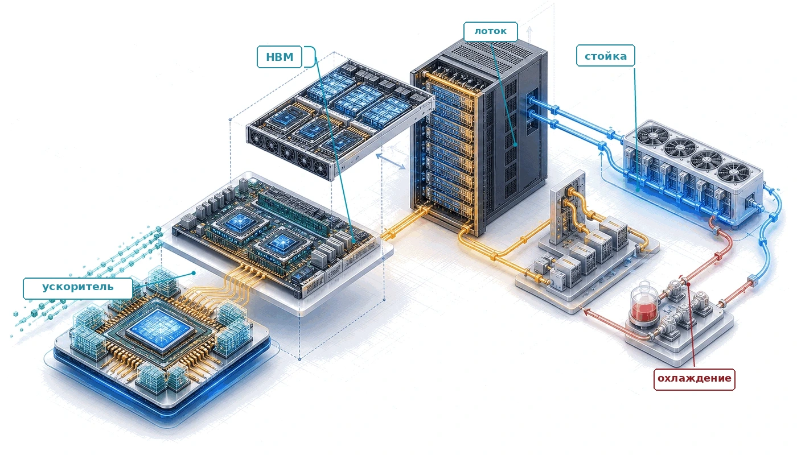

## Назначение

_Почему инфраструктура, а не одни только алгоритмы, определяет, кто может участвовать в развитии машинного обучения в масштабе?_

Системы машинного обучения существуют не только в коде. Алгоритмы обучения больших моделей могут быть открытыми, но возможность выполнить их в масштабе ограничена инфраструктурой. Обучение должно укладываться в тепловые пределы, мощность системы электропитания и стоимость перемещения данных. Поэтому в больших масштабах прогресс отчасти зависит от того, кто способен построить и эксплуатировать физические системы, которые делают масштаб возможным. Чтобы построить парк машинного обучения, нужна инженерия на четырех физических уровнях: ускоритель (физика кремния), узел (плотность межсоединений), стойка (управление теплом) и под (сеть складского масштаба). На каждом уровне цель одна: сократить время, которое тратится на перемещение данных, и увеличить время полезных вычислений. Большой кластер ускорителей требует значительных капитальных затрат и мегаватт непрерывной мощности, поэтому инфраструктура становится границей участия для организаций, работающих в самых больших масштабах. Эта физическая основа простирается от уложенных в стопку слоев памяти до энергоснабжения на уровне энергосети. В терминах C³ эта основа задает границы вычислений и коммуникации, которые рассматриваются в следующих главах.

> **Цели обучения**
>
> - Сравнить потоки данных GPU, TPU и ASIC и объяснить специализацию в спектре ускорителей
> - Применить анализ Roofline, чтобы определить, какой предел (вычислительный, по памяти или по пропускной способности) действует при обучении и инференсе
> - Рассчитать задержку токена или бюджет памяти по емкости HBM, пропускной способности, точности и размеру состояния модели
> - Сопоставить тензорный, конвейерный и параллелизм по данным с уровнями пропускной способности NVLink, стойки и пода
> - Оценить конструкции стойки и пода по плотности мощности, пределам охлаждения, топологии и ограничениям надежности здания
> - Выбрать инфраструктуру ускорителей по устойчивой пропускной способности, мощности, соответствию нагрузке и входным данным для анализа стоимости владения парком

## Стены инфраструктуры

Масштаб вынуждает к распределению: вычисления, коммуникация и координация приходят на смену привычным для одной машины приоритетам (данным, алгоритму и машине). Эти ограничения уровня парка теперь нужно оплатить аппаратурой. По мере того как система вырастает от одного ускорителя до складского пода, повторяются четыре физических ограничения: пропускная способность памяти, подача энергии, пропускная способность сети и надежность ([«Четыре стены инфраструктуры»](#fig-three-walls-grid)).

Путь от транзистора до дата-центра закреплен на модели 175B, которая связывает все уровни.

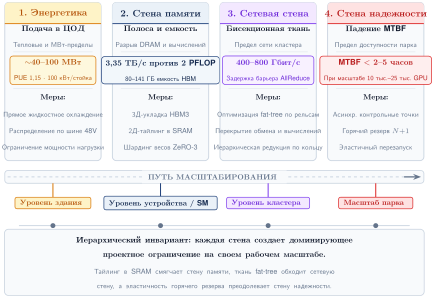

***Четыре стены инфраструктуры**: четыре доминирующих ограничения, расположенных вдоль пути масштабирования: энергетическая стена (пределы подачи энергии дата-центра, объект около 40 МВт), стена памяти (разрыв пропускной способности HBM: 3,35 ТБ/с у HBM3 против около 2 000 TFLOP/s), сетевая стена (предел бисекционной сети, 400 Гбит/с NDR IB на порт) и стена надежности (MTBF около 2 часов при 25 тыс. GPU). Каждая стена становится доминирующим ограничением на своем масштабе: от одного GPU через узлы по 8 GPU и кластеры на 1 000 GPU до парков из 25 000 и более GPU.*

## Спектр ускорителей

Основа начинается с кремния, где специализированный чип оправдывает себя, делая то, чего универсальный процессор не делает эффективно: одни и те же плотные арифметические операции выполняются снова и снова на максимальной пропускной способности. Представим, что происходит, когда CPU выполняет умножение матриц. Процессор выбирает инструкцию, декодирует ее, проверяет зависимости по данным, направляет операнды через глубокий конвейер и записывает результат обратно в регистровый файл. Для каждой операции умножения с накоплением чип тратит энергию на предсказание ветвлений, спекулятивное исполнение, внеочередное планирование и когерентность кэшей.

Эти механизмы нужны потому, что CPU должен эффективно обрабатывать любую последовательность инструкций: от обхода связанных списков с обращением по указателям до системных вызовов. Для нейросетевых нагрузок, однако, операция почти всегда одна и та же: перемножить две матрицы известных размеров, добавить смещение и применить нелинейную функцию. Сложная управляющая логика CPU становится налогом на каждую операцию, платой за гибкость, которая нагрузке не нужна. Эта мысль повторяет классический спор о сокращенном наборе команд (RISC) и сложном наборе команд (CISC) в архитектуре компьютеров: как RISC-процессоры добились большей пропускной способности, упростив набор команд, так и ускорители машинного обучения добиваются большей пропускной способности, упрощая вычислительную модель под доминирующий шаблон нагрузки.

> **Налог на универсальность**
>
> Современный серверный CPU отдает примерно 30–40 процентов площади кристалла кэшам, 20–30 процентов управляющей логике (предсказатели ветвлений, буферы переупорядочивания, декодеры инструкций) и только 5–10 процентов арифметическим блокам. Такое распределение оправдано для универсального кода, где ветвления непредсказуемы, а шаблоны доступа к данным нерегулярны. Умножение матриц, напротив, имеет регулярные шаблоны доступа и предсказуемый поток управления. Кремний, отданный предсказанию ветвлений или спекулятивному исполнению, дает гибкость, которую эта нагрузка почти не использует. Это и есть **налог на универсальность** (принцип «налог на универсальность»): площадь и энергия, отданные возможностям вне доминирующей нагрузки.
>
> Специализированные ускорители снижают этот налог. Продвигаясь по спектру от CPU к специализированной интегральной схеме (ASIC), можно отдать больше площади кристалла арифметике, убрав универсальную управляющую логику. Прогресс поддается количественной оценке: CPU тратит примерно 5–10 процентов кристалла на арифметику, GPU — примерно 50–60 процентов, тензорный процессор (TPU) — примерно 70–80 процентов, а специализированный ASIC может отдать целевому вычислению более 90 процентов кристалла.

Переход от универсального кремния к специализированному следует логичной последовательности. На одном конце спектра GPU сохраняют значительную программируемость и при этом дают в 10–100$\times$ больше пропускной способности матричных операций, чем CPU. На другом конце пользовательские ASIC жестко фиксируют конкретный поток данных ради максимальной эффективности ценой гибкости.

Понимание того, *где* каждая архитектура находится на этом спектре и *почему*, необходимо для выбора аппаратуры под конкретную нагрузку. Спектр — это не рейтинг от «плохого» (универсальный CPU) к «хорошему» (пользовательский ASIC), а континуум компромиссов, где каждая позиция дает лучшее соответствие своему сочетанию свойств нагрузки и ограничений развертывания.

GPU — первый крупный шаг от универсальных вычислений к массовому параллелизму с сохранением программируемости. Например, NVIDIA H100 содержит 16 896 ядер CUDA, объединенных в 132 потоковых мультипроцессора (SM). Каждый SM может одновременно выполнять тысячи потоков по модели исполнения **одна инструкция, много потоков (SIMT)**[^fn-simt-warp-execution]. В отличие от CPU, который оптимизирован на задержку одного потока, GPU скрывает задержку памяти, поддерживая тысячи потоков в полете и переключаясь между ними, когда один из них ждет обращения к памяти.

Программист пишет одну функцию (*ядро*, kernel), а аппаратура распределяет ее по огромной сетке потоков. Эта модель достаточно гибка, чтобы выполнять любое математическое ядро, от свертки до механизмов внимания и пользовательских функций потерь, при этом давая на порядки больше пропускной способности, чем CPU, для параллельных по данным вычислений.

Расплата в том, что код с нерегулярными ветвлениями работает плохо: расходящиеся потоки внутри варпа (группы из 32 потоков, которые выполняются синхронно) должны исполняться последовательно. Когда потоки одного варпа идут по разным веткам оператора if-else, аппаратура вынуждена выполнить обе ветки по очереди, отключая во время каждой ветки потоки, которые пошли по другому пути. Для нагрузок машинного обучения штраф за расхождение обычно невелик, потому что операции нейронных сетей имеют очень однородный поток управления: каждый элемент умножения матриц следует одному и тому же пути вычислений.

[^fn-simt-warp-execution]: **SIMT (одна инструкция, много потоков)**: термин введен NVIDIA, чтобы отличить свою модель GPU от классической модели «одна инструкция, много данных» (SIMD). В SIMT 32 потока образуют *варп*, который использует общий поток инструкций, но может расходиться на ветвлениях; расхождение вынуждает последовательно исполнять обе ветви и вдвое снижает пропускную способность на каждое ветвление. Для нагрузок машинного обучения, где матричные операции имеют однородный поток управления, расхождение варпов редко, поэтому GPU достигают почти пиковой загрузки в операциях общего матричного умножения (GEMM), но деградируют на нерегулярных операциях, таких как разреженное внимание или динамическая маршрутизация.

TPU идут дальше: они жертвуют частью программируемости ради максимальной эффективности одного типа операций, жестко фиксируя сам поток данных. Тензорные процессоры Google используют архитектуру **систолического массива**[^fn-systolic-array-tpu]: фиксированную решетку блоков умножения с накоплением (MAC), где данные перетекают между соседними ячейками регулярным волнообразным образом. Вместо выборки и декодирования инструкций для каждой операции систолический массив принимает матрицу с одного края и проталкивает ее через решетку: каждая ячейка выполняет одно умножение с накоплением и передает результат соседу. Это полностью устраняет накладные расходы на выборку и декодирование инструкций и избавляет от записи промежуточных результатов в память, потому что каждая частичная сумма сразу переходит к следующему вычислению.

Цена этой эффективности — меньшая программируемость. Модели приходится компилировать через Accelerated Linear Algebra (XLA), который отображает высокоуровневые операции на фиксированный поток данных. Нагрузки с нерегулярным управлением или динамическими формами могут плохо отображаться на такую архитектуру, а сам процесс компиляции может занимать много времени (от минут до часов для сложных моделей), что замедляет цикл итераций при разработке модели.

Различие моделей программирования GPU и TPU важно для организационных решений. Исследовательские группы, которые часто меняют архитектуры моделей (добавляют собственные шаблоны внимания, экспериментируют с новыми функциями активации, прототипируют алгоритмы обучения), обычно предпочитают экосистему CUDA у GPU, потому что новые операции можно реализовать как пользовательские ядра, не дожидаясь поддержки компилятора. Команды, которые запускают устоявшиеся архитектуры в большом масштабе (стандартное обучение трансформеров, крупномасштабное дообучение), могут предпочесть TPU: компилятор XLA может оптимизировать весь граф вычислений и часто добивается лучшей загрузки аппаратуры, чем рукописные ядра CUDA для стандартных операций.

[^fn-systolic-array-tpu]: **Систолический массив**: от греческого *systole* («сжатие»). Модель систолического массива предложили H. T. Kung и Charles E. Leiserson (Kung and Leiserson, 1979; Kung, 1982): данные проходят через решетку процессорных элементов ритмично, как сердцебиение. Каждая ячейка выполняет одно умножение с накоплением и передает частичные результаты соседу, исключая обращения к регистровому файлу. TPU v1 от Google использовал массив $256{\times}256$ (65 536 MAC), достигая 92 TOPS при 75 Вт: его поток данных был жестко зафиксирован, чтобы сделать инференс в масштабе дата-центра экономически выгодным (Jouppi et al., 2017).

> **История TPU**
>
> **Сценарий**: в 2013 году оценки Google показали, что если пользователи будут говорить с Android-телефонами по 3 минуты в день, используя голосовой поиск, то обработка такой нагрузки инференса на универсальных CPU потребует удвоения вычислительной мощности дата-центров по запретительной стоимости (Jouppi et al., 2017).
>
> **Диагноз**: стандартные архитектуры CPU платили высокий налог на универсальность: значительные площадь кремния и мощность уходили на внеочередное исполнение, предсказание ветвлений и сложные кэши, а не на пропускную способность умножения матриц.
>
> **Системный урок**: специализация железа экономически оправдана, когда нагрузка массовая, стабильная и определяется одним математическим ядром (MatMul). TPU v1 жестко реализовал систолический массив $256 \times 256$, чтобы дать 92 TOPS (INT8) в пределах 75 Вт, и закрепил специализированные ASIC-ускорители в производственной инфраструктуре обслуживания.

Специализированные ASIC занимают специализированный конец спектра, где экономика кремния может оправдать отказ от большей части универсальной программируемости. Когда организация запускает стабильную нагрузку в огромном масштабе, проектирование чипа именно под эту нагрузку может стать экономически рациональным. ASIC способен улучшить энергию на операцию и устойчивую загрузку на своей целевой нагрузке, убрав возможности, которые вычислению не нужны.

Например, чип Tesla Dojo D1 оптимизирован под пространственную и временную структуру моделей зрения на видео. Его сотни плотно связанных вычислительных узлов спроектированы под потоки данных конвейера зрения Tesla, а объем встроенной SRAM подобран так, чтобы пространственные тайлы оставались рядом с вычислительными блоками. Это сокращает повторяющиеся обращения к внешней памяти, которые для того же вычисления потребовал бы универсальный GPU.

AWS Trainium идет иным путем: он ориентирован на широкий класс обучения трансформеров, а не на одну модель. Системы Trainium сочетают управление памятью, которое ведет компилятор, с аппаратно поддержанными коллективными коммуникациями, поэтому типичные шаблоны обучения, такие как синхронизация тензорного параллелизма и редукции параллелизма по данным, можно оптимизировать внутри ускорительной фабрики, а не целиком перекладывать на программное обеспечение хоста.

Риск кремниевых ASIC так же очевиден: если доминирующая архитектура модели сменится, как это произошло с переходом от сверточных нейронных сетей (CNN) к трансформерам в 2017–2020 годах, ASIC, спроектированный под старую архитектуру, становится обесцененным активом. Цикл проектирования нового ASIC занимает 2–3 года от замысла до развертывания, поэтому решение об архитектуре должно предвидеть тренды нагрузок на несколько лет вперед. Эта задача предсказания нетривиальна: в 2015 году мало кто предполагал, что трансформеры на основе внимания вытеснят CNN как доминирующую архитектуру за пять лет, а организации, которые вложились в ASIC под CNN в тот период, обнаружили, что их аппаратура простаивает из-за архитектурного сдвига.

Кремний на заказ, таким образом, — ставка на стабильность нагрузки. Такую ставку делают обычно организации, достаточно крупные, чтобы оправдать затраты на разработку в \$50–\$200 млн, и с достаточным объемом нагрузки, чтобы распределить невозвратные инженерные затраты (NRE) на миллионы чипов. Google может оправдать затраты на TPU, потому что крупные сервисы вроде поиска, рекомендаций YouTube и фильтрации спама в Gmail могут окупить общую платформу ускорителей. Исследовательская лаборатория, которая запускает несколько сотен GPU, таких инвестиций себе позволить не может.

Ставка окупается, когда нагрузки стабильны: специализированный ASIC может дать в 5–10$\times$ больше энергетической эффективности, чем универсальный GPU, для своей целевой операции. Сдвиг нагрузки может обесценить это преимущество, потому что фиксированный поток данных чипа может не подойти для существенно другого вычислительного шаблона. Если довести аргумент о локальности до конца, возникает вопрос о физическом масштабе: может ли вычислительная фабрика вырасти до размеров целой пластины.

### Движки на всю пластину

Движки на всю пластину (WSE) стремятся к локальности данных на большей части кремниевой пластины. В отличие от архитектур, построенных из чиплетов или отдельных кристаллов, соединенных связями на уровне корпуса или платы, движок на всю пластину, такой как Cerebras WSE-3, использует непрерывную вычислительную фабрику размером с обеденную тарелку. Межсоединение на пластине можно сохранить по всей поверхности потому, что пластина не разрезается на отдельные чипы.

Для конфигурации WSE-3 2024 года Cerebras указала в регистрационном документе 900 000 оптимизированных для ИИ ядер, 44 ГБ распределенной встроенной SRAM и совокупную пропускную способность памяти 21 ПБ/с (Cerebras Systems, 2024). Эти характеристики нельзя напрямую сравнивать с пиковыми FLOP/s кластера GPU или с пропускной способностью HBM, поскольку архитектуры раскрывают разные потоки данных, организации памяти, точности и отображения нагрузок. Устойчивое сравнение топологическое: межсоединения на пластине исключают передачи на уровне корпуса, платы и стойки для работы, которая отображается на фабрику.

Инженерная задача интеграции на пластину физическая: выход годных, подача энергии и тепловое расширение должны решаться по всей кремниевой поверхности ([«Архитектура движка на всю пластину (WSE)»](#fig-wafer-scale-engine)). Один дефект на обычном чипе может сделать его негодным, но на движке на всю пластину программа должна учитывать дефекты: маршрутизировать вокруг локальных производственных изъянов кремниевой фабрики. В документированной конфигурации CS-2 двенадцать блоков питания в резервной схеме 9+3 могли подавать до 23 кВт на WSE-2 (Cerebras Systems, 2021). Эта конфигурация показывает, почему подача энергии и охлаждение движка на пластину требуют системного жидкостного охлаждения, а не обычного радиатора ускорителя.

Движки на всю пластину занимают в спектре уникальное место: они очень специализированы в *физической* архитектуре, но гибки в *вычислительной* модели, поскольку базовые ядра часто достаточно универсальны, чтобы исполнять разнообразные ядра машинного обучения. Они воплощают философию «масштабирования вверх», которая стремится устранить сетевую стену, превращая кластер в один чип.

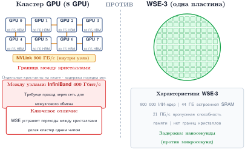

***Архитектура движка на всю пластину (WSE)**: в отличие от кластера, собранного из отдельных корпусов и плат, WSE использует большую часть 300-миллиметровой пластины как единую маршрутизированную вычислительную фабрику. Программное обеспечение, учитывающее дефекты, обходит непригодные области, а сеть на пластине и распределенная SRAM заменяют передачи за пределы корпуса для отображаемых операций.*

Компромисс движка на всю пластину меняет сложность производства и маршрутизацию с учетом дефектов на фабрику на пластине, которая избегает передач на уровне корпуса и платы между его 900 000 ядрами. [«Спектр ускорителей»](#fig-accelerator-spectrum) размещает эти архитектуры на континууме программируемости и эффективности. [«Сравнение архитектур ускорителей»](#tbl-accelerator-comparison) переводит этот континуум в архитектурные свойства, которые инженер должен сравнивать.

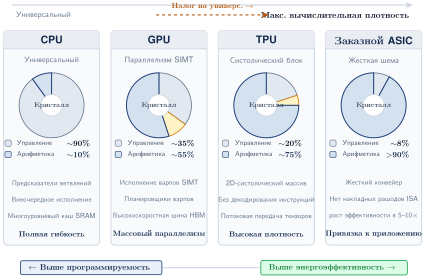

***Спектр ускорителей**: проектирование ML-аппаратуры включает фундаментальный компромисс между программируемостью и эффективностью. Универсальные CPU дают максимальную гибкость, но низкую вычислительную плотность. Переход к специализированным ASIC и систолическим массивам повышает пропускную способность на ватт за счет жесткой фиксации распространенных потоков данных, ценой поддержки более узкого набора архитектур моделей.*

| **Признак**         |   **CPU**    | **GPU** (H100) | **TPU** (v5p)  | **Движок на пластину** | **Специализированный ASIC** |
|:--------------------|:------------:|:--------------:|:--------------:|:----------------------:|:---------------------------:|
| **Арифметическое ядро** | Скалярное/векторное | Тензорное ядро | Систолический массив | Ядро в стиле RISC | Фиксированный поток данных |
| **Исполнение**      |  Инструкции  |      SIMT      |  Управляемое данными  |     Поток данных      |       Жесткая схема         |
| **Управление памятью** |    Кэш     |  L1/L2 + HBM   |   Скретчпад    |   Встроенная SRAM      |      Явная сетка           |
| **Гибкость**        |  Максимальная  |     Высокая    |    Умеренная   |        Высокая         |            Низкая           |
| **Эффективность**   |     Низкая   |     Высокая    |  Очень высокая |        Высокая         |        Экстремальная        |

***Сравнение архитектур ускорителей**: при движении слева направо программируемость общего назначения обменивается на вычислительную плотность и энергоэффективность. Движки на всю пластину занимают отдельную нишу, предлагая производительность уровня кластера на одном куске кремния.*

Для нашей модели 175B выбор аппаратуры из [«Сравнения архитектур ускорителей»](#tbl-accelerator-comparison) сводится не к пиковым FLOP/s. Если мы исследовательская лаборатория, которая каждую неделю экспериментирует с новыми архитектурами, гибкость GPU оправдывает его налог на универсальность. Если же мы годами развертываем фиксированный трансформер, эффективность потока данных TPU или энергетическое преимущество ASIC могут определить полную стоимость. Спектр ускорителей в конечном счете — экономический вопрос: *сколько гибкости можно отдать, учитывая стабильность нагрузки*.

### Ускорители на чиплетах

Важный паттерн проектирования ускорителей — архитектура **чиплетов**, примером которой служат Blackwell от NVIDIA и серия AMD Instinct MI300. Вместо изготовления одного монолитного кристалла чиплетные конструкции разбивают процессор на несколько меньших кристаллов, соединенных высокоскоростным межкристальным интерфейсом на общей подложке корпуса. Этот подход решает два физических ограничения, которые сдерживают монолитные конструкции.

Во-первых, максимальный размер кристалла ограничен пределом экспозиционного поля фотолитографии (858 мм², однократная экспозиция, рассмотренная в [«Эволюции архитектур GPU»](#sec-compute-infrastructure-evolution-gpu-architectures-566b)), что ограничивает число тензорных ядер, SM и стеков HBM, которые монолитный GPU может интегрировать. Чиплетные конструкции обходят этот предел, размещая несколько кристаллов на одном корпусе: двухкристальная конструкция B200 фактически создает эквивалент процессора площадью 1 600 мм².

Во-вторых, выход годных падает экспоненциально с площадью кристалла, потому что один дефект в любой точке делает весь чип непригодным. Меньшие чиплеты имеют более высокий выход по отдельности, а интеграция на уровне корпуса позволяет частичный выход (дефектный чиплет можно заменить исправным). Это преимущество по выходу напрямую снижает стоимость производства единицы вычислений, что особенно важно по мере роста плотности транзисторов и удорожания техпроцессов.

Компромисс — межкристальный интерфейс. Связь между чиплетами внутри корпуса быстрее связи между корпусами (NVLink), но медленнее связи внутри одного монолитного кристалла (внутрикристальная сеть на кристалле). Нагрузки, которые создают частый мелкозернистый обмен между элементами обработки (например, операции, разделяющие данные между несмежными SM), могут получить штраф задержки, если эти SM находятся на разных чиплетах. Производители GPU смягчают это, делая межкристальную связь прозрачной для программиста: программное обеспечение видит один логический GPU независимо от топологии чиплетов.

### Эволюция архитектур GPU

Быстрая эволюция архитектур NVIDIA за последнее десятилетие показывает, как проектирование ускорителей адаптировалось к меняющимся требованиям ML-нагрузок. Каждое поколение вводило архитектурные нововведения, нацеленные на конкретные узкие места, выявленные в промышленных ML-нагрузках, а не просто наращивало число транзисторов.

Архитектура Volta (2017) ввела тензорное ядро первого поколения, признав, что обучение нейросетей большую часть времени проводит в матричных умножениях. Выделенное аппаратное умножение с накоплением рядом с существующими ядрами CUDA позволило Volta ускорить доминирующий шаблон нагрузки, не жертвуя универсальной программируемостью, которая делала GPU привлекательными для исследований. V100, флагман Volta, давал 125 TFLOP/s FP16 на тензорных ядрах при 300 Вт.

Архитектура Ampere (2020) расширила поддержку тензорных ядер на TF32 и BF16, после того как Turing ввел режимы INT8 и INT4 для квантованного инференса. A100 также ввел Multi-Instance GPU (MIG), который делит один GPU на до семи изолированных экземпляров, позволяя эффективно делить дорогое оборудование между несколькими нагрузками инференса. Самым значимым для инфраструктуры изменением стал NVLink третьего поколения: он удвоил двунаправленную пропускную способность до 600 ГБ/с на GPU по сравнению с 300 ГБ/с у Volta, напрямую решая сетевую стену для тензорного параллелизма, который разделяет матрицы каждого слоя между GPU.

Архитектура Hopper (2022) добавила Transformer Engine: его FP8-рецепты и интеграция autocast выполняют поддерживаемые операции трансформеров в FP8 с управляемым масштабированием, сохраняя более высокую точность там, где этого требует настроенный рецепт или реализация. Hopper также ввел NVLink 4.0 на 900 ГБ/с на GPU и NVLink Switch, который позволяет связывать GPU за пределами границы в 8 GPU.

Пиковые 1 979 TFLOP/s FP8 на тензорных ядрах H100 при 700 Вт означают улучшение эффективности в 6,8$\times$ по сравнению с V100. Оно достигнуто сочетанием технологического процесса (TSMC 4N), архитектурных нововведений (Transformer Engine) и инженерии точности (поддержка FP8).

Архитектура Blackwell (2024) продолжила эту траекторию с B200: он объединяет два GPU-кристалла в одном корпусе через высокоскоростной межкристальный канал, фактически создавая «двухкристальный GPU», который дает около 4 500 TFLOP/s плотных FP8 на тензорных ядрах при 1000 Вт. Для сравнения FP16/BF16 нужно использовать более низкую, специфичную для точности цифру производителя, а не пиковое значение FP8.

Двухкристальный подход признает, что размеры одного кристалла GPU приближаются к пределу экспозиционного поля литографического оборудования, и дальнейшее масштабирование требует чиплетных конструкций. Предел экспозиционного поля — фундаментальное ограничение фотолитографии: объектив сканера EUV может спроецировать рисунок только на область около $26{\times}33$ мм (858 мм²) за одну экспозицию. Кристалл больше этой площади потребовал бы нескольких экспозиций с «сшивкой», что технически возможно, но резко повышает стоимость и снижает выход годных.

Blackwell также ввел NVLink пятого поколения на 1 800 ГБ/с на GPU, снова удвоив внутриузловую пропускную способность. Межкристальный канал внутри корпуса B200 работает на 10 ТБ/с, и этого достаточно, чтобы для многих операций два кристалла выглядели для программного обеспечения как один логический GPU.

Эта траектория показывает устойчивый паттерн: каждое поколение устраняет узкое место, открытое предыдущим. Volta добавил выделенную матричную аппаратуру для вычислительного узкого места. Ampere расширил поддержку смешанной точности. Hopper ориентировался на точность, специфичную для трансформеров, с FP8. Blackwell упирается в предел размера кристалла многокристальной упаковкой.

На каждом шаге конструкция ускорителя отражает важную нагрузку своей эпохи, иллюстрируя, *как* физика нагрузки определяет физику кремния. Эта совместная эволюция нагрузок и аппаратуры не случайна: архитекторы ускорителей профилируют ML-нагрузки, чтобы выявить узкие места, а затем проектируют следующие поколения для их устранения. В результате эволюция аппаратуры тесно связана с эволюцией архитектур моделей, и именно поэтому трансформерные нагрузки с 2017 года заметно формируют проектирование ускорителей.

Эволюция также показывает неприятный закупочный паттерн для планировщиков инфраструктуры: флагманские поколения ускорителей сменяются быстрее, чем здание, в котором они размещены. V100 оставался флагманским обучающим GPU примерно три года (2017–2020). A100 удерживал эту позицию около двух лет (2020–2022). Hopper и Blackwell продолжили этот короткий цикл в середине 2020-х.

Отсюда вывод: дата-центр, построенный под ускорители, должен предусматривать циклы обновления до того, как прибудет первая стойка. Планирование обновления железа поэтому — неотъемлемая часть первоначального решения о закупке, а не запоздалая мысль. [«Эволюция архитектур GPU NVIDIA»](#tbl-gpu-evolution) сводит этот темп к основным поколениям GPU NVIDIA и изменениям межсоединений и энергопотребления, которые пришли вместе с ними. Эти три величины не масштабируются вместе, и здание, рассчитанное только на одну из них, будет ошибаться в двух других. [«Вычисления, пропускная способность и мощность растут с тремя разными темпами»](#fig-gpu-scaling-trends) разделяет их: вычисления растут вдвое быстрее пропускной способности и более чем в пять раз быстрее мощности, поэтому стойка, обновленная под арифметику, может обогнать и свою систему памяти, и свой энергетический бюджет.

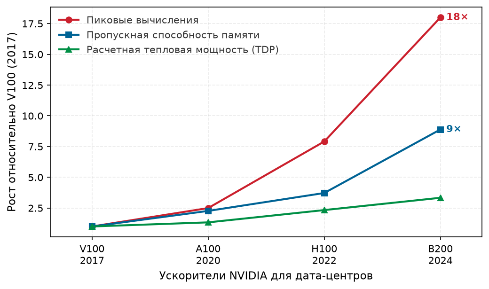

***Вычисления, пропускная способность и мощность растут с тремя разными темпами**: пиковые вычисления, пропускная способность памяти и расчетная тепловая мощность (TDP) ускорителей NVIDIA для дата-центров, нормированные к V100. Вычисления выросли в 18$\times$, пропускная способность в 8,9$\times$, TDP в 3,3$\times$, поэтому каждое поколение покупает арифметику быстрее, чем байты или ватты, которые ее питают. Характеристики взяты из реестра аппаратуры MLSysIM.*

Тонкость, которая влияет на однородность парка, — **кремниевая лотерея**: производственная реальность, в которой микроскопический разброс в литографии 4 нм дает распределение качества чипов по каждой пластине. NVIDIA управляет этой кривой выхода через агрессивную сортировку по классам (binning): кристаллы, способные поддерживать высокие тактовые частоты при строго контролируемых напряжениях под полной расчетной тепловой мощностью (TDP), обозначаются как премиальные модули H100 SXM, а с более высокими токами утечки или мелкими дефектами становятся картами H100 PCIe или понижаются до продуктов нижнего уровня. Даже внутри верхнего класса SXM достижимая частота буста варьируется в зависимости от характеристик кремния. В синхронном обучающем кластере коллективные примитивы коммуникации блокируются самым медленным участником. Один чип, работающий на 50 МГц ниже среднего по парку, может снизить эффективную пропускную способность всего кластера на 5–10 процентов, поэтому продвинутые системы управления парком отслеживают метрики производительности каждого GPU и выводят недостаточно производительный кремний в пулы инференса, где влияние разброса отдельных чипов менее заметно.

| **Архитектура**      | **Год** | **Ключевое новшество**  |        **Пиковые тензорные**        |                   **TDP**                    |              **Пропускная способность NVLink**         |
|:---------------------|:-------:|:-----------------------:|:-----------------------------------------------------------:|:--------------------------------------------:|:------------------------------------------------------:|
| **Volta** (V100)     |  2017   | Первое тензорное ядро   |        `125 TFLOP/s`         |       `300 Вт`       |       `300 ГБ/с`       |
| **Ampere** (A100)    |  2020   | Смешанная точность, MIG |        `312 TFLOP/s`         |       `400 Вт`       |       `600 ГБ/с`       |
| **Hopper** (H100)    |  2022   | Transformer Engine, FP8 |     `1 979 TFLOP/s`     |       `700 Вт`       |       `900 ГБ/с`       |
| **Blackwell** (B200) |  2024   | Два кристалла, NVLink 5 |  `4 500 TFLOP/s` FP8  |     `1 000 Вт`     |     `1 800 ГБ/с`     |

***Эволюция архитектур GPU NVIDIA**: каждое поколение вводит архитектурные нововведения, нацеленные на доминирующий шаблон ML-нагрузок своей эпохи. Эффективность растет заметно, но неравномерно по поколениям, а пропускная способность NVLink возрастает с 300 ГБ/с у V100 до 1 800 ГБ/с у B200, при этом между крупными удвоениями есть меньший скачок в 1,5$\times$ от A100 к H100.*

Разбор сырой пропускной способности и энергетической эффективности из [«Эволюции архитектур GPU NVIDIA»](#tbl-gpu-evolution) показывает фундаментальное расхождение в аппаратуре ([«Стена эффективности ускорителей»](#fig-accelerator-efficiency-wall)).

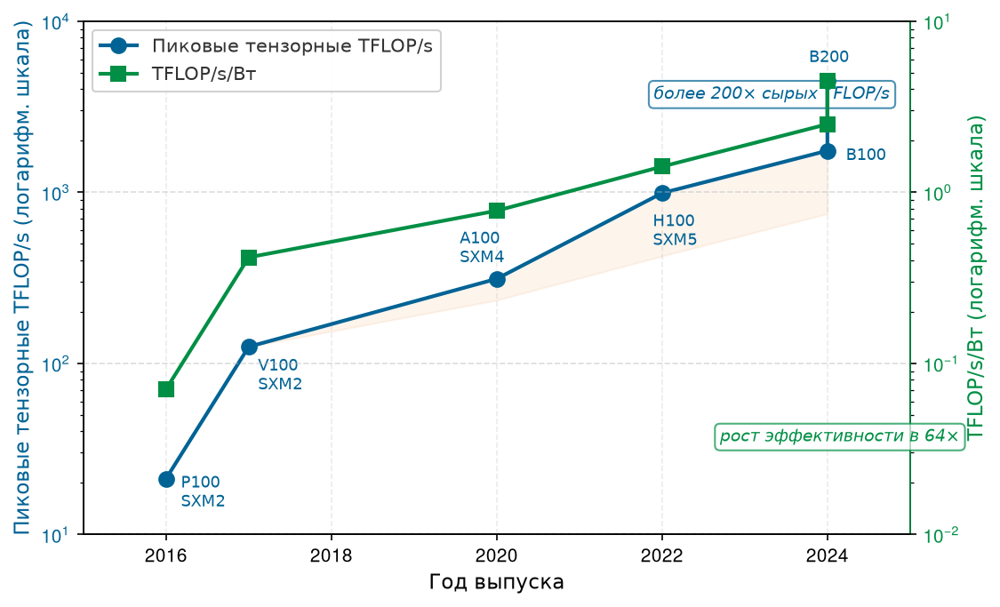

***Стена эффективности ускорителей**: пиковая пропускная способность тензорных ядер (синяя, левая ось) и энергетическая эффективность (зеленая, правая ось) для шести поколений ускорителей NVIDIA для дата-центров, обе оси логарифмические. Ряд следует заявленному низкоточному режиму тензорных ядер для каждого поколения, поэтому смена точности — часть аппаратного тренда, а не сравнение FP16 «яблоко с яблоком». Сырая пропускная способность выросла более чем в 200$\times$ от P100 до B200, а эффективность (TFLOP/s на ватт) — заметно меньше. Заштрихованная область выделяет растущий разрыв, который должны поглотить энергосеть, системы охлаждения и инфраструктура дата-центра.*

[«Стена эффективности ускорителей»](#fig-accelerator-efficiency-wall) показывает важную асимметрию: заявленная пиковая пропускная способность тензорных ядер в низкой точности выросла более чем в 200$\times$ от P100 до B200, тогда как TFLOP/s на ватт выросли заметно меньше. Режимы точности различаются от поколения к поколению, но это различие — часть аппаратного тренда, потому что новые поколения набирают плотность вычислений частично за счет низкоточных форматов. Это расхождение способствует энергетической стене, которая обсуждается в [«Энергетическая стена и тепловые ограничения»](#sec-compute-power-wall), и объясняет, почему в плотных ускорительных объектах так важны жидкостное охлаждение, подача энергии мегаваттного масштаба и управление теплом.

### Эволюция архитектур TPU

Траектория TPU Google идет другим путем: акцент делается на распределенную эффективность и интеграцию с компилятором XLA. Если GPU делают ставку на пиковую пропускную способность на чип и программную гибкость (CUDA), то TPU с самого начала задуман как ресурс масштаба пода. Каждый чип TPU рождается частью большого кластера, с выделенными межчиповыми соединениями (ICI), которые полностью обходят хост-CPU.

Последовательность поколений показывает, как этот подход «сначала под» перешел от инференса к обучению. TPU v1 (2015) был выделенным чипом инференса с систолическим массивом $256{\times}256$, дававшим 92 TOPS (INT8) для матричных операций, которые доминировали в промышленном инференсе Google. Затем TPU v2 (2017) и TPU v3 (2018) сместили архитектуру к обучению: добавили bfloat16 (BF16), обойдя проблемы динамического диапазона стандартного FP16, и масштабировали концепцию пода до 1 024 чипов и более 100 PFLOP/s совокупных вычислений. TPU v4 (2021) распространил ту же логику на саму сеть, добавив оптический коммутатор каналов, чтобы физическую топологию можно было перенастраивать под разные нагрузки, а пиковую BF16-пропускную способность на чип подняли до 275 TFLOP/s.

TPU v5p (2023) продолжил эту архитектуру масштаба пода для обучения верхнего уровня. Он предлагает 459 TFLOP/s BF16-вычислений, 95 ГБ HBM2e с пропускной способностью памяти 2 760 ГБ/с и 1 200 ГБ/с двунаправленной пропускной способности ICI на чип, оптимизированной под массовые операции AllReduce, которые нужны моделям с миллиардами параметров. [«Эволюция архитектур TPU Google»](#tbl-tpu-evolution) показывает, как эта архитектура «сначала под» развивалась по поколениям TPU. В [приложении «Коммуникация»](appendix_communication.md#sec-appdx-comm-foundations-allreduce) разбирается модель сложности коллективной коммуникации и выбор алгоритмов для AllReduce, которые объясняют, почему с ростом размера модели потолок производительности обучения задает межчиповая пропускная способность, а не арифметика на чип.

| **Поколение** | **Год** |     **Ключевое новшество**     |            **Пиковая BF16**            |              **HBM**              | **Пропускная способность ICI (совокупная, в одну сторону)** |
|:---------------|:--------:|:--------------------------:|:------------------------------------:|:---------------------------------:|:-------------------------------------:|
| **TPU v1**     |   2015   | Систолический массив (инференс) |               92 TOPS*               |                 —                 |                   —                   |
| **TPU v2**     |   2017   |   Высокопропускная память    |              45 TFLOP/s              |               16 ГБ               |                248 ГБ/с               |
| **TPU v3**     |   2018   | Жидкостное охлаждение, масштаб пода  |             123 TFLOP/s              |               32 ГБ               |                280 ГБ/с               |
| **TPU v4**     |   2021   | Оптическая коммутация  |             275 TFLOP/s              |               32 ГБ               |                300 ГБ/с               |
| **TPU v5p**    |   2023   |     SparseCore, HBM2e      | `459 TFLOP/s` | `95 ГБ` |                600 ГБ/с               |

***Эволюция архитектур TPU Google**: развитие TPU показывает философию «сначала под», где пропускная способность межчиповых соединений и оптимизация на уровне компилятора (XLA) важны не меньше пиковой арифметики на чип. Примечание: TPU v1 работал только в INT8.*

Это сравнение выявляет фундаментальное расхождение архитектурной философии ([«Эволюция архитектур TPU Google»](#tbl-tpu-evolution)). Эволюция GPU — гонка за то, чтобы упаковать больше арифметики и тензорных ядер более высокой точности в один корпус, и чиплеты (Blackwell) используются, чтобы обойти физические пределы размера кристалла. Эволюция TPU — гонка за более эффективные складские вычислители, где производительность отдельного чипа вторична по отношению к совокупной пропускной способности пода и его перенастраиваемости (Barroso et al., 2019).

Арифметический блок H100 может приблизиться к 2 000 TFLOP/s в заявленном низкоточном режиме, но нагрузки реализуют эту пропускную способность только тогда, когда данные поступают в вычислительные блоки достаточно быстро. Для многих ML-нагрузок предел задает стена памяти.

## Стена памяти

По мере того как арифметическая пропускная способность растет быстрее скорости доступа к данным, вычислительные блоки могут все больше времени тратить на ожидание операндов. Это расхождение известно как **стена памяти** (Wulf and McKee, 1995). Пока масштабирование транзисторов повысило производительность логики на порядки, межсоединения, которые подают данные к этим ядрам, не успевают за ним. Нейронным сетям может требоваться большой поток весов и активаций, поэтому для некоторых режимов инференса и обучения ограничивает не вычисление, а пропускная способность. В разделе «Сводка диагностики» [приложения «Таксономия C³»](appendix_c3.md#sec-appdx-c3-taxonomy-diagnostic-summary) развита диагностическая схема, которая классифицирует это состояние, ограниченное памятью, наряду с другими типовыми узкими местами, с которыми сталкивается парк, так что наблюдаемый симптом соотносится с названным ограничением, а не с догадкой.

Последствия конкретны и ощутимы в нашем сквозном примере. Веса модели 175B занимают 350 ГБ в FP16. Во время авторегрессивного декодирования весь этот тензор в 350 ГБ нужно потоково передавать из внешней памяти в регистры процессора для каждого сгенерированного токена. Один H100 такой тензор не вместит, поэтому это расчет нижней границы пропускной способности после того, как шардинг или квантование решили проблему емкости. При пропускной способности HBM уровня H100 (около 3,35 ТБ/с на ускоритель) одна только передача данных задает нижнюю границу задержки более 100 мс на токен, если путь с пропускной способностью одного ускорителя должен потоком передать веса. Стена памяти — не абстрактное архитектурное понятие: это физическая причина, по которой чат-бот делает заметную паузу между словами. Три инженерных ответа решают это ограничение: HBM расширяет канал данных, модель Roofline строго диагностирует, голодает ли нагрузка по данным или по вычислениям, а тензорные ядра максимизируют арифметическую ценность каждого считанного байта. Как показывает [«Уровни памяти ускорителя»](#fig-accelerator-memory-tier-map), пропускная способность памяти — это также компромисс размещения: перенос рабочего набора ближе к вычислениям повышает пропускную способность, но обычно сокращает объем состояния, который там может храниться.

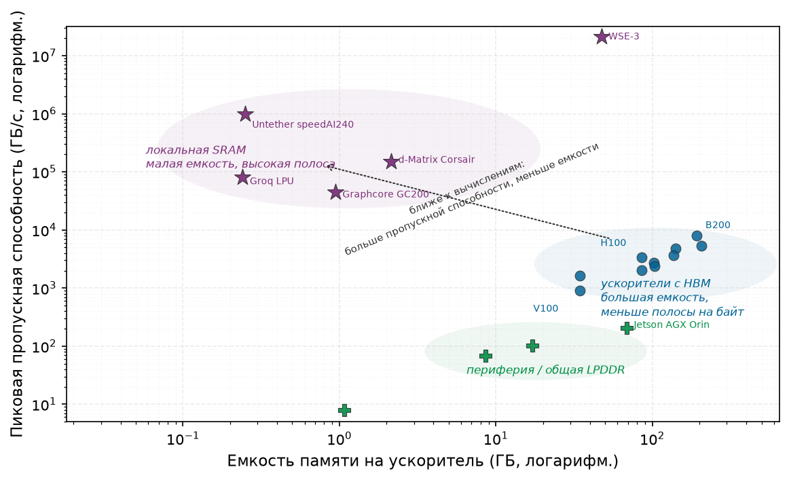

***Уровни памяти ускорителя**: пиковая пропускная способность памяти и емкость разделяют конструкции с локальной SRAM, ускорители с HBM и граничные устройства с общей LPDDR. Пунктирная стрелка отмечает компромисс проектирования: перенос данных ближе к вычислениям повышает пропускную способность, но уменьшает емкость.*

[«Уровни памяти ускорителя»](#fig-accelerator-memory-tier-map) — не рейтинг ускорителей, а карта того, где каждая конструкция размещает байты. Граничные устройства держат память дешевой и компактной, но пропускная способность остается низкой. HBM переносит память на корпус ускорителя, обеспечивая достаточную емкость и пропускную способность для активного состояния модели. Конструкции с локальной SRAM подводят рабочий набор еще ближе к арифметике, давая исключительную пропускную способность ценой гораздо меньшей резидентной емкости. Эта карта уровней объясняет, почему следующий инженерный ответ — HBM: это не самая быстрая память в системе, но это самый высокопропускный уровень, который может держать десятки и сотни гигабайт рядом с кристаллом вычислений.

### HBM: пробивая стену памяти

H100 способен выполнять почти 2 000 TFLOP/s низкоточной матричной арифметики, однако при авторегрессивном декодировании нашей модели 175B его тензорные ядра в модели, ограниченной пропускной способностью, простаивали бы более 99 процентов каждого цикла. Узкое место — не скорость *умножения*, а скорость *доставки*: после того как модель была шардирована или сжата так, чтобы веса поместились, путь обслуживания все равно должен потоком проводить активные шарды весов через арифметические блоки для каждого выходного токена. Никакое число дополнительных тензорных ядер не поможет, когда имеющиеся уже голодают по данным. Ответ ускорителя на это фундаментальное ограничение — HBM.[^fn-hbm-memory-origin]

Иерархия памяти внутри одного ускорителя охватывает порядки величины по емкости и пропускной способности. Наверху находится **регистровый файл**[^fn-register-file-bandwidth]: около 20–30 МБ, распределенных по всем SM, с фактически бесконечной пропускной способностью (сотни ТБ/с), но ничтожной емкостью. Ниже расположены кэш L1 и **общая память** (SRAM),[^fn-sram-energy-efficiency] которые дают около 256 КБ на SM (примерно 33 МБ суммарно) с совокупной пропускной способностью около 19 ТБ/с. Еще ниже находится кэш L2 объемом 50 МБ (около 12 ТБ/с), и наконец, 80 ГБ HBM3 с пропускной способностью 3,35 ТБ/с.

[^fn-register-file-bandwidth]: **Пропускная способность регистрового файла**: в GPU H100 регистровый файл дает CUDA-ядрам совокупную пропускную способность более 300 ТБ/с. Это примерно в 100$\times$ выше пропускной способности HBM3, поэтому тайлинг обязателен: любой операнд, которого нет в регистре во время исполнения, заставляет арифметические блоки ждать 100 и более тактов, и утилизация падает.

[^fn-sram-energy-efficiency]: **Энергия SRAM (пДж/бит)**: обращение к биту в SRAM (общей памяти) стоит примерно 0,1–0,5 пДж, а выборка из HBM — 2–5 пДж. Эта разница в 10$\times$ по энергии — физическая причина слияния ядер (kernel fusion): каждый промежуточный результат, который хранится в SRAM вместо записи в HBM, экономит и время, и заметную мощность и запас по теплу.

> **Архетип B (DLRM в масштабе): стена емкости**
>
> Если архетип A (GPT-4) в основном ограничен пропускной способностью (ему нужно больше TFLOP/s), то архетип B (DLRM в масштабе), то есть нагрузка DLRM, в основном ограничен емкостью. Таблица эмбеддингов в 10 ТБ не помещается в 80 ГБ HBM одного H100, и даже в суммарную HBM одного узла из 8 GPU (640 ГБ) она не помещается. Одной только емкости требуется не меньше 16 таких узлов, не считая репликации, запаса под горячие таблицы и баланса пропускной способности. Промышленные рекомендательные системы часто разрастаются до гораздо более крупных многоузловых шардов, превращая проблему доступа к памяти в масштабную задачу координации сети **All-to-All**.

Разрыв пропускной способности между регистрами и HBM составляет примерно 100$\times$. Если операнд приходится тянуть из HBM для каждой отдельной операции, арифметический блок около 99 процентов времени простаивает. Высокая утилизация FLOP модели (MFU), то есть доля пиковых FLOP/s аппаратуры, потраченных на полезные вычисления модели, достижима только за счет агрессивного **тайлинга**: разбиения огромных матриц весов на небольшие тайлы, которые полностью помещаются в общей памяти и регистрах, с последующим выполнением как можно большего числа операций умножения с накоплением над каждым тайлом до его вытеснения. Эта стратегия тайлинга загружает данные в быструю SRAM SM один раз и повторно использует их в нескольких операциях тензорных ядер ([«Стратегия тайлинга тензорных ядер»](#fig-tensor-core-tiling)), фактически умножая арифметическую ценность каждого байта, считанного из HBM.

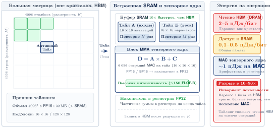

***Стратегия тайлинга тензорных ядер**: чтобы преодолеть узкое место пропускной способности HBM, GPU раскладывают большие матричные операции на небольшие тайлы, которые помещаются в быструю SRAM потокового мультипроцессора (SM). Данные загружаются в SRAM один раз и повторно используются в нескольких операциях тензорных ядер, фактически умножая арифметическую ценность каждого байта, считанного из HBM.*

Несмотря на огромный суммарный объем памяти модели 175B, активный рабочий набор в любую микросекунду нужно тщательно удерживать в тех 30 МБ регистров, иначе теоретическая производительность чипа превращается в мираж. HBM дает основную емкость, но тайлинг решает, достаточно ли быстро эта емкость питает арифметические блоки, чтобы это имело значение.

[^fn-hbm-memory-origin]: **Происхождение HBM**: стандарт утвержден JEDEC в 2013 году как совместная разработка AMD и SK Hynix, изначально для графических карт. ML-ускорители приняли HBM, потому что нейронные сети демонстрируют тот же шаблон доступа, жадный до пропускной способности и умеренный по емкости, что и высококлассная графика. Каждое поколение HBM примерно удваивало пропускную способность (от 128 ГБ/с у HBM1 до 1,2 ТБ/с на стек у HBM3e), но разрыв между пропускной способностью памяти и арифметической пропускной способностью продолжает расти, поэтому HBM — необходимый, но никогда не достаточный ответ на стену памяти.

> **HBM**
>
> ***HBM*** — это трехмерно сложенная архитектура DRAM, которую используют ML-ускорители: несколько кристаллов памяти вертикально соединяются и подключаются к процессору через тысячи сквозных переходов (through-silicon vias, TSV) на общем кремниевом интерпозере. Это устраняет сантиметровые дорожки печатной платы (PCB) обычной DRAM и заменяет их микрометровыми вертикальными путями.
>
> 1. **Значение**: HBM3 в H100 дает около 3,35 ТБ/с пропускной способности памяти (примерно в 16$\times$ больше, чем ~200 ГБ/с у DDR5) при около 2–5 пДж/бит против около 20 пДж/бит у DDR5. Эта пропускная способность задает потолок $\text{BW}$ в железном законе: точка перехода H100 для FP16 составляет примерно $989\,\text{TFLOP/s} / 3{,}35\,\text{ТБ/с} \approx 295$ FLOP/байт, поэтому любой оператор с арифметической интенсивностью ниже 295 FLOP/байт (например, внимание с 5–20 FLOP/байт) остается ограниченным памятью даже при HBM.
> 2. **Отличие**: в отличие от DDR-памяти, которая подключается через сантиметры дорожек печатной платы (это вносит емкость, затухание и требует высокого тока управления), HBM использует шины TSV шириной 1 024 бита с длиной путей, измеряемой в микрометрах. Сокращение расстояния сигнала в 1 000$\times$ позволяет сделать шину шире без пропорционально большей мощности.
> 3. **Типичная ошибка**: распространено заблуждение, что HBM решает стену памяти. HBM переносит стену, но не устраняет ее: пропускная способность тензорных ядер $(R_{\text{peak}})$ росла быстрее пропускной способности HBM от поколения к поколению (от 900 ГБ/с и 125 TFLOP/s FP16 у V100 до 3,35 ТБ/с и 989 TFLOP/s FP16 у H100), поэтому точка перехода продолжает расти, и многие операции остаются ограниченными памятью, несмотря на улучшения HBM.

Традиционная DDR-память подключается к процессору через контакты на краю печатной платы. Каждый DIMM обменивается данными по 64-битной шине, и даже при нескольких каналах (для верхнего серверного CPU типично 8 каналов) современный сервер достигает примерно 200 ГБ/с совокупной пропускной способности памяти.

Физическое расстояние от слота DIMM до кристалла процессора измеряется сантиметрами, и каждый сантиметр медной дорожки вносит емкость, затухание сигнала и потери энергии. На скоростях DDR5 (4 800–6 400 MT/s на контакт) схемы коррекции сигнала должны компенсировать значительные искажения канала и тратят заметную мощность на каждый переданный бит. Повышение скорости передачи по этим длинным дорожкам требует все большей мощности на коррекцию сигнала, создавая кривую убывающей отдачи, к которой DDR5 уже подходит.

HBM решает эту проблему, полностью меняя физическую топологию ([«Трехмерная архитектура HBM»](#fig-hbm-architecture)). Вместо того чтобы прокладывать сигналы *горизонтально* по печатной плате, HBM укладывает несколько кристаллов DRAM *вертикально*, один на другой, и соединяет их **сквозными переходами (TSV)**[^fn-tsv-stacking-vias]: микроскопическими медными столбиками, протравленными через сам кремниевый субстрат.

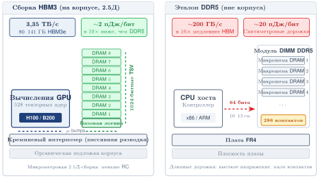

***Трехмерная архитектура HBM**: высокопропускная память добивается своих показателей, вертикально укладывая кристаллы DRAM и соединяя их сквозными переходами. Весь стек размещается на кремниевом интерпозере рядом с кристаллом GPU, что позволяет использовать шину шириной 1024 бита и сокращает путь сигнала с сантиметров до микрометров. Эта физическая близость — ключ к преодолению стены памяти.*

Вертикальная укладка означает фундаментальную перемену в архитектуре памяти: вместо того чтобы повышать пропускную способность, проталкивая сигналы быстрее по длинным медным дорожкам (подход DDR, у которого растет убывающая отдача), HBM повышает ее, умножая число параллельных сигнальных путей через предельно короткие вертикальные соединения. Один стек HBM вертикально связывает 8–12 кристаллов DRAM, пронизывая каждый кристалл тысячами TSV, и образует интерфейс шириной 1024 бита на стек против 64 бит у канала DDR5. Этот интерфейс в 16$\times$ шире в сочетании с более высокими скоростями сигнализации на контакт и дает HBM преимущество по пропускной способности. Процессор и стеки HBM делят один корпус и обмениваются данными через кремниевый интерпозер, что укорачивает электрический путь по сравнению с установленными DIMM. Такая упаковка в первую очередь повышает пропускную способность и энергию на переданный бит; сама по себе она не означает, что полная задержка загрузки из HBM составляет лишь несколько наносекунд.

Сокращение расстояния дает три прямых физических выигрыша:

- **Энергия на бит**: стоимость передачи падает примерно в 4–10$\times$: с около 20 пДж/бит у DDR5 до примерно 2–5 пДж/бит у HBM, поскольку более короткие дорожки имеют меньшую емкость и требуют меньшего тока управления.
- **Задержка**: электрические сигналы распространяются в кремнии примерно с двумя третями скорости света, поэтому более короткий путь сокращает время распространения.
- **Частота сигнализации**: меньшая емкость позволяет использовать более высокие частоты сигнала без сложных схем выравнивания, которые нужны длинным дорожкам печатной платы, что дает высокие скорости на контакт, дополняющие широкую шину.

Вместе эти эффекты объясняют, почему HBM расширяет интерфейс и укорачивает путь, а не просто гонит сигналы через выводы корпуса быстрее.

[^fn-tsv-stacking-vias]: **TSV (сквозной переход через кремний)**: вертикальный медный столбик диаметром 5–10 микрометров, протравленный через кремниевый кристалл, чтобы соединять уложенные слои. Изначально разработаны для CMOS-датчиков изображения в камерах смартфонов. TSV сделали HBM возможной, заменив сантиметры дорожек печатной платы десятками микрометров вертикального кремния, то есть сокращением пути сигнала в 1 000$\times$. Это снижает энергию на бит с около 20 пДж (DDR5) до около 2 пДж (HBM) и делает пропускную способность порядка терабайта в секунду экономически реальной в пределах энергетического бюджета ускорителя.

> **HBM и стена памяти**
>
> Эти вопросы проверяют, понятны ли физические преимущества трехмерно уложенной памяти:
>
> - **HBM против DDR5**: объясните, почему HBM дает более высокую пропускную способность, чем DDR5, несмотря на более низкую тактовую частоту.
> - **Стоимость внешней передачи сигнала**: объясните, почему внешняя DDR-память имеет более высокую энергию на бит и как вертикальная укладка (TSV) снижает эту стоимость.
> - **Переполнение емкости**: укажите, где должны размещаться оставшиеся 60 ГБ, если у H100 80 ГБ HBM, а модели на 70 млрд параметров для весов в FP16 нужно 140 ГБ.
> - **Пропускная способность, а не емкость**: определите, верно ли утверждение: главное преимущество HBM — увеличение общего объема памяти, доступного GPU.

[«Сравнение HBM и стандартной DRAM»](#tbl-hbm-comparison) подводит итог физического компромисса: HBM выигрывает в пропускной способности, перенося память на корпус и расширяя интерфейс, а не делая каждый внешний сигнал быстрее.

| **Показатель**      |              **Локальная DRAM хоста CPU** (DDR5)             |          **Локальная HBM ускорителя GPU** (H100 HBM3)           |    **Коэффициент**    |
|:--------------------|:-------------------------------------------------------:|:------------------------------------------------------------:|:------------------------:|
| **Механизм**       |                      2D-дорожки печатной платы                      |                       Трехмерная укладка кристаллов                        |            —             |
| **Размещение**       |                      Установленные DIMM                     |                    На корпусе (подложка)                    |    Физическая близость    |
| **Пропускная способность**       | ~`200 ГБ/с` | ~`3,35 ТБ/с` |    в ~17$\times$ быстрее    |
| **Ширина интерфейса** |                          64 бита                         |                      1 024 бита на стек                      |     в 16$\times$ шире     |
| **Энергия**          |                        ~20 пДж/бит                       |                         ~2–5 пДж/бит                         | эффективность в 4–10$\times$ |

***Сравнение HBM и стандартной DRAM**: HBM получает преимущество по пропускной способности за счет трех одновременных решений: трехмерной укладки кристаллов (больше битов в корпусе), соединений TSV (более короткие пути сигнала) и размещения на корпусе (близость к процессору). Пропускные способности описывают локальный путь каждого запрашивающего устройства: CPU к DDR5 хоста и GPU H100 к собственной HBM3. Запрос GPU к DRAM хоста также проходит через межсоединение узла и не отражается цифрой канала DDR5.*

Как показано в [«Сравнении HBM и стандартной DRAM»](#tbl-hbm-comparison), это преимущество по пропускной способности имеет цену. HBM стоит около \$10–15 за ГБ, тогда как DDR5 серверной памяти — примерно \$3 за ГБ. Для H100 с 80 ГБ HBM3 одна только память составляет около \$800–1 200 производственной стоимости ускорителя. Для B200 с 180 ГБ HBM3e стоимость памяти достигает \$1 800–\$2 700 на ускоритель, что делает HBM одним из самых дорогих компонентов системы.

Сложный процесс упаковки, требующий точного совмещения тысяч TSV на нескольких слоях кристаллов, имеет более низкий выход годных и большую сложность. Каждый шаг укладки (утонение кристаллов, совмещение, склейка и травление TSV) может вносить дефекты. Совокупный выход по 12 шагам укладки означает, что общий выход для полного стека HBM3e существенно ниже выхода одного кристалла DRAM. Сам кремниевый интерпозер должен быть достаточно большим, чтобы вместить и кристалл процессора, и несколько стеков HBM (суммарная площадь часто превышает 1 000 мм²), а любой дефект в одном TSV может вывести из строя весь стек.

Динамика цепочки поставок HBM дополнительно влияет на ее стоимость и доступность. Цепочка поставок HBM очень концентрирована среди небольшого числа производителей, а производственные процессы (утонение кристаллов, травление TSV, склейка кристаллов) требуют специализированного капитального оборудования, принципиально отличного от стандартного производства DRAM. Расширение производства HBM требует 12–18 месяцев закупки и квалификации оборудования, поэтому выпуск не может быстро расти в ответ на всплески спроса. Когда спрос опережает предложение, как это произошло после взрывного интереса к большим языковым моделям в 2023 году, сроки поставок растягиваются до 12–18 месяцев, а цены могут удвоиться.

Для планировщиков инфраструктуры такая концентрация цепочки поставок означает, что сроки поставки HBM, а не только ее спецификации, могут определить график построения кластера обучения. Организации, планирующие крупные развертывания, должны закрепить выделение HBM за 12–18 месяцев, вкладывая капитал до того, как проектируется остальная система. Этот срок закупки длиннее, чем у любого другого компонента стека, и поэтому HBM задает темп расширения парка.

Для модели 175B одна только HBM в кластере из 1 000 ускорителей составляет примерно \$0,8–1,2 млн при 80 ГБ на ускоритель (или \$2–3 млн при 192 ГБ на ускоритель) по модели стоимости \$10–15 за ГБ, введенной выше. Этот компромисс «стоимость — емкость» объясняет, почему ускорители обычно предлагают 80–192 ГБ HBM, а хост-сервер дает 512 ГБ–2 ТБ DDR: *быстрая* память хранит активные вычисления (веса, активации, градиенты, к которым обращаются в каждом цикле), а *дешевая* память хранит все остальное (состояния оптимизатора, буферы контрольных точек, очереди загрузки данных).

Граница между тем, что находится в HBM, и тем, что в DDR, — критический параметр проектирования для фреймворков обучения. Эффективное управление этой границей — одна из ключевых задач, которые решают шардирование ZeRO (Zero Redundancy Optimizer) и стратегии выгрузки, описанные в разделе «Эффективный по памяти параллелизм по данным: ZeRO и FSDP» главы «Распределенное обучение». Шардирование делит состояние оптимизатора, градиентов и параметров между воркерами; выгрузка переносит более холодное состояние в DRAM хоста или на NVMe (Non-Volatile Memory Express), когда лимитом становится емкость HBM. Ошибиться с этой границей в любую сторону дорого: слишком много данных в HBM тратит дорогую емкость, а слишком много в DDR создает задержки пропускной способности, которые простаивают арифметические блоки.

#### Поколения HBM и граница масштабирования

Эволюция HBM идет в ногу с ростом размеров моделей. Каждое поколение увеличивает число уложенных кристаллов, скорость сигнализации на контакт и общую емкость на стек, что диктуется неослабевающим ростом числа параметров моделей. [«Эволюция высокопропускной памяти»](#tbl-hbm-evolution) показывает граничное условие масштабирования: HBM4 должна расширить интерфейс, потому что одного роста скорости на контакт уже недостаточно.

| **Показатель**       | **HBM2e (A100)** | **HBM3 (H100)** |             **HBM3e (B200)**            |    **HBM4 (будущее)**    |
|:---------------------|:----------------:|:---------------:|:---------------------------------------:|:-----------------------:|
| **Пиковая пропускная способность**   |    ~2,0 ТБ/с     |    ~3,3 ТБ/с    |                ~8,0 ТБ/с                | 12–16 ТБ/с (прогноз) |
| **Типичная емкость** |    40–80 ГБ    |    80–96 ГБ    | `180 ГБ` |         288 ГБ+         |
| **Ширина интерфейса**  |     1024 бита     |     1024 бита    |                 1024 бита                |         2048 бит        |
| **Высота стека**     |      8 кристаллов      |    8–12 кристаллов   |                 12 кристаллов                 |         16 кристаллов         |

***Эволюция высокопропускной памяти**: каждое поколение увеличивает совокупную пропускную способность памяти ускорителя, следуя росту больших моделей. Переход к HBM4 впервые с момента появления HBM удваивает ширину интерфейса, показывая, что одного роста скорости на контакт уже недостаточно для необходимого роста пропускной способности.*

Как показано в [«Эволюции высокопропускной памяти»](#tbl-hbm-evolution), переход от HBM3 к HBM3e особенно важен для нашего сквозного примера. A100 с 80 ГБ HBM2e может вместить лишь 23 процента весов нашей модели 175B (в FP16). H100 с 80 ГБ HBM3 вмещает ту же долю, но отдает данные на 65 процентов быстрее. B200 с 180 ГБ HBM3e вмещает 55,2 процента весов и отдает их примерно со скоростью 8 ТБ/с. Ни одно из этих устройств не вмещает всю модель, поэтому в узле и нужно несколько ускорителей, как рассмотрено в разделе [«Узел»](#sec-compute-node).

Однако картина емкости заметно меняется при квантовании. Та же модель 175B, квантованная в INT8, требует всего 175 ГБ и умещается на трех GPU H100 или одном B200. При квантовании в INT4 ей нужно 87,5 ГБ, что умещается на двух H100. Ограничения емкости, которые делают многоускорительные узлы необходимыми для обучения (где обычно нужна точность FP16 или BF16), существенно смягчаются для инференса (где часто приемлемо квантование INT8 или INT4). Это еще одна причина, по которой инфраструктура обучения и инференса имеет разные оптимальные конфигурации.

Пропускная способность важна и сама по себе, независимо от емкости. Каждое поколение HBM дает почти пропорциональное снижение задержки на токен при авторегрессивном инференсе, как только проблема емкости решена шардингом или квантованием.

Модель FP16 на 70,6 млрд параметров имеет 141 ГБ весов, поэтому расчет нижней границы пропускной способности дает примерно 141 ГБ / 2,04 ТБ/с = 69,2 мс на токен при пропускной способности уровня A100, 141 ГБ / 3,35 ТБ/с = 42,1 мс при уровне H100 и 141 ГБ / 8 ТБ/с = 17,7 мс при уровне B200. Расчеты для A100 и H100 не означают, что вся модель FP16 помещается в одно устройство: они выделяют нижнюю границу задержки, которую задает один путь HBM эквивалентного ускорителя. Для интерактивных приложений (чат-боты, ассистенты для кода, перевод в реальном времени), где пользователи воспринимают задержки больше 50 мс как «медленно», эти улучшения пропускной способности напрямую переходят в лучший пользовательский опыт и в возможность обслуживать более крупные модели в рамках бюджетов задержки.

Прогнозируемый переход к HBM4 впервые с момента появления HBM удваивает ширину интерфейса: с 1024 до 2048 бит. Это означает, что одного роста скорости сигнала на контакт недостаточно для бесконечного роста пропускной способности и шина должна расширяться. Удвоение ширины интерфейса требует соответственно большей площади интерпозера для трассировки, и это одна из причин, по которой корпуса ускорителей растут по мере роста целевой пропускной способности.

Пакеты класса HBM4, прогнозируемые в совокупном диапазоне 12–16 ТБ/с, иллюстрируют давление на планирование, которое создают модели масштаба триллионов параметров. Модели на 1 трлн параметров требуют около 2 ТБ памяти под веса в FP16. При пропускной способности HBM3e уровня B200 (около 8 ТБ/с) обслуживание такой модели при размере батча 1 давало бы токены за 2 000 ГБ / 8 ТБ/с = 250 мс на токен, что слишком медленно для интерактивных приложений. Даже при 16 ТБ/с нижняя граница пропускной способности остается около 125 мс на токен до батчинга, квантования или шардинга тензорным параллелизмом. Этот расчет показывает, что модели на триллион параметров требуют агрессивного квантования и многоускорительного тензорного параллелизма даже для инференса одного запроса. Совместная эволюция масштаба моделей и технологий памяти продолжает определять требования к инфраструктуре.

Важное архитектурное соображение — число стеков HBM на ускоритель и способ их подключения к процессору. У H100 5 стеков HBM3, каждый дает примерно 670 ГБ/с, в сумме 3,35 ТБ/с совокупной пропускной способности. Корпус GPU класса Blackwell B200 использует 8 стеков HBM3e с совокупной пропускной способностью около 8 ТБ/с. Число стеков ограничено площадью интерпозера, доступной для размещения HBM: каждый стек HBM занимает примерно 100 мм² интерпозера, а весь интерпозер должен вмещать и кристалл (кристаллы) процессора, и все стеки HBM. Большие интерпозеры позволяют разместить больше стеков HBM (а значит, получить более высокую пропускную способность и емкость), но они дороже и труднее в производстве.

Ограничение площади интерпозера создает конкретное конструкторское противоречие. Увеличение кристалла процессора (больше тензорных ядер, больше SM) оставляет меньше места на интерпозере для стеков HBM и потенциально снижает пропускную способность. Уменьшение кристалла (меньше тензорных ядер) освобождает место для большего числа HBM, но снижает пиковую вычислительную пропускную способность. Оптимальный баланс зависит от положения целевой нагрузки на графике Roofline: нагрузки, ограниченные вычислениями, выигрывают от большего кристалла процессора (больше тензорных ядер), а нагрузки, ограниченные пропускной способностью, — от большего числа стеков HBM. В [приложении «Основы парка»](appendix_fleet.md#sec-appdx-fleet-foundations-roofline) точка перехода, разделяющая эти два режима, выводится через уравнения арифметической интенсивности и точки перехода. Это позволяет предсказать, по какую сторону баланса окажется нагрузка с данной арифметической интенсивностью, еще до того, как закладывается кремний.

#### Пропускная способность памяти и задержка токена

Различие между *емкостью* памяти (сколько гигабайт HBM может хранить) и *пропускной способностью* памяти (сколько терабайт в секунду она может отдать) — одно из практически важнейших понятий в инфраструктуре машинного обучения. Емкость определяет, *помещаются* ли веса модели. Пропускная способность определяет, как быстро модель может *работать*. Для авторегрессивной генерации текста, где каждый токен требует полного прохода по весам модели, пропускная способность почти всегда является связывающим ограничением. В [приложении «Коммуникация»](appendix_communication.md#sec-appdx-comm-foundations-alpha-beta) та же декомпозиция «задержка против пропускной способности» формализована для передачи данных по сети, что дает читателю единую алгебраическую модель, одинаково применимую к системе памяти здесь и к межузловым передачам позже.

> **Физика задержки токена**
>
> **Задача**: генерация одного токена модели Llama 3 70B (141,2 ГБ весов в FP16) требует и арифметики, и полной загрузки весов из HBM. Если предположить, что емкость уже решена (шардингом, устройством с большей емкостью или квантованием), что доминирует во времени на токен на H100: вычисления или передача из памяти?
>
> 1. **Время вычислений**: на каждый токен нужно $2 \times 70 \times 10^9 = 1{,}4 \times 10^{11}$ операций с плавающей запятой. При пиковой пропускной способности тензорных ядер FP16/BF16 в 989 TFLOP/s арифметика занимает $T_{\text{compute}} \approx \mathbf{0{,}14 \text{ мс}}$.
> 2. **Время памяти**:
>
> Загрузка 141,2 ГБ весов из HBM при 3,35 ТБ/с занимает $T_{\text{mem}} \approx \mathbf{42{,}1 \text{ мс}}$.
>
> **Системный вывод**: процессор тратит 99,7 процента своего времени на ожидание данных из памяти. Арифметические блоки простаивают почти всю генерацию токена. Даже гипотетический процессор с бесконечной вычислительной пропускной способностью генерировал бы токены лишь незначительно быстрее, поскольку время передачи из памяти полностью доминирует. Поэтому улучшения пропускной способности HBM дают почти линейное ускорение для нагрузок инференса.

Эта нижняя граница пропускной способности также дает удобный способ сравнивать соседние поколения железа: если вычислительная мощность остается фиксированной, а емкость и пропускная способность HBM растут, задержка декодирования должна следовать за системой памяти, а не за арифметическими блоками.

> **Стена памяти: H100 против H200**
>
> Сравнение NVIDIA H100 с его преемником H200 показывает, почему «стена памяти» остается главным ограничением современных больших языковых моделей (LLM). Хотя оба чипа имеют одинаковые вычислительные ядра (одинаковые пиковые TFLOP/s), H200 дает в 1,4× большую пропускную способность памяти и в 1,6× больше емкости HBM.
>
> Сравнение использует модель Llama 3 с 70,6 млрд параметров, длиной последовательности 2 048 и размером батча 1. Сообщаемое ускорение — это оценка межтокенной задержки решателем обслуживания, а не одно лишь отношение пропускных способностей. Прикидочный расчет подтверждает цифру решателя: декодирование тратит 99,7 процента времени на токен на загрузку весов, поэтому ожидаемый выигрыш равен отношению пропускных способностей HBM, 4,8 ТБ/с ÷ 3,35 ТБ/с ≈ 1,4×.
>
> **Системный вывод**: для декодирования LLM H200 работает в 1,4× быстрее H100, несмотря на одинаковую вычислительную мощность. Оценка решателя почти в точности совпадает с отношением пропускных способностей, потому что декодирование ограничено пропускной способностью. Это показывает, что для крупных авторегрессивных моделей «стеной» является интерфейс памяти, а не арифметическая логика.

Прикидочный расчет выявляет глубокую асимметрию в основе современной инфраструктуры машинного обучения. Производители ускорителей вкладывают миллиарды долларов в проектирование более быстрых арифметических блоков (больше тензорных ядер, выше тактовые частоты, шире тракты данных), однако для инференса одного запроса арифметика завершается за долю миллисекунды, тогда как передача из памяти занимает десятки миллисекунд. Для этой нагрузки арифметические блоки примерно в 300$\times$ быстрее системы памяти, а значит, более 99 процентов кремния, отданного вычислениям, простаивает во время инференса. Эта асимметрия «вычисления — память» — самый важный физический факт об инференсе машинного обучения, и от него зависят все архитектурные и экономические решения об инфраструктуре обслуживания.

Доля времени токена, которая уходит на ожидание памяти (99,7 процента в этом примере), называется **ограниченностью памятью (Memory-Boundedness)** нагрузки. Нагрузка, ограниченная памятью на 99 процентов, почти не выиграет от более быстрого процессора (больше TFLOP/s), но получит почти линейное ускорение от более быстрой памяти (больше ТБ/с пропускной способности).

Ограниченность памятью — количественное выражение стены памяти: разрыв между скоростью обработки и скоростью памяти растет десятилетиями и особенно остро проявляется в нагрузках инференса машинного обучения. Стену памяти впервые описали Wulf and McKee в 1995 году: они отметили, что скорость процессоров росла на 60 процентов в год, а скорость DRAM — лишь на 7 процентов в год. Растущее расхождение означало, что процессоры все больше времени будут тратить на ожидание данных, а не на их обработку. Тридцать лет спустя их прогноз подтвердился, а нагрузка инференса машинного обучения стала самым крайним проявлением стены памяти в современных вычислениях.

На практике это значит, что выбор ускорителя для нагрузок инференса должен опираться на пропускную способность в расчете на доллар, а не на FLOP/s в расчете на доллар. Ускоритель предыдущего поколения с высокой пропускной способностью памяти, но умеренной вычислительной мощностью может дать лучшую производительность инференса на доллар, чем ускоритель новейшего поколения с огромными вычислениями, но недостаточным ростом пропускной способности.

[«Расхождение вычислений и памяти»](#fig-compute-memory-divergence) делает это расхождение видимым на четырех поколениях GPU. Пока пиковая пропускная способность тензорных ядер выросла в 36$\times$ от V100 до B200 при следовании заявленному низкоточному режиму каждого поколения, пропускная способность памяти за тот же период выросла лишь в 9$\times$. *Расширяющийся разрыв между ростом вычислений и ростом пропускной способности и есть стена памяти*: каждое поколение ускорителя становится мощнее в арифметике, но пропорционально сильнее голодает по данным.

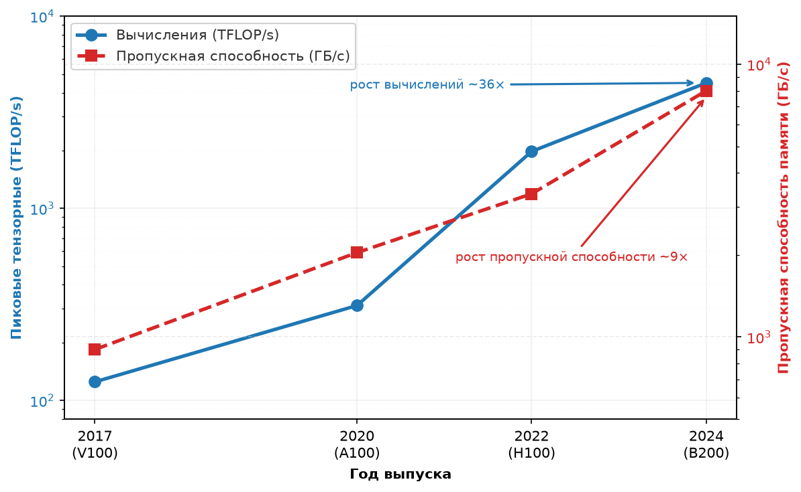

***Расхождение вычислений и памяти**: пиковая пропускная способность тензорных ядер GPU выросла примерно в 36$\times$ от V100 до B200 при следовании заявленному низкоточному режиму тензорных ядер каждого поколения, тогда как пропускная способность HBM выросла лишь в 9$\times$ за тот же период. Расширяющийся разрыв между этими кривыми и есть стена памяти: каждое поколение ускорителя становится пропорционально более голодным по данным.*

Для обучения, где большие размеры батча повышают арифметическую интенсивность, расчет смещается в сторону вычислений: релевантной метрикой становятся пиковые TFLOP/s на доллар, поскольку веса, загруженные из HBM, амортизируются на множество токенов в батче. Модель Roofline дает формальную основу, чтобы сделать этот компромисс точным и определить, какая метрика важна для любой конкретной нагрузки.

### Модель Roofline

Расчет задержки токена в блокноте [«Физика задержки токена»](#nbk-token-latency) показал, что 70B-модель на H100 подавляюще ограничена памятью. Вопрос в том, как систематически определить это для любой нагрузки на любом железе. **Модель Roofline**[^fn-roofline-origin-ci], введенная Williams, Waterman и Patterson (Williams et al., 2009), дает наглядную и аналитическую основу, которая отвечает на этот вопрос одним числом: арифметической интенсивностью нагрузки.

[^fn-roofline-origin-ci]: **Модель Roofline**: введена Williams, Waterman и Patterson в Калифорнийском университете в Беркли в 2009 году. Модель строит достижимые FLOP/s в зависимости от арифметической интенсивности в логарифмических осях: две пересекающиеся линии, точка пересечения которых (точка перехода) отделяет режимы, ограниченные памятью, от режимов, ограниченных вычислениями.

Для H100 (989 TFLOP/s FP16, 3,35 ТБ/с HBM) точка перехода составляет около 295 FLOP/байт. Большинство операторов инференса LLM лежит намного ниже этого порога, поэтому Roofline остается первым диагностическим инструментом, позволяющим понять, поможет ли больше вычислений или больше пропускной способности. Величина, которая помещает нагрузку на этот график, — ее **арифметическая интенсивность** $(I)$, определяемая как $I = \text{FLOP}/\text{байт}$: отношение вычислений к трафику памяти, которое определяет, ограничена ли нагрузка пропускной способностью или вычислениями. Та же величина переносится в анализ производительности на уровне парка в разделе «Модель Roofline» главы «Инженерия производительности».

*Декодирование находится глубоко в режиме, ограниченном памятью, далеко ниже точки перехода.*

Модель Roofline выражает максимально достижимую производительность нагрузки как меньший из двух потолков:

$$ \text{Достижимые FLOP/s} = \min\left(R_{\text{peak}},\ \text{BW} \times I\right) $$

[«Уравнение Roofline»](#eq-compute-roofline) имеет прямую физическую интерпретацию. Если арифметическая интенсивность нагрузки низка (ей нужно много байт на операцию), то производительность ограничена тем, как быстро память может отдавать эти байты. Достижимые FLOP/s растут линейно с $I$, прочерчивая наклонную линию на логарифмическом графике. Если арифметическая интенсивность высока (каждый байт питает много операций), то производительность упирается в пиковую вычислительную скорость аппаратуры независимо от дальнейшего роста $I$. Это плато и есть плоская «крыша» модели.

> **Точка перехода (ridge point)**
>
> ***Точка перехода*** — это арифметическая интенсивность ML-ускорителя, при которой потолок пропускной способности памяти встречается с потолком вычислений $(I_{\text{ridge}} = \frac{R_{\text{peak}}}{\text{BW}})$.
>
> 1. **Значение**: она задает порог эффективности аппаратуры. Нагрузки с интенсивностью ниже точки перехода ограничены пропускной способностью $(\text{BW})$, а выше — вычислениями $(R_{\text{peak}})$.
> 2. **Отличие**: в отличие от пиковых FLOP/s (которые описывают только горизонтальный потолок), точка перехода описывает баланс архитектуры. Рост точки перехода от поколения к поколению указывает, что вычисления растут быстрее пропускной способности, а утилизация становится труднее.
> 3. **Типичная ошибка**: распространено заблуждение, что все GPU имеют одну и ту же точку перехода. На самом деле она зависит от точности: поскольку $R_{\text{peak}}$ для INT8 выше, чем для FP32, а $\text{BW}$ постоянна, точка перехода для INT8 намного выше и требует большего повторного использования данных, чтобы насытить аппаратуру.

Конкретные ML-нагрузки занимают разные области этого графика в зависимости от операции и размера батча:

- **Декодирование LLM (батч 1)**: каждый токен требует загрузки всего тензора весов (около 2 байт на параметр) ради всего 2 FLOP на параметр, что дает $I \approx 1$ FLOP/байт. Это глубоко в области, ограниченной памятью, далеко ниже точки перехода в 295,2 FLOP/байт. Наш расчет задержки токена подтвердил это: арифметика завершалась за микросекунды, а передача из памяти занимала миллисекунды.
- **Предзаполнение LLM (prefill)**: обработка токенов промпта параллельно превращает много матрично-векторных произведений в матрично-матричные и повышает повторное использование весов. Его арифметическая интенсивность зависит от длины промпта, формы батча, тайлинга, реализации внимания и от того, какой трафик памяти учитывает модель. Поэтому prefill может лежать ниже, около или выше точки перехода данного устройства.
- **Обучение CNN**: свертка может повторно использовать веса и активации по батчу и пространственным измерениям, но ее положение зависит от форм тензоров, раскладки данных, слияния операций, точности и поведения кэша. Измеренное или специфичное для операции число байт, а не метка семейства моделей, определяет ее область на Roofline.
- **Внимание (длинные последовательности)**: механизм самовнимания растет квадратично с длиной последовательности по FLOP, но линейно по трафику памяти для KV-кэша, поэтому его арифметическая интенсивность зависит от длины последовательности. Короткие последовательности ограничены памятью, длинные — вычислениями.

Суть в том, чтобы классифицировать каждую фазу и форму батча на Roofline, а не приписывать целому семейству моделей одну постоянную область.

Чтение графика Roofline требует понимания того, что представляет каждая ось. Горизонтальная ось — арифметическая интенсивность (FLOP/байт) в логарифмическом масштабе. Вертикальная ось — достижимая производительность (FLOP/s), тоже в логарифмическом масштабе. Форму roofline задают две линии: диагональ с наклоном 1 (в логарифмических координатах), представляющая предел пропускной способности памяти, и горизонталь, представляющая предел пиковых вычислений. Эти две линии сходятся в точке перехода.

Любую нагрузку можно изобразить одной точкой на этом графике, вычислив ее арифметическую интенсивность и измерив достигнутую производительность. Если точка лежит на диагонали, нагрузка ограничена памятью и выиграла бы от более быстрой памяти. Если она лежит на горизонтали, нагрузка ограничена вычислениями и выиграла бы от большего числа арифметических блоков.

Если точка лежит ниже любой из линий, нагрузка использует доступный ресурс не полностью. Этот разрыв указывает на возможность оптимизации в программном обеспечении: неэффективность ядер, плохие шаблоны доступа к памяти или избыточная синхронизация. Закрытие этого разрыва — задача инженерии ядер и оптимизации коммуникации, которые рассматриваются в главе «Инженерия производительности».

Диагностическая сила Roofline распространяется не только на отдельные ядра, но и на целые прогоны обучения. Для нашей модели 175B граф вычислений содержит тысячи разных операций с разной арифметической интенсивностью. Плотные слои прямого распространения доминируются крупными GEMM с высокой интенсивностью, и потому прочно находятся в режиме, ограниченном вычислениями, где узкое место — загрузка тензорных ядер. Напротив, операции вроде нормализации слоя и поэлементных активаций имеют низкую арифметическую интенсивность и глубоко лежат в области, ограниченной памятью, где вычислительные блоки простаивают в ожидании данных. Механизм самовнимания переключается между режимами в зависимости от длины последовательности: квадратичная сложность матриц внимания предполагает ограничение вычислениями, но загрузка матриц Key и Value создает давление на память при коротких последовательностях. Это диагностическое различие определяет стратегию оптимизации: слои, ограниченные памятью, выигрывают от слияния ядер (сокращения обращений к HBM), а слои, ограниченные вычислениями, — от снижения точности (переход от FP16 к FP8, что фактически поднимает вычислительный потолок аппаратуры).

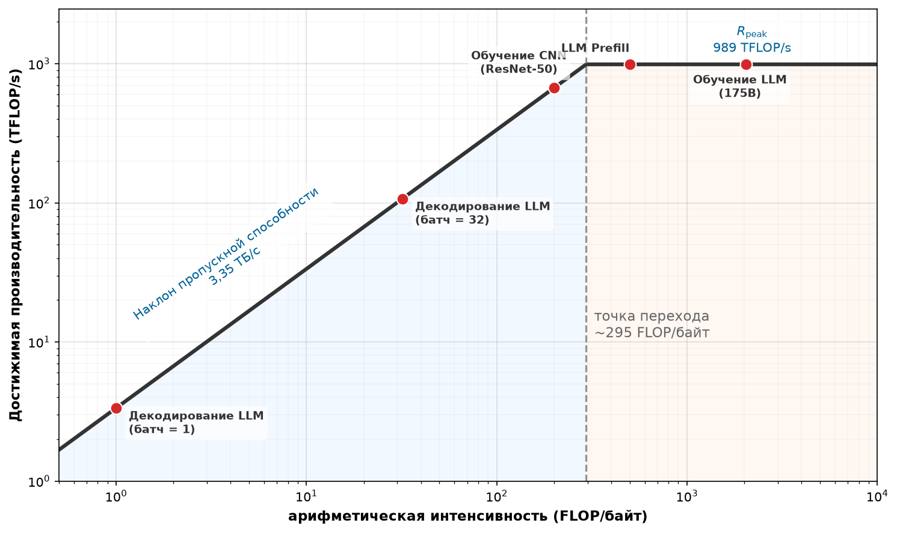

***Ландшафт Roofline для H100**: roofline FP16 для NVIDIA H100 отмечает потолки пропускной способности памяти и пиковых вычислений; на нем размещены репрезентативные ML-нагрузки в областях, ограниченных памятью и вычислениями.*

[«Ландшафт Roofline для H100»](#fig-roofline-landscape) делает эти связи видимыми. Декодирование при батче 1 лежит глубоко в области, ограниченной памятью, тогда как упрощенная точка обучения с большим батчем пересекает точку перехода и попадает в область, ограниченную вычислениями. Точка обучения масштабирует идеализированное повторное использование весов при предполагаемом размере батча 2048; это контрастный случай, а не универсальная интенсивность для обучения. Фактическое положение требует подсчета байт на уровне памяти, который моделируется, и учета форм тензоров, слияния операций и повторного использования. При этом явном упрощении разрыв в 2 048× между интенсивностью декодирования и обучения (~1 FLOP/байт и ~2 048 FLOP/байт) объясняет, почему одно и то же железо может демонстрировать очень разную утилизацию на разных фазах.

Roofline на [«Ландшафте Roofline для H100»](#fig-roofline-landscape) задают два потолка: пропускная способность памяти (диагональ) и пиковые вычисления (горизонталь), которые сходятся в точке перехода FP16 (около 295,2 FLOP/байт для 989 TFLOP/s при 3,35 ТБ/с). ML-нагрузки охватывают весь диапазон: декодирование LLM при батче 1 глубоко ограничено памятью, тогда как обучение LLM на больших батчах ограничено вычислениями. Положение каждой нагрузки определяет, улучшили бы производительность более быстрая память или более быстрые вычисления.

Модель Roofline также показывает тонкую, но важную связь между размером батча и утилизацией аппаратуры. Увеличение батча для данной модели повышает арифметическую интенсивность, потому что матрица весов загружается один раз, но умножается на более крупную матрицу активаций (больше FLOP при том же объеме переданных байт). Это сдвигает точку нагрузки вправо на графике, возможно пересекая точку перехода из области, ограниченной памятью, в область, ограниченную вычислениями. Арифметическая интенсивность растет линейно с размером батча (удвоение батча удваивает FLOP при неизменной загрузке весов), что создает простую и предсказуемую связь между размером батча и утилизацией аппаратуры.

Для обслуживания инференса объединение нескольких запросов в батч резко повышает утилизацию аппаратуры и пропускную способность. Модель, которая достигает 1 процента пиковых FLOP/s при батче 1, может достигнуть 50 процентов пиковых FLOP/s при батче 64, просто потому, что веса, загруженные из HBM, повторно используются для 64 независимых запросов, а не для одного. Это 50$\times$ улучшение утилизации аппаратуры имеет цену: 64 запроса должны ждать, пока соберется полный батч, прежде чем начнется обработка, что добавляет задержку в очереди. Системы обслуживания должны тщательно балансировать этот компромисс между пропускной способностью (большие батчи, выше утилизация) и задержкой (меньшие батчи, быстрее ответ на каждый запрос).

Для обучения размер батча — гиперпараметр, который влияет и на статистическую сходимость, и на эффективность аппаратуры, создавая компромисс, который практикам нужно вести осторожно. Большие батчи улучшают утилизацию аппаратуры (переводя нагрузку в режим, ограниченный вычислениями), но могут требовать корректировки скорости обучения и графиков прогрева, чтобы сохранить качество обучения. Оптимальный размер батча зависит и от архитектуры модели, и от характеристик Roofline аппаратуры, что создает междисциплинарную задачу оптимизации на стыке теории машинного обучения и системной инженерии.

Практическая ценность модели Roofline в том, что она показывает, какой ресурс оптимизировать. Если нагрузка ограничена памятью, покупка более быстрого ускорителя (больше TFLOP/s) не даст выигрыша; поможет только более высокая пропускная способность памяти. И наоборот, если нагрузка ограничена вычислениями, обновление поколений HBM — потраченные впустую деньги. Эта диагностическая сила объясняет, почему опытные инженеры инфраструктуры всегда начинают выбор аппаратуры с вычисления арифметической интенсивности целевой нагрузки и нанесения ее на Roofline кандидатной аппаратуры: график сразу показывает, какая характеристика аппаратуры важна, а какая нет.

Для нашей модели 175B обучение с большими батчами ограничено вычислениями (оптимизировать TFLOP/s), тогда как обслуживание отдельных запросов ограничено памятью (оптимизировать пропускную способность). Эта двойственность объясняет, почему некоторые организации используют разные поколения железа для обучения и инференса. A100 с его меньшей стоимостью и достаточной пропускной способностью памяти может быть экономичнее для инференса, чем H100, несмотря на более высокие пиковые FLOP/s у H100.

Модель Roofline также дает количественную основу для оценки отдачи от разных оптимизаций. Если нагрузка в 10$\times$ ниже потолка вычислений, но уже касается потолка пропускной способности, то затраты инженерных усилий на оптимизацию ядер (движение к потолку вычислений) не дадут выигрыша. Усилия следует направить на сокращение трафика памяти (сдвиг нагрузки вправо на графике) через такие приемы, как батчинг, слияние ядер или квантование.

Диагностическая сила Roofline делает ее одним из практически самых полезных аналитических инструментов в арсенале инженера инфраструктуры. Перед любой закупкой железа или усилием по оптимизации нанесение нагрузки на Roofline сразу показывает, окупятся ли вложения. Команды, которые пропускают этот анализ, рискуют месяцами оптимизировать не тот ресурс, а это дорогая ошибка, когда час работы GPU стоит тысячи долларов в день.

Тот же расчет арифметической интенсивности разделяет режимы инференса и обучения рассматриваемой модели.

> **Анализ Roofline: обучение против инференса**
>
> **Сценарий**: инженерная команда оценивает выбор железа для обслуживания (декодирование при батче 1) и для обучения (батч 2048) модели на 175B параметров на GPU H100 (точка перехода 295,2 FLOP/байт).
>
> **Диагноз**: однотокенное декодирование дает арифметическую интенсивность $I =$ 1 FLOP/байт $\ll$ 295,2 FLOP/байт, что ограничивает пропускную способность 0,34 процента пиковых FLOP из-за пропускной способности HBM. Батчинг при обучении повышает интенсивность до $I =$ 2 048 FLOP/байт $\gg$ 295,2 FLOP/байт, переводя нагрузку в режим, ограниченный вычислениями и пиковыми TFLOP/s.
>
> **Системный урок**: выбор железа должен соответствовать рабочей арифметической интенсивности: платформы обучения выигрывают от пиковых вычислений (TFLOP/s), а платформы инференса одного батча — от пропускной способности памяти на доллар.

Та же диагностика становится особенно ценной, когда предлагаемое обновление меняет не тот потолок.

> **Диагностика по Roofline**
>
> Команда обслуживает модель на 13 млрд параметров при батче 1 на H100 и наблюдает 25 мс на токен. Профиль показывает низкую утилизацию тензорных ядер во время декодирования.
>
> - **Арифметическая интенсивность**: оцените арифметическую интенсивность нагрузки.
> - **Обновление по пиковым TFLOP/s**: решите, меняет ли более быстрый по пиковым TFLOP/s ускоритель связывающий член.
> - **Связывающее ограничение**: определите измерение или возможность железа, которые нужно улучшить в первую очередь.

### Тензорные ядра и матричные блоки

Модель Roofline показывает, может ли нагрузка достичь пиковых вычислений. Следующий вопрос — что определяет сам этот пик. Ответ лежит в специализированных арифметических блоках, которые занимают большую часть площади кристалла современного ускорителя: **тензорные ядра**[^fn-tensor-core-evolution] у GPU NVIDIA и **блоки умножения матриц** у TPU Google.

[^fn-tensor-core-evolution]: **Тензорное ядро**: появилось в NVIDIA Volta (2017) как блоки слитного матричного умножения с накоплением $4{\times}4{\times}4$ в FP16. Каждое поколение расширяло тайл: Turing (2018) добавил INT8, Ampere (2020) — TF32/BF16, а Hopper (2022) достиг $16{\times}16{\times}16$ с поддержкой FP8. Эта каскадная смена точности отражает собственный сдвиг ML к обучению и инференсу в более низкой точности: каждый новый формат дает двукратный прирост пропускной способности на том же кремнии, поэтому поколения тензорных ядер служат показателем того, как быстро цикл совместного проектирования «железо — ПО» может расширить вычислительный потолок Roofline.

Стандартный блок вычислений с плавающей запятой в CPU выполняет одно умножение с накоплением за такт на полосу. Даже с широкими блоками SIMD (AVX-512 дает 16 полос FP32) ядро CPU выполняет не более 16 MAC за такт. При 32 ядрах мощный серверный CPU достигает примерно 512 MAC за такт — уважаемая цифра для универсальных вычислений, но совершенно недостаточная для требований умножения матриц в масштабе нейронных сетей.

Тензорное ядро, напротив, выполняет инструкции умножения с накоплением вида $\mathbf{Y} = \mathbf{A} \times \mathbf{B} + \mathbf{C}$ над малыми тайловыми матрицами в специализированном аппаратном блоке. На H100 эти тайловые операции распределяются по массиву тензорных ядер в каждом SM, давая сотни накопленных результатов за инструкцию, при этом операнды остаются в регистрах и общей памяти. Так доминирующая операция нейронной сети концентрируется в аппаратуре, которая занимает малую долю площади чипа.

При 528 тензорных ядрах на чипе (по 4 на SM, 132 SM) H100 достигает пика 989 TFLOP/s FP16/BF16, который используется в анализе Roofline. Важный системный момент — не точный подсчет инструкций за такт, а архитектурная специализация: кристалл отдает большую долю своей арифметической площади плотным тайловым матричным операциям, а не универсальному скалярному выполнению.

Блоки умножения матриц Google (MXU) доводят эту идею дальше, организуя множители в систолический массив. В систолическом MXU одна матрица загружается в регистры весов массива, а другая проходит через массив по одной строке за раз. Каждая ячейка умножает поступающую активацию на свой сохраненный вес, складывает результат с частичной суммой, идущей из ячейки сверху, и передает активацию вправо, а частичную сумму вниз. Такой конвейерный поток означает, что массив выполняет полезные вычисления на каждом такте, и после заполнения конвейера ни одна ячейка не простаивает. TPU v5p содержит два MXU $128{\times}128$ на чип, давая 459 TFLOP/s BF16. Систолический поток данных устраняет обращения к регистровому файлу между операциями, которые все еще нужны тензорному ядру, и дает незначительно более высокую энергоэффективность ценой гибкости для не-матричных нагрузок.

Для нашей модели 175B выбор между тензорными ядрами и MXU проявляется в стеке компилятора. Ядра CUDA могут смешивать операции тензорных ядер с произвольным кодом на уровне потоков, что позволяет создавать слитные ядра: умножение матриц вместе с функциями активации, dropout и нормализацией слоя в одном запуске. Такое слияние критично для производительности, потому что исключает промежуточные чтения и записи в память между операциями и держит данные в регистрах и общей памяти, где доступ быстрее всего.

Компиляция XLA для TPU должна раскладывать вычисления в последовательности матричных операций, которые отображаются на систолический поток данных. Для стандартных слоев трансформера это может быть эффективнее, но менее гибко для пользовательских операций. Компилятор XLA выполняет оптимизацию всей программы, анализируя весь граф вычислений, чтобы найти оптимальный тайлинг, раскладку памяти и расписание исполнения для систолического массива. Для стандартных слоев трансформера такая оптимизация всей программы может давать более высокую загрузку аппаратуры, чем вручную настроенные ядра CUDA, потому что компилятор рассуждает обо всем вычислении, а не оптимизирует отдельные операции изолированно.

Железо диктует программную абстракцию, а она, в свою очередь, определяет, какие архитектуры практично пробовать. Эта связка «железо — ПО» — определяющая черта ML-инфраструктуры и объясняет, почему выбор аппаратуры влияет на скорость исследований и гибкость проектирования моделей.

> **Тензорное ядро**
>
> ***Тензорное ядро*** — это специализированный аппаратный блок ML-ускорителя, который выполняет слитную операцию умножения с накоплением $\mathbf{Y} = \mathbf{A} \times \mathbf{B} + \mathbf{C}$ над малыми тайлами (например, $16{\times}8{\times}16$ в BF16) одной аппаратной инструкцией. Он дает значительно более высокую пропускную способность, чем универсальные ядра CUDA, обменивая программируемость на матричную арифметику с фиксированной функцией.
>
> 1. **Значение**: тензорные ядра дают основную часть пика 989 TFLOP/s FP16/BF16 у H100 (и около 1 979 TFLOP/s при FP8), примерно в 14,8× больше, чем около 67 TFLOP/s, которые дают одни только векторные ядра CUDA. Однако этот пик достижим только для операций, которые раскладываются на тайловые матричные умножения. Нормализация слоя и softmax, которые включают редукции и поэлементные операции вместо матричных умножений, работают примерно на 3–8 процентах пиковой пропускной способности того же железа.
> 2. **Отличие**: тензорное ядро — это матричный блок умножения с накоплением с фиксированной функцией, а не более быстрое универсальное ядро. Ядра CUDA выполняют произвольную скалярную и векторную работу; тензорные ядра выполняют только тайловый примитив $\mathbf{Y} = \mathbf{A} \times \mathbf{B} + \mathbf{C}$, поэтому пиковая и реально получаемая пропускная способность так резко расходятся для разных нагрузок.
> 3. **Типичная ошибка**: распространено заблуждение, что все операции GPU выигрывают от тензорных ядер. Только операции, которые отображаются на тайловое вычисление $\mathbf{Y} = \mathbf{A} \times \mathbf{B} + \mathbf{C}$ (плотные линейные слои, вычисление оценок внимания, свертки), задействуют тензорные ядра. Поэлементные активации, нормализация слоя и поиски по эмбеддингам откатываются на ядра CUDA и могут работать в 10–30$\times$ медленнее на FLOP, чем операции тензорных ядер.

Поддержка точности тензорных ядер расширялась с каждым поколением, движимая открытием, что обучение и инференс нейронных сетей выдерживают более низкую численную точность, чем считалось раньше. Тензорные ядра Volta принимали множители FP16 и поддерживали накопление в FP16 или FP32. Turing добавил режимы INT8 и INT4 для инференса, Ampere — BF16 и TF32, а Hopper — FP8 (форматы E4M3 и E5M2) с масштабированием по тензорам через Transformer Engine.

Рецепты Transformer Engine и автокаст FP8 определяют, какие поддерживаемые операции выполняются в FP8. Механизм масштабирования фиксирует диапазоны тензоров и применяет масштабные коэффициенты, чтобы значения умещались в выбранный формат FP8. Он сам по себе не определяет, что слой численно безопасен для FP8, и не переключает его на FP16, если это не так. Поэтому политика точности остается программной конфигурацией и решением о валидации.

Понимание различия двух форматов FP8 объясняет, почему это важно для практиков. Формат E4M3 (4 бита порядка, 3 бита мантиссы) может представлять значения до примерно $4{,}48 \times 10^{2}$, а 3 бита мантиссы дают около 1 части из 8 относительной точности. Этот диапазон и точность достаточны для многих весов и активаций нейронных сетей, после того как масштабирование по тензорам приводит их наблюдаемый диапазон в окно FP8.

Формат E5M2 (5 бит порядка, 2 бита мантиссы) дает более широкий динамический диапазон, с максимальными конечными значениями около $5{,}73 \times 10^{4}$, ценой меньшей точности (всего 2 бита мантиссы, или около 1 части из 4 относительной точности). Этот более широкий диапазон важен для градиентов в обратном проходе, которые могут охватывать больше порядков величины, чем активации прямого прохода, особенно в ранних и поздних слоях глубоких сетей.

Настроенный рецепт Transformer Engine определяет, как используются эти форматы. Распространенный гибридный рецепт применяет E4M3 для тензоров прямого прохода и E5M2 для тензоров обратного. Масштабные коэффициенты и метаданные диапазонов тензоров поддерживаются реализацией, а правило обновления определяется выбранным рецептом масштабирования.

Практическое следствие для проекта парка: спецификации пиковых TFLOP/s зависят от точности. H100 дает 989 TFLOP/s в FP16, но вдвое больше (1 979 TFLOP/s) в FP8. Парк, спроектированный под обучение в FP8, фактически имеет вдвое большую вычислительную плотность, чем тот же парк, работающий в FP16, без дополнительного железа. Поэтому инженерия точности становится первоклассным рычагом оптимизации для планировщиков инфраструктуры, а не только вопросом точности модели.

Чтобы на практике достичь этой пиковой пропускной способности, весь ускоритель нужно рассматривать как жесткий конвейер, где данные идут из HBM через углубляющуюся иерархию кэшей, прежде чем достичь тензорных ядер. Фундаментальное ограничение — **баланс конвейера**: скорость, с которой данные подготавливаются в регистрах, должна быть не меньше скорости, с которой арифметические блоки их потребляют. Когда арифметическая интенсивность операции падает ниже точки перехода, конвейер останавливается, и терафлопсы вычислительного потенциала простаивают в ожидании данных. Поэтому **слияние ядер (kernel fusion)** — самая критичная программная оптимизация для крупномасштабного обучения. Объединение нескольких операций (умножение матриц, добавление смещения, функция активации) в одно ядро исключает обращения к HBM, которые возникли бы при последовательном выполнении каждой операции. Рассмотрим механизм внимания: наивная, неслитая реализация записывает матрицу внимания $S{\times}S$ в HBM только для того, чтобы считать ее обратно для операции softmax, создавая цикл, ограниченный пропускной способностью памяти 3,35 ТБ/с. Слитая реализация, такая как FlashAttention (точный алгоритм внимания, учитывающий аппаратуру), держит эти промежуточные матрицы целиком в on-chip SRAM, обходя HBM, и позволяет тензорным ядрам работать близко к теоретическому пику. Для нашей модели 175B, где каждый шаг обучения включает тысячи матричных операций на 96 слоях трансформера, разница между слитыми и неслитыми ядрами может составлять улучшение пропускной способности в 2–3$\times$, отделяя двухнедельный прогон обучения от шестинедельного.

#### Пиковая и устойчивая пропускная способность

Критическое различие для планирования инфраструктуры — между *пиковой* пропускной способностью (максимальной скоростью для операции и точности, заданных производителем) и *устойчивой* пропускной способностью (тем, что выдает вся нагрузка целиком). Пиковые TFLOP/s предполагают, что подходящие арифметические блоки остаются загруженными при заявленных разреженности, точности и условиях тактовой частоты. Они не учитывают простои памяти, неподходящие операции, коммуникацию и накладные расходы ПО. Поэтому устойчивые доли различаются в зависимости от формы модели, размера батча, точности, реализации и масштаба. Разрыв возникает из нескольких источников, каждый из которых представляет отдельное физическое или программное ограничение.

Простои памяти возникают, когда тензорные ядра завершают текущее умножение тайла раньше, чем следующий тайл загружен из HBM. Даже при пропускной способности HBM H100 3,35 ТБ/с тензорные ядра для некоторых размеров матриц могут потреблять данные быстрее, чем HBM их доставляет, создавая холостые такты, пока арифметические блоки ждут данных.

Пузыри конвейера возникают, когда одна операция должна завершиться до того, как может начаться следующая, оставляя часть вычислительных элементов простаивающими. В слое трансформера вычисление внимания должно завершиться до того, как может начаться сеть прямого распространения, а вычисление этой сети — до начала внимания следующего слоя. Эти последовательные зависимости создают короткие периоды, когда часть аппаратных ресурсов не используется. Локальный механизм прост: пузырь — это простаивающий слот между зависимыми стадиями, а микробатчинг сокращает потери, подавая более поздние микробатчи в стадии, которые иначе бы ждали. На уровне инфраструктуры вывод таков: пиковая пропускная способность предполагает идеально заполненный конвейер, тогда как реальное обучение включает зазоры зависимостей, которые снижают устойчивую утилизацию.

Накладные расходы коммуникации от операций AllReduce (для тензорного параллелизма) или синхронизации градиентов (для параллелизма по данным) полностью приостанавливают вычисления, пока данные обмениваются между ускорителями. Даже когда коммуникация перекрывается с вычислениями (с использованием отдельных потоков коммуникации и вычислений), обычно есть операции, которые нельзя перекрыть, потому что они зависят от результата коммуникации.

Программные накладные расходы от задержки запуска ядер, выделения памяти и управления потоком на уровне Python добавляют еще 5–10 процентов. Каждый запуск ядра CUDA несет примерно 5–10 микросекунд задержки на стороне хоста, а один слой трансформера может включать 20–30 запусков ядер. Для малых микробатчей, где каждое ядро завершается за микросекунды, накладные расходы запуска могут стать заметной долей общего времени исполнения.

Слияние ядер частично устраняет этот разрыв: объединяя несколько операций (умножение матриц, добавление смещения, функцию активации, dropout) в одно ядро GPU, оно исключает промежуточные чтения и записи памяти, которые иначе останавливали бы тензорные ядра между операциями. Искусство достижения высокой устойчивой утилизации во многом состоит в том, чтобы минимизировать время простоя тензорных ядер, поэтому и существуют специализированные библиотеки ядер вроде FlashAttention и Transformer Engine.

Планирование емкости должно опираться на измеренную или консервативно смоделированную устойчивую скорость, а не на пиковую спецификацию. Прогон, оцененный по пиковым FLOP/s в 1 000 GPU-часов, требует в $1/u$ раз больше этой оценки, когда измеренная доля утилизации равна $u$. Команды инфраструктуры отслеживают MFU — отношение полезного числа FLOP модели к пиковым FLOP/s аппаратуры, умноженным на календарное время (wall-clock). Сравнения остаются содержательными, только если совпадают условности подсчета FLOP модели, точность, пиковое значение железа и масштаб системы. Раздел «Метрика эффективности парка» главы «Инженерия производительности» формализует MFU и разворачивает его применение на уровне парка.

### Энергетическая стена и тепловые ограничения

Стена памяти ограничивает скорость, с которой данные доходят до вычислительных блоков. Модель Roofline диагностирует, что является связывающим ограничением, вычисления или память, а тензорные ядра максимизируют арифметическую ценность каждого считанного байта. Третье физическое ограничение тоже сдерживает производительность ускорителя: тепло, выделяемое всеми этими вычислениями. Каждый FLOP рассеивает энергию, и чем быстрее система вычисляет, тем больше тепла ей нужно отвести. Это и есть энергетическая стена. [«Путь подачи энергии»](#fig-power-path) прослеживает путь энергии от сети до транзистора.

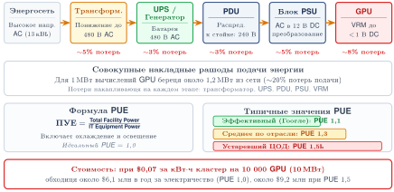

***Путь подачи энергии**: путь энергии от высоковольтной сети до низковольтного транзистора включает несколько ступеней преобразования, у каждой из которых свои потери. Совокупные потери доставки вместе с накладными расходами на охлаждение (измеряемыми через PUE) определяют, сколько мощности здание должно забирать из сети. Ключевая инженерная задача — переход от стоечного распределительного блока питания (PDU) к модулю регулятора напряжения (VRM), где в пределах одного шкафа должно подаваться 10–40 кВт.*

Каскад на [«Пути подачи энергии»](#fig-power-path) показывает, почему подача энергии — задача инфраструктуры, а не только электротехники. Эти потери преобразования вместе с затратами на отвод тепла определяют полное энергопотребление здания, а 10–40 кВт, сосредоточенные на переходе от стоечного PDU к VRM, задают архитектуру охлаждения всего здания. [«Коэффициент PUE»](#eq-pue) описывает накладные расходы на охлаждение одним коэффициентом здания — эффективностью использования энергии (PUE):

$$ \text{PUE} = \frac{P_{\text{facility}}}{P_{\text{IT}}} $$

Здесь $P_{\text{facility}}$ — полная мощность, потребляемая дата-центром, а $P_{\text{IT}}$ — мощность, потребляемая серверами, ускорителями, системами хранения и сетевым оборудованием. PUE 1,5 означает, что здание забирает из сети 1,5 Вт на каждый 1 Вт, поданный в IT-оборудование; дополнительные 0,5 Вт идут на охлаждение, преобразование энергии, освещение и прочие накладные расходы.

Каждая операция с плавающей запятой рассеивает энергию в виде тепла. Плотная активность тензорных ядер при больших матричных умножениях создает тепло, пропорциональное переключательной активности миллиардов транзисторов. Производители ускорителей публикуют TDP, полную мощность графики (TGP), мощность платы или настраиваемый предел мощности — в зависимости от продукта. Эти величины — специфичные для производителя устойчивые проектные диапазоны, а не взаимозаменяемые физические определения.[^fn-tdp-thermal-envelope] Проект парка должен сопоставлять применимый устойчивый диапазон с любым задокументированным требованием к кратковременным всплескам. При плотном масштабе парка возникает энергетическая стена: точка, в которой определяют, сколько вычислений можно установить и поддерживать, — не доступные арифметические блоки, а подача энергии в здание и отвод тепла.

Это термодинамический предел (принцип «термодинамический предел») в действии: узким местом современного ИИ-дата-центра оказываются не FLOP/s, а ватты на квадратный фут. Когда стойка выделяет 100 кВт тепла, воздушное охлаждение перестает справляться. Физическая конструкция парка определяется тем, насколько хорошо тепло можно отвести от кремния. Близкий к нему принцип «стена плотности мощности» (принцип «стена плотности мощности») делает последствия конкретными: жидкостное охлаждение становится требованием здания, а не опцией для крупных кластеров обучения.

[^fn-tdp-thermal-envelope]: **Энергетические диапазоны**: TDP, TGP, номиналы мощности платы и настраиваемые пределы мощности следуют специфичным для производителя соглашениям. Они задают устойчивые целевые значения для тепловых и электрических расчетов, а не универсальные измерения мгновенного потребления. Компоненты подачи энергии также должны выдерживать задокументированные переходные выбросы продукта, а конструкция охлаждения использует применимый устойчивый тепловой диапазон и условия эксплуатации.

> **Расчетная тепловая мощность (TDP)**
>
> ***Расчетная тепловая мощность (TDP)*** — это определенная производителем устойчивая тепловая расчетная цель в ваттах для заданной конфигурации продукта и условий эксплуатации.
>
> 1. **Значение**: конфигурация H100 SXM5, использованная в этой главе, имеет расчетную цель 700 Вт. Чтобы поддерживать заявленную рабочую точку, нужен тепловой путь и контур здания, сертифицированные под эту цель при входных условиях и условиях теплоносителя производителя.
> 2. **Отличие**: TDP не означает единый универсальный максимум мгновенной мощности. TGP, мощность платы, настраиваемые пределы и требования к переходным процессам описывают связанные электрические ограничения по соглашениям, которые различаются у разных производителей и продуктов.
> 3. **Типичная ошибка**: распространено заблуждение, что рекламируемая мощность в ваттах сама по себе задает мощность стойки и охлаждение. Проект парка должен сочетать устойчивую тепловую цель, заданный предел мощности, поведение нагрузки, накладные расходы компонентов и требование к переходной мощности.

Траектория TDP показывает, как режим масштабирования подходит к своим пределам. Три десятилетия **масштабирование Деннарда**[^fn-dennard-scaling-limit] позволяло проектировщикам уменьшать транзисторы, сохраняя примерно постоянную плотность мощности: более мелкие транзисторы требовали меньшего напряжения, поэтому упаковка большего числа транзисторов на ту же площадь не увеличивала тепловыделение на единицу площади. Когда ограничения масштабирования напряжения и утечек положили конец этому режиму, архитекторам пришлось рассматривать энергию, охлаждение и параллелизм как ограничения первого порядка, а не бесплатные побочные эффекты уменьшения техпроцесса (Dennard et al., 1974; Hennessy and Patterson, 2019). С тех пор каждое поколение ускорителей вынуждено выбирать между производительностью и мощностью с теплом. Эра «бесплатного» роста производительности за счет уменьшения техпроцесса закончилась: каждый прирост пропускной способности теперь нужно оплачивать ваттами, мощностью охлаждения или специализацией.

[^fn-dennard-scaling-limit]: **Масштабирование Деннарда**: названо по Dennard et al., 1974, работавшим в IBM; они показали, как размеры, напряжение и ток MOSFET могут масштабироваться так, чтобы плотность мощности оставалась примерно постоянной. Последующие пределы масштабирования напряжения и эффекты утечек положили конец этому режиму постоянной плотности мощности. Hennessy и Patterson описывают возникшую после Деннарда энергетическую стену как одну из причин, по которым современная архитектура перешла к параллелизму и специализации (Hennessy and Patterson, 2019). Для инфраструктуры машинного обучения траектория TDP от V100 до B200 (300 Вт → 1 000 Вт) иллюстрирует пост-деннардовскую задачу планирования: охлаждение и подача энергии теперь являются равноправными проектными ограничениями наряду с самим кремнием.

Цифры говорят сами за себя: V100 (2017) работал при TDP 300 Вт, A100 (2020) вырос до 400 Вт, H100 (2022) достиг 700 Вт, а B200 (2024) потребляет 1000 Вт. За семь лет TDP выросла более чем втрое, примерно на 18 процентов в год.

Если эту скорость роста рассматривать как сценарий планирования, поколение после Blackwell приблизилось бы к 1 200–1 400 Вт на ускоритель, а еще один шаг мог бы достичь 1 500–2 000 Вт. При 2 000 Вт на ускоритель один узел из 8 GPU потреблял бы 16 кВт только на GPU, что требует инфраструктуры жидкостного охлаждения[^fn-liquid-cooling-flow], которая отводит тепло со скоростью, приближающейся к скорости промышленного оборудования охлаждения технологических процессов.

[^fn-liquid-cooling-flow]: **Расход жидкостного охлаждения**: стойка из узлов GB200 NVL72 (120 кВт) требует примерно 150–200 литров в минуту теплоносителя. При таких расходах основной риск смещается от теплового троттлинга к механическим отказам (утечки, кавитация насоса), что требует промышленных коллекторов и быстроразъемных соединений, распространенных на химических производствах.

> **Конец масштабирования Деннарда**
>
> Три десятилетия масштабирование Деннарда позволяло архитекторам наращивать число транзисторов без роста плотности мощности, поскольку более мелким транзисторам требовалось пропорционально меньше напряжения. Эта «бесплатная» эффективность закончилась примерно в 2006 году, когда техпроцессы опустились ниже 28 нм и квантовые эффекты вроде подпорогового тока утечки и туннелирования через подзатворный оксид не позволили дальше снижать напряжение. Результат таков: плотность мощности растет вместе с плотностью транзисторов, когда напряжение перестает масштабироваться пропорционально. Ускорители, которые дают больше TFLOP/s, часто требуют больше ватт. Переход от V100 (12 нм) к H100 (4 нм) иллюстрирует эту физику: хотя плотность транзисторов выросла втрое, невозможность масштабировать напряжение означала, что TDP выросла с 300 Вт до 700 Вт. «Бесплатные» выигрыши эры кремния закончились; более высокая производительность на ватт все чаще приходит от архитектурной специализации (тензорные ядра, систолические массивы, инженерия точности) или от принятия более высоких требований к энергии и охлаждению. Для планировщиков ML-инфраструктуры мощность и охлаждение нужно рассчитывать под вычислительный спрос, и проекты зданий не могут предполагать, что более поздние поколения железа автоматически снижают плотность мощности.

Применимый устойчивый энергетический диапазон — не просто строка в техпаспорте: он проходит через все уровни инфраструктурного стека. Цепочка подачи энергии, система охлаждения, конструкция стойки и электрическая инфраструктура здания должны выдерживать установленные ускорители, их задокументированные переходные процессы и правдоподобный диапазон будущих циклов обновления.

Ускорители реализуют сложное управление мощностью, чтобы работать в пределах своего TDP. Когда нагрузка задействует не все SM (например, в фазе коммуникации шага обучения, когда GPU ждут завершения AllReduce), прошивка GPU может отключить тактовый сигнал от простаивающих схем с помощью **клокгейтинга (clock gating)**, устраняя динамическую мощность переключений и освобождая тепловой запас для активных SM. Отдельный механизм — **динамическое масштабирование напряжения и частоты (DVFS)** — подстраивает тактовую частоту и напряжение питания чипа, чтобы оставаться в пределах мощности и температуры. Во время большого матричного умножения, которое задействует все SM одновременно, DVFS снижает тактовую частоту, чтобы суммарная мощность оставалась в пределах TDP. Когда часть SM простаивает, активные SM могут поднять частоту, потому что полная мощность чипа ниже TDP. Поэтому фактическая тактовая частота и, следовательно, фактическая пропускная способность меняются в течение шага обучения.

Динамическое управление мощностью означает, что фактическое потребление GPU непрерывно меняется во время обучения. Типичный шаг обучения может показывать колебание мощности от 400 Вт (в фазах коммуникации, когда большинство SM простаивает) до 700 Вт (во время прямого и обратного прохода, когда все тензорные ядра активны) и обратно, причем каждый переход занимает микросекунды. Регуляторы напряжения (VRM) на плате должны реагировать на эти переходы достаточно быстро, чтобы поддерживать стабильное напряжение питания при быстро меняющемся токе.

Чтобы оценить физическую задачу, рассмотрим, что означают 700 Вт в терминах теплового потока. Кристалл H100 имеет площадь около 814 мм² (примерно $29{\times}28$ мм). Рассеивание 700 Вт с этой площади дает тепловой поток около 86 Вт/см². Для сравнения: поверхность электрической конфорки на сильном огне выделяет около 10 Вт/см². Кристалл H100 создает тепловой поток в 8,6× выше, чем конфорка, сосредоточенный на площади размером с большую почтовую марку.

B200 идет еще дальше: при 1 000 Вт на двухкристальном корпусе средний тепловой поток остается сопоставимым, но полная энергия, которую нужно отвести с каждого корпуса, растет на 43 процента. Чтобы отвести это тепло, не допуская, чтобы температура перехода превысила 83 градуса Цельсия (типичный рабочий максимум для надежности HBM), нужны термические решения с чрезвычайно малым тепловым сопротивлением от кристалла до теплоносителя.

Критический компонент этого теплового пути — **термоинтерфейсный материал (TIM)**: микроскопический слой материала с фазовым переходом или жидкого металла между кремниевым кристаллом и холодной пластиной (для жидкостного охлаждения) или радиатором (для воздушного). При экстремальных термоциклах глубокого обучения, где температура кристаллов за миллисекунды скачет с 40 °C до 80 °C во время матричных умножений и падает обратно в фазах коммуникации, некачественный TIM может выдавливаться (мигрировать с контактной поверхности) или растрескиваться. Всего 5-процентная деградация теплопроводности TIM заставляет GPU прибегать к тепловому троттлингу, снижая тактовую частоту на сотни МГц, чтобы защитить кремний. Эта деградация — «серый отказ» (gray failure): сбой, который ухудшает работу, а не останавливает ее. GPU продолжает работать, но с пониженной производительностью, которая незаметно снижает пропускную способность всего кластера. Это класс отказов, который рассматривается при мониторинге парка. Системы управления парком, которые отслеживают температуры переходов каждого GPU во времени, могут обнаружить деградацию TIM как медленный рост температуры при постоянной нагрузке и заменить компонент превентивно, пока влияние на производительность не стало серьезным.

На уровне стойки четыре узла по восемь таких чипов требуют 33,5 кВт мощности, значимой для здания: этого хватит, чтобы обогреть несколько домов зимой. Говоря более наглядно, одна стойка ML на полной мощности могла бы одновременно питать около 33 бытовых обогревателей, сосредоточенных в объеме примерно с большой холодильник.

На уровне пода мощность достигает мегаватт, что требует выделенных электроподстанций и промышленных холодильных установок. Кластер из 10 000 GPU потребляет 7–10 МВт, что сопоставимо с электропотреблением крупного завода или небольшого города с несколькими тысячами жителей.

Физический объем пода на 10 000 GPU при такой плотности мощности удивительно компактен: вычислительное оборудование (без сети и хранения) помещается примерно в 300 стойках, занимая площадь зала дата-центра около 1 500 квадратных метров (примерно треть футбольного поля). Именно плотность важна: держа ускорители физически близко, сокращают длину кабелей, что снижает задержку распространения сигнала и позволяет использовать более высокую пропускную способность межсоединений.

Физическая плотность, однако, делает подачу энергии и охлаждение экспоненциально сложнее, создавая инженерные задачи, которые определяют уровни стойки и пода в иерархии. Парадокс современной ML-инфраструктуры в том, что вычислительная эффективность требует *физической близости*, а управление теплом требует *физического разделения*. Каждая конструкция стойки — это компромисс между этими противоположными силами.

Эта изменчивость частоты создает тонкое взаимодействие с программной оптимизацией. Ядро, которое добивается высокой заселенности SM (много активных варпов на SM), потребляет больше мощности, что может вызвать снижение частоты, частично компенсирующее выгоду от заселенности. И наоборот, ядро с умеренной заселенностью может работать на более высокой тактовой частоте, достигая сопоставимой пропускной способности при меньшей мощности. Поэтому пропускная способность, нормированная на мощность (TFLOP/s на ватт), — более надежная метрика сравнения, чем сырые TFLOP/s. Она объясняет, почему один и тот же GPU может показывать разные устойчивые тактовые частоты в зависимости от нагрузки и системы охлаждения.

На уровне парка DVFS также влияет на планирование мощности. Средняя мощность нагрузки может быть ниже настроенного предела, потому что фазы коммуникации и неполная заселенность оставляют схемы простаивающими, но средние значения не заменяют расчетные устойчивые и переходные случаи. Некоторые операторы намеренно снижают пределы мощности ускорителей, чтобы разместить больше устройств в фиксированном бюджете здания, принимая зависящую от нагрузки потерю пропускной способности в обмен на меньшее потребление каждого устройства. Ограничение мощности — форма компромисса вычислительной эффективности на операционном уровне.

Траектория энергоэффективности частично уравновешивает рост TDP. Хотя абсолютная мощность выросла, рекламируемые низкоточные TFLOP/s на ватт заметно улучшились: с 0,42 TFLOP/s/Вт (V100, FP16) до 2,83 TFLOP/s/Вт (H100, FP8) и 4,50 TFLOP/s/Вт (B200, FP8). Это не сравнение FP16 «яблоко с яблоком»: режим точности — часть аппаратного тренда. Для фиксированного вычислительного бюджета, который может использовать новые режимы точности, каждое поколение требует меньше чипов и, следовательно, меньше общей мощности. Однако цели по возможностям крупных моделей могут расти быстрее, чем улучшается эффективность, поэтому абсолютный спрос на мощность при обучении следующей, большей модели все равно может расти. Это беговая дорожка инфраструктуры: выигрыши в эффективности покупают время, но рост масштаба его поглощает.

Последствия энергетического диапазона повторяются на всех уровнях иерархии инфраструктуры. На уровне узла заданные пределы ограничивают, сколько ускорителей может разместиться в одном шасси ([«Узел»](#sec-compute-node)). На уровне стойки совокупная устойчивая нагрузка и тепловой поток помогают определить, может ли инженерное воздушное или жидкостное охлаждение обеспечить проектную точку ([«Стойка»](#sec-compute-rack)). На уровне пода совпадающий спрос и переходное поведение формируют подачу энергии мегаваттного масштаба ([«Под»](#sec-compute-pod)). Поэтому каждый уровень выше кристалла должен управлять и устойчивым теплом, и электрическими колебаниями.

### Выбор ускорителя для нагрузок машинного обучения

Вычислительная пропускная способность ускорителя, пропускная способность памяти, ее емкость и энергопотребление имеют смысл только в связке с конкретной нагрузкой. Тот же H100, который показывает почти пиковую утилизацию при обучении с большим батчем, при обслуживании одного запроса может давать менее 5 процентов утилизации, потому что связывающее ограничение переходит от арифметики к пропускной способности памяти. Поэтому выбор правильного ускорителя требует сопоставить каждый архетип нагрузки с его положением на графике Roofline и определить, какой физический ресурс доминирует в ее производительности.

Начнем с сквозного примера с моделью 175B. При обучении большие батчи выталкивают прямой и обратный проходы выше точки перехода Roofline, поэтому непосредственное ограничение — пропускная способность арифметики. Пиковые низкоточные TFLOP/s важны, но только после того, как емкости памяти достаточно, чтобы вместить шардированное состояние модели, и только если межсоединения способны поддерживать синхронизацию групп тензорного и параллелизма по данным. Под H100, B200 и TPU v5p — все правдоподобные ответы на эту задачу обучения; окончательный выбор зависит от программного стека не меньше, чем от кремния. Исследовательская команда, которая работает в первую очередь с PyTorch, ценит экосистему GPU, а организация, построенная вокруг JAX/XLA, может принять более жесткие ограничения компиляции ради экономики TPU.

Обслуживание той же языковой модели меняет ответ. Во время авторегрессивного декодирования каждый генерируемый токен прогоняет веса через память, поэтому ключевой метрикой становится пропускная способность памяти на доллар, а не пиковые TFLOP/s. При батче 1 пропускная способность H100 в 3,35 ТБ/с определяет производительность, пока значительная часть арифметического кремния ждет. Батчинг повышает арифметическую интенсивность, повторно используя одно и то же перемещение весов для большего числа запросов, поэтому системы обслуживания так стараются батчить, не нарушая целевых уровней обслуживания (SLO) по хвостовой задержке. Нагрузка не сменила названия, но связывающий член в железном законе изменился, а вместе с ним меняется и выбор ускорителя.

Модели рекомендаций снова разделяют решение. Поиск в таблице эмбеддингов определяется случайным доступом и емкостью памяти, потому что каждый запрос извлекает небольшие векторы из таблиц масштаба терабайт с плохой локальностью. Плотная часть, которая потребляет эти эмбеддинги, ограничена вычислениями. Из такого разделения следует гибридная конструкция CPU и GPU: емкость CPU и DRAM обслуживает разреженный путь поиска, а GPU ускоряет плотные слои нейронной сети. Одно итоговое число в TFLOP/s не может описать такую нагрузку, потому что внутри одного запроса есть два разных узких места.

Задачи зрения и диффузии смещаются обратно к пропускной способности арифметики, потому что свертки, блоки внимания и сети шумоподавления интенсивно используют данные. Инференс диффузионных моделей делает это особенно наглядным: профиль Stable Diffusion v1.5 в MLSysIM использует 50 шагов шумоподавления, поэтому сервис оплачивает последовательность полных прогонов модели, а не один шаг декодирования на токен. Для таких нагрузок TFLOP/s на доллар часто важнее пропускной способности на доллар, как только состояние модели помещается в памяти.

**Смесь экспертов (MoE)** добавляет ограничение маршрутизации: разреженно управляемый слой активирует для каждого токена только часть гораздо большего набора параметров (Shazeer et al., 2017). Например, Mixtral-8x7B (Jiang et al., 2024) имеет 46,7 млрд параметров всего, но только 12,9 млрд активных параметров на токен, потому что маршрутизатор выбирает 2 эксперта из 8. Эта экономия вычислений вводит шаблон обмена токенами «многие ко многим» — операцию AllToAll, рассмотренную в главе «Коллективные коммуникации», — и риск неравномерной загрузки, поскольку токены должны направляться на разные размещения экспертов. Сети с высокой бисекционной пропускной способностью и механизмы балансировки нагрузки, такие как вспомогательные потери, которые штрафуют перегруженных экспертов, или коэффициенты емкости, которые ограничивают число токенов, принимаемых каждым экспертом, определяют, появится ли теоретическая экономия в трассе обучения (Fedus et al., 2022; Lepikhin et al., 2021).

Мультимодальные модели добавляют неоднородность, а не только маршрутизацию. Они объединяют декодирование текста, обработку изображений, аудиопризнаки и иногда видео, и у каждого из них своя арифметическая интенсивность и свое поведение батчинга. Такие нагрузки выигрывают от платформ с гибким планированием и сильной бисекционной пропускной способностью, а не от ускорителей, оптимизированных под один регулярный поток данных.

> **Соответствие железа нагрузке**
>
> Фундаментальный вывод из модели Roofline: ни один ускоритель не оптимален для всех нагрузок. H100, который дает выдающуюся пропускную способность обучения для LLM на 175B параметров, может почти весь простаивать при обслуживании той же модели с батчем 1. TPU-под, обеспечивающий исключительную экономичность при обучении трансформеров, может плохо подходить для модели рекомендаций с нерегулярными шаблонами доступа к памяти.
>
> Зрелый парк поэтому гетерогенен по замыслу, потому что каждая нагрузка делает решающим разный ресурс. Кластеры обучения тратятся на пропускную способность арифметики и быстрые связи между ускорителями, поскольку синхронизация стоит на критическом пути. Кластеры обслуживания тратятся на пропускную способность памяти на доллар и контроль задержки, потому что декодирование стримит веса под SLO на хвостовую задержку. Системы эмбеддингов тратятся на емкость DRAM и управление локальностью, потому что доминирует разреженный поиск. Кластеры дообучения находятся между этими режимами, балансируя запас памяти с достаточными вычислениями, чтобы итерации оставались быстрыми. Спектр ускорителей — это пространство проектирования, которое нужно проходить отдельно для каждой нагрузки. Организации, развертывающие одну аппаратную конфигурацию для всех нагрузок, неизбежно переплачивают: либо железо избыточно для простых нагрузок, либо недостаточно для требовательных.

#### Компромиссы точности и пропускной способности

Связь между численной точностью и пропускной способностью аппаратуры — одно из важнейших соображений для планирования инфраструктуры, потому что она напрямую определяет, сколько полезной работы каждый ускоритель может выполнить в секунду. Представления с меньшей точностью используют меньше битов на число, и это дает два взаимно усиливающих выигрыша: больше чисел помещается в ту же емкость HBM (снижая давление на память), а арифметические блоки могут обрабатывать больше операций за такт (повышая пропускную способность).

Численные форматы для ML быстро эволюционировали. [«Форматы точности и пропускная способность на H100»](#tbl-precision-throughput) сводит типичные форматы точности на ускорителях класса H100 и их обычные сценарии применения.

| **Формат**           | **Биты** | **Порядок** | **Мантисса** |                       **Плотный пик H100**                        |         **Типичное применение**          |
|:---------------------|:--------:|:------------:|:------------:|:----------------------------------------------------------------:|:--------------------------------:|
| **FP32** |    32    |      8       |      23      |                           ~67 TFLOP/s                            | Главные веса, вычисление функции потерь |
| **TF32** |    19    |      8       |      10      |                           494 TFLOP/s                            |    Обучение (по умолчанию у NVIDIA)     |
| **BF16** |    16    |      8       |      7       | `989 TFLOP/s` |      Обучение, дообучение       |
| **FP16** |    16    |      5       |      10      | `989 TFLOP/s` |    Обучение с масштабированием потерь    |
| **FP8 (E4M3)**       |    8     |      4       |      3       | `1 979 TFLOP/s`  |      Прямой проход, веса       |
| **FP8 (E5M2)**       |    8     |      5       |      2       | `1 979 TFLOP/s`  |     Обратный проход, градиенты     |
| **INT8** |    8     |     н/д      |     н/д      |    `1 979 TOPS`     |    Квантование после обучения    |

***Форматы точности и пропускная способность на H100**: в таблице приведен плотный пиковый показатель там, где есть поддержка тензорных ядер; структурированная разреженность может примерно удвоить некоторые из заявленных пиков. Выбор точности влияет и на динамику обучения (сходимость, численную устойчивость), и на требования инфраструктуры (емкость памяти, утилизацию пропускной способности). TF32 сохраняет ширину порядка FP32, но снижает точность мантиссы, чтобы тензорные ядра могли ускорять типичные задачи обучения в FP32.*

Последствия для инфраструктуры существенны. Парк, спроектированный под обучение в BF16, распространенной базовой линии для больших моделей, дает 989 TFLOP/s на GPU H100. Тот же парк при обучении в FP8 дает 1 979 TFLOP/s на GPU, фактически удваивая вычислительную плотность без дополнительного железа. Для кластера из 10 000 GPU стоимостью около \$350 000 за узел из 8 GPU разница между обучением в BF16 и FP8 равнозначна добавлению еще 10 000 GPU, то есть примерно \$438 млн стоимости узлов.

Однако не все нагрузки могут использовать FP8 без потери точности. Уменьшенная мантисса (3 бита в E4M3) означает, что значения нужно аккуратно масштабировать, чтобы избежать переполнения (значения, выходящие за представимый диапазон, насыщаются или становятся нефинитными — в зависимости от формата и реализации) или антипереполнения (малые значения округляются до нуля). Динамическое масштабирование по тензорам в Transformer Engine решает эту задачу для стандартных архитектур трансформеров, но пользовательским архитектурам с необычными распределениями активаций может понадобиться ручная настройка точности. Поэтому команде инфраструктуры нужно тесно работать с командой моделей, чтобы определить самую низкую точность, которая сохраняет приемлемое качество, поскольку от этого решения напрямую зависят эффективная пропускная способность и, следовательно, требуемый размер кластера.

Для инференса **квантование** — одна из самых действенных оптимизаций экономики обслуживания, потому что оно напрямую меняет топологию железа, нужную для больших моделей. Наша модель 175B в FP16 требует 350 ГБ, что обязывает иметь не меньше пяти H100 с 80 ГБ только для загрузки параметров. В INT8 объем падает до 175 ГБ, и модель помещается на трех GPU. В INT4 она сокращается до 87,5 ГБ и помещается на двух GPU. Для инференса, ограниченного пропускной способностью памяти, чтение 4-битных весов вместо 16-битных фактически учетверяет доступную пропускную способность для загрузки весов и пропорционально сокращает задержку на токен. Команда, которая развертывает модель в INT4, а не в FP16, может существенно сократить объем памяти и требования к пропускной способности парка для инференса, с учетом потери качества выбранного метода квантования и нагрузки.

Для обучения многие нагрузки используют **смешанную точность** (mixed-precision training): стратегию, которая разделяет точность хранения и точность арифметики. «Главная копия» весов остается в FP32 ради численной устойчивости, а вычислительно интенсивные прямой и обратный проходы приводятся к BF16 или FP16, чтобы использовать полную пропускную способность тензорных ядер. Градиенты накапливаются в FP32, чтобы избежать антипереполнения перед тем, как оптимизатор обновит главные веса. Transformer Engine у H100 расширяет эту парадигму через настроенные рецепты FP8, интеграцию автокаста и метаданные масштабирования, потенциально удваивая пиковую пропускную способность для поддерживаемых операций, которые остаются численно устойчивыми при меньшей точности. Выигрыш во времени обучения зависит от охвата модели и от оставшихся узких мест.

#### Энергетическая стоимость перемещения данных

Модель Roofline и анализ задержки токена показывают, что перемещение данных ограничивает производительность. Перемещение данных также доминирует в энергопотреблении, что напрямую влияет на экономику парка. Полезная нормировка — операнд FP16: чтение одного 16-битного значения из HBM при около 4 пДж/бит стоит примерно 64 пикоджоуля (пДж), тогда как одна операция умножения с накоплением FP16 стоит около 1 пДж. Сама выборка операнда может стоить примерно в 64$\times$ больше арифметической операции, прежде чем тайлинг и повторное использование распределят это перемещение по многим MAC.

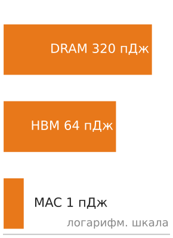

*Перемещение данных намного дороже арифметики по энергозатратам.*

Это соотношение на уровне операндов объясняет, почему архитекторы ускорителей тратят так много площади кремния на повторное использование данных. Тайловая модель исполнения тензорного ядра загружает малую матрицу в локальные регистры и переиспользует каждый элемент сотни раз (по разу на каждый элемент встречной матрицы), амортизируя стоимость обращения к HBM на сотни операций по 1 пДж. Без этого повторного использования энергетический бюджет доминировал бы доступом к памяти, и большая часть мощности чипа уходила бы на нагрев проводов, а не на переключение транзисторов.

На уровне парка энергетическая стоимость перемещения данных определяет счет за электричество. Для кластера из 10 000 GPU при 700 Вт на GPU примерно половина бюджета уходит на подсистему памяти (чтения и записи HBM, передачи внутри кристалла, обращения к регистровому файлу), а только четверть — на тензорные ядра, выполняющие полезную арифметику; остальное тратится на распределение тактового сигнала, ввод-вывод и утечки. Улучшение повторного использования данных с помощью таких приемов, как слияние ядер, FlashAttention и контрольные точки активаций, уменьшает энергию, растрачиваемую на перемещение данных, и повышает долю мощности, которая выполняет полезные вычисления.

Энергетический взгляд дает физическую основу для понимания того, почему разные стратегии параллелизма имеют разную эффективность. Тензорный параллелизм требует перемещения данных по NVLink (около 5 пДж на бит на уровне линка плюс энергия микросхем NVSwitch). Параллелизм по данным требует перемещения данных по InfiniBand (около 15–20 пДж на бит с учетом энергии HCA и коммутатора). Конвейерный параллелизм перемещает меньше данных, но требует более сложного планирования. Каждая стратегия параллелизма представляет собой отдельную точку компромисса между энергией коммуникации и эффективностью вычислений.

> **Энергетическая стоимость перемещения данных**
>
> Железный закон современных вычислений таков: перемещение данных стоит значительно больше энергии, чем их обработка. Анализ энергетической иерархии одной операции на техпроцессе 4 нм это доказывает.
>
> Одна операция умножения с накоплением FP16 (**MAC**), атомарная единица глубокого обучения, потребляет около 1 пикоджоуля (пДж). Это базовая стоимость полезной работы. Чтение одного операнда FP16 (16 бит) из HBM стоит примерно 4 пДж на бит, всего 64 пДж. Чтение того же операнда из внешней DRAM (вне корпуса) стоит около 20 пДж на бит, или 320 пДж. Асимметрия поразительна: чтение значения из HBM стоит в 64$\times$ больше энергии, чем вычисление над ним. Извлечение из стандартной DRAM стоит в 320$\times$ больше.
>
> Макроэффект проявляется при обслуживании нашей модели 175B. Генерация одного токена требует загрузки всего тензора весов объемом 350 ГБ из HBM:
>
> $$\text{Энергия перемещения данных} = 350 \text{ ГБ} \times 8 \text{ бит/байт} \times 4 \text{ пДж/бит} \approx \mathbf{11{,}2 \text{ Дж}}$$
>
> Вычислительная стоимость, связанная с примерно 175 миллиардами MAC (около 350 миллиардов FLOP), по сравнению с этим ничтожна:
>
> $$\text{Энергия вычислений} = 175 \times 10^9 \text{ MAC} \times 1 \text{ пДж/MAC} \approx \mathbf{0{,}175 \text{ Дж}}$$
>
> Перенос весов к вычислительным блокам стоит в 64$\times$ больше энергии, чем сама математика, в этой упрощенной модели декодирования. Этот энергетический штраф объясняет, почему HBM проектируют физически близко к кристаллу GPU: более короткие дорожки означают меньшую емкость и меньшую энергию на бит. Это также объясняет, почему приемы, которые сокращают перемещение данных, такие как квантование (перемещение меньшего числа битов) и слияние ядер (предотвращение обращений к памяти), служат основными рычагами повышения и производительности системы, и ее энергоэффективности.

#### Бенчмаркинг производительности ускорителей

Команде закупок, сравнивающей ускорители, нужна опубликованная цифра, которая предсказывает производительность, достижимую на практике. Пиковые TFLOP/s, пропускная способность памяти и TDP описывают *потенциал*, а не *достигнутую* производительность, поэтому решение зависит от того, чьим измеренным результатам можно доверять и по каким правилам они получены. Отраслевой эталон — MLPerf, который поддерживает MLCommons: MLPerf Training измеряет время обучения эталонных моделей до целевой точности, а MLPerf Inference — пропускную способность и задержку обслуживания в реалистичных условиях батчинга и стриминга. Оба измеряют полную производительность системы, включая эффективность программного стека, накладные расходы коммуникации и управление памятью, а не только сырой кремний.

Цифра, которая на самом деле предсказывает результаты организации, — это результат в закрытом дивизионе, и понимание того, почему, составляет суть грамотного чтения MLPerf. Закрытый дивизион требует, чтобы каждая заявка использовала одну и ту же архитектуру модели, гиперпараметры и рецепт обучения, изолируя железо и системное ПО как единственные переменные и делая результаты непосредственно сравнимыми между производителями. Открытый дивизион допускает произвольные модификации модели, пользовательские ядра и программные оптимизации, которые демонстрируют потолок платформы, но делают межпроизводительское сравнение ненадежным. Команды инфраструктуры должны больше доверять результатам закрытого дивизиона, потому что они отражают производительность, достижимую со стандартными фреймворками и конфигурациями, а не ту, которую дает только собственная команда оптимизации производителя.

Для нашей модели 175B ни один эталон не дает полной картины. Фаза обучения ограничена вычислениями при больших батчах, поэтому доминирующими метриками становятся пиковые TFLOP/s и эффективность масштабирования. Фаза инференса при батче 1 ограничена пропускной способностью памяти, поэтому релевантной метрикой становятся ГБ/с на доллар. Фаза дообучения лежит между этими крайностями: умеренные размеры батча ставят нагрузку вблизи точки перехода Roofline. Всесторонняя оценка должна измерить все три фазы на кандидатном железе, используя реальную модель и конвейер данных организации, а не полагаясь только на опубликованные цифры MLPerf.

> **За пределами пиковых характеристик**
>
> При оценке вариантов ускорителей следующие метрики дают более полную картину, чем одни лишь пиковые TFLOP/s:
>
> - **MFU**: отношение достигнутых FLOP/s во время реального обучения к пиковым FLOP/s аппаратуры. MFU 50 процентов означает, что железо половину времени тратит на полезные вычисления, а половину — на ожидание данных, синхронизацию или простой.
> - **Время до обучения (time-to-train)**: календарное время, за которое эталонная модель обучается до целевой метрики. Оно учитывает все системные эффекты, которые MFU не отражает, включая простои ввода-вывода, накладные расходы на контрольные точки и задержки перезапуска задания.
> - **Стоимость на токен**: для обучения языковых моделей полная стоимость (амортизация железа плюс электричество), деленная на число обработанных токенов. Эта метрика нормирует сравнение поколений железа, размеров кластеров и моделей ценообразования.
> - **Токены в секунду на доллар**: обратная величина стоимости на токен, полезная для сравнения экономической эффективности разных систем.
>
> Ни одна метрика не расскажет всей истории. Система с высоким MFU, но дорогим часом GPU, может оказаться менее экономичной, чем система с меньшим MFU и более дешевым железом. Правильная метрика зависит от того, оптимизирует ли организация время (обучение должно завершиться к сроку), стоимость (минимизировать общие расходы) или пропускную способность (максимизировать обработанные токены за единицу времени).

#### Особенности инфраструктуры для инференса

Инфраструктура обучения задает самые жесткие требования к железу, но обслуживание обученных моделей в масштабе вводит принципиально иные проектные ограничения. Инфраструктура обучения оптимизирована на *пропускную способность*: максимизацию общего числа токенов, обработанных в единицу времени по всему кластеру. Нагрузка представляет собой одно длительное задание, которое занимает весь кластер на дни или недели. Шаблон коммуникации предсказуем и повторяется. Допустимая задержка для любой отдельной операции — от миллисекунд до секунд.

Инфраструктура обслуживания оптимизирована на *задержку* и *стоимость одного запроса*: минимизацию времени, которое каждый пользователь ждет ответа, при сохранении стоимости запроса достаточно низкой, чтобы бизнес-модель оставалась жизнеспособной. Нагрузка состоит из миллионов независимых коротких запросов, которые приходят в нерегулярные интервалы. Шаблон коммуникации минимален: каждый запрос обрабатывается независимо на одном узле или небольшой группе узлов. Допустимая задержка для интерактивных приложений — десятки миллисекунд.

Различающиеся требования порождают отличающийся выбор железа и архитектуры, который сведен в [«Инфраструктуру обучения и обслуживания»](#tbl-training-serving-infrastructure).

| **Измерение**                                   | **Инфраструктура обучения**                                                                               | **Инфраструктура обслуживания**                                                                                                                         |
|:------------------------------------------------|:----------------------------------------------------------------------------------------------------------|:---------------------------------------------------------------------------------------------------------------------------------------------------|
| **Утилизация GPU**      | Большие батчи переводят нагрузку в режим, ограниченный вычислениями, поэтому кластеры обычно достигают 30–50% MFU. | Обслуживание при малом батче глубоко ограничено памятью и может давать менее 5% MFU, поэтому батчинг повышает утилизацию ценой задержки.                |
| **Размещение модели**    | Тензорный и конвейерный параллелизм распределяют одну модель по многим GPU.                               | Реплики модели или ее крупные шарды обрабатывают независимые запросы, поэтому спрос на память растет вместе с одновременной емкостью обслуживания.               |
| **Сетевой трафик** | Синхронизация градиентов требует высокопропускной и низколатентной связи между GPU.                    | Независимым запросам нужно мало трафика между GPU, но значительная пропускная способность на стороне клиентов для миллионов API-запросов в секунду.                |
| **Метрика стоимости**      | Стоимость обучения — фиксированный разовый расход, измеряемый в долларах за прогон.                               | Стоимость обслуживания — переменный расход, измеряемый в долларах за 1 000 сгенерированных токенов, и популярные модели могут превысить стоимость обучения за несколько недель. |

***Инфраструктура обучения и обслуживания**: обучение и обслуживание оптимизируют разное поведение железа, поэтому планирование емкости должно сравнивать утилизацию, размещение модели, сетевой трафик и стоимость в том режиме, в котором парк будет работать на самом деле.*

Таблица показывает, почему обслуживание нельзя планировать как обучение с меньшими батчами: цель оптимизации меняется с синхронизированной пропускной способности на запросы, ограниченные по задержке и тарифицируемые непрерывно.

Отсюда следует, что эффективная инфраструктура обслуживания часто использует другое железо, другое программное обеспечение и другие конструкции зданий, чем инфраструктура обучения. Некоторые организации используют GPU предыдущего поколения (A100) для обслуживания, потому что пропускная способность памяти на доллар у них может конкурировать с более новыми GPU, а более низкий TDP (400 Вт против 700 Вт) позволяет получить более высокую плотность стоек и меньшие затраты на охлаждение.

Сам инференс распадается на две фазы с противоположными узкими местами. Фаза **предзаполнения (prefill)** обрабатывает входной промпт, выполняя большое умножение матрицы на матрицу, которое ограничено вычислениями и достигает высокой утилизации тензорных ядер. Фаза **декодирования (decode)** генерирует токены по одному, выполняя умножения матрицы на вектор, которые глубоко ограничены пропускной способностью памяти. Чтобы максимизировать утилизацию железа, высокопроизводительные системы обслуживания используют **непрерывный батчинг (continuous batching)**, который планирует запросы на уровне итераций, а не запросов. Это позволяет движку вставлять новое вычисление предзаполнения для ожидающего запроса в простаивающие вычислительные слоты текущего батча декодирования, динамически заполняя арифметические конвейеры GPU. Для нашей модели 175B обслуживание 10 000 запросов в секунду при SLA на время до первого токена 50 мс требует распределения трафика по сотням реплик по 8 GPU (каждая содержит полную модель через тензорный параллелизм), причем балансировщик направляет запросы на реплику с наименьшей очередью. В отличие от обучения, где надежность 99,9 процента с контрольными точками может быть приемлемой, архитектуры инференса должны учитывать хвостовую задержку: одна медленная реплика может нарушить SLA для всего пакета запросов.

#### Матрица выбора ускорителя

Практическая схема решения синтезирует эти характеристики, специфичные для нагрузки, сопоставляя каждый архетип ([«Три архетипа систем»](01_introduction.md#sec-vol2-introduction-archetypes)) с аппаратным ресурсом, который доминирует в его производительности и стоимости. [«Матрица выбора ускорителя»](#tbl-accelerator-decision) делает правило выбора явным: выбирать под связывающее ограничение, а не под самую большую рекламируемую пиковую цифру.

| **Нагрузка**                      |    **Связывающее ограничение**    |      **Ключевая метрика**     |   **Рекомендуемый класс**   |
|:----------------------------------|:----------------------------:|:-----------------------:|:-------------------------:|
| **Обучение LLM ($>100\text{B}$)** |  Вычисления (большой батч)   | Пиковые TFLOP/s, пропускная способность NVLink |     H100/B200, TPU v5p    |
| **Инференс LLM (батч=1)**       |       Пропускная способность памяти       |     ГБ/с на доллар     | A100, H100 (пропускная способность/\$) |
| **Инференс LLM (батчи)**       |     Вычисления + пропускная способность      |     TFLOP/s и ГБ/с    |         H100, B200        |
| **Обучение моделей зрения**         | Вычисления (большие пространственные размеры) |       Пиковые TFLOP/s      |  H100/B200, предпочтительны GPU |
| **Рекомендации (эмбеддинги)**   |       Емкость памяти        |      ГБ на доллар      |   DRAM CPU + гибрид с GPU   |
| **Дообучение ($<13\text{B}$)**   |       Емкость памяти        |       Емкость HBM       |   A100 (экономично)   |
| **Исследования/прототипирование**          |         Гибкость          |    Программная экосистема   |  GPU (CUDA), без ASIC  |

***Матрица выбора ускорителя**: оптимальный ускоритель зависит не от пиковых характеристик, а от того, какой физический ресурс (вычисления, пропускная способность или емкость) является связывающим ограничением для целевой нагрузки. Модель Roofline дает диагностику: вычислить арифметическую интенсивность, определить положение нагрузки относительно точки перехода и выбрать железо, которое максимизирует связывающий ресурс на доллар.*

Связывающее ограничение меняется вместе с фазой жизненного цикла, как показывает [«Матрица выбора ускорителя»](#tbl-accelerator-decision) для сквозного примера с моделью 175B. Во время обучения большие батчи переводят нагрузку в режим, ограниченный вычислениями, и доминирующей метрикой становятся пиковые TFLOP/s. H100 или B200 с их высокой пропускной способностью тензорных ядер и быстрым NVLink для тензорного параллелизма — естественный выбор. При инференсе с малыми батчами та же модель становится глубоко ограниченной памятью, и релевантной метрикой становится пропускная способность на доллар. A100 с достаточной пропускной способностью HBM по более низкой цене может дать лучшую стоимость на токен, чем H100, дополнительные TFLOP/s которого остаются невостребованными.

Организационное измерение добавляет еще одно соображение. Исследовательские лаборатории, которые меняют архитектуры моделей каждую неделю, нуждаются в гибкости экосистемы CUDA у GPU, где пользовательские ядра можно написать и проверить за часы. Производственные команды, которые месяцами запускают фиксированную архитектуру трансформера в большом масштабе, могут выиграть от TPU, где оптимизация всей программы компилятором XLA способна давать более высокую устойчивую утилизацию, чем вручную настроенные ядра CUDA для стандартных операций. Пользовательские ASIC имеют экономический смысл только для организаций, которые достаточно велики, чтобы окупить невозвратные инженерные затраты (NRE) в \$50–\$200 млн, и чья нагрузка достаточно стабильна, чтобы оправдать 2–3-летний цикл проектирования. Спектр ускорителей в конечном счете — экономический вопрос, решаемый на пересечении физики нагрузки, масштаба организации и временного горизонта.

> **Выбор ускорителя**
>
> Инженерной команде нужно развернуть модель на 70 млрд параметров и для обучения, и для инференса. Обучение будет идти с батчем 2048 на 256 GPU в течение 3 месяцев. Инференс будет обслуживать 10 000 запросов в секунду при батче 1 в течение 2 лет.
>
> - **Интенсивность обучения**: используйте модель Roofline, чтобы определить арифметическую интенсивность каждой нагрузки на H100.
> - **Разделение железа**: решите, должны ли обучение и инференс использовать одно и то же железо или разное.
> - **Стоимость за два года**: рассчитайте разницу двухлетней стоимости инференса между H100 (\$4,00 за GPU-час) и A100 (\$2,00 за GPU-час), учитывая пропускную способность при арифметической интенсивности нагрузки.

Физика ускорителя задает конкретную проблему: наша модель 175B требует 350 ГБ памяти только под веса в FP16, а состояние обучения в стиле Adam (Adaptive Moment Estimation) поднимает требование до нескольких терабайт, когда учитываются моменты оптимизатора, градиенты и активации. Один H100 дает 80 ГБ HBM. Ни один ускоритель не может удержать эту модель. Система должна расшириться до следующего физического уровня: узла, где [«Сравнение топологий GPU внутри узла»](#fig-node-topology-comparison) сопоставляет два доминирующих подхода к соединению нескольких ускорителей внутри одного шасси.

## Узел

Узел — первый уровень масштаба, на котором выбор ускорителя становится проблемой межсоединения. Несколько GPU теперь могут делить одно шасси, но их полезное поведение зависит от того, ведет ли себя локальная фабрика как медленное кольцо, плотная сетка или коммутируемый кроссбар на базе коммутатора.

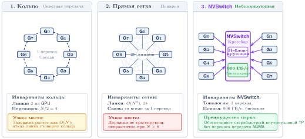

***Сравнение топологий GPU внутри узла**: три способа соединения GPU внутри узла. (Слева) Кольцо: последовательная передача через соседей, ~50 ГБ/с на линк, задержка растет с расстоянием. (В центре) Полная сетка: прямые связи «каждый с каждым», $N-1$ линков на GPU, непрактично за пределами ~8 GPU. (Справа) Коммутатор NVSwitch: неблокирующая фабрика с 112 ГБ/с на линк NVLink и 900 ГБ/с совокупно, связь от любого GPU к любому за один переход, что позволяет выполнять тензорный AllReduce внутри узла.*

Объединение ускорителей решает проблему емкости, только если межсоединение между ними достаточно быстрое, чтобы группа вела себя как одна машина, а не как несколько машин, обменивающихся сообщениями. Веса модели 175B занимают не меньше пяти ускорителей, а полное состояние обучения охватывает целый узел из 8 H100 и более, поэтому параметры одного слоя теперь живут на разных чипах и должны собираться заново на каждом прямом и обратном проходе. Дешево это или разорительно, полностью зависит от локальной фабрики, поэтому узел — первый уровень масштаба, где характеристики ускорителя важны меньше, чем провода между ускорителями. Система обучения должна сочетать тензорный параллелизм с шардингом оптимизатора и выгрузкой памяти, и каждая из этих стратегий предъявляет свои требования к межсоединению.

> **Узел**
>
> ***Узел*** — это физическое серверное шасси кластера обучения машинного обучения, которое объединяет несколько ускорителей (обычно 8) через высокоскоростное внутриузловое межсоединение (NVLink или ICI) и создает фундаментальную границу между высокопропускной локальной связью и межузловой сетевой фабрикой, которая медленнее на порядок.
>
> 1. **Значение**: пропускная способность NVLink внутри узла DGX H100 достигает 900 ГБ/с в обе стороны, или 450 ГБ/с в каждом направлении, тогда как межузловой InfiniBand NDR дает 50 ГБ/с. Это разрыв в 9× по направлению, и он ограничивает, где может выполняться каждая стратегия параллелизма. Тензорный параллелизм, который делает AllReduce выхода каждого слоя, должен оставаться внутри узла; конвейерный параллелизм, который передает только активации на границах стадий, может выходить за пределы узла через InfiniBand. Узел также является основным доменом отказа: один отказ узла в задании синхронного параллельного обучения bulk synchronous parallel (BSP), где воркеры продвигаются синхронно через барьеры шагов, простаивает весь кластер до восстановления.
> 2. **Отличие**: в отличие от одного ускорителя (который дает быструю пропускную способность HBM, но ограниченную емкость), узел объединяет в 8 раз больше емкости HBM и в 8 раз больше вычислений, чем один чип. Этого хватает, чтобы разместить большие шарды весов FP16 (8 × 80 ГБ = 640 ГБ на DGX H100), но не хватает, чтобы удержать в HBM полное состояние обучения Adam.
> 3. **Типичная ошибка**: распространено заблуждение, что узлы в задании распределенного обучения работают независимо. При синхронном параллельном обучении bulk synchronous parallel все узлы синхронно связаны на каждом барьере шага: ухудшение производительности одного узла (из-за теплового троттлинга, неисправной сетевой карты или медленного чтения из хранилища) останавливает весь кластер и снижает общий MFU на время этого шага.

Узел существует из-за разрыва в иерархии памяти. HBM дает достаточно пропускной способности, чтобы питать арифметические блоки ускорителя, но недостаточно емкости, чтобы удержать всю модель 175B из сквозного примера. DRAM хоста дает емкость (512 ГБ–2 ТБ на сервер), но недостаточную пропускную способность.

Узел перекрывает этот разрыв, объединяя HBM нескольких ускорителей в распределенную емкость, связанную быстрым межсоединением. HBM каждого ускорителя остается приватной для этого устройства: программное обеспечение должно явно шардировать или реплицировать тензоры и использовать коллективные операции или прямые передачи между устройствами, когда операция пересекает границы устройств. Размещение 8 ускорителей в одном шасси дает в 8 раз больше совокупной емкости и в 8 раз больше совокупных вычислений, но не создает единого ускорителя с общей памятью. Производительность зависит от того, насколько хорошо разбиение ограничивает трафик по фабрике.

Экономический аргумент в пользу многоускорительных узлов не менее убедителен. Рассмотрим альтернативу: построить один ускоритель с достаточным объемом HBM, чтобы удержать модель 175B (350 ГБ в FP16). Современные корпуса дают примерно 16–24 ГБ на стек HBM, поэтому конструкция из одного ускорителя на 350 ГБ потребовала бы порядка 15–22 стеков HBM, что намного больше, чем 5 стеков у H100 или 8 стеков у корпуса класса B200. Производственная стоимость такого корпуса была бы непомерной (выход годных падает с площадью корпуса и интерпозера), а подача энергии в один чип с достаточным числом тензорных ядер, чтобы использовать всю эту пропускную способность, превзошла бы любое практичное решение охлаждения. Распределение вычислений по 8 ускорителям, связанным NVLink, позволяет узлу получить совокупную емкость памяти и пропускную способность вычислений этого гипотетического супер-чипа, оставаясь в пределах производимых и охлаждаемых границ.

Понимание того, как узел распределяет память между своими компонентами, необходимо для выбора стратегий параллелизма. Рассмотрим бюджет памяти для обучения нашей модели 175B. Веса модели в FP16 требуют 350 ГБ. Оптимизатор Adam хранит две дополнительные копии каждого параметра (первый и второй моменты) в FP32, добавляя 175 × 10⁹ × 2 × 4 байта = 1 400 ГБ. Градиенты требуют еще 350 ГБ. Итого около 2,1 ТБ до учета активаций, что намного превышает и 80 ГБ HBM одного ускорителя, и совокупную HBM узла из 8 H100 (640 ГБ).

При использовании оптимизации в стиле ZeRO или FSDP (которая шардирует состояния оптимизатора, градиенты и, опционально, параметры между воркерами параллелизма по данным) система обучения избегает репликации этого полного состояния в 2,1 ТБ на каждом GPU. Тензорный параллелизм сначала уменьшает активный весовой шард каждого GPU; шардинг по данным затем распределяет состояние оптимизатора и градиенты по многим воркерам; контрольные точки активаций уменьшают пик активаций; а выгрузка переносит холодное состояние оптимизатора в DRAM хоста по PCIe. Поэтому узел — это высокопропускный блок вычислений и коммуникации, а не самостоятельный контейнер для всего состояния обучения.

Внутренняя иерархия памяти узла, состоящая из HBM (быстрая, маленькая), DRAM хоста (средняя скорость, большая) и хранилища NVMe (медленное, очень большое), образует многоуровневую систему, которую распределенные фреймворки обучения активно используют. Глава «Распределенное обучение» подробно разбирает эти стратегии оптимизации памяти.

### Иерархия пропускной способности

Определяющая черта многоускорительных систем — не *число чипов*, а *скорость, с которой они могут обмениваться данными*. Скорость передачи данных падает на порядки при пересечении физических границ. Каждая граница представляет собой другую физическую среду, другую технологию разъемов и другой набор инженерных ограничений. Этот физический порядок скоростей передачи, от SRAM на кристалле на быстром конце до глобальной сети на медленном, и есть **иерархия пропускной способности**; именно этот порядок определяет, на каком уровне иерархии каждый тип параллелизма может работать эффективно.

Иерархия отражает физическую цену расстояния: более короткие сигнальные пути по более плотной проводке дают более высокую пропускную способность при меньшей энергии на бит, поэтому на каждой границе эффективная пропускная способность $(\text{BW})$ падает примерно на порядок, а задержка $(L_{\text{lat}})$ растет. Этот градиент задает потолок масштабирования для распределенного обучения. Распространенная ошибка — считать всю коммуникацию в кластере равнозначной, но размещение параллелизма должно учитывать иерархию: если поставить синхронизацию высокой частоты, такую как тензорный параллелизм, на медленный уровень, то вычислительные блоки $(R_{\text{peak}})$ простаивают, а эффективность масштабирования $(\eta_{\text{scaling}})$ обрушивается.

Иерархию пропускной способности лучше всего представлять как серию концентрических зон вокруг каждого ускорителя. Самая внутренняя зона — HBM на том же корпусе, с пропускной способностью в терабайты в секунду и задержкой меньше микросекунды. Следующая зона охватывает другие ускорители того же узла, доступные через NVLink со скоростью сотни гигабайт в секунду и задержкой порядка микросекунды. Самая внешняя зона охватывает все остальные узлы кластера, связанные через InfiniBand с пропускной способностью десятки гигабайт в секунду и задержкой в единицах микросекунд. На каждой границе зон пропускная способность падает примерно на порядок, а задержка растет примерно на порядок. [«Иерархия пропускной способности»](#tbl-bandwidth-hierarchy-compute) сопоставляет эти зоны со стратегиями параллелизма, которые они могут поддерживать.

| **Домен**           |  **Межсоединение**  |                          **Пропускная способность**                          |   **Задержка**    | **Предел масштабирования**  |
|:---------------------|:------------------:|:---------------------------------------------------------------:|:----------------:|:------------------:|
| **Внутри корпуса**    | Кремниевый интерпозер |                            ~3,3 ТБ/с                            | $<100\text{ нс}$ |    Один чип     |
| **Внутри узла**       |     NVLink/ICI     | ~`900 ГБ/с` |      ~1 мкс       | Узел (8–16 чипов) |
| **Внутри узла (I/O)** |   PCIe Gen5 x16    |  ~`64 ГБ/с`  |      ~2 мкс       |  CPU–GPU, NIC–GPU  |
| **Между узлами**       |   InfiniBand NDR   |   ~`50 ГБ/с`   |    ~5–10 мкс     |  Под (тысячи)   |

***Иерархия пропускной способности**: каждая физическая граница создает обрыв пропускной способности на порядок. Эти обрывы — не инженерные дефекты, которые можно устранить оптимизацией; они отражают фундаментальные различия физики каждой среды межсоединения. Обрывы диктуют разбиение модели: тензорный параллелизм, которому нужен AllReduce после каждого слоя, строго ограничен доменом внутри узла.*

Концентрический вид на [«Иерархии пропускной способности инфраструктуры»](#fig-infra-bandwidth-hierarchy) представляет ту же иерархию пространственно, так что каждое пересечение внешней границы читается одновременно как падение пропускной способности и рост задержки.

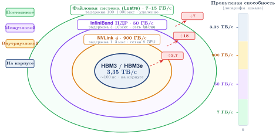

***Иерархия пропускной способности инфраструктуры**: концентрические зоны показывают уровни пропускной способности, через которые проходит ML-нагрузка. HBM (3,35 ТБ/с) находится в самой внутренней зоне; каждое пересечение внешней границы снижает пропускную способность примерно в 10$\times$ и повышает задержку примерно в 10$\times$: NVLink/NVSwitch (900 ГБ/с), InfiniBand NDR (50 ГБ/с) и хранилище/сетевая файловая система (7 ГБ/с) — в самой внешней зоне. Использование этой иерархии через многоуровневые алгоритмы — главная задача инженерии распределенных систем.*

Стратегии параллелизма должны учитывать эти физические границы. Простой расчет синхронизации делает разрывы пропускной способности конкретными.

> **Физика лестницы**
>
> **Задача**: буфер объемом 10 ГБ синхронизируется по парку. Насколько физический «уровень» парка влияет на время передачи?
>
> **Расчет**: время передачи равно $T_{\text{transfer}} = D_{\text{vol}} / \text{BW}$.
>
> 1. **HBM (внутри чипа)**: 10 ГБ / 3 350 ГБ/с ≈ 3,0 мс.
> 2. **NVLink (внутри узла)**: 10 ГБ / 450 ГБ/с ≈ 22,2 мс.
> 3. **InfiniBand (между узлами)**: 10 ГБ / 50 ГБ/с ≈ 200 мс.
>
> **Системный вывод**: передача данных по кластеру в 9× медленнее, чем внутри узла. Эта «лестница пропускной способности» — главный драйвер всех стратегий распараллеливания: тензорный параллелизм мы используем там, где пропускная способность изобильна (NVLink), а параллелизм по данным — там, где она дефицитна (InfiniBand). Модель, которая «помещается» в памяти, но игнорирует лестницу, будет тратить 90 процентов времени на ожидание сети.

Каждый обрыв на лестнице пропускной способности существует по собственной физической причине, укорененной в режиме распространения сигнала на его масштабе расстояний. Межсоединение **внутри корпуса** достигает терабайт в секунду, потому что сигналы проходят по литографически сформированным медным дорожкам на кремниевом интерпозере, длина которых измеряется миллиметрами. На таких расстояниях затухание сигнала ничтожно, усиление не нужно, а скорость сигнализации ограничена только геометрией дорожек и конструкцией приемопередатчика.

NVLink достигает сотен гигабайт в секунду, используя высокоскоростные приемопередатчики SerDes[^fn-serdes-highspeed-signaling] поверх коротких медных кабелей или дорожек внутри шасси, длина которых составляет десятки сантиметров. На таких расстояниях затухание сигнала измеримо, но управляемо простыми схемами выравнивания. Приемопередатчики SerDes используют сигнализацию PAM-4 (четырехуровневую амплитудную модуляцию импульсов) на 112 Гбит/с на полосу, упаковывая 2 бита в символ, чтобы удвоить скорость передачи данных по сравнению с сигнализацией NRZ (без возврата к нулю).

PCIe использует стандартизованный протокол с накладными расходами на управление потоком, что снижает эффективную пропускную способность. Хотя PCIe Gen5 использует ту же скорость сигнализации 32 GT/s, что и отдельные полосы NVLink, накладные расходы протокола (заголовки пакетов, кредиты управления потоком, проверка ошибок) забирают около 20 процентов сырой пропускной способности. Стандартизация, которая делает PCIe универсально совместимым, также делает его менее эффективным, чем проприетарные межсоединения.

InfiniBand преодолевает метры кабеля между стойками, что требует усиления сигнала, коррекции ошибок и переходов через коммутаторы, которые добавляют и задержку, и накладные расходы протокола. Активные оптические кабели преобразуют электрические сигналы в свет на передатчике, распространяют их по оптическому волокну и преобразуют обратно в электрические на приемнике. Каждое электрооптическое преобразование добавляет около 2–5 нс задержки и потребляет мощность на драйвер лазера и фотодетектор. Каждый переход через коммутатор добавляет еще 100–300 нс на маршрутизацию пакетов и буферизацию.

[^fn-serdes-highspeed-signaling]: **SerDes (сериализатор/десериализатор)**: от латинского *serialis* («в ряд») и *de-* («обратно»); пара схем, которая преобразует параллельные данные в последовательный битовый поток для передачи и обратно. Современные высокоскоростные линки используют сигнализацию PAM-4 (четырехуровневую амплитудную модуляцию импульсов, кодирующую 2 бита на символ) на очень высоких скоростях полос, и энергия приемопередатчика становится заметной частью мощности узла. Поэтому плотные межсоединения, такие как NVLink, InfiniBand и PCIe, нужно рассматривать как нагрузку на энергетику и охлаждение, а не только как спецификацию пропускной способности.

Практическое следствие для разбиения модели состоит в том, что тензорный параллелизм (TP), который делит отдельные матричные умножения между ускорителями и требует операции AllReduce после каждого слоя, генерирует объем коммуникации, пропорциональный скрытой размерности модели, сотни раз в секунду. При пропускной способности NVLink эта синхронизация занимает примерно 1 мс на слой. При пропускной способности InfiniBand та же синхронизация занимает 10–20 мс, и ускорители простаивали бы большую часть каждого шага обучения.

Поэтому TP ограничивают одним узлом, а параллелизм по данным (который синхронизирует градиенты только один раз за шаг обучения) охватывает межузловую сеть. Иерархия пропускной способности — физический закон, который определяет топологию распределенного обучения.

Иерархия также объясняет, почему конвейерный параллелизм занимает промежуточное положение по требованиям к пропускной способности. При конвейерном параллелизме модель делится на последовательные стадии, и каждая стадия назначается своей группе ускорителей. Коммуникация между стадиями состоит из активаций, которые текут вперед во время прямого прохода, и градиентов, которые текут назад во время обратного прохода, с объемом, пропорциональным размеру батча, умноженному на скрытую размерность.

Для нашей модели 175B со скрытой размерностью 12 288 и микробатчем из 4 последовательностей по 2 048 токенов тензор активаций на каждой границе стадии составляет около $4 \times 2\,048 \times 12\,288 \times 2\ \text{Б}$ (FP16) ≈ 201 МБ. Это намного меньше градиентного AllReduce объемом 350 ГБ, который требуется параллелизму по данным, поэтому конвейерный параллелизм предъявляет менее жесткие требования к межузловой сети.

Передачи активаций происходят один раз на микробатч на границу стадии, гораздо реже, чем AllReduce на каждом слое при тензорном параллелизме. Конвейерный параллелизм поэтому может выдерживать меньшую пропускную способность межузловых линков, что делает его предпочтительной стратегией для охвата нескольких узлов, когда глубина модели превышает емкость одного узла.

Соответствие типов параллелизма доменам межсоединения выглядит так: тензорный параллелизм внутри узла (NVLink), конвейерный параллелизм между соседними узлами (InfiniBand) и параллелизм по данным по всему кластеру (InfiniBand со сжатием градиентов). Это соответствие настолько фундаментально, что стало *де-факто* стандартом в промышленных системах обучения трансформеров, и детали различаются главным образом числом стадий конвейера, степенью тензорного и степенью параллелизма по данным.

Соответствие также определяет, как планировщик заданий назначает узлы заданиям обучения. Узлы одной группы тензорного параллелизма должны физически находиться рядом (в идеале в одном шасси, связанном через NVLink). Узлы одной группы конвейерного параллелизма должны находиться в одной стойке или соседних стойках (чтобы минимизировать переходы через коммутаторы InfiniBand). Группы параллелизма по данным могут охватывать весь кластер, потому что их коммуникация (AllReduce градиентов) наименее требовательна к пропускной способности и наиболее терпима к задержке из трех типов параллелизма. Перед тем как это отображение достигнет планировщика, остается одна внутриузловая граница: иерархия PCIe, которая соединяет ускорители с хост-CPU, сетевыми адаптерами (NIC), хранилищем и DRAM.

#### Иерархия PCIe внутри узла

Пока NVLink обеспечивает высокоскоростную магистраль для коммуникации между GPU, **PCIe Gen5** служит универсальным связующим звеном, соединяющим разнородные компоненты узла. Он связывает GPU с хост-CPU, GPU с адаптерами InfiniBand (HCA), хост-CPU с хранилищем NVMe и хост-CPU с системной DRAM. Понимание этой топологии критично, потому что пропускная способность PCIe, хотя и значительна (около 64 ГБ/с в каждом направлении, 128 ГБ/с в обе стороны, на линк x16), часто становится узким местом для операций, которые пересекают границу ускорителя, таких как загрузка данных, контрольные точки и межузловая синхронизация градиентов.

Стандартный узел DGX H100 содержит два хост-CPU, каждый из которых управляет **корневым комплексом PCIe** на 128 линий. Эти линии распределены так, чтобы максимизировать одновременную пропускную способность: каждый из 8 GPU получает выделенный линк x16, и каждый из 8 адаптеров InfiniBand HCA — свой линк x16. Такая конфигурация дает совокупную теоретическую пропускную способность почти 2 ТБ/с внутри шасси. Однако эта пропускная способность делится между конкурирующими потоками трафика. Во время одного шага обучения шина PCIe одновременно переносит батчи данных от хоста к GPU, шарды градиентов от GPU к HCA для межузлового AllReduce (через GPUDirect RDMA) и периодические записи контрольных точек с CPU на NVMe. Конкуренция между этими потоками может вызывать неожиданные остановки конвейера, особенно когда синхронизация градиентов насыщает линки, которые обычно используются для загрузки данных.

Архитектура с двумя CPU вносит существенные эффекты **неоднородного доступа к памяти (NUMA)**. 8 GPU физически разделены: 4 подключены к корневому комплексу CPU 0, а 4 — к CPU 1. GPU, подключенный к CPU 0, может достичь DRAM CPU 0 через свой локальный корневой комплекс PCIe, тогда как доступ к DRAM CPU 1 также проходит через межсокетный линк. Задержка и штраф пропускной способности зависят от процессора, межсокетного соединения, топологии PCIe, размера передачи и параллельного трафика, поэтому фиксированный процент для всех узлов не применим. Конвейеры загрузки данных должны измерять эту топологию и размещать процессы-воркеры, закрепленные буферы, сетевые карты и целевые GPU в одном домене NUMA, когда локальный путь улучшает устойчивый поток данных.

Практическое следствие в том, что размещение — часть стратегии параллелизма: планировщик, который игнорирует корневые комплексы PCIe, локальность сетевых карт и домены NUMA, может превратить иначе корректный план тензорного или конвейерного параллелизма в узкое место, ограниченное хостом. Глава «Распределенное обучение» формализует, как эти внутриузловые и межузловые границы взаимодействуют с data-, тензорным и конвейерным параллелизмом.

### Плотные конструкции узлов

С учетом иерархии пропускной способности инженерная задача внутри узла ясна: соединить 8 ускорителей достаточной пропускной способностью для операций тензорного параллелизма между их приватными памятями. Решение — специализированная коммутационная фабрика, которая обеспечивает полную бисекционную пропускную способность между парами ускорителей. Понимание того, как устроена эта фабрика, требует осознать, почему более простые альтернативы не работают.

Самый простой подход — соединить 8 GPU в кольцо, где каждый GPU связан с двумя соседями. Кольцо недорого (нужно только $N$ линков для $N$ GPU) и хорошо работает для ring-AllReduce, где данные последовательно циркулируют по кольцу. Алгоритм ring-AllReduce достигает оптимальной утилизации пропускной способности для синхронизации градиентов, потому что каждый GPU одновременно отправляет данные правому соседу и получает данные от левого, и все линки заняты на протяжении всей операции.

Однако тензорный параллелизм требует частых коллективных операций, обычно AllReduce, ReduceScatter и AllGather, после шардированных матричных операций. Физическое кольцо может эффективно выполнять ring-AllReduce, но его фиксированные многоступенчатые пути ограничивают другие одновременные шаблоны трафика и делают важным планирование с учетом топологии. Полностью связанная сетка, в которой у каждого GPU есть прямой линк к каждому другому GPU, снимает ограничение многоступенчатых путей, но требует $N(N-1) / 2 = 28$ линков для 8 GPU. Это задача проводки, которая становится непрактичной, когда число линков растет квадратично. Кроссбар NVSwitch обеспечивает коммутируемую связность с полной бисекционной пропускной способностью при управляемом числе микросхем коммутатора.

Рассмотрим архитектуру NVIDIA DGX H100. Восемь GPU H100 расположены на одной базовой плате, каждый подключен к четырем микросхемам NVSwitch через 18 полос NVLink 4.0. Микросхемы NVSwitch образуют неблокирующий кроссбар[^fn-crossbar-nvswitch-interconnect], через который любой GPU может достичь любого другого. Бюджет портов каждого GPU составляет 900 ГБ/с в обе стороны, или 450 ГБ/с в одном направлении, и делится между одновременными передачами этого GPU. Это не отдельный линк полной пропускной способности для каждой пары GPU.

[^fn-crossbar-nvswitch-interconnect]: **Кроссбар-коммутатор**: топология, которая одновременно обеспечивает выделенный путь между каждой парой вход–выход. Кроссбар $N{\times}N$ имеет $N^2$ точек пересечения и обеспечивает полную бисекционную пропускную способность. NVSwitch реализует трехступенчатый кроссбар на четырех микросхемах коммутатора (каждая с 64 портами NVLink), потребляя около 800 Вт суммарно, больше, чем целый GPU V100. Но эта цена мощности оправдана: она позволяет выполнять всеобщий (all-to-all) тензорный параллелизм внутри узла, шаблон коммуникации, который иначе доминировал бы во времени обучения.

В результате получается узел с совокупной емкостью HBM 640 ГБ и совокупной пиковой вычислительной пропускной способностью 8 × 1 979 TFLOP/s, при этом каждый GPU сохраняет приватную HBM. Фреймворки обучения явно разделяют тензоры между этими устройствами, а NVSwitch снижает стоимость коммуникации между шардами, не делая размещение и коллективную синхронизацию прозрачными.

Физическая компоновка базовой платы DGX H100 отражает эту цель проектирования. 8 GPU расположены на плате, а 4 микросхемы NVSwitch — в центре. Каждый GPU подключен ко всем 4 микросхемам NVSwitch через полосы NVLink, а каждая микросхема NVSwitch имеет 64 порта NVLink, которые перекрестно соединяют GPU.

Сами микросхемы NVSwitch потребляют около 200 Вт каждая (800 Вт суммарно для фабрики NVSwitch), это ощутимые накладные расходы мощности, оправданные полосой бисекции, которую они дают. Для сравнения: одна фабрика NVSwitch потребляет больше мощности, чем целый GPU предыдущего поколения (V100 потреблял 300 Вт). Без NVSwitch полная связность «каждый с каждым» потребовала бы 28 прямых линков GPU–GPU, что стало бы проводочным кошмаром и потребовало бы еще больше полос NVLink.

Во время прямого прохода тензорного параллелизма каждый GPU держит один шард каждой весовой матрицы и вычисляет свою часть матричного умножения. Для слоя трансформера со скрытой размерностью 12 288 (типично для модели на 175B) каждый из 8 GPU держит срез весовой матрицы размером $12{,}288{\times}1{,}536$. После того как каждый GPU вычислит свой частичный результат, операция AllReduce суммирует частичные результаты по всем 8 GPU через NVLink.

Логический выходной тензор одного AllReduce содержит $4 \times 2\,048 \times 12\,288 \times 2$ байта (FP16). Для микробатча из 4 последовательностей по 2 048 токенов этот объем полезной нагрузки составляет около 201 МБ. Идеальный ring-AllReduce с 8 участниками передает на GPU $2(p-1)/p$ = 1,75 раза от объема полезной нагрузки, или около 352 МБ. При одностороннем потоке 450 ГБ/с нижняя граница времени передачи составляет примерно 0,783 мс.

По 96 слоям прямого прохода и 96 слоям обратного прохода 192 передачи в сумме дают около 150,3 мс на шаг до перекрытия. NVSwitch предоставляет пути, необходимые для коллективной операции, но эта величина остается идеальной нижней границей только по пропускной способности, которая не учитывает задержку старта, накладные расходы ПО и конкурирующий трафик.

Относительно опорного времени вычислений 200 мс, использованного в примере [«Сюрприз пропускной способности NVLink»](#exmp-compute-infrastructure-nvlink-bandwidth-surprise), нижняя граница NVLink без перекрытия оставляет вычисления на уровне 57,1 процента совокупного времени вычислений плюс коммуникации. Фактическая эффективность тензорного параллелизма может быть выше, если коллективные операции перекрываются с полезными вычислениями, или ниже, если задержка, конкуренция, дисбаланс нагрузки и непараллельная работа добавляют время. Поэтому ее нужно измерять, а не выводить только из пиковой пропускной способности линка.

> **Сюрприз пропускной способности NVLink**
>
> **Сценарий**: ранние пользователи многоускорительных узлов пытались выполнять тензорный параллелизм через межсоединения PCIe Gen5 (пропускная способность 64 ГБ/с), рассчитывая на достаточную производительность.
>
> **Диагноз**: тензорный параллелизм выполняет 192 события AllReduce за шаг по 96 слоям. Задержка передач по PCIe накапливается до 1 057 мс за шаг, и GPU тратят 84,1 процента времени выполнения на простой из-за коммуникации.
>
> **Системный урок**: коммуникационно интенсивному тензорному параллелизму нужны высокопропускные межсоединения вроде NVLink (0,783 мс на AllReduce): они сокращают задержку передачи на порядок и повышают эффективность вычислений до 57,1 процента.

Помимо NVLink, узел также подключается к внешней сети через адаптеры InfiniBand (HCA) и к хранилищу хоста через PCIe. DGX H100 включает восемь сетевых адаптеров InfiniBand ConnectX-7 (HCA), по одному на каждый GPU, что позволяет использовать GPUDirect RDMA: сетевой адаптер может читать из HBM GPU и записывать в нее напрямую, не проводя данные через DRAM хоста и не вовлекая хост-CPU в путь данных.

GPUDirect RDMA критичен для синхронизации градиентов между узлами, когда шард градиента каждого GPU должен быть отправлен его партнерам на других узлах. Без GPUDirect каждая передача градиента потребовала бы две дополнительные копии: сначала из HBM GPU в DRAM хоста (по PCIe), а затем из DRAM хоста в сетевой адаптер (по другому пути PCIe). Двойное копирование добавляет задержку (два прохода по PCIe вместо одной прямой операции доступа к памяти (DMA)) и вдвое снижает эффективную пропускную способность (каждый байт дважды проходит по шине PCIe).

GPUDirect RDMA устраняет обе копии, позволяя адаптеру InfiniBand (HCA) читать HBM GPU напрямую, в обход хост-CPU и DRAM хоста. Путь данных ведет из HBM GPU через мост NVLink–PCIe к адаптеру InfiniBand за одну передачу. Этот путь в один переход — одна из причин, по которым современные кластеры обучения достигают межузловой пропускной способности, близкой к сырой скорости линии InfiniBand.

Хост-CPU управляет планированием заданий, предобработкой данных, загрузкой данных из хранилища и обработкой сетевых протоколов, но находится вне критического пути вычислений между GPU. Такое разделение намеренное: хост берет на себя «медленные» операции (дисковый ввод-вывод, управление сетью, координацию заданий), а фабрика GPU–NVSwitch — «быстрые» (матричную математику, синхронизацию градиентов).

Роль хост-CPU аналогична роли ядра операционной системы в традиционном компьютере: он управляет ресурсами, обрабатывает исключения и координирует ввод-вывод, но не выполняет основную вычислительную работу приложения. В хорошо оптимизированном цикле обучения хост-CPU почти никогда не находится на критическом пути, а его характеристики (число ядер, тактовая частота) менее важны, чем возможности ввода-вывода (число линий PCIe, каналы памяти, пропускная способность контроллера NVMe).

Хост-CPU также выполняет среду исполнения Python фреймворка обучения, которая оркестрирует запуски ядер, управляет графом вычислений и координирует коллективные операции коммуникации. В хорошо оптимизированных циклах обучения хост-CPU конвейеризирует загрузку и предобработку данных следующего батча, пока GPU выполняют прямой и обратный проходы текущего батча, и все компоненты заняты одновременно.

По мере роста «налога дата-центра» на хост-CPU (до 30 процентов тактов CPU уходит на обработку сетевых протоколов, виртуализацию хранилища и функции безопасности) узлы ML могут включать **блоки обработки данных (DPU)** или SmartNIC. Устройства вроде DPU NVIDIA BlueField переносят эти инфраструктурные задачи на выделенные ядра ARM и аппаратные ускорители, встроенные в сетевой адаптер. Перенос управляющей плоскости RDMA, правил файрвола и протоколов хранения на DPU возвращает такты для ML-конвейера: загрузку данных, токенизацию и оркестрацию ядер на хост-CPU. DPU также выступает изолированным доменом безопасности, позволяя облачным провайдерам сохранять контроль над сетевым и storage-уровнем через DPU, одновременно предоставляя клиентам полный доступ к хост-CPU и GPU. Для обучения нашей модели 175B разгрузка на DPU может держать обработку протокола RDMA вне критического пути хост-CPU при синхронизации градиентов, которая течет из HBM GPU в сетевую фабрику без участия хост-CPU.

#### Альтернативные архитектуры узла

Эти альтернативы — проектные решения ускорительных систем, а не взаимозаменяемые названия продуктов. AMD MI300X — ускоритель класса GPU, корпус которого делает упор на очень большую емкость HBM, тогда как конструкции Intel/Habana Gaudi делают сетевое подключение Ethernet/RDMA полноценным путем коммуникации. Сравнение с узлом DGX H100 показывает, где каждая архитектура тратит свой ограниченный бюджет.

DGX H100 решает общую задачу проектирования узла, делая локальный обмен между ускорителями дешевым. Конструкция, богатая коммутаторами, тратит мощность, площадь платы и стоимость на универсальный обмен «каждый с каждым». Такой выбор легко обосновать, когда тензорный параллелизм находится на критическом пути, потому что каждый слой трансформера превращает локальную коммуникацию ускорителей в часть внутреннего цикла модели. Фабрика NVLink H100 на 900 ГБ/с поэтому покупает программную абстракцию: фреймворк обучения может считать восемь ускорителей одним плотно связанным устройством для слоев, которые должны быть разделены между чипами.

Другие системы сдвигают эту границу. TPU-поды используют межчиповые соединения и топологию, ориентированную на сетку, вместо того чтобы делать центральный коммутатор определяющим компонентом узла; профиль TPU v5p в MLSysIM задает ICI на уровне 1 200 ГБ/с. Сетка может снизить стоимость коммутатора и открыть компилятору регулярную структуру, но она также делает размещение более заметным: среда исполнения должна учитывать отношения соседства, а не предполагать, что у каждой пары чипов один и тот же путь коммуникации. Это разумный компромисс, когда нагрузка достаточно регулярна, чтобы компилятор и библиотеки коллективных операций могли отобразить коммуникацию на топологию.

MI300X смещает точку напряжения с локального коммутирования на емкость памяти. Его корпус предоставляет 192 ГБ HBM при 5,3 ТБ/с, против 80 ГБ у ускорителя класса H100. Узел из восьми ускорителей MI300X поэтому дал бы 1 536 ГБ совокупной HBM, чего хватает, чтобы удержать тензор весов FP16 объемом 350 ГБ для нашей модели 175B. Это не устраняет проблему оптимизатора, градиентов, активаций и фрагментации, введенную ранее в этой главе, но меняет частоту, с которой системе приходится выносить состояние в более медленные уровни памяти, и запас по микробатчу, который остается до того, как выгрузка становится обязательной.

Gaudi выбирает другой путь, встраивая RDMA-совместимый Ethernet в ускоритель и используя более ориентированную на сеть конструкцию для коммуникации. Профиль Gaudi 2 дает 300 ГБ/с совокупной пропускной способности RoCE через 24 подключенных порта 100 GbE, тогда как узел на NVLink класса H100 предлагает 900 ГБ/с локального обмена между GPU, а ускоритель класса Gaudi 3 по-прежнему предоставляет 128 ГБ HBM. Вопрос в том, стоит ли упрощение фабрики и последовательное использование Ethernet по всему узлу и поду того, чтобы отказаться от очень высокой локальной пропускной способности обмена богатого коммутаторами NVLink-дизайна. Такой компромисс может быть привлекательным, когда доминируют параллелизм по данным, обслуживание инференса или стоимость кластера, и менее привлекательным, когда коллективные операции тензорного параллелизма находятся внутри каждого слоя.

Эти альтернативы — не рейтинг поставщиков. Это разные размещения дефицитных ресурсов: пропускная способность коммутации в узле, регулярная топология в поде, емкость HBM в корпусе или сетевое подключение на самом ускорителе. Для модели 175B, которая используется в этой главе, тензорная часть обучения делает локальную коммуникацию ускорителей необычно важной, поэтому ответ в стиле DGX естественен. В других режимах, особенно для рекомендательных систем с большим объемом памяти, обучения с регулярной топологией или парков обслуживания, чувствительных к стоимости, важнее может оказаться другая граница. Тогда зрелость программной экосистемы, доступность поставок и совокупная стоимость владения решают, станет ли теоретическое архитектурное соответствие развертываемой системой.

#### Состояние и надежность узла

Узел — основной домен отказа в иерархии парка. Когда один GPU выходит из строя внутри узла, весь узел обычно становится непригодным для задания обучения, потому что тензорный параллелизм требует участия всех 8 GPU в каждой операции AllReduce. Отсутствие одного GPU ломает коллективную коммуникацию и останавливает все остальные GPU узла. Поэтому эффективное среднее время между отказами (MTBF) узла определяется *самым ненадежным* компонентом, а не средним.

Компоненты, наиболее склонные к отказам внутри узла, образуют диагностический список, примерно в порядке частоты:

- **Память GPU**: HBM может выдавать неисправимые ошибки кода коррекции ошибок (ECC), которые выводят GPU из строя.
- **Линки NVLink**: целостность сигнала может ухудшаться со временем, вызывая переобучение линка или ошибки коммуникации.
- **Блоки питания**: конденсаторы стареют при длительной работе под высокой нагрузкой.
- **Компоненты охлаждения**: насосы в системах жидкостного охлаждения и подшипники вентиляторов в воздушных системах вносят механические виды отказов.

Хорошо управляемый парк отслеживает частоту ошибок каждого компонента и заблаговременно переносит нагрузки с узлов, которые показывают ранние признаки проблем. Важнейшие ранние индикаторы — рост числа исправленных ошибок ECC (которые часто предшествуют неисправимым ошибкам на часы или дни), рост температур переходов при постоянной нагрузке (признак деградации охлаждения) и перемежающиеся события переобучения NVLink (признак деградации кабеля или разъема). Проактивная замена компонентов с такими признаками может предотвратить гораздо более дорогой исход: незапланированный отказ задания во время многонедельного прогона обучения.

Мониторинг здоровья на уровне узла поэтому — критически важная операционная практика. Современные системы управления парком непрерывно собирают телеметрию с каждого GPU (температура, потребление мощности, счетчики ошибок ECC, частота ошибок NVLink) и с BMC платы (контроллера управления базовой платой). Автоматические проверщики здоровья запускают короткие диагностические нагрузки на простаивающих узлах, чтобы убедиться, что все GPU, линки NVLink и соединения InfiniBand работают корректно, прежде чем планировщик назначит узлу задание обучения. Без такого проактивного мониторинга тихо деградировавший узел может испортить градиенты обучения (если ошибка в арифметическом пути) или замедлить все задание (если ошибка вызывает переобучение NVLink, временно снижающее пропускную способность). Глава «Отказоустойчивость» подробно разбирает стратегии отказоустойчивости на уровне парка.

Для обучения нашей модели 175B на 128 узлах вероятность того, что хотя бы один узел столкнется с аппаратной проблемой за двухнедельный прогон обучения, существенна. При составном MTBF узла 1 000 часов, который включает GPU, компоненты хоста, питание, охлаждение и сетевые линки, ожидаемое число отказов узлов за прогон длительностью 336 часов составляет около 43. Это означает, что в среднем прогон обучения испытает примерно 3,1 отказа в день. Нижняя граница, учитывающая только GPU, по каноническому MTBF на GPU в 50 000 часов предсказала бы лишь 6,9 отказов узлов из-за GPU за тот же прогон, до добавления членов отказов хоста, питания, охлаждения и сети. Каждый отказ требует обнаружить деградировавший узел, слить с него нагрузку, подставить запасной узел и возобновить работу с последней контрольной точки. С автоматизированными инструментами этот процесс занимает 10–30 минут. При автоматическом восстановлении прямые накладные расходы перезапуска составляют примерно 2,1–6,4 процента прогона; без запасных узлов и автоматического восстановления многочасовые вмешательства могут поднять накладные расходы до 20–30 процентов, сжигая миллионы долларов в бесполезных GPU-часах.

### Разбиение памяти узла

Распространенное заблуждение — что объем памяти модели равен объему хранения ее весов. В этом примере обучения со смешанной точностью и оптимизатором Adam главные веса FP32, моменты оптимизатора, градиенты и активации вместе занимают примерно в 7–8$\times$ больше памяти, чем одни параметры FP16, и эти компоненты живут на разных уровнях иерархии памяти узла.

Для нашей модели 175B память обучения делится на шесть отдельных компонентов ([«Разбивка памяти при обучении модели на 175B параметров»](#tbl-memory-breakdown)).

| **Компонент**                          | **Точность** |                **Память на параметр**               | **Итого для модели `175B`** |
|:---------------------------------------|:-------------:|:-----------------------------------------------------:|:--------------------------------------------------------------------------------:|
| **Веса модели** |      FP16     | `2 байта` |              `350 ГБ`               |
| **Градиенты**                          |      FP16     | `2 байта` |             `350 ГБ`              |
| **Главные веса**                     |      FP32     | `4 байта` |           `700 ГБ`           |
| **Оптимизатор (Adam $m$)**               |      FP32     | `4 байта` |            `700 ГБ`             |
| **Оптимизатор (Adam $v$)**               |      FP32     | `4 байта` |            `700 ГБ`             |
| **Активации**                        |     Смешанная     |                        Переменная                       |          `100–400 ГБ`          |
| **Итого**                              |               |                                                       |          **`2,9–3,2 ТБ`**           |

***Разбивка памяти при обучении модели на 175B параметров**: одно только состояние оптимизатора (первый и второй моменты в FP32) занимает в 4$\times$ больше памяти, чем веса модели, поэтому память оптимизатора — доминирующая составляющая памяти обучения. Именно поэтому методы оптимизации памяти так сильно сосредоточены на шардинге и выгрузке состояния оптимизатора.*

[«Разбивка памяти при обучении модели на 175B параметров»](#tbl-memory-breakdown) делает разбиение конкретным. Тот же бюджет 2,9–3,2 ТБ, установленный ранее, появляется снова, но теперь разложенный по компонентам и уровням: доминирующий член — состояние оптимизатора Adam в FP32, а не веса FP16, а пик активаций (который масштабируется с размером батча и длиной последовательности) — самый переменный. Урок для выбора параллелизма в том, что веса — самая маленькая часть того, что должен удерживать узел, поэтому стратегия, которая шардирует только веса, оставляет нетронутыми крупнейших потребителей, состояние оптимизатора и активации.

Узел DGX H100 предоставляет 640 ГБ совокупной HBM на свои 8 GPU плюс 2 ТБ DDR5 DRAM хоста. Одной только HBM недостаточно для полного состояния обучения. Чтобы понять почему, рассмотрим арифметику памяти для разных стратегий параллелизма. При **чистом параллелизме по данным** каждый GPU должен держать модель целиком: 350 ГБ весов + 350 ГБ градиентов + 1 400 ГБ состояний оптимизатора = 2 100 ГБ, что физически невозможно на устройстве с 80 ГБ. Даже **ZeRO, этап 3**, который шардирует все три компонента только между 8 GPU, дает 2 100 ГБ / 8 ≈ 262,5 ГБ на GPU, что все еще более чем втрое больше доступной HBM. Решение — сочетать тензорный параллелизм (который делит слои модели между GPU, снижая веса на GPU до 350 ГБ / 8 = 43,75 ГБ) с шардингом по данным по многим репликам. В конфигурации TP-8 внутри каждого узла и параллелизме по данным на 128 путей по всему кластеру каждый GPU держит 43,75 ГБ весовых шардов. Состояние оптимизатора также разделяется: сначала делением тензорным на 8, а затем между 128 репликами параллелизма по данным, так что на каждом GPU приходится примерно 1 400 ГБ / 1024 ≈ 1,4 ГБ состояния оптимизатора, или 10,9 ГБ на группу тензорного параллелизма из 8 GPU, до учета градиентов, активаций, буферов и фрагментации. Подитог весов плюс оптимизатора около 45,1 ГБ — только отправная точка; упражнение на бюджет памяти в разделе [«Собираем вместе»](#sec-compute-infrastructure-putting-together-memory-budget-exercise-f357) показывает, почему градиенты и активации все равно требуют контрольных точек и выгрузки. Именно эта арифметика объясняет, почему тензорный параллелизм, шардинг оптимизатора, контрольные точки активаций и многоуровневое размещение памяти используются вместе для обучения больших моделей.

ZeRO, этап 3, полностью шардирует состояния оптимизатора, градиенты и параметры между всеми GPU, участвующими в параллелизме по данным. При шардинге между 8 GPU узла каждый GPU держит только 1/8 каждого компонента, снижая память на GPU примерно до 262,5 ГБ эквивалентного хранения (2 100 ГБ общего состояния ÷ 8). Это все еще превышает 80 ГБ на GPU, поэтому шардинг нужно сочетать с другими приемами. Контрольные точки активаций хранят только часть промежуточных активаций для обратного прохода и пересчитывают остальные от ближайшей контрольной точки. Они обменивают примерно на 33 процента больше операций на снижение памяти активаций до 10$\times$.

Выгрузка на CPU хранит состояния оптимизатора в DDR5 DRAM хоста и переносит их в HBM GPU, только когда обновлению параметров они нужны. Линк PCIe Gen5 на 64 ГБ/с вносит задержку передачи, но накладные расходы управляемы, потому что обновление параметров — малая доля общего времени шага. Выгрузка на NVMe распространяет ту же идею на SSD для еще более крупных моделей, с последовательной скоростью чтения 5–7 ГБ/с и большим штрафом по задержке, который требует аккуратной конвейеризации для перекрытия с вычислениями.

Иерархия памяти узла, таким образом, работает как многоуровневая система. HBM держит активные вычисления: весовые шарды, нужные для матричного умножения текущего слоя, активации текущего микробатча и градиенты, накапливаемые во время обратного прохода. DDR5 держит основной объем состояния оптимизатора, к которому обращаются только на шаге обновления параметров в конце каждой итерации обучения. NVMe обеспечивает резервную емкость для самых крупных моделей, храня редко используемые шарды, которые можно заранее подгрузить во время вычислений.

Менеджер памяти фреймворка обучения оркестрирует поток данных между этими уровнями и работает примерно как контроллер аппаратного кэша, но с более грубой гранулярностью. Аналогия с аппаратным кэшированием поучительна: как контроллер кэша CPU использует предвыборку, чтобы скрыть задержку памяти, загружая данные до того, как процессор в них нуждается, так и менеджер памяти фреймворка использует программную предвыборку, чтобы скрыть задержку передачи по PCIe, загружая веса до того, как GPU в них нуждается. Во время прямого прохода слоя $\ell$ менеджер одновременно предвыбирает веса слоя $\ell+1$ из DDR5 в HBM (если они были выгружены) и вытесняет веса слоя $\ell-2$ из HBM обратно в DDR5 (если память в дефиците).

Конвейеризация обеспечивает, что вычисления каждого слоя могут идти без ожидания передач данных, ценой возросшей сложности ПО и тщательной настройки глубины предвыборки. Если предвыборка слишком мелкая, вычисления останавливаются в ожидании данных. Если предвыборка слишком агрессивна, HBM заполняется данными, которые понадобятся только через несколько слоев, и вытесняет активации и градиенты, нужные для текущих вычислений. Компромисс «емкость — пропускная способность» между этими уровнями определяет, какие данные фреймворк обучения может держать «горячими», а какие должен предвыбирать; [«Иерархия памяти узла»](#tbl-node-memory) количественно описывает трехпорядковый разрыв пропускной способности, который менеджер памяти должен перекрыть.

| **Уровень памяти** |                                                                                        **Емкость**                                                                                        |                                 **Пропускная способность**                                 |                          **Задержка**                          |        **Роль**       |
|:----------------|:------------------------------------------------------------------------------------------------------------------------------------------------------------------------------------------:|:-----------------------------------------------------------------------------:|:-------------------------------------------------------------:|:---------------------:|
| **HBM3 GPU**    | `80 ГБ` $\times$ `8` = `640 ГБ` |     `3,35 ТБ/с` на GPU     |                    $<1\text{ мкс}$                    |   Активные вычисления  |
| **DDR5 хоста**   |                                                                 `2 ТБ`                                                                  |                           сотни ГБ/с совокупно                          |                            ~100 нс                            |    Состояние оптимизатора    |
| **SSD NVMe**    |                                                                                          8–30 ТБ                                                                                          | до `7 ГБ/с` на диск | ~`100 мкс` | Переполнение, контрольные точки |

***Иерархия памяти узла**: каждый уровень обменивает емкость на пропускную способность. Менеджер памяти фреймворка обучения должен организовывать поток данных между уровнями, чтобы уместить модели, полное состояние которых превышает совокупную емкость HBM.*

Оркестрация сложна, но необходима: без нее обучение нашей модели 175B на оборудовании класса H100 было бы невозможным. Глава «Распределенное обучение» подробно разбирает эти стратегии оптимизации памяти и их взаимодействие с параллелизмом.

#### Собираем вместе: упражнение на бюджет памяти

Чтобы закрепить понятия планирования памяти, рассмотрим конкретное упражнение по оценке размера для нашей модели 175B на узле DGX H100.

> **Бюджет памяти для обучения 175B на DGX H100**
>
> **Сценарий**: инженерная команда рассчитывает бюджет памяти для обучения модели на 175B параметров с 8-кратным тензорным параллелизмом на узле DGX H100 из 8 GPU (80 ГБ HBM на GPU).
>
> **Диагноз**: неразделенное состояние оптимизатора одно требует 175 ГБ на GPU, что больше весов и градиентов вместе (88 ГБ). Это доводит бюджет на GPU до 288 ГБ, намного выше предела HBM в 80 ГБ. Этот бюджет уже предполагает контрольные точки активаций; без них одни активации добавили бы 100–200 ГБ на GPU.
>
> **Системный урок**: планирование памяти обучения требует целостного учета весов, градиентов, состояний оптимизатора, активаций и буферов, потому что облегчение одного компонента не обязательно укладывает бюджет в предел. Выгрузка состояния оптимизатора в DDR5 хоста убирает доминирующий член и все равно оставляет 113 ГБ на GPU, потому что 8-кратный тензорный параллелизм держит полный шард весов и градиентов на каждом GPU. Поэтому чтобы поместить эту модель на этот узел, нужна вторая ось шардинга, например распределение градиентов и параметров через ZeRO, этап 3, а не только выгрузка оптимизатора.

Пример показывает, почему планирование памяти для больших моделей — тщательное инженерное упражнение, а не простой расчет емкости. Помимо размещения по уровням памяти, иерархия пропускной способности накладывает резкий штраф на данные, которые должны пересечь границу узла. Следующий расчет делает эту цену явной.

> **Цена пересечения обрыва**
>
> **Задача**: шаг обучения должен синхронизировать буфер градиентов объемом 1 ГБ. На сколько дольше занимает синхронизация, когда она пересекает границу узла (InfiniBand), по сравнению с тем, когда остается внутри узла (NVLink)?
>
> 1. **Внутри узла (NVLink)**: пропускная способность 450 ГБ/с — эффективная односторонняя; совокупная двусторонняя составляет 900 ГБ/с, но этот расчет времени передачи перемещает один буфер в одном направлении.
>    $T_{\text{intra}} = 1\text{ ГБ} / 450\text{ ГБ/с} \approx \mathbf{2{,}2 \text{ мс}}$
>
> 2. **Между узлами (InfiniBand NDR)**: пропускная способность 50 ГБ/с.
>    $T_{\text{inter}} = 1\text{ ГБ} / 50\text{ ГБ/с} \approx \mathbf{20 \text{ мс}}$
>
> **Системный вывод**: пересечение границы узла увеличивает время коммуникации примерно в 9 раз. В цикле обучения, где синхронизация градиентов происходит на каждом шаге, этот штраф останавливал бы ускорители на большую часть каждой итерации, снижая утилизацию намного ниже 50 процентов. Поэтому фреймворки обучения используют тензорный параллелизм внутри узла (быстрый NVLink) и параллелизм по данным между узлами (терпимый к более медленному InfiniBand).

### Загрузка данных и конвейер ввода-вывода

Рассуждение до сих пор касалось того, как данные движутся внутри узла (от HBM к тензорным ядрам, от GPU к GPU через NVLink, от GPU к хосту через PCIe). Обучению также нужно непрерывно подавать узлу поток обучающих данных из внешнего хранилища. Если конвейер загрузки данных не успевает за скоростью потребления GPU, самый дорогой компонент системы (GPU) простаивает в ожидании данных. Это и есть **узкое место ввода-вывода**, и чтобы его избежать, конвейер загрузки данных нужно тщательно проектировать.

Для обучения языковых моделей темп обучения определяет скорость потребления данных. Если кластер обрабатывает 500 000 токенов в секунду, а каждому токену нужно 2 байта входных данных (идентификатор токена), то сырой поток входных данных составляет всего 1 МБ/с, что тривиально для любой системы хранения. Однако реальный спрос на ввод-вывод гораздо больше, потому что обучающие данные нужно токенизировать, перемешать, собрать в батчи и передать в память GPU. Реалистичный конвейер данных превращает сырые байты в готовые для GPU батчи через пять последовательных стадий:

1. **Чтение**: сырой текст читается из распределенной файловой системы (NFS, Lustre или облачного объектного хранилища вроде S3) в память хоста. Для больших наборов данных (терабайты текста) данные обычно хранятся в двоичном формате (TFRecord, WebDataset или файлы с отображением в память), чтобы минимизировать накладные расходы на разбор.
2. **Предобработка**: токенизация, упаковка последовательностей и случайная обрезка выполняются на хост-CPU. Эти операции распараллелены по нескольким ядрам CPU с помощью воркеров загрузчика данных (обычно 4–8 воркеров на GPU).
3. **Батчинг**: отдельные последовательности собираются в микробатчи, дополняются до одинаковой длины и организуются в тензоры.
4. **Передача**: собранный батч передается из DRAM хоста в HBM GPU по PCIe. Для токенизированного языкового моделирования эта передача обычно невелика, потому что идентификаторы токенов и маски компактны. Мультимодальные батчи или конвейеры, которые материализуют эмбеддинги FP16 на хосте, могут достигать 100–200 МБ и занимать миллисекунды при пропускной способности PCIe Gen5.
5. **Предвыборка**: пока GPU обрабатывает текущий батч, загрузчик данных параллельно предвыбирает и предобрабатывает следующие 2–4 батча, гарантируя, что следующий батч уже находится в HBM GPU, когда текущее вычисление завершится.

Критическая цель проектирования — сделать конвейер данных невидимым для GPU: предвыборка должна быть достаточно глубокой, чтобы батч всегда был готов, когда он нужен GPU, независимо от кратковременных колебаний пропускной способности хранилища или времени предобработки. Когда конвейер хорошо настроен, утилизация GPU ограничена только вычислениями и коммуникацией, а не загрузкой данных. Когда его настроили плохо, GPU может тратить 10–30 процентов времени на ожидание данных, что напрямую снижает пропускную способность обучения.

Традиционный путь данных направляет каждый байт через хост-CPU: контроллер хранилища → DRAM хоста (один проход по PCIe), затем DRAM хоста → HBM GPU (второй проход по PCIe). Эта архитектура с буфером-посредником (bounce buffer) удваивает трафик на корневом комплексе PCIe и делает CPU узким местом для нагрузок с интенсивным вводом-выводом, ограничивая эффективную пропускную способность 3–4 ГБ/с на каждый диск NVMe из-за накладных расходов на переключение контекста ядра и обработку прерываний. **GPUDirect Storage (GDS)** устраняет эту неэффективность, устанавливая прямой путь DMA между контроллером NVMe и памятью GPU в обход хост-CPU. Один диск NVMe может отдавать 5–7 ГБ/с прямо в HBM GPU через GDS, загружая внутреннюю пропускную способность диска, а не подсистему ввода-вывода хоста. Для стандартного узла с четырьмя дисками NVMe GDS открывает совокупную пропускную способность «хранилище → GPU» в 20–28 ГБ/с, освобождая CPU для предобработки, например токенизации и упаковки последовательностей. Подробно этот прямой путь рассматривается в разделе о GPUDirect Storage главы «Хранение данных».

Требуемая глубина предвыборки не произвольна: она следует из статистики дисперсии задержек ввода-вывода. Если GPU обрабатывает один батч каждые $T_{\text{compute}}$ секунд, а система хранения доставляет батч каждые $T_{\text{I/O}}$ секунд со стандартным отклонением $\sigma_{\text{I/O}}$, то минимальная глубина предвыборки $k$, нужная для сохранения вероятности 99,7 процента отсутствия остановок, равна $k \ge \lceil T_{\text{I/O}} / T_{\text{compute}} + 3\sigma_{\text{I/O}} / T_{\text{compute}} \rceil$. Для нашего прогона обучения модели 175B, где $T_{\text{compute}} = 2{,}0$ с, а слой хранения доставляет батчи за $T_{\text{I/O}} = 1{,}5 \pm 0{,}5$ с, требуемая глубина составляет $\lceil 0{,}75 + 0{,}75 \rceil = 2$ батча. В промышленных средах, где «шумные соседи» на общих файловых системах вызывают тяжелые хвосты задержек, инженеры обычно увеличивают этот буфер до 4–8 батчей, чтобы изолировать GPU от непредсказуемой динамики распределенного хранилища. Затраты памяти на этот буфер предвыборки ничтожны по сравнению с ценой остановки GPU для токенизированных языковых нагрузок, хотя мультимодальным конвейерам нужно закладывать более крупные буферы батчей на стороне хоста.

По мере роста размеров кластера возникает новое узкое место хранилища. При обучении нашей модели 175B на 128 узлах система ведет себя как синхронизированный «эффект громового стада» (thundering herd): все 128 узлов одновременно запрашивают следующий микробатч токенов в начале каждого шага обучения. Общая параллельная файловая система вроде Lustre, даже с совокупной пропускной способностью 500 ГБ/с, сломается, когда 128 клиентов одновременно тянут данные, и задержки чтения подскочат с миллисекунд до секунд. Архитектурное решение — **многоуровневое хранилище** с агрессивным локальным кэшированием. Оснащение каждого узла обучения локальными SSD NVMe, способными отдавать 25 ГБ/с на узел, отделяет непосредственную зависимость кластера от данных от общей файловой системы. Фоновый процесс асинхронно предвыбирает данные из центрального хранилища в локальный кэш NVMe, сглаживая пики ввода-вывода. Для кластера из 128 узлов локальный NVMe создает совокупную пропускную способность чтения 3,2 ТБ/с ($128 \times 25$ ГБ/с), что превосходит возможности даже самых дорогих централизованных массивов хранения и гарантирует, что GPU никогда не будут голодать.

> **Ловушка загрузки данных**
>
> Тонкий режим отказа возникает, когда локальный тест загрузки данных удовлетворяет узел, но общий путь не может удовлетворить парк. Аппаратный контракт — это сквозная устойчивая пропускная способность при нужной степени параллелизма, включая серверы хранения, сетевые пути, предобработку, память хоста и передачу в ускоритель. Глава «Хранение данных» развивает уровни хранения и пути данных, которые должны выполнять этот контракт.

Для нашей модели 175B один узел DGX H100 дает 640 ГБ совокупной HBM. Этого достаточно, чтобы удержать веса модели в FP16, но не полное состояние обучения Adam без шардинга и выгрузки. Обучению также нужно обработать триллионы токенов, а вычислительная пропускная способность одного узла растянула бы обучение на месяцы. Чтобы завершить обучение за разумный срок (недели, а не месяцы), требуются десятки или сотни узлов. Объединение этих узлов в физический корпус определяет следующий уровень инфраструктуры, где ограничения смещаются от пропускной способности и емкости к сырой мощности и теплу.

## Стойка

Стандартная серверная стойка 42U в традиционном дата-центре потребляет 5–10 кВт и может охлаждаться комнатным воздухом, нагнетаемым через перфорированные напольные плитки. Четырехузловая стойка DGX H100 из сценария этой главы в смоделированной границе ИТ потребляет 33,5 кВт. При такой плотности инженерные ограничения смещаются от кремния и целостности сигнала к подаче энергии и термодинамике. Именно стойка — место, где энергетическая стена и законы теплопереноса становятся доминирующими проектными силами.

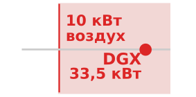

*Современные GPU-стойки выходят за пределы воздушного охлаждения.*

Для нашей модели 175B обучение на 1 024 GPU требует 32 стоек (по 4 узла из 8 GPU в каждой стойке). По всему кластеру смоделированная ИТ-мощность стоек в сумме составляет около 1,1 МВт до учета накладных расходов охлаждения здания. Надежно подать эту мощность и отвести выделяемое тепло, не допуская превышения теплового предела каждым компонентом, — многодисциплинарная инженерная задача, которая охватывает электротехнику, механику и строительство. Отказ в любой точке цепочки подачи энергии, от подстанции энергосети до регулятора напряжения отдельного GPU, может остановить весь прогон обучения, сжечь часы вычислений и потенциально повредить состояние обучения.

> **Стойка**
>
> ***Стойка*** — это физическая инфраструктурная единица, стандартизированный корпус 42U, в котором размещаются несколько вычислительных узлов, коммутатор top-of-rack (ToR; первая точка агрегации сети, соединяющая все узлы стойки с общей сетевой фабрикой кластера), блоки распределения питания и коллекторы распределения охлаждения. Стойка определяет гранулярность, с которой нужно обеспечивать мощность и охлаждение.
>
> 1. **Значение**: плотность мощности ML-стоек выросла драматически. Четырехузловой сценарий DGX H100 из этой главы содержит 32 GPU по 700 Вт каждый и потребляет 33,5 кВт в смоделированной границе ИТ. Это превышает 5–10 кВт, типичные для стоек универсальных дата-центров, и требует специально спроектированного электрораспределения и мощности охлаждения. Охлаждается ли стойка инженерным воздухом или жидкостью, зависит от конфигурации системы и проекта здания.
> 2. **Отличие**: в отличие от узла (вычислительной единицы), стойка — инфраструктурная единица: это физический уровень, на котором интегрированы коллекторы охлаждения, распределение питания и ToR-коммутатор. Поэтому минимальной заменяемой и обслуживаемой единицей для эксплуатации здания является стойка, а не узел.
> 3. **Типичная ошибка**: распространено заблуждение, что размещение стоек — запоздалая логистическая мысль. Узлы в одной стойке разделяют ToR-коммутатор и имеют связность в один переход; узлы в разных стойках пересекают минимум два коммутатора. Размещение всех стадий конвейерного параллелизма задания в одной стойке минимизирует задержку между стадиями и снижает нагрузку сетевой фабрики между стойками.

Вступление к стойке обещало, что законы теплопереноса становятся доминирующей проектной силой на этом уровне. Воздух имеет значительно меньшую объемную теплоемкость, чем жидкость, поэтому стойка с воздушным охлаждением нуждается в достаточном воздушном потоке, давлении и повышении температуры, чтобы унести свое тепло. Универсального порога в 30 кВт не существует: практический предел зависит от проекта серверов и здания. Сценарий 33,5 кВт из этой главы может использовать инженерное воздушное охлаждение в подходящем здании; более плотные системы могут сделать жидкостное охлаждение практичным выбором.

Выбор охлаждения, таким образом, зависит от конфигурации, а не является следствием одного порогового значения мощности стойки. Прямое жидкостное охлаждение чипа повышает способность отводить тепло и может снизить энергозатраты вентиляторов, тогда как инженерный воздух остается жизнеспособным для систем и зданий, спроектированных под его требования к воздушному потоку. Глава «Устойчивый ИИ» (раздел «Охлаждение») сравнивает эти архитектуры и накладные расходы мощности здания, которые несет каждый выбор каждый час работы кластера.

### Вопросы проектирования стойки

Физическая конструкция ML-стойки существенно отличается от традиционной серверной стойки не только в части питания и охлаждения. В обычной стойке 42U серверы устанавливаются как независимые блоки 1U или 2U («пиццебоксы»), каждый со своими вентиляторами, блоками питания и кабельными соединениями. ML-стойки используют принципиально иной форм-фактор. DGX H100 занимает 8U и содержит 8 GPU, фабрику NVSwitch, несколько блоков питания и (в конфигурациях с жидкостным охлаждением) коллекторы охлаждающей жидкости с быстроразъемными соединениями. Четыре блока DGX в стойке 42U оставляют только 10U для сетевых коммутаторов, кабельного менеджмента и PDU.

Переход от традиционных серверных форм-факторов к ML-оптимизированным конструкциям вызван тем же вызовом плотности мощности, который вынудил перейти от воздушного охлаждения к жидкостному. Традиционный сервер 1U рассеивает 300–500 Вт и требует лишь умеренного воздушного потока. DGX H100 рассеивает около 8,4 кВт на своих 8 GPU, NVSwitch и вспомогательных компонентах, что требует либо огромного воздушного потока (в конфигурациях с воздушным охлаждением), либо сантехники жидкостного охлаждения (в конфигурациях с жидкостным). Форм-фактор должен вмещать и вычислительное оборудование, и инфраструктуру терморегулирования, поэтому ML-узлы заметно выше (8U против 1U), чем традиционные серверы.

Управление кабелями — нетривиальная инженерная задача. Каждый узел DGX H100 имеет 8 кабелей InfiniBand (по одному на GPU), 2 кабеля управляющего Ethernet, силовые кабели и (для моделей с жидкостным охлаждением) шланги охлаждающей жидкости. Полностью заполненная стойка содержит более 40 высокоскоростных кабелей, каждый из которых нужно аккуратно проложить.

Три физических ограничения определяют прокладку кабелей:

- **Зазор для воздушного потока**: кабели не должны перекрывать воздушный поток в конструкциях с воздушным охлаждением, потому что даже частичная блокировка может создать горячие точки, которые вызывают троттлинг соседних компонентов.
- **Радиус изгиба**: у высокоскоростных кабелей есть минимальный радиус изгиба, обычно в 10–15$\times$ больше диаметра кабеля для активных оптических кабелей. Ниже него сигнальный путь повреждается и может давать битовые ошибки или полный отказ линка.
- **Электромагнитные помехи**: связка слишком многих высокоскоростных медных кабелей вместе может ухудшать качество сигнала на соседних линках.

В крупных установках одна только кабельная система может монтироваться и тестироваться неделями, а ошибки в прокладке кабелей — одна из самых частых причин задержек отладки после монтажа.

По мере того как плотность мощности стоек приближается к 100 кВт для кластеров с жидкостным охлаждением, неэффективность поузлового преобразования переменного тока становится неприемлемой. Традиционные конструкции отводят в каждом шасси объем под резервные блоки питания переменного тока (PSU), тогда как многие плотные стоечные конструкции используют **распределение постоянного тока на уровне стойки**. В этой архитектуре централизованная полка питания преобразует сетевой переменный ток в **шину постоянного тока 48 В**, которая проходит по всей высоте стойки и заменяет отдельные блоки питания серверов. Такая консолидация устраняет одну ступень преобразования и дает выигрыш эффективности всей системы в 2–3 процента, что заметно снижает тепловую нагрузку при обучении модели на 175B параметров на тысячах GPU. Питание подается по шине 48 В напрямую на объединительную плату сервера, где компактные преобразователи постоянного тока снижают его до 12 В и, наконец, до рабочего напряжения GPU ниже 1 В. Эта топология, пионерами которой стали Google и Meta через Open Compute Project, сокращает число точек отказа и высвобождает ценный объем шасси для гидравлических контуров охлаждения и высокопропускных межсоединений.

#### Сети подачи энергии и переходные процессы

Понижение напряжения с 48 В до рабочих уровней ниже 1 В на кремниевом кристалле создает острую физическую задачу: управление скоростью нарастания тока ($di/dt$) в **сети подачи энергии (PDN)**.

Современные ускорители ИИ работают при напряжении питания ниже одного вольта ($V_{\text{core}} \approx 0{,}7\text{--}0{,}9\text{ В}$), потребляя при этом $700\text{--}1\,200\text{ Вт}$ каждый. По закону сохранения мощности ($P = V \cdot I$) один ускоритель потребляет устойчивый ток, превышающий $I_{\text{core}} \approx 1\,000\text{--}1\,500\text{ А}$. Для плотной стойки с жидкостным охлаждением, в которой размещаются 36–72 ускорителя (например, потребляющих $100\text{--}120\text{ кВт}$), совокупный ток ядер на уровне кремния достигает $50\,000\text{--}100\,000\text{ А}$.

> **Сеть подачи энергии (PDN) и переходные процессы**
>
> ***Сеть подачи энергии (PDN)*** — это физическая иерархия распределения электричества от источника питания здания до затворов транзисторов на кристалле. Ее паразитная индуктивность контура ($L_{\text{parasitic}}$) вызывает переходные колебания напряжения ($\Delta V = L \frac{di}{dt}$) при быстрых изменениях переключательной активности процессора.
>
> 1. **Значение**: синхронное распределенное обучение создает жесткие ступенчатые переходные токи, когда тысячи GPU одновременно переходят между простоями коммуникации и плотным матричным умножением, угрожая коллапсом напряжения или катастрофическим пробоем диэлектрика.
> 2. **Отличие**: в отличие от тепловых ограничений (которые действуют секундами или минутами из-за теплоемкости), переходные процессы PDN развиваются в наносекундном и микросекундном диапазонах, слишком быстром для обратных связей в шкафах питания дата-центра.
> 3. **Типичная ошибка**: опора только на пассивные конденсаторы на уровне платы для подавления переходных процессов. Высокочастотные переходные процессы нужно подавлять многоуровневой иерархией развязки, которая включает траншейные конденсаторы на кристалле, корпусные конденсаторы и программно-координируемое наращивание мощности по прошивке.

В высокоскоростных электрических цепях любое изменение тока через индуктивный путь создает наведенное смещение напряжения, которое задается законом электромагнитной индукции Фарадея и записано в уравнении [«Падение напряжения PDN»](#eq-compute-pdn-droop):

$$\Delta V = L_{\text{parasitic}} \frac{di}{dt}$$

где $L_{\text{parasitic}}$ — суммарная индуктивность контура PDN (включающая шину стойки, силовые плоскости платы, дорожки модуля регулятора напряжения (VRM), контакты разъема сокета и интерпозеры корпуса чипа), а $\frac{di}{dt}$ — скорость нарастания тока.

В распределенном глубоком обучении это физическое свойство становится эксплуатационной опасностью из-за синхронного характера модели исполнения bulk synchronous parallel (BSP):

-   **Триггер переходного процесса**: во время коллективного барьера коммуникации (например, AllReduce или пузыря конвейера) тензорные ядра простаивают в ожидании сетевых пакетов. Ток ядер падает до уровня простоя примерно $200\text{ А}$. Как только коммуникация завершается, все 32–72 GPU в стойке одновременно выдают плотные инструкции GEMM на тензорных ядрах в пределах наносекунд.
-   **Величина переходного процесса**: ток ядер подскакивает с $200\text{ А}$ до $1\,200\text{ А}$ менее чем за $10\text{ нс}$, создавая скорость нарастания тока, превышающую:
    $$\frac{di}{dt} \approx \frac{1\,000\text{ А}}{10^{-8}\text{ с}} = 10^{11}\text{ А/с}$$
-   **Провал напряжения**: даже при экстремально малой паразитной индуктивности всего $1\text{ нГн}$ ($10^{-9}\text{ Гн}$) между VRM и кремниевым кристаллом [«Падение напряжения PDN»](#eq-compute-pdn-droop) задает коллапс напряжения на величину:
    $$\Delta V = 10^{-9}\text{ Гн} \times 10^{11}\text{ А/с} = 100\text{ мВ}$$
    При номинальном $V_{\text{core}}$ в $0{,}8\text{ В}$ провал в $100\text{ мВ}$ означает падение напряжения на $12{,}5$ процента, что далеко выходит за пределы стандартного окна рабочего допуска $\pm 5$ процентов.

Этот переходный выброс создает два различных режима отказа:

1.  **Просадка напряжения**: если напряжение ядра проседает ниже минимального рабочего порога ($V_{\text{min}}$), задержка распространения затвора растет ($t_{\text{prop}} \propto 1/V$). Логические пути не успевают в тактовые сроки, что ведет к тихому повреждению данных (перевернутым битам в активациях) или немедленным машинным исключениям процессора и невосстановимым перезагрузкам узла.
2.  **Перенапряжение**: когда большой GEMM внезапно завершается, резкий спад тока заставляет запасенную магнитную энергию паразитных индуктивностей ($\frac{1}{2} L I^2$) разряжаться в цепь, создавая положительный всплеск напряжения. Если этот всплеск превышает напряжение пробоя диэлектрика затвора транзистора, происходит физический прокол, необратимо разрушающий затворы кремния.

Чтобы удержать эти переходные процессы (определение «Сеть подачи энергии (PDN) и переходные процессы»), современная вычислительная инфраструктура ИИ использует **многоуровневую иерархию развязки** в сочетании с программным сглаживанием мощности:

-   **Высокочастотная развязка на кристалле**: траншейные конденсаторы (DTC) и конденсаторы на стороне интерпозера (LSC), встроенные прямо в кремниевый интерпозер или под ним. При сверхнизкой паразитной индуктивности ($<10\text{ пГн}$) они обеспечивают мгновенное накопление заряда на первые $0{,}1\text{--}1\text{ нс}$ переключения тока.
-   **Среднечастотная развязка корпуса и сокета**: высокоплотные многослойные керамические конденсаторы (MLCC), установленные прямо на подложке корпуса и рядом с сокетом на плате, буферизуют переходные процессы в окне $1\text{--}100\text{ нс}$.
-   **Низкочастотная объемная развязка**: полимерные танталовые и алюминиевые электролитические конденсаторы на VRM и шкафу питания поддерживают заряд в микросекундном диапазоне, пока импульсные источники питания не скорректируют свой коэффициент заполнения.
-   **Сглаживание мощности прошивкой и ПО**: поскольку физические конденсаторы занимают ценную площадь кремния и платы, современные архитектуры GPU реализуют программно-координируемое наращивание мощности. При запуске больших ядер GEMM после барьера микрокод GPU или среда исполнения CUDA вводит микротроттлинг или растянутое по времени наращивание конвейера в течение десятков микросекунд, ограничивая максимальный наклон $\frac{di}{dt}$ и гарантируя, что колебания напряжения остаются в безопасных рабочих пределах.

Особого внимания заслуживает **коммутатор top-of-rack (ToR)**. В традиционных дата-центрах ToR-коммутатор дает каждому серверу Ethernet-связность 1–10 Гбит/с, агрегированную в восходящие линки к коммутаторам верхнего уровня. В ML-стойке ToR-коммутатор — это коммутатор InfiniBand или высокоскоростного Ethernet, дающий 400 Гбит/с на порт, и он должен справляться со всплесковыми, синхронизированными паттернами трафика распределенного обучения.

Размещение и конфигурация ToR-коммутаторов напрямую влияют на топологию сети. Конструкции с оптимизацией по рельсам (rail-optimized), которые используют Meta и другие, назначают каждый GPU внутри узла конкретному «рельсу», подключенному к выделенному ToR-коммутатору. В обычной конструкции все 8 GPU узла подключены к одному ToR-коммутатору, что создает потенциальное узкое место, когда несколько GPU одновременно отправляют трафик AllReduce. В конструкции с оптимизацией по рельсам GPU 0 каждого узла подключен к ToR-коммутатору 0, GPU 1 — к ToR-коммутатору 1 и так далее. Это гарантирует, что трафик AllReduce внутри группы параллелизма (где все участники — GPU с одним и тем же индексом на разных узлах) ограничен одним коммутатором, а не проходит через всю фабрику.

Конструкция с оптимизацией по рельсам тратит дополнительные коммутаторы, порты и кабели, чтобы выровнять пути коммуникации по рельсам ускорителей. Ее выгода зависит от матрицы коллективного трафика, маршрутизации, переподписки (oversubscription) и размещения задания, а не от фиксированного прироста эффективности. Глава «Сетевые фабрики» (раздел «Сетевые фабрики») развивает эти условия и метрики фабрики, нужные для их оценки.

#### Надежность здания и средства контроля среды

Проект стойки также определяет физические домены отказа. Дата-центры, в которых размещается ML-инфраструктура, внедряют несколько уровней физической безопасности и мониторинга среды не только ради соответствия нормативам, но и потому, что одна стойка узлов DGX H100 (только оборудование стоит \$1,4 млн) концентрирует достаточно ценности, тепла и рисков жидкостного охлаждения, чтобы оправдать меры контроля, которые были бы избыточными для традиционного серверного оборудования.

Мониторинг среды поэтому — часть проекта вычислительной системы, а не запоздалая мысль службы эксплуатации зданий. Датчики протечек под фальшполом и вокруг трубопроводов жидкостного охлаждения могут выявить утечку за секунды и запустить автоматические запорные клапаны охлаждающей жидкости. Системы аспирационного обнаружения дыма непрерывно отбирают пробы воздуха внутри стоек и фиксируют продукты горения при концентрациях, далеко ниже тех, что могут почувствовать детекторы, запускающие спринклеры. Датчики вибрации на несущих конструкциях здания и каркасах стоек фиксируют сейсмические события или вибрацию от строительных работ, которые могли бы повредить дисковые накопители или ослабить кабельные соединения. Контроль влажности поддерживает относительную влажность в пределах 40–60 процентов, предотвращая и статические разряды, и конденсат.

Эти средства контроля среды — не запоздалые добавки, а неотъемлемые части проекта инфраструктуры, которые влияют на надежность и время безотказной работы. Протечка воды, которая доберется до базовой платы DGX H100, может причинить ущерб в миллионы долларов и простой в несколько недель. Пожар в одной стойке может остановить целый зал дата-центра на дни, пока система пожаротушения перезаряжается и пораженная зона дезактивируется. Пожар на площадке OVHcloud в Страсбурге в 2021 году показывает, как инцидент в одном здании без правильной компартментализации перерастает в домен отказа всей площадки.

> **Дата-центр, ставший доменом отказа (2021)**
>
> **Контекст**: OVHcloud эксплуатировала четыре дата-центра на своей площадке в Страсбурге, обслуживая клиентов, системы которых зависели от физического проекта питания, пожарной защиты и восстановления площадки (OVHcloud, 2021).
>
> **Механизм**: 10 марта 2021 года в здании SBG2 произошел пожар. Неограниченное распространение огня и общие пути питания уничтожили здание SBG2, повредили соседнее SBG1 и вынудили аварийно отключить SBG3 и SBG4.
>
> **Последствия**: тысячи серверов были физически уничтожены, более 3,6 млн веб-сайтов отключились по всему миру, а данные клиентов без резервных копий были утрачены.
>
> **Исправление**: OVHcloud восстановила площадку с независимыми физическими противопожарными барьерами, изолированным распределением питания по зданиям и обязательным внешним резервным хранилищем.
>
> **Системный урок**: вычислительная инфраструктура — это не только GPU и топология сети. Противопожарные отсеки, изоляция питания, географию резервных копий и допущения аварийного восстановления определяют, превратится ли инцидент масштаба стойки в отключение всей площадки. Многоузловые кластеры ML-обучения наследуют эту физическую зависимость: отказ одного домена питания или охлаждения дата-центра останавливает активные прогоны обучения и уничтожает нереплицированные состояния контрольных точек, если пути восстановления не пересекают физические границы площадки.

Когда средства контроля на уровне стойки на месте, вопрос надежности переходит к резервированию площадки. Та же логика доменов отказа, которая изолирует протекающую стойку, определяет и то, сколько дублирующей мощности питания, охлаждения и восстановления стоит закупить площадке.

Надежность дата-центров обычно классифицируют по системе Uptime Institute Tier, при этом **Tier III** и **Tier IV** — распространенные варианты для критичных вычислений (Uptime Institute, 2026). Здание Tier III допускает одновременное обслуживание: избыточные компоненты мощности и распределительные пути позволяют эксплуатационникам обслуживать или заменять оборудование без остановки ИТ-операций. Tier IV добавляет отказоустойчивость за счет независимых, физически изолированных систем, так что отказ одного устройства или прерывание распределительного пути не должны влиять на ИТ-операции. Практическая разница — не магическая цифра доступности; это то, сколько предотвращения отказов здание покупает в электрической и механической инфраструктуре, прежде чем вступает в дело устойчивость на уровне программного обеспечения.

Для инфраструктуры ML-обучения расчет отличается от традиционных корпоративных вычислений. Прогон обучения — это долгий пакетный процесс, а не система транзакций реального времени. Если отключение на уровне площадки происходит во время двухнедельного прогона обучения, цена обычно — перезапуск с последней контрольной точки, а не безвозвратная потеря данных. Поэтому многие развертывания ML-обучения сочетают проекты зданий, допускающие одновременное обслуживание, с агрессивной отказоустойчивостью на уровне приложения: вместо покупки каждого возможного уровня резервирования на уровне здания инженеры инвестируют в контрольные точки, перезапуск заданий и системы хранения, способные поглощать редкие перерывы в работе площадки. Такая программная устойчивость обезличивает часть риска площадки, рассматривая дата-центр как ненадежную коммунальную услугу, а не как крепость. Сэкономленные расходы на устойчивость площадки можно перенаправить на вычислительную мощность ускорителей, сеть или хранение, что может дать больше прогресса обучения за тот же бюджет.

> **Физика инфраструктуры**
>
> Команда планирует развернуть 256 GPU H100 (32 узла) в существующем дата-центре с воздушным охлаждением, с доступной мощностью 250 кВт и охлаждением, рассчитанным на 200 кВт при PUE 1,5.
>
> - **Мощность здания**: рассчитайте полное потребление мощности, включая накладные расходы охлаждения.
> - **Связывающая емкость**: определите, какая емкость, мощность или охлаждение, является связывающим ограничением.
> - **Необходимые изменения**: укажите, какие изменения потребуются для поддержки полного развертывания.

Стойка концентрирует мощность и тепло в физический объем, где пределы задает термодинамика, а не программное обеспечение. Одна стойка из 32 GPU, однако, далеко не достаточна для нашей модели 175B, которой для обучения за разумный срок может понадобиться тысяча ускорителей и больше. Следующий уровень инфраструктуры объединяет сотни стоек в единую вычислительную систему: под, сетевая топология которого ([«Сетевые топологии масштаба пода»](#fig-pod-network-topology)) спроектирована вокруг шаблона коммуникации, который нагрузка должна поддерживать. Полная связность «каждый с каждым» по бисекции — одна точка проекта; тороидальные конструкции и конструкции с оптимизацией по рельсам жертвуют этой универсальностью ради меньшей стоимости или лучшей локальности.

## Под

Обучение нашей модели 175B на одном узле DGX H100 (8 GPU, около 16 000 TFLOP/s совокупно) заняло бы несколько месяцев, если бы модель вообще помещалась. Сокращение времени обучения до недель требует работы 100–1 000 узлов согласованно. Под — единица масштаба кластера, которая делает это возможным: множество стоек под одной высокоскоростной фабрикой, энергетическим диапазоном и проектом охлаждения. Проектирование пода — первая точка, где топология, мощность и домены отказа становятся общей инфраструктурой, а не задачами отдельных стоек.

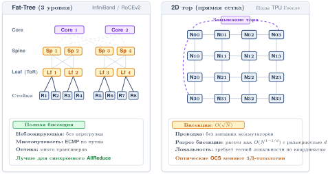

***Топологии сети уровня пода**: сравнение двух доминирующих топологий пода. (Слева) Fat-tree (трехуровневая) с уровнями leaf, spine и core: полная бисекционная пропускная способность, используется кластерами InfiniBand вроде DGX SuperPOD. (Справа) 2D-тор с сквозными линками: бисекционная пропускная способность растет как $\mathcal{O}(\sqrt{N})$, дешевле в масштабе, но вознаграждает нагрузки с сильной локальностью; используется в TPU-подах Google. Выбор определяет, какие стратегии параллелизма работают эффективно.*

Инженерная задача пода — соединить эти узлы в сеть, достаточно быструю, чтобы синхронизация градиентов не стала узким местом. Под объединяет сотни стоек в единую согласованную вычислительную систему, где сетевая фабрика выполняет ту же роль, что системная шина внутри одной машины.

Масштаб этой задачи стоит осознать конкретно. Кластер из 1 024 узлов DGX H100 содержит 8 192 GPU, 4 096 микросхем NVSwitch, 8 192 адаптера InfiniBand HCA, несколько сотен коммутаторов InfiniBand, десятки тысяч кабелей и потребляет около 7–10 МВт. Он занимает примерно 250 стоек в одном или нескольких залах дата-центра.

Физический вес такого кластера также существенен. Каждый узел DGX H100 весит около 130 кг (287 фунтов), поэтому 1 024 узла весят более 133 метрических тонн. Вместе со стойками, коммутаторами, кабелями и системой охлаждения общий вес может превышать 300 метрических тонн. Пол дата-центра должен быть рассчитан конструктивно на эту сосредоточенную нагрузку: типичные требования к нагрузке на пол для ML-кластеров составляют 1 500–2 500 кг на квадратный метр против 500–1 000 кг на квадратный метр для традиционных серверных установок. Это конструктивное требование часто упускают при планировании здания, и оно может стать блокирующим ограничением при модернизации существующих зданий.

Физическая компоновка зала дата-центра отражает эти ограничения плотности. Экстремальная плотность мощности ML-стоек требует жесткой изоляции горячего и холодного коридоров в секциях с воздушным охлаждением: холодный воздух подается в закрытую переднюю часть стойки, а отработанное тепло улавливается сразу на задней вытяжке. «Позвоночник» зала — центральный кабельный коридор, соединяющий все стойки с агрегирующими коммутаторами, — должен вмещать тысячи оптических волокон и линии питания. Кабельные лотки над головой предпочтительнее прокладки под полом, потому что они улучшают воздушный поток и доступ к кабелям, неся тяжелые медные линии питания и хрупкие волоконные межсоединения, которые образуют нервную систему кластера. Компоновка также должна учитывать инфраструктуру жидкостного охлаждения: размещение блоков распределения охлаждающей жидкости, трассы труб и запорные клапаны, которые позволяют обслуживать отдельные стойки без слива всего контура охлаждения. Эти решения о физической компоновке, принимаемые на этапе проектирования здания, ограничивают варианты сетевой топологии, доступные команде обучения годы спустя.

Обучение модели 175B на этом кластере требует $6 \times 175 \times 10^{9} \times 300 \times 10^{9}$ операций с плавающей запятой в сумме (при 300 млрд обучающих токенов). При 45 процентах MFU, что является сильной, но достижимой цифрой для хорошо настроенного обучения больших моделей, кластер поддерживает $8\,192 \times 1979 \times 10^{12} \times 0{,}45$ FLOP/s, или около 7,30 EFLOP/s, что дает физический предел времени обучения около 12 часов.

На практике накладные расходы коммуникации, пузыри конвейера, ввод-вывод контрольных точек, аппаратные отказы и окна обслуживания складываются и растягивают фактическое календарное время за пределы физического предела. Упрощенная цепочка множителей дает примерно 18-часовой системный минимум; производственные графики могут растянуться на дни или недели, когда в план входят очереди, готовность данных, отладка, перезапуски и операционные запасы конкретной площадки. Центральная мысль остается неизменной: на масштабе пода несовершенства инфраструктуры доминируют над сырыми возможностями кремния. Возвращение этого потерянного времени — центральная задача инженерии распределенных систем, и решения охватывают железо (лучшие сети), программное обеспечение (перекрытие коммуникации с вычислениями) и эксплуатацию (превентивное обслуживание для минимизации простоев).

> **Время обучения 175B**
>
> Время обучения нашей модели 175B выводится из первых принципов.
>
> 1. **Всего FLOP**: используя приближение $6 \times P \times D$, где $P = 175 \times 10^9$ и $D = 300 \times 10^9$ токенов: $3{,}15 \times 10^{23}$ FLOP.
>
> 2. **Пропускная способность кластера**: 8 192 GPU H100 при пиковых 1 979 TFLOP/s и работе с 45 процентами MFU: $8\,192 \times 1979 \times 10^{12} \times 0{,}45$ FLOP/s устойчиво $\approx$ 7,30 EFLOP/s.
>
> 3. **Идеализированное время обучения** («физический предел»): ($3{,}15 \times 10^{23}$ FLOP) / ($8\,192 \times 1979 \times 10^{12} \times 0{,}45$ FLOP/s) $\div 3600 \approx$ 12,0 часа.
>
> 4. **Реальные множители**:
>    - Накладные расходы коммуникации (эффективность масштабирования $\approx 0{,}85$): $\div 0{,}85 \rightarrow$ 14,1 часа
>    - Пузыри конвейера ($\approx 5\%$): $\times 1{,}05 \rightarrow$ 14,8 часа
>    - Накладные расходы на контрольные точки ($\approx 3\%$): $\times 1{,}03 \rightarrow$ 15,3 часа
>    - Отказы железа и перезапуски ($\approx 10\%$ календарного времени): $\times 1{,}10 \rightarrow$ 16,8 часа
>    - Окна обслуживания ($\approx 5\%$): $\times 1{,}05 \rightarrow$ 17,6 часа
>
> **Итого**: 17,6 часа в этой упрощенной цепочке системного минимума, или 0,1 недели в недельных единицах. Реальные производственные календари могут растянуться на дни или недели, когда учтены очереди, отладка, перезапуски и операционные запасы конкретной площадки. Возвращение этого потерянного времени — область инженерии распределенных систем, предмет главы «Распределенное обучение».

На этом масштабе единицей анализа уже не стойка или под из независимых серверов: здание должно работать как одна согласованная машина.

> **WSC (складской вычислитель)**
>
> ***WSC*** — это вычислительная система масштаба здания, в которой тысячи серверов работают как единая согласованная машина (сетевая фабрика служит системной шиной, распределенное хранилище — дисковой подсистемой, а оркестратор кластера — операционной системой). Это позволяет выполнять нагрузки обучения, физически невозможные ни на одной отдельной машине.
>
> 1. **Значение**: WSC из 10 000 GPU H100 дает около 9,89 EFLOP/s пиковых FP16-вычислений (и около 19,8 EFLOP/s в FP8), что позволяет выполнять нагрузки обучения класса 175B в масштабах, невозможных на одном узле. Однако система работает только настолько быстро, насколько быстра ее бисекционная пропускная способность: неблокирующий InfiniBand при 50 ГБ/с на GPU дает совокупную пропускную способность впрыска 500 ТБ/с. Если фабрика имеет переподписку 4:1, эффективная бисекционная пропускная способность падает до 125 ТБ/с, что может стать узким местом для AllReduce и снизить пропускную способность обучения на 30–60 процентов.
> 2. **Отличие**: в отличие от универсального вычислительного кластера (который запускает много независимых заданий на отдельных узлах без требования жесткой связанности), WSC-кластер обучения работает как единый синхронный инструмент, в котором каждый узел должен участвовать в каждом AllReduce. Поэтому отказ или замедление одного узла становится событием производительности на уровне всего кластера.
> 3. **Типичная ошибка**: распространено заблуждение, что проектирование WSC — в первую очередь программная инженерия или ИТ-эксплуатация. Проектирование WSC — это архитектура компьютера на уровне здания: физическая компоновка (размещение стоек для минимизации переходов между стойками), цепочка подачи энергии (целевые показатели PUE, коллекторы жидкостного охлаждения) и сетевая топология должны проектироваться совместно как единая система. Ошибка на любом уровне распространяется через все уровни.

Луис Андре Барросо, Урс Хольцле и Партхасарати Рангантан сформулировали эту концепцию в книге *The Datacenter as a Computer* (Barroso et al., 2019). В масштабе Google *дата-центр и есть компьютер*, поэтому принципы архитектуры компьютеров применимы на уровне здания так же, как на уровне чипа.

### Принципы архитектуры WSC

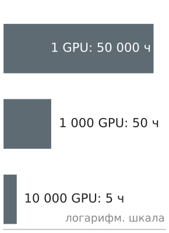

*Совокупный MTBF парка убывает обратно пропорционально числу GPU.*

Концепция складского вычислителя (WSC) переосмысливает дата-центр: вместо *комнаты, полной компьютеров*, это *один компьютер, который занимает комнату* (Barroso et al., 2019). Этот взгляд меняет подход инженеров к физическому проектированию.

В традиционном дата-центре каждый сервер — самостоятельная единица со своей операционной системой, хранилищем и сетевой идентичностью. Здание просто обеспечивает питание, охлаждение и физическую безопасность. Серверы можно добавлять, удалять или заменять независимо, а нагрузки на разных серверах не связаны друг с другом.

В WSC отдельный сервер аналогичен ядру в многоядерном процессоре: у него нет самостоятельной пользы, он существует только как часть большей системы. Узел DGX H100, работающий в изоляции, не может обучить модель 175B; он становится полезным, только когда подключен к сотням других узлов через тщательно спроектированную сетевую фабрику, с распределенной системой хранения, поставляющей обучающие данные и хранящей контрольные точки, и оркестратором парка, координирующим работу на всех узлах.

Из этого переосмысления непосредственно следуют два физических последствия. Первое: ограничивает потолок сеть, а не вычисления. Внутри одного узла NVLink дает достаточно пропускной способности для тензорного параллелизма, но между узлами фабрика должна переносить тензоры градиентов, контрольные точки активаций и выходы стадий конвейера, поэтому машина масштаба здания настолько быстра, насколько быстры провода, связывающие ее ядра. Глава «Сетевые фабрики» развивает эту фабрика полностью; переосмысление WSC делает межсоединение полноценным архитектурным компонентом, а не периферийным.

Второе последствие: *отказ — физическая неизбежность, а не исключительное событие*. Один GPU имеет **MTBF** около 50 000 часов (каноническая опорная величина среднего времени до отказа GPU (MTTF), которую книга использует везде, к ней возвращается глава «Отказоустойчивость»), но надежность убывает линейно с числом компонентов: кластер из 10 000 таких GPU испытывает отказ примерно раз в пять часов. [Приложение «Основы надежности»](appendix_reliability.md#sec-appdx-reliability-foundations-mtbf-cascade) выводит, почему частота на уровне парка — это просто время жизни одного компонента, деленное на число компонентов. Это свойство физической машины на уровне здания, и поэтому WSC нужно проектировать с самого начала так, чтобы отказы отдельных компонентов ухудшали работу, а не останавливали ее: с двойными путями питания, резервными фабриками коммутаторов и постоянным хранилищем контрольных точек на каждом уровне.

Третье последствие: строительные блоки по-разному комбинируются в зависимости от нагрузки, которую им предстоит нести. Под не собирается из одного канонического списка деталей: межсоединение, коммутация и размещение памяти выбираются каждое исходя из шаблона коммуникации и емкости, который навязывает доминирующая нагрузка. [«Архитектура пода по нагрузке»](#tbl-pod-comparison) сопоставляет три промышленных пода, чтобы показать это: NVIDIA SuperPOD связывает GPU через fat-tree InfiniBand ради гибкости «каждый с каждым», под TPU от Google жестко соединяет чипы в тор ради пропускной способности потока данных, а Grand Teton от Meta располагает тот же класс ускорителей вокруг памяти эмбеддингов, а не сырых вычислений.

| **Система**            | **NVIDIA SuperPOD** |   **Google TPU Pod**  |    **Meta Grand Teton**   |
|:----------------------|:-------------------:|:---------------------:|:-------------------------:|
| **Межсоединение**      | InfiniBand Fat-Tree |      3D-тор ICI     | RoCE (RDMA поверх Ethernet) |
| **Коммутация**         |  Внешние коммутаторы  |  Прямое соединение чип–чип  |    Ethernet leaf/spine    |
| **Топология**          |      Любой с любым     | Сетка ближайших соседей |     Иерархические рельсы     |
| **Оптимизация**      |     Гибкость     |  Пропускная способность потока данных  |      Память эмбеддингов     |
| **Доминирующая нагрузка** |   Разнообразные исследования   |      Обучение LLM     |       Рекомендации      |

***Архитектура пода по нагрузке**: межсоединение, коммутация и акцент на память каждого пода отражают шаблон коммуникации и емкости его доминирующей нагрузки, а не единый лучший проект. Экономика, которая определяет, под какую нагрузку оптимизируется организация, рассматривается в разделе «Экономика парка и загрузка» (глава «Эксплуатация ML-систем в масштабе»).*

Grand Teton — самый ясный пример того, как размещение памяти, а не вычисления, определяет компоновку. Рекомендательные и ранжирующие модели Meta используют таблицы эмбеддингов, которые могут достигать терабайт и намного превышают емкость HBM любого отдельного ускорителя, тогда как плотные слои нейросети, работающие с этими эмбеддингами, сравнительно невелики. Конструкция разделяет эти две части по иерархии памяти: таблицы эмбеддингов масштаба терабайт находятся в DRAM хост-CPU (примерно \$3–5 за ГБ), а плотные слои выполняются на GPU, где плотность вычислений оправдывает стоимость HBM в \$10–15 за ГБ. Поиски по эмбеддингам ограничены емкостью памяти, но не пропускной способностью: каждый запрос затрагивает лишь небольшой срез огромной таблицы, поэтому дешевая DRAM большой емкости — подходящее место для них, а дорогая память ускорителя оставляется для работы, которая ее насыщает. Системный урок в том, что оптимальная инфраструктура зависит от нагрузки, а не от максимизации спецификаций: развертывание узлов, оптимизированных под вычисления, для нагрузки, ограниченной емкостью памяти, оставило бы большую часть пропускной способности ускорителя невостребованной в задаче, где его кремний никогда не был узким местом.

Физический проект задает ограничения, а не операционную политику. Следующие главы используют его измерения мощности, емкости, топологии, надежности и устойчивой пропускной способности, чтобы вывести решения о размещении, восстановлении, мониторинге и владении. Раздел «Экономика парка и загрузка» (глава «Эксплуатация ML-систем в масштабе») содержит полный анализ «строить или покупать» и планирование емкости.

Эти физические ограничения определяют проектирование складского вычислителя. Новые технологии не убирают стены; они их передвигают. Технологии из раздела [«Технологии, сдвигающие стены»](#sec-compute-emerging) важны потому, что меняют то место, где связывает ограничение по памяти, коммуникации или мощности.

## Технологии, сдвигающие стены

Новый дата-центр за 15 лет структурного срока службы примет три-четыре поколения ускорителей, поэтому перспективные технологии важны, только если они меняют устойчивое планировочное ограничение. Полезный критерий — не новизна технологии, а то, какую стену она сдвигает, какая новая стена появляется после сдвига и какое решение по проекту парка меняется в результате. Compute Express Link (CXL) сдвигает границу емкости памяти. Интеграция на пластину сдвигает границу коммуникации чип–чип. Продвинутая упаковка сдвигает границу кристалла внутри корпуса ускорителя. Оптическая коммутация каналов сдвигает границу топологии и мощности фабрики. Ни одна из них не отменяет физику перемещения данных; каждая перемещает место, где инфраструктурные команды должны тратить мощность, охлаждение, стоимость и сложность ПО.

### Compute Express Link (CXL)

Важная технология архитектуры узла — **CXL**,[^fn-cxl-cache-coherency] когерентное межсоединение кэшей, построенное на физическом уровне PCIe, которое позволяет CPU, ускорителям и устройствам расширения памяти делить когерентное адресное пространство. Ее ценность не в том, что она делает удаленную память быстрой. Ее ценность в том, что она делает емкость менее жесткой. Вместо того чтобы считать DRAM каждого хоста фиксированным локальным пулом, а HBM каждого ускорителя — изолированным высокоскоростным островом, фабрика CXL может предоставлять расширители памяти или объединенную память тем устройствам, которым нужна емкость на определенной фазе шага обучения.

[^fn-cxl-cache-coherency]: **CXL (Compute Express Link)**: открытый стандарт (консорциум CXL, основанный Intel в 2019 году), который добавляет семантику памяти с когерентностью кэшей поверх физического уровня PCIe через CXL.io, CXL.cache и CXL.mem. CXL 3.0 расширяет модель в сторону пулов памяти, позволяя разделять емкость через фабрику, а не фиксировать ее навсегда внутри одного шасси сервера.

Для ML-обучения естественная цель — холодное или локальное по фазе состояние, а не активный рабочий набор умножения матриц. Состояние оптимизатора Adam для нашей модели 175B занимает 1 400 ГБ, и к нему обращаются при обновлении параметров, а не при каждой операции тензорного ядра. Общий пул CXL поэтому мог бы снизить давление на память узла, храня шарды оптимизатора, переполнение таблиц эмбеддингов или локальные буферы кэша данных за пределами уровня HBM ускорителя. Фреймворк обучения все равно должен аккуратно планировать это состояние, но задача размещения становится менее бинарной, чем «помещается в этом узле» или «переливается в хранилище».

Новая стена — пропускная способность. Типичный путь памяти CXL по PCIe Gen5 x16 дает 64 ГБ/с, тогда как HBM H100 дает 3,35 ТБ/с. Этот разрыв в 52× означает, что веса и активации для прямого и обратного проходов по-прежнему должны находиться в HBM. CXL — уровень емкости, а не замена HBM. Конкретное следствие для проекта парка: планировщикам нужно спрашивать, смогут ли серверные платформы, компоновка стоек и программное обеспечение оркестрации принять объединение памяти CXL, а не то, отменяет ли CXL потребность в высокопропускной памяти ускорителей.

*HBM по-прежнему в 52× быстрее, поэтому CXL — это только емкость.*

### Ограничение планирования для движков на всю пластину

На противоположном от CXL полюсе стоит движок на всю пластину, введенный в разделе [«Движки на всю пластину»](#sec-compute-wafer-scale). Его фабрика на пластине убирает передачи на уровне корпуса и платы для отображаемых операций, но не делает коммуникацию бесплатной. Планирование инфраструктуры поэтому смещается к емкости, размещению и пропускной способности впрыска.

Наша модель 175B требует 350 ГБ только под веса FP16, что намного превышает 44 ГБ встроенной SRAM на пластине. Cerebras решает это потоковой передачей весов: внешние блоки MemoryX подают веса на пластину по пути 1,2 ТБ/с, пока пластина выполняет каждый слой, отделяя емкость модели от памяти на пластине. Это может хорошо подходить для инференса и для нагрузок, вычисления которых четко разбиваются на стадии, но обучение возвращает более трудные вопросы планирования, потому что активации, градиенты и обновления оптимизатора нужно координировать между прямым и обратным проходами. Пластина меняет стену коммуникации на стену пропускной способности потоковой передачи.

Урок для планировщиков инфраструктуры не в том, что системы на всю пластину заменяют парки GPU. Он в том, что близость памяти и ее емкость находятся в обратном соотношении. Конструкции в духе WSE покупают исключительную локальную пропускную способность, размещая рабочий набор рядом с арифметикой, тогда как CXL покупает гибкую емкость, отодвигая память дальше. HBM находится между этими крайностями: вне кристалла, но на корпусе, меньше памяти хоста, но достаточно быстра для активных вычислений. Правильная архитектура та, у которой уровень памяти соответствует шаблону повторного использования данных нагрузки.

### Продвинутая упаковка

В основе обоих направлений лежит эволюция **продвинутой упаковки**. Упаковка переносит границу внутрь корпуса ускорителя, а не полностью наружу к стойке или внутрь единой пластины, и это важно, потому что предел экспозиционного поля составляет около 858 мм² на однократную экспозицию. **2.5D-интерпозеры**, например CoWoS от TSMC, размещают вычислительные кристаллы и стеки HBM на общей кремниевой подложке, позволяя ускорителям на чиплетах вести себя для большинства программ как одно устройство. **3D-укладка**, с такими подходами, как SoIC, размещает кеши SRAM или логику непосредственно друг над другом и еще сильнее сокращает пути данных. Переход от H100 к B200 показывает последствие для парка: корпус может дать гораздо больше локальной арифметики и пропускной способности между кристаллами, но стойка должна выдерживать более высокую плотность мощности, более жесткие требования к охлаждению и меньшую терпимость к переходным процессам питания, прежде чем преимущество кремния станет полезной инфраструктурой.

### Перенастраиваемые топологии и оптическая коммутация

Пока CXL и продвинутая упаковка решают задачи границ памяти и кристалла, складской вычислитель все чаще сталкивается с ограничением по мощности и топологии межсоединений. В современных кластерах, охватывающих десятки тысяч ускорителей, обычные многоуровневые сети Clos опираются на электрические пакетные коммутаторы. Каждый переход сети несет оптоэлектронно-оптическое (OEO) преобразование: входящие фотоны попадают на фотодиод, высокоскоростные схемы SerDes десериализуют электрический сигнал, ASIC коммутатора буферизует пакеты и направляет их через кроссбары, а выходные SerDes управляют лазерами, которые передают свет обратно по оптическому волокну.

При скоростях портов 800 Гбит/с и 1,6 Тбит/с электроника SerDes и трансиверов потребляет значительную энергию, часто 10–20 процентов общей мощности дата-центра. Кроме того, фиксированные электрические топологии Clos прокладываются статически, что жестко привязывает площадку к одному коэффициенту перегрузки и негибкому шаблону бисекции, независимо от того, является ли выполняющаяся нагрузка конвейерной, основанной на параллелизме по данным или маршрутизирующей токены к экспертам по схеме «все со всеми».

> **Оптическая коммутация каналов**
>
> ***Оптическая коммутация каналов (OCS)*** — это физическая архитектура сети, которая направляет оптические сигналы напрямую с помощью массивов зеркал микроэлектромеханических систем (MEMS) без оптоэлектронно-оптического (OEO) преобразования. Это позволяет динамически перенастраивать программно определяемую топологию и добиваться высокой энергоэффективности на масштабе складского вычислителя.
>
> 1. **Значение**: поскольку фотоны проходят через отражения зеркал без цифровой обработки, OCS потребляет практически нулевую активную мощность переключения (менее 5 Вт на шасси коммутатора против нескольких киловатт у электрических шасси) и по природе не зависит от протокола и битовой скорости. Оптическая инфраструктура, развернутая с OCS, может масштабироваться с 400 Гбит/с до 800 Гбит/с и 1,6 Тбит/с без замены коммутаторов.
> 2. **Отличие**: в отличие от электрических пакетных коммутаторов (которые разбирают заголовки, буферизуют пакеты в SRAM и принимают решения о маршрутизации каждого пакета за наносекунды), OCS устанавливает полустатические физические оптические каналы с задержкой переключения в миллисекундах (10–30 мс). Поэтому он пригоден для перенастройки на уровне топологии, а не для динамической маршрутизации пакетов.
> 3. **Типичная ошибка**: предположение, что OCS полностью заменяет пакетную коммутацию. OCS работает на гранулярности каналов: он конфигурирует топологии масштаба кластера (например, 3D-торы или подкластеры под конкретное задание) и обходит аппаратные сбои, тогда как пакетная коммутация или нативные межсоединения ускорителей обрабатывают мелкозернистую маршрутизацию сообщений внутри шага.

Суперкомпьютер Google TPU v4 (Jouppi et al., 2023) продемонстрировал архитектурную мощь оптической коммутации каналов в промышленной эксплуатации. Вместо того чтобы соединять 4 096 чипов в негибкое электрическое fat-tree, система группирует ускорители в кубы узлов $4 \times 4 \times 4$ и направляет межкубовые линки через массив трехмерных оптических коммутаторов MEMS (с кодовым названием Palomar).

Эта архитектура дает две принципиальные эксплуатационные возможности:

1.  **Топологии под нагрузку**: физическое межсоединение можно динамически перенастраивать под структуру коммуникации выполняющейся нагрузки. Модель с одномерным конвейерным параллелизмом может настроить свой срез как вытянутый цилиндр; модель с двумерным или трехмерным тензорным параллелизмом — как компактный кубический 3D-тор с минимальным средним числом переходов; а нагрузка MoE может максимизировать бисекционную пропускную способность между конкретными группами экспертов.
2.  **Динамическое восстановление после отказов и замыкание границ**: в массивных подах ускорителей оптические трансиверы и кабели — одни из самых частых компонентов, которые выходят из строя. В статическом торе или дереве отказ одного линка или узла может изолировать измерение или ухудшить весь под. С OCS менеджер кластера обнаруживает дефектный лоток или волокно и подает команду зеркалам MEMS повернуться, оптически обходя неисправный блок и сращивая исправные узлы в полный, меньший срез тора за десятки миллисекунд без ручного вмешательства в кабели.

Цена — задержка переключения. Поскольку зеркала MEMS физически поворачиваются, чтобы направлять коллимированные световые пучки, перенастройка занимает от 10 до 30 миллисекунд, что на семь порядков медленнее электрической пакетной коммутации (10–100 наносекунд). Таким образом, OCS сдвигает энергетическую и протокольную стену, но оставляет задержку перенастройки связывающим ограничением: его применяют для выделения топологии на уровне заданий и изоляции отказов, а не для динамической маршрутизации сообщений.

Общая тема — перенос, а не устранение. CXL выносит емкость наружу, в фабрику, и оставляет связывающим ограничением пропускную способность. Интеграция на пластину переносит коммуникацию внутрь, и связывающими ограничениями становятся емкость и выход годных. Продвинутая упаковка сокращает расстояние между кристаллами, и связывающим ограничением остается плотность мощности. Оптическая коммутация каналов устраняет мощность OEO-трансиверов, и связывающим ограничением становится задержка перенастройки коммутации. Поэтому планирование инфраструктуры по-прежнему начинается с вопроса, куда движется следующий байт, как быстро он должен прибыть и какую физическую систему нужно построить, чтобы это движение не доминировало над нагрузкой.

## Заблуждения и ловушки

Поскольку узкие места перемещаются, а не исчезают, команды инфраструктуры вычислений часто оптимизируют видимую спецификацию, упуская связывающее физическое ограничение. Заблуждения и ловушки этого раздела переводят уроки главы о узле, стойке, поде и здании в эксплуатационные предупреждения.

**Заблуждение**: *больше GPU всегда означает более быстрое обучение.*

Инженеры часто предполагают, что время обучения масштабируется линейно с числом GPU: удвоение GPU должно вдвое сократить время обучения. На практике накладные расходы коммуникации растут вместе с размером кластера и в конце концов начинают доминировать.

Закон Амдала задает теоретический предел: последовательная доля вычислений (синхронизация градиентов, время пузырей конвейера, простои загрузки данных) ограничивает максимальное ускорение независимо от параллелизма. Для модели на 175B параметров с 350 ГБ градиентов AllReduce на каждом шаге обучения требует, чтобы каждый GPU обменивался данными с каждым другим GPU.

На кластере из 1 024 GPU эта синхронизация может занимать 30–50 процентов общего времени шага, если сеть не спроектирована тщательно. Масштабирование с 1 024 до 2 048 GPU удваивает стоимость оборудования, но может сократить время обучения только на 30–40 процентов, что дает быстро убывающую отдачу. Кривая эффективности масштабирования вогнута: первые 100 GPU дают почти линейное ускорение, следующие 900 — убывающую отдачу, а при 2 000–4 000 GPU предельная выгода на GPU для большинства размеров моделей стремится к нулю.

Правильный подход — профилировать полезное время вычислений, открытое время коммуникации и время простоя при текущем масштабе, прежде чем покупать следующий под. Если добавленные GPU в основном увеличивают открытую коммуникацию, закупка оплачивает простой, а не прогресс обучения. Раздел «Математика эффективности масштабирования» главы «Распределенное обучение» позже превращает это локальное отношение в оценку эффективности масштабирования до принятия решения о закупке.

**Ловушка**: *планирование пропускной способности обучения только по пиковым FLOP/s.*

Закупочные команды часто выбирают ускорители, сравнивая спецификации пиковых FLOP/s. Такое рассуждение игнорирует центральную идею модели Roofline: если арифметическая интенсивность нагрузки ниже точки перехода, производительность ограничивает пропускная способность памяти, а не вычисления. Точка перехода H100 составляет примерно 295,2 FLOP/байт. Инференс LLM работает при 1–2 FLOP/байт и достигает менее 1 процента пиковых FLOP/s. Даже обучение LLM, которое выигрывает от батчинга, обычно достигает 30–50 процентов пиковых FLOP/s из-за ограниченных памятью ядер внимания, пересчета активаций и простоев коммуникации. Выбирать железо только по пиковым FLOP/s — то же, что выбирать автомобиль по максимальной скорости, игнорируя расход топлива на ежедневной поездке на работу.

**Заблуждение**: *мощность и охлаждение можно решить после покупки ускорителей.*

Команды планируют закупки GPU, исходя из вычислительных требований, не проверяя, сможет ли целевое здание обеспечить нужные мощность и охлаждение. Это жесткие физические пределы с долгими сроками поставки.

Одна стойка из четырех систем DGX H100 требует 33,5 кВт мощности. Модернизация электроинфраструктуры дата-центра (новые трансформаторы, распределительные устройства и мощность ИБП) требует 12–18 месяцев на поставку. Модернизация холодильной станции (чиллеры, трубопроводы, насосы) занимает 6–12 месяцев. Даже такие, казалось бы, простые изменения, как замена PDU в одной стойке с 20 кВт на 60 кВт, могут потребовать новой прокладки кабелей и щитов автоматических выключателей.

Организации, которые заказывают оборудование, не подтвердив готовность площадки, рискуют получить GPU на миллионы долларов, стоящие в контейнерах на парковке, пока здание переоборудуется. Этот сценарий не гипотетический: несколько организаций столкнулись с ним именно во время гонки за GPU в 2023–2024 годах, когда сроки поставки GPU сокращались быстрее, чем сроки строительства дата-центров.

**Ловушка**: *покупка более нового ускорителя без проверки арифметической интенсивности нагрузки.*

Команда развертывает GPU B200 (пиковые 4 500 TFLOP/s FP8) для нагрузки инференса, обслуживающей модель на 7 млрд параметров при батче 1. Арифметическая интенсивность составляет около 1 FLOP/байт, что помещает нагрузку глубоко в область, ограниченную памятью.

Пропускная способность памяти B200 (8 ТБ/с) лишь в 2,4× выше, чем у H100 (3,35 ТБ/с), поэтому нагрузка с батчем 1 следует за пропускной способностью, а не за заявленными вычислениями. Если сравнивать заявленные цифры, B200 FP8 против пропускной способности класса H100 FP16/BF16, пиковые вычисления выше примерно в 4,6×, но декодирование улучшается лишь примерно в 2,4×. Команда заплатила за вычисления, которые не может использовать. H100 с его меньшей стоимостью на единицу пропускной способности памяти был бы более экономичным выбором для этой конкретной нагрузки.

**Заблуждение**: *воздушного охлаждения достаточно для нагрузок ИИ.*

Операторы устаревших объектов могут предполагать, что добавления вентиляторов и мощности чиллеров достаточно для любой более плотной ИИ-стойки. На практике выбор охлаждения зависит от конструкции отвода тепла системы и от доступного в здании воздушного потока, давления, температуры на входе и изоляции. Инженерный воздух остается жизнеспособным для некоторых плотных конфигураций, тогда как более высокая плотность стоек может потребовать прямого жидкостного охлаждения, чтобы избежать теплового троттлинга или превышения пределов здания.

**Заблуждение**: *все GPU-часы эквивалентны в анализе совокупной стоимости владения (TCO).*

Типичная ошибка в сравнении стоимости — считать один GPU-час H100 взаимозаменяемым с GPU-часом A100 или V100. На деле эффективная стоимость единицы полезных вычислений сильно различается между поколениями GPU: более новые ускорители дают значительно больше полезной пропускной способности на доллар. GPU-час H100 дает в 6,3× больше TFLOP/s, чем GPU-час A100, и в 15,8× больше TFLOP/s, чем GPU-час V100. Прогон обучения, который занимает 10 000 GPU-часов V100, потребовал бы лишь примерно 632 GPU-часов H100 для выполнения того же объема вычислений. Релевантная метрика — не стоимость GPU-часа, а стоимость полезного TFLOP-часа, которая учитывает и цену в час, и фактически доставленную пропускную способность. Организации, которые сравнивают облачные варианты только по стоимости GPU-часа, систематически переоценивают расходы на более новое и эффективное железо.

**Ловушка**: *модернизация сети до выявления узкого места обучения.*

Команды иногда тратят много средств на модернизацию сетевой фабрике (например, с InfiniBand 200 Гбит/с до 400 Гбит/с), ожидая пропорционального ускорения обучения. Выигрыш полностью зависит от того, ограничен ли цикл обучения коммуникацией при текущей пропускной способности сети. Если вычислительное время шага обучения составляет 20 секунд, а время коммуникации — 2 секунды, нагрузка ограничена вычислениями: удвоение скорости сети сокращает полное время шага с 22 до 21 секунды, то есть всего на 4,5 процента. Те же вложения в дополнительные GPU (сокращение вычислительного времени) или в программную оптимизацию с более высоким MFU (сокращение растраченных вычислений) дали бы намного большую отдачу. Модель Roofline применяется ко всему кластеру, а не только к отдельным чипам: диагностируйте, является ли узким местом вычисление или коммуникация, прежде чем инвестировать в одно из них.

**Заблуждение**: *средней потребляемой мощности достаточно для проекта охлаждения.*

Потребление мощности ускорителем варьируется между фазами коммуникации, памяти и вычислений. Среднее по нагрузке значение ниже настроенного устойчивого диапазона не определяет требования к охлаждению, потому что синхронизированные фазы вычислений могут одновременно поднимать многие устройства к этому диапазону. Тепловой проект должен использовать устойчивую расчетную цель производителя при заданных условиях на входе и охлаждения, а электрический путь должен отдельно выдерживать задокументированные переходные процессы. Иначе тепловой троттлинг может снизить устойчивую пропускную способность, не вызывая сбоя или явной ошибки приложения.

**Ловушка**: *выбор моделей по емкости HBM без проверки пропускной способности.*

Закупочные команды иногда сосредоточены исключительно на том, «помещаются» ли веса модели в доступную HBM, пренебрегая измерением пропускной способности. Модель, которая помещается в HBM, но не может обслуживаться с приемлемой задержкой из-за недостаточной пропускной способности, так же непригодна, как модель, которая не помещается. Рассмотрим два варианта обслуживания модели на 70 млрд параметров: (a) ускоритель с 192 ГБ HBM2e и пропускной способностью 2,04 ТБ/с и (b) ускоритель с 80 ГБ HBM3 и пропускной способностью 3,35 ТБ/с. Вариант (a) имеет более чем достаточную емкость (модели нужно только 141 ГБ в FP16), но выдает токены за 141 ГБ / 2,04 ТБ/с = 69,2 мс на токен. Вариант (b) требует тщательного квантования, чтобы поместиться (141 ГБ в FP16 не поместятся в 80 ГБ, а 71 ГБ в INT8 поместятся), но выдает токены за 71 ГБ / 3,35 ТБ/с = 21 мс на токен, то есть в 3,3× быстрее. Для обслуживания, чувствительного к задержке, вариант (b) — лучший выбор, несмотря на меньшую емкость. Правильный ускоритель — тот, чья пропускная способность и емкость вместе удовлетворяют требованиям нагрузки.

**Заблуждение**: *загрузку данных можно исправить после развертывания.*

Команды, которые всю предразвертывочную оптимизацию сосредоточили на производительности ядер GPU и эффективности коммуникации, иногда обнаруживают после развертывания, что их GPU голодают по данным. Конвейер загрузки данных (ввод-вывод хранилища, предобработка, передача от хоста к GPU) должен поддерживать пропускную способность, равную или большую скорости потребления кластера GPU. Для обучения языковых моделей сырой поток данных скромен (мегабайты в секунду), но конвейер предобработки (токенизация, упаковка последовательностей, перемешивание) может стать узким местом CPU, когда каждый GPU потребляет данные быстрее, чем одно ядро CPU успевает их подготовить. Исправление простое, но его нужно запланировать заранее: выделить достаточно ядер CPU для воркеров загрузки данных (обычно 4–8 на GPU), размещать обучающие данные на быстром локальном NVMe, а не полагаться на общие сетевые файловые системы, и конвейеризировать загрузку так, чтобы она перекрывалась с вычислениями GPU.

**Ловушка**: *покупка однородных кластеров без моделирования разнообразия нагрузок.*

Интуиция, что однородное железо упрощает планирование и снижает число отстающих, часто приводит организации к преждевременному выводу из эксплуатации способных старых поколений. Для нашей модели 175B оптимальная по стоимости стратегия часто включает парк из нескольких поколений. Обучению нужны сырые FLOP/s и пропускная способность межсоединений H100, чтобы минимизировать накладные расходы синхронизации, тогда как обслуживание инференса ограничено пропускной способностью памяти, а не вычислениями.

A100 дает 2,04 ТБ/с пропускной способности при существенно меньших капитальных затратах, чем 3,35 ТБ/с у H100. Выделение узлов H100 под обучение, а узлов A100 под инференс позволяет организации снизить совокупную стоимость владения (TCO) на 15–25 процентов по сравнению с парком только из H100. Ошибка в том, что смешивают однородность на уровне задания, которая критична для предотвращения отстающих внутри одного распределенного прогона обучения, с однородностью на уровне кластера. Продвинутый планировщик может эффективно управлять гетерогенным парком, направляя нагрузки инференса с высоким расходом пропускной способности на старое железо, где соотношение пропускной способности на доллар конкурентоспособно, а узлы с пиковыми вычислениями оставляя для пропускной способности обучения.

**Ловушка**: *считать ввод в эксплуатацию и обкатку резервом расписания.*

Ввод в эксплуатацию — часть построения системы, а не буфер, который можно израсходовать, когда поставка железа срывается. Приемочные тесты, проверка кабелей, квалификация прошивки, тепловой прогрев и стресс-прогоны NCCL — первый раз, когда уровни узла, стойки, сети и здания работают как одна машина. Сжатие этой фазы превращает дефекты установки в производственные сбои, где каждый цикл отладки простаивает весь парк, а не небольшое окно приемочных тестов.

## Итоги

Физическая инфраструктура машинного обучения простирается от транзистора до дата-центра, а сквозной пример обучения модели на 175B параметров привязывает каждое понятие к количественной реальности. Центральный урок главы — каскад ограничений: мощность ускорителя определяет охлаждение стойки, плотность стойки определяет компоновку пода, топология пода определяет эффективность масштабирования, а эффективность масштабирования определяет, сходится ли экономика.

Этот каскад начинается с ускорителя. Нагрузки матричного умножения потребовали тензорных ядер и систолических массивов; потоковая передача весов обнажила стену памяти и подтолкнула к HBM; состояния моделей, которые превышали емкость одного чипа, потребовали многоускорительных узлов и NVLink. Он продолжается за пределами сервера: синхронное обучение создает переходные процессы мощности, плотности стоек выше 100 кВт делают жидкостное охлаждение обязательным, а коммуникация масштаба пода определяет, ускоряют ли дополнительные GPU обучение или просто ждут сеть.

Два аналитических мотива организуют эти детали. Налог на универсальность повторяется на каждом уровне: ускорители обменивают гибкость управления на пропускную способность арифметики, сети обменивают универсальность «каждый с каждым» на эффективность под конкретную нагрузку, а системы охлаждения обменивают универсальную обработку воздуха на жидкостные контуры, соответствующие плотным стойкам. Модель Roofline, введенная в разделе [«Модель Roofline»](#sec-compute-roofline), дает общую диагностическую задачу: определить, ограничена ли полезная работа на каждой границе вычислениями или перемещением данных.

Получающаяся иерархия повторяет классическую иерархию памяти в масштабе склада. HBM быстрая и маленькая, NVLink быстрый внутри узла, InfiniBand медленнее между узлами, а распределенное хранилище самое медленное, но самое большое. Иерархия пропускной способности, введенная в разделе [«Иерархия пропускной способности»](#sec-compute-bandwidth-hierarchy), поэтому диктует иерархию параллелизма: тензорный параллелизм отображается на NVLink, конвейерный — на локальные фабрики стойки, а параллелизм по данным охватывает весь под. Программные параметры, такие как точность, интервал контрольных точек, размер батча и накопление градиентов, — не независимые ручки, а ответы на эти физические пределы.

Наша модель на 175B параметров выступала архитектурной движущей силой, связывающей каждый уровень этой иерархии. На уровне ускорителя обработка одного токена требует около 350 миллиардов операций с плавающей запятой, однако арифметика не является ограничивающим ресурсом тензорных ядер. На уровне памяти тензор весов FP16 объемом 350 ГБ превышает емкость HBM одного ускорителя; даже после того, как шардинг или сжатие решат проблему емкости, потоковая передача весов при 3,35 ТБ/с накладывает нижнюю границу задержки более 100 мс на токен для одного пути HBM эквивалентного ускорителя. На уровне узла состояние обучения превышает 2 ТБ, что требует тензорного параллелизма, шардинга параллелизма по данным и выгрузки памяти. На уровне стойки 32 ускорителя, потребляющие по 700 Вт каждый, плюс накладные расходы хоста и сети требуют 33,5 кВт подачи энергии и жидкостного охлаждения. На уровне пода жизнеспособное окно обучения требует синхронизации более 1 000 GPU через неблокирующую фабрику и создания контрольных точек на фоне неизбежных отказов. Экономика, наконец, зависит от того, может ли устойчивая утилизация окупить железо, энергию, охлаждение и риск здания. Каждое ограничение восходит к одному факту: эта модель не помещается на одном чипе.

Метод применим и за пределами этой модели: определить связывающее ограничение на каждом уровне, количественно оценить его эффект и распространить последствие вверх. Более быстрый ускоритель контрпродуктивен, если охлаждение не может отвести его тепло; более плотная стойка бесполезна, если энергосеть не может ее питать; а более широкая сеть расточительна, если нагрузка не может использовать ее пропускную способность. Инженерия инфраструктуры — поэтому количественная дисциплина: перевод решений на уровне чипа в мощность стойки, охлаждение здания, топологию сети, надежность и стоимость владения.

Применяя C³, выбор жидкостного охлаждения для плотной стойки ускорителей — не просто модернизация здания. Он позволяет разместить больше вычислений в стойке, что концентрирует трафик коммуникации на меньшем числе линков top-of-rack и повышает нагрузку на координацию при ограничении мощности, изоляции отказов и обслуживании. Исходный тепловой потолок отступает, но связывающее ограничение может переместиться на подачу энергии стойки или инъекцию в сеть; проект, который не предусматривает эти последующие пределы, превращает тепловой запас в простаивающий кремний.

> **Дата-центр — это компьютер**
>
> * **Налог на универсальность**: ускорители дают в 10–100$\times$ большую пропускную способность, чем CPU, отдавая площадь кремния матричной арифметике, а не предсказанию ветвлений и внеочередному исполнению (принцип «налог на универсальность»). Ценой становится меньшая гибкость. Каждый шаг по спектру от GPU к TPU и далее к специализированному ASIC отвоевывает под арифметику больше площади кристалла.
> * **Диагностика стены памяти начинается с Roofline**: для декодирования LLM при одном запросе трафик весов обычно задает нижнюю границу задержки. Точка перехода ($I_{\text{ridge}}$ = пиковые FLOP/s, деленные на пропускную способность памяти) отделяет операции, ограниченные пропускной способностью, от операций, ограниченных вычислениями, но форма батча, слияние, точность, повторное использование и моделируемый уровень памяти определяют, где лежит каждая фаза обучения или инференса.
> * **Иерархия пропускной способности диктует параллелизм**: обрыв пропускной способности в 9× по направлению между NVLink и InfiniBand ограничивает тензорный параллелизм рамками узла, а параллелизм по данным — рамками между узлами. Конвейерный параллелизм охватывает узлы, когда глубина модели превышает емкость одного узла.
> * **Пиковые и устойчивые показатели**: планирование емкости должно использовать устойчивую пропускную способность, измеренную с согласованной условностью FLOP модели, точностью, масштабом системы и формой нагрузки, а не пиковые спецификации.
> * **Эффективность здания — часть компьютера**: архитектура охлаждения меняет пределы плотности стоек и накладные расходы здания; на масштабе пода сетевую топологию, охлаждение и подачу энергии нужно проектировать совместно под доминирующую нагрузку.
> * **Отказы в масштабе**: кластер из 10 000 GPU испытывает примерно один отказ GPU каждые пять часов. Стратегия контрольных точек — проблема производительности первого порядка, которую нужно закладывать в систему с самого начала.
> * **Стоимость жизненного цикла важнее цены покупки**: стоимость владения включает электроэнергию, строительство площадки, сеть и персонал, а не только цену покупки, поэтому владение инфраструктурой окупается только выше порога утилизации, который одна цена железа никогда не раскрывает. Раздел «Экономика парка и загрузка» главы «Эксплуатация ML-систем в масштабе» разбирает точку безубыточности «строить или покупать» и полную стоимость парка.

Большую часть истории вычислений компьютером был чип. Эта глава отмечает момент, когда это перестает быть правдой. Как только модель больше не помещается на одном ускорителе, один факт распространяется вверх через каждый уровень: чип задает мощность узла, узел задает тепло стойки, стойка задает топологию пода, а топология определяет, сходится ли экономика. Ни один уровень нельзя настраивать изолированно, потому что каждый наследует свои пределы от лежащего под ним. На этом масштабе единица вычислений уже не *процессор*, а *здание*, поэтому остальная часть книги рассматривает дата-центр, а не GPU, как машину, которую проектируют.

> **От кремния к проводам**
>
> Физическая инфраструктура простирается от транзисторов тензорных ядер до подстанций дата-центра мегаваттного класса. Однако набор несвязанных узлов еще не компьютер; это склад дорогих ускорителей. Сетевая фабрика превращает эти узлы в единую систему обучения, переносящую между ними градиенты, активации и контрольные точки. Глава неоднократно выявляла одно и то же ограничение: пропускная способность коммуникации ограничивает эффективность масштабирования. Иерархия пропускной способности показала обрыв в 9× между NVLink и InfiniBand, а примеры топологий показали, что проект фабрики может изменить время AllReduce в 2–3$\times$. Глава «Сетевые фабрики» разбирает физику, протоколы, коллективные операции и решения о топологии, которые определяют, ведет ли себя кластер на 10 000 GPU как одна согласованная машина или как тысячи изолированных устройств.
