

# Сетевые фабрики

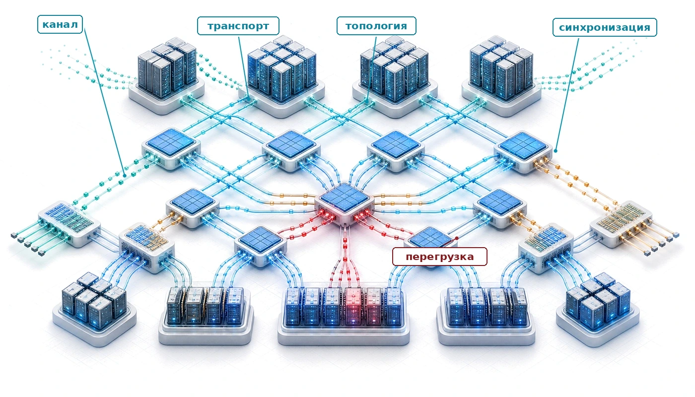

## Назначение

_Почему сеть, соединяющая ускорители, при масштабе важнее самих ускорителей?_

Один ускоритель может выполнять триллионы операций в секунду, но распределенное обучение требует согласования между тысячами устройств. Синхронизация при усреднении градиентов, обмене активациями и обновлении параметров зависит от пропускной способности и задержки сети. Когда емкость сети не успевает за производительностью ускорителей, ускорители простаивают в ожидании данных, и добавление новых ускорителей может усугубить узкое место, а не устранить его. При достаточном масштабе проектирование сети способно определить производительность всей системы. Топология задает, какие шаблоны коммуникации эффективны, пропускная способность ограничивает разбиение модели, а задержка определяет, насколько плотно можно связать обучение. Организации, которые относятся к сети как к второстепенной задаче, могут получить лишь часть теоретической производительности ускорителей. В терминах C³ фабрика — это место, где платится налог на коммуникацию, а ее топология и пропускная способность определяют, насколько тесно коммуникация ограничивает вычисления по всему парку.

> **Цели обучения**
>
> - Моделировать стоимость сетевой коммуникации в рамках α-β-модели и различать режимы, ограниченные пропускной способностью, и режимы, ограниченные задержкой
> - Сравнивать высокопроизводительные транспортные протоколы по задержке, гарантиям отсутствия потерь и сложности эксплуатации
> - Анализировать топологии (fat-tree, rail-оптимизированные, dragonfly), вычисляя $\text{BW}_{\text{bisect}}$ и число переходов для коллективных шаблонов ML
> - Оценивать механизмы управления перегрузкой и их влияние на хвостовую задержку при распределенном обучении
> - Проектировать стратегии виртуализации сети для многоарендных GPU-кластеров с выделением ресурсов SR-IOV и изоляцией трафика
> - Диагностировать узкие места сетевой производительности с помощью счетчиков RDMA, телеметрии на уровне каналов и инструментов проверки пропускной способности

## Магистраль синхронизации

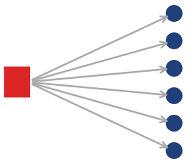

*Один медленный канал задерживает каждого партнера, который его ждет.*

Рассмотрим языковую модель со 175 миллиардами параметров, разделенную между 1 024 GPU, где плотные ускорительные узлы бесполезны, пока не начнут синхронизироваться как одна машина. Каждый шаг обучения требует AllReduce для 350 ГБ градиентов: каждый GPU должен отправить и получить свою долю, прежде чем начнется следующий шаг. Если хотя бы одно звено фабрики работает медленно, все остальные 1 023 GPU ждут. Сетевая фабрика — это не вспомогательная инфраструктура, а магистраль синхронизации, которая определяет, обучается ли кластер эффективно или впустую тратит миллионы долларов на простаивающие вычисления. Цифра 350 ГБ следует из предположений о размере модели и объеме градиентов, которые используются во всех примерах парка.

В [стеке парка](01_introduction.md#fig-fleet-stack) фабрика превращает изолированные ускорительные узлы в связную систему обучения. Ускорители, электропитание, охлаждение, стойки и поды определяют, что каждый узел может вычислить сам по себе; фабрика определяет, могут ли узлы действовать вместе, прежде чем коммуникация станет тяжелее вычислений. [Рисунок «Пятиуровневая модель сети»](#fig-network-five-level-model) упорядочивает это пространство проектирования в пять взаимозависимых уровней: от физической сигнализации до оркестрации на уровне кластера. Акронимы на рисунке служат дорожной картой: каждый механизм определяется в тот момент, когда становится связывающим ограничением.

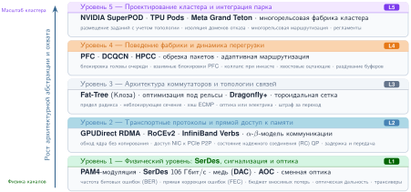
***Пятиуровневая модель сети для обучения ML:** пять слоев поднимаются от физического провода до проектирования кластера. Уровень 1, провод и канал: сигнализация PAM4/NRZ, SerDes, кабель прямого подключения (DAC), активный оптический кабель (AOC), сменные оптические модули, канальные уровни Ethernet и InfiniBand. Уровень 2, транспорт: RDMA, GPUDirect, RoCEv2, DMA без копирования и α-β-модель коммуникации. Уровень 3, коммутаторы и топология: fat-tree, rail-оптимизированные, Dragonfly, адаптивная маршрутизация. Уровень 4, поведение фабрики: приоритетное управление потоком (PFC), DCQCN, управление перегрузкой HPCC, адаптивная маршрутизация, обработка инкаста. Уровень 5, проектирование кластера: NVIDIA SuperPOD, Meta Grand Teton и другие промышленные интеграции фабрик.*

При масштабе стоимость коммуникации может превышать стоимость вычислений. Декомпозиция времени по закону парка в [главе 1](01_introduction.md#sec-vol2-introduction-fleet-law) делает это явным: неперекрытый член коммуникации $T_{\text{comm}}(N) - T_{\text{overlap}}$ определяет, какая доля каждого шага обучения открыта для сетевой фабрики. Фабрика влияет на слои выше: она определяет, может ли коммуникация перекрываться с вычислениями, какие коллективные алгоритмы применимы и как разделы сети взаимодействуют со сбоями узлов.

Физическая сетевая фабрика существует, чтобы переносить три фундаментальных шаблона коллективной коммуникации:

- **AllReduce**: AllReduce (см. [главу «Коллективные коммуникации»](06_collective_communication.md#sec-collective-communication) с алгоритмическими моделями стоимости) суммирует градиенты по тысячам GPU, так что каждое устройство получает одинаковое среднее; это сердцебиение синхронного обучения.
- **AllGather**: AllGather (см. главу «Коллективные коммуникации») собирает разные части модели, чтобы каждый GPU мог восстановить полное состояние модели.
- **AllToAll**: самый требовательный шаблон; AllToAll требует, чтобы каждый GPU отправил уникальные данные каждому другому GPU. Это критично для параллелизма экспертов (см. главу «Инференс в масштабе»).

Глава «Коллективные коммуникации» описывает *алгоритмы*, которые организуют эти шаблоны; слой фабрики задает *физику* проводов и коммутаторов, которые их переносят. Это различие важно, потому что физические свойства фабрики (пропускная способность, задержка и топология) определяют, какие шаблоны эффективны, а какие становятся узкими местами.

> **Перспектива: сеть как градиентная шина**
>
> В одной машине шина памяти переносит данные между процессором и памятью. В распределенном кластере обучения сетевая фабрика играет аналогичную роль: это **градиентная шина**, которая переносит обновления параметров между воркерами. Как стена памяти, описанная в [главе о вычислительной инфраструктуре](02_compute_infrastructure.md#sec-compute-memory-wall), ограничивает пропускную способность одного устройства, так пропускная способность сетевой фабрики определяет пропускную способность нескольких устройств (**коммуникационная стена**). Протоколы, топологии, управление перегрузкой и выбор маршрутов коллективов определяют, насколько близко эта шина подходит к своим физическим пределам. Эта физическая асимметрия и есть вклад слоя фабрики в модель стоимости: градиент, остающийся на NVLink, движется на порядок быстрее того же градиента, пересекающего InfiniBand, а [рисунок «Историческая пропускная способность сети»](#fig-network-bandwidth-scaling) показывает, что за последнее десятилетие этот разрыв не сокращается, а растет.

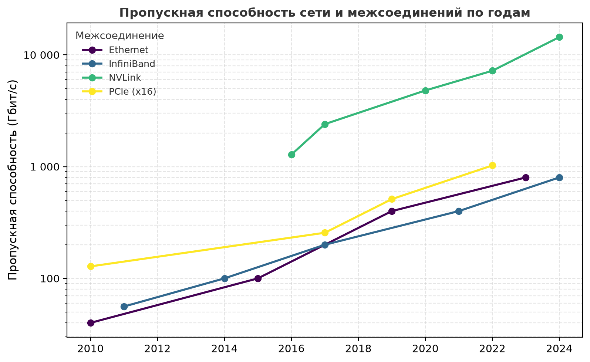
***Историческая пропускная способность сети:** внутриузловой NVLink, межузловые InfiniBand и Ethernet, а также шина хоста PCIe на общей логарифмической шкале с 2010 по 2024 год. NVLink опережает остальные примерно на порядок, поэтому одна и та же коллективная операция обходится намного дороже, когда пересекает границу машины, чем когда остается внутри нее.*

Конкретный обрыв пропускной способности, который отделяет внутриузловую коммуникацию от межузловой, делает аналогию с градиентной шиной точной. [Глава о вычислительной инфраструктуре](02_compute_infrastructure.md#sec-compute-infrastructure) показала, что один H100 дает 989 TFLOP/s FP16 при 3,35 ТБ/с пропускной способности памяти. Внутри узла восемь таких ускорителей обмениваются через NVLink с совокупной двунаправленной пропускной способностью 900 ГБ/с. Однако как только вычисления пересекают границу узла, доступная пропускная способность в одном направлении падает в 9× — с 450 ГБ/с у NVLink (одно направление этой двунаправленной связи) до 50 ГБ/с у NDR InfiniBand на порт. Этот обрыв, переход от внутриузловой коммуникации к межузловой, — центральная задача проектирования сетевой фабрики. Приложение о базовых числах парка собирает канонические спецификации NVLink и InfiniBand и эталонную конфигурацию кластера на 1 тыс. GPU, на которых основаны эти значения. Для модели на 175 млрд параметров перенос 350 ГБ градиентов по каналам 50 ГБ/с означает, что одна только операция AllReduce может занять секунды, в течение которых каждый GPU кластера простаивает, если фабрика и коллективные алгоритмы не смогут совместить эту передачу с вычислениями. [Рисунок «Иерархия пропускной способности»](#fig-bandwidth-hierarchy) делает эту иерархию конкретной, показывая пропускную способность на каждом уровне для четырех поколений GPU.

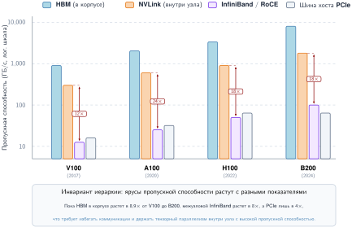
***Иерархия пропускной способности:** пропускная способность четырех уровней иерархии коммуникации для четырех поколений GPU в логарифмическом масштабе. Пока пропускная способность HBM выросла примерно в 9× и NVLink — примерно в 6× от V100 до B200, InfiniBand вырос лишь в 4×. Аннотации показывают отношение суммарной двунаправленной пропускной способности NVLink к одному порту InfiniBand, то есть количественно выражают обрыв, который распределенное обучение должно преодолевать в каждой точке синхронизации; при сопоставлении по направлениям обрыв от H100 к NDR составляет около половины этого значения, примерно 9× (см. текст).*

[Рисунок «Иерархия пропускной способности»](#fig-bandwidth-hierarchy) показывает, что этот обрыв не является артефактом одного поколения ускорителей. Его аннотации сравнивают суммарную двунаправленную пропускную способность NVLink с одним портом InfiniBand, поэтому они выглядят больше (примерно 18× для поколения H100), чем сопоставимый по направлениям обрыв. По направлениям переход от локального домена NVLink к одному порту InfiniBand снижает пропускную способность примерно в 9×, несмотря на абсолютный рост пропускной способности на каждом уровне. Устойчивый обрыв отражает фундаментальную физику: внутрикорпусные межсоединения (NVLink) работают на расстояниях в миллиметры медного проводника, а межузловые линки (InfiniBand) охватывают метры кабеля и должны проходить через коммутаторы. Это отношение определяет, какие стратегии параллелизма эффективны (см. приложение с физической спецификацией, где указаны направленная и совокупная пропускная способность, задержка, кадрирование и энергия на бит для шин хоста, межсоединений ускорителей и сетевых фабрик). Тензорный параллелизм, который требует непрерывного высокоскоростного обмена активациями, эффективен внутри узла, но непрактичен между узлами. Конвейерный параллелизм и параллелизм по данным, которые переносят меньшую межузловую пропускную способность, должны нести нагрузку межузловой коммуникации. Каждое решение о топологии и протоколе в этой главе стремится уменьшить влияние этой иерархии на производительность коллективной коммуникации.

Соотношение становится видимым в ходе одного шага обучения. [Рисунок «Обрыв пропускной способности в шаге обучения»](#fig-bandwidth-cliff-gantt) использует нормированную временную шкалу: фазы вычислений зафиксированы на 100 мс, а блок AllReduce представляет небольшой шард градиентов, выбранный так, чтобы сделать контраст между внутриузловой и межузловой коммуникацией видимым. Это не полный обмен градиентами модели на 175 млрд параметров; рисунок изолирует, как пересечение границы узла меняет загрузку.

***Обрыв пропускной способности в шаге обучения:** иллюстративные нормированные временные линии для одних и тех же фаз вычислений: задание на 8 GPU внутри узла (сверху), использующее NVLink на 900 ГБ/с, и задание на 64 GPU между узлами (снизу), использующее InfiniBand на 50 ГБ/с. Фаза AllReduce (красная) растет от тонкой полоски до доминирующей доли шага. Без перекрытия коммуникации и вычислений GPU простаивают на протяжении всего AllReduce, а разрыв загрузки между двумя сценариями составляет 12,5 процентного пункта (99,5 процента против 87 процентов).*

Разрыв загрузки в 12,5 процентного пункта означает миллионы долларов потерянных вычислений за многомесячное обучение. Поэтому проектирование сетевой фабрики — центральная инженерная задача распределенного обучения, а не второстепенная деталь.

## Как сети ML переворачивают допущения дата-центров

Сетевой архитектор из мира крупных веб-сервисов нашел бы шаблоны трафика распределенного кластера обучения контринтуитивными. Традиционный трафик дата-центра характеризуется огромным числом мелких, независимых и асинхронных потоков. Миллионы пользователей, обращающихся к веб-сервису, создают стохастический трафик, который хорошо обслуживается стандартным TCP/IP и статистически мультиплексированными, перегруженными по подписке сетями.

Нагрузки обучения ML — их полная противоположность: синхронные, периодические и доминируемые небольшим числом массивных коллективных операций коммуникации. Эта инверсия ML-сетей переворачивает ключевые допущения традиционного проектирования сетей. [Таблица «ML-сети переворачивают допущения дата-центров»](#tbl-network-assumptions) показывает практическое следствие: фабрика оптимизируется под время глобальной синхронизации, а не под среднюю пропускную способность на поток.

***ML-сети переворачивают допущения дата-центров:** там, где веб-сервисы требуют справедливости для миллионов независимых потоков, обучение ML требует глобально синхронизированной коммуникации с предсказуемым временем завершения для небольшого числа массивных коллективных операций.*

| **Шаблон нагрузки**    | **Допущение традиционного дата-центра** | **Реальность ML**                             |
|:-----------------------|:---------------------------------------|:-------------------------------------------|
| **Шаблон трафика**     | Асинхронный, стохастический, «многие ко многим» | Синхронные, периодические коллективы       |
| **Тип потока**         | Миллионы мелких, короткоживущих потоков | Несколько массивных долгоживущих «слоновых» потоков |
| **Показатель производительности** | Средняя пропускная способность, справедливость по потокам | Хвостовая задержка, время глобальной синхронизации |
| **Толерантность к потерям** | Толерантна (TCP повторно передает)     | Нетолерантна (один потерянный пакет останавливает всех) |
| **Перегрузка**         | Локальные, независимые события          | Глобальная, коррелированная (инкаст)       |

Инверсия синхронности — самый фундаментальный контраст ([таблица](#tbl-network-assumptions)). Веб-трафик асинхронен: медленное соединение одного пользователя не влияет на другого. Модель распределенного обучения задается барьерной синхронизацией BSP[^fn-bsp-valiant-routing] (bulk synchronous parallel): все 1 024 GPU задания обучения должны завершить обмен градиентами, прежде чем любой из них сможет перейти к следующему шагу. Самый медленный канал поэтому определяет производительность всего кластера. Один перегруженный порт коммутатора, который задерживает пакеты одного GPU на 100 мс, фактически тратит 100 мс вычислений всех 1 024 GPU. *Хвостовая задержка — это не выброс; это и есть узкое место.*

[^fn-bsp-valiant-routing]: **BSP (bulk synchronous parallel)**: предложена (Valiant, 1990) как связующая модель между параллельным оборудованием и программным обеспечением. Синхронный параллелизм по данным имеет ту же барьерную форму: воркеры вычисляют локальные градиенты, обмениваются ими и обновляются от общей границы шага, что делает хвостовую задержку жестким ограничением пропускной способности (Goyal et al., 2017; Li et al., 2020).

Инверсия потоков усугубляет проблему. Традиционные сети спроектированы для справедливости между миллионами «мышиных потоков»,[^fn-elephant-flow-collision] тогда как обучение ML доминируют несколько «слоновых потоков», соответствующих градиентному AllReduce. Один AllReduce для модели на 175 млрд параметров может требовать обмена 350 ГБ данных. Стандартные механизмы управления потоками и маршрутизации, такие как многопутевая маршрутизация с равной стоимостью (ECMP), которая хэширует каждый поток на один из нескольких равноценных путей, плохо подходят для такого шаблона трафика. Статический хэш не может разделить один слоновый поток по всем доступным линкам и может непреднамеренно направить несколько слоновых потоков на один линк, создавая сильную перегрузку, пока другие линки простаивают.

[^fn-elephant-flow-collision]: **Слоновые и мышиные потоки**: в литературе по сетевым измерениям «мышиные» потоки — это множество коротких потоков, а «слоновые» — редкие массивные потоки, которые доминируют в пропускной способности. В кластерах ML один слоновый поток AllReduce может переносить 350 ГБ, и статический хэш ECMP не может разделить его по всем доступным путям.

Инверсия потерь завершает картину. TCP был спроектирован для восстановления в ненадежной сети. Надежные транспорты InfiniBand и RoCE тоже обнаруживают потери и выполняют повторную передачу, но гранулярность восстановления и хвостовая задержка зависят от реализации транспорта. Потерянный пакет может обходиться особенно дорого на RNIC, который использует восстановление в стиле Go-Back-N: передача перезапускается с точки пропущенной последовательности, а не восстанавливает только утраченный участок. Поэтому производственные фабрики стремятся сделать потери редкими, а восстановление ограниченным по времени. InfiniBand обычно подавляет потери из-за переполнения буферов с помощью управления потоком на основе кредитов. Многие развертывания RoCE поверх Ethernet вместо этого используют тщательно настроенное приоритетное управление потоком (PFC) — механизм обратного давления на канальном уровне, который приостанавливает отправителей до переполнения буферов; конструкции без PFC в большей мере опираются на управление перегрузкой на конечных точках и восстановление после потерь (Mittal et al., 2018).

Эти инверсии объясняют, почему запуск крупномасштабного распределенного обучения поверх стандартной корпоративной сети Ethernet неэффективен или невозможен. Сетевая фабрика для ML — это распределенная высокопроизводительная «шина» для коллективной коммуникации, спроектированная с нуля под уникальную физику синхронного параллелизма большого масштаба.

### Пятиуровневая модель

Каждая из этих инверсий восходит к конкретному физическому или протокольному ограничению. **Пятиуровневая модель**, специфичная для высокопроизводительных межсоединений, делает эти ограничения конкретными:

- **Уровень 1: провод и канал** ([раздел «Уровень 1»](#sec-network-fabrics-wire-link)). Целостность сигнала (PAM4, SerDes) и скорость света в волокне накладывают жесткие ограничения на задержку и геометрию кластера.
- **Уровень 2: транспорт** (раздел «Уровень 2»). InfiniBand и RoCE предоставляют примитивы удаленного прямого доступа к памяти (RDMA); α-β-модель количественно описывает компромисс между задержкой и пропускной способностью для разных размеров сообщений.
- **Уровень 3: коммутаторы и топология** (раздел «Уровень 3»). Fat-tree, rail-оптимизированные схемы и dragonfly достигают $\text{BW}_{\text{bisect}}$, необходимой для глобальных коллективов, через разные структурные компромиссы.
- **Уровень 4: поведение фабрики** (раздел «Уровень 4»). Механизмы управления перегрузкой, такие как реакция на явное уведомление о перегрузке (ECN) в стиле DCTCP, DCQCN и HPCC, определяют, переходит ли теоретическая пропускная способность в реальную; адаптивная маршрутизация и поведение инкаста определяют, сохраняется ли эта пропускная способность под реальным коллективным трафиком (Alizadeh et al., 2010; Zhu et al., 2015; Li et al., 2019; Gangidi et al., 2024).
- **Уровень 5: проектирование кластера** (раздел «Уровень 5»). Промышленные суперкомпьютеры, такие как NVIDIA SuperPOD и Meta Grand Teton, объединяют эти слои в единую градиентную шину (NVIDIA, 2023; Meta, 2024).

Уровни — это не перечень тем сетевого дела, а причинно-следственная цепочка, которая превращает синхронный трафик ML в требования к инфраструктуре. Большие градиентные сообщения сначала нагружают провод и транспорт, затем заставляют выбирать топологии, которые сохраняют бисекционную пропускную способность, затем выявляют поведение перегрузки, которое обычные корпоративные сети могут скрывать, и наконец определяют, ведет ли себя весь кластер как одна обучающая машина.

Шаблон трафика определяет, какая метрика фабрики важна. Глобальная редукция нагружает бисекционную пропускную способность и самый медленный путь; передача «точка — точка» в конвейере нагружает задержку старта и число переходов; обмен экспертами нагружает разнообразие путей и балансировку выхода; а трафик контрольных точек или многих арендаторов нагружает изоляцию от пути синхронизации. [Таблица «Шаблоны трафика определяют метрики фабрики»](#tbl-network-fabrics-traffic-metrics) дает компактное соответствие, которое развивают оставшиеся уровни.

***Шаблоны трафика определяют метрики фабрики:** рабочая семантика переводится в разные физические узкие места, поэтому никакой единичный бенчмарк скорости линка не предсказывает производительность обучения.*

| **Шаблон трафика**                 | **Нагрузка на фабрику**                | **Метрика, предсказывающая производительность**             | **Основной ответ проектирования**                                 |
|:------------------------------------|:---------------------------------------|:------------------------------------------------------------|:------------------------------------------------------------------|
| Глобальная редукция                 | Устойчивый трафик через сечение кластера | доставленная бисекционная пропускная способность; время завершения по самому медленному пути | неблокирующая емкость, выравнивание по рельсам, топологически осведомленные коллективы |
| Конвейер «точка — точка»            | Малые или критичные к зависимостям передачи | задержка старта ($\alpha$); число переходов                | короткие пути, прямое размещение, разгрузка транспорта            |
| Экспертный AllToAll                 | Много одновременных пар рангов         | утилизация путей; глубина очереди на выходе; хвостовая задержка | адаптивная маршрутизация, разнообразие путей, сбалансированное размещение экспертов |
| Контрольные точки и трафик многих арендаторов | Всплески, конкурирующие с потоками обучения | пропускная способность по классам; длительность паузы; интерференция | виртуальные полосы (virtual lanes), QoS, контроль допуска        |

## Уровень 1: провод и канал

Прежде чем можно будет оценивать протоколы и топологии, нужно установить ограничения физической среды. Каждое решение о проектировании сети в конечном счете ограничено тем, что способен передать провод. На скорости 400 Гбит/с и выше физика передачи сигнала накладывает жесткие пределы на длину кабеля, потребляемую мощность и частоту ошибок. Это не инженерные неудобства, а фундаментальные ограничения, которые формируют геометрию кластера.

### Целостность сигнала и PAM4

> **Определение: сигнализация PAM4**
>
> ***Сигнализация PAM4***: электрическая схема модуляции, которую применяют в высокоскоростных фабриках кластеров ML; она кодирует два бита в одном периоде символа четырьмя различными уровнями напряжения и удваивает скорость передачи данных, достижимую по заданной физической среде, без повышения частоты символов.
>
> 1.  **Значение**: PAM4 обеспечивает скорости линков 400 Гбит/с и 800 Гбит/с, которые поддерживают $\text{BW}$, необходимую для синхронизации градиентов в больших масштабах. Однако уменьшенный зазор между уровнями напряжения повышает чувствительность к шуму, поэтому требуется прямая коррекция ошибок (FEC), обычно код Рида — Соломона RS(544,514), который добавляет около 100 нс задержки обработки FEC на хосте на линк в распространенных обсуждениях высокоскоростного Ethernet (Anslow, 2016; Yin et al., 2022). На трехуровневом fat-tree (три перехода в каждую сторону) одна только FEC может вносить сотни наносекунд фиксированной задержки в каждый пакет, задавая жесткий нижний предел фиксированной задержки старта сообщения для фабрики — величины, которую раздел о α-β-модели производительности формализует как член α в модели стоимости коммуникации.
> 2.  **Отличие**: в отличие от двоичной сигнализации NRZ (Non-Return-to-Zero), которая использует только два уровня напряжения, дает лучший запас по шуму, но ограничена половиной скорости данных на полосу, PAM4 меняет отношение сигнал/шум на плотность полосы: та же медная дорожка переносит вдвое больше данных ценой обязательной FEC на каждом порту.
> 3.  **Типичная ошибка**: распространено заблуждение, что удвоение бит на символ — бесплатный выигрыш пропускной способности. Линки PAM4 требуют FEC на обоих концах, поэтому они принципиально имеют более высокую задержку, чем эквивалентные линки NRZ; задержко-чувствительные коллективы вроде AllReduce платят этот налог FEC за каждый пакет независимо от размера сообщения.

Достижение 400 Гбит/с и более высоких линейных скоростей нельзя обеспечить простым переключением напряжения быстрее. Ослабление сигнала в меди и хроматическая дисперсия в волокне накладывают жесткий потолок на **частоту символов** (число переходов сигнала в секунду). Высокоскоростные линки обходят этот предел, используя PAM4, чтобы упаковать больше информации в каждый переход.

Однако зазор между соседними уровнями напряжения в PAM4 уменьшается втрое по сравнению с NRZ, поэтому линк становится очень чувствительным к шуму. Следовательно, высокоскоростные линки работают на пределе надежного распознавания и требуют **прямой коррекции ошибок (FEC)** на физическом уровне; в высокоскоростных проектах Ethernet обычно используются коды семейства Рида — Соломона RS(544,514) (Anslow, 2016; Ethernet Alliance, 2025). Обработка FEC — зависящий от реализации член задержки: материалы для операторов IEEE 802.3df рассматривают около 100 нс задержки KP4 FEC на хосте и сотни наносекунд сквозной задержки модуля как значимые на временных масштабах фабрик AI/HPC (Yin et al., 2022). Для обучения модели на 175 млрд параметров, которое порождает 350 ГБ градиентного трафика за шаг на 1 024 GPU, этот нижний предел задержки неустраним. Пакет, пересекающий три коммутатора в fat-tree, несет в сценарии бюджет 300–600 нс односторонней задержки кодирования и декодирования FEC, или 600–1200 нс на трехпереходном пути в каждую сторону. Этот «физический налог» задает жесткий нижний предел фиксированной задержки старта фабрики, который раздел о α-β-модели производительности формализует как член α, и ограничивает скорость задержко-чувствительных коллективов вроде AllReduce вне зависимости от программных оптимизаций. [Рисунок «От NRZ к PAM4»](#fig-pam4-vs-nrz) показывает компромисс сигнализации напрямую: PAM4 удваивает число бит на символ по сравнению с NRZ, но меньшие зазоры напряжения снижают запас по шуму и делают FEC частью нижнего предела задержки линка.

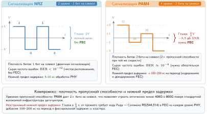
***От NRZ к PAM4:** чтобы повысить пропускную способность без удвоения тактовой частоты, высокоскоростные межсоединения перешли от NRZ (2 уровня напряжения, 1 бит на символ) к PAM4 (4 уровня напряжения, 2 бита на символ). Цена — меньший запас по шуму: «глазок» сигнала уже, что требует прямой коррекции ошибок (FEC) и увеличивает неустранимую задержку α фабрики.*

Этот сдвиг сигнализации выделяет ключевое архитектурное правило: удвоение линейной скорости без удвоения тактовой частоты обменивает отношение сигнал/шум на полосу пропускания и требует прямой коррекции ошибок, чтобы работать вблизи предела канала.

### Дальность и среда для меди и оптики

Выбор физической среды определяет, как далеко может дотянуться линк, прежде чем задержка, мощность и стоимость изменят геометрию кластера. [Таблица «Компромиссы размещения кабелей и оптики»](#tbl-network-fabrics-link-media) сравнивает повторяющиеся варианты кабелей и оптики по атрибутам, которые определяют, где каждый из них уместен.

***Компромиссы размещения кабелей и оптики:** распространенные межсоединительные среды занимают разные точки по дальности, задержке и стоимости, поэтому проектировщики кластеров используют медь внутри стоек, а оптику — там, где расстояние начинает доминировать в размещении.*

| **Среда**                                              | **Дальность**       | **Профиль стоимости**                                                 | **Влияние на задержку**                                                                        | **Типичное размещение**          |
|:--------------------------------------------------------|:--------------------|:----------------------------------------------------------------------|:-----------------------------------------------------------------------------------------------|:---------------------------------|
| **DAC (кабель прямого подключения)**                    | ~3 м                | Самая низкая стоимость (~50 долл.) и нет мощности оптического модуля  | Самая низкая задержка среды; пассивная медь не требует оптического преобразования              | Внутри стойки                    |
| **AOC (активный оптический кабель)**                    | 3–30 м              | Выше (~500 долл.) из-за постоянно подключенных трансиверов            | Электрооптическое преобразование и FEC добавляют сотни наносекунд                              | Линки между стойками или в масштабе ряда |
| **Сменные оптические модули**                           | Более 30 м          | Самая высокая стоимость модулей и мощности, но сменная оптика и волоконные шнуры | Оптическое преобразование и FEC добавляют задержку; дальность позволяет топологии              | Ядро сети и линки уровня пода    |

Для оптических линков FEC[^fn-fec-link-latency] — часть бюджета задержки, который делает дальность решением топологии, а не простым выбором кабеля. Сравнение в [таблице](#tbl-network-fabrics-link-media) — это компромисс геометрии кластера в миниатюре: медь дешева и имеет низкую задержку, но сближает ускорители; оптические межсоединения удлиняют ряд или под ценой большей мощности и задержки, а сменные оптические модули достигают ядра только тогда, когда топологии нужна дальность больше, чем минимальная стоимость каждого перехода.

[^fn-fec-link-latency]: **FEC (прямая коррекция ошибок)**: на скоростях 400G и 800G целостность сигнала настолько хрупка, что PHY-уровни Ethernet полагаются на FEC для восстановления искаженных битов (Anslow, 2016; Ethernet Alliance, 2025). Точная задержка зависит от архитектуры PHY и модуля; для моделирования ML-фабрик консервативной точкой считается трактовка FEC как бюджета задержки на каждый переход, поскольку многопереходный путь накапливает этот бюджет до того, как программное обеспечение сможет его скрыть.

> **Перспектива: цена расстояния**
>
> В сетевой фабрике ML расстояние — это деньги. Кластер на 10 000 GPU требует примерно 20 000 оптических линков только на магистральном (spine) уровне. При 500 долл. за линк и 20 Вт на сменный модуль это составляет 10 млн долл. на кабельную систему и 400 кВт непрерывной мощности одних только трансиверов. Стоимость задает **геометрию кластера**: архитекторы упаковывают ускорители как можно плотнее (70–100 кВт на стойку), чтобы максимизировать дешевую медь и минимизировать дорогую оптику.

### SerDes, бюджет линии и мощность

Каждый порт зависит от схемы **сериализатора/десериализатора (SerDes)**, которая преобразует параллельные данные из специализированной интегральной схемы коммутатора (ASIC) в последовательный поток. С ростом пропускной способности эти схемы стали главным потребителем мощности в сетевой фабрике. Рассмотрим энергетические последствия для кластера на 1 024 GPU: поддержание полной $\text{BW}_{\text{bisect}}$ для 350 ГБ градиентного трафика требует примерно 3 000 высокоскоростных линков. Если каждый порт 400 Гбит/с потребляет 25 Вт (совокупная мощность SerDes и оптического трансивера), межсоединение в целом потребляет 75 кВт непрерывно — то есть 10,5 процента бюджета мощности кластера уходит на перемещение битов, а не на вычисления с ними.

**Бюджет линии** (link budget), строгий допуск в децибелах на ослабление сигнала, определяет дальность этих линков. Сигналы теряют энергию в меди из-за скин-эффекта и диэлектрического поглощения. Бюджет линии — это разность между выходной мощностью передатчика и пределом чувствительности приемника. Для стандартной полосы PAM4 50G бюджет может составлять 30 дБ. Если кабель DAC длиной 3 м вносит 18 дБ потерь, а разъемы добавляют еще 2 дБ, остается 10 дБ запаса. Однако при удвоении частоты для поддержки полос 100G (для портов 800 Гбит/с) потери на метр резко возрастают. Физика навязывает жесткий компромисс: чтобы сохранить целостность сигнала, не выходя за пределы бюджета мощности, дальность кабеля должна уменьшаться. Медные линки на 800 Гбит/с ограничены примерно 1–2 метрами, что физически ограничивает диаметр вычислительной стойки и вынуждает использовать дорогую и энергоемкую оптику для любого соединения, выходящего за пределы шкафа. В сценариях планирования уровня 1,6 Тбит/с SerDes и оптическая мощность могут составлять значительную долю энергии кластера, делая мощность на бит главным ограничением масштабирования. Провод задает жесткие пределы дальности и скорости; транспортный уровень должен построить надежный примитив коммуникации поверх этих физических линков.

## Уровень 2: транспорт и модель производительности

Крупномасштабное обучение требует устойчивых, синхронизированных массовых передач. Одна операция AllReduce на 1 024 ускорителях может перемещать терабайты градиентных данных. Такой паттерн выигрывает от разгрузки транспорта на RDMA, надежного завершения передачи и ограниченного по времени восстановления после потерь. Физически беспотерьная фабрика — один из способов сделать эту производительность предсказуемой, но не единственный.

### RDMA и GPUDirect

> **Определение: удаленный прямой доступ к памяти (RDMA)**
>
> ***Удаленный прямой доступ к памяти (RDMA)***: сетевая технология, которую применяют в фабриках обучения ML. Она позволяет одной машине читать или записывать память другой машины напрямую, в обход ядра операционной системы и процессора на обоих концах, перенося обработку транспорта на сетевую карту.
>
> 1. **Значение**: RDMA может снизить сквозную задержку сообщения с десятков микросекунд для ядерного TCP-пути до единиц микросекунд на настроенной фабрике, сокращая член $L_{\text{lat}}$ в железном законе. Для одного участника, который отправляет полезную нагрузку 350 ГБ, GPUDirect RDMA также избегает около 700 ГБ трафика в памяти хоста: одной записи в оперативную память хоста и одного считывания сетевой картой.
> 2. **Отличие**: в отличие от обычного TCP-пути через ядро, RDMA переносит обработку транспорта на аппаратуру сетевой карты и разрешает доступ из пространства пользователя к зарегистрированной памяти. Итоговая экономия ядер процессора и пропускной способности памяти зависит от хоста, сетевой карты, пути ввода-вывода, размера сообщения и программной конфигурации, а не только от скорости линка.
> 3. **Типичная ошибка**: RDMA — это модель доступа и разгрузки, а не один алгоритм восстановления после потерь. Надежные транспорты InfiniBand и RoCE обнаруживают потери и повторяют передачу (InfiniBand Trade Association, 2000). Некоторые поколения RNIC используют восстановление в стиле Go-Back-N, которое делает потерю дорогой, тогда как другие конструкции поддерживают более сильное избирательное восстановление или переносят потери Ethernet без PFC (Mittal et al., 2018). Требование — надежное завершение передачи с хвостом восстановления, который может выдержать синхронизированная нагрузка, а не PFC или физически беспотерьный Ethernet во всех реализациях.

Традиционные пути TCP через ядро становятся все дороже на скоростях 400 Гбит/с. Обработка прерываний, работа протокола и копирование полезных данных могут потреблять значительное процессорное время и пропускную способность памяти, особенно когда несколько потоков или сетевых карт (NIC) одновременно обслуживают хост. Современные стеки TCP могут поддерживать высокую пропускную способность с помощью сегментационной разгрузки, масштабирования на приемной стороне, интерфейсов без копирования и аккуратного размещения с учетом неоднородного доступа к памяти (NUMA), поэтому один поток сам по себе не исчерпывает пропускную способность памяти двухпроцессорного сервера. Архитектурная проблема в другом: ресурсы хоста, которые тратятся на перемещение сетевых данных, конкурируют с процессом обучения и становятся труднее предсказуемо выделять по мере роста совокупного ввода-вывода.

RDMA обходит путь данных ядра. Разгрузка логики транспорта на сетевую карту позволяет приложениям читать и записывать зарегистрированную удаленную память без вмешательства ядра для каждого сообщения. Для ML GPUDirect RDMA[^fn-gpudirect-rdma-bypass] распространяет этот принцип на память ускорителя (NVIDIA, 2026). Без GPUDirect исходящая полезная нагрузка должна сначала пройти через память хоста, прежде чем сетевая карта ее передаст. GPUDirect же позволяет сетевой карте выполнять прямой доступ к памяти (DMA) к памяти GPU или из нее по пути PCIe между периферийными устройствами, как показано на [рисунке](#fig-gpudirect-data-path). Для одной полезной нагрузки 350 ГБ обход хоста устраняет около 700 ГБ трафика в памяти хоста. Сеть по-прежнему переносит полезную нагрузку, а путь PCIe может состоять из нескольких DMA-транзакций; оптимизация убирает промежуточные копии, но не сворачивает передачу в одну транзакцию.

[^fn-gpudirect-rdma-bypass]: **GPUDirect RDMA**: представлен NVIDIA для GPU класса Kepler и CUDA 5.0. GPUDirect RDMA обеспечивает прямой путь PCIe между памятью GPU и сторонними периферийными устройствами, например сетевыми интерфейсами (NVIDIA, 2026). До GPUDirect каждая передача градиентов должна была проходить через память хоста, расходуя пропускную способность памяти процессора, которая конкурирует с загрузкой данных. Устранение этого обходного пути — одна из причин, по которым перекрытие коммуникации с вычислениями обратного прохода становится осуществимым в масштабе.

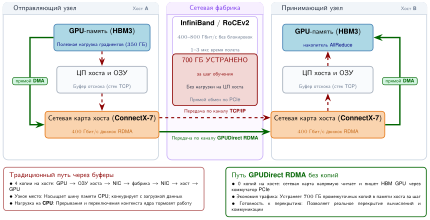

***Путь данных GPUDirect RDMA:** красный традиционный путь сначала помещает полезную нагрузку ускорителя в зарегистрированную память хоста, и только затем сетевая карта ее считывает. Зеленый путь GPUDirect позволяет сетевой карте обращаться к памяти GPU по PCIe, устраняя обход через память хоста.*

### InfiniBand и RoCE

Кластеры GPU обычно выбирают между двумя транспортными стеками RDMA, и это решение — компромисс между надежностью и эксплуатационными издержками. В [таблице](#tbl-network-fabrics-rdma-stacks) сравнивается, где каждый стек возлагает бремя беспотерьности и управления перегрузкой.

***Компромиссы транспортных стеков RDMA:** InfiniBand и RoCE предоставляют семантику RDMA по-разному: один построен вокруг встроенной беспотерьности, другой — вокруг совместимости с Ethernet.*

| **Стек**                                | **Поведение фабрики**                                                                                                                 | **Эксплуатационная нагрузка**                                                                                                                                                                                              | **Типичное применение**                                                                                 |
|:----------------------------------------|:--------------------------------------------------------------------------------------------------------------------------------------|:----------------------------------------------------------------------------------------------------------------------------------------------------------------------------------------------------------------------------|:--------------------------------------------------------------------------------------------------------|
| InfiniBand (IB)                         | Специализированная HPC-фабрика с коммутацией (InfiniBand Trade Association, 2000) и кредитным управлением потоком, поэтому беспотерьность встроена на канальном уровне | диспетчер подсети (subnet manager) и виртуальные полосы (VL) управляют маршрутизацией и изоляцией трафика                                                                                                                  | Выделенные кластеры обучения, где предсказуемая хвостовая задержка важнее гибкости экосистемы Ethernet |
| **RoCE (RDMA over Converged Ethernet)** | RoCEv2 переносит семантику RDMA, инкапсулируя заголовки транспорта InfiniBand в пакеты UDP/IP                                       | Развертывания на основе PFC подавляют потери с помощью PFC, ECN и политики маршрутизации (Guo et al., 2016; Gangidi et al., 2024); конструкции без PFC возлагают больше нагрузки на сквозное управление перегрузкой и восстановление потерь (Mittal et al., 2018) | Мультивендорные парки Ethernet, которые могут позволить себе более тонкую настройку управления перегрузкой |

Строка InfiniBand[^fn-infiniband-protocol-origin] отражает историческое наследие протокола, которое отдает предпочтение аппаратно управляемой беспотерьности перед совместимостью с Ethernet.

[^fn-infiniband-protocol-origin]: **InfiniBand**: сформирован в 1999 году в результате слияния двух конкурирующих стандартов ввода-вывода серверов (Future I/O и NGIO). Изначально InfiniBand задумывался как замена PCI для системного соединения общего назначения. Его переориентация на HPC-сети сохранила кредитное аппаратное управление потоком, которого требовал ввод-вывод серверов. Именно это наследие объясняет, почему InfiniBand обеспечивает встроенную беспотерьность без хрупкости PFC, характерной для Ethernet-фабрик RDMA.

Этот выбор стека заметен на границе протокола. [Рисунок «Стеки TCP/IP и RoCE»](#fig-ib-roce-stack) сравнивает два стека и показывает, как протоколы на основе RDMA открывают пользовательский **интерфейс verbs** (verbs API), который обходит традиционный стек TCP/IP ядра.

***Стеки TCP/IP и RDMA/RoCE v2:** традиционный путь TCP/IP (слева) проходит через приложение, ядро ОС (переключение контекста), сокетный API, TCP/UDP, IP/Ethernet и сетевую карту, с задержкой 10–20 мкс и двумя-тремя копиями, выполняемыми процессором. Путь RDMA/RoCE v2 (справа) открывает пользовательский интерфейс Verbs API, который обходит ядро и переносит транспорт на RDMA-карту (GPUDirect читает HBM GPU напрямую), с задержкой 1–3 мкс и без копирования данных процессором.*

### Надежная доставка и восстановление после потерь

Главный вывод из [рисунка](#fig-ib-roce-stack) — интерфейс Verbs задает единую модель программирования, тогда как транспорт и фабрика определяют, как достигается надежное завершение передачи. Надежные транспорты с установлением соединения в InfiniBand и RoCE обнаруживают потери и повторяют передачу (InfiniBand Trade Association, 2000). InfiniBand обычно подавляет переполнение буферов с помощью кредитов на уровне канала. Многие развертывания RoCE подавляют это с помощью PFC и ECN (Guo et al., 2016; Gangidi et al., 2024), но это договоренность развертывания, а не свойство RDMA как семейства. Конструкции, работающие поверх Ethernet с потерями, перекладывают больше ответственности на управление перегрузкой на концах, переупорядочивание пакетов и избирательное восстановление (Mittal et al., 2018).

Поэтому гранулярность восстановления важна. На RNIC с восстановлением в стиле **Go-Back-N** и без хранения пакетов, пришедших не по порядку, потеря на 900 МБ в передаче в 1 ГБ может аннулировать более поздние поступления и вынудить повторную передачу с точки пропущенной последовательности. RNIC с избирательным восстановлением повторно передает меньший участок, поэтому та же физическая потеря дает более короткий хвост (Mittal et al., 2018). При 400 Гбит/с обе задержки намного больше времени передачи одного пакета, а синхронный коллектив подвергает самому медленному восстановлению каждый ожидающий ранг. Проектировщики фабрики могут сократить этот хвост, подавляя потери с помощью PFC, используя транспорт, устойчивый к потерям, с ограниченным восстановлением на концах, или комбинируя управление перегрузкой и политику допуска, чтобы очереди редко переполнялись. Каждый выбор переносит состояние и режимы отказа между коммутаторами и конечными узлами.

> **Контрольные вопросы: выбор протокола**
>
> Рассмотрите кластер обучения на 2 048 GPU, который будет одновременно выполнять обучение больших языковых моделей (градиентные сообщения размером в несколько гигабайт) и обучение с подкреплением (частые мелкие управляющие сообщения).
>
> - [ ] **Соответствие протокола**: выберите протокол и обоснуйте выбор как для больших градиентных сообщений, так и для частых мелких управляющих сообщений.
> - [ ] **Требования RoCE**: сравните инфраструктуру, которую требуют конструкции RoCE с PFC и без PFC, с кредитной фабрикой InfiniBand.
> - [ ] **Общая фабрика**: пересмотрите выбор протокола, если тот же кластер также обслуживает трафик инференса для внешних пользователей по той же физической сети.

### Модель производительности α-β

Выбор протокола определяет, как фабрика обеспечивает надежное завершение передачи и ограничивает время восстановления после потерь. Моделирование производительности затем отвечает на вопрос, насколько быстро фабрика может передать данное сообщение. Модель $\alpha$-$\beta$ раскладывает время передачи сообщения как $T(n) = \alpha + n/\beta$, где $\alpha$ — фиксированная задержка старта, а $\beta$ — устойчивая пропускная способность (Hockney, 1994). В приложении о коммуникационных основах выведена полная формула и разобраны режимы сообщений, в которых передача определяется задержкой или пропускной способностью. [Раздел о модели α-β для коллективных операций](06_collective_communication.md#sec-communication-collective-operations-collective-operations-alphabeta-model-f9b4) в главе 6 позже применяет ту же декомпозицию к коллективным алгоритмам. Выбор топологии напрямую сдвигает оба параметра: fat-tree минимизирует $\alpha$, предоставляя короткие пути равной стоимости, а кольцо усиливает $\alpha$ с ростом кластера, поскольку сообщения проходят число переходов, которое растет с числом участников $N$.

Модель выявляет два режима, которые ведут к разным инженерным решениям. Для сообщений с $n < \alpha\beta$ стоимость старта $\alpha$ доминирует во времени передачи; мелкие управляющие сообщения и пузыри конвейера попадают в этот режим, где доминирует задержка. Для сообщений с $n > \alpha\beta$ доминирует член $n/\beta$; градиентный AllReduce попадает в режим, где доминирует пропускная способность.

Для смоделированного пути NDR InfiniBand с $\alpha =$ 1,5 мкс и $\beta =$ 50 ГБ/с точка перехода $n^* = \alpha \cdot \beta \approx$ 75 КБ. Это параметры сценария, а не константы протокола: измеренная задержка старта и доставленная пропускная способность зависят от сетевой карты, пути через коммутатор, программного стека и конкуренции. Сообщения меньше измеренной точки перехода мало выигрывают от большей пропускной способности; сообщения больше нее мало выигрывают от меньшей задержки. Эта граница разделяет две принципиально разные стратегии оптимизации: снижение числа переходов для уменьшения $\alpha$ или увеличение доставляемой пропускной способности пути для роста $\beta$.

> **Сценарий: переход α-β**
>
> **Задача**: инженер сравнивает смоделированный путь InfiniBand NDR (1,5 мкс, 50 ГБ/с) со смоделированным путем RoCE (5 мкс, 12,5 ГБ/с). Для управляющего сообщения 4 КБ и градиентного фрагмента 350 МБ какая часть $T(n)=\alpha+n/\beta$ доминирует и почему первый путь помогает по разным причинам в каждом режиме?
>
> **Расчет**: примените $T(n) = \alpha + n/\beta$ для управляющего сообщения 4 КБ и градиентного фрагмента 350 МБ.
>
> 1. **Малое сообщение** (4 КБ):
>    - InfiniBand: $1{,}5\,\text{мкс} + 4\,\text{КБ}/50\,\text{ГБ/с} = 1{,}5 + 0{,}08 = \mathbf{1{,}58}\,\text{мкс}$
>    - Ethernet: $5{,}0\,\text{мкс} + 4\,\text{КБ}/12{,}5\,\text{ГБ/с} = 5{,}0 + 0{,}32 = \mathbf{5{,}32}\,\text{мкс}$
>    - **Результат**: при этих предполагаемых параметрах путь NDR быстрее в 3,4×, потому что его смоделированное $\alpha$ ниже.
> 2. **Большое сообщение** (350 МБ):
>    - InfiniBand: $T = \alpha + n/\beta =$ 7,0 мс
>    - Ethernet: $T = \alpha + n/\beta =$ 28,01 мс
>    - **Результат**: при этих предполагаемых параметрах путь NDR быстрее в 4×, потому что его смоделированное $\beta$ выше.
>
> **Системный вывод**: этот сценарий помещает точку перехода $(n^* = \alpha\beta)$ около 75 КБ. Поскольку градиенты имеют размер от мегабайт до гигабайт, их передачи обычно определяются пропускной способностью, тогда как координация конвейера может оставаться в режиме, где доминирует задержка. Более высокая скорость линии почти не помогает сообщению, член старта которого доминирует; здесь улучшение дают обработка транспорта, топология и число переходов.

Чтобы понять, почему это различие важно на практике, рассмотрим два сообщения, которые задание обучения модели на 175 млрд параметров отправляет на каждой итерации. Первое — управляющее сообщение планирования конвейера объемом 4 КБ, которое координирует передачу микропакетов между стадиями конвейера. Применяя модель, получаем $T(n) \approx$ 1,58 мкс для управляющего сообщения. Член пропускной способности дает лишь 5,1 % от общего времени. Удвоение скорости линка сэкономило бы ничтожную долю микросекунды. Для этого сообщения самый прямой способ сократить время передачи — уменьшить число переходов, что снижает $\alpha$, а не покупать более быстрые линки.

Второе — градиентный фрагмент объемом 350 МБ для AllReduce одного слоя. Теперь $T(n) \approx$ 7,0 мс. Член задержки здесь незаметен. Удвоение пропускной способности до 100 ГБ/с вдвое сократило бы это время передачи, давая прямой и пропорциональный выигрыш. Эти два случая показывают, почему проектирование сети должно учитывать $\alpha$ и $\beta$ одновременно: топология и число переходов управляют режимом, где доминирует задержка, а скорость линка и разнообразие путей — режимом, где доминирует пропускная способность.

[Рисунок «Переход α-β»](#fig-alpha-beta-crossover) делает эти два режима видимыми во всем диапазоне размеров сообщений для двух смоделированных путей. Сценарий NDR пересекает порог примерно при 75 КБ, а сценарий RoCE 100 Гбит/с — около 62,5 КБ. Положения следуют из предполагаемых значений $\alpha$ и $\beta$; они не являются универсальными константами InfiniBand и RoCE. В этом сравнении разрыв задержки старта доминирует для мелких сообщений, но становится незначительным рядом с членом передачи для многомегабайтных градиентов.

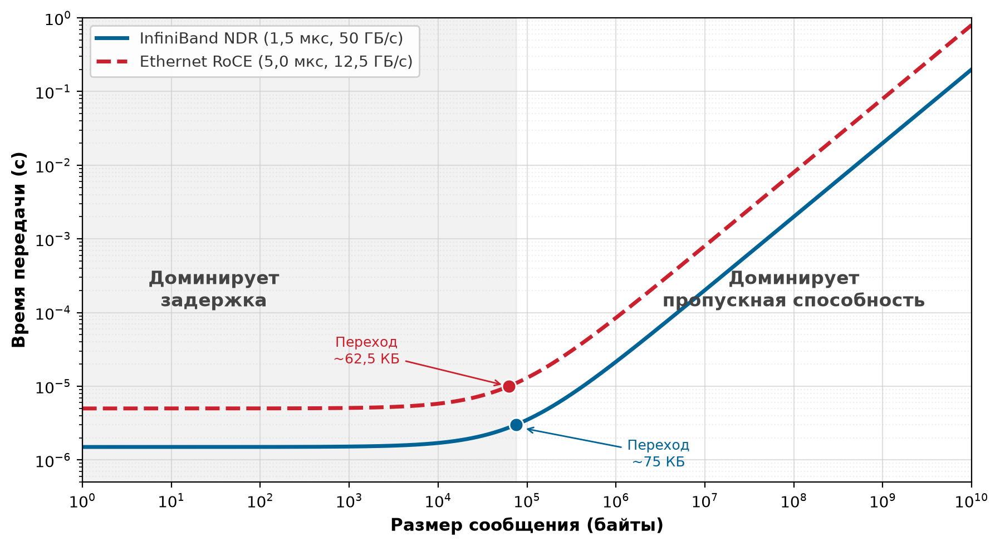

***Переход $\alpha$-$\beta$:** смоделированное время передачи в зависимости от размера сообщения для пути NDR InfiniBand и базового RoCE 100 Гбит/с с параметрами сценария из текста. Мелкие сообщения определяются задержкой (плоская область), крупные — пропускной способностью (линейная область). Измеренные точки перехода зависят от сквозного пути.*

Помимо классификации отдельных передач, та же модель определяет, когда коммуникация начинает превосходить вычисления. Раздел α-β рассматривал время передачи отдельных сообщений по одному линку, считая сеть каналом «точка — точка». В цикле обучения с параллелизмом по данным, однако, важен другой вопрос: успевает ли коллективный AllReduce по всему кластеру завершиться до того, как будет готов следующий шаг вычислений. Когда вектор градиентов становится достаточно большим, совокупное время передачи кольцевого AllReduce превышает время вычислений на шаг, и сеть становится ограничивающим темпом для всего задания обучения.

> **Сценарий: порог узкого места AllReduce**
>
> **Задача**: когда кольцевой AllReduce становится узким местом для кластера из 1 024 GPU H100, обучающего модели масштаба GPT-2 и крупнее?
>
> **Исходные данные**: сценарий предполагает фазу вычислений 101 мс при загрузке ускорителей 50 % и путь NDR, смоделированный параметрами $\alpha = 1{,}5 \;\text{мкс}$ и $\beta = 50 \;\text{ГБ/с}$. Для модели масштаба GPT-2 каждый ранг вносит 6 ГБ градиентов FP32.
>
> **Расчет**: применяя стоимость кольца $T_{\text{ring}} \approx \frac{2(N-1)}{N}\frac{M}{\beta} + 2(N-1)\alpha$, получаем $T_{\text{ring}} \approx 242{,}8 \text{ мс}$. Смоделированная доля коммуникации:
>
> $$ \text{доля коммуникации} = 70{,}6 \% $$
>
> Глава о коллективной коммуникации [выводит фазы кольца и выражение стоимости](06_collective_communication.md); здесь этот результат используется только для того, чтобы проверить, способна ли фабрика поспевать.
>
> **Системный вывод**: при увеличении полезной нагрузки до случая 70 млрд (280 ГБ) смоделированное время кольца возрастает до:
>
> $$ T_{\text{ring}} \approx 11\,192{,}1 \text{ мс} $$
>
> При фиксированном предположении о вычислениях коммуникация доминирует над чистым параллелизмом по данным. Вывод условный, а не универсальный порог размера модели: параллелизм, точность градиентов, объединение в корзины (bucketing), перекрытие, топология и доставляемая пропускная способность — все сдвигают эту границу.

Модель α-β описывает скорость одного линка, но модели на 175 млрд параметров требуется 1 024 GPU GPU, работающих согласованно. Масштабирование этих транспортных примитивов от пары узлов до суперкомпьютера уровня целого дата-центра требует **сетевой топологии**: определенного рисунка соединений, который максимизирует $\text{BW}_{\text{bisect}}$ и минимизирует число переходов и стоимость кабелей для глобальных коллективных операций.

## Уровень 3: коммутаторы и топология

Физическое расположение коммутаторов определяет бисекционную пропускную способность $\text{BW}_{\text{bisect}}$ и то, является ли фабрика неблокирующей. Эти два свойства определяют, насколько хорошо сеть поддерживает глобальные коммуникационные паттерны, доминирующие в распределенном обучении; это ограничение описывается принципом бисекционной пропускной способности.

Первое свойство, бисекционная пропускная способность, задает предельный порог пропускной способности в худшем случае, который топология накладывает на глобальные коллективы. Кластер может иметь тысячи быстрых линков на периферии и все же задушить свои операции AllReduce, если поперечная емкость в самой узкой точке иерархии коммутации недостаточна.

> **Определение: бисекционная пропускная способность**
>
> ***Бисекционная пропускная способность***: метрика топологии сети, определяемая как минимальная совокупная емкость линков, пересекающих любое разбиение кластера на две равные половины. Она представляет предел пропускной способности в худшем случае для трафика, который должен пересечь это разбиение, включая глобальные коллективы.
>
> 1. **Значение**: бисекционная пропускная способность $\text{BW}_{\text{bisect}}$ напрямую задает предел пропускной способности для глобальной синхронизации в масштабе кластера. Fat-tree на 1 024 GPU с линками 400 Гбит/с при подписке 1:1 обеспечивает $\text{BW}_{\text{bisect}} = 512 \times 50\,\text{ГБ/с} = 25{,}6\,\text{ТБ/с}$ в каждом направлении; магистраль с подпиской 4:1 снижает это до 6,4 ТБ/с, делая каждый шаг AllReduce медленнее в 4× и превращая сеть в доминирующее узкое место по железному закону вместо ускорителя.
> 2. **Отличие**: в отличие от совокупной пропускной способности (суммы скоростей всех периферийных линков, которая может быть высокой даже в плохо связанной топологии), $\text{BW}_{\text{bisect}}$ измеряет глобальную связность. Звездообразная топология с 1 000 периферийными линками, сходящимися в одном центральном коммутаторе, имеет высокую совокупную пропускную способность, но $\text{BW}_{\text{bisect}}$, ограниченную емкостью объединительной панели этого коммутатора.
> 3. **Типичная ошибка**: распространено заблуждение, что добавление листовых коммутаторов всегда увеличивает $\text{BW}_{\text{bisect}}$. В трехъярусном fat-tree подписка магистрали с перегрузкой (меньше восходящих линков, чем нисходящих, на коммутатор пода) снижает $\text{BW}_{\text{bisect}}$ ниже суммы периферийных линков независимо от числа листовых коммутаторов.

Обучение ML включает глобальные коллективы и фазы AllToAll, которые могут гнать трафик через разбиения топологии, поэтому полная $\text{BW}_{\text{bisect}}$ — распространенная цель производительности. Фабрика, которая не дотягивает, заставляет трафик синхронизации, пересекающий самый узкий участок, упираться в него; ускорители простаивают, пока градиенты проходят через ограниченные линки.

Бисекционная пропускная способность — это метрика. Свойство топологии, которое обеспечивает полную $\text{BW}_{\text{bisect}}$ при произвольных паттернах трафика, — неблокирующая фабрика. Неблокирующая конструкция гарантирует, что восходящая емкость на каждом ярусе коммутаторов совпадает с нисходящей или превышает ее, поэтому внутренняя конкуренция не снижает поперечную пропускную способность ниже теоретического максимума. Когда фабрика работает с подпиской, эффективная $\text{BW}_{\text{bisect}}$ падает во столько раз, каков коэффициент подписки, и каждый глобальный коллектив замедляется пропорционально. В приложении о таксономии вычислений и коммуникаций показано, как диагностировать режим, в котором узким местом становится коммуникация, а не вычисления, чтобы магистраль с перегрузкой распознавали как проблему фабрики, а не принимали за медленные ускорители.

> **Определение: неблокирующая фабрика**
>
> ***Неблокирующая фабрика***: топология сети кластера ML, в которой любая перестановка пар входных и выходных портов может одновременно обмениваться данными на полной линейной скорости без внутренней конкуренции. Это достигается, когда восходящая емкость на каждом ярусе коммутаторов равна нисходящей или превышает ее.
>
> 1. **Значение**: в парках ML неблокирующая фабрика гарантирует, что трафик AllReduce от любого подмножества ускорителей не конкурирует за общие линки, сохраняя полный член $\text{BW}_{\text{bisect}}$ для глобальных коллективов. Магистраль с подпиской 2:1 вдвое снижает эффективную $\text{BW}_{\text{bisect}}$, вдвое увеличивая время AllReduce для глобальных градиентов и соответственно снижая эффективность масштабирования $\eta_{\text{scaling}}$. При нагрузке с 30 % коммуникации это стоит примерно 23,1 % совокупной пропускной способности кластера.
> 2. **Отличие**: в отличие от фабрик с подпиской, распространенных в веб-дата-центрах, где восходящие линки верхнего яруса делятся между многими узлами нижнего яруса, неблокирующая фабрика одновременно предоставляет выделенную емкость пути для каждой возможной пары отправителя и получателя.
> 3. **Типичная ошибка**: распространено заблуждение, что неблокирующая означает отсутствие перегрузки. Перегрузка на стороне конечного узла (incast) все равно возможна, если несколько отправителей одновременно обращаются к одному порту получателя, независимо от объема внутренней емкости фабрики.

Fat-tree опираются на принципы неблокирующих сетей в стиле Clos, чтобы обеспечить полную $\text{BW}_{\text{bisect}}$ (Clos, 1953). Топологии с оптимизацией по рельсам (rail-optimized) обменивают часть глобальной гибкости маршрутизации на меньшую стоимость кабелей, а dragonfly сокращают число оптических линков, вводя ограничения на размещение нагрузки (Kim et al., 2008). Этот фундаментальный баланс между гарантированной бисекционной пропускной способностью и экономической масштабируемостью определяет каждое решение о топологии в крупных кластерах ML, как показывают сравнения в [разделе о fat-tree](#sec-network-fabrics-fat-tree), [разделе о rail-optimized топологии](#sec-network-fabrics-rail-optimized) и [разделе о dragonfly и торе](#sec-network-fabrics-dragonfly).

### Коммутатор верхнего уровня стойки (ToR) и домен отказа

Коммутатор верхнего уровня стойки (ToR) служит фундаментальной физической точкой агрегации и задает как пределы пропускной способности, так и минимальный **домен отказа** кластера. В плотной конфигурации для ИИ со стандартными узлами DGX стойка обычно содержит 4 узла по 8 GPU каждый, всего 32 ускорителя. ToR-коммутатор объединяет эти устройства, но также создает критическую уязвимость: при отказе ToR он мгновенно отрезает 32 GPU от задания обучения, и глобальный планировщик вынужден остановить работу и восстанавливаться из последней контрольной точки.

Чтобы смягчить перегрузку на этом краю, архитекторы сети максимизируют **радикс** коммутатора, то есть число доступных портов. Высокорадиксный коммутатор на 64 порта выделяет 32 порта на нисходящее направление к серверам (обеспечивая полную пропускную способность для 32 GPU) и 32 порта на восходящее направление к магистрали. Эта подписка 1:1 гарантирует неблокирующую работу на уровне стойки. Для кластера из 1 024 GPU физическая топология включает примерно 32 таких стойки.

Та же граница стойки определяет и восстановление. Планировщик заданий должен учитывать топологию ради производительности, а надежное размещение реплик должно держать избыточное состояние и резервную мощность за пределами того же домена отказа стойки, чтобы потеря одной стойки не останавливала весь прогон обучения (см. [раздел о размещении реплик в доменах отказа](07_fault_tolerance.md#sec-fault-tolerance-reliability-reliability-replica-placement-failure-domains-73a7)).

### Сети fat-tree (Clos)

ToR обеспечивает неблокирующую пропускную способность внутри одной стойки, но соединение 32 стоек в кластер, сохраняющий полную $\text{BW}_{\text{bisect}}$ для каждой возможной пары коммуникации, требует топологии, которая масштабирует поперечную емкость вместе с размером кластера. Fat-tree (также называемый сетью Clos) добивается этого, добавляя параллельные магистральные коммутаторы на каждом ярусе, так что совокупная восходящая емкость всегда совпадает с суммарной периферийной пропускной способностью, которая в нее поступает. В этой терминологии листовые коммутаторы подключают серверы или стойки, магистральные (spine) коммутаторы соединяют листья внутри пода, а коммутаторы ядра (core) соединяют несколько подов, когда нужен третий ярус.

> **Определение: fat-tree**
>
> ***Fat-tree***: иерархическая топология сети кластера ML, в которой число параллельных путей (а значит, совокупная поперечная емкость) растет на каждом ярусе коммутаторов к магистрали, обеспечивая полную $\text{BW}_{\text{bisect}}$ и несколько маршрутов равной стоимости между любыми двумя узлами (Al-Fares et al., 2008).
>
> 1. **Значение**: $k$-арный fat-tree, построенный из коммутаторов с радиксом $k$, поддерживает $k^2/2$ хостов в двухъярусной (подовой) конфигурации и $k^3/4$ хостов в трехъярусной конфигурации с полной $\text{BW}_{\text{bisect}}$. При $k=64$ двухъярусный под поддерживает 2 048 GPU, а трехъярусная фабрика — 65 536 хостов. Поскольку каждый AllReduce может использовать любой доступный путь через магистраль, фабрика обеспечивает одновременную коммуникацию всех ускорителей на полной скорости и удовлетворяет требованию $\text{BW}_{\text{bisect}}$ для глобальной синхронизации градиентов.
> 2. **Отличие**: в отличие от стандартного дерева, где пропускная способность в корне — единое узкое место, общее для всех листьев, fat-tree заменяет каждый корень несколькими магистральными коммутаторами, чья совокупная восходящая емкость совпадает с суммарной периферийной пропускной способностью, устраняя узкое место.
> 3. **Типичная ошибка**: распространено заблуждение, что fat-tree гарантирует нулевую стоимость сети. Ему требуются $\mathcal{O}(N \log N)$ коммутаторов и плотная кабельная система: неблокирующий трехъярусный fat-tree масштаба 4 000 GPU требует сотни коммутаторов и десятки тысяч оптических кабелей и стоит 20–100 млн долл. только за коммутационное оборудование.

Листовой, магистральный и ядерный ярусы обеспечивают несколько путей равной стоимости вместо одного перегруженного корня; именно так fat-tree создает гарантию емкости ([рисунок](#fig-fat-tree-detail)).

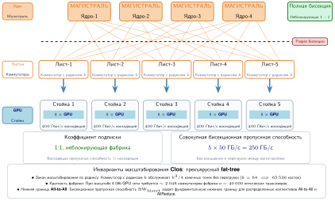

***Неблокирующая топология fat-tree:** трехъярусная сеть Clos из коммутаторов с радиксом $k$. Поскольку число восходящих линков на каждом уровне совпадает с числом нисходящих, топология обеспечивает полную $\text{BW}_{\text{bisect}}$ между любыми двумя подами. Множество параллельных путей между листьями и магистралью позволяет аппаратной адаптивной маршрутизации распылять пакеты и избегать перегрузки.*

Fat-tree[^fn-fattree-clos-network] — распространенный выбор по умолчанию для кластеров ML, поскольку неблокирующая конструкция может обеспечить полную $\text{BW}_{\text{bisect}}$ для произвольных разбиений. Эта емкость помогает глобальному AllReduce, хотя реализации вроде колец и деревьев не требуют одновременной коммуникации всех со всеми. Сеть строится иерархическими ярусами: листовые коммутаторы (ToR) подключаются к серверам напрямую, магистральные коммутаторы соединяют все листья внутри домена локальности, называемого подом, а коммутаторы ядра объединяют несколько подов.

[^fn-fattree-clos-network]: **Fat-tree (сеть Clos)**: основы многоступенчатой коммутации создал Clos (1953) в Bell Labs, чтобы минимизировать число электромеханических контактов в телефонных станциях. Leiserson (1985) из MIT обобщил эту идею как «fat-tree»: дерево «толстое», потому что пропускная способность линков растет к корню. Он доказал, что такая сеть может эмулировать любую сеть того же объема оборудования. Та же логика минимизации стоимости, которая двигала телефонию 1950-х, теперь движет проектированием кластеров ML: минимизировать число коммутаторов, гарантируя неблокирующую связность для глобального AllReduce.

Fat-tree, построенный из коммутаторов с радиксом[^fn-radix-switch-density] $k$, поддерживает $N_{\text{hosts}} = k^{3}/4$ хоста на трех ярусах, а также два различных двухъярусных варианта, которые отличаются только тем, считается ли верхний ярус краем кластера или агрегирующим слоем под будущим ядром. Первый вариант считает каждый коммутатор обоих ярусов емкостью для хостов на полной линейной скорости. При коммутаторах с радиксом 64 фабрика тратит половину портов каждого листа на хосты и половину на восходящие линки к магистрали, давая $k^{2}/2 =$ 2 048 портов для хостов по всему поду. Второй вариант резервирует верхний ярус как агрегацию, которая позже будет подключаться к слою ядра, а не завершать хосты: каждый лист по-прежнему дает $k/2$ портов для хостов, но под теперь содержит только $k/2$ листьев, поэтому он охватывает $(k/2)^2 =$ 1 024 хостов на под. Два подсчета описывают одни и те же коммутаторы, учтенные по-разному: завершает ли верхний ярус как магистраль кластера или как агрегирующую ступень пода. Любой вариант с запасом вмещает эталонный кластер из 1 024 всего с листовым и магистральным ярусами.

Конкретная оценка бисекционной пропускной способности показывает, как быстро подписка с перегрузкой превращается в задержку синхронизации.

> **Сценарий: бисекционная пропускная способность — цена подписки с перегрузкой**
>
> **Задача**: проектировщик кластера выбирает между «неблокирующей» (1:1) fat-tree и «экономичной» (4:1) магистралью для кластера из 1 024 GPU. Насколько медленнее будет AllReduce объемом 100 ГБ на GPU в более дешевой сети?
>
> **Расчет**: бисекционная пропускная способность ($\text{BW}_{\text{bisect}}$) — это минимальная ширина канала между половинами кластера. Для пропускно-оптимального кольца ReduceScatter плюс AllGather дают коэффициент трафика $2(N-1)/N =$ 1,998 на GPU.
>
> 1. **Неблокирующая (1:1)**: $\text{BW}_{\text{bisect}} =$ 512 $\times$ 50 ГБ/с $=$ 25 600 ГБ/с в каждом направлении.
>    - Время: 102 300 ГБ / 25 600 ГБ/с $\approx$ 3,996 с.
> 2. **С перегрузкой (4:1)**: $\text{BW}_{\text{bisect}} =$ 25 600 ГБ/с, деленная на 4, $=$ 6 400 ГБ/с в каждом направлении.
>    - Время: 102 300 ГБ / 6 400 ГБ/с $\approx$ 15,984 с.
>
> **Системный вывод**: экономия на коммутаторах ядра создает узкое место: глобальная синхронизация замедляется в 4×. На суперкомпьютере стоимостью 300 млн долл., где обучение на 30 % состоит из коммуникации, это узкое место тратит примерно 142,1 млн долл. на простой вычислений, что соответствует модели узкого места бисекционной пропускной способности из этого раздела. Для обучения подписка сети с перегрузкой — ложная экономия.

Этот расчет подписки превращает определение топологии в проектное правило: коэффициент подписки на каждом ярусе определяет, может ли fat-tree выдерживать глобальные коллективы.

> **Контрольные вопросы: топологии fat-tree**
>
> Эти вопросы проверяют, понятны ли компромиссы иерархических коммутационных фабрик:
>
> - [ ] **Радикс и масштаб**: вычислите максимальное число GPU, которое может соединить двухъярусный fat-tree на коммутаторах с радиксом 64 без коммутаторов ядра.
> - [ ] **Коэффициент неблокирующей работы**: объясните, почему неблокирующая фабрика требует подписки 1:1 на каждом ярусе сети.
> - [ ] **Ярус и задержка**: определите, как меняется $\alpha$ (задержка старта) при переходе от двухъярусного к трехъярусному fat-tree.
> - [ ] **Совокупная и бисекционная пропускная способность**: различите совокупную пропускную способность и $\text{BW}_{\text{bisect}}$ и назовите метрику, которая важна для AllReduce.

[^fn-radix-switch-density]: **Радикс коммутатора**: высокопроизводительные коммутаторы (например, NVIDIA Quantum-2) могут иметь радикс 64 порта, каждый на 400 Гбит/с. Такая плотность позволяет двухъярусному fat-tree поддерживать до 2 048 GPU всего с двумя переходами через коммутатор. По мере того как масштаб моделей приближается к 100 000 GPU, основными способами избежать добавления ярусов (и связанного с этим взрыва задержки и стоимости) становятся рост радикса коммутаторов (до 128 или 256), объединение ускорителей в большие локальные домены или принятие ограничений топологии.

Выход за этот предел требует трехъярусной архитектуры с коммутаторами ядра, что позволяет фабрике достичь 65 536 хостов, но добавленный масштаб несет и стоимость, и задержку. Неблокирующему трехъярусному дереву с $k=64$ требуется примерно $5k^2/4 \approx$ 5 120 коммутаторов в ядре, агрегации и периферийных слоях; при 10 000 долл.–50 000 долл. за коммутатор один только коммутационный слой стоит 50 млн долл.–250 млн долл.. Типичное **число переходов** также растет: с 2 для трафика внутри пода (лист — магистраль — лист) до 4 для трафика между подами (лист — магистраль — ядро — магистраль — лист), добавляя задержку сериализации и время обработки коммутатором к члену задержки $\alpha$ на тысячах шагов синхронизации. Топологии с rail-оптимизацией отвечают на оба давления, сопоставляя физический рисунок кабелей с паттерном коллективной коммуникации.

### Rail-optimized топология

Rail-optimized топология начинается с паттерна коммуникации, а не с общей иерархии коммутаторов. В плотных ускорительных узлах GPU можно сгруппировать по локальной позиции в слоте в рельсы (rails). [Рисунок «Физическая проводка rail-optimized»](#fig-rail-optimized-cabling) делает этот физический рисунок кабелей конкретным.

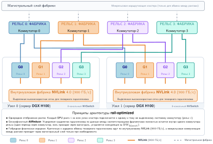

***Физическая проводка rail-optimized:** в плотных ускорительных узлах (например, DGX H100) GPU разбиты на рельсы в соответствии с позицией их слота PCIe. GPU 0 в каждом узле подключается к коммутатору рельса 0, GPU 1 — к коммутатору рельса 1 и так далее. Такая архитектура изолирует параллельный по данным трафик одного ранга на выделенных рельсах, снижая конкуренцию за $\text{BW}_{\text{bisect}}$ и число переходов для обменов, чувствительных к задержке.*

Схема проводки соединяет соответствующие GPU на разных узлах (GPU 0 с GPU 0, GPU 1 с GPU 1) через выделенные коммутаторы рельсов, а не через общий ToR-коммутатор. Это важно, потому что параллелизм по данным создает детерминированный и сильно стратифицированный паттерн коммуникации, которым стандартные топологии не умеют пользоваться. Когда группы тензорного параллелизма остаются внутри каждого узла, каждая реплика назначает соответствующий фрагмент модели тому же локальному рангу GPU. Ранг — это индекс воркера или GPU, назначенный распределенной средой выполнения, поэтому GPU 0 на одном узле синхронизирует градиенты этого фрагмента с GPU 0 на других узлах, но редко с GPU 1. **Rail-optimized топология** физически реализует эту логику, изолируя пути коммуникации одного ранга в выделенных сетях. Вместо подключения всех 8 GPU узла к одному ToR-коммутатору сеть соединяет все GPU 0 по всему кластеру с выделенной фабрикой «рельса 0», все GPU 1 — с «рельсом 1» и так далее. Простая оценка числа переходов показывает выигрыш.

> **Сценарий: дивиденд rail-оптимизации**
>
> **Задача**: команда синхронизирует градиенты параллельных по данным рангов по 128 узлов. В стандартном fat-tree каждое сообщение между GPU одного ранга проходит свой исходный листовой коммутатор, магистральный коммутатор и целевой листовой коммутатор (3 прохода через коммутаторы). В rail-оптимизированной сети все соответствующие GPU находятся на одном коммутаторе рельса (один проход). Какой выигрыш по задержке дает rail-конструкция?
>
> **Расчет**: задержка коммуникации ($\alpha$) пропорциональна числу проходов через коммутаторы.
>
> 1. **Стандартная задержка**: 3 прохода $\times$ 0,6 мкс = 1,8 мкс.
> 2. **Rail-optimized**: 1 проход $\times$ 0,6 мкс = 0,6 мкс.
> 3. **Результат**: задержка ниже в 3×.
>
> **Системный вывод**: для синхронного AllReduce с параллелизмом по данным, на который шаг обучения ждет на каждой итерации, снижение задержки в 3× — это разница между эффективностью масштабирования 80 и 95 процентов. Граница эффективности масштабирования объясняет, почему это важно: физическое выравнивание сети по паттерну трафика одного ранга модели устраняет «налог магистрали» для самой требовательной к пропускной способности коммуникации. Кластеры архетипа A достигают своей производительности потому, что они структурированы, а не только потому, что они большие.

Именно этот выигрыш по задержке для одного ранга объясняет, почему rail-паттерн появляется в парках обучения больших языковых моделей (LLM), а не остается оптимизацией проводки. Нагрузки архетипа A напрямую используют эту структуру, поскольку 3D-параллелизм порождает паттерны трафика, совпадающие с проводкой рельсов.

> **Архетип A (GPT-4/Llama-3): парк с rail-оптимизацией**
>
> Использование 3D-параллелизма в архетипе A порождает два различных паттерна трафика, которые тянут в противоположные стороны: (1) массивное, требовательное к пропускной способности усреднение градиентов для параллелизма по данным и (2) высокочастотные, чувствительные к задержке обмены активациями для тензорного параллелизма. Rail-оптимизированная конструкция гарантирует, что трафик параллелизма по данным проходит между узлами только через один переход через коммутатор, сводя к минимуму задержку, которая иначе останавливала бы синхронный цикл обучения.

Инженерное следствие этого выравнивания измеримо в масштабе кластера. Поскольку каждый из 8 рангов GPU в узле при параллелизме по данным AllReduce общается только с тем же рангом на других узлах, rail-топология разбивает кластер на 8 независимых сетей коммутаторов, которые могут работать одновременно без конкуренции.

Для кластера из 1 024 GPU на 128 узлов это создает 8 параллельных сетей по 128 GPU в каждой, позволяя трафику AllReduce параллелизма по данным одного ранга проходить через один переход через коммутатор, а не по многопереходному пути лист — магистраль — лист, который требуется стандартному fat-tree. Выигрыш по задержке значителен для частых, требовательных к пропускной способности обменов градиентами, которых требует синхронный параллелизм по данным. Однако эта архитектура вводит резкий компромисс: трафик, который должен достичь GPU других рангов (например, маршрутизация экспертов в смеси экспертов (MoE) или передачи между стадиями конвейера, не совпадающие с проводкой рельсов), требует моста между рельсами. Поэтому крупные кластеры часто используют гибридный подход: rail-оптимизированные листья для трафика параллелизма по данным одного ранга и мосты между рельсами через полную магистраль fat-tree для поддержки паттернов коммуникации между разными рангами.

> **Контрольные вопросы: rail-оптимизированные сети**
>
> Эти вопросы проверяют, понятны ли компромиссы проектирования сети, специфичные для нагрузки:
>
> - [ ] **Получатель выигрыша от rail**: определите измерение 3D-параллелизма (тензорный параллелизм, параллелизм конвейера или параллелизм по данным), которое больше всего выигрывает от rail-оптимизированной конструкции.
> - [ ] **Переходы через коммутаторы**: объясните, почему rail-оптимизированная сеть уменьшает число переходов через коммутаторы для обменов градиентами по сравнению со стандартным fat-tree.
> - [ ] **Изоляция трафика**: объясните выгоду изоляции трафика от размещения всех GPU 0 на одном рельсе, а всех GPU 1 — на другом.
> - [ ] **Потребность в коммутаторах ядра**: определите, верно или неверно утверждение, что rail-оптимизированная сеть устраняет потребность в высокопропускных коммутаторах ядра, соединяющих разные рельсы.

### Dragonfly и торовые альтернативы

**Dragonfly**[^fn-dragonfly-topology-isca] организует высокорадиксные маршрутизаторы в полностью связанные группы, соединенные глобальными оптическими линками. В сбалансированной конфигурации, которую разбирает Kim et al. (2008), $a=2p=2h$: каждая группа содержит $a$ маршрутизаторов, а каждый маршрутизатор имеет $p$ терминальных портов и $h$ глобальных каналов. Глобальная пропускная способность, таким образом, является параметром проектирования, а не фиксированным процентом совокупной пропускной способности инжекции. Производительность заданий, охватывающих группы, зависит от выбранного соотношения $p/h$, маршрутизации и матрицы трафика, поэтому топология не подразумевает универсального замедления в 2–4×.

[^fn-dragonfly-topology-isca]: **Топология dragonfly**: введена Kim et al. (2008) на конференции ISCA 2008. Dragonfly использует высокорадиксные маршрутизаторы, сгруппированные в полностью связанные «суперузлы». Для систем не менее чем на 16 000 терминалов архитектура дает снижение стоимости сети на 52 процента по сравнению со свернутой сетью Clos той же пропускной способности, хотя подписка глобальных оптических линков может создать узкие места AllToAll при маршрутизации токенов MoE.

**Тор (torus)** соединяет каждый узел напрямую с соседями в многомерной решетке; чаще всего это трехмерный тор, где каждый узел связан с шестью соседними (вверх/вниз, влево/вправо, вперед/назад). Конструкция дает полную локальную пропускную способность при минимальном коммутационном оборудовании, поскольку связи с соседями требуют лишь 1–2 переходов. Однако глобальная коммуникация требует прохода по диаметру сетки ($\mathcal{O}(N^{1/3})$ переходов), из-за чего задержка плохо масштабируется с размером кластера. Компания Google использовала эту архитектуру для своих подов Tensor Processing Unit (TPU), поскольку обучение трансформеров определяется параллелизмом по данным и параллелизмом конвейера, а оба используют паттерны коммуникации с ближайшими соседями, которые естественно ложатся на физическую решетку. Ограничение становится заметным с MoE, который опирается на паттерны AllToAll. В торе эти случайные перестановки могут перегрузить ограниченную $\text{BW}_{\text{bisect}}$ сетки и ухудшить производительность по сравнению с неблокирующей коммутационной фабрикой.

Компромиссы между этими топологиями становятся очевидными, когда их измеряют для крупномасштабного развертывания. Рассмотрим кластер на 4 096 GPU. Неблокирующий fat-tree такого масштаба на коммутаторах с радиксом 64 требует сотни коммутаторов (два пода по 2 048 GPU плюс мостовой слой ядра) и десятки тысяч оптических кабелей, чтобы обеспечить 100-процентную $\text{BW}_{\text{bisect}}$ и позволить любому GPU обмениваться данными с любым другим на полной скорости. Трехмерный тор, соединяющий те же узлы, может обойтись без внешних коммутаторов (опираясь на прямые линки «хост — хост») и лишь короткими медными кабелями, но дает только долю $\text{BW}_{\text{bisect}}$ (масштабирующуюся как $N^{2/3}$). Выбор архитектуры определяется регулярностью нагрузки. Поды TPU от Google используют торы, поскольку их нагрузки, главным образом обучение трансформеров, предсказуемы, а структурированная решетка эффективно поддерживает коллективные алгоритмы (кольцевой AllReduce, AllGather, ReduceScatter), которые ложатся на трехмерную сетку. Кластеры универсальных GPU часто выбирают fat-tree, потому что их нагрузки разнообразны — от рекомендательных систем до графовых нейронных сетей — и сильно опираются на глобальные паттерны AllReduce, которым требуется полная $\text{BW}_{\text{bisect}}$, какую может дать только дерево. Тор экономит миллионы на стоимости коммутаторов, но жестко ограничивает программное обеспечение; fat-tree стоит дороже, но дает универсальность, нужную для исследований ИИ общего назначения.

[Рисунок «Сравнение топологий»](#fig-network-topologies) дает одно иллюстративное сравнение, использующее заявленные предположения о пропускной способности и стоимости. Количественные результаты зависят от радикса, числа конечных точек, скорости линков, маршрутизации и стоимости оборудования; одно название топологии не определяет ни бисекционную пропускную способность, ни стоимость за Гбит/с.

***Иллюстративный сценарий «пропускная способность — стоимость» для топологий ML:** предполагаемая $\text{BW}_{\text{bisect}}$ (ТБ/с, левая ось) и стоимость за Гбит/с (правая ось) для пяти конфигураций топологий в кластере на 1 024 GPU: fat-tree (25,6 ТБ/с, 3,0 долл./Гбит/с), dragonfly (20,0; 4,0 долл.), тор 3D (8,0; 1,5 долл.), rail-оптимизированная (12,8; 2,0 долл.) и butterfly (6,4; 5,0 долл.). Эти значения сценария иллюстрируют метод сравнения, а не универсальные свойства каждого семейства топологий.*

Анализ бисекции сам по себе предполагает единый тип нагрузки. На практике кластеры обслуживают несколько нагрузок с разными паттернами коммуникации, и выбор топологии должен уравновешивать их конкурирующие требования.

> **Контрольные вопросы: выбор топологии под вашу нагрузку**
>
> Выбор сетевой топологии задает верхнюю границу эффективности обучения. Сначала сопоставьте паттерн каждой отдельной нагрузки с ее идеальной топологией, затем спроектируйте фабрику, которая должна обслуживать несколько нагрузок сразу.
>
> **Выбор для одной нагрузки**
>
> - [ ] **Пропускная способность AllReduce**: выберите топологию, которая максимизирует $\text{BW}_{\text{bisect}}$ для стандартного задания параллелизма по данным, где преобладает AllReduce.
> - [ ] **Трафик MoE**: выберите топологию, которая минимизирует число переходов, сохраняя управление перегрузкой для смеси экспертов с преобладающим AllToAll, пачечным и разреженным обменом.
> - [ ] **Локальность сетки**: выберите топологию, которая обеспечивает наилучшую локальность для вычисления на 2D-сетке, сопоставляя соседние физические линки напрямую с аппаратурой.
>
> **Проектирование для смешанного кластера**
>
> Вы проектируете сеть для нового кластера ML, который будет выполнять две основные нагрузки: (1) обучение языковой модели на 175 млрд параметров с 3D-параллелизмом (тензорным, конвейерным и параллелизмом по данным) и (2) инференс модели смеси экспертов, которая сильно опирается на AllToAll-коммуникацию для маршрутизации токенов к нужным экспертам.
>
> - [ ] **Топология для обучения**: выберите топологию (fat-tree, rail-optimized или гибрид), которая лучше всего соответствует тензорному параллелизму внутри групп по 8 GPU и параллелизму по данным между всеми узлами, затем обоснуйте выбор.
> - [ ] **Топология для MoE**: пересмотрите выбор топологии для непредсказуемого трафика AllToAll, когда любой GPU может понадобиться обмениваться данными с любым другим GPU.
> - [ ] **Риск подписки с перегрузкой**: определите, какая нагрузка страдает сильнее при подписке магистрального слоя 2:1, и предложите стратегию планирования для смягчения последствий.

Топология обеспечивает структурную емкость для того, чтобы кластер из 1 024 GPU мог обмениваться данными, но сама структура не гарантирует производительности. Когда все 1 024 GPU одновременно вводят в фабрику 350 ГБ градиентного трафика, эта теоретическая емкость сталкивается с реальностью **поведения фабрики**: управление перегрузкой и динамика маршрутизации определяют, течет ли этот трафик плавно или встает в тупик при строгой синхронизации модели BSP.

## Уровень 4: поведение фабрики

Реальные фабрики отклоняются от теоретической полной $\text{BW}_{\text{bisect}}$ из-за перегрузки, и влияние перегрузки на кластеры ML качественно отличается от того, что происходит в сетях общего назначения. Разницу создает барьер BSP, введенный в разделе [инверсия синхронности](#sec-network-workload-inversion): веб-трафик стохастичен и асинхронен, поэтому задержка одного пользователя в 50 мс не тормозит тысячи других, а при BSP самый медленный поток во фабрике определяет время итерации для всего кластера. Если один линк из 10 000 перегружается и вдвое увеличивает свою задержку, эффективная пропускная способность всего суперкомпьютера на этом шаге падает. В таком синхронизированном режиме хвостовая задержка становится главным ограничением производительности, а не показателем для выбросов.

> **Определение: синхронный параллелизм с барьерами (BSP)**
>
> ***Синхронный параллелизм с барьерами (BSP)***: модель параллельного выполнения, в которой каждый воркер завершает локальную фазу вычислений, обменивается данными со всеми остальными воркерами и затем ждет на глобальном барьере, прежде чем какой-либо воркер начнет следующую фазу. Самый медленный участник задает темп для всего кластера.
>
> 1. **Значение**: BSP делает эффективность системы $\eta_{\text{scaling}}$ прямо пропорциональной самому медленному воркеру. Если один GPU в кластере из 1 024 GPU работает на 10 % медленнее из-за термического троттлинга или сетевого джиттера, барьер простаивает остальные 1 023 GPU на эту долю шага и теряет примерно 102 GPU-шага вычислений за итерацию. При стоимости 3 долл./GPU-час отставание на 5 % в обучении стоимостью 50 млн долл. сжигает около 2,5 млн долл. простаивающего ускорителя.
> 2. **Отличие**: в отличие от асинхронного параллелизма, где воркеры продолжают работу с устаревшими весами предыдущих шагов, BSP требует глобального обновления состояния на каждом барьере. Это дает математическую эквивалентность обучению на одном устройстве и предсказуемое поведение сходимости.
> 3. **Типичная ошибка**: распространено заблуждение, что BSP неэффективен по сравнению с асинхронными моделями. Асинхронное обучение часто требует больше шагов для сходимости, потому что устаревшие градиенты добавляют шум. На практике BSP с аккуратным подавлением отстающих воркеров обычно достигает того же значения функции потерь за меньшее число часов реального времени, чем асинхронные альтернативы.

Именно поэтому управляет фабрикой обучения не средняя пропускная способность, а **хвостовая задержка (p99)**: один перегруженный порт коммутатора останавливает барьер, а барьер останавливает кластер. Механизмы, которые ограничивают хвостовую задержку, становятся главной задачей поведения фабрики.

### Управление потоком на основе приоритетов (PFC)

Свойство слабого звена у BSP означает, что даже один потерянный пакет может вызвать тайм-аут повторной передачи, который останавливает глобальный барьер на миллисекунды. Для цикла обучения, где каждый вычислительный шаг занимает десятки миллисекунд, это вечность. Фабрики RoCEv2 смягчают эту проблему с помощью управления потоком на основе приоритетов (PFC), работающего в режиме без потерь: вместо того чтобы позволять буферам коммутаторов переполняться и отбрасывать пакеты, фабрика использует механизм обратного давления на канальном уровне и приостанавливает отправителей выше по пути до того, как какой-либо буфер насытится (Guo et al., 2016; Gangidi et al., 2024).

> **Определение: управление потоком на основе приоритетов (PFC)**
>
> ***Управление потоком на основе приоритетов (PFC)***: механизм канального уровня, который фабрики кластеров ML на RoCEv2 используют, чтобы не допустить переполнения буфера коммутатора. Когда глубина очереди порта пересекает заданный порог, коммутатор отправляет восходящему отправителю кадр PAUSE, и тот притормаживает инжекцию трафика для каждого приоритета отдельно, не отбрасывая пакеты.
>
> 1. **Значение**: в развертываниях PFC на RoCEv2 именно PFC обеспечивает основу для Ethernet без потерь. Кадр PAUSE должен дойти до восходящего отправителя за одно время кругового пути (примерно 1–5 мкс на расстояниях между коммутаторами) до того, как буфер переполнится. В кластере из 1 000 узлов один медленный приемник может вызвать кадры PAUSE, которые распространяются на 3–5 переходов вверх по фабрике за 10–50 мс, останавливая градиентный трафик между тысячами не связанных между собой пар GPU и обрушивая пропускную способность кластера почти до нуля.
> 2. **Отличие**: в отличие от стандартного управления потоком IEEE 802.3, которое приостанавливает все классы трафика на линке, PFC работает для каждого класса приоритета. Так чувствительные к задержке управляющие сообщения продолжают движение, а приостанавливается только перегруженная очередь градиентных данных.
> 3. **Типичная ошибка**: распространено заблуждение, что PFC решает проблему перегрузки. Он превращает потерю пакетов в распространение перегрузки: каскад обратного давления может заморозить всю фабрику за 200 мс после одного неисправного трансивера, потому что никакой механизм не ограничивает, насколько далеко могут распространяться кадры PAUSE по сети.

Опасность PFC заключается в его каскадной природе. Когда буфер порта коммутатора заполняется, он отправляет кадр PAUSE вверх по пути, что может перенести перегрузку в вышестоящий коммутатор и вызвать еще один кадр PAUSE. Поэтому медленный приемник, горячая точка маршрутизации или настоящий всплеск «веера» (fan-in) может приостановить линки, не связанные с исходной очередью. Такое поведение, известное как **распространение перегрузки** или **потоки-жертвы**, является главным эксплуатационным риском Ethernet без потерь на базе PFC. Настоящий инкаст — лишь один из триггеров, и он не присущ каждой коллективной операции: оптимальное по пропускной способности кольцо обменивается данными «точка-точка». Несколько потоков кольца все равно могут столкнуться на общем выходе или на перенасыщенном сечении и создать горячую точку, даже без одного логического агрегирующего получателя. На [рисунке](#fig-congestion-cascade) показан случай настоящего веера.

*Одна приостановленная приемная сторона может заморозить несвязанные потоки.*

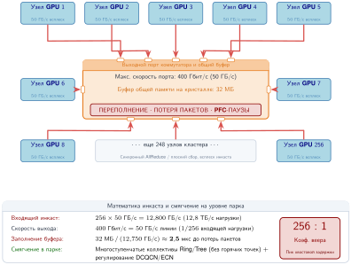

***Настоящий всплеск инкаста:** этот намеренно наихудший сценарий «веера» отправляет 256 источников по 50 ГБ/с на один выходной порт с пропускной способностью 400 Гбит/с (50 ГБ/с) и буфером 32 МБ. Нагрузка 12,8 ТБ/с перенасыщает выход получателя в 256 раз. Плоская агрегация или синхронизированные чтения могут создать такой шаблон; оптимальное по пропускной способности кольцевое AllReduce — нет, потому что каждый ранг обменивается фрагментами «точка-точка».*

Производственный инцидент показывает, как этот каскад может заморозить кластер.

> **Случай из практики: тупик PFC в Microsoft (2016)**
>
> **Контекст**: команда под руководством Chuanxiong Guo из Microsoft Research развернула RoCEv2 в дата-центрах Microsoft — флоте масштаба десятков тысяч серверов — для поддержки чувствительных к задержке сервисов. Их проект обеспечивал фабрику без потерь с PFC, а команда разработала механизм PFC на основе DSCP, чтобы расширить развертывание за границы VLAN (Guo et al., 2016).
>
> **Механизм**: PFC взаимодействовал с лавинной рассылкой Ethernet и создал циклическую зависимость буферов. Мертвый сервер с неполной таблицей соответствий между IP-адресом и MAC-адресом заставил восходящие коммутаторы рассылать пакеты без потерь на все порты. Кадры PAUSE PFC затем распространились вверх в ответ на затопленный трафик и сформировали замкнутый контур приостановленных буферов.
>
> **Последствия**: трафик полностью остановился по всему кластеру, прекратилась вся межузловая связь, и весь флот перестал отвечать.
>
> **Исправление**: Microsoft запретила широковещательному и многоадресному трафику попадать в классы трафика без потерь и отбрасывала пакеты без потерь, если соответствующая запись ARP была неполной, вместо того чтобы переходить к лавинной рассылке.
>
> **Системный урок**: распространение перегрузки PFC — структурная уязвимость Ethernet без потерь в гиперскейле. Фабрикам RoCE нужны дисциплина классов пакетов, телеметрия пауз PFC и аппаратные защитные механизмы, потому что средство, созданное для предотвращения потерь пакетов, само может стать причиной отказа. Фабрики обучения ML на RoCE наследуют этот риск напрямую: одна устаревшая запись ARP может перерасти в шторм PFC, который останавливает обучение на многих тысячах GPU, а кластер при этом выглядит здоровым, хотя градиенты между воркерами не передаются.

Расчет экспозиции компонентов показывает, как часто кластер должен ожидать хотя бы один деградировавший трансивер; сам по себе он не оценивает вероятность шторма PFC.

> **Сценарий: вероятность деградации хотя бы одного трансивера**
>
> **Задача**: в эксплуатации находится RoCE-кластер из 4 096 GPU. Если вероятность деградации каждого трансивера составляет 0,001 % в сутки, какова вероятность того, что в данный день деградирует хотя бы один трансивер?
>
> **Расчет**: предполагаем независимые события деградации трансиверов с одинаковой вероятностью для каждого устройства.
>
> 1. **Общая экспозиция**: 4 096 $\times$ 3 уровня связи = 12 288 линков, или 24 576 трансиверов.
> 2. **Вероятность отсутствия деградаций**: $\Pr(\text{нет деградации}) = (1 - 0{,}00001)^{24\,576} \approx 0{,}782$.
> 3. **Вероятность хотя бы одной деградации**: $\Pr(\text{хотя бы одна деградация}) = 1 - 0{,}782 = \mathbf{0{,}218}$ (около 21,8 %).
>
> **Системный вывод**: при этих предположениях большой RoCE-кластер имеет ежедневный шанс 21,8 % на хотя бы один деградировавший трансивер. Этот результат обосновывает аппаратную телеметрию и автоматизированное устранение неполадок, но для оценки риска остановки всей фабрики дополнительно нужна условная вероятность того, что деградация запустит и распространит шторм PFC.

#### Опасности фабрики без потерь: циклические тупики, штормы и восстановление по сторожевому таймеру

Хотя управление потоком PFC создает иллюзию физического уровня без потерь, опора на обратное давление канального уровня вводит структурные режимы отказа, которых нет в сетях, устойчивых к потерям. Когда очереди коммутаторов не могут отбрасывать пакеты, чтобы снять перегрузку, давление распространяется назад по графу сети и создает два различных отказа гиперскейла: **кредитные тупики** и **штормы PFC**.

> **Определение: кредитный тупик PFC и циклическая зависимость буферов**
>
> ***Кредитный тупик PFC*** — это постоянная распределенная блокировка, при которой набор очередей портов коммутатора образует замкнутый цикл зависимостей: каждая очередь держит пакеты, предназначенные для следующей очереди, и одновременно приостановлена обратным давлением от той же очереди.
>
> 1. **Значение**: один кредитный тупик навсегда останавливает трафик на всех участвующих портах и восходящих линках. Для восстановления нужно вмешательство человека или тайм-аут сторожевого таймера, который отбрасывает пакеты.
> 2. **Отличие**: в отличие от шторма PFC (переходного каскада обратного давления, вызванного медленным приемником), кредитный тупик — это статичный самоподдерживающийся топологический цикл, который не разрешится сам даже после прекращения инъекции трафика.
> 3. **Типичная ошибка**: предположение, что многоступенчатые фабрики Clos (fat-tree) по своей природе не подвержены тупикам. Динамическая многопутевая маршрутизация, отказы линков и лавинная рассылка адресов могут создать циклические зависимости пересылки между ярусами коммутаторов.

##### Механика графа кредитных тупиков

В сети без потерь коммутатор не может переслать пакет в нижестоящий буфер $B_j$, если $B_j$ заполнен. Вместо этого он удерживает пакет в восходящем буфере $B_i$ и ждет освобождения кредита или снятия паузы. Направленный **граф зависимостей буферов** $G = (V, E)$ формализует эту связь:

- Каждая вершина $B_k \in V$ представляет пакетный буфер или очередь виртуального канала на порту коммутатора.
- Направленное ребро $(B_i, B_j) \in E$ существует, если пакет, находящийся сейчас в буфере $B_i$, требует буфер $B_j$ на своем пути маршрутизации, чтобы продвинуться вперед.

Кредитный тупик PFC (определение «кредитный тупик PFC») возникает тогда и только тогда, когда граф зависимостей буферов содержит направленный цикл, как задано условием циклической зависимости ниже:

$$B_1 \to B_2 \to \dots \to B_k \to B_1$$

Когда каждый буфер цикла заполняется выше своего настроенного порога паузы, каждый порт отправляет предшественнику кадр PAUSE PFC. Поскольку ни один буфер не может передать пакет в приостановленный преемник, ни один буфер не может опустошиться, и ни один порт не может снять свой сигнал PAUSE. Весь цикл замирает навсегда.

В производственных ИИ-фабриках тупики обычно возникают из трех эксплуатационных триггеров:

1. **Переходные маршрутные петли**: во время отказа линка или сходимости BGP таблицы маршрутизации соседних коммутаторов могут временно расходиться, и пакеты начинают ходить по многоходовой петле пересылки. При ненадежной IP-маршрутизации такие пакеты крутятся, пока не истечет их TTL, и тогда их отбрасывают. При PFC без потерь петля мгновенно заполняет буферы коммутаторов и запирает весь путь в неустранимый кредитный цикл.
2. **Многоадресная и широковещательная рассылка**: как показал гиперскейловый инцидент Microsoft (исторический случай «тупик PFC в Microsoft»), запросы разрешения адресов или неизвестные одноадресные пакеты, размноженные на все порты, могут переполнить буферы выхода и заставить кадры PAUSE зациклиться обратно в общую память коммутатора.
3. **Непдревовидные физические линки и пути отказоустойчивости**: перекрестные соединения между листовыми коммутаторами или асимметричные пути отказоустойчивости могут нарушать строгие правила иерархической маршрутизации и создавать циклы между ярусами коммутаторов.

##### Штормы PFC и потоки-жертвы

В отличие от статичного топологического цикла, **шторм PFC** — это динамическое, неуправляемо нарастающее явление. Один «медленный приемник» — ускоритель, который остановился из-за насыщения шины памяти, вытеснения операционной системой или деградировавшего трансивера с повышенной частотой битовых ошибок, — не может забирать пакеты с полной скоростью линка.

Очередь подключенного коммутатора верхнего уровня стойки (ToR) заполняется и отправляет отправителю кадр PAUSE. Поскольку многопортовые коммутаторы объединяют трафик от многих источников в общих пакетных буферах, приостановленная очередь блокирует выделение буферов для не связанных с ней пакетов (блокировка головы очереди). Затем листовые коммутаторы верхнего яруса заполняют свои буферы и отправляют кадры PAUSE всем подключенным спайн-коммутаторам. За десятки миллисекунд кадры PAUSE каскадом распространяются по всей многоярусной фабрике и приостанавливают трафик между парами узлов, которые никогда не общались с исходным остановившимся воркером. Такие пострадавшие потоки называются **потоками-жертвами**.

##### Восстановление по сторожевому таймеру и альтернатива с потерями

Чтобы восстановиться после тупиков без перезагрузки физических коммутаторов, современные операционные системы Ethernet-коммутаторов реализуют **сторожевые таймеры PFC**:

- **Обнаружение**: коммутатор непрерывно отслеживает длительность активных состояний PAUSE на каждой очереди. Если очередь остается приостановленной дольше настроенного порога $T_{\text{watchdog}}$ (обычно $50\text{--}200\text{ мс}$), коммутатор объявляет аномалию тупика или медленного приемника.
- **Смягчение**: сторожевой таймер срабатывает, отключает PFC для этой очереди и опустошает буфер, **отбрасывая пакеты**, пока очередь не освободится.
- **Системный компромисс**: сторожевые таймеры успешно разрывают циклы тупиков, но превращение трафика без потерь в потерю пакетов заставляет транспортный уровень запускать восстановление. В развертываниях RoCEv2 с восстановлением Go-Back-N отброшенный пакет делает недействительными все последующие пакеты в полете и вызывает тайм-ауты повторной передачи, которые останавливают синхронное коллективное AllReduce на десятки миллисекунд.

Эта системная хрупкость подталкивает операторы гиперскейла к архитектурам следующего поколения, таким как Ultra Ethernet Consortium (UEC) (Ultra Ethernet Consortium, 2025) (см. раздел [сближение протоколов](#sec-network-fabrics-protocol-convergence)), и к RDMA-дизайнам, устойчивым к потерям (Mittal et al., 2018). Сочетая распыление пакетов по всем многопутевым линкам с обрезкой пакетов на полной скорости линии и аппаратно ускоренной выборочной повторной передачей, современные фабрики полностью отказываются от PFC на канальном уровне и предотвращают тупики и штормы по построению.

### Упреждающее управление перегрузкой: DCQCN и HPCC

Чтобы не прибегать к грубому инструменту пауз PFC, высокопроизводительные фабрики опираются на упреждающее управление перегрузкой, которое регулирует скорость инжекции до того, как буферы переполнятся. В рабочих нагрузках BSP упреждающее управление — это *требование к задержке*, а не *необязательная оптимизация пропускной способности*. Если один пакет задерживается в перегруженной очереди коммутатора, весь кластер ждет, пока отстающий завершит шаг синхронизации. Хвостовая задержка сети фактически становится средним временем шага обучения.

Первое широко развернутое решение, **DCQCN**,[^fn-dcqcn-roce-congestion] работает как реактивная петля обратной связи на основе ECN (Zhu et al., 2015). Когда глубина очереди коммутатора превышает настроенный порог, он помечает бит ECN в заголовке пакета. Получатель возвращает эту метку отправителю в пакете уведомления о перегрузке (CNP), и отправитель снижает скорость инжекции по алгоритму мультипликативного уменьшения. DCQCN широко поддерживается, но производственные коллективные операции ИИ выявляют проблему настройки: пороги ECN и поведение прошивки сетевой карты могут уравновешивать предотвращение PFC, пропускную способность, наблюдаемость и хвостовую задержку, а не предлагать одного стабильного оптимума (Gangidi et al., 2024).

Более точная альтернатива, **HPCC**,[^fn-hpcc-telemetry-congestion] устраняет эту непрозрачность за счет телеметрии в сети (INT) (Li et al., 2019). Вместо простой битовой метки коммутаторы добавляют в заголовок каждого пакета точные метаданные: текущую глубину очереди, загрузку линка и временные метки. Отправитель получает полную «приборную панель» состояния сети и может рассчитать точную допустимую скорость передачи в пределах одного времени кругового пути (RTT). Реакция на точную телеметрию, а не на двоичные сигналы, позволяет HPCC уменьшить накопление очередей и разброс хвостовой задержки в оцениваемых рабочих нагрузках с массовым инкастом. Главный компромисс — аппаратная поддержка: DCQCN работает на стандартных коммутаторах Ethernet с поддержкой ECN, тогда как HPCC требует программируемых коммутаторов, способных добавлять метаданные INT на полной скорости линии.

[^fn-dcqcn-roce-congestion]: **DCQCN (Data Center Quantized Congestion Notification)**: представлен Zhu et al. (2015) из Microsoft и Mellanox на SIGCOMM 2015 для крупномасштабных фабрик RDMA. Его двоичная петля обратной связи ECN/CNP проще в развертывании, чем схемы с богатой телеметрией. Однако она создает сложную поверхность настройки для коллективных операций обучения: развертывание RoCE в Meta в 2024 году показало, что агрессивная маркировка ECN уменьшает паузы PFC, но ухудшает время завершения коллективной операции (Gangidi et al., 2024).

[^fn-hpcc-telemetry-congestion]: **HPCC (High Precision Congestion Control)**: представлен Li et al. (2019) из Alibaba на SIGCOMM 2019. HPCC заменяет двоичный ECN телеметрией в сети (INT) для каждого пакета, позволяя отправителям менять скорость инжекции в пределах одного RTT и предотвращать накопление очереди инкаста. Системный компромисс — зависимость от аппаратуры: нужны программируемые ASIC коммутаторов, способные добавлять метаданные INT на полной скорости линии.

### Адаптивная маршрутизация

Статические протоколы маршрутизации, такие как ECMP[^fn-ecmp-flow-hashing], распределяют трафик, хешируя заголовки потоков по фиксированным путям. Такой подход хорошо работает для многих мелких потоков, но может создать постоянные коллизии между малым числом крупных «слоновых» потоков, типичных для обучения ML. Рассмотрим сценарий с 4 путями равной стоимости и 8 большими градиентными потоками. Равномерное распределение поместило бы по 2 потока на каждый линк. Статическое хеширование может вместо этого поместить 4 потока на один линк, пока другой простаивает. В синхронизированном шаге обучения перегруженный линк определяет время завершения и в этом сценарии может вдвое уменьшить полезную пропускную способность.

[^fn-ecmp-flow-hashing]: **ECMP (equal-cost multi-path)**: ECMP выбирает путь, хешируя 5-кортеж (IP-адрес источника и назначения, порт источника и назначения, протокол), поэтому один и тот же поток всегда идет по одному пути. Такой детерминизм полезен для порядка пакетов, но является слабым местом для ML. Поскольку одно кольцо AllReduce создает небольшое число постоянных потоков, коллизии хешей — это не случайные статистические события, а постоянные горячие точки, которые держатся на протяжении всего обучения.

Адаптивная маршрутизация решает эту проблему, позволяя коммутаторам динамически выбирать выходной порт по глубине очереди в реальном времени, а не по статическому хешу. Реализация зависит от протокола: фабрики InfiniBand выполняют адаптивную маршрутизацию на уровне пакетов, распыляя[^fn-packet-spraying-routing] отдельные пакеты по всем доступным линкам, потому что аппаратный транспорт гарантирует доставку в порядке получения.

[^fn-packet-spraying-routing]: **Распыление пакетов**: в отличие от стандартного Ethernet (который хеширует потоки на отдельные пути, чтобы избежать перестановки пакетов), распыление пакетов отправляет отдельные пакеты одного потока по нескольким путям. Это может улучшить $\text{BW}_{\text{bisect}}$ для крупных потоков AllReduce, если транспорт может терпеть перестановку или восстанавливать порядок. Спецификация Ultra Ethernet Consortium (UEC) явно включает многопутевое распыление пакетов и гибкий порядок, чтобы снизить проблему коллизий ECMP для трафика AI/HPC (Ultra Ethernet Consortium, 2025).

Ethernet-фабрики обычно используют **переключение по флоулетам**: перенаправление пачек пакетов только тогда, когда обнаружен достаточный временной разрыв, чтобы избежать штрафов за перестановку пакетов. Этот механизм становится необходимым для моделей MoE. В отличие от предсказуемого шаблона кольцевого AllReduce, модели MoE используют AllToAll-обмен между рангами в группе параллелизма экспертов. Плотный обмен между 64 рангами параллелизма экспертов содержит не более $64(64-1)=4\,032$ направленных удаленных пар рангов после исключения собственных передач; фактический активный трафик зависит от размещения экспертов и разреженности маршрутизации токенов. При статическом ECMP коллизии между этими потоками могут создать отстающих, поэтому адаптивная маршрутизация помогает распределить трафик по $\text{BW}_{\text{bisect}}$ фабрики.

### Проблема инкаста в ML

Управление перегрузкой и адаптивная маршрутизация справляются с потоками, которые проходят внутри фабрики. Другой режим отказа возникает на границе, где шаблон трафика сам перегружает один порт, независимо от того, сколько емкости есть во внутренней части фабрики.

> **Определение: инкаст**
>
> ***Инкаст*** — это шаблон трафика кластера ML типа «многие к одному», при котором большое число отправителей одновременно передает данные одному приемному порту. Это концентрирует трафик с полной скоростью линии от нескольких источников в одной очереди коммутатора и вызывает переполнение буфера, даже когда остальная фабрика не перегружена.
>
> 1. **Значение**: агрегация «плоским» способом, синхронизированное чтение из хранилища или другие фазы веера могут направить многих отправителей к одному получателю. В намеренно наихудшем сценарии здесь 256 отправителей передают по 50 ГБ/с в один выход коммутатора, создавая 12,8 ТБ/с предлагаемой нагрузки при порте 400 Гбит/с. Буфер 32 МБ затем переполняется примерно за 2,5 мкс при принятых допущениях. Пример служит оценкой по наихудшему случаю, а не матрицей трафика кольцевого AllReduce.
> 2. **Отличие**: в отличие от общей перегрузки (которая возникает на общих внутренних линках, когда совокупный трафик превышает емкость линка), инкаст — это узкое место на конечной точке. Он возникает, даже если каждый внутренний спайн- и листовой линк полностью свободен, потому что узкое место — единственный порт назначения, а не внутренность фабрики.
> 3. **Типичная ошибка**: инкаст не обязательно редок или непредсказуем. Синхронизированное обучение может порождать повторяющиеся всплески, когда градиентные коллективные операции начинаются во время обратного прохода. Степень тяжести зависит от алгоритма коллективной операции, топологии, маршрутизации и перенасыщения, поэтому его нужно измерять и смягчать, а не считать краевым случаем.

Расчет инкаста также показывает конечный буферный механизм перегрузки. Пусть совокупная скорость поступления в один выход равна $\lambda$, скорость обслуживания выхода равна $\mu$, а мгновенная заполненность очереди равна $Q(t)$. Пока всплеск продолжается и $\lambda > \mu$, очередь растет с чистой скоростью

$$
Q(t) = \min\!\left(B,\; Q(0) + (\lambda-\mu)t\right),
$$

где $B$ — конечная емкость буфера. Отношение $\rho=\lambda/\mu$ отличает рабочую нагрузку, которую можно «осушить», от устойчивой перегрузки: при $\rho<1$ интервалы простоя могут осушить очередь; по мере того как долгосрочное $\rho$ приближается к единице, остается меньше запаса для поглощения всплесков; а при $\rho>1$ заполненность должна дойти до порога управления или предела буфера, если перегрузка сохраняется. Это пакетная очередь, отличная от очередей запросов, разобранных в главе «Инференс в масштабе». Сериализация и распространение задают задержку пути без нагрузки, тогда как байты в очереди добавляют примерно $Q/\mu$ времени ожидания.

В описанном выше наихудшем инкасте $\rho$ равно 256×, поэтому буфер 32 МБ заполняется примерно за 2,5 мкс. Заполнившись, этот буфер представляет 640 мкс времени ожидания на выходе. Для сравнения, **произведение пропускной способности на задержку** для выхода 400 Гбит/с и иллюстративного кругового пути обратной связи 5 мкс составляет всего 250 КБ: оно измеряет данные в полете по пути, а не буферизацию, нужную для поглощения произвольного всплеска веера. ECN должен пометить пакеты достаточно рано, чтобы обратная связь пришла до исчерпания буфера; PFC может предотвратить потерю, но его обратное давление может распространить перегрузку. Больший буфер расширяет окно реакции ценой большей границы хвостовой задержки.

Синхронизированный трафик ML чувствителен и к истинному веерному входу, и к горячим точкам на общем выходе. Когда слой завершает обратный проход, многие ранги могут одновременно начать отправку трафика. Кольцевое AllReduce распределяет фрагменты «точка-точка», а не нацеливается на один логический получатель, но его одновременные потоки все равно могут сойтись на перенасыщенном порту коммутатора из-за размещения или маршрутизации. Плоские или иерархические фазы агрегации могут создать истинный веер. Производственные кластеры смягчают оба случая с помощью трех взаимодополняющих приемов:

- **Сдвиг слоев во времени**: запускайте AllReduce для каждого градиентного бакета сразу, как только обратное распространение его создает. Градиенты последнего слоя редуцируются, пока более ранние слои еще вычисляются, поэтому коммуникация растянута во времени, а не выпускается одним всплеском.
- **Выбор алгоритма**: выбирайте коллективные операции, которые ограничивают веер в любом одном порту. Иерархические и редукции внутри рельса агрегируют градиенты по ступеням, так что ни один порт коммутатора не должен принять всех отправителей сразу, в отличие от плоской редукции, где каждый узел нацелен на одну точку агрегации. Оптимальное по пропускной способности кольцевое AllReduce само по себе работает «точка-точка» и не создает единой горячей точки агрегации; давление инкаста возникает, когда многие такие потоки сходятся на перенасыщенных портах, и его снимают размещение с учетом топологии и rail-оптимизированная разводка.
- **Классификация качества обслуживания (QoS)**: помечайте градиентный трафик самым высоким классом обслуживания, чтобы фоновый трафик хранилища или управления не задерживал путь синхронизации.

Вместе эти меры распределяют всплеск во времени, пространстве и приоритете, но не устраняют перегрузку и хвостовую задержку. Вопрос состоит в том, как построить сквозные кластеры, которые работают, несмотря на эти реалии.

## Уровень 5: проектирование кластера и практические примеры

Последний уровень стека — проектирование кластера, где провода, транспорт, топология и управление перегрузкой объединяются в связную систему. Цель проектирования кластера — сквозная «градиентная шина», которая делает тысячи распределенных GPU похожими на одну машину. На этом уровне слои абстракции сходятся в конкретные инженерные решения: какие кабели покупать, как разводить стойки, какой протокол внедрять и как проверять, что получившаяся фабрика дает ту пропускную способность, которую ожидает обучающая задача. Две репрезентативные крупномасштабные архитектуры, одна на InfiniBand и другая на Ethernet, иллюстрируют компромиссы, определяющие инфраструктуру ML (NVIDIA, 2023; Meta, 2024; Gangidi et al., 2024).

### «Градиентная шина» между GPU

В хорошо спроектированном кластере сетевая фабрика действует как расширение системной шины, которое учитывает планировщик, а не как пассивная труба. Пропускная способность внутри узла (NVLink) примерно в 9× выше, чем между узлами (InfiniBand/RoCE), и один из способов скрыть этот обрыв — **перекрытие коммуникации и вычислений**. Во время обратного прохода градиенты последних слоев вычисляются первыми. Вместо того чтобы ждать завершения всего обратного прохода, система может запустить асинхронное AllReduce для этих градиентов, пока GPU продолжают вычислять градиенты для более ранних слоев. Если обратный проход требует 500 мс вычислений, а AllReduce занимает 300 мс, идеальное перекрытие могло бы спрятать стоимость коммуникации за вычислениями и снизить открытые накладные расходы до $\max(0, 300 - 500) = 0$. На практике цепочки зависимостей и конкуренция за ресурсы ограничивают перекрытие и оставляют **проблему последней мили**: градиенты, вычисленные ближе к концу обратного распространения, почти не имеют последующих вычислений, за которыми можно спрятать время их передачи.

Иерархия пропускной способности, показанная на [рисунке](#fig-bandwidth-hierarchy), определяет стратегию параллелизма, которая смягчает этот обрыв. Тензорный параллелизм, которому нужна огромная пропускная способность для частых обменов активациями, ограничен доменом NVLink внутри узла. Конвейерный параллелизм, в котором активации передаются «точка-точка» между стадиями конвейера, проходит по линкам InfiniBand между узлами. Параллелизм данных, терпимый к меньшей пропускной способности благодаря накоплению градиентов и перекрытию, растягивается по всей фабрике.

### Практический пример: NVIDIA DGX SuperPOD

Архитектура NVIDIA DGX SuperPOD соединяет узлы DGX H100 сетью NDR InfiniBand и служит конкретной реализацией концепции градиентной шины (NVIDIA, 2023). Каждый узел — это плотный вычислительный «остров»: восемь GPU H100 соединены через NVSwitch и дают 900 ГБ/с внутренней пропускной способности. Во внешний мир каждый GPU связан с сетевой картой ConnectX-7, которая обеспечивает 400 Гбит/с инжекционной пропускной способности. По стандартной масштабируемой единице из 32 узла (256 GPU) это дает совокупную инжекционную пропускную способность 12,8 ТБ/с (256 $\times$ 50 ГБ/с), так что фабрика может принимать градиенты так же быстро, как их производят ускорители.

Эта архитектура явно воплощает пятиуровневую модель сети. На уровне 1 она минимизирует задержку, используя кабели прямого подключения (DAC) внутри стойки и активные оптические кабели только для спайн-соединений. На уровне 2 она опирается на кредитное управление потоком InfiniBand, чтобы гарантировать среду без потерь без хрупкости PFC в Ethernet. Уровень 3 реализует rail-оптимизированное дерево fat-tree: rails GPU выровнены по масштабируемой единице, поэтому трафик того же rail остается близко, а трафик между rails проходит через спайн-слой. На уровне 4 аппаратная адаптивная маршрутизация может выбирать среди спайн-путей, чтобы улучшить поведение бисекции для коммуникации между рангами. На уровне 5 дизайн модульный: несколько масштабируемых единиц SuperPOD соединяются через дополнительную коммутацию и образуют большие кластеры (NVIDIA, 2023). Для модели с 175 млрд параметров физическая инфраструктура состояла бы примерно из четырех соединенных масштабируемых единиц SuperPOD, что позволило бы примерно 1 024 GPU работать как один синхронный инструмент.

### Практический пример: Meta Grand Teton

Meta раскрыла два кластера на основе Grand Teton по 24 576 H100: один использует RoCE поверх фабрики Arista/OCP Ethernet, другой — NVIDIA Quantum-2 InfiniBand, оба с конечными точками 400 Гбит/с. Meta использовала оба для обучения Llama 3 и сообщила о продолжающемся обучении Llama 3 на кластере RoCE (Meta, 2024). Основная причина выбора Ethernet — эксплуатационный масштаб и устойчивость цепочки поставок: благодаря Ethernet Meta может закупать коммутаторы у нескольких поставщиков и использовать ту же оптическую инфраструктуру и инструменты управления, что и её фронтенд-парк сервисов обслуживания, избегая операционной изоляции выделенного острова InfiniBand.

Делать Ethernet работоспособным как выделенную HPC-фабрику при таком масштабе требует значительной инженерной работы на уровне 4. Исследование RoCE в Meta описывает сторожевые таймеры PFC для длительных событий паузы, итеративные схемы маршрутизации сверх простого ECMP, экспериментальное переключение по флоулетам и опыт развертывания 400G, в котором настройка DCQCN оказалась настолько сложной, что Meta продолжила работу без DCQCN, опираясь на PFC и коллективные средства управления верхнего уровня (Gangidi et al., 2024). Хотя эта архитектура достигает высокой пропускной способности линии для больших градиентных передач, она принимает компромисс: задержка для мелких сообщений может оставаться выше, чем у InfiniBand, потому что развертывания RoCE опираются на буферизацию Ethernet, QoS, настройку PFC/ECN/DCQCN, политику маршрутизации и выбор реализации коммутатора и сетевой карты, а не на нативную кредитную семантику фабрики InfiniBand. Для гигантских моделей, где доминирует пропускная способность, это приемлемый обмен; для чувствительной к задержке маршрутизации MoE штраф требует тщательной алгоритмической компенсации.

> **Перспектива: InfiniBand против RoCE: вердикт индустрии**
>
> Сосуществование InfiniBand (NVIDIA DGX SuperPOD) и RoCE (Meta Grand Teton, Google) в производстве отражает реальный компромисс, а не очевидного победителя. InfiniBand может обеспечить более низкую хвостовую задержку и более простую конфигурацию без потерь. RoCE может обеспечить более низкую стоимость коммутаторов и многовендорную гибкость. Для *обучающих запусков*, где время итерации измеряется секундами, разница в задержке часто теряется в шуме. Для *обслуживания инференса* с жесткими целевыми уровнями обслуживания (SLO) разница в задержке может иметь значение.
>
> Пространство решений сходится. Коммутаторы Ethernet NVIDIA Spectrum-4 включают адаптивную маршрутизацию и управление перегрузкой, вдохновленные InfiniBand. Чипы Broadcom Memory DCS добавляют аппаратную поддержку коммутации, оптимизированной для RDMA. Различие между двумя экосистемами сужается, хотя и не исчезло.

Эти примеры завершают пятиуровневый стек, показывая, как физический провод, транспортный протокол, топология и управление перегрузкой становятся единой промышленной фабрикой. Оставшаяся эксплуатационная задача — не построить один быстрый кластер, а поделить дорогой субстрат между командами и рабочими нагрузками, не жертвуя предсказуемой производительностью, которой требует обучение.

## Виртуализация сети

Производственные кластеры ML редко предназначены для одной обучающей задачи, что создает серьезный экономический стимул к эффективной многоарендности. Суперкомпьютер за 300 млн долл., который простаивает на 30 % из-за невозможности безопасно изолировать параллельные рабочие нагрузки, означает потерю капитала на 90 млн долл. Чтобы вернуть эту полезность, сеть должна поддерживать виртуализацию по трем ортогональным измерениям: разделение пропускной способности (гарантия минимальной пропускной способности), детерминированность задержки (предотвращение блокировки головы очереди) и изоляцию безопасности (предотвращение подглядывания за памятью между арендаторами). Технологии вроде single-root I/O virtualization (SR-IOV) и виртуальных линий отделяют обучающую задачу от физического провода — примерно так же, как гипервизоры отделили операционную систему от процессора. Для модели на 175 млрд параметров это означает, что обучающая задача может надежно использовать 80 % $\text{BW}_{\text{bisect}}$ кластера, пока высокоприоритетный сервис инференса и фоновая задача предобработки данных делят оставшиеся 20 %, а фабрика обеспечивает жесткие границы, которые мешают пульсирующему трафику предобработки останавливать обновления градиентов.

### SR-IOV: аппаратная виртуализация сетевой карты

Облачные провайдеры могут предоставлять виртуализированным GPU-инстансам RDMA-производительность, близкую к bare metal, через **Single Root I/O Virtualization (SR-IOV)** — стандарт, который позволяет физической сетевой карте представляться как несколько независимых **виртуальных функций (VF)**. У каждой VF есть собственные аппаратные очереди, регистры doorbell и отображения DMA. Назначение выделенной VF каждой ВМ или контейнеру создает прямой аппаратный путь для операций DMA, который полностью обходит ядро хоста и гипервизор. Архитектура проброса важна для обучения ML, потому что при правильной настройке сетевой карты, гипервизора и политики размещения она может снизить накладные расходы виртуализации до нескольких процентов от bare metal. Последствие для управления кластером немедленное: VF становятся распределяемыми сетевыми ресурсами, поэтому логика размещения должна резервировать емкость сетевой карты и политику QoS наряду с GPU, а не рассматривать сеть как неограниченный общий пул.

Однако изоляция на аппаратном уровне все равно требует явной политики пропускной способности. SR-IOV предоставляет несколько VF, которые разделяют физические ресурсы сетевой карты; администраторы могут добавлять политики QoS для каждой VF или группы, чтобы ограничить или гарантировать пропускную способность, например назначив восемь VF по 50 Гбит/с на сетевой карте 400 Гбит/с. Для обучения модели на 175 млрд параметров на многоарендном кластере такое настроенное разделение может помешать соседнему арендатору отнимать пропускную способность, но оно также вводит жесткий потолок пиковой производительности. Обучающая задача должна быть спроектирована так, чтобы работать внутри этого среза, потому что никакая программная оптимизация не может вырваться за пределы настроенного лимита VF.

### Изоляция трафика и качество обслуживания

Рассмотрим сценарий наихудшей конкуренции на общем кластере: модель на 175 млрд параметров находится в середине чувствительной к задержке операции AllReduce, когда соседняя задача начинает массовое сохранение контрольной точки. Без строгой изоляции пульсирующая запись 100 ГБ (которая при полной скорости линии 400 Гбит/с занимает 2 секунды) может забить общие спайн-линки и создать очереди, которые увеличивают время AllReduce на 50 % и более. Чтобы предотвратить этот эффект «шумного соседа», высокопроизводительные фабрики опираются на механизмы **качества обслуживания (QoS)**, которые обеспечивают справедливость на уровне пакетов.

Основной инструмент — виртуальная линия (VL) в InfiniBand (или **класс трафика** в RoCE), которая предоставляет до 16 независимых логических каналов на одном физическом линке. Назначение разных типов трафика разным VL гарантирует, что насыщение в одной линии не блокирует продвижение в другой. Каждая VL поддерживает собственный независимый управляющий поток на основе кредитов: если трафик хранилища для контрольной точки заполняет свой буфер, коммутатор приостанавливает только эту конкретную линию. Градиентные обновления с высокоприоритетным уровнем обслуживания продолжают течь по своей зарезервированной линии без помех. На стороне Ethernet **расширенный выбор передачи** обеспечивает аналогичные гарантии пропускной способности для каждого класса трафика, а современные ASIC коммутаторов могут разделить таблицы пересылки и пулы буферов на изолированные **сетевые срезы**, гарантируя, что перегрузка в срезе одного арендатора не вызовет пауз PFC в срезе другого.

Виртуализация решает задачу совместного использования, но делает диагностику производительности сложнее. Когда обучающая задача замедляется в многоарендном кластере, причиной может быть деградация физического линка, шумный сосед, превысивший свое распределение пропускной способности, или неправильно настроенная политика QoS. Чтобы различать эти случаи, нужен систематический мониторинг.

## Мониторинг и отладка

Проблемы производительности сети в кластерах ML коварны, потому что проявляются как **скрытые потери**, а не как явные отказы. Деградировавший трансивер, снижающий эффективную пропускную способность на 10 %, может замедлять каждую итерацию обучения всего на 2–3 %, и такой дрейф легко маскируется естественной дисперсией контрольных точек или загрузки данных. За 30-дневный запуск обучения на 1 024 GPU этот невидимый сдвиг накапливается примерно до 15 000–22 000 потерянных GPU-часов и обходится примерно в 45 000–66 000 долл. при 3 долл./GPU-час, не вызывая ни одного сигнала тревоги. Традиционные ИТ-инструменты мониторинга, такие как SNMP или ICMP-ping, измеряют связность, а не устойчивую пропускную способность, которая нужна RDMA. Эффективная наблюдаемость требует трехуровневого подхода: **физический мониторинг** (ошибки FEC, ослабление сигнала), **транспортный мониторинг** (кадры паузы PFC, частота повторных передач) и **мониторинг приложения** (алгоритмическая пропускная способность NCCL) (Jeaugey, 2017; Gangidi et al., 2024). Только сопоставив сигналы на всех этих уровнях, операторы могут установить, что «медленный запуск обучения» вызван одним деградировавшим кабелем в одной стойке.

### Телеметрия на уровне линка

На физическом уровне аппаратные счетчики отвечают, ведет ли себя провод так, как предполагала модель. Каждая сетевая карта RDMA и каждый коммутатор ведут эти счетчики, доступные через утилиту `perfquery` (Linux man-pages, 2026). **PortXmitData** и **PortRcvData** считают данные единицами по четыре октета, поэтому расчеты утилизации умножают приращение каждого счетчика на четыре, чтобы получить байты. **PortXmitDiscards** отслеживает пакеты, отброшенные коммутатором: в правильно настроенной фабрике без потерь отбросы должны быть строго нулевыми. Целостность физического сигнала отслеживается через **SymbolErrorCounter**, который увеличивается при битовых ошибках из-за слабых кабелей или загрязненной оптики, и через **LinkDownedCounter**, который фиксирует «мигание» линка, часто вызванное прерывистыми аппаратными неисправностями или перегревом трансиверов.

Эти метрики обычно опрашивает централизованная система мониторинга (например, Prometheus с панелями Grafana) с интервалом 10–30 секунд, чтобы поймать **тихую деградацию**. Типичный сбой — кабель QSFP56, который согласовывается на скорости HDR (200 Гбит/с) вместо NDR (400 Гбит/с), или тихо переходит с 4 полос на 2 из-за одного плохого контакта разъема. Линк остается «поднятым» и работоспособным, но его пропускная способность вдвое меньше. В кластере из 1 024 GPU с более чем 3 000 линков мгновенная доля деградировавших компонентов 0,1 % означает примерно 3 деградировавших линка в ожидании, и с высокой вероятностью хотя бы один линк деградирован. Поскольку распределенные алгоритмы обучения вроде кольцевого AllReduce синхронны, один деградировавший линк сдерживает всю задачу до скорости этого отстающего, превращая незначительный аппаратный сбой в огромные потери простаивающих вычислительных циклов.

### Проверка пропускной способности и задержки

Когда счетчики исключают видимые ошибки линков, проверка должна измерить пропускную способность и задержку, которые может использовать обучающая задача. Здоровый линк NDR InfiniBand может приблизиться к сырой скорости 50 ГБ/с после кодирования и накладных расходов протокола, но полезно только число доставленной полезной пропускной способности для конкретной пары хостов. Операторы опираются на периодические проверки здоровья, часто запуская инструменты perftest, такие как `ib_write_bw`, между выбранными парами узлов, и собирают результаты в **матрицу пропускной способности всех пар** (linux-rdma, 2026). Эта тепловая карта сразу показывает холодные точки фабрики, где спайн-коммутаторы или пучки кабелей работают хуже, что позволяет провести точечное обслуживание до постановки задач в очередь.

Для чувствительной к задержке синхронизации `ib_write_lat` запускает тест «пинг-понг» с мелкими RDMA-записями и сообщает половину измеренного времени кругового пути как одностороннюю задержку. Базовая задержка NDR должна оставаться ниже 2 мкс для напрямую подключенных узлов. Задержки выше 5 мкс указывают на перегрузку буферов коммутатора или дисбаланс маршрутизации, а всплески выше 100 мкс свидетельствуют о серьезной проблеме пути, перегрузки или конфигурации, но не означают откат к TCP. Перед запуском большой обучающей задачи надежная проверка включает тесты уровня приложения, такие как `nccl-tests`, которые проверяют, выдерживает ли фабрика ожидаемую пропускную способность AllReduce на конкретной топологии коллективной операции (кольцо или дерево), которую использует задача. Это гарантирует, что физическая реальность сети совпадает с теоретическим проектом до выделения дорогих вычислительных ресурсов.

### Систематический порядок отладки

Когда обучающая задача показывает пропускную способность ниже ожидаемой, порядок диагностики должен сохранять послойную модель, а не начинаться с кабелей. Следующая последовательность переходит от симптомов приложения к физическим причинам:

1. **Проверьте загрузку GPU**: исключите узкие места вычислений с помощью `dcgmi` или `nvidia-smi`. Если загрузка SM составляет 100 %, сеть не является узким местом. Низкая загрузка, однако, сама по себе не указывает на фабрику: голодающий конвейер входных данных (загрузка данных или хранилище) дает тот же симптом, поэтому сначала убедитесь, что путь данных снабжает ускорители, и только потом исследуйте сеть.
2. **Изучите журналы NCCL**: установите `NCCL_DEBUG=INFO`, чтобы увидеть, какой сетевой транспорт выбран, обнаруженную пропускную способность между узлами и любые откаты на более медленные протоколы.
3. **Запустите тесты «точка-точка»**: используйте `ib_write_bw` между конкретными узлами задачи. Один деградировавший линк может стать узким местом всего кольца в кольцевом AllReduce.
4. **Проверьте счетчики PFC/ECN**: изучите счетчики коммутаторов вдоль пути. Устойчивая активность PFC указывает на постоянную перегрузку, которую нужно разбирать на уровне планировщика или маршрутизации.
5. **Проверьте физический уровень**: проверьте ошибки символов и счетчики CRC, чтобы найти неисправные трансиверы или кабели.

Последовательность диагностики сохраняет послойную модель главы: симптомы приложения указывают на неисправный путь, транспортные счетчики показывают, участвует ли перегрузка или откат, а физическая телеметрия подтверждает, деградирует ли сам провод.

> **Контрольные вопросы: диагностика замедления обучения**
>
> Ваша задача обучения модели на 175 млрд параметров работает уже 3 дня на 512 GPU. Вы замечаете, что время итерации постепенно выросло с 4,2 с до 4,8 с (замедление на 14 %). Утилизация GPU по данным `nvidia-smi` упала с 92 % до 85 %.
>
> - [ ] **Первая диагностика**: выберите первый шаг диагностики, назовите инструмент, который подтверждает, ограничена ли задача коммуникацией или вычислениями, и укажите данные, которые отличают одно от другого.
> - [ ] **Физический уровень**: назовите причины на физическом уровне, которые могут объяснить падение пропускной способности на 50 %, когда `ib_write_bw` находит одну пару узлов на 24 ГБ/с вместо ожидаемых 48 ГБ/с, и проверьте их по счетчикам коммутатора.
> - [ ] **Влияние на коллективную операцию**: оцените влияние на общее время AllReduce, если деградировавший линк лежит на пути кольцевого AllReduce, и определите, поможет ли переход на древовидный алгоритм AllReduce.

## Технологии, которые поднимают потолок

Мониторинг держит развернутые фабрики в честном состоянии, но наблюдаемость не может преодолеть физический потолок, к которому медь подходит при высоких скоростях сигнализации. Физический потолок, который показывает мониторинг, — причина, по которой новые фабрики заслуживают внимания: они важны только тогда, когда сдвигают границу, которую не может преодолеть синхронизирующий хребет. По мере того как кластеры растут к 100 000 узлов, долговременными проектными переменными становятся мощность на бит, дальность и соотношение вычислений, памяти и сетевой емкости, а не названия продуктов, связанные с конкретной дорожной картой.

### Сближение протоколов и плотность линков

Первая точка давления — надежность. Ultra Ethernet Consortium (UEC) отвечает на это ограничение, пытаясь заставить Ethernet вести себя больше как фабрика HPC, не унаследовав хрупкость PFC в RoCEv2. Его транспортный дизайн Ultra Ethernet сочетает распыление пакетов по нескольким путям, гибкий порядок, несколько служб транспортной доставки, изменения управления перегрузкой и телеметрию, предназначенную для трафика AI/HPC (Ultra Ethernet Consortium, 2025). Цель — сохранить вездесущность Ethernet и многовендорную экономику, одновременно приближая поведение при отказах к модели фабрики без потерь InfiniBand. Конкретные механизмы вроде обрезки пакетов или повторной передачи на канальном уровне — детали реализации этого более широкого направления, поэтому их нужно оценивать по тем же устойчивым критериям: может ли фабрика локально устранять перегрузку до того, как она станет отстающим для синхронного обучения.

Более высокие скорости портов атакуют и число переходов, и сырую пропускную способность. Порты XDR InfiniBand дают 800 Гбит/с, а дорожные карты Ethernet включают скорости 800GbE и 1.6TbE (NVIDIA, 2026; Ethernet Alliance, 2025). Кремний коммутаторов Ethernet с портами 1,6 Тбит/с доводит совокупную емкость до 102,4 Тбит/с в текущих конструкциях класса Tomahawk 6 (Broadcom, 2025). Один порт 1,6 Тбит/с обеспечивает пропускную способность 4 портов 400G. Возросшая плотность позволяет архитекторам уплощать топологию: кластер, который раньше требовал трех ярусов коммутаторов, может обслуживаться двумя, когда радикс, скорость портов и ограничения размещения совпадают. Это вдвое уменьшает число трансиверов и снижает хвостовую задержку, убирая целый переход коммутации и накладные расходы FEC.

### Оптические соединения

Оптические соединения решают проблемы мощности на бит и дальности, которые медь усугубляет по мере роста скорости передачи данных. На скорости 112 Гбит/с на полосу (сигнализация PAM-4, которую используют NVLink 4.0 и InfiniBand NDR) медные трансиверы SerDes потребляют примерно 7–10 пДж на бит и ограничены расстояниями 2–3 метра, за которыми целостность сигнала ухудшается настолько, что эквализация уже не восстанавливает данные.

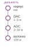

*С каждым метром фабрика уходит от меди к оптике.*

Класс 224 Гбит/с на полосу давит на медь еще сильнее. На скорости 224 Гбит/с энергопотребление SerDes примерно удваивается и достигает 15–20 пДж на бит, а дальность по пассивным медным кабелям сокращается до 1–1,5 метра. Активные электрические кабели (в которых есть микросхемы ретаймера, восстанавливающие сигнал в середине кабеля) расширяют дальность, но добавляют задержку и потребление энергии.

Совместно упакованная оптика (CPO) решает эти ограничения, интегрируя оптические трансиверы прямо в корпус коммутатора или ускорителя, вместо того чтобы размещать их на конце съемного кабельного модуля. В CPO кремний-фотонный чип находится на той же подложке корпуса, что и процессор, и преобразует электрические сигналы в свет на границе кристалла. Оптический сигнал затем идет по волокну со скоростью света, практически без затухания на расстояниях в десятки метров, и преобразуется обратно в электрический на принимающем корпусе.

CPO меняет бюджет линка тремя независимыми физическими эффектами:

- **Более короткий электрический путь**: перенос оптического трансивера с лицевой панели коммутатора на подложку корпуса сокращает путь от SerDes до оптики с сантиметров до миллиметров, снижая мощность, которую потребляет электрическая коррекция сигнала.
- **Пропускная способность, не зависящая от расстояния**: оптическое волокно не теряет пропускной способности с расстоянием на дистанциях, значимых для дата-центров, до 100 метров. Это устраняет ретаймеры и позволяет гибче размещать оборудование.
- **Более легкая кабельная система**: волокно легче и тоньше медных кабелей, что упрощает управление кабелями в плотных стойках.

Вместе эти эффекты сдвигают фабрику от компоновочной задачи, ограниченной медью, к задаче упаковки и энергопитания, ограниченной оптикой.

Быстрая оценка делает энергетический дивиденд конкретным.

> **Сценарий: оптический дивиденд**
>
> **Задача**: рассчитайте экономию мощности при переходе коммутатора на 51,2 Тбит/с с съемных трансиверов на совместно упакованную оптику.
>
> **Расчет**:
>
> 1. **Съемная архитектура**: 128 портов $\times$ 20 Вт = 2,56 кВт только на оптику.
> 2. **Архитектура CPO**: 128 оптических движков $\times$ 10 Вт = 1,28 кВт.
> 3. **Экономия**: экономия составляет 1,28 кВт мощности на коммутатор.
>
> **Системный вывод**: в кластере из 1 000 коммутаторов съемная оптика потребляет 2,56 МВт только на то, чтобы перемещать свет. CPO сокращает этот «сетевой налог» вдвое, экономя 1,28 МВт и перенаправляя мощность, достаточную для питания примерно 1 800 GPU H100. У стены $\text{BW}_{\text{bisect}}$ устойчивость — не выбор, а архитектурное требование, продиктованное тепловыми пределами лицевой панели.

Для кластера из 10 000 GPU устранение съемных модулей могло бы сэкономить больше мегаватта мощности, которую можно направить на вычисления. CPO также убирает трансивер как отдельный заменяемый в полевых условиях блок, устраняя распространенную точку механического отказа.

Для инфраструктуры ML CPO может уплостить иерархию пропускной способности, сузив разрыв между пропускной способностью внутри узла и между узлами. Если межузловые линки достигнут пропускной способности, сопоставимой с локальными фабриками класса NVLink (сотни ГБ/с на GPU), ограничение, которое заставляет тензорный параллелизм оставаться внутри одного узла, ослабнет. Это откроет новые стратегии параллелизма, в которых тензорный параллелизм растягивается на два–четыре узла, а не ограничивается одним узлом из 8 GPU, потенциально улучшая эффективность масштабирования для больших моделей.

Дорожная карта продуктов менее устойчива, чем ограничение, которое она иллюстрирует: по мере роста скорости линков оптика приближается к кремнию, чтобы контролировать мощность и дальность. Продукты, которые интегрируют оптику в корпуса коммутаторов или ускорителей, — конкретные попытки платить меньше мощности и задержки за то же физическое расстояние. Успех конкретного поколения продукта менее важен, чем системное направление: электрический путь сокращается, оптический путь начинается ближе к кристаллу, а тепловой режим корпуса становится частью проектирования сети.

Однако CPO приносит новые проблемы. Оптические компоненты чувствительны к температуре (длина волны лазера смещается с температурой, поэтому нужно активное термоуправление), а интеграция фотоники в один корпус с GPU мощностью 1 000 Вт создает враждебную тепловую среду для оптических компонентов. Производственные процессы для кремниевой фотоники и CMOS-транзисторов похожи, но не идентичны, и требуют отдельных этапов изготовления, которые увеличивают стоимость и сложность корпуса. Эти проблемы решаются гибридной интеграцией, при которой фотонный чиплет размещается на более прохладной области подложки корпуса, термически изолированно от кристалла GPU.

### Разобщенные и компонуемые архитектуры

Обычный узел объединяет фиксированное соотношение вычислений, памяти и сетевых ресурсов. Глава «Вычислительная инфраструктура» (раздел о CXL) объяснила, почему такое соотношение расточительно, когда одной рабочей нагрузке нужно больше памяти на GPU, а другой — больше сетевой пропускной способности: пулинг памяти Compute Express Link (CXL) позволяет процессору в одном шасси обращаться к памяти в другом с семантикой загрузки и сохранения, а разобщенные архитектуры разделяют вычисления, память и сеть на независимо компонуемые пулы. Последствия для фабрики формируют иерархию межсоединений. Когда пулинг памяти и компоновка ресурсов пересекают границу узла, жесткое различие между доменами NVLink внутри узла и доменами InfiniBand между узлами размывается в единую память-фабрику, а хребет синхронизации переходит от фиксированной границы узла к компонуемой.

Этот сдвиг не отменяет физических ограничений высокоскоростных межсоединений. Составной виртуальный узел по-прежнему платит те же $\alpha$-$\beta$ издержки за каждый доступ через границу пула, те же ограничения мощности на бит на линках, которые его переносят, и те же требования наблюдаемости, которые не дают перегруженному пути маскироваться под медленные ускорители. Системный урок — перенос накладных расходов: разобщение перемещает хребет синхронизации, но не устраняет его. Работает ли компонуемая фабрика, определяют те же свойства фабрики, которые определяют, работает ли фабрика с фиксированными узлами.

## Заблуждения и ошибки

Проектирование и эксплуатация высокопроизводительных фабрик для ML требуют отказа от предположений, унаследованных из традиционных сетей дата-центров. Ниже перечислены наиболее распространенные заблуждения и ошибки, которые останавливают обучение и снижают производительность кластера.

**Заблуждение**: *больше пропускной способности всегда означает более быстрое обучение.*

Инженеры ожидают, что переход с HDR (200 Гбит/с) на NDR (400 Гбит/с) даст пропорциональный выигрыш, но модель $\alpha$-$\beta$ (см. [модель производительности](#sec-network-fabrics-performance-model)) показывает, что это верно только в режиме, где доминирует пропускная способность. Для малых моделей или фаз мелких сообщений конвейерного параллелизма член задержки $\alpha$, определяемый переходами через коммутаторы и FEC (~1 $\mu\text{s}$), задает производительность. Если рабочая нагрузка ограничена задержкой, удвоение скорости линка может дать лишь малую долю выигрыша по линии, добавляя при этом значительную стоимость мощности и трансиверов.

10 КБ-сообщение (типичное для синхронизации управления) на 200 Гбит/с InfiniBand занимает 1,90 мкс. Переход на 400 Гбит/с сокращает это время до 1,70 мкс, то есть улучшение всего на 10,5 %, несмотря на удвоение скорости линка.

**Ошибка**: *считать InfiniBand просто быстрым Ethernet.*

Закупщики сравнивают InfiniBand и высокоскоростной Ethernet только по скорости линка и делают вывод, что при одинаковых Гбит/с они эквивалентны. Значимое сравнение — между полными транспортными стеками, а не между InfiniBand и TCP. InfiniBand обеспечивает RDMA в обход ядра поверх фабрики с кредитным управлением; RoCE тоже обеспечивает RDMA в обход ядра, но передает его по Ethernet и переносит больше контракта надежной доставки, управления перегрузкой и маршрутизации в поведение сетевой карты и конфигурацию фабрики. PFC и ECN — распространенные части этого контракта, хотя конструкции RoCE без PFC выбирают другой баланс восстановления после потерь (Mittal et al., 2018). Классический TCP в ядре — третья точка проектирования с другими затратами CPU и восстановления. Поэтому архитектурное решение определяет, где находится состояние управления потоком и эксплуатационный риск, даже когда номинальные скорости линков совпадают.

**Заблуждение**: *Ethernet без потерь так же надежен, как InfiniBand.*

RoCE поверх Ethernet может обеспечивать для больших передач пропускную способность, сопоставимую с InfiniBand, но работа без потерь зависит от конфигурации и взаимодействия PFC, ECN, маршрутизации, буферов и поведения сетевой карты (см. [раздел о PFC](#sec-network-fabrics-pfc)). Петля пересылки, циклическая зависимость буферов или дефект прошивки могут вызвать **шторм PFC**, при котором кадры PAUSE распространяются за пределы исходной очереди. Кредитное управление InfiniBand на каждом переходе устраняет именно эту реактивную каскадную волну кадров PAUSE, но фабрике все равно нужны маршрутизация без тупиков, корректная конфигурация виртуальных линий и управление перегрузкой (InfiniBand Trade Association, 2000). Обе фабрики требуют проверки и телеметрии; RoCE добавляет особую чувствительность к конфигурации «без потерь» в Ethernet.

**Ошибка**: *принимать перенасыщение, потому что большая часть трафика локальна.*

В общих облаках на спайн-уровне обычны перенасыщения 4:1 или 8:1, потому что трафик стохастичен. Синхронное обучение ML, напротив, может создавать скоординированные всплески трафика, когда начинаются коллективные операции. Как показано в анализе узкого места бисекции ([раздел о fat-tree](#sec-network-fabrics-fat-tree)), перенасыщение 4:1 замедляет смоделированную синхронизацию в 4×. Для кластера стоимостью 300 млн долл., где синхронизация занимает 30 % времени, такой сценарий теряет более 142,1 млн долл. в простаивающих циклах GPU.

**Заблуждение**: *тесты пропускной способности TCP достаточны для проверки фабрики ML.*

Стандартные тесты вроде `iperf` измеряют производительность TCP/IP на уровне ядра. Поскольку TCP требует буферных копий и переключения контекста под управлением CPU, он часто ограничен 20–40 Гбит/с независимо от скорости линии. Обучение ML использует RDMA, который полностью обходит ядро. Линк, который в `iperf` выглядит «сломанным» на 30 Гбит/с, может быть вполне здоровым и выдавать 390 Гбит/с в `ib_write_bw`. Протоколы проверки должны использовать инструменты RDMA из набора `perftest`, чтобы соответствовать пути данных рабочей нагрузки.

**Ошибка**: *полагаться на адаптивную маршрутизацию вместо размещения с учетом топологии.*

Адаптивная маршрутизация распределяет трафик по доступным путям, но не может создать пропускную способность, которой нет. Если планировщик разместит задачу на 1 024 GPU через две перенасыщенные спайн-группы, адаптивная маршрутизация сбалансирует трафик, но его все равно будут сдерживать линки между группами. Размещение с учетом топологии (см. раздел о нем в главе «Оркестрация парка») и адаптивная маршрутизация взаимодополняют друг друга: первое гарантирует, что пропускная способность существует, а вторая — что ее используют эффективно.

**Заблуждение**: *проблемы сетевой фабрики всегда проявляются как жесткие отказы.*

Проблемы производительности сети в кластерах ML часто проявляются как тонкие замедления обучения, а не как ошибки. Снижение пропускной способности на 10 % из-за перемежающейся перегрузки может сжечь тысячи GPU-часов, прежде чем его заметят, потому что задачи продолжают работать, а градиенты приходят с опозданием.

**Ошибка**: *считать счетчики PFC и ECN необязательными производственными деталями.*

Операторы должны настроить оповещения по PortXmitDiscards и частоте кадров паузы PFC. Постепенный рост этих счетчиков часто служит ведущим индикатором отказа трансивера или дисбаланса маршрутизации, которые в конце концов приводят к сбою задачи.

## Итоги

Пятиуровневая модель, показанная на [рисунке](#fig-network-five-level-model), структурирует анализ высокопроизводительных фабрик, поднимаясь от физики передачи сигнала к архитектуре кластеров масштаба дата-центра. Этот каркас показывает, что производительность сети — результат взаимодействия физической дальности, транспортных протоколов, топологии и управления перегрузкой, а не скорости линка в отрыве. Уровень 1 (провод) установил, что кодирование PAM4 и FEC задают неустранимые нижние границы задержки, которые ограничивают диаметр кластера. На уровне 2 (транспорт) кредитное управление потоком InfiniBand и развертываемое в RoCE сочетание PFC, ECN и восстановления на конечных точках дают разные гарантии надежности, а модель $\alpha$-$\beta$ количественно описывает компромиссы пропускной способности и задержки, присущие распределенным коллективным операциям.

Уровень 3 (топология) показал, как неблокирующие fat-tree и rail-оптимизированные конструкции обеспечивают структурную $\text{BW}_{\text{bisect}}$, необходимую глобальным паттернам AllReduce. Однако уровень 4 (поведение) показал, что одной структуры недостаточно: в синхронном мире обучения BSP доминирующим ограничением становится хвостовая задержка, что требует упреждающих механизмов управления перегрузкой вроде DCQCN и HPCC, чтобы предотвратить простой из-за инкаста. Уровень 5 (проектирование кластера) объединил эти слои в производственные архитектуры вроде NVIDIA SuperPOD и Meta Grand Teton и показал, как виртуализация и многоарендность позволяют безопасно делить эти огромные инструменты.

На физическом пределе ограничения меди и операционная сложность Ethernet подталкивают к новым конструкциям соединений. UEC, CPO и пулинг памяти CXL нацелены на уплощение топологий или снижение «налога на энергию» при передаче данных. Однако, как подчеркивал процесс мониторинга, ни одна технология не устраняет потребности в строгой наблюдаемости. Будь то отладка одного деградировавшего трансивера или оптимизация многоарендного планировщика, способность сопоставлять физические счетчики с производительностью на уровне приложения остается главной защитой от скрытых потерь во флоте машинного обучения.

Практическая ценность этого многоуровневого понимания — точность диагностики. Когда распределенная обучающая задача работает хуже ожидаемого, жалоба почти всегда звучит как «сеть медленная», но у медленности много причин: отказавший трансивер, деградирующий один линк; шторм PFC, каскадом распространяющийся по подсети; узкое место топологии, которое душит один паттерн коммуникации, в то время как другой обслуживается нормально. Инженеры, которые понимают пятиуровневую модель, могут изолировать неисправный уровень, сопоставить физические счетчики с транспортным поведением и отличить ограничение топологии от неправильной настройки управления перегрузкой. Эта способность рассуждать поперек уровней абстракции — от целостности сигнала SerDes до $\text{BW}_{\text{bisect}}$ всего кластера — отделяет рутинное устранение неполадок от настоящей инженерии систем.

Не менее важно, что модель стоимости $\alpha$-$\beta$ дает количественный язык для архитектурных решений до покупки оборудования и разводки стоек. Выбор между InfiniBand и RoCE, между fat-tree и rail-оптимизированной топологией и между линками 400G и 800G — решения с последствиями на миллионы долларов, которые зависят от взаимодействия распределений размеров сообщений, коллективных алгоритмов и физических характеристик линков. Этот каркас дает практикам возможность оценивать компромиссы с аналитической строгостью, а не только по вендорским бенчмаркам.

> **Ключевые выводы: фабрика определяет полезные вычисления**
>
> * **Скорость линка — не скорость фабрики**: глобальное AllReduce ограничено самым узким сечением бисекции (принцип «пропускная способность бисекции»), а не самым быстрым заявленным портом. Топология определяет, какая часть купленной пропускной способности ускорителей становится полезной пропускной способностью обучения, а какая — простаивающим кремнием.
> * **Задержка и пропускная способность связаны по-разному**: модель $\alpha$-$\beta$ отделяет стоимость старта от стоимости передачи байтов (принцип $\alpha$-$\beta$), а переход режима задается $n^* = \alpha \cdot \beta$. Распределения размеров сообщений, а не пиковые цифры вендоров, определяют, оптимизировать ли программную задержку или аппаратную пропускную способность.
> * **Надежная доставка переносит риск**: транспортам RDMA нужны надежное завершение и ограниченное восстановление, а не один универсальный механизм фабрики без потерь. InfiniBand обычно подавляет потери кредитами на уровне линка; многие развертывания RoCE используют PFC и ECN, тогда как конструкции без PFC возлагают больше ответственности за восстановление на конечные точки. Каждый выбор обменивает гибкость аппаратуры на хвостовую задержку и операционную сложность.
> * **Топология должна соответствовать трафику**: fat-tree покупает гибкую пропускную способность бисекции, rail-оптимизированные конструкции ускоряют AllReduce между рангами одного номера rail, а конструкции dragonfly или тор по-разному обменивают кабели и локальность. Правильная фабрика зависит от того, нагружает ли рабочая нагрузка AllReduce, AllToAll или совместное использование многоарендным парком.
> * **Телеметрия экономит GPU-часы**: счетчики PFC, частоты ошибок линков, базовые уровни пропускной способности и пропускная способность приложения должны сопоставляться между уровнями. Без такой наблюдаемости деградировавший трансивер или шторм перегрузки тихо превращает высококлассный парк в очередь ожидающих ускорителей.

Сама по себе скорость линка не определяет, вычисляет ли парк как одна машина. Пропускная способность бисекции измеряет, насколько быстро одна половина кластера может связываться с другой, а глобальное AllReduce ограничено самым узким сечением фабрики. Топология, которая морит голодом это сечение, оставляет дорогой кремний простаивающим, пока градиенты ждут сеть. Модель $\alpha$-$\beta$ количественно описывает это ожидание, разделяя задержку старта сообщения и время передачи, ограниченное пропускной способностью. Поэтому межсоединение — часть компьютера, а не сантехника между компьютерами; на масштабе парка проектирование фабрики определяет, какую емкость ускорителей рабочая нагрузка может использовать.

> **Связь с главой: от проводов к конвейерам данных**
>
> Сетевая фабрика теперь связывает вычислительные узлы в парк, и каждый байт градиентных данных и тензор активаций проходит через нее. Парку, однако, также нужно перемещать огромные наборы данных и крупные контрольные точки. Глава «Хранение данных» рассматривает параллельные системы хранения и архитектуры загрузки данных, которые снабжают парк данными.
