

# Хранение данных

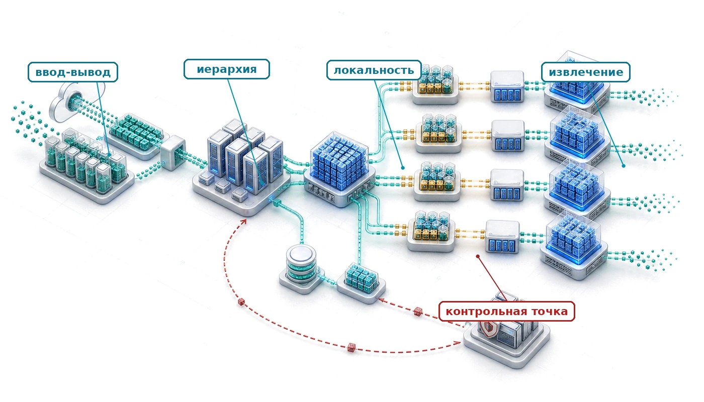

## Назначение

_Почему хранение становится невидимым узким местом, которое не дает ускорителям раскрыть свой потенциал?_

Ускорители считают быстрее, чем хранилище успевает их кормить. Современный ускоритель внутри обрабатывает данные со скоростью в терабайты в секунду, но отдельные локальные диски выдают гигабайты, самое большее десятки гигабайт в секунду, а распределенные системы хранения добавляют задержку, которая накапливается и превращает ускорители в простаивающие устройства, ждущие данных. Этот разрыв незаметен в тестах, которые измеряют производительность ускорителя в отрыве от всего остального. Но в реальных нагрузках он определяет все: обучающие данные должны непрерывно поступать потоком, контрольные точки — надежно сохраняться, а веса модели — загружаться в момент обслуживания. Разрыв между тем, что ускорители способны потреблять, и тем, что хранилище может отдать, заставляет тщательно продумывать форматы данных, стратегии кэширования и архитектуру конвейера. Без этого можно было бы обойтись, если бы хранилища успевали за вычислениями. Организации, которые оптимизируют загрузку ускорителей, но не занимаются хранилищем, обнаруживают, что дорогое оборудование работает на малой доле мощности: никто не спланировал путь данных. В терминах C³ хранение данных — задача совместного проектирования вычислений и коммуникации. Самые быстрые вычисления в парке простаивают, когда иерархия хранения не может подать данные с той скоростью, с какой их потребляют ускорители.

> **Цели обучения**
>
> - Объяснить, как рабочие нагрузки хранения ML переворачивают допущения баз данных на уровнях памяти, флеш-накопителей, параллельной файловой системы, объектного хранилища и архива
> - Рассчитать требуемую пропускную способность обучения и время обслуживания многоуровневого кэша по уравнению конвейера данных
> - Спроектировать предвыборку, шардинг, кэширование и локальность так, чтобы предотвратить голодание ускорителей в масштабе парка
> - Оценить прямые пути ускорителя к данным и пути в обход CPU по задержке, аугментации и узким местам локальности
> - Выбрать стратегии промежуточного сохранения и репликации контрольных точек, которые балансируют время паузы, риск восстановления и стоимость хранения
> - Задать контракты повторного воспроизведения, идемпотентности, долговечности и согласованности, которые сохраняют корректность распределенного конвейера
> - Оценить индексы поиска и конвейеры синтетических данных как рабочие нагрузки хранения с собственными ограничениями по задержке, согласованности и управлению

## Топливопровод
Плотные узлы ускорителей могут объединять восемь GPU, которые вместе дают петафлопсы вычислений, а сетевые ткани InfiniBand связывают тысячи таких узлов на скоростях в сотни гигабит в секунду. В стеке парка, показанном на [«Стеке парка»](01_introduction.md#fig-fleet-stack), хранение данных завершает физическую основу: оно размещает обучающие данные, веса модели, состояние оптимизатора и промежуточные контрольные точки на нужном расстоянии от ускорителя. Двигатель без топлива — дорогая скульптура. Инженерный вопрос в том, как подавать топливо достаточно быстро, чтобы 1 000 ускорителей никогда не простаивали.

*Хранение — это ось «Инфраструктура» в стеке парка.*

Рассмотрим основной пример для анализа хранения. Языковая модель на 175 миллиардов параметров обучается на 1,5 триллиона токенов текста: это около 3 ТБ в сжатом исходном виде или 6 ТБ после представления в виде 4-байтовых идентификаторов токенов. В таком сценарии предобучения на полном корпусе каждая эпоха читает каждый выбранный токен один раз в порядке, который задает случайное перемешивание. Небольшого «горячего» подмножества, которое доминировало бы в обращениях, здесь нет. Тем временем каждый ускоритель обрабатывает свой локальный батч примерно за 200 мс и затем ждет следующий. Если хранилище не может подать данные за это окно в 200 мс, ускоритель простаивает, а организация платит за кремний, который производит тепло вместо градиентов.

Проблема обманчива, потому что технологии хранения заметно улучшились. Накопители NVMe (Non-Volatile Memory Express) обеспечивают последовательную пропускную способность 7 ГБ/с — цифру, которая еще десять лет назад казалась недостижимой. H100 перемещает данные внутри себя через память с высокой пропускной способностью (HBM) со скоростью 3,35 ТБ/с, что примерно в 478,6× больше последовательной пропускной способности одного диска NVMe. Это соотношение сравнивает два уровня и не является скоростью, с которой хранилище должно подавать обучающие входы: пропускная способность HBM расходуется и на повторное чтение весов, активаций и тензоров во время вычислений. Требование к подаче данных определяется объемом входных батчей, который каждый ускоритель получает за итерацию. Чтобы его выполнить, все равно нужна иерархия уровней хранения: каждый уровень подобран к своей фазе жизненного цикла ML, а уровни связаны конвейерами, которые скрывают задержку предвыборкой и конвейеризацией.

Проблема хранения соединяет физику и экономику. Физика говорит, что данные, находящиеся ближе к ускорителю (по физическому расстоянию и числу переходов в межсоединении), доставляются быстрее, но в меньших объемах. Экономика говорит, что более дешевое хранилище вмещает больше данных, но расположено дальше. Инженерная задача — связать эти ограничения: держать дорогой верхний уровень заполненным, черпая данные из более дешевых нижних уровней достаточно быстро, чтобы ускоритель никогда не ощутил задержки. Итоговая проектная задача количественна. Нужно понять, насколько быстрым должен быть каждый уровень, насколько глубоким должен быть конвейер и какие байты стоит держать рядом с ускорителем. Дисбаланс структурен, а не случаен. Вычисления и память с высокой пропускной способностью развивались вместе, а локальное хранение — нет. [«Разрыв хранения и вычислений»](#fig-storage-compute-gap) показывает расхождение: топливопровод, подающий ускоритель, теперь ограничивает работу гораздо жестче, чем сам ускоритель.

*Запись контрольных точек примерно в 1 000 раз превышает чтение обучающих данных.*

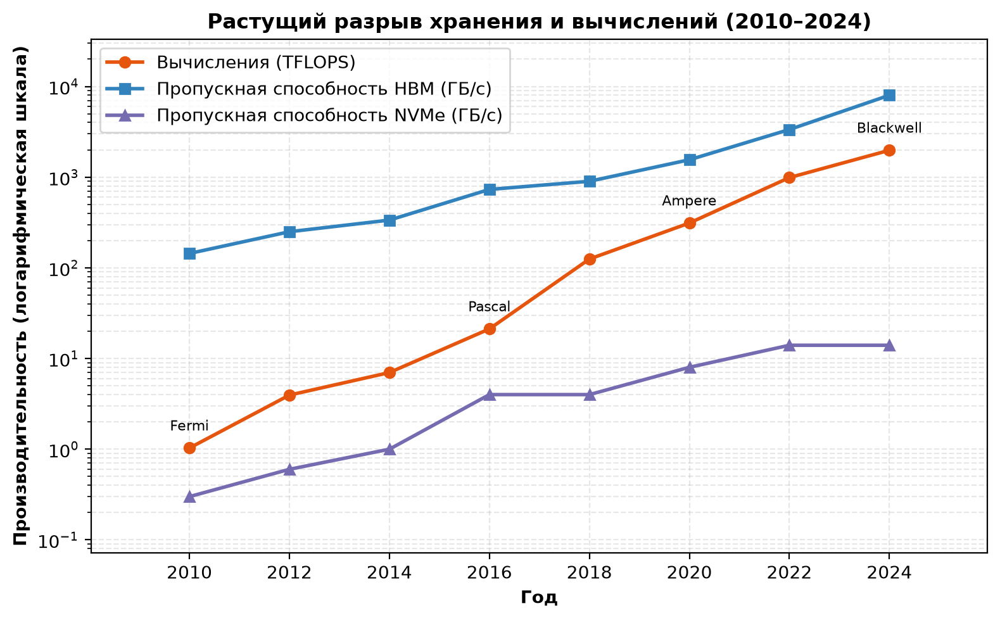

***Разрыв хранения и вычислений**: вычислительная мощность ускорителя, пропускная способность HBM и пропускная способность NVMe с 2010 по 2024 год на общей логарифмической шкале. Вычисления растут быстрее всего, локальное хранение — медленнее всего, поэтому топливопровод, подающий ускоритель, становится ограничением задолго до того, как арифметика упирается в предел.*

Канонический объем обучающих данных для этого примера составляет около 9 ТБ на всей иерархии: он складывается из сжатого корпуса и токенизированных шардов, о которых говорилось выше. Дополнительные перемешанные или упакованные варианты могут увеличить объем промежуточного хранения, но чтение одной эпохи обучения в виде 4-байтовых идентификаторов токенов составляет 6 ТБ. В этой главе принят один контракт для возобновляемого смешанно-точного чекпоинта оптимизатора Adam (Adaptive Moment Estimation): веса модели FP16, главные веса FP32 и два момента Adam в FP32, итого 14 байт на параметр. Градиенты пересчитываются после восстановления, а метаданные планировщика, генератора случайных чисел и загрузчика данных при таком масштабе пренебрежимо малы. Получается контрольная точка размером 2 450 ГБ каждые 10 минут. За 30-дневный запуск обучения на 256 узлах система хранения должна отдавать 6 ТБ токенизированных обучающих данных за эпоху, принимать 10,6 ПБ записей контрольных точек и размещать веса модели для запусков оценки. В следующих разделах этот же контракт используется для любого размера контрольной точки, длительности, суммарного объема хранения и расчета записи за весь срок службы.

Эти цифры задают путь хранения. Рабочие нагрузки ML сначала переворачивают допущения, на которых построены обычные системы хранения; из этого переворота возникает иерархия от HBM до холодного архива; эта иерархия затем требует уравнений конвейера, прямых путей передачи данных и экономики, которая решает, какие байты где должны лежать. Контрольные точки, индексы поиска и происхождение синтетических данных — варианты той же задачи топливопровода: система хранения должна разместить нужное представление на нужном расстоянии до того, как ускоритель его запросит.

## Как рабочие нагрузки ML переворачивают допущения хранения
Администратор баз данных, перешедший в команду ML-инфраструктуры, обнаружит, что предобучение на полном корпусе переворачивает многие привычные принципы проектирования хранилищ. Пример с моделью на 175 миллиардов параметров делает этот переворот конкретным. Каждая эпоха читает каждый выбранный токен один раз в перемешанном порядке, а следующая эпоха перемешивает тот же корпус заново. В таком сценарии небольшое «горячее» подмножество не доминирует в обращениях. Дообучение, учебные программы (curriculum learning), поиск трудных примеров, признаки для рекомендаций и поиск действительно создают перекошенные рабочие множества, поэтому переворот — это свойство рабочей нагрузки, а не универсальное свойство ML.

Традиционные системы хранения создавались для транзакционных баз данных — нагрузок с мелкими случайными обращениями, строгой согласованностью и умеренной пропускной способностью. Сервер базы данных может выполнять тысячи чтений по 4 КБ в секунду, чтобы обслуживать запросы пользователей. Отрасль на протяжении десятилетий оптимизировала именно этот шаблон: появлялись сложные алгоритмы кэширования, журналы упреждающей записи и конфигурации избыточного массива независимых дисков (RAID)[^fn-raid-array-redundancy], настроенные на случайный доступ мелкими блоками. Каждая оптимизация исходила из того, что данные, к которым только что обращались, скорее всего понадобятся снова в ближайшее время.

[^fn-raid-array-redundancy]: **RAID (избыточный массив независимых дисков)**: таксономия способов объединения дисков, предложенная в Беркли в 1988 году; каждый способ обменивает избыточность на пропускную способность (Patterson et al., 1988). Обучение ML переворачивает умолчание эпохи баз данных. RAID 0 (чередование без четности) максимизирует пропускную способность последовательного чтения ценой полного отсутствия отказоустойчивости. Это безопасный компромисс, потому что обучающие данные неизменяемы и надежно хранятся в объектном хранилище. Выбор RAID 5 или 6 тратит пропускную способность на расчет четности для данных, которые и так защищены в другом месте.

Рабочие нагрузки ML систематически переворачивают эти допущения. Доступ к обучающим данным в основном последовательный: поток идет по наборам данных объемом в сотни терабайт. Отдельные обращения крупные (мегабайты, а не килобайты), потому что модель потребляет батчи изображений или текстовых последовательностей. Требования к согласованности смягчаются: чуть устаревшие признаки редко влияют на качество модели. Зато требования к пропускной способности экстремальны: сотни гигабайт в секунду, устойчиво в течение дней или недель. Несоответствие между тем, на что оптимизировано хранилище, и тем, что реально нужно ML, создает **стену ввода-вывода (I/O Wall)** (принцип «Стена I/O»): когда пропускная способность хранилища не может подавать обучающие данные так же быстро, как их потребляют ускорители, GPU простаивают независимо от своей вычислительной мощности. Хранилище, достаточное для 8 GPU, становится узким местом при 64, и тогда узкое место — конвейер данных, а не модель. В таксономии C³ для диагностики на уровне парка эта стена относится к ограничению на пересечении коммуникации и вычислений (таблица узких мест приведена в приложении), поэтому инженер по хранению может убедиться, что лекарство — больше пропускной способности, а не более быстрые ускорители.

Простой расчет распределения шардов показывает, как такое узкое место возникает даже тогда, когда общая емкость хранилища кажется достаточной.

> **Эффект громового стада: конкуренция за шарды**
>
> **Задача**: Набор данных разбит на 1000 шардов на общей файловой системе. Если 32 воркера случайным образом выбирают шард, чтобы начать следующую эпоху, какова вероятность того, что хотя бы два GPU «столкнутся» на одном сервере хранения и вызовут падение производительности?
>
> **Расчет**:
> Это вариант «задачи о дне рождения» из теории вероятностей.
>
> 1. **Вероятность отсутствия коллизий**: $\approx e^{-n_{\text{workers}}^2/(2K_{\text{shards}})} = e^{-32^2/2000} \approx 0.60$.
> 2. **Вероятность конкуренции**: $1 - 0.60 = 40\%$.
>
> **Системный вывод**: при 32 воркерах и 1 000 шардах вероятность коллизии 40,1 процента создает горячую точку на шардах, из-за которой парк ждет воркеров, делящих один диск. Глобальное перемешивание и детерминированное назначение шардов снижают этот хвост задержки, распределяя воркеров по сети хранения.

Коллизии шардов — один из симптомов выполнения стены ввода-вывода. Причина стены — растущий разрыв между производительностью вычислений и пропускной способностью хранилища.

> **Растущая стена I/O**
>
> С 2016 по 2024 год заявленная производительность тензорных ядер ускорителей выросла резко, но точные соотношения зависят от того, фиксируется ли точность сравнения или берется наименьшая поддерживаемая точность обучения или вывода для каждого поколения. За тот же период пропускная способность последовательного чтения NVMe выросла гораздо медленнее: примерно с 3,5 до 14 ГБ/с на диск. Поэтому отношение пропускной способности вычислений к пропускной способности хранения заметно ухудшилось. Если эта тенденция сохранится, иерархия хранения должна добавить новые уровни (энергонезависимую память, хранилище на базе Compute Express Link (CXL)) или перестроить конвейер данных вокруг подходов вроде вычислений рядом с хранилищем и обработки внутри хранилища. Улучшения вычислений сами по себе не тянут за собой путь хранения.

[«Пропасть между хранением и вычислениями»](#fig-storage-compute-chasm) делает это расхождение наглядным: на одной временной шкале показаны производительность GPU и пропускная способность хранилища.

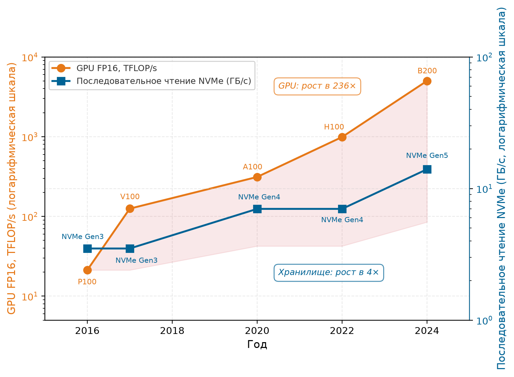

***Пропасть между хранением и вычислениями**: пиковая производительность GPU в FP16 (оранжевым, левая ось) и последовательная пропускная способность чтения NVMe (синим, правая ось) с 2016 по 2024 год на логарифмических шкалах. Производительность GPU выросла в 236×, а пропускная способность хранилища — только в 4× за тот же период. Заштрихованная область показывает расходящийся разрыв, который инженерия конвейера данных должна перекрыть предвыборкой, кэшированием и оптимизацией форматов.*

Разрыв почти в 60 раз между ростом производительности GPU (236×) и ростом пропускной способности хранилища (4×), показанный на [«Пропасти между хранением и вычислениями»](#fig-storage-compute-chasm), объясняет, почему стена ввода-вывода определяет архитектуру парка. Расхождение роста, то есть то, как быстро растет разрыв со временем, отличается от статичных обрывов пропускной способности между уровнями, о которых рассказывает [раздел «Обрывы пропускной способности»](#sec-storage-bandwidth-cliffs): они показывают, насколько крут разрыв в каждый отдельный момент. Без многоуровневой иерархии хранения, предвыборки и оптимизации форматов дорогие ускорители на вершине стека проводили бы больше времени в ожидании данных, чем в вычислениях над ними. Каждый уровень иерархии хранения решает свою сторону этой пропасти.

Первое переворачивание — **шаблон доступа (Access Pattern)**. Базы данных работают с *произвольным доступом*, который выигрывает от оптимизации времени поиска, а предобучение на полном корпусе выполняет массивные *последовательные сканирования*. Эпоха в нашем примере читает каждый выбранный образец один раз в порядке, который задают перемешивание шардов и буфера. Этот шаблон больше похож на потоковую передачу видео, чем на запросы к базе данных. Системы хранения, оптимизированные под случайные IOPS[^fn-iops-throughput-tradeoff], тратят свои возможности впустую, а системы, оптимизированные под пропускную способность последовательного доступа, оказываются эффективнее. Разница количественно велика: накопитель NVME поколения Gen4/Gen5 выдает примерно 7–14 ГБ/с при последовательном чтении, тогда как мелкие случайные чтения по 4 КБ могут падать до 0,5 ГБ/с. Это штраф в порядок величины, до 30×, за неправильный шаблон доступа. На жестких дисках штраф еще серьезнее: механика поиска снижает пропускную способность случайного доступа в 100 раз по сравнению с последовательным.

[^fn-iops-throughput-tradeoff]: **IOPS (операции ввода-вывода в секунду)**: метрика, которая десятилетиями определяла закупку хранилищ, потому что базы данных выполняют миллионы мелких случайных чтений. Обучение ML переворачивает этот приоритет: конвейер, который потоково читает шарды по 256 МБ, нуждается в устойчивой пропускной способности в ГБ/с, а не в скорости отдельных операций. Закупка хранилища по рейтингу IOPS для нагрузки ML переплачивает за возможности произвольного доступа, которые конвейер никогда не использует.

Перемешивание, которое требует обучение ML, добавляет осложнение, связанное с требованиями стохастического градиентного спуска. Стохастический градиентный спуск (SGD) требует, чтобы каждый мини-батч выбирался примерно равномерно из обучающего распределения. Если подавать образцы в коррелированном порядке (все образцы из одного документа или все изображения одного класса), оценки градиента смещаются, и сходимость замедляется или становится нестабильной. Истинное глобальное перемешивание удовлетворило бы это требование идеально, но оно требует произвольного доступа по всему набору данных и разрушает последовательный шаблон доступа, который нужен аппаратуре хранения. Для корпуса петабайтного масштаба случайные обращения к отдельным образцам непосильны по вводу-выводу: набор из 1 триллиона 4-байтовых токенов, хранящихся поэлементно на NVMe и читаемых случайно, потребовал бы тысячи часов при случайной скорости IOPS накопителя, вместо нескольких часов при последовательной потоковой передаче. Поэтому практическое решение — компромисс: перемешать порядок больших шардов данных, а затем перемешать образцы внутри локального буфера каждого шарда. Так достигается достаточная случайность для сходимости обучения, при этом сохраняется последовательный шаблон ввода-вывода, который нужен аппаратуре хранения. Размер шарда определяет компромисс: большие шарды дают больше разнообразия при перемешивании внутри шарда, но требуют больше памяти для буфера перемешивания.

Второе переворачивание — **размер рабочего множества (Working Set Size)**. Традиционным приложениям свойственна временная локальность: веб-сервер раз за разом обращается к популярным страницам, и кэш, хранящий 10 процентов самого популярного контента, обслуживает 90 процентов запросов. В сценарии предобучения на полном корпусе, который разбирает эта глава, сериализованный корпус в 6 ТБ не имеет «популярного» диапазона токенов: каждый выбранный токен потребляется один раз за эпоху. Кэш любого практического размера вмещает лишь малую долю корпуса, и большинство образцов при обращении оказываются «холодными». Из-за этого традиционное кэширование по давности обращений работает гораздо хуже. Кэш LRU (наименее недавно использованный)[^fn-lru-eviction-failure] может прийти к нулевой доле попаданий при циклическом сканировании, которое больше самого кэша. При независимо перемешанных эпохах попадания между эпохами редки, но ненулевы, и зависят от доли кэша и порядка образцов.

[^fn-lru-eviction-failure]: **LRU (наименее недавно использованный)**: LRU эффективен, когда недавно использованные данные скоро понадобятся снова. Циклическое сканирование всего набора данных, большего кэша, может вытеснить каждый образец до его следующего обращения и довести долю попаданий почти до нуля. Независимое перемешивание меняет поведение на границе: часть образцов, сохраненных с конца одной эпохи, может быть использована до вытеснения в начале следующей. Поэтому доля попаданий зависит от соотношения кэша и набора данных и от порядка, а не равна нулю всегда. Команды должны измерить такое повторное использование, прежде чем выделять DRAM, который иначе мог бы служить буферами предвыборки.

Другие политики обучения создают иную локальность. Многозадачное обучение и обучение по учебной программе (curriculum learning), поиск трудных примеров и фильтрованная выборка в определенных фазах обращаются к одним подмножествам чаще, чем к другим. Такое временное рабочее множество позволяет уровню NVMe использовать локальность. Крупные задания предобучения, которые раз за разом сканируют фиксированный корпус, — сценарий, для которого выведена эта иерархия. Системы, которые работают с другой политикой выборки, должны измерить распределение повторного использования, прежде чем применять такой же дизайн кэша.

Третье переворачивание — **шаблон записи (Write Pattern)**. Транзакционные системы генерируют непрерывный поток мелких записей, и каждая сразу становится долговечной. Системы ML порождают редкие, но огромные записи при сохранении контрольных точек. Контрольная точка модели на 175 миллиардов параметров вместе с состоянием оптимизатора занимает около 2 450 ГБ. Если сохранять ее каждые 10 минут, возникают всплески, которые на несколько секунд насыщают пропускную способность, а затем сменяются долгими паузами. Вместе эти всплески образуют **шквал контрольных точек (Checkpoint Storm)**: синхронизированное событие записи контрольных точек, которое параллельная файловая система должна выдержать, не сорвав продолжающиеся чтения для обучения. Такой всплеско-образный шаблон записи особенно труден, потому что все узлы кластера записывают свои шарды контрольной точки одновременно. Если 128 узлов записывают по 19 ГБ каждый, параллельная файловая система получает 2,4 ТБ записи в одном всплеске, который должен завершиться, прежде чем конвейер обучения сможет продолжить работу. [Таблица «Инверсии допущений хранения»](#tbl-storage-assumptions) собирает эти инверсии в правило закупки: оптимизировать под потоковую передачу и всплески, а не под произвольные IOPS в духе баз данных.

***Инверсии допущений хранения в рабочих нагрузках ML**: базы данных оптимизированы под случайные IOPS и кэшируемые рабочие множества, тогда как обучение ML потоково проходит по наборам данных, которые превосходят все уровни кэша.*

| **Шаблон нагрузки** | **Традиционное допущение** |        **Реальность ML**        |
|:--------------------|:--------------------------:|:-------------------------------:|
| **Шаблон доступа**  |       Произвольный         |       Последовательный поток     |
| **Рабочее множество** |     Помещается в кэш      |    Превосходит все уровни кэша   |
| **Шаблон записи**   |  Непрерывные мелкие записи |       Всплески крупных записей   |
| **Отношение чтения/записи** |     Сбалансировано     | Зависит от фазы (от 100:1 до 1:0) |
| **Локальность**     |  Сильная временная локальность | Низкая локальность при сканировании всего корпуса |

Эти инверсии шаблонов доступа приводят к четвертому, более тонкому измерению ([таблица «Инверсии допущений хранения»](#tbl-storage-assumptions)): соотношение чтения и записи резко меняется в зависимости от фазы жизненного цикла. Во время обучения чтения преобладают над записями в 100:1 или больше, потому что система непрерывно потоково читает данные и изредка сохраняет контрольные точки. В фазы, тяжелые по контрольным точкам, в условиях кластера, склонного к отказам, записи могут на время преобладать. Во время подготовки данных и чтения, и записи интенсивны, а шаблон доступа больше похож на задание MapReduce, чем на цикл обучения: токенизация, дедупликация и перемешивание сканируют исходный корпус один раз (крупные последовательные чтения), записывают промежуточные артефакты (крупные последовательные записи), а затем снова сканируют эти артефакты для следующего этапа. Сжатый текстовый корпус объемом 3 ТБ обычно разрастается до 6 ТБ токенизированных шардов еще до начала первой эпохи обучения, и каждый уровень хранения нагружен иначе, чем в фазе чтения только для обучения, которая идет за ней. Ни одна конфигурация хранения не оптимальна для всех фаз, поэтому системам ML нужна многоуровневая иерархия, а не единая технология хранения.

Пятая инверсия возникает при сравнении нагрузок обучения и вывода. *Обучение* читает наборы данных последовательно и пишет контрольные точки всплесками. *Вывод* с резидентными весами, напротив, выполняет одно большое чтение модели при запуске, а затем обслуживает запросы из HBM. Его проблема хранения — задержка холодного старта: время, которое нужно на загрузку модели при масштабировании или восстановлении после сбоя. Ограничение переходит от устойчивой пропускной способности набора данных к одному массовому чтению, длительность которого зависит от того, какой уровень отдает веса. Извлечение, выгрузка состояния и модели, которые больше суммарной HBM, создают дополнительный ввод-вывод во время обслуживания, поэтому случай с резидентными весами — базовая линия, а не универсальный шаблон вывода. [Раздел «Хранение для вывода»](#sec-storage-inference) выводит времена загрузки и связывает эту базовую линию с нагрузкой извлечения, о которой пойдет речь дальше.

При переходе от одного пользователя к тысячам одновременных запросов вывода задача хранения меняется: вместо проблемы пропускной способности одного потока возникает проблема массового распределения по многим адресатам. Кластер обслуживания из 100 реплик нашей модели на 175 миллиардов параметров требует 35 ТБ весов модели, распределенных по кластеру. Когда развертывается новая версия модели (**развертывание модели (Model Rollout)**), все 100 реплик нужно обновить, и это вызывает распределение 35 ТБ данных, которое должно завершиться за минуты, чтобы свести к минимуму сбои обслуживания. Это аналог шквала контрольных точек при обучении, но наоборот. Вместо того чтобы многие узлы одновременно *записывали* в центральное хранилище, многие узлы *читают* одни и те же данные одновременно. Система хранения должна выдерживать эту всплесковую нагрузку чтения для распространения модели, продолжая обслуживать запросы вывода из текущей версии модели без деградации.

Эти инверсии имеют прямые последствия для закупки и архитектуры систем. Организация, которая закупает хранилище для ML по эвристикам эпохи баз данных, переинвестирует в случайные IOPS (которые ML не нужны), недоинвестирует в последовательную пропускную способность (которая ML критически нужна) и не учтет всплесковые шаблоны записи, которые создает сохранение контрольных точек.

> **Анализ нагрузки хранения**
>
> Вы проектируете подсистему хранения для нового кластера ML обучения на 512 GPU. Основная нагрузка — обучение больших языковых моделей на текстовом наборе данных объемом 10 ТБ.
>
> - [ ] **Эвристики баз данных**: используя пять инверсий нагрузки хранения, назовите не менее трех оптимизаций баз данных, которые были бы контрпродуктивны для этой нагрузки.
> - [ ] **Чтение эпох**: рассчитайте общий объем данных, читаемых, когда каждая эпоха обучения однократно читает весь набор данных в 10 ТБ и кластер обучается 100 эпох, затем сравните с типичной нагрузкой базы данных.
> - [ ] **Пропускная способность контрольных точек**: рассчитайте минимальную пропускную способность записи, необходимую, если модель сохраняет контрольную точку размером 500 ГБ каждые 15 минут и каждое сохранение должно завершаться за 30 секунд.
> - [ ] **Коэффициент занятости записью**: рассчитайте долю времени, которое система хранения проводит в «режиме записи» и в «режиме чтения» при всплесковых контрольных точках каждые 15 минут.

Понимание того, какой уровень хранения способен кормить ускорители, необходимо для проектирования системы. [«Зона узкого места хранения»](#fig-access-patterns-vol2) показывает требуемую пропускную способность ввода-вывода для полной загрузки GPU в зависимости от размера модели, с горизонтальными пределами для каждого уровня хранения. Ниже предела NVMe локальные SSD способны выдерживать поток обучения; между пределами NVMe и параллельной файловой системы достаточно хранилища класса Lustre; а за пределом параллельной файловой системы нагрузка попадает в режим узкого места хранения, где ни один уровень в одиночку не способен обеспечить ускорители.

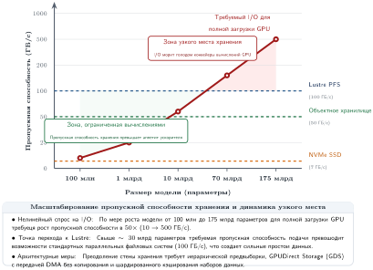

***Зона узкого места хранения**: требуемая пропускная способность ввода-вывода для полной загрузки GPU растет с размером модели от 100 миллионов до 175 миллиардов параметров. Красная кривая показывает спрос на хранение; горизонтальные пунктирные линии отмечают типичные пределы уровней хранения (NVMe — 7 ГБ/с, объектное хранилище — 50 ГБ/с, Lustre — 100 ГБ/с). Между областью, ограниченной вычислениями, и областью узкого места хранения лежит переход, где производительность обучения ограничивает хранение, а не вычисления.*

Зона узкого места хранения на [рисунке «Зона узкого места хранения»](#fig-access-patterns-vol2) расширяется с ростом размера модели: с увеличением числа параметров требуемая пропускная способность растет быстрее, чем могут обеспечить массовые уровни хранения, и более крупные модели попадают в режим, где поток обучения способны удержать только параллельные файловые системы или шардированное объектное хранилище. На малых размерах запросов разрыв между последовательным и случайным доступом тоже растет: на 4 КБ последовательное чтение опережает случайное в 10 раз. Это объясняет, почему наборы данных, хранящиеся как миллионы мелких файлов («проблема мелких файлов»), работают катастрофически плохо в нагрузках ML даже на высокоскоростном хранилище: служба хранения тратит время на метаданные, а не на байты полезной нагрузки. Это тот же сбой, который крупные файловые системы называют узким местом метаданных (Shvachko et al., 2010). Специфичный для ML ответ — объединять мелкие образцы в крупные последовательные шарды (Aizman et al., 2019).

Практическое следствие для нашего примера очевидно. Для 1,5 триллиона токенов обучающих данных за эпоху требуется примерно 6 ТБ последовательных чтений идентификаторов токенов, хотя сжатый исходный корпус весит всего 3 ТБ. Если бы каждый токен хранился как отдельный файл (как может получиться при наивном сборе данных), одни только накладные расходы на метаданные снизили бы пропускную способность до малой доли того, что способно дать аппаратное хранилище. Поэтому данные нужно предобработать в крупные последовательные шарды, чтобы каждая операция чтения амортизировала постоянные накладные расходы на открытие, поиск и закрытие файла на множестве токенов. Этот шаг предобработки превращает шаблон доступа из обращения к файлу на каждый образец в последовательное чтение шардов (Aizman et al., 2019). Так нагрузка остается ниже предела хранилища, показанного на [рисунке «Зона узкого места хранения»](#fig-access-patterns-vol2), и задается иерархия, которая связывает аппетит ускорителей с емкостью хранилища.

## Иерархия хранилищ ML
Системный архитектор должен организовать хранилище так, чтобы оно обслуживало нагрузки, которые одновременно требуют пропускной способности в терабайты в секунду для вычислений, емкости в петабайтном масштабе для наборов данных и исключительной долговечности для контрольных точек. Ни одна технология не удовлетворяет всем трем требованиям сразу. HBM дает пропускную способность, но не емкость. Объектное хранилище дает емкость и долговечность, но не пропускную способность. Решение — многоуровневая иерархия, которая размещает небольшие объемы быстрого и дорогого хранилища рядом с ускорителем, а большие объемы медленного и дешевого — на периферии. Каждый уровень существует потому, что решает конкретное противоречие между физикой (пропускная способность и задержка определяются расстоянием до ускорителя) и экономикой (стоимость бита снижается с ростом емкости). Иерархия продолжает классическую иерархию памяти процессора (регистры, кэши L1/L2, DRAM), которую студенты проходят на курсах по архитектуре компьютеров, и добавляет уровни ниже DRAM, характерные только для крупномасштабных систем данных. [Таблица «Расширенная иерархия памяти для систем ML»](#tbl-storage-hierarchy-merged) показывает огромный разброс пропускной способности, с которым приходится работать ML-системам.

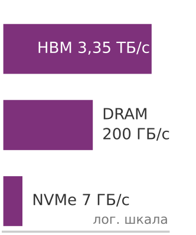

*Пропускная способность падает примерно в 479× на трех верхних уровнях: от HBM к локальному NVMe.*

***Расширенная иерархия памяти для систем ML**: примерно 30-кратный разрыв суммарной пропускной способности между HBM и объектным хранилищем (а при обращении отдельного экземпляра вывода к общей объектной точке — гораздо больший разрыв на клиента) обусловливает необходимость сложной предвыборки и кэширования на нескольких уровнях. Стоимость памяти выражается в долларах за ГБ единовременно, стоимость хранения — в долларах за ГБ в месяц; их сравнение требует явного периода амортизации и допущения о загрузке.*

| **Уровень хранения**     | **Типичная емкость** |                  **Пропускная способность**                  |                 **Задержка**                 |     **Ориентир стоимости**       |
|:-------------------------|:--------------------:|:------------------------------------------------------------:|:--------------------------------------------:|:--------------------------------:|
| **HBM на GPU**           |        80 ГБ         |                        3,35 ТБ/с                         |                   ~100 нс                    |  ~\$15/ГБ стоимость приобретения |
| **DRAM хоста**           |     512 ГБ–2 ТБ      |                        200 ГБ/с                          |                   ~100 нс                    |   ~\$3/ГБ стоимость приобретения |
| **Локальный NVMe SSD**   |       4–30 ТБ        |                        7–25 ГБ/с                         |                   ~100 мкс                   |   ~\$0,10/ГБ-месяц (выделенный)  |
| **Параллельная файловая система** |     100+ ПБ     |                    1+ ТБ/с суммарно                      |                   ~1 мс                      | ~\$0,03/ГБ-месяц (выделенная/сервисная) |
| **Объектное хранилище**  |   Очень большой пул  |                    100 ГБ/с суммарно                     |                   ~50 мс                     |     ~\$0,02/ГБ-месяц (сервис)    |
| **Архив/холодное хранилище** |  Очень большой пул  |                          1 ГБ/с                          |                 Минуты–часы                  |    ~\$0,004/ГБ-месяц (сервис)    |

Одно прочтение [таблицы «Расширенная иерархия памяти для систем ML»](#tbl-storage-hierarchy-merged) стоит отметить: преимущество HBM над DRAM хоста — это *пропускная способность*, а не *задержка*. Задержка случайного доступа у обеих технологий лежит в диапазоне примерно 80–150 нс. HBM получает преимущество в пропускной способности (в 10–20 раз) за счет тысяч параллельных проводников на кремниевом интерпозере и трехмерной укладки кристаллов, а не за счет более быстрых ячеек. Обрыв задержки между соседними уровнями открывается только на NVMe и ниже, где физическое расстояние до ускорителя растет от миллиметров до метров.

Модель иерархии хранилищ (принцип «Иерархия хранилищ») определяет распределение по уровням и проектирование конвейера. По мере удаления данных от ускорителя производительность хранения падает, а емкость растет: каждый уровень в [таблице «Расширенная иерархия памяти для систем ML»](#tbl-storage-hierarchy-merged) снижает пропускную способность в 10–100 раз, одновременно увеличивая емкость в 10–100 раз. Выбор формата данных, стратегии кэширования, размер буферов предвыборки и политики распределения по уровням существуют для того, чтобы управлять движением данных вверх по иерархии, чтобы ускоритель никогда не простаивал.

[Рисунок «Пирамида иерархии хранилищ ML»](#fig-storage-pyramid) (ниже) раскладывает шесть уровней в пространственную иерархию и показывает, как пропускная способность падает, а емкость растет на каждом шаге от ускорителя.

***Пирамида иерархии хранилищ ML**: уровни из [таблицы «Расширенная иерархия памяти для систем ML»](#tbl-storage-hierarchy-merged) сгруппированы в горячую, теплую и холодную зоны — от HBM на GPU до архивного хранилища. Пропускная способность в целом падает с ростом емкости и снижением стоимости единицы; параллельная файловая система выделена как общий уровень, который с наибольшей вероятностью оставит без данных большой обучающий кластер.*

Пирамида на [рисунке «Пирамида иерархии хранилищ ML»](#fig-storage-pyramid) кодирует фундаментальный компромисс: каждый шаг вниз по иерархии обменивает пропускную способность на емкость и стоимость. Этот компромисс не произволен, он отражает физику близости данных. HBM размещается на том же кремниевом интерпозере, что и ускоритель, и связана тысячами параллельных проводников длиной в миллиметры. DRAM хоста обменивается данными по линиям PCIe длиной в сантиметры. NVMe достигает платы через разъем PCIe. Параллельная файловая система проходит метры кабелей и сетевых коммутаторов. Объектное хранилище может растянуться на километры оптоволокна между центрами обработки данных. На каждом уровне возрастающее физическое расстояние напрямую переходит в рост задержки, падение пропускной способности на соединение и снижение стоимости байта (потому что тот же носитель может хранить больше данных при меньшей плотности).

Инженерная задача — обеспечить, чтобы данные текли вверх по пирамиде достаточно быстро и верхний уровень (HBM) никогда не был пуст, когда он нужен ускорителю. Вернемся к основному примеру: долговечный корпус лежит в объектном хранилище (уровень 4) в виде сжатой копии исходного текста объемом 3 ТБ плюс 6 ТБ токенизированных обучающих шардов, но ускорителю нужен каждый батч в HBM (уровень 0) в пределах 200 мс. Данные должны продвигаться через промежуточные уровни, размещаясь в постепенно более быстром хранилище, так что к моменту, когда ускоритель запросит батч, тот уже будет ждать в DRAM хоста на расстоянии одной передачи по PCIe от HBM.

### Обрывы пропускной способности между уровнями
Отношения пропускной способности между соседними уровнями показывают, насколько тяжел каждый переход в иерархии ([рисунок «Обрывы пропускной способности между уровнями хранения»](#fig-storage-bandwidth-cliffs)). Между HBM и DRAM хоста отношение составляет примерно 16,8× (3,35 ТБ/с против примерно 200 ГБ/с). Между DRAM хоста и NVMe — примерно 7,1× (200 ГБ/с против примерно 28 ГБ/с от RAID-0 из четырех дисков). Между NVMe и параллельной файловой системой отношение зависит от выделения на узел: если параллельная файловая система (PFS) с суммарной пропускной способностью 1 ТБ/с обслуживает 256 узлов, каждый узел получает примерно 4 ГБ/с, то есть снижение в 7 раз по сравнению с локальным NVMe. Между параллельной файловой системой и объектным хранилищем отношение обычно составляет 10× и больше, в зависимости от числа одновременных клиентов и пропускной способности сети.

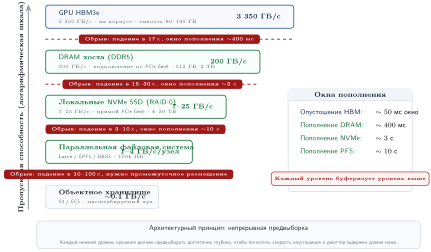

***Обрывы пропускной способности между уровнями хранения**: пропускная способность падает в 10–100 раз между соседними уровнями пирамиды ML-хранения. Конвейер обучения должен перекрывать эти разрывы непрерывной предвыборкой и иерархическим промежуточным размещением.*

Эти обрывы сравнивают возможности перемещения соседних уровней, но они не означают, что нижние уровни должны заполнять всю HBM ускорителя на ее внутренней пропускной способности. HBM обслуживает повторяющиеся обращения к весам, активациям и тензорам во время вычислений, тогда как конвейер хранения подает только что поступивший входной батч. Требуемая пропускная способность подачи — это объем байтов входного батча, деленный на время итерации и суммированный по ускорителям. Батч, который понадобится следующим, все равно должен прибыть в HBM до завершения текущих вычислений. Поэтому каждый нижний уровень выступает буфером предвыборки для уровня над ним. DRAM хоста буферизует входные батчи для HBM, NVMe буферизует данные для DRAM хоста, параллельная файловая система буферизует данные для NVMe, а объектное хранилище — конечный источник истины. Каждый буфер должен быть достаточно глубоким, чтобы поглотить задержку и разброс пропускной способности уровня под ним.

Ту же иерархию можно анализировать как кэш, а не как шесть изолированных устройств. Если запрос попадает в горячий уровень с вероятностью $h$, на что уходит время $T_{\text{hot}}$, а иначе проваливается на более холодный уровень, на что уходит полное время пути промаха $T_{\text{cold}}$ (включая неудачный поиск на горячем уровне), то среднее время обслуживания равно

$$
E[T] = hT_{\text{hot}} + (1-h)T_{\text{cold}}.
$$

Для записей фиксированного размера соответствующая эффективная пропускная способность равна размеру записи, деленному на $E[T]$. Ускоритель простаивает всякий раз, когда время обслуживания превышает время вычислений, которое еще не скрыто предвыборкой. Арифметика показывает, что малые доли промахов имеют большое значение: при доле попаданий 95 процентов и обращении к холодному уровню в 100 раз медленнее горячего $E[T]=5{,}95\,T_{\text{hot}}$, поэтому эффективная частота запросов составляет всего около одной шестой от частоты при полном попадании в горячий уровень. Это среднее — базовая линия для расчета размеров, а не гарантия задержки. Коррелированные промахи или тяжелый хвост холодного уровня могут опустошить буфер предвыборки даже тогда, когда среднее укладывается в бюджет конвейера, поэтому производственные проекты должны проверять хвостовой перцентиль и пачки промахов, а не только $E[T]$.

Арифметика объемов батча объясняет также, почему рост размера кластера создает нагрузку на хранилище. Один узел с 8 GPU требует примерно 4–40 ГБ/с пропускной способности хранилища при допущениях о нагрузке, которые развиваются в [разделе «Уравнение конвейера данных»](#sec-storage-pipeline-equation). Кластер из 256 таких узлов требует 1 000–10 000 ГБ/с. Кластер из 10 000 узлов требует 40–400 ТБ/с. На верхнем конце даже лучшая в своем классе параллельная файловая система с 1 000 серверами объектного хранилища (узлами обслуживания данных, которые введены в [разделе о параллельной файловой системе](#sec-storage-tier3-pfs)) с суммарной пропускной способностью 1 ТБ/с не может удовлетворить спрос, и архитектура должна опираться на локальное кэширование на NVMe, чтобы снизить нагрузку на общее хранилище. Тяжесть давления на уровне кластера сильно зависит от объема входного батча и времени итерации для каждого типа данных.

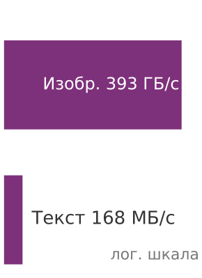

*Спрос на пропускную способность хранилища сильно меняется в зависимости от типа данных.*

> **Текст и изображения: пропускная способность**
>
> **Задача**: Какую суммарную пропускную способность хранилища требует кластер из 2 048 GPU для обучения на тексте и для обучения на изображениях?
>
> **Постановка**: Спрос на пропускную способность полностью определяется типом данных.
>
> Для обучения на тексте спрос удивительно невелик. При типичном размере батча 4 096 токенов на GPU и времени шага 200 мс суммарная пропускная способность равна:
>
> $$2\,048 \text{ GPU} \times 4\,096 \text{ токенов/GPU} \times 4 \text{ байта/токен} \div 0{,}2\text{ с} \approx \text{167,8 МБ/с}$$
>
> Этого легко хватит одному сетевому узлу хранения.
>
> Для обучения на изображениях картина резко меняется. При обычном размере батча 256 на GPU (ImageNet при $224{\times}224$, примерно 150 КБ на изображение) суммарная пропускная способность взлетает:
>
> $$2\,048 \text{ GPU} \times 256 \text{ изображений/GPU} \times 150 \text{ КБ/изображение} \div 0{,}2\text{ с} \approx \text{393,2 ГБ/с}$$
>
> **Системный вывод**: обучению на изображениях нужна пропускная способность в 2 300× выше, чем обучению на тексте, и высокопроизводительная параллельная файловая система. Это фундаментальное различие определяет проектирование иерархии: обучение на тексте *объемно*, но *легко по пропускной способности*, и его узкие места — общий размер набора данных и контрольные точки; обучение на изображениях *тяжело по пропускной способности*, и его узкое место — способность хранилища кормить ускорители.

Обрыв пропускной способности между уровнями влияет и на формат данных на каждом уровне. На уровне HBM данные должны быть в формате, на котором ускоритель может вычислять напрямую: тензоры float16, упакованные идентификаторы токенов или предобработанные векторы признаков. На уровне NVMe данные могут храниться в более компактном формате (сжатый JPEG, токенизированный текст со словарным кодированием), потому что CPU успевает их декодировать, пока ускоритель обрабатывает предыдущий батч. На уровне объектного хранилища желательно максимальное сжатие, чтобы минимизировать и стоимость хранения, и время передачи, даже если декомпрессия добавляет накладные расходы CPU. Переход от сжатого хранения к готовым к вычислению тензорам — часть добавленной ценности конвейера: он превращает сырые байты в представление, которое нужно ускорителю. Это преобразование происходит в DRAM хоста, поэтому DRAM хоста становится критической зоной промежуточного размещения для конвейера.

Вызов формату усиливается при мультимодальном обучении, которое объединяет текст, изображения, аудио и видео в одной модели. У каждой модальности резко различается профиль данных: один текстовый токен занимает 4 байта, изображение высокого разрешения — 150 КБ, а короткий видеоклип — 10 МБ. Модальности также имеют разные характеристики сжатия и требуют разных конвейеров аугментации. Мультимодальное задание обучения должно управлять несколькими параллельными потоками данных, у каждого из которых свой профиль пропускной способности и свои требования к предвыборке. Иерархия хранения должна быть рассчитана на сумму требований пропускной способности всех модальностей, а не только на доминирующую. Для задания обучения, которое объединяет 3 ТБ текста, 50 ТБ изображений и 200 ТБ видео, видеомодальность подавляюще доминирует и по емкости хранения, и по требованиям ввода-вывода, хотя текст может вносить больший вклад в качество модели. Эта асимметрия между стоимостью хранения и ценностью для обучения — повторяющийся вызов при проектировании мультимодальных систем.

Спуск начинается там, где вычисления реально потребляют байты: с HBM, уровня, достаточно быстрого, чтобы кормить арифметику ускорителя, но слишком дефицитного, чтобы вместить весь обучающий корпус.

### Уровень 0: HBM на GPU
Самый ограниченный ресурс всей системы он же и самый дефицитный. HBM (High-Bandwidth Memory) — единственный уровень хранения, где веса и активации могут находиться во время активных вычислений. Как сказано в [разделе о HBM](02_compute_infrastructure.md#sec-compute-hbm), HBM — это технология трехмерно уложенной памяти, которая размещает кристаллы DRAM вертикально поверх ускорителя и соединяет их тысячами сквозных через-кремниевых переходов (TSV), обеспечивая суммарную пропускную способность 3,35 ТБ/с на H100. Эта пропускная способность примерно в 17 раз выше, чем DRAM хоста на 200 ГБ/с в этой главе, и примерно в 480 раз выше, чем у одного накопителя NVMe на 7 ГБ/с. Именно эта пропускная способность делает возможным масштабное глубокое обучение: матричное умножение с миллиардами параметров требует чтения этих параметров из памяти при каждом прямом и обратном проходе.

Ограничение на этом уровне — *емкость*, а не *пропускная способность*. H100 предоставляет 80 ГБ HBM, чего достаточно для модели на 40 миллиардов параметров в FP16 (2 байта на параметр), но совершенно недостаточно для нашего примера на 175 миллиардов параметров. Чтобы понять тяжесть этого ограничения, рассмотрим бюджет памяти для обучения модели на 175 миллиардов параметров. Веса модели в FP16 занимают 350 ГБ. Градиенты в FP16 требуют еще 350 ГБ. Оптимизатор Adam хранит два дополнительных состояния (момент и дисперсию) в FP32, что дает $175 \times 10^9 \times 4 \times 2 = 1\,400\text{ ГБ}$. Активации одного батча, в зависимости от длины последовательности и размера батча, могут занять еще 100–400 ГБ. Итоговый неразделенный объем достигает примерно 2,20–2,50 ТБ, то есть в 27,5–31,25 раза больше емкости HBM одного H100. Именно это давление по емкости делает обязательным разбиение, показанное в [таблице «Бюджет памяти HBM»](#tbl-hbm-memory-budget). С точки зрения иерархии хранилищ HBM — это точка назначения, которой служит каждый нижний уровень. Задача конвейера данных — чтобы 80 ГБ HBM всегда содержали данные, которые ускоритель понадобятся *следующими*, а не те, что ему понадобились *секунду назад*.

Поскольку емкость HBM очень ограничена по сравнению и с размером модели, и с размером набора данных, ускоритель обрабатывает данные батчами. Каждый батч занимает часть HBM на время одного прямого и обратного прохода, а затем освобождает место для следующего. Скорость, с которой должны поставляться батчи, задает требование по пропускной способности для всех нижних уровней.

Такой жизненный цикл батча создает динамику «выплеска» вниз по иерархии. Когда веса не помещаются в один пул HBM, у системы есть только два базовых выбора: разделить живые веса между ускорителями или держать часть состояния вне HBM и выбирать его по мере необходимости. Для модели на 175 миллиардов параметров веса в FP16 занимают 350 ГБ, требуя как минимум пяти ускорителей H100 по 80 ГБ только для хранения весов, без места для активаций и состояния оптимизатора. Момент и дисперсия Adam в FP32 добавляют еще 1,4 ТБ. Шардирование этого объема по кластеру делает запуск возможным, но каждый шард порождает больше трафика нижних уровней и больше координации. Вывод для хранения такой: дефицит HBM и заставляет существовать остальную иерархию.

Узкий запас — определяющая черта обучения больших моделей. [Таблица «Бюджет памяти HBM»](#tbl-hbm-memory-budget) показывает бюджет памяти HBM для обучения модели на 175 миллиардов параметров на одном GPU H100 с 80 ГБ HBM. В таблице разбиение рассматривается как раскладка хранения: веса модели делятся на восемь частей внутри узла, а состояние оптимизатора и градиенты шардируются по 256 узлам. Цель — не вывести алгоритм разбиения, а показать давление на хранение, которое испытывает HBM.

***Бюджет памяти HBM для обучения модели с 175 миллиардами параметров**: выделение на один GPU при разбиении модели на 175 миллиардов параметров на восемь частей внутри узла и шардировании состояния оптимизатора и градиентов по 256 узлам. Строки оптимизатора и градиентов — это шарды на один GPU после обоих уровней разбиения. Итоговый бюджет занимает большую часть устройства HBM на 80 ГБ и оставляет ограниченный буфер для входящего конвейера данных. Любая задержка загрузки следующего батча из памяти хоста грозит простоем ускорителя.*

| **Компонент**                             |          **Размер на GPU**          |
|:------------------------------------------|:-----------------------------------:|
| Веса модели (FP16, шард на 8 частей)      |   43,75 ГБ    |
| Состояние оптимизатора (шардировано по узлам) | 0,7 ГБ |
| Активации (зависят от длины последовательности) |   10–20 ГБ   |
| Буферы градиентов (FP16, шардированы по узлам) |  0,2 ГБ  |
| Буферы коммуникации (NCCL)                |      2–4 ГБ      |
| **Итого занято**                          |    **56,6–68,6 ГБ**   |

Даже при агрессивном разбиении общий объем памяти достигает 56,6–68,6 ГБ в десятичных гигабайтах, то есть примерно 65,9–79,9 процента от пула HBM в 80 ГБ, если сравнивать его с двоичной емкостью. Это оставляет ограниченный буфер для входящего конвейера данных, особенно с учетом фрагментации и рабочих областей фреймворка. Любая задержка загрузки следующего батча из памяти хоста грозит простоем ускорителя, который вынужден ждать, пока самый дорогой ресурс системы производит тепло вместо градиентов.

Жизненный цикл батча внутри HBM показывает, насколько кратковременно это хранение на данном уровне. Когда новый обучающий батч приходит из DRAM хоста по PCIe, он размещается в заранее выделенном входном буфере в HBM. Прямой проход читает входные данные, читает веса модели (которые сохраняются между батчами) и записывает активации в HBM. Обратный проход читает активации, вычисляет градиенты и записывает обновления градиентов. Шаг оптимизатора читает градиенты и веса модели, вычисляет обновленные веса и записывает их обратно. После шага оптимизатора входной батч и активации больше не нужны, и их области в HBM освобождаются для следующего батча. Весь жизненный цикл входного батча в HBM, от прибытия до освобождения, занимает один шаг обучения: обычно от 100 до 500 мс. Веса модели и состояние оптимизатора, напротив, сохраняются в HBM на протяжении всего обучения, занимая фиксированное выделение, которое нельзя переиспользовать под данные батчей.

С точки зрения конвейера данных уровень 0 — не уровень хранения, которым нужно управлять, а ограничение, которое нужно удовлетворить. Задача конвейера — обеспечить, чтобы батч, который ускорителю понадобится *следующим*, уже находился в HBM до завершения вычислений *текущего* батча. Если он придет поздно, ускоритель простаивает. Если придет слишком рано, он займет HBM, которую могли бы занимать активации. Напряжение между «точно вовремя» и «слишком поздно» определяет стратегию управления буферами конвейера, которая количественно описана в [разделе «Уравнение конвейера данных»](#sec-storage-pipeline-equation).

### Уровень 1: DRAM хоста
Уровнем ниже HBM работает DRAM хоста (оперативная память CPU), которая служит областью промежуточного размещения для конвейера данных. Каждый байт обучающих данных, дошедший до ускорителя, сначала проходит через DRAM хоста (если только GPUDirect Storage не обходит ее, как описано в [разделе о GPUDirect Storage](#sec-storage-gds)). Типичный обучающий узел содержит от 512 ГБ до 2 ТБ системной памяти, общей для центрального процессора и периферии. Пропускная способность между DRAM хоста и ускорителем ограничена тем, что дают PCIe Gen 5 (около 64 ГБ/с в каждом направлении, 128 ГБ/с в обоих) или NVLink (900 ГБ/с), но DRAM хоста играет три критически важные роли в иерархии хранения ML.

Конвейер загрузчика данных, который работает в DRAM хоста, проходит четыре упорядоченных этапа:

1. **Чтение**: потоки ввода-вывода читают сжатые данные с NVMe или сетевого хранилища в буферы чтения.
2. **Декодирование**: потоки декодирования распаковывают данные, например декодируют JPEG для изображений или распаковывают текст.
3. **Аугментация**: потоки аугментации применяют преобразования, включая случайную обрезку, отражение и нормализацию для изображений, а также токенизацию и упаковку последовательностей для текста.
4. **Сборка батча**: этап сборки объединяет отдельные образцы в батчи и размещает их в **закрепленной памяти** для эффективной прямой передачи в память (DMA) на ускоритель.

Последний шаг важен, потому что закрепленная (page-locked) память (в PyTorch это `pin_memory=True` у `DataLoader`) не дает операционной системе выгрузить буфер до завершения передачи DMA. Это позволяет контроллеру NVMe писать напрямую по физическому адресу, до которого может добраться движок DMA PCIe, без лишней копии. Все этапы работают одновременно, образуя конвейер, который перекрывает ввод-вывод, вычисления CPU и передачу данных. Эффективность этого конвейера определяет, успевает ли DRAM хоста за аппетитом ускорителя.

Самая критичная функция DRAM хоста — служить **буфером предвыборки**. Загрузчик данных на CPU читает данные с нижних уровней (NVMe или сетевого хранилища), распаковывает сжатые форматы (JPEG, gzip), применяет аугментации (случайные обрезки, отражения, цветовой джиттер) и собирает тензоры в DRAM хоста. Когда ускоритель заканчивает обработку батча $i$, батч $i+1$ уже должен быть собран в памяти хоста и готов к передаче в HBM. Глубина этого буфера предвыборки определяет, сколько разброса ввода-вывода конвейер способен поглотить без простоя.

Рабочие нагрузки рекомендаций предъявляют к DRAM хоста другое требование: здесь размещаются **таблицы эмбеддингов**, которые могут превышать 100 ГБ и слишком велики для HBM. Эти таблицы находятся в DRAM хоста и доступны через поиски, которые извлекают только строки, нужные для текущего батча. Пропускная способность между DRAM хоста и HBM становится критическим узким местом для таких нагрузок, поэтому некоторые системы используют DRAM на стороне CPU с удаленным прямым доступом к памяти (RDMA), чтобы обслуживать поиски эмбеддингов через сеть.

DRAM хоста также предоставляет **рабочую область аугментации**, которая нужна CPU-конвейеру. Операции аугментации данных (изменение размера изображений, токенизация текста, добавление шума) выполняются на CPU и требуют временной памяти для промежуточных результатов. Конвейер, который применяет пять аугментаций к батчу из 256 изображений по 150 КБ, нуждается в десятках мегабайт рабочего пространства на каждом этапе аугментации. Хотя на один батч это немного, память накапливается, когда несколько рабочих процессов загрузчика данных работают параллельно.

Некоторые конвейеры аугментации перешли с CPU на GPU: с помощью таких библиотек, как NVIDIA Data Loading Library, декодирование и аугментация изображений выполняются на самом ускорителе. Такой подход устраняет узкое место аугментации на CPU и снижает требования к пропускной способности DRAM хоста, поскольку на GPU передаются сжатые данные (меньшего размера), а не распакованные (большего). Цена в том, что аугментация на GPU тратит емкость HBM и такты вычислений, которые иначе были бы доступны для обучения. Для нагрузок, ограниченных вычислениями (*compute-bound*), где GPU и так насыщен матричными умножениями, аугментация на GPU контрпродуктивна. Для нагрузок, ограниченных вводом-выводом (*I/O-bound*), где GPU ждет данных, она может повысить общую пропускную способность, перенося работу с узкого места (CPU) на ресурс со свободной мощностью (GPU).

Три роли взаимодействуют тонким образом. Буфер предвыборки и рабочая область аугментации конкурируют за одну и ту же физическую DRAM, а таблицы эмбеддингов занимают емкость, которая иначе могла бы служить более глубокими очередями предвыборки. Узел с 512 ГБ DRAM, на котором размещена таблица эмбеддингов в 200 ГБ, имеет для предвыборки и аугментации только 312 ГБ. Если загрузчик данных использует 8 рабочих процессов, каждый из которых держит буфер декодирования по 1 ГБ, эффективная емкость предвыборки падает еще сильнее. Архитекторы систем должны сбалансировать эти конкурирующие потребности, профилируя фактическое потребление памяти на каждом этапе конвейера и подбирая объем DRAM соответственно.

Физическое устройство DRAM влияет на производительность так, что это незаметно в тестах с одним сокетом, но критично в производственном масштабе. В многосокетных серверах топология неоднородного доступа к памяти (NUMA) такова, что каждый сокет CPU имеет «локальную» DRAM, к которой он обращается на полной пропускной способности, и «удаленную» DRAM, подключенную к другому сокету, примерно с половинной пропускной способностью. В двухсокетном узле DGX с восемью GPU, разделенными по четыре на сокет, поток загрузчика данных на сокете 0, который выделяет свой буфер предвыборки в DRAM сокета 1, платит примерно двукратный штраф пропускной способности при каждом обращении к буферу. Решение — **выделение с учетом NUMA**: закрепить каждый рабочий процесс загрузчика данных за тем же сокетом CPU (тем же доменом NUMA), что и обслуживаемые им GPU, и использовать `numactl` или `libnuma`, чтобы выделение памяти оставалось локальным. Правильное закрепление по NUMA может повысить пропускную способность загрузки данных на двухсокетных системах на 30–50 процентов. Такой выигрыш незаметен в средах разработки, но критически важный, когда каждый процент загрузки стоит тысячи долларов в день.

Разрыв между пропускной способностью DRAM хоста и пропускной способностью HBM — первый крупный обрыв в иерархии: примерно 16,8× по опорным значениям этой главы (200 ГБ/с для DRAM хоста и 3,35 ТБ/с для HBM). Интерконнект между хостом и GPU добавляет отдельный обрыв, и эффективная скорость передачи зависит от того, использует ли узел PCIe или NVLink. Любой сбой в пополнении DRAM хоста с нижних уровней немедленно каскадно приводит к голоданию ускорителя, потому что ускоритель не может читать напрямую с NVMe или сетевого хранилища. В основном примере кластер из 256 узлов требует, чтобы DRAM хоста каждого узла непрерывно поставляла декодированные, аугментированные батчи, готовые к передаче по PCIe. Если конвейер NVMe-в-DRAM отстает хотя бы на несколько сотен миллисекунд, буфер предвыборки опустошается, и ускоритель простаивает до прихода следующего батча.

### Уровень 2: локальный NVMe
Когда рабочее множество превышает объем DRAM хоста, система опускается на уровень 2: локальные накопители NVMe, подключенные непосредственно к вычислительному узлу. NVMe[^fn-nvme-storage-protocol] — протокол высокой производительности, созданный специально для твердотельных накопителей; он обеспечивает последовательную пропускную способность 7 ГБ/с на диск. При четырех дисках в конфигурации RAID-0 один узел может поддерживать примерно 28 ГБ/с последовательного чтения до учета накладных расходов, чего достаточно, чтобы в идеальных последовательных условиях передать 6-терабайтный сериализованный набор данных с локального диска примерно за 3,6 минуты.

[^fn-nvme-storage-protocol]: **NVMe (Non-Volatile Memory Express)**: протокол хранения, созданный для SSD и подключающийся напрямую к CPU по линиям PCIe. NVMe заменил единую очередь из 32 команд у Advanced Host Controller Interface (AHCI) на 64 тысячи очередей по 64 тысячи команд в каждой. Максимальное число одновременно выполняющихся операций ввода-вывода выросло в 130 миллионов раз. Эта глубокая параллельность очередей позволяет загрузчику данных с несколькими воркерами загрузить пропускную способность диска полностью. При AHCI 32 воркера выстраивались бы в очередь на единственной очереди команд вне зависимости от скорости флеш-памяти.

В обучении ML локальный NVMe действует как **теплый кэш (Warm Cache)**: он хранит шарды данных, полученные из распределенного хранилища. Такая схема позволяет воркерам повторно читать образцы в течение нескольких эпох, не проходя сеть заново. Для многоэпохального обучения на наборах данных петабайтного масштаба стоимость сетевого исходящего трафика при повторной выборке из объектного хранилища каждую эпоху была бы непомерной ([раздел «Экономика хранения»](#sec-storage-economics)). Заполнение локального NVMe из общего хранилища при старте задания и дальнейшее чтение локально устраняют и стоимость, и задержку.

Схема теплого кэша требует аккуратного планирования емкости. Обучающий узел с четырьмя накопителями NVMe по 7,68 ТБ дает примерно 30,7 ТБ локального хранилища. В основном примере 6-терабайтный сериализованный набор данных хорошо помещается на локальном хранилище одного узла, оставляя место для промежуточного размещения контрольных точек и временных буферов аугментации. Мультимодальное обучение, которое объединяет 20 ТБ изображений, 10 ТБ текста и 5 ТБ аудио, дает 35 ТБ, то есть превышает локальную емкость примерно на 4,3 ТБ и заставляет конвейер хотя бы часть набора данных читать из параллельной файловой системы. Компромисс в проектировании — между покупкой большего объема локального NVMe (что повышает стоимость узла) и принятием чтения, зависящего от сети (что создает риск всплесков задержки).

Внутренняя параллельность NVMe — ключ к его преимуществу в пропускной способности над традиционным хранилищем. Спецификация NVMe поддерживает до 65 535 очередей ввода-вывода, в каждой из которых до 65 536 команд в полете. Загрузчик данных с 32 воркерами, каждый из которых выдает асинхронные чтения, может держать внутренний конвейер контроллера NVMe полностью загруженным. Для сравнения, устаревший протокол AHCI, который заменил NVMe, поддерживал одну очередь из 32 команд и ограничивал параллельность на уровне протокола независимо от возможностей самой среды хранения. Это архитектурное различие объясняет, почему NVMe дает в 10–50 раз большую пропускную способность, чем SATA SSD на одинаковой флеш-памяти NAND, хотя среда хранения та же.

#### Проектирование формата данных для последовательного ввода-вывода
Выбор формата данных на локальном NVMe сильно влияет на эффективную пропускную способность. Рассмотрим три способа хранить набор данных из 1,28 миллиона изображений.

Первый подход хранит каждое изображение отдельным файлом JPEG в иерархии каталогов. Такой формат естествен для сбора данных (скачал одно изображение — сохранил один файл), но вреден для ввода-вывода при обучении. У каждого системного вызова `open()` фиксированные накладные расходы примерно 10–50 мкс на уровне виртуальной файловой системы ядра. При 8 000 изображений в секунду одни эти накладные расходы съедают от 80 до 400 мс процессорного времени в каждой секунде. Хуже того, структура каталогов заставляет файловую систему поддерживать inode для каждого файла, что расходует метаданные, которые иначе были бы доступны для чтения данных.

Второй подход упаковывает все изображения в небольшое число крупных двоичных файлов (например, HDF5, LMDB или сырые последовательно записанные тензоры с файлом индекса). Каждый файл содержит тысячи изображений, записанных подряд, а отдельный индекс сопоставляет идентификаторы образцов со смещениями в байтах внутри файла. Загрузчик данных переходит к нужному смещению и читает образец напрямую. Это устраняет накладные расходы на метаданные каждого файла и обеспечивает последовательный доступ внутри каждого двоичного файла. Недостаток в том, что набор данных больше не читается человеком, а изменение одного образца требует переписать весь файл.

Третий подход использует архивный формат tar, популяризированный WebDataset. Каждый образец хранится как группа связанных файлов (изображение, метка, метаданные) внутри стандартного архива POSIX tar. Формат tar поддерживает последовательный обход без отдельного индекса, потому что заголовок каждого файла содержит его размер, и читатель может перескочить к следующему образцу. Этот формат сочетает простоту отдельных файлов (каждый образец самоописывается) с эффективностью последовательного ввода-вывода больших двоичных файлов. Архивы tar также являются допустимыми целями HTTP-запросов с диапазоном байтов, поэтому их можно потоково читать непосредственно из объектного хранилища без локального промежуточного размещения.

Для основного примера набор данных из 1,5 триллиона токенов обычно хранится в виде набора двоичных шардов от 256 МБ до 4 ГБ, каждый из которых содержит непрерывную последовательность токенизированного текста. Загрузчик данных открывает шард, читает его последовательно в буфер и перебирает токены внутри буфера. Когда буфер исчерпан, загрузчик открывает следующий шард. Общее число вызовов `open()` за эпоху равно числу шардов (примерно 2 000, если сериализованный корпус объемом 6 ТБ разбит на шарды по 3 ГБ), а не числу токенов (триллионы). Это сокращение числа операций с метаданными примерно в 750 000 000 раз и делает возможной потоковую передачу и с локального NVMe, и с удаленного хранилища в масштабе обучения.

На уровне NVMe сжатие представляет критический компромисс между пропускной способностью ввода-вывода и тактами CPU. Конвейер, ограниченный вводом-выводом (там, где накопители NVMe не успевают за спросом ускорителя), выигрывает от агрессивного сжатия: zstd на уровне 9 дает примерно 4:1, но распаковывает лишь со скоростью 0,5 ГБ/с на ядро CPU. Конвейер, ограниченный CPU (там, где декодирование и аугментация уже насыщают процессор хоста), предпочитает более легкое сжатие: zstd на уровне 1 дает примерно 3:1, распаковывая со скоростью 1,5 ГБ/с на ядро. На массиве из четырех NVMe общей пропускной способностью 28 ГБ/с zstd-1 дает эффективную пропускную способность 84 ГБ/с несжатых данных, а zstd-9 — 112 ГБ/с, но требует в 3× больше ядер CPU для распаковки. Оптимальный уровень сжатия, таким образом, определяется не свойством данных, а узким местом конвейера, и он может меняться при изменении конфигурации кластера (добавление GPU сдвигает узкое место к вводу-выводу и делает выгоднее более тяжелое сжатие).

Стандартный конвейер обучения на ImageNet наглядно показывает цену неверного формата.

> **Анализ узкого места ImageNet**
>
> **Задача**: Задание обучения ResNet-50 на ImageNet (1,28 млн изображений, около 150 КБ в среднем) нацелено на 1000 изображений в секунду. Вопрос: стоит ли использовать отдельные файлы JPEG на HDD или на NVMe.
>
> **Расчет**:
>
> 1.  **Сырая пропускная способность**: 1000 изображений/с $\times$ 150 КБ = 150 МБ/с.
> 2.  **Реальность HDD**: жесткий диск (HDD) на 7200 об/мин выдает 100 IOPS при случайном чтении. Для 1000 изображений в секунду нужно в 10 раз больше IOPS, чем дает диск.
> 3.  **Результат**: перемешивание отдельных файлов на HDD оставит GPU без данных, загрузка ограничится примерно 10 процентами до учета декодирования, позиционирования головки и накладных расходов файловой системы.
>
> **Системный вывод**: конвейер должен либо использовать NVMe (доступ около 100 мкс, на три порядка быстрее объектного хранилища), либо преобразовать набор данных в последовательный формат (TFRecord/WebDataset), чтобы получить последовательную пропускную способность.

Центральная задача на этом уровне — стена ввода-вывода: один накопитель NVMe примерно в 500 раз медленнее HBM, а даже полоса RAID-0 из четырех дисков остается примерно в 120 раз медленнее. Преодолеть этот разрыв помогает конвейеризация (перекрытие ввода-вывода с вычислениями, подробнее в [разделе «Уравнение конвейера данных»](#sec-storage-pipeline-equation)) и все чаще GPUDirect Storage (подробнее в [разделе о GPUDirect Storage](#sec-storage-gds)), который полностью обходит накладные расходы CPU. Стена ввода-вывода на этом уровне особенно коварна, потому что производительность NVMe отлична по историческим меркам. Инженер по хранению, привыкший к скорости HDD в 100 МБ/с, может счесть 28 ГБ/с с локальной полосы RAID-0 избыточным. Однако относительно аппетита ускорителя 28 ГБ/с — это ручеек. Единственный способ преодолеть разрыв — так тщательно перекрыть чтения хранилища вычислениями, чтобы ускоритель никогда не ощущал задержки хранилища.

Локальный NVMe также является основным уровнем для **локального промежуточного размещения контрольных точек (Local Checkpoint Staging)**. При сохранении контрольной точки модели самая быстрая стратегия — записать ее на локальный NVMe на полной пропускной способности (сводя к минимуму время паузы конвейера обучения), а затем асинхронно реплицировать в общее хранилище ради долговечности. Шард одного узла, записанный напрямую в перегруженную параллельную файловую систему, занимает в несколько раз дольше, чем тот же шард на локальных дисках. Оптимальная частота контрольных точек зависит от частоты отказов кластера и времени записи контрольной точки, но цель для стороны хранения уже ясна: минимизировать $T_{\text{write}}$ многоуровневым промежуточным размещением — записью на локальный NVMe на полной пропускной способности и фоновым копированием в общее хранилище. [Раздел «Контрольные точки»](#sec-storage-checkpointing) разбирает эти тайминги подробно.

Тот же локальный уровень NVMe окупается и тем, что возвращает утилизацию, потерянную из-за задержки удаленного чтения.

> **Окупаемость локального кэширования на NVMe**
>
> **Задача**: Конвейер обучения модели зрения выполняет каждый шаг за 800 мс. Чтение данных из общей параллельной файловой системы добавляет 150 мс ожидания ввода-вывода из-за сетевой перегрузки. Насколько добавление локальных SSD NVMe в каждый узел повысит утилизацию GPU?
>
> **Расчет**:
> Утилизация GPU $(\eta_{\text{hw}})$ — доля времени шага, потраченная на вычисления.
>
> 1. **Только удаленное чтение**: 800 мс / (800 мс + 150 мс) $\approx$ 84,2 процента.
> 2. **Локальный кэш**: предвыборка в локальный NVMe сводит открытое ожидание ввода-вывода почти к нулю.
>    - Новая утилизация: 800 мс / (800 мс + 10 мс) $\approx$ 98,8 процента.
>
> **Системный вывод**: локальное хранилище — это *множитель утилизации GPU*. В этом сценарии добавление накопителя NVMe за \$500 к узлу GPU стоимостью \$30 000 возвращает 14,6 процента мощности GPU, которая раньше терялась на ожидании ввода-вывода. В кластере из 1 024 GPU такой прирост утилизации эквивалентен добавлению 149 GPU полезной работы без покупки такого же числа ускорителей. В инфраструктуре ML локальный NVMe — не вспомогательный элемент; это физический буфер, который отделяет дорогие вычисления от непредсказуемого общего хранилища.

Практическая забота на этом уровне — **ресурс SSD (SSD Endurance)**. Флеш-память NAND выдерживает ограниченное число циклов записи-стирания, прежде чем ячейки деградируют. Корпоративные накопители NVMe рассчитаны на 1–3 полных перезаписи диска в день (DWPD) на 5-летний срок службы. Для накопителя на 7,68 ТБ при 1 DWPD это значит, что диск может принять 7,68 ТБ записи в день, или примерно 14 ПБ за весь срок службы. Обучение ML в основном интенсивно по чтению (набор данных записывается один раз и читается много раз), что благоприятно для ресурса SSD. Однако записи контрольных точек могут быть интенсивными: если каждый узел сохраняет шард контрольной точки 4 ГБ каждые 10 минут, это 576 ГБ записи контрольных точек в день, что укладывается в бюджет 1 DWPD. Риск возникает, когда локальный NVMe используется как промежуточный буфер и для записи контрольных точек, и для кэширования набора данных: совокупный объем записи от первоначального заполнения набора данных и повторных сохранений контрольных точек должен оставаться в пределах ресурса накопителя.

Локальный NVMe обеспечивает высокую пропускную способность и низкую задержку внутри одного узла, но распределенное обучение требует, чтобы каждый узел получал доступ к одним и тем же наборам данных и видел одни и те же контрольные точки. Это требование общего пространства имен невозможно удовлетворить одним только локальным хранилищем узла и оно мотивирует следующий уровень иерархии.

### Уровень 3: параллельные файловые системы
За пределами одного узла задаче нужно общее пространство имен, в котором все воркеры видят одни и те же наборы данных и где долговечные контрольные точки видны глобально. Эту роль выполняет параллельная файловая система.[^fn-pfs-storage-architecture]

[^fn-pfs-storage-architecture]: **PFS (Parallel File System)**: семейство распределенных файловых систем (Lustre, GPFS/Spectrum Scale, BeeGFS, WekaFS), ключевое свойство которых в том, что один клиент читает сразу с нескольких серверов хранения, суммируя их пропускную способность в один логический поток. Для обучения ML это значит, что один шард данных, разложенный по 100 серверам, может дать в 100 раз больше пропускной способности, чем любой отдельный сервер. Именно эта архитектурная черта делает доступ к наборам данных петабайтного масштаба возможным в пределах бюджета времени итерации обучения.

> **Параллельная файловая система**
>
> ***Параллельная файловая система (PFS)*** — распределенная архитектура хранения для кластеров обучения ML, которая разбрасывает данные по множеству серверов хранения, обеспечивая суммарную пропускную способность, превышающую возможности любого отдельного устройства.
>
> 1.  **Значение**: PFS линейно суммирует $\text{BW}_{\text{io}}$ с числом серверов хранения (серверов объектного хранения, OSS). Кластер Lustre из 20 узлов OSS, каждый из которых дает 10 ГБ/с, обеспечивает 200 ГБ/с суммарно, тогда как один сетевой сервер хранения ограничен 10 ГБ/с. Это позволяет заданию обучения загрузить 10-гигабайтный полосатый шард примерно за 50 мс вместо 1 секунды. Эта суммарная пропускная способность напрямую уменьшает член $D_{\text{vol}}/\text{BW}$ в «железном законе».
> 2.  **Отличие**: в отличие от сетевого хранилища, где каждый запрос ввода-вывода проходит через один сервер, клиент PFS получает метаданные о расположении полос от выделенного сервера метаданных (MDS), а затем читает данные напрямую с нескольких узлов OSS параллельно. Пути MDS и OSS архитектурно разделены, поэтому пропускная способность данных растет с числом OSS, а операции с метаданными — с числом MDS.
> 3.  **Частая ошибка**: распространено заблуждение, что у PFS неограниченная пропускная способность, если добавить достаточно узлов OSS. На деле сервер метаданных Lustre обрабатывает примерно 100 000–300 000 операций с метаданными в секунду; при 10 000 воркеров, каждый из которых открывает один маленький файл, MDS насыщается менее чем за секунду и становится точкой сериализации, которая простаивает весь кластер независимо от числа узлов OSS.

Архитектура файловой системы в стиле Lustre разделяет две задачи, которые традиционные файловые системы решают вместе ([рисунок «Архитектура параллельной файловой системы»](#fig-storage-pfs-architecture)) (Schwan, 2003). **Серверы метаданных (MDS)** управляют пространством имен: созданием файлов, листингом каталогов, проверкой прав и управлением блокировками. **Серверы объектного хранения (OSS)**[^fn-oss-pfs-disambiguation] управляют собственно блоками данных, каждый из которых обслуживает полосу каждого крупного файла. Когда клиент открывает 10-гигабайтный обучающий шард, MDS сообщает клиенту, какие узлы OSS хранят какие полосы, и клиент читает из всех них параллельно. Развертывание Lustre[^fn-lustre-parallel-origin] из 100 узлов OSS, каждый из которых дает 10 ГБ/с, обеспечивает суммарно 1 ТБ/с.

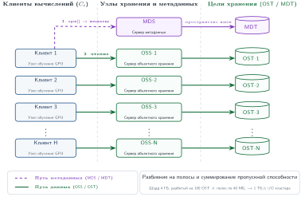

***Архитектура параллельной файловой системы**: разделение операций с метаданными (MDS $\to$ MDT) от потоковой передачи данных с высокой пропускной способностью (клиенты $\to$ OSS $\to$ OST), которое показывает, как разбиение файла на полосы суммирует пропускную способность хранилища кластера.*

Эта абстрактная архитектура имеет конкретные следствия для настройки производительности. Когда задание обучения создает новый каталог набора данных в Lustre, администратор задает **число полос (Stripe Count)** (число узлов OSS, по которым распределяется файл) и **размер полосы (Stripe Size)** (размер фрагмента, записываемого в каждый OSS) для этого каталога ({Lustre Wiki}, 2017). Для крупных последовательно читаемых обучающих шардов администраторы могут выбирать более широкое разбиение и полосы в несколько мегабайт, чтобы один файл черпал пропускную способность с нескольких узлов OSS. Руководство Lustre по разбиению на полосы рассматривает широкое разбиение как полезное для очень больших файлов или файлов, которые читает много клиентов, а мелкие файлы обычно используют меньше полос, чтобы снизить накладные расходы ({Lustre Wiki}, 2019). Шард данных 4 ГБ, разложенный по 100 узлам OSS с полосами по 4 МБ, размещает примерно по 10 полос на каждом OSS. Когда загрузчик данных читает большие непрерывные диапазоны, клиент Lustre может выдавать параллельные запросы чтения к узлам OSS, которые хранят эти полосы, и суммировать их пропускную способность. Клиент также держит собственный буфер опережающего чтения (read-ahead), предвыбирая следующие несколько полос, пока приложение обрабатывает текущие. Это опережающее чтение на уровне файловой системы отличается от буфера предвыборки на уровне приложения у загрузчика данных; два слоя предвыборки складываются, обеспечивая глубокое скрытие задержки и делая физическое расстояние до узлов OSS почти прозрачным для процесса обучения.

[^fn-oss-pfs-disambiguation]: **OSS (Object Storage Server)**: в терминологии параллельных файловых систем «объект» — это фрагмент полосатых данных файла, которым управляет целевое устройство объектного хранения. Такое употребление старше облачного объектного хранилища (S3, GCS) более чем на десятилетие. Путать их — частый источник недопонимания: когда администратор Lustre говорит «добавьте узлы OSS», он имеет в виду наращивание емкости обслуживания данных параллельной файловой системы, а не подключение облачных бакетов.

[^fn-lustre-parallel-origin]: **Lustre**: составное слово из «Linux» и «cluster», разработано в Университете Карнеги — Меллона и впервые развернуто в промышленной эксплуатации в 2003 году. Lustre распространен в HPC и инфраструктуре ML, потому что его архитектура линейно масштабирует суммарную пропускную способность с числом узлов OSS. Это свойство делает его естественным выбором для обучающих кластеров, где одно задание может требовать сотни ГБ/с устойчивого чтения.

Разделение путей метаданных и данных и обеспечивает суммарную пропускную способность, которой требуют рабочие нагрузки ML. В GPFS[^fn-gpfs-parallel-filesystem] (IBM Spectrum Scale) архитектура идет другим путем: она разбрасывает данные и метаданные по общим дискам и координирует параллельный доступ с помощью распределенных блокировок на основе токенов (Schmuck and Haskin, 2002). Результат — не простое разделение MDS/OSS, а конструкция с общими дисками, в которой размещение метаданных и данных может быть распределенным, а протокол блокировок сохраняет согласованность между клиентами. Цена — большая сложность управления блокировками, которое должно масштабироваться на тысячи узлов.

[^fn-gpfs-parallel-filesystem]: **GPFS (General Parallel File System)**: разработана в IBM Research с 1998 года, сегодня продается как IBM Spectrum Scale. В отличие от выделенной организации серверов метаданных и объектов у Lustre, GPFS — параллельная файловая система с общими дисками, которая может разбрасывать данные и метаданные и использует блокировки на основе токенов для координации параллельного доступа клиентов. Для записи контрольных точек ML эта модель распределенной координации может снизить зависимость от единственного выделенного пути метаданных, но она также делает поведение блокировок частью профиля производительности.

Это разделение порождает критическое узкое место: проблему мелких файлов. Если набор данных состоит из миллионов изображений по 10 КБ, хранимых отдельными файлами, нагрузка на метаданные переполняет MDS задолго до того, как насыщаются каналы данных. Каждый системный вызов `open()` требует поиска метаданных, захвата блокировки и получения атрибутов. Когда 10 000 воркеров одновременно вызывают `open()` для разных файлов, MDS становится точкой сериализации. Пропускная способность системы хранения схлопывается до скорости, с которой MDS может обрабатывать операции с метаданными, — обычно несколько сотен тысяч в секунду, что далеко ниже того, что мог бы дать путь данных.

> **Проблема мелких файлов**
>
> ***Проблема мелких файлов (Small File Problem)*** — патология загрузки данных в ML, при которой операции над отдельными файлами переполняют службу метаданных системы хранения.
>
> 1.  **Значение**: запросы `open`, `stat` и `close` от 10 000 воркеров могут сериализоваться в службе метаданных, простаивая кластер и снижая эффективную пропускную способность ввода-вывода $(\text{BW}_{\text{io}})$.
> 2.  **Отличие**: это проблема частоты запросов метаданных и задержки $(L_{\text{lat}})$, а не проблема объемной битовой скорости.
> 3.  **Частая ошибка**: более быстрые SSD не устраняют эту проблему формата. Упаковка образцов в последовательные контейнеры, такие как TFRecord или Parquet, амортизирует операции с метаданными на множество образцов.

На производственном масштабе узкое место по метаданным может обрушить даже высокопроизводительную файловую систему.

> **Крах метаданных**
>
> **Сценарий**: крупный кластер обучения переходит с предобработанного последовательного набора данных на 200 миллионов сырых файлов изображений, хранимых по отдельности на параллельной файловой системе, рассчитанной на 500 ГБ/с суммарной пропускной способности.
>
> **Диагностика**: файловая система отдает менее 1 процента номинальной пропускной способности. Миллионы вызовов `stat()` и `open()` в секунду перегружают серверы метаданных и душат загрузчики данных, несмотря на избыток сетевой и дисковой пропускной способности.
>
> **Урок для систем**: в масштабе конкуренция за метаданные становится главным узким местом хранения. Упаковка 200 миллионов сырых изображений в 50 000 крупных архивов tar (например, WebDataset) сокращает операции с метаданными в 4 000 раз и восстанавливает высокую пропускную способность последовательного чтения.

Инженерный ответ на проблему мелких файлов — **разбиение на полосы (Striping)** и **агрегация (Aggregation)**. Разбиение на полосы распределяет один большой файл по нескольким узлам OSS, чтобы клиент мог читать из всех них параллельно. Размер полосы (обычно от 1 до 4 МБ на OSS) задает гранулярность: файл 4 ГБ, разбитый полосами по 1 МБ по 100 узлам OSS, размещает по 40 МБ на каждом узле, и последовательное чтение насыщает все 100 путей данных одновременно. Число полос (сколько узлов OSS участвуют) можно задавать для каждого файла или каталога, что позволяет администраторам настраивать пропускную способность под разные шаблоны доступа. Шарды обучающих данных выигрывают от максимального разбиения; маленькие конфигурационные файлы выигрывают от минимального, чтобы не платить накладными расходами за координацию между многими узлами.

Взаимодействие размера полосы с шаблоном доступа определяет реальную пропускную способность. Если загрузчик данных читает шард последовательно, клиент PFS читает полосу 1 с OSS-A, полосу 2 с OSS-B, полосу 3 с OSS-C и так далее, естественно распределяя нагрузку по всем узлам OSS, которые хранят полосы этого файла. Если размер чтения меньше размера полосы, каждое чтение обслуживается одним узлом OSS, и клиент не получает выгоды от параллельного чтения. Если размер чтения захватывает несколько полос, клиент одновременно выдает параллельные чтения нескольким узлам OSS. Для нагрузок ML, которые читают блоки в несколько мегабайт (целый батч изображений или блок токенизированного текста в 4 МБ), размер чтения обычно превышает размер полосы, и достигается полная агрегация пропускной способности.

Агрегация дополняет разбиение на полосы сокращением числа файлов, которые должен отслеживать MDS. Мелкие образцы объединяются в крупные последовательные файлы (например, архивы tar WebDataset[^fn-webdataset-tar-streaming] или последовательности TFRecord), чтобы амортизировать накладные расходы метаданных на тысячи образцов. Один `open()` к архиву tar в 4 ГБ открывает доступ к 40 000 образцов и сокращает нагрузку на метаданные в 40 000 раз по сравнению с отдельными файлами.

[^fn-webdataset-tar-streaming]: **WebDataset**: формат данных, который использует стандартные архивы POSIX tar для обучения ML. Ключевая идея: последовательная раскладка tar «заголовок, затем данные», придуманная в 1979 году для резервного копирования на ленту, идеально ложится на шаблон потокового доступа, который нужен загрузчикам данных ML. Поскольку архивы tar — допустимые цели HTTP-запросов с диапазоном байтов, загрузчик данных может потоково получать образцы обучения прямо из объектного хранилища без локального промежуточного размещения, сокращая путь ввода-вывода с пяти уровней до двух.

Параллельные файловые системы предоставляют координируемое общее пространство имен и управление блокировками, которые нужны для надежных контрольных точек (Schmuck and Haskin, 2002). Когда сохранение контрольной точки завершено, каждый узел, который впоследствии читает эту контрольную точку, должен видеть одно и то же завершенное состояние. Эта гарантия необходима для восстановления после сбоя: если узел отказал и перезапустился, он должен прочитать контрольную точку, которую записали уцелевшие узлы, а не частично сброшенную версию. Достижение такой согласованности в масштабе требует аккуратной координации между менеджером блокировок MDS и распределенными путями записи OSS. Это одна из причин, по которой запись контрольных точек дороже чтения для обучения.

Модель согласованности имеет тонкости, важные для рабочих нагрузок ML. Для чтения обучающих данных сильная согласованность не нужна, потому что данные неизменяемы: однажды предобработанный и загруженный в параллельную файловую систему набор больше не меняется. Несколько воркеров, читающих один и тот же шард одновременно, могут делать это без блокировок, поскольку конкурирующих писателей нет и конфликтов не возникает. Такой шаблон «только чтение» позволяет PFS отдавать обучающие данные почти на теоретической пропускной способности. Записи контрольных точек, напротив, требуют эксклюзивных блокировок, чтобы не допустить частичных чтений во время записи, а захват и освобождение блокировки добавляют задержку к каждой операции сохранения. Некоторые системы смягчают это, записывая контрольные точки в новый файл, а не перезаписывая предыдущий, и обменивая место на хранилище на снижение конкуренции за блокировки.

Производительность параллельной файловой системы зависит не только от *числа* узлов OSS, но и от *балансировки* нагрузки между ними. Если задание обучения читает один крупный шард, разложенный по 10 узлам OSS, пока остальные 90 простаивают, задание получает лишь 10 процентов суммарной пропускной способности системы. Наоборот, если 100 заданий обучения каждое читают разные шарды, разложенные по всем 100 узлам OSS, суммарная пропускная способность приближается к теоретическому максимуму. Распределение шаблонов доступа к данным по кластеру — поэтому системная оптимизация, которая может заметно повлиять на реальную пропускную способность.

На масштабе тысяч узлов хвостовая задержка (Dean and Barroso, 2013) определяет производительность системы. Математика отрезвляет. Если шаг обучения требует данных от 100 серверов хранения, и каждый из них с вероятностью 1 процент работает медленно (из-за фонового обслуживания, сборки мусора или дрожания сети), то вероятность того, что все 100 ответят быстро, равна $0{,}99^{100} = 0{,}366$. Это значит, что более 63 процентов шагов обучения получат хотя бы один медленный ответ. Самый медленный ответ определяет время завершения шага, потому что параллельное по данным обучение требует, чтобы все воркеры завершили свои батчи до начала фазы коллективной коммуникации.

Системы смягчают хвостовую задержку с помощью **хеджированных запросов (Hedged Requests)**: после ожидания настраиваемого тайм-аута (обычно медианного времени ответа) клиент выдает избыточное чтение к другой реплике той же полосы данных. Используется первый пришедший ответ, второй отбрасывается. Если система хранения реплицирует каждую полосу на двух узлах OSS, вероятность того, что обе реплики медленны, составляет $0{,}01^2 = 0{,}0001$, и доля медленных шагов падает с 63 процентов до менее 1 процента. Стоимость избыточного запроса — одно дополнительное сетевое чтение — пренебрежимо мала по сравнению со стоимостью простаивающего ускорителя, который потребляет сотни ватт, ожидая данных.

Эффективность хеджированных запросов зависит от размещения реплик. Если обе реплики находятся на узлах OSS, которые делят один сетевой коммутатор, отказ коммутатора делает обе копии одновременно недоступными. Эффективное хеджирование требует **размещения с учетом доменов отказа (Failure-Domain-Aware Placement)**: реплики должны находиться в разных стойках и подключаться через разные коммутаторы верхнего уровня, чтобы отказ любого отдельного компонента затрагивал не более одной реплики.

В производственных кластерах параллельная файловая система — общая утилита, одновременно обслуживающая десятки конкурирующих заданий обучения с разными шаблонами ввода-вывода. В любой момент задание с большой языковой моделью может потоково читать текстовые шарды, задание компьютерного зрения — читать случайные шарды изображений, а шквал контрольных точек от третьего задания может насыщать пропускную способность записи. Эта конкуренция порождает **проблему шумного соседа (Noisy Neighbor Problem)**: ввод-вывод одного задания сильно ухудшает производительность всех остальных. Сохранение контрольной точки, которое забирает непропорционально большую долю внутренней сетевой пропускной способности PFS, приводит к всплеску задержки чтения для других заданий и может остановить их конвейеры обучения. Администраторы PFS смягчают это политиками планирования ввода-вывода (уровни качества обслуживания, квоты пропускной способности на задание), но такие политики добавляют административной сложности и могут снижать пиковую пропускную способность одного задания.

Связанная задача — **изоляция пространств имен (Namespace Isolation)**. Разным командам и нагрузкам нужны разные конфигурации хранения. Команде, которая обучается на миллионах изображений по 100 КБ, нужен каталог с большим числом полос и малым размером полосы, чтобы максимизировать производительность метаданных. Команде, которая работает с крупными видеофайлами, нужно меньше, но более крупных полос, чтобы оптимизировать последовательную пропускную способность. Неверная настройка полос для нагрузки одной команды может создать горячие точки, которые ухудшат работу всей общей файловой системы. Влияние совместного использования легко подсчитать: PFS с суммарной пропускной способностью 1 ТБ/с, разделенная между 10 одновременными заданиями обучения, дает в среднем лишь 100 ГБ/с на задание. Если шквал контрольных точек одного задания забирает 400 ГБ/с на 10 секунд, остальные девять заданий делят 600 ГБ/с — снижение на 33 процента, которое может вызвать простои данных в их конвейерах ускорителей.

> **Проектирование параллельной файловой системы**
>
> Рассмотрим обучающий кластер из 512 узлов, на каждом по 8 GPU. Задание обучения требует 400 ГБ/с суммарной пропускной способности чтения.
>
> - [ ] **Число OSS**: рассчитайте число узлов OSS, необходимое, если каждый OSS Lustre дает 10 ГБ/с.
> - [ ] **Стоимость метаданных**: рассчитайте время, которое нужно, чтобы последовательно открыть 200 миллионов файлов изображений по 150 КБ, если каждый вызов `open()` занимает 50 мкс на MDS, затем сформулируйте практическое следствие.
> - [ ] **Число шардов**: рассчитайте число операций с метаданными, необходимых для чтения всего набора данных, если изображения упакованы в архивы tar по 4 ГБ.

Параллельные файловые системы решают задачу общего пространства имен для активных обучающих кластеров, но их стоимость за байт слишком высока для всего объема данных организации. Петабайты сырых обучающих данных, исторических контрольных точек и предобработанных наборов, которые организация ML накапливает за годы, требуют уровня, оптимизированного под емкость и долговечность, а не под пропускную способность.

### Уровень 4: объектное хранилище
На масштабе петабайтов объектное хранилище (Object Storage) составляет долговечную и экономичную основу иерархии. Такие сервисы, как Amazon S3 и Google Cloud Storage, организуют данные в объектных пространствах имен, где объекты извлекаются по ключам, а не по путям каталогов POSIX ({Amazon Web Services}, 2026; {Google Cloud}, 2026). В отличие от файловых систем, которые организуют данные в иерархические каталоги с богатыми метаданными операциями (переименование, создание ссылок, наследование прав), объектное хранилище рассматривает каждый объект как непрозрачный блок, идентифицируемый уникальным ключом. Это упрощение устраняет сложность метаданных, которая мучает параллельные файловые системы в масштабе, и позволяет горизонтально расширять пулы емкости до очень больших размеров.

Объектное хранилище нацелено на «одиннадцать девяток»[^fn-durability-nines-availability] долговечности (99,999999999 процента) за счет кодирования с исправлением стирания (erasure coding)[^fn-reedsolomon-erasure-coding] и географической репликации. Такая цель делает объектное хранилище естественным уровнем-источником истины для обучающих данных и архивов контрольных точек, но при этом по-прежнему требуются версионирование, политики жизненного цикла, контроль доступа и тестирование восстановления для операционных сбоев, которые лежат за пределами модели долговечности сервиса хранения.

Три разные гарантии определяют, пригоден ли этот источник истины. **Долговечность (Durability)** отвечает на вопрос, переживают ли подтвержденные данные сбои; **доступность (Availability)** — отвечает ли сервис хранения, когда клиент в нем нуждается; а **согласованность (Consistency)** — какую версию чтение имеет право увидеть, когда записи перекрываются или реплики расходятся. Репликация может улучшать долговечность и доступность, но сама по себе не гарантирует, что читатель увидит самую новую зафиксированную контрольную точку. Поэтому проект восстановления должен явно задавать все три свойства, а не считать процент долговечности полным договором о надежности.

[^fn-reedsolomon-erasure-coding]: **Кодирование с исправлением стирания (Erasure Coding)**: основано на кодах Рида — Соломона (Reed and Solomon, 1960), которые используют код с максимальным разделением расстояний, чтобы восстановить исходные данные из любого достаточного подмножества закодированных фрагментов. В системах хранения коды в духе Рида — Соломона и более поздние варианты с локальной реконструкцией обменивают накладные расходы на хранение на пропускную способность ремонта и стоимость чтения при деградации (Plank, 1997; Huang et al., 2012). Для хранения ML компромисс конкретен: код 4+2 выдерживает потерю двух фрагментов при накладных расходах на хранение 1,5×, тогда как тройная репликация стоит 3×; чтение при деградации при этом платит дополнительным сетевым вводом-выводом и работой по реконструкции, когда фрагменты недоступны.

[^fn-durability-nines-availability]: **Одиннадцать девяток (99,999999999 процента долговечности)**: проектная цель в 11 девяток годовой долговечности соответствует ожидаемой вероятности потери около $10^{-11}$ на объект в год; для одного миллиона объектов это примерно одна ожидаемая потеря объекта на 100 000 лет. Такая экстремальная долговечность — причина, по которой объектное хранилище — единственный уровень, где обучающие данные и архивы контрольных точек можно считать постоянными. Та же косвенность сервиса, кодирование с исправлением стирания, репликация и поиск метаданных, которые обеспечивают долговечность, делают объектное хранилище уровнем с большей задержкой, чем локальный NVMe или теплая параллельная файловая система, поэтому конвейерам данных реального времени нужна буферизация предвыборки.

> **Кодирование с исправлением стирания**
>
> ***Кодирование с исправлением стирания (Erasure Coding)*** — схема защиты хранения для наборов данных ML и архивов контрольных точек: объект разбивается на $k$ блоков данных и $m$ блоков четности, и исходный объект можно восстановить из любых $k$ оставшихся фрагментов.
>
> 1.  **Значение**: схема дает экстремальную долговечность (например, «одиннадцать девяток») при значительно меньших накладных расходах на хранение, чем репликация. Например, код 4+2 хранит четыре фрагмента данных и два фрагмента четности, поэтому выдерживает недоступность двух фрагментов при накладных расходах 1,5× вместо 3× у тройной репликации.
> 2.  **Отличие**: в отличие от репликации (которая хранит полные копии), кодирование с исправлением стирания использует математическое кодирование (например, Рида — Соломона), чтобы распределить избыточную информацию по разным доменам отказа (дискам, стойкам или площадкам).
> 3.  **Частая ошибка**: распространено заблуждение, что кодирование с исправлением стирания — это «бесплатная долговечность». На деле это компромисс между задержкой и вычислениями: восстановление данных после сбоя требует дополнительных тактов CPU и увеличивает хвостовую задержку $(L_{\text{lat}})$ чтения из хранилища.

Инженерия за кодированием с исправлением стирания иллюстрирует повторяющуюся тему систем хранения: достижение экстремальной долговечности через избыточность, невидимую для приложения. Когда задание обучения ML читает шард из объектного хранилища, сервис прозрачно читает $k$ фрагментов с доступных узлов, восстанавливает исходный шард и возвращает его клиенту. Если один фрагмент лежит на отказавшем диске, сервис читает дополнительные закодированные фрагменты и восстанавливает недостающие данные. Клиент не замечает сбоя, но система хранения платит дополнительным вводом-выводом, сетевой нагрузкой и работой по декодированию, что и создает более высокую хвостовую задержку объектного хранилища по сравнению с локальным NVMe.

Ценовое преимущество объектного хранилища значительно: при типичной цене \$0,02/ГБ в месяц оно в 750 раз дешевле HBM за байт и в 5 раз дешевле локального NVMe. Для обучающего набора данных объемом 100 ТБ объектное хранилище при этом допущении стоит примерно \$24 000 в год, тогда как локальный NVMe — \$120 000. Это ценовое преимущество делает объектное хранилище обычным домом для «озера данных» обучения организации, где сырые данные, предобработанные наборы и архивные артефакты моделей могут долговечно храниться.

Недостаток по задержке не менее значителен. Запрос GET к объектному хранилищу может занимать десятки миллисекунд; проектные оценки используют диапазон 50–100 мс как типичный для планирования, а не как универсальную гарантию сервиса. Эта задержка — следствие многоуровневой косвенности, которая обеспечивает долговечность. Когда клиент запрашивает объект, сервис хранения должен найти его местоположение в распределенном индексе метаданных, определить, какие закодированные фрагменты читать, получить фрагменты, возможно, с разных узлов хранения, и восстановить исходный объект. Эти накладные расходы незаметны для крупных объектов (где доминирует время передачи), но катастрофичны для мелких (где доминирует задержка на запрос).

Решение — тот же паттерн агрегации, что и в параллельных файловых системах: образцы упаковываются в шарды размером в несколько гигабайт в форматах вроде WebDataset (Aizman et al., 2019) или Mosaic Streaming ({Databricks}, 2026), которые превращают случайный доступ с высокой задержкой в потоковое последовательное чтение с высокой пропускной способностью. Вместо миллиардов мелких запросов GET загрузчик данных выдает сотни крупных параллельных чтений, каждое из которых забирает целый шард с тысячами образцов. При достаточном параллелизме и совмещенной сетевой мощности объектное хранилище может поддерживать высокую суммарную пропускную способность, достаточную для кормления крупных обучающих кластеров в некоторых нагрузках. Потоковый паттерн работает так: каждому воркеру загрузчика данных назначается подмножество шардов, и он читает их последовательно. Внутри шарда образцы хранятся подряд, поэтому воркер декодирует их по порядку и перемешивает в локальном буфере. Такой подход обеспечивает псевдослучайный доступ по всему набору данных, сохраняя последовательный ввод-вывод на уровне хранения.

Архитектура потокового загрузчика данных для объектного хранилища существенно отличается от загрузчика для локального хранилища. Загрузчик с локальным хранилищем может использовать отображение в память (memory-mapped I/O), чтобы считать набор данных виртуальной областью памяти, полагаясь на механизм страничных ошибок операционной системы для подгрузки данных по требованию. Этот подход элегантен, но несовместим с объектным хранилищем, которое не поддерживает интерфейс файловой системы POSIX, необходимый для отображения в память. Вместо этого загрузчик для объектного хранилища должен явно управлять HTTP-соединениями, выдавать запросы GET с диапазонами для конкретных байтовых интервалов внутри шардов, повторять запросы при временных сбоях и управлять пулом локальных буферов для декодированных образцов. Библиотеки вроде WebDataset и Mosaic Streaming инкапсулируют эту сложность, предоставляя циклу обучения простой интерфейс итератора и управляя HTTP-транспортом и буферизацией внутри себя.

Применение этой потоковой архитектуры к основному примеру делает проект конкретным. Токенизированный обучающий набор хранится в объектном хранилище S3-типа примерно как 2 000 шардов по 3 ГБ. Потоковая архитектура назначает каждому из 256 вычислительных узлов уникальное подмножество из примерно 8 шардов. Внутри каждого узла 8 процессов воркеров загрузчика данных выдают одновременные HTTP-запросы `Range`, чтобы получить блоки по 256 МБ из назначенных им шардов. По всему кластеру это дает 2 048 одновременных запросов, что обеспечивает суммарную пропускную способность в диапазоне 50–100 ГБ/с, когда объектное хранилище и сетевой путь рассчитаны на это, — с большим запасом покрывая примерно 167,8 МБ/с, необходимых для обучения текстовой модели. В этом режиме узкое место часто смещается с пропускной способности объектного хранилища на пропускную способность сети между вычислительным VPC и конечной точкой объектного хранилища. Организации, которые размещают вычисления и хранилище в одной зоне доступности облака, могут снизить межсетевую задержку, напрямую уменьшая необходимую глубину буфера предвыборки и повышая общую эффективность конвейера.

Объектное хранилище открывает большой параллелизм запросов. Каждый запрос GET независим и может обслуживаться разным узлом хранения внутри инфраструктуры облачного провайдера. Обучающий кластер из 1 024 узлов, на каждом из которых 8 воркеров загрузчика выдают одновременные запросы, создает 8 192 одновременных запроса GET. Если каждый запрос забирает шард в 256 МБ, суммарная пропускная способность зависит от сетевой мощности облачного провайдера, внутренней пропускной способности и квот на частоту запросов. Практический предел часто задает пропускная способность сети между вычислительным кластером и сервисом объектного хранилища, а не внутренняя пропускная способность носителей сервиса.

Многие сервисы объектного хранилища обеспечивают сильную согласованность «чтение после записи» (read-after-write), то есть после записи контрольной точки в объектное хранилище последующее чтение видит полные данные. Так было не всегда: до декабря 2020 года Amazon S3 предоставлял согласованность в конечном счете (eventual consistency) для перезаписи объектов (PUT) и удалений (DELETE), то есть чтение сразу после обновления или удаления существующего объекта могло вернуть устаревшие данные. Новые объекты записывались всегда с сильной согласованностью, но рабочие процессы контрольных точек, которые обновляют указатель «latest» или перезаписывают существующий артефакт, были уязвимы: узел, восстанавливающийся после сбоя, мог прочитать устаревшую контрольную точку и испортить состояние обучения. Переход в декабре 2020 года к сильной согласованности «чтение после записи» для всех операций Amazon S3 закрыл этот пробел для хранения контрольных точек в стиле S3 ({Amazon Web Services}, 2020), а более широкий урок проектирования — проверять семантику согласованности того объектного хранилища, которое использует конвейер. Это свойство согласованности делает объектное хранилище пригодным и как источник обучающих данных (исходный набор), и как долгосрочное хранение контрольных точек (архивная копия после промежуточного размещения на локальном NVMe), при условии что конвейер проверяет семантику сервиса, на которую полагается.

Огромный масштаб наборов данных ML делает их уязвимыми для **тихого повреждения данных (Silent Data Corruption)**: тонких переворотов битов в носителе хранения или при сетевой передаче, которые могут внести артефакты обучения, почти невозможные для диагностики. Сервисы объектного хранилища предоставляют контрольные суммы для каждого объекта, которые проверяют целостность при загрузке, копировании или скачивании; например, Amazon S3 описывает варианты контрольных сумм, включая семейство CRC и криптографические хэши ({Amazon Web Services}, 2026). Параллельные файловые системы часто полагаются на нижележащие RAID или кодирование с исправлением стирания для физической целостности, но могут не предоставлять сквозных контрольных сумм, видимых приложению. Надежный крупномасштабный конвейер ML вычисляет и сохраняет контрольную сумму каждого шарда данных при предобработке и проверяет ее, когда шард впервые загружает воркер обучения. Накладные расходы на проверку пренебрежимо малы по сравнению с ценой обучения на поврежденных данных. Для контрольных точек моделей проверка целостности еще важнее: один перевернутый бит в весе или состоянии оптимизатора может испортить модель, и обучение тихо разойдется после восстановления. Фреймворки и библиотеки контрольных точек могут включать проверку целостности, но конвейер не должен полагаться на нее без тестирования формата контрольной точки.

Безопасность хранения — первоклассная задача в промышленной инфраструктуре ML. Обучающие наборы часто содержат чувствительную информацию (персональные данные, закрытые тексты, лицензированные изображения), которая требует контроля доступа. Объектное хранилище предоставляет детальные политики безопасности через роли управления идентификацией и доступом, политики на уровне бакетов и встроенное шифрование данных в покое и при передаче. Параллельные файловые системы предоставляют права POSIX и списки контроля доступа, но часто не имеют журналирования аудита, которое требует соответствие нормативам. Для организаций, подпадающих под законы о защите данных, такие как Общий регламент ЕС по защите данных (GDPR) и Закон Калифорнии о защите прав потребителей (CCPA), архитектура хранения должна обеспечивать журналирование доступа к данным, возможность выполнить запросы на удаление (что усложняется неизменяемыми предобработанными шардами) и то, что контрольные точки моделей не запоминают защищенную информацию непреднамеренно. Поэтому проектирование хранения должно сохранять и пропускную способность, и метаданные управления.

Переход с уровня 4 на уровень 5 определяется прежде всего экономикой: данные, к которым редко обращаются, должны переезжать в архивное хранилище, когда этому не мешают требования к задержке извлечения и управлению, поскольку стоимость хранения там может быть на порядок ниже.

### Уровень 5: архив и холодное хранилище
Последний уровень обеспечивает долгосрочное сохранение для соответствия требованиям и аудита. Архивные сервисы (например, S3 Glacier) созданы для данных, к которым редко обращаются: журналы обучения прошлых лет, замененные контрольные точки моделей, следы аудита для нормативного соответствия. При типичной цене \$0,004/ГБ в месяц архивное хранение стоит примерно \$4 800 в год за 100 ТБ, что в 5 раз дешевле допущения \$0,02/ГБ в месяц для объектного хранилища, использованного в [разделе «Уровень 4: объектное хранилище»](#sec-storage-tier4-object). Компромисс — задержка извлечения, измеряемая минутами и часами, что делает этот уровень непригодным для оперативного доступа.

Основная ценность архивного хранилища — организационная память. Когда модель, обученная два года назад, демонстрирует неожиданное поведение в продуктиве, возможность восстановить точные обучающие данные, гиперпараметры и промежуточные контрольные точки для криминалистического анализа зависит от архивного хранилища. Организации, которые агрессивно удаляют старые данные ради экономии, обнаруживают, часто в самый неподходящий момент, что не могут воспроизвести или объяснить поведение развернутых моделей.

Автоматизированные **политики жизненного цикла (Lifecycle Policies)** управляют переходом данных между уровнями в зависимости от давности доступа. В качестве иллюстрации того, как выражается такая автоматизация, временное правило для инфраструктуры ML может переносить контрольные точки так: три самые свежие контрольные точки остаются в параллельной файловой системе для быстрого восстановления; контрольные точки старше 72 часов переводятся в объектное хранилище; старше 90 дней — в архивное хранилище; старше двух лет — удаляются, если не помечены для нормативного хранения. Правила жизненного цикла S3 предоставляют тот же общий механизм перехода, архивирования и удаления для сроков жизни объектов ({Amazon Web Services}, 2026). Пример с обучением позже использует вариант того же подхода, основанный на количестве ([раздел «Контрольные точки»](#sec-storage-checkpointing)), где правило перехода привязано к числу контрольных точек, а не к возрасту. Без автоматизации команды либо копят данные на дорогих уровнях (тратя бюджет), либо удаляют их слишком агрессивно (теряя воспроизводимость). Политика жизненного цикла кодирует компромисс организации между затратами и возможностью восстановления в декларативном правиле, которое не требует ручного вмешательства.

Для запуска обучения модели на 175 миллиардов параметров архивный уровень хранит полную родословную обучения: исходный сжатый корпус объемом 3 ТБ, набор сериализованных шардов объемом 6 ТБ, все скрипты предобработки, итоговую контрольную точку и выборку промежуточных контрольных точек. Если организация консервативно закладывает 100 ТБ под эту сохраняемую родословную, двухлетнее архивное хранение обходится примерно в \$9 600 (100 ТБ по \$0,004/ГБ в месяц × 24 месяца), что намного меньше одного дня работы GPU обучающего кластера. Асимметрия между стоимостью архива и стоимостью вычислений делает хранение дешевым по сравнению с запуском, который оно документирует. Сбои в архивировании обычно отражают отсутствие владельца жизненного цикла, неясную политику хранения или пренебрежение процессом извлечения, а не стоимость емкости.

Архивные сервисы предлагают несколько уровней скорости извлечения, каждый с собственной ценой. В сервисе типа S3 Glacier стандартное извлечение может завершиться в течение нескольких часов по умеренной цене, ускоренное — в течение минут по более высокой цене, а массовое может еще больше увеличить задержку ради самой низкой цены извлечения ({Amazon Web Services}, 2026). Выбор уровня извлечения зависит от срочности сценария использования. Криминалистический анализ производственного инцидента оправдывает более быстрое извлечение; ежегодный аудит соответствия может использовать медленное массовое извлечение. Проектирование политики жизненного цикла требует понимания стоимости хранения, ожидаемой частоты извлечения и срочности для каждого класса данных.

Требования соответствия могут обязывать организации хранить записи о происхождении данных обучения для развернутых моделей. Например, Закон ЕС об ИИ требует документации для систем ИИ высокого риска, включая сведения о составе обучающих данных и предобработке. Архивное хранилище обычно является экономически приемлемым уровнем для хранения полной родословной модели, от сырых данных через предобработку до итоговой контрольной точки, на требуемый срок хранения. Стоимость хранения для соответствия часто мала по сравнению с операционными и юридическими издержками недостаточной документации.

### Форматы данных для обучения
Выбор формата данных определяет, отдает ли иерархия хранения свою теоретическую пропускную способность или схлопывается под накладными расходами метаданных. Один и тот же многотерабайтный набор данных в разных форматах может давать пропускную способность ввода-вывода, отличающуюся более чем в 100 раз на одинаковом железе. Для крупномасштабного машинного обучения данные должны быть структурированы для высокопроизводительного последовательного доступа, а не для удобства человека или транзакций.

Полезный вопрос проектирования — какую цену доступа должна платить нагрузка: метаданные на каждый файл, ненужные чтения признаков или последовательный обход шардов. **Строчно-ориентированные форматы (Row-Oriented Formats)**, такие как CSV, JSON lines или каталог отдельных файлов изображений (JPEG, PNG), наиболее интуитивны и читаемы человеком. Их легко просматривать и отлаживать, поэтому они подходят для первоначального исследования данных или для наборов, которые целиком помещаются в память (обычно меньше 10 ГБ). Для обучения в масштабе они катастрофичны для производительности ввода-вывода. Каждый образец — отдельный файл, требующий отдельной операции файловой системы (`open`, `stat`, `read`, `close`), которая несет значительные накладные расходы на образец и часто доминирует над фактическим временем чтения данных.

Второй выбор решает другую задачу хранения: **колоночные форматы (Columnar Formats)**, такие как Apache Parquet и Apache Arrow, избегают ненужных чтений, когда табличные признаки можно выбрать до передачи. Они организуют данные по столбцам, а не по строкам, что позволяет отлично сжимать данные: значения одного столбца обычно одного типа и имеют меньшую энтропию. Такая структура также открывает **предикатное проталкивание (Predicate Pushdown)**: механизм хранения читает только конкретные столбцы (признаки), нужные запросу, избегая лишнего ввода-вывода. Эти форматы хорошо подходят для табличных задач ML и инженерии признаков, но менее естественны для неструктурированных данных, таких как изображения или аудио, которые рассматриваются как неделимые блоки.

Третий выбор напрямую отвечает паттерну доступа при обучении: **потоковые последовательные форматы (Sequential Streaming Formats)** сводят метаданные на образец к стоимости открытия шарда. TFRecord, StreamingDataset от Mosaic ({Databricks}, 2026) и WebDataset (на основе стандартных архивов `tar`) группируют множество образцов в крупные непрерывные двоичные файлы, называемые шардами. Это амортизирует стоимость открытия файла на тысячи образцов. Загрузчик данных открывает один шард и потоково читает его содержимое последовательно, максимизируя пропускную способность. Форматы на основе `tar` имеют дополнительное преимущество: это допустимые цели для HTTP-запросов с диапазонами байтов, что делает их идеальными для потоковой передачи данных прямо из объектного хранилища без скачивания всего файла.

Ключевой компромисс внутри потоковых форматов — наличие **индекса (Index)**. TFRecord и HDF5 часто используют отдельный файл индекса, в котором записано байтовое смещение каждого образца внутри шарда. Это позволяет эффективно читать образцы в произвольном порядке внутри шарда, но вводит зависимость от метаданных: индекс нужно прочитать и держать в памяти. WebDataset не использует индекс: каждая запись в архиве `tar` содержит собственный заголовок с размером, что позволяет чисто последовательное потоковое чтение без внешних метаданных. Компромисс в том, что форматы без индекса не могут эффективно перейти к произвольному образцу внутри шарда, а эта возможность важна для обучения по учебной программе или активного обучения, которым нужен непоследовательный доступ к данным.

Интеграция сжатия тоже различается по форматам. Parquet встраивает сжатие на уровне столбцов, используя однородность типов для высоких коэффициентов. WebDataset и TFRecord обычно оставляют сжатие отдельным образцам: WebDataset с изображениями хранит уже сжатые файлы JPEG, тогда как текстовый набор может применять zstd на уровне шарда. Этот выбор влияет на компромисс между CPU и вводом-выводом, обсуждавшийся в связи с чтениями NVMe, поскольку распаковку каждого образца должен выполнять CPU хоста.

Для основного примера 1,5 триллиона токенов хранятся как примерно 2 000 шардов по 3 ГБ каждый в собственном двоичном формате. Каждый шард содержит небольшой заголовок (число токенов, размер словаря, порядок байтов), за которым следует непрерывный массив 4-байтовых идентификаторов токенов. Когда данные размещены на POSIX-хранилище, таком как локальный NVMe или параллельная файловая система, загрузчик данных отображает шард в память и индексирует массив токенов напрямую по позиции, достигая почти пиковой пропускной способности чтения при нулевых накладных расходах метаданных на образец. Когда те же шарды читаются прямо из объектного хранилища, загрузчик использует потоковые HTTP-запросы GET с диапазонами и явный локальный буфер вместо отображения в память. [Таблица «Сравнение форматов данных для обучения»](#tbl-data-formats) сравнивает форматы по цене доступа, которую они накладывают на путь хранения.

***Сравнение форматов данных для обучения ML**: накладные расходы на образец определяют, реализуется ли пропускная способность аппаратного хранилища или тратится на операции с метаданными.*

| **Формат**          |         **Накладные расходы на образец**          | **Произвольный доступ** | **Потоковая передача** | **Сжатие**      |
|:--------------------|:------------------------------------:|:-----------------:|:-------------:|:---------------:|
| Отдельные файлы     | $\approx 50\ \text{мкс}$ (open/stat/close) |        Да         |     Плохо     |  Для каждого файла |
| Parquet             |  $\approx 1\ \text{мкс}$ (поиск группы строк) |  Да (группа строк) |     Хорошо    |  На уровне столбцов |
| TFRecord            |  $\approx 0{,}1\ \text{мкс}$ (поиск по индексу) |   С индексом      |   Отлично     |  Для каждой записи |
| WebDataset (`tar`)  |           ~0 (последовательно)       |        Нет        |     Отлично   |  Для каждого образца |
| Сырой двоичный (токены) |                  0                   | Да (байтовое смещение) |   Отлично     |   Не нужно      |

Сравнение в [таблице «Сравнение форматов данных для обучения»](#tbl-data-formats) задает член объема данных в уравнении конвейера и превращает выбор формата в задачу расчета пропускной способности.

## Уравнение конвейера данных
Каждое задание обучения рано или поздно ставит конкретный вопрос проектирования: какую пропускную способность хранения должен обеспечивать конвейер, прежде чем ускорители начнут простаивать? Требуемая скорость зависит от конфигурации обучения, и ошибка в любую сторону дорого стоит. Недостаточная пропускная способность хранения морит ускорители голодом. Избыточная — тратит бюджет на емкость хранилища, которая простаивает частично. **Уравнение пропускной способности конвейера данных (Data Pipeline Throughput Equation)** в [уравнении «Требуемая пропускная способность конвейера»](#eq-pipeline-throughput) задает пропускную способность, которую конвейер должен устойчиво поддерживать, чтобы ускорители никогда не ждали данных:

$$\text{BW}_{\text{required}} = N_{\text{GPU}} \times \eta_{\text{target}} \times \frac{D_{\text{vol,batch}}}{T_{\text{iteration}}}$$

где $N_{\text{GPU}}$ — число ускорителей, $\eta_{\text{target}}$ — целевая утилизация (обычно от 0,8 до 0,95), $D_{\text{vol,batch}}$ — размер одного локального батча в байтах, а $T_{\text{iteration}}$ — время одного прямого и обратного прохода.

Уравнение спроса задает размер конечной точки, обращенной к ускорителю, но байты должны пройти всю цепочку обслуживания. Пусть $r_k$ обозначает измеренную скорость обслуживания этапа $k$, включая чтения из объектного хранилища, сетевую передачу, декодирование и аугментацию, копирование в памяти хоста и передачу с хоста на устройство. При ограниченных буферах и отсутствии устойчивого накопления очереди конвейер может отдавать не больше

$$r_{\text{pipeline}} = \min_k r_k, \qquad r_{\text{pipeline}} \geq \text{BW}_{\text{required}}.$$

Емкость одного уровня не может компенсировать более медленный нижестоящий этап. Сжатие может повысить скорость чтения из хранилища, одновременно снижая скорость декодирования; дополнительные воркеры загрузчика могут повысить пропускную способность декодирования, одновременно насыщая этап памяти хоста или PCIe. Сквозное неравенство в [уравнении «Цепочка обслуживания»](#eq-storage-service-chain) превращает иерархию главы в проверяемый контракт: измерьте каждый этап при репрезентативной конкуренции, а затем подготовьте или перекройте тот этап, скорость обслуживания которого минимальна.

Уравнение показывает четыре рычага управления спросом на хранение:

- **Число ускорителей**: сокращение $N_{\text{GPU}}$ напрямую снижает требования к пропускной способности, но меньше ускорителей означает и меньшую пропускную способность обучения.
- **Целевая утилизация**: снижение $\eta_{\text{target}}$ уменьшает нужную пропускную способность, но мириться с низкой утилизацией — значит тратить дорогое оборудование впустую.
- **Объем батча**: уменьшение $D_{\text{vol,batch}}$ сокращает объем данных на итерацию, но меньшие батчи могут повредить сходимости модели.
- **Время итерации**: увеличение $T_{\text{iteration}}$ дает хранилищу больше времени на доставку каждого батча, но более медленные итерации растягивают общее время обучения.

На практике ни один из этих рычагов не бесплатен, и конвейер нужно проектировать так, чтобы он обеспечивал пропускную способность, которую требует конфигурация обучения.

В отдельном примере обучения на изображениях возьмем 256 GPU, обучающихся на изображениях масштаба ImageNet, с итерациями по 200 мс и целевой утилизацией 80 процентов. Такая конфигурация требует 39,3 ГБ/с суммарной пропускной способности хранения. Эта пропускная способность должна поддерживаться непрерывно на протяжении всего обучения, которое может длиться дни или недели. Если в какой-то момент система хранения отдает меньше 39,3 ГБ/с, ускорители начинают простаивать. Для языковой модели на 175 миллиардов параметров из основного примера токенизированный текст имеет гораздо меньший спрос на пропускную способность на батч, но общий объем данных и трафик контрольных точек за весь запуск гораздо больше, и узкое место смещается от пикового спроса на обучающие данные к устойчивой пропускной способности и перемещению контрольных точек на протяжении недель.

Последствия недостатка пропускной способности отражает **коэффициент простоя данных (Data Stall Ratio)**, определенный в [уравнении «Простой данных»](#eq-data-stall) как доля каждого шага обучения, в течение которой ускоритель ждет данных:

$$\text{Простой данных, \%} = \frac{T_{\text{step}} - T_{\text{compute}}}{T_{\text{step}}} \times 100$$

Без перекрытия время шага складывается из времени вычислений и времени ввода-вывода. Конвейеризация сокращает время шага до большего из двух интервалов, а время простоя — до положительной разности между вводом-выводом и вычислениями.

> **Коэффициент простоя данных**
>
> **Задача**: GPU обрабатывает батч за 200 мс, но хранилищу нужно 250 мс, чтобы подать следующий батч. Какую долю каждого шага обучения ускоритель простаивает и насколько конвейеризация ввода-вывода с вычислениями снижает этот простой?
>
> **Без конвейеризации** (сначала ввод-вывод, затем вычисления):
>
> $$T_{\text{step}} = T_{\text{I/O}} + T_{\text{compute}} = 250 + 200 = 450 \text{ мс}$$
> $$\text{Простой, \%} = \frac{250}{450} = 55{,}6\%$$
>
> **С конвейеризацией** (ввод-вывод перекрыт вычислениями):
>
> $$T_{\text{step}} = \max(200, 250) = 250 \text{ мс}$$
> $$\text{Простой, \%} = \frac{250 - 200}{250} = {20\%}$$
>
> **Системный вывод**: даже с конвейеризацией ускоритель простаивает 20 процентов времени. Чтобы полностью устранить простой, следующий батч должен приходить внутри 200-миллисекундного окна вычислений: либо за счет роста эффективной пропускной способности хранения, либо за счет скрытия хвостовой задержки более глубокими буферами предвыборки, либо за счет большего числа параллельных потоков ввода-вывода.

Коэффициент простоя данных служит диагностической метрикой, по которой инженеры хранения определяют, ограничено ли задание обучения вычислениями или вводом-выводом. Коэффициент простоя ниже 2 процентов говорит о том, что конвейер хранения здоров: ускоритель тратит почти все время на вычисления. Коэффициент от 2 до 10 процентов означает, что конвейер едва достаточен и начнет деградировать при изменении конфигурации обучения (больше GPU, меньше батчи, более быстрая модель). Коэффициент выше 10 процентов указывает на явное узкое место хранения, которое расходует значительный бюджет вычислений впустую. Приложение к тому о таксономии C³ (светофорная диагностика, которая пока не переведена) сопоставляет эти же зеленую, желтую и красную зоны с общей диагностикой парка, поэтому инженер по хранению может читать высокий коэффициент простоя как красный сигнал: вычисления простаивают, и хранилище нужно рассматривать вместе с другими осями, которые морят ускоритель голодом. Инструменты профилирования, например профилировщик DataLoader в PyTorch и NVIDIA Nsight Systems, могут измерять коэффициент простоя данных напрямую, сравнивая время, которое ускоритель ждет данных, с временем вычислений.

Система хранения не может быть компонентом по принципу «запустил и забыл»: ей нужен непрерывный мониторинг, чтобы тихие узкие места не съедали эффективность обучения. Ключевые метрики для отслеживания в реальном времени включают утилизацию пропускной способности по уровням (NVMe, сеть, объектное хранилище), глубину буфера предвыборки (сколько батчей стоит в очереди и готовы), коэффициент простоя данных на каждый GPU, частоту операций с метаданными параллельной файловой системы и показатели здоровья накопителей NVMe (уровень износа, температура, число ошибок). Пороги оповещения должны срабатывать до того, как простои станут видны на кривых функции потерь обучения. Незамеченное увеличение коэффициента простоя данных на 5 процентов в кластере из 1 000 GPU всего на одну неделю сжигает более \$16 800 впустую простаивающих вычислений (1 000 GPU × \$2 в час на GPU × 168 часов × 5 процентов), поэтому всеобъемлющий мониторинг хранения — экономическая задача первого порядка, а не операционная мелочь.

Этот высокоуровневый мониторинг нужно дополнить детальным профилированием, чтобы точно указать источник узкого места. Профилирование ведется на трех уровнях. На уровне приложения NVIDIA Nsight Systems показывает временную шкалу, где видно, когда и как долго ускоритель простаивает в ожидании данных, с точностью до микросекунд. На уровне конвейера профилировщик `DataLoader` в PyTorch сообщает пропускную способность по воркерам, время обработки батчей и глубину очереди данных, позволяя найти медленных воркеров или недостаточную предвыборку. На уровне устройств `iostat` и `nvme-cli` дают сырые метрики пропускной способности и задержки оборудования. Для параллельных файловых систем `lctl get_param` в Lustre и `mmpmon` в GPFS дают статистику в реальном времени по загрузке серверов хранения, частоте операций с метаданными и коэффициентам попаданий клиентского кэша. Самый эффективный подход к отладке сочетает все три уровня: сопоставление простоя ускорителя на уровне приложения с конкретным воркером конвейера и перегруженным нижележащим устройством хранения указывает узкий уровень и направляет усилия по оптимизации туда, где они дадут наибольший эффект.

Частый и дорогой сценарий отказа — разработать и протестировать конвейер данных на маленьком локальном наборе (1 ГБ), и только на полном продуктивном масштабе (1 ТБ и больше) обнаружить, что конвейер не выдерживает требуемой пропускной способности. Коренная причина часто — узкое место, невидимое на малом масштабе, но парализующее под нагрузкой: конкуренция за глобальную блокировку интерпретатора Python в функции аугментации, утечка дескрипторов файлов, которая копится на миллионах образцов, или фрагментация памяти, из-за которой буфер предвыборки замедляется после часов непрерывной работы. Опытные команды тестируют конвейер данных изолированно, измеряя устойчивую пропускную способность не менее 10–20 минут при целевом объеме данных, прежде чем подключить его к циклу обучения. Этот **стресс-тест конвейера (Pipeline Stress Test)** выявляет системные узкие места, которые иначе проявились бы как загадочное замедление обучения через несколько дней продуктивного запуска.

Разные рабочие нагрузки ML имеют очень разные профили пропускной способности даже на одном и том же кластере. Классификация изображений с ResNet-50 на ImageNet создает высокий спрос на пропускную способность, потому что каждый батч содержит сотни крупных изображений (по 150 КБ) и итерации короткие (от 100 до 200 мс). Предобучение языковой модели дает меньший спрос на батч, потому что токенизированный текст компактен (каждый токен — 4-байтовое целое, а батч из 4 096 токенов занимает всего 16 КБ на последовательность), но общий объем данных за весь запуск огромен (триллионы токенов). Обучение рекомендательных моделей дает смешанный спрос: поиск эмбеддингов требует случайного доступа к таблице эмбеддингов с высоким IOPS, тогда как плотные слои потребляют обычные последовательные обучающие данные. Профиль пропускной способности каждой нагрузки определяет, какой уровень хранения становится узким местом и куда направлять усилия по оптимизации.

[«Граница простоя данных»](#fig-data-stall-frontier) показывает, как утилизация GPU реагирует на пропускную способность хранения и выявляет крутую S-образную кривую, которая отделяет режим преобладания ожидания от насыщения вычислениями.

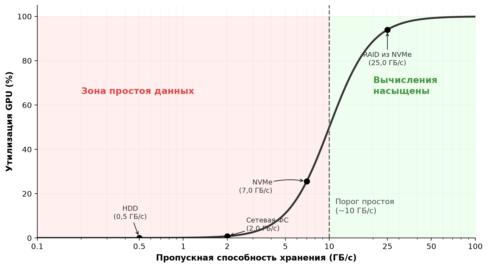

***Граница простоя данных**: утилизация GPU следует крутой S-образной кривой по мере роста пропускной способности хранения. Около условного порога в 10 ГБ/с для узла из 8 GPU утилизация переходит из режима преобладания ожидания в режим преобладания вычислений. Положение распространенных технологий хранения объясняет, почему многоуровневые архитектуры необходимы.*

S-образная кривая показывает резкий переход: ниже порога простоя даже небольшой недостаток пропускной способности вызывает драматическое падение утилизации, а выше него дополнительная пропускная способность дает убывающую отдачу. Отмеченные на графике технологии показывают, почему ни один уровень не достаточен: жесткий диск и сетевая файловая система лежат глубоко в зоне простоя, один накопитель NVMe попадает около точки перегиба, и только массив RAID из NVMe переходит порог в режим насыщения вычислениями. Этот разброс объясняет, почему многоуровневые архитектуры хранения необходимы для поддержания загрузки больших кластеров GPU.

Уравнение конвейера также показывает проблему масштабирования, которая усугубляется с размером кластера. По мере роста $N_{\text{GPU}}$ требуемая пропускная способность $\text{BW}_{\text{required}}$ растет линейно, но суммарная пропускная способность системы хранения не масштабируется автоматически вслед за ней. Добавление вычислительных узлов в кластер, который делит параллельную файловую систему, увеличивает спрос на фиксированный ресурс хранения. В конце концов система хранения насыщается, и каждый дополнительный GPU за точкой насыщения не добавляет ни единицы пропускной способности обучения, увеличивая при этом стоимость. Эта точка насыщения — практический верхний предел масштабирования кластера для данной конфигурации хранения, и чтобы определить ее количественно, нужно применить [уравнение «Требуемая пропускная способность конвейера»](#eq-pipeline-throughput) к измеренной пропускной способности конкретной системы хранения.

> **Налог на метаданные**
>
> **Сценарий**: большой GPU-кластер показывает низкую утилизацию FLOP модели, хотя метрики хранения сообщают о достаточной сетевой и байтовой пропускной способности.
>
> **Диагностика**: профилирование показывает, что загрузчики данных PyTorch выдают отдельные вызовы `stat()` для миллионов файлов на тысячах воркеров. Это перегружает сервер метаданных, и GPU простаивают на блокирующих операциях открытия файлов, невидимых для счетчиков байтовой пропускной способности.
>
> **Урок для систем**: узкие места хранения часто оказываются скрытыми узкими местами метаданных. Предварительное вычисление единого манифеста набора данных при старте задания исключает поиски метаданных POSIX-файловой системы на горячем пути и поддерживает устойчивую предвыборку конвейера.

### Конвейеризация и предвыборка
Главное оружие против простоев данных — **конвейеризация (Pipelining)**: CPU готовит батч $i+1$, пока GPU обрабатывает батч $i$, перекрывая передачу из хранилища с выполнением на ускорителе ([рисунок «Конвейерная загрузка данных»](#fig-data-pipeline-vol2)). Когда время ввода-вывода меньше времени вычислений, конвейеризация полностью скрывает задержку хранения, и ускоритель никогда не простаивает.

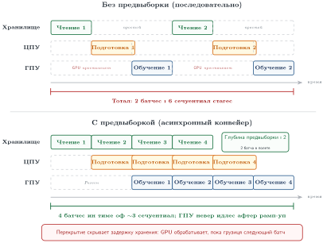

***Конвейерная загрузка данных**: CPU готовит батч $i+1$, пока GPU обрабатывает батч $i$. Конвейеризация скрывает задержку хранения, но только если буфер предвыборки достаточно глубок, чтобы поглотить разброс.*

Ключевая мысль из [рисунка «Конвейерная загрузка данных»](#fig-data-pipeline-vol2): конвейеризация превращает последовательное узкое место в параллельное перекрытие, но только тогда, когда буфер предвыборки достаточно глубок, чтобы поглотить разброс задержки ввода-вывода. Конвейеризация работает идеально, когда время ввода-вывода стабильно. На практике это не так. Системы хранения демонстрируют **джиттер ввода-вывода (I/O Jitter)**: колебания задержки чтения, вызванные множеством факторов. Накопители NVMe время от времени испытывают всплески задержки при внутренней сборке мусора (когда контроллер реорганизует блоки флеш-памяти NAND) или при операциях выравнивания износа. Параллельные файловые системы показывают всплески задержки, когда несколько заданий обучения конкурируют за одни и те же узлы OSS, когда MDS обрабатывает всплеск операций с метаданными или когда фоновая проверка обнаруживает и исправляет битовые ошибки. Задержка объектного хранилища может расти при межрегиональной репликации, сборке мусора версионированных объектов или ребалансировке балансировщика нагрузки.

Один медленный ввод-вывод может создать в конвейере «пузырь», который распространяется вперед и останавливает ускоритель. Если CPU готовил батч $i+1$, а чтение заняло вдвое больше ожидаемого, батч $i+1$ не готов к моменту, когда GPU закончит батч $i$. GPU простаивает до завершения чтения, и конвейер отстает на один батч. Если последующие чтения тоже медленны, конвейер не восстанавливается никогда. Защита — буфер предвыборки: вместо подготовки только одного батча наперед CPU поддерживает очередь из $Q_{\text{prefetch}}$ заранее загруженных батчей.

Минимальная глубина буфера $Q_{\text{prefetch}}$ должна поглощать худшую задержку ввода-вывода, не давая очереди опустошиться:

$$Q_{\text{prefetch,min}} = \left\lceil \frac{T_{\text{I/O,p99}}}{T_{\text{compute}}} \right\rceil$$

[Уравнение глубины предвыборки](#eq-prefetch-depth) определяет, сколько батчей должно находиться в полете одновременно, чтобы скрыть задержку ввода-вывода за вычислениями. Уравнение предполагает, что долгосрочная скорость подачи данных не меньше скорости потребления ускорителем; предвыборка поглощает разброс задержки, а не устойчивый дефицит пропускной способности. Когда средняя пропускная способность достаточна, но задержка P99 превышает время вычислений, более глубокая предвыборка предотвращает простои. Когда устойчивая пропускная способность ввода-вывода ниже спроса, решение — более быстрое хранилище, больше параллельных потоков, меньшие батчи или локальное промежуточное размещение. Уравнение использует задержку P99, а не среднюю, потому что одно медленное чтение может опустошить буфер и остановить ускоритель; расчет по среднему гарантирует частые простои в масштабе.

Если ввод-вывод на 99-м перцентиле занимает 500 мс, а вычисления — 200 мс, то $Q_{\text{prefetch,min}} = 3$ батча, с запасом надежности 5. На практике загрузчики данных вроде `DataLoader` в PyTorch используют параметры `prefetch_factor` и `num_workers`, чтобы управлять этой глубиной. Установка `prefetch_factor=2` при 4 воркерах создает буфер из 8 батчей, что обычно достаточно для конвейеров на NVMe, но может быть недостаточно для конвейеров на объектном хранилище, где задержка P99 может превышать 500 мс.

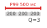

*Задержка ввода-вывода P99 задает требуемую глубину предвыборки.*

Чтобы проиллюстрировать стоимость памяти глубины буфера предвыборки, рассмотрим конвейер текста с большими батчами: каждый GPU обрабатывает упакованный батч токенов примерно за 200 мс, а собранный батч занимает около 40 МБ на GPU. При чтении с локального NVMe задержка P99 для такого батча составляет около 50 мс. Минимальная глубина предвыборки равна $\lceil 50/200 \rceil = 1$ батч, и достаточен запас надежности 2. При чтении из параллельной файловой системы задержка P99 растет примерно до 200 мс из-за сетевого джиттера и конкуренции, поэтому минимальная глубина равна $\lceil 200/200 \rceil = 1$, с запасом надежности 3, чтобы учесть редкие выбросы в несколько сотен миллисекунд. При чтении из объектного хранилища задержка P99 может превышать 500 мс, требуя глубины не меньше 3, с запасом надежности 5 и более. Эти числа напрямую переводятся в потребление памяти DRAM хоста: при 40 МБ на батч буфер предвыборки глубиной 5 на GPU занимает 200 МБ, а 8 GPU на узел — 1,6 ГБ. При 40 МБ на батч и глубине 1 тот же узел нуждается лишь в 320 МБ. Уровень хранения напрямую определяет стоимость памяти буфера предвыборки.

Стоимость глубокой предвыборки — это память: каждый буферизованный батч занимает DRAM хоста. Батч из 256 изображений размером $224{\times}224{\times}3$ байта (после декодирования) занимает около 37 МБ. Буфер предвыборки из 8 таких батчей потребляет 300 МБ, что пренебрежимо мало для узла с 512 ГБ DRAM. Однако для обучения языковых моделей с большими батчами, где каждый батч содержит миллионы токенов, буфер предвыборки может вырасти до нескольких гигабайт и начать конкурировать с таблицами эмбеддингов и другими потребителями DRAM.

Взаимодействие предвыборки и иерархии хранения создает многослойную защиту от простоев. Первый слой — буфер предвыборки в DRAM хоста, который поглощает разброс ввода-вывода от чтений с NVMe. Второй слой — теплый кэш на локальном NVMe, который поглощает сетевой разброс от параллельной файловой системы. Третий слой — кэш опережающего чтения параллельной файловой системы, который поглощает разброс от поиска по дискам в кластере OSS. Каждый слой добавляет устойчивость к задержке ценой памяти или емкости хранилища. Задача проектировщика системы — убедиться, что совокупная глубина всех слоев превышает худший всплеск задержки на самом нижнем уровне, который используется в штатном режиме. В основном примере, если параллельная файловая система время от времени демонстрирует всплеск задержки в 500 мс, а вычисления занимают 200 мс на батч, теплый кэш NVMe устраняет эту сетевую задержку, обслуживая чтения локально. Буфер предвыборки тогда должен поглощать меньший разброс локального NVMe, представленный ранее задержкой P99 в 50 мс, а не всплеск в 500 мс параллельной файловой системы.

> **Проектирование конвейера данных**
>
> Обучающий кластер работает на 1 024 GPU с батчами по 128 изображений (150 КБ на изображение после сжатия, 150 мс на итерацию).
>
> - [ ] **Требуемая пропускная способность**: по [уравнению пропускной способности конвейера](#eq-pipeline-throughput) рассчитайте требуемую суммарную пропускную способность хранения при целевой утилизации 90 процентов.
> - [ ] **Конкуренция с контрольными точками**: определите, достаточно ли 800 ГБ/с суммарной пропускной способности параллельной файловой системы, затем пересчитайте, если записи контрольных точек занимают 20 процентов этой пропускной способности.
> - [ ] **Глубина предвыборки**: рассчитайте минимальную глубину буфера предвыборки в батчах, необходимую для поглощения задержки P99 объектного хранилища в 300 мс.
> - [ ] **Память хоста**: рассчитайте общий объем памяти буфера предвыборки, если каждый декодированный батч занимает 10 МБ в DRAM хоста на глубине, найденной в пункте (3).

### Загрузка данных несколькими воркерами
Один ядро CPU не может прокормить высокопроизводительный ускоритель, даже если аппаратура хранения достаточно быстра, из-за работы CPU между чтением из хранилища и передачей на GPU. Рассмотрим требуемую пропускную способность для обучения на изображениях: декодирование JPEG размером 150 КБ в сырой тензор $224{\times}224{\times}3$ требует энтропийного декодирования коэффициентов Хаффмана, обратного дискретного косинусного преобразования, повышающей дискретизации цветности и преобразования формата пикселей. Этот процесс занимает примерно 1–5 мс на изображение на одном ядре серверного CPU. После декодирования аугментация добавляет еще работу CPU: случайная обрезка требует вычислить координаты обрезки и скопировать подобласть; горизонтальное отражение — копирование с обратным порядком столбцов; цветовой джиттер — умножение и сложение по каждому пикселю. Каждая аугментация добавляет от 0,5 до 2 мс на изображение.

При 1 000 изображений в секунду на GPU и 8 GPU на узел одно ядро должно было бы декодировать и аугментировать 8 000 изображений в секунду, то есть в 10–40 раз больше того, что одно ядро способно выдержать. Решение — **загрузка данных несколькими воркерами (Multi-Worker Data Loading)**: $W$ процессов-воркеров независимо читают из хранилища, декодируют, аугментируют и ставят батчи в очередь. Эффективная пропускная способность ввода-вывода растет примерно линейно с $W$, пока не будет достигнут один из трех пределов: насыщается пропускная способность устройства хранения, насыщается шина PCIe между хостом и устройством или воркеры исчерпывают такты CPU хоста.

В `DataLoader` PyTorch каждый воркер — отдельный процесс со своими дескрипторами файлов и пространством памяти. Параметр `num_workers` управляет $W$. Слишком малое $W$ оставляет GPU голодным; слишком большое тратит ресурсы CPU на переключение контекста и конкуренцию. Хорошая эвристика — начать с $W = 4 \times G$, где $G$ — число GPU на узел, и профилировать коэффициент простоя данных, подстраивая значение, пока простои не опустятся ниже 2 процентов. Для узла с 8 GPU это дает 32 воркера, которые на системе с 64 ядрами CPU оставляют 32 ядра для среды выполнения PyTorch, потоков коммуникации между GPU и накладных расходов операционной системы. Распределение ресурсов CPU между загрузкой данных и оркестрацией обучения — само по себе упражнение в планировании емкости.

Взаимодействие загрузки несколькими воркерами с иерархией хранения важно. При чтении с локального NVMe воркеры могут выдавать параллельные чтения к одному RAID-массиву без конкуренции, потому что глубокие командные очереди NVMe (до 64 тысяч команд в полете) обрабатывают параллелизм аппаратно. При чтении из параллельной файловой системы воркеры распределяют чтения по разным узлам OSS и естественно суммируют пропускную способность. При чтении из объектного хранилища воркеры выдают параллельные запросы GET, каждый к своему шарду, достигая параллелизма на уровне HTTP.

Тонкая ловушка загрузки несколькими воркерами — **компромисс между качеством перемешивания и эффективностью ввода-вывода (Shuffle Quality vs. I/O Efficiency)**. Идеальное перемешивание требует, чтобы каждый батч содержал образцы, равномерно взятые из всего набора данных, а это подразумевает случайный доступ ко всем шардам. Случайный доступ, однако, разрушает последовательные шаблоны ввода-вывода, под которые оптимизированы системы хранения. Практический компромисс — *перемешивание на уровне шардов* в сочетании с *перемешиванием внутри шарда*: загрузчик перемешивает список шардов в начале эпохи, назначает каждому воркеру непрерывные группы шардов, а затем перемешивает образцы внутри локального буфера каждого шарда. Такой подход обеспечивает достаточную случайность для сходимости обучения, сохраняя последовательный ввод-вывод на уровне хранения. Эмпирические исследования подтверждают, что перемешивание на уровне шардов дает кривые функции потерь, неотличимые от полного случайного перемешивания для большинства нагрузок, при условии что размер шарда достаточно велик (обычно 256 МБ и больше), чтобы обеспечить достаточное разнообразие внутри шарда.

Размер буфера перемешивания создает компромисс между памятью и случайностью. Больший буфер дает лучшую случайность (образцы берутся из большего пула), но потребляет больше DRAM хоста. Для основного примера с текстовыми данными буфер перемешивания из 10 000 последовательностей по 2 048 токенов, где каждый токен представлен 4-байтовым целым, занимает около 80 МБ. Это пренебрежимо мало по сравнению с 512 ГБ DRAM хоста. Для данных изображений, где каждое декодированное изображение занимает 150 КБ, буфер перемешивания из 10 000 изображений потребляет 1,5 ГБ — все еще управляемо, но заметная доля бюджета предвыборки. Проектировщик загрузчика данных должен балансировать размер буфера перемешивания и глубину предвыборки, поскольку оба конкурируют за одну и ту же емкость DRAM хоста.

Конвейер загрузки данных — от чтения из хранилища через декодирование, аугментацию и передачу на ускоритель — представляет собой полную систему доставки топлива для обучающего движка. Когда любой этап становится узким местом, ускоритель голодает.

### Локальность данных и размещение
В распределенном обучающем кластере размещение шардов данных по иерархии хранения определяет производительность конвейера. Каждому воркеру обучения нужен эффективный доступ к его части набора данных. Основной компромисс — между гибкостью общего хранилища и сырой скоростью локального. Чтение с локальных накопителей NVMe узла обычно в 10–100 раз быстрее и имеет меньшую задержку, чем чтение, которое должно пройти по сети к параллельной файловой системе или объектному хранилищу.

Самая простая стратегия — **статическое размещение (Static Placement)**. В начале обучающего задания оркестратор назначает каждому узлу фиксированное подмножество шардов данных. Узел подготавливает эти данные, копируя свои шарды из общей параллельной файловой системы на локальные накопители NVMe. До конца запуска обучения все чтения данных локальны, что максимизирует пропускную способность ввода-вывода. Такой подход очень эффективен для обучения на одном наборе данных, но негибок: если набор данных меняется или задание требует другого подмножества, шарды нужно подготовить заново.

Альтернатива — **динамическое размещение (Dynamic Placement)**, при котором шарды по мере необходимости запрашиваются из общего хранилища. Это дает максимальную гибкость: любой узел может в любой момент получить любой шард. Динамическое размещение необходимо, когда общий размер набора данных превышает совокупный локальный NVMe кластера или когда задание использует стратегии выборки, которые со временем меняют активное подмножество. Цена — производительность: каждое чтение несет сетевую задержку и расходует пропускную способность общего хранилища.

Более продвинутый подход — **планирование с учетом локальности (Locality-Aware Scheduling)**. Планировщик отслеживает, какие шарды данных закэшированы на локальных NVMe каких узлов. Когда он запускает новое задание или заменяет отказавший узел, он предпочитает узел, на котором уже закэшированы нужные данные, а не считает все узлы взаимозаменяемыми. Здесь используется принцип «гравитации данных»[^fn-datagravity-storage-placement]: вычисления размещаются рядом с данными, чтобы минимизировать время передачи. Вывод для хранения прост: закэшированные данные экономят время, только если система размещения знает, где находится кэш. Для команд, которые повторно проводят эксперименты на одном наборе данных, планирование с учетом локальности сокращает время подготовки с минут до нуля.

[^fn-datagravity-storage-placement]: **Гравитация данных (Data gravity)**: метафора, которая рассматривает большие наборы данных как массивные объекты, притягивающие вычисления. Аналогия с гравитацией уместна: перенос набора данных в 100 ТБ между регионами облака стоит более \$9 000 за исходящий трафик и занимает часы, тогда как запуск вычислений рядом с данными почти мгновенен. В проектировании парка ML гравитация данных означает, что место хранения обучающего набора часто задает физическое размещение всего обучающего кластера.

Для набора данных в 6 ТБ, распределенного по 256 узлам, каждому узлу достается примерно 23,4 ГБ данных. Если узел отказывает, его замена должна подготовить это подмножество шардов из параллельной файловой системы. При незагруженной скорости чтения PFS 4 ГБ/с подготовка занимает около 5,9 с; при конкуренции во время восстановления эффективная скорость 400 МБ/с на узел растягивает то же копирование примерно до 58,6 с. Если оркестратор может вместо этого поставить замещающую нагрузку на простаивающий узел, где данные уже закэшированы после предыдущего запуска, время подготовки равно нулю, и обучение возобновляется мгновенно. В масштабе эта оптимизация накапливается: в кластере из 10 000 узлов с 10 отказами узлов в день планирование с учетом локальности может сэкономить около минуты времени подготовки на каждый отказ, то есть около 10 минут в день суммарного простоя кластера в случае конкуренции.

### Версионирование данных и оркестрация конвейера в масштабе
Знать, где лежат данные, — лишь половина картины. В масштабе инфраструктура хранения должна также фиксировать, какую версию данных использует каждый запуск и как они проходят через конвейер. Версионирование превращает иерархию хранения в систему воспроизводимости: парку нужно знать не только, какие байты он прочитал, но и какой код предобработки, какой seed перемешивания, какая схема и какие проверки целостности породили эти байты еще до начала запуска.

> **Архетип B (DLRM в масштабе): задержка хранилища признаков**
>
> Пока архетип A (GPT-4) работает со статическими, версионированными наборами данных из триллионов токенов, архетип B (модель рекомендаций для глубокого обучения, или DLRM, в масштабе) работает с динамическими потоками признаков с высокой скоростью поступления. Для системы рекомендаций «истина» меняется каждую секунду, пока пользователи кликают и взаимодействуют. Это вынуждает перейти от простого файлового хранения к архитектуре хранилища признаков, которая должна решить задачу корректности на момент времени: гарантировать, что признаки, извлеченные для обучения, точно совпадают с тем, что модель увидела бы в момент вывода, без «утечки» будущей информации.

Ту же задачу воспроизводимости сложнее решить, когда входные данные — живые признаки, а не неизменяемые текстовые шарды. Архитектуры хранилищ признаков решают задачу корректности на момент времени[^fn-point-in-time], поддерживая неизменяемый журнал признаков или движок запросов с «путешествием во времени», что заметно усложняет систему хранения.

[^fn-point-in-time]: **Корректность на момент времени (Point-in-Time Correctness)**: в системах рекомендаций признаки (например, история кликов пользователя) нужно извлекать ровно в том виде, в каком они существовали в момент исторического взаимодействия. Извлечение текущих признаков для прошлого события, то есть «временная утечка», завышает точность обучения, но заставляет модель отказывать в продуктиве. Решение этой задачи в масштабе петабайтов требует неизменяемого журнала признаков или движка запросов с «путешествием во времени», что заметно усложняет систему хранения.

На масштабе 10 000 GPU набор данных — уже не *статическая коллекция файлов*, а *динамический поток*, который нужно фиксировать с абсолютной точностью. Запуски обучения базовых моделей могут длиться недели или месяцы; в 30-дневном основном примере данные, которые модель видит ближе к концу запуска, должны совпадать по составу и порядку с данными первого дня. Иначе инженер не сможет отличить регресс модели от тихого изменения распределения входных данных. Версионирование наборов данных дает необходимую возможность «Git для данных»: оно фиксирует криптографические хэши[^fn-hash-computation-overhead] каждого шарда данных, точный код предобработки, использованный для токенизации, и случайные seed, которые управляют глобальным перемешиванием. Такая строгость необходима для журналов аудита и для отладки тех «скачков функции потерь», которые характерны для крупномасштабного обучения: инженеры должны уметь воспроизвести точный батч, из-за которого произошло расхождение, чтобы определить, была ли причина в поврежденном образце данных или в численной нестабильности оптимизатора.

[^fn-hash-computation-overhead]: **Стоимость хэширования (SHA-256)**: проверка целостности набора данных в 100 ТБ с помощью SHA-256 потребляет примерно 1 501,5 часа работы ядер CPU при допущении о пропускной способности конвейера 18,5 МБ/с на ядро. Для 30-дневного запуска обучения базовой модели этот шаг проверки метаданных нужно выполнять конвейерно или при приеме данных, чтобы не задерживать фазу старта парка.

В петабайтном масштабе конвейер данных должен делать воспроизводимым каждое преобразование. Сырые документы очищаются, токенизируются, упаковываются в обучающие примеры и разбиваются на шарды по уровням хранения. Каждый этап записывает неизменяемый артефакт, а каждый артефакт фиксирует версию входа, версию кода, схему и статистические проверки, которым он удовлетворил. Когда эти зависимости явны, конвейер образует ориентированный ациклический граф: более поздние артефакты зависят от более ранних, и ни один этап не может переписать собственную историю. Когда задание обучения стартует, менеджер кластера проверяет, что локальные шарды NVMe каждого воркера совпадают со снимком данных, объявленным для запуска. Рассмотрение конвейера данных как графа версионированных артефактов, а не как простой передачи файлов, устраняет тихий дрейф данных, который служит главным источником сбоев в обучении базовых моделей.

#### Семантика выполнения распределенных преобразований
Версионированные артефакты определяют, *что* произвел конвейер; семантика выполнения определяет, могут ли сбои изменить этот результат. Поскольку распределенный этап завершается с темпом своего самого медленного раздела, **перекос разделов (partition skew)** превращает суммарную пропускную способность в простаивающую мощность, когда один ключ владеет непропорционально большой работой. Если последующий этап не может поддерживать темп поступления, **обратное давление (backpressure)** передает ограничение его скорости обслуживания вверх по цепочке, замедляя прием или ограничивая данные в полете. Это ответ управления на перегрузку, а не другое название медленной обработки.

Сбои создают отдельный вопрос корректности. **Обработка не более одного раза (At-most-once processing)** может потерять результат, потому что не переигрывает неопределенную работу; **обработка не менее одного раза (At-least-once processing)** может продублировать эффект, потому что переигрывает ее. Фактически **итог «ровно один раз» (exactly-once outcome)** требует воспроизводимых входов и **идемпотентных записей (idempotent writes)** или транзакционного вывода, ключом которого служит стабильный идентификатор события или транзакции (Akidau et al., 2015). Одной только доставки на уровне транспорта недостаточно для этой гарантии на уровне приложения.

> **Разрыв подтверждения**
>
> **Трасса сбоя**: воркер фиксирует событие `e42`, а затем отказывает до отправки подтверждения. Пропуск неопределенного события рискует потерей; повторное выполнение неидемпотентного эффекта его дублирует. Запись по стабильному ключу `(feature_version, e42)` предотвращает дубликат.
>
> **Урок для систем**: «ровно один раз» относится к границе фиксации вывода, а запись на этой границе должна связывать позицию входа, версию преобразования, стабильный идентификатор и состояние фиксации.

Потоковая обработка добавляет к контракту временную границу. **Время события (Event time)** фиксирует, когда событие произошло; **время обработки (Processing time)** — когда воркер его обработал. **Водяная метка (Watermark)** оценивает, что время событий продвинулось достаточно далеко, чтобы закрыть окно; политика поздних данных определяет, обновят, отзовут, изолируют или отбросят ли более поздние поступления его результат (Akidau et al., 2015). Таким образом, водяные метки обменивают свежесть на полноту и не доказывают, что более старых событий не осталось.

Эти механизмы ограничивают радиус поражения любой оптимизации. Буферизация поглощает перекос или медленный приемник, но увеличивает состояние восстановления и отставание свежести; агрессивные водяные метки снижают задержку, но исключают больше поздних данных; повторы помогают, только когда записи безопасно повторять. Поэтому воспроизводимый снимок обучения должен фиксировать версии источника и кода вместе с разбиением, политикой повторного воспроизведения, стабильными идентификаторами, состоянием водяных меток и решениями о поздних данных. Эксплуатация использует этот контракт, чтобы не смешивать истории при досчете признаков и соединениях на момент времени.

Помимо оркестрации конвейера, аппаратная оптимизация устраняет одно из самых распространенных узких мест: роль CPU как посредника между хранилищем и ускорителем.

## GPUDirect Storage и обход копирования данных через CPU
Иерархия хранения может обеспечить достаточную суммарную пропускную способность, но GPU все равно будут ждать, если CPU копирует данные для тысяч мелких передач. В традиционном пути каждое чтение шарда проходит через DRAM хоста, прежде чем попасть в HBM GPU; GPUDirect Storage (GDS) убирает это копирование через буфер в памяти хоста, когда узким местом становятся локальные или подключенные через RDMA накопители NVMe. CPU по-прежнему отправляет и координирует ввод-вывод через программный стек. Сначала стоит разобрать традиционный путь, чтобы оптимизация GDS стала понятной.

Традиционный путь данных для загрузки обучающих данных состоит из трех переходов: хранилище → DRAM хоста → HBM GPU. Сначала данные читаются с NVMe в буфер ядра в DRAM хоста (через передачу DMA, которую инициирует контроллер NVMe), затем копируются в буфер пользовательского пространства (тензор загрузчика данных, через `memcpy`, который выполняет CPU) и наконец передаются в память GPU по шине PCIe (через вызов `cudaMemcpy` или `cudaMemcpyAsync`, который программирует движок DMA GPU). Каждый переход добавляет задержку и расходует ресурсы CPU. CPU должен организовать каждую передачу, управлять выделением буферов и обрабатывать прерывания как от устройства хранения, так и от GPU. Для одной передачи эти накладные расходы пренебрежимо малы. Однако когда каждый из восьми GPU требует тысячи мелких передач в секунду, совокупная нагрузка CPU на одно лишь перемещение данных может насытить несколько ядер и оставить недостаточно мощности CPU для аугментации данных, которая тоже необходима конвейеру.[^fn-gds-gpudirect-storage]

[^fn-gds-gpudirect-storage]: **GDS (GPUDirect Storage)**: часть семейства NVIDIA GPUDirect, в которое входят также GPUDirect RDMA (сетевые адаптеры, пишущие напрямую в память GPU) и GPUDirect Peer-to-Peer (доступ к памяти между GPU). GDS распространяет подход обхода копирования данных на накопители NVMe через API cuFile. С RDMA и GDS полезная нагрузка может пройти путь «удаленное хранилище → сеть → память GPU» без копирования через CPU. CPU по-прежнему отправляет и координирует операции cuFile, но он тратит меньше времени на копирование полезной нагрузки и может отдать больше мощности аугментации и оркестрации конвейера.

> **GPUDirect Storage**
>
> ***GPUDirect Storage (GDS)*** — технология, которая обеспечивает прямой путь DMA между устройствами хранения NVMe и памятью GPU, обходя буфер-посредник в системной DRAM и копирования полезной нагрузки через CPU, но сохраняя за CPU отправку и управление.
>
> 1.  **Значение**: GDS устраняет «буфер-посредник» в системной памяти. В модели мелких передач, подробно описанной в блокноте [«Дивиденд обхода CPU»](#nbk-data-storage-cpu-bypass-dividend), это снижает задержку каждой передачи на 75 процентов и делает локальный путь передачи в 4× быстрее. Это позволяет GPU насытить скорость канала NVMe (например, 7 ГБ/с), снижая при этом утилизацию CPU на ввод-вывод.
> 2.  **Отличие**: в отличие от традиционного ввода-вывода, где полезная нагрузка проходит через буферы хоста и копируется между ними, GDS обеспечивает прямой доступ к памяти между контроллером хранения и ускорителем. Вызовы cuFile от CPU и драйверы хранения ядра остаются в пути управления.
> 3.  **Частая ошибка**: распространено заблуждение, что GDS делает все хранилище «быстрее». На деле он ускоряет только локальный или подключенный через RDMA NVMe; он не устраняет физическую задержку сетевых файловых систем или объектного хранилища.

Программные слои традиционного пути ввода-вывода добавляют накладные расходы на задержку. Когда загрузчик данных вызывает `read()` для файла на NVMe, вызов проходит через среду выполнения приложения, границу Python/C++, слой виртуальной файловой системы ОС, драйвер файловой системы (ext4, XFS), блочный слой и наконец драйвер NVMe. Каждый слой добавляет несколько микросекунд на проверку параметров, захват блокировок и управление буферами. На обратном пути контроллер NVMe генерирует прерывание, обработчик прерывания будит заблокированный поток, и данные копируются из буфера ядра в пространство пользователя. Полные накладные расходы на обращение для небольшого чтения составляют 10–50 мкс, и их определяют переключения контекста и копирования буферов, а не собственно время доступа к NVMe.

GDS меняет путь полезной нагрузки, но не устраняет программный путь управления. API cuFile регистрирует область памяти GPU для прямого DMA. Последующие чтения переносят полезную нагрузку с NVMe в память GPU без промежуточного буфера в системной памяти, при этом cuFile, виртуальная файловая система, драйверы хранения ядра и `nvidia-fs` остаются задействованы в отправке и координации. CPU инициирует ввод-вывод и проверяет завершение, но избегает работы по копированию полезной нагрузки, которая есть в традиционном пути.

Снижение задержки за счет GDS важнее всего, когда конвейер обучения уже оптимизирован и оставшееся узкое место — способность CPU посредничать в передачах. В узле с 8 GPU, на каждом из которых работает загрузчик данных с 4 воркерами, CPU должен управлять 32 одновременными потоками ввода-вывода. При 120 мкс на передачу CPU тратит значительное время на обработку прерываний и управление буферами. GDS переносит эту работу на аппаратные движки DMA, освобождая ядра CPU для аугментации данных и других задач предобработки. [Рисунок «Традиционный путь и путь GPUDirect Storage»](#fig-gds-path) сопоставляет два пути данных, показывая, где GDS устраняет копирования через CPU, которые доминируют в накладных расходах на каждую передачу.

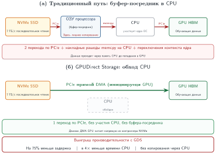

***Традиционный путь и путь GPUDirect Storage**: традиционный путь (вверху) требует двух копирований полезной нагрузки через CPU. Путь GDS (внизу) использует DMA для передачи данных напрямую из NVMe в память GPU, устраняя эти копирования через посредника, сохраняя при этом отправку и координацию через CPU.*

Выигрыш в пропускной способности от GDS наиболее заметен для нагрузок, которые читают множество мелких объектов ([рисунок «Традиционный путь и путь GPUDirect Storage»](#fig-gds-path)), например декодированные фрагменты изображений, где накладные расходы на каждую передачу доминируют. Для крупных последовательных чтений (например, потоковой передачи многогигабайтного обучающего шарда) выигрыш в пропускной способности скромнее, потому что время передачи доминирует над накладными расходами на настройку. Общий принцип: GDS устраняет постоянные накладные расходы на каждую передачу, поэтому нагрузки с большим числом передач в секунду выигрывают больше всего.

> **Дивиденд обхода CPU**
>
> **Задача**: Обучающий узел с 8 GPU загружает изображения по 150 КБ со скоростью 8 000 изображений/с на GPU (всего 64 000 изображений/с). Сравните нагрузку CPU при традиционном вводе-выводе и при GDS.
>
> **Традиционный путь**: каждое изображение требует DMA с NVMe в DRAM, копирования на стороне хоста из ядра в пространство пользователя и передачи по PCIe на GPU. При 64 000 изображений/с и 120 мкс процессорного времени на изображение CPU тратит 7,68 секунды процессорного времени за каждую секунду астрономического времени, то есть примерно 8 ядер заняты одним лишь перемещением данных.
>
> **Путь GDS**: каждое изображение передается напрямую по DMA с NVMe на GPU. При 30 мкс процессорного времени на изображение (на инициирование DMA) CPU тратит 1,92 секунды процессорного времени за каждую секунду, освобождая примерно 6 ядер для аугментации данных.
>
> **Системный вывод**: GDS снижает задержку и переносит утилизацию CPU с копирования данных (которое не добавляет ценности) на аугментацию данных (которая улучшает качество модели).

У GDS есть практические ограничения. Не все контроллеры NVMe поддерживают передачи PCIe между равноправными устройствами. Данные должны быть в формате, который GPU может потребить напрямую, то есть они уже должны быть декодированы или декодируемы на GPU (сырые значения пикселей, идентификаторы токенов или форматы, которые обрабатывают декодеры GPU, а не произвольные сжатые потоки JPEG или gzip). На практике многие конвейеры используют гибридный подход: декодирование на стороне CPU для сжатых форматов с последующей обычной передачей в закрепленную память и на GPU, а GDS резервируется для прямого чтения потребляемых GPU данных из поддерживаемого локального или удаленного хранилища.

Архитектурная эволюция от копирований через CPU к прямому доступу к хранилищу отражает более широкую тенденцию: убирать копирования полезной нагрузки через CPU с критического пути данных везде, где это возможно. О RDMA, который позволяет сетевой полезной нагрузке двигаться без копирования через CPU, рассказано в главе «Сетевые ткани» (пока не переведена). GDS делает то же для полезной нагрузки хранилища. Вместе RDMA и GDS позволяют данным течь от удаленного хранилища через сетевую ткань в память GPU без копирования через буфер в памяти хоста. CPU по-прежнему отправляет и координирует операцию, но большая часть его мощности остается доступной для аугментации данных, оркестрации конвейера и обработки ошибок.

Принцип GDS распространяется и на записи контрольных точек. В традиционном пути данные контрольной точки текут из HBM GPU через DRAM хоста (по PCIe) на NVMe (записью через CPU). С GDS контрольную точку можно записать напрямую из HBM GPU на NVMe, устранив копирование в DRAM хоста. Для контрольной точки объемом 2 450 ГБ это убирает одно полное копирование данных и снижает участие CPU в пути записи, еще больше уменьшая $T_{\text{write}}$.

### Полный путь данных
Объединив GDS с многоуровневой иерархией, полный путь данных связывает уровни для основного примера. В начале обучающего задания набор сериализованных шардов объемом 6 ТБ, полученный из сжатого исходного корпуса объемом 3 ТБ, подготавливается из объектного хранилища в локальные кэши NVMe кластера, и каждый узел получает назначенное ему подмножество шардов при настройке. Воркеры загрузчика данных читают токенизированные шарды с NVMe, собирают упакованные последовательности в закрепленной DRAM хоста и передают эти батчи ускорителю. При включенном GDS идентификаторы токенов, которые уже лежат в раскладке, удобной для GPU, можно загрузить прямо в память GPU без участия CPU; сжатые форматы по-прежнему требуют декомпрессии на CPU или GPU перед использованием.

Во время обучения конвейер работает в установившемся режиме. Воркеры загрузчика данных на CPU непрерывно читают с локального NVMe, заполняя очередь предвыборки в DRAM хоста. GPU забирает батчи из этой очереди по DMA через PCIe. Фаза вычислений (прямой проход, обратный проход, шаг оптимизатора) потребляет батч и обновляет веса модели в HBM. Каждые 10 минут фреймворк обучения инициирует контрольную точку: веса модели и состояние оптимизатора записываются из HBM GPU на локальный NVMe (через DRAM хоста или напрямую через GDS), а фоновый поток асинхронно копирует локальную контрольную точку в параллельную файловую систему.

В конце задания обучения финальная контрольная точка модели переносится из параллельной файловой системы в объектное хранилище для долгосрочного хранения. Локальные копии на NVMe удаляются при очистке задания. Если модель развертывается для вывода, она загружается из объектного хранилища в HBM сервинг-кластера, завершая жизненный цикл перемещения данных по иерархии.

Общее число копий данных в этом жизненном цикле поучительно. Каждый обучающий образец проходит путь: объектное хранилище → NVMe (подготовка), NVMe → DRAM хоста (чтение), DRAM хоста → HBM GPU (передача). Каждая контрольная точка проходит путь: HBM GPU → NVMe (локальное сохранение), NVMe → параллельная файловая система (асинхронное копирование), параллельная файловая система → объектное хранилище (долгосрочное хранение). Каждое копирование расходует пропускную способность и добавляет задержку. Инженерная цель — минимизировать копирования на критическом пути (цикл обучения) и допускать дополнительные копирования на некритических путях (подготовка и архивирование).

Объем данных, перемещаемых за 30-дневный запуск обучения, показывает контринтуитивную реальность. Однократная подготовка сериализованного набора данных объемом 6 ТБ из объектного хранилища на локальный NVMe — это скромная передача. Однако поток контрольных точек гораздо больше. Контрольная точка примерно 2 450 ГБ создается каждые 10 минут на 256 узлах в течение 30 дней, то есть система производит около 4 320 контрольных точек, суммарно около 10,6 ПБ состояния, которое должно пройти через иерархию хранения. Перемещение контрольных точек многократно превосходит перемещение обучающих данных для больших моделей: в то время как обучающий набор в 6 ТБ может читаться лишь несколько раз (по разу за эпоху), 10,6 ПБ контрольных точек создаются заново, поэтому ввод-вывод контрольных точек становится доминирующей нагрузкой на хранилище. Это объясняет, почему стратегия промежуточного размещения контрольных точек (писать локально, реплицировать асинхронно) может сильнее повлиять на общее проектирование хранилища, чем оптимизация конвейера обучающих данных для запусков больших моделей. Физический путь данных определяет, куда перемещаются байты; остается вопрос, чего стоит каждое перемещение.

## Экономика хранения
Набор обучающих данных объемом 100 ТБ может находиться на любом уровне иерархии, но стоимость различается на порядки в зависимости от выбранного уровня и от того, как к данным обращаются. Экономика хранения ML — это не просто выбор самого дешевого уровня; это минимизация **полной стоимости доставки данных (Total Cost of Data Delivery)**, которая включает стоимость хранения, стоимость передачи и упущенную выгоду от простаивающих ускорителей.

Рассмотрим хранение обучающего набора данных объемом 100 ТБ. Годовая стоимость хранения сильно различается по уровням:

- **Объектное хранилище (S3 Standard)**: \$24 000 в год
- **Локальный NVMe (выделенный)**: \$120 000 в год
- **Архив (Glacier)**: \$4 800 в год
- **Эквивалент HBM** (гипотетически хранить 100 ТБ в памяти GPU по \$15/ГБ): \$1 500 000 амортизированного оборудования

Разница в 5× между локальным NVMe и объектным хранилищем (при полном разрыве от HBM до архива, превышающем 3 000×) объясняет, зачем существует иерархия: данные должны жить на самом дешевом возможном уровне, перемещаясь вверх только по необходимости и возвращаясь вниз по окончании работы. Этот градиент стоимости отражает физику. Более быстрое хранение требует более дорогих материалов (HBM использует трехмерно уложенный кремний со сквозными переходами), больше энергии на каждый обращенный бит и большей физической близости к ускорителю (что ограничивает объем, который можно выделить на узел). Более дешевое хранение использует стандартные компоненты (обычные жесткие диски для архива), почти не потребляет энергии в простое и может располагаться где угодно, где есть сетевое соединение.

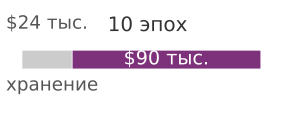

*Повторный исходящий трафик, а не хранение, доминирует в стоимости облака.*

Однако стоимость хранения — лишь часть уравнения. **Расходы на передачу данных (Data Transfer Costs)** могут доминировать, особенно в облачных средах. При принятом здесь представительном допущении о стоимости исходящего трафика через границу сервиса чтение набора данных в 100 ТБ из объектного хранилища на вычислительные экземпляры обходится в \$9 000. Для многоэпохального обучения, которое читает набор данных 10 раз, одна только стоимость исходящего трафика превышает \$90 000, то есть больше годовой стоимости хранения. Эта инверсия, при которой *чтение* данных стоит дороже, чем их *хранение*, и подталкивает к решению кэшировать данные на локальном NVMe, а не потоково читать из объектного хранилища каждую эпоху.

Экономический анализ меняется еще сильнее, если учесть упущенную выгоду от простоя ускорителей. Кластер из 1 000 GPU по \$2 в час за GPU обходится в \$48 000 в день. Если недостаточно мощная система хранения снижает утилизацию ускорителей с 90 до 70 процентов, организация теряет \$9 600 в день на впустую потраченных вычислениях. За 30-дневное обучение это \$288 000 потерянной ценности вычислений — сумма, которой легко хватило бы на обновление параллельной файловой системы или дополнительную емкость NVMe. Экономически рациональный подход рассматривает инвестиции в хранение не как расход, а как условие утилизации вычислений: каждый доллар, вложенный в пропускную способность хранения, возвращает несколько долларов прироста производительности ускорителей.

> **Айсберг стоимости хранения**
>
> Видимая стоимость хранения (\$/ГБ в месяц) — только верхушка айсберга. Под поверхностью лежат статьи, которые часто превосходят саму стоимость хранения:
>
> - **Плата за исходящий трафик (Egress fees)**: представительная плата за исходящий трафик через границу сервиса в \$0,09/ГБ означает, что чтение набора данных в 100 ТБ один раз за эпоху на протяжении 10 эпох стоит \$90 000 только за исходящий трафик.
> - **Плата за IOPS (IOPS charges)**: объектное хранилище берет плату за каждый запрос. Запросы GET в S3 Standard стоят около \$0,0004 за 1 000 запросов, поэтому набор данных из 100 миллионов отдельных файлов, прочитанный один раз, стоит около \$40 только за запросы GET до учета платы за передачу и извлечение, хотя стоимость хранения составляет \$2 300 в месяц.
> - **Стоимость простоя ускорителей (Idle accelerator cost)**: если простои хранилища снижают утилизацию GPU с 90 до 70 процентов в кластере из 1 000 GPU по \$2 в час за GPU, потерянные вычисления стоят \$9 600 в день (20 процентов от дневных затрат \$48 000), что затмевает любую экономию на хранении.
> - **Плата за извлечение (Retrieval fees)**: архивное хранилище взимает плату за извлечение (\$0,02/ГБ для Glacier) в дополнение к исходящему трафику. Восстановление набора данных в 100 ТБ из Glacier стоит \$2 000 за извлечение плюс \$9 000 за исходящий трафик.
>
> Экономически рациональная стратегия часто предполагает большие инвестиции в хранение (кэширование на локальном NVMe, емкость параллельной файловой системы), чтобы снизить расходы на передачу и предотвратить простои ускорителей.

Айсберг стоимости показывает, что сырая емкость хранения может составлять меньше половины всех расходов: репликация, операции с метаданными, вызовы API и межрегиональные передачи в совокупности могут доминировать в счете в масштабе. Среди этих скрытых статей именно исходящий трафик часто меняет архитектурное решение. В отличие от платы за емкость, которая растет с объемом хранимых данных, плата за исходящий трафик растет с объемом прочитанных данных, а обучение ML читает весь набор данных на каждой эпохе.

> **Налог на исходящий трафик**
>
> **Задача**: Команда обучает модель зрения на наборе изображений объемом 50 ТБ, хранящемся в S3. Обучение длится 20 эпох. Нужно решить, читать ли потоком из S3 каждую эпоху или подготавливать данные на локальном NVMe.
>
> **Вариант A**: потоковое чтение из S3
>
> - Хранение: 50 ТБ $\times$ \$0,023/ГБ в месяц $\times$ 12 месяцев = \$13 800 в год
> - Исходящий трафик: 50 ТБ $\times$ 20 эпох $\times$ \$0,09/ГБ = \$90 000 за запуск обучения
> - Итого за 4 запуска обучения в год: \$13 800 + \$360 000 = \$373 800 в год
>
> **Вариант B**: подготовка на локальном NVMe
>
> - Хранение (S3 как источник истины): \$13 800 в год
> - Емкость NVMe (50 ТБ по кластеру): 50 ТБ $\times$ \$0,10/ГБ в месяц $\times$ 12 = \$60 000 в год
> - Исходящий трафик (подготовка один раз за запуск обучения): 50 ТБ $\times$ 4 запуска $\times$ \$0,09/ГБ = \$18 000 в год
> - Итого: \$13 800 + \$60 000 + \$18 000 = \$91 800 в год
>
> **Системный вывод**: локальное кэширование на NVMe экономит \$282 000 в год при 20 эпохах на запуск, чего хватило бы на 9 дополнительных ускорителей H100 по прейскурантной цене. С учетом выделенного NVMe за \$60 000 в год и исходящего трафика подготовки один раз за запуск точка безубыточности лежит чуть выше 4 эпох на запуск; к пятой эпохе локальное кэширование дешевле потокового чтения из S3 каждую эпоху.

Блокнот превращает айсберг в правило решения: самый дешевый уровень хранения не всегда дает самый дешевый путь доставки. Объектное хранилище может оставаться источником истины, но повторные чтения делают исходящий трафик, накладные расходы на запросы и стоимость простоя ускорителей частью проекта хранения. Многоэпоховое обучение на изображениях может оправдать подготовку на локальном NVMe к пятой эпохе, тогда как предобучение языковой модели за одну эпоху может оставить корпус в объектном хранилище и оптимизировать путь потоковой передачи. Поэтому архитектура выбирается по шаблону доступа, числу чтений и чувствительности к задержке, а не по одной лишь цене за ГБ в месяц.

Анализ стоимости распространяется и на уровень параллельной файловой системы, который занимает промежуточное место между NVMe и объектным хранилищем и по производительности, и по цене. Параллельная файловая система, способная выдавать 1 ТБ/с суммарной пропускной способности, требует примерно 100 узлов OSS, каждый с несколькими накопителями NVMe и высокоскоростными сетевыми подключениями. Капитальные и эксплуатационные затраты такой системы могут превышать \$10 миллионов в год. Эти расходы оправданы, только если альтернатива — потоковое чтение из объектного хранилища с оплатой исходящего трафика — еще дороже или если требования задержки записи контрольных точек не выполнимы одним лишь объектным хранилищем. Анализ точки безубыточности зависит от структуры нагрузки организации: команда, которая ведет одно длинное задание обучения, может обнаружить, что подготовка данных на локальном NVMe с полным обходом параллельной файловой системы — самый дешевый вариант, тогда как команда, которая ведет много одновременных коротких заданий, выигрывает от общего пространства имен, которое дает параллельная файловая система.

Решение о **собственной инфраструктуре или облаке (Build vs. Buy)** хранения зависит от компромисса между высокими капитальными затратами на локальную параллельную файловую систему и повторяющимися операционными расходами облачного объектного хранилища. Развертывание Lustre на 1 ПБ стоит примерно \$3–5 миллионов за оборудование плюс дополнительно \$500 000 в год операционных расходов на электроэнергию, охлаждение и инженерную поддержку. Хранение 1 ПБ в облачном объектном хранилище по \$0,02/ГБ в месяц стоит \$240 000 в год только за хранение. Однако плата за доступ к данным доминирует в полной стоимости: чтение этого петабайта 10 раз в год добавляет \$900 000 за передачу данных. При этих допущениях облачная доставка обходится в \$1 140 000 в год; после вычета \$500 000 на эксплуатацию собственной системы чистая экономия составляет \$640 000 в год. Точка безубыточности аппаратуры получается примерно 4,7–7,8 года, а не 18–24 месяца. Чтобы достичь окупаемости за 18–24 месяца, нужна более интенсивная нагрузка с гораздо большим числом полных чтений набора данных в год, меньшие капитальные затраты или драйверы помимо исходящего трафика, такие как задержка записи контрольных точек и требования общего пространства имен. Для основного примера корпус объемом 6 ТБ гораздо меньше 1 ПБ, поэтому случай локального хранения определяется задержкой, повторными экспериментами и промежуточным размещением контрольных точек, а не одной лишь экономией на исходящем трафике за год.

Аппаратная деградация порождает необходимость **цикла обновления хранилища (Storage Refresh Cycle)**. Накопители NVMe рассчитаны на определенную выносливость при записи, измеряемую в DWPD за типичный пятилетний гарантийный срок. Многие крупные обучающие нагрузки ML в основном интенсивны по чтению после загрузки исходного набора данных, поэтому диски в обучающем кластере могут служить дольше своего расчетного срока записи. Основной движущий фактор обновления может быть поэтому плотностью, а не износом: новые диски часто дают больше емкости при близкой цене. Переход кластера с дисков NVMe по 7,68 ТБ на диски по 15,36 ТБ вдвое увеличивает емкость локального кэша, позволяя подготавливать более крупные наборы данных прямо на вычислительных узлах и снижая зависимость от параллельной файловой системы при установившемся чтении.

### Стратегии многоуровневого размещения
Структура стоимости, описанная в предыдущем разделе, превращает многоуровневое размещение в политику размещения: держать данные только так близко к ускорителю, насколько этого оправдывают частота доступа и требование к задержке. **Стратегия многоуровневого размещения (Tiering Strategy)** кодирует эту политику по всей иерархии.

Самый быстрый и самый дорогой слой — **горячий уровень (Hot Tier)** (локальный NVMe и DRAM хоста), который хранит данные, активно потребляемые текущим заданием обучения. Наборы данных подготавливаются с общего хранилища на локальный NVMe при старте задания. Этот уровень выделяется по узлам и не разделяется по кластеру, поэтому данные, которые одновременно нужны нескольким заданиям или командам, не могут жить здесь одни.

Это требование общего доступа и оправдывает **теплый уровень (Warm Tier)** (параллельная файловая система), который хранит наборы данных, к которым обращаются несколько заданий или команд, общие контрольные точки для восстановления после сбоев и артефакты моделей в активной разработке. Параллельная файловая система предоставляет общее пространство имен, необходимое для многопользовательского доступа с сильной согласованностью.

Ниже теплого уровня находится **холодный уровень (Cold Tier)** (объектное хранилище), который служит каноническим хранилищем всех обучающих данных организации. Наборы данных создаются и версионируются в объектном хранилище, а затем при необходимости для обучения переводятся на более теплые уровни. Объектное хранилище также служит долговечной резервной копией контрольных точек после того, как они прошли промежуточное размещение с локального NVMe через параллельную файловую систему.

Данные, которые нужно сохранять для соответствия требованиям или воспроизводимости, но которые не ожидается читать в обычной работе, переходят на **архивный уровень (Archive Tier)** (Glacier или аналог). Правила жизненного цикла автоматически переводят данные с холодного уровня в архивный через настраиваемый период, обычно от 90 до 365 дней с момента последнего доступа.

Перемещение данных между уровнями должно быть автоматизировано политиками жизненного цикла. Хорошо спроектированная система многоуровневого размещения автоматически поднимает данные с холодного уровня на теплый, когда задание обучения их запрашивает, и опускает с теплого на холодный, когда ни одно задание не обращалось к ним в течение настраиваемого периода. Ручное многоуровневое размещение создает операционную нагрузку и неизбежно ведет либо к избыточному выделению (данные остаются на дорогих уровнях), либо к недостаточному (данные недоступны, когда они нужны).

Вернемся к основному примеру, чтобы увидеть многоуровневое размещение в действии. Исходный корпус объемом 3 ТБ и сериализованные обучающие шарды объемом 6 ТБ постоянно хранятся в объектном хранилище (холодный уровень). Когда задание обучения ставится в очередь, оркестрационная система запускает фазу «подготовки данных», которая копирует токенизированные шарды в параллельную файловую систему (теплый уровень) до загрузки первого обучающего узла. Затем загрузчик данных каждого узла копирует назначенные ему шарды на локальный NVMe (горячий уровень) в течение первой эпохи. Последующие эпохи читают полностью с локального NVMe без сетевого трафика. По окончании задания процесс очистки удаляет локальные копии на NVMe и, после настраиваемого льготного периода, очищает копию в параллельной файловой системе. Весь жизненный цикл, от подготовки через обучение до очистки, управляется политикой, а не инженером обучения.

Экономическая польза автоматизированного многоуровневого размещения накапливается со временем. Организация, которая ведет 50 одновременных заданий обучения, каждое из которых использует 10 ТБ данных, понадобилось бы 500 ТБ емкости параллельной файловой системы, если бы все данные оставались на месте. Автоматическое вытеснение после завершения заданий могло бы снизить установившееся использование параллельной файловой системы до 100 ТБ, экономя \$144 000 в год по ставке параллельной файловой системы за ТБ. Эта экономия незаметна в каждом отдельном эксперименте, но существенна при накоплении по всему парку.

#### Схемы подготовки данных
Решение о подготовке данных определяет, где задание платит за перемещение: до начала обучения, во время первой эпохи или на каждой эпохе. Три распространенные схемы по-разному балансируют задержку запуска и установившуюся пропускную способность:

- **Предварительная подготовка (Prestaging)**: скопировать весь набор данных из объектного хранилища на локальный NVMe до начала первой итерации обучения. Это дает лучшую установившуюся производительность, поскольку все чтения локальны, но создает худшее время запуска задания: подготовка набора данных объемом 10 ТБ на 256 узлах по 500 МБ/с на узел занимает примерно 80 секунд на узел, а общая пропускная способность параллельной файловой системы может растянуть задержку до нескольких минут.
- **Подготовка по требованию (On-Demand Staging)**: копировать шарды на локальный NVMe только тогда, когда загрузчик данных впервые к ним обращается. Это снимает задержку запуска, но первая эпоха платит полную стоимость сетевого чтения. Схема лучше всего работает для многоэпохального обучения, где последующие локальные чтения амортизируют стоимость первоначальной подготовки.
- **Потоковая передача (Streaming)**: не держать данные на локальном хранилище и читать из параллельной файловой системы или объектного хранилища на каждой эпохе. Задержка запуска нулевая, и локальное хранилище не нужно, но каждая эпоха платит полную стоимость сетевого чтения. Схема подходит для предобучения за одну эпоху или для наборов данных, слишком больших для локального NVMe.

Многоуровневое размещение — это политика размещения, поэтому следующий вопрос в том, где могут сдвигаться границы уровней. Новые устройства сдвигают границу между DRAM, NVMe и архивным хранилищем, а нагрузки вывода используют ту же иерархию для другой цели: снижения задержки холодного старта и управления рабочими множествами во время обслуживания, а не максимизации пропускной способности эпох.

### Технологии, которые сдвигают уровни
Хотя шестиуровневая иерархия представляет распространенную производственную базовую линию, технологии памяти и хранения могут заполнять разрывы пропускной способности между существующими уровнями и менять архитектуру хранения для крупномасштабного ML. Самый широкий незаполненный разрыв в иерархии лежит между DRAM хоста и локальным NVMe. CXL — открытый стандарт межсоединения, который позволяет процессорам, ускорителям и устройствам памяти разделять память с семантикой когерентности кэшей, — нацелен именно на этот разрыв. Память, подключенная через CXL, дает пропускную способность между пропускной способностью локальной DRAM и NVMe (примерно 30–60 ГБ/с) при промежуточных задержках (200–500 нс). Для нагрузок ML память CXL могла бы служить «уровнем 1,5» между DRAM хоста и локальным NVMe, создавая большой пул емкости для таблиц эмбеддингов и буферов предвыборки без штрафа задержки NVMe. Для основного примера память, подключенная через CXL, могла бы расширить эффективный уровень памяти хоста с 512 ГБ до более чем 4 ТБ на узел — достаточно, чтобы вместить сжатый исходный корпус или крупный локальный кэш шардов, хотя все еще недостаточно для полной сериализованной обучающей копии в 6 ТБ на одном узле.

Другое узкое место возникает, когда декодирование на стороне CPU, а не пропускная способность хранения, сдерживает конвейер. **Вычислительный накопитель (Computational Storage Drive)** закрывает этот разрыв, встраивая вычислительные элементы (программируемые логические матрицы (FPGA) или простые ядра CPU) прямо в контроллер SSD, так что распаковка, фильтрация или преобразование формата выполняются на самом устройстве хранения, а не потребляют такты CPU хоста. Для конвейеров ML, где узкое место — декодирование на CPU, вычислительное хранилище могло бы полностью исключить CPU из пути данных и дополнить GDS, перенося работу, с которой не справляется прямой DMA.

Записи контрольных точек по-прежнему ограничены задержкой записи SSD — членом $T_{\text{write}}$, который штрафует формула Янга — Дэли. **Энергонезависимая память (Persistent Memory)**, несмотря на рыночные перемены, такие как прекращение выпуска Intel Optane, остается архитектурной идеей, которая напрямую бьет по этому члену. Байт-адресуемая энергонезависимая память, которая по задержке и емкости занимает место между DRAM и NVMe, могла бы изменить хранение контрольных точек: долговечность SSD с задержками записи, приближающимися к DRAM, сократила бы $T_{\text{write}}$ с миллисекунд до микросекунд, сделав частые контрольные точки с малыми накладными расходами практичнее.

Эти технологии пока не получили широкого распространения в масштабе крупнейших кластеров ML, но они показывают направление эволюции иерархии хранения. Фундаментальный принцип остается прежним: более быстрое и дорогое хранилище ближе к ускорителю, более медленное и дешевое — на периферии. Меняются *зернистость* уровней и *размер разрывов* между ними.

### Хранение для нагрузок вывода
Требования к хранению для вывода принципиально отличаются от предобучения на полном корпусе. Обучение потоково читает наборы данных и пишет контрольные точки всплесками. В базовом варианте обслуживания с резидентными весами вывод читает веса модели при запуске, а затем обслуживает запросы из HBM. Главная задача хранения смещается от устойчивой пропускной способности набора данных к задержке загрузки модели, хотя индексы извлечения и выгрузка KV-кэша добавляют ввод-вывод во время обслуживания, если эти механизмы включены.

Самая важная метрика хранения для вывода — **задержка загрузки модели (Model Loading Latency)**, часто называемая временем холодного старта: длительность загрузки модели из хранилища в HBM ускорителя. Для языковой модели на 175 миллиардов параметров одни только веса в формате FP16 занимают 350 ГБ. Загрузка их последовательно с одного высокопроизводительного накопителя NVMe на 14 ГБ/с занимает 25 секунд — неприемлемая задержка для приложения, обращенного к пользователю. Загрузка с общей PFS со скоростью 4 ГБ/с на узел занимает почти 88 секунд. С объектного хранилища на 1 ГБ/с задержка приближается к шести минутам.

Чтобы сократить время холодного старта, модель шардируют и загружают параллельно. Если 350-гигабайтную модель разложить по 8 накопителям NVMe, каждый из которых загружает шард 43,75 ГБ со скоростью 7 ГБ/с, общее время загрузки падает примерно до 6 секунд. При тензорном параллелизме на 8 GPU каждый GPU загружает только свой шард 43,75 ГБ, что можно выполнить менее чем за 4 секунды, читая из DRAM хоста. Для самых чувствительных к задержке приложений организации держат **теплые реплики (Warm Replicas)**: одну или несколько копий весов модели, предзагруженных в DRAM хоста и готовых к передаче в HBM менее чем за две секунды. Это обменивает емкость DRAM на почти мгновенное время холодного старта.

Во время авторегрессивной генерации сервер хранит для каждого запроса запись ключей и значений внимания, порожденных предыдущими токенами, чтобы сгенерировать следующий токен без пересчета всего префикса. Эта запись, называемая **кэшем ключей и значений (Key-Value Cache, KV Cache)**, растет с длиной последовательности и может занимать значительный объем HBM. Для длинных последовательностей (128 тысяч токенов и больше) выгрузка KV-кэша в DRAM хоста или NVMe расширяет эффективное контекстное окно ценой роста задержки на каждый сгенерированный токен, поскольку блоки кэша нужно вернуть в HBM, прежде чем внимание сможет ими воспользоваться. Урок для хранения в том, что у вывода есть собственное рабочее множество, а не только проблема загрузки модели.

Поиск с дополнением извлечением добавляет еще одно рабочее множество, существующее во время обслуживания. Графовые индексы приближенного поиска ближайших соседей (ANN) заменяют последовательную загрузку модели случайным обходом индекса; плоские сканирования, индексы с инвертированными файлами (IVF) и индексы с продуктовым квантованием (PQ) вместо этого обменивают больше последовательной работы или сжатие на меньшее число переходов по графу.

## Инфраструктура поиска: векторные индексы
Система поиска сначала преобразует документы в векторы, которые представляют смысл, а затем обслуживает запрос вывода, находя близкие векторы и возвращая их исходные документы как контекст. При графовом индексе ANN система хранения обходит многомерный векторный граф, а не потоково читает последовательные блобы в форматах вроде TFRecord или Parquet. Это одно семейство индексов, а не универсальная раскладка векторной базы данных: точный плоский поиск, разбиение IVF и варианты со сжатием PQ накладывают разные компромиссы пропускной способности, емкости и полноты выдачи.

> **Узкое место IOPS в поиске по многомерным векторам**
>
> Для графового ANN такой архитектурный паттерн смещает главное узкое место хранения с **пропускной способности последовательного чтения (Sequential Read Bandwidth)** на **IOPS случайного доступа (Random-Access IOPS)**. Поиск обходит многомерный граф, чтобы найти приближенных ближайших соседей среди миллиардов эмбеддингов. Его производительность определяется жестким физическим ограничением — компромиссом **полнота против задержки против емкости (Recall vs. Latency vs. Capacity)**. Максимизация полноты требует обхода большей части индекса, что повышает IOPS и задержку. Эмбеддинг размерностью 1 536 в FP32 (4 байта на значение) занимает около 6,1 КБ, поэтому корпус из миллиарда документов требует примерно 6,1 ТБ до учета списков смежности графа. Если эти списки добавляют от 50 до 100 байт на узел, они прибавляют от 50 до 100 ГБ, так что сырые векторы плюс минимальные метаданные графа составляют около 6,2 ТБ в верхней оценке. Производственные индексы могут быть больше, если учесть идентификаторы, уровни графа, накладные расходы аллокатора, запас под удаленные записи и репликацию. Индексы графов в памяти, иерархические навигируемые графы малого мира (HNSW), делают навигацию по графу быстрой, когда индекс помещается в DRAM (Malkov and Yashunin, 2020). Дисковые графовые индексы, такие как DiskANN, обменивают занимаемую DRAM память на обход SSD, стремясь к высокой полноте и низкой задержке запроса (Subramanya et al., 2019).

Поэтому графовый поиск тратит бюджет хранения на уровни индекса, которые удерживают случайный обход в пределах целевого уровня обслуживания по задержке. Дисковый граф экономичен, только если дополнительные обращения к SSD не съедают выигрыш в качестве от поиска по большему корпусу. Плоские, IVF и PQ-схемы переносят этот бюджет в сторону пропускной способности сканирования, проверки разделов или декомпрессии и ошибки аппроксимации. Тот же иерархический подход теперь поддерживает массовую загрузку модели, состояние KV на уровне запроса и извлечение, и у каждого из них свой контракт по скорости обслуживания.

Глава теперь переходит от состояния во время обслуживания к нагрузке сохранения, которая в обучении отличается всплесками: к хранению контрольных точек.

## Хранение контрольных точек
Когда тысяча GPU обучается уже шесть часов, сбой блока питания превращает хранение контрольных точек в разницу между быстрым возобновлением и повторением нескольких часов работы. Решающие вопросы хранения: как быстро сохранили последнюю контрольную точку, где она находится и можно ли ее прочитать обратно. Контрольные точки — самая требовательная рабочая нагрузка записи в иерархии хранения. Они же и одни из самых важных: потерянная после аппаратного сбоя контрольная точка означает повторение нескольких часов или дней обучения. Поэтому архитектура хранения должна минимизировать $T_{\text{write}}$ — время, на которое конвейер обучения останавливается, чтобы сохранить контрольную точку.

Модель на 175 миллиардов параметров со смешанной точностью и оптимизатором Adam создает возобновляемую контрольную точку размером примерно 2 450 ГБ. Контракт по байтам состоит из 350 ГБ весов модели в FP16, 700 ГБ главных весов в FP32 и 1 400 ГБ для двух моментов Adam в FP32. Состояние планировщика скорости обучения, генератора случайных чисел и курсор загрузчика данных добавляют мало емкости, но остаются необходимыми для детерминированного продолжения. Градиенты опущены, потому что восстановленное задание пересчитывает их. Каждый ранг одновременно сохраняет свой назначенный шард, создавая шквал контрольных точек, который система хранения должна выдержать, не нарушив текущих чтений для обучения.

*Шардирование превращает реплицированные шквалы контрольных точек в шардированную запись.*

> **Шквал контрольных точек**
>
> ***Шквал контрольных точек (Checkpoint Storm)*** — всплеск синхронизированного сетевого и дискового трафика, который возникает, когда все узлы парка обучения ML одновременно сохраняют состояние модели.
>
> 1.  **Значение**: масштаб шквала растет как $T_{\text{write}} = R \times \text{состояние одной реплики} / \text{BW}_{\text{fabric}}$, где $R$ — число реплик, пишущих одновременно. По контракту контрольных точек этой главы модель на 70 миллиардов параметров хранит 140 ГБ весов в FP16, 280 ГБ главных весов в FP32 и 560 ГБ моментов Adam. При наивной модели данных с 1 024 репликами запись полного состояния от каждой реплики дает 1 003,5 ТБ одновременного трафика. При пропускной способности ткани 100 ГБ/с запись занимает примерно 10 035,2 с, или более 167,3 минуты простоя обучения. ZeRO-3 сворачивает записываемое состояние в одну шардированную логическую копию объемом около 0,98 ТБ, снижая $T_{\text{write}}$ примерно до 9,8 с. Градиенты не входят ни в один из итогов, потому что при восстановлении их пересчитывают.
> 2.  **Отличие**: в отличие от общей конкуренции ввода-вывода (которая стохастична и непредсказуема), шквал контрольных точек синхронен и периодичен: все узлы пишут в один момент, потому что оркестратор обучения запускает сохранение после фиксированного числа шагов. Предсказуемость делает его одновременно более разрушительным (все узлы конкурируют в один момент) и более управляемым (его можно предотвратить при проектировании: разнесением по времени или асинхронной сериализацией).
> 3.  **Частая ошибка**: распространено заблуждение, что сохранение каждые 100 шагов — это «низкие накладные расходы». На масштабе 70 миллиардов параметров это предположение катастрофически ошибочно: если каждый шаг обучения занимает 10 с, а шквал контрольных точек — 10 035,2 с, то сохранение каждые 100 шагов означает, что большую часть запуска тратится на ввод-вывод контрольных точек, а не на полезное обучение.

Сила шквала контрольных точек зависит от двух факторов: размера шарда на узел, который задается размером модели и стратегией шардирования, и пропускной способности первого уровня записи, обычно локального NVMe. Конкретный пример на 175 миллиардов параметров показывает, почему задает потерю времени обучения фаза локальной записи, а не долговечная копия в параллельную файловую систему.

> **Многоуровневое промежуточное размещение контрольных точек**
>
> **Задача**: Кластер из 256 узлов сохраняет контрольную точку модели на 175 миллиардов параметров каждые 10 минут. Каждая контрольная точка весит 2 450 ГБ. При ZeRO-3 каждый узел сохраняет примерно 9,6 ГБ.
>
> 1. **Запись на узле на локальный NVMe** (4 накопителя по 7 ГБ/с каждый = 28 ГБ/с): 9,6 ГБ $\div$ 28 ГБ/с $\approx$ 0,34 с.
> 2. **Асинхронное копирование в PFS**: 256 $\times$ 9,6 ГБ $\approx$ 2,4 ТБ всего. Если PFS дает 1 ТБ/с суммарно, шквал завершится примерно за 2,4 с.
> 3. **Пропускная способность PFS на узел**: если все 256 пишут одновременно, каждый получает 1000 ГБ/с $\div$ 256 = 3,9 ГБ/с.
> 4. **Простой обучения**: всего около 0,34 с (локальная запись на NVMe). Копирование в PFS перекрывается со следующей итерацией обучения.
> 5. **Накладные расходы**: 0,34 с простоя каждые 600 с $\approx$ 0,06 процента времени обучения, потерянного на контрольные точки.
>
> **Системный вывод**: при этих допущениях об 1 ТБ/с суммарно для PFS многоуровневое промежуточное размещение сокращает накладные расходы на контрольные точки с примерно 2,4 с записи напрямую в PFS до субсекундной локальной записи. Ключевая мысль: $T_{\text{write}}$ для конвейера обучения — это время *локальной* записи, а не время *долговечной* записи.

Стратегия **многоуровневого промежуточного размещения (Tiered Staging)** минимизирует $T_{\text{write}}$, записывая в две фазы. В первой фазе каждый узел записывает свой шард контрольной точки на локальный NVMe на полной пропускной способности. При 4 накопителях NVMe суммарно 28 ГБ/с шард на узел примерно 9,6 ГБ (разбиение ZeRO-3 на 256 узлов полной контрольной точки в 2 450 ГБ) завершается примерно за 0,34 с. Конвейер обучения может продолжиться сразу после завершения локальной записи.

Во второй фазе фоновый процесс асинхронно копирует локальную контрольную точку в параллельную файловую систему ради долговечности. Это копирование может перекрываться со следующей итерацией обучения, поэтому оно не блокирует конвейер. Риск в том, что если узел откажет до завершения асинхронного копирования, локальная контрольная точка будет потеряна. Смягчение — реплицировать контрольную точку хотя бы на NVMe двух соседних узлов, прежде чем считать сохранение завершенным: тогда долговечность сохраняется даже при отказе одного узла.

Одной только долговечности недостаточно, чтобы распределенная контрольная точка безопасно стала видимой. Каждый ранг сначала записывает свой шард под неизменяемым идентификатором поколения, вычисляет контрольную сумму по завершенным байтам и подтверждает шард только после того, как целевой уровень его сохранил. Затем координатор записывает манифест с шагом обучения, схемой контрольной точки, ожидаемым набором шардов, размерами и контрольными суммами. Манифест или маркер фиксации публикуется последним, с помощью атомарной примитивной операции целевого хранилища: атомарного создания или переименования в файловой системе либо неизменяемого манифеста плюс условного создания или версионированного указателя при гарантиях согласованности объектного хранилища. Распределенная контрольная точка PyTorch явно задает этот порядок: писатели хранилища записывают данные рангов до того, как операция `finish()` координатора записывает метаданные и отмечает контрольную точку успешной, а семантику публикации обеспечивает бэкенд хранения ({PyTorch Contributors}, 2026). Логика восстановления перечисляет только зафиксированные поколения, проверяет каждый шард по манифесту и отвергает временное, частичное или смешанное по шагам состояние. Этот порядок отделяет *запись байтов* от *публикации восстанавливаемой контрольной точки*: сбой может оставить мусор для сборки, но не может сделать неполное поколение похожим на действительное.

Общий объем хранилища, который занимают контрольные точки за срок обучения, значителен. Модель на 175 миллиардов параметров, сохраняемая каждые 10 минут в течение 30-дневного обучения, порождает примерно 4 320 контрольных точек по 2 450 ГБ, всего около 10,6 ПБ данных контрольных точек. Хранить все не нужно и невыгодно. Политика хранения этого запуска оставляет три самые свежие контрольные точки в параллельной файловой системе для быстрого восстановления, копирует каждую сотую контрольную точку в объектное хранилище для долгосрочной аудируемости, а остальные удаляет. Эта политика снижает след контрольных точек в параллельной файловой системе с 10,6 ПБ примерно до 7,35 ТБ (три живые полные контрольные точки), сохраняя 43 исторических снимка в объектном хранилище для анализа после обучения.

Инкрементальные контрольные точки дают дальнейшую оптимизацию для снижения $T_{\text{write}}$. Вместо того чтобы сохранять все состояние модели каждый раз, инкрементальная контрольная точка сохраняет только параметры, изменившиеся с последней полной. Для моделей, у которых большая доля параметров заморожена (например, при дообучении, где обновляются только последние слои), инкрементальные контрольные точки могут быть на порядки меньше полных. Компромисс — сложность восстановления: восстановление из инкрементальной контрольной точки требует применить цепочку инкрементальных обновлений к базовой, что удлиняет время восстановления. Большинство промышленных систем используют гибридный подход: инкрементальные контрольные точки сохраняются часто, а полные — периодически (каждый 10-й–100-й инкремент).

Сохранение контрольных точек напрямую связано с моделью отказов системы. С точки зрения хранения цель проектирования — минимизировать $T_{\text{write}}$ (время остановки конвейера обучения), обеспечивая при этом хотя бы одну долговечную копию контрольной точки до открытия следующего окна отказа. Снижение $T_{\text{write}}$ многоуровневым промежуточным размещением делает более частые контрольные точки доступными. Однако минимизация $T_{\text{write}}$ имеет смысл, только если контрольную точку действительно можно прочитать обратно; более дорогой сбой — это контрольная точка, которую записали, но никогда не проверили как восстанавливаемую.

> **Случай из практики: бэкап, который так и не был восстановлен (2017)**
>
> **Контекст**: 31 января 2017 года инженер по надежности GitLab.com, занимавшийся инцидентом с репликацией базы данных, по ошибке стер основной каталог данных PostgreSQL ({GitLab}, 2017).
>
> **Механизм**: одновременно отказали все пять слоев резервного копирования: дампы в S3 были молча пусты из-за несоответствия версий, снимки дисков Azure были отключены, репликация была сломана, снимки LVM устарели на шесть часов, а архивирование WAL не было реализовано.
>
> **Последствия**: шесть часов записей продуктивной базы данных, комментариев пользователей и метаданных репозиториев были потеряны безвозвратно; потребовалось 18-часовое аварийное восстановление из снимка стейджинга.
>
> **Исправление**: GitLab ввел автоматическое ежедневное тестирование восстановления из бэкапов, унифицировал версии PostgreSQL во всех средах и реализовал автоматическое архивирование WAL в S3.
>
> **Системный урок**: надежность хранения — это свойство восстановления, а не свойство резервной копии. Контрольная точка, реплика или дамп что-то значат, только если команда регулярно доказывает, что их можно найти, проверить и восстановить в условиях инцидента. Системы ML сталкиваются с той же уязвимостью: контрольная точка модели в объектном хранилище или снимок хранилища признаков бесполезны, если молчаливое несоответствие версий или отсутствие тестов восстановления мешают возобновить многодневное обучение после вытеснения узла.

Этот случай превращает хранение контрольных точек из вопроса емкости в вопрос проектирования восстановления.

> **Проектирование хранения контрольных точек**
>
> Обучающий кластер из 128 узлов сохраняет контрольную точку модели на 175 миллиардов параметров каждые 10 минут. Каждая контрольная точка весит 2 450 ГБ суммарно и распределена по всем узлам.
>
> - [ ] **Состояние на узле**: рассчитайте размер контрольной точки на один узел.
> - [ ] **Локальная запись**: рассчитайте $T_{\text{write}}$ для локальной записи, когда каждый узел пишет на локальный NVMe со скоростью 28 ГБ/с.
> - [ ] **Асинхронное копирование**: рассчитайте пропускную способность записи на узел и время асинхронного копирования, если параллельная файловая система дает 1 ТБ/с суммарно и все 128 узлов пишут одновременно.
> - [ ] **Многоуровневое промежуточное размещение**: объясните, почему многоуровневое размещение (сначала локальный NVMe, затем асинхронное копирование в PFS) быстрее записи напрямую в PFS.

### Распределенная координация контрольных точек
В шардированной настройке обучения на 128 узлах ни один узел не обязан хранить полное состояние обучения. Один узел может хранить шард состояния оптимизатора, а при других стратегиях разбиения модели сами веса разделяются между устройствами. Полная контрольная точка поэтому требует, чтобы каждый узел сохранил свой шард, а контрольная точка публикуема только после того, как все ожидаемые шарды будут долговечно записаны и проверены по одному манифесту. Возникает задача координации: система должна убедиться, что все 128 узлов закончили запись, прежде чем открыть поколение для восстановления.

Самый простой подход — синхронный барьер: все узлы приостанавливают обучение, записывают свои шарды на локальный NVMe, затем выполняется кластерная операция подтверждения завершения. Только когда каждый узел подтвердил запись, обучение продолжается. Такой подход минимизирует риск несогласованных контрольных точек, где часть шардов из шага $i$, а часть — из шага $i+1$, но максимизирует простой обучения, потому что время барьера определяет самый медленный узел.

Асинхронное сохранение контрольных точек сокращает простой обучения, записывая в фоне. Каждый узел снимает копию своего шарда в буфер закрепленной памяти (быстрая копия внутри DRAM), сразу продолжает обучение и записывает буфер на NVMe в фоновом потоке. Снимок фиксирует согласованное состояние модели на момент времени. Риск в том, что если узел откажет во время асинхронной записи, локальный NVMe может содержать неполный шард. Смягчение требует либо дождаться завершения асинхронной записи, прежде чем считать контрольную точку долговечной, либо реплицировать снимок в памяти на соседний узел до того, как следующий шаг обучения перезапишет буфер снимка.

Выбор между синхронным и асинхронным сохранением зависит от отношения $T_{\text{write}}$ к $T_{\text{iteration}}$. Если $T_{\text{write}}$ мал по сравнению с $T_{\text{iteration}}$ (например, 1 с против 200 мс на итерацию, то есть пауза на контрольную точку стоит 5 итераций), синхронное сохранение приемлемо. Если $T_{\text{write}}$ велик (например, 30 с для модели свыше 500 миллиардов параметров), простой обучения становится недопустимым, и асинхронное сохранение становится обязательным.

Помимо выбора синхронных или асинхронных методов, **оптимизация формата контрольной точки (Checkpoint Format Optimization)** сокращает объем ввода-вывода на узел. В простейшей схеме параллелизма по данным каждый узел хранит идентичную копию весов модели, поэтому наивная контрольная точка избыточно сохраняла бы одни и те же данные с каждого узла. Протоколы шардированных контрольных точек избегают этой избыточности, сохраняя шарды вместо полных реплик. **Контрольные точки без избыточности (Zero-Redundancy Checkpointing)** в DeepSpeed используют разбиение состояния оптимизатора из ZeRO: каждый из $H$ узлов сохраняет только свой шард $1/H$ состояния оптимизатора, а система сохраняет одну консолидированную копию весов. Распределенный протокол **Distributed Checkpoint** в PyTorch следует тому же принципу хранения, записывая шардированные данные каждого ранга в отдельный файл. Для модели на 175 миллиардов параметров с ZeRO-3 на 256 узлах результат конкретен: каждый узел пишет только свой шард примерно 9,6 ГБ из общего состояния 2 450 ГБ, что сокращает локальную запись с минут примерно до секунды на одном накопителе NVMe или заметно меньше секунды на локальной полосе. Вывод о многоуровневом промежуточном размещении, сделанный ранее в этом разделе, уже связал размеры шардов на узел и времена записи с основным примером, и та же арифметика управляет распределенной координацией: видимая для конвейера пауза — это локальная запись на NVMe, а долговечная копия в параллельную файловую систему перекрывается с последующим обучением.

Теперь, когда расчет контрольных точек выведен полностью, потребности основного примера в хранении можно свести к той же иерархии, чтобы обучающий набор, контрольные точки и архивная родословная были видны рядом.

> **Бюджет хранения модели на 175 миллиардов параметров**
>
> [Таблица «Бюджет хранения обучения модели на 175 миллиардов параметров»](#tbl-data-storage-175b-footprint) собирает полную картину хранения для основного примера: 30-дневное обучение модели на 175 миллиардов параметров на 256 узлах.
>
> ***Бюджет хранения обучения модели на 175 миллиардов параметров**: объем и основной уровень хранения для каждой категории данных в 30-дневном запуске обучения на 256 узлах.*
>
> 
>
> | **Категория**                              |                        **Объем**                        | **Основной уровень**                                       |
> |:-------------------------------------------|:--------------------------------------------------------:|:-----------------------------------------------------------|
> | Обучающий набор (сжатый исходник)          | 3 ТБ  | Объектное хранилище                                        |
> | Обучающий набор (токенизированный, на эпоху) |  6 ТБ  | Объектное хранилище $\to$ кэш NVMe $\to$ DRAM хоста        |
> | Веса модели (FP16)                         |                          350 ГБ                          | HBM GPU (распределены)                                     |
> | Главные веса (FP32)                        |                          700 ГБ                          | HBM GPU (разбиты ZeRO)                                     |
> | Моменты Adam (два состояния FP32)          |                         1 400 ГБ                         | HBM GPU (разбиты ZeRO)                                     |
> | Одна возобновляемая контрольная точка      |                         2 450 ГБ                         | NVMe $\to$ PFS $\to$ объектное хранилище                   |
> | Все контрольные точки (30 дней, интервал 10 мин) | 10,6 ПБ | NVMe (временно) $\to$ PFS (недавние) $\to$ объектное (архив) |
> | Архив (сохраненные контрольные точки и набор данных) | ~114,3 ТБ | Glacier                                                    |
>
> Суммарные данные, проходящие через иерархию, составляют примерно 10,6 ПБ данных контрольных точек плюс 6 ТБ чтений обучающих данных на одну эпоху. Для однократного обучения языковой модели ввод-вывод контрольных точек превышает ввод-вывод загрузки данных более чем в 1 764 раза.

Фичестор и реестры моделей — операционные системы, которые управляют обслуживанием признаков и версионированием моделей, — тоже зависят от границ иерархии по многоуровневому размещению, долговечности и задержке. На масштабе парка их последствие для хранения — общее правило, а не еще один учебный пример родословной: неизменяемые идентификаторы по содержимому и манифесты позволяют многим экспериментам переиспользовать неизменившиеся артефакты, не копируя целые наборы данных или пакеты моделей.

## Топливопровод синтетических данных
Архитектура хранения меняется снова, когда парк исчерпывает запас созданных человеком обучающих данных, потому что синтезированные данные должны нести собственное происхождение. По мере того как высококачественный текст, созданный людьми, становится все труднее расширять, парк сталкивается со **стеной данных (Data Wall)**: точкой, в которой дополнительные обучающие примеры все больше должны поступать из синтеза, симуляции, курирования или дорогого сбора данных людьми (Villalobos et al., 2022). Этот переход от простого сбора к управляемой генерации данных пропускает через иерархию не только байты полезной нагрузки. «Топливопровод синтетических данных» должен также хранить **цепочку происхождения (Provenance Chain)** каждого образца: какая модель его создала, какие фильтры его приняли или отклонили, какие модели-судьи или верификаторы его оценили и какой последующий запуск его потребил. Без этой родословной система рискует **коллапсом модели (Model Collapse)**, когда модель деградирует, обучаясь на собственных непроверенных ошибках (Shumailov et al., 2024).

> **Налог на синтетические данные**
>
> **Задача**: Синтетический набор данных объемом 1 ТБ хранит метаданные происхождения и проходит три независимых проверки. Сколько постоянной емкости и трафика конвейера он требует, если выходы судей не хранятся как полные копии набора данных?
>
> 1. **Сырая полезная нагрузка**: 1 ТБ.
> 2. **Накладные расходы происхождения**: 40 процентов сверху на хэши родословной, журналы генерации и оценки модели вознаграждения.
> 3. **Трафик проверки**: 3 прохода судей каждый читают полезную нагрузку, порождая 3 ТБ трафика чтения. Их оценки хранятся в метаданных происхождения, а не в трех сохраненных копиях полезной нагрузки.
> 4. **Результат по емкости**: постоянная емкость составляет 1 ТБ $\times$ 1,4 = 1,4 ТБ, то есть коэффициент емкости 1,4×.
> 5. **Результат по трафику**: запись полезной нагрузки и метаданных один раз и чтение полезной нагрузки три раза перемещает 4,4 ТБ, то есть коэффициент трафика 4,4× до учета вычислений генерации и моделей-судей.
>
> **Системный вывод**: проверка в основном расходует скорость обслуживания и вычисления, а сохраненное происхождение расходует емкость. Две статьи совпадают, только если конвейер материализует выход каждого судьи как еще один полный набор данных. Поэтому синтетическое хранилище должно планировать байты в покое отдельно от байтов, которые переносятся, и фиксировать, какой генератор, фильтры, судьи и последующие запуски создали каждый принятый образец.

Топливопровод синтетических данных завершает арку хранения в этой главе, делая родословную частью полезной нагрузки. Крупномасштабное обучение, контрольные точки, извлечение и генерация синтетических данных нагружают разные уровни, но каждый режим отказа возникает из одной и той же ошибки: хранилище рассматривается как пассивная емкость, а не как активная система, которая управляет пропускной способностью, воспроизводимостью и качеством модели.

## Заблуждения и ловушки
Ошибки проектирования хранения — одни из самых дорогих в инфраструктуре ML, потому что их обнаруживают поздно, когда начинается обучение, а исправление требует либо дорогостоящего обновления аппаратуры, либо трудоемкого переформатирования данных. Следующие заблуждения и ловушки собирают наиболее распространенные ошибки, которые опытные инженеры хранения допускают, впервые столкнувшись с нагрузками ML.

> **Заблуждение и ловушка**
>
> **Заблуждение**: *NVMe достаточно быстр, чтобы кормить GPU напрямую без конвейеризации.*
>
> Один накопитель NVMe дает 7 ГБ/с, тогда как H100 потребляет 3,35 ТБ/с из HBM. Разрыв составляет примерно 478,6×. Даже четыре диска в RAID-0 сокращают его лишь до примерно 120× до учета накладных расходов. Без конвейеризации и предвыборки, которые скрывают задержку загрузки с NVMe в DRAM хоста и затем в HBM, каждая передача батча вносит простой, равный времени передачи. Скорости NVMe необходимы, но далеко не достаточны; вся архитектура конвейера (загрузка несколькими воркерами, буферы предвыборки, асинхронные передачи) существует именно потому, что никакое одно устройство хранения не может сравниться с пропускной способностью ускорителя. Путаница возникает оттого, что пропускная способность NVMe приводится в *абсолютных величинах* (ГБ/с), что звучит впечатляюще, тогда как важна *доля* пропускной способности хранения к скорости потребления ускорителем, и эта доля неблагоприятна на два-три порядка.

> **Заблуждение и ловушка**
>
> **Ловушка**: *Полагаться на предвыборку, чтобы скрыть задержку объектного хранилища.*
>
> Предвыборка скрывает *среднюю* задержку, а не *хвостовую*. Задержка P99 объектного хранилища может вырасти до нескольких сотен миллисекунд при перегрузке или переключении на другой регион. Буфер предвыборки глубиной $Q_{\text{prefetch}}$ поглощает разброс до $Q_{\text{prefetch}} \times T_{\text{compute}}$ миллисекунд. Если всплеск хвостовой задержки превышает это окно, буфер опустошается и ускоритель простаивает. Для заданий обучения, которые длятся недели, даже редкие всплески P99,9 происходят достаточно часто (тысячи раз в день в масштабе), чтобы заметно снизить утилизацию. Смягчение — не считать, что предвыборка решает все проблемы, а задавать глубину буфера по измеренной хвостовой задержке и, где возможно, размещать данные на локальном NVMe.

> **Заблуждение и ловушка**
>
> **Заблуждение**: *Миллионы мелких обучающих файлов безвредны в масштабе.*
>
> Хранить каждый обучающий образец отдельным файлом (один JPEG на изображение, один JSON на текстовый образец) естественно для сбора данных, но катастрофично для обучения в масштабе. Каждый файл требует операций с метаданными (`open()`, `stat()`, `close()`), которые сериализуются на сервере метаданных. При 10 000 одновременных воркеров операции с метаданными становятся узким местом задолго до насыщения пропускной способности данных. Решение — агрегировать образцы в крупные последовательные шарды (TFRecord, архивы tar WebDataset, Parquet) на этапе предобработки. Это сокращает операции с метаданными в 10 000–100 000× и превращает шаблоны случайного доступа в последовательную потоковую передачу.

> **Заблуждение и ловушка**
>
> **Ловушка**: *Игнорирование стоимости исходящего трафика при проектировании архитектуры хранения.*
>
> Стоимость исходящего трафика в облаке незаметна во время разработки, но может доминировать в масштабе. При представительной плате за исходящий трафик через границу \$0,09/ГБ задание обучения, которое 10 раз читает набор данных в 100 ТБ из объектного хранилища, несет \$90 000 платы за исходящий трафик, что намного больше годовой стоимости хранения в \$24 000 при допущении о цене объектного хранилища из [раздела «Уровень 4: объектное хранилище»](#sec-storage-tier4-object). Эти платежи действуют, когда чтение пересекает регион, провайдера или границу интернета; чтение внутри одного региона может быть бесплатным или со скидкой, именно поэтому стоимость остается скрытой, пока топология с несколькими регионами или облаками не делает ее неизбежной. Команды, которые прототипируют на маленьких наборах данных в объектном хранилище, а затем масштабируются, обнаруживают, что их архитектура хранения экономически не выдерживает. Исправление — явно закладывать стоимость исходящего трафика в бюджет и проектировать конвейер так, чтобы минимизировать передачи между уровнями, обычно подготавливая данные на локальном NVMe в начале задания, а не потоково читая из объектного хранилища каждую эпоху.

> **Заблуждение и ловушка**
>
> **Заблуждение**: *Средней пропускной способности записи достаточно для проектирования контрольных точек.*
>
> Контрольные точки пишутся всеми узлами одновременно, создавая всплески, которые могут превышать установившуюся пропускную способность в 10× и более. Параллельная файловая система, рассчитанная на среднюю нагрузку записи, станет узким местом во время шквалов контрольных точек, увеличивая $T_{\text{write}}$ и снижая эффективную пропускную способность обучения. Параллельную файловую систему нужно рассчитывать на пиковую всплесковую пропускную способность, а не на среднюю, даже если емкость для всплесков большую часть времени простаивает.

> **Заблуждение и ловушка**
>
> **Ловушка**: *Предположение, что более быстрые ускорители автоматически повышают пропускную способность обучения.*
>
> Когда организация переходит с GPU A100 на H100, она ожидает, что время обучения уменьшится пропорционально росту вычислительной мощности. Если конвейер хранения уже был на пределе на A100, подавая данные ровно так быстро, чтобы не возникало простоев, более быстрые вычисления H100 просто быстрее упрутся в стену ввода-вывода. Обновление ускорителя сокращает $T_{\text{compute}}$, но не сокращает $T_{\text{I/O}}$, поэтому коэффициент простоя данных растет. Каждое обновление ускорителей должно сопровождаться аудитом конвейера хранения, чтобы более быстрые вычисления не выявили ранее скрытое узкое место хранения.

> **Заблуждение и ловушка**
>
> **Заблуждение**: *Конфигурации RAID, оптимизированные для баз данных, подходят для обучения ML.*
>
> Конфигурации RAID, ориентированные на базы данных, такие как RAID 5 или RAID 6, ставят избыточность выше сырой пропускной способности и несут штраф 15–25 процентов к производительности записи из-за расчета четности. Эти накладные расходы не нужны нагрузкам ML, где обучающие данные неизменяемы и уже резервируются в долговечном объектном хранилище. Для локальных кэшей NVMe, питающих ускорители, правильный выбор — RAID 0 (чередование), который максимизирует пропускную способность последовательного чтения, складывая пропускную способность всех дисков без накладных расходов на четность. Данные на локальном NVMe — это *кэш*, а не *источник истины*; их потеря из-за отказа диска означает повторную подготовку, а не потерю данных.

> **Заблуждение и ловушка**
>
> **Ловушка**: *Создание полных копий для каждого снимка набора данных.*
>
> Наивное версионирование наборов данных финансово и операционно неустойчиво в масштабе. Для набора данных в 10 ТБ создание полной копии для каждой версии быстро исчерпывает бюджет хранения и замедляет циклы экспериментов. Изменение в 5 процентов между версиями сохраняет 9,5 ТБ избыточных данных. Правильный подход использует адресуемое по содержимому хранилище или дельта-кодирование, где сохраняются только измененные образцы. Это снижает стоимость хранения новой версии с 10 ТБ примерно до 500 ГБ, то есть в 20 раз. Инструменты вроде DVC и lakeFS реализуют этот паттерн, отслеживая родословную набора данных без дублирования неизменившегося содержимого.

> **Заблуждение и ловушка**
>
> **Заблуждение**: *Сжатие всегда помогает, потому что уменьшает объем данных для чтения.*
>
> Это верно, только если конвейер ограничен вводом-выводом. Сжатие снижает объем ввода-вывода, но повышает нагрузку на CPU из-за распаковки. Для конвейера, ограниченного CPU, где сложная аугментация данных уже насыщает процессор хоста, добавление работы по распаковке делает узкое место *хуже*, а не *лучше*, и пропускная способность до ускорителя падает. Правильный подход — сначала профилировать конвейер: если узкое место — CPU хоста, используйте несжатые или легко сжатые форматы (LZ4); если узкое место — хранилище или сетевой ввод-вывод, используйте агрессивное сжатие (zstd, gzip). Оптимальный уровень сжатия — свойство узкого места конвейера, а не универсальная константа.

> **Заблуждение и ловушка**
>
> **Ловушка**: *Выбор формата сжатия до профилирования узкого места конвейера.*
>
> Команды часто стандартизируют один формат сжатия ради операционной простоты, а затем применяют его ко всем наборам данных независимо от шаблона доступа. Этот короткий путь скрывает реальный вопрос: платит ли задание больше за перемещаемые байты или за такты, потраченные на их декодирование. Конвейер хранения должен выбирать сжатие после измерения загрузки CPU, пропускной способности хранения, пропускной способности сети и простоя ускорителя на репрезентативных батчах; иначе формат становится еще одним фиксированным допущением, которое переносит узкое место, а не снимает его. Все эти заблуждения сводятся к одной и той же бухгалтерии: где живет каждый байт, как часто он перемещается и какой уровень платит за это.

## Итоги
Хранение в системах ML — не пассивный репозиторий, а активный многоуровневый конвейер, единственная задача которого — поддерживать HBM ускорителей заполненной данными. Иерархия из HBM, DRAM хоста, локального NVMe, параллельных файловых систем, объектного хранилища и холодного архива существует потому, что никакая одна технология не может одновременно дать пропускную способность, емкость и профиль стоимости, которых требует крупномасштабное обучение. Суммарная пропускная способность между HBM и холодным архивом различается примерно на три порядка, и каждый промежуточный уровень служит буфером промежуточного размещения, который поглощает несоответствие между скоростью, с которой ускорители потребляют данные, и скоростью, с которой постоянное хранилище может их подавать. Уравнение пропускной способности конвейера данных, $\text{BW}_{\text{required}} = N_{\text{GPU}} \times \eta_{\text{target}} \times D_{\text{vol,batch}} / T_{\text{iteration}}$, дает количественную основу для расчета каждого уровня: если требуемая пропускная способность не обеспечена на любом уровне, дорогие ускорители простаивают; если ее избыточно, капитал тратится на емкость хранения, которая используется не полностью.

Рассмотрение иерархии как кэша делает расчет зависимым от нагрузки. Доля попаданий и времена обслуживания горячего и холодного путей определяют среднюю эффективную пропускную способность, а хвост и корреляция промахов определяют, опустошится ли конечный буфер предвыборки. На долговечных уровнях надежность тоже распадается на три контракта: сохранность данных, отклик сервиса и версию, которую может увидеть читатель. Это соответственно долговечность (durability), доступность (availability) и согласованность (consistency); улучшение одного из них не гарантирует остальных.

Что делает хранение ML особенно трудным, так это то, что эти нагрузки переворачивают почти каждое допущение, заложенное в десятилетиях проектирования систем хранения. Базы данных оптимизированы под случайные IOPS, кэшируемые рабочие множества и непрерывные мелкие записи. Обучение ML требует последовательной потоковой пропускной способности над наборами данных, которые многократно превышают все уровни кэша, перемежаемой массивными всплесками контрольных точек, которые на несколько секунд насыщают пропускную способность, а затем сменяются тишиной. Накладные расходы метаданных на мелкие файлы, безвредные в традиционных нагрузках, становятся доминирующим узким местом, когда за эпоху нужно открыть, проверить вызовом `stat` и закрыть миллионы отдельных образцов. Агрегация образцов в крупные шарды, выбор последовательных потоковых форматов вроде WebDataset или TFRecord и проектирование конвейеров предвыборки под хвостовую задержку P99, а не среднюю, — все это прямые инженерные ответы на эти переворачивающиеся шаблоны доступа. GPUDirect Storage продвигает эту оптимизацию дальше, убирая CPU из пути полезной нагрузки и освобождая ядра хоста для аугментации, которую тоже требует конвейер обучения; CPU по-прежнему отправляет и координирует ввод-вывод.

Экономика иерархии не менее важна. Разница в стоимости на порядки между HBM и архивным хранилищем требует стратегии многоуровневого размещения, но истинная стоимость доставки данных выходит далеко за пределы цены хранения за гигабайт. Плата за исходящий трафик при выносе данных из объектного хранилища, плата за IOPS при шаблонах доступа с большим объемом метаданных и упущенная выгода от простаивающих ускорителей, ожидающих медленных контрольных точек, — все это входит в совокупную стоимость владения. Промежуточное размещение контрольных точек, при котором модели сначала пишутся на быстрый локальный NVMe и асинхронно реплицируются в общее хранилище, показывает, как аккуратное проектирование конвейера может отделить время паузы обучения от ограничений производительности нижележащей файловой системы.

Инженеры, которые усвоили иерархию хранения, получают систематический диагностический аппарат для производительности обучения. Когда кластер сообщает о низкой утилизации ускорителей, первая мысль часто — подозревать конфигурацию вычислений или саму модель. На практике коренная причина нередко спрятана в пути данных: загрузчик данных читает отдельные файлы вместо шардов, буфер предвыборки рассчитан на среднюю задержку, а не на хвостовую, стратегия контрольных точек блокирует обучение на время записи в медленную параллельную файловую систему или выделение памяти без учета NUMA вдвое снижает эффективную пропускную способность DRAM. Диагностика этих сбоев требует понимания того, какой уровень является узким местом и почему, и именно на этот вопрос позволяют ответить уравнение конвейера и каркас иерархии хранения.

Эта диагностическая перспектива напрямую связана с тем, как обучающее задание разбивается по парку, потому что стратегия разбиения определяет шаблоны нагрузки на хранение. Раскладки с параллелизмом по данным реплицируют модель на каждом узле, создавая равномерные шаблоны чтения, но массивную избыточность контрольных точек, поскольку каждый узел сохраняет одни и те же параметры. Конвейерные раскладки создают последовательные зависимости между этапами, где простой загрузки данных на раннем этапе каскадом проходит по конвейеру и морит голодом нижестоящую работу. Раскладки в стиле экспертов создают неравномерные шаблоны доступа, когда разные группы ускорителей в каждый момент времени требуют разных подмножеств данных. Каждая стратегия накладывает собственную «сигнатуру» на хранение, поэтому хранилище нельзя проектировать независимо от вычислений, которые оно питает.

Промежуточное размещение контрольных точек показывает компромисс C³ в одном проектном решении. Запись сначала на локальный NVMe сокращает паузу вычислений, но асинхронная репликация добавляет сетевой трафик и требует координации, чтобы публиковать только полные поколения. Как только запись в общую файловую систему выходит из критического пути, узкое место может переместиться к ресурсу флеш-памяти локального диска, пропускной способности репликации на соседний узел или задержке фиксации манифеста. Измерение только более короткой паузы обучения упустило бы новую границу восстановления.

> **Кормить ускорители или тратить их впустую**
>
> * **HBM — это пункт назначения**: каждый нижний уровень существует, чтобы поддерживать HBM GPU заполненной (принцип «Иерархия хранилищ»). Рассчитывайте этот путь по $\text{BW}_{\text{required}} = N_{\text{GPU}} \times \eta_{\text{target}} \times D_{\text{vol,batch}} / T_{\text{iteration}}$; разрыв суммарной пропускной способности примерно в 30× между HBM и объектным хранилищем определяет каждое решение о многоуровневом размещении.
> * **Нагрузки ML переворачивают допущения хранения**: традиционное кэширование, оптимизация IOPS и паттерны долговечности мелких записей дают неверный ответ для обучения ML. Пропускная способность (ГБ/с) важнее IOPS, а мелкие файлы делают первым узким местом метаданные; агрегированные шарды сокращают операции с метаданными на порядки (принцип «Стена I/O»).
> * **Хвостовая задержка задает бюджет кэша**: высокой доли попаданий на горячем уровне недостаточно, когда промахи на холодном уровне медленнее на порядки. Используйте [уравнение среднего времени обслуживания](#eq-storage-cache-service-time) как среднюю базовую линию, затем задавайте глубину буферов предвыборки по задержке ввода-вывода P99 и проверяйте коррелированные пачки промахов относительно окна вычислений.
> * **GPUDirect Storage устраняет узкие места CPU**: GDS обходит CPU в пути данных, сокращая задержку каждой передачи в 4× и освобождая ядра CPU для аугментации.
> * **Восстановление контрольных точек — это протокол хранения**: промежуточное размещение на локальном NVMe минимизирует паузу, но восстанавливаемой контрольной точке также нужны долговечная публикация, зафиксированный манифест и проверенные шарды; долговечность, доступность и согласованность остаются разными контрактами.
> * **Корректность конвейера живет на границах фиксации**: повторное воспроизведение сохраняет полноту обработки только тогда, когда стабильные идентификаторы и идемпотентные или транзакционные записи не допускают дублирующих эффектов. Водяные метки времени событий затем делают явным отдельный компромисс между свежестью и полнотой.
> * **Экономика задает многоуровневое размещение**: разница в стоимости в 5× между локальным NVMe и объектным хранилищем (и разрыв более 3 000× от HBM до архива) требует стратегии многоуровневого размещения (принцип «Иерархия хранилищ»). Плата за исходящий трафик часто превышает плату за хранение; проектируйте под полную стоимость доставки данных, а не только под стоимость хранения.

Каждая другая глава этой книги оптимизирует то, что делают ускорители. Эта глава оптимизирует то, что до них доходит. Вся иерархия хранения существует, чтобы самый дорогой ресурс в здании не простаивал, и это меняет то, где можно выиграть в производительности. Когда доставка данных — связывающее ограничение, кластер может работать с половиной утилизации, при том что каждый ускоритель исправен. Тогда система работает только настолько быстро, насколько быстр уровень, который ее кормит.

> **От хранения к разбиению**
>
> Инфраструктура завершена. Современные кластеры объединяют ускорители, вычисляющие на петафлопсах ([«Вычислительная инфраструктура»](02_compute_infrastructure.md#sec-compute-infrastructure)), ткани, которые перемещают градиенты на терабайтах в секунду (глава «Сетевые ткани», пока не переведена), и иерархию хранения, которая подает им данные. Следующая задача — не аппаратная, а алгоритмическая: разбить одно обучающее задание на тысячи ресурсов. Глава «Распределенное обучение» (пока не переведена) разбирает стратегии параллелизма (данных, тензорного, конвейерного и экспертного), которые распределяют вычисления по парку.

