<a id="sec-distributed-training-systems"></a>

# Распределенное обучение


## Назначение

_Почему линейная логика «больше железа — быстрее обучение» рушится на стене бисекционной пропускной способности?_

Распределенное обучение выглядит простым, если описать его как разбиение работы между машинами и объединение результатов. Однако по мере роста парка машинного обучения растут затраты на коммуникацию, а вычислений на каждой машине становится меньше, пока синхронизация не начинает доминировать и добавление железа не ухудшает производительность. Когда задание обучается на одном ускорителе, проект оптимизируется под арифметическую интенсивность; когда оно обучается на 10 000 ускорителей, проект оптимизируется под интенсивность коммуникации. Этот потолок масштабирования следует из разрыва надежности и соотношения коммуникации и вычислений. Координация независимых машин требует перемещения терабайтов состояния по сетям, которые на порядки медленнее памяти внутри чипа. Распределенное обучение управляет этим напряжением: разбивает работу, чтобы уменьшить налог на координацию, перекрывает коммуникацию с вычислениями, чтобы скрыть задержку, и выбирает стратегии синхронизации, которые балансируют согласованность и пропускную способность. Без этого понимания организации могут потратить миллионы на железо, которое простаивает в ожидании градиентов, или получить модели, которые не сходятся, потому что устаревшие обновления сбивают оптимизацию. Распределенное обучение приводит таксономию C³ в действие: каждое проектное решение обменивает параллельные вычисления на коммуникацию и координацию между воркерами, которые ограничены сетью.

> **Цели обучения**
>
> - Применять закон парка для диагностики режимов распределенного обучения, ограниченных вычислениями, памятью, коммуникацией или координацией
> - Рассчитывать эффективность масштабирования, предельный размер батча и накладные расходы синхронизации для заданий обучения с параллелизмом по данным
> - Проектировать планы шардинга памяти, которые обменивают емкость ускорителя на дополнительную коммуникацию
> - Сопоставлять тензорный, конвейерный, экспертный и параллелизм по данным с ярусами пропускной способности железа и структурой модели
> - Строить расписания микробатчей, которые минимизируют пузыри конвейера при сохранении пропускной способности и стабильности сходимости
> - Оценивать политики синхронизации и низкой точности при ограничениях устаревания, отстающих воркеров и численной стабильности
> - Синтезировать конфигурации гибридного параллелизма для ограничений обучения передовых моделей, рекомендательных систем и выравнивания

## Зачем нужно распределение

<a id="sec-distributed-training-systems-systems-multimachine-scaling-fundamentals-ff96"></a>

Аппаратная иерархия, сетевая фабрика и конвейер хранения образуют физическую основу парка. Оставшаяся задача алгоритмическая: разбить одно задание обучения между тысячами ресурсов, не потеряв смысла единого согласованного процесса оптимизации. Универсальный закон масштабирования объясняет, почему это давление растет: улучшение качества передовых моделей требует непропорционально больше вычислений, данных и параметров, поэтому задача обучения рано или поздно перерастает любую отдельную машину.

Одного ускорителя со 100 ТБ памяти и экзафлопсом вычислений хватило бы, чтобы распределенное обучение не понадобилось. Но реальные системы накладывают конечную емкость памяти с высокой пропускной способностью (HBM), конечную пропускную способность межсоединений и конечный бюджет отказов, поэтому обучение приходится разбивать между многими независимыми чипами. В рамках стека парка, показанного на [рисунке «Стек парка»](01_introduction.md#fig-fleet-stack), распределенное обучение представляет слой распределения: логику, которая разбивает *математическую* нагрузку по *физическому* парку. Стратегии, описанные здесь (параллелизм по данным, тензорный, конвейерный и гибридный параллелизм), создают трафик, который должна переносить сеть.

### Физика кластера

<a id="sec-distributed-training-systems-physics-cluster-a42d"></a>

Прежде чем оптимизировать алгоритмы, нужно понять физические ограничения парка машинного обучения. Производительность любого задания распределенного обучения определяется законом парка, который введен в [главе «Введение»](01_introduction.md#sec-vol2-introduction-fleet-law) и раскладывает время одного шага:

$$ T_{\text{step}}(N) = \frac{T_{\text{compute}}}{N} + T_{\text{comm}}(N) + T_{\text{sync}}(N) - T_{\text{overlap}} $$

Ключевой член — **соотношение коммуникации и вычислений**, $\rho = T_{\text{comm}}(N)/(T_{\text{compute}}/N)$. Именно оно определяет, ведет ли себя кластер как суперкомпьютер или как набор простаивающих обогревателей.


*За порогом соотношения коммуникации и вычислений масштабирование перестает быть идеальным.*

Из этого соотношения следуют два режима. Вычислительно ограниченный кластер, где $T_{\text{compute}}/N \gg T_{\text{comm}}(N)$, большую часть времени перемножает матрицы; это идеальное состояние, типичное для больших батчей на плотных моделях вроде ResNet. Коммуникационно ограниченный кластер, где $T_{\text{comm}}(N) \approx T_{\text{compute}}/N$, значительную часть времени ждет прихода градиентов или активаций; это обычное состояние для больших языковых моделей (LLM) и рекомендательных моделей в духе DLRM (Deep Learning Recommendation Model), где синхронизация параметров насыщает сеть. Раздел «Таблица диагностики узких мест» [приложения «Таксономия C³»](appendix_c3.md#sec-appdx-c3-taxonomy-bottleneck-table) переводит это соотношение в диагностическую схему: по измеренной пропускной способности и арифметической интенсивности она относит нагрузку к ограниченной вычислениями, памятью или коммуникацией и превращает качественные режимы в воспроизводимую проверку.

### Требования к обучению на нескольких машинах

<a id="sec-distributed-training-systems-systems-multimachine-training-requirements-0277"></a>

Три конкретных признака показывают, когда распределенное обучение становится необходимым, а не просто полезным. Первый признак — **исчерпание памяти**: параметры модели, состояния оптимизатора и хранилище активаций превышают емкость одного устройства. Для полного смешанного обучения с оптимизатором Adam (Adaptive Moment Estimation) одного бюджета параметров, градиентов и состояний оптимизатора достаточно, чтобы переполнить ускоритель на 80 ГБ при примерно 5 миллиардах параметров, еще до учета активаций; модели размером 10–20 млрд параметров требуют шардинга, выгрузки на другие носители или иных методов экономии памяти (Rajbhandari et al., 2020). [Приложение «Допущения системы»](appendix_assumptions.md#sec-appdx-fleet-assumption-provenance) фиксирует емкости H100 и A100 в 80 ГБ, которые используются в этих бюджетах по всей главе, поэтому каждое ограничение памяти можно проследить до одного документированного источника.

Второй признак — недопустимая **длительность обучения**. Даже когда модель помещается в память, обучение на одном устройстве может занимать недели или месяцы до сходимости, и тогда само календарное время становится системным ограничением. Обучение GPT-3 с 175 миллиардами параметров велось на кластере из GPU V100 (Brown et al., 2020), и это показывает, что на таком масштабе распределение навязывает не только емкость HBM, но и календарь.

Третий признак — **масштаб данных**. Когда обучающие данные достигают нескольких терабайт, как в крупных задачах компьютерного зрения или языкового моделирования, одна машина перестает быть естественной единицей хранения или пропускной способности ввода. Тогда распределенное обучение становится способом кормить модель в той же мере, в какой способом ее держать. Эти три признака сходятся к одному структурному пределу. [Рисунок «Стена памяти»](#fig-memory-wall-trend) показывает его напрямую: память устройств растет, спрос моделей растет быстрее, и точка пересечения — та, где распределение перестает быть оптимизацией и становится необходимым условием.

<a id="fig-memory-wall-trend"></a>


***Стена памяти**: емкость памяти ускорителя по сравнению с памятью, которую нужна современным моделям для обучения. Емкость растет устойчиво, а потребности растут быстрее; расширяющийся разрыв объясняет, почему веса, градиенты и состояние оптимизатора приходится делить между устройствами, а не просто сжимать.*

### Компромиссы сложности распределенного обучения

<a id="sec-distributed-training-systems-systems-distributed-training-complexity-tradeoffs-0138"></a>

Распределение меняет задачу оптимизации, добавляя издержки, которых нет внутри одной машины. Три измерения сложности определяют, жизнеспособна ли стратегия параллелизма, поскольку любое из них может стать решающим ограничением. **Накладные расходы на коммуникацию** — это стоимость синхронизации градиентов: для модели с $P$ параметрами, распределенной по $N$ устройствам, операции AllReduce за шаг должны передать примерно $2P(N-1)/N$ значений градиентов, умноженных на размер элемента градиента в байтах, и в сетях общего назначения это может доминировать над временем вычислений. **Отказоустойчивость** становится сложнее с ростом кластера: ожидаемое число отказов в единицу времени растет линейно с размером кластера, а вероятность того, что весь кластер проработает интервал без единого отказа, убывает экспоненциально. Если в кластере из 100 узлов почасовая выживаемость каждого узла составляет 99,9 %, вероятность отказа кластера равна 9,5 % в час, что соответствует среднему времени наработки на отказ (MTBF) около 10 часов. [Приложение «Основы надежности»](appendix_reliability.md#sec-appdx-reliability-foundations-mtbf-cascade) разбирает этот каскад от выживаемости одного узла до MTBF кластера и проводит полный пример того же расчета, поэтому читатель может воспроизвести, почему MTBF схлопывается с ростом кластера. **Алгоритмическая стабильность** замыкает список: большие батчи, которые дает параллелизм по данным, влияют на поведение сходимости и требуют масштабирования скорости обучения и стратегий разогрева (warmup), которые не нужны при обучении на одной машине (Goyal et al., 2017). Вместе эти издержки объясняют, почему распределенное обучение — это задача удовлетворения ограничений, а не упражнение в умножении железа.

### Переход от одной машины к распределенной системе

<a id="sec-distributed-training-systems-systems-singlemachine-distributed-transition-1ee4"></a>

Систематическая методология оптимизации, разработанная для обучения на одной машине, распространяется на распределенные среды с важными изменениями. Профилирование должно учитывать шаблоны коммуникации между устройствами и накладные расходы синхронизации в дополнение к метрикам вычислений и памяти. Пространство решений расширяется: в него входят параллелизм по данным, параллелизм модели, конвейерный параллелизм и гибридные подходы. [Рисунок «Трехмерный куб параллелизма»](#fig-3d-parallelism-cube) показывает это трехмерное пространство конфигураций.

<a id="fig-3d-parallelism-cube"></a>


***Трехмерный куб параллелизма**: пространство конфигураций раскладывает обучение кластера по трем ортогональным осям: тензорный параллелизм ($t$, шардинг внутри слоя), конвейерный параллелизм ($p$, последовательное разбиение на стадии) и параллелизм по данным ($d$, репликация батча). Допустимый запуск на кластере требует одновременно выполнить условия делимости модели, лимиты памяти на устройство и иерархию сетей железа, чтобы выделить $N = d \times p \times t$ ускорителей.*
[Рисунок «Трехмерный куб параллелизма»](#fig-3d-parallelism-cube) показывает, что общее число ускорителей равно $N_{\text{total}} = d \times p \times t$. Оси описывают различные математические разбиения, но они не являются независимыми ручками конфигурации. Степени тензорного и конвейерного параллелизма должны делить структуру модели, степень параллелизма по данным и расписание микробатчей должны давать допустимый глобальный батч, каждое разбиение должно помещаться в память, а каждая группа коммуникации должна отображаться на подходящую топологию и приемлемый домен отказа. Поэтому системы обучения выбирают совместно допустимую координату, а не настраивают $d$, $p$ и $t$ по отдельности.

### Инженерные компромиссы: выбор стратегии параллелизма

<a id="sec-distributed-training-systems-systems-engineering-tradeoffs-selecting-parallelism-strategy-b344"></a>

Выбор стратегии параллелизма — не вопрос предпочтения, а задача удовлетворения ограничений, которую определяют число параметров $(P)$, размер батча $(B)$ и пропускная способность межсоединений. [Таблица «Стоимость коммуникации параллелизма»](#tbl-parallelism-tradeoffs) показывает затраты на коммуникацию для каждой стратегии и выявляет, какие подходы физически осуществимы для данной топологии железа.

<a id="tbl-parallelism-tradeoffs"></a>

***Стоимость коммуникации параллелизма**: тензорный параллелизм имеет самую высокую частоту коммуникации (на каждый слой), поэтому его ограничивают внутриузловым использованием (NVLink). Конвейерный параллелизм имеет самый малый объем коммуникации (только граничные активации), что делает его подходящим для масштабирования между узлами (Ethernet/InfiniBand). Параллелизм по данным занимает промежуточное место, но плохо масштабируется по мере роста передаваемого объема градиентов $M_{\text{grad}}$, что в итоге требует шардинга с экономией памяти.*

| **Стратегия**              | **Шаблон коммуникации**   |                      **Объем коммуникации**                    | **Ограничение железа**          |
|:---------------------------|:-------------------------:|:----------------------------------------------------------:|:--------------------------------|
| **Параллелизм по данным (DP)** | AllReduce градиентов  |         $\propto M_{\text{grad}}$ (байты градиентов)       | Нужна высокая бисекционная пропускная способность |
| **Тензорный параллелизм (TP)** | AllReduce активаций   |              $\propto B \times N_L$ (слои)                 | Критично: нужен NVLink          |
| **Конвейерный параллелизм (PP)** | Точка-точка (P2P)   | $\propto B \times S \times d_{\text{model}}$ (активации)   | Низкая пропускная способность (достаточно Ethernet) |

Требования к пропускной способности жестко ограничивают размещение железа: каждая стратегия параллелизма должна соответствовать межсоединению между GPU, которым нужно обмениваться данными, иначе проект разрушится еще до того, как его начнут писать. Быстрая прикидка достаточности пропускной способности ловит это несоответствие до написания кода.

> **Справка: проверка достаточности пропускной способности**
>
> Тензорный параллелизм через серверные стойки, соединенные обычным Ethernet, будет простаивать. Объем коммуникации растет с размером батча $B$ и числом слоев $N_L$. Ему нужна пропускная способность NVLink в 600–900 ГБ/с. Для масштабирования между стойками проект должен перейти на конвейерный параллелизм или параллелизм по данным, чтобы учитывать физику сети.

[Рисунок «Дерево решений стратегии параллелизма»](#fig-parallelism-decision-tree) формализует этот процесс удовлетворения ограничений в виде дерева решений: оно показывает, как размер модели и топология железа определяют допустимые стратегии параллелизма.

<a id="fig-parallelism-decision-tree"></a>


***Дерево решений стратегии параллелизма**: отправная точка — память модели; дерево проверяет ограничения железа, чтобы выявить допустимые стратегии исполнения. Ветви сравнивают емкость параметров и активаций с физическими пределами одного устройства и одного узла, и каждой стратегии сопоставлен требуемый ярус межсоединения.*

Дерево решений показывает, что выбор стратегии параллелизма — не вопрос предпочтения, а следствие физических ограничений. Это предварительный обзор ограничений: формулы объема коммуникации из [таблицы «Стоимость коммуникации параллелизма»](#tbl-parallelism-tradeoffs) называют то, что переносит каждая стратегия, но их полный смысл зависит от механики тензорного, конвейерного и гибридного параллелизма, которая разбирается в остальных разделах главы. Раздел «Сравнение стратегий параллелизма» завершает фильтр, когда эта механика уже введена. Следующий вопрос — как эти ограничения формируют механику шага распределенного обучения на реальном кластере.

## Шаг распределенного обучения

<a id="sec-distributed-training-systems-systems-distributed-training-fundamentals-97da"></a>

Разбиение задания обучения между ускорителями должно сохранять математическую семантику одного шага оптимизации. Центральная задача в том, чтобы 1 024 GPU, работающие полностью независимо, согласовали один математически строгий набор обновленных весов в конце каждой итерации обучения.

> **Определение: распределенное обучение**
>
> ***Распределенное обучение***: методология обучения, которая разбивает цикл оптимизации между несколькими вычислительными узлами (распределяя данные, слои модели или отдельные тензорные операции) и согласует их результаты через синхронизированные примитивы коммуникации, чтобы получить одну согласованную модель.
>
> 1.  **Значение**: распределенное обучение становится необходимым, когда требование модели к памяти превышает емкость одного ускорителя. GPT-3 (175 млрд параметров) требует примерно 350 ГБ в BF16, что более чем в 4 раза больше емкости одного H100 (80 ГБ). Для одного только шардинга модели нужно не менее 5 H100, а крупные запуски могут использовать сотни или тысячи ускорителей, чтобы уложиться в разумное календарное время.
> 2.  **Отличие**: в отличие от многопоточности внутри одного узла, где ядра делят общее физическое пространство памяти, распределенное обучение разносит состояние по непересекающимся памятям ускорителей и требует явных коллективных примитивов коммуникации поверх сетевых фабрик, чтобы синхронизировать состояние оптимизации.
> 3.  **Типичная ошибка**: распространено заблуждение, что распределенное обучение масштабируется линейно с числом узлов. На практике накладные расходы коммуникации растут вместе с размером кластера и с последовательной долей каждого шага (закон Амдала): если 30 % времени шага уходит на синхронизацию, теоретический потолок масштабирования составляет $1/0{,}30 \approx 3\times$ независимо от того, сколько ускорителей добавлено.

Полезная ментальная модель рассматривает эти распределенные стратегии как преобразования циклов, то есть тот же концептуальный инструментарий, которым компиляторы оптимизируют последовательный код. Если смотреть на процесс обучения как на огромный цикл по данным и слоям, распределенные стратегии — это просто *преобразования циклов*, которые применяет компилятор уровня кластера. Логический цикл обучения вкладывает три итератора (эпохи, батчи и слои), и каждая стратегия параллелизма разворачивает один из них по устройствам:

Параллелизм по данным — это параллельный цикл for: он разворачивает внешний цикл (измерение батча) по устройствам, так что каждое устройство выполняет один и тот же код над разными индексами данных. Тензорный параллелизм — это векторизация, или SIMD (single instruction, multiple data), которая разбивает внутренние циклы (умножение матриц) между устройствами в масштабе кластера, где NVLink играет роль векторного регистрового файла. Конвейерный параллелизм — это конвейеризация инструкций: он разбивает последовательные операции (слои) по устройствам; так же как стадии конвейера процессора выполняют выборку, декодирование и исполнение, кластер проводит слой 1, слой 2 и слой 3, чтобы все вычислительные блоки оставались занятыми.

Какой бы цикл ни разворачивала стратегия, распределенное обучение[^fn-distbelief-parameter-server] распределяет нагрузку по машинам, которые должны координироваться, чтобы обучать одну модель. Координация здесь означает, что каждый шард или реплика модели остается на совместимом шаге обучения. Базовых барьеров хватает, чтобы упорядочить небольшой исследовательский запуск, но длительным заданиям обучения нужны также механизмы таймаутов, контрольных точек и восстановления, чтобы отказ одного воркера не сжигал дни вычислений. Глава «Отказоустойчивость» подробно разбирает эти задачи инженерии надежности.

[^fn-distbelief-parameter-server]: **Распределенное обучение**: DistBelief от Google (2012) был ранним фреймворком для обучения нейронных сетей на тысячах машин, но его архитектура серверов параметров создавала узкие места пропускной способности в центральных узлах. Это ограничение привело к переходу на децентрализованные шаблоны AllReduce в преемниках вроде Horovod и PyTorch DistributedDataParallel (DDP), где реплицированные воркеры параллелизма по данным синхронизируют градиенты с затратами $2(N-1)/N$ на воркер, вместо того чтобы сосредотачивать трафик на одном сервере (Dean et al., 2012; Sergeev and Del Balso, 2018; Li et al., 2020; Patarasuk and Yuan, 2009).

Каждая ступень пути масштабирования наследует задачи предыдущей. Обучение на одном GPU требует только локального управления памятью и проходов вперед и назад. Масштабирование на несколько GPU внутри узла добавляет высокоскоростную коммуникацию, которая обеспечивается через NVLink[^fn-nvlink-intranode-interconnect] или PCIe с оптимизацией NCCL[^fn-nccl-topology-awareness], при этом сохраняются отказоустойчивость и планирование одной машины.

[^fn-nvlink-intranode-interconnect]: **NVLink**: двухточечное межсоединение GPU от NVIDIA обеспечивает двунаправленную пропускную способность 600–900 ГБ/с, то есть примерно в 24–36 раз больше, чем у порта InfiniBand HDR. Именно этот разрыв объясняет, почему тензорный параллелизм, которому нужен AllReduce на каждом слое, ограничен коммуникацией внутри узла, а конвейерный параллелизм и параллелизм по данным переносят более медленную межузловую фабрику.

[^fn-nccl-topology-awareness]: **NCCL (NVIDIA Collective Communications Library)**: NCCL предоставляет учитывающие топологию коллективные примитивы коммуникации между GPU, включая AllReduce, поверх PCIe, NVLink, InfiniBand и IP-сетей. Современные развертывания NCCL открывают семейства алгоритмов (кольцо, дерево и родственные) через выбор во время выполнения и настройки, поэтому фреймворки обучения могут избегать наивных схем, которые направляют весь трафик по самому медленному межузловому пути (Jeaugey, 2017; NVIDIA, 2026).

Переход к многоузловому обучению добавляет сетевые накладные расходы, требования к отказоустойчивости и оркестрацию кластера. Поскольку каждая ступень усиливает узкие места предыдущей, производительность одного GPU нужно оптимизировать до масштабирования, чтобы неэффективность не умножалась по всему парку. Хотя фреймворки во многом скрывают это за шардированным параллелизмом по данным и библиотеками коммуникации, эффективная реализация распределенного обучения по-прежнему требует аккуратной сетевой настройки (InfiniBand, маршрутизации с учетом топологии), управления инфраструктурой через планировщики кластера и отладки нелокальных проблем, таких как зависания синхронизации и узкие места коммуникации.

Несмотря на эту сложность, основной рабочий процесс механически прост; инженерная задача в том, чтобы сделать его быстрым и надежным в масштабе. Повторяющаяся стоимость — это синхронизация градиентов, которая агрегирует результаты между устройствами; эти накладные расходы растут вместе с системой, что количественно разбирается в разделе «Эффективность масштабирования и сходимость».

Четыре подхода решают разные режимы ограничений. Параллелизм по данным делит обучающие данные между машинами, при этом каждая держит полную копию модели; это самый простой подход для моделей, которые помещаются в память одного устройства. Параллелизм модели делит саму модель между устройствами, когда параметры превышают память одного устройства. Конвейерный параллелизм разбивает модель на последовательные стадии, которые обрабатывают микробатчи одновременно, что повышает загрузку по сравнению с наивным параллелизмом модели. Гибридные подходы объединяют несколько стратегий и позволяют обучать на масштабах, где любой отдельный подход бы не сработал. Каждая стратегия становится необходимой только тогда, когда ее предшественник упирается в физический предел.

## Параллелизм по данным

<a id="sec-distributed-training-systems-systems-data-parallelism-6132"></a>

Самый простой подход дает каждому GPU полную, идентичную копию модели и назначает ему отдельный срез данных. Параллелизм по данным — естественная отправная точка для распределенного обучения, потому что он требует минимальных изменений в цикле обучения на одном устройстве.

> **Определение: параллелизм по данным**
>
> ***Параллелизм по данным***: стратегия распределенного обучения, в которой каждый воркер держит полную реплику модели и обрабатывает независимый шард мини-батча, а затем синхронизирует обновления градиентов через AllReduce, так что все реплики на каждом шаге применяют одинаковые изменения параметров.
>
> 1.  **Значение**: при $N$ воркерах, каждый из которых обрабатывает батч размера $B$, эффективный глобальный размер батча равен $N \times B$, что масштабирует пропускную способность линейно, а память на воркер остается постоянной. Для модели на 1 млрд параметров размером 2 ГБ в BF16 1 024 воркера дают в 1 024 раза большую пропускную способность, чем один GPU, — пока AllReduce градиентов (2 ГБ на шаг при оптимальной для кольца стоимости $2(N-1)/N$ на воркер) не начнет превышать время обратного прохода и не создаст узкое место коммуникации.
> 2.  **Отличие**: в отличие от конвейерного параллелизма и параллелизма модели, которые делят слои или операции сети между ускорителями, параллелизм по данным реплицирует всю модель на всех воркерах и делит только обучающий набор данных, поэтому после каждого прохода назад нужна синхронизация градиентов.
> 3.  **Типичная ошибка**: распространено заблуждение, что параллелизм по данным масштабируется бесконечно с ростом числа воркеров. Увеличение эффективного размера батча $B$ сверх зависящего от нагрузки критического размера батча снижает статистическую эффективность: требуется больше шагов для достижения целевой функции потерь, и прирост пропускной способности от добавления воркеров съедается (Shallue et al., 2019).

Каждое устройство обучает полную копию модели на назначенном ему подмножестве данных. Когда модель классификации изображений обучается на 1 млн изображений на 4 GPU, каждый GPU обрабатывает по 250 000 изображений, сохраняя идентичную копию архитектуры модели.

Параллелизм по данным наиболее эффективен, когда набор данных велик, а модель остается управляемой, поскольку каждое устройство должно хранить полную копию модели в памяти. Этот метод широко используется в классификации изображений и обработке естественного языка, где набор данных можно обрабатывать параллельно без зависимостей между примерами. Когда модель ResNet (He et al., 2016) обучается на ImageNet, каждый GPU может независимо обрабатывать свою часть изображений, потому что классификация одного изображения не зависит от результатов другого.

Эффективность параллелизма по данным опирается на свойство стохастического градиентного спуска. Градиенты, вычисленные на разных мини-батчах, можно усреднять, сохраняя математическую эквивалентность обучению на одном устройстве. Это свойство позволяет вычислять параллельно на устройствах, а математическое основание прямо следует из линейности математического ожидания.

Рассмотрим модель с параметрами $\theta$, обучаемую на наборе данных $D$. Функция потерь для одного объекта данных $x_i$ равна $\mathcal{L}(\theta, x_i)$. При стохастическом градиентном спуске (SGD) с размером батча $B$ обновление градиента для мини-батча имеет вид:
$$
g = \frac{1}{B} \sum_{i=1}^B \nabla_{\theta} \mathcal{L}(\theta, x_i)
$$

При параллелизме по данным на $N$ устройствах каждое устройство $k$ вычисляет градиенты на своем мини-батче $B_k$:
$$
g_k = \frac{1}{|B_k|} \sum_{x_i \in B_k} \nabla_{\theta} \mathcal{L}(\theta, x_i)
$$

Когда все воркеры используют один и тот же локальный размер батча, глобальное обновление усредняет локальные градиенты:
$$
g_{\text{global}} = \frac{1}{N} \sum_{k=1}^N g_k
$$

При таком допущении равного батча усреднение математически эквивалентно вычислению градиента на объединенном батче $B_{\text{total}} = \bigcup_{k=1}^N B_k$:
$$
g_{\text{global}} = \frac{1}{|B_{\text{total}}|} \sum_{x_i \in B_{\text{total}}} \nabla_{\theta} \mathcal{L}(\theta, x_i)
$$

Для неравных локальных размеров батча градиент объединенного батча равен взвешенному среднему $g_{\text{global}} = (1/|B_{\text{total}}|)\sum_k |B_k|g_k$. Эта эквивалентность показывает, почему параллелизм по данным сохраняет статистические свойства обучения SGD: выборка нужного глобального батча распределяется по устройствам, локальные суммы градиентов считаются независимо, а нормировка на общий знаменатель воспроизводит тот же оценщик. Шаг редукции использует AllReduce над локальными суммами градиентов и числами валидных элементов. [Приложение «Коммуникация»](appendix_communication.md#sec-appdx-comm-foundations-allreduce) выводит модели стоимости кольцевого и древовидного AllReduce, которые задают цену этой синхронизации, поэтому читатель может предсказать, когда она перекроет локальные вычисления, сэкономленные параллелизмом.

> **Контрольные вопросы: механика параллелизма по данным**
>
> Проверьте, насколько вы поняли, как параллелизм по данным распределяет работу:
>
> - [ ] **Размещение состояния**: определите, шардирует ли параллелизм по данным состояние модели (веса) между GPU или реплицирует его.
> - [ ] **Глобальный размер батча**: рассчитайте эффективный глобальный размер батча для 8 GPU при размере батча 32 на GPU.
> - [ ] **Эквивалентность одному устройству**: объясните, почему параллелизм по данным математически эквивалентен обучению на одном устройстве с большим размером батча.
> - [ ] **Связывающее ограничение**: определите основной ресурс железа, который ограничивает параллелизм по данным при добавлении узлов: TFLOP/s GPU или пропускную способность сети.

Метод параллелен накоплению градиентов, при котором одно устройство накапливает градиенты за несколько проходов вперед, прежде чем обновить параметры. Оба приема используют аддитивные свойства градиентов, чтобы эффективно обрабатывать большие батчи. Однако перенос той же идеи в кластер добавляет операционные трудности сверх этой теоретической эквивалентности. Накладные расходы коммуникации, отказы узлов и ограничения стоимости дают эффекты второго порядка, которые вывод для одной машины не учитывает.

### Реализация параллелизма по данным

<a id="sec-distributed-training-systems-systems-data-parallelism-implementation-fa03"></a>

Детали реализации важны, потому что эквивалентность SGD выполняется только тогда, когда каждая фаза сохраняет заданные совокупную выборку и веса, полный вклад локальных градиентов и одно синхронизированное обновление. Поэтому конкретный рабочий процесс прослеживает путь от назначения локальных батчей до синхронизации вычисленных градиентов. [Рисунок «Конвейер реализации параллелизма по данным»](#fig-dist-train-data-parallelism) показывает пятистадийный конвейер выполнения параллелизма по данным: одинаковые реплики модели получают непересекающиеся шарды батча, независимо вычисляют локальные градиенты и сходятся на барьере коллективной редукции, прежде чем выполнить одинаковые обновления весов.

<a id="fig-dist-train-data-parallelism"></a>


***Конвейер реализации параллелизма по данным**: пятистадийный процесс параллелизма по данным: (1) разбиение глобального батча, (2) назначение шардов мини-батчей отдельным GPU, (3) независимые проходы вперед и назад для получения локальных градиентов $g_i$, (4) коллективная операция AllReduce по кластеру для получения среднего градиента $\bar{g}$ и (5) одинаковое обновление параметров на всех устройствах. Эта стратегия сохраняет математическую семантику одиночного SGD, распределяя вычислительную нагрузку.*

Критическая точка синхронизации приходится на стадию 4 ([рисунок «Конвейер реализации параллелизма по данным»](#fig-dist-train-data-parallelism)): коллективная операция AllReduce должна завершиться на всех рангах воркеров, прежде чем любое устройство выполнит обновление параметров, и это делает пропускную способность бисекции сети главным ограничением масштабирования.

#### Разбиение данных

<a id="sec-distributed-training-systems-systems-dataset-splitting-1edf"></a>

Разбиение данных — первое место, где эквивалентность SGD может нарушиться, но уникальность и равные шарды — лишь достаточные условия, а не сам инвариант. Совокупные примеры или токены, их вероятности выборки и веса градиентов должны воспроизводить нужный оценщик глобального батча. Равномерная выборка без возвращения может назначить непересекающиеся шарды; выборка с возвращением может законно повторять примеры; а батчи переменной длины могут назначать воркерам неравное число токенов, если редукция взвешивает каждого воркера по знаменателю валидных примеров или валидных токенов. Невзвешенное среднее неравных локальных средних, напротив, переоценивает воркеров с меньшими знаменателями.

Семплер поэтому — часть системы обучения, а не просто удобство загрузчика входа. Распределенный семплер координирует воркеров по рангу и может детерминированно разбивать или выбирать индексы из засеянного потока выборки. Для набора данных из 1,2 млн примеров, равномерно распределенного между 32 GPU, каждый GPU обрабатывает примерно 37 500 примеров за эпоху. Если семплер дополняет последний батч повторами примеров, нормировка функции потерь или веса примеров должны учитывать эти повторы, когда важно точное взвешивание на уровне эпохи. Записанный seed и детерминированный поток индексов делают назначение примеров повторяемым; побитовая воспроизводимость запуска дополнительно зависит от детерминизма ядер, порядка редукции коллективов, численной точности и сохраненного состояния генератора случайных чисел.

#### Фаза вычислений: проходы вперед и назад

<a id="sec-distributed-training-systems-systems-compute-phase-forward-backward"></a>

Определяющая черта параллелизма по данным в том, что фаза вычислений, и проход вперед, и проход назад, тривиально параллельна. Каждый GPU работает как изолированный остров, выполняя идентичную копию модели на назначенном ему микробатче. Здесь микробатч означает локальный срез на GPU, который используется для учета активаций; конвейерное микробатчирование использует то же слово для другого механизма: оно делит глобальный батч, чтобы держать стадии конвейера занятыми. Для нашей эталонной модели на 175 млрд параметров эта изоляция критична: при проходе вперед каждый GPU независимо вычисляет активации для своего локального батча (размер микробатча 4, длина последовательности 2048). Без оптимизаций хранение этих активаций для обратного распространения заняло бы около 1,1 ТБ HBM, что на порядок больше емкости даже одного GPU H100. В этом сценарии необходим пересчет активаций (activation checkpointing): он пересчитывает активации во время обратного прохода вместо того, чтобы их хранить, и сокращает занимаемую память примерно до 19,3 ГБ.

Проверка емкости должна учитывать активации, а не останавливаться на байтах на параметр. В момент пикового занятия памяти

$$
M_{\text{total}} = M_{\text{weights}} + M_{\text{gradients}} + M_{\text{optimizer}} + M_{\text{activations}},
$$

с буферами коммуникации и временными рабочими областями, которые занимают дополнительный запас памяти. Шардинг уменьшает первые три члена в зависимости от своей стадии, тогда как длина последовательности, локальный размер микробатча и расписание конвейера определяют $M_{\text{activations}}$. Пересчет активаций уменьшает последний член, сохраняя только выбранные границы и пересчитывая пропущенные операторы прохода вперед во время обратного распространения (Narayanan et al., 2021). Сэкономленная память, таким образом, оплачивается дополнительными операциями FLOP и более длинным критическим путем; допустимый план параллелизма должен учитывать оба эффекта.

Обратный проход повторяет эту независимость, но вводит главное узкое место системы. Проходя граф вычислений в обратном порядке, GPU вычисляет градиенты для параметров, которые хранятся в его реплике или шарде. При чистом параллелизме по данным полная реплика FP16 на 175 млрд параметров означала бы тензор градиентов 350 ГБ на воркер, что превышает бюджет памяти одного ускорителя; поэтому крупные запуски сочетают параллелизм по данным с шардингом, тензорным или конвейерным параллелизмом. Сами вычисления не требуют никакой коммуникации, но получаемые градиенты представляют собой фрагментарный взгляд на истинную поверхность функции потерь, верный только для локального микробатча. Прежде чем может произойти шаг оптимизатора, соответствующие локальные градиенты или шарды градиентов должны быть агрегированы между воркерами параллелизма по данным, чтобы сформировать корректное глобальное обновление. Переход от изолированных высокопроизводительных вычислений к синхронизации задает ритм обучения с параллелизмом по данным: долгие периоды тихой интенсивной арифметики чередуются со вспышками тяжелого сетевого трафика.

#### Синхронизация градиентов

<a id="sec-distributed-training-systems-systems-gradient-synchronization-614b"></a>

Синхронизация градиентов — место, где независимые оценки SGD становятся одним обновлением, поэтому ее стоимость определяет, ведет ли параллелизм по данным себя как стратегия масштабирования, а не как сетевой бенчмарк. Непосредственное требование обучения простое: каждая реплика параллелизма по данным должна применить одинаковый усредненный градиент, прежде чем перейти к следующему шагу. AllReduce — примитив, который выполняет эту операцию для реплицированных тензоров: каждый воркер вносит свой локальный тензор градиента, парк суммирует тензоры, и каждый воркер получает одинаковый редуцированный результат. В шардированных вариантах ReduceScatter и AllGather перемещают соответствующие куски, а не полный тензор на каждом устройстве, но стоимость синхронизации остается той же. Маленькие тензоры доминируются задержкой синхронизации, потому что у каждого раунда коммуникации есть стартовая стоимость; большие тензоры доминируются пропускной способностью, потому что нужный объем градиентов должен пройти по каналам. Глава «Коллективные коммуникации» позже выводит кольцевой, древовидный и иерархический алгоритмы, которые реализуют эту операцию усреднения на реальных фабриках.

Когда производительность синхронизации отклоняется от теоретических ожиданий, стек парка дает структурированный подход к поиску узкого места.

> **Задача: отладка медленной синхронизации градиентов**
>
> **Сценарий**: AllReduce тензора градиента на 3 ГБ между 128 узлами (1 024 GPU) занимает 100 мс.
>
> **Диагноз**: задержка заметно ниже границы для плоского кольца в 239,8 мс, что подтверждает: NCCL использует иерархический алгоритм. Однако счетчики коммутаторов показывают, что межузловые каналы InfiniBand работают лишь на 60 % загрузки из-за перегрузки восходящих линков.
>
> **Системный урок**: отладка коллективной коммуникации требует сопоставления загрузки физических каналов с алгоритмическими границами. Разрыв между теоретической задержкой 48,5 мс и наблюдаемой 100 мс объясняется конкуренцией в восходящих каналах сетевой фабрики, и устранить его помогают топологии, оптимизированные под рельсы (rail-optimized), а не смена алгоритма.

Выйдя за рамки этого конкретного кластера к пространству проектирования, [рисунок «Топологии синхронизации градиентов»](#fig-coll-comm) сопоставляет три высокоуровневые топологии синхронизации: кольцевой AllReduce с оптимальной пропускной способностью, централизованный сервер параметров и полносвязную топологию «все со всеми». В плотном синхронном параллелизме по данным кольцевой AllReduce позволяет избежать узкого места одного редуктора, распределяя трафик равномерно по участвующим каналам, как показывает реализация Baidu (Gibiansky, 2017).

<a id="fig-coll-comm"></a>


***Топологии синхронизации градиентов**: панели сравнивают три шаблона коммуникации. (а) Кольцевой AllReduce распределяет пропускную способность равномерно по каналам, но задержка растет линейно. (б) Сервер параметров централизует трафик и создает узкое место на сервере. (в) Топология «все со всеми» завершает обмен за один раунд коммуникации, но число каналов растет квадратично, что делает ее непрактичной за пределами малых групп.*
Компромисс, видимый на [рисунке «Топологии синхронизации градиентов»](#fig-coll-comm), лежит между *пропускной способностью* и *задержкой*: кольцо равномерно распределяет пропускную способность, но добавляет шаг задержки на каждый переход, тогда как полносвязная топология «все со всеми» сводит путь задержки к постоянному числу раундов ценой числа каналов, которое растет квадратично с числом узлов. Высокопроизводительные библиотеки вроде NCCL выбирают между этими топологиями автоматически, исходя из размера сообщения и топологии кластера. Глава «Коллективные коммуникации» формализует сложность задержки каждой топологии и выводит, когда кольцо выигрывает у альтернатив.

#### Модели синхронизации

<a id="sec-distributed-training-systems-systems-synchronization-models-396f"></a>

Системы распределенного обучения работают в рамках явных моделей синхронизации, которые определяют, когда воркеры видят обновления друг друга. Выбор модели определяет, гарантирует ли система математическую эквивалентность обучению на одном устройстве или обменивает согласованность на пропускную способность. Базовая модель, пакетно-синхронный параллелизм (bulk synchronous parallel, BSP)[^fn-bsp-synchronous-barrier], введена в работе (Valiant, 1990); она требует, чтобы все воркеры завершили локальные вычисления в проходах вперед и назад, синхронизировали градиенты через барьер с AllReduce, а затем одновременно обновили параметры.

[^fn-bsp-synchronous-barrier]: **Пакетно-синхронный параллелизм (BSP)**: модель введена в работе (Valiant, 1990) как «связующая модель» между железом и программным обеспечением для параллельных вычислений. BSP разбивает работу на супершаги (вычисление, коммуникация, барьер), давая каждому воркеру согласованную границу супершага. Цена: время итерации равно времени самого медленного воркера, а при 1 000 GPU с вероятностью отставания 1 % на устройство примерно 10 GPU отстают на каждом шаге, поэтому барьер становится все дороже.

BSP обеспечивает семантику синхронного обновления: каждый воркер вычисляет из одной и той же версии параметров и вместе доходит до следующей границы обновления. При том же глобальном батче и той же редукции это математически соответствует синхронному обновлению на одном устройстве. Сама по себе модель не гарантирует побитовой воспроизводимости: порядок сложения чисел с плавающей запятой, недетерминированные ядра, состояние порядка данных и восстановление после отказа по-прежнему могут изменить результат. Стоимость синхронизации в том, что самый медленный воркер определяет время итерации, и так возникает проблема отстающих воркеров (straggler).

Синхронный параллелизм с ограниченным устареванием (stale synchronous parallel, SSP) ослабляет это ограничение, позволяя воркерам опережать самого медленного на $s$ итераций, прежде чем они заблокируются. Это ограничивает устаревание и одновременно уменьшает задержки синхронизации. SSP требует аккуратной настройки скорости обучения, поскольку воркеры вычисляют градиенты на немного разных версиях параметров. Гарантия ограниченного устаревания дает промежуточный вариант между строгой согласованностью BSP и полностью асинхронными подходами (Ho et al., 2013).

Асинхронный SGD (ASP) полностью убирает барьеры синхронизации, поскольку воркеры обновляют параметры независимо. Это максимизирует загрузку железа, но вводит устаревание градиентов, которое может ухудшить сходимость. Гарантия работы определяет, какой риск сходимости система принимает: раздел «Влияние устаревания: BSP, SSP и ASP» разбирает скорости сходимости, штраф за устаревание и методы компенсации, которые требует каждая модель.

Ключевые компромиссы между моделями синхронизации сведены в [таблице «Компромиссы моделей синхронизации»](#tbl-sync-models), а [рисунок «Модели синхронизации в распределенном обучении»](#fig-sync-model-timeline) показывает, как каждая стратегия распределяет работу между воркерами во времени.

<a id="tbl-sync-models"></a>

***Компромиссы моделей синхронизации**: BSP, SSP и асинхронный SGD обменивают согласованность на пропускную способность вдоль единого спектра. BSP сохраняет границы синхронного обновления, но платит за самого медленного воркера; SSP раскрывает пропускную способность при ограниченном устаревании; асинхронный режим максимизирует пропускную способность ценой гарантий сходимости. Воспроизводимость требует отдельного контракта детерминированного исполнения.*

| **Модель**  |  **Согласованность**  |       **Пропускная способность**      | **Сходимость**                    | **Сценарий применения**        |
|:------------|:--------------------:|:-------------------------------------:|:----------------------------------|:-------------------------------|
| **BSP**     |       Строгая        | Ограничена самым медленным воркером   | Та же семантика синхронного обновления | Контролируемые финальные запуски обучения |
| **SSP**     | Ограниченное устаревание |        Выше, чем у BSP            | Почти эквивалентна при настройке  | Подбор гиперпараметров         |
| **Async**   |       Слабая         |              Максимальная             | Ухудшена, требует компенсации     | Большие неоднородные кластеры  |

Тот же компромисс становится яснее, когда расписания выкладываются на временную шкалу.

<a id="fig-sync-model-timeline"></a>


***Модели синхронизации в распределенном обучении**: временные шкалы сравнивают три стратегии синхронизации. (а) Пакетно-синхронный параллелизм (BSP) заставляет всех воркеров ждать глобального барьера на каждом шаге. (б) Синхронный параллелизм с ограниченным устареванием (SSP) позволяет воркерам опережать самого медленного на $s$ шагов. (в) Асинхронный SGD убирает барьеры, повышая пропускную способность ценой устаревания градиентов.*

Выбор модели синхронизации напрямую влияет и на пропускную способность системы, и на сходимость модели. Команды обучения часто используют BSP для контролируемых финальных запусков, потому что синхронные шаги упрощают сравнение и воспроизведение, а SSP или асинхронные подходы исследуют при подборе гиперпараметров, где пропускная способность может перевесить точную эквивалентность обновлений. Воспроизводимое повторение по-прежнему требует детерминированной выборки, ядер, порядка коллективных операций и восстановленного состояния генератора случайных чисел.

#### Семантика барьеров и режимы отказов

<a id="sec-distributed-training-systems-systems-barrier-semantics-failure-modes-5c94"></a>

Операции AllReduce реализуют неявные барьеры: ни один воркер не может продолжить, пока все остальные не внесли свои градиенты. Эта связанность порождает режимы отказов, которых нет в обучении на одном устройстве.

Отказы воркеров во время AllReduce заставляют всех остальных воркеров бесконечно ждать недостающего вклада. Без механизмов таймаута все задание обучения зависает, вместо того чтобы аккуратно завершиться с ошибкой. Развернутые системы часто ставят сторожевые таймеры порядка минут, чтобы обнаруживать зависшие задания и завершать их.


*Один пропавший воркер останавливает весь барьер AllReduce.*

Несоответствия градиентов возникают, когда воркеры расходятся во мнении, какие тензоры синхронизировать, из-за условных путей вычислений или динамического батчинга. Операции AllReduce могут блокироваться, ожидая тензоров, которые некоторые воркеры никогда не отправят. Это обычно случается с последовательностями переменной длины в моделях обработки естественного языка, динамическими графами вычислений и смесями экспертов с разными решениями маршрутизации.

Задержки, вызванные отстающими воркерами, возникают потому, что время итерации равно времени самого медленного воркера плюс накладные расходы синхронизации. Один медленный воркер, будь то тепловой троттлинг, перегрузка сети или джиттер ОС, задерживает всех воркеров и снижает загрузку кластера. При 1 000 GPU с вероятностью отставания 1 % на GPU на шаг примерно 10 GPU отстают на каждой итерации.

Развернутые системы решают эти проблемы с помощью таймаутов, мониторинга сердцебиения (heartbeat) и механизмов эластичного обучения. Глава «Отказоустойчивость» подробно описывает обнаружение отказов, стратегии контрольных точек и механизмы восстановления, которые позволяют заданиям обучения завершиться, несмотря на неизбежные отказы железа.

#### Обновление параметров

<a id="sec-distributed-training-systems-systems-parameter-updating-bb64"></a>

Обновление параметров замыкает инвариант параллелизма по данным: после агрегации каждое устройство должно применить одно и то же обновление оптимизатора из одних и тех же значений градиентов. Каждое устройство независимо обновляет параметры модели выбранным алгоритмом оптимизации, например SGD с моментом или Adam. Эта децентрализованная схема обновления обходится без центрального сервера координации, потому что синхронизация уже сделала локальные градиенты одинаковыми.

В системе из 8 GPU, обучающих модель ResNet, каждый GPU вычисляет локальные градиенты по своему подмножеству данных. После усреднения градиентов кольцевым all-reduce (Patarasuk and Yuan, 2009) каждый GPU имеет одинаковые значения глобального градиента. Затем каждое устройство независимо применяет эти градиенты по правилу обновления оптимизатора. При SGD и скорости обучения 0,1 обновление принимает вид `weights = weights - 0.1 * gradients`. Пример показывает, почему обновление может оставаться децентрализованным и при этом сохранять математическую эквивалентность обучению на одном устройстве.

Цикл разбиения данных, вычисления градиентов, синхронизации результатов и обновления параметров повторяется для каждого батча. Фреймворки автоматизируют этот цикл, но не могут снять ограничение порядка, которое делает реплики согласованными: каждый воркер должен обновляться только после того, как синхронизированный градиент будет готов.

### Компромиссы: стена коммуникации

<a id="sec-distributed-training-systems-systems-data-parallelism-tradeoffs"></a>

Параллелизм по данным — распространенная стартовая стратегия не случайно: он масштабирует пропускную способность линейно с числом устройств, при условии что модель помещается в память и коммуникация не является узким местом. Однако он упирается в жесткий потолок, определяемый соотношением коммуникации и вычислений: как только обмен градиентами начинает доминировать над полезными вычислениями, дополнительные воркеры в основном добавляют работу по синхронизации (Ben-Nun and Hoefler, 2019).

У параллелизма по данным три главных преимущества. Пропускная способность масштабируется линейно для моделей, ограниченных вычислениями: масштабирование ResNet-50 на ImageNet с 1 до 256 GPU дает почти линейное ускорение, потому что обмен градиентами мал по сравнению со временем вычислений. Архитектура модели также не меняется: фреймворк оборачивает модель в контейнер параллелизма по данным, который перехватывает хуки обратного прохода и автоматически запускает синхронизацию градиентов. Загрузка остается высокой, потому что, в отличие от параллелизма модели, здесь нет пузырей конвейера: все GPU одновременно работают над проходом вперед и назад.

Три жестких предела ограничивают эти преимущества. Стена памяти требует, чтобы каждый GPU держал полную копию параметров модели, градиентов и состояний оптимизатора; для модели на 175 млрд параметров это требует более 1 ТБ памяти на GPU, что превышает бюджеты HBM на устройство без шардинга ZeRO. Стена пропускной способности возникает по мере роста $N$: стоимость AllReduce $\frac{2(N-1)}{N} \times \frac{M}{\text{BW}_{\text{net}}}$ в конце концов начинает доминировать, и для больших языковых моделей синхронизация градиентов может занимать более 50 % времени шага, обрушивая эффективность. Ловушка размера батча усугубляет проблему: масштабирование до тысяч GPU требует увеличения глобального батча $(B_{\text{global}} = N \times B_{\text{local}})$, и в какой-то момент достигается критический размер батча, где добавление данных на шаг дает убывающую отдачу в сходимости.

> **GPT-2: масштабирование параллелизма по данным на одном узле**
>
> Сценарий GPT-2 делает потерю эффективности наглядной: модель фиксирована, меняется только домен коммуникации. В первом случае все восемь GPU остаются внутри одного узла NVLink.
>
> **Базовый случай: один GPU**
>
> - Размер батча: 16 (с gradient checkpointing помещается в 32 ГБ)
> - Время на шаг: 1,8 с
> - Время до 50 тыс. шагов: 25 часов
>
> **8 GPU: один узел с NVLink**
>
> - На GPU батч: 16, глобальный батч: 128
> - Синхронизация градиентов: 5,2 ГБ при 450 ГБ/с (NVLink, в каждом направлении) $\approx$ 11,7 мс
>
> Результаты:
>
> - Вычисления: 1 800 мс на шаг
> - Коммуникация: 11,7 мс на шаг
> - Итого: 1 811,7 мс на шаг
> - Ускорение (пропускная способность): 8×
> - Параллельная эффективность: 99,4 %
>
> Время обучения: 25 часов ÷ 8 = 3,1 часа
>

Внутри узла NVLink держит обмен градиентами малым по сравнению с вычислениями, поэтому эффективность остается около 99,4 %. Картина переворачивается, когда та же модель должна синхронизироваться между узлами по сети общего назначения.

> **GPT-2: масштабирование на сети общего назначения**
>
> Во втором случае тот же запуск GPT-2 масштабируется на несколько узлов: внутриузловой переход NVLink заменяется межузловым Ethernet для основной части AllReduce.
>
> **Конфигурация сети общего назначения**: 32 GPU на 4 узлах
>
> - На GPU батч: 16, глобальный батч: 512
> - Внутриузловая коммуникация: 11,7 мс (NVLink)
> - Межузловая коммуникация: 5,8 ГБ при 1,25 ГБ/с (10GbE) $\approx$ 4 650 мс
>
> Результаты:
>
> - Вычисления: 1 800 мс (27,9 % времени)
> - Коммуникация: 4 661,7 мс (72,1 % времени), поэтому коммуникация доминирует и становится узким местом
> - Итого: 6 461,7 мс на шаг
> - Ускорение (пропускная способность): в 8,9× быстрее → 2,8 часа
> - Параллельная эффективность: 27,9 %
>

Накопление градиентов дает прямое средство: оно держит всю коммуникацию внутри домена NVLink одного узла, при этом обучение идет на эквивалентно большом эффективном батче.

> **Ускорение за счет накопления градиентов**
>
> **Задача**: запуск GPT-2 в сети общего назначения 10G упирается в коммуникацию на 32 GPU и стоит \$1 436 за фиксированное число примеров. Может ли один узел из 8 GPU достичь того же эффективного размера батча эффективнее с помощью накопления градиентов?
>
> **Расчет**:
>
> 1. **Эффективный размер батча**: 8 GPU $\times$ батч 16 $\times$ 4 шага накопления = 512.
> 2. **Накладные расходы коммуникации**: при накоплении за 4 шага AllReduce выполняется один раз на 4 шага.
>    - Накладные расходы = 11,7 мс / (4 $\times$ 1 800 мс) $\approx$ $0{,}162\%$.
> 3. Длительность обучения: общее время составляет 3,1 часа.
> 4. **Стоимость базового варианта с масштабированием**: 4 узла $\times$ 2,8 часа $\times$ \$128/ч = \$1 436.
> 5. **Стоимость с накоплением**: 3,1 часа $\times$ \$128/ч = \$401.
>
> **Системный вывод**: накопление градиентов экономит \$1 035 (72,1 %), концентрируя вычисления там, где пропускной способности много (NVLink внутри узла), и минимизируя частоту синхронизации. Когда сеть медленная, не масштабируйте вширь, а масштабируйте батч локально.
>

Расчет меняет решение о масштабировании: когда пропускная способность между узлами является связывающим ограничением, накопление градиентов на узле с богатой пропускной способностью может обойти наивное масштабирование вширь, даже если календарный запуск станет немного длиннее. Из этого следуют четыре вывода. NVLink обеспечивает эффективное масштабирование внутри одного узла (эффективность 99,4 %), а межузловая коммуникация губит эффективность (падение до 27,9 %). Накопление градиентов выигрывает у наивного масштабирования вширь для запусков, ограниченных коммуникацией, когда сеть масштабирования медленная; поэтому оптимум для этого сценария GPT-2 — 8 GPU на узел с накоплением градиентов, а не наивное масштабирование до 32 и более GPU. В статье OpenAI о GPT-2 сообщается об обучении на 32 V100 на 4 узлах с оптимизированной коммуникацией (вероятно, накопление градиентов в сочетании с конвейерным параллелизмом), а не чистый параллелизм по данным.
### Эффективный по памяти параллелизм по данным: ZeRO и FSDP

<a id="sec-distributed-training-systems-systems-memoryefficient-data-parallelism-zero-fsdp-0e69"></a>

Ограничения памяти параллелизма по данным порождают семейство методов, которые шардируют состояние памяти между воркерами, сохраняя простоту обучения с параллелизмом по данным. Zero Redundancy Optimizer (ZeRO)[^fn-zero-redundancy-optimizer] (Rajbhandari et al., 2020) и его реализация в PyTorch, Fully Sharded Data Parallel (FSDP) (Zhao et al., 2023), позволяют обучать модели, которые иначе потребовали бы параллелизма модели.

[^fn-zero-redundancy-optimizer]: **ZeRO (Zero Redundancy Optimizer)**: опубликован исследовательским подразделением Microsoft в 2019 году. ZeRO разбивает состояния оптимизатора, градиенты и, опционально, параметры между воркерами вместо их репликации. На стадии ZeRO-3 с 64 GPU память на устройство падает с 16 байт на параметр (полная репликация) до 0,25 байта на параметр, и вместо 112 ГБ остается 1,75 ГБ. Компромисс: FSDP (реализация ZeRO-3 в PyTorch) добавляет AllGather и ReduceScatter на каждом слое при проходах вперед и назад, что дает накладные расходы коммуникации в 10–25 %; они окупаются, только когда давление на память это оправдывает.

> **Определение: шардированный параллелизм по данным**
>
> ***Шардированный параллелизм по данным***: вариант параллелизма по данным (реализованный в стадиях ZeRO и в FSDP), который делит состояние оптимизатора, градиенты и на самой глубокой стадии сами параметры между воркерами параллелизма по данным и восстанавливает каждый шард по требованию через коллективные операции. Память на воркер при этом снижается к $1/N$ от полного состояния обучения, а каждый воркер по-прежнему обрабатывает свой шард мини-батча.
>
> 1.  **Значение**: смешанное обучение с Adam хранит 16 байт состояния на параметр, поэтому модели на 7 млрд параметров нужно 112 ГБ состояния обучения. Это не помещается ни на одном ускорителе на 80 ГБ, хотя для инференса модель помещается без труда. ZeRO стадии 3 на 64 воркерах сокращает состояние на устройство до 1,75 ГБ (0,25 байта на параметр), превращая стену памяти в стоимость коммуникации: трафик AllGather и ReduceScatter, который собирает шарды по требованию, добавляет 10–25 % накладных расходов на каждый шаг.
> 2.  **Отличие**: в отличие от обычного параллелизма по данным, который реплицирует полное состояние обучения на каждом воркере, и от параллелизма модели, который делит саму вычислительную работу, шардированный параллелизм по данным делит только хранение. Каждый воркер по-прежнему выполняет полный проход вперед и назад, получая параметры каждого слоя непосредственно перед использованием и сразу отбрасывая их после.
> 3.  **Типичная ошибка**: распространено заблуждение, что шардинг — это бесплатная память. Запросы AllGather по требованию ставят трафик параметров на критический путь каждого слоя на каждом шаге; на более медленных межсоединениях или при малых батчах на воркер открытая коммуникация съедает пропускную способность быстрее, чем помогает экономия памяти. Емкость покупается ценой пропускной способности.

Чтобы понять масштаб экономии памяти, которую дает ZeRO, рассмотрим конкретный бюджет памяти для большой языковой модели.

> **ZeRO: экономия памяти**
>
> **Задача**: обучение языковой модели Llama-2 на 7 млрд параметров в смешанной точности требует 16 байт на параметр для весов, градиентов и состояния оптимизатора. Помещается ли полное состояние обучения на одном A100-80 ГБ и как ZeRO стадии 3 на 64 GPU меняет требование к памяти на устройство?
>
> **Базовый вариант: стандартный DDP (реплицированное состояние)**
> Стоимость памяти на параметр:
>
> - **Веса (FP16)**: 2 байта
> - **Градиенты (FP16)**: 2 байта
> - **Состояние оптимизатора (FP32)**: 12 байт (4 — мастер-веса, 4 — момент, 4 — дисперсия)
> - **Итого**: 16 байт на параметр
>
> Полная память для модели на 7 млрд параметров:
>
> $$C_{\text{state,total}} = 7 \times 10^9 \times 16 \text{ байт} \approx 112 \text{ ГБ}$$
>
> **Итог базового варианта**: нехватка памяти (OOM) на A100-80 ГБ.
>
> **Оптимизация: ZeRO-3 (полный шардинг)**
> При $N =$ 64 GPU состояние разбивается на части:
>
> - **Веса**: $2/N$ байта
> - **Градиенты**: $2/N$ байта
> - **Оптимизатор**: $12/N$ байта
> - **Итого**: 16$/N =$ 0,25 байта на параметр эффективного хранения!
>
> Память на GPU:
>
> $$C_{\text{state,ZeRO3}} = \frac{112 \text{ ГБ}}{64} \approx 1{,}75 \text{ ГБ}$$
>
> **Результат**: помещается легко, оставляя около 78 ГБ под активации (размер батча).
>

ZeRO устраняет эту избыточность через постепенный шардинг, как показано на [рисунке «Снижение памяти ZeRO»](#fig-zero-memory) и сведено в [таблице «Стадии шардирования ZeRO»](#tbl-zero-stages).

<a id="fig-zero-memory"></a>


***Снижение памяти ZeRO**: стандартный параллелизм по данным (DDP) реплицирует все состояния модели на каждом GPU. ZeRO постепенно разбивает эти состояния: ZeRO-1 шардирует состояния оптимизатора, ZeRO-2 добавляет шардирование градиентов, а ZeRO-3 шардирует сами параметры. ZeRO-3 дает линейное масштабирование памяти, что позволяет моделям на 100 млрд параметров и больше помещаться на ускорителях, которые не смогли бы вместить реплицированное состояние.*

<a id="tbl-zero-stages"></a>

***Стадии шардирования ZeRO**: каждая стадия шардирует отдельный слой состояния обучения и обменивает его на свой примитив коммуникации. ZeRO-1 бесплатен относительно DDP; ZeRO-2 заменяет AllReduce на ReduceScatter; ZeRO-3 (FSDP) добавляет AllGather перед каждым слоем, но дает почти линейное масштабирование памяти.*

| **Стадия**      |  **Что шардируется**  |   **Снижение памяти**    |    **Накладные расходы коммуникации**    |
|:----------------|:---------------------:|:------------------------:|:--------------------------------:|
| **ZeRO-1**      | Только состояния оптимизатора |        ~4$\times$        |        Нет (как у DDP)           |
| **ZeRO-2**      |      + градиенты      |        ~8$\times$        | ReduceScatter заменяет AllReduce |
| **ZeRO-3/FSDP** |      + параметры      | ~$N$ (линейно по воркерам) |   AllGather перед каждым слоем   |

ZeRO-1 шардирует состояния оптимизатора между GPU. Каждый GPU хранит только $1/N$ состояния, связанного с оптимизатором Adam. После AllReduce градиентов каждый GPU обновляет только свой шард параметров, а затем рассылает обновления остальным GPU. При 12-байтовом соглашении, которое учитывает мастер-веса FP32, момент и дисперсию, экономия памяти уменьшает состояние оптимизатора с $12N$ байт на параметр до $12$ байт на параметр в сумме по кластеру.

ZeRO-2 дополнительно шардирует градиенты. Вместо AllReduce, который оставляет полные градиенты на каждом GPU, ZeRO-2 использует ReduceScatter, так что каждый GPU получает $1/N$ редуцированных градиентов. При используемом здесь соглашении о градиентах FP16 экономия памяти уменьшает градиенты с $2N$ байт на параметр, реплицированных по $N$ воркерам, до $2$ байт на параметр в сумме, или до $2/N$ байт на параметр на GPU.

ZeRO-3 и FSDP шардируют сами параметры. Каждый GPU хранит только $1/N$ модели. Перед проходом вперед каждого слоя параметры собираются через AllGather; после прохода назад градиенты редуцируются через ReduceScatter, а затем параметры отбрасываются ([рисунок «Разбиение состояния ZeRO между рангами GPU»](#fig-zero-partitioning)). Это дает максимальную эффективность памяти ценой дополнительной коммуникации, которую FSDP вводит по сравнению со стандартным DDP.

<a id="fig-zero-partitioning"></a>


***Разбиение состояния ZeRO между рангами GPU**: раскладка памяти на GPU для 4 воркеров при стандартном DDP и при стадиях ZeRO 1, 2 и 3. ZeRO-1 шардирует состояния оптимизатора ($O/4$), ZeRO-2 добавляет шардирование градиентов ($G/4$), а ZeRO-3 разбивает все состояние модели ($P/4$, $G/4$, $O/4$).*

Такой шардинг ставит коммуникацию на критический путь, которого DDP избегает. Проход вперед требует AllGather для восстановления параметров каждого слоя ($M_{\text{layer}}$ байт); проход назад требует второго AllGather для восстановления параметров, поскольку после прохода вперед их переразделяют ($M_{\text{layer}}$ байт), а затем ReduceScatter для градиентов ($M_{\text{layer}}$ байт). Для модели с $N_L$ слоями полный шардинг FSDP с переразбиением выполняет поэтому около $3N_L$ коллективных операций за шаг обучения против одного AllReduce у DDP, а общий объем коммуникации поднимается примерно до $3M_{\text{state}}$ байт против $2M_{\text{state}}$ у DDP. Однако коллективные операции распределены по большему числу операций с возможностями перекрытия: пока слой $i$ вычисляется, слой $i+1$ может заранее загружать свои параметры.

Выбор между FSDP и DDP зависит от размера модели и ограничений памяти. Когда модель помещается в память GPU с запасом под активации, DDP обычно выигрывает, потому что избегает повторной работы AllGather. По мере роста давления на память привлекательным становится ZeRO-2: он шардирует градиенты и состояние оптимизатора, оставляя параметры реплицированными. Когда же сами параметры превышают память одного GPU, необходим ZeRO-3/FSDP, хотя он и ставит AllGather на критический путь. Для обучения моделей от 70 млрд параметров на 80 ГБ FSDP обычно приходится комбинировать с тензорным параллелизмом, а не заменять им.

Экономия памяти в параллелизме по данным требует тщательной настройки стратегии шардинга (по слоям, по блокам трансформера или плоско) и настроек смешанной точности. Гранулярность шардинга определяет компромисс: более мелкий шардинг снижает память на GPU, но увеличивает частоту коммуникации, поскольку на каждом шаге обучения должно выполняться больше операций AllGather и ReduceScatter.

Если устранить память как узкое место с помощью ZeRO и FSDP, соблазнительно масштабировать параллелизм по данным до сотен GPU. Однако это меняет ландшафт оптимизации так, как одного анализа коммуникации недостаточно, чтобы предсказать. Большие глобальные батчи меняют статистику шума градиента, а графики скорости обучения, настроенные для запусков на восьми GPU, могут катастрофически расходиться при 256 GPU. Наглядную демонстрацию этого режима отказа на большом масштабе и инженерный ответ, который стал широко влиятельным, дал один эксперимент.

> **Случай из практики: обучение ImageNet за один час (2017)**
>
> **Контекст**: Facebook AI Research поставила задачу обучить ResNet-50 на ImageNet за один час на 256 GPU, раздвинув параллелизм по данным далеко за пределы размеров батча, которые предыдущая практика считала безопасными (Goyal et al., 2017).
>
> **Механизм**: масштабирование глобального батча до 8 192 уменьшило дисперсию градиента на шаг, из-за чего стандартная оптимизация SGD с постоянной скоростью обучения расходилась в первые эпохи обучения.
>
> **Последствия**: без корректировок оптимизации точность обучения обрушилась, и масштабирование на несколько GPU оказалось бесполезным, несмотря на высокую пропускную способность железа.
>
> **Исправление**: команда ввела линейное правило масштабирования скорости обучения вместе с постепенным разогревом (warmup) в течение 5 эпох, что стабилизировало оптимизацию при размере батча 8 192.
>
> **Системный урок**: распределенное обучение — это не просто параллельное железо. Масштабирование меняет режим оптимизации, поэтому кластер, расписание коммуникации, размер батча и график скорости обучения нужно настраивать как единую систему.
>

<a id="sec-distributed-training-systems-systems-distributed-training-efficiency-metrics-9488"></a>

## Эффективность масштабирования и сходимость

Когда удвоение числа GPU дает лишь ускорение в 1,5×, коммуникационные накладные расходы и барьеры синхронизации съедают недостающие 25 процентов вычислительного бюджета. Параллелизм по данным показал практическую механику синхронизации градиентов и шардинга памяти, но чтобы понять, *почему* эффективность масштабирования падает и *как* сходимость меняется с ростом параллелизма, нужна количественная рамка. Эти метрики и принципы сходимости применимы ко всем стратегиям параллелизма (по данным, по модели, конвейерному и гибридному), определяя фундаментальные компромиссы между пропускной способностью, стоимостью коммуникаций и качеством оптимизации.

<a id="sec-distributed-training-scaling-math"></a>

### Математика эффективности масштабирования

Чтобы оценивать конкретные стратегии параллелизма, сначала нужно определить метрику, которая решает, стоит ли масштабировать обучение с одного устройства на много: эффективность масштабирования. Если модель обучается за время $T_1$ на одном устройстве, идеальное (линейное) масштабирование обучит ее за время $T_1/N$ на $N$ устройствах. На практике коммуникационные накладные расходы, пузыри конвейера и дисбаланс нагрузки снижают ускорение. Эффективность масштабирования определяется формулой ([формула](#eq-distributed-training-scaling-efficiency)):

<a id="eq-distributed-training-scaling-efficiency"></a>

$$\eta_{\text{scaling}} = \frac{T_1}{N \times T_N}$$

где $T_N$ — время обучения на $N$ устройствах. Эффективность 1,0 означает идеальное линейное масштабирование; эффективность 0,5 означает, что мы получаем лишь половину ожидаемого ускорения.

> **Определение: эффективность масштабирования**
>
> ***Эффективность масштабирования $(\eta_{\text{scaling}})$*** — это отношение фактической пропускной способности обучения к идеальной линейной пропускной способности при увеличении числа вычислительных устройств ML ($N$).
>
> 1. **Значимость**: это важнейшая метрика производительности кластера ($\eta_{\text{scaling}} = \frac{T_1}{N \times T_N}$). Эффективность масштабирования 0,50 означает, что кластер из 10 000 GPU выполняет ту же полезную работу, что и кластер из 5 000 GPU, и 50 процентов инвестиций в аппаратуру тратятся впустую.
> 2. **Различие**: в отличие от эффективности одного узла, которая отражает локальные узкие места вроде $\text{BW}$, эффективность масштабирования отражает накладные расходы кластерного уровня: время коммуникаций $(T_{\text{comm}}(N))$ и синхронизацию.
> 3. **Распространенная ошибка**: часто считают, что эффективность масштабирования постоянна. На самом деле она зависит от размера задачи: по мере роста $N$ отношение коммуникаций к вычислениям обычно ухудшается (закон Амдала), и поддерживать высокую эффективность для малых моделей становится сложнее.

Для параллельного по данным обучения модели на 175 млрд параметров стоимость коммуникаций на шаг определяется операцией AllReduce над градиентами размером 350 ГБ. При кольцевом AllReduce поверх InfiniBand с эффективной пропускной способностью 50 ГБ/с сырое время коммуникаций составляет примерно $2 \times (N-1)/N \times 350 / 50$ и для больших $N$ стремится к $2 \times 350 / 50$ секундам. При перекрытии градиентной коммуникации и обратного прохода на 75 % эффективное открытое время коммуникаций снижается до $T_{\text{comm}}(N) \approx 3{,}5$ секунды. При тех же допущениях вычислительный член равен $T_{\text{compute}}/N \approx 2{,}1$ секунды, поэтому открытое время шага составляет около 5,6 с, а наивная эффективность масштабирования при параллелизме по данным равна 2,1 с / 5,6 с ≈ 37,5 %. Хорошо настроенные системы могут вернуть значительную часть этих потерь, комбинируя тензорный параллелизм, конвейерный параллелизм, размещение с учетом топологии и более эффективное перекрытие коммуникаций.

Эффективность масштабирования критически зависит от вычислений на переданный байт. При фиксированном числе токенов на обновление рост числа параметров увеличивает и вычисления трансформера, и объем градиентов примерно пропорционально, поэтому один лишь размер модели не гарантирует лучшего масштабирования. Большие батчи увеличивают вычисления на шаг оптимизатора без изменения размера градиента; подвох в том, что большие батчи могут ухудшать сходимость, поэтому нужны настройка скорости обучения и расписание разогрева. Пропускная способность сети входит напрямую: удвоение пропускной способности InfiniBand вдвое сокращает член пропускной способности, но эффективность меняется в соответствии с полным знаменателем времени шага, а не пропорционально. Сетевая фабрика, таким образом, — определяющий фактор первого порядка для производительности кластера, а не второстепенная забота. Ее стоимость (10–15 процентов полной стоимости системы) легко оправдывается, если она повышает эффективность масштабирования даже на несколько процентных пунктов, потому что низкая эффективность масштабирования обесценивает остальные 85–90 процентов инвестиций.

*Рабочие нагрузки с большим объемом вычислений на переданный байт масштабируются проще.*

Эти факторы взаимодействуют, поэтому эффективность нельзя вывести из размера модели или числа GPU по отдельности. Следующая рабочая модель фиксирует число параметров, токены на обновление, число ускорителей, эффективную пропускную способность, утилизацию вычислительных ресурсов модели (MFU) и перекрытие, прежде чем вычислить одну точку эффективности. Изменение любого из этих входов требует пересчета всей модели времени шага.

Однако даже для больших моделей масштабирование не продолжается бесконечно. Существует **обрыв масштабирования** — точка, за которой предельное ускорение уже не оправдывает добавленные устройства. В рамках единственной явной модели, использованной здесь (модель на 175 млрд параметров, 2 млн токенов на обновление, 1 024 GPU, 50 % MFU и 75 % перекрытия коммуникаций), наивный параллелизм по данным достигает лишь 37,5 % эффективности. Поэтому пример не означает универсальной эффективной области 1 024–4 096 GPU или обрыва на 8 192 GPU. Оценка другого размера кластера требует пересчета времени вычислений на устройство, задержки коллективных операций и стоимости пропускной способности, перекрытия и топологии. Архитектура модели и размер кластера должны проектироваться совместно, чтобы поддерживать эти члены в балансе.

> **Сценарий: эффективность масштабирования для модели на 175 млрд параметров**
>
> **Настройка**: обучение модели на 175 млрд параметров на кластере DGX H100 с InfiniBand 400 Гбит/с на GPU.
>
> - **Вычисления на шаг** (при размере батча 2 млн токенов и 6 FLOP на параметр на токен): $O_{\text{step}} = 6 \times 175 \times 10^9 \times 2 \times 10^6 \approx 2{,}1 \times 10^{18}$ FLOP.
> - **Время вычислений на GPU** на 1 024 GPU, каждый с пиковой FP8-производительностью 1979 TFLOP/s при утилизации 50 %: $T_{\text{compute}}/N \approx 2{,}1$ с.
> - **Время AllReduce** для градиентов размером 350 ГБ кольцевым AllReduce с перекрытием: $T_{\text{comm}}(N) \approx 3{,}5$ с. Сырая передача занимает около 14 с; в этом примере предполагается перекрытие 75 % с обратным проходом.
> - **Эффективность масштабирования**: $\eta_{\text{scaling}} \approx \frac{T_{\text{compute}}/N}{T_{\text{compute}}/N + T_{\text{comm}}(N) + T_{\text{sync}}(N) - T_{\text{overlap}}} = 2{,}1/5{,}6 \approx 0{,}375$ в этом упрощенном примере. Синхронизация входит в член AllReduce, а перекрытие коммуникаций 75 % уже учтено.
>
> Низкая эффективность (37,5 %) показывает, почему наивный параллелизм по данным при таком масштабе недостаточен. Системы, учитывающие иерархию, возвращают значительную часть потерянной эффективности, сочетая параллелизм по данным с тензорным параллелизмом, который обменивается данными через NVLink, и конвейерным параллелизмом, который совмещает вычисления с коммуникациями.

#### Взаимодействие параллелизма и инфраструктуры

<a id="sec-distributed-training-parallelism-infrastructure"></a>

Анализ эффективности масштабирования показывает, что эффективная стратегия параллелизма определяется не только *архитектурой модели*, но и *взаимодействием* между требованиями модели к коммуникациям и иерархией пропускной способности инфраструктуры. Каждая комбинация стратегии параллелизма и топологии инфраструктуры дает свою кривую эффективности масштабирования, и выбор неверной комбинации может растратить значительную долю мощности кластера. Предыдущий прикидочный расчет показал, что чистый параллелизм по данным застревает около 37,5 % эффективности на этом масштабе; вернуть потерянную мощность означает сопоставить каждое измерение параллелизма с уровнем пропускной способности, который может нести его трафик. раздел о гибридном параллелизме (далее в этой главе) разбирает эту комбинацию на трех конкретных конфигурациях и формализует ее как параллелизм, учитывающий иерархию, после того как тензорный и конвейерный параллелизм уже разобраны.

Выбор и комбинация стратегий параллелизма поэтому напрямую ведут к создаваемому ими трафику. Глава «Сетевые фабрики» показала, как топология совместно проектируется с отображением параллелизма, чтобы максимизировать эффективность масштабирования. Здесь следующий вопрос в том, как сами коллективные операции формируют время шага. Операции AllReduce могут занимать 10–40 процентов полного времени обучения в системах параллелизма по данным, и эти накладные расходы растут с размером кластера. BERT-Large на 128 GPU может испытывать коммуникационные накладные расходы, составляющие значительную долю полного времени выполнения, а модели масштаба GPT-3 требуют тензорного, конвейерного и параллелизма по данным вместе с перекрытием коммуникаций, чтобы синхронизация градиентов по данным не доминировала в шаге.

Сложность AllReduce определяется двумя составляющими: задержкой $(\alpha)$ и пропускной способностью $(\beta)$. Кольцевой AllReduce обеспечивает эффективную по пропускной способности коммуникацию с загрузкой $(N-1)/N$, тогда как древовидные подходы дают меньшую задержку за $\mathcal{O}(\log N)$ шагов. Выбор зависит от размера сообщения: древовидные алгоритмы выигрывают для мелких сообщений, где доминирует задержка, а кольцевые — для крупных градиентов, где доминирует пропускная способность. Высокопроизводительные реализации, такие как NCCL, используют иерархические алгоритмы, которые сочетают древовидную задержку внутри узлов и кольцевую пропускную способность между узлами. [Глава «Коллективные коммуникации»](06_collective_communication.md#sec-collective-communication) подробно разбирает анализ алгоритмов, включая формулы сложности, иерархические варианты и оптимизации, учитывающие топологию, для крупномасштабных коллективных операций.

Выбор межсоединения определяет, останутся ли крупные развертывания ограниченными вычислениями или перейдут в режим, ограниченный коммуникациями. Требования к пропускной способности для эффективного распределенного обучения существенны, особенно для трансформеров: эффективным системам часто нужно 100–400 ГБ/с совокупной пропускной способности на узел. BERT-Base (110 млн параметров) требует около 440 МБ синхронизации градиентов на итерацию в FP32, а BERT-Large (340 млн параметров) — около 1,4 ГБ. На 64 GPU такая синхронизация требует устойчивой пропускной способности 100–200 ГБ/с для задержки синхронизации менее 50 мс. Для языковых моделей на 175 млрд параметров точные требования к пропускной способности зависят от конфигурации трехмерного параллелизма, накопления градиентов, перекрытия и топологии межсоединения, а не от одного универсального числа.

Частота синхронизации создает компромисс между эффективностью коммуникаций и поведением сходимости. Накопление градиентов по четырем микрошагам снижает частоту синхронизации на 75 процентов, но реальное сокращение времени шага зависит от соотношения вычислений и коммуникаций и от того, насколько коммуникация может перекрываться с обратным распространением. В стандартных реализациях накопление градиентов использует один резидентный буфер градиентов и накапливает в нем на месте. Нагрузка на память возникает из-за удержания этого буфера и из-за выбора большего микробатча или активаций, а не из-за хранения четырех независимых тензоров градиентов. Асинхронные методы полностью убирают затраты на синхронизацию, но вводят устаревание, которое ухудшает сходимость на 15–30 процентов при больших скоростях обучения.

### Физика масштабирования: закон Амдала с коммуникациями

<a id="sec-distributed-training-systems-systems-physics-scaling-amdahls-law-communication-4d7f"></a>

Как железный закон производительности процессора управляет выполнением одного потока, так и распределенное обучение подчиняется расширенной версии закона Амдала, которая явно учитывает накладные расходы коммуникаций. Время выполнения одного шага обучения на $N$ устройствах — не просто $T_{\text{single}} / N$, а ограничено последовательной природой синхронизации. Раздел «Закон Амдала в масштабе парка» [приложения «Основы парка»](appendix_fleet.md#sec-appdx-fleet-foundations-amdahls-fleet) выводит потолок ускорения на масштабе парка и разбирает конкретный пример. Здесь главное следствие в том, что фиксированная доля синхронизации ограничивает ускорение независимо от того, сколько ускорителей добавлено.

[Рисунок](#fig-scaling-tax) показывает это отклонение от идеального линейного масштабирования как **налог на масштабирование**, прямое следствие границы эффективности масштабирования (принцип «граница эффективности масштабирования»). Он показывает, как коммуникационные накладные расходы $(r)$ действуют как сопротивление производительности, создавая коммуникационную стену, где добавление GPU дает убывающую отдачу.

<a id="fig-scaling-tax"></a>


***Налог на масштабирование:** эффективное ускорение в зависимости от числа GPU. Идеальное масштабирование (черный пунктир) линейно, тогда как реальные системы платят «налог» за коммуникации. Модели, ограниченные вычислениями, такие как ResNet (зеленая линия), масштабируются хорошо, потому что имеют высокую арифметическую интенсивность. Модели, ограниченные пропускной способностью, такие как GPT-3 (красная линия), упираются в коммуникационную стену, где добавление GPU дает убывающую отдачу (эффективность ниже 50 процентов).*

Закон парка (принцип «закон парка (закон времени распределенного шага)») непосредственно переносит переменные закона процессора на члены, разделяя вычисления, пропускную способность и координацию на аддитивные члены:

$$ T_{\text{step}}(N) = \underbrace{\frac{T_{\text{compute}}}{N}}_{\text{член вычислений}} + \underbrace{T_{\text{comm}}(N)}_{\text{член пропускной способности}} + \underbrace{T_{\text{sync}}(N)}_{\text{член координации}} - T_{\text{overlap}} $$

Закон парка разделяет время шага на четыре различных стоимости:

- **Член вычислений** $(T_{\text{compute}}/N)$: полный объем вычислений для батча после идеального разбиения на $N$ устройств.
- **Член пропускной способности** $(T_{\text{comm}}(N))$: время перемещения данных. Он определяется членом перемещения данных закона процессора, $D_{\text{vol}}/\text{BW}$. Для кольцевого AllReduce этот член равен $\frac{2(N-1)}{N} \times \frac{M}{\text{BW}_{\text{net}}}$, где $M$ — объем передаваемых градиентов или состояния модели в байтах, а $\text{BW}_{\text{net}}$ — пропускная способность сети.
- **Член координации** $(T_{\text{sync}}(N))$: неперекрытая стоимость барьеров, упорядочивания и ожидания отстающих.
- **Перекрытие** $(T_{\text{overlap}})$: часть коммуникаций, скрытая за вычислениями.

Закон парка приводит к метрике эффективности масштабирования для фиксированного глобального объема работы, где $T_{\text{compute}}$ — время вычислений этой работы на одном устройстве:

$$ \eta_{\text{scaling}} = \frac{T_{\text{compute}}}{N \times T_{\text{step}}(N)} = \frac{1}{1 + \frac{N(T_{\text{comm}}(N) + T_{\text{sync}}(N) - T_{\text{overlap}})}{T_{\text{compute}}}} $$

Это граница эффективности масштабирования (принцип «граница эффективности масштабирования»): идеальное линейное масштабирование $(\eta_{\text{scaling}} = 1{,}0)$ — *теоретический предел*, а не *практическая цель*. Хорошо настроенные системы могут достигать $\eta_{\text{scaling}} = 0{,}85$–$0{,}95$ на умеренном масштабе и деградируют дальше по мере роста $N$. Разрыв между $\eta_{\text{scaling}} = 1{,}0$ и достигнутой эффективностью — это коммуникационный налог и налог на координацию: цена распределенного выполнения.

Уравнение показывает **стену масштабирования**: по мере роста $N$ член вычислений $(T_{\text{compute}}/N)$ уменьшается, но члены коммуникаций и синхронизации могут оставаться постоянными или расти. В конце концов знаменатель определяется накладными расходами, и эффективность стремится к нулю. Помимо времени на часах, эти коммуникационные накладные расходы налагают энергетический налог, который растет с физическим расстоянием между устройствами.


*Энергия коммуникаций растет от HBM до сети.*

> **Перспектива: энергетический налог масштаба**
>
> Распределенное обучение — это гонка с энергией не меньше, чем со временем. В одном GPU перемещение байта из HBM к ядрам стоит примерно 1–2 пДж/бит. Перемещение того же байта по межсоединению NVLink стоит 5–10 пДж/бит. Перемещение по сети InfiniBand через коммутаторы — 20–50 пДж/бит.
>
> На масштабе 10 000 GPU решает умножение на совокупную пропускную способность: полный NVLink-контур H100 дает около 9 ПБ/с по кластеру, и при 7,5 пДж/бит это перемещение соответствует примерно 540 кВт до учета охлаждения и накладных расходов коммутаторов. Совокупный контур NDR InfiniBand меньше (500 ТБ/с), но при 35 пДж/бит он все равно соответствует примерно 140 кВт. Перекрытие коммуникаций и вычислений необходимо для эффективности по времени, но прямой способ снизить сам член мощности — избегать ненужного перемещения данных.

Эффективность по времени и энергетический налог ухудшаются вместе по мере роста $N$, следуя предсказуемым закономерностям для разного числа GPU. Как ориентир, системы в режиме линейного масштабирования от 2 до 32 GPU часто достигают параллельной эффективности 85–95 процентов, потому что накладные расходы коммуникаций остаются малыми. Режим, ограниченный коммуникациями, появляется на 64–256 GPU, где эффективность может упасть до 60–80 процентов даже при хорошо согласованных межсоединениях. Свыше 512 GPU накладные расходы координации могут стать доминирующими и ограничить эффективность 40–60 процентами из-за задержки коллективных операций.

Выбор аппаратуры критически влияет на эти характеристики масштабирования. Системы NVIDIA DGX A100 дают 600 ГБ/с двунаправленного NVLink на GPU с совокупной пропускной способностью NVSwitch на уровне системы, что обеспечивает высокую параллельную эффективность внутри узла из 8 GPU. Многоузловое масштабирование требует сетевой фабрики с достаточной пропускной способностью сечения: линки класса EDR на 100 Гбит/с поддерживают задания меньшего многоузлового масштаба, а линки класса HDR на 200 Гбит/с — большие кластеры, когда топология, размещение и перекрытие хорошо согласованы.

Метрики эффективности напрямую влияют на выбор стратегии параллелизма. Параллелизм по данным хорошо работает в режиме линейного масштабирования, но на масштабе становится ограниченным коммуникациями. Параллелизм по модели решает ограничения памяти, но вводит последовательные зависимости, которые ограничивают эффективность. Конвейерный параллелизм уменьшает простой устройств, но усложняет управление микробатчами. Эффективная стратегия зависит от того, какое ограничение (память, пропускная способность или синхронизация) доминирует в целевой нагрузке.

Метрики эффективности оборудования определяют пропускную способность, но теория сходимости определяет, достигает ли распределенное обучение того же качества решения, что и обучение на одном устройстве. Параллелизм влияет на сходимость оптимизации тремя способами: скорость сходимости меняется с размером батча, добавление воркеров дает убывающую отдачу сверх критического размера батча, а скорости обучения должны масштабироваться вместе с размером батча.

<a id="sec-distributed-training-systems-systems-convergence-rate-synchronous-data-parallel-sgd-2ed5"></a>

### Скорость сходимости синхронного параллельного по данным SGD

Фундаментальный результат о сходимости распределенного SGD объясняет, что сохраняет синхронное усреднение. Пусть $\mathcal{L}$ ограничена снизу величиной $\mathcal{L}_{\inf}$ и имеет $L_s$-липшицевы градиенты. Каждый воркер вычисляет градиенты по $b$ независимым примерам, агрегированная оценка $g_k$ несмещенная, а ее условная дисперсия удовлетворяет $\mathbb{E}[\|g_k-\nabla\mathcal{L}(\theta_k)\|^2\mid\theta_k]\leq\sigma^2/(Nb)$. Эти допущения дают гарантию стационарности для невыпуклого случая, не утверждая сходимости к глобальному минимуму.

> **Теорема: скорость сходимости распределенного SGD**
>
> Для обновления $\theta_{k+1}=\theta_k-\eta g_k$ с постоянным шагом $0<\eta\leq 1/L_s$ после $K$ синхронизированных обновлений
>
> $$
> \frac{1}{K}\sum_{k=0}^{K-1}\mathbb{E}\!\left[\|\nabla\mathcal{L}(\theta_k)\|^2\right]
> \leq
> \underbrace{\frac{2\bigl(\mathcal{L}(\theta_0)-\mathcal{L}_{\inf}\bigr)}{\eta K}}_{\text{член оптимизации}}
> +
> \underbrace{\frac{\eta L_s\sigma^2}{Nb}}_{\text{член стохастической дисперсии}}.
> $$
>
> Выбор $\eta=\min\!\left\{1/L_s,\sqrt{2(\mathcal{L}(\theta_0)-\mathcal{L}_{\inf})Nb/(L_s\sigma^2K)}\right\}$ уравновешивает два члена. До того как ограничение гладкости становится активным, стохастический вклад масштабируется как $\mathcal{O}(1/\sqrt{NbK})$.

Теорема выделяет выигрыш, который следует из допущений. При одинаковом локальном размере батча $b$ синхронный параллельный по данным SGD вычисляет ту же оценку по мини-батчу, что и один воркер с размером батча $Nb$ на том же обновлении, а дисперсия оценки убывает как $1/(Nb)$. Теорема не утверждает, что каждое увеличение размера батча пропорционально сокращает время до целевой функции потерь: ограничения скорости обучения и эффекты критического размера батча по-прежнему действуют. Это различие — **статистическая эффективность** распределенного обучения, отдельная от аппаратной эффективности.

Теорема предполагает идеальную синхронизацию (BSP). Когда воркеры идут с разной скоростью или используют устаревшие градиенты, гарантии сходимости ухудшаются по мере роста устаревания.

<a id="sec-distributed-training-systems-systems-staleness-impact-bsp-vs-ssp-vs-asp-e153"></a>

### Влияние устаревания: BSP, SSP и ASP

Операционные гарантии BSP, SSP и ASP, описанные в разделе о моделях синхронизации, имеют последствия для сходимости, но не существует универсального аддитивного штрафа за устаревание, не зависящего от целевой функции, расписания шага, числа воркеров и модели задержек. Параметр устаревания $\tau_{\text{stale}}$ показывает, сколько обновлений происходит между вычислением градиента и его применением, связывая пропускную способность с качеством решения (Ho et al., 2013; Dutta et al., 2018).

> **Определение: устаревание градиента**
>
> ***Устаревание градиента ($\tau_{\text{stale}}$)*** — число обновлений параметров, которые происходят между моментом вычисления градиента и моментом его применения к глобальному состоянию модели.
>
> 1. **Значимость**: это ошибка синхронизации в распределенной оптимизации. Рост $\tau_{\text{stale}}$ может повысить пропускную способность, сокращая ожидания на барьерах $(T_{\text{sync}}(N))$, но обычно ухудшает скорость сходимости и требует больше операций $(O)$ для достижения той же точности.
> 2. **Различие**: в отличие от сетевой задержки, которая является физической, устаревание — алгоритмическое смещение, возникающее из выбора протокола синхронизации (например, ASP или SSP).
> 3. **Распространенная ошибка**: часто считают, что устаревание «всегда плохо». На самом деле это компромисс между пропускной способностью и сходимостью: для некоторых крупных нагрузок допущение ограниченного устаревания — один из практических способов держать тысячи GPU загруженными.

Поведение сходимости у этих моделей различается так, что это прямо влияет на стоимость обучения и качество решения. В BSP ($\tau_{\text{stale}}=0$) все воркеры вычисляют на одной версии параметров и агрегируют перед обновлением. При допущениях теоремы о сходимости распределенного SGD выше синхронизированная оценка наследует гарантию для мини-батча $Nb$.

SSP ($\tau_{\text{stale}}\leq s$) позволяет воркерам опережать самого медленного на $s$ тактов. Ho et al. (2013) доказывают оценку среднего сожаления $\mathcal{O}(\sqrt{(s+1)N/T})$ для своей последовательности обновлений SSP при $N$ воркерах и $T$ обновлениях, предполагая выпуклые липшицевы компонентные функции, ограниченную область и убывающий шаг. Этот результат делает зависимость от устаревания явной, но он не взаимозаменяем с теоремой о невыпуклой стационарности.

Асинхронный SGD не накладывает ограничения на задержку в масштабе всего протокола. Удаление барьера может повысить пропускную способность обновлений, но скорость сходимости требует дополнительных допущений о реализованных задержках, целевой функции и расписании шага. Dutta et al. (2018) анализируют это как компромисс «ошибка — время выполнения», в котором скорость воркера и устаревание градиента совместно определяют, помогает ли принятие задержанного обновления. Поэтому ни фиксированный штраф по квадрату средней задержки, ни полная потеря снижения дисперсии за счет $N$ воркеров не следуют из асинхронного выполнения само по себе.

[Таблица](#tbl-convergence-comparison) обобщает свойства сходимости каждой модели синхронизации.

<a id="tbl-convergence-comparison"></a>

***Свойства сходимости по модели синхронизации:** протокол синхронизации задает модель задержки; скорость сходимости следует только после того, как зафиксированы допущения о целевой функции, градиенте, задержке и шаге.*

| **Модель** | **Контроль задержки**       | **Ограниченная гарантия**                                                                  | **Эффект для системы**                              |
|:-----------|:----------------------------|:-------------------------------------------------------------------------------------------|:----------------------------------------------------|
| **BSP**    | $\tau_{\text{stale}}=0$     | Синхронная теорема для мини-батча $Nb$ (см. теорему выше)                                  | Ожидание самого медленного воркера                  |
| **SSP**    | $\tau_{\text{stale}}\leq s$ | Среднее сожаление $\mathcal{O}(\sqrt{(s+1)N/T})$ при выпуклых допущениях (Ho et al., 2013) | Ограничивает задержку, сокращая часть ожиданий      |
| **ASP**    | Нет конечной границы на уровне протокола | Нет универсальной скорости без дополнительных допущений о задержке и целевой функции | Убирает глобальный барьер, но применяет устаревшие обновления |

<a id="sec-distributed-training-systems-systems-learning-rate-scaling-rules-fa26"></a>

### Правила масштабирования скорости обучения

При увеличении эффективного размера батча за счет параллелизма по данным скорость обучения нужно корректировать, чтобы сохранить качество сходимости. Из теории и практики выделились два основных правила масштабирования.

Правило линейного масштабирования (Goyal et al., 2017) утверждает, что если размер батча умножается на $k$, скорость обучения тоже нужно умножить на $k$:

$$
\eta_{\text{large}} = k \cdot \eta_{\text{base}}
$$

Это правило обосновывается приближением: один большой шаг при скорости обучения $k\eta$ аппроксимируется $k$ последовательными малыми шагами при скорости $\eta$. При размере батча $kB$ дисперсия градиента уменьшается в $k$ раз, поэтому больший шаг хорошо обусловлен; приближение выполняется, пока параметры не сильно смещаются за эти $k$ малых шага. Правило эмпирическое, а не универсальное: Goyal et al. (2017) проверили его для ResNet-50 на ImageNet при глобальном размере батча 8 192 с постепенным разогревом, а методы адаптивной скорости по слоям LARS и LAMB расширяют рецепты больших батчей за счет послойной адаптации для ImageNet и предобучения в стиле BERT (You et al., 2017; You et al., 2020). **Период разогрева** — линейное увеличение скорости обучения от $\eta_{\text{base}}$ до $k \cdot \eta_{\text{base}}$ за первые $W$ итераций — позволяет модели попасть в область ландшафта функции потерь, где большие скорости обучения устойчивы:

$$
\eta_t = \eta_{\text{base}} + \frac{t}{W}(k \cdot \eta_{\text{base}} - \eta_{\text{base}}) \quad \text{для } t < W
$$

Правило масштабирования квадратным корнем применяется, когда размеры батчей растут настолько, что линейное масштабирование перестает работать:

$$
\eta_{\text{large}} = \sqrt{k} \cdot \eta_{\text{base}}
$$

Более консервативное правило квадратного корня мотивировано наблюдением, что на динамику оптимизации влияет шум градиента, а не только его величина. Правило квадратного корня лучше сохраняет отношение сигнала к шуму обновлений градиента. Эмпирически масштабирование квадратным корнем становится необходимым, когда размеры батчей превышают режим критического размера батча.

Для экстремальных размеров батчей (32K–1M) LARS (You et al., 2017) и его вариант на основе Adam, LAMB (You et al., 2020), автоматически подбирают скорость обучения для каждого слоя на основе отношения нормы весов к норме градиента:

$$
\eta_\ell = \eta_{\text{global}} \cdot \frac{\|w_\ell\|}{\|g_\ell\| + \lambda_{\text{wd}}\|w_\ell\|}
$$

Здесь $\lambda_{\text{wd}}$ — коэффициент затухания весов оптимизатора в обновлении LARS/LAMB; обозначение выбрано так, чтобы не совпадать с параметром интенсивности отказов, используемым в анализе надежности. Послойное масштабирование не дает слоям с малыми весами непропорционально больших обновлений. LAMB позволил обучать BERT с размерами батчей до 64K при сохранении качества сходимости.

<a id="sec-distributed-training-systems-systems-critical-batch-size-parallelism-hurt-4961"></a>

### Критический размер батча и убывающая отдача

Фундаментальное свойство распределенного обучения в том, что добавление воркеров перестает помогать после порога. Критический размер батча $B^{*}$ отмечает точку перехода, за которой увеличение размера батча дает убывающую отдачу в сходимости на один просмотренный пример.

> **Определение: критический размер батча**
>
> ***Критический размер батча*** $(B^{*})$ — размер батча распределенного обучения, при котором шум градиента становится настолько большим, что дальнейший рост батча дает убывающую отдачу в эффективности по выборкам (McCandlish et al., 2018; Shallue et al., 2019).
>
> 1. **Значимость**: это точка перехода для эффективности параллельного масштабирования. Ниже $B^{*}$ увеличение размера батча линейно улучшает сходимость на шаг. Выше $B^{*}$ большие батчи дают убывающую отдачу, требуя пропорционально больше примеров $(D)$ для достижения той же функции потерь.
> 2. **Различие**: в отличие от размера батча, ограниченного памятью (определяемого емкостью памяти и объемом активаций), критический размер батча — алгоритмическое свойство модели и набора данных.
> 3. **Распространенная ошибка**: часто считают, что обучение можно ускорять неограниченно, добавляя GPU. На самом деле $B^{*}$ задает физический потолок параллелизма по данным: добавление воркеров сверх этой точки тратит энергию и вычисления $(O)$, не сокращая общее время обучения $(T)$.

Прокси для критического размера батча через масштаб шума градиента можно оценить так:

$$
B^{*} \approx \frac{\text{tr}(\Sigma)}{\|\nabla \mathcal{L}(\theta)\|^2}
$$

где $\text{tr}(\Sigma)$ — след ковариационной матрицы градиента (полная дисперсия градиента), а $\|\nabla \mathcal{L}(\theta)\|^2$ — квадрат нормы градиента (сила сигнала). Интуитивно $B^{*}$ — размер батча, при котором усреднение уменьшает дисперсию градиента до уровня истинной величины градиента.

Опубликованные режимы больших батчей иллюстрируют масштаб, а не дают фиксированных порогов. Для ImageNet Goyal et al. (2017) стабилизировали ResNet-50 при глобальном батче 8 192 с разогревом, а LARS в некоторых условиях расширяет обучение с большими батчами на ImageNet дальше (You et al., 2017). Для предобучения BERT-Large LAMB сообщает об обучении при размерах батчей 32K–64K с послойными адаптивными обновлениями (You et al., 2020). В других областях McCandlish et al. (2018) показывают полезные пределы размера батча от десятков тысяч в задачах, похожих на ImageNet, до миллионов в задачах обучения с подкреплением, поэтому пороги для новых frontier-языковых моделей нужно измерять, а не копировать.

Режим закона масштабирования имеет три различных поведения. Ниже критического размера батча $(B < B^{*})$ выполняется линейное масштабирование: удвоение размера батча вдвое сокращает число итераций, необходимых для достижения целевой функции потерь, и эффективность оборудования определяет пропускную способность. В критической точке $(B \approx B^{*})$ эффективность по образцам в секунду максимальна, это оптимальный компромисс. Выше нее $(B > B^{*})$ отдача падает, потому что удвоение размера батча требует более чем вдвое больше примеров в целом, поэтому дополнительные воркеры добавляют пропускную способность, но не эффективность по выборкам.

[Рисунок](#fig-critical-batch-size) иллюстрирует эту зависимость между размером батча и эффективностью обучения.

<a id="fig-critical-batch-size"></a>


***Критический размер батча и режимы масштабирования:** ниже критического размера батча $B^{*}$ большие батчи снижают шум и повышают эффективность по выборкам (режим линейного масштабирования). Выше $B^{*}$ большие батчи дают убывающую отдачу: пропускная способность растет, но и общее число нужных примеров растет, снижая эффективность по выборкам. Оптимальная рабочая точка уравновешивает загрузку оборудования и эффективность сходимости.*

> **Контрольные вопросы: решения о масштабировании**
>
> Модель на 7 млрд параметров распределена по кластеру из 64 GPU A100 (по 80 ГБ HBM2e на каждый). Определите максимально полезный размер батча. Используйте пилотную трассу с $\text{tr}(\Sigma)=1{,}6 \times 10^6$, $\|\mu\|^2=100$, батчем на GPU $b=4$ и предлагаемой глубиной накопления градиента 32 шага, что дает $B_{\text{global}} = 64 \times 4 \times 32 = 8192$ примера.
>
> - **Критический размер батча**: рассчитайте критический размер батча $(B_{\text{crit}})$, при котором масштаб шума градиента равен размеру батча.
> - **Предложенный батч**: используйте метрику масштаба шума градиента $\mathcal{B} \approx \frac{\text{tr}(\Sigma)}{\|\mu\|^2}$ для оценки предложенного размера батча.
> - **Эффективность масштабирования**: отнесите эффективность масштабирования к порогу 80 процентов или к маргинальному выигрышу сходимости от дополнительных вычислений.

<a id="sec-distributed-training-systems-systems-worked-example-convergence-comparison-8-vs.-64-workers-57ce"></a>

### Пример: сравнение сходимости для 8 и 64 воркеров

Чтобы конкретно проиллюстрировать эти понятия, рассмотрим масштабирование с 8 до 64 воркеров при обучении языковой модели-трансформера с базовым размером батча $B = 32$ на воркер.

> **Сценарий: масштабирование с 8 до 64 воркеров**
>
> **Настройка**: трансформер на 1,3 млрд параметров, целевая перплексия 15; базовое обучение — 100 тыс. итераций на одном GPU при $b =$ 32.
>
> **8 воркеров (BSP)**
>
> - Эффективный размер батча: $B =$ 8 $\times$ 32 = 256.
> - Скорость обучения: $\eta =$ 8 $\times \eta_{\text{base}}$ (линейное масштабирование с разогревом).
> - Ожидаемое число итераций: 100 тыс. / 8 = 12,5 тыс. итераций.
> - Сходимость: целевая перплексия достигается за 12,8 тыс. итераций (эффективность по выборкам 98 %).
> - Накладные расходы коммуникаций: 15 % (внутриузловой NVLink).
> - Ускорение по времени: 100 тыс. $\times$ 1 / (12,8 тыс. $\times$ 1,15) = 6,8×.

**64 воркера (BSP)**

- Эффективный размер батча: $B =$ 64 $\times$ 32 = 2 048.
- Скорость обучения ($N =$ 64 воркера): $\eta = N \times \eta_{\text{base}}$ (если $B < B^*$) или $\eta = \sqrt{N} \times \eta_{\text{base}}$ (если $B > B^*$).
- При $B^* \approx$ 4 000 (ниже критического значения) применяется линейное масштабирование.
- Ожидаемое число итераций: 100 тыс. / 64 = 1,56 тыс. итераций.
- Сходимость: целевая перплексия достигается за 1,72 тыс. итераций (эффективность по выборкам 91 %).
- Накладные расходы коммуникаций: 45 % (InfiniBand между узлами, 8 узлов).
- Ускорение по времени: 100 тыс. $\times$ 1 / (1,72 тыс. $\times$ 1,45) = 40,1×.

**SSP-воркеры**: 64 воркера с устареванием $s =$ 4.

- Тот же эффективный размер батча: $B =$ 2 048.
- Скорость обучения: $\eta' = \eta_{\text{BSP}} / \sqrt{1 + s}$ при $s =$ 4, что дает $\eta' \approx$ 0,45 $\times \eta_{\text{BSP}}$.
- Ожидаемое число итераций: больше из-за штрафа за устаревание.
- Сходимость: целевая перплексия за 2,1 тыс. итераций (эффективность по выборкам 74 %).
- Накладные расходы коммуникаций: 25 % (сниженная синхронизация).
- Ускорение по времени: 100 тыс. $\times$ 1 / (2,1 тыс. $\times$ 1,25) = 38,1×.

**Анализ** ([таблица](#tbl-scaling-bsp-ssp))

<a id="tbl-scaling-bsp-ssp"></a>

***Масштабирование SGD на кластерах разного размера:** число итераций, накладные расходы коммуникаций, ускорение по времени и эффективность по выборкам для одного и того же задания обучения на 1, 8 и 64 GPU.*

| **Конфигурация**     | **Итерации** | **Накладные расходы коммуникаций** | **Ускорение по времени** | **Эффективность по выборкам** |
|:---------------------|:------------:|:----------------------------------:|:------------------------:|:-----------------------------:|
| **1 GPU (базовая)**  | 100 000      | 0%                                 | 1×                       | 100%                          |
| **8 GPU BSP**        | 12 800       | 15%                                | 6,8×                     | 98%                           |
| **64 GPU BSP**       | 1 720        | 45%                                | 40,1×                    | 91%                           |
| **64 GPU SSP**       | 2 100        | 25%                                | 38,1×                    | 74%                           |

Конфигурация BSP на 64 GPU дает ускорение 40× при эффективности по выборкам всего 91 %, потому что накладные расходы коммуникаций (45 %) компенсируются массовым параллелизмом. SSP дает сопоставимое время по часам с меньшими накладными расходами коммуникаций, но требует больше общего числа примеров.

**Анализ стоимости** (при \$3 за GPU-час):

- 8 воркеров: 12,8 тыс. итераций $\times$ 0,4 с на итерацию $\times$ 8 / 3600 $\times$ \$3 = \$34
- 64 воркера BSP: 1,72 тыс. итераций $\times$ 0,58 с на итерацию $\times$ 64 / 3600 $\times$ \$3 = \$53
- 64 воркера SSP: 2,1 тыс. итераций $\times$ 0,50 с на итерацию $\times$ 64 / 3600 $\times$ \$3 = \$56

Несмотря на более высокий параллелизм, обучение на 64 GPU обходится дороже за один прогон из-за накладных расходов коммуникаций и сниженной эффективности по выборкам. Конфигурация на 8 GPU экономичнее, но занимает в 6 раз больше времени по часам. Выбор зависит от того, что важнее: минимизировать стоимость или минимизировать время до результата.

### Компромисс: стоимость коммуникаций и скорость сходимости

<a id="sec-distributed-training-systems-systems-tradeoff-communication-cost-vs.-convergence-speed-cb7c"></a>

Фундаментальный компромисс распределенного обучения лежит между эффективностью коммуникаций и качеством сходимости. [Рисунок «Пространство компромисса между коммуникацией и сходимостью»](#fig-comm-convergence-tradeoff) показывает это пространство компромиссов.

<a id="fig-comm-convergence-tradeoff"></a>

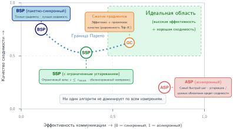

***Пространство компромисса между коммуникацией и сходимостью**: каждая точка соответствует отдельной конфигурации распределенного обучения. Граница Парето (пунктирная линия) показывает оптимальные конфигурации, в которых улучшение одной метрики требует пожертвовать другой. BSP дает высокое качество сходимости, но меньшую пропускную способность; ASP дает максимальную пропускную способность ценой сходимости. Сжатие градиентов и SSP занимают промежуточные позиции.*

Разные методы занимают разные позиции на этой кривой компромисса. Сжатие градиентов уменьшает объем коммуникаций, передавая сжатую информацию о градиентах через квантование, разрежение или низкоранговую аппроксимацию. Примеры: обновления по знаку (Bernstein et al., 2018), Deep Gradient Compression (Lin et al., 2018), PowerSGD (Vogels et al., 2019), квантованный SGD с анализом сходимости (Alistarh et al., 2017) и эмпирическое отбрасывание разреженных градиентов для нейронного машинного перевода (Aji и Heafield, 2017).

Local SGD подходит иначе: воркеры выполняют $H_{\text{local}}$ локальных обновлений, прежде чем синхронизироваться, и тем самым реже обмениваются данными в $H_{\text{local}}$ раз. Анализ сходимости показывает, что для гладких сильно выпуклых целевых функций Local SGD при правильно подобранной скорости обучения достигает той же асимптотической скорости, что и синхронный SGD (Stich, 2019).

Децентрализованный SGD ограничивает воркеры связью только с соседями в графе коммуникаций вместо глобального AllReduce. Это снижает требования к пропускной способности ценой более медленного перемешивания, и такой подход подходит для геораспределенного обучения, где глобальная синхронизация обходится дорого.

Выбор метода зависит от конкретного узкого места. Когда пропускная способность сети ограничивает производительность, лучший компромисс дает сжатие градиентов. Когда доминирует задержка синхронизации, предпочтительны Local SGD или SSP. Когда есть ограничения топологии сети, может потребоваться децентрализованный подход.

## Параллелизм модели

<a id="sec-distributed-training-systems-systems-model-parallelism-7437"></a>

Когда состояние модели, активации, состояние оптимизатора или отдельная тензорная операция превышают бюджет памяти или коммуникации одной группы ускорителей, параллелизм по данным полностью перестает работать. Это разрыв емкости памяти (принцип «разрыв емкости памяти») в операционном виде: рост числа параметров модели опережает рост памяти устройств, и вычисления и состояние модели приходится разбивать. Оптимизации памяти в параллелизме по данным расширяют возможности репликации, но в конечном счете разбивать приходится саму модель.

> **Определение: параллелизм модели**
>
> ***Параллелизм модели*** — стратегия распределенного обучения, которая разбивает параметры или операции одной нейронной сети между несколькими устройствами, так что каждое устройство вычисляет свою часть модели.
>
> 1.  **Значение**: если модель с состоянием параметров $S_{\text{model}}$ делится между $N_{\text{mp}}$ устройствами, идеальный объем параметров на устройство падает до $S_{\text{model}}/N_{\text{mp}}$, что позволяет обучать модели, превышающие память одного устройства. Цена — дополнительная коммуникация для активаций и градиентов и простои из-за последовательных зависимостей, поэтому выигрыш в памяти должен превосходить накладные расходы на передачу и пузыри конвейера, которые вносит разбиение.
> 2.  **Отличие**: в отличие от параллелизма по данным, который реплицирует полную модель на каждом воркере и шардирует мини-батч, параллелизм модели шардирует саму модель. Конвейерный и тензорный параллелизм — формы реализации параллелизма модели: один разбивает слои на стадии, другой разбивает отдельные тензорные операции.
> 3.  **Типичная ошибка**: распространено заблуждение, что параллелизм модели сам по себе ускоряет обучение. Его главный выигрыш — емкость, а не пропускная способность; без аккуратного расписания и перекрытия нижестоящие устройства ждут активаций от вышестоящих, и загрузка может упасть ниже уровня базового запуска на одном устройстве.

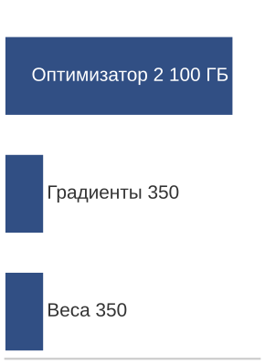

*Бюджет обучения на реплику определяет состояние оптимизатора, а не веса.*

Даже при полном развертывании ZeRO-3, когда состояния оптимизатора, градиенты и параметры шардируются между воркерами, некоторые архитектуры остаются неподъемными. Тензорный параллелизм, показанный на [рисунке «Поток данных при тензорном параллелизме»](#fig-model-parallel-flow), решает эту задачу, разбивая отдельные матрицы весов между устройствами; конвейерный параллелизм разбивает слои между стадиями и вводится позже, в [разделе «Конвейерный параллелизм»](#sec-distributed-training-systems-systems-pipeline-parallelism-8748). Для модели с 175 млрд параметров одни веса занимают 350 ГБ, то есть около 5,5 ГБ на GPU при 64 GPU. Полное состояние обучения в смешанной точности с Adam намного больше: 2 800 ГБ глобально, или примерно 43,8 ГБ на GPU до учета активаций. Это различие важно: шардинг оптимизатора уменьшает статическое состояние, но не снимает ограничений по активациям и по емкости на слой, из-за которых приходится прибегать к параллелизму модели.

<a id="fig-model-parallel-flow"></a>

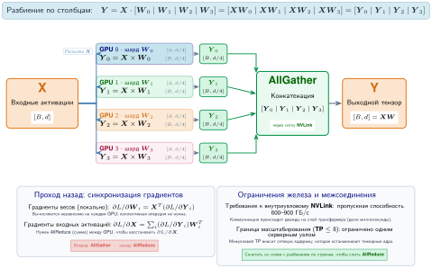

***Поток данных при тензорном параллелизме**: тензорный параллелизм разрезает по столбцам одну матрицу весов ($W_0\ldots W_3$) между четырьмя GPU; каждый GPU вычисляет частичный выход, который затем объединяется через AllGather. Парная стратегия, конвейерный параллелизм, разбивает слои по вертикали между стадиями и показана отдельно на рисунке с блоками слоев. Две стратегии часто сочетают в гибридном 3D-параллелизме для больших моделей.*

Для длинноконтекстных трансформеров, где доминирует память активаций, последовательность из 2 048 токенов при 175 млрд параметров порождает порядка терабайта промежуточных активаций даже при небольшом микробатче (примерно 1,1 ТБ при микробатче 4, как рассчитано ранее), и никакой шардинг оптимизатора это ограничение не снимает. Параллелизм модели справляется с этими ограничениями, разделяя между устройствами саму архитектуру модели, а не реплицируя ее с шардированным состоянием.

> **Сценарий: стена памяти в масштабе**
>
> **Задача**: обучение модели с 175 млрд параметров (как GPT-3) на NVIDIA A100 (80 ГБ). Справится ли с этим параллелизм по данным с ZeRO-3?
>
> **Расчет**:
>
> 1.  **Хранение параметров**: 175 млрд параметров $\times$ 2 байта (FP16) = 350 ГБ.
> 2.  **Градиенты и состояние оптимизатора**: градиенты добавляют 175 млрд параметров $\times$ 2 байта = 350 ГБ, а мастер-веса Adam в FP32, моментум и дисперсия добавляют 175 млрд параметров $\times$ 12 байт = 2 100 ГБ.
> 3.  **Суммарная статическая память**: 2 800 ГБ.
> 4.  **Шардинг ZeRO-3**: при 64 GPU статическая память на GPU = 2 800 ГБ/64 GPU $\approx$ 43,8 ГБ.
> 5.  **Память активаций**: при длине последовательности 2 048 и размере батча 1 каноническая стратегия с полными контрольными точками хранит $\approx$ 4,8 ГБ активаций на GPU.
>
> **Системный вывод**: 43,8 ГБ (статическая) + 4,8 ГБ (динамическая) = 48,6 ГБ. При таком упрощенном учете ZeRO-3 вместе с полным сохранением контрольных точек активаций укладывается в 80 ГБ памяти A100 и оставляет заметный запас под буферы фреймворка и временные сборки слоев. Если эти дополнительные выделения превысят остаток HBM, можно уменьшить микробатч, вынести состояние во внешнюю память, увеличить степень шардинга или добавить тензорный или конвейерный параллелизм; тензорный параллелизм — не единственный выход.

Параллелизм модели решает эту задачу, распределяя между устройствами саму архитектуру модели, но ключевой вопрос в том, где ее резать. Послойное разбиение назначает устройствам последовательные группы слоев: например, слои 1–4 на одном устройстве, слои 5–8 на следующем. Разбиение по каналам делит каналы внутри слоя: скажем, 512 каналов на одном устройстве, остальные на другом. Трансформерные архитектуры добавляют разбиение по головам внимания, когда разные устройства владеют разными головами. Каждый разрез меняет свою статью затрат: послойные разрезы экономят память, но сериализуют конвейер, а разрезы по каналам и головам открывают больше параллельной работы, но требуют более быстрой коммуникации внутри слоя.

Эти разрезы делают возможными крупные случаи, которые по разным причинам не помещаются на одно устройство. GPT-3 с 175 млрд параметров обучается с помощью параллелизма модели. Визуальные трансформеры, обрабатывающие изображения высокого разрешения $16k{\times}16k$ пикселей, используют параллелизм модели для управления активациями и ограничениями памяти. Архитектуры со смесью экспертов применяют этот подход, чтобы распределить пути условных вычислений по железу (Shazeer et al., 2017; Lepikhin et al., 2021; Fedus et al., 2022).

Координация устройств проходит в три фазы. При проходе вперед данные последовательно движутся через сегменты модели на разных устройствах. Проход назад распространяет градиенты в обратном порядке через те же сегменты. При обновлении параметров каждое устройство изменяет только свою часть модели. Такая координация обеспечивает математическую эквивалентность обучению на одном устройстве и при этом позволяет обучать модели, превышающие память отдельного устройства. Цена — последовательная зависимость между стадиями: пока одно устройство выполняет свой проход вперед, нижестоящие простаивают, создавая пузырь конвейера, который доминирует в анализе загрузки систем с параллелизмом модели.

> **Контрольные вопросы: основы параллелизма модели**
>
> Проверьте, как вы понимаете шардинг модели:
>
> - [ ] **Разгрузка памяти**: определите, уменьшает ли параллелизм модели объем памяти на GPU для заданной модели.
> - [ ] **Последовательная зависимость**: определите, возникают ли последовательные зависимости между шардами модели при проходе вперед, при проходе назад или в обоих.
> - [ ] **Пузырь конвейера**: объясните, почему чистый параллелизм модели часто дает более низкую загрузку GPU, чем параллелизм по данным, из-за «пузыря конвейера».
> - [ ] **Послойное и тензорное разбиение**: различите послойный и тензорный способы разбиения слоя трансформера.

### Реализация параллелизма модели

<a id="sec-distributed-training-systems-systems-model-parallelism-implementation-0728"></a>

Когда объектом разбиения становится сама модель, реализация сводится к размещению: каждый разрез должен сэкономить достаточно памяти, чтобы оправдать передачу активаций и простой, которые он вносит. [Рисунок «Поток данных при параллелизме модели»](#fig-dist-model-parallelism) показывает этот двунаправленный поток данных: входные данные движутся вперед через последовательно назначенные разделы модели, а градиенты идут назад для обновления параметров, и на каждой стадии промежуточные результаты передаются через границы устройств.

<a id="fig-dist-model-parallelism"></a>

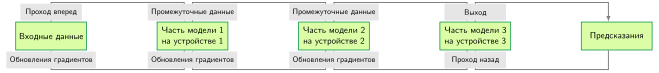

***Поток данных при параллелизме модели**: разделы модели выполняются последовательно на трех устройствах: входные данные идут вперед через каждый раздел (верхний путь), а градиенты распространяются назад на фазе обновления (нижний путь). Каждое устройство хранит свой фрагмент модели, поэтому промежуточные активации и градиенты пересекают границы устройств. Такое устройство позволяет обучать модели, превышающие память одного устройства, ценой последовательных зависимостей, которые снижают загрузку.*

Рассмотрим наш сквозной пример: модель с 175 млрд параметров требует 350 ГБ памяти в FP16, что превышает 80 ГБ одного A100 в четыре раза. Параллелизм модели решает эту **стену емкости**, разбивая веса модели между несколькими устройствами и фактически сшивая их в один суперускоритель. В отличие от параллелизма по данным, где каждый GPU держит полную реплику модели и обрабатывает свою долю глобального батча, параллелизм модели требует, чтобы каждый GPU держал *уникальную* долю модели и последовательно обрабатывал *один и тот же* поток данных. При 8-кратном разбиении на A100 одни веса в BF16 занимают примерно 44 ГБ на GPU. Это лишь бюджет весов: для полного обучения по-прежнему нужны активации, градиенты и состояние оптимизатора, поэтому чистого 8-кратного параллелизма модели самого по себе недостаточно. Обучение требует дополнительного шардинга или выгрузки состояния оптимизатора и градиентов, а также конвейерного или гибридного параллелизма, чтобы память активаций укладывалась в доступную емкость.

В типичной реализации конвейерного параллелизма цикл обучения работает как эстафета. Проход вперед начинается на GPU 1, который вычисляет начальные блоки трансформера и передает получившийся тензор промежуточных активаций по межсоединению на GPU 2. Для нашей модели с 175 млрд параметров со скрытой размерностью 12 288 и микробатчем из 4 последовательностей по 2 048 токенов такая передача означает перемещение примерно 200 МБ данных через границу каждой стадии за шаг. GPU 2 должен дождаться этой нагрузки, прежде чем начнет вычисления, и это создает жесткую цепочку зависимостей, которая проходит через все стадии. Проход назад зеркально повторяет этот путь в обратном направлении: ошибки градиентов идут от последнего слоя к входу, а каждое устройство вычисляет градиенты только для своих локальных параметров.

Архитектура принципиально меняет динамику оптимизации по сравнению с параллелизмом по данным. Вместо глобального AllReduce для усреднения градиентов между репликами каждый GPU выполняет локальный шаг оптимизатора (Adam (Kingma и Ba, 2015), AdaFactor или аналогичный) на своем срезе параметров. Устройство, которое держит слои 1–12 трансформера, обновляет только веса и смещения этих слоев, и во время шага оптимизации межустройственная синхронизация не требуется. Это устраняет требовательную к пропускной способности синхронизацию градиентов из параллелизма по данным, но меняет одно узкое место на другое: пузыри конвейера. Если слои, назначенные GPU 1, вычислительно тяжелее слоев GPU 2 (обычно так бывает, когда у слоев внимания разное число голов или когда слои эмбеддингов имеют неравный размер), ценные вычислительные циклы теряются на ожидание. Поэтому главная инженерная задача смещается от максимизации арифметической интенсивности к минимизации задержки сериализации и обеспечению сбалансированной нагрузки по всему разбитому парку (Rasley et al., 2020).

### Варианты параллелизма

<a id="sec-distributed-training-systems-systems-parallelism-variations-592a"></a>

Стратегия разбиения определяет, какую цену платит модель после того, как память перестает умещаться на одном устройстве. Послойное разбиение тратит время простоя ради уменьшения памяти на устройство; конвейерный параллелизм тратит сложность планирования, чтобы скрыть этот простой; тензорный параллелизм тратит пропускную способность NVLink, чтобы разделить один слой. В следующих подразделах эти варианты разделены по архитектуре и межсоединению, которые делают каждый из них применимым.

#### Послойное разбиение

<a id="sec-distributed-training-systems-systems-layerwise-partitioning-cf6a"></a>

Послойное разбиение — наименее инвазивный разрез модели: оно экономит память, назначая последовательные слои разным устройствам, но сохраняет последовательную зависимость модели. В трансформерных архитектурах это означает, что определенные устройства ведут заданные наборы блоков внимания и прямых связей (feed-forward). [Рисунок «Послойный параллелизм модели»](#fig-dist-layers-blocks) показывает такое разбиение для 16-слойного трансформера: на каждом из четырех устройств размещены по четыре последовательных блока, прямые активации идут слева направо, а градиенты прохода назад — справа налево через границы устройств.

<a id="fig-dist-layers-blocks"></a>

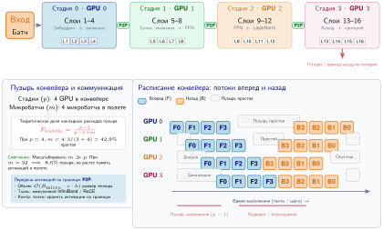

***Послойный параллелизм модели**: верхний путь назначает по четыре последовательных блока трансформера на каждый из четырех GPU с контрольными точками активаций на границах устройств. Нижнее расписание показывает работу прохода вперед синим цветом, прохода назад оранжевым и заштрихованные пузыри конвейера. Разбиение уменьшает вес на GPU до четверти модели, но последовательные зависимости заставляют нижестоящие устройства ждать во время заполнения конвейера.*

Последовательная обработка вносит простои устройств: каждое должно дождаться, пока предыдущее закончит вычисления, и только тогда приступить к работе. Пока устройство 1 обрабатывает начальные блоки, устройства 2, 3 и 4 неактивны. Точно так же, когда вычисления начинает устройство 2, устройство 1 простаивает. Такая картина ожиданий и простоев снижает эффективность использования железа по сравнению с другими стратегиями распараллеливания.

#### Конвейерный параллелизм

<a id="sec-distributed-training-systems-systems-pipeline-parallelism-8748"></a>

Конвейерный параллелизм развивает послойное разбиение, вводя микробатчинг, чтобы сократить простои устройств. Вместо того чтобы ждать, пока весь батч последовательно пройдет через все устройства, вычисления делятся на более мелкие сегменты, называемые микробатчами, и выполняются с перекрытием между стадиями конвейера ([рисунок «Расписание конвейерного параллелизма»](#fig-pipeline-parallelism)). В этом расписании каждая строка — устройство, обрабатывающее слои модели по микробатчам; прямые активации идут вниз по потоку, а градиенты прохода назад — вверх. Перекрытие сокращает, но не устраняет пустые слоты конвейера.

<a id="fig-pipeline-parallelism"></a>

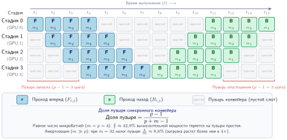

***Расписание конвейерного параллелизма**: 4-стадийный конвейер обрабатывает 4 микробатча проходами вперед ($F_{i,j}$) и назад ($B_{i,j}$) во времени. Строки — стадии конвейера, столбцы — шаги времени. Смещение работы позволяет одной стадии обрабатывать микробатч, пока другая занимается более ранним или более поздним, и сокращает простои, но не устраняет пузыри заполнения, опустошения и зависимостей, видимые в расписании.*

> **Определение: конвейерный параллелизм**
>
> ***Конвейерный параллелизм*** — метод параллелизма модели, который разбивает слои нейронной сети на последовательные стадии, назначенные разным устройствам, передает активации вперед, а градиенты назад между стадиями и перекрывает вычисления разных стадий с помощью микробатчей, чтобы сохранить пропускную способность.
>
> 1.  **Значение**: коммуникация между стадиями передает только тензор активаций на границе стадии размером $B_{\mu} \times S \times d_{\text{model}} \times 2$ байта в BF16, где $B_{\mu}$ — размер микробатча. Для скрытой размерности 8 192 при микробатче 1 и последовательности из 2 048 токенов это примерно $8\,192 \times 2\,048 \times 2 \approx 32$ МБ на границу, тогда как AllReduce градиентов в параллелизме по данным требует гигабайтов. Малый объем коммуникаций делает конвейерный параллелизм основным способом масштабировать глубину модели между узлами, соединенными InfiniBand на 50 ГБ/с. Пузырь конвейера тратит около $(p-1)/(m+p-1)$ всех вычислений, где $p$ — число стадий, а $m$ — число микробатчей; при $p=8$ стадиях и $m=32$ микробатчах накладные расходы пузыря составляют около 18 %.
> 2.  **Отличие**: в отличие от тензорного параллелизма, который шардирует отдельные умножения матриц внутри одного слоя и требует AllReduce на выходе каждого слоя (а значит, пропускной способности класса NVLink внутри каждой стадии), конвейерный параллелизм шардирует по границам слоев и требует только двухточечной передачи активаций между стадиями, что допускает пропускную способность InfiniBand между узлами.
> 3.  **Типичная ошибка**: распространено заблуждение, что добавление стадий конвейера всегда повышает пропускную способность. Каждая дополнительная стадия увеличивает долю пузыря $(p-1)/(m+p-1)$, если только число микробатчей $m$ не растет пропорционально; железо простаивает, и выигрыш от более глубокого разбиения пропадает.

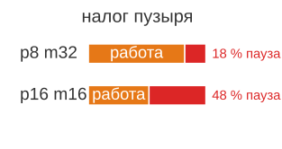

*Чем больше стадий, тем больше микробатчей нужно, иначе пузырь начинает доминировать в загрузке.*

Тот же член пузыря становится конкретным в следующем разобранном примере: 8-стадийный конвейер с 32 микробатчами все равно оставляет измеримый налог простоя.

> **Сценарий: цена пузыря конвейера**
>
> **Задача**: запуск обучения большой модели использует конвейерный параллелизм на 8 стадиях. Чтобы скрыть последовательную задержку, батч делится на 32 микробатча. Каков «налог пузыря» — доля циклов GPU, потерянных на простой в ожидании?
>
> **Расчет**:
> В синхронном конвейере (1F1B) доля пузыря определяется отношением числа стадий к числу микробатчей.
>
> 1. **Время ожидания**: в начале и в конце каждого батча GPU простаивают $p-1$ шагов.
> 2. **Продуктивное время**: GPU вычисляют $m$ шагов.
> 3. **Доля пузыря**: $(p-1) / (p-1+m) =$ 7 $/$ (7 $+$ 32) $\approx$ 17,9 %.
>
> **Системный вывод**: конвейерный параллелизм — это *компромисс между загрузкой и памятью*. Чтобы снизить пузырь с 18 % до 5 %, нужно больше микробатчей $(m)$, которые потребляют дополнительную память активаций на каждом GPU. В парке машинного обучения глубина не масштабируется бесплатно: кластер платит налог мощности в 17,9 %, только чтобы стадии оставались согласованными. Поэтому техники вроде чередующегося конвейера (interleaved pipelining) так важны: они дробят пузырь на более мелкие части и возвращают потерянные 18 % мощности парка.

GPipe[^fn-gpipe-pipeline-schedule] (Huang et al., 2019) ввел синхронный конвейерный параллелизм с накоплением микробатчей, а PipeDream (Narayanan et al., 2019) развил асинхронные подходы с сохранением версий весов (weight stashing). Современные системы применяют расписание **1F1B (One-Forward-One-Backward, «один прямой — один обратный»)**[^fn-one-forward-backward], чтобы раньше освобождать память активаций: меньшее давление на память делает практичным большее число микробатчей, а именно рост $m$ сжимает член пузыря.

[^fn-one-forward-backward]: **Расписание 1F1B (one-forward-one-backward)**: в отличие от GPipe, которое выполняет все проходы вперед до начала любого прохода назад, 1F1B их чередует. Это снижает пиковый объем памяти активаций с $\mathcal{O}(m \times p)$ до $\mathcal{O}(p)$, где $m$ — число микробатчей, а $p$ — число стадий конвейера. Именно такое возвращение памяти позволяет работать с большим числом микробатчей $(m \gg p)$, которое нужно, чтобы пузырь конвейера оставался малым.

[^fn-gpipe-pipeline-schedule]: **GPipe**: опубликованный Google в 2019 году GPipe ввел синхронный конвейер микробатчей, который обучил AmoebaNet на 557 млн параметров на 8 тензорных процессорах (TPU) с почти линейным масштабированием. Главный компромисс, который показал GPipe: доля пузыря конвейера $(p-1)/(m+p-1)$ означает, что при $p=4$ стадиях и $m=4$ микробатчах 43 % вычислений теряется на простой. Это подталкивает проектирование систем к расписаниям, которые сокращают время жизни активаций и делают возможным большее число микробатчей.

На уровне расписания 1F1B — цикл из разогрева, установившегося режима и опустошения. [Алгоритм «Расписание конвейера «один прямой — один обратный»»](#algo-one-forward-one-backward-pipeline) делает контракт явным: как только приходят градиенты, каждая стадия чередует прямую работу для более новых микробатчей с обратной работой для более старых, и активации можно освободить до завершения всего батча.

<a id="algo-one-forward-one-backward-pipeline"></a>

**Алгоритм: расписание конвейера «один прямой — один обратный»**

```text
Вход:   p упорядоченных стадий конвейера; m микробатчей; связи активаций j → j+1 и связи градиентов j+1 → j
Выход:  одно обновление оптимизатора после накопления градиентов по всем m микробатчам

разбить глобальный батч на m микробатчей; назначить p стадиям последовательные слои
разогрев: запустить проходы вперед со стадии 0, передавая каждую активацию вниз по потоку по мере ее получения
для каждой стадии в установившемся режиме:
    чередовать один проход назад (самый старый готовый микробатч) с одним проходом вперед (следующий микробатч)
    освобождать активацию микробатча, как только проход назад этой стадии ее потребил
опустошение: завершить оставшиеся проходы назад в обратном порядке стадий
применить обновление оптимизатора, когда каждая стадия накопит градиенты по всем m микробатчам
```

Фазы разогрева и опустошения по-прежнему оставляют пузырь примерно $(p-1)/(m+p-1)$, но чередование прохода назад в установившемся режиме освобождает каждую активацию, как только ее потребляет проход назад, поэтому пиковая память активаций растет вместе с числом стадий, а не микробатчей. В этом выигрыш по сравнению с расписанием в духе GPipe «все проходы вперед, затем все проходы назад»: система может увеличивать $m$, пока следующим пределом не станут память активаций, пересчет или ограничение на глобальный батч. В модели-трансформере, распределенной по четырем устройствам, устройство 1 обрабатывает блоки 1–6 для микробатча $i+1$, пока устройство 2 вычисляет блоки 7–12 для микробатча $i$. Одновременно устройство 3 выполняет блоки 13–18 для микробатча $i-1$, а устройство 4 обрабатывает блоки 19–24 для микробатча $i-2$. Каждое устройство хранит свои назначенные блоки трансформера, но работает с другим микробатчем, и вычисления идут непрерывным потоком.

Передача скрытых состояний между устройствами происходит непрерывно, а не отдельными фазами. Когда устройство 1 заканчивает обработку микробатча, оно сразу передает выходной тензор формы $B_{\mu} \times S \times d_{\text{model}}$ устройству 2 и начинает следующий микробатч. Такое перекрытие вычислений сохраняет полную загрузку железа и не нарушает математических свойств модели.

Один важный вариант нацелен непосредственно на оставшийся пузырь. GPU в начале конвейера простаивают в ожидании градиентов, которые должны вернуться с конца, и наоборот. Эти пузыри — потерянные вычисления. Расписание 1F1B из [алгоритма «Расписание конвейера «один прямой — один обратный»»](#algo-one-forward-one-backward-pipeline) держит потоковые мультипроцессоры занятыми в установившемся режиме и сокращает время жизни активаций, но пузырь заполнения и опустошения остается, если система не увеличивает $m$ или не планирует полезную работу в эти простаивающие слоты.

**Расписания конвейера с нулевым пузырем (Zero-Bubble)** еще сильнее сокращают простой, перекрывая вычисление градиента весов с коммуникацией градиента активаций. В стандартном проходе назад GPU вычисляет вместе $\partial \mathcal{L} / \partial W$ (градиент весов) и $\partial \mathcal{L} / \partial X$ (градиент активаций, отправляемый на предыдущую стадию). Планирование с нулевым пузырем разделяет их на отдельные ядра: ядро $B$ вычисляет только градиент активаций $\partial \mathcal{L} / \partial X$ и отправляет его на предыдущую стадию, а ядро $W$ вычисляет градиент весов $\partial \mathcal{L} / \partial W$ локально. Ядро $B$ нужно выполнить сразу (оно на критическом пути), а ядро $W$ можно планировать оппортунистически, заполняя им пузыри.

Свобода планирования, которую дает такое разделение на B и W, весома. В 4-стадийном конвейере с 8 микробатчами у стандартного расписания 1F1B доля пузыря составляет примерно $(p-1)/(m+p-1)$, где $p$ — число стадий, а $m$ — число микробатчей. При $p=4, m=8$ это $3/11 \approx 27\%$ простоя. Планирование с нулевым пузырем может довести его почти до нуля, заполняя пузыри запуска и завершения вычислениями W.

Цена — память: планирование с нулевым пузырем требует хранить промежуточные активации дольше (потому что вычисление W откладывается), что повышает пиковое потребление памяти. Некоторые реализации решают это, комбинируя планирование с нулевым пузырем с сохранением контрольных точек активаций и выборочно пересчитывая часть активаций, а не храня их. Взаимодействие этих техник создает трехсторонний компромисс между размером пузыря конвейера, потреблением памяти и накладными расходами пересчета; это пример смещения накладных расходов (принцип «смещение накладных расходов»).

#### Тензорный параллелизм

<a id="sec-distributed-training-systems-systems-tensor-parallelism-d76e"></a>

Конвейерный параллелизм, рассмотренный в [разделе «Конвейерный параллелизм»](#sec-distributed-training-systems-systems-pipeline-parallelism-8748), борется с простоями устройств, перекрывая обработку микробатчей между стадиями. Каждое устройство хранит полные слои и обрабатывает их последовательно, а коммуникация нужна только на границах стадий, когда активации передаются между устройствами. Такой подход переносит умеренную пропускную способность межсоединения, потому что коммуникация происходит нечасто: раз на границу слоя за микробатч. Однако конвейерный параллелизм не помогает, когда сами отдельные слои превышают память устройства или когда паттерн коммуникации внутри слоев выигрывает от другой гранулярности, чем границы слоев.

Тензорный параллелизм подходит принципиально иначе: вместо того чтобы назначать устройствам целые слои, он разбивает матрицы весов внутри каждого слоя. Такой параллелизм на уровне операторов (его называют также внутрислойным параллелизмом) позволяет распределять работу мельче, но требует межсоединений с высокой пропускной способностью из-за частой внутрислойной коммуникации, которую он вносит.

> **Определение: тензорный параллелизм**
>
> ***Тензорный параллелизм*** — метод параллелизма модели, который разбивает отдельные тензорные операции, прежде всего умножения матриц, между несколькими устройствами с помощью разбиений весов по столбцам или по строкам; в блоках трансформера в стиле Megatron для суммирования частичных результатов со всех участвующих устройств обычно требуются две операции AllReduce на слой трансформера.
>
> 1.  **Значение**: тензорный параллелизм в стиле Megatron-LM ставит две операции AllReduce на блок трансформера при проходе вперед — одну после внимания и одну после MLP; каждая коллективная операция редуцирует тензор активаций размера $B_{\text{batch}} \times S \times d_{\text{model}} \times 2$ байта в BF16. Кольцевой AllReduce перемещает примерно $2(t-1)/t$ от этой нагрузки на GPU. При степени $t=8$ на NVLink с пропускной способностью 900 ГБ/с каждый AllReduce занимает примерно 0,1–0,5 мс. Та же операция по InfiniBand (50 ГБ/с) занимает 2–10 мс на слой — при 96 блоках трансформера это добавляет 200–960 мс чистых накладных расходов синхронизации на проход вперед, а шаг обучения удваивает их, потому что проход назад повторяет обе коллективные операции, и MFU падает до однозначных значений.
> 2.  **Отличие**: в отличие от конвейерного параллелизма, который обменивается данными только на границах слоев и передает небольшие срезы активаций, тензорный параллелизм синхронизируется внутри каждого слоя через AllReduce, поэтому он чувствителен к задержке межсоединения на операцию и на практике ограничен внутриузловыми фабриками NVLink.
> 3.  **Типичная ошибка**: распространено заблуждение, что тензорный параллелизм можно просто масштабировать между узлами по InfiniBand. NVLink обеспечивает около 900 ГБ/с в двух направлениях, то есть 450 ГБ/с в каждом; InfiniBand NDR дает 50 ГБ/с на порт — разрыв 9× по каждому направлению. Запуск тензорного параллелизма через InfiniBand обычно обрушивает MFU до однозначных процентов, и накладные расходы коммуникации оказываются больше вычислительного выигрыша от распределения умножения матриц.

Топология межсоединений определяет, какая форма параллелизма модели жизнеспособна на каждом уровне иерархии кластера. Синхронизация тензорного параллелизма на каждом слое требует пропускной способности класса NVLink; коммуникация конвейерного параллелизма только на границах переносит InfiniBand. Такая картина пропускной способности создает проектное давление в пользу гибрида: тензорный параллелизм для требовательных к пропускной способности разбиений внутри слоя и конвейерный параллелизм для более грубых разбиений между слоями.

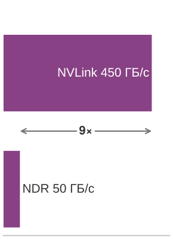

*Тензорному параллелизму нужна пропускная способность NVLink; конвейерный параллелизм мирится с более медленной фабрикой.*

Тензорный параллелизм в стиле Megatron[^fn-megatron-tensor-parallelism] (Shoeybi et al., 2019) разбивает умножения матриц двумя способами. Обратите внимание на [рисунок «Разбиение матриц при тензорном параллелизме»](#fig-tensor-parallel-split): разбиение по столбцам делит матрицы весов по столбцам для проекций QKV, что позволяет GPU вычислять независимо, а разбиение по строкам делит матрицы по строкам для выходных слоев и требует AllReduce, чтобы объединить частичные суммы в конце каждого блока.

[^fn-megatron-tensor-parallelism]: **Megatron-LM**: фреймворк NVIDIA 2019 года, обучивший трансформер на 8,3 млрд параметров — в 24$\times$ больше BERT и в 5,6$\times$ больше GPT-2 на тот момент — за счет расстановки всего двух операций AllReduce на блок трансформера при проходе вперед (одна после внимания, одна после многослойного перцептрона (MLP)). Такое разбиение «сначала по столбцам, затем по строкам» устраняет коммуникацию между GPU между двумя линейными слоями внутри блока, дает эффективность масштабирования 76 % на 512 GPU и задает паттерны тензорного параллелизма, которые остаются влиятельными в крупномасштабном обучении трансформеров.

Линейные слои с разбиением по столбцам делят веса по столбцам. Для входа $X$ и матрицы весов $W = [W_1 | W_2]$, разделенной между 2 GPU:
$$\mathbf{Y} = \mathbf{X}\mathbf{W} = \mathbf{X}[\mathbf{W}_1 | \mathbf{W}_2] = [\mathbf{X}\mathbf{W}_1 | \mathbf{X}\mathbf{W}_2]$$
Каждый GPU независимо вычисляет свою часть, а выходы конкатенируются без коммуникации, когда следующая операция выполняется с разбиением по строкам. Вторая половина паттерна, разбиение по строкам, делит веса по строкам, $W = \begin{bmatrix} W_1 \\ W_2 \end{bmatrix}$:
$$\mathbf{Y} = \mathbf{X}\mathbf{W} = \mathbf{X}_1 \mathbf{W}_1 + \mathbf{X}_2 \mathbf{W}_2$$
Каждый GPU вычисляет частичную сумму, и система платит один AllReduce, чтобы объединить частичные выходы.

<a id="fig-tensor-parallel-split"></a>

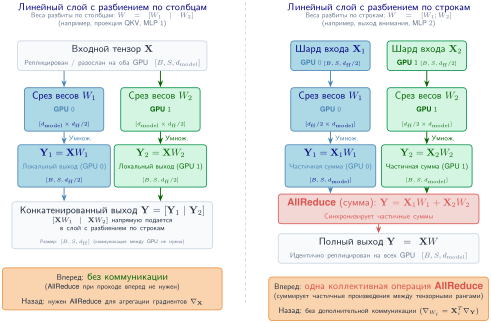

***Разбиение матриц при тензорном параллелизме**: первый линейный слой (например, QKV) разбит по столбцам как $[W_1 | W_2]$, а второй (например, выходная проекция) — по строкам как $[W_1 ; W_2]$. Эта схема Megatron-LM передает промежуточный результат напрямую между двумя разбиениями и требует одного AllReduce после второго слоя, чтобы просуммировать частичные выходы.*

Схема «сначала по столбцам, затем по строкам», показанная на [рисунке «Разбиение матриц при тензорном параллелизме»](#fig-tensor-parallel-split), — ключевая проектная идея. Если поставить слой с разбиением по столбцам в пару со слоем с разбиением по строкам, промежуточные активации идут между ними напрямую, без коммуникации, и синхронизация ограничивается концом пары. Megatron применяет этот паттерн дважды в каждом блоке трансформера. Проекция QKV разбита по столбцам, а выходная проекция внимания — по строкам; затем первый слой прямой связи разбит по столбцам, а второй слой прямой связи — по строкам. Благодаря такому устройству операции AllReduce стоят в стратегических точках — одна после внимания и одна после сети прямой связи, — то есть две операции AllReduce на слой трансформера. Объем коммуникации на слой трансформера зависит от длины последовательности $S$, скрытой размерности $d_{\text{model}}$, степени тензорного параллелизма $t$ и размера батча $B$. Нагрузка активаций равна:
$$M_{\text{act}} = B \times S \times d_{\text{model}} \times \text{sizeof(dtype)}$$

Кольцевой AllReduce передает примерно $2(t-1)/t \times M_{\text{act}}$ байт на GPU, что близко к $2M_{\text{act}}$ при большом $t$. При $S=2\,048$, $d_{\text{model}}=4\,096$, $B=4$ и FP16 нагрузка активаций равна $4 \times 2\,048 \times 4\,096 \times 2 \approx 67$ МБ. С учетом кольцевого множителя это примерно 134 МБ на один AllReduce. Для 96-слойной модели с двумя операциями AllReduce на слой это составляет около 25,7 ГБ за проход вперед; с учетом симметричных AllReduce при проходе назад коммуникация за шаг обучения достигает примерно 51 ГБ, и чтобы она не стала узким местом, нужна пропускная способность NVLink.

Масштабирование тензорного параллелизма быстро ухудшается за пределами 8-кратного разбиения, потому что то же разбиение, которое уменьшает память, уменьшает и объем вычислений, доступных для сокрытия коммуникации. С ростом степени тензорного параллелизма работа на GPU падает, а задержка коллективных операций и суммарный трафик растут; байты кольцевого AllReduce на GPU приближаются к 2$\times$ размера тензора активаций, а не растут линейно без предела, но меньшее локальное умножение матриц оставляет меньше полезной работы, чтобы покрыть этот обмен. Когда пропускная способность NVLink насыщена, добавление еще одного шарда тензорного параллелизма в основном обнажает больше синхронизации, а не добавляет пропускной способности. Опубликованные системы вроде Llama 3 405B используют TP=8 внутри узлов H100, соединенных NVLink (Dubey et al., 2024), а аналогичный узловой тензорный параллелизм — распространенный проектный паттерн для обучения больших LLM (Jiang et al., 2024).

#### Параллелизм по последовательности и по контексту

<a id="sec-distributed-training-systems-sequence-context-parallelism"></a>

Тензорный параллелизм разбивает матрицы весов внутри линейных слоев, но в памяти обучения крупных трансформеров все сильнее доминируют активации. Когда модели наращивают длину контекста с тысяч до сотен тысяч или миллионов токенов ($S \ge 32\text{ тыс.}\dots 1\text{ млн}+$), объем активаций растет пропорционально:
$$M_{\text{act}} = \mathcal{O}(B \times S \times d_{\text{model}} \times L)$$
для линейных слоев, слоев нормализации и остаточных связей и $\mathcal{O}(B \times h \times S^2 \times L)$ для нетайлингового внимания (или $\mathcal{O}(B \times S \times d_{\text{model}} \times L)$ для FlashAttention с тайлингом). При длинных контекстах память активаций многократно превосходит хранение параметров и обнажает разрыв емкости памяти (принцип «разрыв емкости памяти»). С этим ограничением справляются два дополняющих друг друга подхода, которые шардируют по оси последовательности: **параллелизм по последовательности (Sequence Parallelism, SP)** внутри домена тензорного параллелизма и **параллелизм по контексту (Context Parallelism, CP)** между выделенными группами процессов для длинных последовательностей.

> **Определение: параллелизм по последовательности и по контексту**
>
> ***Параллелизм по последовательности и по контексту*** — техники распределенного исполнения, которые разбивают измерение последовательности токенов между устройствами, чтобы устранить узкие места памяти активаций в моделях с длинным контекстом. Параллелизм по последовательности (SP) шардирует активации между рангами тензорного параллелизма во время операций, не являющихся GEMM (LayerNorm, Dropout), без добавления объема коммуникации; параллелизм по контексту (CP) шардирует последовательность внимания между независимыми группами процессов либо через систолическую двухточечную передачу по кольцу (Ring Attention), либо через транспонирование «голова–последовательность» (параллелизм по контексту на основе All-to-All).
>
> 1.  **Значение**: при длине контекста свыше 32 768 токенов хранение полных активаций по всем слоям исчерпывает HBM ускорителя, даже когда веса модели полностью шардированы. Параллелизм по последовательности уменьшает память активаций вне GEMM в $t$ раз ($t$ — степень тензорного параллелизма), заменяя AllReduce парами ReduceScatter и AllGather без дополнительного сетевого трафика. Параллелизм по контексту масштабирует длину контекста линейно с числом устройств ($c \times S_{\text{single}}$), что позволяет обучение на миллионе токенов без аварий из-за нехватки памяти.
> 2.  **Отличие**: в отличие от тензорного параллелизма (который разбивает матрицы весов по скрытым размерностям $d_{\text{model}}$ и требует пропускной способности класса NVLink для мелкозернистого внутрислойного AllReduce), параллелизм по контексту разбивает ось последовательности $S$. Ring Attention использует асинхронные двухточечные передачи, которые могут проходить по межузловым фабрикам, а Ulysses выполняет транспонирование All-to-All между измерениями последовательности и голов.
> 3.  **Типичная ошибка**: предположение, что параллелизм по контексту устраняет квадратичную вычислительную сложность внимания. CP распределяет вычисление внимания между устройствами и уменьшает *на каждое устройство* память и FLOP в $1/c$ раз, но *суммарные* FLOP кластера для плотного самовнимания по-прежнему растут квадратично, как $\mathcal{O}(S^2)$.

##### Параллелизм по последовательности в Megatron

Стандартный тензорный параллелизм в стиле Megatron разбивает только умножения матриц внутри слоя трансформера: проекция QKV и первый слой MLP делят веса по столбцам, а выходная проекция внимания и второй слой MLP — по строкам ([рисунок «Разбиение матриц при тензорном параллелизме»](#fig-tensor-parallel-split)). Однако операции, обрамляющие эти умножения, — LayerNorm, Dropout и остаточные сложения — поэлементные и традиционно реплицируются на все $t$ устройств тензорного параллелизма. Поэтому каждый GPU избыточно хранит полный тензор активаций размера $B \times S \times d_{\text{model}}$.

Параллелизм по последовательности в Megatron (Korthikanti et al., 2023) устраняет эту избыточность, шардируя измерение последовательности между $t$ рангами для всех операций вне тензорного параллелизма. Вместо репликации активаций каждый GPU во время LayerNorm и Dropout хранит только срез $B \times (S/t) \times d_{\text{model}}$.

Принципиально, что такое шардирование несет **нулевой дополнительный объем коммуникации**. В стандартном тензорном параллелизме за умножением матриц с разбиением по строкам следует AllReduce, чтобы просуммировать частичные произведения между рангами. AllReduce математически раскладывается на ReduceScatter с последующим AllGather:
$$\text{AllReduce}(\mathbf{X}) \equiv \text{AllGather}(\text{ReduceScatter}(\mathbf{X}))$$
Megatron-SP разъединяет эту пару:

1. После линейного слоя с разбиением по строкам **ReduceScatter** редуцирует частичные суммы и одновременно рассеивает получившиеся активации по измерению последовательности, оставляя на каждом GPU по $S/t$ токенов.
2. LayerNorm, остаточные сложения и Dropout выполняются на локальных срезах $S/t$ без коммуникации между устройствами.
3. Непосредственно перед следующим линейным слоем с разбиением по столбцам **AllGather** по измерению последовательности собирает полные $S$ токенов, необходимые для умножения матриц с разбитыми весами.

Стандартный TP выполняет два AllReduce на блок трансформера ($2 \times 2(t-1)/t \times M_{\text{act}}$ байт), а Megatron-SP — две пары ReduceScatter и AllGather ($2 \times [(t-1)/t + (t-1)/t] \times M_{\text{act}} = 2 \times 2(t-1)/t \times M_{\text{act}}$ байт), поэтому суммарный объем коммуникации одинаков. Параллелизм по последовательности уменьшает память активаций вне внимания в $t$ раз, не потребляя никакой дополнительной пропускной способности межсоединения.

##### Параллелизм по контексту: Ring Attention против Ulysses

Когда длина последовательности $S$ достигает 64 000–1 000 000+ токенов, память активаций превышает емкость устройства даже с параллелизмом по последовательности и сохранением контрольных точек активаций. Параллелизм по контексту (степень CP $c$) шардирует последовательность между выделенной группой из $c$ ускорителей. Две основные архитектурные парадигмы определяют параллелизм по контексту:

1. **Ring Attention (систолические двухточечные обмены)** (Liu et al., 2023): каждый GPU хранит чанк запросов $Q_i$ длины $S/c$ и начальный чанк ключей и значений $(K_i, V_i)$. Вычисление идет за $c$ раундов по логическому кольцу. В каждом раунде GPU $i$ вычисляет блочное внимание между своим неподвижным $Q_i$ и имеющимися тайлами $(K_j, V_j)$ с помощью накопителя онлайнового softmax, одновременно асинхронно отправляя $(K_j, V_j)$ соседу по кольцу $(i+1) \bmod c$ и принимая $(K_{j-1}, V_{j-1})$ от $(i-1) \bmod c$. Коммуникация скрыта полностью, когда задержка вычисления одного тайла превышает время двухточечной передачи:
   $$\frac{2 \times (S/c)^2 \times d_{\text{model}}}{\text{FLOP/s}} \ge \frac{2 \times (S/c) \times d_{\text{model}}}{\text{Bandwidth}_{\text{link}}} \iff \frac{S}{c} \ge \frac{\text{FLOP/s}}{\text{Bandwidth}_{\text{link}}}$$
   На ускорителе с пропускной способностью HBM 3,35 ТБ/с и пропускной способностью линка 900 ГБ/с это условие перекрытия выполняется для типичных размеров блоков. В каузальном авторегрессивном внимании верхнетреугольные тайлы маскируются ($j > i$). Наивное кольцевое исполнение оставляет половину GPU простаивать в поздних раундах; промышленные реализации используют зигзагообразное или полосатое разбиение токенов, чтобы равномерно распределить каузальные тайлы между всеми устройствами.

2. **Контекстное транспонирование All-to-All (DeepSpeed Ulysses)** (Jacobs et al., 2023): вместо того чтобы гонять тайлы по кольцу, Ulysses использует ортогональность измерения последовательности и голов внимания. Вне ядра внимания активации шардированы по измерению последовательности ($S/c$ токенов, все $h$ голов внимания). Перед вычислением самовнимания коллективная операция **All-to-All** транспонирует тензор из разбитого по последовательности `[S/c, h, d_head]` в разбитый по головам `[S, h/c, d_head]`. Теперь каждый GPU держит полную длину последовательности $S$, но лишь подмножество $h/c$ голов внимания. Каждое устройство вычисляет стандартный локальный FlashAttention по всей последовательности для своих голов, и каузальное маскирование сохраняется естественным образом, без дисбаланса нагрузки. Вторая коллективная операция All-to-All транспонирует выход внимания обратно в `[S/c, h, d_head]`. Ulysses концептуально чист и переиспользует однопроцессорные ядра внимания, но требует, чтобы число голов делилось на степень контекстного параллелизма ($h \ge c$). При Grouped Query Attention (GQA), где число голов ключей и значений $h_{\text{KV}}$ уменьшено (часто до 8), $c$ ограничено значением $\le 8$.
3. **Иерархический гибридный параллелизм по контексту**: Ulysses опирается на коллективные операции All-to-All с высокой бисекционной нагрузкой, поэтому идеален внутри внутриузловых доменов NVLink ($c_{\text{intra}} \le 8$). Ring Attention использует двухточечную кольцевую коммуникацию, минимизирующую давление на бисекцию, и хорошо подходит для межузловых линков ($c_{\text{inter}}$). Передовые системы обучения на длинных контекстах сочетают оба подхода в иерархической двумерной топологии: Ulysses разбивает головы внутри каждого узла, а Ring Attention циркулирует блоки KV между узлами, открывая окна контекста в миллионы токенов без насыщения бисекционной пропускной способности кластера.

### Серверы параметров и шардинг эмбеддингов

<a id="sec-distributed-training-systems-systems-parameter-servers-embedding-sharding-8821"></a>

Хотя в обучении плотных моделей доминирует AllReduce, архитектура **сервера параметров (Parameter Server, PS)**, формализованная в работе Li et al. (2014), остается распространенной для рекомендательных систем и других разреженных нагрузок. Архитектура сервера параметров разделяет воркеры (которые вычисляют градиенты) и серверы (которые хранят параметры и применяют обновления).

Для плотных моделей (вроде ResNet или BERT) архитектура PS создает узкое место: при $N$ воркерах входящая пропускная способность сервера должна одновременно принимать $N$ потоков градиентов, насыщая сетевую пропускную способность сервера и превращая его в коммуникационное горлышко. Эта проблема «инкаста» (incast) привела к принятию кольцевого AllReduce, где каждый воркер отправляет и принимает с собственной скоростью линка и достигает суммарной пропускной способности в $N$ раз выше за счет распределения нагрузки по всем узлам. Для плотных моделей свыше 4–8 GPU децентрализованный AllReduce выигрывает безоговорочно.

Однако для **рекомендательных систем** (в частности DLRM) параметры модели в основном состоят из огромных таблиц эмбеддингов (часто 10 ТБ+), которые не помещаются ни на один GPU. Кроме того, обновления разрежены: батч пользователей взаимодействует лишь с крошечной долей (например, 0,001 %) объектов.

В этом разреженном режиме сервер параметров избегает плотной синхронизации, перемещая только строки, которых касается батч:

1.  **Шардинг эмбеддингов**: огромные таблицы разбиваются между парком PS (часто это CPU-узлы с огромным объемом DRAM).
2.  **Разреженные запросы**: воркеры отправляют на PS список идентификаторов.
3.  **Разреженный pull**: PS возвращает только запрошенные векторы эмбеддингов, а не всю таблицу.
4.  **Разреженный push**: воркеры отправляют градиенты только для затронутых строк эмбеддингов.

Паттерн **разреженных pull и push** обходит узкое место пропускной способности плотного AllReduce. Реализации вроде TorchRec или иерархического шардинга Meta размещают «горячие» эмбеддинги на GPU, а «холодные» — на CPU-узлах PS, создавая ярусную иерархию памяти для параметров модели.

### Параллелизм экспертов (смесь экспертов)

<a id="sec-distributed-training-systems-systems-expert-parallelism-mixture-experts-bc45"></a>

Если тензорный параллелизм разбивает плотные слои между устройствами, то параллелизм экспертов позволяет масштабировать емкость модели (параметры), не увеличивая вычислительную стоимость (FLOP), за счет условных вычислений. В архитектуре смеси экспертов (mixture of experts, MoE) (Shazeer et al., 2017) сеть прямой связи каждого блока трансформера заменяется набором из $E$ «экспертов» (независимых сетей прямой связи). Для каждого токена управляющая сеть (gating network) выбирает небольшое подмножество экспертов (обычно top-1 или top-2), которые его обрабатывают.

В распределенной среде эксперты разбиваются между воркерами. Если у нас 8 GPU и 8 экспертов, каждый GPU размещает одного эксперта. Обучение вводит особый паттерн коммуникации, как показывает [рисунок «Маршрутизация AllToAll в смеси экспертов (MoE)»](#fig-moe-all-to-all-routing):

1.  **Управление**: каждый токен определяет свой эксперт назначения.
2.  **Рассылка All-to-All**: токены направляются по сети на устройство, где размещен выбранный ими эксперт.
3.  **Вычисление**: эксперты обрабатывают назначенные им токены.
4.  **Сборка All-to-All**: обработанные токены возвращаются на исходное устройство, чтобы продолжить последовательность.

<a id="fig-moe-all-to-all-routing"></a>

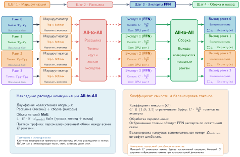

***Маршрутизация AllToAll в смеси экспертов (MoE)**: параллелизм экспертов требует особого паттерна коммуникации «All-to-All». Токены локального батча направляются управляющей сетью к экспертам, шардированным по кластеру. Это глобальное перемешивание, в котором каждый GPU отправляет токены потенциально каждому другому GPU и принимает токены от него, нагружая бисекционную пропускную способность кластера.*

Главное преимущество — разделение размера модели и вычислительного бюджета. Модель MoE с триллионом параметров может использовать лишь 10 млрд параметров на токен, что делает обучение возможным на реалистичных бюджетах железа. Ограничение — коммуникация All-to-All, требовательная к пропускной способности и чувствительная к дисбалансу нагрузки.

> **Определение: параллелизм экспертов**
>
> ***Параллелизм экспертов*** — стратегия распределения для моделей со смесью экспертов, которая размещает разных экспертов на разных устройствах и направляет активации каждого токена на устройства с выбранными им экспертами через коллективные операции All-to-All, масштабируя суммарное число параметров по кластеру без роста вычислений, которые потребляет каждый токен.
>
> 1.  **Значение**: он разделяет емкость модели и вычислительный бюджет: модель MoE с триллионом параметров может активировать порядка 10 млрд параметров на токен, поэтому FLOP на токен остаются близкими к плотной модели на 10 млрд, а емкость растет примерно в 100$\times$. Цена — структура коммуникации: каждый слой MoE требует двух перемешиваний All-to-All за проход (рассылка и сборка), объем которых растет с числом перемещаемых токенов, умноженным на скрытую размерность, и нагружает бисекционную пропускную способность кластера, а не какой-либо отдельный линк.
> 2.  **Отличие**: в отличие от тензорного параллелизма, который разбивает плотные операции так, что каждое устройство вычисляет долю каждого токена, параллелизм экспертов — условные вычисления: каждое устройство вычисляет только токены, направленные его экспертам, поэтому и паттерн коммуникации, и распределение нагрузки зависят от данных, а не заданы архитектурой.
> 3.  **Типичная ошибка**: распространено заблуждение, что эксперты делят работу поровну. Естественное распределение токенов смещено: «горячий» эксперт может получить в 3–5$\times$ больше трафика, чем ему положено, и переполнить буфер активаций своего устройства, пока соседние устройства простаивают; поэтому промышленные системы MoE ограничивают бюджет токенов на эксперта и штрафуют перекос маршрутизации во время обучения, а не полагаются только на маршрутизатор.

В основе параллелизма экспертов лежит примитив коммуникации All-to-All, который перемешивает токены по кластеру по динамическим решениям маршрутизации. Рассмотрим конфигурацию с $E=64$ экспертами, распределенными по 64 GPU, которая обрабатывает батч из $B=4$ последовательностей длины $S=2\,048$ со скрытой размерностью $d_{\text{model}}=4\,096$. Для каждого слоя MoE система должна разослать $B \times S$ токенов назначенным экспертам. В FP16 это перемещает $B \cdot S \cdot d_{\text{model}} \cdot 2$ байт (примерно 67 МБ) в одном направлении. Поскольку обработанные эмбеддинги должны вернуться на исходное устройство для остаточной связи, суммарные сетевые накладные расходы составляют около 134 МБ на блок трансформера. По отдельности это терпимо, но задержка быстро накапливается в глубоких разреженных архитектурах вроде Switch Transformer (Fedus et al., 2022) (до 2 048 экспертов) или GShard (Lepikhin et al., 2021).

Эффективность сети опирается на допущение равномерного распределения токенов, но естественный язык по своей природе смещен: отдельные эксперты, обрабатывающие распространенный синтаксис или служебные слова, могут получать в 3–5$\times$ больше трафика, чем им положено. «Горячий» эксперт — проблема и памяти, и планирования. Если один эксперт получает слишком много токенов, его GPU исчерпывает буфер активаций, а другие эксперты недогружены.

Поэтому системы MoE вводят жесткий предел, заданный **коэффициентом емкости (Capacity Factor)** $C$, который обычно выбирают между 1,25 и 1,5. Этот параметр ограничивает максимальное число токенов, обрабатываемых экспертом, примерно значением $C \cdot (B \times S)/E$ для группы маршрутизации. Если управляющий вентиль направляет больше токенов, чем вмещает буфер, лишние токены отбрасываются и проходят слой необработанными по остаточной связи. Чтобы сократить такую потерю данных, цели обучения включают **вспомогательную потерю балансировки нагрузки (Auxiliary Load Balancing Loss)** с весом 0,01–0,1 относительно основной кросс-энтропийной потери, которая штрафует маршрутизатор за предпочтение отдельных экспертов. Модели вроде Mixtral 8x7B используют маршрутизацию top-2 по 8 экспертам и достигают удачного баланса между масштабированием емкости и устойчивостью маршрутизации.

Разреженный паттерн коммуникации отличает нагрузки рекомендательных систем и MoE (архетип B (DLRM в масштабе)) от обучения плотных LLM (архетип A (GPT-4/Llama-3)) ([раздел «Три системных архетипа»](01_introduction.md#sec-vol2-introduction-archetypes)).

> **Архетип B (DLRM в масштабе): масштабирование DLRM и LLM**
>
> Каждый масштабируется по-своему и упирается в свой ресурс:
>
> *   **LLM (плотные)**: масштабируются через тензорный и конвейерный параллелизм. Ограничение: вычисления и пропускная способность межсоединений (NVLink).
> *   **Модели в стиле DLRM (разреженные)**: масштабируются через шардинг эмбеддингов (серверы параметров). Ограничение: емкость памяти и задержка межсоединений (случайный доступ).
>
> Это различие диктует принципиально разные конструкции кластеров: плотные GPU-поды для LLM и богатые памятью гибриды CPU/GPU для рекомендательных систем.

### Компромиссы: дилемма пузыря и пропускной способности

<a id="sec-distributed-training-systems-systems-model-parallelism-tradeoffs"></a>

Параллелизм модели пробивает стену памяти, но вносит последовательные зависимости, которые снижают загрузку железа. Инженерная задача — уравновесить пузыри конвейера (время простоя) и пропускную способность all-to-all (время коммуникации).

У параллелизма модели три главных преимущества. Масштабирование памяти позволяет обучать модели, превышающие емкость одного устройства: при 8-кратном тензорном параллелизме срез весов FP16 модели на 175 млрд параметров помещается в HBM A100 еще до учета состояния оптимизатора и бюджетов активаций. Разбиение модели также позволяет использовать более крупные глобальные батчи без ошибок нехватки памяти, поскольку каждый GPU обрабатывает меньший срез параметров. Подход естественно ложится на физическую структуру трансформеров, где головы внимания разбиваются тензорным параллелизмом, а слои — конвейерным.

За преимущества приходится платить тремя фундаментальными ограничениями. Пузыри конвейера заставляют GPU простаивать, пока конвейер заполняется и опустошается; доля пузыря примерно равна $(p-1)/(m+p-1)$, где $p$ — число стадий конвейера, а $m$ — число микробатчей, и для эффективности выше 90 % нужно $m \gg p$, что увеличивает память активаций. Интенсивность коммуникации в тензорном параллелизме столь же ограничивает: две операции AllReduce выполняются на каждом слое на критическом пути, требуя межсоединений с чрезвычайно высокой пропускной способностью и низкой задержкой (NVLink) и, как правило, не давая масштабироваться за пределы одного узла (8 GPU) без упора в стену пропускной способности. Сложность реализации завершает картину компромисса: она требует инвазивных изменений определения модели (замены стандартных линейных слоев вариантами с разбиением по столбцам и по строкам), в отличие от параллелизма по данным, который оборачивает модель снаружи, не затрагивая ее внутренности.

## FP8 в распределенном обучении

<a id="sec-distributed-training-fp8"></a>

Числовая точность может стать рычагом распределения, но точность вычислений и точность коммуникации — разные выборы. Приведение операндов общего матричного умножения (GEMM) к вдвое меньшему числу байт уменьшает хранение операндов и локальный трафик памяти; полезная нагрузка коллективной операции уменьшается вдвое лишь тогда, когда путь коммуникации явно передает это более узкое представление. Формат 8-битных чисел с плавающей запятой (FP8) использует вычислительный рычаг: снижает точность операндов и при этом сохраняет достаточный диапазон для устойчивой оптимизации.

FP8 важен для распределенного обучения только после того, как различены четыре типа данных: тип хранимых параметров, тип операндов GEMM, тип аккумулятора или мастер-состояния и тип данных коллективной операции на линии. Традиционное обучение в смешанной точности обычно сохраняет состояние оптимизатора или мастер-состояние в FP32, а операнды держит в FP16/BF16. Ускорители с поддержкой FP8 добавляют форматы операндов E4M3 и E5M2, оптимизированные под разные распределения тензоров (Micikevicius et al., 2022). Коллективная операция по-прежнему может передавать градиенты или активации в FP16/BF16, пока среда выполнения не применит явное приведение к FP8 или протокол сжатия.

Выбор между двумя форматами FP8 поэтому не деталь набора инструкций; он решает, какие тензоры можно сузить без поломки оптимизатора. E4M3 (4-битная экспонента, 3-битная мантисса) дает диапазон примерно $\pm 448$ с умеренной точностью и подходит для *весов и активаций* при проходе вперед, где значения группируются в предсказуемых распределениях. E5M2 (5-битная экспонента, 2-битная мантисса) дает гораздо больший диапазон примерно $\pm 57\,344$, но более грубую точность, и поэтому используется для *градиентов*, которые при обратном распространении могут охватывать много порядков величины. Использование E4M3 для градиентов привело бы к частым переполнениям и потерям значимости, а E5M2 охватывает все распределение градиентов ценой несколько более шумных обновлений. Читайте [таблицу «Форматы точности обучения»](#tbl-precision-formats) как карту ограничений распределения: каждая строка меняет баланс между диапазоном, точностью, трафиком памяти и обучаемостью.

<a id="tbl-precision-formats"></a>

***Форматы точности обучения**: каждая строка — формат с плавающей запятой, который может занимать одну роль в контракте смешанной точности. E4M3 и E5M2 сужают отдельные операнды; форматы аккумулятора, состояния оптимизатора, хранения и передачи по линии остаются независимыми инженерными решениями.*

| **Формат** | **Экспонента** | **Мантисса** |        **Диапазон**      | **Точность**  |         **Типичная числовая роль**                     |
|:-----------|:--------------:|:------------:|:------------------------:|:-------------:|:------------------------------------------------------:|
| **FP32**   |    8 бит       |   23 бита    | $\pm 3{,}4 \times 10^{38}$ |  Очень высокая  | Мастер-состояние или состояние оптимизатора          |
| **FP16**   |    5 бит       |   10 бит     |      $\pm 65\,504$       |    Высокая    | Операнд, накопление или выход повышенной точности, либо передача по линии |
| **BF16**   |    8 бит       |    7 бит     | $\pm 3{,}4 \times 10^{38}$ |   Умеренная   | Операнд, накопление или выход повышенной точности, либо передача по линии |
| **E4M3**   |    4 бита      |    3 бита    |        $\pm 448$         |    Низкая     |         Масштабированные веса и активации              |
| **E5M2**   |    5 бит       |    2 бита    |      $\pm 57\,344$       | Очень низкая  |                Масштабированные градиенты              |

Главная инженерная задача при обучении в FP8 с учетом этих форматов точности ([таблица «Форматы точности обучения»](#tbl-precision-formats)) — *динамическое масштабирование*. Узкий динамический диапазон FP8 означает, что фиксированный масштабный коэффициент приведет либо к переполнению, либо к потере значимости. Масштабирование на уровне тензора умножает каждый тензор на масштабный коэффициент перед приведением к FP8, а затем делит на этот коэффициент после вычисления в FP8. Масштабный коэффициент подбирается динамически, обычно по бегущему максимуму абсолютных значений каждого тензора, и выбирается так, чтобы этот максимум отображался вблизи максимального представимого значения FP8.

Контракт обучения в FP8 сочетает мастер-состояние или состояние оптимизатора в FP32 и операнды GEMM в FP8 с накоплением и выходом повышенной точности. Точные форматы аккумулятора и выхода — свойства операции и аппаратной реализации, а не универсальный выбор FP16/BF16. Такой подход может давать качество обучения, близкое к FP16, повышая эффективную пропускную способность на ускорителях с поддержкой FP8 для подходящих нагрузок (Micikevicius et al., 2022). Системное следствие конкретно, но ограничено: FP8 вдвое уменьшает байты только для тензоров, которые действительно хранятся или передаются в FP8, а прирост пропускной способности операций и энергоэффективности зависит от реализации ускорителя. Коллективная операция, редуцирующая градиенты FP16, не получает уменьшения объема на линии лишь потому, что предшествующие GEMM использовали FP8.

В распределенном обучении FP8 оправдывает себя, когда вычисления в пониженной точности улучшают локальный критический путь или явное приведение при коммуникации уменьшает нагрузку, а политика накопления и масштабирования защищает сходимость. Он меняет представление, а не ось распараллеливания. Если снижения точности недостаточно, системе нужно решить, как параллелизм по данным, тензорный и конвейерный параллелизм ложатся на иерархию железа.

## Гибридный параллелизм

<a id="sec-distributed-training-systems-systems-hybrid-parallelism-12a0"></a>

Когда параллелизм по данным упирается в память, а параллелизм модели — в пропускную способность сети, обучение большой модели требует одновременно задействовать обе стратегии по трем измерениям. Анализ в [разделе «Параллелизм по данным»](#sec-distributed-training-systems-systems-data-parallelism-6132) и [разделе «Параллелизм модели»](#sec-distributed-training-systems-systems-model-parallelism-7437) выявил фундаментальное противоречие: параллелизм по данным масштабирует пропускную способность, но требует огромной памяти, а параллелизм модели позволяет обучать большие модели, но недогружает вычисления.

**Гибридный параллелизм** разрешает это противоречие, применяя обе стратегии ортогонально: параллелизм модели разбивает архитектуру так, чтобы она поместилась в доступную память, а параллелизм по данным масштабирует пропускную способность между несколькими репликами модели. Эту схему показывает обучение языковой модели с 175 млрд параметров на наборе данных из 300 млрд токенов. Слои нейронной сети распределяются между несколькими GPU через параллелизм модели, а параллелизм по данным позволяет разным группам GPU обрабатывать отдельные батчи. Эта двойная стратегия одновременно решает и ограничения памяти из-за размера модели, и вычислительные запросы из-за масштаба набора данных, и именно эта комбинация определяет обучение архетипа A в масштабе больших моделей.

> **Архетип A (GPT-4/Llama-3): физика 3D-параллелизма**
>
> **Архетип A (GPT-4/Llama-3)** — основной двигатель гибридного параллелизма. Поскольку параметры модели $(P)$ превышают память любого отдельного ускорителя $(C_{\text{mem,device}})$, а обучающий набор данных $(D)$ требует огромной пропускной способности, задачу приходится делить по трем ортогональным осям:
>
> 1.  **Тензорный параллелизм**: разбивает отдельные слои, чтобы $P$ поместилось в память узла.
> 2.  **Конвейерный параллелизм**: разбивает слои между узлами, когда объем параметров превышает один узел.
> 3.  **Параллелизм по данным**: реплицирует весь конвейер разбитой модели, чтобы масштабировать пропускную способность по $D$.
>
> Только объединив все три, можно эффективно обучать системы архетипа A.

Чтобы увидеть, почему комбинация важна, рассмотрим три конфигурации параллелизма для обучения модели с 175 млрд параметров на кластере из 1 024 GPU, организованном как 128 узлов по 8 GPU. Переход от чистого параллелизма по данным к тензорному и конвейерному делает выигрыш в эффективности конкретным.

Конфигурация A: чистый параллелизм по данным (DP-1024) — это контрфактический пример для оценки стоимости коммуникации, а не допустимое размещение для такой модели. Одни веса в FP16 занимают 350 ГБ, поэтому A100 или H100 не могут их реплицировать; шардинг одних только состояний оптимизатора этого не меняет. Если бы репликация была возможна, все 1 024 ранга образовали бы одну группу параллелизма по данным, и каждый ранг участвовал бы в AllReduce тензора градиентов на 350 ГБ через фабрику InfiniBand. Расчет 37,5 % в [разделе «Эффективность масштабирования и сходимость»](#sec-distributed-training-systems-systems-distributed-training-efficiency-metrics-9488) изолирует эту стоимость коммуникации.

Конфигурация B: TP-8, DP-128. Внутри каждой из 128 реплик модели 8 GPU используют тензорный параллелизм по NVLink. Соответствующие тензорные шарды из каждой реплики образуют одну группу параллелизма по данным из 128 рангов, так что в раскладке 8 таких групп. Каждый ранг делает AllReduce своего шарда градиента в 1/8, то есть 43,75 ГБ вместо 350 ГБ, а коммуникация TP остается в быстром домене NVLink. Время межузлового AllReduce падает с 14 секунд примерно до 1,75 секунды. Если время вычислений по-прежнему 2,1 секунды, эффективность улучшается до $2{,}1 / (2{,}1 + 1{,}75) \approx 54{,}5$ %, а с перекрытием коммуникации и вычислений практическая эффективность достигает 75–85 %.

Конфигурация C: TP-8, PP-4, DP-32. Каждая из 32 реплик модели использует 8-кратный тензорный параллелизм внутри стадии и 4 стадии конвейера между узлами. Для каждой из $8\times4=32$ позиций тензорных и конвейерных шардов соответствующие ранги всех реплик образуют одну группу параллелизма по данным из 32 рангов. Поэтому каждый ранг делает AllReduce шарда градиента размером $350/(8\times4)\approx10{,}94$ ГБ. Конвейерная коммуникация передает активации между стадиями и имеет меньший объем, чем AllReduce всей модели. Цена — пузырь конвейера: в начале и конце каждого микробатча часть стадий конвейера простаивает в ожидании активаций от более ранних стадий или градиентов от более поздних. Доля пузыря примерно равна $(p-1)/(m+p-1)$, поэтому при 4 стадиях конвейера и 32 микробатчах за шаг обучения пузырь тратит около 9 % вычислений ($3/35 \approx 8{,}6\%$).

Трехстороннее сравнение показывает, что конфигурации, которые держат высокоскоростную коммуникацию (тензорный параллелизм) внутри быстрого домена NVLink и выносят на более медленную фабрику InfiniBand только низкоскоростную (AllReduce градиентов меньших шардов в параллелизме по данным), достигают наибольшей эффективности. *Иерархия инфраструктуры диктует иерархию параллелизма.* Полученный принцип называется иерархически осведомленным параллелизмом, и это распространенный подход в крупномасштабных системах обучения.

> **Определение: иерархически осведомленный параллелизм**
>
> ***Иерархически осведомленный параллелизм (hierarchy-aware parallelism)*** — стратегия отображения разных режимов параллельного исполнения на физические ярусы пропускной способности кластера.
>
> 1.  **Значение**: он гарантирует, что высокочастотная синхронизация (например, тензорный параллелизм) остается на самых быстрых линках (NVLink), а менее частые задачи (например, параллелизм по данным) используют более медленные ярусы (InfiniBand). Такое согласование максимизирует эффективность масштабирования $(\eta_{\text{scaling}})$, уменьшая открытое время коммуникации $(T_{\text{comm}}(N))$ и задержку $(L_{\text{lat}})$.
> 2.  **Отличие**: в отличие от однородного параллелизма, который считает все линки между узлами равными, иерархически осведомленные стратегии учитывают обрывы пропускной способности между границами кристалла, узла и стойки.
> 3.  **Типичная ошибка**: распространено заблуждение, что любую модель можно разбить на любое число узлов. На деле, если отображение иерархии неверно (например, огромный тензор разбит по медленному межстоечному линку), время коммуникации затмевает время вычислений, и масштабирование вширь бесполезно.

Взаимодействие идет и в обратную сторону: выбор стратегии параллелизма влияет на проектирование инфраструктуры. Система обучения, использующая TP-8, PP-4, DP-32, порождает такой паттерн коммуникации: самый требовательный к пропускной способности трафик (AllReduce тензорного параллелизма) замкнут внутри каждого узла, трафик средней интенсивности (коммуникация между стадиями конвейера) идет между группами по 4 соседних узла, а наименее требовательный (AllReduce градиентов уменьшенных шардов в параллелизме по данным) идет по всему кластеру.

Слоистый паттерн коммуникации выгоднее иерархической топологии сети, где у близких узлов между собой более высокая пропускная способность («топология с учетом локальности»), чем плоской, где все пары узлов имеют одинаковую пропускную способность (однородное fat-tree). Rail-оптимизированные и иерархические fat-tree проекты используют эту локальность: они размещают узлы, которые общаются чаще всего, на одном коммутаторе или в одной стойке и минимизируют число переходов через коммутаторы для самого требовательного трафика.

Практическое следствие для закупки инфраструктуры в том, что топологию сети нужно проектировать совместно со стратегией параллелизма, а не выбирать независимо. Организация, купившая плоскую фабрику fat-tree (оптимизированную под коммуникацию любого с любым), но обучающаяся исключительно с иерархически осведомленным параллелизмом (где большая часть трафика локальна), получит избыточную глобальную пропускную способность сети и, возможно, недостаточную локальную. Напротив, организация, купившая rail-оптимизированную фабрику (оптимизированную под локальную коммуникацию), но позже вынужденная запускать модели со смесью экспертов с коммуникацией all-to-all (требующей глобальной пропускной способности), обнаружит, что фабрика недостаточна. Сетевая фабрика, на которую приходится 10–15 % общей стоимости системы, должна соответствовать ожидаемой смеси нагрузок, а менять фабрику после развертывания непомерно дорого и разрушительно.

### Цикл 3D-обучения

<a id="sec-distributed-training-systems-systems-hybrid-parallelism-3d-loop"></a>

Обучение модели с 175 млрд параметров требует **3D-параллелизма**: согласованного сочетания параллелизма по данным, конвейерного и тензорного параллелизма на тысячах устройств.[^fn-three-dimensional-parallelism] Этот подход не просто суммирует выигрыши отдельных стратегий параллелизма; он складывает их геометрически, чтобы соответствовать физической топологии железа.

[^fn-three-dimensional-parallelism]: **3D-параллелизм**: назван по трем ортогональным осям разложения: (1) параллелизм по данным (батч), (2) конвейерный параллелизм (глубина) и (3) тензорный параллелизм (ширина слоя). Организации представляют свои парки обучения как трехмерную сетку $(d, p, t)$, где произведение $N_{\text{total}} = d \times p \times t$ равно общему числу GPU. Такой геометрический взгляд необходим для балансировки ярусных ограничений пропускной способности в кластерах с высокой пропускной способностью.

Рассмотрим парк обучения, настроенный с тензорным параллелизмом (TP) на 8 GPU, конвейерным параллелизмом (PP) степени 16 и параллелизмом по данным (DP) степени 128. Эта конфигурация использует 16 384 GPU (8 GPU $\times$ 16 $\times$ 128), организованных в иерархию доменов пропускной способности.

Шаг обучения начинается на уровне параллелизма по данным. Каждая из 128 реплик модели получает отдельный срез глобального батча. Внутри каждой реплики модель разбита на 16 стадий конвейера (узлов), и микробатчи последовательно идут от слоя эмбеддингов на узле 0 до расчета потерь на узле 15. На самом мелком уровне гранулярности внутри каждого узла 8 GPU сливаются в один «суперускоритель» за счет TP. Каждое умножение матриц при проходе вперед дробится между этими устройствами, которые после каждой операции должны обмениваться частичными результатами через высокоскоростной NVLink. Для скрытой размерности масштаба 175 млрд параметров нагрузка активаций составляет примерно 201,3 МБ; получающийся трафик тензорного параллелизма — около 4,2 ГБ на стадию конвейера на микробатч при проходе вперед, или 8,5 ГБ с учетом прохода назад. По всей 96-слойной реплике трафик тензорного параллелизма при проходе вперед составляет около 67,6 ГБ. Этот трафик — самый интенсивный в системе, но его открытая задержка может оставаться небольшой относительно вычислений, потому что чипы обмениваются данными по локальным каналам 600 ГБ/с–900 ГБ/с.

Проход назад обращает этот поток и обнажает критические зависимости между измерениями параллелизма. Когда градиенты идут назад по конвейеру, узлы обмениваются градиентами активаций точка-точка. Этот трафик сравнительно легок (примерно 201,3 МБ на границу стадии) и может идти по более медленным межузловым каналам InfiniBand, не останавливая конвейер. Настоящее узкое место возникает в конце шага: синхронизация параллелизма по данным. Состояние градиентов всей модели по-прежнему составляет около 350 ГБ, но в раскладке 3D-параллелизма каждая группа параллелизма по данным синхронизирует соответствующие шарды параметров своей реплики тензорного и конвейерного параллелизма, а не каждый GPU перемещает весь тензор. Группировка градиентов в корзины (gradient bucketing) объединяет готовые тензоры градиентов слоев в более крупные сообщения по мере продвижения обратного вычисления; когда расписание корзин и сечение пропускной способности согласованы, синхронизация идет под полезными вычислениями, а не удлиняет критический путь.

Архитектурный императив — *согласование пропускной способности*: объем коммуникации каждого алгоритма должен обратно соответствовать задержке аппаратных межсоединений. «Болтливая» блокирующая коммуникация TP остается внутри домена NVLink (600 ГБ/с или выше). Сериализованные двухточечные передачи PP идут по хребту кластера со скоростью InfiniBand. Массивная, но редкая синхронизация DP амортизируется на весь шаг обучения. Попытка запускать TP между стойками или DP без накопления градиентов может нарушить эту иерархию и оставить парк из 16 000 GPU ждать, пока данные пройдут по проводу. Этот принцип согласования пропускной способности завершает проверку допустимости, введенную в [разделе «Инженерные компромиссы: выбор стратегии параллелизма»](#sec-distributed-training-systems-systems-engineering-tradeoffs-selecting-parallelism-strategy-b344).

### Разобранный пример гибридного параллелизма

<a id="sec-distributed-training-systems-systems-hybrid-parallelism-configuration-design"></a>

Применение принципа согласования пропускной способности к физической инфраструктуре превращает проектирование кластера в задачу размещения: каждое измерение параллелизма должно стоять на том ярусе сети, который выдерживает его трафик. Тензорный параллелизм наиболее чувствителен к задержке, потому что запускает частые операции AllReduce внутри блоков трансформера, поэтому его место — внутриузловой домен NVLink (600 ГБ/с–900 ГБ/с). Конвейерный параллелизм перемещает тензоры активаций только на границах стадий, поэтому может охватывать соседние узлы по InfiniBand (50 ГБ/с–100 ГБ/с). Параллелизм по данным порождает самую большую нагрузку — синхронизацию градиентов, — но происходит раз за шаг и может перекрываться с обратным вычислением. Емкость памяти на устройство (80 ГБ–80 ГБ) задает жесткий предел для любого размещения.

Для развертывания в стиле DGX A100 такое рассуждение ведет к конкретной раскладке. Зафиксируем тензорный параллелизм на $t=8$, чтобы требовательные к пропускной способности коллективные операции умножения матриц остались внутри одного узла из 8 GPU. Отобразим конвейерный параллелизм на узлы той же высокоскоростной стойки или острова, часто $p=8$ или $p=16$ в зависимости от объема памяти. Параллелизм по данным используем для оставшегося измерения масштабирования вширь между подами. Результат — не общее правило, а следствие согласования каждого паттерна трафика с самым дешевым ярусом фабрики, способным его нести.

Когда размещение зафиксировано, следующий вопрос — помещается ли статическое состояние модели в бюджет HBM каждого ускорителя.

Бюджет памяти для обучения модели с 175 млрд параметров определяется состояниями модели и требует агрессивного шардинга, чтобы уложиться в 80 ГБ HBM ускорителей класса H100. Одни веса в FP16 занимают около 350 ГБ (175 $\times 10^9 \times 2$ байта). Если опираться только на тензорный параллелизм с 8-кратным шардингом, каждый GPU хранил бы срез весов в 43,75 ГБ. Однако большее препятствие — состояние оптимизатора. В упрощенной конвенции состояния оптимизатора, принятой для этого бюджета 3D-параллелизма, моментум и дисперсия Adam в FP32 занимают 8 байт на параметр и добавляют около 1,4 ТБ глобально; более полный учет по 12 байт, включающий и мастер-веса FP32, дал бы около 2,1 ТБ. Даже при 8-кратном тензорном параллелизме упрощенное суммарное состояние весов и оптимизатора превысило бы 218,8 ГБ на GPU и вызвало бы ошибку нехватки памяти (OOM). Поэтому для дальнейшего разбиения слоев модели приходится применять конвейерный параллелизм ($p$). В гибридной конфигурации с тензорным параллелизмом 8 и конвейерным параллелизмом 16 упрощенный статический объем памяти падает до 13,7 ГБ на GPU (часто закладывается примерно 15 ГБ с учетом буферов фреймворка), а оставшаяся HBM доступна под динамическую память активаций $(A)$, которая возникает при проходе вперед и растет линейно с размером микробатча и длиной последовательности. По более полной конвенции Adam на 12 байт то же разбиение на 8-кратный тензорный параллелизм и 16 стадий конвейера дало бы 19,1 ГБ на GPU.

Когда конфигурация помещается в память, та же раскладка должна удовлетворять иерархии коммуникации, которая ее и мотивировала. Каждое измерение параллелизма накладывает на сеть свой профиль трафика. Тензорный параллелизм «разговорчивее» всех: он требует двух операций `AllReduce` на каждый блок трансформера (одной для проекции внимания, другой для MLP) и при проходе вперед, и при проходе назад. Эти сообщения сравнительно невелики, но возникают тысячи раз за шаг, поэтому ограничены строго задержкой и требуют NVLink. Конвейерный параллелизм, напротив, предполагает двухточечные передачи тензоров активаций (размером $B_{\mu} \times S \times d_{\text{model}}$) только на границах стадий конвейера. Эти сообщения умеренного размера, но возникают реже, так что с ними справляются стандартные линки InfiniBand. Параллелизм по данным порождает самый большой всплеск трафика: глобальный `AllReduce` всего буфера градиентов в 350 ГБ. Но такая коммуникация происходит всего раз за обновление глобального батча. Группировка градиентов в корзины перекрывает эту передачу с вычислительно насыщенным проходом назад и скрывает эффективную стоимость коммуникации DP, если кластер обеспечивает достаточную пропускную способность сечения.

Последняя статья затрат связана не с пропускной способностью, а с планированием: конвейерная модель эффективна, только когда в полете достаточно микробатчей, чтобы все стадии были заняты. Эта оставшаяся цена — пузырь конвейера, разобранный в [разделе «Конвейерный параллелизм»](#sec-distributed-training-systems-systems-pipeline-parallelism-8748). Применив его долю пузыря $\frac{p-1}{m + p - 1}$ к этой гибридной раскладке, получаем: конфигурация GPT-175B с $p=16$ стадиями и $m=32$ микробатчами теряет $\frac{15}{47} \approx 31{,}9\%$ теоретической вычислительной мощности, почти треть. Расписание 1F1B, которое возвращает память активаций, и большее число микробатчей, которое оно делает практичным, асимптотически снижают эту долю.

### Пример масштабирования класса Blackwell

<a id="sec-distributed-training-systems-systems-hybrid-parallelism-blackwell"></a>

Архитектура Blackwell дает конкретный пример того, как компоновка ускорителя меняет компромиссы 3D-параллелизма. Во-первых, NVLink 5 обеспечивает 1,8 ТБ/с двунаправленной пропускной способности на GPU, вдвое больше внутриузловой емкости поколения Hopper. Это позволяет использовать более крупные группы тензорного параллелизма $(t)$ (например, $t=$ 16 или $t=$ 32 на нескольких узлах) с меньшими накладными расходами на задержку. Во-вторых, Blackwell добавляет поддержку FP4 в тензорных ядрах, что повышает пропускную способность и эффективность памяти при низкой точности для поддерживаемых нагрузок; применяется ли FP4 для обучения, зависит от численного рецепта и программного стека.

Для модели с 1 трлн параметров конфигурация класса Blackwell может использовать $t=$ 16 (охват двух узлов по 8 GPU через NVLink Switch) и $p=$ 8. По сравнению с эталонными $t=8$ и $p=16$ для Hopper произведение разбиений модели остается равным 128, а число стадий конвейера и связанный с ним член пузыря уменьшаются вдвое. Межкристальное соединение 10 ТБ/с внутри GPU Blackwell еще сильнее стирает различие между коммуникацией внутри чипа и внутри корпуса, позволяя двум кристаллам, ограниченным размером реткулы, работать как один высокоскоростной блок тензорного параллелизма. Общий системный урок: повышение локальной пропускной способности смещает давление наружу; когда внутриузловая коммуникация перестает быть связывающим ограничением, для более крупных конфигураций парка машинного обучения возрастает значение rail-оптимизированных топологий ([раздел «Rail-optimized топология»](03_network_fabrics.md#sec-network-fabrics-rail-optimized)) и оптимизации All-to-All.

Те же ограничения размещения можно сделать рабочими с помощью поиска по пространству проектирования.

> **Пример: автоматизированный поиск в пространстве проектирования (оптимизатор уровня 3)**
>
> **Сценарий**: инженерная команда планирует обучение модели с 175 млрд параметров на 8 192 GPU H100 (по 80 ГБ HBM каждый) и ориентируется в многомерном пространстве поиска 3D-параллелизма (TP $\times$ PP $\times$ DP).
>
> **Диагноз**: ручной подбор методом проб и ошибок рискует перерасходом памяти (превышением 80 ГБ HBM) или насыщением NVLink. `ParallelismOptimizer` перебирает все разложения и выбирает TP=8, PP=8 и DP=128, чтобы максимизировать MFU, не выходя за емкость HBM.
>
> **Системный урок**: автоматизированный поиск в пространстве проектирования формализует эмпирические эвристики: тензорный параллелизм следует ограничивать пределами NVLink одного узла (TP=8), а конвейерный параллелизм (PP=8) — минимизировать, чтобы избежать накладных расходов пузыря конвейера при выполнении ограничений памяти; проектная оценка MFU при этом составляет 36,4 %.

Изменение любого из измерений перекладывает давление на два других, поэтому разложение TP $\times$ PP $\times$ DP — это тесно связанная система, а не три независимые ручки.

> **Контрольные вопросы: гибридный 3D-параллелизм**
>
> Проверьте, как вы понимаете сочетание стратегий параллелизма:
>
> - [ ] **Роли измерений**: определите, какое измерение в конфигурации **TP=8, PP=16, DP=128** шардирует слои внутри одного узла.
> - [ ] **Пузырь и глубина**: определите, как переход от **PP=16** к **PP=8** меняет долю пузыря конвейера.
> - [ ] **DP и PP**: объясните компромисс при бюджете 1 024 GPU между увеличением **DP** (параллелизма по данным) и увеличением **PP** (конвейерного параллелизма).
> - [ ] **Чувствительность к задержке**: определите, какое измерение — **TP**, **PP** или **DP** — наиболее чувствительно к межузловой задержке.

Значения MFU нужно сопоставить с исторической базой утилизации, чтобы показать, как опубликованные системы подбирались к 50 % утилизации. [Рисунок «Динамика MFU»](#fig-mfu-progression) прослеживает эволюцию MFU в опубликованных системах обучения с 2020 по 2024 год. Путь от 21 % MFU у GPT-3 до 46 % MFU у PaLM отражает не рост чистой скорости железа, а успехи в стратегиях параллелизма, техниках перекрытия коммуникации и оптимизациях планирования, о которых шла речь в этой главе. Плато на уровне 40–46 % показывает, что теоретический потолок, который накладывают коммуникационные накладные расходы, пузыри конвейера и управление памятью, остается внушительным даже в высокооптимизированных системах с гибридным параллелизмом. Примечательно, что обучение Llama 3 от Meta на 16 384 GPU H100 достигло чуть меньшего MFU (41 %), чем та же модель на 8 192 GPU (43 %), что подтверждает: налог на масштабирование, описанный в [разделе «Физика масштабирования: закон Амдала с коммуникациями»](#sec-distributed-training-systems-systems-physics-scaling-amdahls-law-communication-4d7f), не просто теоретический, а измерим в больших опубликованных запусках.

<a id="fig-mfu-progression"></a>

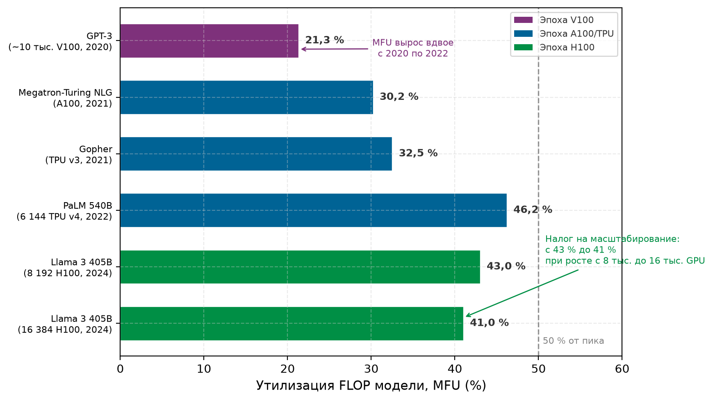

***Динамика MFU**: утилизация FLOP модели в опубликованных системах обучения в хронологическом порядке. MFU вырос вдвое, с 21 % (GPT-3, 2020) до 46 % (PaLM, 2022), благодаря успехам гибридного параллелизма и перекрытия коммуникации, а затем вышел на плато около 40–45 % для крупномасштабных запусков. Точки Llama 3 иллюстрируют налог на масштабирование: MFU падает с 43 % на 8 192 GPU до 41 % на 16 384 GPU по мере роста коммуникационных накладных расходов вместе с размером кластера. Источники данных: Chowdhery et al. (2022), Dubey et al. (2024).*

## Обучение нескольких моделей: RLHF и выравнивание

<a id="sec-distributed-training-rlhf"></a>

Стратегии параллелизма, рассмотренные до сих пор, предполагают одну модель, обучаемую на одной цели. Обучение с подкреплением на основе обратной связи от человека (RLHF) и его варианты нарушают это допущение: они требуют, чтобы в одном цикле обучения согласованно работали несколько моделей с разным объемом памяти, вычислительными профилями и требованиями к градиентам. В общих чертах RLHF генерирует выходы модели, оценивает их сигналами вознаграждения, выведенными из предпочтений, регуляризует обновления относительно эталонной модели и затем обновляет политику; проксимальная оптимизация политики (PPO) реализует этот онлайн-цикл с отдельными моделями политики, эталонной, вознаграждения и ценности, а методы в духе прямой оптимизации предпочтений (DPO) убирают значительную часть механизма развертываний и модели ценности. Так возникает задача управления гетерогенным парком, которую не решить никакой отдельной стратегией параллелизма и которая качественно отличается от обычного предобучения как задача распределенных систем.

### Проблема координации нескольких моделей

<a id="sec-distributed-training-rlhf-coordination"></a>

Стандартное предобучение включает одну модель, одну функцию потерь и один поток градиентов. Выравнивание RLHF, напротив, организует систему моделей, взаимодействующих на каждом шаге обучения. В PPO (Schulman et al., 2017), как он используется в системах RLHF в духе InstructGPT (Ouyang et al., 2022), согласованно должны работать четыре разные модели. [Таблица «Роли моделей в координации RLHF»](#tbl-rlhf-model-coordination-roles) разделяет эти модели по роли, режиму исполнения и нагрузке на память.

<a id="tbl-rlhf-model-coordination-roles"></a>

***Роли моделей в координации RLHF**: RLHF в стиле PPO координирует модели с разными режимами исполнения и объемами памяти, поэтому решения о размещении должны разделять обучаемое состояние политики и ценности и состояние эталонной модели и модели вознаграждения, которые используются только для инференса.*

| **Модель**                                 | **Роль в RLHF в стиле PPO**                                                       | **Режим исполнения**                                              | **Нагрузка на память**                                                                                                                                                                                                                                                                                                                                                                                                                                       |
|:-------------------------------------------|:----------------------------------------------------------------------------------|:------------------------------------------------------------------|:-------------------------------------------------------------------------------------------------------------------------------------------------------------------------------------------------------------------------------------------------------------------------------------------------------------------------------------------------------------------------------------------------------------------------------------------------------------|
| **Модель политики**       | Модель, которую выравнивают и оптимизируют.                                       | Режим обучения с градиентами, моментами оптимизатора и активациями. | Для модели на 70 млрд параметров в смешанной точности с Adam память составляет примерно 70 млрд $\times$ (2 $+$ 2 $+$ 12) = 1 120 ГБ, тот же бюджет, что и при стандартном предобучении. |
| **Эталонная модель** | Замороженная копия предобученной политики, дающая штраф по KL-дивергенции.        | Только режим инференса.                                           | Параметры в FP16/BF16 без градиентов и состояния оптимизатора; модели на 70 млрд нужно около 70 млрд $\times$ 2 = 140 ГБ, примерно в 8$\times$ меньше, чем в конфигурации обучения.                                                                                                                                                                                                                                                                           |
| **Модель вознаграждения**       | Обученная на предпочтениях оценивающая модель, которая выдает скалярные вознаграждения для сгенерированных последовательностей. | Только режим инференса.                                           | Часто меньше политики; модели вознаграждения на 13 млрд нужно около 26 ГБ в FP16, но она должна обработать каждую сгенерированную последовательность.                                                                                                                                                                                                                                                                                                         |
| **Модель ценности**         | Критик PPO, оценивающий ожидаемое будущее вознаграждение.                         | Режим обучения, отдельный или с общим с политикой каркасом.       | Полноразмерный отдельный критик может добавить еще 1 120 ГБ; меньшие модели или конструкции с общим каркасом снижают это до 200–400 ГБ.                                                                                                                                                                                                                                                                            |

Суммарная потребность в памяти четырехмодельной системы PPO многократно превышает потребность стандартного предобучения. При наивном совместном размещении политики на 70 млрд, эталонной модели на 70 млрд, модели вознаграждения на 13 млрд и модели ценности на 13 млрд требуется примерно 1 494 ГБ памяти ускорителей — еще до учета KV-кэшей и промежуточных активаций, возникающих при генерации последовательностей. На GPU H100 с 80 ГБ HBM каждый для одного только хранения параметров этой системе нужно не менее 19 GPU. Если добавить KV-кэши фазы генерации (которые растут линейно с длиной выходной последовательности) и активации фазы обучения, практический минимум для одного экземпляра обучения RLHF вырастает до 64–128 GPU.

### Асимметрия инфраструктуры: обучаемые и инференсные модели

<a id="sec-distributed-training-rlhf-asymmetry"></a>

Главная инфраструктурная проблема RLHF — не *суммарный объем памяти*, а *асимметрия* вычислительных профилей моделей. Модели политики и ценности требуют полных проходов назад с вычислением градиентов, сохранения контрольных точек активаций и обновлений оптимизатора — вычислительно насыщенных операций, которым выгодны тензорный параллелизм и высокая арифметическая интенсивность. Эталонная модель и модель вознаграждения, напротив, выполняют только проходы вперед: это инференсные нагрузки, встроенные в цикл обучения, и шаблоны доступа к их памяти определяются управлением KV-кэшем, а не накоплением градиентов.

Асимметрия создает дилемму размещения. Совместное размещение обучаемых и инференсных моделей на одних GPU расходует вычисления впустую в фазе генерации (когда обучаемые модели простаивают) и расходует память впустую в фазе градиентов (когда место под параметры инференсных моделей можно было бы вернуть под активации). Разделение по выделенным пулам GPU устраняет потери, но вносит сетевую задержку для запросов вознаграждения: каждый сгенерированный пакет токенов должен пройти по межсоединению до модели вознаграждения и вернуть скалярный сигнал, прежде чем можно будет вычислить градиент политики.

Сама фаза генерации вносит последовательное узкое место, которого нет в стандартном предобучении. RLHF требует, чтобы модель политики авторегрессивно сгенерировала полные последовательности (обычно 256–2 048 токенов), прежде чем вычислять вознаграждения и градиенты политики. Авторегрессивная генерация ограничена пропускной способностью памяти, а не вычислениями: каждый токен требует полного прохода вперед через модель, чтобы получить один выходной токен. Для политики в стиле Llama-2-70B с Grouped Query Attention KV-кэш растет примерно на $2 \times N_L \times H_{\text{KV}} \times d_{\text{head}} \times 2$ байта на каждый сгенерированный токен последовательности. При 80 слоях, 8 головах KV, головах размерности 128, 1 024 сгенерированных токенах и батче из 256 промптов кэш занимает 85,9 ГБ: $2 \times 80 \times 8 \times 128 \times 1\,024 \times 256 \times 2$ байта. Модель с плотным многоголовым вниманием, использующая для K и V полное скрытое состояние шириной 8 192, дала бы 687,2 ГБ. Даже с Grouped Query Attention кэш занимает порядка одного GPU H100 по объему HBM под промежуточное состояние внимания, которое отбрасывается после вычисления вознаграждения.

Системы RLHF справляются с этой асимметрией временным мультиплексированием. В фазе генерации кластер ведет себя как инференсная система: модель политики генерирует последовательности, пока эталонная модель вычисляет логарифмы вероятностей, а доминирующий ресурс — HBM, зарезервированная под покомпонентное состояние внимания по токенам. В фазе обучения тот же парк переключается обратно в режим обучения: градиенты вычисляются через модели политики и ценности с конфигурацией 3D-параллелизма, разработанной в [разделе «Гибридный параллелизм»](#sec-distributed-training-systems-systems-hybrid-parallelism-12a0). Системы обслуживания справляются с этой фазой батчингом запросов и размещением KV-кэша; здесь важна сама смена режима. RLHF — это не один устойчивый цикл обучения, а чередование работы инференсной формы и работы формы обучения, и стандартные фреймворки обучения редко умеют сами управлять таким переходом.

### DPO: упрощение парка

<a id="sec-distributed-training-rlhf-dpo"></a>

DPO (Rafailov et al., 2023) полностью устраняет модель вознаграждения и модель ценности, переформулируя цель выравнивания как классификационную потерю на парах предпочтений. Вместо того чтобы генерировать последовательности, вычислять вознаграждения и оценивать преимущества, DPO напрямую оптимизирует политику так, чтобы она присваивала более высокую логарифмическую вероятность предпочтительным ответам, чем отвергнутым; эталонная модель используется лишь для вычисления члена регуляризации по KL-дивергенции.

Последствия для инфраструктуры существенны. DPO сокращает многомодельную систему с четырех моделей до двух: модель политики (режим обучения) и эталонная модель (режим инференса). Для политики на 70 млрд с моделями вознаграждения и ценности по 13 млрд, количественно оцененных в [разделе «Количественный анализ: требования PPO и DPO к ресурсам»](#sec-distributed-training-rlhf-quantitative), память статических параметров падает примерно с 1 494 ГБ до 1 260 ГБ — на 16 %. Если модель ценности PPO имеет размер политики, сокращение гораздо больше: примерно с 2 406 ГБ до 1 260 ГБ, то есть примерно на 48 %. DPO также полностью устраняет фазу авторегрессивной генерации. Обучение работает на фиксированном наборе троек (промпт, предпочтительный ответ, отвергнутый ответ), возвращая стандартный конвейер данных предобучения: последовательности фиксированной длины, детерминированный батчинг и никакой последовательной пошаговой генерации токенов. Цикл обучения становится стандартным шагом обучения с учителем с измененной функцией потерь, к которому применимы те же 3D-параллелизм, накопление градиентов и техники перекрытия коммуникации, что используются при предобучении.

Цена — возможности. DPO работает на статичном наборе предпочтений, а значит, политика не может исследовать новые ответы и получать обратную связь во время обучения. Онлайн-генерация PPO позволяет политике итеративно улучшаться на собственных выходах, потенциально находя лучшие стратегии, которых нет в статичном наборе данных. В сценариях, где данные предпочтений полностью покрывают целевое распределение, упрощение инфраструктуры в DPO перевешивает. В сценариях, требующих адаптивного исследования (например, при обучении моделей решению новых задач рассуждения), онлайн-цикл обратной связи PPO может оправдать двукратные накладные расходы инфраструктуры.

### Количественный анализ: требования PPO и DPO к ресурсам

<a id="sec-distributed-training-rlhf-quantitative"></a>

Чтобы сделать компромисс инфраструктуры конкретным, рассмотрим выравнивание модели политики на 70 млрд на кластере из 256 GPU H100 (по 80 ГБ HBM каждый).

> **Сценарий: бюджет инфраструктуры RLHF — PPO и DPO**
>
> **Задача**: для выравнивания политики на 70 млрд ее нужно размещать вместе с эталонной моделью на 70 млрд и, для PPO, моделью вознаграждения на 13 млрд и моделью ценности на 13 млрд. Сколько памяти на GPU потребляет каждый подход при 3D-параллелизме (TP=8, PP=4, DP=8) и сколько запаса освобождает DPO, устраняя модель вознаграждения, модель ценности и KV-кэш фазы генерации?
>
> **Бюджет памяти PPO** (на GPU, для политики с TP=8, PP=4, DP=8)
>
> Модель политики при 3D-параллелизме с TP=8 и PP=4 распределяет свои 1 120 ГБ состояния обучения между 32 GPU, то есть по 35 ГБ на GPU. Эталонная модель, которой для инференса нужно лишь 140 ГБ, может шардироваться по отдельному пулу из 8 GPU по 17,5 ГБ на каждый или размещаться вместе с GPU политики с добавкой 4,4 ГБ на GPU (140 ГБ / 32 GPU). Модель вознаграждения на 13 млрд добавляет 26 ГБ на весь ее пул. Модель ценности на 13 млрд в режиме обучения добавляет примерно 208 ГБ (13 млрд $\times$ 16 байт/параметр) на весь ее пул.
>
> Суммарная статическая память (политика и эталонная модель размещены вместе на 32 GPU): 35 ГБ + 4,4 ГБ $\approx$ 39,4 ГБ на GPU, оставляя $\sim$ 40,6 ГБ под активации и KV-кэш. При KV-кэшах фазы генерации для батча развертывания из 256 последовательностей по 1 024 токена в пределах одной реплики политики $TP{\times}PP$ каждый GPU политики должен дополнительно резервировать 85,9 ГБ/32 GPU $\approx$ 2,7 ГБ под свой шард KV-кэша. Оставшиеся $\sim$ 37,9 ГБ ограничивают размер микробатча на фазе обучения.
>
> **Бюджет памяти DPO (та же конфигурация параллелизма)**
>
> Модель политики использует те же 35 ГБ на GPU. Эталонная модель добавляет 4,4 ГБ на GPU (размещена вместе). Нет модели вознаграждения, нет модели ценности, нет KV-кэша для генерации.
>
> На GPU политики суммарная статическая память равна 35 ГБ + 4,4 ГБ = 39,4 ГБ на GPU, как у совместно размещенных политики и эталонной модели в PPO. Но в масштабе кластера DPO избегает памяти моделей вознаграждения и ценности из PPO и убирает нагрузку KV-кэша фазы генерации. Все оставшиеся $\sim$ 40,6 ГБ на каждом GPU политики доступны под активации обучения, что допускает несколько большие микробатчи (около 1,07× при таком совместном бюджете памяти политики и эталонной модели) или снижает потребность в сохранении контрольных точек активаций, которое требуется PPO.
>
> **Сравнение пропускной способности**
>
> Двухфазная схема PPO (сначала генерация, затем обучение) вносит фундаментальный штраф по пропускной способности. Если генерация занимает 60 % времени шага (типично для авторегрессивного декодирования длинных последовательностей), то железо обучения достигает лишь 40 % утилизации на шаге RLHF. DPO, работающий как стандартный цикл обучения, достигает того же MFU 40 %–55 %, что и предобучение. [Таблица «PPO и DPO: память и MFU»](#tbl-ppo-vs-dpo) сравнивает два режима бок о бок.
>
> <a id="tbl-ppo-vs-dpo"></a>
>
> ***PPO и DPO: память и MFU**: память на GPU и эффективный MFU обучения для PPO и DPO при одном и том же бюджете ускорителей.*
>
> | **Показатель**             |           **PPO (политика на 70 млрд)**           |           **DPO (политика на 70 млрд)**           |
> |:---------------------------|:-------------------------------------------------:|:-------------------------------------------------:|
> | **Требуется моделей**      |  4 (политика, эталонная, вознаграждения, ценности) |               2 (политика, эталонная)             |
> | **Суммарная память параметров** | $\sim$ 1 494 ГБ | $\sim$ 1 260 ГБ |
> | **Минимум GPU (по памяти)** |       64–128 GPU        |       32–64 GPU        |
> | **Фаза генерации**         | Да (последовательная, ограничена пропускной способностью памяти) |                       Нет                         |
> | **Эффективный MFU обучения** |      15–25 %      |      40–55 %        |
> | **Конвейер данных**        |                 Онлайн-генерация                  |           Статические пары предпочтений           |
>
> **Системный вывод**: в этом сценарии с моделями вознаграждения и ценности по 13 млрд DPO сокращает память статических параметров на 15,7 % и вдвое повышает эффективную утилизацию вычислений, устраняя модель вознаграждения, модель ценности и фазу авторегрессивной генерации. Выбор между PPO и DPO — не только модельное предпочтение, но и ограничение инфраструктуры: организации с ограниченным бюджетом GPU могут предпочесть DPO, потому что он возвращает нагрузку к циклу обучения на фиксированных данных. Если модель ценности PPO имеет размер политики, а не 13 млрд, сокращение памяти приближается к большему сравнению 2 406 ГБ против 1 260 ГБ, рассмотренному в [разделе «DPO: упрощение парка»](#sec-distributed-training-rlhf-dpo).

### Разброс длин последовательностей и сложности батчинга

<a id="sec-distributed-training-rlhf-batching"></a>

Перед PPO и DPO одинаково стоит задача инженерии данных, которой нет в стандартном предобучении: экстремальный разброс длин последовательностей. Предобучение обычно использует последовательности фиксированной длины (2 048 или 4 096 токенов, дополненные или упакованные, чтобы заполнить каждую позицию), что дает одинаковую форму батчей и предсказуемое потребление памяти. Данные для обучения RLHF состоят из промптов переменной длины (10–500 токенов), к которым присоединены завершения переменной длины (50–2 048 токенов), и длины последовательностей внутри одного батча различаются в 10–50$\times$.

Разброс длин порождает две взаимодействующие проблемы. Батчинг фиксированного размера дополняет все последовательности до максимальной длины в батче и тратит вычисления на токены дополнения. Батч из одной последовательности в 2 048 токенов и пятнадцати последовательностей по 128 токенов тратит 88 % вычислений на дополнение. Динамический батчинг группирует последовательности близкой длины, чтобы минимизировать дополнение, но вносит дисбаланс нагрузки между воркерами параллелизма по данным: один воркер может получить батч длинных последовательностей с потреблением 60 ГБ памяти активаций, а другой — обработать короткие последовательности и использовать всего 8 ГБ, и воркер с короткими последовательностями будет стоять на барьере синхронизации, пока воркер с длинными не закончит.

Системы RLHF смягчают это сочетанием упаковки последовательностей (объединение нескольких коротких последовательностей в один вход фиксированной длины с маскированием внимания, чтобы не допустить перекрестного загрязнения) и адаптивного микробатчинга (динамической подстройки числа последовательностей в микробатче по суммарному числу токенов, а не по числу последовательностей). Эти техники способны вернуть значительную часть вычислений, потерянных на разбросе дополнения, но добавляют сложность в конвейер данных, которую стандартные фреймворки предобучения не предоставляют. Чтобы сохранить согласованность градиентов, воркерам не нужно обрабатывать равное число токенов; инвариант в том, что глобальная редукция взвешивает локальную потерю или сумму градиентов каждого воркера по знаменателю с числом допустимых токенов. Неравное число токенов по-прежнему создает дисбаланс нагрузки, поэтому назначение с балансом по токенам остается целью производительности, даже когда взвешенная редукция сохраняет нужный оценщик.

Поэтому RLHF — не отступление от стратегии параллелизма, а случай, который показывает, почему ни одна стратегия не достаточна сама по себе. Модели политики могут понадобиться тензорный и конвейерный параллелизм, эталонная модель и модель вознаграждения ведут себя как инференсные сервисы, модели ценности может потребоваться состояние обучения, а конвейер данных развертываний меняет форму от шага к шагу. С учетом этого стресс-теста итоговое сравнение может вернуться к общему инженерному вопросу: сначала определить связывающее ограничение, затем выбрать паттерн параллелизма, который перемещает меньше всего данных и при этом вмещает нужное состояние.

## Сравнение стратегий параллелизма

<a id="sec-distributed-training-systems-systems-parallelism-strategy-comparison-d92a"></a>

Стратегия параллелизма полезна, только если она сдвигает связывающее ограничение, не создавая большего. Фильтр допустимости, предварительно показанный деревом решений в [разделе «Инженерные компромиссы: выбор стратегии параллелизма»](#sec-distributed-training-systems-systems-engineering-tradeoffs-selecting-parallelism-strategy-b344), назвал эти ограничения; теперь, когда разработаны тензорный, конвейерный и гибридный параллелизм, тот же фильтр можно изложить как инженерные сигналы, а не как общий рейтинг. Для новой модели на 50 млрд параметров решающие вопросы таковы: какое состояние помещается в память, как часто происходит коммуникация, где возникает пузырь конвейера и какую цену абстракции команда инженеров может позволить себе заплатить.

Каноническое 3D-ядро не исчерпывает пространство разбиений. Параллелизм по последовательности сопровождает тензорный параллелизм, разбивая по измерению последовательности активации для операций вроде нормализации слоя и dropout, которые тензорный параллелизм иначе реплицировал бы (Korthikanti et al., 2023). Параллелизм по контексту, напротив, разбивает длинный контекст внимания и обменивается между рангами блоками ключей и значений или частичным состоянием внимания (Liu et al., 2023). Параллелизм экспертов разбивает емкость разреженных сетей прямой связи и направляет активации токенов к выбранным экспертам. [Таблица «Стратегии параллельного обучения»](#tbl-parallelism-compare) ставит эти расширения рядом с 3D-ядром, не делая вид, что они не зависят от его ограничений на батч, память и топологию.

<a id="tbl-parallelism-compare"></a>

***Стратегии параллельного обучения**: параллелизм по данным, тензорный и конвейерный образуют каноническое 3D-ядро. Параллелизм по последовательности и по контексту расширяет разбиение вдоль позиций токенов, а параллелизм экспертов — вдоль емкости разреженной модели. Выбор стратегии остается инженерной проверкой допустимости: нужно определить связывающее ограничение, создаваемый им примитив коммуникации, навязываемое им решение о размещении и измерение, которое доказывает, что стратегия помогает.*

| **Стратегия**                                        | **Связывающее ограничение**                            | **Основное перемещение**                    | **Решение о размещении**                                   | **Сигнал проверки**                                  |
|:-----------------------------------------------------|:-------------------------------------------------------|:--------------------------------------------|:-----------------------------------------------------------|:-----------------------------------------------------|
| **DDP**                                              | Состояние модели помещается на один ускоритель         | AllReduce градиентов на каждом шаге         | Реплицировать полную модель между воркерами параллелизма по данным | Время шага определяется вычислениями, а не синхронизацией |
| **FSDP/ZeRO**                                        | Состояние модели превышает один ускоритель             | Сбор параметров; reduce-scatter градиентов  | Подобрать окна предвыборки и повторного шардинга в пределах пиковой памяти | Состояние, активации и рабочие буферы помещаются |
| **Тензорный параллелизм**                            | Один слой или тензорная операция превышает локальную емкость | Редукция или сбор частичных результатов слоя | Держать тесно связанные разбиения на быстрых локальных линках | Задержка слоя остается ниже стоимости передачи активаций |
| **Конвейерный параллелизм**                          | Стек слоев помещается только при разбиении по стадиям  | Активации и градиенты между стадиями        | Сбалансировать стадии и активации микробатчей в полете     | Пузырь и пиковая память активаций укладываются в бюджет |
| **Параллелизм по последовательности и контексту**    | Активации или контекст внимания превышают локальную емкость | Обмен шардами последовательности или состоянием внимания | Разбить длинные последовательности по группе с низкой задержкой | Более длинный контекст помещается без доминирования коммуникации |
| **Параллелизм экспертов**                            | Емкость разреженных экспертов превышает локальную память | Маршрутизация активаций токенов через AllToAll | Сбалансировать нагрузку экспертов по группе с высокой бисекцией | Дисбаланс экспертов и доля отброшенных токенов остаются ограниченными |
| **Гибридный параллелизм**                            | Одновременно действует более одного ограничения        | Несколько коллективных операций по связанным осям | Выполнить условия делимости, батча, топологии и доменов отказа | MFU растет в пределах бюджетов памяти и сети |

[Рисунок «Схема выбора стратегии параллелизма»](#fig-parallelism-flowchart) превращает тот же фильтр в дерево решений. Оно начинается с вопроса о том, помещается ли модель в память, потому что нехватка емкости не оставляет выбора, а затем спрашивает, оправдывает ли репликацию один лишь масштаб данных. Дерево намеренно упрощено; неоднородность железа, пропускная способность коммуникации и дисбаланс нагрузки входят как проверки второго порядка после того, как определено связывающее ограничение.

<a id="fig-parallelism-flowchart"></a>


***Схема выбора стратегии параллелизма**: системное руководство по выбору на основе двух ключевых вопросов: помещается ли состояние модели в память одного устройства и оправдывает ли требуемая пропускная способность по данным несколько реплик? Модели, превышающие память устройства, требуют параллелизма модели или шардинга; нагрузки, где модель помещается, но целевая пропускная способность превышает одно устройство, выигрывают от параллелизма по данным; значимые ограничения по обоим измерениям требуют гибридных подходов. Хотя схема упрощена, она фиксирует главные точки решения до того, как практику придется учитывать вторичные факторы вроде неоднородности железа и дисбаланса нагрузки.*

Таблица и блок-схема намеренно грубы, но их цель точна: выявить связывающее ограничение до выбора стека реализации.

## От принципов к системам

<a id="sec-distributed-training-systems-systems-framework-integration-cf71"></a>

Выбор DDP, шардинга в стиле FSDP/ZeRO, тензорного или конвейерного параллелизма — это решение о том, какими ограничениями владеет среда выполнения, а какими должен управлять инженер напрямую. Стратегии параллелизма, рассмотренные в этой главе (усреднение градиентов, синхронизация AllReduce, разбиение тензоров, планирование конвейера), превращаются в развернутые системы обучения через эту слоистую иерархию абстракций.

На уровне параллелизма по данным простейшая абстракция распределенного обучения оборачивает модель так, что фреймворк автоматически реплицирует ее на доступные ускорители, делит каждый батч и усредняет градиенты после прохода назад. Исторически системы с серверами параметров организовывали эту работу так: серверные узлы хранят общие параметры, а воркеры отправляют и забирают обновления (Li et al., 2014). Как установлено в [разделе «Серверы параметров и шардинг эмбеддингов»](#sec-distributed-training-systems-systems-parameter-servers-embedding-sharding-8821), такая конструкция концентрирует пропускную способность градиентов на уровне серверов, поэтому для плотного синхронного обучения лучше подходят децентрализованные коллективные операции.

Крупномасштабный параллелизм по данным убирает центральный редуктор, назначая каждому воркеру симметричную роль в AllReduce. Фреймворк обучения определяет группы процессов, корзины градиентов и момент обратного распространения, когда каждая редукция становится готова; затем среда выполнения коллективных операций отображает эти редукции на кольцевые, древовидные или иерархические алгоритмы. Эта глава отвечает за контракт со стороны обучения: порядок корзин и перекрытие определяют, какая коммуникация остается открытой на критическом пути шага. [Глава «Коллективные коммуникации»](06_collective_communication.md#sec-collective-communication) отвечает за алгоритмы и модели стоимости фабрики, а [глава «Инженерия производительности»](09_performance_engineering.md#sec-performance-engineering) — за рабочий процесс измерений, который доказывает, что перекрытие улучшилось, а не просто перенесло узкое место.

Параллелизм модели и конвейерный параллелизм требуют принципиально другой абстракции, потому что фреймворк должен управлять размещением тензоров между устройствами и последовательным потоком данных между разделами. Ключевой принцип — явное назначение устройств: инженер указывает, какие слои находятся на каких устройствах, а фреймворк берет на себя передачу активаций между устройствами при проходе вперед и обратный поток градиентов при обратном распространении. Явное назначение устройств делает видимыми последовательные зависимости параллелизма модели, поскольку каждое нижестоящее устройство должно дождаться завершения вышестоящего соседа. Инженер должен рассуждать о пузырях конвейера и балансе нагрузки на уровне архитектуры, а не прятать их за непрозрачной оболочкой.

Для крупномасштабного параллелизма модели ключевая архитектурная мысль в том, что разбиение тензоров и планирование конвейера требуют разного уровня поддержки фреймворка. Тензорный параллелизм заменяет стандартные линейные слои вариантами с разбиением по столбцам и по строкам, которые автоматически вставляют операции AllReduce в нужные точки графа вычислений трансформера, как описано в [разделе «Тензорный параллелизм»](#sec-distributed-training-systems-systems-tensor-parallelism-d76e). Конвейерный параллелизм добавляет логику планирования микробатчей, которая чередует проходы вперед и назад по стадиям, чтобы минимизировать накладные расходы пузыря. Экономящий память шардинг реализует разбиение параметров в стиле ZeRO-3, оборачивая слои модели автоматическими операциями AllGather перед каждым проходом вперед и ReduceScatter после каждого прохода назад. Критическое проектное решение — какие уровни абстракции комбинировать: чистого параллелизма по данным достаточно, когда модель помещается в память, экономящий память шардинг расширяет параллелизм по данным на режимы с ограниченной памятью, а полный тензорный или конвейерный параллелизм становится необходим, когда отдельные слои или вся глубина модели превышают емкость одного устройства.

На всех этих уровнях абстракции распределенное обучение в итоге сводится к небольшому набору примитивов коллективной коммуникации. Вместо того чтобы разбирать сетевую механику того, как эти примитивы физически маршрутизируют данные по кластеру (это подробно рассмотрено в [главе «Коллективные коммуникации»](06_collective_communication.md#sec-collective-communication)), абстракции фреймворков сосредоточены на том, *когда* и *зачем* эти примитивы вызываются.

Примитивы складываются в расписания коммуникации, специфичные для каждой стратегии. Параллелизм по данным обычно редуцирует корзины градиентов раз за шаг оптимизатора. FSDP с полным шардингом и повторным шардингом вызывает AllGather параметров вокруг слоев и ReduceScatter при проходе назад, а тензорный параллелизм ставит редукции или сборки внутри блоков трансформера. Поэтому проект обучения определяет размер сообщений, порядок готовности и частоту; [глава «Коллективные коммуникации»](06_collective_communication.md#sec-collective-communication) определяет, как коллективная операция перемещает эти сообщения, а [глава «Инженерия производительности»](09_performance_engineering.md#sec-performance-engineering) — как измерить получившийся критический путь. *Никакая абстракция фреймворка не меняет физику*: эффективность распределенного обучения в итоге зависит от пропускной способности межсоединений, емкости памяти, задержки синхронизации и полезного перекрытия, которое допускает граф вычислений.

## Заблуждения и ловушки

<a id="sec-distributed-training-systems-systems-fallacies-pitfalls-e2bc"></a>

Многие инженерные команды, увеличив емкость кластера в $4\times$, обнаруживают, что итерации обучения занимают больше времени; это отражает фундаментальное непонимание физики распределенного обучения. Приведенные ниже заблуждения фиксируют ошибки, которые расходуют вычислительные ресурсы впустую и задерживают исследования.

**Заблуждение**: *линейное ускорение достижимо при достаточных инженерных усилиях.*

Закон Амдала устанавливает жесткие пределы: любая последовательная компонента ограничивает максимальное ускорение независимо от параллелизма. В распределенном обучении синхронизация градиентов по сути последовательна, поскольку все градиенты нужно собрать до начала любого обновления. Как показывает [раздел «Эффективность масштабирования и сходимость»](#sec-distributed-training-systems-systems-distributed-training-efficiency-metrics-9488), уравнение эффективности масштабирования $\eta_{\text{scaling}} = 1/(1 + N(T_{\text{comm}}(N) + T_{\text{sync}}(N) - T_{\text{overlap}})/T_{\text{compute}})$ показывает, как накладные расходы коммуникации и синхронизации начинают доминировать с ростом $N$. Даже при идеальном перекрытии и идеальных алгоритмах коммуникационные накладные расходы растут с размером кластера. В параллелизме по данным время AllReduce растет логарифмически с древовидными алгоритмами или линейно по члену задержки с кольцевыми алгоритмами по мере увеличения числа GPU. Кластер из 1 000 GPU никогда не обучит модель в 1 000$\times$ быстрее одного GPU; ускорение в 500$\times$ было бы исключительным, а 100–200$\times$ типично для нагрузок с интенсивной коммуникацией. Организации, которые бюджетируют проекты в расчете на линейное масштабирование, неизбежно срывают сроки и переплачивают за вычисления.

**Ловушка**: *оптимизировать MFU, не учитывая эффективность масштабирования.*

Команда достигает 50 % MFU на одном узле, масштабируется до 1 024 GPU и ожидает 512 GPU-эквивалентов полезной работы. Эффективность масштабирования на 1 024 GPU может быть близка к 50 % для нагрузок с интенсивной коммуникацией, поэтому реальная полезная пропускная способность составляет примерно $0{,}50 \times 0{,}50 = 0{,}25$ пика, или 256 GPU-эквивалентов: вдвое меньше ожидаемого. MFU и эффективность масштабирования — независимые мультипликативные факторы. Оптимизация одного без измерения другого дает оценки мощности, ошибающиеся в 2$\times$ и более. Планирование емкости в масштабе парка требует отчитываться по обеим метрикам вместе и отслеживать их произведение как «полезную пропускную способность» (goodput).

**Заблуждение**: *гиперпараметры, подобранные на малых кластерах, напрямую переносятся на крупномасштабное обучение.*

Инженеры подбирают гиперпараметры на рабочих станциях с 8 GPU, а затем развертывают на кластерах из 256 GPU, ожидая того же поведения. В масштабе картина сходимости меняется принципиально. Самый критичный гиперпараметр — скорость обучения: как объясняет [раздел «Параллелизм по данным»](#sec-distributed-training-systems-systems-data-parallelism-6132), размер батча в параллелизме по данным растет пропорционально числу GPU, и скорость обучения приходится корректировать. «Правило линейного масштабирования»[^fn-linear-scaling-efficiency] (Goyal et al., 2017) предлагает $\eta_{\text{large}} = \eta_{\text{base}} \times (B_{\text{large}}/B_{\text{base}})$, но эта зависимость выполняется лишь в определенных пределах. По мере роста модели обучение упирается в критический размер батча,[^fn-critical-batch-size] за которым дополнительные данные на шаг дают убывающую отдачу в сходимости.

[^fn-critical-batch-size]: **Критический размер батча**: взгляд через масштаб шума градиента, введенный McCandlish et al. (2018), рассматривает наибольший полезный размер батча как измеримую статистику, которая меняется в зависимости от области, модели, оптимизатора и фазы обучения. Масштабирование за пределы этой измеренной точки повышает пропускную способность железа, но не уменьшает пропорционально число шагов оптимизации, необходимых для достижения целевого качества, и тем самым обрушивает эффективность масштабирования $(\eta_{\text{scaling}})$.

[^fn-linear-scaling-efficiency]: **Правило линейного масштабирования**: установлено Goyal et al. (2017) в Facebook AI Research, которые обучили ResNet-50 на ImageNet за один час на 256 GPU при размере батча 8 192, сохранив точность малых батчей. Правило — умножать скорость обучения на $k$, когда размер батча растет в $k$ раз, — работает лишь пока остается справедливым приближение больших батчей. Выше измеренного для нагрузки режима критического размера батча шум градиента падает ниже масштаба полезного сигнала, и дополнительный параллелизм дает убывающую отдачу в сходимости (McCandlish et al., 2018; Shallue et al., 2019).

За критическим размером батча эта зависимость нарушается способом, который зависит от модели, данных и оптимизатора. Команда, которая берет скорость обучения для малого кластера, механически умножает ее на число GPU и сразу переходит к гораздо большему глобальному батчу, может получить более низкое итоговое качество или худшую эффективность по выборкам, хотя пропускная способность железа выросла. Расписания разогрева, коррекция затухания весов, послойные оптимизаторы вроде LARS/LAMB и аккуратная настройка моментума способны вернуть точность в ряде режимов, но требуют систематических экспериментов на целевом масштабе. Организации, пропускающие такие исследования масштабирования, тратят тысячи GPU-часов на неоптимальные запуски.

**Ловушка**: *добавлять GPU к заданиям с параллелизмом по данным, не моделируя коммуникацию.*

Инженеры считают, что больше GPU всегда ускоряет обучение. В масштабе ограничения статистической эффективности перевешивают выигрыш железа. Как устанавливает [раздел «Параллелизм по данным»](#sec-distributed-training-systems-systems-data-parallelism-6132), параллелизм по данным увеличивает эффективный размер батча пропорционально числу GPU $(B_{\text{total}} = N \times B_{\text{local}})$, но качество градиента растет сублинейно за пределами порогов, зависящих от модели. Батч в 100 тыс. выборок может дать лишь 2$\times$ информации о градиенте по сравнению с батчем в 10 тыс. выборок, а не 10$\times$, потому что выборки становятся избыточными в ландшафте потерь. Критический размер батча определяет, где предельная отдача схлопывается: примеры в [разделе «Критический размер батча и убывающая отдача»](#sec-distributed-training-systems-systems-critical-batch-size-parallelism-hurt-4961) дают для ResNet-50 около 8–16 тыс., а для BERT-Large около 32–65 тыс., а точные пороги зависят от оптимизатора, расписания и целевого качества. За этим порогом удвоение числа GPU удваивает стоимость, но почти не ускоряет сходимость. В репрезентативной модели стоимости запуск на 1 024 GPU, сходящийся за 18 часов при вычислительной стоимости \$45 000, может оказаться хуже запуска на 512 GPU, сходящегося за 19 часов при стоимости \$22 000, что показывает, как превышение критического размера батча расходует ресурсы без заметной экономии времени.

**Заблуждение**: *стратегию параллелизма определяет одна лишь емкость памяти.*

Инженеры видят, что модель на 70 млрд превышает память 80 ГБ, и сразу выбирают тензорный или конвейерный параллелизм для разбиения весов. В развернутом запуске эффективная стратегия зависит от взаимодействия давления на память, паттернов вычислений и топологии коммуникации. Как объясняет [раздел «Сравнение стратегий параллелизма»](#sec-distributed-training-systems-systems-parallelism-strategy-comparison-d92a), тензорный параллелизм разбивает каждый слой между устройствами с синхронизацией AllReduce на каждом слое, обеспечивая ровное распределение памяти, но помещая коммуникацию на критический путь. Конвейерный параллелизм назначает стадиям целые слои с двухточечными передачами между стадиями, сокращая коммуникацию на шаг, но вводя накладные расходы пузыря конвейера, которые съедают 10–30 % циклов. Для модели на 175 млрд параметров на 64 GPU A100, где обучение возможно с тензорным параллелизмом степени 8, конвейерный параллелизм с 8 стадиями дает на 23 % большую пропускную способность из-за меньшей коммуникации all-to-all при схожем объеме памяти. Решение требует профилирования паттернов коммуникации и накладных расходов пузыря, а не только проверки, помещаются ли веса в память.

**Ловушка**: *применять FSDP или ZeRO, не измеряя компромиссы эффективности.*

Инженеры повсеместно принимают FSDP, прочитав, что он «уменьшает память и позволяет обучать более крупные модели». В развернутом запуске шардинг вносит 10–25 % накладных расходов коммуникации, которые окупаются, только когда давление на память это оправдывает. FSDP уменьшает объем памяти, шардируя состояние оптимизатора, градиенты и, по выбору, параметры между GPU, но требует операций AllGather перед каждым проходом вперед и ReduceScatter после прохода назад. Для модели на 7 млрд параметров на A100-80 ГБ с размером батча 4 стандартный DDP дает 145 выборок в секунду, а FSDP — всего 118 выборок в секунду (на 19 % медленнее), потому что модель свободно помещается без шардинга, а добавленные накладные расходы коммуникации не дают выигрыша. FSDP полезен, когда модель вместе с состоянием оптимизатора превышает память одного GPU, когда более крупные батчи на GPU оправдывают накладные расходы или когда ZeRO-Offload в память CPU расширяет емкость. Модель на 65 млрд, которая не помещается в 80 ГБ, становится обучаемой с FSDP ZeRO-3, ценой потери 15 % пропускной способности ради самой возможности обучения. Повсеместное применение FSDP без измерения давления на память приводит к потере производительности.

**Заблуждение**: *накладные расходы параллелизма примерно постоянны независимо от размера модели.*

Инженеры измеряют стратегии параллелизма на удобных малых моделях, а затем переносят выводы на крупномасштабное обучение. В масштабе соотношение времени вычислений и коммуникации резко меняется с размером модели и переворачивает стратегические решения. Время AllReduce определяется прежде всего размером тензора градиентов и пропускной способностью сети и растет примерно линейно с числом параметров, тогда как время вычислений при проходах вперед и назад растет сверхлинейно из-за более крупных матричных операций. Для модели на 1 млрд параметров, где проходы вперед и назад занимают 50 мс, а AllReduce — 25 мс, накладные расходы коммуникации съедают 33 % времени шага. Для модели на 70 млрд параметров, где проходы вперед и назад занимают 2 400 мс, а AllReduce — 180 мс, накладные расходы коммуникации падают до 7 %, хотя размер градиента в 70$\times$ больше. Решения, принятые на малых моделях («15 % накладных расходов пузыря делают конвейерный параллелизм всегда медленнее параллелизма по данным»), могут инвертироваться в масштабе, где накладные расходы коммуникации параллелизма по данным достигают 25–40 %. Надежный выбор стратегии требует либо профилирования на целевом масштабе, либо аналитических моделей, учитывающих, что вычисления масштабируются как $\mathcal{O}(n^2)$–$\mathcal{O}(n^3)$, а коммуникация — как $\mathcal{O}(n)$.

**Ловушка**: *считать эффективность масштабирования свойством одного лишь железа.*

Тесты вендоров публикуют «эффективность масштабирования 85 % на 1 024 GPU», а команды закупок планируют мощность так, будто эта цифра — константа кластера. Эффективность масштабирования — совместное свойство четырех вещей: отношения коммуникации к вычислениям у нагрузки, стратегии параллелизма (по данным, конвейерной, тензорной, гибридной), топологии сети (fat-tree, тор или dragonfly) и программного стека (версия NCCL, слияние ядер, качество перекрытия). Эталонные цифры из тестов обучения больших языковых моделей могут завышать масштабирование для графовых нейронных сетей с нерегулярной коммуникацией и занижать его для рекомендательных моделей с тяжелыми эмбеддингами и в основном локальными вычислениями. Планирование емкости должно опираться на измеренное масштабирование на целевой нагрузке, а не на рекордный тест вендора.

**Заблуждение**: *накопление градиентов бесплатно.*

Инженеры используют накопление градиентов, чтобы имитировать большие размеры батча, сокращая частоту синхронизации с каждого шага до каждых $K$ шагов. Прием выглядит бесплатным, ведь он устраняет $(K-1)/K$ событий синхронизации. В реальном цикле обучения накопление вносит задержку обновления, расход памяти и риски числовой точности. Стандартные реализации накапливают в один резидентный буфер градиентов, а не выделяют отдельный полный тензор градиентов на каждый микрошаг; для модели на 7 млрд этот буфер градиентов в FP16 все равно занимает 14 ГБ и должен оставаться живым все окно накопления. Если реализация удерживает графы вычислений, перекрывает несколько невыполненных микробатчей или увеличивает локальный размер микробатча, память активаций может вырасти еще больше и исчерпать HBM. Эффективная задержка шага оптимизатора растет пропорционально числу шагов накопления: накопление 8 шагов означает, что обновления оптимизатора происходят в 8$\times$ реже, что потенциально замедляет сходимость несмотря на более высокую пропускную способность. Самое важное: накопленные градиенты FP16 рискуют переполниться при суммировании сотен тензоров градиентов, особенно в начале обучения, когда значения потерь велики. Команда, обучавшая трансформер с 16-шаговым накоплением градиентов в FP16, столкнулась со скачками потерь и расходимостью на шаге 1 200; переход на 4-шаговое накопление с более частой синхронизацией устранил нестабильность, несмотря на более высокую стоимость коммуникации. Накопление градиентов обменивает частоту коммуникации на задержку обновления, расход памяти и численную стабильность.

**Ловушка**: *использовать фиксированные интервалы контрольных точек независимо от характеристик системы.*

Инженеры делают контрольные точки распределенного обучения «каждый час» или «каждые 1000 шагов», руководствуясь интуицией, а не анализом. [Глава «Отказоустойчивость»](07_fault_tolerance.md#sec-fault-tolerance-reliability) выводит закон контрольных точек Янга–Дэйли (принцип «закон контрольных точек Янга–Дэйли»); урок для обучения здесь в том, что частота контрольных точек — не константа. Она зависит от математической связи между стоимостью записи контрольной точки и частотой отказов.

Формула задает оптимальный интервал контрольных точек как $\tau_{\text{opt}} = \sqrt{2 \cdot T_{\text{write}} \cdot \text{MTBF}_{\text{system}}}$, где $T_{\text{write}}$ — время записи контрольной точки, а $\text{MTBF}_{\text{system}}$ — среднее время между системными отказами. Для кластера из 1 024 GPU при каноническом MTBF на один GPU в 50 000 часов MTBF кластера $\text{MTBF}_{\text{system}}$ равен 48,8 часа ($\text{MTBF}_{\text{GPU}}/N$). Если запись контрольной точки занимает 5 минут, оптимальный интервал составляет примерно 171,2 минуты (~2,9 часа), а неизбежный налог на контрольные точки и повторную работу — 5,8 %. Если делать контрольную точку каждые 15 минут «на всякий случай», общий налог вырастает до 33,6 %, а если делать ее каждые 8 часов, при отказе можно потерять значительную работу. Для более крупных моделей, где время записи контрольной точки возрастает до 15 минут из-за размера модели и пропускной способности хранилища, оптимальный интервал снова смещается. Цена угадывания растет вместе с кластером: запуск на 1 024 GPU теряет примерно \$13 638 в день на чрезмерных контрольных точках, если использует 15-минутный интервал вместо оптимума Янга–Дэйли.

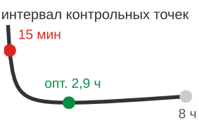

*Оптимальная частота контрольных точек уравновешивает накладные расходы записи и риск повторной работы.*

## Итоги

<a id="sec-distributed-training-systems-summary"></a>

В этой главе введена «стена масштабирования»: точка, в которой добавление новых GPU в итоге замедляет, а не ускоряет обучение. Распределенное обучение — не простая аппаратная задача, а задача удовлетворения ограничений, определяемая взаимодействием размера модели, размера батча и пропускной способности межсоединений.

Куб 3D-параллелизма ([рисунок «Пространство стратегий 3D-параллелизма»](#fig-3d-parallelism-cube-summary)) — полезная рамка для масштабирования больших моделей. Параллелизм по данным разворачивает внешний цикл обучения, чтобы масштабировать пропускную способность; тензорный параллелизм векторизует внутренние циклы умножения матриц, чтобы уместить модель в память; конвейерный параллелизм разбивает последовательные слои на стадии, чтобы реже обмениваться данными. Вместе эти стратегии отображают модели, превышающие любой отдельный банк памяти, на парк ускорителей с конечной пропускной способностью.

<a id="fig-3d-parallelism-cube-summary"></a>

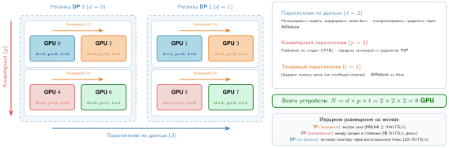

***Пространство стратегий 3D-параллелизма**: конфигурация из 8 GPU заполняет координатную сетку $(d,p,t)$, которая объединяет параллелизм по данным (реплики), конвейерный параллелизм (стадии слоев) и тензорный параллелизм (разбиения внутри слоя). Один шаг обучения согласует $d \times p \times t$ GPU, причем коммуникация происходит соответственно внутри слоев, на границах стадий микробатчей и раз за шаг оптимизатора.*

Выбор параллелизма можно понимать как преобразование цикла, которое применяет компилятор уровня кластера. Согласование логических паттернов коммуникации с физическими иерархиями железа переводит систему из «режима линейного масштабирования» малых кластеров в режим, ограниченный коммуникацией, у очень больших парков ускорителей.

В этой главе стратегии разбиения разрабатывались прямо для обучения плотных больших моделей и нагрузок в стиле рекомендательных систем. [Таблица «Стратегия разбиения по архетипам»](#tbl-partitioning-archetypes) показывает также, как та же логика ограничений доходит до федеративного граничного случая, где узкое место смещается с памяти ускорителя и пропускной способности фабрики на ненадежные устройства, приватность и прерывистую связность.

> **Спектр распределенных архетипов**
>
> Рабочая точка в кубе 3D-параллелизма смещается в зависимости от главного узкого места системы:
>
> | **Архетип**                           | **Основная стратегия разбиения**  | **Логика**                                                                                                                                                           |
> |:--------------------------------------|:---------------------------------:|:---------------------------------------------------------------------------------------------------------------------------------------------------------------------|
> | **Архетип A (GPT-4/Llama-3)**         |       Гибридный 3D-параллелизм    | Сочетать тензорный (ширина), конвейерный (глубина) параллелизм и параллелизм по данным (пропускная способность), чтобы уместить 3,5 ТБ весов. |
> | **Архетип B (DLRM в масштабе)**       |         Шардинг эмбеддингов       | Разбить огромные таблицы 10 ТБ+ по парку серверов параметров; использовать разреженные обновления AllToAll.                  |
> | **Архетип C (федеративный MobileNet)** |      Федеративное обучение       | Та же логика распространяется на координацию обновлений MobileNet на устройствах между ненадежными граничными устройствами с ограничениями приватности; этот режим развивается в [главе «Граничный интеллект»](11_edge_intelligence.md#sec-edge-intelligence). |
>
> <a id="tbl-partitioning-archetypes"></a>
>
> ***Стратегия разбиения по архетипам**: рабочая точка в кубе 3D-параллелизма смещается вместе с доминирующим узким местом.*

Стратегии параллелизма, рассмотренные в этой главе (по данным, тензорный, конвейерный и экспертный), образуют набор инструментов для разбиения нагрузок обучения по кластеру. Они не взаимоисключающие альтернативы, а дополняющие друг друга измерения общего пространства оптимизации. Такие системы, как Megatron-LM, достигают эффективного масштабирования, комбинируя несколько стратегий: тензорный параллелизм внутри узлов, конвейерный параллелизм между группами узлов, параллелизм по данным для пропускной способности и параллелизм экспертов для масштабирования емкости.

> **Ключевые выводы: параллелизм перемещает налог**
>
> * **Разбиение работы перемещает узкое место**: распределенное обучение не уменьшает сами вычисления; оно превращает давление на память в объем коммуникации, задержку синхронизации или простой конвейера (принцип «граница эффективности масштабирования»). Выигрывает то разбиение, которое отправляет накладные расходы в наименее связывающую часть парка.
> * **Параллелизм по данным заканчивается на сходимости**: реплики чисто масштабируют пропускную способность, лишь пока более крупные глобальные батчи еще улучшают оптимизацию. За критическим размером батча стоимость AllReduce и сниженный шум градиента превращают «больше воркеров» в более медленное или менее устойчивое обучение, если не меняются расписания, разогрев и накопление.
> * **Шардинг покупает память за сообщения**: ZeRO и FSDP делают реальными модели со 100 млрд+ параметров, разбивая состояние оптимизатора, градиенты и параметры (принцип «разрыв емкости памяти»). Цена — более жесткое расписание коммуникации из операций ReduceScatter и AllGather, которые нужно перекрывать или скрывать.
> * **Тензорному параллелизму место рядом с NVLink**: тензорный параллелизм разбивает матричные операции внутри слоев, поэтому ему нужна высокоскоростная внутриузловая фабрика, которую дают современные внутриузловые межсоединения ускорителей. Растягивание этого трафика между стойками превращает решение проблемы емкости памяти в коммуникационное узкое место.
> * **Конвейерный параллелизм обменивает байты на пузыри**: послойное разбиение на стадии сокращает частоту коммуникации, но слоты заполнения и опустошения оставляют ускорители в простое (принцип «закон парка (закон времени распределенного шага)»). Микробатчинг с $m \gg p$ — механизм, превращающий глубину модели в пропускную способность, а не в провисание конвейера.
> * **3D-куб — это карта железа**: реальное передовое обучение сочетает параллелизм по данным, тензорный, конвейерный, экспертный и шардированный, потому что никакая одна ось не вмещает и модель, и парк (принцип «универсальный закон масштабирования»). Логические группы должны отображаться на HBM, NVLink, InfiniBand и домены отказов одновременно.

В основе куба и трех его осей лежит единый обмен. Никакой способ разбиения модели не уменьшает саму работу; каждый только перемещает ее, превращая предел памяти в стоимость коммуникации или стоимость коммуникации в простой. Параллелизм по данным, тензорный и конвейерный тратят коммуникацию, чтобы получить запас памяти, которого нет ни у одного ускорителя, а координация — налог, который платят за согласованность разбиения. Это смещение накладных расходов (принцип «смещение накладных расходов»), закон, на котором держится остальной том: налог на исполнение в масштабе нельзя убрать, его можно лишь переместить между вычислениями, коммуникацией и координацией. Куб — карта того, куда можно направить налог; инженерия состоит в выборе места назначения, которое связывает меньше всего.

> **Связь с главой: от логики к трафику**
>
> Разбиение математики определяет *логические* паттерны трафика парка машинного обучения. Эти паттерны в конечном счете выходят на *физические* провода дата-центра. [Глава «Коллективные коммуникации»](06_collective_communication.md#sec-collective-communication) открывает «черный ящик» коллективных операций (AllReduce, AllToAll), которые сохраняют согласованность, и переходит от того, что нужно отправить, к тому, как это маршрутизируется через кольца, деревья и рельсы.
