

# Распределенное обучение

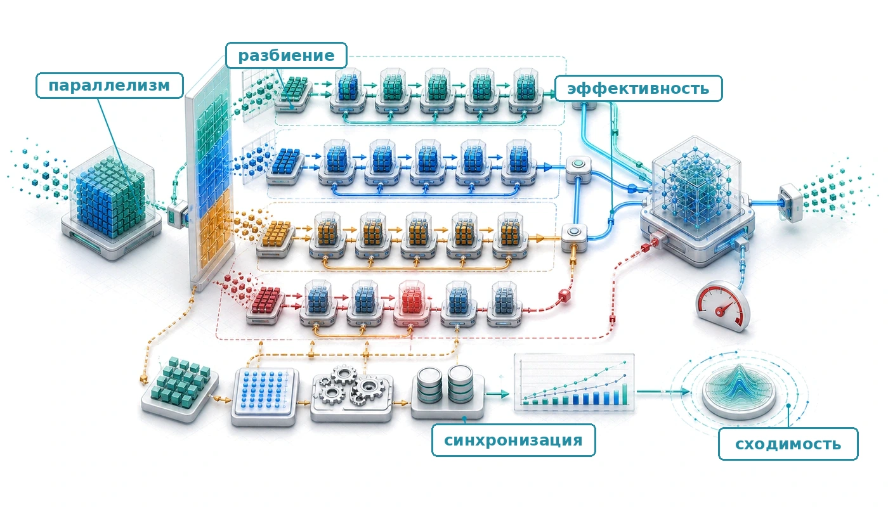

## Назначение

_Почему линейная логика «больше железа — быстрее обучение» рушится на стене бисекционной пропускной способности?_

Распределенное обучение выглядит простым, если описать его как разбиение работы между машинами и объединение результатов. Однако по мере роста парка машинного обучения растут затраты на коммуникацию, а вычислений на каждой машине становится меньше, пока синхронизация не начинает доминировать и добавление железа не ухудшает производительность. Когда задание обучается на одном ускорителе, проект оптимизируется под арифметическую интенсивность; когда оно обучается на 10 000 ускорителей, проект оптимизируется под интенсивность коммуникации. Этот потолок масштабирования следует из разрыва надежности и соотношения коммуникации и вычислений. Координация независимых машин требует перемещения терабайтов состояния по сетям, которые на порядки медленнее памяти внутри чипа. Распределенное обучение управляет этим напряжением: разбивает работу, чтобы уменьшить налог на координацию, перекрывает коммуникацию с вычислениями, чтобы скрыть задержку, и выбирает стратегии синхронизации, которые балансируют согласованность и пропускную способность. Без этого понимания организации могут потратить миллионы на железо, которое простаивает в ожидании градиентов, или получить модели, которые не сходятся, потому что устаревшие обновления сбивают оптимизацию. Распределенное обучение приводит таксономию C³ в действие: каждое проектное решение обменивает параллельные вычисления на коммуникацию и координацию между воркерами, которые ограничены сетью.

> **Цели обучения**
>
> - Применять закон парка для диагностики режимов распределенного обучения, ограниченных вычислениями, памятью, коммуникацией или координацией
> - Рассчитывать эффективность масштабирования, предельный размер батча и накладные расходы синхронизации для заданий обучения с параллелизмом по данным
> - Проектировать планы шардинга памяти, которые обменивают емкость ускорителя на дополнительную коммуникацию
> - Сопоставлять тензорный, конвейерный, экспертный и data-параллелизм с ярусами пропускной способности железа и структурой модели
> - Строить расписания микробатчей, которые минимизируют пузыри конвейера при сохранении пропускной способности и стабильности сходимости
> - Оценивать политики синхронизации и низкой точности при ограничениях устаревания, отстающих воркеров и численной стабильности
> - Синтезировать конфигурации гибридного параллелизма для ограничений обучения передовых моделей, рекомендательных систем и выравнивания

## Зачем нужно распределение

Аппаратная иерархия, сетевая ткань и конвейер хранения образуют физическую основу парка. Оставшаяся задача алгоритмическая: разбить одно задание обучения между тысячами ресурсов, не потеряв смысла единого согласованного процесса оптимизации. Универсальный закон масштабирования объясняет, почему это давление растет: улучшение качества передовых моделей требует непропорционально больше вычислений, данных и параметров, поэтому задача обучения рано или поздно перерастает любую отдельную машину.

Одного ускорителя со 100 ТБ памяти и экзафлопсом вычислений хватило бы, чтобы распределенное обучение не понадобилось. Но реальные системы накладывают конечную емкость памяти с высокой пропускной способностью (HBM), конечную пропускную способность межсоединений и конечный бюджет отказов, поэтому обучение приходится разбивать между многими независимыми чипами. В рамках стека парка, показанного на [рисунке «Стек парка»](01_introduction.md#fig-fleet-stack), распределенное обучение представляет слой распределения: логику, которая разбивает *математическую* нагрузку по *физическому* парку. Стратегии, описанные здесь (параллелизм по данным, тензорный, конвейерный и гибридный параллелизм), создают трафик, который должна переносить сеть.

### Физика кластера

Прежде чем оптимизировать алгоритмы, нужно понять физические ограничения парка машинного обучения. Производительность любого задания распределенного обучения определяется законом парка, который введен в [главе 1](01_introduction.md#sec-vol2-introduction-fleet-law) и раскладывает время одного шага:

$$ T_{\text{step}}(N) = \frac{T_{\text{compute}}}{N} + T_{\text{comm}}(N) + T_{\text{sync}}(N) - T_{\text{overlap}} $$

Ключевой член — **соотношение коммуникации и вычислений**, $\rho = T_{\text{comm}}(N)/(T_{\text{compute}}/N)$. Именно оно определяет, ведет ли себя кластер как суперкомпьютер или как набор простаивающих обогревателей.

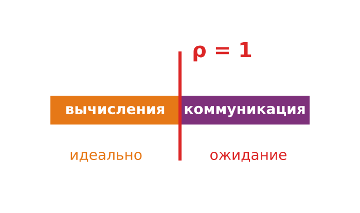

*За порогом соотношения коммуникации и вычислений масштабирование перестает быть идеальным.*

Из этого соотношения следуют два режима. Вычислительно ограниченный кластер, где $T_{\text{compute}}/N \gg T_{\text{comm}}(N)$, большую часть времени перемножает матрицы; это идеальное состояние, типичное для больших батчей на плотных моделях вроде ResNet. Коммуникационно ограниченный кластер, где $T_{\text{comm}}(N) \approx T_{\text{compute}}/N$, значительную часть времени ждет прихода градиентов или активаций; это обычное состояние для больших языковых моделей (LLM) и рекомендательных моделей в духе DLRM (Deep Learning Recommendation Model), где синхронизация параметров насыщает сеть. Приложение «От D·A·M к C³» (раздел «Сводка диагностики») переводит это соотношение в диагностическую схему: по измеренной пропускной способности и арифметической интенсивности она относит нагрузку к ограниченной вычислениями, памятью или коммуникацией и превращает качественные режимы в воспроизводимую проверку.

### Требования к обучению на нескольких машинах

Три конкретных признака показывают, когда распределенное обучение становится необходимым, а не просто полезным. Первый признак — **исчерпание памяти**: параметры модели, состояния оптимизатора и хранилище активаций превышают емкость одного устройства. Для полного смешанного обучения с оптимизатором Adam (Adaptive Moment Estimation) одного бюджета параметров, градиентов и состояний оптимизатора достаточно, чтобы переполнить ускоритель на 80 ГБ при примерно 5 миллиардах параметров, еще до учета активаций; модели размером 10–20 млрд параметров требуют шардинга, выгрузки на другие носители или иных методов экономии памяти (Rajbhandari et al., 2020). Приложение «Основы парка» фиксирует емкости H100 и A100 в 80 ГБ, которые используются в этих бюджетах по всей главе, поэтому каждое ограничение памяти можно проследить до одного документированного источника.

Второй признак — недопустимая **длительность обучения**. Даже когда модель помещается в память, обучение на одном устройстве может занимать недели или месяцы до сходимости, и тогда само календарное время становится системным ограничением. Обучение GPT-3 с 175 миллиардами параметров велось на кластере из GPU V100 (Brown et al., 2020), и это показывает, что на таком масштабе распределение навязывает не только емкость HBM, но и календарь.

Третий признак — **масштаб данных**. Когда обучающие данные достигают нескольких терабайт, как в крупных задачах компьютерного зрения или языкового моделирования, одна машина перестает быть естественной единицей хранения или пропускной способности ввода. Тогда распределенное обучение становится способом кормить модель в той же мере, в какой способом ее держать. Эти три признака сходятся к одному структурному пределу. [Рисунок «Стена памяти»](#fig-memory-wall-trend) показывает его напрямую: память устройств растет, спрос моделей растет быстрее, и точка пересечения — та, где распределение перестает быть оптимизацией и становится необходимым условием.

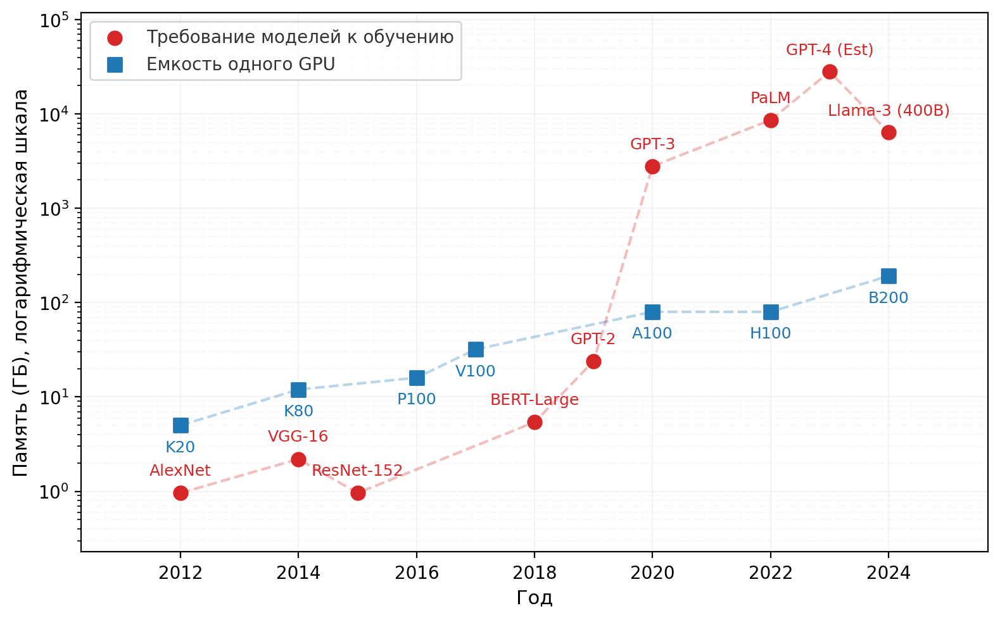

***Стена памяти**: емкость памяти ускорителя по сравнению с памятью, которую нужна современным моделям для обучения. Емкость растет устойчиво, а потребности растут быстрее; расширяющийся разрыв объясняет, почему веса, градиенты и состояние оптимизатора приходится делить между устройствами, а не просто сжимать.*

### Компромиссы сложности распределенного обучения

Распределение меняет задачу оптимизации, добавляя издержки, которых нет внутри одной машины. Три измерения сложности определяют, жизнеспособна ли стратегия параллелизма, поскольку любое из них может стать решающим ограничением. **Накладные расходы на коммуникацию** — это стоимость синхронизации градиентов: для модели с $P$ параметрами, распределенной по $N$ устройствам, операции AllReduce за шаг должны передать примерно $2P(N-1)/N$ значений градиентов, умноженных на размер элемента градиента в байтах, и в сетях общего назначения это может доминировать над временем вычислений. **Отказоустойчивость** становится сложнее с ростом кластера: ожидаемое число отказов в единицу времени растет линейно с размером кластера, а вероятность того, что весь кластер проработает интервал без единого отказа, убывает экспоненциально. Если в кластере из 100 узлов почасовая выживаемость каждого узла составляет 99,9 %, вероятность отказа кластера равна 9,5 % в час, что соответствует среднему времени наработки на отказ (MTBF) около 10 часов. Приложение «Основы надежности» разбирает этот каскад от выживаемости одного узла до MTBF кластера и проводит полный пример того же расчета, поэтому читатель может воспроизвести, почему MTBF схлопывается с ростом кластера. **Алгоритмическая стабильность** замыкает список: большие батчи, которые дает параллелизм по данным, влияют на поведение сходимости и требуют масштабирования скорости обучения и стратегий разогрева (warmup), которые не нужны при обучении на одной машине (Goyal et al., 2017). Вместе эти издержки объясняют, почему распределенное обучение — это задача удовлетворения ограничений, а не упражнение в умножении железа.

### Переход от одной машины к распределенной системе

Систематическая методология оптимизации, разработанная для обучения на одной машине, распространяется на распределенные среды с важными изменениями. Профилирование должно учитывать шаблоны коммуникации между устройствами и накладные расходы синхронизации в дополнение к метрикам вычислений и памяти. Пространство решений расширяется: в него входят параллелизм по данным, параллелизм модели, конвейерный параллелизм и гибридные подходы. [Рисунок «Трехмерный куб параллелизма»](#fig-3d-parallelism-cube) показывает это трехмерное пространство конфигураций.

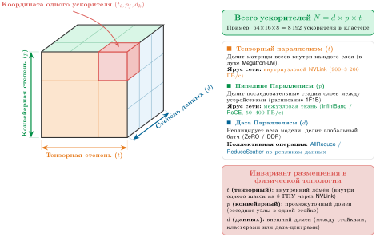

***Трехмерный куб параллелизма**: пространство конфигураций раскладывает обучение кластера по трем ортогональным осям: тензорный параллелизм ($t$, шардинг внутри слоя), конвейерный параллелизм ($p$, последовательное разбиение на стадии) и параллелизм по данным ($d$, репликация батча). Допустимый запуск на кластере требует одновременно выполнить условия делимости модели, лимиты памяти на устройство и иерархию сетей железа, чтобы выделить $N = d \times p \times t$ ускорителей.*
[Рисунок «Трехмерный куб параллелизма»](#fig-3d-parallelism-cube) показывает, что общее число ускорителей равно $N_{\text{total}} = d \times p \times t$. Оси описывают различные математические разбиения, но они не являются независимыми ручками конфигурации. Степени тензорного и конвейерного параллелизма должны делить структуру модели, степень параллелизма по данным и расписание микробатчей должны давать допустимый глобальный батч, каждое разбиение должно помещаться в память, а каждая группа коммуникации должна отображаться на подходящую топологию и приемлемый домен отказа. Поэтому системы обучения выбирают совместно допустимую координату, а не настраивают $d$, $p$ и $t$ по отдельности.

### Инженерные компромиссы: выбор стратегии параллелизма

Выбор стратегии параллелизма — не вопрос предпочтения, а задача удовлетворения ограничений, которую определяют число параметров $(P)$, размер батча $(B)$ и пропускная способность межсоединений. [Таблица «Стоимость коммуникации параллелизма»](#tbl-parallelism-tradeoffs) показывает затраты на коммуникацию для каждой стратегии и выявляет, какие подходы физически осуществимы для данной топологии железа.

***Стоимость коммуникации параллелизма**: тензорный параллелизм имеет самую высокую частоту коммуникации (на каждый слой), поэтому его ограничивают внутриузловым использованием (NVLink). Конвейерный параллелизм имеет самый малый объем коммуникации (только граничные активации), что делает его подходящим для масштабирования между узлами (Ethernet/InfiniBand). Параллелизм по данным занимает промежуточное место, но плохо масштабируется по мере роста передаваемого объема градиентов $M_{\text{grad}}$, что в итоге требует шардинга с экономией памяти.*

| **Стратегия**              | **Шаблон коммуникации**   |                      **Объем коммуникации**                    | **Ограничение железа**          |
|:---------------------------|:-------------------------:|:----------------------------------------------------------:|:--------------------------------|
| **Параллелизм по данным (DP)** | AllReduce градиентов  |         $\propto M_{\text{grad}}$ (байты градиентов)       | Нужна высокая бисекционная пропускная способность |
| **Тензорный параллелизм (TP)** | AllReduce активаций   |              $\propto B \times N_L$ (слои)                 | Критично: нужен NVLink          |
| **Конвейерный параллелизм (PP)** | Точка-точка (P2P)   | $\propto B \times S \times d_{\text{model}}$ (активации)   | Низкая пропускная способность (достаточно Ethernet) |

Требования к пропускной способности жестко ограничивают размещение железа: каждая стратегия параллелизма должна соответствовать межсоединению между GPU, которым нужно обмениваться данными, иначе проект разрушится еще до того, как его начнут писать. Быстрая прикидка достаточности пропускной способности ловит это несоответствие до написания кода.

> **Справка: проверка достаточности пропускной способности**
>
> Тензорный параллелизм через серверные стойки, соединенные обычным Ethernet, будет простаивать. Объем коммуникации растет с размером батча $B$ и числом слоев $N_L$. Ему нужна пропускная способность NVLink в 600–900 ГБ/с. Для масштабирования между стойками проект должен перейти на конвейерный параллелизм или параллелизм по данным, чтобы учитывать физику сети.

[Рисунок «Дерево решений стратегии параллелизма»](#fig-parallelism-decision-tree) формализует этот процесс удовлетворения ограничений в виде дерева решений: оно показывает, как размер модели и топология железа определяют допустимые стратегии параллелизма.

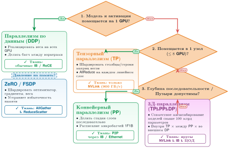

***Дерево решений стратегии параллелизма**: отправная точка — память модели; дерево проверяет ограничения железа, чтобы выявить допустимые стратегии исполнения. Ветви сравнивают емкость параметров и активаций с физическими пределами одного устройства и одного узла, и каждой стратегии сопоставлен требуемый ярус межсоединения.*

Дерево решений показывает, что выбор стратегии параллелизма — не вопрос предпочтения, а следствие физических ограничений. Это предварительный обзор ограничений: формулы объема коммуникации из [таблицы «Стоимость коммуникации параллелизма»](#tbl-parallelism-tradeoffs) называют то, что переносит каждая стратегия, но их полный смысл зависит от механики тензорного, конвейерного и гибридного параллелизма, которая разбирается в остальных разделах главы. Раздел «Сравнение стратегий параллелизма» завершает фильтр, когда эта механика уже введена. Следующий вопрос — как эти ограничения формируют механику шага распределенного обучения на реальном кластере.

## Шаг распределенного обучения

Разбиение задания обучения между ускорителями должно сохранять математическую семантику одного шага оптимизации. Центральная задача в том, чтобы 1 024 GPU, работающие полностью независимо, согласовали один математически строгий набор обновленных весов в конце каждой итерации обучения.

> **Определение: распределенное обучение**
>
> ***Распределенное обучение***: методология обучения, которая разбивает цикл оптимизации между несколькими вычислительными узлами (распределяя данные, слои модели или отдельные тензорные операции) и согласует их результаты через синхронизированные примитивы коммуникации, чтобы получить одну согласованную модель.
>
> 1.  **Значение**: распределенное обучение становится необходимым, когда требование модели к памяти превышает емкость одного ускорителя. GPT-3 (175 млрд параметров) требует примерно 350 ГБ в BF16, что более чем в 4 раза больше емкости одного H100 (80 ГБ). Для одного только шардинга модели нужно не менее 5 H100, а крупные запуски могут использовать сотни или тысячи ускорителей, чтобы уложиться в разумное календарное время.
> 2.  **Отличие**: в отличие от многопоточности внутри одного узла, где ядра делят общее физическое пространство памяти, распределенное обучение разносит состояние по непересекающимся памятям ускорителей и требует явных коллективных примитивов коммуникации поверх сетевых тканей, чтобы синхронизировать состояние оптимизации.
> 3.  **Типичная ошибка**: распространено заблуждение, что распределенное обучение масштабируется линейно с числом узлов. На практике накладные расходы коммуникации растут вместе с размером кластера и с последовательной долей каждого шага (закон Амдала): если 30 % времени шага уходит на синхронизацию, теоретический потолок масштабирования составляет $1/0{,}30 \approx 3\times$ независимо от того, сколько ускорителей добавлено.

Полезная ментальная модель рассматривает эти распределенные стратегии как преобразования циклов, то есть тот же концептуальный инструментарий, которым компиляторы оптимизируют последовательный код. Если смотреть на процесс обучения как на огромный цикл по данным и слоям, распределенные стратегии — это просто *преобразования циклов*, которые применяет компилятор уровня кластера. Логический цикл обучения вкладывает три итератора (эпохи, батчи и слои), и каждая стратегия параллелизма разворачивает один из них по устройствам:

Параллелизм по данным — это параллельный цикл for: он разворачивает внешний цикл (измерение батча) по устройствам, так что каждое устройство выполняет один и тот же код над разными индексами данных. Тензорный параллелизм — это векторизация, или SIMD (single instruction, multiple data), которая разбивает внутренние циклы (умножение матриц) между устройствами в масштабе кластера, где NVLink играет роль векторного регистрового файла. Конвейерный параллелизм — это конвейеризация инструкций: он разбивает последовательные операции (слои) по устройствам; так же как стадии конвейера процессора выполняют выборку, декодирование и исполнение, кластер проводит слой 1, слой 2 и слой 3, чтобы все вычислительные блоки оставались занятыми.

Какой бы цикл ни разворачивала стратегия, распределенное обучение[^fn-distbelief-parameter-server] распределяет нагрузку по машинам, которые должны координироваться, чтобы обучать одну модель. Координация здесь означает, что каждый шард или реплика модели остается на совместимом шаге обучения. Базовых барьеров хватает, чтобы упорядочить небольшой исследовательский запуск, но длительным заданиям обучения нужны также механизмы таймаутов, контрольных точек и восстановления, чтобы отказ одного воркера не сжигал дни вычислений. Глава «Отказоустойчивость» подробно разбирает эти задачи инженерии надежности.

[^fn-distbelief-parameter-server]: **Распределенное обучение**: DistBelief от Google (2012) был ранним фреймворком для обучения нейронных сетей на тысячах машин, но его архитектура серверов параметров создавала узкие места пропускной способности в центральных узлах. Это ограничение привело к переходу на децентрализованные шаблоны AllReduce в преемниках вроде Horovod и PyTorch DistributedDataParallel (DDP), где реплицированные воркеры параллелизма по данным синхронизируют градиенты с затратами $2(N-1)/N$ на воркер, вместо того чтобы сосредотачивать трафик на одном сервере (Dean et al., 2012; Sergeev and Del Balso, 2018; Li et al., 2020; Patarasuk and Yuan, 2009).

Каждая ступень пути масштабирования наследует задачи предыдущей. Обучение на одном GPU требует только локального управления памятью и проходов вперед и назад. Масштабирование на несколько GPU внутри узла добавляет высокоскоростную коммуникацию, которая обеспечивается через NVLink[^fn-nvlink-intranode-interconnect] или PCIe с оптимизацией NCCL[^fn-nccl-topology-awareness], при этом сохраняются отказоустойчивость и планирование одной машины.

[^fn-nvlink-intranode-interconnect]: **NVLink**: двухточечное межсоединение GPU от NVIDIA обеспечивает двунаправленную пропускную способность 600–900 ГБ/с, то есть примерно в 24–36 раз больше, чем у порта InfiniBand HDR. Именно этот разрыв объясняет, почему тензорный параллелизм, которому нужен AllReduce на каждом слое, ограничен коммуникацией внутри узла, а конвейерный параллелизм и параллелизм по данным переносят более медленную межузловую ткань.

[^fn-nccl-topology-awareness]: **NCCL (NVIDIA Collective Communications Library)**: NCCL предоставляет учитывающие топологию коллективные примитивы коммуникации между GPU, включая AllReduce, поверх PCIe, NVLink, InfiniBand и IP-сетей. Современные развертывания NCCL открывают семейства алгоритмов (кольцо, дерево и родственные) через выбор во время выполнения и настройки, поэтому фреймворки обучения могут избегать наивных схем, которые направляют весь трафик по самому медленному межузловому пути (Jeaugey, 2017; NVIDIA, 2026).

Переход к многоузловому обучению добавляет сетевые накладные расходы, требования к отказоустойчивости и оркестрацию кластера. Поскольку каждая ступень усиливает узкие места предыдущей, производительность одного GPU нужно оптимизировать до масштабирования, чтобы неэффективность не умножалась по всему парку. Хотя фреймворки во многом скрывают это за шардированным параллелизмом по данным и библиотеками коммуникации, эффективная реализация распределенного обучения по-прежнему требует аккуратной сетевой настройки (InfiniBand, маршрутизации с учетом топологии), управления инфраструктурой через планировщики кластера и отладки нелокальных проблем, таких как зависания синхронизации и узкие места коммуникации.

Несмотря на эту сложность, основной рабочий процесс механически прост; инженерная задача в том, чтобы сделать его быстрым и надежным в масштабе. Повторяющаяся стоимость — это синхронизация градиентов, которая агрегирует результаты между устройствами; эти накладные расходы растут вместе с системой, что количественно разбирается в разделе «Эффективность масштабирования и сходимость».

Четыре подхода решают разные режимы ограничений. Параллелизм по данным делит обучающие данные между машинами, при этом каждая держит полную копию модели; это самый простой подход для моделей, которые помещаются в память одного устройства. Параллелизм модели делит саму модель между устройствами, когда параметры превышают память одного устройства. Конвейерный параллелизм разбивает модель на последовательные стадии, которые обрабатывают микробатчи одновременно, что повышает загрузку по сравнению с наивным параллелизмом модели. Гибридные подходы объединяют несколько стратегий и позволяют обучать на масштабах, где любой отдельный подход бы не сработал. Каждая стратегия становится необходимой только тогда, когда ее предшественник упирается в физический предел.

## Параллелизм по данным

Самый простой подход дает каждому GPU полную, идентичную копию модели и назначает ему отдельный срез данных. Параллелизм по данным — естественная отправная точка для распределенного обучения, потому что он требует минимальных изменений в цикле обучения на одном устройстве.

> **Определение: параллелизм по данным**
>
> ***Параллелизм по данным***: стратегия распределенного обучения, в которой каждый воркер держит полную реплику модели и обрабатывает независимый шард мини-батча, а затем синхронизирует обновления градиентов через AllReduce, так что все реплики на каждом шаге применяют одинаковые изменения параметров.
>
> 1.  **Значение**: при $N$ воркерах, каждый из которых обрабатывает батч размера $B$, эффективный глобальный размер батча равен $N \times B$, что масштабирует пропускную способность линейно, а память на воркер остается постоянной. Для модели на 1 млрд параметров размером 2 ГБ в BF16 1 024 воркера дают в 1 024 раза большую пропускную способность, чем один GPU, — пока AllReduce градиентов (2 ГБ на шаг при оптимальной для кольца стоимости $2(N-1)/N$ на воркер) не начнет превышать время обратного прохода и не создаст узкое место коммуникации.
> 2.  **Отличие**: в отличие от конвейерного параллелизма и параллелизма модели, которые делят слои или операции сети между ускорителями, параллелизм по данным реплицирует всю модель на всех воркерах и делит только обучающий набор данных, поэтому после каждого прохода назад нужна синхронизация градиентов.
> 3.  **Типичная ошибка**: распространено заблуждение, что параллелизм по данным масштабируется бесконечно с ростом числа воркеров. Увеличение эффективного размера батча $B$ сверх зависящего от нагрузки критического размера батча снижает статистическую эффективность: требуется больше шагов для достижения целевой функции потерь, и прирост пропускной способности от добавления воркеров съедается (Shallue et al., 2019).

Каждое устройство обучает полную копию модели на назначенном ему подмножестве данных. Когда модель классификации изображений обучается на 1 млн изображений на 4 GPU, каждый GPU обрабатывает по 250 000 изображений, сохраняя идентичную копию архитектуры модели.

Параллелизм по данным наиболее эффективен, когда набор данных велик, а модель остается управляемой, поскольку каждое устройство должно хранить полную копию модели в памяти. Этот метод широко используется в классификации изображений и обработке естественного языка, где набор данных можно обрабатывать параллельно без зависимостей между примерами. Когда модель ResNet (He et al., 2016) обучается на ImageNet, каждый GPU может независимо обрабатывать свою часть изображений, потому что классификация одного изображения не зависит от результатов другого.

Эффективность параллелизма по данным опирается на свойство стохастического градиентного спуска. Градиенты, вычисленные на разных мини-батчах, можно усреднять, сохраняя математическую эквивалентность обучению на одном устройстве. Это свойство позволяет вычислять параллельно на устройствах, а математическое основание прямо следует из линейности математического ожидания.

Рассмотрим модель с параметрами $\theta$, обучаемую на наборе данных $D$. Функция потерь для одного объекта данных $x_i$ равна $\mathcal{L}(\theta, x_i)$. При стохастическом градиентном спуске (SGD) с размером батча $B$ обновление градиента для мини-батча имеет вид:
$$
g = \frac{1}{B} \sum_{i=1}^B \nabla_{\theta} \mathcal{L}(\theta, x_i)
$$

При параллелизме по данным на $N$ устройствах каждое устройство $k$ вычисляет градиенты на своем мини-батче $B_k$:
$$
g_k = \frac{1}{|B_k|} \sum_{x_i \in B_k} \nabla_{\theta} \mathcal{L}(\theta, x_i)
$$

Когда все воркеры используют один и тот же локальный размер батча, глобальное обновление усредняет локальные градиенты:
$$
g_{\text{global}} = \frac{1}{N} \sum_{k=1}^N g_k
$$

При таком допущении равного батча усреднение математически эквивалентно вычислению градиента на объединенном батче $B_{\text{total}} = \bigcup_{k=1}^N B_k$:
$$
g_{\text{global}} = \frac{1}{|B_{\text{total}}|} \sum_{x_i \in B_{\text{total}}} \nabla_{\theta} \mathcal{L}(\theta, x_i)
$$

Для неравных локальных размеров батча градиент объединенного батча равен взвешенному среднему $g_{\text{global}} = (1/|B_{\text{total}}|)\sum_k |B_k|g_k$. Эта эквивалентность показывает, почему параллелизм по данным сохраняет статистические свойства обучения SGD: выборка нужного глобального батча распределяется по устройствам, локальные суммы градиентов считаются независимо, а нормировка на общий знаменатель воспроизводит тот же оценщик. Шаг редукции использует AllReduce над локальными суммами градиентов и числами валидных элементов. Приложение «Основы коммуникации» выводит модели стоимости кольцевого и древовидного AllReduce, которые задают цену этой синхронизации, поэтому читатель может предсказать, когда она перекроет локальные вычисления, сэкономленные параллелизмом.

> **Контрольные вопросы: механика параллелизма по данным**
>
> Проверьте, насколько вы поняли, как параллелизм по данным распределяет работу:
>
> - [ ] **Размещение состояния**: определите, шардирует ли параллелизм по данным состояние модели (веса) между GPU или реплицирует его.
> - [ ] **Глобальный размер батча**: рассчитайте эффективный глобальный размер батча для 8 GPU при размере батча 32 на GPU.
> - [ ] **Эквивалентность одному устройству**: объясните, почему параллелизм по данным математически эквивалентен обучению на одном устройстве с большим размером батча.
> - [ ] **Связывающее ограничение**: определите основной ресурс железа, который ограничивает параллелизм по данным при добавлении узлов: TFLOP/s GPU или пропускную способность сети.

Метод параллелен накоплению градиентов, при котором одно устройство накапливает градиенты за несколько проходов вперед, прежде чем обновить параметры. Оба приема используют аддитивные свойства градиентов, чтобы эффективно обрабатывать большие батчи. Однако перенос той же идеи в кластер добавляет операционные трудности сверх этой теоретической эквивалентности. Накладные расходы коммуникации, отказы узлов и ограничения стоимости дают эффекты второго порядка, которые вывод для одной машины не учитывает.

### Реализация параллелизма по данным

Детали реализации важны, потому что эквивалентность SGD выполняется только тогда, когда каждая фаза сохраняет заданные совокупную выборку и веса, полный вклад локальных градиентов и одно синхронизированное обновление. Поэтому конкретный рабочий процесс прослеживает путь от назначения локальных батчей до синхронизации вычисленных градиентов. [Рисунок «Конвейер реализации параллелизма по данным»](#fig-dist-train-data-parallelism) показывает пятистадийный конвейер выполнения параллелизма по данным: одинаковые реплики модели получают непересекающиеся шарды батча, независимо вычисляют локальные градиенты и сходятся на барьере коллективной редукции, прежде чем выполнить одинаковые обновления весов.

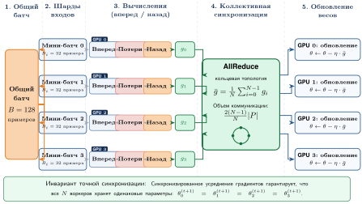

***Конвейер реализации параллелизма по данным**: пятистадийный процесс параллелизма по данным: (1) разбиение глобального батча, (2) назначение шардов мини-батчей отдельным GPU, (3) независимые проходы вперед и назад для получения локальных градиентов $g_i$, (4) коллективная операция AllReduce по кластеру для получения среднего градиента $\bar{g}$ и (5) одинаковое обновление параметров на всех устройствах. Эта стратегия сохраняет математическую семантику одиночного SGD, распределяя вычислительную нагрузку.*

Критическая точка синхронизации приходится на стадию 4 ([рисунок «Конвейер реализации параллелизма по данным»](#fig-dist-train-data-parallelism)): коллективная операция AllReduce должна завершиться на всех рангах воркеров, прежде чем любое устройство выполнит обновление параметров, и это делает пропускную способность бисекции сети главным ограничением масштабирования.

#### Разбиение данных

Разбиение данных — первое место, где эквивалентность SGD может нарушиться, но уникальность и равные шарды — лишь достаточные условия, а не сам инвариант. Совокупные примеры или токены, их вероятности выборки и веса градиентов должны воспроизводить нужный оценщик глобального батча. Равномерная выборка без возвращения может назначить непересекающиеся шарды; выборка с возвращением может законно повторять примеры; а батчи переменной длины могут назначать воркерам неравное число токенов, если редукция взвешивает каждого воркера по знаменателю валидных примеров или валидных токенов. Невзвешенное среднее неравных локальных средних, напротив, переоценивает воркеров с меньшими знаменателями.

Семплер поэтому — часть системы обучения, а не просто удобство загрузчика входа. Распределенный семплер координирует воркеров по рангу и может детерминированно разбивать или выбирать индексы из засеянного потока выборки. Для набора данных из 1,2 млн примеров, равномерно распределенного между 32 GPU, каждый GPU обрабатывает примерно 37 500 примеров за эпоху. Если семплер дополняет последний батч повторами примеров, нормировка функции потерь или веса примеров должны учитывать эти повторы, когда важно точное взвешивание на уровне эпохи. Записанный seed и детерминированный поток индексов делают назначение примеров повторяемым; побитовая воспроизводимость запуска дополнительно зависит от детерминизма ядер, порядка редукции коллективов, численной точности и сохраненного состояния генератора случайных чисел.

#### Фаза вычислений: проходы вперед и назад

Определяющая черта параллелизма по данным в том, что фаза вычислений, и проход вперед, и проход назад, тривиально параллельна. Каждый GPU работает как изолированный остров, выполняя идентичную копию модели на назначенном ему микробатче. Здесь микробатч означает локальный срез на GPU, который используется для учета активаций; конвейерное микробатчирование использует то же слово для другого механизма: оно делит глобальный батч, чтобы держать стадии конвейера занятыми. Для нашей эталонной модели на 175 млрд параметров эта изоляция критична: при проходе вперед каждый GPU независимо вычисляет активации для своего локального батча (размер микробатча 4, длина последовательности 2048). Без оптимизаций хранение этих активаций для обратного распространения заняло бы около 1,1 ТБ HBM, что на порядок больше емкости даже одного GPU H100. В этом сценарии необходим пересчет активаций (activation checkpointing): он пересчитывает активации во время обратного прохода вместо того, чтобы их хранить, и сокращает занимаемую память примерно до 19,3 ГБ.

Проверка емкости должна учитывать активации, а не останавливаться на байтах на параметр. В момент пикового занятия памяти

$$
M_{\text{total}} = M_{\text{weights}} + M_{\text{gradients}} + M_{\text{optimizer}} + M_{\text{activations}},
$$

с буферами коммуникации и временными рабочими областями, которые занимают дополнительный запас памяти. Шардинг уменьшает первые три члена в зависимости от своей стадии, тогда как длина последовательности, локальный размер микробатча и расписание конвейера определяют $M_{\text{activations}}$. Пересчет активаций уменьшает последний член, сохраняя только выбранные границы и пересчитывая пропущенные операторы прохода вперед во время обратного распространения (Narayanan et al., 2021). Сэкономленная память, таким образом, оплачивается дополнительными операциями FLOP и более длинным критическим путем; допустимый план параллелизма должен учитывать оба эффекта.

Обратный проход повторяет эту независимость, но вводит главное узкое место системы. Проходя граф вычислений в обратном порядке, GPU вычисляет градиенты для параметров, которые хранятся в его реплике или шарде. При чистом параллелизме по данным полная реплика FP16 на 175 млрд параметров означала бы тензор градиентов 350 ГБ на воркер, что превышает бюджет памяти одного ускорителя; поэтому крупные запуски сочетают параллелизм по данным с шардингом, тензорным или конвейерным параллелизмом. Сами вычисления не требуют никакой коммуникации, но получаемые градиенты представляют собой фрагментарный взгляд на истинную поверхность функции потерь, верный только для локального микробатча. Прежде чем может произойти шаг оптимизатора, соответствующие локальные градиенты или шарды градиентов должны быть агрегированы между воркерами параллелизма по данным, чтобы сформировать корректное глобальное обновление. Переход от изолированных высокопроизводительных вычислений к синхронизации задает ритм обучения с параллелизмом по данным: долгие периоды тихой интенсивной арифметики чередуются со вспышками тяжелого сетевого трафика.

#### Синхронизация градиентов

Синхронизация градиентов — место, где независимые оценки SGD становятся одним обновлением, поэтому ее стоимость определяет, ведет ли параллелизм по данным себя как стратегия масштабирования, а не как сетевой бенчмарк. Непосредственное требование обучения простое: каждая реплика параллелизма по данным должна применить одинаковый усредненный градиент, прежде чем перейти к следующему шагу. AllReduce — примитив, который выполняет эту операцию для реплицированных тензоров: каждый воркер вносит свой локальный тензор градиента, парк суммирует тензоры, и каждый воркер получает одинаковый редуцированный результат. В шардированных вариантах ReduceScatter и AllGather перемещают соответствующие куски, а не полный тензор на каждом устройстве, но стоимость синхронизации остается той же. Маленькие тензоры доминируются задержкой синхронизации, потому что у каждого раунда коммуникации есть стартовая стоимость; большие тензоры доминируются пропускной способностью, потому что нужный объем градиентов должен пройти по каналам. Глава «Коллективная коммуникация» позже выводит кольцевой, древовидный и иерархический алгоритмы, которые реализуют эту операцию усреднения на реальных тканях.

Когда производительность синхронизации отклоняется от теоретических ожиданий, стек парка дает структурированный подход к поиску узкого места.

> **Задача: отладка медленной синхронизации градиентов**
>
> **Сценарий**: AllReduce тензора градиента на 3 ГБ между 128 узлами (1 024 GPU) занимает 100 мс.
>
> **Диагноз**: задержка заметно ниже границы для плоского кольца в 239,8 мс, что подтверждает: NCCL использует иерархический алгоритм. Однако счетчики коммутаторов показывают, что межузловые каналы InfiniBand работают лишь на 60 % загрузки из-за перегрузки восходящих линков.
>
> **Системный урок**: отладка коллективной коммуникации требует сопоставления загрузки физических каналов с алгоритмическими границами. Разрыв между теоретической задержкой 48,5 мс и наблюдаемой 100 мс объясняется конкуренцией в восходящих каналах сетевой ткани, и устранить его помогают топологии, оптимизированные под рельсы (rail-optimized), а не смена алгоритма.

Выйдя за рамки этого конкретного кластера к пространству проектирования, [рисунок «Топологии синхронизации градиентов»](#fig-coll-comm) сопоставляет три высокоуровневые топологии синхронизации: кольцевой AllReduce с оптимальной пропускной способностью, централизованный сервер параметров и полносвязную топологию «все со всеми». В плотном синхронном параллелизме по данным кольцевой AllReduce позволяет избежать узкого места одного редуктора, распределяя трафик равномерно по участвующим каналам, как показывает реализация Baidu (Gibiansky, 2017).

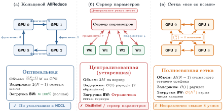

***Топологии синхронизации градиентов**: панели сравнивают три шаблона коммуникации. (а) Кольцевой AllReduce распределяет пропускную способность равномерно по каналам, но задержка растет линейно. (б) Сервер параметров централизует трафик и создает узкое место на сервере. (в) Топология «все со всеми» завершает обмен за один раунд коммуникации, но число каналов растет квадратично, что делает ее непрактичной за пределами малых групп.*
Компромисс, видимый на [рисунке «Топологии синхронизации градиентов»](#fig-coll-comm), лежит между *пропускной способностью* и *задержкой*: кольцо равномерно распределяет пропускную способность, но добавляет шаг задержки на каждый переход, тогда как полносвязная топология «все со всеми» сводит путь задержки к постоянному числу раундов ценой числа каналов, которое растет квадратично с числом узлов. Высокопроизводительные библиотеки вроде NCCL выбирают между этими топологиями автоматически, исходя из размера сообщения и топологии кластера. Глава «Коллективная коммуникация» формализует сложность задержки каждой топологии и выводит, когда кольцо выигрывает у альтернатив.

#### Модели синхронизации

Системы распределенного обучения работают в рамках явных моделей синхронизации, которые определяют, когда воркеры видят обновления друг друга. Выбор модели определяет, гарантирует ли система математическую эквивалентность обучению на одном устройстве или обменивает согласованность на пропускную способность. Базовая модель, пакетно-синхронный параллелизм (bulk synchronous parallel, BSP)[^fn-bsp-synchronous-barrier], введена в работе (Valiant, 1990); она требует, чтобы все воркеры завершили локальные вычисления в проходах вперед и назад, синхронизировали градиенты через барьер с AllReduce, а затем одновременно обновили параметры.

[^fn-bsp-synchronous-barrier]: **Пакетно-синхронный параллелизм (BSP)**: модель введена в работе (Valiant, 1990) как «связующая модель» между железом и программным обеспечением для параллельных вычислений. BSP разбивает работу на супершаги (вычисление, коммуникация, барьер), давая каждому воркеру согласованную границу супершага. Цена: время итерации равно времени самого медленного воркера, а при 1 000 GPU с вероятностью отставания 1 % на устройство примерно 10 GPU отстают на каждом шаге, поэтому барьер становится все дороже.

BSP обеспечивает семантику синхронного обновления: каждый воркер вычисляет из одной и той же версии параметров и вместе доходит до следующей границы обновления. При том же глобальном батче и той же редукции это математически соответствует синхронному обновлению на одном устройстве. Сама по себе модель не гарантирует побитовой воспроизводимости: порядок сложения чисел с плавающей запятой, недетерминированные ядра, состояние порядка данных и восстановление после отказа по-прежнему могут изменить результат. Стоимость синхронизации в том, что самый медленный воркер определяет время итерации, и так возникает проблема отстающих воркеров (straggler).

Синхронный параллелизм с ограниченным устареванием (stale synchronous parallel, SSP) ослабляет это ограничение, позволяя воркерам опережать самого медленного на $s$ итераций, прежде чем они заблокируются. Это ограничивает устаревание и одновременно уменьшает задержки синхронизации. SSP требует аккуратной настройки скорости обучения, поскольку воркеры вычисляют градиенты на немного разных версиях параметров. Гарантия ограниченного устаревания дает промежуточный вариант между строгой согласованностью BSP и полностью асинхронными подходами (Ho et al., 2013).

Асинхронный SGD (ASP) полностью убирает барьеры синхронизации, поскольку воркеры обновляют параметры независимо. Это максимизирует загрузку железа, но вводит устаревание градиентов, которое может ухудшить сходимость. Гарантия работы определяет, какой риск сходимости система принимает: раздел «Влияние устаревания: BSP против SSP против ASP» разбирает скорости сходимости, штраф за устаревание и методы компенсации, которые требует каждая модель.

Ключевые компромиссы между моделями синхронизации сведены в [таблице «Компромиссы моделей синхронизации»](#tbl-sync-models), а [рисунок «Модели синхронизации в распределенном обучении»](#fig-sync-model-timeline) показывает, как каждая стратегия распределяет работу между воркерами во времени.

***Компромиссы моделей синхронизации**: BSP, SSP и асинхронный SGD обменивают согласованность на пропускную способность вдоль единого спектра. BSP сохраняет границы синхронного обновления, но платит за самого медленного воркера; SSP раскрывает пропускную способность при ограниченном устаревании; асинхронный режим максимизирует пропускную способность ценой гарантий сходимости. Воспроизводимость требует отдельного контракта детерминированного исполнения.*

| **Модель**  |  **Согласованность**  |       **Пропускная способность**      | **Сходимость**                    | **Сценарий применения**        |
|:------------|:--------------------:|:-------------------------------------:|:----------------------------------|:-------------------------------|
| **BSP**     |       Строгая        | Ограничена самым медленным воркером   | Та же семантика синхронного обновления | Контролируемые финальные запуски обучения |
| **SSP**     | Ограниченное устаревание |        Выше, чем у BSP            | Почти эквивалентна при настройке  | Подбор гиперпараметров         |
| **Async**   |       Слабая         |              Максимальная             | Ухудшена, требует компенсации     | Большие неоднородные кластеры  |

Тот же компромисс становится яснее, когда расписания выкладываются на временную шкалу.

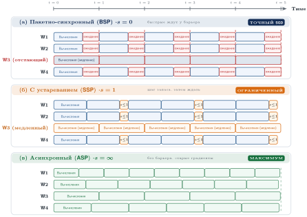

***Модели синхронизации в распределенном обучении**: временные шкалы сравнивают три стратегии синхронизации. (а) Пакетно-синхронный параллелизм (BSP) заставляет всех воркеров ждать глобального барьера на каждом шаге. (б) Синхронный параллелизм с ограниченным устареванием (SSP) позволяет воркерам опережать самого медленного на $s$ шагов. (в) Асинхронный SGD убирает барьеры, повышая пропускную способность ценой устаревания градиентов.*

Выбор модели синхронизации напрямую влияет и на пропускную способность системы, и на сходимость модели. Команды обучения часто используют BSP для контролируемых финальных запусков, потому что синхронные шаги упрощают сравнение и воспроизведение, а SSP или асинхронные подходы исследуют при подборе гиперпараметров, где пропускная способность может перевесить точную эквивалентность обновлений. Воспроизводимое повторение по-прежнему требует детерминированной выборки, ядер, порядка коллективных операций и восстановленного состояния генератора случайных чисел.

#### Семантика барьеров и режимы отказов

Операции AllReduce реализуют неявные барьеры: ни один воркер не может продолжить, пока все остальные не внесли свои градиенты. Эта связанность порождает режимы отказов, которых нет в обучении на одном устройстве.

Отказы воркеров во время AllReduce заставляют всех остальных воркеров бесконечно ждать недостающего вклада. Без механизмов таймаута все задание обучения зависает, вместо того чтобы аккуратно завершиться с ошибкой. Развернутые системы часто ставят сторожевые таймеры порядка минут, чтобы обнаруживать зависшие задания и завершать их.

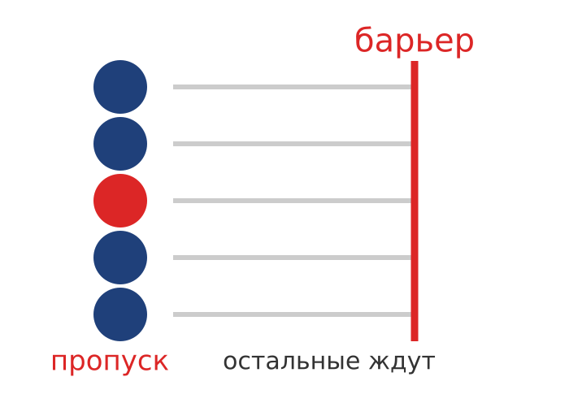

*Один пропавший воркер останавливает весь барьер AllReduce.*

Несоответствия градиентов возникают, когда воркеры расходятся во мнении, какие тензоры синхронизировать, из-за условных путей вычислений или динамического батчинга. Операции AllReduce могут блокироваться, ожидая тензоров, которые некоторые воркеры никогда не отправят. Это обычно случается с последовательностями переменной длины в моделях обработки естественного языка, динамическими графами вычислений и смесями экспертов с разными решениями маршрутизации.

Задержки, вызванные отстающими воркерами, возникают потому, что время итерации равно времени самого медленного воркера плюс накладные расходы синхронизации. Один медленный воркер, будь то тепловой троттлинг, перегрузка сети или джиттер ОС, задерживает всех воркеров и снижает загрузку кластера. При 1 000 GPU с вероятностью отставания 1 % на GPU на шаг примерно 10 GPU отстают на каждой итерации.

Развернутые системы решают эти проблемы с помощью таймаутов, мониторинга сердцебиения (heartbeat) и механизмов эластичного обучения. Глава «Отказоустойчивость» подробно описывает обнаружение отказов, стратегии контрольных точек и механизмы восстановления, которые позволяют заданиям обучения завершиться, несмотря на неизбежные отказы железа.

#### Обновление параметров

Обновление параметров замыкает инвариант параллелизма по данным: после агрегации каждое устройство должно применить одно и то же обновление оптимизатора из одних и тех же значений градиентов. Каждое устройство независимо обновляет параметры модели выбранным алгоритмом оптимизации, например SGD с моментом или Adam. Эта децентрализованная схема обновления обходится без центрального сервера координации, потому что синхронизация уже сделала локальные градиенты одинаковыми.

В системе из 8 GPU, обучающих модель ResNet, каждый GPU вычисляет локальные градиенты по своему подмножеству данных. После усреднения градиентов кольцевым all-reduce (Patarasuk and Yuan, 2009) каждый GPU имеет одинаковые значения глобального градиента. Затем каждое устройство независимо применяет эти градиенты по правилу обновления оптимизатора. При SGD и скорости обучения 0,1 обновление принимает вид `weights = weights - 0.1 * gradients`. Пример показывает, почему обновление может оставаться децентрализованным и при этом сохранять математическую эквивалентность обучению на одном устройстве.

Цикл разбиения данных, вычисления градиентов, синхронизации результатов и обновления параметров повторяется для каждого батча. Фреймворки автоматизируют этот цикл, но не могут снять ограничение порядка, которое делает реплики согласованными: каждый воркер должен обновляться только после того, как синхронизированный градиент будет готов.

### Компромиссы: стена коммуникации

Параллелизм по данным — распространенная стартовая стратегия не случайно: он масштабирует пропускную способность линейно с числом устройств, при условии что модель помещается в память и коммуникация не является узким местом. Однако он упирается в жесткий потолок, определяемый соотношением коммуникации и вычислений: как только обмен градиентами начинает доминировать над полезными вычислениями, дополнительные воркеры в основном добавляют работу по синхронизации (Ben-Nun and Hoefler, 2019).

У параллелизма по данным три главных преимущества. Пропускная способность масштабируется линейно для моделей, ограниченных вычислениями: масштабирование ResNet-50 на ImageNet с 1 до 256 GPU дает почти линейное ускорение, потому что обмен градиентами мал по сравнению со временем вычислений. Архитектура модели также не меняется: фреймворк оборачивает модель в контейнер параллелизма по данным, который перехватывает хуки обратного прохода и автоматически запускает синхронизацию градиентов. Загрузка остается высокой, потому что, в отличие от параллелизма модели, здесь нет пузырей конвейера: все GPU одновременно работают над проходом вперед и назад.

Три жестких предела ограничивают эти преимущества. Стена памяти требует, чтобы каждый GPU держал полную копию параметров модели, градиентов и состояний оптимизатора; для модели на 175 млрд параметров это требует более 1 ТБ памяти на GPU, что превышает бюджеты HBM на устройство без шардинга ZeRO. Стена пропускной способности возникает по мере роста $N$: стоимость AllReduce $\frac{2(N-1)}{N} \times \frac{M}{\text{BW}_{\text{net}}}$ в конце концов начинает доминировать, и для больших языковых моделей синхронизация градиентов может занимать более 50 % времени шага, обрушивая эффективность. Ловушка размера батча усугубляет проблему: масштабирование до тысяч GPU требует увеличения глобального батча $(B_{\text{global}} = N \times B_{\text{local}})$, и в какой-то момент достигается критический размер батча, где добавление данных на шаг дает убывающую отдачу в сходимости.

> **GPT-2: масштабирование параллелизма по данным на одном узле**
>
> Сценарий GPT-2 делает потерю эффективности наглядной: модель фиксирована, меняется только домен коммуникации. В первом случае все восемь GPU остаются внутри одного узла NVLink.
>
> **Базовый случай: один GPU**
>
> - Размер батча: 16 (с gradient checkpointing помещается в 32 ГБ)
> - Время на шаг: 1,8 с
> - Время до 50 тыс. шагов: 25 часов
>
> **8 GPU: один узел с NVLink**
>
> - На GPU батч: 16, глобальный батч: 128
> - Синхронизация градиентов: 5,2 ГБ при 450 ГБ/с (NVLink, в каждом направлении) $\approx$ 11,7 мс
>
> Результаты:
>
> - Вычисления: 1 800 мс на шаг
> - Коммуникация: 11,7 мс на шаг
> - Итого: 1 811,7 мс на шаг
> - Ускорение (пропускная способность): 8×
> - Параллельная эффективность: 99,4 %
>
> Время обучения: 25 часов ÷ 8 = 3,1 часа
>

Внутри узла NVLink держит обмен градиентами малым по сравнению с вычислениями, поэтому эффективность остается около 99,4 %. Картина переворачивается, когда та же модель должна синхронизироваться между узлами по сети общего назначения.

> **GPT-2: масштабирование на сети общего назначения**
>
> Во втором случае тот же запуск GPT-2 масштабируется на несколько узлов: внутриузловой переход NVLink заменяется межузловым Ethernet для основной части AllReduce.
>
> **Конфигурация сети общего назначения**: 32 GPU на 4 узлах
>
> - На GPU батч: 16, глобальный батч: 512
> - Внутриузловая коммуникация: 11,7 мс (NVLink)
> - Межузловая коммуникация: 5,8 ГБ при 1,25 ГБ/с (10GbE) $\approx$ 4 650 мс
>
> Результаты:
>
> - Вычисления: 1 800 мс (27,9 % времени)
> - Коммуникация: 4 661,7 мс (72,1 % времени), поэтому коммуникация доминирует и становится узким местом
> - Итого: 6 461,7 мс на шаг
> - Ускорение (пропускная способность): в 8,9× быстрее → 2,8 часа
> - Параллельная эффективность: 27,9 %
>

Накопление градиентов дает прямое средство: оно держит всю коммуникацию внутри домена NVLink одного узла, при этом обучение идет на эквивалентно большом эффективном батче.

> **Ускорение за счет накопления градиентов**
>
> **Задача**: запуск GPT-2 в сети общего назначения 10G упирается в коммуникацию на 32 GPU и стоит \$1 436 за фиксированное число примеров. Может ли один узел из 8 GPU достичь того же эффективного размера батча эффективнее с помощью накопления градиентов?
>
> **Расчет**:
>
> 1. **Эффективный размер батча**: 8 GPU $\times$ батч 16 $\times$ 4 шага накопления = 512.
> 2. **Накладные расходы коммуникации**: при накоплении за 4 шага AllReduce выполняется один раз на 4 шага.
>    - Накладные расходы = 11,7 мс / (4 $\times$ 1 800 мс) $\approx$ $0{,}162\%$.
> 3. Длительность обучения: общее время составляет 3,1 часа.
> 4. **Стоимость базового варианта с масштабированием**: 4 узла $\times$ 2,8 часа $\times$ \$128/ч = \$1 436.
> 5. **Стоимость с накоплением**: 3,1 часа $\times$ \$128/ч = \$401.
>
> **Системный вывод**: накопление градиентов экономит \$1 035 (72,1 %), концентрируя вычисления там, где пропускной способности много (NVLink внутри узла), и минимизируя частоту синхронизации. Когда сеть медленная, не масштабируйте вширь, а масштабируйте батч локально.
>

Расчет меняет решение о масштабировании: когда пропускная способность между узлами является связывающим ограничением, накопление градиентов на узле с богатой пропускной способностью может обойти наивное масштабирование вширь, даже если календарный запуск станет немного длиннее. Из этого следуют четыре вывода. NVLink обеспечивает эффективное масштабирование внутри одного узла (эффективность 99,4 %), а межузловая коммуникация губит эффективность (падение до 27,9 %). Накопление градиентов выигрывает у наивного масштабирования вширь для запусков, ограниченных коммуникацией, когда сеть масштабирования медленная; поэтому оптимум для этого сценария GPT-2 — 8 GPU на узел с накоплением градиентов, а не наивное масштабирование до 32 и более GPU. В статье OpenAI о GPT-2 сообщается об обучении на 32 V100 на 4 узлах с оптимизированной коммуникацией (вероятно, накопление градиентов в сочетании с конвейерным параллелизмом), а не чистый параллелизм по данным.
### Эффективный по памяти параллелизм по данным: ZeRO и FSDP

Ограничения памяти параллелизма по данным порождают семейство методов, которые шардируют состояние памяти между воркерами, сохраняя простоту обучения с параллелизмом по данным. Zero Redundancy Optimizer (ZeRO)[^fn-zero-redundancy-optimizer] (Rajbhandari et al., 2020) и его реализация в PyTorch, Fully Sharded Data Parallel (FSDP) (Zhao et al., 2023), позволяют обучать модели, которые иначе потребовали бы параллелизма модели.

[^fn-zero-redundancy-optimizer]: **ZeRO (Zero Redundancy Optimizer)**: опубликован исследовательским подразделением Microsoft в 2019 году. ZeRO разбивает состояния оптимизатора, градиенты и, опционально, параметры между воркерами вместо их репликации. На стадии ZeRO-3 с 64 GPU память на устройство падает с 16 байт на параметр (полная репликация) до 0,25 байта на параметр, и вместо 112 ГБ остается 1,75 ГБ. Компромисс: FSDP (реализация ZeRO-3 в PyTorch) добавляет AllGather и ReduceScatter на каждом слое при проходах вперед и назад, что дает накладные расходы коммуникации в 10–25 %; они окупаются, только когда давление на память это оправдывает.

> **Определение: шардированный параллелизм по данным**
>
> ***Шардированный параллелизм по данным***: вариант параллелизма по данным (реализованный в стадиях ZeRO и в FSDP), который делит состояние оптимизатора, градиенты и на самой глубокой стадии сами параметры между воркерами параллелизма по данным и восстанавливает каждый шард по требованию через коллективные операции. Память на воркер при этом снижается к $1/N$ от полного состояния обучения, а каждый воркер по-прежнему обрабатывает свой шард мини-батча.
>
> 1.  **Значение**: смешанное обучение с Adam хранит 16 байт состояния на параметр, поэтому модели на 7 млрд параметров нужно 112 ГБ состояния обучения. Это не помещается ни на одном ускорителе на 80 ГБ, хотя для вывода модель помещается без труда. ZeRO стадии 3 на 64 воркерах сокращает состояние на устройство до 1,75 ГБ (0,25 байта на параметр), превращая стену памяти в стоимость коммуникации: трафик AllGather и ReduceScatter, который собирает шарды по требованию, добавляет 10–25 % накладных расходов на каждый шаг.
> 2.  **Отличие**: в отличие от обычного параллелизма по данным, который реплицирует полное состояние обучения на каждом воркере, и от параллелизма модели, который делит саму вычислительную работу, шардированный параллелизм по данным делит только хранение. Каждый воркер по-прежнему выполняет полный проход вперед и назад, получая параметры каждого слоя непосредственно перед использованием и сразу отбрасывая их после.
> 3.  **Типичная ошибка**: распространено заблуждение, что шардинг — это бесплатная память. Запросы AllGather по требованию ставят трафик параметров на критический путь каждого слоя на каждом шаге; на более медленных межсоединениях или при малых батчах на воркер открытая коммуникация съедает пропускную способность быстрее, чем помогает экономия памяти. Емкость покупается ценой пропускной способности.

Чтобы понять масштаб экономии памяти, которую дает ZeRO, рассмотрим конкретный бюджет памяти для большой языковой модели.

> **ZeRO: экономия памяти**
>
> **Задача**: обучение языковой модели Llama-2 на 7 млрд параметров в смешанной точности требует 16 байт на параметр для весов, градиентов и состояния оптимизатора. Помещается ли полное состояние обучения на одном A100-80 ГБ и как ZeRO стадии 3 на 64 GPU меняет требование к памяти на устройство?
>
> **Базовый вариант: стандартный DDP (реплицированное состояние)**
> Стоимость памяти на параметр:
>
> - **Веса (FP16)**: 2 байта
> - **Градиенты (FP16)**: 2 байта
> - **Состояние оптимизатора (FP32)**: 12 байт (4 — мастер-веса, 4 — момент, 4 — дисперсия)
> - **Итого**: 16 байт на параметр
>
> Полная память для модели на 7 млрд параметров:
>
> $$C_{\text{state,total}} = 7 \times 10^9 \times 16 \text{ байт} \approx 112 \text{ ГБ}$$
>
> **Итог базового варианта**: нехватка памяти (OOM) на A100-80 ГБ.
>
> **Оптимизация: ZeRO-3 (полный шардинг)**
> При $N =$ 64 GPU состояние разбивается на части:
>
> - **Веса**: $2/N$ байта
> - **Градиенты**: $2/N$ байта
> - **Оптимизатор**: $12/N$ байта
> - **Итого**: 16$/N =$ 0,25 байта на параметр эффективного хранения!
>
> Память на GPU:
>
> $$C_{\text{state,ZeRO3}} = \frac{112 \text{ ГБ}}{64} \approx 1{,}75 \text{ ГБ}$$
>
> **Результат**: помещается легко, оставляя около 78 ГБ под активации (размер батча).
>

ZeRO устраняет эту избыточность через постепенный шардинг, как показано на [рисунке «Снижение памяти ZeRO»](#fig-zero-memory) и сведено в [таблице «Стадии шардирования ZeRO»](#tbl-zero-stages).

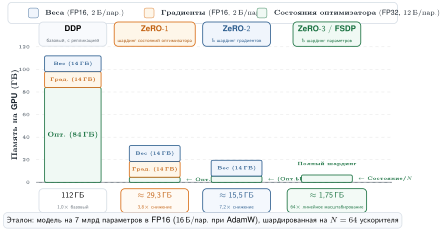

***Снижение памяти ZeRO**: стандартный параллелизм по данным (DDP) реплицирует все состояния модели на каждом GPU. ZeRO постепенно разбивает эти состояния: ZeRO-1 шардирует состояния оптимизатора, ZeRO-2 добавляет шардирование градиентов, а ZeRO-3 шардирует сами параметры. ZeRO-3 дает линейное масштабирование памяти, что позволяет моделям на 100 млрд параметров и больше помещаться на ускорителях, которые не смогли бы вместить реплицированное состояние.*

***Стадии шардирования ZeRO**: каждая стадия шардирует отдельный слой состояния обучения и обменивает его на свой примитив коммуникации. ZeRO-1 бесплатен относительно DDP; ZeRO-2 заменяет AllReduce на ReduceScatter; ZeRO-3 (FSDP) добавляет AllGather перед каждым слоем, но дает почти линейное масштабирование памяти.*

| **Стадия**      |  **Что шардируется**  |   **Снижение памяти**    |    **Накладные расходы коммуникации**    |
|:----------------|:---------------------:|:------------------------:|:--------------------------------:|
| **ZeRO-1**      | Только состояния оптимизатора |        ~4$\times$        |        Нет (как у DDP)           |
| **ZeRO-2**      |      + градиенты      |        ~8$\times$        | ReduceScatter заменяет AllReduce |
| **ZeRO-3/FSDP** |      + параметры      | ~$N$ (линейно по воркерам) |   AllGather перед каждым слоем   |

ZeRO-1 шардирует состояния оптимизатора между GPU. Каждый GPU хранит только $1/N$ состояния, связанного с оптимизатором Adam. После AllReduce градиентов каждый GPU обновляет только свой шард параметров, а затем рассылает обновления остальным GPU. При 12-байтовом соглашении, которое учитывает мастер-веса FP32, момент и дисперсию, экономия памяти уменьшает состояние оптимизатора с $12N$ байт на параметр до $12$ байт на параметр в сумме по кластеру.

ZeRO-2 дополнительно шардирует градиенты. Вместо AllReduce, который оставляет полные градиенты на каждом GPU, ZeRO-2 использует ReduceScatter, так что каждый GPU получает $1/N$ редуцированных градиентов. При используемом здесь соглашении о градиентах FP16 экономия памяти уменьшает градиенты с $2N$ байт на параметр, реплицированных по $N$ воркерам, до $2$ байт на параметр в сумме, или до $2/N$ байт на параметр на GPU.

ZeRO-3 и FSDP шардируют сами параметры. Каждый GPU хранит только $1/N$ модели. Перед проходом вперед каждого слоя параметры собираются через AllGather; после прохода назад градиенты редуцируются через ReduceScatter, а затем параметры отбрасываются ([рисунок «Разбиение состояния ZeRO между рангами GPU»](#fig-zero-partitioning)). Это дает максимальную эффективность памяти ценой дополнительной коммуникации, которую FSDP вводит по сравнению со стандартным DDP.

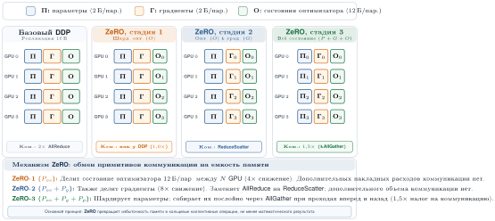

***Разбиение состояния ZeRO между рангами GPU**: раскладка памяти на GPU для 4 воркеров при стандартном DDP и при стадиях ZeRO 1, 2 и 3. ZeRO-1 шардирует состояния оптимизатора ($O/4$), ZeRO-2 добавляет шардирование градиентов ($G/4$), а ZeRO-3 разбивает все состояние модели ($P/4$, $G/4$, $O/4$).*

Такой шардинг ставит коммуникацию на критический путь, которого DDP избегает. Проход вперед требует AllGather для восстановления параметров каждого слоя ($M_{\text{layer}}$ байт); проход назад требует второго AllGather для восстановления параметров, поскольку после прохода вперед их переразделяют ($M_{\text{layer}}$ байт), а затем ReduceScatter для градиентов ($M_{\text{layer}}$ байт). Для модели с $N_L$ слоями полный шардинг FSDP с переразбиением выполняет поэтому около $3N_L$ коллективных операций за шаг обучения против одного AllReduce у DDP, а общий объем коммуникации поднимается примерно до $3M_{\text{state}}$ байт против $2M_{\text{state}}$ у DDP. Однако коллективные операции распределены по большему числу операций с возможностями перекрытия: пока слой $i$ вычисляется, слой $i+1$ может заранее загружать свои параметры.

Выбор между FSDP и DDP зависит от размера модели и ограничений памяти. Когда модель помещается в память GPU с запасом под активации, DDP обычно выигрывает, потому что избегает повторной работы AllGather. По мере роста давления на память привлекательным становится ZeRO-2: он шардирует градиенты и состояние оптимизатора, оставляя параметры реплицированными. Когда же сами параметры превышают память одного GPU, необходим ZeRO-3/FSDP, хотя он и ставит AllGather на критический путь. Для обучения моделей от 70 млрд параметров на 80 ГБ FSDP обычно приходится комбинировать с тензорным параллелизмом, а не заменять им.

Экономия памяти в параллелизме по данным требует тщательной настройки стратегии шардинга (по слоям, по блокам трансформера или плоско) и настроек смешанной точности. Гранулярность шардинга определяет компромисс: более мелкий шардинг снижает память на GPU, но увеличивает частоту коммуникации, поскольку на каждом шаге обучения должно выполняться больше операций AllGather и ReduceScatter.

Если устранить память как узкое место с помощью ZeRO и FSDP, соблазнительно масштабировать параллелизм по данным до сотен GPU. Однако это меняет ландшафт оптимизации так, как одного анализа коммуникации недостаточно, чтобы предсказать. Большие глобальные батчи меняют статистику шума градиента, а графики скорости обучения, настроенные для запусков на восьми GPU, могут катастрофически расходиться при 256 GPU. Наглядную демонстрацию этого режима отказа на большом масштабе и инженерный ответ, который стал широко влиятельным, дал один эксперимент.

> **Случай из практики: обучение ImageNet за один час (2017)**
>
> **Контекст**: Facebook AI Research поставила задачу обучить ResNet-50 на ImageNet за один час на 256 GPU, раздвинув параллелизм по данным далеко за пределы размеров батча, которые предыдущая практика считала безопасными (Goyal et al., 2017).
>
> **Механизм**: масштабирование глобального батча до 8 192 уменьшило дисперсию градиента на шаг, из-за чего стандартная оптимизация SGD с постоянной скоростью обучения расходилась в первые эпохи обучения.
>
> **Последствия**: без корректировок оптимизации точность обучения обрушилась, и масштабирование на несколько GPU оказалось бесполезным, несмотря на высокую пропускную способность железа.
>
> **Исправление**: команда ввела линейное правило масштабирования скорости обучения вместе с постепенным разогревом (warmup) в течение 5 эпох, что стабилизировало оптимизацию при размере батча 8 192.
>
> **Системный урок**: распределенное обучение — это не просто параллельное железо. Масштабирование меняет режим оптимизации, поэтому кластер, расписание коммуникации, размер батча и график скорости обучения нужно настраивать как единую систему.
>

## Эффективность масштабирования и сходимость

Когда удвоение числа GPU дает лишь ускорение в 1,5×, коммуникационные накладные расходы и барьеры синхронизации съедают недостающие 25 процентов вычислительного бюджета. Параллелизм по данным показал практическую механику синхронизации градиентов и шардинга памяти, но чтобы понять, *почему* эффективность масштабирования падает и *как* сходимость меняется с ростом параллелизма, нужна количественная рамка. Эти метрики и принципы сходимости применимы ко всем стратегиям параллелизма (по данным, по модели, конвейерному и гибридному), определяя фундаментальные компромиссы между пропускной способностью, стоимостью коммуникаций и качеством оптимизации.

### Математика эффективности масштабирования

Чтобы оценивать конкретные стратегии параллелизма, сначала нужно определить метрику, которая решает, стоит ли масштабировать обучение с одного устройства на много: эффективность масштабирования. Если модель обучается за время $T_1$ на одном устройстве, идеальное (линейное) масштабирование обучит ее за время $T_1/N$ на $N$ устройствах. На практике коммуникационные накладные расходы, пузыри конвейера и дисбаланс нагрузки снижают ускорение. Эффективность масштабирования определяется формулой ([формула](#eq-distributed-training-scaling-efficiency)):

$$\eta_{\text{scaling}} = \frac{T_1}{N \times T_N}$$

где $T_N$ — время обучения на $N$ устройствах. Эффективность 1,0 означает идеальное линейное масштабирование; эффективность 0,5 означает, что мы получаем лишь половину ожидаемого ускорения.

> **Определение: эффективность масштабирования**
>
> ***Эффективность масштабирования $(\eta_{\text{scaling}})$*** — это отношение фактической пропускной способности обучения к идеальной линейной пропускной способности при увеличении числа вычислительных устройств ML ($N$).
>
> 1. **Значимость**: это важнейшая метрика производительности кластера ($\eta_{\text{scaling}} = \frac{T_1}{N \times T_N}$). Эффективность масштабирования 0,50 означает, что кластер из 10 000 GPU выполняет ту же полезную работу, что и кластер из 5 000 GPU, и 50 процентов инвестиций в аппаратуру тратятся впустую.
> 2. **Различие**: в отличие от эффективности одного узла, которая отражает локальные узкие места вроде $\text{BW}$, эффективность масштабирования отражает накладные расходы кластерного уровня: время коммуникаций $(T_{\text{comm}}(N))$ и синхронизацию.
> 3. **Распространенная ошибка**: часто считают, что эффективность масштабирования постоянна. На самом деле она зависит от размера задачи: по мере роста $N$ отношение коммуникаций к вычислениям обычно ухудшается (закон Амдала), и поддерживать высокую эффективность для малых моделей становится сложнее.

Для параллельного по данным обучения модели на 175 млрд параметров стоимость коммуникаций на шаг определяется операцией AllReduce над градиентами размером 350 ГБ. При кольцевом AllReduce поверх InfiniBand с эффективной пропускной способностью 50 ГБ/с сырое время коммуникаций составляет примерно $2 \times (N-1)/N \times 350 / 50$ и для больших $N$ стремится к $2 \times 350 / 50$ секундам. При перекрытии градиентной коммуникации и обратного прохода на 75 % эффективное открытое время коммуникаций снижается до $T_{\text{comm}}(N) \approx 3{,}5$ секунды. При тех же допущениях вычислительный член равен $T_{\text{compute}}/N \approx 2{,}1$ секунды, поэтому открытое время шага составляет около 5,6 с, а наивная эффективность масштабирования при параллелизме по данным равна 2,1 с / 5,6 с ≈ 37,5 %. Хорошо настроенные системы могут вернуть значительную часть этих потерь, комбинируя тензорный параллелизм, конвейерный параллелизм, размещение с учетом топологии и более эффективное перекрытие коммуникаций.

Эффективность масштабирования критически зависит от вычислений на переданный байт. При фиксированном числе токенов на обновление рост числа параметров увеличивает и вычисления трансформера, и объем градиентов примерно пропорционально, поэтому один лишь размер модели не гарантирует лучшего масштабирования. Большие батчи увеличивают вычисления на шаг оптимизатора без изменения размера градиента; подвох в том, что большие батчи могут ухудшать сходимость, поэтому нужны настройка скорости обучения и расписание разогрева. Пропускная способность сети входит напрямую: удвоение пропускной способности InfiniBand вдвое сокращает член пропускной способности, но эффективность меняется в соответствии с полным знаменателем времени шага, а не пропорционально. Сетевая фабрика, таким образом, — определяющий фактор первого порядка для производительности кластера, а не второстепенная забота. Ее стоимость (10–15 процентов полной стоимости системы) легко оправдывается, если она повышает эффективность масштабирования даже на несколько процентных пунктов, потому что низкая эффективность масштабирования обесценивает остальные 85–90 процентов инвестиций.

*Рабочие нагрузки с большим объемом вычислений на переданный байт масштабируются проще.*

Эти факторы взаимодействуют, поэтому эффективность нельзя вывести из размера модели или числа GPU по отдельности. Следующая рабочая модель фиксирует число параметров, токены на обновление, число ускорителей, эффективную пропускную способность, утилизацию вычислительных ресурсов модели (MFU) и перекрытие, прежде чем вычислить одну точку эффективности. Изменение любого из этих входов требует пересчета всей модели времени шага.

Однако даже для больших моделей масштабирование не продолжается бесконечно. Существует **обрыв масштабирования** — точка, за которой предельное ускорение уже не оправдывает добавленные устройства. В рамках единственной явной модели, использованной здесь (модель на 175 млрд параметров, 2 млн токенов на обновление, 1 024 GPU, 50 % MFU и 75 % перекрытия коммуникаций), наивный параллелизм по данным достигает лишь 37,5 % эффективности. Поэтому пример не означает универсальной эффективной области 1 024–4 096 GPU или обрыва на 8 192 GPU. Оценка другого размера кластера требует пересчета времени вычислений на устройство, задержки коллективных операций и стоимости пропускной способности, перекрытия и топологии. Архитектура модели и размер кластера должны проектироваться совместно, чтобы поддерживать эти члены в балансе.

> **Сценарий: эффективность масштабирования для модели на 175 млрд параметров**
>
> **Настройка**: обучение модели на 175 млрд параметров на кластере DGX H100 с InfiniBand 400 Гбит/с на GPU.
>
> - **Вычисления на шаг** (при размере батча 2 млн токенов и 6 FLOP на параметр на токен): $O_{\text{step}} = 6 \times 175 \times 10^9 \times 2 \times 10^6 \approx 2{,}1 \times 10^{18}$ FLOP.
> - **Время вычислений на GPU** на 1 024 GPU, каждый с пиковой FP8-производительностью 1979 TFLOP/s при утилизации 50 %: $T_{\text{compute}}/N \approx 2{,}1$ с.
> - **Время AllReduce** для градиентов размером 350 ГБ кольцевым AllReduce с перекрытием: $T_{\text{comm}}(N) \approx 3{,}5$ с. Сырая передача занимает около 14 с; в этом примере предполагается перекрытие 75 % с обратным проходом.
> - **Эффективность масштабирования**: $\eta_{\text{scaling}} \approx \frac{T_{\text{compute}}/N}{T_{\text{compute}}/N + T_{\text{comm}}(N) + T_{\text{sync}}(N) - T_{\text{overlap}}} = 2{,}1/5{,}6 \approx 0{,}375$ в этом упрощенном примере. Синхронизация входит в член AllReduce, а перекрытие коммуникаций 75 % уже учтено.
>
> Низкая эффективность (37,5 %) показывает, почему наивный параллелизм по данным при таком масштабе недостаточен. Системы, учитывающие иерархию, возвращают значительную часть потерянной эффективности, сочетая параллелизм по данным с тензорным параллелизмом, который обменивается данными через NVLink, и конвейерным параллелизмом, который совмещает вычисления с коммуникациями.

#### Взаимодействие параллелизма и инфраструктуры

Анализ эффективности масштабирования показывает, что эффективная стратегия параллелизма определяется не только *архитектурой модели*, но и *взаимодействием* между требованиями модели к коммуникациям и иерархией пропускной способности инфраструктуры. Каждая комбинация стратегии параллелизма и топологии инфраструктуры дает свою кривую эффективности масштабирования, и выбор неверной комбинации может растратить значительную долю мощности кластера. Предыдущий прикидочный расчет показал, что чистый параллелизм по данным застревает около 37,5 % эффективности на этом масштабе; вернуть потерянную мощность означает сопоставить каждое измерение параллелизма с уровнем пропускной способности, который может нести его трафик. раздел о гибридном параллелизме (далее в этой главе) разбирает эту комбинацию на трех конкретных конфигурациях и формализует ее как параллелизм, учитывающий иерархию, после того как тензорный и конвейерный параллелизм уже разобраны.

Выбор и комбинация стратегий параллелизма поэтому напрямую ведут к создаваемому ими трафику. Глава «Сетевые фабрики» показала, как топология совместно проектируется с отображением параллелизма, чтобы максимизировать эффективность масштабирования. Здесь следующий вопрос в том, как сами коллективные операции формируют время шага. Операции AllReduce могут занимать 10–40 процентов полного времени обучения в системах параллелизма по данным, и эти накладные расходы растут с размером кластера. BERT-Large на 128 GPU может испытывать коммуникационные накладные расходы, составляющие значительную долю полного времени выполнения, а модели масштаба GPT-3 требуют тензорного, конвейерного и параллелизма по данным вместе с перекрытием коммуникаций, чтобы синхронизация градиентов по данным не доминировала в шаге.

Сложность AllReduce определяется двумя составляющими: задержкой $(\alpha)$ и пропускной способностью $(\beta)$. Кольцевой AllReduce обеспечивает эффективную по пропускной способности коммуникацию с загрузкой $(N-1)/N$, тогда как древовидные подходы дают меньшую задержку за $\mathcal{O}(\log N)$ шагов. Выбор зависит от размера сообщения: древовидные алгоритмы выигрывают для мелких сообщений, где доминирует задержка, а кольцевые — для крупных градиентов, где доминирует пропускная способность. Высокопроизводительные реализации, такие как NCCL, используют иерархические алгоритмы, которые сочетают древовидную задержку внутри узлов и кольцевую пропускную способность между узлами. [Глава «Коллективные коммуникации»](06_collective_communication.md#sec-collective-communication) подробно разбирает анализ алгоритмов, включая формулы сложности, иерархические варианты и оптимизации, учитывающие топологию, для крупномасштабных коллективных операций.

Выбор межсоединения определяет, останутся ли крупные развертывания ограниченными вычислениями или перейдут в режим, ограниченный коммуникациями. Требования к пропускной способности для эффективного распределенного обучения существенны, особенно для трансформеров: эффективным системам часто нужно 100–400 ГБ/с совокупной пропускной способности на узел. BERT-Base (110 млн параметров) требует около 440 МБ синхронизации градиентов на итерацию в FP32, а BERT-Large (340 млн параметров) — около 1,4 ГБ. На 64 GPU такая синхронизация требует устойчивой пропускной способности 100–200 ГБ/с для задержки синхронизации менее 50 мс. Для языковых моделей на 175 млрд параметров точные требования к пропускной способности зависят от конфигурации трехмерного параллелизма, накопления градиентов, перекрытия и топологии межсоединения, а не от одного универсального числа.

Частота синхронизации создает компромисс между эффективностью коммуникаций и поведением сходимости. Накопление градиентов по четырем микрошагам снижает частоту синхронизации на 75 процентов, но реальное сокращение времени шага зависит от соотношения вычислений и коммуникаций и от того, насколько коммуникация может перекрываться с обратным распространением. В стандартных реализациях накопление градиентов использует один резидентный буфер градиентов и накапливает в нем на месте. Нагрузка на память возникает из-за удержания этого буфера и из-за выбора большего микробатча или активаций, а не из-за хранения четырех независимых тензоров градиентов. Асинхронные методы полностью убирают затраты на синхронизацию, но вводят устаревание, которое ухудшает сходимость на 15–30 процентов при больших скоростях обучения.

#### Физика масштабирования: закон Амдала с коммуникациями

Как железный закон производительности процессора управляет выполнением одного потока, так и распределенное обучение подчиняется расширенной версии закона Амдала, которая явно учитывает накладные расходы коммуникаций. Время выполнения одного шага обучения на $N$ устройствах — не просто $T_{\text{single}} / N$, а ограничено последовательной природой синхронизации. Приложение о законе Амдала для парка (в книге оно пока не переведено) выводит потолок ускорения на масштабе парка и разбирает конкретный пример. Здесь главное следствие в том, что фиксированная доля синхронизации ограничивает ускорение независимо от того, сколько ускорителей добавлено.

[Рисунок](#fig-scaling-tax) показывает это отклонение от идеального линейного масштабирования как **налог на масштабирование**, прямое следствие границы эффективности масштабирования (принцип эффективности масштабирования). Он показывает, как коммуникационные накладные расходы $(r)$ действуют как сопротивление производительности, создавая коммуникационную стену, где добавление GPU дает убывающую отдачу.

***Налог на масштабирование:** эффективное ускорение в зависимости от числа GPU. Идеальное масштабирование (черный пунктир) линейно, тогда как реальные системы платят «налог» за коммуникации. Модели, ограниченные вычислениями, такие как ResNet (зеленая линия), масштабируются хорошо, потому что имеют высокую арифметическую интенсивность. Модели, ограниченные пропускной способностью, такие как GPT-3 (красная линия), упираются в коммуникационную стену, где добавление GPU дает убывающую отдачу (эффективность ниже 50 процентов).*

Закон парка (принцип времени распределенного шага) непосредственно переносит переменные закона процессора на члены, разделяя вычисления, пропускную способность и координацию на аддитивные члены:

$$ T_{\text{step}}(N) = \underbrace{\frac{T_{\text{compute}}}{N}}_{\text{член вычислений}} + \underbrace{T_{\text{comm}}(N)}_{\text{член пропускной способности}} + \underbrace{T_{\text{sync}}(N)}_{\text{член координации}} - T_{\text{overlap}} $$

Закон парка разделяет время шага на четыре различных стоимости:

- **Член вычислений** $(T_{\text{compute}}/N)$: полный объем вычислений для батча после идеального разбиения на $N$ устройств.
- **Член пропускной способности** $(T_{\text{comm}}(N))$: время перемещения данных. Он определяется членом перемещения данных закона процессора, $D_{\text{vol}}/\text{BW}$. Для кольцевого AllReduce этот член равен $\frac{2(N-1)}{N} \times \frac{M}{\text{BW}_{\text{net}}}$, где $M$ — объем передаваемых градиентов или состояния модели в байтах, а $\text{BW}_{\text{net}}$ — пропускная способность сети.
- **Член координации** $(T_{\text{sync}}(N))$: неперекрытая стоимость барьеров, упорядочивания и ожидания отстающих.
- **Перекрытие** $(T_{\text{overlap}})$: часть коммуникаций, скрытая за вычислениями.

Закон парка приводит к метрике эффективности масштабирования для фиксированного глобального объема работы, где $T_{\text{compute}}$ — время вычислений этой работы на одном устройстве:

$$ \eta_{\text{scaling}} = \frac{T_{\text{compute}}}{N \times T_{\text{step}}(N)} = \frac{1}{1 + \frac{N(T_{\text{comm}}(N) + T_{\text{sync}}(N) - T_{\text{overlap}})}{T_{\text{compute}}}} $$

Это граница эффективности масштабирования (принцип эффективности масштабирования): идеальное линейное масштабирование $(\eta_{\text{scaling}} = 1{,}0)$ — *теоретический предел*, а не *практическая цель*. Хорошо настроенные системы могут достигать $\eta_{\text{scaling}} = 0{,}85$–$0{,}95$ на умеренном масштабе и деградируют дальше по мере роста $N$. Разрыв между $\eta_{\text{scaling}} = 1{,}0$ и достигнутой эффективностью — это коммуникационный налог и налог на координацию: цена распределенного выполнения.

Уравнение показывает **стену масштабирования**: по мере роста $N$ член вычислений $(T_{\text{compute}}/N)$ уменьшается, но члены коммуникаций и синхронизации могут оставаться постоянными или расти. В конце концов знаменатель определяется накладными расходами, и эффективность стремится к нулю. Помимо времени на часах, эти коммуникационные накладные расходы налагают энергетический налог, который растет с физическим расстоянием между устройствами.

*Энергия коммуникаций растет от HBM до сети.*

> **Перспектива: энергетический налог масштаба**
>
> Распределенное обучение — это гонка с энергией не меньше, чем со временем. В одном GPU перемещение байта из HBM к ядрам стоит примерно 1–2 пДж/бит. Перемещение того же байта по межсоединению NVLink стоит 5–10 пДж/бит. Перемещение по сети InfiniBand через коммутаторы — 20–50 пДж/бит.
>
> На масштабе 10 000 GPU решает умножение на совокупную пропускную способность: полный NVLink-контур H100 дает около 9 ПБ/с по кластеру, и при 7,5 пДж/бит это перемещение соответствует примерно 540 кВт до учета охлаждения и накладных расходов коммутаторов. Совокупный контур NDR InfiniBand меньше (500 ТБ/с), но при 35 пДж/бит он все равно соответствует примерно 140 кВт. Перекрытие коммуникаций и вычислений необходимо для эффективности по времени, но прямой способ снизить сам член мощности — избегать ненужного перемещения данных.

Эффективность по времени и энергетический налог ухудшаются вместе по мере роста $N$, следуя предсказуемым закономерностям для разного числа GPU. Как ориентир, системы в режиме линейного масштабирования от 2 до 32 GPU часто достигают параллельной эффективности 85–95 процентов, потому что накладные расходы коммуникаций остаются малыми. Режим, ограниченный коммуникациями, появляется на 64–256 GPU, где эффективность может упасть до 60–80 процентов даже при хорошо согласованных межсоединениях. Свыше 512 GPU накладные расходы координации могут стать доминирующими и ограничить эффективность 40–60 процентами из-за задержки коллективных операций.

Выбор аппаратуры критически влияет на эти характеристики масштабирования. Системы NVIDIA DGX A100 дают 600 ГБ/с двунаправленного NVLink на GPU с совокупной пропускной способностью NVSwitch на уровне системы, что обеспечивает высокую параллельную эффективность внутри узла из 8 GPU. Многоузловое масштабирование требует сетевой фабрики с достаточной пропускной способностью сечения: линки класса EDR на 100 Гбит/с поддерживают задания меньшего многоузлового масштаба, а линки класса HDR на 200 Гбит/с — большие кластеры, когда топология, размещение и перекрытие хорошо согласованы.

Метрики эффективности напрямую влияют на выбор стратегии параллелизма. Параллелизм по данным хорошо работает в режиме линейного масштабирования, но на масштабе становится ограниченным коммуникациями. Параллелизм по модели решает ограничения памяти, но вводит последовательные зависимости, которые ограничивают эффективность. Конвейерный параллелизм уменьшает простой устройств, но усложняет управление микробатчами. Эффективная стратегия зависит от того, какое ограничение (память, пропускная способность или синхронизация) доминирует в целевой нагрузке.

Метрики эффективности оборудования определяют пропускную способность, но теория сходимости определяет, достигает ли распределенное обучение того же качества решения, что и обучение на одном устройстве. Параллелизм влияет на сходимость оптимизации тремя способами: скорость сходимости меняется с размером батча, добавление воркеров дает убывающую отдачу сверх критического размера батча, а скорости обучения должны масштабироваться вместе с размером батча.

### Скорость сходимости синхронного параллельного по данным SGD

Фундаментальный результат о сходимости распределенного SGD объясняет, что сохраняет синхронное усреднение. Пусть $\mathcal{L}$ ограничена снизу величиной $\mathcal{L}_{\inf}$ и имеет $L_s$-липшицевы градиенты. Каждый воркер вычисляет градиенты по $b$ независимым примерам, агрегированная оценка $g_k$ несмещенная, а ее условная дисперсия удовлетворяет $\mathbb{E}[\|g_k-\nabla\mathcal{L}(\theta_k)\|^2\mid\theta_k]\leq\sigma^2/(Nb)$. Эти допущения дают гарантию стационарности для невыпуклого случая, не утверждая сходимости к глобальному минимуму.

> **Теорема: скорость сходимости распределенного SGD**
>
> Для обновления $\theta_{k+1}=\theta_k-\eta g_k$ с постоянным шагом $0<\eta\leq 1/L_s$ после $K$ синхронизированных обновлений
>
> $$
> \frac{1}{K}\sum_{k=0}^{K-1}\mathbb{E}\!\left[\|\nabla\mathcal{L}(\theta_k)\|^2\right]
> \leq
> \underbrace{\frac{2\bigl(\mathcal{L}(\theta_0)-\mathcal{L}_{\inf}\bigr)}{\eta K}}_{\text{член оптимизации}}
> +
> \underbrace{\frac{\eta L_s\sigma^2}{Nb}}_{\text{член стохастической дисперсии}}.
> $$
>
> Выбор $\eta=\min\!\left\{1/L_s,\sqrt{2(\mathcal{L}(\theta_0)-\mathcal{L}_{\inf})Nb/(L_s\sigma^2K)}\right\}$ уравновешивает два члена. До того как ограничение гладкости становится активным, стохастический вклад масштабируется как $\mathcal{O}(1/\sqrt{NbK})$.

Теорема выделяет выигрыш, который следует из допущений. При одинаковом локальном размере батча $b$ синхронный параллельный по данным SGD вычисляет ту же оценку по мини-батчу, что и один воркер с размером батча $Nb$ на том же обновлении, а дисперсия оценки убывает как $1/(Nb)$. Теорема не утверждает, что каждое увеличение размера батча пропорционально сокращает время до целевой функции потерь: ограничения скорости обучения и эффекты критического размера батча по-прежнему действуют. Это различие — **статистическая эффективность** распределенного обучения, отдельная от аппаратной эффективности.

Теорема предполагает идеальную синхронизацию (BSP). Когда воркеры идут с разной скоростью или используют устаревшие градиенты, гарантии сходимости ухудшаются по мере роста устаревания.

### Влияние устаревания: BSP, SSP и ASP

Операционные гарантии BSP, SSP и ASP, описанные в разделе о моделях синхронизации, имеют последствия для сходимости, но не существует универсального аддитивного штрафа за устаревание, не зависящего от целевой функции, расписания шага, числа воркеров и модели задержек. Параметр устаревания $\tau_{\text{stale}}$ показывает, сколько обновлений происходит между вычислением градиента и его применением, связывая пропускную способность с качеством решения (Ho et al., 2013; Dutta et al., 2018).

> **Определение: устаревание градиента**
>
> ***Устаревание градиента ($\tau_{\text{stale}}$)*** — число обновлений параметров, которые происходят между моментом вычисления градиента и моментом его применения к глобальному состоянию модели.
>
> 1. **Значимость**: это ошибка синхронизации в распределенной оптимизации. Рост $\tau_{\text{stale}}$ может повысить пропускную способность, сокращая ожидания на барьерах $(T_{\text{sync}}(N))$, но обычно ухудшает скорость сходимости и требует больше операций $(O)$ для достижения той же точности.
> 2. **Различие**: в отличие от сетевой задержки, которая является физической, устаревание — алгоритмическое смещение, возникающее из выбора протокола синхронизации (например, ASP или SSP).
> 3. **Распространенная ошибка**: часто считают, что устаревание «всегда плохо». На самом деле это компромисс между пропускной способностью и сходимостью: для некоторых крупных нагрузок допущение ограниченного устаревания — один из практических способов держать тысячи GPU загруженными.

Поведение сходимости у этих моделей различается так, что это прямо влияет на стоимость обучения и качество решения. В BSP ($\tau_{\text{stale}}=0$) все воркеры вычисляют на одной версии параметров и агрегируют перед обновлением. При допущениях теоремы о сходимости распределенного SGD выше синхронизированная оценка наследует гарантию для мини-батча $Nb$.

SSP ($\tau_{\text{stale}}\leq s$) позволяет воркерам опережать самого медленного на $s$ тактов. Ho et al. (2013) доказывают оценку среднего сожаления $\mathcal{O}(\sqrt{(s+1)N/T})$ для своей последовательности обновлений SSP при $N$ воркерах и $T$ обновлениях, предполагая выпуклые липшицевы компонентные функции, ограниченную область и убывающий шаг. Этот результат делает зависимость от устаревания явной, но он не взаимозаменяем с теоремой о невыпуклой стационарности.

Асинхронный SGD не накладывает ограничения на задержку в масштабе всего протокола. Удаление барьера может повысить пропускную способность обновлений, но скорость сходимости требует дополнительных допущений о реализованных задержках, целевой функции и расписании шага. Dutta et al. (2018) анализируют это как компромисс «ошибка — время выполнения», в котором скорость воркера и устаревание градиента совместно определяют, помогает ли принятие задержанного обновления. Поэтому ни фиксированный штраф по квадрату средней задержки, ни полная потеря снижения дисперсии за счет $N$ воркеров не следуют из асинхронного выполнения само по себе.

[Таблица](#tbl-convergence-comparison) обобщает свойства сходимости каждой модели синхронизации.

***Свойства сходимости по модели синхронизации:** протокол синхронизации задает модель задержки; скорость сходимости следует только после того, как зафиксированы допущения о целевой функции, градиенте, задержке и шаге.*

| **Модель** | **Контроль задержки**       | **Ограниченная гарантия**                                                                  | **Эффект для системы**                              |
|:-----------|:----------------------------|:-------------------------------------------------------------------------------------------|:----------------------------------------------------|
| **BSP**    | $\tau_{\text{stale}}=0$     | Синхронная теорема для мини-батча $Nb$ (см. теорему выше)                                  | Ожидание самого медленного воркера                  |
| **SSP**    | $\tau_{\text{stale}}\leq s$ | Среднее сожаление $\mathcal{O}(\sqrt{(s+1)N/T})$ при выпуклых допущениях (Ho et al., 2013) | Ограничивает задержку, сокращая часть ожиданий      |
| **ASP**    | Нет конечной границы на уровне протокола | Нет универсальной скорости без дополнительных допущений о задержке и целевой функции | Убирает глобальный барьер, но применяет устаревшие обновления |

### Правила масштабирования скорости обучения

При увеличении эффективного размера батча за счет параллелизма по данным скорость обучения нужно корректировать, чтобы сохранить качество сходимости. Из теории и практики выделились два основных правила масштабирования.

Правило линейного масштабирования (Goyal et al., 2017) утверждает, что если размер батча умножается на $k$, скорость обучения тоже нужно умножить на $k$:

$$
\eta_{\text{large}} = k \cdot \eta_{\text{base}}
$$

Это правило обосновывается приближением: один большой шаг при скорости обучения $k\eta$ аппроксимируется $k$ последовательными малыми шагами при скорости $\eta$. При размере батча $kB$ дисперсия градиента уменьшается в $k$ раз, поэтому больший шаг хорошо обусловлен; приближение выполняется, пока параметры не сильно смещаются за эти $k$ малых шага. Правило эмпирическое, а не универсальное: Goyal et al. (2017) проверили его для ResNet-50 на ImageNet при глобальном размере батча 8 192 с постепенным разогревом, а методы адаптивной скорости по слоям LARS и LAMB расширяют рецепты больших батчей за счет послойной адаптации для ImageNet и предобучения в стиле BERT (You et al., 2017; You et al., 2020). **Период разогрева** — линейное увеличение скорости обучения от $\eta_{\text{base}}$ до $k \cdot \eta_{\text{base}}$ за первые $W$ итераций — позволяет модели попасть в область ландшафта функции потерь, где большие скорости обучения устойчивы:

$$
\eta_t = \eta_{\text{base}} + \frac{t}{W}(k \cdot \eta_{\text{base}} - \eta_{\text{base}}) \quad \text{для } t < W
$$

Правило масштабирования квадратным корнем применяется, когда размеры батчей растут настолько, что линейное масштабирование перестает работать:

$$
\eta_{\text{large}} = \sqrt{k} \cdot \eta_{\text{base}}
$$

Более консервативное правило квадратного корня мотивировано наблюдением, что на динамику оптимизации влияет шум градиента, а не только его величина. Правило квадратного корня лучше сохраняет отношение сигнала к шуму обновлений градиента. Эмпирически масштабирование квадратным корнем становится необходимым, когда размеры батчей превышают режим критического размера батча.

Для экстремальных размеров батчей (32K–1M) LARS (You et al., 2017) и его вариант на основе Adam, LAMB (You et al., 2020), автоматически подбирают скорость обучения для каждого слоя на основе отношения нормы весов к норме градиента:

$$
\eta_\ell = \eta_{\text{global}} \cdot \frac{\|w_\ell\|}{\|g_\ell\| + \lambda_{\text{wd}}\|w_\ell\|}
$$

Здесь $\lambda_{\text{wd}}$ — коэффициент затухания весов оптимизатора в обновлении LARS/LAMB; обозначение выбрано так, чтобы не совпадать с параметром интенсивности отказов, используемым в анализе надежности. Послойное масштабирование не дает слоям с малыми весами непропорционально больших обновлений. LAMB позволил обучать BERT с размерами батчей до 64K при сохранении качества сходимости.

### Критический размер батча и убывающая отдача

Фундаментальное свойство распределенного обучения в том, что добавление воркеров перестает помогать после порога. Критический размер батча $B^{*}$ отмечает точку перехода, за которой увеличение размера батча дает убывающую отдачу в сходимости на один просмотренный пример.

> **Определение: критический размер батча**
>
> ***Критический размер батча*** $(B^{*})$ — размер батча распределенного обучения, при котором шум градиента становится настолько большим, что дальнейший рост батча дает убывающую отдачу в эффективности по выборкам (McCandlish et al., 2018; Shallue et al., 2019).
>
> 1. **Значимость**: это точка перехода для эффективности параллельного масштабирования. Ниже $B^{*}$ увеличение размера батча линейно улучшает сходимость на шаг. Выше $B^{*}$ большие батчи дают убывающую отдачу, требуя пропорционально больше примеров $(D)$ для достижения той же функции потерь.
> 2. **Различие**: в отличие от размера батча, ограниченного памятью (определяемого емкостью памяти и объемом активаций), критический размер батча — алгоритмическое свойство модели и набора данных.
> 3. **Распространенная ошибка**: часто считают, что обучение можно ускорять неограниченно, добавляя GPU. На самом деле $B^{*}$ задает физический потолок параллелизма по данным: добавление воркеров сверх этой точки тратит энергию и вычисления $(O)$, не сокращая общее время обучения $(T)$.

Прокси для критического размера батча через масштаб шума градиента можно оценить так:

$$
B^{*} \approx \frac{\text{tr}(\Sigma)}{\|\nabla \mathcal{L}(\theta)\|^2}
$$

где $\text{tr}(\Sigma)$ — след ковариационной матрицы градиента (полная дисперсия градиента), а $\|\nabla \mathcal{L}(\theta)\|^2$ — квадрат нормы градиента (сила сигнала). Интуитивно $B^{*}$ — размер батча, при котором усреднение уменьшает дисперсию градиента до уровня истинной величины градиента.

Опубликованные режимы больших батчей иллюстрируют масштаб, а не дают фиксированных порогов. Для ImageNet Goyal et al. (2017) стабилизировали ResNet-50 при глобальном батче 8 192 с разогревом, а LARS в некоторых условиях расширяет обучение с большими батчами на ImageNet дальше (You et al., 2017). Для предобучения BERT-Large LAMB сообщает об обучении при размерах батчей 32K–64K с послойными адаптивными обновлениями (You et al., 2020). В других областях McCandlish et al. (2018) показывают полезные пределы размера батча от десятков тысяч в задачах, похожих на ImageNet, до миллионов в задачах обучения с подкреплением, поэтому пороги для новых frontier-языковых моделей нужно измерять, а не копировать.

Режим закона масштабирования имеет три различных поведения. Ниже критического размера батча $(B < B^{*})$ выполняется линейное масштабирование: удвоение размера батча вдвое сокращает число итераций, необходимых для достижения целевой функции потерь, и эффективность оборудования определяет пропускную способность. В критической точке $(B \approx B^{*})$ эффективность по образцам в секунду максимальна, это оптимальный компромисс. Выше нее $(B > B^{*})$ отдача падает, потому что удвоение размера батча требует более чем вдвое больше примеров в целом, поэтому дополнительные воркеры добавляют пропускную способность, но не эффективность по выборкам.

[Рисунок](#fig-critical-batch-size) иллюстрирует эту зависимость между размером батча и эффективностью обучения.

***Критический размер батча и режимы масштабирования:** ниже критического размера батча $B^{*}$ большие батчи снижают шум и повышают эффективность по выборкам (режим линейного масштабирования). Выше $B^{*}$ большие батчи дают убывающую отдачу: пропускная способность растет, но и общее число нужных примеров растет, снижая эффективность по выборкам. Оптимальная рабочая точка уравновешивает загрузку оборудования и эффективность сходимости.*

> **Контрольные вопросы: решения о масштабировании**
>
> Модель на 7 млрд параметров распределена по кластеру из 64 GPU A100 (по 80 ГБ HBM2e на каждый). Определите максимально полезный размер батча. Используйте пилотную трассу с $\text{tr}(\Sigma)=1{,}6 \times 10^6$, $\|\mu\|^2=100$, батчем на GPU $b=4$ и предлагаемой глубиной накопления градиента 32 шага, что дает $B_{\text{global}} = 64 \times 4 \times 32 = 8192$ примера.
>
> - **Критический размер батча**: рассчитайте критический размер батча $(B_{\text{crit}})$, при котором масштаб шума градиента равен размеру батча.
> - **Предложенный батч**: используйте метрику масштаба шума градиента $\mathcal{B} \approx \frac{\text{tr}(\Sigma)}{\|\mu\|^2}$ для оценки предложенного размера батча.
> - **Эффективность масштабирования**: отнесите эффективность масштабирования к порогу 80 процентов или к маргинальному выигрышу сходимости от дополнительных вычислений.

### Пример: сравнение сходимости для 8 и 64 воркеров

Чтобы конкретно проиллюстрировать эти понятия, рассмотрим масштабирование с 8 до 64 воркеров при обучении языковой модели-трансформера с базовым размером батча $B = 32$ на воркер.

> **Сценарий: масштабирование с 8 до 64 воркеров**
>
> **Настройка**: трансформер на 1,3 млрд параметров, целевая перплексия 15; базовое обучение — 100 тыс. итераций на одном GPU при $b =$ 32.
>
> **8 воркеров (BSP)**
>
> - Эффективный размер батча: $B =$ 8 $\times$ 32 = 256.
> - Скорость обучения: $\eta =$ 8 $\times \eta_{\text{base}}$ (линейное масштабирование с разогревом).
> - Ожидаемое число итераций: 100 тыс. / 8 = 12,5 тыс. итераций.
> - Сходимость: целевая перплексия достигается за 12,8 тыс. итераций (эффективность по выборкам 98 %).
> - Накладные расходы коммуникаций: 15 % (внутриузловой NVLink).
> - Ускорение по времени: 100 тыс. $\times$ 1 / (12,8 тыс. $\times$ 1,15) = 6,8×.

**64 воркера (BSP)**

- Эффективный размер батча: $B =$ 64 $\times$ 32 = 2 048.
- Скорость обучения ($N =$ 64 воркера): $\eta = N \times \eta_{\text{base}}$ (если $B < B^*$) или $\eta = \sqrt{N} \times \eta_{\text{base}}$ (если $B > B^*$).
- При $B^* \approx$ 4 000 (ниже критического значения) применяется линейное масштабирование.
- Ожидаемое число итераций: 100 тыс. / 64 = 1,56 тыс. итераций.
- Сходимость: целевая перплексия достигается за 1,72 тыс. итераций (эффективность по выборкам 91 %).
- Накладные расходы коммуникаций: 45 % (InfiniBand между узлами, 8 узлов).
- Ускорение по времени: 100 тыс. $\times$ 1 / (1,72 тыс. $\times$ 1,45) = 40,1×.

**SSP-воркеры**: 64 воркера с устареванием $s =$ 4.

- Тот же эффективный размер батча: $B =$ 2 048.
- Скорость обучения: $\eta' = \eta_{\text{BSP}} / \sqrt{1 + s}$ при $s =$ 4, что дает $\eta' \approx$ 0,45 $\times \eta_{\text{BSP}}$.
- Ожидаемое число итераций: больше из-за штрафа за устаревание.
- Сходимость: целевая перплексия за 2,1 тыс. итераций (эффективность по выборкам 74 %).
- Накладные расходы коммуникаций: 25 % (сниженная синхронизация).
- Ускорение по времени: 100 тыс. $\times$ 1 / (2,1 тыс. $\times$ 1,25) = 38,1×.

**Анализ** ([таблица](#tbl-scaling-bsp-ssp))

***Масштабирование SGD на кластерах разного размера:** число итераций, накладные расходы коммуникаций, ускорение по времени и эффективность по выборкам для одного и того же задания обучения на 1, 8 и 64 GPU.*

| **Конфигурация**     | **Итерации** | **Накладные расходы коммуникаций** | **Ускорение по времени** | **Эффективность по выборкам** |
|:---------------------|:------------:|:----------------------------------:|:------------------------:|:-----------------------------:|
| **1 GPU (базовая)**  | 100 000      | 0%                                 | 1×                       | 100%                          |
| **8 GPU BSP**        | 12 800       | 15%                                | 6,8×                     | 98%                           |
| **64 GPU BSP**       | 1 720        | 45%                                | 40,1×                    | 91%                           |
| **64 GPU SSP**       | 2 100        | 25%                                | 38,1×                    | 74%                           |

Конфигурация BSP на 64 GPU дает ускорение 40× при эффективности по выборкам всего 91 %, потому что накладные расходы коммуникаций (45 %) компенсируются массовым параллелизмом. SSP дает сопоставимое время по часам с меньшими накладными расходами коммуникаций, но требует больше общего числа примеров.

**Анализ стоимости** (при 3 долл. за GPU-час):

- 8 воркеров: 12,8 тыс. итераций $\times$ 0,4 с на итерацию $\times$ 8 / 3600 $\times$ 3 долл. = 34 долл.
- 64 воркера BSP: 1,72 тыс. итераций $\times$ 0,58 с на итерацию $\times$ 64 / 3600 $\times$ 3 долл. = 53 долл.
- 64 воркера SSP: 2,1 тыс. итераций $\times$ 0,50 с на итерацию $\times$ 64 / 3600 $\times$ 3 долл. = 56 долл.

Несмотря на более высокий параллелизм, обучение на 64 GPU обходится дороже за один прогон из-за накладных расходов коммуникаций и сниженной эффективности по выборкам. Конфигурация на 8 GPU экономичнее, но занимает в 6 раз больше времени по часам. Выбор зависит от того, что важнее: минимизировать стоимость или минимизировать время до результата.
