<a id="sec-collective-communication"></a>

# Коллективные коммуникации

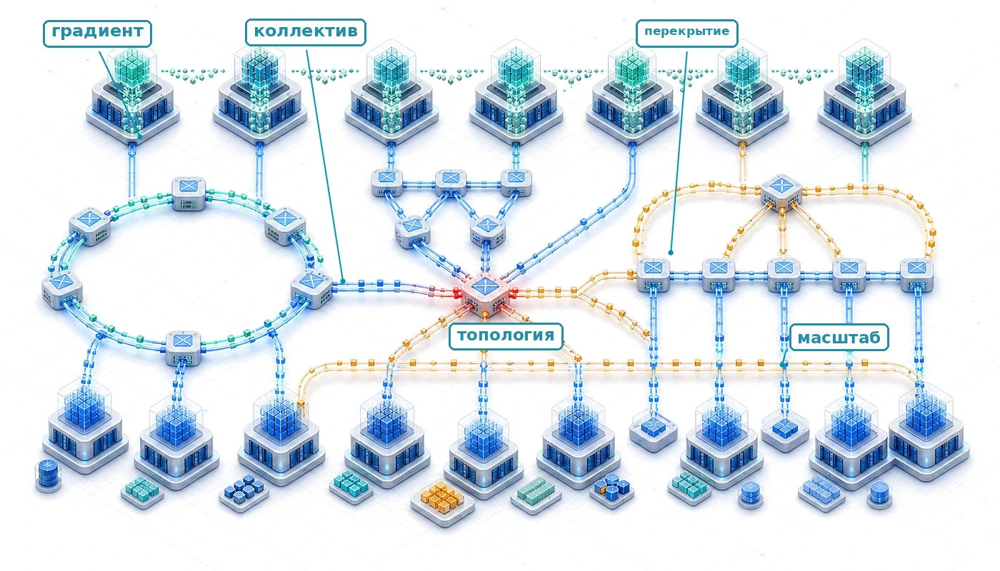

## Назначение

_Почему коммуникация между машинами ограничивает крупномасштабные системы машинного обучения?_

Вычисления масштабируются добавлением процессоров, а коммуникация масштабируется перемещением данных между ними. Масштабируются они по-разному. Добавление процессора линейно увеличивает совокупные вычисления, но согласование его с остальными перемещает больше данных в целом и, для самых общих схем синхронизации, квадратично умножает логические связи между воркерами. При достаточном масштабе время, которое уходит на обмен градиентами, активациями и параметрами, превышает время, которое уходит на их вычисление. Этот переход определяет, какие стратегии распараллеливания работают и какие размеры моделей поддаются обучению. Задержки из-за скорости света, ограничения пропускной способности и энергетическая стоимость перемещения данных ограничивают коммуникацию так же жестко, как физика транзисторов ограничивает вычисления. В терминах C³ коллективная коммуникация образует систему команд парка: она задает физические операции, через которые коммуникация ограничивает вычисления.

> **Цели обучения**
>
> - Применять модели стоимости коммуникации, чтобы оценивать задержку коллективных операций, пропускную способность и точки перехода по размеру сообщения
> - Сопоставлять примитивы коллективной коммуникации и расписания AllToAll со стратегиями параллелизма, топологией, гранулярностью сообщений и перекосом нагрузки
> - Сравнивать кольцевую, древовидную, butterfly, двойного дерева и иерархическую редукцию с помощью моделей стоимости, зависящих от масштаба
> - Калибровать модели стоимости коллективных операций по измерениям с учетом алгоритмов, групп процессов и топологии
> - Проектировать расписания коллективных операций с учетом топологии для NVLink, InfiniBand, оптимизированных под рельсы (rail-optimized) сетей, тора и внутрисетевой редукции
> - Оценивать сжатие, разреживание и коррекцию по ошибке, взвешивая экономию коммуникации против риска для сходимости
> - Реализовывать перекрытие с помощью слияния бакетов, асинхронных операций и послойного планирования градиентов

<a id="sec-communication-collective-operations-collective-operations-communication-fundamentals-44eb"></a>

## От параллелизма к шаблонам коммуникации

Когда 10 000 GPU должны применить одно обновление весов, разбиения, созданные параллелизмом по данным, тензорным, конвейерным и параллелизмом экспертов, нужно снова сделать согласованными. Воркеры отправляют не произвольные сообщения, а выполняют заранее расписанные коллективные операции. В стеке парка, показанном на [рисунке «Стек парка»](01_introduction.md#fig-fleet-stack), эти операции находятся на уровне распределения, где логический параллелизм превращается в физический трафик.

Трехмерный куб параллелизма предполагает, что реплики, шарды, стадии и эксперты могут быстро обмениваться градиентами, активациями, параметрами и токенами настолько, чтобы оптимизатор видел один согласованный процесс обучения. Это предположение и есть передача эстафеты от параллелизма к коммуникации: каждый способ разбиения модели переносит работу в сеть.

Разрыв между этим предположением и реальным проводом показывает асимметрию в масштабировании вычислений и коммуникации. Вычисления локальны, потому что каждый GPU работает со своими данными, поэтому совокупные вычисления растут с числом GPU. Коммуникация глобальна: чтобы парк оставался синхронизированным, информация должна пересекать физические линки с конечными задержкой, пропускной способностью, топологией и энергией. Синхронизация градиентов дает центральный пример; модели стоимости альфа-бета, коллективные примитивы, расписания AllReduce, маршрутизация с учетом топологии, сжатие и перекрытие делают ее механику конкретной.

<a id="dfn-collective-communication-gradient-synchronization"></a>

> **Определение: синхронизация градиентов**
>
> ***Синхронизация градиентов*** — это шаг коллективной коммуникации в синхронном параллелизме по данным, на котором каждый воркер вносит свой локально вычисленный тензор градиента в общую редукцию, а затем получает тот же результат, чтобы все реплики модели применили одинаковое обновление.
>
> 1.  **Значение**: 70-миллиардная модель в BF16 создает 140 ГБ данных градиента на воркер за шаг. Синхронизация между 1 000 GPU с помощью кольцевого AllReduce при 50 ГБ/с на линк требует примерно $2 \times 140/50$ $\approx$ 5,6 с коммуникации за шаг, так что член пропускной способности (перемещения данных) становится достаточно большим, чтобы доминировать в железном законе, если перекрытие, иерархия или сжатие не уменьшают открытую передачу.
> 2.  **Отличие**: в отличие от архитектур с сервером параметров, где все воркеры отправляют градиенты централизованному агрегатору, пропускная способность которого масштабируется как $\mathcal{O}(N)$, кольцевой AllReduce распределяет коммуникацию по всем воркерам, так что стоимость коммуникации каждого воркера за шаг остается постоянной, $2 \times (N-1)/N \times M$, независимо от размера кластера.
> 3.  **Типичная ошибка**: распространено заблуждение, что кольцевой AllReduce ведет себя как обмен по схеме «все со всеми». В кольцевом AllReduce каждый воркер общается с соседями по расписанию, а объем коммуникации на узел примерно постоянен при росте кластера. Давление масштабирования создают шаги задержки, топология и объем градиента за шаг, а не то, что каждый воркер открывает отдельный поток к каждому другому воркеру.

Для стандартного синхронного стохастического градиентного спуска (SGD) с параллелизмом по данным синхронизация градиентов не является инженерным удобством; это механизм, который сохраняет одну общую траекторию оптимизации. Если разные GPU применяют разные обновления градиента к своим локальным копиям модели, копии расходятся. Через достаточное число шагов модели на разных GPU представляют совершенно разные функции, и процесс обучения перестает приближать стохастический градиентный спуск по глобальной функции потерь. Синхронизация гарантирует, что все копии остаются одинаковыми (с точностью до плавающей запятой) на каждом шаге, сохраняя теоретические гарантии сходимости алгоритма оптимизации через примитив AllReduce.[^fn-allreduce-etymology-primitive][^fn-parameter-server-bottleneck]

[^fn-parameter-server-bottleneck]: **Сервер параметров**: DistBelief от Google использовал архитектуру сервера параметров для обучения крупных нейронных сетей, а позднее системы на основе серверов параметров явно описали компромиссы пропускной способности и согласованности на стороне сервера по мере роста числа воркеров (Dean et al., 2012; Li et al., 2014). Урок для коллективной коммуникации в том, что звездообразная агрегация концентрирует трафик на уровне сервера, тогда как одноранговые коллективы вроде кольцевого AllReduce распределяют этот трафик, так что стоимость пропускной способности каждого воркера остается ограниченной.

Объем данных, которые нужно синхронизировать, пропорционален размеру модели. Модель с $P$ параметрами, хранящимися в BF16 (2 байта на параметр), создает $2P$ байт данных градиента за шаг обучения на каждый GPU. Для модели с 70 миллиардами параметров это 140 ГБ градиентов, которые каждый GPU должен отправить и получить.[^fn-ring-allreduce-origin]

[^fn-ring-allreduce-origin]: **Кольцевой AllReduce**: алгоритм восходит к литературе по коллективной коммуникации в HPC. Patarasuk и Yuan проанализировали оптимальные по пропускной способности алгоритмы AllReduce для кластеров рабочих станций (Patarasuk and Yuan, 2009); Эндрю Гибиански из Baidu в феврале 2017 года популяризовал кольцевой AllReduce для глубокого обучения (Gibiansky, 2017); Horovod и NVIDIA NCCL помогли сделать его распространенным примитивом распределенного обучения (Sergeev and Del Balso, 2018; Jeaugey, 2017).

При большом масштабе (сотни миллиардов параметров на тысячах GPU) синхронизация градиентов может доминировать во времени шага обучения, если не применять агрессивные методы оптимизации. Следующий шаг — смоделировать это перемещение данных как физику, а не как вызов API.

<a id="sec-communication-collective-operations-physics-data-movement"></a>

### Физика перемещения данных

Физические ограничения определяют перемещение данных раньше, чем проектируются алгоритмы. Физика провода, на которой стоят эти алгоритмы, изложена в разделе «Уровень 1: провод и канал» главы «Сетевые фабрики»: скорость света задает нижнюю границу задержки[^fn-speed-of-light] (примерно 5 мкс на километр в волокне), произведение пропускной способности и дальности ограничивает, как далеко быстрый линк может работать без оптики (сигнализация PAM4 и сравнение дальности меди и оптики разобраны в разделе «Целостность сигнала и PAM4»), а обходные транспорты, такие как прямой удаленный доступ к памяти (RDMA) и GPUDirect RDMA, сводят программный налог на сообщение до нескольких микросекунд (раздел «RDMA и GPUDirect»). Коллективная коммуникация добавляет энергетическую стоимость перемещения бита, которую алгоритмы должны учитывать так же строго, как задержку и пропускную способность.

Перемещение данных стоит энергии, которая растет экспоненциально с расстоянием. [Рисунок «Иерархия энергии перемещения данных»](#fig-data-movement-hierarchy) показывает эту иерархию на четырех физических уровнях: локальная SRAM на кристалле ($\sim$0{,}5\,пДж/бит), память с высокой пропускной способностью (HBM) в том же корпусе ($\sim$20\,пДж/бит), внутриузловой NVLink ($\sim$100\,пДж/бит) и оптический межузловой InfiniBand ($\sim$1{,}000\,пДж/бит). На рисунке показаны верхние оценки опубликованных данных, которые включают мощность линка, коммутатора и приемопередатчика; в тексте главы для оценок «на салфетке» используется нижняя граница каждого диапазона. Обе точки зрения сходятся в центральной термодинамической реальности: переход от SRAM в корпусе к оптической фабрике центра обработки данных длиной 50 метров создает штраф по энергии в 2{,}000$\times$, что делает физическую локальность данных главным фактором устойчивого проектирования распределенных ML-систем.

<a id="fig-data-movement-hierarchy"></a>

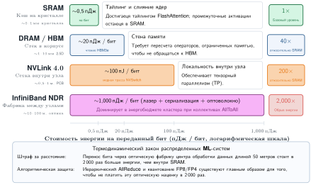

***Иерархия энергии перемещения данных**: стоимость перемещения одного бита растет на порядки по иерархии системы: от локальной SRAM (0,5 пДж/бит) через HBM (20 пДж/бит, в 40 раз дороже) и внутриузловой NVLink (100 пДж/бит, в 200 раз дороже) до межузлового InfiniBand (1 000 пДж/бит, в 2 000 раз дороже). Верхние оценки опубликованных данных включают накладные расходы линка, коммутатора и лазерного приемопередатчика. Этот крутой термодинамический градиент делает локальность данных главным фактором устойчивой архитектуры распределенной ML-системы.*

На экзамасштабе (десятки тысяч GPU) энергетический бюджет коммуникации сопоставим с бюджетом самих вычислений. Кластер из 10 000 GPU, который обменивается 1 ГБ градиентов за шаг при 30 пДж/бит, тратит примерно 4,8 кДж на один AllReduce (с учетом множителя 2 в перемещении данных), и это ощутимая доля совокупного энергетического бюджета шага.

Эти три ограничения взаимодействуют мультипликативно. Задержка задает нижнюю границу для каждого сообщения независимо от его размера. Пропускная способность ограничивает производительность больших передач. Накладные расходы протокола добавляют налог на каждое сообщение, который штрафует мелкогранулярную коммуникацию, поэтому обходные транспорты, описанные в разделе «RDMA и GPUDirect» главы «Сетевые фабрики», важны для производительности коллективных операций. Быстрая оценка AllReduce делает их совокупную стоимость конкретной для реалистичного сценария обучения.

<a id="nbk-collective-communication-allreduce-cost-70b-model"></a>

> **Стоимость AllReduce для модели на 70 млрд параметров**
>
> **Задача**: модель на 70 млрд параметров обучается с параллелизмом по данным на 64 GPU, соединенных InfiniBand NDR (50 ГБ/с на порт). Каждый GPU вычисляет градиенты в BF16 (2 байта на параметр, типично для обучения моделей класса Llama). Сколько занимает один AllReduce?
>
> **Шаг 1**: оценить размер полезной нагрузки градиента.
> Каждый GPU производит полный тензор градиента: $7 \times 10^{10} \times 2\ \text{байта}$ $=$ 140 ГБ.
>
> **Шаг 2**: применить формулу пропускной способности кольцевого AllReduce.
> $$T_{\text{пропускная}} = 2 \cdot \frac{N-1}{N} \cdot \frac{n}{\beta}$$
>
> Подставляем: $T_{\text{пропускная}}$ = 1,96875 $\times$ 140 ГБ / 50 ГБ/с $\approx$ 5 512,5 мс.
>
> **Шаг 3**: добавить член задержки.
> $$T_{\text{задержка}} = 2(N-1) \cdot \alpha$$
>
> Подставляем: $T_{\text{задержка}} =$ 126 $\times$ 1,5 мкс = 0,2 мс.
>
> **Шаг 4**: полное время коммуникации.
> Итого: $T_{\text{AllReduce}} \approx$ 5 512,5 мс + 0,2 мс $\approx$ 5 512,7 мс.
>
> **Системный вывод**: один только AllReduce градиента занимает больше пяти секунд. Это чистые накладные расходы коммуникации, которые добавляются к каждому шагу обучения. В таком масштабе коммуникация доминирует во времени шага, если ее не перекрывать с вычислением обратного прохода. Поэтому крупные системы обучения конвейеризуют AllReduce с обратным проходом: коммуникация для ранних слоев запускается, пока последние слои еще вычисляются.


*Синхронизация градиентов съедает от 30 до 70 процентов каждого шага на масштабе.*

Расчет показывает, почему на масштабе определяющим ограничением становится перемещение данных, а не вычисления. Один AllReduce по градиентам модели на 70 млрд параметров занимает секунды реального времени, в течение которых все GPU иначе простаивали бы. Обход ядра важен потому, что путь без копирования у RDMA[^fn-zerocopy-rdma-bypass] не проводит каждую передачу через промежуточную память хоста. Эта асимметрия между локальными вычислениями, которые параллелятся идеально, и глобальной координацией, которая требует физического перемещения данных, мотивирует каждый последующий коллективный алгоритм. Сокращение AllReduce, который занимает несколько секунд, сэкономило бы тысячи GPU-часов за типичную кампанию обучения и напрямую перевело бы в снижение стоимости и более быстрый выход в эксплуатацию.

Анализ стоимости также объясняет, почему выбор коллективного алгоритма важнее, чем думают большинство практиков. Неоптимальный алгоритм, который достигает только 60 процентов теоретической пропускной способности (частый результат плохого отображения на топологию), раздует пятисекундный AllReduce до более чем девяти секунд и добавит несколько секунд чистых потерь к каждому шагу обучения. Поскольку эти потери распространяются по всему парку, коммуникационные алгоритмы занимают уровень распределения стека парка. Нижележащий уровень инфраструктуры дает сырую пропускную способность через NVLink, InfiniBand и сетевые топологии (их разбирает глава «Сетевые фабрики»), а вышележащий уровень обслуживания зависит от эффективной синхронизации градиентов, чтобы завершать запуски обучения, которые дают пригодные к развертыванию модели. Когда коммуникационные алгоритмы не насыщают доступную пропускную способность, обучение идет дольше, обслуживаемые модели поставляются позже, и весь парк работает ниже своего экономического потенциала.

[Рисунок «Временная шкала вычислений и коммуникации»](#fig-compute-comm-timeline) показывает, как этот накладной расход коммуникации нарастает по мере роста парка. На 8 GPU в одном узле, связанном NVLink, коммуникация занимает примерно 25 процентов каждого шага обучения, потому что пропускная способность межсоединения 900 ГБ/с успевает за объемом градиента. Когда кластер расширяется до 64 GPU в 8 узлах, переход на InfiniBand (50 ГБ/с на порт) смещает баланс: коммуникация доминирует примерно в 50 процентах времени шага, еще 5 процентов теряются, пока зависимая работа ждет синхронизации. На масштабе 4 096 GPU коммуникация и зависимые простои вместе занимают 80 процентов шага обучения, оставляя 20 процентов полезным вычислениям. Эта динамика объясняет, почему коллективные алгоритмы важны: без иерархических коллективов, сжатия градиентов и перекрытия коммуникации с вычислениями крупномасштабное обучение тратило бы подавляющую часть многомиллионного вычислительного бюджета на ожидание прихода данных.

<a id="fig-compute-comm-timeline"></a>

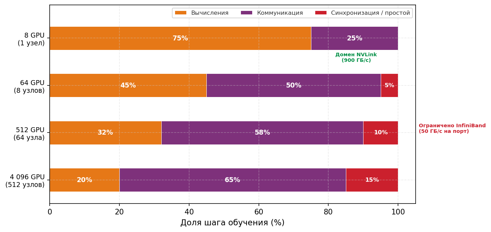

***Временная шкала вычислений и коммуникации**: по мере роста обучения с 8 GPU (один узел) до 4 096 GPU доля коммуникации в каждом шаге обучения растет примерно с 25 процентов до более чем 65 процентов. Этот переход от коммуникации, ограниченной NVLink, к коммуникации, ограниченной InfiniBand, определяет проектирование всех стратегий оптимизации коллективных операций. Пропорции получены из измерений кластера H100 для модели на 70 млрд параметров с параллелизмом по данным и кольцевым AllReduce.*

<a id="sec-communication-parallelism-patterns"></a>

### Маршрутный лист градиента

Путешествие начинается в момент, когда завершается обратный проход. На одной машине на этом история заканчивалась: веса обновлялись, и нейрон обучался. В продакшн-масштабе, однако, градиент рождается в изоляции. Он существует на одном GPU, тогда как «истина» модели распределена между тысячами. Чтобы добиться глобальной сходимости, градиент должен найти своих собратьев.

Конкретный «маршрутный лист» этого пути задается стратегией параллелизма, выбранной в [главе «Распределенное обучение»](05_distributed_training.md#sec-distributed-training-systems). Способ разбиения математики определяет способ перемещения данных. Для маячных архетипов ([«Три системных архетипа»](01_introduction.md#sec-vol2-introduction-archetypes)) эти маршруты принципиально различаются. Для архетипа A (GPT-4/Llama-3) градиент является частью массивного плотного тензора, который должен встретиться с каждым другим градиентом парка, чтобы вычислить глобальное среднее, поэтому его основной транспорт — AllReduce. Для архетипа B (DLRM в масштабе)[^fn-dlrm-embedding-alltoall] градиент или активация разрежены и адресны: им не нужно встречаться со всеми, только с конкретным GPU, который хранит шард их эмбеддингов. Маршрутизация в смеси экспертов (MoE) создает тот же адресный шаблон: каждый токен отправляется на GPU, который хостит назначенный ему эксперт, поэтому оба случая опираются на AllToAll.

Важно понимать это соответствие: что делает параллелизм, напрямую определяет, как устроена коммуникация. В большом масштабе эти стратегии не исключают друг друга. Один запуск обучения большой языковой модели обычно использует 3D-параллелизм (одновременно сочетая параллелизм по данным, тензорный и конвейерный параллелизм), а значит, несколько коллективных примитивов выполняются одновременно на перекрывающихся подмножествах GPU. Тензорный параллелизм запускает операции AllReduce внутри узла (через NVLink), конвейерный параллелизм запускает двухточечные отправки между стадиями конвейера (часто между узлами), а параллелизм по данным запускает AllReduce между группами узлов (через InfiniBand).

Каждый примитив работает на своей **группе процессов** (Process Group), то есть на подмножестве всей популяции GPU, которое участвует в данной коллективной операции. Классический интерфейс передачи сообщений (MPI) использует коммуникатор как объект, который именует такое участвующее множество; размер коммуникатора — это число рангов в нем. Библиотеки MPI уже выбирали коллективные алгоритмы по размеру коммуникатора и размеру сообщения (Thakur et al., 2005). Библиотеки коммуникации на GPU наследуют эту задачу выбора алгоритма и добавляют еще одну: координировать перекрывающиеся группы процессов, не создавая конкуренции между одновременными коллективами.

В [таблице «Маршрутный лист»](#tbl-parallelism-communication-mapping) показано соответствие между стратегией параллелизма и коллективным примитивом. Названия примитивов вводятся формально в следующем разделе; пока читайте таблицу как карту трафика, которая показывает, кто с кем должен обмениваться данными.

| **Стратегия параллелизма**   | **Цель градиента**                    |   **Основной примитив**    |         **Основное ограничение**      |
|:-----------------------------|:--------------------------------------|:--------------------------:|:-------------------------------------:|
| **Параллелизм по данным**    | Встретиться со всеми, вычислить глобальное среднее | AllReduce | Пропускная способность (большие полезные нагрузки) |
| **FSDP/ZeRO**                | Найти шарды, восстановить целое       | AllGather + ReduceScatter  | Пропускная способность (высокая частота) |
| **Тензорный параллелизм**    | Быстрое рукопожатие внутри узла       |         AllReduce          | Задержка (скорость — это все)         |
| **Конвейерный параллелизм**  | Передача следующему соседу            | Двухточечная (Send/Recv)   | Задержка (последовательные зависимости) |
| **Параллелизм экспертов (MoE)** | Адресная маршрутизация к специалисту | AllToAll                 | Запуск, ввод в сеть и бисекция, или перекос |

<a id="tbl-parallelism-communication-mapping"></a>

***Маршрутный лист**: как высокоуровневая математика [«Распределенного обучения»](05_distributed_training.md#sec-distributed-training-systems) проявляется в низкоуровневых шаблонах трафика.*

В этой таблице параллелизм экспертов относится к архитектурному шаблону смеси экспертов[^fn-moe-sparse-routing]. Таблица показывает, что разные стратегии параллелизма налагают принципиально разные шаблоны коммуникации. Параллелизм по данным и полностью шардированный параллелизм по данным (FSDP) обычно создают большие сообщения, которые выигрывают от кольцевых алгоритмов и иерархической декомпозиции. Тензорный и конвейерный параллелизм часто создают более мелкие сообщения, которые выигрывают от программных стеков с низкими накладными расходами. Параллелизм экспертов генерирует трафик, адресованный конкретным узлам, предел которого зависит от гранулярности сообщений, ввода и приема на конечных точках, бисекции фабрики, коэффициента переподписки (oversubscription), маршрутизации и перекоса экспертов. Чтобы количественно рассуждать об этих различиях, нужна модель сетевой производительности.

<a id="sec-communication-collective-operations-collective-operations-network-performance-modeling-0d8e"></a>

## Карта местности: моделирование сетевой производительности

Инженер центра обработки данных не может предсказать, сколько времени займет отправка десяти мегабайт через кластер, не зная двух разных величин: сколько времени сообщение тратит на запуск и как быстро данные движутся, попав в транзит. Как только градиент начинает свое путешествие, он сразу сталкивается с физической реальностью сети центра обработки данных.

<a id="sec-communication-collective-operations-collective-operations-alphabeta-model-f9b4"></a>

### Модель стоимости α-β: налог на запуск и плата за транзит

Каждое сообщение, которое отправляет градиент, подчиняется линейной модели стоимости $T(n) = \alpha + n/\beta$, которая формализует этот налог на запуск ($\alpha$) и плату за транзит на байт ($n/\beta$). Эти два члена определяют выбор коллективного алгоритма по всему парку.

<a id="dfn-collective-communication-model-hockney-model"></a>

> **Определение: модель α-β (модель Хокни)**
>
> ***Модель α-β (модель Хокни)*** — это линейная модель стоимости коммуникации $T(n) = \alpha + n/\beta$, которая раскладывает время передачи сообщения на фиксированную задержку запуска ($\alpha$, накладные расходы на одно сообщение) и член пропускной способности, зависящий от размера сообщения ($n/\beta$, пропорциональный переданным байтам). Она позволяет разработчикам алгоритмов предсказывать, когда слияние сообщений или сжатие градиентов повысит пропускную способность (Hockney, 1994).
>
> 1.  **Значение**: для InfiniBand NDR при $\alpha \approx 2\,\text{мкс}$ и $\beta \approx 50\,\text{ГБ/с}$ размер перехода $n^* = \alpha \cdot \beta \approx 100\,\text{КБ}$. Служебное сообщение маршрутизации в 4 КБ намного меньше $n^*$, поэтому доминирует налог на запуск. Слияние 100 таких сообщений в одно сообщение на 400 КБ снижает стоимость коммуникации с $100\alpha = 200\,\text{мкс}$ до одного $\alpha + n/\beta \approx 10\,\text{мкс}$, то есть улучшение в 20 раз. Градиентный тензор на 140 ГБ намного больше $n^*$, поэтому доминирует пропускная способность, и действенным рычагом становится уменьшение числа байтов полезной нагрузки.
> 2.  **Отличие**: в отличие от идеализированных моделей пропускной способности, которые считают пропускную способность единственной стоимостью коммуникации, модель α-β показывает, что $N$ мелких сообщений размера $n/N$ стоят до $N\times$ больше, чем одно большое сообщение размера $n$, когда $n/N \ll n^*$. Это объясняет, почему NCCL сливает мелкие вызовы AllReduce, а алгоритмы маршрутизации MoE буферизуют токены перед запуском коллективных операций.
> 3.  **Типичная ошибка**: распространено заблуждение, что сжатие градиентов всегда помогает. Если размер сжатого градиента остается заметно выше $n^*$, сжатие уменьшает член пропускной способности, но оставляет член задержки без изменений. Даже уменьшение полезной нагрузки градиента модели на 70 млрд параметров с 140 ГБ до 1,4 ГБ оставляет сообщение жестко ограниченным пропускной способностью; операция не превращается в обмен с низкой задержкой.

Два параметра имеют разный физический смысл. Задержка ($\alpha$) — это фиксированная стоимость запуска отправки сообщения независимо от его размера; она включает программные накладные расходы (запуск ядра, инициализацию NCCL), проход через PCIe и время коммутации в сети. Пропускная способность ($\beta$) — это устойчивая скорость передачи данных в байтах в секунду. **Критический размер сообщения** $n^* = \alpha \cdot \beta$ отмечает точку перехода: сообщения меньше $n^*$ ограничены задержкой, большие — пропускной способностью. [Приложение «Коммуникация»](appendix_communication.md#sec-appdx-comm-foundations-alpha-beta) (раздел «Модель коммуникации α-β») разбирает эту модель на конкретных режимах размера сообщения и на анализе Roofline, поэтому читатель, которому нужен полный вывод перехода, может пройти его там. Параметры из [таблицы «Параметры производительности межсоединений»](#tbl-interconnect-parameters) применяются к проектированию коллективных операций напрямую.

[Таблица «Параметры производительности межсоединений»](#tbl-interconnect-parameters) показывает типичные значения для межсоединений центров обработки данных. Столбец критического размера несет основную закономерность: внутриузловой NVLink остается ограниченным задержкой вплоть до нескольких сотен килобайт, тогда как межузловые фабрики переходят порог около 100 КБ. Поэтому сообщение, достаточно большое, чтобы быть ограниченным пропускной способностью внутри узла, может оставаться ограниченным задержкой, как только идет между узлами.

| **Межсоединение**                       |                  **Задержка ($\alpha$)**                |                **Пропускная способность ($\beta$)**    |             **Критический размер ($n^*$)**        |
|:----------------------------------------|:-------------------------------------------------------:|:------------------------------------------------------:|:-------------------------------------------------:|
| **NVLink 4.0 (внутри узла)**            | `1–2 мкс`   | `450 ГБ/с`           | `~0,7 МБ`   |
| **InfiniBand NDR 400 Гбит/с**           | `1–3 мкс`   | `50 ГБ/с` (на порт)  | `~100 КБ`   |
| **InfiniBand HDR 200 Гбит/с**           | `2–5 мкс`   | `25 ГБ/с`            | `~87,5 КБ`  |
| **PCIe Gen5 (GPU$\leftrightarrow$CPU)** | `2–5 мкс`   | `64 ГБ/с`            | `~224 КБ`   |
| **Ethernet 100 Гбит/с (RoCE)**          | `5–10 мкс`  | `12,5 ГБ/с`          | `~93,7 КБ`  |

<a id="tbl-interconnect-parameters"></a>

***Параметры производительности межсоединений**: эффективная задержка запуска на сообщение (α, включая программный стек), пропускная способность линка в каждом направлении (β, однонаправленная доставляемая скорость, которая входит в T(n) = α + n/β; заявленные 900 ГБ/с NVLink — это суммарная двунаправленная величина, поэтому его β равна однонаправленной скорости 450 ГБ/с) и вычисленный критический размер n* = α · β при середине диапазона α каждой строки, где коммуникация переходит от ограниченной задержкой к ограниченной пропускной способностью.*

Значения α и β в таблице не сближаются. [График «Расхождение пропускной способности»](#fig-bandwidth-divergence) показывает, как внутриузловая пропускная способность неуклонно уходит от межузловой, поэтому критический размер сообщения, который благоприятствует иерархическому алгоритму, продолжает смещаться, а не стабилизируется.

<a id="fig-bandwidth-divergence"></a>

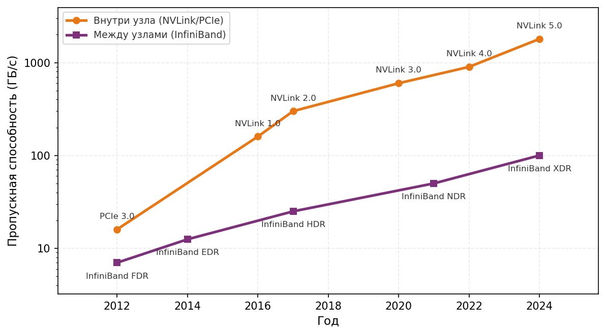

***Расхождение пропускной способности**: пропускная способность внутриузлового межсоединения по поколениям PCIe и NVLink против межузлового InfiniBand с 2012 по 2024 год. Внутриузловая линия стабильно примерно на порядок выше межузловой, что задает критический размер сообщения, при котором алгоритм должен перестать пересекать границы машин.*

Применение формулы критического размера сообщения к конкретной нагрузке показывает, какая оптимизация важнее всего:

<a id="nbk-collective-communication-critical-message-size"></a>

> **Критический размер сообщения**
>
> **Задача**: рассмотрим кластер с InfiniBand NDR 400 Гбит/с, где $\alpha =$ 2 мкс и $\beta =$ 50 ГБ/с. При каком размере сообщения оптимизация под пропускную способность начинает важнее оптимизации под задержку?
>
> **Расчет**:
>
> $n^* = \alpha \cdot \beta =$ $2 \times 10^{-6}$ с $\times$ $5 \times 10^{10}$ Б/с $=$ 100 КБ
>
> **Системный вывод**: сообщения меньше 100 КБ (например, токены MoE или активации конвейера) ограничены задержкой, и для них нужны коммутаторы с меньшей задержкой и меньшие программные накладные расходы. Сообщения больше 100 КБ, например градиенты больших языковых моделей (LLM), ограничены пропускной способностью, и для них нужны линки с большей пропускной способностью и сжатие данных. Применение не того рычага тратит ресурсы, не улучшая производительности.


*Малые сообщения ограничены задержкой, большие — пропускной способностью; стоимость меняется местами.*

Критический размер сообщения разделяет два различных рабочих режима. Ниже него мелкие сообщения, такие как токены маршрутизации MoE или скалярные редукции, ограничены задержкой $(n < n^*)$: время определяется $\alpha$, и оптимизация сосредоточена на слиянии (пакетировании мелких сообщений), топологии (уменьшении числа переходов) и настройке программного стека (обходе ядра через RDMA). Выше него большие сообщения, такие как градиенты LLM или состояния оптимизатора, ограничены пропускной способностью $(n \gg n^*)$: время определяется $n/\beta$, и оптимизация переходит к сжатию (меньшая точность или разреженность), выбору алгоритма (кольцо или дерево) и агрегации линков (многорельсовые сетевые карты, NIC). Различие между коммуникацией, ограниченной задержкой, и коммуникацией, ограниченной пропускной способностью, — это диагностический навык, который стоит практиковать.

<a id="chk-collective-communication-alpha-beta-diagnostics"></a>

> **Контрольные вопросы: диагностика α-β**
>
> Проверьте свое понимание режимов сетевой производительности:
>
> - [ ] **Режим ограничения**: классифицируйте сообщение в 10 КБ, отправленное по линку с $\alpha=2\ \text{мкс}$ и $\beta=10\ \text{ГБ/с}$, как ограниченное задержкой или пропускной способностью.
> - [ ] **Программные накладные расходы**: определите, какой тип параллелизма выигрывает больше, когда программные накладные расходы ($\alpha$) уменьшаются вдвое: параллелизм по данным или тензорный параллелизм.
> - [ ] **Критический размер сообщения**: опишите, как меняется критический размер сообщения ($n^* = \alpha \beta$), когда сеть переходит со 100 Гбит/с на 400 Гбит/с, а программная задержка остается прежней.
> - [ ] **Масштабирование NIC**: верно или неверно утверждение, что в режиме, ограниченном пропускной способностью, удвоение числа NIC на узел фактически удваивает скорость передачи больших тензоров?

<a id="sec-communication-collective-operations-collective-operations-logp-model-e45d"></a>

### Модель LogP

Модель α-β предполагает, что процессор простаивает во время коммуникации. Для конвейеризованных систем, где коммуникация перекрывается с вычислением, это предположение не выполняется. **Модель LogP** (Culler et al., 1993) расширяет α-β четырьмя параметрами:

- **$L_{\text{lat}}$ (задержка)**: время, которое сообщение тратит на прохождение сети (похоже на $\alpha$).
- **$o$ (накладные расходы)**: процессорное время, которое тратится на инициацию или завершение передачи. Пока идет эта работа, тот же исполнительный ресурс не может вычислять, поэтому $o$ — это неперекрываемая стоимость. В контексте распределенного обучения вклад могут давать диспетчеризация, запуск ядра на устройстве, регистрация памяти и прогресс рантайма. Значение является эффективным параметром конкретного программного и аппаратного пути, поэтому его нужно измерять с тем же коллективом, группой процессов и топологией, что и рабочая нагрузка.
- **$g$ (промежуток)**: минимальный интервал времени между последовательными вводами сообщений (обратная величина частоты сообщений). Это моделирует конкуренцию за линк.
- **$N_{\text{rank}}$ (число рангов)**: число рангов в группе коммуникации.

LogP различает сетевую задержку ($L_{\text{lat}}$), которую можно скрыть, и накладные расходы процессора ($o$), которые скрыть нельзя. Система может перекрывать коммуникацию с вычислением, только если вычислительное ядро работает дольше, чем накладные расходы. Небольшой расчет перекрытия делает это различие конкретным:

<a id="nbk-collective-communication-hiding-communication-behind-computation"></a>

> **Скрытие коммуникации за вычислением**
>
> **Задача**: конвейер обучения пытается перекрыть градиентный AllReduce со следующим обратным проходом слоя. Обратный проход занимает 500 мкс. У AllReduce сетевая задержка 100 мкс, а накладные расходы процессора $o =$ 50 мкс на инициацию и $o =$ 50 мкс на прием. Можно ли скрыть коммуникацию?
>
> **Расчет**:
>
> 1.  **Перекрываемая часть**: сетевая задержка $L_{\text{lat}}$ = 100 мкс (данные в полете, пока GPU вычисляет).
> 2.  **Неперекрываемая часть**: $2o$ = 100 мкс (GPU занят инициацией и приемом).
> 3.  **Доступные вычисления**: 500 мкс.
> 4.  **Скрыто**: все 100 мкс $L_{\text{lat}}$ могут перекрыться с вычислением.
> 5.  **Открыто**: 100 мкс накладных расходов $2o$ не могут перекрыться.
>
> **Результат**: эффективное время равно 100 мкс + max(500 мкс, 100 мкс) = 600 мкс. Сетевая задержка скрыта, но накладные расходы процессора остаются открытыми. [Рисунок «Перекрытие коммуникации и вычислений»](#fig-comm-compute-overlap) показывает это перекрытие наглядно.
>
> **Системный вывод**: модель α-β описывает полное время коммуникации. Модель LogP показывает, какую его часть можно скрыть. При проектировании конвейеризованного обучения оптимизируйте низкое $o$ (обход ядра, GPUDirect), а не только высокое $\beta$.

<a id="fig-comm-compute-overlap"></a>

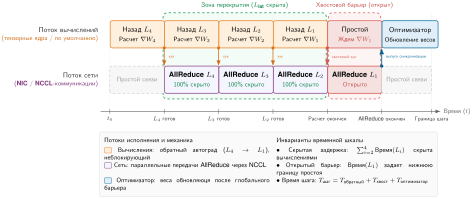

***Перекрытие коммуникации и вычислений**: конвейеризуя коллективные операции с обратным проходом, системы могут скрывать сетевую задержку за арифметическими вычислениями. Перекрытие успешно, только если неперекрываемые накладные расходы (o) минимизированы: тогда основной член передачи может идти, пока GPU вычисляет градиенты следующего слоя.*

Выбор между моделями зависит от контекста анализа. Модель α-β — правильный инструмент для расчетов «на салфетке», выбора алгоритма (кольцо или дерево) и блокирующей коммуникации, завершение которой лежит на пути зависимостей. Ее сила — простота: два параметра можно оценить по измерениям задержки и пропускной способности. Ее слабость — предположение, что процессор простаивает во время коммуникации, из-за чего модель излишне пессимистична, когда перекрытие возможно. Модель LogP окупает свои дополнительные параметры, когда анализ переходит к **конвейерному выполнению** (Pipelined Execution), перекрытию коммуникации с вычислением или диагностике того, почему теоретически быстрый алгоритм работает хуже ожидаемого. Ее различие между сетевой задержкой $L_{\text{lat}}$ и накладными расходами процессора $o$ определяет, может ли данная стратегия перекрытия скрыть коммуникацию. Метод профилирования в разделе «Профилирование в масштабе» главы «Инженерия производительности» измеряет эти члены и распределяет остаток; эта глава использует их, чтобы выбрать расписание коммуникации.

На практике большинство инженерных расчетов начинаются с модели α-β для первичной оценки размера и выбора алгоритма, а затем уточняются анализом LogP, когда целью оптимизации становится перекрытие коммуникации с вычислением. Обе модели разделяют общее ограничение: они предполагают один поток на одном линке. Реальные шаблоны коммуникации включают несколько одновременных потоков, конкурирующих за общую пропускную способность, что может вызвать перегрузку, которую ни одна модель не учитывает. Для чувствительных к перегрузке нагрузок (особенно AllToAll в MoE) необходимым шагом проверки остается эмпирическое измерение на целевом кластере.

<a id="sec-communication-llama-budget"></a>

### Применяем модель: бюджет коммуникации Llama 70B

Модель α-β становится наиболее ценной, когда ее применяют к реальным конфигурациям обучения. Рассмотрим конкретный сценарий: обучение модели класса Llama на 70 млрд параметров с параллелизмом по данным на 128 GPU, распределенных по 16 узлам по 8 GPU. Тензор градиента занимает 140 ГБ в BF16 (70 млрд параметров по 2 байта каждый, типично для обучения моделей класса Llama). На каждом шаге обучения весь этот градиент должен синхронизироваться между всеми воркерами.

Расчет использует иерархию пропускной способности еще до того, как глава ее формализует: сократить как можно больше данных по быстрому уровню NVLink внутри каждого узла, отправить по более медленному уровню InfiniBand только сокращенный шард, а затем восстановить результат локально. Названия примитивов станут точными в разделе об иерархии; инженерная идея уже видна в бюджете пропускной способности.

Если использовать градиенты в BF16 (обычная практика, которая вдвое уменьшает объем коммуникации до 140 ГБ), контраст разительный. Пропускать полный градиент через медленную межузловую фабрику, как это делает плоский кольцевой AllReduce, стоит примерно 5 557 мс. Если же основную часть трафика ограничить NVLink и отправлять по InfiniBand только сокращенный шард, время падает примерно до 1 200,8 мс. Разница не маргинальна: она определяет, можно ли спрятать коммуникацию за вычислением или она становится критическим путем.

Разбивка этих чисел по фазам (редукция внутри узла, сокращенный межузловой обмен и перераспределение внутри узла) опирается на коллективные примитивы, разработанные в разделе [«Выбор средства»](#sec-communication-collective-operations-collective-operations-collective-operation-vocabulary-fdc7). [Раздел «Иерархический AllReduce»](#sec-communication-collective-operations-collective-operations-hierarchical-allreduce-1338) называет эти примитивы и проводит полный трехфазный вывод; этот бюджет показывает, что иерархию пропускной способности стоит соблюдать и насколько существенно.

<a id="sec-communication-nccl-reality"></a>

### Теория и практика: калибровка коллективной модели

Компромисс между пропускной способностью и задержкой (принцип «компромисс пропускной способности и задержки (модель α-β)») дает полезные предсказания первого порядка, но корректное сравнение должно моделировать тот же коллектив, который выполняет бенчмарк. Для кольцевого AllReduce по $N$ рангам и тензору размера $M$ байт стоимость первого порядка равна $2(N-1)\alpha + 2(N-1)M/(N\beta)$, а не выражению «точка-точка» $\alpha+M/\beta$. Дерево, иерархическое расписание и редукция с помощью коммутатора имеют разное число шагов и разные коэффициенты трафика. NCCL также выбирает протоколы, каналы и алгоритмы в зависимости от размера сообщения и обнаруженной топологии, поэтому эти выборы становятся частью экспериментального условия (Jeaugey, 2017; NVIDIA, 2026).

Откалиброванная коллективная модель поэтому фиксирует операцию, тип редукции, число рангов, размер тензора, алгоритм и протокол, топологию, размещение рангов и достигнутую шинную пропускную способность (bus bandwidth). Затем она подбирает эффективные $\alpha$ и $\beta$ по измерениям той же конфигурации. Сравнение предсказанного и наблюдаемого времени в рамках этого соглашения выявляет программные накладные расходы или потери на топологии, не принимая алгоритмический коэффициент трафика коллектива за неэффективность библиотеки. Полученные параметры применимы только к измеренному режиму; при смене коллектива, группы процессов, топологии или версии библиотеки требуется перекалибровка. Эта глава отвечает за алгоритмическую модель стоимости и расписание перекрытия, которое ее использует. Профилирование в разделе «Профилирование в масштабе» главы «Инженерия производительности» отвечает за более широкую дисциплину измерений, необходимую, чтобы отнести регресс времени шага обучения к ядрам, памяти, коммуникации или конкуренции.

<a id="sec-communication-collective-operations-collective-operations-collective-operation-vocabulary-fdc7"></a>

## Выбор средства: примитивы коллективных операций

Если GPU просто открывает сокет и отправляет огромный градиент другому GPU, весь кластер быстро превратится в неуправляемую сеть взаимных блокировок и перегрузок. Когда местность нанесена на карту, градиент должен выбрать свое средство: строго согласованные групповые обмены, известные как коллективные операции, словарь, стандартизованный MPI и унаследованный современными библиотеками коммуникации ML (Message Passing Interface Forum, 2015). [Рисунок «Четыре центральных коллективных примитива»](#fig-collective-primitives-overview) иллюстрирует четыре центральных примитива этого словаря: AllReduce, AllGather, ReduceScatter и AllToAll. Каждая панель читается как «до и после» по группе процессов, с одной строкой на ранг: синие ячейки отмечают входные данные, с которых начинает каждый ранг, зеленые — агрегированные или восстановленные выходные тензоры, а фиолетовые отмечают попарную перетасовку AllToAll, которая транспонирует уникальные шарды между всеми рангами. Еще два примитива, Broadcast (ранг 0 отправляет всем) и Reduce (все агрегируют в ранг 0), служат фундаментальными строительными блоками; они определены в [разделе «Шесть базовых примитивов»](#sec-collective-communication-six-core-primitives-8a66) и неявно используются в составных шаблонах на рисунке. Раздел «Сложность коллективных операций» [приложения «Коммуникация»](appendix_communication.md#sec-appdx-comm-foundations-collective-complexity) формализует семантику и сложность по задержке и пропускной способности для каждого примитива. Здесь они вводятся через их применение в нагрузках, а читатель, которому нужны формальные границы сложности до продолжения, может сначала освоить их там.

<a id="dfn-collective-communication-collective-operation"></a>

> **Определение: коллективная операция**
>
> ***Коллективная операция*** — это шаблон распределенной коммуникации, в котором каждый ранг группы процессов вызывает соответствующую операцию, чтобы агрегировать, разослать или перераспределить данные. Контракт операции задает выход на каждом ранге; он не требует одновременного входа и сам по себе не накладывает общего барьера до или после вызова (Message Passing Interface Forum, 2015).
>
> 1.  **Значение**: правильный коллективный алгоритм определяет, растет ли коммуникация вместе с размером кластера или остается постоянной. Кольцевой AllReduce достигает оптимальной по пропускной способности стоимости $2(N-1)/N \times M / \beta$ на узел (постоянной по $N$), тогда как наивный подход «редукция, затем рассылка» стоит $\mathcal{O}(N \times M / \beta)$ и при $N=1024$ оказывается в 500 раз хуже. Выбор алгоритма, таким образом, напрямую определяет, является ли член $\text{BW}$ в железном законе узким местом обучения.
> 2.  **Отличие**: в отличие от коммуникации «точка-точка» коллектив определяет одну операцию над группой процессов. Ранги могут входить в операцию в разное время, а некоторые алгоритмы позволяют одному рангу завершиться раньше, чем другой вошел; корректность зависит от согласования последовательности операций и контракта аргументов между рангами, а не от семантики барьера.
> 3.  **Типичная ошибка**: считать неблокирующий коллектив завершенным, когда возвращается вызов его инициации. Возвращенный запрос или событие потока представляет работу в полете. Зависимый потребитель должен ждать завершения, и опоздавший ранг может продлить эту зависимость, хотя коллектив и не является барьером.

<a id="fig-collective-primitives-overview"></a>

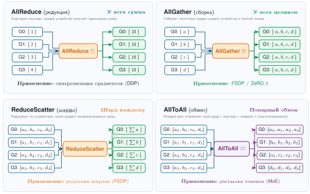

***Четыре центральных коллективных примитива**: стандартизованные шаблоны групповой коммуникации в распределенных системах. (1) AllReduce: все агрегируют, и все получают результат. (2) AllGather: все отправляют всем и конкатенируют. (3) ReduceScatter: все агрегируют, и результаты распределяются по шардам. (4) AllToAll: каждый процесс отправляет уникальные данные каждому другому процессу. Два фундаментальных примитива, Broadcast (ранг 0 отправляет всем) и Reduce (все агрегируют в ранг 0), составляют показанные здесь шаблоны и определены в окружающем тексте.*

Выбор примитива — первое решение о масштабировании, потому что он фиксирует, какие ранги должны координироваться, какие данные должны переместиться и какой член коммуникации будет доминировать. Разные архитектуры моделей нагружают разные операции, и выбор неподходящего примитива для нагрузки создает ненужные узкие места.

<a id="sec-collective-communication-six-core-primitives-8a66"></a>

### Шесть базовых примитивов

Шесть примитивов в [таблице «Шесть коллективных примитивов»](#tbl-collective-primitives) образуют лестницу решений: используйте самую узкую операцию, которая сохраняет математику модели, поскольку каждый более широкий шаблон добавляет перемещение данных, координацию или конкуренцию.

| **Примитив**       | **Что делает**                                                                                              | **Основное применение**                                                                                                                       | **Стоимость коммуникации**                                                                                                                                     |
|:-------------------|:------------------------------------------------------------------------------------------------------------|:----------------------------------------------------------------------------------------------------------------------------------------------|:---------------------------------------------------------------------------------------------------------------------------------------------------------------|
| **Broadcast**      | Один отправитель передает данные всем получателям.                                                          | Раздача начальных весов модели от ранга 0 при старте во всех стратегиях параллелизма.                                                          | $\mathcal{O}(\log N)$ задержки (дерево); $\mathcal{O}(M)$ пропускной способности.                                                                              |
| **Reduce**         | Агрегирует данные всех воркеров (сумма, минимум, максимум) в один корень.                                   | Агрегация метрик валидации, таких как потери и точность, в процесс логирования.                                                                | $\mathcal{O}(\log N)$ задержки (дерево); $\mathcal{O}(M)$ пропускной способности.                                                                              |
| **AllReduce**      | Агрегирует данные от всех воркеров, затем распределяет результат всем ($y_i = \sum_{j=0}^{N-1} x_j$ для всех $i$). | Параллелизм по данным ([«Параллелизм по данным»](05_distributed_training.md#sec-distributed-training-systems-systems-data-parallelism-6132)): синхронизация градиентов, чтобы каждый GPU вычислял одно и то же обновление. | Кольцо оптимально по пропускной способности, $2\frac{N-1}{N}\frac{M}{\beta}$, но имеет задержку $\mathcal{O}(N)$; дерево дает задержку $\mathcal{O}(\log N)$ при худшей пропускной способности. |
| **AllGather**      | Данные каждого воркера уходят всем; результат конкатенирует все входы ($x_i \rightarrow [x_0, \dots, x_{N-1}]$). | Шардированный параллелизм по данным (FSDP/ZeRO): собрать шардированные параметры перед прямым или обратным проходом.                          | Кольцо $\frac{N-1}{N}\frac{M}{\beta}$; резидентные данные растут от шарда $M/N$ до полного $M$.                                                               |
| **ReduceScatter**  | Редукция между воркерами с распределением так, что каждый сохраняет свой блок (воркер $i$ получает $i$-й блок $\sum x_j$). | Шардированный параллелизм по данным: редуцировать градиенты, сохраняя их шардированными, чтобы экономить память.                              | Кольцо $\frac{N-1}{N}\frac{M}{\beta}$; обратна AllGather.                                                                                                      |
| **AllToAll**       | Самый общий шаблон: воркер $i$ отправляет отдельный блок каждому воркеру $j$, то есть распределенное транспонирование матрицы. | Маршрутизация токенов MoE к экспертам; обмен поисками эмбеддингов между воркерами в DLRM.                                                     | Полезная нагрузка на воркер $\frac{N-1}{N}M$; ограничение может возникать из-за запуска, ввода/приема, бисекции, коэффициента переподписки, маршрутизации, гранулярности или перекоса. |

<a id="tbl-collective-primitives"></a>

***Шесть коллективных примитивов**: что вычисляет каждый примитив, его основное применение и стоимость коммуникации, упорядоченные от самого узкого шаблона (Broadcast) к самому общему (AllToAll).*

Кольцо достигает оптимальной по пропускной способности стоимости AllReduce, а дерево обменивает пропускную способность на логарифмическую задержку. Раздел «AllReduce» [приложения «Коммуникация»](appendix_communication.md#sec-appdx-comm-foundations-allreduce) развивает формальное определение и разбирает пример, сравнивающий эти два алгоритма, поэтому читатель, которому нужен этот вывод, может пройти полное рассмотрение там (Patarasuk and Yuan, 2009; Thakur et al., 2005).

Ключевое наблюдение: AllReduce можно разложить на ReduceScatter, за которым следует AllGather. Это не просто математическая эквивалентность; именно так внутри работает кольцевой AllReduce (фаза Scatter-Reduce — это ReduceScatter, фаза AllGather — это AllGather). Шардирование в стиле ZeRO, реализованное в PyTorch как FSDP,[^fn-fsdp-memory-sharding] использует это разложение: AllGather собирает шарды параметров до того, как модуль их потребует, а ReduceScatter распределяет градиенты после обратного прохода, так что каждый ранг сохраняет только свой шард для шага оптимизатора (Rajbhandari et al., 2020). Так параметры, градиенты и состояние оптимизатора шардируются между воркерами, примерно в N раз снижая постоянную память состояния модели, тогда как временные буферы полных параметров и префетчинг определяют пиковую память.

Та же пара AllGather/ReduceScatter появляется и в параллелизме последовательности: AllGather восстанавливает представление активаций, нужное для локальной операции, а последующий ReduceScatter перераспределяет результат вдоль измерения последовательности. Этот пример важен дальше, потому что показывает: семантика примитива остается неизменной, даже когда меняется шардируемое измерение тензора.

Эта лестница важна, потому что примитив определяет зависимость по коммуникации еще до начала любой алгоритмической оптимизации. AllReduce создает глобальное согласие; AllGather и ReduceScatter обменивают память на повторные перемещения шардов; AllToAll заменяет однородную редукцию трафиком, адресованным конкретному получателю.

Корректность коллективных операций имеет интерфейсное измерение наряду с математическим. Каждый ранг группы процессов должен выдавать коллективы в совместимом порядке; несовпадающие последовательности операций могут привести к взаимной блокировке или сопоставить несвязанные буферы. Операции также накладывают контракты по форме и количеству. AllReduce требует совместимого числа элементов и типов данных, тогда как обмены переменного размера требуют явных счетчиков и смещений для каждого получателя. Эти инварианты принадлежат границе между параллельной декомпозицией и рантаймом коммуникации: модель решает, какой срез тензора принадлежит каждому рангу, а контракт коллектива доказывает, что эти срезы можно снова собрать.

Порядок редукции вводит второй, численный контракт. Сложение с плавающей запятой не ассоциативно, поэтому кольцевая, древовидная и редукция с помощью коммутатора могут накапливать одни и те же значения в разном порядке и получать разные младшие биты (Goldberg, 1991). Корректный AllReduce поэтому гарантирует заданную редукцию по всем вкладам, а не побитовую идентичность между алгоритмами, числами рангов или аппаратурой. Чувствительным к воспроизводимости нагрузкам нужно фиксировать алгоритм и конфигурацию группы процессов либо использовать воспроизводимую схему накопления. Обычное обучение должно рассматривать малые различия, зависящие от порядка, как численное поведение, но при этом проверять более крупное расхождение между рангами.

[^fn-fsdp-memory-sharding]: **FSDP (полностью шардированный параллелизм по данным)**: полностью шардированная реализация PyTorch следует идее ZeRO-3 — шардировать параметры, градиенты и состояния оптимизатора между $N$ ускорителями (Rajbhandari et al., 2020). Компромисс — частота коммуникации: полное шардирование добавляет операции AllGather и ReduceScatter на уровне слоев вместо опоры только на AllReduce параллелизма по данным на уровне шага, поэтому оно чувствительнее к накладным расходам $\alpha$.

[^fn-dlrm-embedding-alltoall]: **DLRM (Deep Learning Recommendation Model)**: архитектура Meta 2019 года для предсказания частоты кликов использует шардированные таблицы эмбеддингов и обменивает получившиеся разреженные поиски между воркерами. Полученный AllToAll может быть ограничен запуском, когда каждый получатель принимает мелкогранулярное сообщение, ограничен вводом или приемом по мере роста суммарной полезной нагрузки либо ограничен фабрикой при коэффициенте переподписки, неблагоприятной маршрутизации или перекосе доступа к шардам. Поэтому DLRM задает адресный шаблон трафика, а не универсальный режим задержки.

Контраст между AllToAll и AllReduce выделяет фундаментальное различие в том, как коллективные операции масштабируются с размером кластера.

<a id="psp-collective-communication-alltoall-vs-allreduce-why-scale-differs"></a>

> **AllToAll и AllReduce: почему масштабирование различается**
>
> Кольцевой AllReduce может конвейеризовать однородную полезную нагрузку через обмены с соседями. AllToAll ставит другую задачу масштабирования: у каждого ранга трафик адресован конкретным получателям, но одно лишь число логических партнеров не определяет его стоимость.
>
> AllToAll по $N$ рангам создает $N(N-1)$ логических передач «источник — получатель», однако совокупная полезная нагрузка каждого ранга может оставаться фиксированной при слабом масштабировании. Его нижняя граница определяется наибольшим из четырех членов: временем ввода в сеть на источнике, временем приема на получателе, трафиком, пересекающим бисекцию фабрики, и накладными расходами на запуск или планирование каждого сообщения. Коэффициент подписки и маршрутизация определяют, сколько физической емкости делят эти потоки. Гранулярность сообщений определяет, как часто они платят $\alpha$. Перекос маршрутизации определяет, станет ли один получатель или линк критическим путем. Полносвязная сеть с полной бисекцией, несущая сбалансированный крупнозернистый трафик, поэтому может хорошо масштабироваться, несмотря на квадратичное число логических связей, тогда как перегруженная подпиской фабрика или перекошенное назначение экспертов могут остановиться при гораздо меньших $N$.

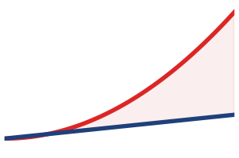

*Логические пары партнеров растут квадратично; физическая стоимость зависит от фабрики.*

Параллелизм экспертов и крупномасштабные рекомендательные системы могут упереться в коммуникационную стену раньше, чем стандартный параллелизм по данным, когда их трафик исчерпывает емкость ввода, приема или бисекции либо когда маршрутизация и перекос адресатов создают горячие точки. Примитив определяет матрицу трафика; физическая фабрика и распределение маршрутизации определяют потолок масштабирования.

Чтобы сделать шаблон AllToAll конкретным, рассмотрим модель смеси экспертов с 64 экспертами, распределенными по 8 GPU (по 8 экспертов на GPU). На каждом прямом проходе гейтинг-сеть (gating network) назначает каждый входной токен одному или нескольким экспертам. Токены, назначенные экспертам на удаленных GPU, должны физически переместиться на эти GPU до того, как вычисления продолжатся, а результаты потом нужно вернуть обратно.

<a id="nbk-collective-communication-alltoall-moe-token-routing"></a>

> **AllToAll для маршрутизации токенов MoE**
>
> **Задача**: модель MoE обрабатывает пакет из 4 096 токенов на 8 GPU (по 512 токенов на GPU). Каждый токен — скрытое состояние размерности 2 048 в BF16 (4,096 КБ на токен). Гейтинг-сеть (gating network) назначает каждый токен ровно одному из 64 экспертов (по 8 экспертов на GPU). При равномерной маршрутизации (каждый эксперт получает 64 токена) сколько данных отправляет и получает каждый GPU?
>
> **Расчет**:
>
> Каждый GPU держит 512 токенов, которые нужно доставить 64 разным экспертам на 8 GPU. При равномерной маршрутизации каждый GPU отправляет по 64 токена каждому из остальных 7 GPU (64 токена остаются локально).
>
> - Данные на одну передачу «GPU — GPU»: 64 токена $\times$ 4,096 КБ/токен = 262,144 КБ
> - Всего отправляется с каждого GPU: 7 $\times$ 262,144 КБ = 1,84 МБ
> - Всего получает каждый GPU: 1,84 МБ (симметрично)
>
> **Анализ задержки** (InfiniBand NDR, $\alpha =$ 3 мкс, $\beta =$ 50 ГБ/с):
>
> Каждая из 7 передач — это сообщение в 262,144 КБ. Из модели α-β: $T_{\text{передача}}$ = 3 мкс + 5 мкс = 8 мкс на передачу.
>
> Если выполнять последовательно: 7 $\times$ 8 мкс = 56 мкс. Если все 7 передач запущены одновременно, они все равно делят порт ввода GPU с пропускной способностью 50 ГБ/с. Поэтому нижняя граница ввода равна $\alpha + \text{всего байт}/\beta =$ 39,7 мкс, без учета конкуренции и дополнительных накладных расходов коллектива. Полный дуплекс позволяет одновременно отправлять и принимать; он не дает отдельного порта полной пропускной способности на каждого партнера.
>
> **Системный вывод**: результат по вводу — лишь нижняя граница. Если полезная пропускная способность бисекции топологии равна $B_{\mathrm{bisect}}$, а $V_{\mathrm{cut}}$ байт должны пересечь ее минимальный разрез, обмен также подчиняется условию $T\geq V_{\mathrm{cut}}/B_{\mathrm{bisect}}$. Коэффициент подписки уменьшает $B_{\mathrm{bisect}}$, мелкие сообщения между партнерами добавляют стоимость запуска, а перекос экспертов поднимает максимальный объем приема выше оценки для равномерного случая. Кроме того, AllToAll выполняется дважды на слой: один раз для рассылки токенов и один раз для сбора результатов.

<a id="sec-collective-communication-moe-dynamic-routing"></a>

#### Динамическая маршрутизация и перекос экспертов в AllToAll для MoE

Разобранная трасса в блокноте [«AllToAll для маршрутизации токенов MoE»](#nbk-collective-communication-alltoall-moe-token-routing) предполагает равномерную маршрутизацию токенов: каждый эксперт получает одинаковую долю токенов. В промышленных моделях MoE решения маршрутизации динамичны и зависят от данных, что принципиально меняет профиль коллективной коммуникации.

##### Жизненный цикл рассылки и сборки

В слое трансформера MoE с $E$ экспертами, распределенными по $P$ рангам (по $E/P$ экспертов на ранг), каждый ранг держит локальный пакет из $T$ токенов. Гейтинг-сеть вычисляет вероятности маршрутизации top-$k$ по всем $E$ экспертам для каждого токена. Это порождает две последовательные фазы коллективной коммуникации на каждый слой MoE:

1.  **Рассылка токенов (AllToAll)**: каждый ранг разбивает свои $T$ локальных векторов активаций токенов ($\mathbf{x} \in \mathbb{R}^{d_{\text{model}}}$) согласно рангам-получателям, на которых размещены выбранные эксперты. Устройства выполняют коллективную операцию AllToAll (или вариант переменного размера `AllToAllv`), чтобы передать токены через фабрику к рангам-хостам экспертов.
2.  **Сборка токенов (AllToAll)**: после того как каждый ранг прогоняет токены через свои локальные сети прямого распространения (FFN) экспертов, вторая операция AllToAll возвращает выходные векторы исходным рангам. Затем каждый ранг вычисляет взвешенную комбинацию выходов экспертов:
    $$\mathbf{y}_i = \sum_{j \in \text{top-}k} g_{i,j} \cdot \text{Expert}_j(\mathbf{x}_i)$$

##### Коэффициенты емкости и ограниченное выделение

В плотных моделях размеры коллективных буферов статичны и детерминированы. В разреженных моделях MoE число токенов, направленных эксперту $e$, является случайной величиной $N_e \sim \text{Binomial}(P \cdot T, p_e)$. Чтобы избежать динамического выделения памяти и накладных расходов на перераспределение буферов во время коммуникации, системы заранее выделяют статические буферы экспертов, параметризованные **коэффициентом емкости эксперта** $C \ge 1.0$ (Lepikhin et al., 2021; Fedus et al., 2022):
$$\text{Емкость}_e = \left\lceil \frac{P \times T \times k}{E} \times C \right\rceil$$

Коэффициент емкости раскрывает фундаментальный системный компромисс:

- **При $C = 1.0$**: буферы рассчитаны строго на равномерное ожидание. При перекосе маршрутизации все токены, назначенные эксперту сверх его емкости, *отбрасываются* (пропускаются через остаточные связи без вычисления экспертом), что ухудшает сходимость обучения и точность на последующих задачах.
- **При $C > 1.0$**: буферы вмещают разброс маршрутизации (обычно $C = 1{,}25$–$1{,}5$), что предотвращает отбрасывание токенов. Однако чтобы сохранить однородную коллективную коммуникацию, буферы нужно дополнять фиктивными токенами до фиксированной емкости, что раздувает физический объем данных, пересекающих сеть, в $C$ раз, и заставляет GPU вычислять матричные умножения на дополненных нулевых токенах.
- **Маршрутизация без отбрасывания (dropless)**: современные высокопроизводительные фреймворки используют AllToAll переменного размера (`AllToAllv`) с динамическими буферами памяти; это устраняет накладные расходы на дополнение и сохраняет все токены. Однако динамическая маршрутизация напрямую переносит перекос маршрутизации на время выполнения.

##### Насыщение бисекции и хвосты отстающих

Поскольку маршрутизация токенов определяется семантикой входа, некоторые «звездные» эксперты неизбежно получают непропорционально большой объем токенов. Если один эксперт получает $\gamma \times$ среднюю нагрузку ($\gamma > 1$), GPU, на котором он размещен, получает в $\gamma$ раз больше входящих данных при рассылке.

Этот перекос создает два усиливающих друг друга узких места:

1.  **Узкое место входящего приема**: время завершения коллективной рассылки ограничено самым медленным получателем. Даже если 95 процентов GPU завершают свои обмены AllToAll за десятки микросекунд, весь кластер простаивает, ожидая, пока самый нагруженный ранг-получатель примет свою слишком большую полезную нагрузку:
    $$T_{\text{рассылка}} \ge \frac{M_{\text{max}} \times d_{\text{model}} \times \text{sizeof(dtype)}}{\text{BW}_{\text{rx}}}$$
    где $M_{\text{max}} = \max_p \sum_{e \in \text{ранг } p} N_e$.
2.  **Насыщение фабрики бисекции**: в отличие от кольцевого AllReduce (который отображает коммуникацию на кольцевые линки ближайших соседей), AllToAll порождает полный двудольный обмен, в котором $(P-1)/P \approx 1$ всех токенов должна пересечь сетевую фабрику кластера. В фабрике с переподпиской и коэффициентом $R:1$ полезная пропускная способность бисекции $\text{BW}_{\text{bisect}} = (P \cdot \text{BW}_{\text{inject}}) / (2R)$ ограничивает обмен:
    $$T_{\text{рассылка}} \ge \frac{V_{\text{cut}}}{\text{BW}_{\text{bisect}}}$$

##### Иерархический обмен в MoE

Чтобы смягчить одновременно насыщение бисекции и накладные расходы на мелкие сообщения на тысячах GPU, иерархические рантаймы MoE разлагают плоский AllToAll на коллектив из двух уровней (Hwang et al., 2023):

1.  **Агрегация внутри узла**: GPU через внутриузловой NVLink объединяют токены, предназначенные любому эксперту на одном удаленном сервере.
2.  **Обмен между узлами**: узлы выполняют межузловой AllToAll по InfiniBand или RoCE, обмениваясь агрегированными крупнозернистыми полезными нагрузками, а не тысячами мелких попарных сообщений.
3.  **Распределение внутри узла**: принимающие GPU через NVLink раздают входящие токены точно тем GPU, на которых размещены целевые эксперты.

Такое иерархическое разложение уменьшает число одновременных межузловых сетевых потоков с $P(P-1)$ до $N_{\text{nodes}}(N_{\text{nodes}}-1)$, заменяя мелкие чувствительные к задержке пакеты всплесками сообщений, которые насыщают пропускную способность, и защищая бисекцию центра обработки данных от фрагментации пакетов.

<a id="sec-collective-communication-alltoall-schedule-selection"></a>

#### Выбор расписания AllToAll

AllToAll задает обмен, специфичный для получателя, но не расписание, которое его выполняет. Рантайм должен выбирать расписание по матрице трафика и физической иерархии, а не рассматривать каждый обмен как один плоский шаблон. В [таблице «Выбор расписания AllToAll»](#tbl-alltoall-schedule-selection) сравниваются три распространенных режима; иерархические схемы, такие как двумерный обмен Tutel, показывают, почему лучшее расписание может меняться с размером сообщения, масштабом и топологией (Hwang et al., 2023).

| **Расписание**                      | **Когда подходит**                                                                                                            | **Раскрываемая стоимость**                                                                                                                                        |
|:------------------------------------|:------------------------------------------------------------------------------------------------------------------------------|:------------------------------------------------------------------------------------------------------------------------------------------------------------------|
| **Прямой попарный обмен**           | Сбалансированные крупные куски на каждого партнера в небольшой группе процессов или группе с полной бисекцией                  | Каждый ранг вводит данные напрямую своим партнерам; мелкая гранулярность повторяет затраты на запуск и планирование, а коэффициент переподписки может ограничить бисекцию |
| **Иерархический/объединенный обмен** | Много мелких удаленных кусков между многопроцессорными узлами или рельсами; упаковка по удаленному узлу, обмен агрегатами, затем локальное перераспределение | Объединение амортизирует межузловые запуски и использует быстрые локальные линки, но добавляет упаковку, локальные копии, синхронизацию и временные буферы        |
| **Обмен переменного размера**       | Количество токенов или эмбеддингов различается по получателям, а дополнение до максимального количества тратит заметную пропускную способность | Явные счетчики и смещения исключают дополнение, но обмен счетчиками и нерегулярные передачи добавляют управляющие накладные расходы; самый нагруженный получатель по-прежнему задает время завершения |

<a id="tbl-alltoall-schedule-selection"></a>

***Выбор расписания AllToAll**: правильное расписание минимизирует активную границу, а не число логических партнеров. Прямой обмен сохраняет простоту, иерархия объединяет трафик перед дефицитными линками, а обмен переменного размера убирает дополнение, не убирая перекоса.*

Тест выбора следует из нижней границы, разобранной выше. Если куски на каждого партнера крупные, а ввод на источнике или бисекция фабрики уже доминируют, объединение не может убрать член по байтам и может лишь добавить копии. Если $N\alpha$ доминирует, потому что каждый удаленный получатель принимает маленький кусок, иерархия может заменить много межузловых запусков меньшим числом совокупных передач. Если счетчики перекошены, интерфейс переменного размера не дает дополнению раздуть $V_{\mathrm{cut}}$, однако расписание все равно должно быть рассчитано на максимальный объем приема и нагрузку вычислений экспертов. Поэтому рантайм должен сравнивать кандидатные расписания по наблюдаемому распределению счетчиков, размещению рангов и топологии; сбалансированный микробенчмарк фиксированного размера не может выбрать производственное расписание AllToAll.

[Руководство по выбору коллективных операций](#tbl-collective-selection) сопоставляет эти примитивы со стратегиями параллелизма, введенными в [главе «Распределенное обучение»](05_distributed_training.md#sec-distributed-training-systems), и с маячными архетипами, введенными в [разделе «Три системных архетипа»](01_introduction.md#sec-vol2-introduction-archetypes).

| **Стратегия обучения**    |   **Основной коллектив**   | **Характеристика узкого места**       |
|:--------------------------|:--------------------------:|:--------------------------------------|
| **Параллелизм по данным** |         AllReduce          | Ограничен пропускной способностью (большие градиенты) |
| **FSDP/ZeRO-3**           |  AllGather, ReduceScatter  | Ограничен пропускной способностью, высокая частота |
| **Тензорный параллелизм** |    AllReduce, AllGather    | Ограничен задержкой (нужен NVLink)    |
| **Конвейерный параллелизм** | Двухточечная (Send/Recv) | Ограничен задержкой (передачи микробатчей) |
| **Параллелизм последовательности** |  AllGather, ReduceScatter  | Ограничен пропускной способностью (обмен активациями) |
| **MoE (эксперты)**        |          AllToAll          | Запуск, ввод/бисекция или перекос     |
| **DLRM (рекомендации)**   |          AllToAll          | Гранулярность, емкость фабрики или перекос |

<a id="tbl-collective-selection"></a>

***Руководство по выбору коллективных операций**: сопоставление стратегий обучения с их основными коллективными операциями позволяет проектировать эффективную распределенную коммуникацию. MoE и DLRM служат каноническими «маячными» нагрузками во всей книге: первая представляет разреженные архитектуры экспертов, вторая — рекомендательные системы. Конвейерный параллелизм единственный опирается на коммуникацию «точка-точка», а не на коллективные операции.*

<a id="sec-communication-fsdp-patterns"></a>

### Коммуникационные шаблоны FSDP


*FSDP заменяет один коллектив на уровне шага двумя коллективами на уровне слоя.*

Стратегия FSDP/ZeRO заслуживает особого внимания, потому что ее коммуникационный шаблон принципиально отличается от стандартного параллелизма по данным (Rajbhandari et al., 2020). При стандартном параллелизме по данным каждый GPU держит полную копию модели, вычисляет градиенты локально и синхронизирует их одним AllReduce в конце обратного прохода. Полное шардирование устраняет эту избыточность, разбивая параметры модели между GPU, так что каждый GPU держит только свой локальный шард вне моментов, когда слой нужно восстановить.

Поскольку каждый GPU теперь держит лишь $1/N$ параметров, он должен восстановить полный тензор, прежде чем использовать слой, и именно это восстановление меняет коммуникационный шаблон. Перед прямым проходом каждого слоя GPU вызывает AllGather, чтобы собрать шарды со всех остальных GPU. После обратного прохода градиенты редуцируются и перераспределяются через ReduceScatter, так что каждый GPU держит градиенты только для своего шарда параметров. Шардированные параметры затем можно отбросить (освободить из памяти), пока они не понадобятся следующему прямому проходу.

Следствие — перенос накладных расходов: шардирование снимает узкое место памяти, но повышает частоту коммуникации. Стандартный параллелизм по данным коммуницирует один раз за шаг обучения (один AllReduce полного градиента). FSDP коммуницирует дважды на слой за шаг (AllGather в прямом проходе, ReduceScatter в обратном), но каждая коммуникация меньше: это только параметры этого слоя, шардированные между рангами. Для модели с $N_L$ слоями FSDP выполняет $2N_L$ коллективных операций за шаг вместо одной; совокупный объем коммуникации по всем этим операциям может быть сопоставим с одним AllReduce полного градиента, но он распределен по многим меньшим операциям.

Большее число операций делает FSDP более чувствительным к задержке ($\alpha$), чем стандартный параллелизм по данным. При $2N_L$ коллективах для $N_L$ слоев эффективная стоимость запуска $\alpha_{\mathrm{eff}}$ дает примерно $2N_L\alpha_{\mathrm{eff}}$ до перекрытия. Реализации FSDP смягчают эту стоимость префетчингом и конвейеризацией потока коммуникации, но соответствующее $\alpha_{\mathrm{eff}}$ должно приходить из согласованного бенчмарка коллектива, а не из спецификации задержки провода.

Выбор правильного коллективного алгоритма при каждом вызове требует понимания этих асимметричных шаблонов. Операции AllGather в FSDP средние по размеру (параметры одного слоя, обычно 10–100 МБ для трансформерных моделей) и чувствительны к задержке, потому что вычисление блокируется, пока полные параметры не станут доступны. Операции ReduceScatter имеют сопоставимый размер, но могут перекрываться с обратными вычислениями следующего слоя. Эта асимметрия означает, что AllGather выигрывают от алгоритмов с низкой задержкой (дерево или гибрид), а ReduceScatter могут использовать оптимальные по пропускной способности алгоритмы (кольцо), потому что их задержка скрыта за вычислением.

Каталог коллективных примитивов в предыдущем разделе определяет, что нужно передать; теперь вопрос в том, как выполнить эти примитивы эффективно на реальных сетях. Самый критичный для производительности примитив, AllReduce, допускает несколько алгоритмических реализаций, задержка и пропускная способность которых различаются на порядки. Выбор алгоритма может изменить время AllReduce на порядок, что делает его самым весомым решением по реализации в распределенном обучении.

<a id="sec-communication-collective-operations-collective-operations-allreduce-algorithms-7545"></a>

## Инженерия потока: алгоритмы AllReduce

Корректный AllReduce должен дать всем 1 000 GPU точную сумму всех 1 000 гигабайтных градиентов, и алгоритм, который это обеспечивает, задает потолок масштабирования кластера. Наивный ответ (каждый GPU отправляет одному центральному серверу, сетевая карта которого мгновенно насыщается) проваливается первым, что делает его правильной отправной точкой.

<a id="sec-communication-collective-operations-naive-vs-optimal"></a>

### Наивные подходы и узкое место пропускной способности

Рассмотрим наивную реализацию с сервером параметров (звездная топология). Все $N$ воркеров отправляют свои градиенты рангу 0; ранг 0 суммирует их и отправляет результат обратно. Ограничение — пропускная способность ранга 0: он должен получить $N \times M$ байт и отправить $N \times M$ байт, поэтому время растет как $T \propto N \times M / \beta$. На 1 000 GPU центральный ранг становится узким местом масштабирования, а не арифметика.

Этот наивный подход отражает давление, с которым должны были справляться ранние фреймворки распределенного ML: системы с серверами параметров принимают, агрегируют и перераспределяют обновления модели через уровень серверов, а практические реализации шардируют пространство параметров, чтобы распределить эту нагрузку (Dean et al., 2012; Li et al., 2014). Шардирование снижает трафик на сервер с $N \times M$ до $N \times M/K_{\text{srv}}$ (где $K_{\text{srv}}$ — число серверов), но уровень серверов все равно растет по мере роста числа воркеров и состояния модели, и это добавляет сложности в разбиении параметров и управлении согласованностью.

Фундаментальное ограничение в том, что любой подход со звездной топологией концентрирует трафик в одной точке. Независимо от числа серверов совокупный трафик через центральный уровень растет как $\mathcal{O}(N \times M)$. Истинная масштабируемость требует алгоритмов, в которых объем коммуникации на узел постоянен вне зависимости от $N$. Это свойство, известное как **оптимальность по пропускной способности** (Bandwidth Optimality), и является целью проектирования масштабируемых коллективных алгоритмов.

<a id="ws-collective-communication-horovod-ring-allreduce"></a>

> **Когда сервер параметров стал узким местом (2017)**
>
> **Контекст**: в 2017 году команда Александра Сергеева и Майка Дель Бальсо из Uber открыла исходный код Horovod в составе платформы Michelangelo ML компании Uber. Там задания обучения TensorFlow нужно было масштабировать на множество GPU, не заставляя каждого автора модели переписывать большие части кода обучения (Sergeev and Del Balso, 2018).
>
> **Механизм**: стандартное распределенное обучение TensorFlow опиралось на шаблон сервера параметров, который концентрировал трафик градиентов через центральный уровень. По мере роста числа воркеров $N$ канал центрального сервера насыщался, ухудшая эффективность масштабирования.
>
> **Последствия**: масштабирование обучения за пределы одного узла приводило к жестким узким местам пропускной способности и требовало сложного, специфичного для модели разбиения параметров.
>
> **Исправление**: Uber принял кольцевой алгоритм AllReduce из Baidu (Gibiansky, 2017), обернув оптимальную по пропускной способности коллективную редукцию легковесным API, которое заменило серверы параметров кольцевой коммуникацией.
>
> **Системный урок**: коллективный алгоритм — это также интерфейс для разработчика. Масштабирование улучшается, когда коммуникационный примитив одновременно эффективен по пропускной способности и достаточно прост, чтобы команды действительно использовали его правильно.

<a id="sec-communication-bandwidth-lower-bound"></a>

### Нижняя граница, оптимальная по пропускной способности

Прежде чем разбирать конкретные алгоритмы, полезно установить теоретическую нижнюю границу. В любом корректном AllReduce каждый GPU начинает с $M$ байт локальных данных и заканчивает $M$ байтами глобально редуцированных данных. Каждый байт итогового результата включает информацию от всех $N$ GPU, а значит, каждый GPU должен получить как минимум $M \cdot (N-1)/N$ байт «новой» информации (вклады всех остальных GPU). Симметрично, каждый GPU должен отправить как минимум $M \cdot (N-1)/N$ байт (свой вклад в результаты других GPU).

Минимальный суммарный объем передачи на GPU, следовательно, равен $2 \cdot M \cdot (N-1)/N$ байт (отправка плюс прием). Деля на пропускную способность линка $\beta$, получаем **нижнюю границу пропускной способности**:

$$T_{\text{bandwidth}}^{\text{min}} = \frac{2(N-1)}{N} \cdot \frac{M}{\beta}$$

При росте $N$ это стремится к $2M/\beta$, что не зависит от $N$. Алгоритм, который достигает этой границы, оптимален по пропускной способности. Кольцевой AllReduce достигает ее точно; простые варианты дерева — нет (Patarasuk and Yuan, 2009; Thakur et al., 2005). Это различие имеет практические последствия: на кластере из 64 GPU, синхронизирующем градиент в 1 ГБ, разница в пропускной способности между оптимальным и просто логарифмическим алгоритмом составляет несколько миллисекунд за шаг, что накапливается до часов за многодневный запуск обучения.

<a id="sec-communication-collective-operations-collective-operations-ring-allreduce-ffce"></a>

### Кольцевой AllReduce

Кольцевой AllReduce[^fn-ring-bandwidth-optimal] располагает узлы в логическое кольцо ($0 \to 1 \to \dots \to N-1 \to 0$). Он достигает оптимальности по пропускной способности за счет конвейеризации: каждый узел отправляет и принимает одновременно на каждом линке (Patarasuk and Yuan, 2009).

[^fn-ring-bandwidth-optimal]: **Оптимальность по пропускной способности**: кольцевой AllReduce достигает информационно-теоретической нижней границы $2(N-1)/N \cdot M/\beta$ байт на узел, то есть никакой корректный AllReduce не может переместить меньше байт на узел, независимо от топологии или стратегии. Оптимальность следует из того, что каждый GPU должен получить $M(N-1)/N$ байт «новой» информации от других GPU и внести столько же, а кольцо насыщает каждый линк на каждом шаге.

Алгоритм делит вектор размера $M$ на $N$ частей, а затем чередует коммуникацию и локальную редукцию в двух названных фазах: Scatter-Reduce, за которой следует AllGather. Алгоритм «Кольцевой AllReduce» ниже описывает механику до того, как рисунок и трасса сделают тот же поток данных конкретным.

<a id="algo-ring-allreduce"></a>

**Алгоритм: кольцевой AllReduce**

```text
Вход:   N рангов в логическом кольце; каждый ранг i начинает с тензора G_i размером M байт, разбитого на N частей
Выход:  каждый ранг содержит G = G_0 + G_1 + … + G_{N−1}

назначить порядок кольца 0 → 1 → … → N−1 → 0
для N−1 шагов Scatter-Reduce:
    каждый ранг отправляет одну часть (или частичную сумму) вправо, принимает одну слева
    и добавляет ее в совпадающую локальную сумму
каждый ранг теперь владеет одной полностью редуцированной частью G
для N−1 шагов AllGather:
    каждый ранг пересылает редуцированную часть по кольцу и сохраняет принятые части
вернуть полный редуцированный тензор G, хранящийся на каждом ранге
```

За $2(N-1)$ раундов отправки и приема каждый ранг перемещает $M/N$ байт за раунд, что дает $2(N-1)M/N$ байт отправленных и столько же полученных: член пропускной способности достигает информационно-теоретической нижней границы, тогда как член задержки растет как $2(N-1)\alpha$. Поток данных на фазе Scatter-Reduce проиллюстрирован на [рисунке «Поток данных кольцевого AllReduce»](#fig-ring-allreduce).

<a id="fig-ring-allreduce"></a>

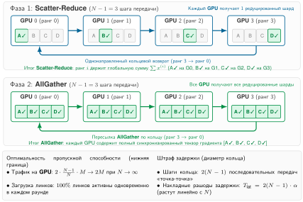

***Поток данных кольцевого AllReduce**: узлы, расположенные в логическое кольцо, обмениваются частями в две фазы: фаза Scatter-Reduce (каждый узел накапливает частичную сумму одной части), за которой следует фаза AllGather (полные суммы циркулируют ко всем узлам). На рисунке кольцо изображено горизонтально, с обходной шиной, замыкающей петлю; каждый линк используется одновременно, что обеспечивает оптимальность по пропускной способности.*

Ключевое свойство, видимое на [рисунке «Поток данных кольцевого AllReduce»](#fig-ring-allreduce), состоит в том, что каждый линк на каждом шаге несет данные одновременно и ни один линк не простаивает. Именно это равномерное использование линков делает кольцевой AllReduce оптимальным по пропускной способности: каждый узел отправляет ровно $2(N-1)/N \cdot M$ байт суммарно за обе фазы, что совпадает с информационно-теоретической нижней границей. Раздел «Кольцо, дерево и рекурсивное деление пополам и удвоение» [приложения «Коммуникация»](appendix_communication.md#sec-appdx-comm-foundations-ring-vs-tree) разбирает сопоставимые примеры, сравнивающие кольцо, дерево и рекурсивное деление пополам и удвоение, и показывает, как лучший алгоритм меняется с размером сообщения. Так читатель получает конкретные числа перехода, которые можно сопоставить с выводами по каждому алгоритму, развитыми здесь.

Чтобы сделать алгоритм кольца конкретным, рассмотрим пошаговую трассу: 4 GPU редуцируют вектор из 4 элементов суммированием. Каждый GPU $i$ начинает с локального вектора градиента $g_i = [a_i, b_i, c_i, d_i]$. Вектор делится на 4 части (по одной на GPU), и алгоритм проходит две фазы.

<a id="exmp-collective-communication-ring-allreduce-step-by-step-trace-4-gpus"></a>

> **Кольцевой AllReduce: пошаговая трасса (4 GPU)**
>
> **Сценарий**: четыре GPU ($0 \to 1 \to 2 \to 3 \to 0$) выполняют кольцевой AllReduce над локальными векторами $[1, 5, 3, 7]$, $[2, 6, 4, 8]$, $[3, 7, 5, 9]$ и $[4, 8, 6, 10]$, чтобы вычислить поэлементную сумму $[10, 26, 18, 34]$.
>
> **Диагноз**: стандартные серверы параметров страдают от узкого места пропускной способности центрального редуктора (передача данных $O(N)$). Кольцевой AllReduce разбивает векторы на $N=4$ части, выполняя $N-1$ шагов Scatter-Reduce для агрегации сумм, а затем $N-1$ шагов AllGather для распределения результатов.
>
> **Системный урок**: кольцевой AllReduce достигает оптимального использования пропускной способности: каждый GPU отправляет суммарно $2\frac{N-1}{N}M$ данных независимо от размера кластера $N$, отвязывая объем передачи байтов от числа узлов.

Перед тем как двигаться дальше, трасса оставляет проверить два механизма: число шагов $2(N-1)$ и то, что каждый ранг отправляет и принимает на каждом шаге.


*Задержка кольца растет с N; задержка дерева остается логарифмической.*

<a id="chk-collective-communication-ring-allreduce-mechanics"></a>

> **Контрольные вопросы: механика кольцевого AllReduce**
>
> Проверьте свое понимание редукции, оптимальной по пропускной способности:
>
> - [ ] **Число шагов**: вычислите число последовательных шагов, которое нужно кольцу из $N$ GPU, чтобы завершить полный AllReduce.
> - [ ] **Оптимальность по пропускной способности**: объясните, почему кольцевой AllReduce оптимален по пропускной способности, включая то, сколько раз каждый байт полного сообщения $M$ проходит через сеть на каждом GPU.
> - [ ] **Влияние отстающего**: определите, как меняется общее время завершения коллектива, если один GPU в кольце на 50 процентов медленнее остальных.
> - [ ] **Двойственность отправки и приема**: верно или неверно утверждение, что каждый GPU на каждом шаге кольцевого AllReduce является и отправителем, и получателем?

Трасса в примере [«Кольцевой AllReduce»](#exmp-collective-communication-ring-allreduce-step-by-step-trace-4-gpus) иллюстрирует ключевое свойство кольцевого AllReduce: на каждом шаге активен каждый линк кольца, а данные текут в одном направлении. Ни один GPU никогда не простаивает, и ни один линк не недоиспользуется. Такое равномерное использование линков и делает кольцо оптимальным по пропускной способности.

Производительность прямо следует из структуры алгоритма. Каждый узел отправляет и принимает $\frac{M}{N}$ байт на каждом из $2(N-1)$ шагов.

$$
T_{\text{ring}} = \underbrace{2(N-1)\alpha}_{\text{Член задержки}} + \underbrace{2\frac{N-1}{N} \frac{M}{\beta}}_{\text{Член пропускной способности}}
$$

- **Пропускная способность**: при $N \to \infty$ член стремится к $2M/\beta$. Это теоретически оптимально: каждый байт должен быть отправлен один раз и принят один раз.
- **Задержка**: задержка растет линейно с $N$. Для 10 000 узлов 20 000 последовательных переходов создают огромную задержку. Поэтому кольцо плохо подходит для малых сообщений.

<a id="sec-communication-collective-operations-tree-allreduce"></a>

### Древовидный AllReduce

Кольцевой AllReduce платит высокую цену в задержке за оптимальность по пропускной способности. Когда кластер вырастает до тысяч GPU, а размер сообщения умеренный (несколько мегабайт), член задержки $2(N-1)\alpha$ подавляет член пропускной способности, и алгоритм тратит большую часть времени на последовательные переходы, а не на полезную передачу данных. Чтобы справиться с линейной задержкой, древовидный AllReduce использует структуру бинарного дерева, которая работает в две фазы. В фазе редукции листья отправляют значения родителям, которые суммируют входящие значения и передают их выше, достигая корня за $\log_2 N$ шагов. В фазе рассылки корень отправляет результат обратно вниз к листьям за еще $\log_2 N$ шагов.

У древовидного AllReduce хуже эффективность пропускной способности из-за недоиспользования линков. В кольцевом AllReduce каждый узел отправляет и принимает одновременно, поэтому все $N$ линков активны на каждом шаге. В древовидном AllReduce в любой момент активна лишь часть линков, и эта доля уменьшается на каждом уровне. На листьях $N/2$ узлов отправляют $N/2$ родителям, оставляя половину узлов простаивающими получателями; на следующем уровне вверх $N/4$ узлов отправляют $N/4$ родителям, оставляя простаивающими три четверти; в корне взаимодействуют только два узла, а остальные $(N-2)$ простаивают. В итоге кольцо на больших сообщениях на сбалансированном кольце достигает почти 100-процентного использования линков, тогда как простое дерево может оставлять многие линки простаивающими и концентрировать трафик около корня или внутренних линков.

Итоговая временная сложность зависит от конкретного варианта дерева. Простое дерево «редукция, затем рассылка» имеет логарифмическую задержку, но неравномерный трафик и узкие места в корне и во внутренних узлах; варианты в стиле рекурсивного удвоения могут нести $\mathcal{O}(\log N)$ пропускной способности полного сообщения на ранг. Следующая упрощенная модель отражает преимущество по задержке и возможный штраф по пропускной способности для древовидных коллективов:

$$ T_{\text{дерево}} \approx \underbrace{2\log_2 N \cdot \alpha}_{\text{Задержка}} + \underbrace{2 \log_2 N \frac{M}{\beta}}_{\text{Штраф пропускной способности в вариантах с обменом полными сообщениями}} $$

Член задержки логарифмический ($\mathcal{O}(\log N)$): для 1 024 узлов кольцу нужно 2 046 шагов, а дереву только 20. Это сокращение числа шагов в 100 раз делает дерево предпочтительным алгоритмом для коллективов, чувствительных к задержке, таких как AllReduce тензорного параллелизма на каждом слое, где сообщения малы, но частота высока. Член пропускной способности несет штраф, потому что древовидные алгоритмы могут недоиспользовать линки или концентрировать трафик на внутренних линках, а обмены полными сообщениями в стиле рекурсивного удвоения добавляют множитель пропускной способности $\log_2 N$. Эти штрафы делают наивные варианты дерева плохим выбором для большого AllReduce градиентов в параллелизме по данным, где эффективность пропускной способности определяет, насыщена сеть или частично простаивает.

Этот штраф по пропускной способности катастрофичен для крупномасштабного параллелизма по данным, когда реализация многократно обменивает полные сообщения или создает узкие места в корне и внутренних узлах. Для AllReduce градиента модели на 70 млрд параметров размером 140 ГБ на 1 000 GPU неэффективный по пропускной способности вариант дерева может свести на нет преимущество по задержке, которое его и мотивировало. Оптимизированные алгоритмы двойного дерева существуют именно для того, чтобы сохранять логарифмическую задержку, не накладывая этого наивного штрафа по пропускной способности.

Древовидный AllReduce, однако, является правильным выбором, когда главное узкое место — задержка, как правило для небольших коллективов с малыми сообщениями. Каноническая задача — чувствительный к задержке AllReduce, нужный тензорному параллелизму, который работает с активациями или градиентами весов внутри одного слоя. Для группы из 8 GPU внутри узла, обменивающейся тензором в 1 МБ, задержка падает с $2(8-1)\alpha = 14\alpha$ у кольца до $2\log_2(8)\alpha = 6\alpha$ у дерева. На таком размере штраф по пропускной способности умеренный, поэтому сокращение числа последовательных шагов запуска может выиграть.

<a id="sec-communication-butterfly"></a>

### Рекурсивное деление пополам и удвоение (butterfly)

Кольцо и дерево представляют две крайности компромисса между задержкой и пропускной способностью: кольцо оптимально по пропускной способности, но бедно по задержке, а дерево оптимально по задержке, но бедно по пропускной способности. Третий подход сочетает логарифмическую задержку дерева с лучшим использованием пропускной способности. Алгоритм **рекурсивного деления пополам и удвоения** (иногда его называют алгоритмом «бабочка», butterfly) выполняется за $2\log_2 N$ раундов: $\log_2 N$ раундов ReduceScatter, за которыми следуют $\log_2 N$ раундов AllGather. В каждом раунде $k$ любой из фаз каждый GPU обменивается данными с партнером на расстоянии $2^k$ в логической нумерации, а размер сообщения вдвое уменьшается (в фазе ReduceScatter) или вдвое увеличивается (в фазе AllGather).

В фазе ReduceScatter (первые $\log_2 N$ раундов) GPU $i$ объединяется в пару с GPU $i \oplus 2^k$ (XOR индексов), и они обмениваются половиной своих текущих данных. После получения каждый GPU суммирует свою половину с принятой и отбрасывает другую половину. После $\log_2 N$ раундов каждый GPU держит $M/N$ байт полностью редуцированного результата. Фаза AllGather обращает процесс: в каждом раунде партнеры обмениваются своими редуцированными частями, удваивая данные, которые держит каждый GPU, пока все GPU не получат полный результат.

Производительность рекурсивного деления пополам и удвоения:

$$ T_{\text{butterfly}} = 2\log_2 N \cdot \alpha + 2\frac{N-1}{N} \cdot \frac{M}{\beta} $$

Это дает лучшее из двух миров: логарифмическую задержку ($\mathcal{O}(\log N)$, как у дерева) и оптимальное по пропускной способности перемещение данных ($2(N-1)/N \cdot M/\beta$, как у кольца). Подвох в том, что алгоритм требует коммуникации с несоседними узлами (GPU $i$ должен общаться с GPU $i \oplus 2^k$, которые могут быть физически далеко), а также требует, чтобы $N$ было степенью двойки. Для кластеров, где $N$ не является степенью двойки, нужна дополнительная сложность для обработки нерегулярных случаев.

Рекурсивное деление пополам и удвоение используется в реализациях коллективов в стиле MPI и полезно как теоретическая точка в компромиссе между задержкой и пропускной способностью (Thakur et al., 2005). Семейства алгоритмов NCCL включают кольцевой, основанный на дереве, иерархический, учитывающий NVLink/NVSwitch, и учитывающий шаблон выбор; точные названия и доступность меняются от версии к версии и от топологии (Jeaugey, 2017; NVIDIA, 2026). Устойчивый вывод заключается не в названии конкретного релиза: практические библиотеки коммуникации выбирают алгоритмы по модели стоимости с учетом топологии, потому что нелокальные шаблоны коммуникации могут создавать конкуренцию за общие сетевые линки, которая разъедает теоретические преимущества.

Параллелизм последовательности и маршрутизация экспертов в MoE наиболее резко выявляют чувствительность рекурсивного деления пополам и удвоения к топологии. В параллелизме последовательности AllGather восстанавливает шарды активаций, а ReduceScatter перераспределяет их по измерению последовательности; схема обмена между рангами следует той же логике удвоения расстояния, что и алгоритм butterfly. В маршрутизации MoE каждый токен должен достичь любого из $N$ GPU с экспертами, создавая тот же шаблон веерного разветвления: расписание в стиле butterfly на последнем раунде создает пары, пересекающие границы, потому что рассылка токенов должна пройти весь диаметр кластера. Следующая трасса ReduceScatter на восьми GPU показывает, как возникают эти дальние пересечения.

Чтобы сделать это конкретным, рассмотрим фазу ReduceScatter для 8 GPU, которая идет за $\log_2(8) = 3$ раунда. В раунде $k=0$ каждый GPU $i$ объединяется в пару с GPU $i \oplus 1$, соединяя соседей: (0,1), (2,3), (4,5), (6,7). Они обмениваются половиной своих данных и редуцируют. В раунде $k=1$ расстояние удваивается: GPU $i$ объединяется с GPU $i \oplus 2$, создавая пары (0,2), (1,3), (4,6), (5,7). В раунде $k=2$ расстояние удваивается снова: GPU $i$ объединяется с GPU $i \oplus 4$, создавая пары (0,4), (1,5), (2,6), (3,7).

Проблема этого шаблона становится ясной на реальном оборудовании. Пары раунда $k=2$ заставляют коммуницировать через физические границы. Если GPU 0–3 находятся в одном узле, а 4–7 в другом, последний раунд создает межузловой трафик между двумя узлами. Для кластера из 1 000 GPU (приближенно 1 024 для алгоритма) последний раунд объединяет GPU $i$ с GPU $i \oplus 512$, заставляя GPU в первой половине кластера общаться с партнерами во второй половине и потенциально затопляя фабрику верхнего уровня, которая соединяет серверные стойки. Этот не учитывающий топологию шаблон коммуникации — причина, по которой теоретическая оптимальность butterfly не превращается в практическое превосходство на больших иерархических кластерах.

<a id="sec-communication-double-tree"></a>

### Двойное двоичное дерево

NCCL может использовать **двойное двоичное дерево** для многих размеров сообщений и топологий. Оно решает проблему неэффективности по пропускной способности стандартного бинарного дерева, не требуя нелокальной коммуникации алгоритма butterfly (Jeaugey, 2017; NVIDIA, 2026). Идея в том, чтобы построить два независимых бинарных дерева, которые вместе покрывают все линки, а затем выполнять оба дерева одновременно, каждое из которых несет половину данных.

В стандартном бинарном дереве на каждом уровне активна только половина линков (остальные простаивают, потому что эти узлы принимают, а не отправляют). Построение второго, дополняющего дерева (с корнем в другом узле и ребрами, которые покрывают линки, не используемые первым деревом) позволяет обоим деревьям работать параллельно. Каждое дерево несет $M/2$ байт, и поскольку их использование линков взаимно дополняет друг друга, совокупное использование линков приближается к 100 процентам, достигая эффективности пропускной способности кольца при сохранении логарифмической задержки $\mathcal{O}(\log N)$ дерева.

Совокупная производительность приблизительно равна:

$$ T_{\text{двойное дерево}} \approx 2\log_2 N \cdot \alpha + \frac{2M}{\beta} $$

На практике член пропускной способности приближается к $2M/\beta$ (оптимально), сохраняя логарифмическую задержку. Это делает двойное двоичное дерево сильным выбором для широкого диапазона размеров сообщений и числа узлов, поэтому библиотеки коммуникации выбирают его во многих конфигурациях. Алгоритм требует тщательного построения двух дополняющих деревьев, чтобы они не создавали конкуренцию за линки, и эту задачу решает поиск графа с учетом топологии, который NCCL выполняет при инициализации.

Широкая конкурентоспособность двойного дерева по размерам сообщений объясняет, почему размеры бакетов PyTorch DistributedDataParallel (DDP) и FSDP (обычно 25–100 МБ) часто попадают именно в зону перехода, где ни кольцо, ни чистое дерево не оптимальны. Бакет в 25 МБ находится рядом с переходом «кольцо — дерево» для кластеров среднего масштаба, а бакет в 100 МБ начинает благоприятствовать кольцу на медленных сетях. Двойное дерево хорошо справляется с этой промежуточной зоной, и это одна из причин, по которой NCCL динамически выбирает его для многих вызовов синхронизации градиентов DDP/FSDP, а не безусловно выбирает кольцо.

Сравнение алгоритмов AllReduce ([«Сравнение алгоритмов AllReduce»](#tbl-allreduce-comparison)) и границы перехода ([«Переход между алгоритмами коллективной коммуникации»](#fig-allreduce-crossover)) показывает, что выбор алгоритма строго зависит от размера сообщения: дерево доминирует на малых сообщениях, а кольцо выигрывает на больших.

| **Алгоритм**     |         **Задержка**        |            **Пропускная способность** | **Оптимален по пропускной способности?** |          **Ограничение**         |
|:-----------------|:---------------------------:|:-------------------------------------:|:----------------------:|:-------------------------------:|
| **Кольцо**       |    $\mathcal{O}(N)\alpha$   |   $2\frac{N-1}{N}\frac{M}{\beta}$     |          Да            |                —                |
| **Дерево**       | $\mathcal{O}(\log N)\alpha$ | $\mathcal{O}(\log N)\frac{M}{\beta}$  |          Нет           |                —                |
| **Бабочка (butterfly)** | $\mathcal{O}(\log N)\alpha$ |   $2\frac{N-1}{N}\frac{M}{\beta}$  |          Да            |            $N = 2^k$            |
| **Двойное дерево** | $\mathcal{O}(\log N)\alpha$ |      $\approx\frac{2M}{\beta}$       |     Почти оптимально   | Построение дополняющего дерева  |

<a id="tbl-allreduce-comparison"></a>

***Сравнение алгоритмов AllReduce**: каждый алгоритм занимает свою точку в пространстве компромисса между задержкой и пропускной способностью. Кольцо и бабочка достигают оптимальности по пропускной способности с разными характеристиками задержки, тогда как двойное двоичное дерево дает лучший практический компромисс.*

<a id="fig-allreduce-crossover"></a>

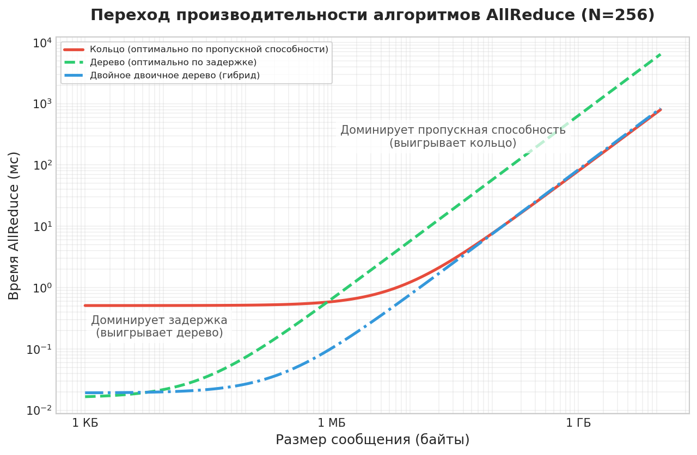

***Переход между алгоритмами коллективной коммуникации**: анализ производительности алгоритмов AllReduce «кольцо», «дерево» и «двойное двоичное дерево» по размерам сообщений (от 1 КБ до 10 ГБ) для кластера из 256 GPU с межсоединением 200 Гбит/с.*

<a id="sec-communication-collective-operations-algorithm-crossover"></a>

### Точка перехода между алгоритмами

Точка перехода на [рисунке «Переход между алгоритмами коллективной коммуникации»](#fig-allreduce-crossover), где кольцо обгоняет дерево, следует из приравнивания $T_{\text{ring}} = T_{\text{tree}}$ и решения относительно $M$. Полные уравнения времени делают компромисс явным:

$$ T_{\text{ring}} = 2(N-1)\alpha + 2\frac{N-1}{N}\frac{M}{\beta} $$
$$ T_{\text{tree}} = 2\log_2 N \cdot \alpha + 2\log_2 N \cdot \frac{M}{\beta} $$

Для большого $N$ выполняется $(N-1) \approx N$ и $\frac{N-1}{N} \approx 1$, так что кольцо платит член задержки, пропорциональный $N$, но передает каждый байт близко к пределу пропускной способности:

$$ T_{\text{ring}} \approx 2N\alpha + \frac{2M}{\beta}, \quad T_{\text{tree}} \approx 2\log_2 N \cdot \alpha + \frac{2\log_2 N \cdot M}{\beta} $$

Дерево имеет противоположную форму: логарифмическую стоимость запуска, но каждый байт сообщения проходит через больше стадий. Приравнивание оценок выделяет размер сообщения, при котором более дешевый путь по задержке перестает компенсировать дополнительную работу по пропускной способности:

$$ 2N\alpha + \frac{2M}{\beta} = 2\log_2 N \cdot \alpha + \frac{2\log_2 N \cdot M}{\beta} $$
$$ \frac{2M}{\beta} - \frac{2\log_2 N \cdot M}{\beta} = 2\log_2 N \cdot \alpha - 2N\alpha $$
$$ \frac{2M}{\beta}(1 - \log_2 N) = 2\alpha(\log_2 N - N) $$

Поскольку $N \gg \log_2 N$ для больших кластеров, $(\log_2 N - N) \approx -N$ и $(1 - \log_2 N) \approx -\log_2 N$, что дает:

$$ \frac{2M}{\beta}(-\log_2 N) \approx 2\alpha(-N) $$
$$ M_{\text{crossover}} \approx \frac{N \cdot \alpha \cdot \beta}{\log_2 N} $$

Для грубой мысленной модели крупного масштаба инженеры иногда отбрасывают логарифмический множитель:

$$ \boxed{M_{\text{crossover}} \approx N \cdot \alpha \cdot \beta} $$

Формула перехода с учетом логарифма дает полезную интуицию, а не жесткое правило выбора. Выше перехода доминирует размер сообщения, и выигрывает эффективность пропускной способности кольца; ниже него доминирует стоимость запуска, и выигрывает логарифмическая глубина дерева.

Для кластера с $\alpha=5\ \text{мкс}$, $\beta=50\ \text{ГБ/с}$ и $N=100$ прямая аппроксимация дает:

$$M_{\text{crossover}} \approx \frac{100 \times 5\cdot 10^{-6} \times 50\cdot 10^9}{\log_2 100} \approx 3{,}8 \text{ МБ}$$

На практике выбор алгоритма в NCCL тоньше, чем простое двустороннее разделение. Алгоритм двойного двоичного дерева дает логарифмическую задержку при почти оптимальной пропускной способности, что делает его конкурентоспособным и с кольцом, и с деревом в широком диапазоне размеров сообщений. NCCL также учитывает число каналов (параллельных потоков коммуникации), сетевую топологию и то, используются ли межузловые или внутриузловые линки. Эффективная логика выбора напоминает многовариантное дерево решений, индексированное по размеру сообщения, числу GPU и типу топологии, а не единственную точку перехода.

Тем не менее формула перехода остается базовой ментальной моделью, позволяющей понять, почему библиотеки делают именно такой выбор. Когда библиотека выбирает неожиданный алгоритм, анализ перехода дает схему рассуждений, чтобы оценить, верен ли выбор или целесообразно ручное переопределение. Конкретный расчет размера буфера применяет эту схему к реалистичному решению:

<a id="nbk-collective-communication-ring-vs-tree-crossover"></a>

> **Переход между кольцом и деревом**
>
> **Задача**: кластер синхронизирует буфер 1 МБ на 64 GPU. Сеть имеет задержку $\alpha =$ 10 мкс и пропускную способность $\beta =$ 10 ГБ/с. Какой алгоритм работает лучше: кольцо или дерево?
>
> **Расчет**:
>
> **Задержка**:
>
> 1.  **Задержка кольца**: $2(N-1)\alpha =$ $2 \times 63 \times 10\ \text{мкс}$ = 1 260 мкс.
> 2.  **Задержка дерева**: $2(\log_2 N)\alpha =$ $2 \times 6 \times 10\ \text{мкс}$ = 120 мкс.
>
> **Пропускная способность** (обратите внимание на различие):
>
> 3.  **Пропускная способность кольца**: $2\frac{N-1}{N}\frac{M}{\beta} \approx$ $2 \times \frac{1\ \text{МБ}}{10\ \text{ГБ/с}}$ = 196,9 мкс (оптимально: каждый байт отправляется один раз).
> 4.  **Пропускная способность дерева**: $2\log_2 N \cdot \frac{M}{\beta} =$ $12 \times \frac{1\ \text{МБ}}{10\ \text{ГБ/с}}$ = 1 200 мкс (каждый уровень отправляет полное сообщение).
>
> В [таблице «Время AllReduce для кольца и дерева при буфере 1 МБ на 64 GPU»](#tbl-collective-communication-ring-vs-tree-1mb-64gpu) члены задержки и пропускной способности суммируются в прямом сравнении:
>
> | **Алгоритм** |              **Задержка**              |            **Пропускная способность**   |                **Итого**                |
> |:-------------|:-------------------------------------:|:------------------------------------:|:---------------------------------------:|
> | **Кольцо**   | 1 260 мкс | 196,9 мкс | 1 456,9 мкс |
> | **Дерево**   | 120 мкс | 1 200 мкс | 1 320 мкс |
>
> <a id="tbl-collective-communication-ring-vs-tree-1mb-64gpu"></a>
>
> ***Время AllReduce для кольца и дерева при буфере 1 МБ на 64 GPU**: члены задержки, пропускной способности и итогового времени при α = 10 мкс и β = 10 ГБ/с.*
>
> Дерево выигрывает, но лишь на 9 процентов. Для этого сообщения в 1 МБ полезная нагрузка находится рядом с точкой перехода.
>
> **Системный вывод**: штраф кольца по задержке (в 10 раз хуже дерева) почти уравновешивает штраф дерева по пропускной способности (в 6 раз хуже кольца). Оценка перехода с учетом логарифма предсказывает $M_{\text{crossover}} \approx N \alpha \beta / \log_2 N = 64 \times 10\ \text{мкс} \times 10\ \text{ГБ/с} / 6 \approx 1{,}1$ МБ. При 1 МБ полезная нагрузка чуть ниже перехода, поэтому выигрывает дерево. При 10 МБ доминировало бы кольцо.

Точка перехода лежит внутри диапазона, который проходят нагрузки DDP и FSDP при обычном обучении. Сообщение в 1 МБ соответствует градиентам одного слоя прямого распространения в небольшом трансформере или полезной нагрузке маршрутизации токенов MoE; обе зоны принадлежат дереву. Бакет градиентов DDP в 10 МБ от трансформерного слоя среднего размера находится рядом с переходом. Слитый бакет DDP, покрывающий несколько слоев, достигает 50–300 МБ, а полный тензор градиента BF16 для модели в 70 млрд параметров — 140 ГБ; оба твердо принадлежат зоне кольца. Большинство реальных нагрузок обучения проходит весь этот диапазон, пока настраиваются размеры бакетов, и анализ перехода задает алгоритмическую границу, отделяющую операции дерева на уровне бакета от полных синхронизаций модели кольцом.

Анализ переходов показывает, что выбор алгоритма — не статическое решение, а зависит от конкретной комбинации размера сообщения, масштаба кластера и параметров сети. На практике библиотеки коммуникации, такие как NCCL, поддерживают внутренние таблицы поиска, которые сопоставляют размер сообщения, число GPU, топологию и настройки протокола с выбранными алгоритмами: кольцом, деревом или гибридными подходами. Понимание лежащей в основе математики перехода позволяет инженерам предсказывать, когда встроенные выборы библиотеки могут быть неоптимальными, и при необходимости переопределять их.

<a id="chk-collective-communication-allreduce-algorithm-selection"></a>

> **Контрольные вопросы: выбор алгоритма AllReduce**
>
> Проверьте свое понимание компромиссов между кольцом и деревом в AllReduce:
>
> - [ ] **Кольцо против дерева**: объясните, почему кольцевой AllReduce достигает коммуникации, оптимальной по пропускной способности (приближаясь к $2M/\beta$), тогда как AllReduce по дереву несет накладные расходы пропускной способности $\mathcal{O}(\log N)$.
> - [ ] **Точка перехода**: вычислите $M_{\text{crossover}}$ для кластера из 256 GPU с $\alpha = 5\ \text{мкс}$ и $\beta = 50\ \text{ГБ/с}$, затем определите, какой алгоритм, кольцо или дерево, должен использовать буфер градиента в 10 МБ.
> - [ ] **Трасса Scatter-Reduce**: проследите фазу Scatter-Reduce кольцевого AllReduce для 3 GPU с вектором из 3 элементов и проверьте, что каждый GPU заканчивает с правильной частичной суммой.
> - [ ] **Предел задержки**: объясните, почему задержка $\mathcal{O}(N)$ кольцевого AllReduce делает его непрактичным для тензорного параллелизма, где размеры сообщений малы и доминирует задержка.

[^fn-moe-sparse-routing]: **Смесь экспертов (MoE)**: архитектура, в которой каждый токен активирует только подмножество специализированных подсетей (экспертов), сокращая FLOP на токен при сохранении полной емкости модели. MoE заменяет однородную плотную редукцию трафиком AllToAll, адресованным конкретным получателям. Мелкогранулярная рассылка может открывать стоимость запуска, более крупные батчи могут упереться в пропускную способность ввода или приема, а перекос маршрутизации или экспертов может сделать емкость бисекции или горячую точку критическим путем.

<a id="sec-communication-collective-operations-collective-operations-mapping-collectives-topology-3214"></a>

## Иерархическая коммуникация

Алгоритмы AllReduce в [разделе «Инженерия потока»](#sec-communication-collective-operations-collective-operations-allreduce-algorithms-7545) предполагают плоскую сеть, в которой все линки имеют одинаковую пропускную способность. Реальные центры обработки данных нарушают это предположение на порядок или больше. Не все провода одинаковы.

Иерархическая коммуникация — ответ на это неравенство. Внутриузловые линки многочисленны и быстры, межузловые линки редки и дороги, поэтому алгоритм должен, когда это возможно, уменьшать полезные нагрузки до того, как они пересекут дефицитный уровень. Именно поэтому один и тот же AllReduce можно реализовать как локальный ReduceScatter, межузловую редукцию и локальный AllGather, а не как один плоский обмен между всеми рангами.

Узел GPU обеспечивает на порядок больше внутриузловой пропускной способности (NVLink, 900 ГБ/с), чем межузловой (InfiniBand, 50 ГБ/с).

<a id="sec-communication-collective-operations-collective-operations-hierarchical-allreduce-1338"></a>

### Иерархический AllReduce

Плоские коллективные алгоритмы предполагают, что каждый линк в кластере дает одинаковую пропускную способность. Это предположение выполняется внутри одного узла, где все GPU соединены через NVLink с одинаковой скоростью, но нарушается в 9 раз на многоузловых кластерах. Реальные кластеры — это иерархические сети с принципиально разной пропускной способностью на каждом уровне, что показывает [таблица «Иерархия пропускной способности»](#tbl-bandwidth-hierarchy).

| **Уровень**    |   **Межсоединение**  |                   **Пропускная способность**                   |                      **Относительная скорость**                      |
|:---------------|:--------------------:|:-------------------------------------------------:|:------------------------------------------------------------:|
| **Внутри узла** |      NVLink 4.0     | `~900 ГБ/с` | в 9 раз быстрее |
| **Между узлами** | InfiniBand NDR 400G | `~50 ГБ/с` |                     1 (базовый уровень)                     |

<a id="tbl-bandwidth-hierarchy"></a>

***Иерархия пропускной способности**: современные кластеры GPU демонстрируют разрыв по пропускной способности на порядок между внутриузловой и межузловой коммуникацией. Иерархические алгоритмы используют этот разрыв. Относительная скорость сравнивает скорости в каждом направлении (однонаправленный NVLink 450 ГБ/с против 50 ГБ/с на порт InfiniBand); столбец пропускной способности показывает суммарную двунаправленную величину по паспортным данным NVLink.*

Наивный плоский кольцевой AllReduce игнорирует эту структуру: он направляет данные через InfiniBand тогда, когда хватило бы NVLink, и насыщает дефицитную межузловую пропускную способность. **Иерархический AllReduce** раскладывает глобальную операцию на три фазы, которые используют иерархию пропускной способности ([«Иерархический AllReduce»](#fig-hierarchical-allreduce)).


*Иерархические коллективы уменьшают полезную нагрузку до того, как она пересечет медленные уровни.*

<a id="fig-hierarchical-allreduce"></a>

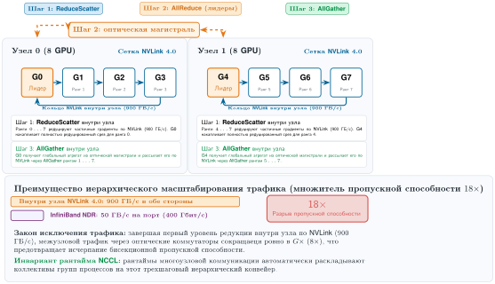

***Иерархический AllReduce**: трехфазная декомпозиция, которая использует разрыв пропускной способности внутри узла и между узлами. Фаза 1 выполняет агрегацию внутри узла по NVLink (кольцо NVLink, действующее как ReduceScatter, оставляет каждый GPU с частичной суммой своего шарда узла), уменьшая межузловой трафик в G раз (G — число GPU на узел). Фаза 2 выполняет AllReduce между соответствующими GPU по InfiniBand. Фаза 3 завершает распределение внутри узла по NVLink (AllGather, возвращающий каждому GPU полный результат). На рисунке фазы подписаны по механике NVLink и IB; окружающий текст называет соответствующие коллективные примитивы.*

[«Иерархический AllReduce»](#fig-hierarchical-allreduce) показывает, как эта трехфазная декомпозиция ограничивает дорогой межузловой трафик фазой 2, где каждый GPU передает только $M/G$ байт вместо $M$. При G = 8 GPU на узел (стандартная конфигурация DGX) это уменьшает трафик оптической фабрики между узлами ровно в 8 раз, фактически умножая дефицитную пропускную способность InfiniBand на число ускорителей в шасси.

Фазы образуют одну причинную цепочку:

1.  **Внутриузловой ReduceScatter по NVLink**: локальная редукция среди $G$ GPU в каждом узле оставляет каждый GPU с $1/G$ частично редуцированных данных, используя только обильную внутриузловую пропускную способность.
2.  **Межузловой AllReduce по InfiniBand**: каждый GPU отправляет свой шард узла через соответствующие позиции GPU, передавая $M/G$ байт вместо $M$.
3.  **Внутриузловой AllGather по NVLink**: каждый узел внутри себя распределяет итоговые шарды, завершая результат без расхода дополнительной межузловой пропускной способности.

Простой бюджет для 8 узлов делает это умножение пропускной способности конкретным:

<a id="nbk-collective-communication-hierarchical-bandwidth-multiplier"></a>

> **Иерархический множитель пропускной способности**
>
> **Задача**: кластер имеет 8 узлов по 8 GPU (всего 64). Системе нужно выполнить AllReduce буфера градиента в 1 ГБ. Сравните плоский кольцевой AllReduce и иерархический AllReduce.
>
> **Плоский кольцевой AllReduce (игнорируя иерархию)**:
>
> - Каждый GPU отправляет около 2 ГБ суммарно (формула оптимального по пропускной способности кольцевого AllReduce).
> - Кольцо многократно пересекает границы узлов.
> - **Эффективная пропускная способность**: ограничена самым медленным линком, 50 ГБ/с (InfiniBand).
> - **Время**: $\approx 2 \times 1\ \text{ГБ} / 50\ \text{ГБ/с}$ = 40 мс (доминирует член пропускной способности).
>
> **Иерархический AllReduce (декомпозиция в три шага)**:
>
> 1. **Внутриузловой ReduceScatter**: каждый GPU отправляет 875 МБ при 450 ГБ/с в каждом направлении → примерно 1,94 мс.
> 2. **Межузловой AllReduce**: каждый GPU выполняет AllReduce шарда $1\ \text{ГБ}/8$ = 125 МБ по InfiniBand. Кольцо перемещает примерно $2(N-1)/N$ раз больше этой полезной нагрузки, и с учетом небольшого члена задержки фаза занимает примерно 4,42 мс при 50 ГБ/с.
>
>    (По InfiniBand проходит только 1/8 данных!)
>
> 3. **Внутриузловой AllGather**: каждый GPU получает 875 МБ при 450 ГБ/с в каждом направлении → примерно 1,94 мс.
> 4. **Итоговое время**: $\approx$ 1,94 мс + 4,42 мс + 1,94 мс = 8,3 мс.
>
> **Системный вывод**: иерархический AllReduce дает ускорение в 4,8 раза, уменьшая межузловую полезную нагрузку с 1 ГБ до 125 МБ на GPU, прежде чем на нее подействует множитель трафика кольца. При 8 GPU на узел иерархия фактически дает в 8 раз большую видимую межузловую пропускную способность. Поэтому NCCL от NVIDIA и аналогичные библиотеки часто выбирают иерархические алгоритмы на многоузловых кластерах, когда топология это поддерживает.

Эти три фазы удерживают большую часть трафика внутри каждого узла, прежде чем он пересечет более медленную межузловую фабрику, и та же идея обобщается за пределы двух уровней. Большие кластеры с несколькими стойками, соединенными через spine-коммутаторы, вводят третий уровень пропускной способности (стойка — стойка при сниженной бисекционной пропускной способности). Для 128 GPU, организованных как 4 стойки по 4 узла по 8 GPU с подпиской 2:1 между стойками, применение той же декомпозиции на каждом уровне уменьшает полезную нагрузку между стойками на GPU в 32 раза по сравнению с исходным градиентом: примерно 15 мс суммарно против 160 мс у плоского AllReduce. Иерархическая декомпозиция концентрирует трафик там, где пропускная способность изобилует, и минимизирует трафик там, где она дефицитна.

<a id="sec-communication-sharp"></a>

### Внутрисетевая редукция: SHARP и далее

[«Внутрисетевая редукция SHARP и стандартный древовидный AllReduce»](#fig-sharp-innetwork) противопоставляет программный древовидный AllReduce аппаратной агрегации в коммутаторах. В стандартном программном древовидном AllReduce (панель a) рабочие GPU передают полные тензоры градиентов вверх по иерархии фабрики к назначенному корневому GPU, концентрируя узкие места арифметики и пропускной способности PCIe в этой единственной конечной точке, а затем рассылают результаты обратно вниз. Напротив, архитектуры внутрисетевой редукции, такие как Scalable Hierarchical Aggregation and Reduction Protocol (SHARP) от NVIDIA (панель b), переносят ассоциативную редукцию прямо в ASIC коммутаторов (специализированные интегральные схемы) с линейной скоростью. Вверх по уровням фабрики поднимаются только агрегированные частичные суммы, а штраф за последовательную обработку на корневом GPU полностью исчезает.

<a id="fig-sharp-innetwork"></a>

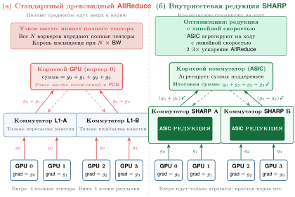

***Внутрисетевая редукция SHARP против стандартного древовидного AllReduce**: панель (a) иллюстрирует стандартный древовидный AllReduce, в котором полные тензоры градиентов от всех рабочих GPU проходят через промежуточные коммутаторы без агрегации и сходятся к одному корневому GPU, который выполняет арифметику «сохранить и переслать» по насыщенным линкам PCIe. Панель (b) иллюстрирует вычисления в сети NVIDIA SHARP, где ASIC коммутаторов агрегируют частичные суммы на ходу с линейной скоростью, передавая вверх только редуцированные полезные нагрузки и устраняя промежуточные обращения к памяти хоста.*

Иерархический AllReduce уменьшает объем межузлового трафика, но агрегация все равно требует нескольких сетевых обходов. Протокол **Scalable Hierarchical Aggregation and Reduction Protocol (SHARP)** от NVIDIA[^fn-sharp-innetwork-aggregation] реализует эту идею: вместо того чтобы градиенты уходили в целевой GPU для суммирования, коммутатор InfiniBand агрегирует частичные суммы по мере прохождения пакетов данных через него.

[^fn-sharp-innetwork-aggregation]: **SHARP (Scalable Hierarchical Aggregation and Reduction Protocol)**: вычисления в сети на коммутаторах Quantum InfiniBand, которые выполняют операции редукции (например, сумму, минимум и максимум), когда пакеты проходят по дереву агрегации (Graham et al., 2020). В той же работе сообщается о заметно более высокой пропускной способности редукции по сравнению с алгоритмами на хосте и описаны ограничения ресурсов коммутатора на число одновременных групп и деревьев агрегации, которые могут создавать конкуренцию, когда многие коллективы борются за одни и те же внутрисетевые ресурсы.

Выгода двояка. Во-первых, SHARP уменьшает трафик памяти конечных точек и может снижать нагрузку на верхние линки, агрегируя пакеты до того, как они покинут уровень коммутатора. В программной древовидной редукции данные приходят в GPU, записываются в память, суммируются с локальными данными и только затем передаются на следующий уровень. С SHARP коммутатор объединяет входящие пакеты на ходу и пересылает агрегат по дереву редукции. Во-вторых, SHARP устраняет путь «сохранить и переслать» через промежуточные GPU. Каждый программный переход добавляет полную стоимость $\alpha$-$\beta$; при агрегации внутри коммутатора редукция происходит внутри ASIC коммутатора, а не в памяти конечной точки.

Практический эффект наиболее заметен для размеров сообщений, где задержка агрегации заметно вносит вклад в полное время AllReduce. Для очень больших сообщений пропускная способность доминирует независимо от алгоритма, и уменьшение задержки SHARP становится пропорционально меньше. Для очень малых сообщений фиксированные накладные расходы обработки на коммутаторе могут ограничивать выгоду. Graham et al. (2020) сообщают о росте пропускной способности редукции в несколько раз и о меньших выигрышах на уровне приложений для нагрузок PyTorch, когда SHARP Streaming-Aggregation включен на коммутаторах HDR/Quantum InfiniBand.

Кампании сильного масштабирования (обучение фиксированной модели на большем числе ускорителей без пропорционального роста размера батча) — именно те нагрузки, где снижение задержки SHARP переходит в сокращение времени шага. По мере того как батч на ускоритель уменьшается, каждый тензор градиента остается большим (пропорционально размеру модели), но проход назад на ускоритель укорачивается. Поэтому коммуникация занимает все большую долю времени шага, и член задержки $\alpha$ в формуле кольца упирается в узкое место. Агрегация внутри коммутатора напрямую снижает эту стоимость задержки. Производители ASIC коммутаторов явно расширили ASIC InfiniBand, чтобы поддерживать типы данных, нативные для ML, включая FP16 и BF16. Это подтверждает, что SHARP развивается вместе с требованиями ML-нагрузок, а не обслуживает только устаревшие операции с плавающей запятой HPC, которые мотивировали его исходный дизайн. Команде ML-системы, которая выбирает инфраструктуру SHARP для кампании масштабирования, следует проверить поддержку агрегации FP16/BF16 в конкретном поколении коммутаторов, поскольку более ранние ASIC поддерживали только FP32 и INT32.

У SHARP есть и ограничения. Коммутатор должен поддерживать конкретную операцию редукции (обычно сумму, минимум и максимум для типов с плавающей запятой и целых чисел). Число одновременных деревьев агрегации SHARP ограничено ресурсами коммутатора, поэтому большие кластеры с множеством одновременных учебных заданий могут исчерпать емкость SHARP. Кроме того, SHARP требует инфраструктуры InfiniBand; на сетях на основе Ethernet он недоступен.

<a id="sec-communication-collective-operations-collective-operations-topology-detection-selection-2dc7"></a>

### Маршрутизация с учетом топологии

Иерархический AllReduce уменьшает межузловой трафик, а SHARP устраняет часть его полностью, однако ни один из этих приемов не решает более тонкой проблемы: как логический шаблон коммуникации отображается на физическую топологию сети. Кольцевой AllReduce среди 64 GPU создает логическое кольцо, но то, какие физические линки несут каждый переход, определяет, достигает ли кольцо пиковой пропускной способности или создает перегрузку. Два запуска одного и того же учебного задания на одном и том же оборудовании могут различаться по пропускной способности коммуникации в 2 раза в зависимости от того, как ранги назначены GPU и как получающийся трафик взаимодействует с физической структурой сети.

Библиотеки коммуникации, такие как NCCL, выполняют **обнаружение топологии** при инициализации, запуская алгоритмы поиска по графу, чтобы обнаружить физическую структуру сети и найти пути коммуникации с высокой пропускной способностью (NVIDIA, 2026). Библиотека должна определить для каждой пары рангов, сидит ли партнер на локальном коммутаторе NVLink или в 100 метрах через фабрику InfiniBand, потому что один и тот же коллективный алгоритм может отличаться по пропускной способности в 2 раза или больше в зависимости от того, как логические ранги отображаются на физическое оборудование.

Обнаружение топологии начинается с перечисления оборудования. NCCL опрашивает шину PCIe, чтобы узнать размещение GPU, связность NVLink между GPU и сродство NIC к коммутатору PCIe. На основе этой информации строится внутренний граф, в котором узлы — это GPU, а ребра — физические линки с аннотированными пропускной способностью и задержкой. Затем алгоритм поиска по графу находит пути коммуникации, которые максимизируют совокупную пропускную способность и минимизируют число переходов между доменами (переходов между доменами NVLink, PCIe и InfiniBand). Именно такой выбор путей с учетом топологии позволяет NCCL приближаться к теоретическому пику пропускной способности на правильно настроенных системах, тогда как реализации, не учитывающие топологию, могут оставлять неиспользованной значительную долю пропускной способности.

<a id="sec-collective-communication-torus-topology-tpu-pods-68b2"></a>

#### Тороидальная топология (поды TPU)

[«Редукция с упорядоченными измерениями на тороидальной топологии»](#fig-torus-reduction) иллюстрирует редукцию с упорядоченными измерениями на двумерной сетке тора (педагогическая проекция трехмерных подов Tensor Processing Unit, TPU). Вместо того чтобы рассматривать кластер как неограниченную фабрику «все со всеми», коллектив раскладывается по координатным осям: фаза 1 выполняет независимые кольцевые AllReduce вдоль каждой горизонтальной строки параллельно, затем фаза 2 выполняет независимые кольцевые AllReduce вдоль каждого вертикального столбца. Такое расписание, выровненное по осям, направляет трафик исключительно через прямые линки к физическим соседям, избегая перегрузки бисекции, и сокращает задержку шагов с $2(N-1) = 30$ шагов на плоском кольце из 16 узлов до $2(X-1) + 2(Y-1) = 12$ шагов, то есть в 2,5 раза.

<a id="fig-torus-reduction"></a>

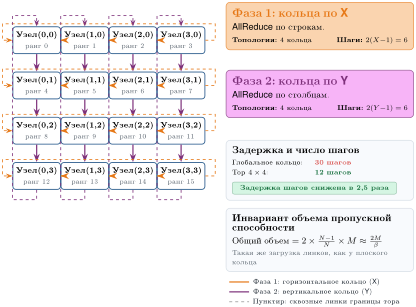

***Редукция с упорядоченными измерениями на тороидальной топологии**: на двумерной сетке тора (4×4 узла, упрощенный срез пода TPU) AllReduce выполняется последовательно вдоль ортогональных измерений. Фаза 1 (оранжевая) выполняет четыре параллельных горизонтальных кольца по измерению X (2(X−1) = 6 шагов). Фаза 2 (фиолетовая) затем выполняет четыре параллельных вертикальных кольца по измерению Y (2(Y−1) = 6 шагов) над частичными суммами, агрегированными по строкам. Пунктирные линки обозначают сквозные соединения тора через границу. Эта декомпозиция по упорядоченным измерениям сокращает задержку шагов в 2,5 раза относительно одномерного глобального кольца, сохраняя при этом оптимальный инвариант объема пропускной способности 2M/β.*

Пододы TPU Google используют трехмерную тороидальную топологию, в которой каждый TPU соединен напрямую с 6 соседями $(\pm X, \pm Y, \pm Z)$; [«Редукция с упорядоченными измерениями на тороидальной топологии»](#fig-torus-reduction) показывает ту же идею упорядоченных измерений как двумерное упрощение. В отличие от иерархической топологии fat-tree кластеров InfiniBand, тор обеспечивает равномерную прямую связность: каждый TPU-чип имеет одинаковое число линков (6) и одинаковую пропускную способность каждого линка независимо от своей позиции в сетке. Оптимальная стратегия AllReduce для этой топологии — **редукция с упорядоченными измерениями** (Dimension-Ordered Reduction):

1. Редукция вдоль X для каждой фиксированной линии $(Y,Z)$, дающая частичные суммы по измерению X.
2. Редукция этих частичных сумм вдоль Y для каждой фиксированной линии $(X,Z)$, дающая частичные суммы по плоскости $X \times Y$.
3. Редукция этих частичных сумм вдоль Z для каждой фиксированной линии $(X,Y)$, завершающая глобальный результат.

Каждая редукция с упорядоченными измерениями сама является кольцевым AllReduce вдоль одного выровненного по оси кольца тора. Для пода с $X{\times}Y{\times}Z$ TPU первый шаг выполняет независимые кольца по измерению X, по одному на каждую фиксированную координату $(Y,Z)$, так что каждый участник получает частичную сумму по своей линии X. Второй шаг выполняет кольца по измерению Y, объединяя эти частичные суммы по Y, а третий шаг выполняет кольца по измерению Z, завершая глобальную редукцию. Такая каскадная редукция достигает суммарной стоимости пропускной способности $2M/\beta$ (как у одного кольца), но задержка пропорциональна $2(X + Y + Z)$, а не $2(X \times Y \times Z)$, потому что кольцо каждого измерения короче глобального.

Редукция с упорядоченными измерениями минимизирует диаметр сети и гарантирует, что каждый линк несет трафик только в одном направлении в каждый момент, избегая перегрузки. Топология тора также дает естественную отказоустойчивость через альтернативные пути маршрутизации: если один линк по измерению X выходит из строя, трафик может обойти его через измерения Y или Z ценой увеличения задержки. Компилятор Google Accelerated Linear Algebra (XLA) автоматически генерирует коллективы с упорядоченными измерениями при работе на подах TPU, абстрагируя детали топологии от пользователя.

<a id="sec-communication-railoptimized-routing-nvidia-dgx-7081"></a>

#### Маршрутизация, оптимизированная под рельсы (NVIDIA DGX)

В системах NVIDIA DGX у каждого GPU есть собственная выделенная сетевая карта (NIC). Маршрутизация, оптимизированная под рельсы, использует это, обеспечивая, чтобы GPU, стоящие на одной позиции в своих узлах, общались только друг с другом:

- GPU 0 на узле A общается только с GPU 0 на узле B, узле C и так далее.
- GPU 1 на узле A общается только с GPU 1 на других узлах.
- И так далее для GPU 2–7.

Это создает 8 независимых «рельсов» коммуникации, которые работают параллельно без конкуренции, как показывает [таблица «Распределение трафика по рельсам»](#tbl-rail-optimized).

| **Рельс**   | **Участники**                                                                              | **Трафик** |
|:-----------|:-------------------------------------------------------------------------------------------|:-----------:|
| **Рельс 0** | Узел0-GPU0 $\leftrightarrow$ Узел1-GPU0 $\leftrightarrow$ Узел2-GPU0 $\leftrightarrow$ ... |  $M/8$ на каждого |
| **Рельс 1** | Узел0-GPU1 $\leftrightarrow$ Узел1-GPU1 $\leftrightarrow$ Узел2-GPU1 $\leftrightarrow$ ... |  $M/8$ на каждого |
| **...**    | ...                                                                                        |     ...     |
| **Рельс 7** | Узел0-GPU7 $\leftrightarrow$ Узел1-GPU7 $\leftrightarrow$ Узел2-GPU7 $\leftrightarrow$ ... |  $M/8$ на каждого |

<a id="tbl-rail-optimized"></a>

***Распределение трафика по рельсам**: каждый рельс несет 1/8 общего трафика независимо.*

Выравнивание по рельсам критически важно: без него все 8 GPU узла могли бы одновременно отправлять данные одному удаленному GPU, создавая 8-кратную конкуренцию за одну сетевую карту. Маршрутизация, выровненная по рельсам, гарантирует, что каждая сетевая карта обрабатывает ровно 1/8 трафика, достигая полного использования бисекционной пропускной способности.

Маршрутизация по рельсам и иерархический AllReduce усиливают друг друга. В иерархической декомпозиции, описанной в [разделе «Иерархический AllReduce»](#sec-communication-collective-operations-collective-operations-hierarchical-allreduce-1338), шаг 2 (межузловой AllReduce) естественно совпадает с рельсовой топологией. GPU $i$ на каждом узле общается только с GPU $i$ на других узлах, что и есть рельсовый шаблон. Это совпадение не случайно: NVIDIA проектировала аппаратуру DGX с расчетом на коммуникацию, оптимизированную под рельсы, а иерархические алгоритмы NCCL могут использовать эту структуру, когда топология обнаружена и ранги отображены правильно. Когда логический шаблон коммуникации совпадает с физической топологией, каждая сетевая карта несет свою долю трафика, и кластер может приблизиться к теоретическому пику бисекционной пропускной способности.

Несоответствие между логической и физической топологией — частый источник деградации производительности, которую трудно диагностировать без тщательного профилирования. Если ранги процессов назначены произвольно (например, планировщиком задач без учета топологии), иерархический AllReduce может направлять межузловой трафик через не те сетевые карты, создавая горячие точки, которые снижают эффективную пропускную способность в 2–4 раза. Крупные развертывания используют назначение рангов с учетом топологии (настраивается через `CUDA_VISIBLE_DEVICES` и политики привязки GPU планировщика), чтобы обеспечить выравнивание.

Иерархическое исполнение коллективов в сочетании с маршрутизацией с учетом топологии максимизирует эффективную пропускную способность фабрики в сложных сетевых топологиях: модель α-β выявляет узкое место (межузловая пропускная способность), иерархическая декомпозиция уменьшает трафик через это узкое место, а оптимизация по рельсам гарантирует, что уменьшенный трафик идет без конкуренции. Вместе эти приемы сокращают разрыв между теоретическим пиком пропускной способности и достигнутой пропускной способностью на правильно настроенных кластерах.

<a id="sec-communication-collective-operations-collective-operations-gradient-compression-7a5c"></a>

## Сжатие градиентов в условиях дефицита пропускной способности

Даже после настройки топологии и выбора алгоритма система может оставаться ограниченной пропускной способностью, потому что физическая фабрика не может переместить полезные нагрузки градиента достаточно быстро. В этом режиме отправка меньшего числа битов становится осознанным проектным выбором, а не универсальным последним средством. Предыдущий раздел атаковал узкое место коммуникации со стороны расписания и топологии; сжатие полезной нагрузки атакует то же узкое место, меняя то, что пересекает фабрику.

Стена пропускной способности возникает наиболее остро в двух сценариях: обучение между центрами обработки данных, соединенными глобальными сетями (где пропускная способность в 10–100 раз ниже InfiniBand), и обучение на облачных инстансах с обычной сетью Ethernet, где RDMA недоступен или ограничен. В этих условиях ограниченной пропускной способности методы сжатия градиентов могут уменьшить объем коммуникации в 4–1000 раз ценой внесения шума в процесс оптимизации. Центральное напряжение — между уменьшением пропускной способности и толерантностью процесса оптимизации к шуму: сколько сжатия оптимизатор может поглотить, прежде чем будет скомпрометирована сходимость.

<a id="sec-communication-collective-operations-collective-operations-quantization-reducing-precision-815b"></a>

### Квантование: снижение точности

Квантование — наименее разрушительный рычаг сжатия, когда пропускная способность является ограничивающей, потому что оно сохраняет каждый элемент градиента, но уменьшает число битов, которыми он представлен. Большинство градиентов вычисляется в FP32 (32-битная плавающая запятая) или BF16 (16-битный brain float), поэтому уменьшение разрядности напрямую снижает объем коммуникации. Полезный вопрос в том, сколько точности градиента оптимизатор может поглотить. Последовательность от мягкого к агрессивному квантованию показывает компромисс между коэффициентом сжатия и точностью градиента:

1. **FP16 (16 бит)**: распространенная базовая линия для обучения на ускорителях. Вдвое меньше битов, чем у FP32, с минимальным влиянием на сходимость для многих моделей. Дает сжатие в 2 раза относительно FP32.
2. **INT8 (8 бит)**: квантовать каждый вектор градиента в 256 дискретных уровней. Для этого нужно вычислять коэффициент масштабирования на тензор: $g_{\text{int8}} = \text{round}(g/s)$, где $s = \max(|g|) / 127$. Получатель восстанавливает $\hat{g} = g_{\text{int8}} \times s$. Дает сжатие в 4 раза относительно FP32, но вносит шум квантования, пропорциональный величине градиента.
3. **1-битный SGD**: крайний случай. Передается только знак каждого элемента градиента (+1 или −1). Получатель восстанавливает значения с помощью обученного или адаптивного коэффициента масштабирования. Это дает сжатие в 32 раза относительно FP32, но вносит существенный шум, который без дополнительных механизмов может ухудшить сходимость (Seide et al., 2014; Karimireddy et al., 2019).

<a id="sec-collective-communication-block-quantization-gradient-communication-c883"></a>

#### Блочное квантование для коммуникации градиентов

Последовательность квантования из предыдущего раздела использует один коэффициент масштабирования на весь тензор, что неявно предполагает равномерное распределение градиента по тензору. На практике распределения градиентов сильно неравномерны: слои внимания дают градиенты с тяжелыми хвостами, слои эмбеддингов — чрезвычайно разреженные градиенты, а слои нормализации — градиенты, сосредоточенные около нуля. Один коэффициент масштабирования на тензор субоптимален, когда распределения градиентов различаются по тензору. Области с малыми градиентами теряют большую часть информации при квантовании с коэффициентом масштабирования, определяемым максимальным значением тензора. **Блочное квантование** решает эту проблему: тензор градиента разбивается на блоки по $b_{\text{block}}$ элементов (обычно $b_{\text{block}} = 64$ или $128$), и для каждого блока вычисляется независимый коэффициент масштабирования. Коэффициент масштабирования каждого блока адаптируется к локальному распределению градиента, уменьшая ошибку квантования ценой передачи дополнительных $d_{\text{grad}}/b_{\text{block}}$ коэффициентов масштабирования.

Для вектора градиента размерности $d_{\text{grad}}$, квантованного в INT8 с размером блока $b_{\text{block}}$, размер сообщения равен $d_{\text{grad}} \times 1\ \text{байт}$ для квантованных значений плюс $(d_{\text{grad}}/b_{\text{block}}) \times 4\ \text{байта}$ для коэффициентов масштабирования FP32, то есть $d_{\text{grad}} + 4d_{\text{grad}}/b_{\text{block}}$ байт суммарно. Эффективное сжатие, таким образом, равно $4d_{\text{grad}} / (d_{\text{grad}} + 4d_{\text{grad}}/b_{\text{block}}) = 4b_{\text{block}} / (b_{\text{block}} + 4)$, что для $b_{\text{block}} = 128$ достигает 3,88 раза, близко к теоретическим 4 разам. Выигрыш в качестве получается от замены глобальной границы ошибки: блочное квантование уменьшает максимальную ошибку квантования с $s \cdot 0{,}5$, где $s$ — глобальный коэффициент масштабирования, до $s_b \cdot 0{,}5$, где $s_b$ — локальный для блока коэффициент. Для тяжелохвостых распределений градиентов, типичных для слоев внимания, это может снизить ошибку квантования в 2–5 раз по сравнению с квантованием на тензор.

Интерфейсы, которые объединяют операции квантования и редукции, делают блочное квантование практичным в сжатии коммуникации, но каждое уменьшение разрядности вносит шум квантования. Этот шум действует как смещение истинного направления градиента. Для агрессивного квантования (INT8, а особенно 1-битного) систематическое смещение может помешать сходимости, если система не несет через шаги коррекцию с обратной связью по ошибке. Поэтому квантование стоит опускать по лестнице точности лишь настолько, насколько позволяет бюджет сходимости.

<a id="sec-communication-collective-operations-collective-operations-sparsification-transmitting-important-gradients-2cd2"></a>

### Разреживание: передача только важных градиентов

Квантование атакует объем коммуникации, уменьшая число битов на элемент градиента, но передавая каждый элемент. Ортогональный подход, **разреживание** (Sparsification), атакует проблему с другой стороны: сохранить полную точность, но передавать только подмножество элементов градиента, а остальные обнулять.

<a id="sec-collective-communication-topk-sparsification-40fc"></a>

#### Разреживание top-k

Наиболее распространенный метод — **сжатие top-k**: для вектора градиента $g \in \mathbb{R}^{d_{\text{grad}}}$ передаются только $K_{\text{top}}$ элементов с наибольшей абсолютной величиной, а остальные обнуляются (Aji and Heafield, 2017; Lin et al., 2018):

$$\text{TopK}(g) = g \odot \mathbf{1}_{|g| \geq |g|_{(K_{\text{top}})}}$$

где $|g|_{(K_{\text{top}})}$ — $K_{\text{top}}$-й по величине наибольший элемент. При $K_{\text{top}} = 0{,}001 \times d_{\text{grad}}$ (сохраняется лишь 0,1 процента элементов) это дает сжатие в 1000 раз.

Заявленное сжатие нужно уменьшить на стоимость кодирования разреженного представления. Передача разреженного градиента требует отправки и ненулевых значений, и их индексов. Для вектора градиента размерности $d_{\text{grad}}$ с $K_{\text{top}}$ ненулевыми элементами кодированное сообщение содержит $K_{\text{top}}$ значений (каждое в FP32 или FP16) плюс $K_{\text{top}}$ индексов (обычно INT32). Полный размер сообщения составляет $K_{\text{top}} \times (4 + 4) = 8 K_{\text{top}}$ байт для значений FP32 с индексами INT32. Эффективный коэффициент сжатия, таким образом, равен $4d_{\text{grad}} / (8 K_{\text{top}}) = d_{\text{grad}} / (2 K_{\text{top}})$.

При $K_{\text{top}} = 0{,}001 d_{\text{grad}}$ кодированное сообщение дает коэффициент сжатия 500 раз, а не 1000 раз, которые предполагает одна только доля сохраненных элементов, потому что накладные расходы на индексы существенны. Уменьшение размера индексов до INT16 (для $d_{\text{grad}} < 65536$) или использование кодирования длин серий для структурированных шаблонов разреженности может улучшить эффективный коэффициент.

Top-k — не единственное правило разреживания. **Random-k** выбирает $K_{\text{rand}}$ элементов равномерно случайно и масштабирует их на $d_{\text{grad}}/K_{\text{rand}}$, чтобы сохранить несмещенную оценку градиента. У Random-k есть преимущество: это несмещенный компрессор даже без коррекции по ошибке, потому что $\mathbb{E}[\text{RandomK}(g)] = g$. Однако он вносит большую дисперсию, чем Top-k, поскольку отбрасывает большие градиенты с той же вероятностью, что и малые. На практике Top-k с коррекцией по ошибке сходится быстрее Random-k при том же коэффициенте сжатия, потому что Top-k сохраняет наиболее информативные компоненты градиента на каждом шаге.

<a id="sec-collective-communication-convergence-problem-43f6"></a>

#### Проблема сходимости

Наивное отбрасывание малых градиентов создает систематическое смещение. Если параметр постоянно получает малые градиенты (например, 0,01 на шаг), он не будет обновляться, потому что 0,01 всегда ниже порога Top-k. За тысячи шагов эти «потерянные» градиенты накапливаются в существенную ошибку, которая не позволяет модели сойтись к истинному оптимуму.

Проблема не только практическая; это фундаментальное математическое препятствие. Без коррекции разреженный SGD — смещенная оценка истинного градиента, а смещенный градиентный спуск может сойтись к произвольно неверным решениям. Та же проблема мучает агрессивное квантование: округление градиентов до INT8 или 1 бита вносит систематическую ошибку округления, которая накапливается по шагам обучения. Коррекция по ошибке решает это накопление для квантованных градиентов (Seide et al., 2014) и для разреженных градиентов (Stich et al., 2018; Karimireddy et al., 2019).

<a id="sec-communication-collective-operations-error-feedback"></a>

### Коррекция по ошибке и накопление остатков

Коррекция по ошибке разрешает конфликт между сжатием и сходимостью. Система применяет компрессор немедленно, чтобы вернуть пропускную способность, затем сохраняет отброшенный остаток в локальном аккумуляторе и заново вводит его в следующий градиент: ошибка откладывается, а не уничтожается. Локальный аккумулятор ошибок $e_t$ хранит остаток сжатия.

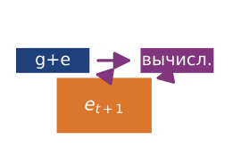

*Коррекция по ошибке переносит остаток в следующий сжатый шаг.*

<a id="dfn-collective-communication-error-feedback-mechanism"></a>

> **Определение: механизм коррекции по ошибке**
>
> ***Коррекция по ошибке*** (Error Feedback) — это метод распределенного обучения для сжатия градиентов, который поддерживает для каждого воркера аккумулятор остатка $e_t$ и возвращает ошибку сжатия в следующее обновление градиента, так что информация, отложенная компрессором, никогда не отбрасывается окончательно.
>
> 1.  **Значение**: top-k разреживание на уровне 1 процента сохраняет только самые большие 1 процент значений градиента по величине и уменьшает объем данных AllReduce с 140 ГБ до 1,4 ГБ для модели на 70 млрд параметров, то есть полезная нагрузка уменьшается в 100 раз до учета накладных расходов на индексы. Без коррекции по ошибке отброшенные 99 процентов значений градиента создают смещенное обновление, которое может навредить сходимости; с коррекцией остаток накапливается, пока отложенные компоненты не пересекут порог сжатия на более поздних шагах, восстанавливая гарантии сходимости, проанализированные для вариантов с памятью и коррекцией по ошибке при их допущениях (Stich et al., 2018; Karimireddy et al., 2019).
> 2.  **Отличие**: в отличие от сжатия с потерями, которое окончательно отбрасывает компоненты градиента ниже порога, коррекция по ошибке — это стратегия отложенной передачи: остаток $e_t$ телескопически суммируется по шагам, так что $\frac{1}{K}\sum_{t=1}^{K} v_t \to \frac{1}{K}\sum_{t=1}^{K} g_t$ при $K \to \infty$, и долгосрочное среднее переданных градиентов совпадает со средним истинных градиентов.
> 3.  **Типичная ошибка**: распространено заблуждение, что коррекция по ошибке включается сама, когда используется компрессор. Это не так: система обучения должна явно сохранять остаток и возвращать его. Без этого пути top-k и однобитное квантование вносят систематическое смещение, которое может накапливаться по шагам (Karimireddy et al., 2019).

Коррекция по ошибке сохраняет накопленную информацию о градиенте во времени. Рассмотрим, что происходит за $K$ шагов:

$$\sum_{t=1}^{K} v_t = \sum_{t=1}^{K} \left[(g_t + e_t) - e_{t+1}\right] = \sum_{t=1}^{K} g_t + e_1 - e_{K+1}$$

Если аккумулятор ошибок остается ограниченным (что верно для разумных схем сжатия), то при $K \to \infty$:

$$\frac{1}{K}\sum_{t=1}^{K} v_t \to \frac{1}{K}\sum_{t=1}^{K} g_t$$

Долгосрочное среднее переданных градиентов равно долгосрочному среднему истинных градиентов. Информация о градиенте не теряется окончательно; она лишь откладывается. Малые градиенты, которые раз за разом отбрасываются, в конце концов накапливаются в $e_t$, пока не превысят порог сжатия, и тогда передаются.

Телескопическое свойство ошибки сжатия во времени — причина, по которой коррекция по ошибке может превратить смещенный компрессор в сходящийся метод обучения. Теоретические анализы показывают гарантии сходимости для разреженного SGD с памятью и для EF-SGD с широкими классами операторов сжатия при их заявленных допущениях (Stich et al., 2018; Karimireddy et al., 2019). Короткая трасса показывает, как коррекция по ошибке сохраняет информацию о градиенте, которую наивное сжатие потеряло бы. В [таблице «Трасса наивного сжатия»](#tbl-error-feedback-naive) проведена трасса для жадного компрессора без пути остатка, который передает только значения $\geq 0{,}5$:

| **Шаг** |       **Истинный градиент $g_t$**        |           **Переданное $v_t$**           |          **Накопленное переданное**         |          **Накопленное истинное**          |
|:---------|:------------------------------------:|:-----------------------------------------:|:-------------------------------------------:|:-------------------------------------:|
| 1        | 0,4 | 0 | 0 | 0,4 |
| 2        | 0,3 | 0 | 0 | 0,7 |
| 3        | 0,2 | 0 | 0 | 0,9 |
| 4        | 0,4 | 0 | 0 | 1,3 |
| 5        | 0,3 | 0 | 0 | 1,6 |

<a id="tbl-error-feedback-naive"></a>

***Трасса наивного сжатия (без коррекции по ошибке)**: пятишаговая трасса, показывающая, как жадный однобитный квантователь передает ноль всякий раз, когда отдельные градиенты оказываются ниже порога.*

Трасса с коррекцией по ошибке в [таблице «Трасса сжатия с коррекцией по ошибке»](#tbl-error-feedback) выполняет ту же последовательность с аккумулятором остатка $e_t$, который заново вводит отброшенный остаток в следующий шаг. Пример [«Механизм коррекции по ошибке»](#exmp-collective-communication-error-feedback-mechanism) разбирает обе трассы, чтобы показать: отложенная информация сохраняется, а не теряется.

<a id="exmp-collective-communication-error-feedback-mechanism"></a>

> **Задача: механизм коррекции по ошибке**
>
> **Сценарий**: конвейер сжатия градиентов применяет пороговое отсечение к малым значениям градиента (меньше 0,5) за 5 шагов обучения при распределенном параллелизме по данным.
>
> **Диагноз**: жадное наивное сжатие отбрасывает значения ниже порога, передавая 0, тогда как истинный накопленный градиент равен 1,6 (потеря градиента 100 процентов). Добавление коррекции по ошибке ($e_t$) сворачивает остаточные ошибки по шагам: передается 2 при остаточной ошибке −0,4.
>
> **Системный урок**: коррекция по ошибке сохраняет сходимость при сжатии градиентов с потерями. Сохраняя непереданные остаточные векторы в локальной памяти хоста ($e_{t+1} = g_t + e_t - v_t$), малые градиенты накапливаются по шагам, пока не пересекут порог передачи, без потери информации.

| **Шаг** |              **$g_t$**               |              **$e_t$**               |            **$g_t + e_t$**             |              **$v_t$**               |   **$e_{t+1} = (g_t + e_t) - v_t$**   |           **Накопленное $v$**          |
|:---------|:------------------------------------:|:------------------------------------:|:--------------------------------------:|:------------------------------------:|:-------------------------------------:|:-------------------------------------:|
| 1        | 0,4 | 0 | 0,4 | 0 | 0,4 | 0 |
| 2        | 0,3 | 0,4 | 0,7 | 1 | −0,3 | 1 |
| 3        | 0,2 | −0,3 | −0,1 | 0 | −0,1 | 1 |
| 4        | 0,4 | −0,1 | 0,3 | 0 | 0,3 | 1 |
| 5        | 0,3 | 0,3 | 0,6 | 1 | −0,4 | 2 |

<a id="tbl-error-feedback"></a>

***Трасса сжатия с коррекцией по ошибке**: та же пятишаговая последовательность при сжатии с коррекцией по ошибке.*

<a id="sec-communication-1bit-adam"></a>

### 1-bit Adam: оптимизация, учитывающая сжатие

Коррекция по ошибке может восстановить гарантии сходимости для подходящих компрессоров при заявленных допущениях, но она рассматривает оптимизатор как черный ящик. Градиент сжимается, передается, распаковывается и затем подается оптимизатору так, будто ничего не произошло. Такое разделение оставляет производительность нереализованной: оптимизатор хранит внутреннее состояние (импульс, оценки дисперсии), которое содержит информацию о распределении градиента, однако сжатие полностью игнорирует это состояние. Решение состоит в том, должно ли сжатие работать с сырыми градиентами или с состоянием оптимизатора, которое уже их обобщает.

Более интегрированный подход, пионером которого стала команда DeepSpeed из Microsoft, сжимает коммуникацию оптимизатора, а не сырые градиенты. **1-битная адаптивная оценка моментов (Adam)** (Tang et al., 2021) использует наблюдение, что оценка второго момента Adam ($v_t$) стабилизируется после начального периода обучения. Затем она сжимает передаваемое состояние первого момента ($m_t$) до 1 бита на параметр плюс коэффициент масштабирования, сохраняя стабилизированный второй момент как адаптивный предобуславливатель.

Алгоритм идет в две фазы. На фазе прогрева выполняется стандартный Adam с коммуникацией полной точности, чтобы оценка второго момента стабилизировалась. Затем алгоритм замораживает эту оценку дисперсии и использует ее как фиксированный адаптивный предобуславливатель. В фазе с эффективной коммуникацией рабочие узлы передают импульс с 1-битным сжатием (знак плюс масштаб) и хранят остаток каждого сжатия локально, чтобы добавить его перед следующим шагом сжатия.

Теоретическое обоснование объединяет замороженный адаптивный предобуславливатель с компенсированным по ошибке сжатием импульса. Остаток переносит ошибку квантования в последующие сообщения импульса, контролируя накопленную ошибку сжатия и поддерживая результат сходимости статьи, не рассматривая сжатое обновление как несмещенную оценку.

В статье о 1-bit Adam сообщается об уменьшении объема коммуникации до 5 раз при сохранении скорости сходимости несжатого Adam. Эксперименты на 256 GPU показывают рост пропускной способности до 3,3 раза для предобучения BERT-Large и до 2,9 раза для дообучения на SQuAD (Tang et al., 2021). Практический урок уже, чем «сжатие всегда выигрывает»: стоимость сжатия должна оставаться малой по сравнению с сэкономленным временем коммуникации.

Успех 1-bit Adam иллюстрирует более общий принцип: сжатие наиболее эффективно, когда оно спроектировано совместно с алгоритмом оптимизации. Сжатие сырых градиентов отбрасывает информацию без разбора. Сжатие состояний оптимизатора использует структуру траектории оптимизации и достигает более высоких коэффициентов сжатия с меньшим влиянием на сходимость.

<a id="nbk-collective-communication-payback-compression"></a>

> **Окупаемость сжатия**
>
> **Задача**: обучающее задание тратит 40 мс на синхронизацию буфера градиента. Система внедряет 1-bit Adam, который уменьшает объем коммуникации в 32 раза, но добавляет 2 мс накладных расходов CPU/GPU на логику сжатия. Коэффициенты масштабирования, координация состояния оптимизатора и накладные расходы протокола снижают реализованный выигрыш сети до эффективной пропускной способности в 8 раз. Каково реальное ускорение коммуникации?
>
> **Расчет**:
>
> 1. **Время сжатой коммуникации**: 40 мс, деленные на 8, = 5 мс.
> 2. **Новое суммарное время**: 5 мс (коммуникация) + 2 мс (накладные расходы) = 7 мс.
> 3. **Эффективное ускорение**: 40 мс, деленные на 7 мс, $\approx$ 5,7 раза.
>
> **Системный вывод**: сжатие — это обмен вычислений на пропускную способность. Оно окупается, только если $T_{\text{overhead}} < T_{\text{comm}}(N) \times (1 - 1/\text{Ratio})$. В данном случае потратить 2 мс, чтобы сэкономить 35 мс сетевого времени, — исключительно выгодный обмен. Однако на высокоскоростной сети NVLink, где $T_{\text{comm}}(N)$ составляет всего 1 мс, та же логика сжатия замедлила бы обучение. Всегда профилируйте сеть, прежде чем добавлять сжатие.

Расчет окупаемости делает сжатие условной оптимизацией: оно должно сэкономить достаточно времени коммуникации, чтобы покрыть и накладные расходы кодирования, и риск для сходимости.

<a id="chk-collective-communication-gradient-compression-decisions"></a>

> **Контрольные вопросы: решения о сжатии градиентов**
>
> Проверьте свое понимание того, когда и как применять сжатие градиентов:
>
> - [ ] **Коррекция по ошибке**: объясните, почему 1-bit SGD без коррекции по ошибке приводит к расходимости, тогда как 1-bit Adam с прогревом сходится; сравните, как каждый метод обращается с потерей информации.
> - [ ] **Окупаемость сжатия**: определите, улучшает ли применение сжатия градиентов в 4 раза общее время шага, когда обратный проход занимает 800 мс, а AllReduce занимает либо 200 мс, либо 2000 мс.
> - [ ] **Накопитель ошибки**: выведите установившееся поведение аккумулятора ошибки $e_t$, когда истинный градиент постоянен и равен $g = 0{,}3$, а порог сжатия равен 0,5.
> - [ ] **Top-k против квантования**: выберите между разреживанием top-k и квантованием для нагрузки, учитывая коэффициент сжатия и накладные расходы на кодирование индексов разреженности.

<a id="sec-communication-collective-operations-compression-tradeoffs"></a>

### Компромиссы сжатия: пропускная способность против сходимости

Сжатие градиентов не бесплатно: оно обменивает сокращение коммуникации на рост дисперсии или смещения в процессе оптимизации. Сравнение в [таблице «Методы сжатия градиентов»](#tbl-gradient-compression-methods) суммирует закономерности из работ по квантованию, разреживанию, коррекции по ошибке и сжатию с учетом оптимизатора (Seide et al., 2014; Aji and Heafield, 2017; Lin et al., 2018; Stich et al., 2018; Karimireddy et al., 2019; Tang et al., 2021).

| **Метод**                 | **Коэффициент сжатия** | **Влияние на сходимость**       | **Лучший сценарий**            |
|:--------------------------|:---------------------:|:--------------------------------|:-------------------------------|
| **FP16**                  |       2×              | Незначительное                  | Распространенная базовая линия ускорителей |
| **INT8 + коррекция по ошибке** |       4×         | Небольшое замедление (около 5–10%) | Кластеры с ограниченной пропускной способностью |
| **Top-k (1%) + коррекция по ошибке** |      100×  | Умеренное замедление (около 10–20%) | Обучение между центрами обработки данных |
| **1-bit + коррекция по ошибке** |       32×      | Заметное замедление (около 20–30%) | Экстремальные ограничения пропускной способности |

<a id="tbl-gradient-compression-methods"></a>

***Методы сжатия градиентов**: компромисс «коэффициент сжатия против влияния на сходимость» для четырех канонических компрессоров градиента. Правильный выбор зависит от того, какое ограничение связывает систему, пропускная способность или скорость сходимости. Агрессивные компрессоры окупаются, только когда коммуникация доминирует во времени итерации.*

<a id="sec-collective-communication-use-compression-8519"></a>

#### Когда применять сжатие

Правило решения не сводится к одному коэффициенту сжатия. Сжатие оправдано, только когда сэкономленное за шаг реальное время превышает стоимость кодирования и дополнительные шаги, вызванные более медленной сходимостью. Агрессивное сжатие окупается, когда время коммуникации доминирует над временем вычислений (высокое отношение $T_{\text{comm}}(N)/(T_{\text{compute}}/N)$), что обычно случается с небольшими моделями на больших кластерах. Когда же доминирует время вычислений, замедление сходимости не стоит экономии, потому что система не упирается в коммуникацию. Независимо от этого отношения любое сжатие с потерями сверх FP16 должно сопровождаться коррекцией по ошибке, если только анализ оптимизатора и тесты сходимости не оправдывают ее отсутствие, поскольку без коррекции сходимость может сорваться.

Анализ α-β из [раздела «Карта местности»](#sec-communication-collective-operations-collective-operations-network-performance-modeling-0d8e) помогает определить, когда сжатие окупается: если градиенты достаточно велики, чтобы быть ограниченными пропускной способностью ($M > n^*$), сжатие напрямую сокращает реальное время. Если они ограничены задержкой ($M < n^*$), сжатие не поможет, потому что член задержки доминирует независимо от размера сообщения.

Решение о том, стоит ли сжатие того, требует сравнить экономию времени коммуникации со штрафом за сходимость. Рассмотрим конкретный сценарий: обучение требует 100 000 шагов для сходимости без сжатия, причем каждый шаг занимает 500 мс (300 мс вычислений, 200 мс коммуникации). Суммарное время обучения составляет 50 000 секунд. Применение сжатия INT8 с коррекцией по ошибке уменьшает время коммуникации в 4 раза (с 200 мс до 50 мс на шаг), но увеличивает требуемое число шагов на 10 процентов (со 100 000 до 110 000). Новое суммарное время равно $110{,}000 \times 0{,}35 = 38\,500$ секунд, что на 23 процента лучше. Сжатие оправдано, потому что экономия коммуникации на шаг (150 мс) перевешивает дополнительные шаги.

Теперь рассмотрим ту же модель на более быстрой сети, где коммуникация занимает всего 30 мс на шаг. Сжатие сокращает ее до 7,5 мс (экономия 22,5 мс на шаг), но по-прежнему добавляет 10 процентов шагов. Новое суммарное время равно $110{,}000 \times 0{,}3075 = 33\,825$ секунд против $100{,}000 \times 0{,}33 = 33\,000$ секунд без сжатия. Сжатие увеличивает суммарное время обучения на 2,5 процента, потому что экономия на шаг (22,5 мс) слишком мала относительно штрафа за сходимость (10 000 дополнительных шагов по 307,5 мс каждый). Этот пример показывает, почему сжатие стоит применять только тогда, когда отношение коммуникации к вычислениям ($T_{\text{comm}}(N)/(T_{\text{compute}}/N)$) превышает порог, зависящий от конкретного штрафа за сходимость выбранного метода.

<a id="sec-communication-collective-operations-collective-operations-communication-libraries-nccl-5307"></a>

## Коммуникационные библиотеки и рантаймы

Написать с нуля высокооптимизированный, учитывающий топологию иерархический кольцевой AllReduce на C++ потребовало бы от выделенной команды инженеров месяцев работы. Инженерное решение — выбрать библиотеку, которая сохраняет модель, допущения о топологии и перекрытии этой главы на целевом оборудовании. Предыдущие разделы развили три взаимодополняющие стратегии укрощения стоимости коммуникации; производственные библиотеки реализуют эти стратегии через четыре оси решений: путь памяти устройства, учет топологии, переносимость и наблюдаемость.

<a id="sec-communication-nccl"></a>

### NCCL: почему она занимает центральное место в нагрузках на GPU NVIDIA

NVIDIA Collective Communications Library (NCCL)[^fn-nccl-gpu-collectives] занимает центральное место во многих развертываниях обучения на нескольких GPU NVIDIA, потому что превращает коллективные алгоритмы (разобранные в разделах [«Инженерия потока»](#sec-communication-collective-operations-collective-operations-allreduce-algorithms-7545) и [«Иерархическая коммуникация»](#sec-communication-collective-operations-collective-operations-mapping-collectives-topology-3214)) в перемещение данных, размещенных на GPU (Jeaugey, 2017; NVIDIA, 2026). Ее распространение объясняется тремя оптимизациями, специфичными для GPU, которые MPI и Gloo не могут воспроизвести без поддержки производителя аппаратуры. **Слияние ядер** (kernel fusion) встраивает оператор редукции (сумму, среднее) прямо в ядро копирования памяти: вместо того чтобы копировать данные в буфер, редуцировать и затем копировать результаты обратно, NCCL редуцирует во время передачи и устраняет промежуточный трафик памяти, который иначе ограничивал бы использование пропускной способности HBM. **Конвейеризация по каналам** открывает несколько параллельных каналов коммуникации, чтобы одновременно насытить каждый сетевой интерфейс, так что узел DGX с 8 сетевыми картами достигает в 8 раз большей пропускной способности, чем реализация с одним каналом. **GPUDirect RDMA** позволяет сетевой карте читать память GPU напрямую через PCIe, полностью минуя CPU. Без этого данные шли бы по пути GPU → память CPU → сетевая карта → сеть, добавляя микросекунды задержки и тратя такты CPU. Вместе эти факторы объясняют, почему NCCL обычно первая библиотека, которую стоит сравнить для коллективов на GPU NVIDIA, прежде чем переходить к универсальным реализациям MPI.

Помимо чистой производительности, автоматическое обнаружение топологии в NCCL — важное отличие. Фаза обнаружения топологии из [раздела «Маршрутизация с учетом топологии»](#sec-communication-collective-operations-collective-operations-topology-detection-selection-2dc7) в NCCL опирается на запросы NVIDIA Management Library и перечисление шины PCI для связности NVLink и размещения NIC. Практическая выгода — выбор алгоритма с учетом аппаратуры: на DGX H100 с NVSwitch NCCL распознает, что все 8 GPU полностью связаны, и выбирает алгоритмы на основе NVSwitch, отличающиеся от кольцевых алгоритмов, которые используются в системах с точечными соединениями NVLink.

NCCL также реализует автоматический выбор алгоритма по размеру сообщения и числу GPU. Внутри библиотека поддерживает логику настройки, которая сопоставляет размер сообщения, число GPU и топологию с выбранным семейством алгоритмов или протоколов. Пользователи могут переопределять или проверять некоторые встроенные выборы через документированные переменные окружения, такие как `NCCL_ALGO`, `NCCL_PROTO` и `NCCL_DEBUG`, когда бенчмаркинг выявляет неоптимальные выборы для конкретных нагрузок (NVIDIA, 2026). Отладочный вывод дает необходимую видимость для отладки производительности.

Более новая возможность NCCL — ограниченная поддержка пользовательских операторов редукции, например документированной редукции premultiplied-sum для коммуникатора и типа данных (NVIDIA, 2026). Эта поддержка уже, чем произвольные редукции и пользовательские типы данных в стиле MPI, поэтому агрегация, специфичная для приложения (например, отсечение выбросов), обычно по-прежнему требует отдельных ядер или логики на уровне фреймворка.

Несмотря на распространенность, NCCL не лишена ограничений. Она имеет открытый исходный код, но жестко связана с GPU и сетевым оборудованием NVIDIA и не может быть нативной коллективной библиотекой на ускорителях AMD или Intel. Для организаций, которые строят мультивендорную инфраструктуру или требуют полного контроля над стеком коммуникации, эти ограничения мотивируют использование альтернативных библиотек.

[^fn-nccl-gpu-collectives]: **NCCL (NVIDIA Collective Communications Library)**: NCCL может приближаться к теоретическому пику пропускной способности на правильно настроенных кластерах NVIDIA, сочетая коллективы, размещенные на GPU, GPUDirect RDMA и выбор путей с учетом топологии (Jeaugey, 2017; NVIDIA, 2026). Ее дизайн, специфичный для NVIDIA, создает компромисс привязки к поставщику: организации получают настроенный коллективный бэкенд для фабрик GPU NVIDIA, но теряют переносимость на оборудование AMD (RCCL) или Intel (oneCCL).

<a id="sec-communication-mpi"></a>

### MPI: основа HPC

MPI[^fn-mpi-hpc-heritage] стандартизировал коллективные операции за десятилетия до появления глубокого обучения. История стандартов MPI Forum фиксирует версию 1.0 в мае 1994 года; она определила не зависящий от поставщика API для передачи сообщений «точка-точка», коллективных операций и управления процессами и стала общим языком высокопроизводительных вычислений (Message Passing Interface Forum, 2015; Message Passing Interface Forum, 1993). MPI остается актуальным для ML-систем, когда переносимость, координация на стороне CPU или интеграция с HPC — главное требование.

Для распределенных вычислений на CPU реализации MPI (OpenMPI, MPICH, Intel MPI) зрелы и хорошо оптимизированы: за десятилетия настройки накоплена производительность на разнообразных сетевых фабриках. HPC-центры, которые появились до эры обучения на GPU, часто имеют MPI, глубоко интегрированный в их планировщики заданий и менеджеры ресурсов, что делает MPI путем наименьшего сопротивления для развертывания ML-нагрузок на таких системах.

В спецификации MPI есть возможности, которых нет у NCCL, в первую очередь **персистентные коллективы** (Persistent Collectives) и **неблокирующие коллективные операции** (Non-Blocking Collective Operations) с детализированной семантикой завершения. Персистентные коллективы (введены в MPI 4.0) позволяют приложениям «предварительно зарегистрировать» коллективную операцию, распределяя накладные расходы на настройку по тысячам вызовов. Это ценно для циклов обучения, где одна и та же форма AllReduce повторяется на каждом шаге. Неблокирующие коллективы (`MPI_Iallreduce`) предоставляют явные дескрипторы запросов, которые можно проверять на завершение, что позволяет использовать более гибкие шаблоны перекрытия, чем асинхронные операции NCCL.

MPI также предоставляет **односторонние коммуникации** (One-Sided Communication: MPI_Put, MPI_Get, MPI_Accumulate), которые естественно отображаются на аппаратуру RDMA. Эти операции позволяют процессу читать из памяти другого процесса или записывать в нее без явного участия удаленного процесса, открывая шаблоны коммуникации, которые трудно выразить одними коллективными операциями. Архитектуры серверов параметров и некоторые асинхронные алгоритмы обучения выигрывают от односторонней семантики.

Главное ограничение для практиков ML — отсутствие учета GPU. Стандартные реализации MPI предполагают буферы в памяти хоста. Вызов `MPI_Allreduce` над памятью GPU обычно требует явных копирований устройство-хост, которые сводят на нет преимущество хранения данных на GPU. Расширения MPI с поддержкой CUDA (доступны в OpenMPI и MVAPICH2) могут принимать указатели GPU напрямую, но их внутренние реализации редко соответствуют оптимизациям NCCL, таким как слияние ядер и конвейеризация по каналам. Практическое правило зависит от аппаратуры: используйте NCCL для коллективных операций между GPU NVIDIA, когда аппаратный стек это поддерживает, а MPI — для коллективных операций на CPU, управления процессами (`mpirun`, `mpiexec`) или переносимости между не-NVIDIA аппаратурой.

[^fn-mpi-hpc-heritage]: **MPI (Message Passing Interface)**: стандартизован в 1994 году после многолетней работы сообщества; MPI определил коллективные операции, такие как AllReduce, Broadcast и Scatter, которые позднее переняли ML-фреймворки. Традиционные реализации MPI требуют явных копирований устройство-хост для буферов GPU, тогда как реализации с поддержкой CUDA могут использовать пути GPUDirect. Тем не менее NCCL стала обычным выбором для коллективов на GPU NVIDIA, ориентированным на производительность, тогда как MPI остается распространенным для запуска заданий (`mpirun`) и координации на стороне CPU.

<a id="sec-communication-gloo"></a>

### Gloo: кроссплатформенная гибкость

Gloo — открытая библиотека коллективной коммуникации Meta, интегрированная в PyTorch как вариант бэкенда наряду с NCCL. Хотя NCCL часто является основным выбором для критичного к производительности обучения на GPU NVIDIA, Gloo занимает дополняющую роль в экосистеме PyTorch: она сохраняет семантику распределенного обучения, когда переносимость важнее насыщения GPU-интерконнектов.

Главное достоинство Gloo — переносимость. Она работает в Linux, macOS и Windows без CUDA или какого-либо рантайма конкретного поставщика. Поэтому Gloo — естественный выбор для разработки и отладки, когда инженеры прототипируют логику распределенного обучения на ноутбуках или CI-серверах, прежде чем развертывать ее на GPU-кластерах. Транспорт TCP/IP Gloo работает поверх любого сетевого стека, включая интерфейс loopback для многопроцессных тестов на одной машине, что устраняет требования к инфраструктуре, которые накладывает NCCL.

Для обучения только на CPU (конвейеры предобработки данных, инжиниринг признаков, архитектуры моделей на CPU) реализации Gloo конкурентоспособны с MPI для кластеров малого и среднего размера. Gloo оптимизирован для типичного случая распределенного обучения в PyTorch: группы процессов, которые выполняют AllReduce и Broadcast над тензорами, хранящимися в памяти CPU. Ее транспорт через общую память обеспечивает высокопроизводительную внутриузловую коммуникацию без накладных расходов сети и достигает пропускной способности, близкой к memcpy, для локальных групп процессов.

Gloo также служит запасным бэкендом в модуле `torch.distributed` PyTorch. Когда NCCL недоступна или не подходит (аппаратура не NVIDIA, отсутствуют драйверы, неподдерживаемые платформы), конфигурации PyTorch могут использовать Gloo для коллективных операций. Такое поведение при откате ценно в смешанных окружениях разных поставщиков и для того, чтобы код распределенного обучения оставался переносимым между конфигурациями аппаратуры.

Главное ограничение — производительность на GPU-кластерах. Gloo не имеет слияния ядер, GPUDirect RDMA и маршрутизации с учетом NVLink, поэтому коллективные операции над тензорами GPU требуют явных копирований устройство-хост. На кластерах GPU NVIDIA Gloo может достигать заметно меньшей пропускной способности, чем NCCL, для AllReduce с большими сообщениями. Для чувствительных к задержке операций с малыми сообщениями разрыв увеличивается еще сильнее, поскольку Gloo не может обойти ядро ОС при доступе к памяти GPU. Рекомендация для практиков проста: используйте Gloo для разработки, нагрузок на CPU и переносимости, а для критичного к производительности обучения на GPU переходите на аппаратно-оптимизированный бэкенд.

<a id="sec-communication-library-selection"></a>

### Руководство по выбору библиотеки

Матрица выбора в [таблице «Выбор коммуникационной библиотеки»](#tbl-library-selection) суммирует эти оси. Суть не в запоминании названий библиотек, а в выборе бэкенда, чей путь памяти, модель топологии, ограничения переносимости и видимость при отладке соответствуют задаче.

| **Сценарий**                      | **Рекомендуемая библиотека** | **Обоснование**                              |
|:----------------------------------|:-----------------------:|:---------------------------------------------|
| **Обучение на нескольких GPU (NVIDIA)** |           NCCL          | GPUDirect, слияние ядер, учет NVLink         |
| **Распределенное обучение только на CPU** |       Gloo или MPI       | Зрелые оптимизации для CPU                   |
| **Разработка и отладка**          |           Gloo          | Кроссплатформенность, без зависимости от CUDA |
| **GPU разных поставщиков**        |     Gloo (запасной)     | NCCL работает только с NVIDIA                |
| **Интеграция с HPC**              |        MPI + NCCL       | MPI для запуска заданий, NCCL для коллективов на GPU |

<a id="tbl-library-selection"></a>

***Выбор коммуникационной библиотеки**: выбирайте исходя из требований аппаратуры и нагрузки. Многие развертывания обучения на GPU NVIDIA используют NCCL; Gloo служит переносимым запасным вариантом.*

Таблица прямо следует из модели стоимости главы. Бэкенд не быстрее в абстрактном смысле; он быстрее, когда его путь памяти избегает копирований на хосте, его модель топологии соответствует фабрике, а его сигналы об отказах раскрывают ту часть $\alpha$, $\beta$ или накладных расходов процессора, которая ограничивает задание.

<a id="sec-communication-vendor-libs"></a>

### Библиотеки конкретных поставщиков

Три библиотеки ([«NCCL»](#sec-communication-nccl), [«MPI»](#sec-communication-mpi) и [«Gloo»](#sec-communication-gloo)) не исчерпывают доступные варианты, потому что один и тот же коллективный алгоритм имеет разные эффективные $\alpha$, $\beta$ и ограничения топологии на разных платформах ускорителей. Закономерность последовательна: используйте бэкенд, который понимает путь памяти устройства и интерконнект на аппаратуре, где реально выполняется задание. **RCCL** (ROCm Communication Collectives Library) от AMD реализует коллективы для GPU AMD и стека ROCm, а **oneCCL** (oneAPI Collective Communications Library) от Intel нацелена на развертывания на ускорителях и CPU Intel. Их названия важны меньше устойчивых критериев выбора: доступа к памяти устройства, учета топологии, семантики коллективов и измеримой производительности на целевой фабрике.

Более широкая закономерность — стандартизированный программный интерфейс верхнего уровня с аппаратно-специфичными бэкендами под ним. Модуль `torch.distributed` в PyTorch направляет коллективные вызовы в NCCL, RCCL, oneCCL или Gloo в зависимости от настроенной группы процессов и доступного бэкенда. На практике команды часто смешивают бэкенды, а не выбирают один глобально: группа процессов на GPU может использовать NCCL для AllReduce градиентов, тогда как группа координации на стороне CPU использует Gloo для барьеров, скалярных рассылок или состояния сэмплера. Алгоритмы главы остаются универсальными, но эффективный план исполнения зависит от аппаратуры. Когда этот план работает хуже ожидаемого, коммуникационный бэкенд становится также отправной точкой диагностики.

Диагностика коммуникации начинается с сравнения нагрузки с согласованной базовой линией голого коллектива и фиксации выбранного алгоритма, протокола, размещения рангов и достигнутой пропускной способности. Здоровая базовая линия при медленном шаге обучения указывает на гранулярность вызовов, конкуренцию, отстающих или недостаточное перекрытие, а не только на фабрику. Трассы профилировщика и процедура разнесения причин из раздела «Профилирование в масштабе» главы «Инженерия производительности» разделяют эти причины. Здесь же нужны калиброванные значения $\alpha$, $\beta$ и окна перекрытия, по которым выбирается расписание коллектива.

Как только бэкенд правильно сопоставлен с аппаратурой и измерен относительно голого коллектива, оставшееся открытое время коммуникации должно быть спрятано за вычислениями.

<a id="sec-communication-overlap"></a>

## Перекрытие коммуникации и вычислений

Сетевая задержка в 20 миллисекунд может фактически исчезнуть не потому, что физическая сеть улучшилась, а потому, что коммуникация спрятана за арифметикой. Предыдущие разделы снизили стоимость коммуникации выбором алгоритма, учетом топологии и сжатием полезной нагрузки. Перекрытие атакует остаток, меняя момент, когда происходит коммуникация.

<a id="sec-communication-layer-overlap"></a>

### Перекрытие послойно

Вычисление градиентов в обратном проходе идет послойно: от выходного слоя к входному. Градиент слоя $\ell$ доступен, как только завершается обратный проход этого слоя, даже когда слои $\ell-1, \ell-2, \ldots$ еще вычисляются. Это создает возможность: начать коммуникацию градиента слоя $\ell$ сразу, пока GPU вычисляет градиент слоя $\ell-1$.

В `DistributedDataParallel` PyTorch это перекрытие реализовано через **хуки градиента** (Gradient Hooks). Каждый параметр регистрирует хук, который срабатывает, когда его градиент готов. Хук запускает асинхронный AllReduce для бакета градиента этого параметра. Тем временем обратный проход продолжает вычислять градиенты для более ранних слоев. Если обратные вычисления оставшихся слоев занимают больше времени, чем AllReduce (обычный случай для больших моделей), коммуникация полностью скрыта.

Эффективность этого перекрытия зависит от соотношения вычислений и коммуникации на каждом слое. В трансформерных моделях самые большие тензоры градиентов принадлежат матрицам весов внимания и прямого распространения, которые также самые дорогие слои по вычислениям. Это благоприятное совпадение означает, что слои с наибольшим объемом данных для коммуникации также являются слоями с наибольшим объемом вычислений, за которыми можно спрятать эту коммуникацию.

Стратегия перекрытия взаимодействует с выбором алгоритма из [раздела «Инженерия потока»](#sec-communication-collective-operations-collective-operations-allreduce-algorithms-7545) и [раздела «Иерархическая коммуникация»](#sec-communication-collective-operations-collective-operations-mapping-collectives-topology-3214). Кольцевой AllReduce с его большей задержкой, но оптимальной пропускной способностью, выигрывает от перекрытия сильнее, чем AllReduce по дереву, потому что штраф по задержке кольца (который иначе доминировал бы для сообщений среднего размера) можно спрятать за вычислениями. Это одна из причин, по которой NCCL может выбрать кольцо даже ниже теоретической точки перехода, когда обнаруживает, что фреймворк поддерживает асинхронное исполнение: невыгодность кольца по задержке нейтрализуется перекрытием, а его преимущество по пропускной способности сохраняется.

Одна критическая зависимость ограничивает перекрытие: шаг оптимизатора не может начаться, пока не завершатся все требуемые редукции градиентов. Градиенты последних обработанных слоев (ближайших ко входу) раскрывают свою задержку коммуникации, потому что не остается последующих обратных вычислений, которые могли бы ее скрыть.

<a id="sec-communication-bucket-fusion"></a>

### Слияние бакетов

Послойное перекрытие из [раздела «Перекрытие послойно»](#sec-communication-layer-overlap) предполагает, что градиент каждого слоя передается одним сообщением. На деле трансформерный слой содержит десятки отдельных тензоров параметров (матрицы проекций запроса, ключа и значения, выходную проекцию, параметры нормализации слоя, веса и смещения прямого распространения). Запуск отдельного AllReduce для каждого параметра создал бы тысячи коллективов с мелкими сообщениями, и каждый платил бы полный налог $\alpha$. Чтобы этого избежать, DDP использует **слияние бакетов** (Bucket Fusion): параметры группируются в бакеты (обычно порядка десятков мегабайт, а 25 МБ — распространенная опорная точка PyTorch), и для каждого бакета запускается один AllReduce. Размер бакета — это компромисс: большие бакеты амортизируют накладные расходы $\alpha$, но откладывают начало коммуникации, потому что бакет нельзя отправить, пока у всех его параметров не будут вычислены градиенты. Мелкие бакеты начинают коммуникацию раньше, но платят больше накладных расходов $\alpha$.

Оптимальный размер бакета зависит от архитектуры модели и характеристик сети. Для моделей с множеством мелких слоев (например, глубоких остаточных сетей) меньшие бакеты (5–10 МБ) улучшают перекрытие, начиная коммуникацию раньше. Для моделей с несколькими большими слоями (например, больших языковых моделей с таблицами эмбеддингов в несколько гигабайт) предпочтительнее большие бакеты (50–100 МБ), потому что крупные слои доминируют и во времени вычислений, и во времени коммуникации. Параметр `bucket_cap_mb` в DDP PyTorch позволяет настраивать этот компромисс.

Порядок, в котором параметры добавляются в бакеты, определяет эффективность перекрытия. DDP назначает параметры бакетам в обратном порядке их использования в прямом проходе, что соответствует порядку, в котором градиенты становятся доступны в обратном проходе. Это назначение в обратном порядке гарантирует, что первый заполнившийся бакет (и, значит, первый запускаемый AllReduce) содержит параметры последних слоев прямого прохода, которые являются первыми слоями обратного прохода. Такой порядок максимизирует окно перекрытия: у самых ранних бакетов больше всего последующих вычислений, за которыми можно спрятать их коммуникацию.

<a id="sec-communication-overlap-limits"></a>

### Пределы перекрытия: когда скрыть не получается

У перекрытия коммуникации и вычислений есть фундаментальные пределы. Параметр накладных расходов $o$ из модели LogP представляет неустранимое время GPU, которое тратится на инициацию и завершение передач. Даже при идеальном перекрытии GPU должен потратить не меньше $2o$ на каждую операцию AllReduce на инициацию и завершение. Если модель имеет много слоев, но обратный проход каждого слоя короток (меньше $o$), GPU тратит на накладные расходы коммуникации больше времени, чем на вычисления, и перекрытие не дает выигрыша.

Кроме того, первый и последний слои обратного прохода не могут перекрываться. Первый завершившийся слой (выходной) не имеет предшествующей коммуникации, с которой можно было бы перекрыться. Последний слой, который передает данные (входной), не имеет последующих вычислений, за которыми можно было бы его спрятать. Для неглубоких моделей (2–3 слоя) эти граничные эффекты съедают значительную долю общего времени, ограничивая достижимое перекрытие 50–60 процентами. Для глубоких моделей (десятки слоев и больше) граничные эффекты пренебрежимо малы, и перекрытие может скрыть 90–95 процентов времени коммуникации.

Третье ограничение возникает из-за давления на память. Перекрытие коммуникации с вычислениями требует поддерживать дополнительные буферы памяти GPU: градиент, который передается, должен оставаться в памяти, пока обратный проход продолжает производить новые градиенты для более ранних слоев. Для нагрузок FSDP, где главная мотивация — оптимизация памяти, это дополнительное требование к буферам может конфликтовать с экономией памяти, которую дает FSDP. Инженерная задача — найти точку, где перекрытие достаточно агрессивно, чтобы скрыть коммуникацию, но не настолько, чтобы загнать GPU в нехватку памяти. Настройки PyTorch FSDP, такие как `limit_all_gathers`, `backward_prefetch`, `forward_prefetch`, а также выбор переразбиения и префетчинга, дают рычаги для этого компромисса.

Реалистичная конфигурация обучения показывает, сколько коммуникации остается открытой после перекрытия.

<a id="nbk-collective-communication-overlap-budget-7b-transformer"></a>

> **Бюджет перекрытия для 7B-трансформера**
>
> **Задача**: 32-слойная трансформерная модель (7 млрд параметров) обучается на 64 GPU. Обратный проход каждого слоя занимает 15 мс. Для этого бюджета перекрытия коммуникационный бакет использует консервативный учет градиентов FP32, поэтому иерархический AllReduce для градиентов каждого слоя (около 880 МБ на слой) занимает 26,4 мс при бакетах по 100 МБ. Каково время шага с перекрытием и без него?
>
> **Без перекрытия (последовательно)**:
>
> $T_{\text{sequential}} = T_{\text{backward}} + T_{\text{comm}}(N)$ = 480 мс + 32 $\times$ 26,4 мс = 1 324,8 мс.
>
> **С перекрытием (конвейеризовано)**:
>
> AllReduce каждого слоя (26,4 мс) выполняется параллельно с обратным проходом следующего слоя (15 мс). Поскольку 26,4 мс больше 15 мс, на каждый слой остается 11,4 мс открытой коммуникации, которую нельзя спрятать.
>
> $T_{\text{pipelined}} = T_{\text{backward}} + T_{\text{first layer comm}} + (N_L - 1) \times T_{\text{exposed}}$ = 859,8 мс.
>
> **Системный вывод**: перекрытие сокращает общее время шага на 35,1 процента. Оставшаяся открытая коммуникация возникает из-за того, что AllReduce медленнее обратного прохода на слой. Чтобы устранить этот остаток, нужно либо увеличить вычисления обратного прохода (больший размер батча), либо сократить время AllReduce (более агрессивное сжатие, лучшая топология). Перекрытие наиболее эффективно, когда $T_{\text{backward per layer}} > T_{\text{AllReduce per layer}}$.

Даже базовый внутриузловой случай показывает, что этот стек работает еще до того, как понадобится многоузловой механизм. 70-миллиардная модель на одном узле из 8 GPU, связанных NVLink, должна выполнить AllReduce 140 ГБ градиентов BF16 за шаг. Если взять однонаправленную скорость NVLink 450 ГБ/с в модели α-β и множитель трафика кольца $2(7/8)$, получаем $2(7/8) \times 140\ \text{ГБ}/(450\ \text{ГБ/с})$ примерно 0,54 с, то есть около 26 процентов бюджета вычислений 2,1 с на шаг. Этот количественный успех подводит к разбору заблуждений и ловушек в [разделе «Заблуждения и ловушки»](#sec-communication-collective-operations-collective-operations-fallacies-pitfalls-9cd0), потому что каждое из них начинается с оптимизации не того члена, выбора не того примитива или доверия к допущению о топологии, которое больше не соответствует нагрузке.

<a id="sec-communication-collective-operations-collective-operations-fallacies-pitfalls-9cd0"></a>

## Заблуждения и ловушки

Оптимизация коммуникации порождает устойчивые заблуждения, потому что взаимодействие задержки, пропускной способности, топологии и сжатия создает неочевидные режимы отказа, которые упускают простые ментальные модели.

**Заблуждение**: *пропускная способность — единственная метрика, которая важна.*

Для малых сообщений (активации конвейерного параллелизма, токены MoE) доминирует задержка ($\alpha$). Покупка сети 400G не поможет, если сообщение тратит 5 мкс на сериализацию в программном стеке. Критический размер сообщения $n^* = \alpha \cdot \beta$ определяет, какую метрику оптимизировать: ниже $n^*$ уменьшайте задержку, выше — повышайте пропускную способность.

**Ловушка**: *предполагать, что AllReduce подходит для всего.*

AllReduce вычисляет одну редукцию над совместимыми количествами элементов и типами данных; он не реализует маршрутизацию, адресованную конкретным получателям. В параллелизме экспертов и системах рекомендаций каждый воркер вместо этого отправляет разные данные разным партнерам. Эти нагрузки требуют AllToAll или его варианта с переменным количеством, производительность которого зависит от пропускной способности ввода, бисекционной пропускной способности, коэффициента переподписки, гранулярности сообщений, маршрутизации и перекоса, а не только от числа логических связей.

**Заблуждение**: *конвейерный параллелизм устраняет накладные расходы коммуникации.*

Конвейерный параллелизм заменяет AllReduce передачами активаций «точка-точка» между соседними стадиями, и стоимость на сообщение действительно дешевле. Однако конвейер вносит другой накладной расход: простой из-за пузырей. При $p$ стадиях конвейера как минимум $(p-1)/(p-1+m)$ времени GPU простаивает, пока конвейер заполняется и опустошается, где $m$ — число микробатчей. Для глубоких конвейеров ($p \geq 8$) чтобы удержать пузырь ниже 20 процентов, нужно $m \geq 32$ микробатча, что ограничивает размер батча, память активаций и сходимость. Выбор между параллелизмом по данным и конвейерным параллелизмом — не «коммуникация против отсутствия коммуникации», а компромисс между AllReduce, ограниченным пропускной способностью, и накладными расходами пузырей, ограниченными временем.

**Ловушка**: *использовать кольцевой AllReduce по умолчанию, не проверяя размер сообщения и топологию.*

Кольцо достигает оптимальной по пропускной способности стоимости $2\frac{N-1}{N}\frac{M}{\beta}$, но платит задержкой $\mathcal{O}(N)$. Для градиента в 1 МБ на 64 GPU при $\alpha = 10\ \text{мкс}$ выигрывает AllReduce по дереву, потому что штраф кольца по задержке в 1 260 мкс превышает штраф дерева по пропускной способности в 1 000 мкс. Оценка перехода с учетом логарифма $M_{\text{crossover}} \approx N \alpha \beta / \log_2 N$ определяет, когда переключать алгоритм; $N\alpha\beta$ — лишь грубая эвристика для крупного масштаба.

**Заблуждение**: *сжатие градиентов безопасно без коррекции по ошибке.*

Разреживание top-k может достичь 99-процентного сжатия, но наивное отбрасывание малых градиентов вызывает расходимость. Без коррекции по ошибке ($e_{t+1} = (g_t + e_t) - v_t$) градиенты ниже порога теряются навсегда, накапливая систематическое смещение, которое в конце концов дестабилизирует обучение.

**Ловушка**: *оценивать сжатие градиентов только по ускорению коммуникации.*

Схема сжатия, которая дает 100-кратное ускорение коммуникации, бесполезна, если она так ухудшает качество модели, что для достижения целевой точности требуется в 2 раза больше итераций обучения. Правильная метрика — время до точности, а не время на итерацию. Микробенчмарки коммуникации измеряют время на итерацию, тогда как инженерное решение зависит от времени до точности, и эти величины расходятся всякий раз, когда сжатие вносит смещение или дисперсию градиента, замедляющие сходимость. Проверяйте сжатие на целевом бенчмарке сходимости с расписанием обучения развертывания, а не только на синтетическом микробенчмарке AllReduce.

**Заблуждение**: *асинхронные коллективы всегда скрывают задержку.*

Вызов `dist.all_reduce(..., async_op=True)` в Python лишь возвращает управление CPU. Модель LogP различает сетевую задержку $L_{\text{lat}}$ (которую можно перекрыть) и накладные расходы процессора $o$ (которые перекрыть нельзя). Если вычислительное ядро GPU короче накладных расходов коммуникации, GPU все равно простаивает. Коммуникацию можно скрыть, только когда $T_{\text{compute}} > o$.

**Ловушка**: *тихое повреждение данных в сети.*

Сети не идеальны. Плохой кабель, неисправная сетевая карта или ошибка прошивки могут повредить данные ниже уровня, на котором фреймворк обучения видит явную ошибку. На 10 000 узлах, работающих круглосуточно, даже редкие битовые ошибки могут появляться достаточно часто, чтобы иметь значение. Специфичный для коммуникации урок: настройка пропускной способности неполна без сквозной проверки. Контрольные суммы, проверки результатов коллективов, тесты здравомыслия нормы градиента и механизмы отказоустойчивости должны ловить поврежденные градиенты до того, как они станут обновлениями модели.

**Заблуждение**: *плоского AllReduce достаточно для многоузлового обучения.*

Плоский кольцевой AllReduce считает все линки равными, направляя данные через InfiniBand на 50 ГБ/с, хотя внутри узла доступен NVLink на 900 ГБ/с. Для кластера из 8 узлов по 8 GPU иерархический AllReduce уменьшает межузловой трафик в 8 раз по сравнению с плоским кольцом и дает примерно ускорение в 4,8 раза в разобранном примере [«Иерархический AllReduce»](#sec-communication-collective-operations-collective-operations-hierarchical-allreduce-1338). Игнорирование иерархии пропускной способности оставляет неиспользованной большую часть внутриузловой пропускной способности и перегружает дефицитную межузловую.

**Ловушка**: *использовать формулу кольцевого AllReduce для внутриузловой коммуникации.*

NVSwitch обеспечивает высокорадиксную неблокирующую связность в поддерживаемых поколениях DGX, но он не превращает произвольный AllReduce в одношаговую редукцию. Пока поколение коммутатора и программный путь не обеспечивают внутрисетевую редукцию, конечные точки все равно выполняют кольцо, дерево или другой запланированный алгоритм поверх путей NVLink; новые конструкции с поддержкой коммутатора требуют собственной документированной модели стоимости. Поэтому планирование емкости должно использовать алгоритм и поколение аппаратуры, которые рантайм реально выбирает. Применяйте соответствующий коэффициент внутриузлового трафика, коэффициент межузлового кольца или дерева и их иерархическую композицию, а не подставляйте общий прыжок через кроссбар вместо работы по редукции.

**Заблуждение**: *отображение рангов на GPU не влияет на производительность коллективов.*

Если планировщик заданий назначает ранги GPU без учета физической топологии, иерархический AllReduce и маршрутизация по рельсам могут направлять трафик неоптимально. Типичный симптом: `nccl-tests` показывает полную пропускную способность на кластере, но реальное задание обучения достигает только 50–60 процентов, потому что ранги назначены между узлами так, что выравнивание по рельсам невозможно. Проверьте, что назначение рангов соответствует ожидаемой топологии (например, ранги 0–7 на узле 0, ранги 8–15 на узле 1), прежде чем измерять производительность коммуникации.

**Ловушка**: *измерять коллективы без записи контекста размещения.*

Бенчмарк коллектива не является пригодным для повторного использования свидетельством, если он не фиксирует порядок рангов, привязку рельсов NIC, конфигурацию топологии NCCL и распределение узлов. Без этого контекста команды сравнивают результаты разных физических раскладок и принимают различия размещения за регресс библиотеки или аппаратуры.

<a id="sec-communication-collective-operations-summary"></a>

## Итоги

Коммуникация — это трение масштаба. Вычисления локальны, а обучение глобально, и модели α-β и LogP превращают анализ узких мест коммуникации из догадок в количественную инженерию. Критический размер сообщения $n^* = \alpha \cdot \beta$ разделяет режимы, ограниченные задержкой и пропускной способностью. Калибровка этих моделей относительно того же коллектива, алгоритма, группы процессов и топологии позволяет выделить программные накладные расходы, не путая коэффициент трафика коллектива с неэффективностью библиотеки.

Коллективные примитивы (AllReduce, AllGather/ReduceScatter, AllToAll) напрямую соответствуют стратегиям параллелизма, и каждый примитив создает отдельную матрицу трафика. Большие полезные нагрузки AllReduce обычно ограничены пропускной способностью. AllToAll же может упираться в ввод, бисекцию, запуск сообщений или перекос маршрутизации, поэтому его практический потолок зависит от фабрики, а не только от числа партнеров. Прямой попарный обмен подходит для сбалансированных крупных кусков, иерархическое объединение амортизирует мелкие межузловые передачи, а обмен переменного размера избегает дополнения при перекосе, не устраняя сам горячий узел.

Алгоритмы AllReduce по кольцу и дереву занимают противоположные концы компромисса между задержкой и пропускной способностью, а оценка перехода с учетом логарифма $M_{\text{crossover}} \approx N \alpha \beta / \log_2 N$ определяет, какой из них оптимален для данной конфигурации. Иерархический AllReduce и маршрутизация, оптимизированная под рельсы, используют иерархию пропускной способности кластеров GPU, чтобы умножить эффективную межузловую пропускную способность, а внутрисетевая редукция (SHARP) уменьшает коммуникацию, видимую хосту, выполняя часть агрегации внутри сетевых коммутаторов.

Когда даже самые быстрые провода недостаточны, сжатие градиентов дает еще один рычаг. Квантование, разреживание и оптимизаторы, учитывающие сжатие, такие как 1-bit Adam, уменьшают объем коммуникации в 4–1000 раз. Коррекция по ошибке сохраняет остаточную информацию между шагами при допущениях, развитых в [разделе «Коррекция по ошибке и накопление остатков»](#sec-communication-collective-operations-error-feedback). Перекрытие коммуникации и вычислений через послойную конвейеризацию и слияние бакетов затем может спрятать оставшуюся коммуникацию за полезными вычислениями, снижая эффективные накладные расходы до 5–15 процентов общего времени шага в хорошо настроенных системах.

Шаблоны коммуникационного трафика принципиально различаются у маячных архетипов.

<a id="lhs-collective-communication-communication-archetype-patterns"></a>

> **Коммуникационные шаблоны архетипов**
>
> «Маршрутный лист» градиента зависит от целевой функции системы и режима ограничений. Каждый маячный архетип сталкивается с отдельной коммуникационной задачей, и методы коллективной коммуникации отображаются на эти задачи по-разному, как суммирует [«Отображение архетипов на коллективы»](#tbl-archetype-collective-mapping).
>
> | **Архетип**                           | **Основной коллектив** |         **Вероятное ограничение**     | **Стратегия оптимизации**                                   |
> |:--------------------------------------|:----------------------:|:-------------------------------------:|:------------------------------------------------------------|
> | **Архетип A (GPT-4/Llama-3)**         |       AllReduce        |          Пропускная способность ($\beta$) | Иерархический AllReduce; оптимизация под рельсы             |
> | **Архетип B (DLRM в масштабе)**       |        AllToAll        | Гранулярность, емкость фабрики или перекос | Объединение сообщений; маршрутизация с учетом топологии; балансировка шардов |
> | **Архетип C (федеративный MobileNet)** |       P2P/асинхронный  |         Связность и задержка          | Агрессивное квантование; коррекция по ошибке                |
>
> <a id="tbl-archetype-collective-mapping"></a>
>
> ***Отображение архетипов на коллективы**: каждый маячный архетип порождает характерный шаблон трафика, но ограничивающий член зависит от формы сообщения, размещения и физической фабрики.*
>
> Архетипы сталкиваются с разными узкими местами коммуникации, хотя все они обучают нейронные сети. Архетип A (GPT-4/Llama-3) обычно несет большие полезные нагрузки AllReduce и выигрывает от иерархической редукции в сочетании с перекрытием коммуникации и вычислений. Архетип B (DLRM в масштабе) порождает адресный трафик AllToAll, ограничение которого может смещаться между запуском, вводом и приемом, бисекцией, коэффициентом переподписки, маршрутизацией и перекосом доступа к шардам; объединение сообщений, маршрутизация с учетом топологии и балансировка шардов решают разные члены. Архетип C (федеративный MobileNet) ограничен прерывистой связностью и маломощными устройствами, поэтому агрессивное квантование и коррекция по ошибке важнее топологии центра обработки данных. Применение неправильной оптимизации к неправильному архетипу тратит инженерные усилия, не улучшая производительности.

Механизмы сжатия и коррекции по ошибке важны и за пределами центров обработки данных: для архетипа C и похожих прерывистых или бедных пропускной способностью сред доминирующей стоимостью может быть сама возможность отправить хоть какое-то полезное обновление, а не насыщение высокоскоростной фабрики.

Распределенное обучение — это в такой же мере проблема сетевой инженерии, как и проблема машинного обучения. Модель α-β дает основу для оценки коммуникационных решений, от выбора алгоритма до сжатия и перекрытия, через их влияние на задержку и пропускную способность. Эти модели помогают инженерам диагностировать узкие места, оптимизировать конфигурации топологии и достигать эффективности масштабирования, которая определяет, завершаются ли запуски обучения с триллионом параметров за недели или за месяцы.

> **Каждый байт имеет стоимость перемещения**
>
> - **Модель α-β выявляет узкое место**: критический размер сообщения $n^* = \alpha \cdot \beta$ определяет, оптимизировать ли программную задержку (малые сообщения) или аппаратную пропускную способность (большие полезные нагрузки) (принцип «компромисс пропускной способности и задержки (модель α-β)»). Подбирайте эффективные параметры бенчмарком, который соответствует коллективу и топологии нагрузки.
> - **Выбор алгоритма зависит от масштаба**: кольцевой AllReduce оптимален по пропускной способности, но платит задержкой $\mathcal{O}(N)$; древовидный AllReduce оптимален по задержке ($\mathcal{O}(\log N)$), но неэффективен по пропускной способности. Используйте оценку перехода с учетом логарифма $M_{\text{crossover}} \approx N \alpha \beta / \log_2 N$ для рассуждения о точке переключения и считайте $N\alpha\beta$ лишь грубой эвристикой для крупного масштаба.
> - **Иерархические алгоритмы умножают пропускную способность**: выполняя локальные редукции по быстрому NVLink до пересечения медленного моста InfiniBand, иерархические коллективы фактически умножают межузловую пропускную способность на число GPU в узле.
> - **Выбор расписания AllToAll следует за активной границей**: прямой обмен сохраняет простоту для сбалансированных крупных кусков, иерархия амортизирует запуски на дефицитных межузловых линках, а обмен переменного размера убирает дополнение при перекосе. Пропускная способность ввода, емкость бисекции, коэффициент переподписки, гранулярность сообщений и самый нагруженный получатель определяют, какое расписание побеждает.
> - **Коррекция по ошибке контролирует ошибку сжатия с потерями**: разреживание может отбрасывать 99 процентов каждого передаваемого обновления, накапливая остаток сжатия локально и добавляя его перед следующим шагом сжатия. При проанализированных допущениях это ограничивает накопленную ошибку сжатия и восстанавливает гарантии сходимости, даже если отдельные сжатые обновления могут оставаться смещенными.
> - **Перекрытие — последний множитель**: конвейеризация коммуникации и вычислений через хуки градиента и слияние бакетов может спрятать 90–95 процентов времени коммуникации за вычислениями обратного прохода для глубоких моделей (принцип «закон парка (закон времени распределенного шага)»).
> - **Обнаружение топологии не опционально**: высокопроизводительные библиотеки, такие как NCCL, динамически сопоставляют логические кольца с физическими проводами, чтобы избегать «горячих точек» и максимизировать бисекционную пропускную способность (принцип «теорема о бисекционной пропускной способности»). Неправильное отображение рангов на GPU может ухудшить производительность в 2–4 раза.

Если параллелизм определяет, что нужно передать, то коллективная коммуникация измеряет, чего стоит эта передача. Каждый коллектив (AllReduce, AllGather, AllToAll) — это инструкция в системе команд парка, которую модель α-β оценивает через фиксированную задержку запуска и время передачи на байт. Инженеры снижают эту стоимость, выбирая кольцо там, где связывает пропускная способность, и дерево там, где связывает задержка, сокращая полезные нагрузки перед медленным межузловым переходом и перекрывая передачи с вычислениями. Коммуникация — это цена, которую вычисления платят за то, чтобы действовать как одна машина.

> **От логики к устойчивости**
>
> Парк теперь имеет свою логику (параллелизм) и свои шаблоны трафика (коммуникацию). В продакшене, однако, GPU перегреваются, сети теряют пакеты, а узлы выходят из строя посреди вычислений. Глава «Отказоустойчивость» рассматривает, как контрольные точки, восстановление и эластичное обучение поддерживают согласованные вычисления на несовершенной аппаратуре.

[^fn-allreduce-etymology-primitive]: **AllReduce**: составной термин из MPI, обозначающий операцию Reduce (суммирование данных всех узлов в один) с последующим Broadcast (рассылкой суммы всем узлам). Кольцевая реализация AllReduce делает это как последовательную фазу ReduceScatter, за которой следует фаза AllGather, каждая из которых занимает $N-1$ раундов, всего $2(N-1)$ раундов. Внутри каждого раунда ранги отправляют и принимают одновременно, и каждый GPU в итоге получает глобальную сумму без централизованного узкого места.

[^fn-zerocopy-rdma-bypass]: **Коммуникация без копирования** (Zero-Copy): RDMA позволяет сетевой карте передавать данные напрямую из памяти приложения на одном узле в память приложения на другом, минуя буферы ядра операционной системы. Для обмена градиентом в 140 ГБ коммуникация без копирования позволяет не перемещать 280 ГБ данных между CPU и основной памятью, высвобождая значительную пропускную способность памяти ($\text{BW}$).

[^fn-speed-of-light]: **Ограничение скорости света**: свет проходит по оптическому волокну примерно со скоростью 200 000 км/с, то есть 200 метров за микросекунду. В массивном центре обработки данных, где кабели между стойками имеют длину 100 метров, одна лишь «задержка провода» добавляет 500 нс к каждому сообщению, физический предел, который никакое улучшение сетевого оборудования не может уменьшить.
