<a id="sec-fault-tolerance-reliability"></a>

# Отказоустойчивость

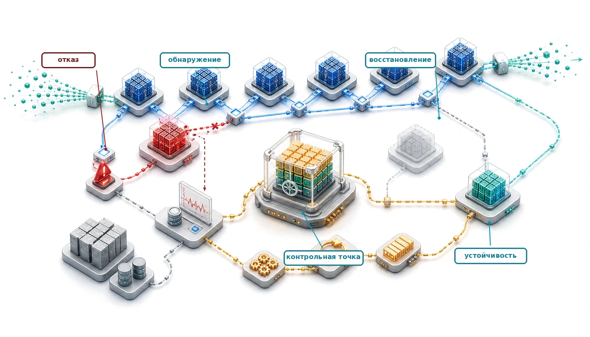

## Назначение

_Почему масштаб превращает аппаратный отказ из редкого исключения в обычное состояние, с которым системы должны справляться непрерывно?_

Один ускоритель может годами работать без аппаратного отказа. Тысяча ускорителей превращает тот же риск для одного компонента в отказ каждые пару дней. Кластер из десяти тысяч устройств отказывает каждые несколько часов, если учесть домены хостов, питания и сети. Надежность отдельного компонента при этом не меняется, но совокупная надежность системы падает по мере добавления компонентов. В масштабе парка системы должны переживать повторяющиеся отказы без потери прогресса. Та же логика относится и к обслуживанию: глобально распределенная система вывода сталкивается с региональными сбоями, разрывами сети и колебаниями мощности как с фоновыми условиями, а не с исключительными событиями. Отказоустойчивые системы ожидают эти события, обнаруживают их, изолируют и автоматически восстанавливаются после них, чтобы полезная работа продолжалась. В терминах C³ отказоустойчивость тратит вычисления и коммуникацию на координацию, сохраняет состояние и восстанавливает работу, потому что отказ компонента — статистическое свойство парка.

> **Цели обучения**
>
> - Вычислять MTBF парка по интенсивностям отказов компонентов и оценивать частоту отказов для больших обучающих кластеров
> - Классифицировать аппаратные и программные отказы, а также тихое повреждение данных по обнаруживаемости, радиусу поражения и пути восстановления
> - Выводить интервалы контрольных точек и контракты восстановления, которые удовлетворяют ограничениям на накладные расходы записи, RPO, RTO и отказ кластера
> - Проектировать распределенное сохранение контрольных точек и планы эластичного восстановления для состояния модели размером в несколько терабайт на парке GPU
> - Оценивать данные инъекции отказов и наблюдаемости, чтобы проверить обнаружение, изоляцию и восстановление
> - Реализовывать резервирование обслуживания, переключение на резерв и репликацию состояния при миллисекундной задержке и частичных отказах
> - Выбирать стратегии плавной деградации, которые сохраняют полезный сервис, когда отказывают модели, признаки, регионы или мощности

<a id="sec-fault-tolerance-reliability-reliability-failure-analysis-scale-6b4b"></a>

## Анализ отказов в масштабе

Представьте кластер из 10 000 GPU в середине трехмесячного обучения новой фундаментальной модели. Коммуникационный слой делает свою работу: тысячи устройств обмениваются градиентами через AllReduce, AllGather и AllToAll так, будто это одна машина. Затем арифметика масштаба догоняет систему. GPU отказывает каждые несколько часов, и если система не может пережить это обычное физическое событие, синхронизированное обучение останавливается, а миллионы долларов вычислительных ресурсов простаивают. **Отказоустойчивость** — это свойство системы, которое позволяет распределенному выполнению продолжать полезный прогресс, когда компоненты отказывают, деградируют или пропадают. В стеке парка, показанном на рисунке [«Стек парка»](01_introduction.md#fig-fleet-stack), отказоустойчивость выполняет роль слоя устойчивости распределенного выполнения. Задачи охватывают весь спектр отказов: от переворотов битов через перемежающиеся ошибки, связанные со старением, до постоянных отказов компонентов, как показано на рисунке [«Спектр отказов в ML»](07_fault_tolerance.md#fig-fault-tolerance-failure-spectrum). Частоты отказов по категориям и масштабирование среднего времени между отказами (MTBF) $\text{MTBF}_{\text{system}} = \text{MTBF}_{\text{component}}/N$, отмеченные на этом рисунке, — предварительные оценки; дальнейший анализ выводит обратное масштабирование и приводит таблицу частот для кластера. Скрытые отказы (gray failures) и тихое повреждение данных (SDC) добавляют вторую ось сложности: низкая вероятность обнаружения и большой радиус поражения (модель переворота бита в экспоненте FP16 и вывод возмущения softmax внимания — см. приложение «Основы надежности»).

<a id="fig-fault-tolerance-failure-spectrum"></a>

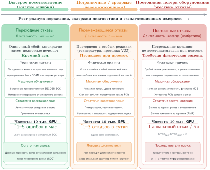
***Спектр отказов в ML:** Задачи надежности в масштабе охватывают временную таксономию: от переходных ошибок (перевороты битов, одиночные сбойные события) через перемежающиеся ошибки (старение, пограничные компоненты) до постоянных ошибок (залипание в 0 или 1, отказавшие компоненты). Каждая категория требует своей задержки обнаружения и стратегии восстановления, и инженерия отказоустойчивости должна учитывать все три, чтобы поддерживать пропускную способность на уровне парка.*

Эта хрупкость — прямое следствие успешной синхронизации. Системы распределенного обучения достигают огромной пропускной способности, координируя тысячи устройств, а коллективная коммуникация поддерживает эту координацию жесткими обменами. Та же синхронизация означает, что одно остановившееся устройство может остановить весь парк. Отказоустойчивые системы ML сохраняют прогресс: обнаруживают отказ, сохраняют восстанавливаемое состояние в контрольных точках, перезапускают или эластично перестраивают задания и рассматривают замену оборудования как нормальное выполнение, а не исключительный путь.

Переход от экспериментов в малом масштабе к промышленной эксплуатации меняет отношения между системами и отказами. Исследователь, обучающий модель на одном GPU, может годами не встречать аппаратный отказ. Та же нагрузка на кластере из 1 000 GPU дает отказ одного из GPU каждые пару дней, а промышленный кластер отказывает чаще, когда в бюджет отказов входят домены PCIe, питания, хранения и сети. Этот переход от *редкого исключения* к *обычному событию* требует других инженерных подходов. Последующий математический анализ делает этот переход точным и количественным.

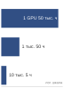

*Системный MTBF падает по мере роста парка: с 50 000 ч до 5 ч.*

Поскольку отказы в таком масштабе нельзя устранить, отказоустойчивые системы проверяют завершение, а не предполагают его, рассматривают отказ как обычный путь выполнения, постоянно тренируют восстановление и учитывают частичные отказы, которые наивная обработка ошибок может не предусмотреть. Эти приемы опираются на десятилетия исследований распределенных систем, но ML-нагрузки меняют экономику. У обучения есть свойства, которые открывают стратегии, недоступные универсальным распределенным системам: стохастический градиентный спуск переносит часть ошибок, которые испортили бы другие вычисления; контрольные точки велики, но их размер предсказуем; а цели восстановления иногда могут быть приблизительными, а не точными. Использование этих свойств может сделать отказоустойчивость, специфичную для ML, дешевле универсальных подходов, из которых она выросла.

<a id="sec-fault-tolerance-reliability-reliability-mathematics-inevitable-failure-93ef"></a>

### Математика неизбежного отказа

Теория надежности систем дает основу для понимания отказов в масштабе (Birolini, 2017). Отдельные компоненты характеризуются интенсивностью отказов $\lambda$,[^fn-fits-failure-rate] измеряемой в отказах в единицу времени. Для одиночного компонента с постоянной интенсивностью отказов $\lambda$ вероятность безотказной работы до момента $t$ подчиняется экспоненциальному распределению,[^fn-poisson-failure-rate] как в формуле [«Надежность одного компонента»](07_fault_tolerance.md#eq-single-component-reliability):

[^fn-poisson-failure-rate]: **Пуассоновский процесс**: Статистическая модель событий, которые происходят независимо с постоянной средней частотой. Модели надежности предполагают, что аппаратные отказы подчиняются распределению Пуассона, что приводит к экспоненциальной функции выживания $R(t) = e^{-\lambda t}$. Это допущение упрощает планирование парка: вероятность хотя бы одного отказа в кластере из 10 000 компонентов равна $1 - e^{-N \lambda t}$, поэтому риск отказа растет линейно с $N$, но экспоненциально с $t$.

[^fn-fits-failure-rate]: **Интенсивность отказов ($\lambda$)**: выражается в FIT (Failures In Time), где 1 FIT равен одному отказу на миллиард часов работы устройства. У GPU для ЦОД со средним временем между отказами 50 000 часов FIT $= 20{,}000$, что соответствует $\lambda_{\text{hour}} = 2{,}0 \times 10^{-5}$ отказов в час. Для одного устройства это ничтожно мало, но в масштабе парка становится доминирующим: кластер из 10 000 GPU накапливает 200 000 000 FIT только от GPU, что соответствует ожидаемому отказу GPU каждые 5 часов.

<a id="eq-single-component-reliability"></a>

$$ R_{\text{single}}(t) = e^{-\lambda t} $$

MTBF для этого компонента равен $1/\lambda$. В соглашении этой книги среднее время до отказа (MTTF) обозначает ожидаемое время до первого отказа одного компонента, а MTBF — ожидаемое время между последовательными отказами восстанавливаемой системы. При постоянной интенсивности, которая используется в экспоненциальной модели здесь, оба значения численно совпадают. Модель отказоустойчивости использует MTTF для констант отдельных компонентов, а MTBF — для составных системных интенсивностей. У дата-центровых GPU плановые значения MTBF часто составляют десятки тысяч часов, а фактическое поведение зависит от условий эксплуатации, эффективности охлаждения, производственного разброса и нагрузки.[^fn-gpu-mtbf-reliability] Приложение «Основы надежности» содержит канонические значения MTTF для отдельных компонентов (H100, A100, тензорный процессор (TPU), PCIe, питание, сеть), которые задают эти $\lambda$ и FIT. Читатель может подставить константу для любого устройства и воспроизвести интенсивности, используемые в анализе отказоустойчивости.

[^fn-gpu-mtbf-reliability]: **Разброс MTBF GPU**: в этой главе 50 000 часов используются как плановая константа класса A100, а не как гарантия для каждого развернутого GPU. Опубликованные исследования парков, в том числе TPUv4 в Google и кластеров GPU в Meta, сообщают, что надежность в полевых условиях зависит от топологии, охлаждения, нагрузки и эксплуатационной практики (Zu et al., 2024); (Kokolis et al., 2025); (Dubey et al., 2024). Поэтому плановая константа служит для арифметики, а операторы должны подставлять измеренные значения парка, если они у них есть.

Когда несколько независимых компонентов работают в системе, где любой отдельный отказ приводит к отказу системы, [«Произведение надежностей системы»](07_fault_tolerance.md#eq-system-reliability-product) показывает, что надежность системы становится произведением надежностей отдельных компонентов:

<a id="eq-system-reliability-product"></a>

$$ R_{\text{system}}(t) = \prod_{i=1}^{N} R_i(t) = \prod_{i=1}^{N} e^{-\lambda_i t} $$

Для $N$ одинаковых компонентов с интенсивностью отказа $\lambda$ [«Надежность системы из N компонентов»](07_fault_tolerance.md#eq-system-reliability-n-components) дает упрощение для одинаковых компонентов:

<a id="eq-system-reliability-n-components"></a>

$$ R_{\text{system}}(t) = e^{-N\lambda t} $$

Интенсивность отказов системы становится равной $N\lambda$, а [«MTBF системы»](07_fault_tolerance.md#eq-system-mtbf) показывает, что системный MTBF обратно пропорционален числу компонентов. Это обратное масштабирование раскрывает контринтуитивную реальность «девяток» надежности в масштабе кластера:

<a id="eq-system-mtbf"></a>

$$ \text{MTBF}_{\text{system}} = \frac{1}{N\lambda} = \frac{\text{MTBF}_{\text{component}}}{N} $$

[«Разрыв надежности»](07_fault_tolerance.md#fig-reliability-gap) наглядно показывает основное противоречие: по мере роста кластеров ожидаемое время между отказами сокращается ниже типичной продолжительности обучения, и отказоустойчивость становится необходимой для длинных заданий парка.

<a id="fig-reliability-gap"></a>

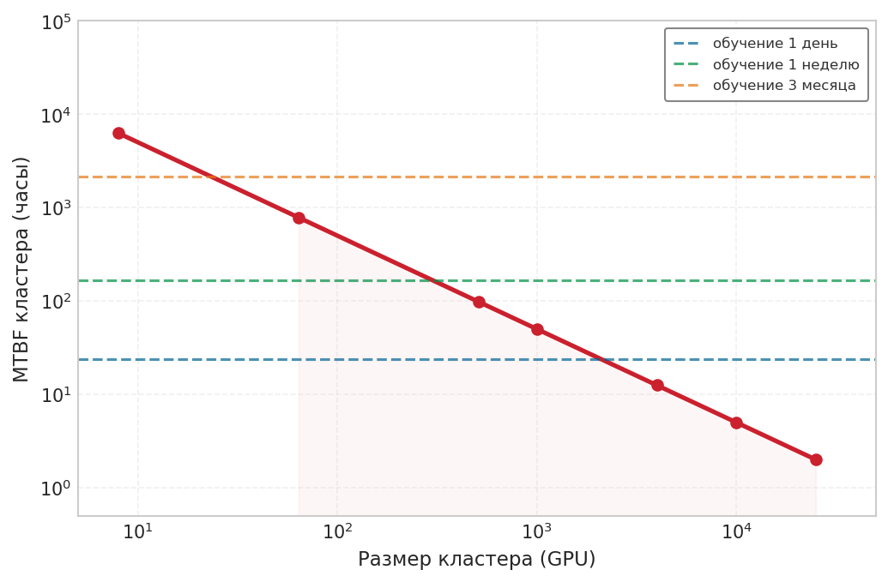

***Разрыв надежности:** С ростом числа GPU MTBF кластера опускается ниже типичной продолжительности обучения. Кластер из 10 000 GPU отказывает примерно каждые 5 часов, поэтому трехмесячное обучение невозможно без механизмов отказоустойчивости.*

Масштаб и надежность движутся в противоположных направлениях по одной и той же оси. [«Рост обучения на масштабе парка»](07_fault_tolerance.md#fig-cluster-scaling-trend) сводит их вместе: по мере того как число ускорителей растет на четыре порядка, совокупный MTBF падает, пока отказы не начинают происходить быстрее, чем обучение успевает завершиться без контрольных точек.

<a id="fig-cluster-scaling-trend"></a>

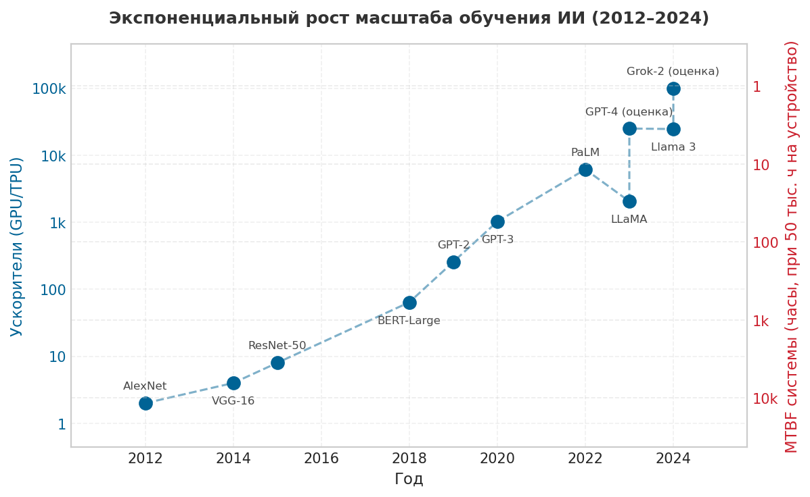

***Рост обучения на масштабе парка:** число ускорителей в крупнейших обучающих запусках с 2012 по 2024 год; на противоположной оси — среднее время между отказами системы. Размер кластера вырос примерно на четыре порядка, а MTBF системы соответственно упал. Именно поэтому отказоустойчивость из свойства надежности превратилась в ограничение планирования.*

<a id="sec-fault-tolerance-young-daly"></a>

### Закон Янга–Дэйли: оптимальные контрольные точки

Когда отказ неизбежен, ключевое инженерное решение — как часто сохранять прогресс. Слишком частое сохранение тратит время на ввод-вывод, а слишком редкое — на повторные вычисления после отказа. **Формула Янга–Дэйли**[^fn-young-daly-formula] ([«Интервал контрольных точек из анализа отказов»](07_fault_tolerance.md#sec-fault-tolerance-reliability-reliability-checkpoint-interval-failure-analysis-c28d)) разрешает это противоречие одним законом с квадратным корнем:

$$ \tau_{\text{opt}} = \sqrt{2 \cdot T_{\text{write}} \cdot \text{MTBF}_{\text{system}}} $$

$T_{\text{write}}$ в распределенном обучении ML — это не время сброса небольшого состояния процесса, а время передачи сотен гигабайт состояния оптимизатора FP32 (тензоры импульса и дисперсии для каждого обучаемого параметра) вместе с весами модели в долговременное хранилище. Для модели с 70 млрд параметров и полным состоянием Adam (оценка адаптивных моментов) одна контрольная точка может достигать нескольких сотен гигабайт, а для более позднего примера со 175 млрд параметров этот объем превышает терабайт. Поэтому сокращение $T_{\text{write}}$ требует специального высокопроизводительного хранилища. Именно $T_{\text{write}}$ — центральное ограничение, которое определяет, насколько плотно можно задать интервал контрольных точек, прежде чем накладные расходы ввода-вывода вытеснят полезные вычисления обучения.

Оптимальный интервал уравновешивает стоимость записи контрольных точек и ожидаемую стоимость повторного выполнения потерянного прогресса — это компромисс U-образной формы, который показан на рисунке [«Оптимальная контрольная точка Янга–Дэйли»](07_fault_tolerance.md#fig-young-daly). Из этого масштабирования стоит вынести главное: по мере роста кластеров MTBF системы падает, оптимальный интервал сокращается, и требуется более быстрое хранилище ([«Хранение данных»](04_data_storage.md#sec-data-storage)), чтобы $T_{\text{write}}$ оставался малым, пока «налог на контрольные точки» не съест вычислительную мощность кластера. Поскольку зависимость — квадратный корень, уменьшение MTBF вдвое сокращает интервал лишь в $\sqrt{2}\approx 1{,}4\times$, поэтому удвоение размера кластера не требует удвоения пропускной способности ввода-вывода контрольных точек. Приложение «Основы надежности» проводит полный вывод и более жесткие оценки второго порядка. Более поздний раздел о контрольных точках ([«Интервал контрольных точек из анализа отказов»](07_fault_tolerance.md#sec-fault-tolerance-reliability-reliability-checkpoint-interval-failure-analysis-c28d)) применяет формулу к локальному кластеру, когда известен его системный MTBF.

[^fn-young-daly-formula]: **Формула Янга–Дэйли**: (Young, 1974) вывел оптимальный интервал контрольных точек в первом приближении, а (Daly, 2006) независимо уточнил его более жесткими оценками второго порядка. Квадратичная зависимость $(\tau_{\text{opt}} = \sqrt{2 \cdot T_{\text{write}} \cdot \text{MTBF}_{\text{system}}})$ означает, что уменьшение MTBF системы вдвое повышает оптимальную частоту контрольных точек лишь в $\sqrt{2}\approx 1{,}4$ раза. Это объясняет, почему удвоение размера кластера не требует удвоения пропускной способности ввода-вывода контрольных точек.

<a id="fig-young-daly"></a>


***Оптимальная контрольная точка Янга–Дэйли:** суммарная потерянная работа — это сумма накладных расходов контрольных точек (они уменьшаются с ростом интервала $\tau_{\text{ckpt}}$) и стоимости повторного выполнения (она растет с $\tau_{\text{ckpt}}$). Точка минимума определяет оптимальный интервал $\tau_{\text{opt}} = \sqrt{2 \cdot T_{\text{write}} \cdot \text{MTBF}_{\text{system}}}$. Для иллюстративного кластера с системным MTBF 5 часов и временем записи 15 минут оптимальный интервал составляет примерно 1,6 часа.*

Быстрый расчет доступности показывает то же давление масштаба с другой стороны.

<a id="nbk-fault-tolerance-9s-reliability"></a>

> **Девятки надежности**
>
> **Задача**: кластер из 10 000 GPU работает, причем каждый GPU имеет доступность 99,99 % (всего 52,6 минуты простоя в год). Какова вероятность того, что весь кластер одновременно работает?
>
> **Расчет**:
>
> 1.  **Вероятность доступности одного GPU** $(R_{\text{GPU}})$: GPU с доступностью 99,99 % имеет вероятность работы $R_{\text{GPU}} = 0{,}9999$ в случайно выбранный момент.
> 2.  **Вероятность доступности кластера** $(R_{\text{cluster}})$: $R_{\text{cluster}} = (R_{\text{GPU}})^{N}$.
> 3.  **Результат**: $(R_{\text{GPU}})^{N} \approx 0{,}37$.
>
> **Системный вывод**: даже при аппаратуре с надежностью 99,99 % кластер из 10 000 GPU имеет лишь 37 % шансов, что все GPU одновременно доступны. Одной аппаратной надежности недостаточно: программное обеспечение должно автоматически справляться с отказами.

<a id="psp-fault-tolerance-scale-transforms-failure"></a>

> **Масштаб меняет характер отказов**
>
> Кластер из 10 000 GPU превращает MTBF одного GPU в 50 000 часов в системный MTBF 5 часов. Для восстанавливаемой системы **стационарная доступность** равна $A = \text{MTBF}/(\text{MTBF}+\text{MTTR})$, где **среднее время восстановления (MTTR)** — это интервал восстановления. Сокращение MTTR с 30 минут до 5 минут поднимает доступность с 90,91 % до 98,36 %. Эта стационарная двухсостояниная модель предполагает неограниченную пропускную способность ремонта и полный простой; коррелированные инциденты, конкуренция за ремонт и деградированная работа требуют прямых измерений (Birolini, 2017). Системы нужно проектировать под восстановление, а не только улучшать компоненты.

<a id="sec-fault-tolerance-reliability-quantitative-analysis"></a>

### Количественный анализ надежности

Расчет только для GPU из вводного примера по надежности дает интуицию масштаба. Реальная система обучения затем объединяет GPU, высокоскоростную память (HBM), каналы связи, блоки питания, пути хранения и резервирование в единый бюджет отказов. С уже определенными MTBF и интенсивностью FIT ($\text{FIT} = 10^9/\text{MTBF}$, так что GPU со средним временем между отказами 50 000 часов дает 20 000 FIT) новый вопрос в том, как складываются интенсивности компонентов. Правило композиции зависит от структуры резервирования. Для **последовательных систем** (например, узла, где все 8 GPU должны работать) отказ любого компонента приводит к отказу всей системы, поэтому надежности перемножаются, а интенсивности складываются:

$$R_{\text{system}}(t) = \prod_{i=1}^{N} R_i(t), \qquad \text{MTBF}_{\text{system}} = \frac{1}{\sum \lambda_i}$$

Именно поэтому добавление компонентов линейно снижает системный MTBF. Для **параллельных систем**, которые дают резервирование (например, реплик модели в режиме «активный-активный»), отказ происходит только тогда, когда одновременно выходят из строя все резервные компоненты:

$$R_{\text{system}}(t) = 1 - \prod_{i=1}^{N} (1 - R_i(t))$$

Композиция также показывает, какая подсистема доминирует в бюджете, и память здесь — самый весомый случай. Рассмотрим обучение модели на 70 млрд параметров архетипа A (GPT-4/Llama-3) ([«Три архетипа систем»](01_introduction.md#sec-vol2-introduction-archetypes)) на 1 024 GPU A100. Незащищенная HBM — связывающий член: при примерно 250 FIT на мегабит память кластера из 1 024 × 80 ГБ накапливает так много мест отказа, что незамеченная порча наступала бы примерно каждые 20 секунд, и крупномасштабное обучение стало бы невозможным. Поэтому защита памяти кодом коррекции ошибок (ECC) не опциональна. ECC обнаруживает и исправляет обычные одиночные ошибки битов, сокращая эффективную частоту мягких ошибок примерно на два порядка и возвращая память в бюджете ниже членов логики и межсоединений. Остаточные многобитные или ускользнувшие порчи остаются проблемой SDC.

Эти покомпонентные интенсивности FIT описывают собственный бюджет мягких ошибок кремния, поэтому они отличаются от MTTF целого устройства в 50 000 часов, который используется в последующем каскадном расчете. MTTF устройства учитывает все полевые режимы отказов (термические нагрузки, события питания, механический износ), а не только частоты мягких ошибок логики и памяти, выделенные здесь. Каскад объединяет частоты целых устройств в кластерную величину, которая действительно задает интервал контрольных точек. Эта оценка лишь показывает, почему защита памяти — предусловие всего последующего.

<a id="sec-fault-tolerance-reliability-reliability-worked-example-cluster-mtbf-calculation-9255"></a>

### Расчетный пример: MTBF кластера

Рассмотрим кластер, спроектированный для разработки больших языковых моделей, со следующими характеристиками:

- 10 000 GPU NVIDIA H100
- MTBF одного GPU: 50 000 часов
- Каждый GPU подключен к хосту через PCIe (MTBF: 200 000 часов)
- Каждый узел содержит 8 GPU с общим блоком питания (MTBF: 100 000 часов)
- Сетевая инфраструктура на узел (сетевая карта (NIC), кабели): MTBF 150 000 часов

Вместе эти компоненты определяют домен отказа, который используется в расчетах интенсивностей в этом примере.

#### Шаг 1: вычислить интенсивность отказов по подсистемам GPU

Каждый GPU работает внутри домена отказа, который включает сам GPU, его соединение PCIe, а также пропорциональные доли блока питания и сетевой инфраструктуры.

$$ \lambda_{\text{GPU}} = \frac{1}{50{,}000} = 2{,}0 \times 10^{-5} \text{ отказов/час} $$

$$ \lambda_{\text{PCIe}} = \frac{1}{200{,}000} = 0{,}5 \times 10^{-5} \text{ отказов/час} $$

$$ \lambda_{\text{power/GPU}} = \frac{1}{8} \times \frac{1}{100{,}000} = 0{,}125 \times 10^{-5} \text{ отказов/час} $$

$$ \lambda_{\text{network/GPU}} = \frac{1}{8} \times \frac{1}{150{,}000} = 0{,}083 \times 10^{-5} \text{ отказов/час} $$

#### Шаг 2: вычислить суммарную интенсивность отказов на GPU

$$ \lambda_{\text{total/GPU}} = (2{,}0 + 0{,}5 + 0{,}125 + 0{,}083) \times 10^{-5} = 2{,}708 \times 10^{-5} \text{ отказов/час} $$

#### Шаг 3: вычислить интенсивность отказов системы и MTBF

$$ \lambda_{\text{system}} = 10{,}000 \times 2{,}708 \times 10^{-5} = 0{,}2708 \text{ отказов/час} $$

$$ \text{MTBF}_{\text{system}} = \frac{1}{0{,}2708} = 3{,}69 \text{ часа} $$

Этот результат означает, что кластер отказывает в среднем примерно каждые 3,7 часа. Ожидаемая частота отказов составляет 6,5 отказа в сутки; обучение продолжительностью одна неделя столкнется примерно с 45 отказами. Любая система обучения, работающая в таком масштабе, должна рассматривать отказ как постоянное условие, а не как исключительное событие. Приложение «Основы надежности» разбирает этот же каскад пошагово: оно сводит интенсивности отдельных компонентов в системный MTBF всего парка, так что читатель может повторить расчет для другой конструкции узла или размера кластера.

Масштабирование MTBF кластера в [таблице «Масштабирование MTBF кластера»](07_fault_tolerance.md#tbl-cluster-mtbf-scaling) выделяет базовый случай только для GPU по размерам кластера. Полный системный расчет дает меньшее значение, когда учтены домены PCIe, питания и сети.

| **Размер кластера (GPU)** | **MTBF одного GPU** | **MTBF кластера** | **Ожидаемые отказы в сутки** |
|:-------------------------------------|:----------------------------------------------:|:---------------------------------------:|:--------------------------------------:|
| 8 | 50 000 часов | 6 250 часов (260 дней) | 0,004 |
| 64 | 50 000 часов | 781 час (33 дня) | 0,03 |
| 512 | 50 000 часов | 98 часов (4 дня) | 0,25 |
| 1 000 | 50 000 часов | 50 часов (2 дня) | 0,48 |
| 4 000 | 50 000 часов | 12 часов | 1,9 |
| 10 000 | 50 000 часов | 5 часов | 4,8 |
| 25 000 | 50 000 часов | 2 часа | 12 |

<a id="tbl-cluster-mtbf-scaling"></a>

***Масштабирование MTBF кластера:** среднее время между отказами, учитывающее только GPU, убывает линейно с размером кластера и превращает отказы из редких событий в постоянное рабочее условие в масштабе. Домены хоста, питания, хранения и сети снижают системный MTBF еще сильнее.*

Теоретическое масштабирование $1/N$ из [таблицы «Масштабирование MTBF кластера»](07_fault_tolerance.md#tbl-cluster-mtbf-scaling) — не просто учебное упражнение. [Рисунок «Опубликованные частоты отказов на производственных кластерах»](07_fault_tolerance.md#fig-published-failure-rates) накладывает опубликованные измерения и подогнанные прогнозы для производственных кластеров Meta на теоретическую кривую. В исследовании (Kokolis et al., 2025) о суперкластере Research SuperCluster (RSC) компании Meta сообщаются измеренные значения MTTF для наблюдаемых размеров заданий RSC и прогнозируется MTTF 1,8 часа для заданий на 16 384 GPU. Отчет Meta об обучении Llama 3 независимо задокументировал 419 отказов за 54 дня на 16 384 GPU H100, что дает наблюдаемый MTTF около 3,1 часа. Вместе измеренный запуск Llama и прогноз Kokolis ставят обучение на 16 384 GPU на частоту отказов примерно от двух до трех часов, ограниченную прогнозом 1,8 часа и измерением 3,1 часа. Это свидетельство превращает теоретический аргумент из абстрактного закона масштабирования в инженерное ограничение, которое определяет частоту контрольных точек, архитектуру восстановления и инвестиции в инфраструктуру.

<a id="fig-published-failure-rates"></a>

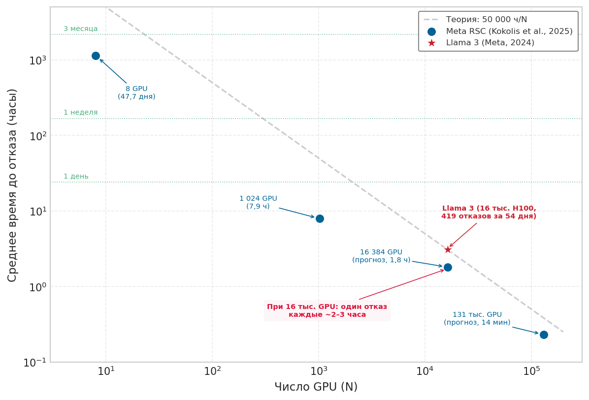

***Опубликованные частоты отказов на производственных кластерах:** измеренные значения MTTF и подогнанные прогнозы для кластеров RSC компании Meta (Kokolis et al., 2025), а также измерения обучения Llama 3 (Dubey et al., 2024), отложенные относительно теоретической кривой 1/N. При 16 384 GPU прогноз Kokolis и эмпирическое измерение Llama 3 попадают в диапазон отказов от 2 до 3 часов, что подтверждает: отказоустойчивость — математическая необходимость, а не крайний случай. Источники данных: Kokolis et al., arXiv:2410.21680; Meta, arXiv:2407.21783.*

<a id="sec-fault-tolerance-reliability-reliability-failure-taxonomy-e78c"></a>

### Таксономия отказов

Расчеты MTBF в анализе надежности количественно описывают, как часто случаются отказы, что критично для выбора интервалов контрольных точек и определения размера инфраструктуры восстановления. Эффективная отказоустойчивость также требует понимания того, какие именно отказы возникают. Термины нужно использовать аккуратно: **неисправность** (fault) — лежащий в основе дефект или событие, **ошибка** (error) — поврежденное состояние, которое она порождает, а **отказ** (failure) — видимое извне поведение, с которым должна справиться система обучения (Avizienis et al., 2004). Разделение сети, которое устраняется за секунды, требует иной обработки, чем постоянный отказ GPU. Тихая порча памяти, которая дает неверные градиенты, требует других механизмов обнаружения, чем сбой узла, который полностью перестает отвечать.

Ни одна метка не охватывает все эти различия. Решения о надежности требуют трех ортогональных осей: **персистентность** (переходная, перемежающаяся или постоянная), **проявление** (остановка при отказе (fail-stop), деградация или искажение значений) и **область отказа** (одно устройство, один узел, стойка или домен питания либо все задание). Поэтому переходная неисправность может проявиться как обнаруженный сбой или как тихая порча, а постоянный отказ коммутатора может остаться в одной стойке или разделить целое задание. Последующие подразделы проецируют это трехосевое пространство на классы отказов, наиболее полезные для восстановления; они не задают взаимоисключающих категорий (Constantinescu, 2008); (Lamport et al., 1982).

<a id="sec-fault-tolerance-reliability-reliability-transient-failures-57b4"></a>

#### Переходные отказы

Переходные отказы возникают временно и устраняются без вмешательства, поэтому вопрос в том, может ли система повторить или проверить затронутую работу до того, как поврежденное состояние распространится. Для систем ML важны четыре типичных переходных сценария:

- **Потеря сетевых пакетов**: сбрасывает пакеты, но повторная передача проходит успешно.
- **Перевороты битов в памяти**: портят отдельные биты из-за одиночных событий, вызванных космическими лучами.[^fn-seu-soft-error]
- **Тепловое ограничение частоты (троттлинг)**: временно снижает производительность при скачках температуры.
- **Программные тайм-ауты**: возникают из-за временной конкуренции за ресурсы.

[^fn-seu-soft-error]: **Одиночное событие переключения (SEU)**: термин из физики частиц, где «переключение» означает неразрушающее изменение состояния. Космические лучи и альфа-частицы от корпусов микросхем могут переворачивать биты в памяти и логике; наблюдаемая частота зависит от высоты над уровнем моря, технологического процесса, материалов корпуса, экранирования и нагрузки (Ziegler et al., 1996); (Baumann, 2005). ECC-память исправляет одиночные ошибки битов, но не справляется с каждым многобитным переворотом в одном слове. Это оставляет остаточный риск тихой порчи, который накапливается по терабайтам состояния крупномасштабного обучения ML.

Переходные отказы особенно коварны в обучении ML, потому что они могут не вызывать явных ошибок. Переворот бита в памяти во время вычисления градиента дает неверные градиенты, которые распространяются через последующие шаги обучения. Модель продолжает обучаться, но выдает тонко ухудшенные результаты. Крупномасштабные исследования SDC показывают, что порча ускользает от обнаружения, а полевые исследования DRAM показывают, что ошибки памяти достаточно распространены, поэтому мониторинг на уровне парка важен (Dixit et al., 2021); (Sridharan et al., 2015); (Schroeder et al., 2009). В обучении ML тот же скрытый шаблон порчи может проявиться как деградировавшие градиенты, аномальные кривые потерь или контрольные точки, требующие отката, а не как явный сбой.[^fn-sdc-silent-corruption]

[^fn-sdc-silent-corruption]: **Тихое повреждение данных (SDC)**: в масштабе парка SDC может обходить обычные пути исключений. Инфраструктурные исследования документировали дефектное оборудование, которое выдает правдоподобные, но неверные результаты, а полевые исследования DRAM показывают, что ошибки памяти достаточно распространены, поэтому мониторинг на уровне парка необходим. Для обучения ML практическое следствие для отладки такое: отсутствие сообщения об ошибке не означает корректности вычислений. Системам нужны статистические проверки потерь, градиентов и состояния модели.

Реакция на переходные отказы зависит от возможности обнаружения. Ошибки, которые вызывают явные исключения, можно обрабатывать ограниченной логикой повторов. Тихая порча требует сквозной проверки: контрольные суммы выявляют изменившиеся байты в хранилище или при передаче, перекрестные дайджесты рангов показывают расхождение относительно предположительно одинакового редуцированного буфера, а статистические проверки или проверки повторным вычислением тестируют, остается ли сама операция правдоподобной. Ранг, который вычисляет неверный локальный градиент, а затем корректно вычисляет контрольную сумму этих неверных байтов, проходит обычную проверку. Только независимое повторное вычисление, инварианты или данные на уровне модели могут выявить такую ошибку.

<a id="sec-fault-tolerance-reliability-reliability-failstop-failures-5cdd"></a>

#### Отказы типа остановки (fail-stop)

Отказы типа остановки приводят к тому, что компоненты полностью и обнаруживаемо прекращают работу. Отказавший компонент перестает отвечать на запросы и может быть выявлен через механизмы тайм-аута:

- **Отказ GPU**: делает устройство неотвечающим.
- **Сбой узла**: завершает все процессы на машине.
- **Разделение сети**: изолирует узел от кластера.
- **Отказ хранилища**: мешает чтению или записи контрольных точек.

В синхронном распределенном обучении отказы типа остановки имеют особенно тяжелое последствие: они останавливают все задание. Коллективные операции AllReduce требуют, чтобы каждый участвующий ранг внес свой шард градиента, прежде чем редукция может завершиться. Один GPU, который замолкает (из-за аппаратной неисправности, сбоя процесса или разделения сети), блокирует все остальные GPU в кольце до истечения тайм-аута. В задании на 10 000 GPU это означает, что 9 999 ускорителей простаивают, накапливая оплачиваемые часы при нулевом продвижении обучения, пока координатор наконец не объявит отсутствующий ранг отказавшим и не запустит восстановление.

Отказы типа остановки — самый простой класс для обработки, потому что обнаружение прямолинейно: компонент перестает отвечать. Восстановление включает замену отказавшего компонента и восстановление состояния из последней контрольной точки. Главная задача — свести к минимуму время обнаружения и задержку восстановления.

Время обнаружения $T_{\text{detect}}$ обычно опирается на механизмы сигналов активности (heartbeat), при которых каждый ранг GPU периодически сообщает координатору о своей работоспособности. Если сигнал не приходит в течение периода тайм-аута $T_{\text{timeout}}$, координатор объявляет отказ. Выбор $T_{\text{timeout}}$ требует баланса между частотой ложных срабатываний и задержкой обнаружения. Ложные срабатывания объявляют исправные воркеры отказавшими из-за временных задержек, а медленное обнаружение тратит вычисления в окне обнаружения. Эта стоимость растет линейно с числом GPU, заблокированных в коллективной операции.

Для интервала сигналов активности $H$ секунд и стандартного отклонения задержки сети $\sigma_d$ в секундах [«Эвристика тайм-аута»](07_fault_tolerance.md#eq-timeout-calculation) задает эвристику тайм-аута:

<a id="eq-timeout-calculation"></a>

$$ T_{\text{timeout}} = H + k\sigma_d $$

Здесь $k$ — безразмерный коэффициент запаса, который обычно лежит в диапазоне от трех до пяти, чтобы обеспечить низкую частоту ложных срабатываний при разумной скорости обнаружения. Кластеры ML, построенные на выделенных высокоскоростных фабриках (InfiniBand, NVLink), имеют очень низкий базовый джиттер, поэтому $\sigma_d$ в нормальных условиях функционально мало. Практическая трудность состоит в том, чтобы отличить действительно мертвый ранг от временно медленного. Например, GPU может отставать, потому что записывает большую контрольную точку в подключенное хранилище, пока коллектив уже ждет. Слишком жесткая настройка $T_{\text{timeout}}$ приводит к тому, что запись контрольных точек вызывает ложные объявления отказа. Слишком мягкая продлевает окно, в течение которого все остальные ранги коллективной операции AllReduce простаивают заблокированными.

<a id="sec-fault-tolerance-reliability-reliability-byzantine-failures-8a24"></a>

#### Византийские отказы

Компонент с остановкой просто замолкает, его обнаруживают и заменяют. Гораздо более коварный класс продолжает работать, но выдает неверные результаты. GPU, который возвращает неверные градиенты без ошибок, сеть, которая доставляет поврежденные пакеты, проходящие проверку CRC, или воркер, который вычисляет разные результаты для одинаковых входов, — все это примеры **византийских отказов** (Byzantine failures), самого трудного класса в распределенных системах (Lamport et al., 1982). В системах ML к этой категории относятся тихое повреждение данных, численная нестабильность, нарушения детерминизма и состязательное искажение. Общее свойство в том, что воркер продолжает участвовать, а значение, которое он вносит, может отравить общее состояние.

<a id="sec-fault-tolerance-reliability-physics-silent-corruption-5d5d"></a>

##### Физика тихой порчи

На наноразмерном масштабе современных транзисторов аппаратура не *детерминирована*, а *вероятностна*. Тихое повреждение данных порождается двумя основными механизмами. **Одиночные события переключения (SEU)** происходят, когда высокоэнергетические частицы (космические лучи на уровне моря, альфа-частицы от материалов корпуса) попадают в ячейки памяти или логические вентили и переворачивают бит с 0 на 1. При 10 000 и более GPU это статистическая неизбежность. **Производственные разбросы** проявляются, когда «пограничные» чипы, которые проходят первичный контроль качества, выдают переключения битов только при определенных напряжениях и температурах, например при резких скачках $di/dt$ во время обратного прохода.

Facebook задокументировал повсеместную проблему SDC, в которой аппаратный сбой привел к тому, что корректный файл был объявлен «размером ноль» при распаковке ([«Распространение тихого повреждения данных»](07_fault_tolerance.md#fig-sdc-example), источник (Dixit et al., 2021)). Система «работала» без сбоя, но данные были тихо удалены. В ML это проявляется как правдоподобно выглядящие, но численно испорченные градиенты.

<a id="fig-sdc-example"></a>

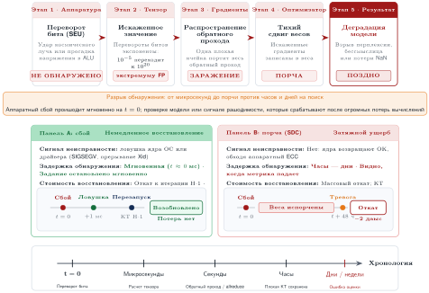
***Распространение тихого повреждения данных:** неожиданные неисправности могут возвращать неверные размеры файлов, что приводит к потере данных при распаковке и распространяет ошибки через распределенные системы запросов. Этот пример из Facebook показывает, как тихие ошибки обходят стандартные обработчики исключений. Источник: (Dixit et al., 2021).*

Реальные свидетельства SDC в производственных системах подтверждают эти риски. В приглашенном докладе на MLSys 2024 Джефф Дин сообщил, что в масштабе крупных заданий обучения ML аппаратные ошибки случаются регулярно, а неверные вычисления одного неисправного чипа могут распространиться и заразить весь запуск обучения ([«Тихое повреждение данных в масштабе»](07_fault_tolerance.md#fig-sdc-jeffdean)) (Dean, 2024).

<a id="fig-sdc-jeffdean"></a>


***Тихое повреждение данных в масштабе:** Джефф Дин выступает на тему тихого повреждения данных (SDC) на MLSys 2024. Он утверждает, что в масштабе крупных заданий обучения ML аппаратные ошибки случаются регулярно, а неверные вычисления одного неисправного чипа могут распространиться и заразить весь запуск обучения. Источник: Jeff Dean, ключевой доклад MLSys 2024 (Google).*

Google сообщила, что SDC в пакетах TPU может проявляться как внезапные, необъяснимые всплески нормы градиента ([«Отклонение нормы градиента»](07_fault_tolerance.md#fig-sdc-training-fault)) (Dean, 2024). Один переворот бита в экспоненте может превратить малый градиент в численно огромное значение и испортить траекторию обучения, если аномалия не будет обнаружена.

<a id="fig-sdc-training-fault"></a>


***Отклонение нормы градиента:** переходные аппаратные неисправности, такие как тихое повреждение данных (SDC), могут нарушать оптимизацию, вызывая резкие изменения нормы градиента. Производственные примеры Google показывают аномалии SDC как заметные всплески нормы градиента. Источник: (Dean, 2024).*

Google решает этот класс отказов системными мерами: резервной мощностью и проверками разумности, которые могут вывести подозрительные чипы из работы, когда мониторы потерь или градиентов фиксируют аномалии ([«Горячее резервирование»](07_fault_tolerance.md#fig-sdc-controller)) (Dean, 2024). Это переносит надежность с недоверенного компонента на систему, которая проверяет результат.

<a id="fig-sdc-controller"></a>

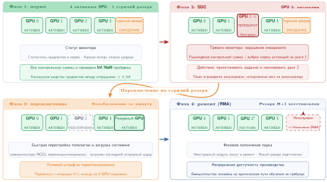
***Горячее резервирование:** примеры дата-центров Google используют резервную мощность и проверку разумности, чтобы обучение ML продолжалось несмотря на аппаратные неисправности: работа переводится с подозрительных ресурсов, когда мониторы фиксируют аномалии. Этот подход отличается от методов параллельного резервирования, таких как двойное и тройное модульное резервирование, тем, что является реактивным механизмом отказоустойчивости. Источник: (Dean, 2024).*

Схема горячего резерва на [рисунке «Горячее резервирование»](07_fault_tolerance.md#fig-sdc-controller) иллюстрирует один из подходов к смягчению SDC. Но чтобы вообще распознать тихую порчу, нужно понимать, чем она отличается от безвредного шума обучения.

<a id="chk-fault-tolerance-detecting-silent-corruption"></a>

> **Обнаружение тихой порчи**
>
> Проверьте, насколько вы понимаете византийские отказы и SDC:
>
> - [ ] **Опасность SDC**: объясните, почему тихое повреждение данных опаснее для обучения ML, чем простой сбой узла.
> - [ ] **Горячий резерв и перезапуск**: сравните стратегию горячего резерва с традиционным перезапуском из контрольной точки по задержке восстановления.
> - [ ] **Проверяющий на разумность**: укажите метрику, которая используется как «проверка разумности» для выявления возможных аппаратных неисправностей: температуру GPU или норму градиента.
> - [ ] **Область византийских отказов**: оцените утверждение «верно или неверно», что византийские отказы возникают только тогда, когда злоумышленник намеренно саботирует учебный кластер.

Обнаружение тихой порчи — первая линия защиты, но та же логика распространяется на любой византийский воркер, выход которого остается синтаксически корректным. Эти отказы особенно опасны в распределенном обучении, потому что стандартное допущение о том, что воркеры вычисляют одинаковые градиенты для одинаковых данных, перестает выполняться. Один византийский воркер может испортить усредненный градиент и заставить обучение разойтись или сойтись к плохому решению. [Рисунок «Отказы типа остановки против византийских отказов»](07_fault_tolerance.md#fig-failure-types) противопоставляет прямолинейное обнаружение отказов типа остановки коварной природе византийской порчи.

<a id="fig-failure-types"></a>


***Отказы типа остановки против византийских отказов:** при модели остановки (слева) отказавший воркер просто перестает отправлять сообщения, что легко обнаруживается по тайм-аутам. В византийской модели (справа) отказавший воркер продолжает участвовать, но отправляет неверные данные (например, испорченные градиенты, выданные за корректные). Такие данные могут испортить глобальное состояние модели, если их не выявит избыточная проверка.*

Обнаружение византийских отказов требует избыточных вычислений. Несколько воркеров, вычисляющих градиенты для одних и тех же данных, позволяют сравнить результаты. Статистическое обнаружение выбросов может выявить воркеры, которые постоянно выдают аномальные градиенты. Эти механизмы обнаружения добавляют вычислительные накладные расходы и могут пропустить тонкую порчу.

Византийски устойчивые алгоритмы распределенного обучения существуют, но накладывают значительные расходы. Алгоритмы вроде Krum (Blanchard et al., 2017) и покоординатного усеченного среднего (Yin et al., 2018) вычисляют агрегаты, устойчивые к ограниченному числу византийских воркеров, но требуют больше коммуникации и вычислений, чем простое усреднение. Системное следствие здесь наглядно: испорченные градиенты могут подтолкнуть оптимизатор к ненадежному состоянию модели, в то время как задание обучения выглядит здоровым. Поэтому надежность должна защищать семантическую корректность, а не только живучесть процесса.[^fn-byzantine-consensus-overhead]

[^fn-byzantine-consensus-overhead]: **Византийски устойчивое ML**: название восходит к задаче Лэмпорта о византийских генералах (1982). Эти алгоритмы (Krum, усеченное среднее, signSGD) переносят ограниченную долю испорченных воркеров; точная граница зависит от алгоритма и допущений. Компромисс конкретен: для $N$ воркеров Krum требует попарного вычисления расстояний между градиентами воркеров, поэтому накладные расходы растут квадратично с числом воркеров и напрямую конкурируют с выигрышем пропускной способности от параллелизма по данным (Blanchard et al., 2017).

<a id="sec-fault-tolerance-reliability-reliability-correlated-failures-95e8"></a>

#### Коррелированные отказы

Расчеты надежности в [разделе «Математика неизбежного отказа»](07_fault_tolerance.md#sec-fault-tolerance-reliability-reliability-mathematics-inevitable-failure-93ef) предполагают независимые отказы. В реальных системах возникают коррелированные отказы, когда общие зависимости выводят из строя сразу много компонентов:

- **Отказ блока питания**: выводит из строя все GPU в узле.
- **Отказ сетевого коммутатора**: изолирует все подключенные узлы.
- **Отказ системы охлаждения**: вызывает тепловое отключение в стойках.
- **Программная ошибка**: аварийно завершает все процессы, которые используют неисправную версию драйвера CUDA.
- **Ошибка оператора**: неверно настраивает целый кластер.

Коррелированные отказы нарушают допущение о независимости, на котором основана [формула «Надежность системы из N компонентов»](07_fault_tolerance.md#eq-system-reliability-n-components). Когда отказы коррелированы, реальная надежность системы ниже, чем предсказывает формула. Коррелированные отказы могут также обесценить стратегии резервирования. Три реплики модели не дают выигрыша в доступности, если все три работают в одном домене питания и отказ питания выводит их из строя одновременно.

Защита от коррелированных отказов требует понимания доменов отказа и того, чтобы резервирование охватывало независимые домены. [Таблица «Домены отказа в инфраструктуре ML»](07_fault_tolerance.md#tbl-failure-domains) перечисляет распространенные домены отказа в инфраструктуре ML: от отдельных GPU до целых регионов дата-центров, и каждый из них требует своих стратегий смягчения. [Рисунок «Иерархия доменов отказа»](07_fault_tolerance.md#fig-failure-domains) показывает, как эти домены вложены друг в друга и как отказы распространяются вниз по структуре вложенности.

| **Домен отказа** | **Масштаб воздействия** | **Типичное время восстановления** | **Стратегия смягчения** |
|:-----------------------|:------------------------:|:-------------------------:|:----------------------------:|
| **Один GPU** | 1 GPU | Секунды (резерв) | Горячий резерв, эластичное обучение |
| **Узел (питание/ОС)** | 8 GPU | Минуты | Контрольная точка, замена узла |
| **Стойка (коммутатор ToR)** | 32–64 GPU | От минут до часов | Резервирование между стойками |
| **Домен питания** | 100–500 GPU | Часы | Несколько вводов питания |
| **Регион дата-центра** | Все GPU | От часов до дней | Географическое распределение |
| **Версия ПО** | Все GPU с этой версией | Минуты (откат) | Поэтапные выкладки |

<a id="tbl-failure-domains"></a>

***Домены отказа в инфраструктуре ML:** понимание границ доменов отказа позволяет размещать резервные компоненты по независимым доменам и не дает коррелированным отказам обесценить стратегии резервирования.*

Вложенность доменов отказа в [таблице «Домены отказа в инфраструктуре ML»](07_fault_tolerance.md#tbl-failure-domains) напрямую влияет на размещение резервов: размещение реплик в одном домене не дает никакой защиты от отказа этого домена.

<a id="fig-failure-domains"></a>


***Иерархия доменов отказа:** домены отказа часто вложены или перекрываются. Отказ GPU затрагивает одно устройство. Отказ узла затрагивает 8 GPU. Отказ коммутатора стойки затрагивает 32–64 GPU. Отказ блока распределения питания (PDU) может затронуть несколько стоек. Эффективная отказоустойчивость требует размещения реплик по независимым доменам (например, разным стойкам или рядам), чтобы пережить коррелированные отказы.*

Ключевая идея [рисунка «Иерархия доменов отказа»](07_fault_tolerance.md#fig-failure-domains) в том, что резервирование эффективно только тогда, когда реплики охватывают независимые домены отказа. Размещение трех реплик модели в одной стойке не защищает от отказа коммутатора стойки или PDU, которые у всех трех общие.

<a id="chk-fault-tolerance-mapping-failure-domains"></a>

> **Карта доменов отказа**
>
> Проверьте, насколько вы понимаете, как домены отказа вложены и каково их операционное влияние:
>
> - [ ] **Радиус поражения**: вычислите, на сколько узлов по 8 GPU обычно влияет отказ коммутатора стойки в стандартной конфигурации дата-центра.
> - [ ] **Корреляция зон**: объясните, почему размещение всех 3 реплик модели в одной зоне (например, `us-east-1a`) не защищает от регионального отключения питания.
> - [ ] **Поэтапные выкладки**: укажите домен отказа, против которого работают поэтапные выкладки, а не аппаратное резервирование.
> - [ ] **Вложенные домены**: объясните иерархическую вложенность и решите, важен ли соответствующий домен «стойка», когда отказывает зона.

<a id="ws-fault-tolerance-google-tpuv4-routing"></a>

> **Суперкомпьютер, который обходил неисправности (2024)**
>
> **Контекст**: машинный суперкомпьютер Google TPUv4 использовал 4 096 чипов TPU, соединенных собственной трехмерной тороидальной фабрикой ICI. Инженеры Google опубликовали опыт эксплуатации автоматической отказоустойчивости и восстановления оборудования (Zu et al., 2024).
>
> **Механизм**: на масштабе 4 096 чипов отказы компонентов (чипов TPU, оптических линков ICI или оптических коммутаторов цепей) разрывали трехмерные торовые кольца связи и ломали топологии коллективных операций AllReduce.
>
> **Последствие**: без динамической перемаршрутизации топологии одна неисправность компонента заставляла остановить и перезапустить целое задание на 4 096 чипов.
>
> **Исправление**: Google развернула оптические коммутаторы цепей (OCS), которые динамически перенастраивают фабрику ICI в обход неисправных компонентов и направляют трафик на резервные исправные кубы TPU за минуты.
>
> **Системный урок**: отказоустойчивость — это задача управления топологией. В плотно связанных парках ускорителей восстановление должно сохранять граф коммуникаций, а не просто заменять отдельный компонент. Иначе одна локальная аппаратная неисправность может превратиться в прерывание обучения на уровне всего кластера.

<a id="sec-fault-tolerance-reliability-reliability-bathtub-curve-hardware-lifecycle-7d8a"></a>

### Кривая ванны и жизненный цикл аппаратуры

Таксономия отказов классифицирует типы отказов и домены, отвечая на вопрос, какие отказы возникают. Для проектирования отказоустойчивости не менее важно понимать, когда в жизни компонента отказы наиболее вероятны. Интенсивность аппаратных отказов не постоянна в течение срока службы компонента. [«Кривая ванны»](07_fault_tolerance.md#fig-bathtub-curve) иллюстрирует кривую ванны, хорошо известную модель инженерии надежности, которая описывает, как интенсивность отказов меняется на трех различных фазах:

Первая фаза, **детская смертность** (Infant Mortality), характеризуется повышенной интенсивностью отказов из-за производственных дефектов, неправильной установки и раннего износа пограничных компонентов. Для электронных компонентов эта фаза обычно длится от дней до недель. Испытания на прогрев[^fn-burnin-screening-hardware] проводятся до развертывания: компоненты работают в условиях нагрузки, чтобы выявить отказы детской смертности до промышленной эксплуатации.

[^fn-burnin-screening-hardware]: **Испытание на прогрев (burn-in)**: компоненты работают при повышенной температуре (85–125 °C) и напряжении в течение 24–168 часов, чтобы выявить отказы детской смертности до промышленной эксплуатации. Крупные операторы могут прогревать ускорители перед развертыванием, снижая долю отказов детской смертности, которые свежее «голое» железо иначе могло бы проявить уже на первых заданиях.

Пережив детскую смертность, компоненты переходят в фазу **полезного срока службы** (Useful Life), где по стандартной модели инженерии надежности интенсивность отказов примерно постоянна и низка (Birolini, 2017); (Klutke et al., 2003). Эта фаза — самая длинная часть срока службы компонента, и именно здесь экспоненциальная модель надежности из [формулы «Надежность одного компонента»](07_fault_tolerance.md#eq-single-component-reliability) применима точнее всего. Для дата-центровых GPU окно полезного срока службы — операционное плановое понятие, которое определяется циклами обновления, охлаждением, загрузкой и наблюдаемым состоянием парка, а не фиксированной физической длительностью.

По мере старения компоненты входят в фазу **износа** (Wear-Out), где интенсивность отказов растет из-за накопленного износа. Для GPU механизмы износа включают электромиграцию[^fn-electromigration-silicon-wearout] в цепях, термоциклические напряжения паяных соединений и деградацию термоинтерфейсных материалов. Начало износа сильно зависит от условий эксплуатации: компоненты, работавшие при высоких температурах или при частых термоциклах, входят в износ раньше.

[^fn-electromigration-silicon-wearout]: **Электромиграция**: постепенное смещение атомов металла в проводниках под действием передачи импульса электронов; впервые описана в ранних исследованиях электромиграции и затем смоделирована в уравнении надежности Блэка (Black, 1969). Среднее время до отказа уменьшается при росте плотности тока и температуры, поэтому длительная нагрузка ускорителей большой мощностью делает тепловое управление прямым фактором срока службы парка.

Практическое следствие для систем ML состоит в том, что интенсивность отказов по парку зависит от распределения по возрасту. Кластер, полностью составленный из новых GPU, испытает повышенную интенсивность отказов в первые недели, затем период стабильности, а затем рост отказов по мере старения парка. Смешанные по возрасту парки демонстрируют более равномерную совокупную интенсивность отказов, потому что разные когорты находятся в разных фазах жизненного цикла.

<a id="fig-bathtub-curve"></a>


***Кривая ванны:** интенсивность аппаратных отказов $\lambda(t)$ меняется во времени. (1) Детская смертность: вначале высокая интенсивность отказов из-за производственных дефектов. (2) Полезный срок службы: постоянная низкая интенсивность, где преобладают случайные отказы. (3) Износ: растущая интенсивность по мере старения компонентов. Испытания на прогрев призваны отфильтровать отказы детской смертности до развертывания.*

Три фазы на [рисунке «Кривая ванны»](07_fault_tolerance.md#fig-bathtub-curve) имеют прямые эксплуатационные последствия. Испытания на прогрев отфильтровывают детскую смертность до развертывания, а предиктивная аналитика по телеметрии GPU (тренды температуры, число ошибок, деградация производительности) нацелена на фазу износа. Она позволяет планово заменять компоненты в окна обслуживания, а не сталкиваться с незапланированными простоями во время запусков обучения. Команды инфраструктуры ML применяют эту модель непосредственно к планированию кластера и допуску в парк. Вместо того чтобы считать свежие пакеты ускорителей сразу равноценными проверенным производственным узлам, операторы часто запускают стресс-нагрузки, прежде чем выделять оборудование под ценное обучение. Длительные циклы умножения матриц, тесты памяти и тесты коммуникации выявляют пограничные устройства до того, как они попадут в многонедельное предобучение. Оператор ремонтирует или заменяет ускоритель, который отказал на этапе проверки, до того как он попадет в ценное обучение. Ускоритель, который выдержал проверку, переходит в период полезного срока службы, где применима экспоненциальная модель с постоянной интенсивностью. Этот подход важен, потому что асимметрия стоимости велика: поймать отказ детской смертности на проверке стоит нескольких часов простоя ускорителя, а тот же отказ во время многонедельного предобучения фундаментальной модели может обесценить дни накопления градиентов и вынудить откат к контрольной точке. Политика планирования отражает эту асимметрию: операторы кластеров обычно сначала назначают новые или недавно отремонтированные узлы на короткие исследовательские задания или обслуживание вывода, а не на многомесячное предобучение, пока не накопят достаточно часов работы, чтобы выйти из окна риска детской смертности.

<a id="sec-fault-tolerance-reliability-reliability-modeltype-diversity-failure-impact-8ec0"></a>

### Разнообразие типов моделей в воздействии отказов

Хотя математика интенсивностей отказов одинакова для всех моделей, воздействие отказа на разные типы моделей различается очень сильно. Цена потери часа обучения зависит от того, сколько стоит это обучение, сколько состояния нужно восстановить и сколько длится восстановление. [Таблица «Воздействие отказов по типам моделей»](07_fault_tolerance.md#tbl-failure-impact-by-model) количественно описывает эти факторы для разных архитектур: от больших языковых моделей (LLM), в которых теряются миллионы долларов вычислений, до моделей зрения, которые теряют умеренный объем прогресса.

| **Тип модели** | **Типичная длительность обучения** | **Размер контрольной точки** | **Чувствительность состояния** | **Стоимость отказа** |
|:--------------------------------------|:-----------------------------:|:--------------------:|:-------------------------------:|:-----------------------------:|
| **Архетип A (плотная LLM класса 70B)** | 2–4 недели | 350–700 ГБ | Высокая (позиция в учебном плане) | 2–5 млн \$ вычислений за потерю 24 ч |
| **Зрение (ViT-Large)** | 1–3 дня | 1–2 ГБ | Средняя (состояние аугментации) | 10–50 тыс. \$ за потерю дня |
| **Архетип B (DLRM в масштабе)** | Непрерывное | 2–4 ТБ (эмбеддинги) | Очень высокая (актуальность эмбеддингов) | Влияние на выручку за час |
| **Речь (масштаба Whisper)** | 3–7 дней | 5–10 ГБ | Средняя | 50–200 тыс. \$ за потерю дня |
| **Научные модели (AlphaFold)** | От дней до недель | 10–50 ГБ | Высокая (состояние исследования) | Задержка исследований |

<a id="tbl-failure-impact-by-model"></a>

***Воздействие отказов по типам моделей:** стоимость отказов обучения сильно различается по типам моделей: ее определяют длительность обучения, накладные расходы контрольных точек и ценность накопленного состояния обучения. Эти различия требуют стратегий отказоустойчивости, учитывающих конкретную модель.*

Большие языковые модели несут наибольшие абсолютные потери от отказов из-за длительного обучения и вычислительной стоимости каждого часа обучения. Например, крупный запуск обучения, использующий 25 000 GPU примерно по \$3 за GPU-час, стоит около 1,8 млн \$ вычислений в день. Отказ, который теряет 24 часа прогресса обучения, обходится в 1,8 млн \$ потерянных вычислений плюс задержка графика. Накладные расходы контрольных точек широко варьируются: контрольные точки плотных LLM класса 70B могут достигать сотен гигабайт, а пример со 175 млрд параметров достигает 3,7 ТБ, если учитывать состояние оптимизатора Adam в FP32.

Системы рекомендаций создают особые проблемы, потому что их обучение часто непрерывно, а не эпизодично. Ценность модели RecSys отчасти определяется ее актуальностью. Эмбеддинги, которые фиксируют недавнее поведение пользователей, работают лучше устаревших. Отказ, который теряет часы обновлений эмбеддингов, может ухудшить качество рекомендаций так, что это напрямую скажется на выручке. Meta документировала, что актуальность модели рекомендаций напрямую коррелирует с метриками вовлеченности, поэтому время восстановления становится бизнес-критичным показателем.[^fn-recsys-model-freshness]

[^fn-recsys-model-freshness]: **Актуальность RecSys**: инфраструктура DLRM в Meta документирует, что устаревание эмбеддингов, измеряемое в часах, дает заметную деградацию релевантности рекомендаций и метрик вовлеченности. Это переворачивает обычный приоритет отказоустойчивости: для систем рекомендаций важнее минимизировать время восстановления, чем минимизировать накладные расходы контрольных точек, потому что устаревшие эмбеддинги напрямую снижают выручку.

Модели зрения занимают промежуточное положение: умеренная длительность обучения и управляемые размеры контрольных точек. Относительно небольшие контрольные точки позволяют сохранять их часто с минимальными накладными расходами. Контрольная точка vision transformer (ViT)-Large размером 1–2 ГБ создает небольшие накладные расходы по сравнению с нагрузками больших языковых моделей или рекомендательных систем с тяжелыми эмбеддингами. Состояние аугментации данных — основное состояние помимо весов модели, которое нужно сохранить для воспроизводимого восстановления. Необходимо сохранять параметры аугментации и затравку перемешивания данных.

Научные модели, такие как используемые для предсказания структуры белков или в климатическом моделировании, часто имеют особые требования к состоянию помимо параметров модели. Обучение в стиле AlphaFold может поддерживать состояние исследования, которое отслеживает, какие семейства белков уже выбраны, чтобы не повторяться при восстановлении. Модели для поиска лекарств могут отслеживать, какие молекулярные конфигурации уже оценены. Это специфичное для предметной области состояние усложняет проектирование контрольных точек и восстановления.

<a id="sec-fault-tolerance-reliability-reliability-economic-framework-fault-tolerance-investment-e032"></a>

### Экономика инвестиций в отказоустойчивость

Механизмы отказоустойчивости потребляют ресурсы: хранилище для контрольных точек, пропускную способность для их записи, вычислительные циклы на избыточные расчеты и инженерное время на внедрение и сопровождение. Рациональные инвестиции в отказоустойчивость требуют количественной оценки как стоимости отказов, так и стоимости предотвращения.

Стоимость отказов включает потерянные вычисления, задержку графика, упущенные возможности и инженерное время. Потерянные вычисления измеряют GPU-часы, потраченные на шаги обучения, которые придется повторить. Задержка графика отражает, как удлинение срока до обученной модели влияет на бизнес-планы. Упущенная возможность учитывает, что вычисления, потраченные на восстановление, нельзя использовать для другого обучения. Инженерная стоимость учитывает время, потраченное на отладку отказов и ручное восстановление.

Стоимость предотвращения включает хранилище, накладные расходы по пропускной способности, инфраструктуру восстановления и сложность. Стоимость хранилища растет с размером модели и частотой контрольных точек. Запись контрольных точек потребляет пропускную способность памяти и может останавливать обучение. Инфраструктура восстановления требует резервной мощности и автоматизированных систем восстановления. Отказоустойчивые системы труднее разрабатывать и отлаживать.

Оптимальные инвестиции в отказоустойчивость уравновешивают эти затраты. Для мелкомасштабного обучения на нескольких GPU, где отказы редки, минимальная отказоустойчивость может быть оптимальной по стоимости: достаточно редких контрольных точек и ручного восстановления. Для крупномасштабного обучения на тысячах GPU, где отказы случаются несколько раз в день, обширная отказоустойчивость дает положительную отдачу от инвестиций. Становятся необходимыми частые контрольные точки, автоматическое восстановление и эластичное обучение. [Рисунок «Оптимальная контрольная точка Янга–Дэйли»](07_fault_tolerance.md#fig-young-daly) показывает, как компромисс между накладными расходами контрольных точек и стоимостью восстановления достигает оптимума, который зависит и от системного MTBF, и от времени записи контрольной точки.

[«Полная стоимость обучения с отказами»](07_fault_tolerance.md#eq-ft-total-cost) представляет упрощенную экономическую модель ожидаемой стоимости одного запуска обучения:

<a id="eq-ft-total-cost"></a>

$$ C_{\text{total}} = C_{\text{compute}} + E[N_{\text{failures}}] \times C_{\text{per-failure}} + C_{\text{ft}} $$

где $C_{\text{compute}}$ — базовая стоимость вычислений, $E[N_{\text{failures}}]$ — ожидаемое число отказов во время обучения, $C_{\text{per-failure}}$ — стоимость одного отказа, а $C_{\text{ft}}$ — стоимость механизмов отказоустойчивости. Стоимость одного отказа включает потерянные вычисления и накладные расходы.

[«Критерий инвестиций в отказоустойчивость»](07_fault_tolerance.md#eq-ft-investment-criterion) формализует, когда инвестиции в отказоустойчивость оправданы:

<a id="eq-ft-investment-criterion"></a>

$$ \frac{\partial C_{\text{ft}}}{\partial x} < \frac{\partial (E[N_{\text{failures}}] \times C_{\text{per-failure}})}{\partial x} $$

где $x$ — инвестиции в механизмы отказоустойчивости. На практике это означает, что инвестировать в отказоустойчивость нужно до тех пор, пока предельная стоимость дополнительной защиты не превысит предельное снижение стоимости отказов.

Три фундаментальных принципа направляют каждое проектное решение в этой области.

<a id="psp-fault-tolerance-three-rules-failure-at-scale"></a>

> **Три правила отказов в масштабе**
>
> 1. **В масштабе отказы непрерывны, а не исключительны.** Кластер из 10 000 GPU отказывает каждые несколько часов. Системы должны проектироваться с ожиданием отказа как нормального режима работы.
> 2. **У интервалов контрольных точек есть оптимум.** Формула Янга–Дэйли, $\tau_{\text{opt}} = \sqrt{2 \times T_{\text{write}} \times \text{MTBF}_{\text{system}}}$, дает количественные указания по частоте контрольных точек. Эта формула выведена в разделе [«Закон Янга–Дэйли»](07_fault_tolerance.md#sec-fault-tolerance-young-daly).
> 3. **Обучение и обслуживание имеют принципиально разные требования к отказоустойчивости.** Обучение переносит минуты восстановления, а обслуживание требует миллисекунд. Это различие требует совершенно других подходов.

Правило 3 (расхождение обучения и обслуживания) задает порядок: сначала восстановление обучения, затем устойчивость обслуживания. До того и другого нужно понять физические реалии того, что ломается, начиная с аппаратных неисправностей, которые запускают эти отказы.

<a id="sec-fault-tolerance-hardware-fault-taxonomy"></a>

## Таксономия аппаратных неисправностей

Рассмотрим, что происходит, когда космический луч переворачивает один бит в высокоскоростной памяти (HBM) GPU или когда тепловое расширение вызывает микроскопическую трещину в разъеме NVLink. Эти физические события каскадно переходят в программные ошибки, которые могут испортить многонедельный запуск обучения. Но система восстановления не наблюдает «космический луч» или «трещину» напрямую. Она видит симптомы: всплеск градиента без аварийного завершения процесса, ранг, который исчезает из коллективной операции, или узел, который отказывает только тогда, когда нагревается под длительной нагрузкой. Таксономия аппаратуры полезна лишь тогда, когда превращает эти симптомы в решение о восстановлении.

<a id="sec-ft-hardware-fault-impact-ml-systems-b5f7"></a>

### Влияние аппаратных неисправностей на системы ML

Системы ML усиливают последствия аппаратных неисправностей сильнее, чем традиционные приложения. Вычислительная интенсивность создает миллионы возможностей в секунду для того, чтобы неисправности испортили результаты. Запуски обучения, длящиеся дни или недели, повышают вероятность встретить неисправность. Небольшая порча весов модели может вызвать большие изменения выходных предсказаний, а распределенные зависимости означают, что одиночный отказ может сорвать целые рабочие процессы.

Один переворот бита в матрице весов иллюстрирует серьезность. Если критичный вес в модели ResNet-50 меняется с 0,5 на −0,5 из-за переходной неисправности, которая затрагивает знаковый бит в представлении с плавающей точкой IEEE 754[^fn-ieee754-fp-vulnerability], знак карты признаков меняется на противоположный, и ошибки каскадом проходят через последующие слои. Исследования инжекции неисправностей показывают, что устойчивость глубоких нейронных сетей резко зависит от модели, слоя, структуры и позиции бита, поэтому небольшое число неисправностей в уязвимых местах может вызвать непропорциональную потерю точности (Reagen et al., 2018). Такая битовая ошибка в обычном приложении может вызвать аварийное завершение, но в нейронной сети она может тихо испортить выученные представления, которые определяют поведение системы.

[^fn-ieee754-fp-vulnerability]: **IEEE 754**: стандарт IEEE 754 задает формат binary32 с 1 битом знака, 8 битами порядка и 23 битами мантиссы (IEEE Standards Association, 2019). Такая раскладка битов создает асимметричную уязвимость для ML: переворот знакового бита полностью инвертирует вес ($0{,}5 \to -0{,}5$), тогда как переворот бита порядка может сдвинуть величину на порядки. Поэтому механизмы устойчивости часто защищают наиболее чувствительные позиции битов, а не считают все биты одинаково важными.

Надежность остается проектным ограничением по мере масштабирования ускорителей. Меньшие геометрии и низкие рабочие напряжения могут уменьшить заряд, необходимый для возмущения сохраненного значения, что повышает чувствительность к некоторым механизмам мягких ошибок (Baumann, 2005). Крупные парки ML выявляют редкие аппаратные неисправности достаточно часто, поэтому обнаружение и восстановление на программном уровне становятся частью проекта системы обучения (He et al., 2023). Архитекторы ML-систем должны рассматривать аппаратуру как **ненадежную подложку** (Unreliable Substrate). Сквозные проверки целостности, избыточные или повторно воспроизводимые вычисления для рискованных путей, репликация весов и периодические проверки согласованности становятся требованиями к системе, а не специальностью высокопроизводительных вычислений.

Временная сигнатура аппаратной неисправности определяет реакцию. Однократная порча требует обнаружения и отката, постоянный дефект требует изоляции и замены, а повторяющийся дефект, чувствительный к нагрузке, требует сбора доказательств, прежде чем узел испортит еще больше заданий. [Рисунок «Временная таксономия аппаратных неисправностей»](07_fault_tolerance.md#fig-fault-temporal-categories) обобщает три категории, которые важны на практике.

<a id="fig-fault-temporal-categories"></a>

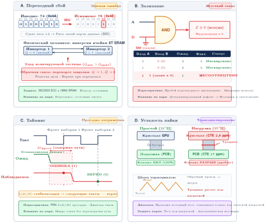
***Временная таксономия аппаратных неисправностей:** четыре панели показывают, как три временные категории проявляются на практике. Панели переходных неисправностей (переворот бита и сбой синхронизации) показывают временные нарушения, которые не вызывают постоянного повреждения. Панель перемежающейся неисправности показывает спорадические ошибки, вызванные нестабильными условиями или старением. Панель постоянной неисправности (залипание в 0/1) показывает необратимое физическое повреждение, требующее замены.*

Три категории различаются тем, что система восстановления должна вывести:

*   **Переходные неисправности** — временные нарушения из-за внешних факторов, таких как космические лучи или электромагнитные помехи (Ziegler et al., 1996). Их опасность — тихая порча: ранг может продолжать участвовать, посылая неверный градиент или активацию.
*   **Постоянные неисправности** — необратимое повреждение из-за физических дефектов или износа компонентов, например залипание или отказ устройства, требующий замены оборудования. Их опасность — повторяемость: повтор на том же устройстве воспроизводит ту же неверную операцию или жесткий отказ.
*   **Перемежающиеся неисправности** — появляются и исчезают спорадически из-за нестабильных условий, таких как плохие контакты, старение компонентов или тепловой стресс. Их опасность — неоднозначность: задание может пройти проверку в одном запуске и отказать при немного другой нагрузке.

Стратегия восстановления меняется, потому что каждая категория отказывает в своем временном масштабе и оставляет разные следы.

<a id="sec-ft-transient-faults-1455"></a>

### Переходные неисправности

Таксономия отказов классифицировала переходные отказы по позиции восстановления: может ли система повторить или проверить затронутую работу. Их физический механизм определяет нужное обнаружение. Переходные неисправности — самая распространенная категория, и [рисунок «Ошибка переворота бита»](07_fault_tolerance.md#fig-bit-flip) иллюстрирует базовый механизм: **ошибка переворота бита** возникает, когда один бит в памяти неожиданно меняет состояние и может изменить критичные данные или вычисления так, что ошибки каскадом проходят через слои нейронной сети.

<a id="fig-bit-flip"></a>

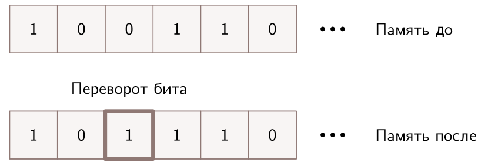
***Ошибка переворота бита:** переходные неисправности могут менять отдельные биты в памяти, портя данные или инструкции программы и потенциально вызывая сбои системы. Эти однобитные ошибки показывают уязвимость аппаратуры к переходным неисправностям, вызванным излучением или электромагнитными помехами.*

Переходные неисправности важны потому, что после инцидента может не остаться поврежденного компонента, который можно было бы найти. Одиночное событие переключения от излучения, колебание напряжения от нестабильного пути питания (Reddi and Gupta, 2013), электромагнитные помехи, электростатический разряд, перекрестные наводки, сдвиг земли, нарушение временных ограничений или мягкая ошибка в комбинационной логике (Mukherjee et al., 2005) — все это может свестись к одному симптому ML: один тензор, пакет или инструкция отличается от того, что ожидала коллективная операция. Поэтому проект восстановления делает упор на онлайн-обнаружение, коррекцию там, где это возможно, и откат из известного корректного состояния, а не на ручную замену оборудования.

<a id="sec-ft-fault-analysis-performance-impact-fa37"></a>

#### Количественные частоты неисправностей

Передовые полупроводниковые процессы могут повышать чувствительность к мягким ошибкам по мере того, как уменьшаются емкость узла, напряжение питания и накопленный заряд (Baumann, 2005). Для GPU практический риск усиливается массовым параллелизмом: тысячи линий выполнения и высокоскоростные памяти создают много мест, где переходные неисправности могут затронуть веса, активации или градиенты. Значения операционного MTBF[^fn-mtbf-checkpoint-interval] поэтому зависят от нагрузки, компонентов и среды, а не универсальны. Для анализа контрольных точек в [разделе «Контрольные точки: сохранение прогресса»](07_fault_tolerance.md#sec-fault-tolerance-reliability-reliability-checkpoint-restart-fundamentals-0ac2) важно системное правило накопления: парк из 1 000 ускорителей с иллюстративным MTBF одного ускорителя 50 000 часов отказывает примерно каждые 50 часов, а значит, нужны надежные контрольные точки.

[^fn-mtbf-checkpoint-interval]: **MTBF (среднее время между отказами)**: введено военными США в MIL-HDBK-217 (1965). MTBF предполагает экспоненциальное распределение отказов в период полезного срока службы. Для обучения ML MTBF напрямую входит в формулу Янга–Дэйли: кластер с MTBF устройства 50 000 часов и 1 000 устройств имеет системный MTBF 50 часов. Сам по себе MTBF не определяет оптимальный интервал. Чтобы задать целевой уровень потерь, нужно уравновесить ожидаемую долю повторной работы $\tau/(2\,\text{MTBF})$ и время записи контрольной точки $T_{\text{write}}$.

Подсистемы памяти наиболее подвержены ошибкам, а механизмы отказоустойчивости накладывают на них прямой налог на пропускную способность. [Таблица «Анализ защиты пропускной способности памяти»](07_fault_tolerance.md#tbl-memory-bandwidth-protection) количественно оценивает этот налог для разных технологий памяти:

Анализ защиты пропускной способности памяти показывает налог на пропускную способность, который защита от ошибок накладывает на разные технологии памяти.

| **Технология памяти** | **Базовая пропускная способность** | **Накладные расходы ECC** | **Эффективная пропускная способность** |
|:----------------------|:----------------------------------------------------------:|:------------------------------------------------------:|:---------------------------------------------------------:|
| **DDR4-3200** | 51,2 ГБ/с | 12,5 % | 44,8 ГБ/с |
| **HBM2** | 900 ГБ/с | 12,5 % | 787,5 ГБ/с |
| **HBM3** | 1 600 ГБ/с | 12,5 % | 1 400 ГБ/с |
| **GDDR6X** | 760 ГБ/с | Обычно нет | 760 ГБ/с |

<a id="tbl-memory-bandwidth-protection"></a>

***Анализ защиты пропускной способности памяти:** влияние защиты ECC на эффективную пропускную способность памяти разных технологий, используемых в ускорителях ML. Накладные расходы пропускной способности напрямую влияют на производительность обучения для задач, ограниченных памятью.*

Таблицу пропускной способности не следует читать как универсальный рейтинг частот ошибок памяти. Надежность HBM, GDDR и DDR зависит от поколения устройств, рабочей температуры, схемы защиты и того, как считаются ошибки. Устойчивый системный урок уже: защита от ошибок расходует пропускную способность и емкость, а полевые исследования показывают, что ошибки памяти случаются достаточно часто, чтобы оправдать ECC, фоновую очистку и мониторинг в крупных развертываниях (Schroeder et al., 2009); (Sridharan et al., 2015); (Dixit et al., 2021). Фоновая очистка памяти (периодические чтения и перезаписи для обнаружения накапливающихся мягких ошибок) обычно устроена так, что налог на пропускную способность мал по сравнению с основным трафиком обучения.

<a id="sec-ft-transient-fault-effects-ml-a01d"></a>

#### Влияние переходных неисправностей на ML

[Рисунок «Механизм переходной неисправности»](07_fault_tolerance.md#fig-transient-fault) показывает тот же механизм возмущения заряда, который был введен в обсуждении византийских отказов ([«Византийские отказы»](07_fault_tolerance.md#sec-fault-tolerance-reliability-reliability-byzantine-failures-8a24)), но уже на уровне устройства: космический луч попадает в ячейку памяти или транзистор, и наведенный заряд меняет сохраненные или передаваемые данные. Этот раздел добавляет к физике последствия для модели.

<a id="fig-transient-fault"></a>

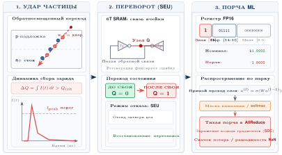
***Механизм переходной неисправности:** космические лучи и ионизирующее излучение вызывают перевороты битов, осаждая критический заряд в ячейках памяти и транзисторах; эти возмущения распространяются в тихую порчу представлений модели.*

Во время обучения переходные неисправности в памяти, которая хранит веса модели или градиенты, могут приводить к неверным обновлениям, подрывающим сходимость и точность (He et al., 2023). Во время вывода переворот бита в значениях активаций нейронной сети может изменить итоговый результат классификации или регрессии (Mahmoud et al., 2020). В критичных для безопасности приложениях такие неисправности могут приводить к неверным решениям, которые ставят безопасность под угрозу (Li et al., 2017); (Jha et al., 2019); (Wan et al., 2021). Среды с ограниченными ресурсами усиливают эти уязвимости: бинаризованные нейронные сети (Courbariaux et al., 2016), которые представляют веса одноразрядной точностью, теряют точность на тестовой выборке с 98 % до 70 %, если вставить случайные мягкие ошибки в виде переворотов битов с вероятностью 10 % (Aygun et al., 2021). В распределенном обучении сетевые разделения[^fn-partition-network-training] могут изолировать ранги, а сбои фабрики, которыми управляет менеджер подсетей InfiniBand[^fn-ib-subnet-manager], могут остановить всю коллективную операцию AllReduce.

[^fn-partition-network-training]: **Сетевое разделение**: из-за разделения сети одна часть воркеров не может связаться с другой. В синхронном обучении даже один разделенный ранг блокирует всю коллективную операцию AllReduce, поэтому устойчивость к разделению — предусловие для заданий, которые работают достаточно долго, чтобы столкнуться с обычными сбоями фабрики или плоскости управления.

[^fn-ib-subnet-manager]: **Менеджер подсетей InfiniBand (SM)**: централизованная программная сущность, которая обнаруживает все узлы и коммутаторы, назначает локальные идентификаторы и вычисляет таблицы маршрутизации. При сетевом разделении роль SM критична: он должен заново обнаружить новую топологию и обновить маршрутизацию, прежде чем обучение безопасно возобновится. Если сам SM оказывается в отрезанной части, фабрика может перейти в «зомби»-состояние, когда узлы физически соединены, но не могут передавать сообщения. Это частая причина задержек $T_{\text{detect}}$ в больших запусках обучения.

<a id="sec-ft-permanent-faults-7dfb"></a>

### Постоянные неисправности

Постоянные неисправности — необратимые аппаратные дефекты, которые сохраняются, пока отказавший компонент не будет отремонтирован или заменен. Операционный признак — повторяемость: тот же ускоритель, ячейка памяти, линк или устройство хранения отказывает снова после повтора, часто по тому же адресу, пути или фазе нагрузки. Производственные дефекты (неправильное травление, неверное легирование, загрязнение) и механизмы износа (электромиграция,[^fn-electromigration-silicon-wearout] пробой оксида,[^fn-oxide-gate-breakdown] тепловые напряжения[^fn-thermal-throttling-protection]) могут давать эту сигнатуру. Самая распространенная абстрактная модель — залипание (stuck-at fault) (Seong et al., 2010): сигнал или ячейка памяти постоянно фиксируется в 0 или 1 независимо от входа.

[^fn-oxide-gate-breakdown]: **Пробой оксида**: необратимый отказ подзатворного оксида, который создает проводящие пути через изолятор транзистора. Толщина подзатворного оксида уменьшилась примерно со 100 нм в процессах 1980-х годов до наноразмерных величин в устройствах эпохи FinFET, что повысило восприимчивость. Зависимый от времени пробой диэлектрика ограничивает прогнозы надежности чипов, поэтому целостность оксида становится вопросом планирования парка для развертываний ускорителей ML с циклами обновления оборудования 3–5 лет.

[^fn-thermal-throttling-protection]: **Тепловое напряжение**: деградация от повторных температурных циклов, которая растрескивает паяные соединения и ухудшает термоинтерфейсные материалы. Ускорители ML под длительной нагрузкой обучения могут испытывать тепловое ограничение частоты, когда тактовая частота снижается, чтобы предотвратить повреждение. Компромисс прямой: агрессивное охлаждение (жидкостное, погружное) продлевает срок службы компонентов и сохраняет пропускную способность обучения, но увеличивает стоимость инфраструктуры ЦОД. Поэтому охлаждение нужно оценивать и по надежности, и по стоимости объекта.

Самые весомые постоянные неисправности в ускорителях ML — те, которые тихо и повторяемо портят арифметику. Залипание в тракте умножения с накоплением в Tensor Core или дефектная ячейка в банке HBM, хранящем шарды весов, дают одно и то же неверное значение каждый раз, когда выполняется одно и то же вычисление. В обучении это означает, что каждый прямой проход через затронутую матрицу дает детерминированно смещенный результат, а каждый обратный проход накапливает искаженный градиент. Поскольку ошибка воспроизводима, но численно мала, потери обучения могут нормально снижаться сотни шагов, прежде чем накопленное смещение проявится как расхождение градиента или неожиданно плохая точность на валидации. В инференсе тот же дефект детерминированно искажает конкретные выходные логиты. Это свойство критично для безопасности в медицинских или автономных системах вождения: неисправность не роняет систему, но систематически склоняет каждое решение, в котором участвует затронутая плитка весов.

Ошибка FDIV в Intel Pentium, обнаруженная в 1994 году, дает каноническую иллюстрацию этого режима отказа в универсальном процессоре. Ошибка в таблице поиска, которой пользовался блок деления Pentium, давала неверные результаты для определенных областей операндов ([«Области ошибок FDIV»](07_fault_tolerance.md#fig-permanent-fault)). Случай ускорителя ML отличается геометрией, но не принципом: если ошибка FDIV портила скалярные деления, залипание в Tensor Core портит определенные строки или столбцы каждого выхода умножения матриц, который проходит через дефектную полосу, затрагивая все карты признаков или шарды градиентов, которые касаются этой части вычислений. В чувствительных к безопасности приложениях постоянная арифметическая ошибка становится угрозой безопасности, потому что каждое последующее решение наследует смещенное вычисление.

<a id="fig-permanent-fault"></a>

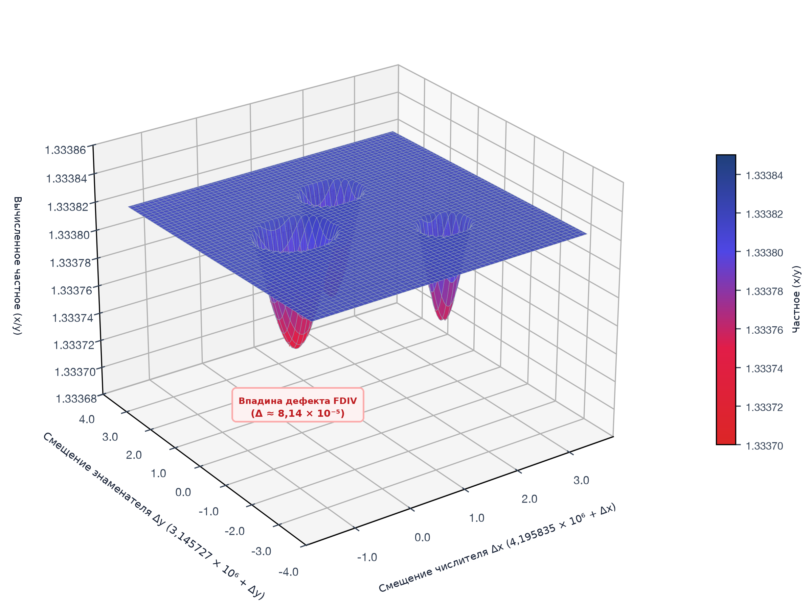
***Области ошибок FDIV:** нисходящие пики отмечают области операндов, в которых дефектный блок деления процессора Pentium выдавал неверные результаты. Источник: *Byte Magazine*.*

[Рисунок «Модель залипания»](07_fault_tolerance.md#fig-stuck-fault) показывает, как залипания распространяются через логические вентили и соединения, вызывая неверные вычисления или постоянную порчу данных, которая влияет на поведение модели ниже по цепочке.

<a id="fig-stuck-fault"></a>

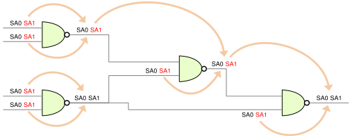
***Модель залипания:** цифровая логическая схема с неисправностью залипания в 0, при которой сигнальная линия постоянно остается в логическом 0 независимо от входа. Источник: [accendo reliability](https://accendoreliability.com/digital-circuits-stuck-fault-model/).*

Для систем ML решение восстановления — перестать доверять компоненту. Постоянная неисправность тракта ускорителя может продолжать выдавать плохие градиенты, пока устройство не будет выведено из кластера (He et al., 2023); (Zhang et al., 2018). Постоянный сбой хранилища может скомпрометировать и обучающий набор данных, и контрольные точки, нужные для восстановления. Проверка контрольных сумм, реплицированное хранилище, аппаратное резервирование, коды коррекции ошибок (Kim et al., 2015) и восстановление из контрольных точек[^fn-checkpoint-restart-overhead] (Egwutuoha et al., 2013) работают вместе, потому что каждый механизм помогает найти копию, которой еще можно доверять. Формула Янга–Дэйли из [раздела «Закон Янга–Дэйли»](07_fault_tolerance.md#sec-fault-tolerance-young-daly) задает затем экономическую границу. Аппаратное упрочнение повышает MTBF, но зависимость через квадратный корень означает, что инвестиции в надежность нужно уравновешивать более быстрыми контрольными точками и инфраструктурой перезапуска.

[^fn-checkpoint-restart-overhead]: **Перезапуск из контрольной точки**: возник в пакетной обработке на мейнфреймах 1960-х годов, где перезапуск многочасовых заданий с нуля был слишком дорогим. Крупные распределенные задания обучения могут сохранять состояния моделей объемом более 100 ГБ каждые 10–30 минут. В исследовании устойчивости TPUv4 компании Google описаны скоординированные контрольные точки и перенастройка, которые удерживали потери вычислений из-за отказов узлов ниже 1 % общего времени обучения.

<a id="sec-ft-intermittent-faults-35e9"></a>

### Перемежающиеся неисправности

Перемежающиеся неисправности — самая трудная категория, потому что они оставляют следы и затем исчезают. Узел может пройти тест перезагрузки, вернуться в парк и отказать снова, только когда следующее задание обучения приведет корпус в тот же тепловой, энергетический или коммуникационный режим. Физическая деградация (трещины в паяных соединениях, стареющие массивы шариковых выводов, электрические соединения, нарушенные остатками вещества) создает эти зависящие от нагрузки условия ([«Механизм перемежающейся неисправности»](07_fault_tolerance.md#fig-intermittent-fault)) (Constantinescu, 2008); (Rashid et al., 2015). Исследования снижения напряжения, например ThUnderVolt, показывают отдельный путь ошибок синхронизации: сниженные запасы по напряжению могут сделать распространение сигнала ненадежным и вызвать неверные вычисления, которые трудно воспроизвести (Zhang et al., 2018).

<a id="fig-intermittent-fault"></a>

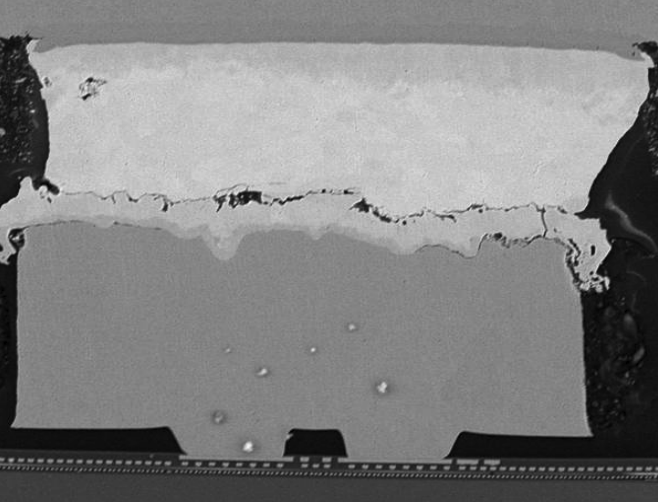
***Механизм перемежающейся неисправности:** физическая деградация через микротрещины между медными выступами и паяными соединениями корпуса создает переменное электрическое сопротивление. Источник: [constantinescu](https://ieeexplore.ieee.org/document/4925824).*

[Рисунок «Остаточная неисправность DRAM»](07_fault_tolerance.md#fig-intermittent-fault-dram) показывает, как неисправности, вызванные остатками вещества, создают в микросхемах DRAM ненадежные электрические соединения, которые приводят к спорадическим отказам.

<a id="fig-intermittent-fault-dram"></a>

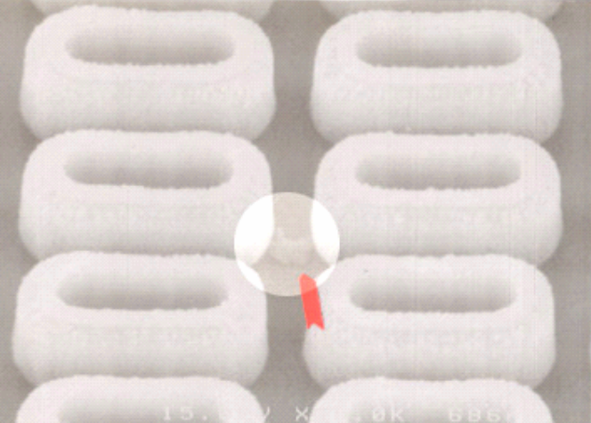
***Остаточная неисправность DRAM:** загрязнение и накопление микроскопических частиц между контактами ячеек DRAM вызывают перемежающиеся отказы электрических соединений. Источник: [Constantinescu](https://ieeexplore.ieee.org/document/4925824).*

Для систем ML перемежающиеся неисправности нужно считать подозрительными, пока достаточные доказательства не докажут обратное. Спорадические ошибки обработки или памяти могут накапливаться от итерации к итерации и ухудшать сходимость, не вызывая явных отказов (He et al., 2023); (Rashid et al., 2015). Мониторинг во время выполнения и обнаружение аномалий дают первый сигнал, контроль среды снижает тепловые и электрические триггеры, а адаптивное управление ресурсами может вывести подозрительный компонент, снизить его частоту или обойти его, сохраняя прогресс задания (Rashid et al., 2012). Цель не просто держать узел живым, а не допустить, чтобы недетерминированный компонент сделал проверку и восстановление ненадежными.

<a id="sec-ft-hardware-fault-detection-mitigation-8f7f"></a>

### Обнаружение и смягчение аппаратных неисправностей

Смягчение аппаратных неисправностей работает, только если механизм обнаружения соответствует сигнатуре неисправности. Постоянные дефекты лучше всего выявлять до развертывания, переходные перевороты битов требуют онлайн-коррекции, а перемежающиеся или тихие ошибки требуют доказательств во время выполнения. На аппаратном уровне два фундаментальных механизма защищают от классов неисправностей, введенных в этом разделе.

Встроенное самотестирование (BIST) (Bushnell and Agrawal, 2002) включает дополнительные схемы для самопроверки с помощью сканирующих цепочек[^fn-scanchains-hardware-testing], которые при запуске системы подают заранее заданные тестовые шаблоны на внутреннюю логику. BIST ловит производственные дефекты и постоянные неисправности до того, как они испортят рабочие нагрузки.

[^fn-scanchains-hardware-testing]: **Сканирующие цепочки**: тестовая инфраструктура, которая соединяет внутренние триггеры в сдвиговые регистры; развита в 1970-х годах для проектирования ИС с учетом тестируемости. Компромисс конкретен: накладные расходы площади кремния 5–15 % дают покрытие производственных неисправностей свыше 95 %. Для ускорителей ML с миллиардами транзисторов в блоках умножения матриц тестирование на основе сканирования во время прогрева выявляет залипания, которые иначе тихо испортили бы вычисления весов и градиентов в промышленной эксплуатации.

Коды обнаружения и коррекции ошибок[^fn-hamming-ecc-memory] (Hamming, 1950) добавляют избыточные биты, чтобы обнаруживать и исправлять битовые ошибки. [Рисунок «Обнаружение ошибок по биту четности и компромиссы»](07_fault_tolerance.md#fig-parity) показывает простейшую форму: проверка четности добавляет к каждому слову данных один дополнительный бит, что позволяет немедленно обнаружить переворот бита. Более продвинутые коды, такие как CRC[^fn-crc-packet-validation], вычисляют контрольные суммы, которые обнаруживают более 99,9 % ошибок передачи. Эта возможность критична для проверки полезной нагрузки градиентов во время распределенных операций AllReduce, описанных в главе [«Коллективные коммуникации»](06_collective_communication.md#sec-collective-communication).

<a id="fig-parity"></a>

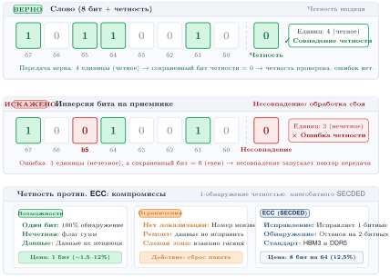
***Обнаружение ошибок по биту четности и компромиссы:** схема проверки четности с четным контролем: дополнительный бит четности обнаруживает однобитные инверсии при передаче данных или хранении в памяти. Бит четности обнаруживает одиночные ошибки с минимальными накладными расходами, но не может найти или исправить ошибку, а двойные перевороты взаимно компенсируются и остаются незамеченными. Это мотивирует многобитный SECDED ECC в плотной памяти ускорителей.*

[^fn-hamming-ecc-memory]: **Коды Хэмминга (1950)**: Ричард Хэмминг создал коды коррекции ошибок в Bell Labs после того, как сбои релейных компьютеров раз за разом портили пакетные задания на выходных. Его схема, исправляющая одиночные и обнаруживающая двойные ошибки, использует биты четности в позициях, являющихся степенями двойки, чтобы найти ошибку с накладными расходами $\mathcal{O}(\log n)$. Модули ECC-памяти происходят от этого проекта. Они защищают терабайты весов модели и состояния оптимизатора в обучении ML от мягких ошибок, которые иначе накапливались бы незаметно.

[^fn-crc-packet-validation]: **CRC (циклический избыточный код)**: семейство полиномиальных контрольных сумм, введенное (Peterson and Brown, 1961). Покрытие CRC зависит от полинома, длины кадра и модели ошибок. Его правильнее рассматривать как недорогой слой обнаружения, а не как универсальную гарантию. В распределенном обучении ML контрольные суммы или хэши могут проверять полезные нагрузки градиентов, которыми обмениваются во время коллективных операций. Без слоя проверки испорченный пакет градиента может тихо отравить обновление параметров для каждого воркера коллектива.

Аппаратное резервирование использует дублирование компонентов и голосование, чтобы обнаруживать и маскировать неисправности (Sheaffer et al., 2007). Двойное модульное резервирование (DMR)[^fn-dmr-error-detection] дублирует вычисления и сравнивает выходы при накладных расходах 100 % площади кремния. Тройное модульное резервирование (TMR)[^fn-tmr-error-correction] выполняет вычисления трижды и берет большинство голосов при накладных расходах 200 %, что обеспечивает автоматическую коррекцию одиночной неисправности (Arifeen et al., 2020). [Рисунок «Маскирование ошибок голосованием»](07_fault_tolerance.md#fig-error-masking) показывает, как схема голосования TMR маскирует одиночный неисправный блок, выбирая большинство выходов. Компьютер Tesla для полностью автономного вождения использует DMR на двух независимых системах на кристалле (SoC) ([«Двойное модульное резервирование (DMR)»](07_fault_tolerance.md#fig-tesla-dmr)), а Boeing 777 применяет TMR в основном бортовом компьютере для управления полетом, критичного для безопасности (Yeh, 1996); (Bannon et al., 2019).

[^fn-dmr-error-detection]: **DMR (двойное модульное резервирование)**: дублирует вычисления и сравнивает выходы, чтобы обнаруживать расхождения, при накладных расходах 100 % площади кремния против 200 % у TMR. DMR обнаруживает несовпадение, но сам по себе не может выбрать правильный выход, поэтому его покрытие зависит от компаратора, модели неисправностей и политики безопасного отката. Компьютер Tesla для полностью автономного вождения использует DMR на двух независимых SoC. Это отражает компромисс проекта: DMR вдвое снижает аппаратную стоимость TMR, но требует политики безопасного отката, когда выходы расходятся (Bannon et al., 2019).

[^fn-tmr-error-correction]: **TMR (тройное модульное резервирование)**: выполняет вычисления трижды и берет большинство голосов, что обеспечивает автоматическую коррекцию одиночной неисправности при накладных расходах оборудования 200 %. Впервые применено в ранних отказоустойчивых мейнфреймах 1950-х годов. TMR остается давним шаблоном для инференса, подверженного радиации и критичного для безопасности, где важнее коррекция одиночной неисправности, чем аппаратная эффективность.

<a id="fig-tesla-dmr"></a>

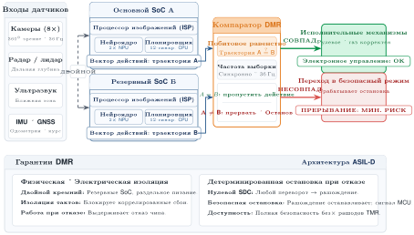
***Двойное модульное резервирование (DMR):** компьютер Tesla для полностью автономного вождения использует архитектуру DMR, дублируя критичные вычисления на двух независимых системах на кристалле (SoC). Аппаратный блок сравнения проверяет, что оба чипа выдают совпадающие выходы, прежде чем управляющая команда попадет к исполнительным механизмам автомобиля. Так отказ одного чипа или переворот бита не могут вызвать опасного поведения при вождении.*

<a id="fig-error-masking"></a>

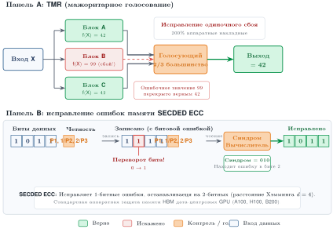
***Маскирование ошибок голосованием:** при тройном модульном резервировании одно и то же вычисление выполняется на трех независимых блоках. Схема голосования берет большинство результатов. Даже если один блок страдает от неисправности (например, переворота бита), система «маскирует» ошибку, выбирая совпадающие выходы двух других блоков, что позволяет работать без перерывов.*

На программном уровне то же дерево решений продолжается: каждая сигнатура неисправности направляется в тот один поток доказательств, который обнаруживает ее дешевле всего. Тихий статистический дрейф проявляется, когда градиенты, потери, активации или задержки перестают соответствовать ожидаемому распределению. Мониторинг во время выполнения и обнаружение аномалий (статистические тесты выбросов, One-Class SVM) ловят его на самом дешевом уровне, потому что эти проверки используют метрики, которые цикл обучения и так выдает (Francalanza et al., 2017); (Chandola et al., 2009). Испорченное, но живое состояние или контрольная точка ловится проверками согласованности данных, которые подтверждают, что она все еще соответствует доверенным данным (Lindholm et al., 2019). Отказавший узел отделяется от просто медленного с помощью механизмов сигналов активности (Kawazoe Aguilera et al., 1997). Задача, которая зависла без аварийного завершения, ловится сторожевыми таймерами (Pont and Ong, 2002), которые запускают восстановление потерянного прогресса. Только когда эти пассивные сигналы не хватает, потому что сама вычислительная операция может быть неверной без статистической отметки, система платит за программно реализованное резервирование (дублирование инструкций в духе SWIFT, N-версионное программирование, восстановление по Риду–Соломону) (Reis et al., 2005); (Avizienis et al., 2004); (Plank, 1997); (Reed and Solomon, 1960). Его дублированные или восстановленные вычисления — самый дорогой уровень, поэтому он зарезервирован для состояния наибольшей ценности.

Эти механизмы снижают риск ненадежной подложки, но не защищают от неисправностей, которые вносит сам программный стек. Следующий слой должен учитывать ошибки, которые выглядят как корректные вычисления, но портят конвейер ML.

<a id="chk-fault-tolerance-classifying-hardware-faults"></a>

> **Классификация аппаратной неисправности**
>
> Проверьте, насколько вы понимаете категории переходных, постоянных и перемежающихся неисправностей и цепочку «неисправность — ошибка — отказ»:
>
> - [ ] **Переходная неисправность**: классифицируйте GPU, который один раз выдает неверный результат после удара космического луча, а затем вычисляет корректно до конца запуска. Обоснуйте, почему коды коррекции ошибок, а не замена узла, подходят для этой неисправности.
> - [ ] **Перемежающаяся или постоянная**: отличите перемежающуюся неисправность от постоянной, когда обе могут давать залипшее значение, и укажите диагностический сигнал, который их различает.
> - [ ] **Цепочка «неисправность — ошибка — отказ»**: проследите один переворот бита по этой цепочке и укажите, где вмешиваются коды коррекции ошибок и перезапуск из контрольной точки.
> - [ ] **Тихая порча**: объясните, почему тихая порча стоит отдельно от других проявлений неисправностей, даже когда ее первопричина — обычный переворот бита.

<a id="sec-ft-software-faults"></a>

## Программные неисправности

Команда три месяца тестирует LLM на сложных случаях сбоев на уровне промптов и только потом понимает, что скрипт предобработки случайно обрезал все входы до 512 токенов, тихо отбросив системный промпт целиком. В погоне за сложной алгоритмической устойчивостью инженеры часто упускают распространенный источник отказов ML: обычные программные ошибки. В системах ML логическая ошибка в загрузчике данных не роняет конвейер. Она тонко ухудшает градиент, поэтому программные неисправности особенно разрушительны.

Программные неисправности требуют другой линзы восстановления, чем аппаратные отказы. Аппаратные неисправности приходят из кремния, электронов и физического износа; программные — из проектных решений, версий зависимостей и клея конвейера. Задача отказоустойчивости смещается с замены отказавшего компонента на поиск того, какое корректно выглядящее преобразование испортило данные, градиенты или предсказания.

Практическая трудность в том, что программные неисправности взаимодействуют со всеми остальными угрозами системы. Ошибка в предобработке данных может создать сдвиги распределения, ошибка реализации в численных вычислениях может испортить поведение модели, сохранив корректные формы тензоров, а гонка в распределенном обучении может заставить разных воркеров обновляться из несогласованного состояния. Эти взаимодействия возникают потому, что программный стек ИИ охватывает фреймворки, библиотеки, среды выполнения, распределенные системы и инфраструктуру развертывания. Каждая граница слоев создает возможность появления и распространения неисправностей, поэтому программное смягчение необходимо для надежности промышленного масштаба.

<a id="sec-ft-software-fault-properties"></a>

### Свойства программных неисправностей и их распространение

Программные неисправности во фреймворках ML варьируются от синтаксических и логических ошибок до утечек памяти,[^fn-memleak-gpu-allocation] ошибок конкурентности и сбоев интеграции. Они распространяются через границы систем: ошибка в процедуре выделения тензоров может каскадом нарушить обучение, вывод или оценку в, казалось бы, не связанных модулях. Некоторые неисправности перемежающиеся: они проявляются только при определенных условиях, например при высокой нагрузке системы, в особых аппаратных конфигурациях или на редких входных данных.

[^fn-memleak-gpu-allocation]: **Утечка памяти**: ошибка программирования, при которой выделенная память никогда не освобождается. В системах ML утечки памяти GPU особенно разрушительны, потому что память ускорителей дефицитна (40–80 ГБ на устройство) и разделяется всем конвейером обучения. Один утекающий тензор на пакет, например оставшийся в продакшене отладочный хук, может исчерпать память GPU за часы и вызвать явную ошибку OOM, которая убивает долгое задание обучения без контрольной точки.

Неправильное управление ресурсами — заметный класс отказов. Выделения памяти GPU накапливаются от итерации к итерации: промежуточные активации, состояния оптимизатора и буферы градиентов выделяются, но не освобождаются, пока аллокатор не исчерпает доступную емкость и не выдаст ошибку нехватки памяти посреди пакета. Модель с 70 млрд параметров в BF16 с состояниями оптимизатора AdamW требует примерно 840 ГБ памяти GPU. Это превышает суммарную емкость узла 8 $\times$ 80 ГБ, равную 640 ГБ, еще до учета активаций и временных буферов. Поэтому состояние требует дополнительного шардинга между узлами или выгрузки. Давление памяти нарастает постепенно в течение сотен итераций, поэтому установить первопричину трудно без профилирования памяти по слоям.

Ошибки конкурентности и синхронизации составляют еще один повторяющийся класс неисправностей. В распределенных или многопоточных средах неверная координация между параллельными процессами приводит к гонкам[^fn-race-condition-state] или несогласованным состояниям.

[^fn-race-condition-state]: **Гонка (race condition)**: ошибка синхронизации, при которой поведение системы зависит от неконтролируемой последовательности параллельных событий. В асинхронном распределенном обучении, если несколько воркеров одновременно обновляют один и тот же вес параметра без надлежащей блокировки или версионирования, обновления могут потеряться или быть перезаписаны. Это приводит к расхождению или «призрачным» весам, которые портят сходимость, не вызывая ошибки.

Взаимные блокировки[^fn-deadlock-pipeline-stall] создают связанный отказ синхронизации, при котором воркеры бесконечно ждут ресурсов или сообщений, которые никогда не придут. Ошибка в высокоуровневой библиотеке может проявиться только в паре с определенной версией низкоуровневой численной библиотеки, например cuDNN или MKL. Для поиска первопричины нужен целостный взгляд на систему.

[^fn-deadlock-pipeline-stall]: **Взаимная блокировка (deadlock)**: состояние, при котором два или более процессов навсегда заблокированы, и каждый ждет, пока другой освободит ресурс. В конвейерном обучении взаимная блокировка возможна, если стадия 1 ждет свободного буфера, чтобы отправить активации на стадию 2, а стадия 2 ждет, пока стадия 1 получит обратные градиенты. Весь парк при этом останавливается.

<a id="sec-ft-software-fault-detection-prevention"></a>

### Обнаружение и предотвращение программных неисправностей

Поскольку многие программные неисправности оставляют конвейер работающим, одновременно портя градиенты, свидетельства надежности должны отвечать на два вопроса: какой инвариант нарушен и какое действие восстановления теперь безопасно? Ошибка обрезки промпта из вводного примера не должна доживать до выполнения: модульный тест должен поймать границу токенизатора, интеграционный повтор — путь формы пакета и метаданных, а тест инъекции неисправностей должен доказать, что полученное оповещение блокирует публикацию или откатывает систему к известному корректному состоянию. [Таблица «Свидетельства надежности и решения о восстановлении»](07_fault_tolerance.md#tbl-software-faults-summary-ft) организует эти проверки по заявлению о восстановлении, которое поддерживает каждая из них.

| **Свидетельство надежности** | **Проверяемый инвариант** | **Решение, которое оно разрешает** |
|:-------------------------------|:-----------------------------------------------------------------------------------|:----------------------------------------------------------|
| **Модульный тест границ** | Ограничения токенизатора, формы тензоров, маски и метаданные шагов остаются корректными | Отклонить изменение до распределенного выполнения |
| **Детерминированный повтор** | Записанный пакет дает эквивалентное состояние на заведомо исправном оборудовании | Отделить ошибки входа или ПО от подозрительного оборудования |
| **Учебное восстановление из контрольной точки** | Зафиксированный манифест восстанавливает все шарды и продолжает с указанного шага | Принять поколение как удовлетворяющее контракту восстановления |
| **Инъекция отказов членства** | Убитый или разделенный воркер теряет владение и не может писать с устаревшей эпохой | Проверить истечение аренды (lease), ограждение (fencing) и перестройку коммуникатора |
| **Инъекция порчи** | Измененный шард, редуцированный буфер или контрольная точка не проходят нужную проверку | Блокировать шаг оптимизатора или откатить до распространения |
| **Тест отката зависимостей** | Версионированный набор среды выполнения и артефактов может вернуться к последней известной корректной комбинации | Разрешить автоматический откат вместо ручного исправления |

<a id="tbl-software-faults-summary-ft"></a>

***Свидетельства надежности и решения о восстановлении:** тесты приобретают операционную ценность, когда каждый устанавливает инвариант и разрешает конкретное решение об отклонении, откате, изоляции или восстановлении.*

Эти защиты имеют значение, только если каждая проверка нацелена на конкретный путь порчи. Тест, который проверяет только то, запускается ли токенизатор, слишком слаб: он должен подтверждать, что системные промпты, метки, маски и метаданные длины последовательности сохраняются после предобработки с нужной семантикой. Интеграционный повтор затем проводит один записанный пакет через загрузку, шардинг, сборку и построение входа модели. Инъекция неисправностей идет дальше: она показывает, что детектор срабатывает до фиксации испорченного состояния и что восстановление удовлетворяет заданным RPO и RTO. Общий успех сборки не является свидетельством надежности. Свидетельством являются учебное восстановление, отказ при устаревшей эпохе или отказ при испорченном шарде.

Эти программные практики ловят ошибки реализации, которые выходят наружу через тесты или ворота развертывания. Тихая порча труднее, потому что система может продолжать работать, выдавая неверные значения, поэтому следующий слой — явная верификация.

<a id="sec-ft-sdc-verification"></a>

## Проверка и верификация: защита от тихого повреждения данных


*Тихое повреждение данных накапливается, пока не становится обычным явлением.*

По мере того как кластеры масштабируются до более чем 100 000 GPU, даже небольшая частота SDC на GPU накапливается через повторяющиеся коллективные операции. Отдельная коллективная операция не обязательно содержит событие SDC: при иллюстративной частоте, которая используется в дальнейшем анализе, вероятность на шаг остается малой, а совокупная вероятность растет за долгий запуск обучения. Стандартные алгоритмы AllReduce предполагают, что если узел *жив*, то его данные *корректны*. В парке машинного обучения проектирование системы должно перейти к византийскому мышлению об отказоустойчивости: «доверяй, но проверяй».

Методы проверки и верификации превращают этот подход в инвариант тракта данных, но у каждой проверки есть точная граница. Контрольная сумма или хэш по шарду градиента обнаруживает изменившиеся байты после того, как дайджест был вычислен. Сравнение дайджестов реплицированного редуцированного буфера обнаруживает расхождение рангов. Ни то, ни другое не доказывает, что воркер вычислил корректный локальный градиент до хэширования. Более сильное утверждение требует независимого вычисления, алгоритмического инварианта или повторного прогона против известного корректного воркера. Быстрая оценка делает эту подверженность конкретной.

<a id="nbk-fault-tolerance-napkin-math-sdc-certainty"></a>

> **Накопление риска SDC**
>
> **Задача**: при иллюстративном общем допущении о частоте SDC вычислите вероятность того, что хотя бы один GPU в парке из 100 000 GPU получит событие SDC за один шаг обучения длительностью 2 с.
>
> 1. **Размер парка**: 100 000 ускорителей.
> 2. **Индивидуальный риск**: $10^{-6}$ на GPU-час (иллюстративное общее допущение о частоте SDC).
> 3. **Экспозиция**: за окно 2 с парк дает $100{,}000 \times (2/3600) \approx 56$ «GPU-часов» экспозиции.
> 4. **Вероятность**: $\Pr(\text{хотя бы один SDC}) \approx 0{,}0056\ \%$.
>
> **Системный вывод**: при этом иллюстративном допущении постоянной частоты парк из 100 000 GPU ожидает одно событие SDC каждые 18 000 шагов (примерно каждые 10 часов), хотя вероятность на шаг составляет лишь 0,0056 %. CRC или хэш может защитить каждый шард или редуцированный буфер от порчи при передаче или хранении, а избыточная редукция может независимо проверить арифметический путь. Различие важно: равные дайджесты устанавливают равные байты, но не корректный градиент. Устойчивость переходит из задачи *перезапуска* в задачу *верификации* только тогда, когда проверка покрывает тот механизм отказа, который заявляется.

Расчет мотивирует проверку и верификацию, но верификация заслуживает доверия только тогда, когда она проверена на реалистичных отказах. Поэтому следующий шаг — намеренно инжектировать неисправности и подтвердить, что те же проверки ловят порчу до того, как она попадет в состояние модели.

<a id="sec-ft-fault-injection-tools-frameworks"></a>

## Инструменты и фреймворки инъекции неисправностей

Верификация имеет ценность только тогда, когда инжектированный отказ похож на промышленный отказ, который система должна пережить. Многоузловой кластер обучения, который заявляет о толерантности к разделению сети, должен иметь эту связь разорванной в тестовой среде, чтобы инженеры могли наблюдать, что делает слой оркестрации. **Инъекция неисправностей** — инженерная дисциплина намеренного возмущения системы для эмпирической проверки того, что механизмы устойчивости работают, прежде чем производственный трафик обнаружит брешь. Инструменты инъекции неисправностей для ML, тензоров и GPU охватывают перевороты битов, неисправности тензоров и отказы, ориентированные на ускорители (Chen et al., 2020); (Tsai et al., 2021); (Gräfe et al., 2023). Задержки сети, инъекции задержек, завершение зависимостей и сбои ответов API относятся к практике хаос-инжиниринга и тестирования распределенных систем (Basiri et al., 2016).

<a id="sec-ft-fault-error-models"></a>

### Модели неисправностей и ошибок

Это соответствие — решение о моделировании, а не деталь реализации. Переходный переворот бита, постоянный дефект ускорителя и испорченный градиент требуют разной логики обнаружения, поэтому эксперимент должен задать длительность, место, гранулярность и путь распространения до начала.

Эти выборы определяют **модель неисправности** (Fault Model): как аппаратная неисправность проявляется в системе. Соответствующая **модель ошибки** (Error Model) описывает, как эта неисправность распространяется и влияет на поведение системы.

Первый выбор моделирования фиксирует физическую сигнатуру неисправности. Длительность определяет, должно ли восстановление ожидать переходного события, постоянного дефекта или перемежающегося условия, которое трудно воспроизвести. Место определяет, входит ли инжектированная неисправность через ячейки памяти, функциональные блоки или межсоединения. Гранулярность определяет, изучает ли эксперимент один бит, например переворот бита, или многобитовый пакетный сбой.

Модель ошибки переносит эту физическую сигнатуру в систему ML. Она описывает, как исходное возмущение на аппаратном уровне превращается в испорченные веса, неверно вычисленные активации или логические ошибки более высокого уровня во фреймворке ML. Уровень абстракции важен, потому что каждый уровень раскрывает разные пути распространения и маскирует разные эффекты.

Выбор модели неисправности или ошибки — центральный для оценки устойчивости. Например, система, созданная для изучения одиночных переходных неисправностей (Sangchoolie et al., 2017), не даст содержательного понимания эффектов постоянных многобитных неисправностей, поскольку ее проект и допущения основаны на совершенно другой модели неисправности.

Реализационный контекст модели ошибки тоже важен. Одиночный переворот бита на уровне архитектурного регистра, смоделированный с помощью симуляторов вроде gem5 (Binkert et al., 2011), заметно отличается от такого же переворота бита в тензоре весов модели PyTorch. Обе модели воспроизводят возмущения на уровне значений, но более низкоуровневая захватывает микроархитектурные эффекты, которые в программных фреймворках часто абстрагируются.

Некоторые паттерны поведения неисправностей переносятся между уровнями абстракции, а другие нет. Исследования, сравнивающие модели одиночных и многобитных неисправностей, показывают, что влияние зависит от того, куда попадает неисправность и как она распространяется. Поэтому результаты устойчивости для одной модели инжектированных неисправностей не следует считать универсальными (Sangchoolie et al., 2017); (Papadimitriou and Gizopoulos, 2021). Другие важные явления, например маскирование ошибок (Mohanram and Touba, 2003), могут быть наблюдаемы только на более низких уровнях абстракции. Это маскирование может приводить к тому, что неисправности отфильтровываются до распространения на более высокие уровни ([«Маскирование ошибок»](07_fault_tolerance.md#fig-error-masking-ft)) (Ko, 2021). Значит, инструменты на уровне программ могут полностью пропустить эти эффекты.

<a id="fig-error-masking-ft"></a>

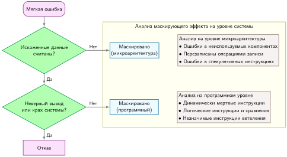
***Маскирование ошибок:** микроархитектурное резервирование может поглотить одиночные неисправности до того, как они распространятся в наблюдаемые системные ошибки, что подчеркивает расхождение между моделями неисправностей на аппаратном и программном уровнях. Этот рисунок показывает, как маскирование неисправностей происходит внутри микроархитектурных компонентов и что программные средства обнаружения ошибок могут недооценивать реальную устойчивость системы к переходным ошибкам.*

Понимание этих эффектов маскирования необходимо для выбора подходящего уровня абстракции при проектировании экспериментов с инъекцией неисправностей.

<a id="sec-ft-fault-injection-methods"></a>

### Методы инъекции неисправностей

Методы инъекции неисправностей выбирают между реалистичностью и масштабом эксперимента. Инъекция на основе аппаратуры служит калибровочной точкой: она вносит неисправности в физические системы, чтобы проверить допущения на уровне программ против реального поведения оборудования. Инъекция на основе программ — масштабируемый аналог: она быстро охватывает много состояний модели, но должна быть откалибрована по поведению оборудования, прежде чем ее выводы станут заявлениями о надежности в промышленной эксплуатации.

<a id="sec-ft-hardwarebased-fault-injection"></a>

#### Инъекция неисправностей на основе аппаратуры

Выбор метода зависит от того, нужна ли эксперименту адресация на уровне битов или реалистичность физического излучения. Инъекция на основе ПЛИС использует программируемые пользователем вентильные матрицы (FPGA),[^fn-fpga-fault-injection] перенастраиваемые интегральные схемы, которые можно программировать для реализации различных аппаратных проектов. Изменение конфигурации ПЛИС вносит неисправности в определенные места и моменты выполнения модели ML.

[^fn-fpga-fault-injection]: **FPGA (Field-Programmable Gate Array)**: перенастраиваемое аппаратное обеспечение, содержащее миллионы программируемых логических блоков. Для инъекции неисправностей ПЛИС дают точность адресации на уровне битов, которой не могут достичь программные инструменты.

Испытания излучением или пучком (Velazco et al., 2010) подвергают аппаратуру, на которой выполняются модели ML, воздействию высокоэнергетических частиц, таких как протоны или нейтроны. Специализированные испытательные установки позволяют контролируемо облучать аппаратуру, вызывая перевороты битов и другие аппаратные неисправности. Так создаются высокореалистичные сценарии, которые повторяют условия в средах с повышенным излучением.

<a id="sec-ft-softwarebased-fault-injection"></a>

#### Инъекция неисправностей на основе программ

**Инъекция неисправностей на основе программ** обменивает физическую реалистичность на масштаб эксперимента. Эти инструменты имитируют эффекты аппаратных неисправностей, изменяя базовый вычислительный граф модели, значения тензоров или промежуточные вычисления. Они встраиваются непосредственно в конвейеры разработки ML, не требуют специализированного оборудования и позволяют исследователям быстро и экономично проводить крупномасштабные эксперименты по инъекции неисправностей.

**PyTorchFI** (Mahmoud et al., 2020) — специализированная библиотека инъекции неисправностей для PyTorch, разработанная совместно с Nvidia Research. Она полезна, когда вопрос в том, как возмущения, видимые на уровне тензоров, влияют на поведение модели. Она вносит неисправности в веса, активации и градиенты и показывает, что даже простые битовые неисправности могут вызывать серьезные ошибки визуального распознавания и классификации, включая появление «призрачных» объектов там, где их нет.

<a id="sec-ft-bridging-hardwaresoftware-gap"></a>

#### Преодоление разрыва между аппаратурой и программами

Выбор уровня абстракции — центральный риск программной инъекции неисправностей. Эти инструменты дают скорость и гибкость, но не всегда охватывают весь спектр эффектов, которые аппаратные неисправности могут навязать системе. **Разрыв абстракции** возникает потому, что инструменты на уровне программ работают на более высоком уровне и могут упустить низкоуровневые аппаратные взаимодействия или тонкие механизмы распространения ошибок.

Инструменты вроде **Fidelity** (He et al., 2020) устраняют этот разрыв, отображая поведение аппаратных ошибок низкого уровня на эффекты, видимые программе. Изучая, как неисправности, возникающие в аппаратуре, проходят через архитектурные регистры, иерархии памяти и численные операции, Fidelity позволяет делать программно внесенные неисправности похожими на то, как неисправности проявлялись бы в физической системе.

<a id="exmp-fault-tolerance-software-fault-injection-limits"></a>

> **Ограничения инъекции программных неисправностей**
>
> **Сценарий**: инженерная команда проверяет конвейер распределенного обучения с помощью программной инъекции неисправностей и делает вывод, что перевороты битов в тензорах всегда портят обновления градиентов модели.
>
> **Диагноз**: испытание пучком на физической установке показывает, что программная инъекция обходит низкоуровневые аппаратные эффекты маскирования (например, коррекцию памяти ECC и маскирование на уровне вентилей), которые мешают переворотам битов на уровне регистров вообще изменять программные переменные.
>
> **Системный урок**: программная инъекция неисправностей завышает уязвимость, когда обходит схемные аппаратные защиты. Проверка эксплуатационной устойчивости требует аппаратно откалиброванных моделей неисправностей, а не одного лишь изолированного изменения программного состояния.

<a id="sec-ft-hardware-fault-summary-b40c"></a>

### Сводка по аппаратным неисправностям

Хотя аппаратные и программные неисправности представляют разные механизмы отказа, в конечном счете они проявляются как системные события, которыми должна управлять логика надежности, описанная в [разделе «Анализ отказов в масштабе»](07_fault_tolerance.md#sec-fault-tolerance-reliability-reliability-failure-analysis-scale-6b4b). [Таблица «Характеристики неисправностей»](07_fault_tolerance.md#tbl-fault_types) замыкает цикл от модели неисправности к выбору восстановления. Таблица сравнивает переходные, постоянные и перемежающиеся неисправности по длительности, персистентности, причинам и влиянию на системы ML, чтобы стратегия обнаружения и смягчения соответствовала тестируемой категории неисправности.

| **Измерение** | **Переходные неисправности** | **Постоянные неисправности** | **Перемежающиеся неисправности** |
|:-------------------------|:----------------------------------------------------------------------------|:--------------------------------------------------------------------------|:------------------------------------------------------------------------------------|
| **Длительность** | Короткая, временная | Сохраняется до ремонта или замены | Спорадическая, появляется и исчезает |
| **Персистентность** | Исчезает после прохождения условия неисправности | Постоянно присутствует до устранения | Повторяется нерегулярно, не всегда присутствует |
| **Причины** | Внешние факторы (например, электромагнитные помехи или космические лучи) | Аппаратные дефекты, физическое повреждение, износ | Нестабильные условия аппаратуры, плохие контакты, стареющие компоненты |
| **Проявление** | Перевороты битов, сбои, временная порча данных | Залипания, поломанные компоненты, полные отказы устройств | Редкие перевороты битов, перемежающиеся проблемы сигнала, спорадические сбои |
| **Влияние на системы ML** | Вносит временные ошибки или шум в вычисления | Вызывает постоянные ошибки или отказы, влияя на надежность | Приводит к спорадическим и непредсказуемым ошибкам, которые трудно диагностировать и смягчать |
| **Обнаружение** | Коды обнаружения ошибок, сравнение с ожидаемыми значениями | Встроенные самотесты, коды обнаружения ошибок, проверки согласованности | Мониторинг аномалий, анализ паттернов и корреляций ошибок |
| **Смягчение** | Коды коррекции ошибок, резервирование, контрольные точки и перезапуск | Ремонт или замена аппаратуры, резервирование компонентов, механизмы переключения | Надежный дизайн, контроль среды, мониторинг во время выполнения, методы отказоустойчивости |

<a id="tbl-fault_types"></a>

***Характеристики неисправностей:** переходные, постоянные и перемежающиеся неисправности различаются длительностью, персистентностью и повторяемостью, влияют на надежность системы и требуют разных стратегий смягчения для надежных развертываний ИИ (Constantinescu, 2008). Понимание этих различий помогает проектировать отказоустойчивые системы, способные справляться с разными аппаратными отказами во время эксплуатации.*

<a id="sec-fault-tolerance-reliability-reliability-checkpoint-restart-fundamentals-0ac2"></a>

## Контрольные точки: сохранение прогресса

Когда через две недели после начала обучения модели на 175 млрд параметров выходит из строя коммутатор верхней стойки (ToR), кластер мгновенно теряет 64 GPU. Система не может просто перезапуститься с нуля: затраченные на вычисления недели слишком дороги. Анализ отказов в [разделе «Анализ отказов в масштабе»](07_fault_tolerance.md#sec-fault-tolerance-reliability-reliability-failure-analysis-scale-6b4b) показал, что крупномасштабные системы обучения будут часто сталкиваться с такими отказами, поэтому нужны надежные механизмы, которые сохраняют прогресс и позволяют его возобновить.

Отказоустойчивость обучения имеет три обязательства: сохранять состояние, обнаруживать и классифицировать отказы, возобновлять или переразмещать задание. Контрольные точки обеспечивают первое обязательство. Последующие разделы строят остальную модель восстановления: обнаружение отказов определяет, что произошло, процедуры восстановления восстанавливают согласованную группу процессов, а эластичное восстановление решает, может ли задание продолжаться с измененным набором воркеров.

Две цели восстановления превращают эти обязательства в контракт. **Целевая точка восстановления (RPO)** — максимально допустимый объем завершенной работы, который можно потерять после отказа, — ограничивает возраст контрольной точки и отставание репликации. **Целевое время восстановления (RTO)** — максимально допустимое время от отказа до возобновления полезной работы — ограничивает обнаружение, замену ресурсов, восстановление и прогрев. Интервал контрольных точек в 20 минут не может гарантировать RPO ниже 20 минут без более частого надежного журнала или реплики, а RTO в пять минут невозможен, если одна только перезагрузка контрольной точки занимает восемь минут. Закон Янга–Дэйли минимизирует ожидаемые потери; RPO и RTO накладывают сервисные ограничения, которым оптимум по ожидаемому значению должен все равно удовлетворять (Beyer et al., 2016).

<a id="dfn-fault-tolerance-checkpointing"></a>

> **Контрольная точка**
>
> ***Контрольная точка*** — это периодическая сериализация полного состояния обучения (параметров, состояния оптимизатора и положения загрузчика данных) в энергонезависимое хранилище.
>
> 1.  **Значение**: она минимизирует потерю работы после отказа системы, уравновешивая ввод-вывод контрольных точек и повторную работу. Слишком частая запись тратит время ускорителей на трафик хранилища; слишком редкая запись рискует повторить много завершенных шагов после отказа. Формула Янга–Дэйли $(\tau_{\text{opt}} = \sqrt{2 \cdot T_{\text{write}} \cdot \text{MTBF}_{\text{system}}})$ отражает этот локальный компромисс: она выбирает интервал, который уравновешивает стоимость записи и ожидаемую потерю работы.
> 2.  **Отличие**: в отличие от инкрементных резервных копий контрольная точка должна фиксировать точный контекст выполнения (включая затравки генераторов случайных чисел и расписания скорости обучения), чтобы обеспечить детерминированное возобновление цикла оптимизации.
> 3.  **Распространенная ошибка**: частое заблуждение состоит в том, что контрольная точка — это «просто запись на диск». На самом деле для больших моделей это стресс-тест системы хранения: одновременная запись с тысяч GPU может вызвать «шторм контрольных точек», который насыщает всю сетевую фабрику $(\text{BW})$.

Обучающий кластер, который теряет питание без сохранения состояния, теряет обновления градиентов, вычисленные за предыдущие недели, на миллионы долларов. Защита — периодически записывать состояние модели в долговременное хранилище. Контрольная точка фиксирует достаточное состояние, чтобы возобновить обучение с записанной точки: параметры модели, состояние оптимизатора,[^fn-adam-state-memory] индикаторы прогресса обучения и состояние генератора случайных чисел для воспроизводимости.

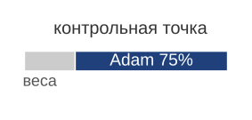

*Состояние оптимизатора, а не веса, определяет размер контрольной точки.*

[^fn-adam-state-memory]: **Состояние оптимизатора Adam**: адаптивная оценка моментов (Adam) хранит для каждого параметра оценки первого момента ($m$) и второго момента ($v$), что утраивает требования к памяти по сравнению с обычным стохастическим градиентным спуском (SGD): 3$\times$ — параметры плюс два вектора состояния. Для модели на 175 млрд параметров одно только состояние оптимизатора достигает 2,1 ТБ. Оно обычно определяет размер контрольной точки и время восстановления и делает состояние оптимизатора главным узким местом в проектировании ввода-вывода контрольных точек.

<a id="sec-fault-tolerance-reliability-reliability-checkpoint-interval-failure-analysis-c28d"></a>

### Интервал контрольных точек из анализа отказов

Формула Янга–Дэйли, изложенная в [разделе «Закон Янга–Дэйли»](07_fault_tolerance.md#sec-fault-tolerance-young-daly), дает оптимальный интервал контрольных точек $\tau_{\text{opt}} = \sqrt{2 \times T_{\text{write}} \times \text{MTBF}_{\text{system}}}$, но ее нельзя применить, пока неизвестны оба входа. Анализ отказов в [разделе «Анализ отказов в масштабе»](07_fault_tolerance.md#sec-fault-tolerance-reliability-reliability-failure-analysis-scale-6b4b) дает член системного MTBF, а полезная нагрузка контрольной точки, рассмотренная ранее в этом разделе, дает $T_{\text{write}}$. Когда оба известны, формула перестает быть абстрактным законом и становится конкретным расписанием для кластера главы.

[Рисунок «Компромисс контрольных точек»](07_fault_tolerance.md#fig-checkpoint-tradeoff) показывает этот компромисс для иллюстративного кластера на 175 млрд параметров: накладные расходы на сохранение падают по мере удлинения интервалов, а ожидаемая переработка растет, и интервал Янга–Дэйли находится в минимуме их суммы. Округленные входные данные передают форму кривой. Расчет ниже задает точный интервал по собственному вычисленному MTBF главы и времени записи.

<a id="fig-checkpoint-tradeoff"></a>

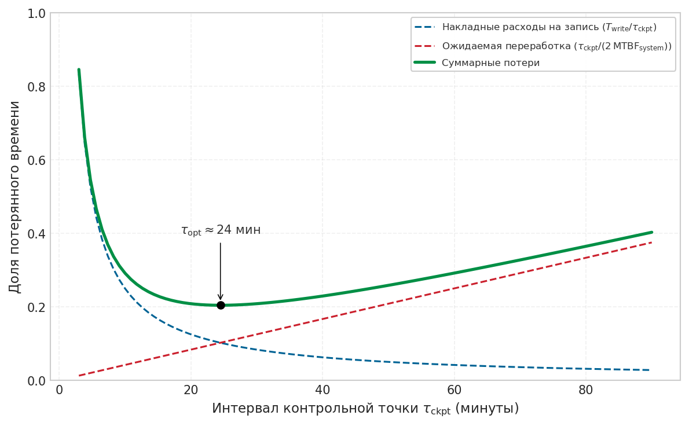

***Компромисс контрольных точек:** накладные расходы на сохранение контрольной точки уменьшаются с увеличением интервала, но потерянные из-за отказов вычисления растут. Оптимальный интервал Янга–Дэйли минимизирует совокупные накладные расходы. Для иллюстративного кластера модели на 175 млрд (запись контрольной точки около 2,5 минуты, MTBF 2 часа) оптимальный интервал составляет примерно 24 минуты. Расчет ниже выводит точный интервал для кластера главы из 10 000 GPU.*

Собственный кластер главы из 10 000 GPU дает оба входа, заменяя округленные значения на [рисунке «Компромисс контрольных точек»](07_fault_tolerance.md#fig-checkpoint-tradeoff) вычисленными значениями. Каскад из [расчетного примера](07_fault_tolerance.md#sec-fault-tolerance-reliability-reliability-worked-example-cluster-mtbf-calculation-9255) дает системный MTBF 3,69 часа, а полезная нагрузка контрольной точки, вычисленная ранее в этом разделе, записывается за 37 с (контрольная точка 3,7 ТБ при 100 ГБ/с). Подстановка этих значений в формулу Янга–Дэйли дает канонический интервал для этого кластера.

<a id="nbk-fault-tolerance-young-daly-optimal-interval"></a>

> **Оптимальный интервал Янга–Дэйли**
>
> **Задача**: кластер из 10 000 GPU имеет MTBF 3,69 часа. Запись полной контрольной точки модели занимает 37 с. Какова оптимальная частота контрольных точек?
>
> **Расчет**:
>
> Применим формулу Янга–Дэйли: $\tau_{\text{opt}} = \sqrt{2 \cdot T_{\text{write}} \cdot \text{MTBF}_{\text{system}}}$
>
> 1. **Приведение к общим единицам**: $\text{MTBF}_{\text{system}} = 3{,}69 \text{ часа} \times 3600 \text{ с/час} = 13\,284 \text{ с}$.
> 2. **Подстановка и решение**: при $T_{\text{write}} = 37 \text{ с}$ и $\text{MTBF} = 13\,284 \text{ с}$ формула дает $\tau_{\text{opt}} \approx 991{,}4 \text{ с}$, или около 16,5 мин.
>
> **Системный вывод**: при таком интервале «налог на контрольные точки» (время на сохранение плюс время на пересчет) минимален и составляет примерно 7,5 %. Сохранение каждый час вместо этого повысило бы риск отказа и потеряло бы около 14,6 % емкости кластера. По мере роста кластеров оптимальный интервал должен сокращаться, чтобы успевать за падающим MTBF.

Этот результат показывает, почему анализ отказов важен: не зная системного MTBF, оператор не может рационально задать интервалы контрольных точек. При этом интервале накладные расходы на контрольные точки занимают примерно 7,5 % времени обучения, но оценка зависит от допущений, которые в промышленной эксплуатации часто нарушаются.

<a id="psp-fault-tolerance-young-daly-formula-assumptions"></a>

> **Допущения формулы Янга–Дэйли**
>
> Формула Янга–Дэйли первого порядка дает полезную интуицию, но опирается на допущения, которые могут не выполняться, когда время записи нельзя считать малым по сравнению с MTBF (пошаговое доказательство разложения Тейлора Дэйли второго порядка и анализ ошибок см. в приложении «Основы надежности»):
>
> - **Экспоненциально распределенные отказы**: предполагается постоянная интенсивность отказов. Реальные системы демонстрируют поведение «кривой ванны» с повышенной частотой отказов на этапах приработки и износа.
> - **Детерминированное время контрольной точки**: предполагается, что $T_{\text{write}}$ постоянно. На практике время сохранения колеблется в 2–3 раза из-за конкуренции за хранилище, сетевой перегрузки и нехватки памяти.
> - **Время восстановления равно времени сохранения**: предполагается, что восстановление читает те же данные, которые были записаны при сохранении. Часто восстановление занимает в 3–5 раз дольше из-за задержек планировщика заданий, перестройки топологии и прогрева.
> - **Единичный отказ**: предполагается, что отказы происходят по одному. Коррелированные отказы (питания, охлаждения, общего коммутатора) нарушают это допущение.
> - **Бесконечный горизонт**: формула оптимизирует длинные прогоны обучения. Короткие прогоны, у которых общее время сравнимо с MTBF, требуют другого анализа.
>
> Когда допущения нарушаются, оптимальный интервал может заметно сдвинуться, но время перезапуска не следует учитывать так, будто оно платится при каждой контрольной точке. В модели потерянного времени первого порядка время перезапуска добавляет к ожидаемым потерям член восстановления на каждый отказ; оно не заменяет $T_{\text{write}}$ под корнем $\sqrt{2 \cdot T_{\text{write}} \cdot \text{MTBF}_{\text{system}}}$, если только не выведена и не откалибрована модель Дэйли, учитывающая восстановление.

[«Временная шкала контрольной точки и восстановления»](07_fault_tolerance.md#fig-checkpoint-recovery-timeline) делает временную цену отказов наглядной: она показывает последовательность событий во время прогона обучения — полезные вычисления, периодические контрольные точки, событие отказа и процесс восстановления с сопутствующей потерянной работой.

<a id="fig-checkpoint-recovery-timeline"></a>

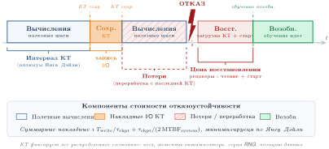
***Временная шкала контрольной точки и восстановления:** обучение проходит через чередующиеся фазы вычислений (зеленые) и записи контрольных точек (синие). Когда происходит отказ (красная молния), вся работа после последней завершенной контрольной точки теряется (серая штриховка). Восстановление включает накладные расходы на перезапуск задания, загрузку контрольной точки и прогрев конвейера, прежде чем возобновится полезное обучение. Полная цена отказа складывается из потерянной работы и задержки восстановления.*

Временная шкала на рисунке [«Временная шкала контрольной точки и восстановления»](07_fault_tolerance.md#fig-checkpoint-recovery-timeline) показывает, почему $T_{\text{restart}}$ важен не меньше, чем $T_{\text{write}}$: полная цена отказа — это сумма потерянной работы (ограниченной $\tau_{\text{opt}}$) и времени восстановления, которое включает планирование задания, загрузку контрольной точки и прогрев конвейера. Производственные системы, у которых $T_{\text{restart}}$ превышает $T_{\text{write}}$ в 3–5 раз, должны учитывать время восстановления в бюджете полных потерь и целевых уровней обслуживания (SLO), а для оценки опираться на опубликованную модель контрольных точек с учетом восстановления, а не включать время перезапуска в член записи каждой контрольной точки.

<a id="sec-fault-tolerance-reliability-reliability-checkpoint-overhead-analysis-f5df"></a>

#### Анализ накладных расходов контрольных точек

Помимо времени, которое занимают записи контрольных точек, накладные расходы возникают из-за потребления памяти и нарушения хода обучения. Сериализация контрольной точки требует буферов памяти для сбора распределенного состояния и подготовки данных к записи. При синхронном сохранении все воркеры должны держать свои данные контрольной точки в памяти до ее завершения. Это может потребовать значительного дополнительного выделения памяти.

Синхронное сохранение приостанавливает обучение на время записи. Даже при быстром хранилище пауза нарушает конвейер обучения и может приводить к простою GPU. Загрузка данных и прямые проходы не могут продолжаться во время операций с контрольными точками.

[«Накладные расходы на контрольные точки»](07_fault_tolerance.md#eq-checkpoint-overhead) количественно описывает время, потерянное на сохранение контрольных точек:

<a id="eq-checkpoint-overhead"></a>

$$ f_{\text{ckpt}} = \frac{T_{\text{write}}}{\tau_{\text{ckpt}}} + \frac{T_{\text{pause}}}{\tau_{\text{ckpt}}} $$

Здесь $f_{\text{ckpt}}$ — безразмерная доля времени, потерянного на контрольные точки, $T_{\text{write}}$ — время записи контрольной точки, $\tau_{\text{ckpt}}$ — интервал между контрольными точками, а $T_{\text{pause}}$ — любая пауза обучения сверх самой записи. Сюда входят выделение памяти, координация и сериализация.

<a id="sec-fault-tolerance-reliability-stoptheworld-cost-beaa"></a>

#### Цена «остановки мира»

Финансовые последствия синхронного сохранения в масштабе серьезны. Когда кластер из 10 000 GPU останавливается на 2 минуты, которые многотерабайтная контрольная точка обычно занимает на общем хранилище, он сжигает $10\,000 \times \frac{2}{60} \approx 333$ простаивающих GPU-часа. При примерно 3 долларах за GPU-час это около 1 000 долларов потерянных вычислений на одну контрольную точку. Если контрольные точки создаются каждый час, простой накапливается до 24 000 долларов в день ожидания ввода-вывода хранилища. Эта экономика и подталкивает к активному внедрению асинхронных стратегий контрольных точек, которые выносят передачу данных с критического пути. [«Накладные расходы контрольных точек по типам моделей»](07_fault_tolerance.md#tbl-checkpoint-overhead-by-model) показывает, как характеристики контрольных точек резко различаются в зависимости от архитектуры модели: большие модели требуют более долгой записи, но выигрывают и от более длинного оптимального интервала.

Строка «Архетип A» в таблице [«Накладные расходы контрольных точек по типам моделей»](07_fault_tolerance.md#tbl-checkpoint-overhead-by-model) использует объем состояния оптимизатора при смешанной точности (2,1 ТБ), а не полный объем состояния обучения в FP32 (3,7 ТБ), приведенный во введении.

| **Тип модели**                                    | **Размер контрольной точки (смешанная точность)** | **Время записи (100 ГБ/с)** | **Оптимальный интервал (MTBF только GPU: 5 ч)** | **Накладные расходы на сохранение** |
|:--------------------------------------------------|:------------------------------------------------:|:---------------------------:|:-----------------------------------------------:|:----------------------------------:|
| **Архетип A (плотная LLM на 175 млрд параметров)** | 2,1 ТБ                                           | 21 с                        | 14,5 мин                                        | 2,4 %                              |
| **Плотный трансформер класса 20 млрд параметров** | 240 ГБ                                           | 2,4 с                       | 4,9 мин                                         | 0,8 %                              |
| **BERT-Large**                                    | 1,4 ГБ                                           | 0,014 с                     | 22 с                                            | 0,06 %                             |
| **Архетип B (DLRM в масштабе)**                   | 4 ТБ                                             | 40 с                        | 20 мин                                          | 3,3 %                              |
| **ResNet-50**                                     | 102,4 МБ                                         | 0,001 с                     | 6 с                                             | 0,02 %                             |
| **Класс визуальных трансформеров**                | 1,2 ГБ                                           | 0,012 с                     | 21 с                                            | 0,06 %                             |

<a id="tbl-checkpoint-overhead-by-model"></a>

***Накладные расходы контрольных точек по типам моделей:** размеры контрольных точек для больших LLM взяты по объему состояния оптимизатора при смешанной точности (см. примечание перед таблицей), а не по полному объему состояния обучения FP32 в 3,7 ТБ из введения. Большие модели требуют более долгого сохранения, но также выигрывают от более длинного оптимального интервала между контрольными точками. Столбец процентов показывает только налог на запись контрольной точки, а не полные потери по Янгу–Дэйли: в оптимуме ожидаемая переработка добавляет сопоставимый член.*

Хотя теоретические накладные расходы контрольных точек для отдельных моделей выглядят приемлемыми, запись этих огромных файлов состояния создает новое узкое место. Когда тысячи GPU одновременно пытаются записать гигабайты данных на общую файловую систему, возникающая перегрузка ввода-вывода может остановить весь кластер. Масштаб такого пакета записи проще всего увидеть, если расширить пример с одной модели до тысяч одновременных писателей.

<a id="exmp-fault-tolerance-checkpoint-storm"></a>

> **Буря контрольных точек**
>
> **Сценарий**: кластер обучения на 10 000 GPU сбрасывает шарды модели и эмбеддингов каждого воркера (по 10 ГБ) в общее хранилище в один и тот же шаг.
>
> **Диагноз**: одновременные несогласованные записи порождают 100 ТБ сетевого трафика сразу. Буферы коммутаторов переполняются, число потерянных пакетов резко растет, а контроллеры общего хранилища зависают, останавливая кластер.
>
> **Системный урок**: одновременные записи контрольных точек всеми воркерами вызывают катастрофические бури ввода-вывода. Распределенные платформы должны растягивать сбросы контрольных точек во времени или буферизовать записи через асинхронную промежуточную загрузку в память узлов.

Хотя [«Накладные расходы контрольных точек по типам моделей»](07_fault_tolerance.md#tbl-checkpoint-overhead-by-model) предполагает скромные процентные накладные расходы, на практике время контрольных точек часто намного превышает эти теоретические оценки. Выяснение причин таких расхождений требует изучить весь стек системы.

<a id="exmp-fault-tolerance-debugging-checkpoint-overhead"></a>

> **Отладка накладных расходов контрольных точек**
>
> **Сценарий**: кластер из 64 узлов, обучающий модель на 70 млрд параметров, тратит 10 минут на каждую контрольную точку (штраф пропускной способности 30 %) вместо целевых 2 минут.
>
> **Диагноз**: все 64 узла синхронно конкурируют за один общий NFS-канал на 10 Гбит/с (1,25 ГБ/с), снижая пропускную способность записи на узел до 20 МБ/с. Пауза в 10 минут — физическое узкое место пропускной способности, которое не устранить добавлением воркеров.
>
> **Системный урок**: накладные расходы контрольных точек нельзя устранить одними алгоритмическими изменениями, когда физическая пропускная способность ввода-вывода насыщена. Асинхронная промежуточная запись через NVMe ($\text{GPU} \to \text{CPU хоста} \to \text{локальный NVMe} \to \text{фоновый NFS}$) сокращает паузу на критическом пути до менее 1 %.

Расчет интервала определяет, *когда* система должна сохранять состояние. Следующий вопрос реализации — *как* это состояние записывается и восстанавливается, не превращая саму контрольную точку в критический путь.

<a id="sec-fault-tolerance-reliability-reliability-synchronous-vs-asynchronous-checkpointing-ecc1"></a>

#### Синхронное и асинхронное сохранение контрольных точек

Синхронное и асинхронное сохранение создают разные компромиссы при восстановлении после отказов. **Синхронное сохранение контрольных точек** гарантирует глобально согласованное состояние, при котором все воркеры находятся на одном шаге обучения, что упрощает логику восстановления. Все воркеры координируются, чтобы прийти в согласованное состояние, записывают свои части и возобновляют обучение только после завершения всех записей.

Асинхронное сохранение снижает нарушение обучения, но требует отслеживать, какие воркеры завершили какие контрольные точки, что усложняет координацию восстановления. Воркеры снимают состояние в память CPU или промежуточное хранилище, затем продолжают обучение, пока фоновый процесс записывает снимок в постоянное хранилище.[^fn-asyncckpt-storage-pipeline]

[^fn-asyncckpt-storage-pipeline]: **Асинхронное сохранение контрольных точек**: конвейеризует запись контрольной точки за вычислениями обучения: состояние GPU переносится в память CPU через потоки CUDA, а затем записывается в хранилище фоновым потоком. Такие реализации, как DeepSpeed, могут приблизиться к очень низким накладным расходам контрольных точек, если хватает памяти CPU для промежуточного хранения. Задержка ввода-вывода контрольной точки отделяется от критического пути обучения ценой более высокого пикового потребления памяти хоста.

<a id="sec-fault-tolerance-reliability-reliability-checkpoint-storage-recovery-6634"></a>

#### Хранение контрольных точек и восстановление

Иерархическое хранилище контрольных точек, описанное в разделе [«Хранение контрольных точек»](04_data_storage.md#sec-storage-checkpointing) — локальный NVMe для скорости, распределенная файловая система для долговечности и объектное хранилище для долгосрочного архива, — служит основой, на которой работают механизмы восстановления. Вопрос отказоустойчивости состоит не в том, как спроектирована иерархия хранилищ, а в том, как механизмы восстановления используют эту инфраструктуру.

Для отказоустойчивости важна не столько локация контрольных точек, сколько то, насколько быстро их можно прочитать при восстановлении. Время восстановления зависит от пропускной способности уровня хранения: локальный NVMe дает самое быстрое восстановление (5–10 ГБ/с на узел), распределенные файловые системы обеспечивают умеренную скорость с долговечностью (50–200 ГБ/с суммарно), а объектное хранилище восстанавливается медленнее всего, но обеспечивает наибольшую долговечность для сценариев аварийного восстановления.

<a id="sec-fault-tolerance-reliability-checkpoint-coordination-patterns-f670"></a>

### Схемы координации контрольных точек

Восстановление из распределенных контрольных точек для шардированных моделей требует понимания протоколов координации, которые обеспечивают согласованность контрольных точек. Когда обучение охватывает несколько воркеров, существуют два основных подхода: **централизованное сохранение**, при котором координатор собирает все состояние и записывает одну контрольную точку, и **распределенное сохранение**, при котором каждый воркер записывает свою часть контрольной точки.

<a id="sec-fault-tolerance-reliability-reliability-centralized-checkpointing-83a7"></a>

#### Централизованное сохранение контрольных точек

При централизованном сохранении воркеры отправляют свое состояние процессу-координатору, который собирает и записывает полную контрольную точку. Такой подход упрощает управление контрольными точками и дает самодостаточные файлы, но за каждое преимущество приходится платить на координаторе: все состояние проходит через его сетевые каналы, ему нужна память на всю контрольную точку, а отказ координатора приводит к потере всей операции сохранения. Схема приемлема для десятков воркеров, где простота управления может перевешивать узкое место. Для сотен или тысяч воркеров она становится непрактичной, потому что координатор превращается одновременно в ограничитель пропускной способности и единственную точку отказа.

Граница выбора определяется размером состояния и числом писателей. Централизованное сохранение привлекательно, когда операционная простота важнее совокупной пропускной способности, но распределенные и шардированные подходы становятся необходимыми, как только сама контрольная точка становится объектом масштаба парка.

<a id="sec-fault-tolerance-reliability-reliability-distributed-checkpointing-5dcc"></a>

#### Распределенное сохранение контрольных точек

При распределенном сохранении каждый воркер записывает свою часть контрольной точки в общую файловую систему или объектное хранилище, как показано на рисунке [«Архитектура распределенной контрольной точки»](07_fault_tolerance.md#fig-distributed-checkpoint-architecture) в сравнении с централизованным подходом. Координатор подает сигнал о сохранении и подтверждает его завершение, но состояние передается от воркеров непосредственно в хранилище без агрегирования.

<a id="fig-distributed-checkpoint-architecture"></a>

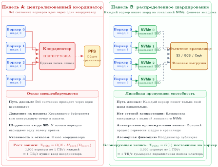
***Архитектура распределенной контрольной точки:** сравнение централизованной и распределенной схем. (Сверху) централизованная агрегация создает узкие места у координатора. (Снизу) распределенное шардирование позволяет каждому воркеру писать напрямую в общее хранилище параллельно, суммируя пропускную способность сети хранения и минимизируя паузу обучения.*

Протокол координации проходит в шесть шагов:

1. Координатор рассылает запрос на сохранение с идентификатором контрольной точки
2. Каждый воркер приходит в согласованное состояние (барьерная синхронизация)
3. Каждый воркер записывает неизменяемый шард в промежуточный префикс, относящийся к данному поколению, и сохраняет его байтовую длину и криптографический дайджест
4. Каждый воркер подтверждает координатору завершение надежной записи
5. Координатор записывает неизменяемый манифест после всех подтверждений. Манифест фиксирует шаг обучения, топологию, форматы модели и оптимизатора, позицию загрузчика данных, состояние генератора случайных чисел, а также длину и дайджест каждого шарда; затем публикуется маркер фиксации или атомарный указатель на этот манифест
6. Координатор рассылает сообщение о завершении контрольной точки, и обучение возобновляется

Зафиксированное поколение контрольной точки определяет манифест, а не наличие каталога или правдоподобный набор имен шардов. Восстановление принимает только опубликованный манифест, все шарды которого совпадают с записанными длинами и дайджестами. Промежуточные шарды без этой итоговой публикации остаются недоступными и могут быть убраны сборщиком мусора. Это правило не дает частично перезаписанному каталогу `latest` выдавать себя за пригодное к восстановлению состояние и делает откат поколения явным. На практике срез согласованности, зафиксированный в манифесте, определяет, может ли система заявлять строгую, ограниченно асинхронную или согласованность в конечном счете (eventual consistency).

<a id="psp-fault-tolerance-checkpoint-consistency-models"></a>

> **Модели согласованности контрольных точек**
>
> Идеализированный протокол предполагает, что шаг 2 завершается быстро. В масштабе эта барьерная синхронизация становится главной стоимостью контрольной точки, потому что в кластере из 10 000+ GPU почти всегда есть хотя бы один медленный воркер.
>
> **Строго синхронная**: все воркеры сохраняют контрольную точку на одном и том же шаге обучения. Дает самую сильную согласованность, но самые высокие накладные расходы из-за барьерной синхронизации.
>
> **Ограниченно асинхронная**: воркеры могут отставать друг от друга не более чем на $k$ шагов (обычно $1 \le k \le 3$). Менеджер контрольных точек отслеживает «фронт контрольных точек» по всем воркерам. Восстановление использует самый ранний согласованный срез по всем шардам. Это жертвует идеальной согласованностью ради заметно сниженных накладных расходов синхронизации, и именно такой подход на практике используют производственные системы.
>
> **Согласованность в конечном счете**: воркеры сохраняют контрольные точки, когда удобно, и согласуют их при восстановлении. Самые низкие накладные расходы, но для реконструкции согласованного состояния нужна сложная логика восстановления.

Базовый протокол содержит тонкую ошибку корректности: если координатор падает после того, как воркеры подготовили свои шарды, но до того, как записал окончательное решение, система не должна выдавать эти шарды за допустимую контрольную точку. Производственные системы могут использовать двухфазную фиксацию[^fn-twophase-checkpoint-protocol], классический протокол распределенных систем (Gray, 1978), чтобы сделать решение о контрольной точке атомарным:

[^fn-twophase-checkpoint-protocol]: **Двухфазная фиксация (2PC)**: формализована в работе (Gray, 1978). 2PC гарантирует, что все участники атомарно либо фиксируют изменения, либо отменяют их. Известный недостаток протокола — блокирование: если координатор отказывает после того, как участники подготовились, но до того, как они узнали решение, подготовленные участники должны ждать, пока надежное решение не будет восстановлено. Тайм-аут может запустить восстановление координатора, но сам по себе не разрешает одностороннего отката.

На фазе подготовки воркеры записывают данные в промежуточное место и сообщают координатору об успехе. Затем координатор записывает надежное решение о фиксации или отмене, прежде чем уведомить участников. Зафиксированная контрольная точка становится видимой через полные метаданные или маркер фиксации. Если координатор отказывает после подготовки, участники остаются заблокированными, пока исходный или заменяющий координатор не восстановит это надежное решение. Неподтвержденные промежуточные шарды можно убирать сборщиком мусора только после того, как восстановление установит, что решения о фиксации не существует. Согласованность остается отдельным требованием: синхронные обновления градиентов естественно создают границы шагов, на которых все воркеры применили одинаковые обновления, а асинхронное обучение и конвейерный параллелизм требуют более тщательной координации, чтобы определить согласованный срез.

<a id="sec-fault-tolerance-reliability-reliability-sharded-checkpointing-58d0"></a>

#### Шардированное сохранение контрольных точек

Современные фреймворки распределенного обучения разбивают состояние модели между воркерами с помощью таких методов, как ZeRO и FSDP. В этих конфигурациях ни один воркер не хранит полное состояние модели. Каждый воркер держит только назначенный ему шард параметров и соответствующее состояние оптимизатора.

**Шардированное сохранение контрольных точек**[^fn-sharded-checkpoint-state] (Rajbhandari et al., 2020) использует это распределение: каждый воркер записывает только свой шард, сильно уменьшая объем записи на воркер. Восстановление загружает шарды и перераспределяет состояние между воркерами в соответствии с конфигурацией восстановления.

[^fn-sharded-checkpoint-state]: **Шардированное сохранение контрольных точек**: каждый воркер сохраняет только свою локальную часть, а не передает состояние одному писателю. Для ZeRO-3 или FSDP при обучении модели на 175 млрд параметров на 1 024 воркерах каждый воркер записывает около 3,6 ГБ вместо того, чтобы один писатель обрабатывал 3,7 ТБ, распараллеливая ввод-вывод на все узлы. Компромисс: восстановление требует присутствия и согласованности всех шардов, поэтому протокол контрольных точек усложняется, а отказ хранилища любого отдельного шарда становится фатальным для всей контрольной точки.

Такой подход обеспечивает эффективное сохранение даже для огромных моделей. Модель на 175 млрд параметров с контрольной точкой 3,7 ТБ, распределенной по 1 024 воркерам, требует, чтобы каждый воркер записал лишь 3,6 ГБ, что выполнимо за секунды на локальном NVMe.

Если восстанавливаться с другим числом воркеров, чем в контрольной точке, перераспределение шардов должно пересопоставить состояние новой конфигурации воркеров. Это происходит при эластичном масштабировании или замене оборудования. Поддержка гибкого переразбиения во фреймворках позволяет восстанавливаться даже при изменении числа воркеров. Однако наличие допустимой контрольной точки само по себе недостаточно. Шардированное сохранение смягчает бурю ввода-вывода, но системе все равно нужно обнаружить отказ, запустить восстановление и скоординировать распределенные шарды, прежде чем обучение сможет продолжиться. Скорость обнаружения и восстановления определяет истинную цену прерывания.

<a id="chk-fault-tolerance-checkpoint-cost"></a>

> **Контрольные вопросы: налог на контрольные точки**
>
> Проверьте свое понимание того, как интенсивность отказов и стоимость контрольной точки задают оптимальный интервал:
>
> - [ ] **Сдвиг Янга–Дэйли**: с помощью формулы Янга–Дэйли оцените, как сдвигается оптимальный интервал $\tau_{\text{opt}}$, когда кластер удваивается в размере, а системный MTBF уменьшается вдвое при фиксированном $T_{\text{write}}$. Укажите, удлиняется или сокращается интервал и примерно во сколько раз.
> - [ ] **Налог с двух сторон**: объясните, почему слишком частая и слишком редкая запись контрольных точек одинаково повышают налог на контрольные точки, включая две стоимости, которые балансирует $\tau_{\text{opt}}$.
> - [ ] **Более быстрая запись**: определите, как снижение $T_{\text{write}}$ на порядок за счет шардированного сохранения меняет оптимальный интервал и ожидаемую потерянную работу на один отказ.
> - [ ] **Масштабирование по квадратному корню**: объясните, почему интервал Янга–Дэйли зависит от квадратного корня из MTBF, а не растет с ним линейно.

<a id="sec-fault-tolerance-reliability-reliability-failure-detection-recovery-0f54"></a>

## Обнаружение отказов и восстановление

GPU молча зависает: его загрузка падает до нуля, а соседние GPU бесконечно ждут на барьере AllReduce. Каждая минута, которую система тратит на то, чтобы заметить отстающий узел и перезагрузить его, стоит тысяч долларов простоя кластера. Контрольные точки сохраняют состояние, но именно процесс восстановления определяет, сколько вычислений теряется при отказе.

Уравнение [«Время восстановления»](07_fault_tolerance.md#eq-recovery-time) раскладывает время восстановления на четыре основные составляющие:

<a id="eq-recovery-time"></a>

$$ T_{\text{recovery}} = T_{\text{detect}} + T_{\text{restart}} + T_{\text{load}} + T_{\text{warmup}} $$

где:

- $T_{\text{detect}}$: время между реальным аппаратным отказом и классификацией его системой как отказа
- $T_{\text{restart}}$: время, за которое планировщик задания выделяет новые ресурсы и запускает процессы-замены
- $T_{\text{load}}$: время ввода-вывода на чтение состояния контрольной точки из распределенного хранилища в память GPU
- $T_{\text{warmup}}$: время, которое нужно системе, чтобы заполнить конвейер данных, скомпилировать ядра на лету (JIT) и стабилизировать пропускную способность

Каждая составляющая открывает свои возможности для оптимизации, а доминирующий член зависит от конфигурации кластера. Понимание этой декомпозиции позволяет вкладываться в узкое место, а не улучшать все компоненты равномерно.

<a id="sec-fault-tolerance-reliability-reliability-failure-detection-mechanisms-efed"></a>

### Механизмы обнаружения отказов


*Задержка обнаружения растет от секунд (сбой) до часов (тихое повреждение данных).*

Обнаружение — первая линия защиты, и его определяет фундаментальный компромисс между скоростью и частотой ложных срабатываний. Тайм-аут, который *слишком агрессивен*, принимает временный сетевой джиттер за отказ узла и запускает ненужный и дорогой перезапуск. Тайм-аут, который *слишком консервативен*, позволяет всему кластеру простаивать, пока мертвый узел задерживает синхронизацию.

Мониторинг сигналов жизни (heartbeat) — стандартный механизм: каждый воркер периодически посылает центральному координатору или службе мониторинга сигнал «я жив». Пропущенные сигналы запускают классификацию отказа. Интервал сигналов $H$ и тайм-аут $T_{\text{timeout}}$ определяют компромисс. В кластерах большого масштаба времена прихода сигналов часто подчиняются распределению с тяжелыми хвостами из-за перегрузки сети, поэтому нужны адаптивные тайм-ауты, а не статические пороги. Производственные системы обычно используют $T_{\text{timeout}} = H + k\sigma_d$, где $k$ лежит в диапазоне от 3 до 5, а $\sigma_d$ — наблюдаемое стандартное отклонение задержки сети.

Тайм-ауты коллективной коммуникации дают второй уровень обнаружения. В ходе синхронного обучения коллектив, который нужен следующему шагу, остается незавершенной зависимостью критического пути, если требуемый ранг пропал. AllReduce нуждается во вкладе каждого ранга, прежде чем выдать результат редукции; прогресс и поведение при отказе остальных коллективов зависят от операции и среды выполнения. Тайм-ауты транспорта и групп процессов ограничивают время, которое задание ждет, прежде чем объявить операцию неудачной и перейти к восстановлению. Библиотека NCCL[^fn-nccl-collective-timeout] предоставляет для этого настраиваемые параметры тайм-аутов транспорта и RAS, а фреймворки более высокого уровня могут задавать собственные тайм-ауты операций группы процессов. Эти настройки часто делают консервативными, чтобы не аварийно останавливать задания при законно медленной коммуникации, и это, к сожалению, удлиняет $T_{\text{detect}}$.

[^fn-nccl-collective-timeout]: **Тайм-аут NCCL**: библиотека коллективных коммуникаций NVIDIA предоставляет управляющие параметры тайм-аутов транспорта и RAS, например `NCCL_IB_TIMEOUT` и `NCCL_RAS_TIMEOUT_FACTOR` (NVIDIA, 2026). Фреймворки распределенного обучения более высокого уровня могут добавлять собственное поведение перезапуска и тайм-аутов операций (PyTorch Contributors, 2026). Агрессивные настройки ускоряют обнаружение отказа, но создают риск ложных срабатываний во время законно долгих коллективных операций на больших моделях; компромисс между задержкой обнаружения и устойчивостью обучения не имеет универсального оптимума.

Проверки работоспособности оркестрации контейнеров дают третий уровень. Kubernetes и SLURM предлагают **пробы живости** (Liveness Probe), которые проверяют, что процессы работают, и **пробы готовности** (Readiness Probe), которые проверяют, что процессы готовы обрабатывать запросы. Они работают независимо от фреймворка обучения и ловят отказы, которые могут пропустить сигналы жизни на уровне приложения, например процесс, который жив, но заблокирован (deadlock).

**Всплеск потерь** (Loss Spike) показывает аномалию, но не ее причину. Тихая аппаратная порча может вызвать резкий скачок потерь или нормы градиента, но его может вызвать и плохой батч, нестабильность оптимизатора, дефект порядка данных или рассогласование распределенного состояния. Поэтому надежные системы приостанавливаются до того, как подозрительное обновление будет зафиксировано, сохраняют входные данные и свидетельства воркеров и воспроизводят шаг на заведомо исправном оборудовании. Контрольная сумма может указать байты, которые изменились после хеширования, а повторное вычисление на каждом ранге или избыточные вычисления могут проверить, выдал ли воркер неверный градиент. Оборудование выводится из строя только тогда, когда эти свидетельства указывают на устройство; в противном случае исправляют путь данных, оптимизатора или синхронизации, который дал тот же симптом.

Мониторинг динамики обучения расширяет обнаружение за пределы явных ошибок. Наблюдение за значениями потерь, нормами градиентов и статистикой активаций может выявить византийские отказы, которые дают неверные результаты без исключений. Внезапные скачки потерь, взрывы градиентов или статистические аномалии в распределениях градиентов по рангам могут указывать на тихую порчу, которую иначе не заметили бы часами.

Операционный вопрос, таким образом, в том, сколько на самом деле занимает обнаружение, когда эти уровни взаимодействуют.

> **Реалистичные задержки обнаружения отказов**
>
> Производственный опыт показывает, что обнаружение отказов занимает заметно больше времени, чем предполагают теоретические тайм-ауты сигналов жизни. Основная трудность в том, чтобы отличить отказы от отстающих воркеров, как показано в таблице [«Задержки обнаружения отказов в эксплуатации»](07_fault_tolerance.md#tbl-fault-tolerance-detection-latencies). Эти задержки возникают потому, что агрессивные тайм-ауты дают ложные срабатывания (убивают здоровых, но медленных воркеров), а консервативные тайм-ауты задерживают обнаружение реальных отказов. Производственные системы обычно используют многоступенчатое обнаружение: быстрый первичный тайм-аут запускает расследование, а более медленный подтверждающий тайм-аут запускает восстановление.
>
> | **Тип отказа**             | **Типичное время обнаружения** | **Почему**                                       |
> |:---------------------------|:------------------------------:|:-----------------------------------------------|
> | **Крах процесса**          |          5–30 секунд           | Тайм-аут сигнала жизни + повторные проверки      |
> | **Зависание GPU**          |          30–120 секунд         | Нужно отличить от законно медленного ядра        |
> | **Разрыв сети**            |          60–180 секунд         | Нужно отличить от временной перегрузки           |
> | **Тихое повреждение данных** |     От минут до часов         | Требует статистического обнаружения аномалий     |
>
> <a id="tbl-fault-tolerance-detection-latencies"></a>
> ***Задержки обнаружения отказов в эксплуатации:** реалистичные времена обнаружения крахов процессов, зависаний GPU, разрывов сети и тихого повреждения данных с доминирующей причиной задержки для каждой категории; показывает, почему одних статических тайм-аутов сигналов жизни недостаточно.*

### Процедуры восстановления

<a id="sec-fault-tolerance-reliability-reliability-recovery-procedures-002d"></a>

Как только отказ классифицирован, процедура восстановления выполняет жесткую последовательность, чтобы восстановить согласованность:

1. **Завершение задания**: `SIGTERM` рассылается всем выжившим воркерам. При синхронном обучении с параллелизмом данных потеря одного воркера делает глобальный коммуникатор недействительным, и требуется полный демонтаж.
2. **Освобождение ресурсов**: планировщик помечает отказавший узел как «выводимый» (draining), чтобы он не был немедленно переназначен, и запрашивает замену из пула резервных узлов.
3. **Перезапуск задания**: новые контейнеры запускаются (из кэша, если он есть), а бинарный файл обучения заново инициализируется на всех узлах.
4. **Загрузка контрольной точки**: каждый воркер читает свой шард состояния из распределенной файловой системы. Для шардированных контрольных точек каждый воркер загружает только свою часть.
5. **Синхронизация состояния**: ранги обмениваются рукопожатиями, чтобы установить новый коммуникатор (например, `ncclCommInitRank`), и воркеры проверяют, что все они находятся на одном шаге обучения.
6. **Возобновление обучения**: загрузчик данных перематывает вперед к правильному индексу батча, и цикл обучения продолжается с шага контрольной точки.

Системы автоматического восстановления выполняют эти шаги без вмешательства человека. Современные фреймворки обучения интегрируются с менеджерами кластеров, чтобы автоматизировать части последовательности. DeepSpeed документирует процедуры сохранения и загрузки моделей и состояния оптимизатора ZeRO, которые обеспечивают долговечное состояние, необходимое после отказа (DeepSpeed Developers, 2026). Эластичный запуск PyTorch `torchrun` документирует поведение при отказах и изменениях членства через свой механизм рандеву,[^fn-rendezvous-elastic-barrier] координируемый протокол, с помощью которого выжившие воркеры согласуют членство и ранги после перезапуска (PyTorch Contributors, 2026).

[^fn-rendezvous-elastic-barrier]: **Рандеву** (rendezvous): от французского «rendez-vous» («явитесь»). Этот протокол координации требует, чтобы перезапущенные воркеры обнаружили друг друга и согласовали новый состав группы, прежде чем обучение сможет продолжиться. Стоимость протокола — барьер синхронизации, который блокирует всех воркеров до прихода самого медленного, поэтому задержка восстановления пропорциональна неоднородности кластера.

Проверка восстановления — финальный и часто упускаемый шаг. После загрузки контрольной точки проверка подтверждает успешное восстановление: параметры модели совпадают с ожидаемыми формами и типами данных, несколько шагов обучения выполняются, а потери согласуются со значениями до отказа, и вычисление градиентов дает ожидаемую статистику. Если потери расходятся сразу после восстановления, сама контрольная точка может быть испорчена, и тогда нужен откат к более раннему снимку.

Восстановление также должно не допускать возврата отказавшей эпохи владения. Координатор выдает каждой инкарнации группы воркеров монотонно растущую **эпоху** (epoch) и связывает членство с продлеваемой арендой. Каждая запись, которая меняет состояние, несет эту эпоху как **фенсинг-токен** (fencing token). Хранилище, сервисы рандеву и контрольных точек отвергают токен, который старше наивысшей принятой эпохи, поэтому приостановленный воркер, который возобновляется после истечения аренды, не может опубликовать контрольную точку, обновить прогресс задания или вернуться в коммуникатор, принадлежащий его замене. Одной аренды недостаточно, потому что истечение меняет представление координатора, а не способность старого воркера достучаться до хранилища; фенсинг делает устаревшее владение неисполнимым на границе ресурса (Kleppmann, 2016).

Повторы завершают контракт восстановления. Операцию можно повторять автоматически, только если она идемпотентна или несет стабильный идентификатор операции, который позволяет получателю устранять дубликаты повторных эффектов. Каждая попытка наследует абсолютный дедлайн вызывающей стороны вместо нового тайм-аута, а система ограничивает число попыток бюджетом повторов, общим для дерева запроса или восстановления. Экспоненциальная задержка с джиттером распределяет попытки во времени, но не предотвращает перегрузку, если каждый уровень повторяет независимо. Поэтому бюджет принадлежит одному уровню, который отвечает за повторы; исчерпанный бюджет возвращает ошибку или запускает деградацию, а не усиливает исходный инцидент (Beyer et al., 2016; Nygard, 2007).

> **Бюджет времени восстановления**
>
> **Задача**: рассмотрим обучение модели с 175 млрд параметров на 1 024 GPU. Размер контрольной точки составляет примерно 3,7 ТБ (веса и состояние оптимизатора Adam). Оцените стоимость одного события отказа.
>
> **Расчет**:
>
> - **$T_{\text{detect}}$**: 60 с (консервативный тайм-аут сигнала жизни с повторными проверками).
> - **$T_{\text{restart}}$**: 3 мин (время очереди планировщика, запуск контейнера, накладные расходы импорта Python и инициализация NCCL).
> - **$T_{\text{load}}$**: 37 с (чтение полной контрольной точки 3,7 ТБ из общего хранилища при совокупной скорости 100 ГБ/с; при шардированном чтении с локального NVMe со скоростью 5 ГБ/с каждый шард 3,6 ГБ загружается заметно быстрее одной секунды).
> - **$T_{\text{warmup}}$**: 2 мин (компиляция ядер JIT, заполнение буфера конвейера данных, повторное установление TCP-соединений).
>
> **Результат**: $T_{\text{recovery}} = T_{\text{detect}} + T_{\text{restart}} + T_{\text{load}} + T_{\text{warmup}} \approx$ 6,6 мин на одно событие отказа.
>
> **Последствия**: для этого пути восстановления $T_{\text{recovery}}$ — это операционный член MTTR в соотношении доступности из [«Масштаб меняет характер отказов»](07_fault_tolerance.md#psp-fault-tolerance-scale-transforms-failure). Оптимизация времени восстановления важнее по мере роста кластеров. По базовому случаю только для GPU из [таблицы «Масштабирование MTBF кластера»](07_fault_tolerance.md#tbl-cluster-mtbf-scaling) кластер из 1 024 GPU имеет MTBF 49 часов, испытывает около 0,49 отказа в сутки и теряет около 3 минут в день, что дает скромные 0,2 % накладных расходов. Однако кластер из 10 000 GPU имеет MTBF только для GPU 5 часов, испытывает около 4,8 отказа в сутки и теряет около 32 минут в день (накладные расходы 2,2 %), что эквивалентно потере примерно 5 293 GPU-часов каждый день (дневные потерянные минуты, умноженные на все 10 000 GPU).

<a id="sec-fault-tolerance-reliability-warm-vs-cold-restart"></a>

### Теплый и холодный перезапуск

Стандартная процедура восстановления, описанная в разделе [«Процедуры восстановления»](07_fault_tolerance.md#sec-fault-tolerance-reliability-reliability-recovery-procedures-002d), — это **холодный перезапуск** (Cold Restart): уничтожаются все процессы кластера, а все состояние заново загружается из постоянного хранилища. Холодный перезапуск надежен и прост (он не делает допущений о корректности состояния в памяти), но расточителен. Когда один GPU отказывает в кластере из 1 000 GPU, холодный перезапуск отбрасывает корректное состояние памяти 999 исправных воркеров и заставляет всех их заново загружать данные с диска.

**Теплый перезапуск** (Warm Restart) сохраняет состояние выживших воркеров. Когда отказывает ранг, выжившие ранги обнаруживают отказ, но не завершаются. Они переходят в состояние ожидания, сохраняя загруженные веса модели и состояния оптимизатора в памяти GPU. Планировщик заменяет только отказавший узел. Новый узел присоединяется, загружает свою часть состояния с диска (или получает ее широковещательной рассылкой от соседа), и коммуникатор перестраивается. Обучение продолжается с минимальным нарушением.

Теплые перезапуски могут снизить $T_{\text{load}}$ и $T_{\text{warmup}}$ почти до нуля для 99,9 % кластера, сокращая полное время восстановления с минут до секунд. Для примера с 1 024 GPU теплый перезапуск избегает повторной загрузки 3,7 ТБ из хранилища и экономит 37 с $T_{\text{load}}$ и 2 минуты $T_{\text{warmup}}$ для всех узлов, кроме заменяющего.

Цена этого — сложность программного обеспечения. Теплые перезапуски, сохраняющие выживших, требуют специальной поддержки приложения и среды выполнения для динамических изменений членства без утечек памяти CUDA, порчи общего состояния или взаимных блокировок при перестройке коммуникатора. TorchElastic не сохраняет процессы воркеров при изменениях членства: он останавливает выживших и запускает новую группу воркеров. Документированный путь восстановления DeepSpeed ориентирован на контрольные точки, а не на теплый перезапуск с сохранением выживших. Развертывание, которое реализует быстрый путь теплого перезапуска, все равно нуждается в холодном перезапуске как страховочной сетке. В [таблице «Холодный и теплый перезапуск: компромиссы»](07_fault_tolerance.md#tbl-cold-vs-warm-restart) сравниваются обе стратегии:

| **Аспект**                  | **Холодный перезапуск**          | **Теплый перезапуск**                  |
|:----------------------------|:---------------------------------|:---------------------------------------|
| **Время восстановления**    | 4–10 минут (полная перезагрузка) | 30–90 секунд (перезагрузка одного узла) |
| **Гарантия состояния**      | Чистое: все состояние из контрольной точки | Допускает, что сохраненное состояние корректно |
| **Реализация**              | Простая: убить все, перезагрузить все | Сложная: управление динамическим членством |
| **Отказ во время восстановления** | Повторить холодный перезапуск | Откатиться к холодному перезапуску    |
| **Лучше всего для**         | Коррелированные отказы, события SDC | Отказы одного узла, ошибки GPU        |

<a id="tbl-cold-vs-warm-restart"></a>

***Компромиссы холодного и теплого перезапуска:** холодный перезапуск убивает все процессы и перезагружает состояние с диска; теплый перезапуск сохраняет выживших воркеров и заменяет только отказавший узел. Теплый перезапуск сокращает восстановление с минут до секунд для типичного отказа одного узла, но вводит сложность программного обеспечения, связанную с управлением динамическим членством. Зрелые развертывания могут использовать теплый перезапуск как быстрый путь, а холодный — как страховочную сетку.*

<a id="sec-fault-tolerance-reliability-recovery-automation-pipeline"></a>

### Конвейер автоматизации восстановления

Для масштаба 10 000+ GPU вмешательство человека при каждом отказе невозможно: отказы случаются несколько раз в день. Восстановление должно быть автономным управляющим контуром, которым управляет плоскость управления кластера. Опубликованные крупномасштабные системы Meta, Google и Microsoft иллюстрируют многоступенчатые конвейеры автоматизации, которые классифицируют отказы и выбирают минимально достаточное исправление.

Конвейер работает в четыре упорядоченных этапа:

1. **Демон мониторинга здоровья** (Health Monitoring Daemon): непрерывно собирает телеметрию GPU (счетчики ошибок ECC, температуру, скорость вентиляторов, состояние NVLink) вместе с метриками приложения, такими как потери обучения и пропускная способность шагов, часто из контейнера-спутника (sidecar).
2. **Классификатор отказов** (Failure Classifier): определяет, указывает ли сигнал на фатальную ошибку (например, NVIDIA Xid 48: двухбитная ошибка ECC), на кратковременную остановку (например, временную перегрузку сети) или на деградацию производительности (например, тепловой троттлинг).
3. **Селектор действий** (Action Selector): выбирает подходящий ответ. Зависание процесса запускает перезапуск контейнера (быстро, локально); аппаратная ошибка GPU запускает вывод узла из работы и замену (медленнее, требует резервной емкости); разрыв сети запускает стратегию «приостановить и ждать», которая сохраняет состояние в памяти.
4. **Этап валидации** (Validation Stage): после восстановления запускает «канареечный батч», чтобы подтвердить, что потери совпадают со значениями до отказа. Если потери сразу расходятся, контрольная точка может быть испорчена, и тогда автоматически выполняется откат к более раннему снимку.

Эта автоматизация сокращает среднее время восстановления с 30–60 минут, типичных для ручного вмешательства, до менее 10 минут для большинства типов отказов. Этап классификации критичен: если считать каждый отказ холодным перезапуском, вычисления тратятся на кратковременные сбои, а если принять аппаратный отказ за кратковременный, испорченные вычисления продолжаются.

<a id="sec-fault-tolerance-reliability-reliability-distinguishing-stragglers-failures-285d"></a>

### Отличие отстающих воркеров от отказов

> **Отстающий воркер**
>
> ***Отстающий воркер*** — это воркер в распределенном задании обучения, который обрабатывает задачи заметно медленнее своих соседей и создает узкое место синхронизации.
>
> 1. **Значение**: в синхронной параллельной системе (bulk synchronous parallel) пропускная способность кластера ограничена скоростью самого медленного ранга. Падение производительности на 10 % одного узла может снизить эффективную вычислительную мощность тысяч узлов на 10 %.
> 2. **Отличие**: в отличие от аппаратного отказа (когда узел останавливается), отстающий воркер продолжает выдавать корректные результаты, но нарушает временную согласованность, необходимую для эффективного параллельного выполнения.
> 3. **Типичная ошибка**: распространено заблуждение, что отстающие воркеры вызваны только «плохим железом». На самом деле их часто вызывает **системный джиттер** (System Jitter): фоновые процессы ОС, перегрузка сети или тепловой троттлинг, которые различаются по всему машинному залу.

Отстающий воркер — это ранг, который остается функционально корректным, но работает заметно медленнее своих соседей. В синхронном обучении отстающие воркеры губят производительность: скорость всего кластера определяется его самым медленным компонентом, поскольку AllReduce не может завершиться, пока каждый ранг не передаст свои градиенты.

Для упрощенной модели отстающих без перекрытия вычислений время шага равно:

$$ T_{\text{step,straggler}}(N) = \max(T_{\text{rank}_0}, T_{\text{rank}_1}, \dots, T_{\text{rank}_{N-1}}) + T_{\text{comm}}(N) $$

Отстающие возникают из-за «скрытых отказов» (gray failures), которые не вызывают явных ошибок: тепловой троттлинг снижает частоту, деградирующие кабели межсоединений увеличивают задержку коммуникации, фоновые процессы ОС (очистка памяти, ротация журналов) потребляют такты CPU, а загрузка данных из перегруженной сетевой файловой системы вносит переменные задержки ввода-вывода. В отличие от жестких отказов, отстающие не вызывают тайм-аутов, поэтому они могут незаметно снижать глобальную эффективность часами.

Задача — отличить отстающих от отказов. Отстающие должны запускать *смягчение* (перераспределить работу, заменить медленный узел). Отказы должны запускать *восстановление* (перезапуск из контрольной точки). Агрессивные тайм-ауты считают отстающих отказами и вызывают ненужные перезапуски заданий, которые тратят больше вычислений, чем сам отстающий. Консервативные тайм-ауты тратят вычисления на ожидание отстающих, которые никогда не ускорятся.

Стратегии смягчения отстающих образуют спектр по степени агрессивности:

- **Резервные воркеры** (Backup Workers): дублируют работу, назначенную медленным воркерам, и используют первый полученный результат, обменивая вычисления на задержку.
- **Ограниченная устарелость** (Bounded Staleness): позволяет обучению продолжаться с устаревшими градиентами от медленных воркеров, принимая небольшой штраф к сходимости.
- **Динамическая балансировка нагрузки** (Dynamic Load Balancing): перераспределяет шарды данных с медленных воркеров, уменьшая их нагрузку на шаг.
- **Упреждающая замена** (Proactive Replacement): использует тенденции телеметрии GPU (рост температуры, увеличение числа ошибок ECC), чтобы обнаружить деградирующих воркеров и заменить их до того, как они станут отстающими.

Простой расчет стоимости показывает, почему сильного отстающего может быть дешевле заменить, чем терпеть.


*Один отстающий простаивает каждый здоровый ускоритель.*

> **Налог отстающего**
>
> **Задача**: рассмотрим кластер из 1 024 GPU, где обычная итерация обучения занимает 1 секунду. Один GPU переходит в состояние теплового троттлинга, снижает частоту до 50 % скорости, и теперь его вычисление занимает 2 секунды.
>
> Поскольку AllReduce не может завершиться, пока каждый ранг не передаст градиенты, остальные 1 023 здоровых GPU простаивают в ожидании отстающего.
>
> **Последствия**:
>
> - **Обычное время шага**: 1 секунда
> - **Время шага отстающего**: 2 секунды
> - **Эффективная скорость кластера**: 1 шаг / 2 с = 0,5 шага в секунду
>
> Одно неисправное устройство (0,1 % оборудования) снизило пропускную способность всего кластера на 50 %. При \$3 за GPU-час этот отстающий сжигает \$1 536 в час на простаивающих вычислениях.
>
> **Системный вывод**: математически оптимально считать сильного отстающего жестким отказом. Обнаружение и остановка медленного узла с перезапуском на исправном оборудовании дают большую долгосрочную пропускную способность, чем терпение деградации. Точка безубыточности: если отстающий замедляет кластер больше чем на $T_{\text{recovery}}/\text{MTBF}_{\text{system}}$ (долю времени, потраченного на восстановление после отказов), немедленная замена дешевле ожидания.

Однако остановка медленного узла и перезапуск задания подразумевают ожидание замены, чтобы сохранить исходное число GPU. Когда выделены специальные резервные устройства, модель резервирования N+1 может подменить горячий резерв ([рисунок «Избыточность кластера и переключение на горячий резерв»](07_fault_tolerance.md#fig-hot-spare-swap)) за секунды, обходя длительную очередь выделения. Модель восстановления из контрольной точки предполагает восстановление того же распределения ресурсов: контрольная точка, ожидание замены, перезапуск. Эластичное восстановление нарушает это допущение, позволяя заданию продолжаться с меньшим числом воркеров, а не простаивать всему кластеру до восстановления исходного количества.

<a id="fig-hot-spare-swap"></a>

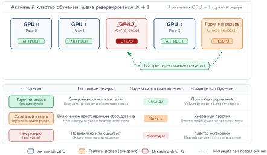

***Избыточность кластера и переключение на горячий резерв:** в схеме резервирования $N+1$ (показана на примере 4 активных GPU и 1 горячего резерва) отказ ранга запускает быстрое переключение на синхронизированное резервное устройство за секунды. Сравнительная таблица суммирует компромиссы между горячим резервом, холодным резервом и отсутствием резерва по синхронизации состояния, задержке восстановления и доступности кластера.*

<a id="chk-fault-tolerance-detection-vs-recovery"></a>

> **Контрольные вопросы: настройка обнаружения и восстановления**
>
> Проверьте свое понимание того, как задержка обнаружения и стратегия восстановления компенсируют друг друга:
>
> - [ ] **Настройка тайм-аута**: исходя из правила тайм-аута сигнала жизни $T_{\text{timeout}} = H + k\sigma_d$, объясните, какой режим отказа жертвуется при снижении $k$ с 5 до 3 и какой режим отказа при этом ухудшается.
> - [ ] **Теплый или холодный перезапуск**: выберите теплый или холодный перезапуск для отказа одного GPU в задании на 1 000 GPU, когда состояние выживших сохранено, и назовите два условия, которые возвращают восстановление к холодному пути.
> - [ ] **Стоимость горячего резерва**: объясните, почему горячий резерв сокращает задержку восстановления по сравнению со схемой «обнаружить и перезапустить», включая постоянную стоимость, которую кластер платит за готовность резерва.
> - [ ] **Решение по отстающему**: определите, что решает, ждать ли замедленного узла или остановить его и восстановиться на исправном оборудовании.

<a id="sec-fault-tolerance-reliability-reliability-elastic-training-4f87"></a>

## Эластичное восстановление

Предположим, что задание обучения на 1 024 GPU теряет узел из 8 GPU из-за аппаратного сбоя, а свободных узлов в кластере нет. При восстановлении из контрольной точки оставшиеся 1 016 GPU простаивают часами в ожидании ремонта. Эластичное восстановление вместо этого позволяет заданию динамически изменить размер и продолжить работу с чуть меньшими вычислительными ресурсами, нарушая жесткое допущение о фиксированном числе воркеров.

> **Эластичное обучение**
>
> ***Эластичное обучение*** — это способность распределенного задания обучения менять число воркеров при изменениях членства, возможно через координированный перезапуск группы воркеров.
>
> 1. **Значение**: эластичное обучение превращает постоянную потерю мощности во временное прерывание, за которым следует сниженная пропускная способность. Задание на 1 024 GPU, потерявшее 8 GPU, может возобновиться с 99,2 % мощности, вместо того чтобы ждать замены. Для сохранения математической согласованности при изменении глобального размера батча требуется пересчет скорости обучения и корректировка накопления градиентов.
> 2. **Отличие**: в отличие от восстановления из контрольной точки фиксированного размера, которое ждет замены оборудования, чтобы восстановить исходное распределение, эластичное восстановление может перезапуститься или возобновиться с другим числом воркеров. Цикл оптимизации может приостановиться, пока заново устанавливаются членство, ранги и состояние.
> 3. **Типичная ошибка**: распространено заблуждение, что эластичность «автоматическая». На деле восстановление требует координированной адаптации: фреймворк обучения, загрузчик данных и оркестратор должны синхронизировать свое состояние, чтобы при изменении размера не потерять и не посчитать дважды ни одного образца данных.

В [рисунке «Эластичное восстановление обучения»](07_fault_tolerance.md#fig-elastic-flow) показана последовательность восстановления: обнаружить отказ, приостановиться, перераспределить нагрузку между выжившими воркерами и возобновить работу.

<a id="fig-elastic-flow"></a>


***Эластичное восстановление обучения:** в отличие от статического обучения, которое прерывается при отказе, эластичное обучение адаптируется. Когда воркер отказывает, задание приостанавливается, перераспределяет шарды набора данных и модели между оставшимися $N-1$ воркерами и продолжает обучение с последнего согласованного состояния. Эта возможность превращает жесткие отказы во временные падения пропускной способности.*

### Механизмы адаптации восстановления

<a id="sec-fault-tolerance-reliability-reliability-elastic-training-mechanisms-49b1"></a>

Эластичное восстановление превращает то, что иначе было бы жесткими отказами, в плавную корректировку мощности ([рисунок «Эластичное восстановление обучения»](07_fault_tolerance.md#fig-elastic-flow)): потерянный воркер уменьшает число активных, вместо того чтобы требовать замены оборудования до возобновления задания. Группа воркеров может перезапускаться, пока фреймворк восстанавливает членство, ранги и состояние при меньшем распределении ресурсов. Когда отказ уменьшает число воркеров, путь восстановления должен адаптировать несколько компонентов обучения, прежде чем возобновится полезная работа. Каждая адаптация закрывает конкретное требование согласованности, нарушение которого испортило бы модель или потратило вычисления впустую.

Первая забота — корректировка размера батча: при меньшем числе воркеров каждый воркер должен обработать больше образцов, чтобы сохранить глобальный размер батча, или глобальный размер батча должен уменьшиться. Уменьшение глобального размера батча во время восстановления может потребовать корректировки скорости обучения, чтобы сохранить свойства сходимости.

Соотношение между размером батча и оптимальной скоростью обучения определяет, насколько агрессивно задание может менять размер, не дестабилизируя обучение. Goyal et al. (2017) показали, что линейное правило масштабирования хорошо работает для обучения ImageNet с большим батчем и разогревом: при увеличении размера батча в $k$ раз скорость обучения тоже увеличивают в $k$ раз. [Правило масштабирования скорости обучения](07_fault_tolerance.md#eq-lr-scaling) задает альтернативную эвристику с квадратным корнем, которая дает более консервативную корректировку во время восстановления:

<a id="eq-lr-scaling"></a>

$$ \eta_{\text{new}} = \eta_{\text{base}} \times \sqrt{\frac{N_{\text{new}}}{N_{\text{base}}}} $$

где $N$ — число воркеров (и, следовательно, глобальный размер батча). Линейное правило (Goyal et al., 2017) часто предпочитают для обучения с большим батчем и разогревом, когда остальные допущения оптимизатора совпадают с исходным рецептом, а масштабирование с квадратным корнем — это консервативная политика восстановления, а не закон, подкрепленный публикацией.

Накопление градиентов — альтернатива корректировке скорости обучения: чтобы сохранить исходный эффективный размер батча при меньшем числе воркеров, каждый выживший воркер может накапливать градиенты по нескольким микробатчам перед синхронизацией. Если число воркеров уменьшилось вдвое, удвоение шагов накопления сохраняет тот же эффективный размер батча и не требует изменения скорости обучения, но вдвое увеличивает время каждого шага.

Перераспределение загрузчика данных — требование координации, которое восстановление должно выполнить атомарно. Когда воркеры теряются, загрузчик данных должен перераспределить назначения шардов данных, чтобы все обучающие данные по-прежнему обрабатывались и ни один образец не дублировался и не пропадал. Неудачное перераспределение незаметно портит распределение обучения.

Переразбиение состояния добавляет сложности при шардированном параллелизме модели (ZeRO/FSDP): потеря воркера означает, что один шард состояния модели больше не находится локально. Восстановление может идти онлайн (перенос осиротевшего шарда на выжившего воркера) или через перезагрузку контрольной точки (переразбиение из последней долговечной контрольной точки).

#### Вытеснение спотовых инстансов как класс отказов

<a id="sec-fault-tolerance-reliability-reliability-spot-instance-arbitrage-68ad"></a>

Аппаратные сбои — не единственное событие, которое удаляет воркеров из работающего задания. Облачные провайдеры часто продают вытесняемые («спотовые») инстансы дешевле, чем ресурсы по требованию, с оговоркой, что их могут отобрать почти без предупреждения. С точки зрения фреймворка обучения отъем спотового инстанса неотличим от аппаратного отказа: воркеры исчезают, и задание должно решить, остановиться или адаптироваться.

Традиционные статические задания не переживают вытеснение спотового инстанса, потому что потеря одного узла убивает весь запуск. Эластичное восстановление обрабатывает вытеснение так же, как аппаратный сбой:

1. Задание обнаруживает потерю узла (механизм тот же: тайм-аут или отказ сигнала жизни).
2. Оно ненадолго приостанавливается, чтобы перераспределить нагрузку между выжившими узлами.
3. Обучение возобновляется в меньшем масштабе.

Эта возможность восстановления может дать существенное преимущество в стоимости. Организации могут обучать на более дешевом вытесняемом оборудовании, потому что эластичное восстановление превращает каждое вытеснение во временное снижение пропускной способности, а не в фатальную ошибку. В сценарии, где спотовые ресурсы стоят \$0,60 в час вместо \$3,00 в час, экономия может перевесить потери эффективности от редких пауз на изменение размера.

#### Поддержка эластичного восстановления во фреймворках

<a id="sec-fault-tolerance-reliability-reliability-framework-support-elastic-training-8b75"></a>

Вопрос о фреймворке в том, какие инварианты изменения размера он может обеспечить автоматически: членство в группе, владение шардами, покрытие данных и арифметику батча. Механизмы адаптации восстановления из предыдущего раздела (корректировка размера батча, пересчет скорости обучения, перераспределение загрузчика данных, переразбиение состояния) должны быть реализованы фреймворком обучения, и фреймворки различаются тем, сколько из этой логики восстановления они автоматизируют после отказа.

PyTorch Elastic (TorchElastic) обнаруживает отказы воркеров через механизм рандеву, который выполняется заново при каждом изменении группы воркеров (PyTorch Contributors, 2026). При отказе или изменении членства TorchElastic останавливает всех выживших воркеров, формирует новую группу воркеров и запускает их с новыми назначениями `RANK` и `WORLD_SIZE`. Он перераспределяет ранги и перестраивает коммуникационные группы после перезапуска, но оставляет размер батча, скорость обучения и семантику контрольных точек пользовательскому коду.

DeepSpeed (Rasley et al., 2020) предоставляет строительные блоки распределенного обучения и контрольных точек на основе ZeRO для больших моделей (DeepSpeed Developers, 2026). Его модель восстановления основана на контрольных точках: после отказа задание перезагружается из последней долговечной контрольной точки, а Universal Checkpointing решает переносимость при некоторых изменениях параллелизма и топологии (DeepSpeed Developers, 2026). Эластичное поведение по-прежнему зависит от окружающего запускающего механизма и менеджера ресурсов, а не делается прозрачным одним только фреймворком.

Ray Train, построенный на модели акторов Ray, предоставляет путь восстановления на основе контрольных точек для отказов воркеров и вытеснения узлов. Ray может перезапустить группу воркеров после отказа и возобновить работу с последней доступной контрольной точки, а функция обучения по-прежнему отвечает за сохранение и загрузку достаточного состояния (Ray Project, 2026).

Horovod Elastic строится на системе обучения с параллелизмом данных Horovod (Sergeev and Del Balso, 2018) и предоставляет документированный API эластичного состояния для добавления и удаления воркеров (Horovod Developers, 2026). Когда группа воркеров меняется, Horovod может сбросить ранги и перестроить коммуникацию, а скрипт обучения по-прежнему отвечает за чувствительные к сходимости решения, такие как политика скорости обучения или размера батча.

В [таблице «Сравнение эластичного восстановления во фреймворках»](07_fault_tolerance.md#tbl-elastic-training-comparison) сравниваются подходы к автоматизации восстановления и управлению состоянием в этих фреймворках.

| **Фреймворк**       | **Обнаружение отказа** | **Автоматическое восстановление** | **Переразбиение состояния** | **Интеграция с кластером** |
|:--------------------|:----------------------:|:--------------------------------:|:---------------------------:|:--------------------------:|
| **PyTorch Elastic** | Тайм-аут рандеву       | Да                               | Вручную                     | Kubernetes                 |
| **DeepSpeed**       | Внешнее                | На основе контрольных точек      | Зависит от развертывания    | Внешние планировщики       |
| **Ray Train**       | Надзор за акторами     | Путь повтора из контрольной точки | Перезагрузка из контрольной точки | Ray Cluster          |
| **Horovod Elastic** | Сигнал жизни драйвера  | Да                               | Вручную                     | SLURM, Kubernetes          |

<a id="tbl-elastic-training-comparison"></a>

***Сравнение эластичного восстановления во фреймворках:** фреймворки различаются тем, как обнаруживают отказы воркеров и какую часть последовательности восстановления (перестроение групп, перераспределение состояния, корректировку размера батча) автоматизируют.*

Пока эти фреймворки автоматизируют механику восстановления, решение о том, какое состояние модели должно сохраняться и переразбиваться, остается инженерным выбором, зависящим от нагрузки.

### Специфичная для модели отказоустойчивость обучения

<a id="sec-fault-tolerance-reliability-reliability-modelspecific-training-fault-tolerance-4b70"></a>

Стратегии контрольных точек и восстановления, разработанные в разделах [«Контрольные точки: сохранение прогресса»](07_fault_tolerance.md#sec-fault-tolerance-reliability-reliability-checkpoint-restart-fundamentals-0ac2) и [«Обнаружение отказов и восстановление»](07_fault_tolerance.md#sec-fault-tolerance-reliability-reliability-failure-detection-recovery-0f54), требуют адаптации, потому что нагрузки теряют при отказе разные виды состояния. Поэтому вопрос проектирования звучит не просто как «как часто делать контрольную точку», а как «какая переменная состояния сделала бы перезапуск математически или экономически неверным». Для рекомендательных нагрузок инкрементальные контрольные точки, многоуровневые контрольные точки и версионирование эмбеддингов защищают актуальность, когда точное сохранение полного состояния слишком дорого. [Таблица «Инварианты состояния восстановления обучения»](07_fault_tolerance.md#tbl-training-recovery-state-invariants) превращает этот вопрос в компактную карту восстановления.

| **Нагрузка**    | **Состояние под угрозой** | **Следствие для контрольной точки** |
|:----------------|:--------------------------|:------------------------------------|
| Обучение LLM    | Состояние оптимизатора, позиция в учебной программе, позиция в документе, расписание длинного контекста | Сохраняйте состояние оптимизатора FP32 там, где важна точность, шардируйте запись с помощью ZeRO/FSDP, выносите сериализацию с критического пути и включайте позицию в расписании данных, чтобы траектория оптимизации корректно возобновлялась. |
| Рекомендации    | Актуальность эмбеддингов, версия хранилища признаков | Отдавайте предпочтение актуальности перед точным сохранением полного состояния: инкрементальные контрольные точки, многоуровневые контрольные точки и версионирование эмбеддингов. |
| Компьютерное зрение | Сиды аугментации, порядок перемешивания, статистики batch normalization, расписание прогрессивного изменения размера | Фиксируйте стохастическое и нормализационное состояние, которое управляет входным потоком; одних весов недостаточно для воспроизведения траектории обучения. |
| Научное машинное обучение | Состояние симулятора, фронт поиска, исследованные конфигурации, сиды валидации | Рассматривайте модель, симулятор, процесс поиска и случайное состояние как одну единицу согласованности, чтобы восстановление не дублировало исследование и не обесценивало сравнения. |

<a id="tbl-training-recovery-state-invariants"></a>

***Инварианты состояния восстановления обучения:** нагрузки требуют разного содержимого контрольных точек, потому что делают разные переменные состояния влияющими на качество. Правильная политика восстановления начинается с состояния, которое сделало бы перезапуск ошибочным, и затем выбирает шардирование, инкрементальность или захват доменного состояния соответственно.*

Общая закономерность в том, что корректность восстановления шире восстановления весов. LLM могут перезагрузить веса, но продолжить с неверной позиции в учебной программе; рекомендательные модели могут перезагрузить плотные параметры, но отдавать устаревшие эмбеддинги; модели компьютерного зрения могут перезагрузить веса, но изменить состояние аугментации или нормализации; а научные модели могут перезагрузить нейронную сеть, потеряв состояние симулятора, которое делало данные осмысленными.

Эластичность и контрольные точки обеспечивают необходимую устойчивость для долгих пакетных заданий обучения, но операционная арифметика полностью меняется, когда модель развернута для пользователей. Задача смещается от защиты *недель пакетных вычислений* к защите *миллисекунд задержки в реальном времени*.

<a id="sec-fault-tolerance-reliability-reliability-serving-fault-tolerance-5375"></a>

## Отказоустойчивость обслуживания

Когда пользователь просит голосового ассистента выключить свет, он не будет терпеть пятиминутную паузу, пока сервер вывода перезагружается из контрольной точки. Обслуживание моделей ставит принципиально иную задачу: пользователи ожидают отклика за миллисекунды, даже когда бэкенд-GPU падают.

Системы обслуживания опираются на реплики, маршрутизацию, проверки готовности, балансировку нагрузки, состояние KV-кэша (кэшированное состояние внимания трансформера) и постепенную деградацию как на строительные блоки. Отказоустойчивость обслуживания спрашивает, как эти механизмы ведут себя, когда реплики, GPU или хранилища состояния отказывают под живыми бюджетами задержки. Здесь рассматривается более узкий круг вопросов, чем полная архитектура обслуживания: каждый механизм рассматривается как граница надежности для вывода в реальном времени.

### Бессостоятельное и состоятельное обслуживание

<a id="sec-fault-tolerance-reliability-reliability-stateless-vs-stateful-serving-0a60"></a>

Первое решение в обслуживании — где живет состояние запроса, потому что этот выбор определяет, является ли переключение на резерв повтором или задачей восстановления состояния. При бессостоятельном обслуживании каждый запрос независим. Система обслуживания не хранит состояние сеанса; вся информация, нужная для обработки запроса, содержится в самом запросе и в статических весах модели.

Бессостоятельный паттерн возникает, когда сам вход несет весь контекст: классификатор изображений обрабатывает одно изображение, детектор объектов обрабатывает один кадр, однократный текстовый классификатор — один фрагмент, а сервис эмбеддингов отображает один вход в один вектор. Тогда отказоустойчивость может сосредоточиться на здоровье реплик и маршрутизации запросов. **Избыточные реплики** (Redundant Replicas) обслуживают запросы параллельно, **балансировка нагрузки** (Load Balancing) направляет трафик только на исправные реплики, **проверки работоспособности** (Health Checks) выводят отказавшие реплики из ротации, а автоматическая замена запускает новую реплику, когда мощность падает. Когда реплика отказывает, запросы, которые были в обработке на ней, можно повторить на другой, потому что никакое состояние сеанса, влияющее на качество, не потеряно.

Простота бессостоятельного обслуживания делает его более простой архитектурой, когда приложение это допускает. Однако многим ML-приложениям по своей природе нужно состояние между запросами. Возьмем чат-бота: система ответов на одиночные вопросы может работать бессостоятельно, обрабатывая каждый вопрос отдельно. Разговорный ассистент, который помнит предыдущие реплики, должен хранить историю беседы, и тогда отказоустойчивость превращается из простого повтора в сохранение состояния.

Состоятельное обслуживание возникает везде, где текущий запрос зависит от предыдущих. Диалоги с LLM накапливают KV-кэш (кэшированные проекции ключей и значений для всех прежних токенов, управление которыми раздел «Масштабирование вывода» главы «Вывод» разбирает подробно) через реплики, потоковое распознавание речи поддерживает контекст предыдущего аудио, сеансы рекомендаций накапливают пользовательский контекст, а интерактивное редактирование сохраняет состояние документа между правками. Следствие для отказоустойчивости в том, что отказ теряет состояние, влияющее на качество, а не только мощность обслуживания. Потеря KV-кэша требует пересчета предыдущих реплик, потеря контекста сеанса заставляет пользователей повторять прежние взаимодействия, а потеря накопленного состояния пользователя ухудшает качество, когда контекст недоступен. Выбор механизма защиты зависит от размера, частоты обновлений и ценности этого состояния для качества: привязка сеанса (session affinity) направляет сеанс на одну и ту же реплику, периодическое сохранение состояния записывает состояние сеанса, репликация состояния поддерживает резервную копию, а постепенная деградация сохраняет доступность сервиса с меньшим качеством, если состояние невозможно восстановить.

В [таблице «Бессостоятельная и состоятельная отказоустойчивость обслуживания»](07_fault_tolerance.md#tbl-stateless-stateful-comparison) сравнивается отказоустойчивость бессостоятельного и состоятельного обслуживания: фундаментальное различие проявляется во всех аспектах проектирования, от маршрутизации запросов до сложности восстановления.

| **Аспект**                  |    **Бессостоятельное обслуживание**     |        **Состоятельное обслуживание**        |
|:----------------------------|:----------------------------:|:----------------------------------:|
| **Маршрутизация запросов**  |         Любая реплика        |       Реплика, привязанная к сеансу |
| **Влияние отказа**          |   Повтор на другой реплике   |        Возможная потеря состояния  |
| **Сложность восстановления** |   Перезапуск и загрузка весов | Перезагрузка состояния и восстановление контекста |
| **Подход к резервированию** |    Активно-активные реплики  |     Реплицированное состояние и резерв |
| **Задержка переключения**   | Миллисекунды (балансировщик) |      Секунды (передача состояния)  |

<a id="tbl-stateless-stateful-comparison"></a>

***Бессостоятельная и состоятельная отказоустойчивость обслуживания:** состоятельное обслуживание вносит существенную сложность в отказоустойчивость, потому что нужно сохранять накопленное состояние сеанса.*

Независимо от того, бессостоятельна архитектура обслуживания или состоятельна, поддержание доступности при этих ограничениях требует развертывания избыточной мощности.

### Резервирование и репликация

<a id="sec-fault-tolerance-reliability-reliability-redundancy-replication-2239"></a>

Резервирование дает доступность, только если размещение реплик и запас мощности соответствуют домену отказа, от которого защищаемся. Несколько копий возможности обслуживания позволяют системе продолжать работу, когда отдельные реплики отказывают.

#### Расчеты доступности

<a id="sec-fault-tolerance-reliability-reliability-availability-calculations-ef0a"></a>

Для одной реплики с доступностью $A_{\text{single}}$ (вероятность работы в любой момент времени) [формула «Доступность при резервировании»](07_fault_tolerance.md#eq-availability-redundancy) задает, как несколько независимых реплик повышают доступность системы:

<a id="eq-availability-redundancy"></a>

$$ A_{\text{system}} = 1 - (1 - A_{\text{single}})^k $$

где $k$ — число реплик. Для сервиса, чья одиночная реплика доступна 99 % времени, резервирование работает так.

Для одной реплики $A_{\text{single}} = 99\%$ соответствует 3,65 дня простоя в год. Добавление независимых реплик быстро меняет хвост распределения отказов: две реплики дают $A = 1 - (0{,}01)^2 = 99{,}99\%$, или 52,6 минуты простоя в год, а три реплики дают $A = 1 - (0{,}01)^3 = 99{,}9999\%$, или 31,5 секунды. Математика мощна, но опирается на допущение о независимости; общее электропитание, общая сеть и общие программные ошибки снижают фактическую доступность ниже этих теоретических значений.

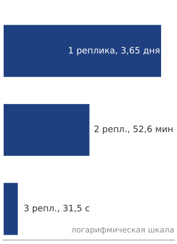

*Резервирование превращает дни простоя в секунды.*

#### Стратегии репликации

<a id="sec-fault-tolerance-reliability-reliability-replication-strategies-aaa2"></a>

Уравнение доступности говорит, сколько может дать резервирование; стратегия репликации определяет, чего оно стоит в обычном режиме работы и при переключении. При **активно-активной репликации** (Active-Active Replication) ([рисунок «Стратегии резервирования сервиса»](07_fault_tolerance.md#fig-serving-redundancy), слева) все реплики активно обслуживают запросы, поэтому мощность используется эффективно, но отказавшая реплика немедленно увеличивает нагрузку на выжившие. При **активно-пассивной репликации** (Active-Passive Replication) ([рисунок «Стратегии резервирования сервиса»](07_fault_tolerance.md#fig-serving-redundancy), справа) основная реплика обслуживает трафик, а резервные реплики простаивают, но готовы к работе: переключение упрощается ценой неиспользуемых ресурсов в обычном режиме.

<a id="fig-serving-redundancy"></a>


***Стратегии резервирования сервиса:** сравнение активно-активной и активно-пассивной репликации. Активно-активная схема (слева) распределяет нагрузку между тремя активными репликами, каждая получает примерно треть трафика; это максимизирует загрузку, но требует запаса мощности для поглощения отказов. Активно-пассивная схема (справа) держит резервные реплики простаивающими, но синхронизированными по сигналам жизни; это упрощает логику переключения ценой простаивающих ресурсов.*

Географическая репликация распространяет тот же выбор на регионы. Она защищает от отказов дата-центра или региональной сети, но запросы, направленные в далекие регионы, платят дополнительной задержкой. Многоуровневые схемы комбинируют несколько политик репликации сразу: периферийные кэши реплицируются ради задержки, региональные кластеры обслуживания — ради доступности, а глобальный первичный узел или слой координации сохраняет согласованность и актуальность.

#### Размещение реплик и домены отказа

<a id="sec-fault-tolerance-reliability-reliability-replica-placement-failure-domains-73a7"></a>

Эффективное резервирование требует размещать реплики в независимых доменах отказа. Разные машины переносят отказы отдельных машин; разные стойки переносят отказы на уровне стойки из-за питания или проблем с коммутатором верхнего уровня; разные зоны доступности переносят отказы секций дата-центра; а разные регионы — отказы целых дата-центров. Уровень независимости должен соответствовать требованию доступности и ограничению стоимости: региональная репликация дорога, потому что дублирует вычислительную мощность и мощность сети, но она необходима, когда региональный отказ не должен становиться видимым пользователю простоем.

Размещение лишь создает возможность восстановления. Системе обслуживания по-прежнему нужен управляющий контур, который замечает отказ, выводит затронутую реплику из трафика и сохраняет достаточно состояния, чтобы сервис для пользователя продолжал работать с ограниченной деградацией.

### Переключение на резерв

<a id="sec-fault-tolerance-reliability-reliability-failover-mechanisms-5ddd"></a>

Когда реплика отказывает, трафик нужно перенаправить на исправные реплики. Скорость и надежность этого переключения определяют, насколько отказы влияют на пользователей. Механизм раскладывается на три вопроса: как система определяет работоспособность, как слой маршрутизации реагирует на этот сигнал и что происходит с состоятельными сеансами, уже привязанными к отказавшей реплике.

#### Проверка работоспособности

<a id="sec-fault-tolerance-reliability-reliability-health-checking-a604"></a>

Проверки работоспособности решают, когда трафик должен переместиться, поэтому они должны оценивать живость, готовность и корректность вывода. Проверки живости подтверждают, что процесс запущен и отвечает, часто через простую HTTP-конечную точку, которая возвращает 200, а при отказе запускает перезапуск. Проверки готовности идут дальше: для обслуживания ML реплика не готова, пока не загружены веса модели, не инициализирован и не отвечает GPU, не завершен разогрев и не доступны зависимости вроде хранилищ признаков и кэшей. Проверки корректности вывода добавляют пробу правильности: известный вход прогоняется через модель, и проверяется ожидаемый выход, что позволяет поймать тихие отказы, когда процесс здоров, а ответ модели неверен.

Параметры проверки работоспособности задают компромисс между ложными срабатываниями и задержкой. Интервал проверки, например 5 с, управляет частотой опроса, тайм-аут 2 с определяет терпение, порог отказа из трех пропущенных проб помечает реплику как неработоспособную, а порог успеха из двух чистых проб возвращает ее в обслуживание.

#### Интеграция с балансировщиком нагрузки

<a id="sec-fault-tolerance-reliability-reliability-load-balancer-integration-2acd"></a>

Конструкция балансировщика нагрузки определяет, сколько контекста запроса слой маршрутизации может использовать при переключении. Балансировка L4 направляет по IP и порту, что просто и быстро. Балансировка L7 направляет по содержимому HTTP и gRPC, что позволяет более точную маршрутизацию. Сервисная сетка (service mesh) добавляет управление трафиком, наблюдаемость и безопасность вокруг этих решений маршрутизации.

Задержка переключения балансировщика зависит от частоты проверок работоспособности и логики обнаружения отказов. Агрессивные настройки ускоряют переключение, но увеличивают число ложных срабатываний: здоровые реплики помечаются как неисправные во время временных сбоев.

#### Привязка сеанса и переключение состоятельного сеанса

<a id="sec-fault-tolerance-reliability-reliability-session-affinity-stateful-failover-27b2"></a>

Для состоятельного обслуживания **привязка сеанса** (Session Affinity) направляет все запросы внутри сеанса на одну и ту же реплику. Балансировщики поддерживают соответствие «сеанс — реплика» через «липкие» сеансы, реализованные с помощью cookie, заголовков или хеширования IP-адресов. Выбор переключения состояния затем определяет компромисс между скоростью восстановления и согласованностью, а также операционной сложностью: потеря состояния принимает деградацию качества, восстанавливая состояние с нуля; периодическое сохранение записывает состояние сеанса для восстановления; репликация копирует состояние на резервную реплику; а распределенные хранилища состояния переносят состояние сеанса во внешние системы, такие как Redis или Memcached.

Выбор зависит от размера состояния, частоты обновлений и влияния потери состояния на качество. В [таблице «Подходы к переключению состоятельного сеанса»](07_fault_tolerance.md#tbl-stateful-failover) сведены компромиссы четырех распространенных подходов:

| **Подход**                  | **Задержка восстановления** | **Согласованность** | **Операционная сложность** |
|:----------------------------|:--------------------:|:---------------:|:--------------------------:|
| **Потеря состояния**        |         Быстро       |       Нет       |            Низкая          |
| **Контрольные точки**       |        Средняя       |     В конечном счете | Средняя               |
| **Синхронная репликация**   |         Быстро       |      Строгая    |            Высокая         |
| **Распределенное состояние** |         Быстро       |   Настраиваемая |           Средняя          |

<a id="tbl-stateful-failover"></a>

***Подходы к переключению состоятельных сеансов:** задержка восстановления, согласованность и операционная сложность отличают четыре подхода к переключению состояния сеанса. Потеря состояния — самый простой вариант; контрольные точки и распределенное состояние допускают более слабую согласованность; синхронная репликация сохраняет строгую согласованность ценой более высоких операционных расходов.*

### Специфичное для модели отказоустойчивость обслуживания

<a id="sec-fault-tolerance-reliability-reliability-modelspecific-serving-fault-tolerance-3245"></a>

Различия обслуживания для разных моделей следуют из того, какое состояние дорого потерять и как быстро пользователю нужен ответ. Поэтому политический вопрос — это бюджет потерь состояния: какое состояние можно пересоздать, какое нужно реплицировать и какое можно временно деградировать, не нарушая условий продукта. [Таблица «Инварианты состояния восстановления обслуживания»](07_fault_tolerance.md#tbl-serving-recovery-state-invariants) сопоставляет этот вопрос трем распространенным режимам.

| **Нагрузка обслуживания** | **Дорогое в потере состояние** | **Политика отказоустойчивости** | **Путь деградации** |
|:---------------------|:-----------------------------------------------|:------------------------------------------------------------------------------------------------------------|:-----------------------------------------------------------------------|
| Диалог с LLM         | KV-кэш, контекст беседы, префиксное состояние  | Реплицировать или сохранять в контрольных точках состояние сеанса высокой ценности; пересчитывать только если позволяет бюджет задержки. | Восстановить по стенограмме, переиспользовать кэшированные префиксы или запросить повтор. |
| Рекомендации         | Свежие признаки пользователя, признаки товаров, эмбеддинги | Реплицировать хранилища признаков, кэшировать горячие признаки и отслеживать актуальность как сигнал надежности. | Отдавать устаревшие или признаки по умолчанию с измеренной потерей качества. |
| Сервис компьютерного зрения | Состояние предобработки, здоровье устройства, входные данные на периферии | Повторять бессостоятельные запросы на исправных репликах и закрываться при сбоях предобработки или проверки ускорителя. | Использовать более компактную локальную модель, отложить предсказание или вернуть результат с низкой уверенностью. |

<a id="tbl-serving-recovery-state-invariants"></a>

***Инварианты состояния восстановления обслуживания:** отказоустойчивость обслуживания начинается с состояния, потеря которого меняет качество, видимое пользователю. LLM защищают живой контекст, рекомендательные системы — актуальность признаков, а сервисы компьютерного зрения — корректность предобработки и устройства.*

Размер KV-кэша[^fn-kv-cache-resilience] может быть значительным (гигабайты для длинных контекстов по слоям внимания). Потеря KV-кэша требует пересчета всех предыдущих реплик, что может занять секунды или минуты.

[^fn-kv-cache-resilience]: **KV-кэш**: хранит проекции ключей и значений для всех предыдущих токенов во всех слоях внимания; объем масштабируется как $2 \times N_L \times H_{\text{KV}} \times S \times d_{\text{head}} \times \text{байт}$. Для модели класса Llama на 70 млрд параметров с 80 слоями, 8 головами ключей-значений, контекстом 128 тыс. токенов, размерностью головы 128 и хранением в BF16 KV-кэш составляет около 43 ГБ на одну беседу; при 64 независимых головах ключей-значений он составил бы около 344 ГБ. Потеря этого состояния при отказе заставляет заново пересчитать все предыдущие токены и превращает переключение за долю секунды в пересчет длиной в минуты, который нарушает соглашения об уровне обслуживания (SLA) по задержке.


*Длинная беседа несет десятки ГБ живого состояния.*

Выбор в обслуживании LLM обменивает задержку восстановления KV-кэша на накладные расходы памяти и хранилища. Простейшая стратегия — принять стоимость пересчета, восстанавливая KV-кэш по истории беседы после отказа, но это может превратить длинную беседу в перезапуск длиной в секунды или минуты. Сохранение KV-кэша в контрольных точках периодически записывает живое состояние и ограничивает объем пересчета, а репликация KV-кэша хранит резервную копию для быстрого переключения ценой дополнительной памяти. **Префиксное кэширование** (Prefix Caching) сужает состояние, которое нужно восстанавливать, храня общие системные подсказки и общий контекст отдельно, так что пересчета требует только специфичное для сеанса состояние. В виде сервисов **кэширования подсказок** (Prompt Caching), которые предлагают облачные провайдеры, этот подход хранит и переиспользует KV-кэш для общих префиксов, снижая и стоимость, и время восстановления после отказов.

Обслуживание рекомендаций защищает актуальность, а не непрерывность диалога. Рекомендации зависят от признаков пользователя и товаров из хранилищ признаков, поэтому недоступность хранилища может либо ухудшить качество ранжирования, либо полностью заблокировать рекомендации. Решение в обслуживании — это бюджет устаревания: реплицированные хранилища признаков сохраняют недавние признаки доступными между зонами, локальные кэши покрывают горячие признаки, откат к устаревшим признакам принимает измеренную потерю качества, а признаки по умолчанию позволяют сервису вернуть результат меньшего качества, когда поиск не удался. Признаки реального времени, например недавние действия пользователя, делают мониторинг актуальности частью отказоустойчивости: конвейер, который продолжает отдавать старые признаки, операционно доступен, но семантически неверен. Большие таблицы эмбеддингов могут также стоять за выделенными сервисами эмбеддингов, которым нужен собственный план репликации и переключения.

Обслуживание компьютерного зрения обычно ближе к бессостоятельному краю спектра, потому что каждое изображение или кадр можно повторить на другой реплике. Эта простота не устраняет работу по отказоустойчивости; она меняет место проверок. Мониторинг здоровья GPU должен убирать реплики с тепловым троттлингом или ошибками памяти до того, как они вернут искаженные результаты, а предобработка должна закрываться при сбоях изменения размера, кадрирования, преобразования цвета или нормализации. Для периферийного зрения основным режимом отказа может быть разрыв связи, а не падение реплики в дата-центре, поэтому система часто деградирует, используя более компактную локальную модель, откладывая несрочные предсказания или возвращая результат с меньшей уверенностью, пока не вернется связь с облаком.

Когда полная избыточность отказывает (например, периферийное устройство теряет связь или массовый всплеск трафика перегружает доступные реплики дата-центра), система не может просто упасть. Вместо этого она должна активно обменивать качество выхода на продолжение доступности; эта стратегия называется постепенной деградацией (graceful degradation).

<a id="sec-fault-tolerance-reliability-reliability-graceful-degradation-9122"></a>

## Постепенная деградация

Во время крупного регионального сетевого сбоя интернет-магазин внезапно теряет доступ к своему тяжелому кластеру рекомендаций с GPU-ускорением. Вместо того чтобы показывать пользователям пустые страницы или падать, сайт мгновенно переключается на заранее вычисленные общие популярные товары. Механизмы отказоустойчивости обслуживания, разобранные в разделе [«Отказоустойчивость обслуживания»](07_fault_tolerance.md#sec-fault-tolerance-reliability-reliability-serving-fault-tolerance-5375), направлены на сохранение полного сервиса, но постепенная деградация определяет, что происходит, когда эти защиты перегружены.

> **Постепенная деградация**
>
> ***Постепенная деградация*** — это стратегия отказоустойчивости, при которой система реагирует на исчерпание ресурсов или отказ компонента, намеренно снижая качество сервиса (переходя на меньшую модель, отдавая кэшированные результаты или возвращая частичные выходы), вместо того чтобы полностью отказать и сохраняя измеримую доступность при сниженных возможностях.
>
> 1. **Значение**: постепенная деградация превращает риск полного простоя в управляемое снижение качества. Система рекомендаций, которая при отказе GPU переходит с ранжирующей модели на 7 млрд параметров на резервную модель коллаборативной фильтрации, может снизить показатель кликабельности на 8–15 %, но сохраняет доступность запросов вместо того, чтобы превращать каждый затронутый запрос в ошибку. Инженерный расчет меняется: вместо полной длительности простоя считается измеренная потеря качества во время отката.
> 2. **Отличие**: в отличие от полного отказа системы (когда сервис возвращает ошибки на все запросы), постепенная деградация обеспечивает управляемый переход по заранее определенной иерархии возможностей. Каждый уровень отката имеет известные характеристики точности, задержки и ресурсов, которые позволяют системе продолжать выполнять SLO при сниженном качестве.
> 3. **Типичная ошибка**: распространено заблуждение, что деградация происходит автоматически в хорошо спроектированных системах. Постепенная деградация требует явной предварительной инженерной работы: резервные модели должны быть предзагружены или предвычислены, логика переключения должна обнаруживать условие отказа и запускать переход без вмешательства человека, а каждый уровень деградации должен быть проверен на то, что он действительно выполняет свой сниженный SLO, прежде чем понадобится в продакшене.

### Измерения деградации

<a id="sec-fault-tolerance-reliability-reliability-degradation-dimensions-4b25"></a>

План деградации должен заранее назвать свойство сервиса, которым будут жертвовать, еще до начала инцидента. В [таблице «Измерения постепенной деградации»](07_fault_tolerance.md#tbl-graceful-degradation-dimensions) сведены основные рычаги. Таблица — это предынцидентный чек-лист проектирования, а не подсказка для мозгового штурма во время простоя: каждое жертвуемое свойство требует измеренного бюджета качества, условия активации и пути восстановления до наступления отказа.

| **Измерение**          | **Чем жертвует система**          | **Типичный откат**                                                                             |
|:-----------------------|:----------------------------------|:-----------------------------------------------------------------------------------------------|
| Качество               | Точность модели или качество ранжирования | Использовать более простую модель, например резервный коллаборативный фильтр для многобашенного рекомендателя. |
| Задержка               | Скорость ответа                   | Объединять больше запросов в батч, чтобы сохранить пропускную способность и качество модели под высокой нагрузкой. |
| Покрытие               | Полнота результатов               | Возвращать 10 лучших результатов поиска вместо 100.                                            |
| Актуальность           | Свежесть вычисленных результатов  | Отдавать кэшированных или устаревших кандидатов, например новостные рекомендации часовой давности во время сбоя. |
| Полнота признаков      | Богатство входных данных          | Использовать признаки содержимого, когда история пользователя или контекст реального времени недоступны. |

<a id="tbl-graceful-degradation-dimensions"></a>

***Измерения постепенной деградации:** планы деградации выбирают, какое свойство сервиса можно уменьшить, по-прежнему возвращая полезный ответ. Заранее названное измерение не позволяет системе трактовать каждый отказ как бинарное решение «обслужить или упасть».*

Эти измерения не взаимозаменяемы. Поисковый продукт может пожертвовать покрытием, возвращая меньше результатов, сохраняя при этом актуальность; рекомендатель может пожертвовать актуальностью, отдавая кэшированных кандидатов, сохраняя задержку; а интерактивный ассистент может пожертвовать качеством, используя меньшую модель, и сохранить сеанс живым. Правильный откат поэтому зависит от нагрузки: он следует за тем свойством, временная потеря которого меньше всего вредит приложению и путь восстановления которого можно проверить до инцидента.

### Стратегии постепенной деградации

<a id="sec-fault-tolerance-reliability-reliability-graceful-degradation-strategies-e85e"></a>

Измерения из [таблицы «Измерения постепенной деградации»](07_fault_tolerance.md#tbl-graceful-degradation-dimensions) становятся операционными, только когда сервис связывает каждое жертвуемое свойство с конкретным механизмом отката. Лестница стратегий начинается с отката модели, когда основной путь вывода слишком дорог или недоступен, затем переходит к откату признаков, когда качество входа падает, и наконец к сбросу нагрузки, когда спрос превышает мощность и система должна сохранить самые ценные запросы в первую очередь.

#### Откат модели

<a id="sec-fault-tolerance-reliability-reliability-model-fallback-bc6e"></a>

Откат модели превращает качество в явный рычаг доступности, поддерживая несколько версий модели с разными требованиями к ресурсам. **Основная модель** (Primary Model) обеспечивает полную возможность по самой высокой цене в ресурсах, **вторичная модель** (Secondary Model) снижает возможности и потребление ресурсов, **третичная модель** (Tertiary Model) сохраняет минимальную возможность, а **статический откат** (Static Fallback) отдает предвычисленные значения по умолчанию без какого-либо вывода. Когда основной путь недоступен или перегружен, политика спускается ровно настолько, насколько требует давление на ресурсы, а затем возвращается вверх, когда основной путь снова здоров.

Каскад классификации изображений делает компромисс конкретным. Основной путь может использовать ViT-Large с 307 млн параметров и точностью top-1 на ImageNet 88 %, при нагрузке откатиться к EfficientNet-B4 с 19 млн параметров и точностью 83 %, а затем снова откатиться к MobileNet-V3-Large с 5,4 млн параметров и точностью 75 %, когда по карману остается только минимальная классификация. Если даже этот путь не может выполнить SLO, сервис может вернуть кэшированные метки, грубую категорию или сообщение «классификация недоступна», вместо того чтобы бесконечно блокировать запрос. Чтобы эта лестница была реальной, а не декларативной, продакшен-система должна держать развернутыми несколько моделей, направлять запросы на подходящий уровень, отслеживать частоту отката и измерять влияние каждого уровня на качество.

Системы рекомендаций и ранжирования используют тот же паттерн, когда сложная модель глубокого обучения при отказе основного обслуживания откатывается к списку популярных товаров из top-n, линейному ранжировщику или кэшированному ответу. Сложные модели часто борются за последние доли точности, тогда как простые эвристики дают основную часть пользы, поэтому путь отката нужно отслеживать как сигнал качества первого класса, а не считать молчаливым переключением при отказе. Иначе продукт выглядит здоровым, а качество незаметно обменивается на доступность.

#### Откат признаков

<a id="sec-fault-tolerance-reliability-reliability-feature-fallback-0730"></a>

Откат признаков управляет тем, сколько качества входа модель может потерять, прежде чем запрос придется блокировать. Когда извлечение признаков отказывает, вместо недостающих признаков пользователя или товара могут подставляться предвычисленные значения по умолчанию на уровне популяции: рекомендатель может использовать средний эмбеддинг пользователя, значения по умолчанию для товаров на уровне жанра или последнее кэшированное значение для сигнала реального времени. Когда значения по умолчанию слишком слабы, система может вычислить приближенные признаки из доступных данных, например демографическое сходство при отсутствии истории пользователя, текстовые эмбеддинги при отсутствии атрибутов товара или временные значения по умолчанию при отсутствии контекста.

Ключевой шаг проектирования — ранжирование признаков по их вкладу в качество предсказания. В [таблице «Уровни постепенной деградации признаков»](07_fault_tolerance.md#tbl-feature-degradation-tiers) описана четырехуровневая политика, в которой критичные признаки блокируют запрос, важные используют значения по умолчанию, полезные — кэшированные значения, а необязательные можно опустить с ограниченным влиянием на качество:

| **Уровень**     | **Примеры признаков**        | **Действие при отсутствии** | **Влияние на качество** |
|:----------------|:----------------------------:|:-------------------:|:--------------------:|
| **Критичный**   | ID пользователя, ID товара   | Блокировать запрос  | Обслужить нельзя     |
| **Важный**      | История пользователя, атрибуты товара | Использовать значения по умолчанию | Потеря качества 5–10 % |
| **Полезный**    | Контекст реального времени   | Использовать кэшированные | Потеря качества 2–5 % |
| **Необязательный** | Вторичные сигналы         | Опустить            | Потеря качества $< 2\%$ |

<a id="tbl-feature-degradation-tiers"></a>

***Уровни постепенной деградации признаков:** признаки классифицированы по важности для качества предсказания, с соответствующим ответом, когда каждый уровень недоступен. Критичные признаки полностью блокируют запрос; нижние уровни позволяют системе откатиться к значениям по умолчанию, кэшированным значениям или пропуску с ограниченным влиянием на качество. Уровни превращают бинарный вопрос «признак доступен или нет» в четырехступенчатую лестницу деградации.*

Когда деградации признаков недостаточно, чтобы поддерживать стабильность системы при экстремальной нагрузке, инфраструктура обслуживания должна начать активно сбрасывать запросы.

#### Сброс нагрузки

<a id="sec-fault-tolerance-reliability-reliability-load-shedding-8476"></a>

Сброс нагрузки защищает систему, жертвуя выбранными запросами, прежде чем перегрузка распространится на все запросы. Случайный сброс — самая простая политика: отбрасывается доля входящих запросов, а мощности хватает на остальные. Ее слабость в том, что она считает все запросы одинаково ценными. Сброс по приоритетам превращает деградацию качества обслуживания в явную политику: сначала обслуживаются премиальные пользователи, затем бесплатные, сначала запросы, приносящие выручку, затем аналитические, а интерактивный трафик раньше фоновых пакетных задач. Система все равно деградирует, но делает это по заранее объявленному контракту обслуживания, а не в том порядке, в котором заполнится очередь.

**Управление допуском** (Admission Control) применяет ту же идею на входных точках системы. Оно отклоняет запросы, которые превысили бы мощность, вместо того чтобы принимать работу, которая ухудшит все запросы, уже находящиеся в системе. **Размыкатели цепи** (circuit breakers)[^fn-circuitbreaker-fault-tolerance] защищают зависимые сервисы, быстро отказывая, когда реплика модели, хранилище признаков или вспомогательный сервис нездоровы.

[^fn-circuitbreaker-fault-tolerance]: **Размыкатель цепи** (circuit breaker): назван по электрическому устройству защиты, которое отключает питание при перегрузке. В программной инженерии шаблон (популяризован Майклом Найгардом, Nygard, 2007) оборачивает вызовы сервиса и «размыкается» после порога отказов, быстро отказывая вместо ожидания мертвой зависимости. Для обслуживания ML это не дает одной падающей реплике модели или хранилищу признаков исчерпать пулы соединений и вызвать каскадные отказы по всему парку вывода.

Размыкатели цепи работают в трех состояниях: замкнутом (нормальная работа), разомкнутом (быстрый отказ для предотвращения исчерпания ресурсов) и полуоткрытом (проверка восстановления). На [рисунке «Состояния размыкателя цепи»](07_fault_tolerance.md#fig-circuit-breaker) показано, как эти переходы состояний одновременно защищают систему от каскадных отказов и автоматически проверяют, улучшились ли условия.

<a id="fig-circuit-breaker"></a>


***Состояния размыкателя цепи:** размыкатель цепи защищает систему от каскадного отказа. Замкнут: нормальная работа. Разомкнут: порог ошибок превышен, все запросы быстро отказывают, чтобы предотвратить исчерпание ресурсов. Полуоткрыт: после тайм-аута несколько запросов пропускаются для проверки здоровья зависимости. Успех возвращает в замкнутое состояние, неудача — в разомкнутое.*

#### Реализация постепенной деградации

<a id="sec-fault-tolerance-reliability-reliability-graceful-degradation-implementation-1aa5"></a>

Трехсостоянийный цикл не дает одной падающей зависимости занять весь пул соединений системы: разомкнутое состояние быстро отказывает, а полуоткрытое проверяет восстановление, прежде чем вернуть полный трафик. Реализация начинается с превращения лестницы деградации в управляющий контур. Перцентили хвостовой задержки показывают, когда пользователи ощущают задержку, частоты ошибок показывают, какая зависимость отказывает, загрузка CPU/GPU/памяти показывает, насыщена ли система, а глубина очереди — принимает ли сервис работу быстрее, чем может ее завершить. Эти сигналы здоровья выбирают, когда входить в каждый уровень деградации и выходить из него.

**Триггеры деградации** (Degradation triggers) задают условия, которые активируют деградацию. В [листинге «Прогрессивные триггеры деградации»](07_fault_tolerance.md#lst-degradation-triggers) показаны три распространенных условия, которые постепенно активируют механизмы отката по задержке, частоте ошибок и здоровью хранилища признаков.

<a id="lst-degradation-triggers"></a>

***Прогрессивные триггеры деградации:** условия, которые активируют постепенную деградацию по хвостовой задержке, частоте ошибок и здоровью хранилища признаков. Каждый триггер активирует свой механизм отката, соответствующий обнаруженной проблеме.*

```python
# Отслеживаем хвостовую задержку для влияния на пользователей
if p99_latency > threshold:
    activate_model_fallback()  # Переключиться на более быструю и простую модель

# Отслеживаем частоту ошибок, чтобы обнаружить сбои зависимостей
if error_rate > threshold:
    activate_circuit_breaker()  # Быстро отказывать, предотвращая каскад

# Замедление хранилища признаков ухудшает качество рекомендаций
if feature_store_latency > threshold:
    activate_feature_fallback()  # Использовать кэшированные или значения по умолчанию
```

Деградация должна нарастать постепенно по мере ухудшения условий, а не переключаться с одного обрыва. Система может постепенно повышать долю отката по мере роста нагрузки, а затем требовать устойчивого улучшения, прежде чем трафик вернется к путям с большими возможностями. Гистерезис предотвращает колебания между основным и резервным режимами, когда сервис находится около порога.

### Мониторинг деградации и оповещения

<a id="sec-fault-tolerance-reliability-reliability-degradation-monitoring-alerting-87c2"></a>

Поскольку постепенная деградация меняет качество на доступность, мониторинг должен делать этот обмен видимым, а не позволять системе выглядеть здоровой, пока она отдает результаты меньшей точности. Поверхность мониторинга должна показывать, сколько качества сервиса было поставлено на кон. В [таблице «Карта действий мониторинга деградации»](07_fault_tolerance.md#tbl-degradation-monitoring-action-map) эта поверхность превращается в карту действий: доля отката показывает, как часто снижалось качество модели; доля признаков по умолчанию показывает потерю качества входа; частота сбросов показывает защиту мощности; а разрыв качества между основным и резервным путем показывает, остается ли деградированный путь приемлемым.

| **Сигнал**                          | **Раскрываемый компромисс качества**           | **Правило эскалации**                                                         | **Вопрос после инцидента**                       |
|:------------------------------------|:--------------------------------------------|:------------------------------------------------------------------------------|:-------------------------------------------------------|
| Доля запросов на резервной модели   | Возможность модели снижена ради сохранения обслуживания | Устойчивая активация дольше 5 минут становится предупреждением.               | Сохранил ли откат достаточно пользы для пользователя?  |
| Доля запросов с признаками по умолчанию | Богатство входа снижено из-за отставания зависимостей | Серьезная деградация, затрагивающая более 50 % запросов, становится критичной. | Какой зависимости признаков нужна репликация или кэширование? |
| Частота сброшенных запросов         | Покрытие снижено для защиты сервиса           | Любой рост после открытия размыкателя запускает расследование мощности.       | Был ли допуск достаточно ранним, чтобы предотвратить каскад? |
| Разрыв качества основной и резервной моделей | Качество продукта потеряно во время инцидента | Деградация дольше 1 часа эскалируется, даже когда метрики доступности выглядят здоровыми. | Остается ли путь отката допустимым пользовательским опытом? |

<a id="tbl-degradation-monitoring-action-map"></a>

***Карта действий мониторинга деградации:** постепенная деградация безопасна только тогда, когда компромисс качества наблюдаем. Каждый сигнал связывает деградированный режим обслуживания с эскалацией и вопросом после инцидента, которые не дают качеству потеряться незаметно.*

После события анализ после инцидента должен определить первопричину, оценить эффективность отката, измерить влияние на пользователей и бизнес и определить улучшения, которые предотвращают повторение. Безопасное внедрение этих механизмов отката требует глубокой видимости состояния системы во время работы. Когда сложный конвейер рекомендаций начинает деградировать, операторы должны быстро определить, какой микросервис отказывает, и эта диагностика зависит от распределенной отладки и наблюдаемости.

<a id="sec-fault-tolerance-reliability-reliability-distributed-debugging-observability-1a7f"></a>

## Распределенная отладка и наблюдаемость

В 2:00 ночи задержка флагманского генеративного API скачет с 200 мс до 5 секунд, но метрики CPU, памяти и сети выглядят совершенно нормально. Чтобы решить, сбрасывать ли нагрузку, перезапускать реплики или постепенно деградировать, нужно точно знать, где запрос застревает среди сотен микросервисов. Распределенная отладка и наблюдаемость дают диагностическую способность, необходимую для поиска этих невидимых узких мест.

<a id="sec-fault-tolerance-reliability-reliability-distributed-ml-systems-hard-debug-8d8a"></a>

### Почему распределенные ML-системы трудно отлаживать

Отладка распределенного ML трудна, потому что доказательства, нужные для восстановления, разбросаны по времени, состоянию, масштабу и поведению модели. Распределенные системы демонстрируют недетерминированное поведение[^fn-heisenbug-ml-concurrency] из многих источников. Вариации сетевого времени меняют порядок выполнения, различия в планировании потоков меняют гонки, порядок выполнения ядер GPU меняется от запуска к запуску, а порядок операций с плавающей запятой меняет результаты. Ошибка, которая проявляется в одном выполнении, может не воспроизводиться в последующих. Эти «хайзенбаги» (Heisenbugs) кажутся исчезающими, когда за ними наблюдают.

[^fn-heisenbug-ml-concurrency]: **Хайзенбаг** (Heisenbug): термин возник в культуре хакеров около 1983 года и был формализован Джимом Греем в его анализе отказов компьютеров 1985 года; это игра слов с принципом неопределенности Гейзенберга. Ошибка исчезает под наблюдением, потому что инструментирование меняет тайминги. В распределенном обучении ML это особенно коварно: вставка логирования градиентов меняет тайминги коллективных операций NCCL и маскирует ту самую гонку, которая вызвала тихую порчу.

Частичные отказы превращают этот недетерминизм в задачу восстановления. В отличие от одномашинных систем, где отказы обычно полные, распределенные системы переживают частичные отказы, когда одни компоненты отказывают, а другие продолжают работать, и взаимодействие рабочих и отказавших компонентов порождает сложные режимы отказа. Масштаб затем делает ручной осмотр нежизнеспособным методом отладки: при тысячах компонентов автоматизированные инструменты должны фильтровать огромные потоки телеметрии и выделять несколько сигналов, которые объясняют инцидент. ML-системы добавляют к той же диагностической задаче поведение модели: тихое падение точности дает неверные результаты без ошибок, численные проблемы вроде NaN и бесконечности распространяются по вычислению, ошибки, зависящие от данных, проявляются только для определенных входов, а обучение вызывает ожидаемые изменения поведения, которые могут походить на ошибки.

### Опоры наблюдаемости

<a id="sec-fault-tolerance-reliability-reliability-observability-pillars-0e45"></a>

Наблюдаемость полезна, только когда связывает симптом с действием: сбросить нагрузку, перезапустить реплику, откатить контрольную точку или постепенно деградировать. Представим, что сервис рекомендаций внезапно нарушает SLO по задержке, пока реплики модели все еще сообщают о здоровой загрузке GPU. Метрики устанавливают время и масштаб симптома, трассировки показывают, какой спан сервиса расходует бюджет запроса, а журналы объясняют, что произошло внутри этого сервиса в момент начала каскада. На [рисунке «Три опоры наблюдаемости»](07_fault_tolerance.md#fig-observability-three-pillars) показаны эти три типа доказательств, но рабочее правило — корреляция: ни один сигнал не достаточен, если его нельзя связать с тем же запросом, версией модели, версией признаков и событием развертывания.

<a id="fig-observability-three-pillars"></a>

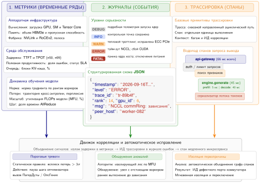

***Три опоры наблюдаемости:** диагностика отказов парка требует коррелировать три типа сигналов. Метрики показывают, *когда* и *где* возникает проблема (например, падает загрузка GPU). Журналы дают *что* через контекст события (например, исключение нехватки памяти). Трассировки дают *почему*, связывая события по распределенному жизненному циклу (например, определяя запрос, который вызвал скачок памяти).*

Метрики — первое доказательство, потому что они сжимают поведение парка во временные ряды, которые могут запускать действие. В ML-парках полезные метрики охватывают инфраструктурные сигналы, такие как загрузка CPU и GPU, выделение памяти, пропускная способность сети и ввод-вывод хранилища; прикладные сигналы, такие как частота запросов, перцентили задержки, число ошибок, глубина очередей и доля попаданий в кэш; и ML-специфичные сигналы, такие как задержка вывода по моделям, загрузка батчей, задержка извлечения признаков, актуальность признаков и распределения предсказаний для обнаружения дрейфа. Поток метрик становится инфраструктурой отказоустойчивости, только когда тревога соотносится с решением о восстановлении. Высокая p99-задержка может запустить сброс нагрузки, падающая доля попаданий в кэш — запуск резервных признаков, а внезапный сдвиг распределения предсказаний может остановить развертывание до того, как оно испортит решения, видимые пользователю.

Журналы дают контекст события, который метрика намеренно отбрасывает. Структурированное логирование (Structured Logging) использует форматы вроде JavaScript Object Notation (JSON) с согласованными полями, поэтому инструменты инцидентов могут искать по сервису, запросу, версии модели, GPU, хранилищу признаков или идентификатору трассировки. В [листинге «Структурированная запись журнала»](07_fault_tolerance.md#lst-structured-log-entry) показан отказ выделения памяти GPU, который записывает как локальный контекст отказа, так и идентификаторы трассировки, нужные для связи события с распределенными метриками и спанами.

<a id="lst-structured-log-entry"></a>

***Структурированная запись журнала JSON:** структурированная запись журнала об отказе выделения памяти GPU, включающая идентификаторы трассировки и спана для корреляции с распределенными трассировками и метрики ресурсов для диагностики.*

```json
{
  "timestamp": "2024-01-15T10:23:45.123Z",
  "level": "ERROR",
  "service": "inference-server",
  "trace_id": "abc123",
  "span_id": "def456",
  "message": "Ошибка выделения памяти GPU",
  "gpu_id": 3,
  "requested_bytes": 4294967296,
  "available_bytes": 2147483648
}
```

Для отказоустойчивости важное свойство логирования — согласованная корреляция, а не конкретный бэкенд. Уровни журналирования должны согласованно сопоставлять инциденты с эскалацией во всех компонентах, но система восстановления больше зависит от того, могут ли операторы искать события по тем же идентификаторам запроса, трассировки, версии модели, версии признаков и развертывания, которые встречаются в метриках и спанах. Агрегация журналов поэтому полезна, потому что сохраняет связь между локальным контекстом отказа и симптомами по всему парку.

Трассировки показывают, где задержка или отказ распространились по распределенным компонентам. **Трассировка** (Trace) — это сквозной путь запроса, **спан** (Span) — одна операция на этом пути, а **распространение контекста** (Context Propagation) переносит идентичность трассировки через границы сервисов. Трассировка через конвейер ML-вывода показывает, как складываются спаны:

```text
Трасса: user-request-12345
|-- Спан: api-gateway (5 мс)
|   `-- Спан: auth-service (2 мс)
|-- Спан: feature-service (15 мс)
|   |-- Спан: user-feature-lookup (8 мс)
|   `-- Спан: item-feature-lookup (12 мс)
|-- Спан: inference-service (45 мс)
|   |-- Спан: preprocessing (3 мс)
|   |-- Спан: model-inference (40 мс)
|   `-- Спан: postprocessing (2 мс)
`-- Спан: response-formatting (1 мс)
Итого: 66 мс
```

OpenTelemetry предоставляет стандартный API для распределенной трассировки (Distributed Tracing). Такие бэкенды, как Jaeger, Zipkin или облачные сервисы трассировки, хранят и визуализируют трассировки. Долговечное требование состоит не в конкретном бэкенде трассировки, а в сохранении достаточного контекста, чтобы ответить, находится ли отказ в маршрутизации запроса, извлечении признаков, выполнении модели, постобработке или в зависимости вне сервиса модели.

### Специфичная для ML отладка

<a id="sec-fault-tolerance-reliability-reliability-mlspecific-debugging-27d5"></a>

Операционных сигналов недостаточно, когда вычисление численно корректно, но неверно для модели. ML-системам также нужны специализированные возможности отладки.

#### Численная отладка

<a id="sec-fault-tolerance-reliability-reliability-numerical-debugging-ee2a"></a>

Численная отладка нацелена на отказы, когда тензоры остаются корректными объектами, но содержат недопустимые значения. Обнаружение NaN (NaN Detection)[^fn-nan-gradient-propagation] необходимо, потому что значения NaN незаметно распространяются через все последующие вычисления. В [листинге «Обнаружение NaN»](07_fault_tolerance.md#lst-nan-detection) показана минимальная проверка, которая ловит порчу до того, как она дойдет до пользователей.

[^fn-nan-gradient-propagation]: **Распространение NaN** (NaN propagation): стандарт IEEE 754 задает, что любая арифметическая операция с NaN дает NaN, поэтому одно NaN в вычислении одного градиента незаметно портит каждое последующее обновление параметров. Частые причины в обучении ML — деление на ноль в слоях нормализации (batch norm с нулевой дисперсией), логарифм неположительных значений и переполнение FP16 до бесконечности. Без пошаговой проверки NaN весь запуск обучения может выдать модель, полную весов NaN, раньше чем сработает какой-либо сигнал мониторинга.

<a id="lst-nan-detection"></a>

***Обнаружение NaN:** проверка выходов модели на значения NaN не дает тихой порче распространиться к потребителям. Журналирование хеша входа позволяет воспроизвести ошибку при диагностике.*

```python
# Проверяем тензор на значения NaN
# (распространение из любого поврежденного вычисления)
if torch.isnan(output).any():
    log.error("Обнаружено NaN в выходе", input_hash=hash(input))
    # Записываем хеш входа для воспроизводимости, затем откат или быстрый отказ
```

Во время обучения статистики градиентов делают численные сбои видимыми до того, как они испортят весь запуск. Норма градиента выявляет взрыв или затухание, распределение градиентов выявляет аномалии, а послойные градиенты указывают на проблемные слои.

Смешанная точность (mixed-precision) обучения[^fn-mixedprecision-fault-tolerance] может вносить численные проблемы. Следите за корректировками масштаба потерь, которые указывают на антипереполнение, за переполнением градиентов за пределы диапазона FP16 и за несогласованностью между результатами FP16 и FP32.

[^fn-mixedprecision-fault-tolerance]: **Численные проблемы смешанной точности**: динамический диапазон FP16 охватывает лишь от $6 \times 10^{-8}$ до 65 504, тогда как у FP32 от $1{,}2 \times 10^{-38}$ до $3{,}4 \times 10^{38}$. Масштабирование потерь (умножение потерь на 1 024 перед обратным распространением с последующим делением градиентов) предотвращает антипереполнение, но переполнение по-прежнему запускает автоматический пропуск шагов, что тратит вычисления. BF16 смягчает это, совпадая с диапазоном экспоненты FP32 ценой уменьшенной точности мантиссы: численное разрешение обменивается на стабильность обучения.

#### Отладка данных и проверка

<a id="sec-fault-tolerance-data-debugging-validation"></a>

Ошибки в данных выглядят как правдоподобные, но неверные входы, поэтому отладка должна проверять семантическую корректность на каждой границе конвейера в дополнение к численной корректности. Проверки подтверждают ожидаемый формат, форму, диапазоны значений, обязательные поля и кодировку до того, как данные дойдут до модели, ловя некорректные примеры, пока сбой еще локален для входного пути.

Когда вход проходит эти статические проверки, системе нужны доказательства о поведении во времени. Мониторы распределений отслеживают дрейф признаков, изменения доли пропусков и выбросы по мере их появления, а инструментирование преобразований записывает промежуточные формы и статистики, чтобы команды могли сравнивать каждый этап с заведомо корректными данными. Вместе эти сигналы отделяют испорченный входной путь от численного сбоя внутри модели.

#### Обнаружение и анализ отстающих

<a id="sec-fault-tolerance-reliability-reliability-straggler-detection-analysis-6925"></a>

Диагностика отстающих спрашивает, какой компонент достаточно медлителен, чтобы стать узким местом, эквивалентным отказу. Один и тот же запрос может успешно выполняться на каждой реплике, но самая медленная реплика все равно определяет хвостовую задержку и может вынуждать повторы, которые под нагрузкой выглядят как отказ. Инструментирование тайминга операций (Operation-Level Timing) измеряет время каждой операции, что позволяет относить задержку к этапам конвейера. В [листинге «Тайминг на уровне операций»](07_fault_tolerance.md#lst-timing-instrumentation) операции обернуты в контекстные менеджеры, которые выдают метрики тайминга по каждому спану, что упрощает сравнение производительности между репликами.

<a id="lst-timing-instrumentation"></a>

***Тайминг на уровне операций:** инструментирование через контекстные менеджеры относит задержку к отдельным этапам конвейера и позволяет обнаруживать отстающих, сравнивая один и тот же спан на разных репликах.*

```python
# Оборачиваем операции в контекстные менеджеры тайминга для отнесения задержки
with timer("feature_lookup"):
    features = feature_store.lookup(
        ids
    )  # Часто узкое место по задержке
with timer("model_inference"):
    predictions = model(features)  # Время GPU, сравнивать между репликами
```

Сравнивайте тайминги компонентов между репликами с помощью анализа перцентилей. p50 показывает типичную производительность, а p99 — хвостовую задержку. Сравнение p99 между репликами выявляет воркеров, медленный путь которых стал узким местом всего парка.

Диагностика должна затем разделить первопричины, которые производят один и тот же симптом медленного воркера. Аппаратные проблемы включают тепловой троттлинг и ошибки памяти, перекос данных означает, что некоторые входы обрабатываются медленнее, конкуренция за ресурсы возникает, когда другие процессы потребляют ресурсы, а сетевые проблемы создают медленные соединения с хранилищами данных.

### Типичные паттерны отказов

<a id="sec-fault-tolerance-reliability-reliability-common-failure-patterns-3306"></a>

Опоры наблюдаемости позволяют обнаруживать повторяющиеся паттерны отказов, которые опыт работы с крупномасштабными ML-системами уже выявил. На [рисунке «Сигнатуры отказов обучения»](07_fault_tolerance.md#fig-training-failure-signatures) собраны самые распространенные сигнатуры потерь при обучении, каждая из которых требует собственной диагностики и ответа на восстановление.

#### Отказы обучения

<a id="sec-fault-tolerance-reliability-reliability-training-failures-bc3a"></a>

Сигнатура кривой потерь полезна, потому что связывает кривую с решением о восстановлении. Сначала показаны кривые на [рисунке «Сигнатуры отказов обучения»](07_fault_tolerance.md#fig-training-failure-signatures), а затем в [таблице «Карта ответов на отказы обучения»](07_fault_tolerance.md#tbl-training-failure-response-map) операционное соответствие делается явным: кривая рассматривается как доказательство для конкретного действия восстановления.

<a id="fig-training-failure-signatures"></a>

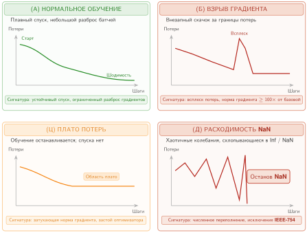

***Сигнатуры отказов обучения:** типичные паттерны потерь модели во времени, которые указывают на лежащие в основе системные или алгоритмические отказы. (A) Нормальное обучение. (B) Взрыв градиента. (C) Плато потерь. (D) Расходимость NaN. Автоматическое распознавание этих сигнатур необходимо для быстрого восстановления в автономных конвейерах обучения.*

| **Сигнатура**                 | **Вероятная интерпретация**                                                        | **Ответ на восстановление**                                                                          |
|:------------------------------|:----------------------------------------------------------------------------------|:-----------------------------------------------------------------------------------------------------|
| Всплеск с последующим восстановлением | Кратковременная аномалия входа или численности; сама кривая не определяет причину | Сохранить подозрительный батч и свидетельства шага, затем воспроизвести, прежде чем решать, продолжать ли. |
| Всплеск с последующим плато   | Нестабильность оптимизатора, испорченное состояние или устойчивый дефект пути данных | Приостановить, воспроизвести с заведомо исправной контрольной точки и сравнить свидетельства входа, оптимизатора и воркеров. |
| Постепенная расходимость      | Дрейф данных, численная нестабильность, испорченное состояние или рассинхронизация воркеров | Сравнить телеметрию по рангам и свидетельства оценки; изолировать аппаратуру, только если воспроизведение на нее указывает. |
| Зависание без ошибки          | Тупик коллективной операции или упавший воркер, блокирующий синхронизацию         | Использовать обнаружение по тайм-ауту и перезапустить или пересобрать группу воркеров.               |

<a id="tbl-training-failure-response-map"></a>

***Карта ответов на отказы обучения:** кривые потерь при обучении служат операционным доказательством только тогда, когда ведут к разным действиям восстановления. Карта ответов связывает каждую сигнатуру с классом отказа, который, вероятнее всего, ее объясняет, и с первым действием, которое должны предпринять операторы.*

Эти диагностические ответы защищают долгие пакетные нагрузки, но выявление отказов в системах, работающих с пользователями в реальном времени, требует совсем другого бюджета задержки.

#### Отказы обслуживания

<a id="sec-fault-tolerance-reliability-reliability-serving-failures-3322"></a>

Отказы обслуживания требуют того же соответствия «симптом — действие», но при гораздо более жестких ограничениях задержки. В [таблице «Карта ответов на отказы обслуживания»](07_fault_tolerance.md#tbl-serving-failure-response-map) типичные симптомы разделены по тому, что они показывают и что система обслуживания должна сделать первым делом.

| **Симптом**                  | **Вероятная интерпретация**                                                         | **Немедленный ответ**                                                                          |
|:-----------------------------|:------------------------------------------------------------------------------------|:-----------------------------------------------------------------------------------------------|
| Скачки задержки              | Конкуренция за ресурсы, сборка мусора, холодные кэши или перезагрузки модели         | Проверить размещение и мощность; повторяющиеся скачки обычно означают, что проблема уже не временная. |
| Рост частоты ошибок          | Отказ зависимости, изменение формата данных или ошибка модели                       | Немедленно расследовать, потому что ошибки накапливаются между зависимыми сервисами.             |
| Тихая деградация качества    | Дрейф модели, деградация признаков или сбой конвейера данных                        | Использовать мониторинг качества сверх стандартных операционных метрик.                         |
| Каскадный отказ              | Исчерпание тайм-аутов, истощение ресурсов или распространение ошибок от одного отказавшего компонента | Сработать размыкателями цепи и сохранить границы изоляции, прежде чем отказ распространится.    |

<a id="tbl-serving-failure-response-map"></a>

***Карта ответов на отказы обслуживания:** инциденты обслуживания нужно быстро классифицировать, потому что каждая диагностика конкурирует с бюджетом задержки, видимым пользователю. Таблица связывает каждый симптом с первым операционным ответом, а не считает все отказы обслуживания общими ошибками.*

Каскадные отказы особенно коварны, потому что первопричина скрыта симптомами, которые она порождает. Конкретная диагностика показывает, как три опоры наблюдаемости вместе прослеживают каскад до его источника.

> **Диагностика каскадного отказа**
>
> **Сценарий**: система рекомендаций переживает внезапные скачки задержки.
>
> **Диагноз**: три опоры наблюдаемости работают вместе, чтобы установить первопричину. Метрики показывают симптом: p99-задержка скачком выросла с 45 мс до 800 мс в 14:32, а частота ошибок поднялась с 0,1 % до 15 %. Трассировки выделяют узкое место: спан feature-service потребляет 700 мс вместо нормальных 12 мс, тогда как спан model-inference остается нормальным, 40 мс. Журналы определяют первопричину: журналы feature-service показывают повторяющиеся тайм-ауты соединения с кэшем эмбеддингов пользователей в 14:31, после которых идет лавина промахов кэша, потому что запросы обходят отказавший кэш и обращаются напрямую к базе эмбеддингов.
>
> **Системный урок**: отказ узла кэша вызвал лавину промахов кэша, которая перегрузила базу эмбеддингов и распространила задержку на все запросы. Исправление — размыкатель цепи на доступе к кэшу с откатом к эмбеддингам по умолчанию, когда кэш недоступен.

## Тематические исследования

<a id="sec-fault-tolerance-reliability-reliability-case-studies-927f"></a>

Опубликованные продакшен-системы делают урок масштаба конкретным: обнаружение отказов, сохранение состояния и наблюдаемость возвращаются в виде налога на контрольные точки, перестройки топологии, хаос-тестирования и эластичного восстановления. Примеры этого раздела опираются на публичные отчеты Meta, Google, Netflix и Microsoft, чтобы показать типичные инженерные паттерны. Операционные цифры следует рассматривать как сообщенные порядки величин, которые показывают инженерное давление, а не как универсальные константы. Первый пример — запуск обучения Open Pre-trained Transformer (OPT-175B) компании Meta на кластере из 992 GPU: десятки аппаратных отказов нужно было поглотить, не прерывая обучение.

### Крупномасштабное обучение LLM в Meta

<a id="sec-fault-tolerance-reliability-reliability-largescale-llm-training-fault-tolerance-f4aa"></a>

Обучение Open Pre-trained Transformer (OPT-175B) в Meta — хорошо документированное исследование физики отказов для больших заданий глубокого обучения (Zhang et al., 2022). Используя кластер из 992 GPU NVIDIA A100 непрерывно в течение двух месяцев, инженерная команда столкнулась со статистической неизбежностью: аппаратные компоненты будут отказывать, и будут отказывать часто. За время запуска обучения команда зафиксировала примерно 90 ручных перезапусков, вызванных аппаратными отказами (ошибки памяти ECC, сетевые проблемы NCCL/InfiniBand, потерянные GPU) и инцидентами стабильности обучения, наряду с заменой более 100 хостов (Meta AI Research, 2022). В режиме синхронного с параллелизмом данных обучения отказ одного GPU останавливает весь кластер, поэтому среднее время между отказами совокупной системы составляет долю надежности любого отдельного компонента. Для OPT-175B примерно два узла выходили из строя в день, что снижало эффективный системный MTBF до доли суток и требовало стратегии отказоустойчивости, которая рассматривала прерывание как норму, а не исключение.

Во время запуска OPT команда отслеживала прогресс через проверки свежести журналов обучения: публичный журнал фиксирует порог изменения файла в 15 минут, позднее смягченный до одного часа, как часть мониторинга перезапусков (Meta AI Research, 2022). Обнаружение было лишь половиной борьбы; критической инженерной задачей было минимизировать «налог на перезапуск» — время, потерянное на перезагрузку состояний модели и оптимизатора из постоянного хранилища. В начале проекта синхронная запись контрольных точек в удаленную распределенную файловую систему съедала почти 12 % общего эффективного времени обучения, что было непозволительными накладными расходами и отодвигало сроки проекта на недели. Чтобы с этим справиться, команда внедрила асинхронное сохранение контрольных точек: сериализация 350 ГБ состояния модели сначала выгружалась в память CPU, а затем фоново записывалась на диск, пока вычисления для следующего батча продолжались немедленно. Эта оптимизация снизила накладные расходы на контрольные точки до менее 3 % и вернула сотни GPU-часов.

Процедуры восстановления также должны были учитывать нехардверные отказы, в частности всплески потерь, связанные с численными нестабильностями. В отличие от события остановки, этот симптом делал недавнее состояние модели подозрительным и требовал диагностики, а не идентификации отказавшего устройства. Стратегия восстановления сочетала откат к последней исправной контрольной точке с вмешательством в оптимизатор: когда наблюдались переполнения градиентов или нижние границы масштаба потерь, команда возвращалась к более ранней контрольной точке и продолжала обучение с пониженной скоростью обучения (в итоге около двух третей от скорости, которую OpenAI использовала для GPT-3), чтобы стабилизировать траекторию (Meta AI Research, 2022). Эта двухуровневая устойчивость — обработка как физических отказов кремния, так и математической расходимости — позволила Meta поддерживать примерно 147 TFLOP/s на один A100 (около 50 % пика FP16) несмотря на ежедневные прерывания (Zhang et al., 2022). Долговечный урок OPT-175B состоит в том, что в масштабе компромисс между частотой контрольных точек и пропускной способностью обучения — центральная переменная, определяющая осуществимость: слишком частые контрольные точки тратят вычисления впустую, а слишком редкие рискуют потерять дни прогресса из-за одного отказа или недопустимого перехода состояния.

### Устойчивость подов TPU в Google

<a id="sec-fault-tolerance-reliability-reliability-google-tpu-pod-resilience"></a>

Суперкомпьютер Google TPUv4 использует принципиально иной архитектурный подход к отказоустойчивости, определяемый собственной фабрикой ICI и сетью оптических коммутаторов цепей, которые динамически перестраивают топологию. Один под TPUv4 содержит 4 096 микросхем, организованных в 64 «куба» по 64 микросхемы, причем каждый куб выстроен в трехмерную сетку $4{\times}4{\times}4$ (Zu et al., 2024). В этой архитектуре сеть фактически и есть компьютер: отказ одной микросхемы или одного оптического канала не просто уменьшает мощность на $1/4096$-ю часть — он создает дыру в топологии связи, которая зашла бы в тупик в синхронной сетке, нужной для коллективных операций вроде AllReduce.

Поэтому стратегия Google опирается на абстракцию срезов (slice), а не на ремонт на месте. Сеть OCS объединяет несколько исправных кубов в логические «срезы», размер которых соответствует потребностям задания обучения. Когда отказ обнаружен — через два программных компонента, `libtpunet` и `healthd`, которые отслеживают целостность каналов и здоровье машин, — система оркестрации не пытается обойти отказ внутри активного среза. Вместо этого плоскость управления вытесняет задание и перенастраивает фабрику OCS, чтобы подключить нагрузку к запасным исправным кубам в другом месте пода. Это трактует аппаратуру как неизменяемую инфраструктуру во время выполнения задания: вместо ремонта работающей топологии система воссоздает топологию той же формы из выживших исправных компонентов.

Количественный успех этого подхода измеряется системной доступностью. По всему продакшен-парку TPUv4 Google стратегия динамической перенастройки обеспечивает системную доступность 99,98 % и корректно обрабатывает аппаратные сбои, с которыми сталкивается примерно 1 % заданий обучения (Zu et al., 2024). Ежедневные частоты отказов компонентов малы в относительном выражении — 0,08 % машин TPU, 0,005 % кабелей ICI и 0,04 % блоков OCS, — но в масштабе парка они складываются в постоянный поток событий перенастройки, который плоскость управления должна поглощать, не нарушая пропускную способность обучения. Ключевой урок опыта TPU состоит в том, что для тесно связанных высокоскоростных систем попытка починить работающую топологию часто бесполезна; эффективнее считать куб атомарной единицей отказа и перенастраивать оптическую фабрику, собирая новый срез из выживших исправных компонентов.

### Хаос-инжиниринг Netflix для зависимостей обслуживания

<a id="sec-fault-tolerance-reliability-reliability-netflix-chaos-engineering"></a>

Пока устойчивость обучения касается долгих пакетных заданий, опубликованная работа Netflix по хаос-инжинирингу (Chaos Engineering) (Basiri et al., 2016) дает контраст со стороны обслуживания. Посылка простая, но операционно требовательная: поскольку продакшен-системы имеют много взаимодействующих зависимостей, команды должны проверять поведение в установившемся режиме, намеренно вводя отказы, а не ждать реальных инцидентов, чтобы выяснить, работают ли откаты.

Для ML-обслуживания та же дисциплина относится к хранилищам признаков, зависимостям сервиса моделей, кэшам и путям отката. Конечная точка модели может быть здоровой, в то время как сервис признаков медленный, устаревший или недоступный; если у системы нет проверенного отката, локальная проблема зависимости может превратиться в видимую пользователю задержку или деградацию рекомендаций. Хаос-тесты делают эти допущения исполняемыми: они вводят задержку, завершают зависимости или принудительно включают пути отката в контролируемых условиях.

Процедура восстановления для таких введенных отказов опирается на иерархии отката. Если основная модель глубокого обучения отказывает или не отвечает вовремя, система обслуживания может переключиться на более легкую модель, кэшированный ответ или простое значение по умолчанию на основе популярности. Урок для систем в том, что устойчивость ML-обслуживания — не статическое свойство, а непрерывная практика активной проверки: путь отката, который никогда не запускается, — это документация, а не отказоустойчивость.

### Отказоустойчивость Microsoft DeepSpeed

<a id="sec-fault-tolerance-reliability-reliability-deepspeed-fault-tolerance"></a>

Библиотека DeepSpeed от Microsoft иллюстрирует более узкий урок на уровне фреймворка: отказоустойчивость больших моделей должна координировать контрольные точки, шардированное состояние оптимизатора и управление ресурсами, а не полагаться на монолитный сценарий перезапуска. DeepSpeed предоставляет строительные блоки распределенного обучения и контрольных точек на основе ZeRO для моделей с более чем 100 миллиардами параметров (Rasley et al., 2020; DeepSpeed Developers, 2026). При ZeRO параметры модели, градиенты и состояния оптимизатора шардируются между всеми доступными GPU, а не реплицируются (Rajbhandari et al., 2020). Отказ одного узла поэтому может оставить без состояния шард, который он держал, и восстановление зависит от долговечных контрольных точек и оркестрации, которая знает, как восстановить или перераспределить эти шарды.

Вместо того чтобы подразумевать внутреннее исправление в памяти после каждой потери узла, поддерживаемая модель восстановления ориентирована на контрольные точки. Каждый ранг записывает свой шард состояния как часть распределенной контрольной точки, а после отказа задание перезагружает последнюю долговечную контрольную точку с топологией воркеров, выбранной запускающим механизмом и менеджером ресурсов. Universal Checkpointing расширяет эту модель, делая контрольные точки переносимее при выбранных изменениях параллелизма и топологии, но по-прежнему опирается на явную дисциплину сохранения и загрузки (DeepSpeed Developers, 2026). Если есть замещающие ресурсы, задание может возобновиться в исходном масштабе; если окружающий эластичный запускающий механизм возобновляет работу с меньшим числом воркеров, сценарий обучения все равно должен сохранять покрытие данных и инварианты размера батча или скорости обучения.

Урок систем поэтому не в том, что одна только DeepSpeed делает потерю воркера прозрачной. Он в том, что шардированные фреймворки обучения должны предоставлять примитивы контрольных точек и управления состоянием, которые планировщики могут компоновать в политики эластичного восстановления. Встраивание этих примитивов в слой фреймворка уменьшает объем индивидуальной инженерии восстановления, но сквозная гарантия по-прежнему получается из сочетания поддержки фреймворка, дисциплины контрольных точек и интеграции с планировщиком.

Эти тематические исследования выявляют три универсальных принципа:

- **Скорость обнаружения определяет стоимость восстановления**: мониторинг свежести журналов в Meta, автоматическая перенастройка ICI в Google и хаос-эксперименты Netflix показывают, что более быстрое обнаружение означает меньше потерянного состояния.
- **Атомарная единица отказа имеет значение**: Google перенаправляет коммуникационную фабрику, DeepSpeed восстанавливает шарды через контрольные точки, а Netflix проверяет резервные варианты сервиса. Каждая организация выбрала гранулярность, которая соответствует связности ее архитектуры.
- **Отказоустойчивость — это спектр, а не бинарный выбор**: от отката к контрольным точкам в Meta до иерархии постепенной деградации в Netflix системы реализуют несколько уровней защиты, каждый из которых обменивает точность на скорость.

Несмотря на эти паттерны, инженерные команды часто спотыкаются о распространенные заблуждения при проектировании устойчивых ML-систем.

## Заблуждения и ловушки

<a id="sec-fault-tolerance-reliability-reliability-fallacies-pitfalls-74b8"></a>

Команда инфраструктуры может потратить недели на укрепление слоя хранения против отказов дисков, а затем увидеть, как весь запуск обучения уничтожен тонкой программной ошибкой в распределенном бэкенде PyTorch. Отказоустойчивость распределенных ML-систем связана с контринтуитивной математикой и тонкими компромиссами, где привычная мудрость дата-центров часто не работает.

**Заблуждение:** *Аппаратные отказы — главная проблема.*

Эта интуиция происходит из традиционных систем, где доминируют отказы дисков, отключения питания и разрывы сети. В ML-системах аппаратные отказы — лишь одна часть более широкой смеси инцидентов.

Опыт крупномасштабных ML-систем указывает на более широкую смесь отказов, потому что ML-задания долгоживущие, с сохранением состояния и чувствительны к небольшим ошибкам управляющей плоскости. Аппаратные отказы по-прежнему важны, но программные ошибки, ошибки конфигурации, исчерпание ресурсов и межуровневые причины часто доминируют по числу инцидентов: некорректный путь к контрольной точке может сделать восстановление невозможным, несовместимая библиотека коллективных операций может зависнуть на всех рангах, слишком малый лимит общей памяти может уронить загрузчики данных, а устаревшая схема признаков может незаметно испортить обучение. Эти отказы не менее серьезны из-за того, что они «программные»; они могут уничтожить то же многодневное задание, которое должно было защищать аппаратное резервирование.

Сильные инвестиции в аппаратное резервирование при пренебрежении программной надежностью (проверка входных данных, постепенные развертывания, управление конфигурацией) оставляют без внимания многие важные режимы отказа. Самые надежные ML-системы считают программные ошибки неизбежными и проектируют защитно.

**Ловушка:** *Выбор интервала контрольных точек на глаз.*

Организации часто выбирают интервалы контрольных точек на основе ощущения «кажется правильным»: «каждый час кажется разумным» или «каждые 1 000 шагов». Формула Янга–Дэйли показывает, что эти интуиции часто ошибочны. Для кластера из 1 000 GPU из [таблицы «Масштабирование MTBF кластера»](07_fault_tolerance.md#tbl-cluster-mtbf-scaling), чей MTBF только для GPU равен 50 часам, при времени записи контрольной точки 5 минут:

$$ \tau_{\text{opt}} = \sqrt{2 \times 5 \times 3000} = \sqrt{30000} \approx 173 \text{ минуты} $$

Интуитивное «каждый час» далеко не близко: оно создает контрольные точки почти втрое чаще оптимального и тратит разницу на накладные расходы записи, которые не покупают никакой выгоды для восстановления. Если время записи контрольной точки вырастет до 15 минут (больше модель, медленнее хранилище), оптимальный интервал растянется до 300 минут, еще дальше от «каждых 15 минут», которые некоторые команды выбирают, чтобы «быть в безопасности». Слишком частые контрольные точки тратят больше вычислений, чем экономят. Количественный подход показывает, что интервалы, основанные на интуиции, часто отклоняются от оптимального в 2–3 раза в любую сторону.

**Заблуждение:** *Если каждый GPU надежен на 99,99 %, то и кластер из 10 000 GPU надежен на 99,99 %.*

Надежность не складывается усреднением, она перемножается. Для $N$ последовательных компонентов с доступностью $A$ при допущении независимости их отказов совокупная доступность равна $A^N$. При $A = 0{,}9999$ и $N = 10\,000$ вероятность того, что все $N$ одновременно работают, составляет $0{,}9999^{10\,000} \approx 0{,}37$: в 63 % времени хотя бы один GPU не работает. Надежность отдельного компонента необходима, но в масштабе парка далеко не достаточна. Системная отказоустойчивость (контрольные точки, эластичное восстановление, резервирование между доменами отказа) должна проектироваться явно, а не предполагаться возникающей из MTTF отдельных компонентов.

**Ловушка:** *Использование расчетов MTBF так, будто отказы независимы.*

Уравнение надежности $\text{MTBF}_{\text{system}} = \text{MTBF}_{\text{component}}/N$ предполагает, что отказы компонентов статистически независимы. В продакшене отказы коррелируют:

- **Общий домен питания**: отказ источника бесперебойного питания выводит из строя всю стойку.
- **Общий коммутатор**: отказ коммутатора верхнего уровня в стойке разбивает все подключенные GPU.
- **Общее программное обеспечение**: ошибка, вызванная определенным входом, одновременно отказывает все реплики.
- **Тепловая корреляция**: отказ охлаждения вызывает групповой тепловой троттлинг GPU.

Коррелированные отказы меняют две величины, которые скрывает простое уравнение MTBF: частоту инцидентов и радиус поражения. Кластер из 1 000 независимых GPU, у каждого из которых MTBF 50 000 часов, имеет MTBF до первого отказа GPU 50 часов. Если общая опасность питания, охлаждения или программного обеспечения добавляет частоту инцидентов в 10 раз больше этой частоты независимых первых отказов, эффективный MTBF инцидентов падает примерно до 5 часов. Кроме того, коррелированный инцидент может вывести из строя сразу 10 GPU, увеличивая стоимость восстановления, даже если сама частота независимых отказов GPU не изменилась. Инженерия надежности должна выявлять и смягчать корреляцию через разнообразие: разные линии питания, разные сетевые пути, разные версии программного обеспечения в канареечных развертываниях.

**Заблуждение:** *Значения MTTF компонентов предсказывают время отказа конкретного устройства.*

Инженеры читают MTTF GPU 50 000 часов и планируют замену каждого устройства примерно раз в пять лет. MTTF — статистическое свойство популяции, а не прогноз для отдельного компонента. GPU с MTTF 50 000 часов может отказать через 200 часов или проработать 100 000 часов; разброс широк. Что MTTF надежно предсказывает, так это совокупную частоту отказов: в парке из 10 000 GPU стационарная частота отказов составляет примерно $10\,000/50\,000 = 0{,}2$ отказа в час, или примерно один отказ каждые 5 часов. Инженерия надежности парка опирается на эту статистическую регулярность при определении размеров автоматического восстановления, глубины пула резервов и графиков дежурств. Попытка предсказать, какой отдельный GPU откажет следующим, — ошибка категории и трата усилий на мониторинг.

**Ловушка:** *Игнорирование накладных расходов перезапуска при планировании контрольных точек.*

Формула Янга–Дэйли учитывает время сохранения контрольной точки, но практики часто забывают о накладных расходах перезапуска:

- **Задержка планирования задания** (Job Scheduling Delay): получение замещающих GPU в общих кластерах занимает минуты.
- **Загрузка контрольной точки**: чтение распределенной контрольной точки из хранилища.
- **Время разогрева** (Warmup Time): разогрев скорости обучения, пересчет статистик batch normalization.
- **Повторное установление коммуникации**: перестроение кольцевой топологии NCCL.

Общее время перезапуска может в 3–5 раз превышать время сохранения контрольной точки. Сохранение контрольной точки за 5 минут с последующим перезапуском за 20 минут означает, что каждый отказ стоит 25 минут, не считая потерянной работы с последней контрольной точки. Этот член восстановления следует включать в ожидаемые потери и бюджет SLO восстановления; его не следует прибавлять к $T_{\text{write}}$ так, будто он оплачивается при каждой контрольной точке, если только конкретная модель контрольных точек с учетом восстановления не выводит эту зависимость.

**Заблуждение:** *Каждый отказ нужно обрабатывать как полный перезапуск.*

Инженеры часто считают все отказы сценарием «узел упал, перезапуск из контрольной точки», но разные режимы отказа требуют разных ответов. Кратковременные отказы (сетевая перегрузка, тепловой троттлинг) должны запускать повтор или паузу, а не перезапуск, потому что состояние остается в памяти. Постоянные отказы (гибель GPU, падение узла) требуют перезапуска из контрольной точки с переносом на новое оборудование. Тихая порча (перевороты битов, ошибки ECC) требует отката к предыдущей контрольной точке, а не только к последней, что требует хранения истории контрольных точек. Исчерпание ресурсов (OOM, фрагментация памяти) требует переконфигурации до перезапуска; иначе задание снова упадет сразу. Как подробно показано в разделе [«Таксономия отказов»](07_fault_tolerance.md#sec-fault-tolerance-reliability-reliability-failure-taxonomy-e78c), неверная диагностика типа отказа тратит вычисления впустую: считать кратковременные сетевые сбои постоянными отказами означает терять часы на повторную инициализацию, а игнорирование тихой порчи незаметно отравляет веса модели.

**Ловушка:** *Предположение, что контрольные точки согласованы, без проверки состояния.*

Современные фреймворки сохраняют контрольные точки прозрачно, создавая иллюзию автоматической согласованности. На практике распределенным контрольным точкам нужна координация, которая может незаметно отказать:

- **Рассинхронизация рангов** (Rank Desynchronization): если ранг 0 сохраняет итерацию 1000, а ранг 1 — итерацию 1001, контрольная точка несогласованна.
- **Частичные записи** (Partial Writes): отказ хранилища посреди записи оставляет неполные шарды.
- **Отставание состояния оптимизатора** (Optimizer State Lag): шардированное состояние оптимизатора может не соответствовать весам модели, если оно снято в разные моменты времени.
- **Градиенты в полете** (In-Flight Gradients): AllReduce, идущий во время сохранения контрольной точки, может быть учтен или не учтен.

Продакшен-системы должны реализовывать проверку контрольных точек: проверять, что все шарды существуют, что номера итераций совпадают и что состояние оптимизатора соответствует состоянию модели. Организации, которые обнаруживают испорченные контрольные точки при восстановлении после отказа, не имеют иного выхода, кроме перезапуска из более ранней (потенциально гораздо более ранней) контрольной точки.

**Заблуждение:** *Отказоустойчивость можно проверить, только когда отказы происходят.*

Механизмы отказоустойчивости — это пути кода, которые редко выполняются в обычной работе. Как резервные системы, которые никогда не проверялись до катастрофы, пути отказоустойчивости накапливают ошибки:

- логика восстановления контрольной точки не проверялась, потому что обучение никогда не падало;
- резервная модель никогда не загружалась, потому что основная никогда не отказывала;
- пороги размыкателя цепи настроены под старые паттерны трафика.

Хаос-инжиниринг (намеренное внесение отказов) превращает отказоустойчивость из допущения о корректности в эмпирическую уверенность. Организации, которые регулярно убивают случайные GPU во время обучения, вносят сетевые разрывы и отказывают основные модели, находят ошибки раньше, чем они становятся важны. Стоимость регулярного внесения отказов (несколько неудачных экспериментов, небольшие простои) гораздо меньше стоимости обнаружения сломанной отказоустойчивости во время реального сбоя.

**Ловушка:** *Использование эластичного обучения вместо контрольных точек.*

Эластичное обучение изменяет степень параллелизма, когда воркеры отказывают, продолжая работу с меньшей мощностью, что кажется устраняющим накладные расходы перезапуска из контрольной точки. Однако проблемы согласованности состояния остаются: уменьшение числа активных воркеров требует согласованного перераспределения шардов модели, состояний оптимизатора и назначений данных. Ниже некоторого минимально жизнеспособного размера обучение становится невыполнимым (модель не помещается, батч слишком мал), и тогда все равно требуется перезапуск из контрольной точки. Каждый удаленный воркер снижает пропускную способность; накопленные отказы постепенно замедляют обучение, пока перезапуск из контрольной точки не станет предпочтительнее продолжающейся деградации. Если отказ вызван программной ошибкой, которую запускают определенные данные, ошибка сохраняется и у оставшихся воркеров. Эластичное обучение дополняет контрольные точки, а не заменяет их: сниженная частота контрольных точек все равно требует время от времени сохранять контрольные точки для катастрофических отказов и завершения обучения.

**Заблуждение:** *Бюджеты накладных расходов — это фиксированные доли времени обучения.*

Справочные таблицы, в которых написано «пузырь конвейера: 10 %, накладные расходы контрольных точек: 5 %, восстановление после отказов: 3 %», легко читать как физические законы и переносить в планы мощности как готовые статьи. Это инженерные цели, а не константы. Накладные расходы пузыря конвейера зависят от числа микробатчей и чередующегося расписания; накладные расходы восстановления резко падают при эластичном обучении, которое избегает полных перезапусков; накладные расходы контрольных точек зависят от размера модели, пропускной способности хранилища и от того, синхронно ли сохраняются контрольные точки. Считать эти числа фиксированными процентами ведет к пассивному принятию устранимой неэффективности. Формула Янга–Дэйли уже показывает, что частота контрольных точек — это решение; то же верно для каждого другого накладного расхода из справочных таблиц.

**Ловушка:** *Добавление GPU без учета накладных расходов на коммуникацию и восстановление.*

Планы мощности обычно учитывают закон Амдала и накладные расходы AllReduce, но рассматривают надежность как фиксированное фоновое условие. В экстремальном масштабе каждый дополнительный GPU увеличивает совокупную частоту отказов, что раздувает ожидаемое время восстановления и повтора на задание. Существует размер кластера, за пределами которого время, потерянное на отказы и восстановление, превышает время, сэкономленное дополнительным параллелизмом, и время обучения по часам начинает расти, а не уменьшаться с ростом $N$. Это надежностная версия убывающей отдачи, и она накладывается на потолок Амдала. Два эффекта нужно моделировать вместе: полезная продуктивность (goodput) равна утилизации FLOPs модели (MFU) $\times$ эффективность масштабирования $\times$ (1 − накладные расходы на отказы), а член накладных расходов на отказы растет с $N$.

**Заблуждение:** *Тихая порча данных пренебрежима, потому что в железе есть ECC.*

GPU и системы памяти включают обширную коррекцию ошибок (ECC, CRC, четность), что создает интуицию, будто тихая порча данных пренебрежима. Крупномасштабные исследования порчи CPU и ошибок памяти показывают обратное: тихая порча и ошибки памяти по-прежнему происходят в масштабе парка и могут ускользать от обычной отчетности об ошибках (Dixit et al., 2021; Sridharan et al., 2015). Для кластера из 10 000 GPU даже редкие события порчи на отдельном устройстве становятся операционно значимыми, потому что система непрерывно выполняет огромные объемы операций с памятью и арифметикой. Тихая порча может вызывать всплески потерь, NaN в градиентах или сбой сходимости, но ни один из этих симптомов не указывает на аппаратуру как причину. Поэтому обнаружение сочетает контрольные суммы для целостности хранения и передачи, перекрестные дайджесты рангов для согласия, избыточные вычисления или повтор для арифметической корректности и статистический мониторинг для аномалий на уровне модели. Свидетельства должны отличить плохой батч, численную нестабильность, ошибку синхронизации и испорченное оборудование, прежде чем система выведет устройство из работы или откатит состояние.

**Ловушка:** *Опора только на аппаратный ECC вместо сквозной проверки.*

ECC — необходимый слой, но он не является сквозным доказательством корректности запуска обучения. Конвейеру также нужны контрольные суммы данных и шардов контрольных точек, независимо проверяемые результаты коллективных операций там, где риск оправдывает их стоимость, обнаружение аномалий градиентов и активаций и воспроизводимые тесты, которые отличают плохой батч от испорченного состояния. Сквозная проверка делает тихую порчу наблюдаемой на границе ML-системы, не утверждая, что дайджест доказывает вычисление, которое произвело его байты.

Осознание этих заблуждений не дает инженерам оптимизировать не те режимы отказа. Основные принципы, необходимые для построения устойчивых парков машинного обучения, следуют из количественных рассуждений, развитых на протяжении всей этой главы.

<a id="sec-fault-tolerance-reliability-reliability-summary-48b0"></a>

## Итоги

Отказоустойчивость превращает статистическое ожидание аппаратного отказа в управляемую операционную рутину. Надежность отдельных компонентов перемножается по тысячам устройств, снижая системный MTBF с лет до часов. В масштабе парка системы должны поглощать отказы без потери прогресса: восстановление должно быть автоматическим, быстрым и минимально нарушающим обучение или обслуживание.

Контрольные точки обеспечивают базовый механизм сохранения прогресса обучения при отказах. Синхронное сохранение проще, но несет накладные расходы ввода-вывода, которые растут с размером модели, тогда как асинхронные подходы перекрывают запись контрольных точек с вычислениями ценой дополнительной сложности согласованности. Формула Янга–Дэйли, $\tau_{\text{opt}} = \sqrt{2 \times T_{\text{write}} \times \text{MTBF}_{\text{system}}}$, минимизирует ожидаемые потери, а RPO и RTO ограничивают допустимую потерянную работу и задержку восстановления. Неизменяемые шарды и манифест, публикуемый последним, определяют, какое поколение контрольной точки безопасно восстанавливать. При изменении членства эпохи и фенсинг не дают устаревшим воркерам менять это состояние, а идемпотентность, наследуемые дедлайны и бюджеты повторов не дают трафику восстановления усиливать инцидент. Эластичное обучение может затем возобновиться с измененным набором воркеров, когда алгоритм обучения сохраняет свои инварианты данных, размера батча и оптимизатора.

Отказоустойчивость обслуживания принципиально отличается от задачи обучения. Обучение переносит минуты восстановления и выигрывает от математической толерантности SGD к приблизительным перезапускам, тогда как обслуживание требует отклика за миллисекунды и должно сохранять состояние сеанса, такое как KV-кэши и истории бесед. Бессостоятельное обслуживание достигает отказоустойчивости через простое резервирование реплик и балансировку нагрузки, но состоятельное обслуживание для LLM требует активной репликации состояния, маршрутизации с привязкой к сеансу и иерархий постепенной деградации, которые откатываются на более легкие модели, когда основные системы недоступны. Тематические исследования, разобранные в этой главе, от обучения OPT-175B в Meta с примерно 90 перезапусками, вызванными аппаратными отказами и инцидентами стабильности обучения, до хаос-инжиниринга Netflix для ML-обслуживания, показывают, что эти принципы — не теория, а операционная необходимость в продакшен-масштабе.

Эти принципы дают диагностическую основу для устойчивости. Когда обучение останавливается, инженеры могут оценить, является ли узким местом накладные расходы ввода-вывода контрольных точек, недостаточная скорость обнаружения или режим отказа, который эластичное обучение не может поглотить. Когда система обслуживания сбрасывает запросы, они могут проследить отказ по иерархии резервирования до здоровья реплик, отставания репликации состояния или неадекватной стратегии отката. По мере роста ML-систем стоимость незапланированного простоя растет вместе с ними. Кластер из 10 000 GPU, простаивающий один час, означает десятки тысяч долларов потраченных впустую вычислений, что делает отказоустойчивость экономическим требованием, а не только вопросом надежности.

> **Отказ — штатный режим работы**
>
> * **Масштаб делает отказ рутиной**: кластер из 10 000 GPU при допущениях о частотах компонентов из этой главы сталкивается с аппаратными отказами каждые несколько часов; программное обеспечение должно считать отказ обычным состоянием.
> * **Контрольные точки — базовый уровень**: синхронное сохранение просто, но дает высокие накладные расходы; асинхронные подходы скрывают задержку ввода-вывода ценой сложности согласованности.
> * **Восстановление — это контракт**: RPO ограничивает потерянный прогресс, RTO ограничивает задержку восстановления, MTTR вместе с MTBF определяет стационарную доступность, манифест идентифицирует зафиксированное состояние, а фенсинг не дает истекшей эпохе воркера записывать после замены.
> * **Формула Янга–Дэйли управляет интервалами контрольных точек**: оптимальный интервал $\tau_{\text{opt}} = \sqrt{2 \cdot T_{\text{write}} \cdot \text{MTBF}_{\text{system}}}$ балансирует стоимость сохранения состояния и стоимость потерянной работы, часто попадая в диапазон десятков минут для больших заданий обучения и оставаясь гораздо короче для небольших контрольных точек.
> * **Эластичность делает обучение устойчивым**: проектирование заданий обучения как «эластичных» (с перенастройкой вокруг потерянных узлов, как показывает [рисунок «Эластичное восстановление обучения»](07_fault_tolerance.md#fig-elastic-flow)) может сократить простой и потерянную работу, когда сценарий обучения сохраняет необходимые инварианты данных, размера батча, скорости обучения и контрольных точек.
> * **Обслуживание требует состоятельного переключения**: в отличие от отказоустойчивости обучения, которая ориентирована на контрольные точки и переносит минуты восстановления, состоятельное обслуживание LLM требует репликации или переноса KV-кэша за доли секунды ([таблица «Подходы к переключению состоятельных сеансов»](07_fault_tolerance.md#tbl-stateful-failover)), чтобы не допускать перезапусков сеансов с высокой задержкой.

Устойчивость становится управляемой, когда стоимость отказа можно ограничить. Контрольные точки тратят вычисления и коммуникацию на копии состояния, которые держатся на случай потери узла в будущем, а интервал Янга–Дэйли определяет, сколько работы можно позволить себе потерять между сохранениями. Настроите его правильно, и мертвый узел будет стоить минут, а не дней. Частота отказов не меняется; меняется его влияние на результат. Это налог на координацию, выраженный явно и оплачиваемый сознательно, чтобы отказы отдельных компонентов не определяли, завершится ли задание масштаба парка.

> **От отказоустойчивости к управлению ресурсами**
>
> Поддержание работы парка, несмотря на неизбежные аппаратные отказы, требует трех слоев: контрольные точки сохраняют прогресс, эластичность поглощает потери узлов, а резервирование защищает состоятельные сеансы обслуживания. Однако отказоустойчивому кластеру все равно нужна оркестрация, которая решает, какие задания где выполняются, когда вытеснять и как справедливо делить ресурсы между конкурирующими нагрузками. Глава «Оркестрация парка» рассматривает слой оркестрации, от планирования в Slurm и Kubernetes до gang-планирования, мультиарендности и планирования мощности, который превращает совокупность отказоустойчивых узлов в управляемую продакшен-систему.
