<a id="sec-fleet-orchestration"></a>

# Оркестрация парка

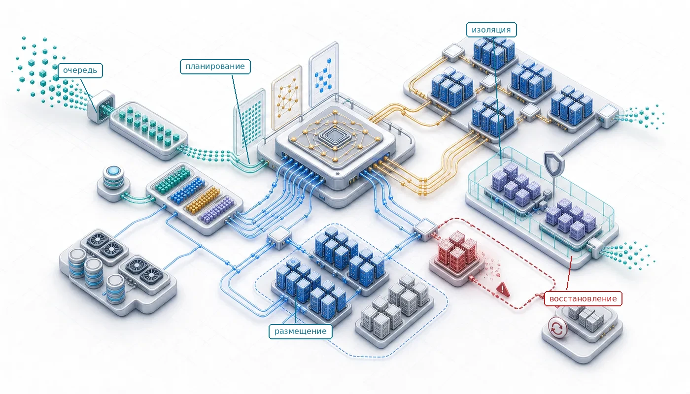

## Назначение

_Почему распределение ресурсов становится главным узким местом, когда оборудования много?_

Тысяча ускорителей, которые простаивают в ожидании решений планировщика, стоит столько же, сколько тысяча ускорителей, выполняющих полезную работу. В масштабе ограничивающим фактором становится не наличие оборудования, а его эффективное использование. Задания ждут в очередях, пока ресурсы простаивают, фрагментация оставляет зазоры, слишком малые для ожидающих заданий, а взаимные блокировки оставляют задания, которые удерживают часть ресурсов и ждут остальные. Оркестрация извлекает полезную работу из общей инфраструктуры: она решает, какие задания на каких узлах запускать, когда вытеснять, как сочетать справедливость с загрузкой и как не дать механизмам координации стать узким местом. Плохая оркестрация превращает дорогое оборудование в отходы, а хорошая превращает набор машин в согласованный вычислительный ресурс. В терминах C³ оркестрация сознательно платит налог на координацию, жертвуя частью пиковой загрузки, чтобы предотвратить взаимные блокировки и фрагментацию под нагрузкой.

> **Цели обучения**
>
> - Анализировать цели планирования, фрагментацию и риски взаимных блокировок для распределенных заданий обучения при общих ограничениях парка
> - Сравнивать парадигмы оркестрации HPC, облачно-нативную и гибридную для пакетного обучения и самовосстанавливающихся нагрузок обслуживания
> - Применять политики gang-размещения, упаковки (bin packing) и размещения с учетом топологии в доменах NVLink и иерархиях коммутаторов
> - Проектировать политики эластичного обучения и вытеснения, которые балансируют пропускную способность, накладные расходы восстановления и экономию от спотовых инстансов
> - Оценивать планировщики, специфичные для ML, по длительности заданий, прогрессу итераций, справедливости по доминирующему ресурсу и сигналам адаптивного распределения ресурсов
> - Проектировать емкость парка для инференса, изоляцию и политики размещения по глубине очереди, хвостовой задержке и давлению на память GPU
> - Диагностировать потери загрузки из-за накопления квот, шумных соседей, фрагментации, несоответствия топологии и голодания данных

<a id="sec-fleet-orchestration-introduction"></a>

## Проблема планирования

Представьте, что два исследовательских коллектива делят кластер из 1 000 GPU: команда A отправляет задание на 512 GPU, которое будет работать месяц, а команда B отправляет сотни экспериментов на 8 GPU, каждый из которых длится час. Если планировщик просто обрабатывает задания в порядке поступления, мелкие эксперименты команды B могут бесконечно блокировать огромное учебное задание команды A. Проблема планирования — это задача навигации по многомерному конфликту между пропускной способностью, справедливостью и загрузкой кластера.

Разбиение вычислений, их эффективная синхронизация и восстановление после аппаратных отказов решают задачу масштабирования одного задания. Оркестрация решает задачу уровня парка: определить, какие задания запускаются, где они запускаются и как ресурсы делятся между конкурирующими запросами.

На стеке парка (показан на полях) оркестрация работает на уровне распределения, но уровень инфраструктуры ограничивает ее решения. Планировщик должен учитывать неоднородность GPU, топологию NVLink, ограничения мощности стоек и бисекционную пропускную способность сети. Когда планирование идет неверно, отладка требует анализа всех четырех уровней, чтобы определить причину: инфраструктуру (аппаратные ограничения), распределение (ограничения алгоритмов), обслуживание (несоответствие нагрузки) или управление (ошибка политики). Оркестрация связывает физическую инфраструктуру с распределенными алгоритмами, переводя запросы ресурсов в размещения, которые учитывают одновременно аппаратную топологию и организационную политику.

Чтобы сделать проблему планирования конкретной, рассмотрим исследовательскую организацию, которая эксплуатирует кластер из 10 000 GPU. Brown et al. (2020) сообщают, что обучение GPT-3 175B потребовало $3{,}14 \times 10^{23}$ операций с плавающей запятой на кластере из GPU V100. Представьте, что в очереди стоят 100 крупных учебных заданий такого класса, а вместе с ними тысячи мелких экспериментов и нагрузок инференса, которые конкурируют за те же ресурсы. Система должна решить, какие задания запускать, когда и где. Наивная политика «первым пришел — первым обслужен» позволит первым нескольким крупным заданиям монополизировать кластер на недели и оставит без ресурсов мелкие эксперименты, которые исследователям нужны для быстрых итераций. Строгая политика справедливой доли разобьет GPU на множество мелких выделений и не даст ни одному крупному заданию собрать непрерывный набор, который ему нужен. Ни одна из крайностей не работает. Планировщик должен ориентироваться в пространстве многомерных компромиссов, где каждое решение одновременно влияет на пропускную способность, справедливость, стоимость и продуктивность исследователей.

Экономические ставки делают эти решения значимыми на любом масштабе. Кластер из 10 000 GPU по цене \$2 за GPU-час стоит \$480 000 в день независимо от того, выполняют GPU полезную работу или простаивают в очереди. Если из-за ошибок планирования 30 % GPU простаивают, это \$144 000 в день потерянной мощности, или около \$52,6 млн в год. И наоборот, повышение загрузки с 50 % до 80 % добавляет 3 000 полностью загруженных эквивалентов GPU без покупки дополнительного оборудования. Этот прирост эквивалентен покупке 6 000 сырых GPU, если бы они работали при старой загрузке 50 %. При таком масштабе улучшение загрузки на один процентный пункт стоит за год больше, чем зарплата инженера, который его добился. Планирование — не эксплуатационные накладные расходы, а одна из самых эффективных инженерных инвестиций в инфраструктуру ML.

Характер нагрузки, а не граница между ML и HPC, определяет гибкость планирования. Жесткие синхронные задания в обеих областях требуют фиксированного набора совместно запланированных рангов, тогда как податливые (malleable) задания могут продвигаться при заявленном диапазоне количества ресурсов. Gang-планирование[^fn-gang-allor-nothing] — важнейшее ограничение для синхронного распределенного обучения: задание, которому нужны 1 024 GPU, не может выполнить полезную итерацию только с 512. Каждый воркер участвует в каждой коллективной операции, и отсутствующий воркер блокирует всех остальных. [Приложение «Коммуникация»](appendix_communication.md#sec-appdx-comm-foundations-allreduce) развивает модель стоимости кольцевого и древовидного AllReduce, которая делает это ограничение физическим: коллектив останавливается, пока не прибудет последний воркер, поэтому выделение $N$ GPU с размещением лишь $N-1$ оставляет остальных участников простаивать в точке синхронизации. Планировщик, который выделяет ресурсы частично, создает взаимные блокировки, в которых несколько жестких заданий удерживают часть GPU, ожидая остальные, и ни одно не может продвинуться. Податливое параллельное по данным обучение может менять число реплик на явных границах перестройки, но группы тензорного и конвейерного параллелизма обычно сохраняют жесткое базовое выделение. Поэтому планировщик должен моделировать для каждого задания минимальный жизнеспособный gang и разрешенные точки изменения размера, а не выводить жесткость из поля, описывающего тип нагрузки.

Если жесткое gang-планирование — первое сильное ограничение, то учет топологии через **группы размещения (Placement Groups)**[^fn-placement-group-affinity] — второе: для тензорного параллелизма планировщик должен разместить GPU внутри одного домена NVLink с высокой пропускной способностью, а не разбрасывать их по всему центру обработки данных.

[^fn-gang-allor-nothing]: **Gang-планирование**: формализовано для параллельных систем (Ousterhout, 1982), где «матрица Устерхаута» совместно планирует связанные потоки на процессорах в синхронизированных квантах времени. В ML-кластерах ограничение строже: синхронный AllReduce требует одновременного участия всех воркеров, поэтому частичное выделение теряет 100 % удерживаемых ресурсов, а не просто снижает пропускную способность. При сценарии главы со стоимостью \$2 за GPU-час задание на 1 024 GPU, которое удерживает 900 простаивающих GPU, пока ждет еще 124, сжигает примерно \$1 800 в час.

[^fn-placement-group-affinity]: **Группа размещения (Placement Group)**: облачная абстракция, которая требует размещать инстансы в сетевом домене с высокой пропускной способностью и низкой задержкой. Для парка ML группы размещения уменьшают разброс размещения и могут открывать более высокие сетевые лимиты, чем неограниченное размещение. Они не гарантируют бисекционную пропускную способность на уровне нагрузки: переподписка (oversubscription) топологии, одновременный трафик, маршрутизация и коллективный паттерн по-прежнему определяют реальную пропускную способность AllReduce.

Третье измерение — неоднородность GPU. Во многих кластерах смешаны ускорители A100 и H100 с разной вычислительной производительностью, сопоставимой емкостью памяти с высокой пропускной способностью (HBM) (80 ГБ у A100 и 80 ГБ у H100) и разной пропускной способностью межсоединений. H100 дает примерно вдвое большую производительность обучения трансформеров, чем A100, но стоит пропорционально дороже. Некоторые модели помещаются в память A100 при подходящих стратегиях параллелизма; другим нужна большая память H100, чтобы не дробить модель чрезмерно. Планировщик должен сопоставлять рабочие нагрузки с подходящим оборудованием по реальным требованиям, а не по предпочтениям пользователей, сохраняя высокую загрузку в гетерогенных пулах. Когда пользователи запрашивают конкретные типы GPU по привычке, а не по необходимости, несоответствие запрошенных и нужных ресурсов может оставить целые пулы оборудования простаивающими, в то время как очереди на предпочитаемом оборудовании переполнены.

Непредсказуемость длительности заданий усиливает эти трудности. Обучение может сойтись раньше и завершиться за дни, а не недели. Аппаратные отказы могут неожиданно прервать задания и вернуть ресурсы в непредсказуемый момент. Поиск гиперпараметров может показать на раннем этапе, что некоторые конфигурации не сработают, и привести к добровольному завершению. Традиционные задачи научных вычислений, например погодные симуляции или молекулярная динамика, имеют более предсказуемое время выполнения, что позволяет принимать лучшие решения: планировщик может рассчитать, когда освободятся ресурсы, и спланировать соответственно. Рабочие нагрузки ML лишены этой возможности и вынуждают планировщики работать в условиях глубокой неопределенности относительно того, когда текущие задания освободят ресурсы.

Взаимодействие этих проблем создает комбинаторную сложность. Планировщик должен одновременно учитывать ограничения gang-планирования (атомарное выделение), неоднородные ресурсы (соответствие возможностей), требования топологии (локальность NVLink для тензорного параллелизма), политики приоритетов и справедливости (организационное равенство), решения о вытеснении (какие выполняющиеся задания прервать) и оптимизацию стоимости (спотовое или обычное размещение). Каждое измерение ограничивает остальные: размещение, оптимальное по топологии, может нарушить политику справедливости; оптимальное по стоимости спотовое размещение может нарушить требования надежности; а распределение, основанное на справедливости, может фрагментировать ресурсы так, что gang-планирование станет невозможным.

Эти ограничения определяют центральную задачу оркестрации: планировщик не просто упаковывает задания на GPU, а поддерживает согласованный и экономически полезный взгляд на отказывающий, гетерогенный парк. Первый шаг — понять, почему планирование кластера принципиально сложнее планирования процессов на одной машине. В масштабе парка размещение перестает быть только задачей оптимизации и становится проблемой распределенных систем: нужно поддерживать согласованное состояние на тысячах машин.

<a id="sec-fleet-orchestration-distributed-scheduling"></a>

### Распределенная сложность планирования

Планировщик на одной машине пользуется преимуществами, которых лишен планировщик кластера: у него мгновенная и согласованная видимость всех состояний ресурсов, он может принимать атомарные решения, которые действуют немедленно, а отказы бинарны (машина либо работает, либо нет). Планирование кластера лишается всех трех свойств, и в результате возникают несколько фундаментальных проблем распределенных систем.

Первая проблема — частичные отказы. Узел может отказать между выделением и запуском задания, создавая разрыв между решением планировщика и его эффектом. Планировщик может успешно выделить 32 GPU на 4 узлах, но один узел откажет до запуска задания. Оставшиеся 24 GPU простаивают, пока планировщик обнаруживает отказ, обновляет состояние и перепланирует выделение. Тем временем другие задания, которые могли бы использовать эти 24 GPU, уже размещены в другом месте, возможно, на менее подходящем оборудовании. Механизмы отказоустойчивости из главы [«Отказоустойчивость»](07_fault_tolerance.md#sec-fault-tolerance-reliability) обрабатывают отказы во время выполнения; планировщик должен обрабатывать отказы во время размещения, а это принципиально другая задача, потому что задание еще не создало состояния, которое можно восстановить.

Вторая проблема, характерная именно для распределенного планирования, — сетевые разделы. Планировщик может потерять связь с подмножеством узлов, которые продолжают работать нормально. С точки зрения планировщика эти узлы отказали, а их GPU недоступны. С точки зрения узлов задания могут продолжать работать и давать полезный результат. Эта неоднозначность создает дилемму без универсально верного решения. Перераспределение GPU новым заданиям рискует двойным выделением, если раздел устранится; ожидание восстановления связи тратит мощность, которая может быть полностью исправной. Длительность раздела заранее неизвестна, поэтому любой фиксированный тайм-аут — это догадка о сетевом поведении, которая может оказаться неверной.

Несогласованность состояния — третья проблема, которая усиливает первые две. Состояние ресурсов может различаться между представлением планировщика и реальностью на отдельных узлах. GPU, который планировщик считает свободным, может все еще очищаться после предыдущего задания: сбрасываются кэши, освобождается память устройства, работает зомби-процесс упавшего контейнера или завершается сброс драйвера CUDA после ошибки. И наоборот, GPU, отмеченный как «занятый», может быть освобожден заданием, которое завершилось между интервалами сигналов активности. Эта несогласованность означает, что планировщик работает с моделью состояния кластера, которая всегда немного устарела, и степень устаревания различается между узлами в зависимости от частоты сигналов, сетевой задержки и сложности операций очистки.

Четвертая фундаментальная проблема — упорядочивание без глобального времени. Без глобальных часов определить, произошло ли выделение A раньше выделения B на разных узлах, можно только при тщательном проектировании протокола с логическими часами или алгоритмами консенсуса. Два задания могут считать, что «владеют» одним и тем же GPU, если система не обеспечивает упорядочивание через протоколы консенсуса или централизованную координацию. Этот сценарий не теоретический: при восстановлении после сетевого раздела сообщения о выделении из периодов до и после раздела могут прийти на разные узлы в неправильном порядке, создавая конфликтующие назначения ресурсов, которые нужно обнаружить и разрешить.

Эти четыре проблемы перекликаются с компромиссом согласованность–доступность–устойчивость к разделам, описанным в теореме CAP[^fn-cap-theorem-scheduling]. CAP — теорема о распределенных системах данных, а не буквальное доказательство для каждого планировщика, но аналогия полезна: плоскость управления должна решить, сколько устаревшего или неопределенного состояния она готова терпеть, прежде чем принимать решения о выделении. Централизованные системы пакетного управления, такие как Slurm (менеджер рабочих нагрузок HPC), делают упор на авторитетное представление о выделении до запуска заданий. Циклы согласования, как в Kubernetes (платформа оркестрации контейнеров), делают упор на непрерывное приведение фактического состояния кластера к объявленному желаемому состоянию. Пользовательские планировщики ML часто принимают ограниченную несогласованность ради пропускной способности планирования, используя оптимистичное управление конкурентным доступом: конфликты обнаруживаются и разрешаются постфактум, а не предотвращаются блокировками.

[^fn-cap-theorem-scheduling]: **Теорема CAP (согласованность, доступность, устойчивость к разделам)**: выдвинута Brewer (2000) и доказана Gilbert и Lynch (2002). CAP утверждает, что никакая распределенная система данных не может одновременно гарантировать согласованность, доступность и устойчивость к разделам. Для планировщиков ML используйте CAP как аналогию в проектировании, а не как утверждение о продукте: конкретный вопрос политики — сколько неопределенности плоскость управления допускает, прежде чем выделить, вернуть или перепланировать дорогие ускорители.

Противоречие плоскости управления становится конкретным, когда планировщик взаимодействует с собственной плоскостью распределенной координации ML-фреймворка во время раздела. Планировщик может решить, что подмножество узлов недоступно, в то время как воркеры на этих узлах все еще заблокированы внутри коллективной операции. Возникает короткое окно конфликтующих намерений: планировщик хочет вернуть выделение, а задание обучения еще не пришло к согласованному представлению о новом составе группы. Механизмы эластичного запуска и рандеву, такие как TorchElastic, снижают эту неоднозначность за счет сигналов активности и повторного рандеву: фреймворк либо формирует жизнеспособную группу воркеров, либо чисто завершается, давая планировщику более ясный сигнал восстановления, чем непрозрачный тайм-аут коллектива (PyTorch Contributors, 2026). Эта многоуровневая координация — планирование грубого выделения на уровне планировщика и членство воркеров на уровне фреймворка — характерная архитектура промышленных кластеров распределенного обучения.

<a id="sec-fleet-orchestration-control-plane"></a>

#### Допуск, размещение и согласование

Плоскость управления планировщика разделяет три решения, которые одна очередь может скрыть. **Контроль допуска** решает, может ли задание войти в набор готовых к запуску при ограничениях квот, приоритетов, gang и безопасности. **Размещение** связывает допущенное задание с допустимым набором узлов, учитывая возможности ускорителей, топологию, мощность, хранилище и емкость сети. **Согласование** сравнивает желаемые выделения с наблюдаемым состоянием узлов и заданий, затем запускает, повторяет, вытесняет или изолирует работу, пока они не совпадут. Явное разделение этих этапов не дает ошибке размещения незаметно превратиться в решение о допуске, а устаревшим наблюдениям — в дублирующее владение.

Архитектуры плоскости управления по-разному распределяют эти решения (Hindman et al., 2011; Burns et al., 2016). Централизованный планировщик сериализует допуск и размещение относительно единого авторитетного состояния, что упрощает обработку конфликтов, но концентрирует задержку планирования и последствия отказов. Двухуровневая схема предлагает ресурсы фреймворк-планировщикам, получая специализацию политик ценой задержанных или отклоненных предложений. Схема с общим состоянием позволяет нескольким планировщикам планировать одновременно относительно общего состояния и разрешает конфликты через проверку версий или оптимистичное управление конкурентным доступом. Во всех схемах согласование замыкает цикл: аренды узлов и поколения выделений должны не давать старому решению ожить после того, как новое размещение уже получило владение.

Осуществимость выходит и за рамки свободного количества ускорителей. Энергоосведомленный допуск отклоняет или откладывает размещение, если его наихудшее потребление превысит оболочку стойки или объекта; опора на среднее потребление рискует коррелированным троттлингом, когда совместно размещенные задания одновременно входят в фазы интенсивных вычислений. Размещение с учетом I/O рассматривает пропускную способность чтения датасетов и записи контрольных точек как резервируемую емкость, поэтому gang, который помещается в память GPU, не запускается там, где параллельные конвейеры ввода или всплески записи контрольных точек насытят тот же путь к хранилищу. Эти ограничения могут намеренно оставить ускорители простаивающими. Простой — это цена сохранения бюджетов мощности и перемещения данных, необходимых, чтобы допущенные задания могли продвигаться.

<a id="sec-fleet-orchestration-failure-rates"></a>

### Частота отказов в масштабе

В масштабе отказ — нормальный режим работы, а не исключение. Этот принцип, установленный в анализе надежности из главы [«Отказоустойчивость»](07_fault_tolerance.md#sec-fault-tolerance-reliability), имеет прямые последствия для планирования: планировщик не должен лишь терпеть отказы, а должен активно закладывать их в каждое решение о выделении. Надежность компонента не меняется с размером кластера, но совокупная надежность системы падает мультипликативно. Если учитывать только аппаратные отказы GPU, частота занижается. При годовой надежности GPU 99,9 % (типично для аппаратуры центров обработки данных) ожидаемое число аппаратных отказов для кластера из 4 096 GPU скромно:

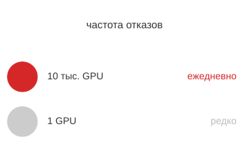

*Нормальные частоты отказов компонентов делают отказы парка рутиной.*

$$ \text{Ожидаемые отказы в сутки} = 4096 \times \frac{0{,}001}{365} \approx 0{,}01 \text{ отказа GPU в сутки} $$

Этот расчет учитывает только аппаратные отказы GPU. Если добавить программные отказы (сбои драйверов, повреждение контекста CUDA), тепловые события (троттлинг, аварийные отключения), отказы сетевых интерфейсов, проблемы хост-ОС и ошибки среды контейнеров, большие кластеры могут видеть от 1 до 4 отказов в сутки на 1 000 GPU. В кластере из 10 000 GPU тогда будет 10–40 отказов компонентов ежедневно. Многонедельное обучение на 4 096 GPU почти наверняка столкнется с несколькими отказами. [Приложение «Основы надежности»](appendix_reliability.md#sec-appdx-reliability-foundations-component-rates) табулирует интенсивности отказов в FIT и среднее время до отказа (MTTF), на которых основано предположение о 99,9 % годовой надежности. Оператор может подставить измеренные аппаратные значения и проверить, сохраняется ли эмпирический диапазон 1–4 отказа в сутки.

Последствия для планирования глубоки и определяют почти каждое проектное решение планировщика. Планировщик не может рассматривать кластер как статический пул ресурсов, где выделенные ресурсы остаются доступными, пока их не освободят добровольно. Вместо этого он должен предвидеть, что выделенные ресурсы исчезнут во время выполнения задания, поддерживать резервную емкость или реализовать быстрое перепланирование, чтобы задания продолжали работать при постоянной смене состояния оборудования. Он также должен различать переходные отказы, которые могут самоустраниться за минуты и не должны запускать дорогостоящее перераспределение, и постоянные отказы, которые требуют нового выделения ресурсов и восстановления из контрольной точки (Tiwari et al., 2015).

Рассмотрим решение планировщика при пропущенном сигнале активности узла. У планировщика три варианта:

- **Ждать восстановления**: планировщик ждет, возобновится ли сигнал, рискуя потерей GPU-времени, если узел действительно мертв.
- **Немедленно перераспределить**: планировщик назначает ресурсы узла другим заданиям, рискуя конфликтом, если узел восстановится, а его исходные задания все еще работают.
- **Пометить как подозрительный**: планировщик помечает узел как подозрительный и начинает заранее подготавливать замещающие ресурсы, ожидая подтверждения; при этом расходуется резервная емкость, которую можно было бы использовать для другой работы.

Каждый вариант балансирует между оперативностью и корректностью, а эффективный выбор зависит от распределения режимов отказов для конкретного оборудования в кластере. Эту информацию планировщик должен извлекать из исторических данных об отказах. [Приложение «Основы надежности»](appendix_reliability.md#sec-appdx-reliability-foundations-recovery-anatomy) раскладывает время восстановления на фазы обнаружения, перепланирования, перезагрузки и повтора. Эти фазы ограничивают, сколько планировщик может позволить себе ждать пропущенного сигнала, прежде чем обязаться к перераспределению, а не ставить на самоустранение переходного сбоя.

Эти требования напрямую связывают планировщик с инфраструктурой контрольных точек и восстановления из главы [«Отказоустойчивость»](07_fault_tolerance.md#sec-fault-tolerance-reliability): решения о резервной емкости, политиках вытеснения и поддержке эластичного обучения определяют, как быстро система восстанавливается после статистически ожидаемых отказов. Планировщик, который резервирует емкость или поддерживает эластичное восстановление, может вернуть пропускную способность значительно быстрее, чем тот, что требует, чтобы каждое упавшее задание ждало полного нового выделения и перезагрузки. Однако правильная доля резерва и время восстановления — параметры, специфичные для нагрузки и парка, а не универсальные константы.

<a id="sec-fleet-orchestration-objectives"></a>

### Цели планирования и их конфликты

Каждое решение о планировании представляет компромисс между четырьмя фундаментальными и часто противоречивыми целями:

- **Пропускная способность**: суммарная полезная работа за единицу времени естественным образом благоприятствует большим долгим заданиям, которые насыщают оборудование и минимизируют накладные расходы на переключение контекста и перемещение данных.
- **Справедливость**: равномерное распределение ресурсов между пользователями или командами не дает одной большой команде монополизировать парк. Справедливость по доминирующему ресурсу (Ghodsi et al., 2011) выравнивает наибольшую нормированную долю каждого пользователя по таким ресурсам, как GPU, CPU и память.
- **Задержка**: быстрое завершение коротких заданий поддерживает темп работы исследователей, но агрессивное вытеснение может заморить голодом крупные учебные задания.
- **Эффективность стоимости**: прерываемые спотовые инстансы, внепиковое планирование и плотная упаковка снижают расход бюджета, но часто повышают частоту отказов или время завершения.

Цели конфликтуют, потому что каждая из них вознаграждает свое поведение планировщика. Политика, максимизирующая пропускную способность, заполняет кластер массивными учебными заданиями, достигая почти идеальной загрузки, но заставляя всех остальных пользователей ждать недели очереди. Справедливое распределение фрагментирует ресурсы, оставляя мелкие зазоры, которые крупные задания не могут заполнить, и жертвует совокупной пропускной способностью ради социального согласия. Оптимальный по задержке планировщик, похожий на «сначала самое короткое задание», агрессивно вытесняет долгие учебные задания ради интерактивной отладки или небольших экспериментов. Оптимизация стоимости часто означает принятие более высокой частоты отказов и более долгого времени завершения, то есть обмен продуктивности исследователей на сохранение бюджета.

Справедливости нужна метрика результата, а не только правило квот. Для задания $j$ **замедление** $S_j=(W_j+T_j)/T_j$ сравнивает его время в очереди плюс время выполнения с изолированным временем выполнения $T_j$. Часовое задание, которое ждет девять часов, имеет $S_j=10$, даже если его команда в итоге получает номинальную долю GPU. Планировщик должен сообщать распределение замедления по пользователям и классам заданий вместе с возрастом самого старого ожидающего допустимого задания. Паритет доминирующих долей выявляет неравное распределение ресурсов, замедление показывает неравную задержку, а ограниченное максимальное допустимое ожидание выявляет голодание. Эти метрики отделяют политику, справедливую по выделенным GPU-часам, от политики, справедливой по времени, которое пользователи ждут до получения полезного результата.

Как показано на рисунке [«Компромиссы планирования»](#fig-fleet-orchestration-scheduling-tradeoffs), оптимизировать все четыре цели одновременно невозможно: каждая политика планирования представляет конкретную точку в этом четырехмерном пространстве компромиссов. Самый прямой конфликт — между пропускной способностью и задержкой, по аналогии с компромиссом пропускная способность–задержка в архитектуре компьютеров. Оптимальный по пропускной способности планировщик отдает приоритет самым крупным и наиболее параллелизуемым заданиям, потому что они эффективнее всего используют оборудование. Однако эта политика катастрофична для задержки мелких заданий: исследователь, отправивший 10-минутную отладочную задачу, может ждать дни, пока завершится крупное задание. И наоборот, оптимальный по задержке планировщик минимизирует среднее время ожидания, но потенциально бесконечно морит голодом крупные задания, снижая совокупную пропускную способность кластера, потому что оставляет большие блоки ресурсов простаивать в ожидании «еще одного» мелкого задания.

<a id="fig-fleet-orchestration-scheduling-tradeoffs"></a>

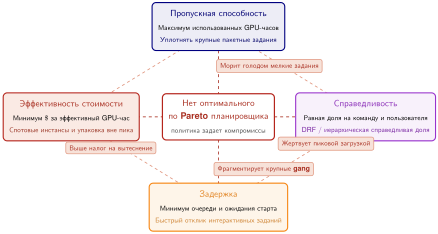

***Компромиссы планирования между конкурирующими целями парка:** четырехсторонний ромб компромиссов (пропускная способность, задержка, справедливость, эффективность стоимости) иллюстрирует противоречия, которыми управляется планирование кластера. Пропускная способность благоприятствует долгим непрерывным запускам; задержка благоприятствует агрессивному вытеснению ради интерактивных заданий; справедливость фрагментирует ресурсы, чтобы выровнять доли; эффективность стоимости использует дисконтированную прерываемую емкость.*


*Выше примерно 70 % загрузки время ожидания в очереди резко растет.*

Рассмотрим задачу тонкой настройки на 64 GPU для нашей модели на 175 млрд параметров. Это демонстрационная нагрузка для планирования, отличная от полного учебного запуска на 1 024 GPU, который встречается в других местах обсуждения парка. С точки зрения пропускной способности это идеальное задание: оно работает дни при высокой загрузке и без накладных расходов планирования после старта. С точки зрения задержки это камень на пути потока. Чтобы его запустить, системе, возможно, придется освободить 64 GPU от всех остальных работ, заставив сотни мелких заданий ждать. После запуска оно занимает эти ресурсы неподвижно. Если планировщик отдает приоритет этому запуску (пропускная способность), P99-задержка мелких заданий резко растет. Если он отдает приоритет мелким заданиям (задержка), позволяя им вытеснять задания или заполнять фрагменты кластера, 64-GPU задание может так и не собрать непрерывный блок, нужный для старта. Эта игра с нулевой суммой заставляет организации делать явный выбор политики. На языке планировщиков такой выбор часто выглядит как классы качества обслуживания: уровни приоритета заданий, которые решают, какая цель побеждает, когда пропускная способность, задержка, справедливость и стоимость сталкиваются.

> **Теория очередей для GPU-кластеров**
>
> Кластер GPU можно моделировать как очередь M/G/1: задания поступают по пуассоновскому процессу $(\lambda_{\text{job}})$, а времена обслуживания следуют общему распределению $(G)$ со средним $1/\mu$ и стандартным отклонением $\sigma$. Формула Поллачека–Хинчина задает ожидаемое время ожидания в очереди $(W_q)$:
>
> $$ \frac{W_q}{1/\mu} = \frac{\rho}{1-\rho} \cdot \frac{1+C_s^2}{2} $$
>
> Здесь $\rho = \lambda_{\text{job}}/\mu$ — загрузка кластера, $1/\mu$ — средняя длительность задания, а $C_s = \sigma \mu$ — **коэффициент вариации** длительности задания. Правая часть — это время ожидания, выраженное в кратных средней длительности задания.
>
> В стандартном веб-обслуживании времена обработки запросов часто приближают экспоненциальным распределением, и тогда $C_s \approx 1$. В кластерах ML длительности заданий подчиняются распределению с тяжелым хвостом: множество коротких отладочных заданий (минуты) смешано с несколькими огромными учебными запусками (недели). Представительный расчет с $C_s=3$ в этой врезке отражает такую дисперсию, не претендуя на универсальную константу парка. Влияние на время ожидания мультипликативно. Для аргумента о планировании достаточно односерверного множителя. [Приложение «Основы инференса»](appendix_inference.md#sec-appdx-inference-scale-queuing-theory-batched-inference-bbf0) обобщает результат на очередь M/G/c/K и проверяет его по закону Литтла для читателей, которые рассчитывают очередь допуска планировщика при тяжелохвостых поступлениях.
>
> При загрузке 80 % $(\rho = 0{,}8)$ для экспоненциальной нагрузки $(C_s = 1)$ имеем $W_q =$ 4 $\times$ средняя длительность задания, а для типичной нагрузки ML $(C_s = 3)$ имеем $W_q =$ 20 $\times$ средняя длительность задания. Это объясняет «стену загрузки» в инфраструктуре ML. Веб-кластер при нагрузке 80 % ощущается отзывчивым, а кластер ML при той же загрузке ощущается сломанным: задания неделями томятся в очереди. Тяжелый хвост распределения обслуживания действует как множитель задержки и вынуждает операторов держать кластеры ML на меньшей загрузке (часто 60–70 %), чтобы сохранять приемлемую отзывчивость для интерактивных пользователей.

<a id="sec-fleet-orchestration-drf-worked-allocation"></a>

#### Пример распределения: справедливость по доминирующему ресурсу

Справедливость по доминирующему ресурсу (DRF) делает многоресурсное право сопоставимым: выделение каждого арендатора нормируется относительно емкости парка, и берется его наибольшая доля (Ghodsi et al., 2011). Рассмотрим намеренно небольшой кластер из [таблицы «Распределение по DRF»](#tbl-fleet-orchestration-drf-allocation): 8 GPU, 32 ядра CPU, 256 ГБ памяти и 80 Гбит/с сетевой емкости. Реплике арендатора A нужны 1 GPU, 4 ядра, 32 ГБ и 10 Гбит/с. Распределенному воркеру арендатора B нужны 2 GPU, 2 ядра, 16 ГБ и 20 Гбит/с.

<a id="tbl-fleet-orchestration-drf-allocation"></a>

***Распределение по DRF:** прогрессивное заполнение дает арендатору A четыре реплики по одному GPU, а арендатору B — пару воркеров по два GPU. Оба арендатора достигают доминирующей доли 0,50, хотя их выделения CPU и памяти различаются. GPU и сеть насыщены совместно; CPU и память остаются доступными, но не могут увеличить ни одно из выделений, не превысив насыщенный ресурс.*

| **Арендатор** | **Выделение** | **Доля GPU** | **Доля CPU** | **Доля памяти** | **Доля сети** | **Доминирующая доля** |
|:-----------|:---------------|:-------------:|:-------------:|:----------------:|:-----------------:|:------------------:|
| A          | 4 реплики      |   $4/8=0{,}50$  |  $16/32=0{,}50$ |  $128/256=0{,}50$  |    $40/80=0{,}50$   |       $0{,}50$       |
| B          | 2 воркера      |   $4/8=0{,}50$  |  $4/32=0{,}125$ |  $32/256=0{,}125$  |    $40/80=0{,}50$   |       $0{,}50$       |

Для арендатора $i$ определим его доминирующую долю как $d_i=\max_r(a_{i,r}/C_r)$, где $a_{i,r}$ — его выделение ресурса $r$, а $C_r$ — емкость парка по этому ресурсу. Расчет выравнивает $d_i$, а не каждую долю ресурса. Одна реплика A поднимает доминирующую долю A на $1/8$; один воркер B поднимает долю B на $2/8$. Прогрессивное заполнение поэтому выдает примерно две реплики A на каждого воркера B, пока обе доминирующие доли не достигнут $0{,}50$. Это справедливая целевая политика, но еще не допустимое размещение. Если два воркера B образуют один gang из четырех GPU, эти четыре GPU должны стать доступными атомарно. Если тензорный параллелизм требует одного домена NVLink, четыре свободных GPU, разбросанных по узлам, не удовлетворяют выделению. Если же задание требует ускорителей с 80 ГБ HBM, четыре несовместимых GPU вообще не считаются. Поэтому производственный планировщик применяет ограничения возможностей, gang и топологии к допустимому множеству и только затем использует DRF, чтобы справедливо выбирать среди выделений, которые реально могут работать. Когда размещения с равной долей не существует, планировщик должен сообщить об ограничении, вызвавшем отклонение, а не молча выдавать недопустимое право за оказанное обслуживание.

> **Маячные архетипы: размещение меняет справедливость**
>
> Одна и та же доля ресурса имеет разный смысл для трех маячных нагрузок, введенных в разделе [«Три системных архетипа»](01_introduction.md#sec-vol2-introduction-archetypes):
>
> - **Архетип A (GPT-4/Llama-3)** требует жесткого gang, совместимого с топологией. Дробные выделения ниже минимальной параллельной конфигурации не дают прогресса, поэтому справедливость должна учитывать максимально допустимое ожидание непрерывного размещения, а не только GPU-часы.
> - **Архетип B (DLRM в масштабе)** связывает память ускорителя с пропускной способностью маршрутизации разреженных данных. Номинальное выделение GPU недопустимо, если шарды эмбеддингов или емкость сети не могут за ним следовать. Поэтому сеть и память должны войти в доминирующую долю, а размещение должно защищать бюджет задержки обслуживания.
> - **Архетип C (федеративный MobileNet)** планирует участие, а не GPU центров обработки данных. Фильтры допуска по мощности, связности и возможностям устройства могут систематически исключать части популяции, поэтому справедливость нужно проверять по долям участия и результатов в группах устройств и пользователей, а не по равному числу устройств в раунде.
>
> Общее правило: сначала определить допустимый набор, а затем оценивать справедливость по полезному прогрессу. Считать все ускорители или клиентов взаимозаменяемыми значило бы скрыть ограничение, которое делает каждый архетип трудным.

<a id="sec-fleet-orchestration-bin-packing"></a>

### Упаковка (bin packing)

Самый фундаментальный алгоритм планирования — упаковка (bin packing)[^fn-bin-packing-scheduling]: размещение заданий разного размера по узлам фиксированной емкости. В общем виде эта задача NP-трудная, то есть ни один известный алгоритм не находит оптимальное решение за полиномиальное время. К счастью, практические эвристики, такие как first-fit decreasing и best-fit decreasing, дают почти оптимальные результаты для распределений нагрузки, типичных для кластеров ML, где размеры заданий подчиняются распределению с тяжелым хвостом (много мелких заданий и несколько крупных).

[^fn-bin-packing-scheduling]: **Упаковка (bin packing)**: одномерная версия NP-трудна. Планирование ML добавляет четыре-пять измерений (GPU, CPU, память, сеть, топология), что делает точные решения неразрешимыми для кластеров более нескольких сотен узлов. Эвристики first-fit-decreasing дают результат в пределах 11/9 от оптимума для типичных нагрузок, но реальная цена в кластерах ML — не субоптимальность упаковки, а фрагментация: застрявшие GPU, каждый из которых по отдельности не удовлетворяет ни одно ожидающее задание, но вместе они представляют миллионы долларов простаивающей емкости.

Рассмотрим кластер из 64 узлов по 8 GPU в каждом, всего 512 GPU. Если задания запрашивают по 6 GPU, каждое занимает один целый узел, но тратит 2 GPU на узел, снижая эффективную емкость до 75 %. Оставшиеся 2 GPU на узле нельзя объединить между узлами, потому что рабочие нагрузки GPU требуют локального доступа к памяти. Эта **фрагментация** растет с разнородностью размеров заданий: смесь заданий на 1, 3 и 7 GPU создает неправильные зазоры, распределенные по многим узлам. Ни одно ожидающее задание не помещается ни в один отдельный зазор, хотя суммарной свободной емкости хватило бы, будь зазоры непрерывными.

Нагрузки ML делают упаковку многомерной способами, с которыми традиционное планирование редко сталкивается. Каждому заданию нужны GPU вместе с ядрами CPU для предобработки данных, оперативной памятью хоста для загрузки и аугментации данных, локальным SSD для кэширования датасета и сетевой полосой для синхронизации градиентов. Задание, которое запрашивает 4 GPU, 32 ядра CPU и 256 ГБ ОЗУ, может не поместиться на узле с 4 свободными GPU, но только с 16 свободными ядрами CPU, потому что другие задания заняли CPU хоста для предобработки. Планировщик должен одновременно удовлетворить все измерения ресурсов, и задание помещается, только если каждое измерение имеет достаточную емкость на выбранном узле. Это многомерное ограничение резко сужает пространство решений по сравнению с одномерной упаковкой, потому что узкое место в любом одном измерении ресурса может запереть емкость во всех остальных.

Ограничения локальности сужают размещение сверх простой доступности ресурсов. Учебному заданию с тензорным параллелизмом нужны GPU, связанные через NVLink внутри одного узла, поскольку межузловая связь по InfiniBand на порядок медленнее (450 ГБ/с в одном направлении внутри узла против 50 ГБ/с на порт между узлами). Задание, которое запрашивает «4 GPU с связностью NVLink», не может взять 2 GPU с узла A и 2 с узла B, даже если все 4 GPU по отдельности доступны и суммарной емкости достаточно. Эти ограничения топологии превращают задачу упаковки в задачу размещения, где важно не только сколько ресурсов доступно, но и какие именно. Задача размещения строго сложнее упаковки, потому что добавляет пространственные ограничения к существующим ограничениям емкости.

Планировщики борются с фрагментацией несколькими взаимодополняющими стратегиями, каждая из которых нацелена на свой аспект проблемы. **Бэкфилл-планирование** позволяет мелким заданиям заполнять зазоры, пока крупные задания ждут непрерывных ресурсов, повышая загрузку без нарушения порядка приоритетов. Идея в том, что мелкие задания могут выполниться и завершиться в зазорах, освободив ресурсы до целевого времени старта крупного задания. Бэкфилл требует оценки того, когда текущие задания завершатся, чтобы понять, закончится ли кандидат на бэкфилл до того, как крупное задание сможет стартовать. Поэтому точные оценки времени выполнения так важны.

Периодическая **дефрагментация** мигрирует или вытесняет задания с низким приоритетом, чтобы консолидировать свободные ресурсы в непрерывные блоки, аналогично уплотнению памяти в операционных системах. Планировщик находит узлы, где частичные выделения оставляют застрявшие ресурсы, вытесняет задания, занимающие эти ресурсы, и перепланирует их на узлах, где их можно упаковать эффективнее. Стоимость дефрагментации (вытеснение выполняющейся работы, которая теряет вычисления между последней контрольной точкой и событием вытеснения) нужно сопоставить с выгодой: крупные задания стартуют раньше, растет общая пропускная способность. Операторы часто запускают дефрагментацию в периоды низкого спроса, когда вред от вытеснения меньше.

Третья стратегия, **переподписка** (over-subscription), допускает больший спрос, чем измерение емкости может выдержать одновременно, но только там, где ресурс делим и планировщик может ограничить взаимные помехи. Средняя загрузка SM не создает дробных целых GPU: задание, которое резервирует память устройства, требует эксклюзивного контекста CUDA или принадлежит жесткому gang, все равно занимает назначенное устройство, пока ядра простаивают. Статистическое мультиплексирование может быть безопасным для явно разделяемой емкости CPU, сети, хранилища или разбитых на разделы GPU, когда у арендаторов измеренные, слабо коррелированные пики и исполнимые лимиты. Небезопасно превращать среднюю загрузку GPU 70 % в коэффициент перераспределения устройства 1,4×. Емкость целого устройства следует возвращать вытеснением, эластичным изменением размера или механизмом изоляции, таким как MIG или MPS, контракт памяти, вычислений и разделения сбоев которых планировщик моделирует явно. [Рисунок «Проблема фрагментации»](#fig-fragmentation-problem) показывает отдельную задачу упаковки: хотя 19 GPU (около 30 % кластера) простаивают, ни на одном узле нет непрерывного блока из восьми, поэтому задание на целый узел не может быть размещено.

<a id="fig-fragmentation-problem"></a>

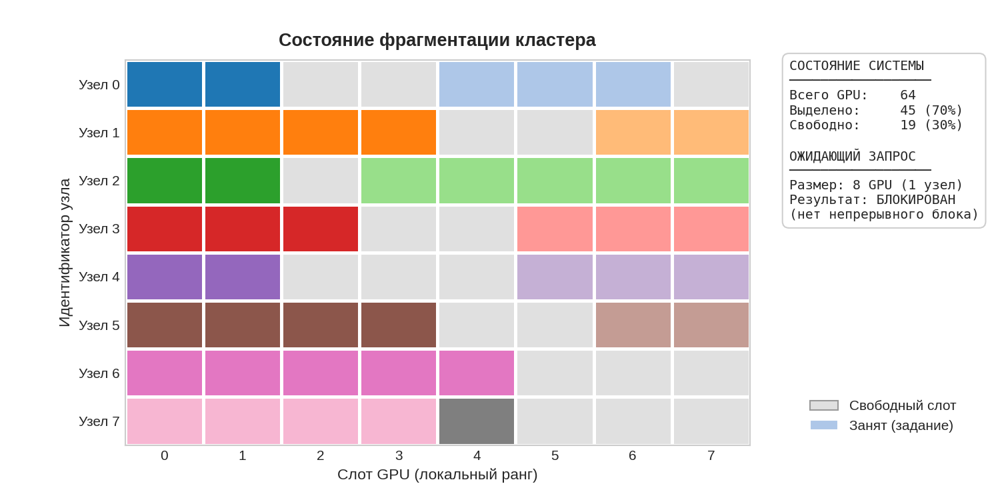

***Проблема фрагментации:** тепловая карта показывает снимок кластера из 8 узлов (строки) по 8 GPU в каждом (столбцы). Разные цвета обозначают разные активные задания, серые ячейки — свободные GPU. Хотя глобально доступны 19 GPU (примерно 30 % емкости), они фрагментированы между узлами. Новое задание, которому нужны 8 непрерывных GPU (целый узел), не может быть запланировано, потому что ни одна строка не пуста полностью. Это иллюстрирует, как неэффективность упаковки снижает эффективную емкость кластера.*

<a id="sec-fleet-orchestration-gang-scheduling"></a>

### Gang-планирование

Частичное выделение ресурсов для заданий с несколькими GPU создает режим отказа, характерный для кластеров ML: два задания могут каждое удерживать половину нужных им ресурсов, блокируя друг друга бесконечно, пока каждый выделенный GPU простаивает. [Рисунок «Взаимная блокировка при gang-планировании»](#fig-gang-scheduling-deadlock) сопоставляет этот сценарий взаимной блокировки с атомарным выделением, которое ее устраняет.

<a id="fig-gang-scheduling-deadlock"></a>

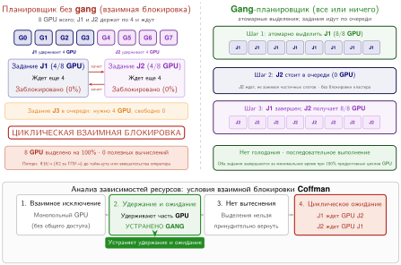

***Распределенная взаимная блокировка (удержание и ожидание):** в планировщике без gang (слева) задание J1 занимает половину кластера и ждет остальное, а задание J2 занимает другую половину и ждет, пока J1 освободит свои GPU. Ни одно не может продвинуться, и 100 % кластера простаивают. Gang-планирование (справа) решает это, требуя атомарного выделения: задание либо получает весь свой $N$-GPU запрос одновременно, либо ждет в очереди, не удерживая никаких ресурсов.*

> **Определение: gang-планирование**
>
> ***Gang-планирование*** — это политика планирования кластеров ML, которая выделяет все ускорители задания атомарно (все или ничего), потому что синхронное распределенное обучение делает предельную ценность частичного выделения нулевой: каждый воркер должен дойти до каждой коллективной операции, поэтому задание не может обменять меньше GPU на пропорционально более медленный прогресс.
>
> 1.  **Значимость**: синхронное задание на 1 024 GPU, которое удерживает 512 GPU, выполняет не вдвое меньше шагов обучения, а ни одного: каждый AllReduce останавливается, пока не прибудет каждый ранг, поэтому удерживаемые GPU тратят энергию и капитал с нулевым полезным выходом. Без атомарного выделения два таких задания могут каждое захватить половину кластера и зайти во взаимную блокировку, оба с нулевым прогрессом, при полной стоимости эксплуатации кластера.
> 2.  **Различие**: в отличие от податливой службы или параллельного задания, которое может продвигаться в диапазоне ресурсов, жесткое синхронное обучение имеет ступенчатую полезность: либо минимально жизнеспособный gang, либо ничего. Это различие — свойство графа выполнения, а не того, помечена ли нагрузка как ML, облачная или HPC.
> 3.  **Типичная ошибка**: распространено заблуждение, что это решают одни приоритеты или квоты. Атомарность должна распространяться на каждый совместно планируемый ресурс, нужный заданию для прогресса (ускорители, домены высокоскоростного межсоединения, сетевая емкость для коллективов). Если обеспечивать ее только на уровне GPU, взаимная блокировка воссоздается на один уровень ресурсов ниже.

> **Физика взаимной блокировки**
>
> **Сценарий**: кластер на 1 024 GPU получает 2 крупных распределенных учебных задания, каждому из которых нужно 1 024 GPU. Наивный планировщик выделяет 512 GPU команде A и 512 GPU команде B.
>
> **Диагноз**: ни одно задание не может продвинуться без полного выделения узлов. Возникает взаимная блокировка удержания и ожидания: команда A ждет GPU команды B, а команда B ждет GPU команды A. Совокупная пропускная способность падает до нуля, при этом стоимость простаивающих вычислений составляет \$2048 в час.
>
> **Системный урок**: распределенные учебные нагрузки требуют атомарного планирования «все или ничего» (gang). Оркестраторы парка должны обеспечивать границы допуска на уровне задания, чтобы задания оставались в очереди, пока весь запрошенный квот GPU не станет доступен одновременно.

Частичное выделение — это **взаимная блокировка удержания и ожидания (hold-and-wait deadlock)**[^fn-deadlock-scheduling-cycle], при которой два задания каждое удерживают половину кластера, и ни одно не может продвинуться. Гарантия реализации проста: для задания $J$, запрашивающего $N$ GPU, планировщик должен обеспечить, что либо все $N$ GPU выделяются атомарно, либо задание остается в очереди, не удерживая никаких ресурсов. Этот двоичный исход устраняет взаимную блокировку по построению, поскольку задание, которое не удерживает ресурсов, не может блокировать другие задания. Однако эффективно реализовать эту гарантию — задача, которая определяет большую часть проектирования алгоритмов планирования кластера.

[^fn-deadlock-scheduling-cycle]: **Удержание и ожидание (hold-and-wait)**: одно из четырех классических условий, совместно достаточных для взаимной блокировки в системах распределения ресурсов. Gang-планирование снимает это условие атомарным выделением ценой меньшей гибкости упаковки.

Наивное gang-планирование расточительно предсказуемым образом. Если в кластере 900 свободных GPU, а задание запрашивает 1 024, 900 GPU простаивают, пока не освободятся еще 124, что потенциально тратит тысячи GPU-часов. Бэкфилл решает эту проблему, находя в очереди задания, которые помещаются в 900 доступных GPU, не задерживая ожидаемого старта крупного задания. Эта идея популяризирована в системе планирования ANL/IBM SP (Lifka, 1995). Задание на 128 GPU с расчетным временем выполнения 2 часа может безопасно встать на бэкфилл, если 124 дополнительных GPU, нужных крупному заданию, останутся недоступными как минимум 2 часа, а бэкфилл-задание, как ожидается, завершится до резервирования крупного задания. Бэкфилл-задание использует ресурсы, которые иначе простаивали бы, повышая загрузку без нарушения гарантии планирования крупного задания.

Точность оценок времени выполнения определяет эффективность бэкфилла, и это создает задачу теории игр. Если пользователи систематически завышают время выполнения, слоты бэкфилла искусственно узки и помещается меньше заданий, что снижает загрузку. Если они занижают, бэкфилл-задания могут все еще работать, когда ресурсы крупного задания освобождаются, что вынуждает вытеснение и теряет прогресс бэкфилл-задания. На практике у пользователей сильный стимул завышать (чтобы не быть убитыми до завершения) и слабый стимул оценивать точно, что ведет к систематической инфляции и ухудшает работу бэкфилла. Исследовательские планировщики, такие как Tiresias (Gu et al., 2019), решают эту фундаментальную проблему, вовсе отказываясь от требования оценок времени выполнения и используя наблюдаемое потребление ресурсов для динамической корректировки приоритета. Этот подход, подробно разобранный в разделе «Tiresias: планирование без оценки длительности» далее в этой главе, превращает задачу оценки времени выполнения из бремени для пользователя в наблюдение на уровне системы.

Быстрая оценка стоимости показывает, почему даже умеренные улучшения этого баланса оправдывают инженерные усилия.

> **Экономика простаивающих GPU**
>
> Экономика кластера, введенная в начале главы, задает ставку. Решение о gang-планировании — место, где планировщик впервые ее зарабатывает или сжигает. Возьмем тот же кластер на 10 000 GPU:
>
> - **Стоимость эксплуатации**: \$480 000 в день (\$175,2 млн в год)
> - **Низкая загрузка** (60 %): 6 000 производительных, 4 000 простаивающих = \$192 000 в день потерь
> - **Высокая загрузка** (80 %): 8 000 производительных, 2 000 простаивающих = \$96 000 в день потерь
> - **Ценность улучшения**: переход от 60 % к 80 % экономит \$96 000 в день, или около \$35,0 млн в год
>
> Gang-планирование дает это повышение загрузки, предотвращая взаимную блокировку. Единственная взаимная блокировка удержания и ожидания может запереть весь кластер и свести на нет больше полного дня выигрыша одним событием.

Gang-планирование убирает взаимную блокировку удержания и ожидания из примера с загрузкой, но остается другой образец ожидания: инверсия приоритетов все еще может запереть зарезервированные GPU за заданиями, которые не могут завершить собственный путь выхода.

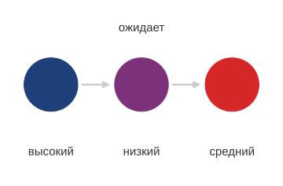

*Инверсия приоритетов — это цепочка ожиданий, а не дерево корневых отказов.*

<a id="sec-fleet-orchestration-deadlock"></a>

### Предотвращение и обнаружение взаимных блокировок

Gang-планирование устраняет условие удержания и ожидания, одно из четырех формальных условий Коффмана для взаимной блокировки, но не защищает кластер от всех форм конкуренции за ресурсы. Взаимные блокировки все еще могут возникнуть из взаимодействия правил приоритетов, политик вытеснения и вспомогательных зависимостей ресурсов. В кластере из тысяч GPU и петабайтов состояния эти пограничные случаи переходят из теоретических курьезов в ежедневные эксплуатационные инциденты.

Наиболее коварная из них — инверсия приоритетов, заимствованная из систем реального времени: задание высокого приоритета бесконечно блокируется заданием низкого приоритета. Рассмотрим учебный запуск на 175 млрд параметров (высокий приоритет), который запрашивает gang из 64 GPU. Планировщик зарезервировал 60 доступных GPU, но оставшиеся 4 удерживает задание низкого приоритета по обработке данных. Обычно планировщик вытеснил бы задание низкого приоритета, чтобы удовлетворить запрос высокого приоритета. Однако если поток заданий разработки среднего приоритета насыщает CPU или сетевую полосу кластера и лишает задание низкого приоритета ресурсов, нужных для записи контрольной точки и выхода, оно останавливается. Оно не может освободить GPU, потому что не может завершить последовательность выхода. Задание высокого приоритета ждет задание низкого приоритета, которое фактически заблокировано заданиями среднего приоритета. Результат — блок из 60 простаивающих GPU, который сохраняется, пока оператор не вмешается вручную.

> **Определение: инверсия приоритетов**
>
> ***Инверсия приоритетов*** — патология планирования кластеров ML, при которой задание высокого приоритета вынуждено ждать, пока задание низкого приоритета освободит общий ресурс.
>
> 1.  **Значимость**: она снижает темп прогресса всего парка до темпа самого низкоприоритетного задания. В кластерах ML это обычно происходит, когда задание низкого приоритета, удерживающее GPU, лишено вспомогательных ресурсов (например, пропускной способности для записи контрольных точек), что не дает ему завершиться и освободить ускорители, нужные нагрузкам высокого приоритета.
> 2.  **Различие**: в отличие от стандартной очереди (где задачи ждут своей очереди), инверсия приоритетов включает активную блокировку: задание высокого приоритета готово к запуску, но транзитивно зависит от задания, которому планировщик не отдает приоритет.
> 3.  **Типичная ошибка**: распространено заблуждение, что это решают строгие уровни приоритета. На деле без целостного вытеснения (резервирования всех ресурсов, нужных заданию для выхода) повышение уровней приоритета может даже увеличить вероятность инверсии, создавая более сложные цепочки зависимостей.

Решение требует выбора между предотвращением и обнаружением. Механизмы предотвращения, такие как строгое gang-планирование и агрессивные тайм-ауты, устраняют состояния взаимной блокировки по построению, но часто жертвуют загрузкой. Механизмы обнаружения позволяют системе входить в потенциально небезопасные состояния ради максимизации пропускной способности, полагаясь на мониторинг, чтобы выявить и разрешить взаимные блокировки, когда они возникают.

Для крупных парков точный поиск размещения вычислительно непрост. В кластере из 10 000 GPU и 500 ожидающих заданий пространство состояний превышает $10^{15}$ возможных выделений, что делает исчерпывающий поиск неразрешимым. Напротив, обнаружение цикла в уже построенном графе «ожидание–для» линейно по числу вершин и ребер графа. Практическая трудность — поддерживать полный и актуальный глобальный граф, пока состояние ресурсов меняется в распределенной плоскости управления. Поэтому крупные планировщики дополняют обнаружение по графу ожидания механизмами, которые сохраняют живучесть при неполном состоянии. **Ресурс на основе аренды** (**Lease-Based Resource**) выдает каждому выделению время жизни, позволяя планировщику вернуть GPU, когда задание перестает продлевать свою претензию. **Мониторинг прогресса** (**Progress Monitoring**) затем проверяет, действительно ли задание продвигается, используя такие сигналы, как загрузка GPU, счетчики шагов или метки времени сигналов активности, чтобы выявить «зомби»-выделения. Когда планировщику нужно вытеснить задание с меньшим приоритетом, **целостное вытеснение** (**Holistic Preemption**) резервирует полосу CPU, сети и хранилища, которая нужна этому заданию, чтобы записать контрольную точку и корректно выйти. Иначе жертва может быть слишком лишена ресурсов, чтобы освободить ускорители. Эти стратегии допускают ненулевую частоту ложных срабатываний ради сохранения живучести кластера.

<a id="sec-fleet-orchestration-heterogeneous-gang"></a>

### Гетерогенное gang-планирование

Традиционная модель gang-планирования предполагает однородную нагрузку bulk synchronous parallel: $N$ одинаковых воркеров выполняют один и тот же вычислительный граф. Некоторые учебные процессы нарушают это допущение, потому что одно логическое задание содержит несколько ролей с разными профилями ресурсов. Например, в конвейерах обучения предпочтениям, таких как обучение с подкреплением на основе обратной связи от людей (RLHF), одна компонента может обновлять политику, а другая оценивает выходы или предоставляет эталонное поведение. Планировщик по-прежнему видит одно задание, но gang содержит тренеров, оценщиков и воркеры в стиле инференса, которым нужны разное число GPU, разный объем памяти и разная продолжительность жизни.

> **Маршрутизация вместо синхронности**
>
> Гетерогенное gang-планирование переформулирует это выделение. Планировщик должен атомарно выделить разнообразное созвездие ресурсов: узлы с большим объемом HBM, оптимизированные для генерации инференса, ограниченной памятью, наряду с узлами высокой вычислительной мощности для обратного распространения, ограниченного вычислениями. Задача оркестрации смещается от статической топологической упаковки к динамической маршрутизации данных. Активации и градиенты больше не только редуцируются внутри однородного кольца; данные должны непрерывно течь между узлами инференса, генерирующими роллауты, и узлами обучения, вычисляющими обновления политики. Если гетерогенное выделение gang не сбалансировано точно по этим разным профилям нагрузки, весь кластер выпадает из синхронности, оставляя дорогие ускорители голодать без данных.

Гетерогенные gang RLHF — исключение. Для обычных однородных учебных заданий повторяющееся напряжение — это безопасность gang-планирования против загрузки бэкфилла. Gang-планирование предотвращает взаимные блокировки, но тратит ресурсы; бэкфилл повышает загрузку, но требует оценок времени выполнения, которые пользователи не могут дать точно. Две распространенные парадигмы оркестрации разрешают это напряжение через принципиально разные архитектурные философии.

<a id="sec-fleet-orchestration-paradigms"></a>

## Парадигмы оркестрации

Напряжение между gang-планированием и бэкфиллом не имеет нейтрального к инструментам ответа: парадигма оркестрации определяет, какую гарантию платформа защищает в первую очередь. Slurm, сформированный пакетными системами HPC, отдает предпочтение явным запросам ресурсов и предсказуемому выделению. Kubernetes, сформированный облачным управлением сервисами, отдает предпочтение объявленному желаемому состоянию и непрерывному согласованию. Выбор поэтому не в том, Slurm или Kubernetes как продукты; он в том, какая модель управления лучше соответствует смеси нагрузок, поведению при отказах и операционной культуре парка.

<a id="fig-fleet-orchestration-slurm-vs-k8s"></a>

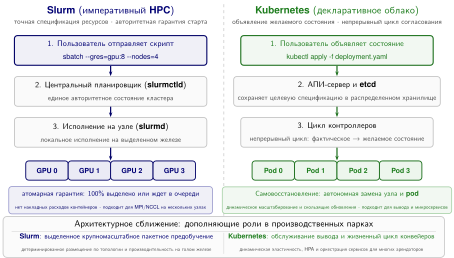

***Архитектурные парадигмы: Slurm и Kubernetes:** Slurm (слева) использует императивную пакетную модель, в которой пользователи подают явные запросы ресурсов централизованному контроллеру (`slurmctld`), обеспечивающему детерминированное атомарное выделение. Kubernetes (справа) использует декларативную сервисную модель, в которой контроллеры непрерывно согласуют наблюдаемое состояние кластера в `etcd` с желаемыми спецификациями состояния.*

<a id="sec-fleet-orchestration-slurm"></a>

### Slurm: наследие HPC

**Slurm Workload Manager**[^fn-slurm-hpc-workload] возник в Национальной лаборатории Лоуренса в Ливерморе как масштабируемый отказоустойчивый менеджер ресурсов для кластеров Linux (Yoo et al., 2003). Его пакетно-ориентированная конструкция подходит особенностям научных вычислений: долгим заданиям, дорогому общему оборудованию и пользователям, которые могут заранее указать потребность в ресурсах. В инфраструктуре ML та же модель отображается на обучение на GPU через разделы для гетерогенных пулов ускорителей и предсказуемые выделения для долгих распределенных заданий.

[^fn-slurm-hpc-workload]: **Slurm Workload Manager**: изначально «SLURM», аббревиатура от Simple Linux Utility for Resource Management; в 2012 году проект отказался от написания аббревиатуры заглавными буквами. Разработка в Ливерморской национальной лаборатории началась в 2002 году. Централизованный контроллер Slurm (`slurmctld`) поддерживает единое авторитетное представление о выделениях ресурсов. В очень больших масштабах операторы могут делить парки на части или объединять планировщики в федерацию, чтобы держать задержку планирования, изоляцию политик и домены отказов под контролем.

Slurm использует **императивную модель планирования**: пользователи отправляют скрипты заданий с точными требованиями к ресурсам, а планировщик размещает задания в разделах по приоритету, справедливости и доступности ресурсов. Такая прямота упрощает рассуждения о гарантиях выделения. Когда пользователь отправляет `sbatch --gres=gpu:8 --nodes=4`, Slurm гарантирует, что если задание стартует, у него будет ровно 32 GPU на 4 узлах. Пользователь точно знает, что получает, а планировщик точно знает, что должен предоставить. Цена такой прямоты в том, что пользователи должны точно понимать свои потребности: запрос лишнего расходует ресурсы, а запрос меньшего приводит к ошибкам нехватки памяти или снижению производительности.

Архитектура Slurm состоит из центрального управляющего демона (`slurmctld`), который поддерживает глобальное представление о состоянии кластера и принимает решения о планировании, и демонов на каждом узле (`slurmd`), которые управляют локальными ресурсами и выполняют задания. Эта централизованная архитектура обеспечивает модель авторитетного выделения, обсуждавшуюся в разделе [«Распределенная сложность планирования»](#sec-fleet-orchestration-distributed-scheduling): контроллер — источник истины для назначения ресурсов, что снижает риск конфликтующих выделений. Ценой становятся потенциальная единая точка отказа (которую устраняют активный и резервный узлы с переключением при отказе) и предел пропускной способности планирования. По мере роста парков организации могут разбивать кластер на части или объединять планировщики в федерацию, чтобы ограничить задержку планирования и масштаб последствий отказов.

Типичная конфигурация кластера ML задает разделы Slurm по типу ускорителя и межсоединению ([таблица «Разделы Slurm»](#tbl-fleet-orchestration-slurm-partitions)).

<a id="tbl-fleet-orchestration-slurm-partitions"></a>

***Конфигурация разделов Slurm:** разделы организуют гетерогенные ускорители в логические пулы, соответствующие характеристикам нагрузки. Разделы с NVLink поддерживают тензорный параллелизм, а разделы с PCIe обслуживают нагрузки, которые опираются главным образом на параллелизм по данным. Отделение разделов инференса и отладки не дает экспериментальным нагрузкам влиять на производственное обслуживание.*

| **Раздел**    | **GPU на узел** | **Межсоединение** | **Типичное применение** |
|:--------------|:---------------:|:-----------------:|:-----------------------:|
| **dgx-a100**  | 8$\times$ A100  | NVLink + IB NDR   | Обучение больших LLM    |
| **a100-pcie** | 4$\times$ A100  | PCIe + IB HDR     | Среднее обучение        |
| **inference** | 2$\times$ A10G  | Ethernet          | Обслуживание моделей    |
| **debug**     | 1$\times$ V100  | Ethernet          | Разработка              |

Эти разделы делают политику выделения GPU конкретной, а Slurm предоставляет несколько механизмов управления размещением. Флаг `--gres=gpu:N` запрашивает `N` GPU на узел, а `--gpus=N` запрашивает общее число GPU для задания. Наивное выделение может фрагментировать узлы: если задания запрашивают по 6 GPU на узлах по 8 GPU, каждое задание тратит 2 GPU на узел, снижая эффективную емкость до 75 %. Плагин `select/cons_tres` Slurm обеспечивает планирование с учетом GPU как расходуемых ресурсов, отслеживая отдельные GPU, а не рассматривая узлы как неделимые единицы. Флаг `--gpus-per-node` запрашивает фиксированное число GPU на каждом выделенном узле, когда шаблоны связи NVLink делают выделение части узла контрпродуктивным. Флаг `--gpus-per-task` равномерно распределяет GPU между задачами для нагрузок с параллелизмом по данным.

Взаимодействие выделения GPU и выбора узлов создает тонкости, которые влияют и на производительность, и на загрузку. Задание с `--gpus=16 --gpus-per-node=8` всегда получит ровно 2 полных узла, что гарантирует связь всех 8 GPU внутри каждого узла через NVLink. То же задание с `--gpus=16` без ограничения на узел может получить GPU, распределенные по 3 или 4 частично занятым узлам, что ухудшает внутриузловую связь. Для учебных заданий с тензорным параллелизмом ограничение на узел необходимо. Для заданий с параллелизмом по данным, которые связываются только через AllReduce, гибкость неограниченного размещения улучшает способность планировщика находить допустимые выделения и снижает фрагментацию.

**Планирование справедливой доли** (Fair-Share Scheduling) не дает ни одному пользователю или проекту монополизировать ресурсы со временем. Основная идея в том, что прошлое потребление должно влиять на будущий приоритет: тяжелые пользователи должны уступать более легким, когда кластер перегружен. Эвристика эффективного приоритета объединяет базовый приоритет, целевую справедливую долю пользователя ($F_{\text{target}}$), его недавнее фактическое потребление ($F_{\text{actual}}$) и малую стабилизирующую константу ($\epsilon$):

<a id="eq-fleet-orchestration-fair-share"></a>

$$\text{Приоритет}_{\text{эфф}} = \text{Приоритет}_{\text{баз}} \times \frac{F_{\text{target}}}{F_{\text{actual}} + \epsilon}$$

Формула справедливой доли из [формулы «Эффективный приоритет»](#eq-fleet-orchestration-fair-share) естественно понижает приоритет тяжелых пользователей, позволяя при этом всплески доступа, когда ресурсы простаивают. Исследователь, который потребил вдвое больше своей справедливой доли, видит, что его приоритет падает вдвое, и новые отправки оказываются позади коллег, потребивших меньше. И наоборот, исследователь, который недавно не использовал ресурсов, получает максимальный приоритет и быстрый доступ, когда возвращается к активной работе.

Временное затухание истории потребления определяет, как быстро система «прощает» прошлое тяжелое использование. Период полураспада в одну неделю означает, что тяжелое использование исследователем двухнедельной давности вносит в его текущий расчет потребления только 25 %. Короткие периоды полураспада обеспечивают быстрое перебалансирование, но могут привести к колебаниям, когда пользователи попеременно голодают и жадно забирают ресурсы. Длинные периоды полураспада создают стабильный порядок приоритетов, но могут наказывать исследователей, которые завершили законный крупный проект и теперь хотят ресурсы для меньшего. Большинство производственных кластеров задают период полураспада от 3 до 14 дней, балансируя отзывчивость и стабильность.

Политики вытеснения позволяют заданиям высокого приоритета отбирать ресурсы у выполняющихся нагрузок, и для обучения ML это требует тщательной координации с инфраструктурой контрольных точек. Slurm может уведомить выбранные задания сигналом `SIGTERM` и использовать `GraceTime`, чтобы отложить окончательное завершение, обычно давая от 60 до 300 секунд на контрольную точку до итогового `SIGKILL`. `PreemptMode=REQUEUE` ставит в очередь повторно подходящие пакетные задания (например, отправленные с `--requeue` или в кластерах с `JobRequeue=1`), и путь запуска задания должен возобновляться с последней контрольной точки. Инфраструктура контрольных точек и восстановления, описанная в главе [«Отказоустойчивость»](07_fault_tolerance.md#sec-fault-tolerance-reliability), делает вытеснение практичным. Без надежных контрольных точек вытеснение теряло бы весь прогресс с последнего сохранения, запущенного вручную, что сделало бы его экономически губительным для долгих учебных заданий.

Вытеснение вносит парадокс планирования: оно улучшает способность планировщика обслуживать работу высокого приоритета, но может снижать общую пропускную способность кластера. Каждое вытеснение тратит вычисления между последней контрольной точкой и событием вытеснения, плюс время на перезапуск и загрузку из контрольной точки. Если интервалы контрольных точек длинные (например, часовые), а вытеснения частые, потраченные вычисления могут быть существенными. Производственные системы балансируют частоту вытеснений и накладные расходы контрольных точек, часто задавая периоды «остывания» после вытеснения, которые не дают одному и тому же заданию быть вытесненным более одного раза в пределах настраиваемого интервала.

Сильные стороны Slurm для обучения ML очевидны: предсказуемые гарантии выделения, зрелые политики справедливой доли, прямая интеграция с распределенными фреймворками обучения на основе MPI и десятилетия эксплуатационного опыта управления крупномасштабными научными вычислениями. Его слабости проявляются для нагрузок инференса и смешанных кластеров обучения и обслуживания, где пакетная модель с трудом справляется с динамичным, чувствительным к задержке характером трафика обслуживания. У Slurm нет встроенного понятия «сервис, который должен работать постоянно», что неудобно для конечных точек инференса, которые обязаны непрерывно отвечать на запросы. Добавление или удаление реплик инференса требует отправки или отмены заданий Slurm, а это гораздо более тяжелая операция, чем масштабирование развертывания Kubernetes.

<a id="sec-fleet-orchestration-slurm-advanced"></a>

### Расширенная конфигурация Slurm для ML

Когда Slurm уже управляет пакетным обучением, остается вопрос, сколько семантики ML пакетная система способна видеть. Стандартные разделы и политики справедливой доли планируют обычные задания. Крупномасштабное глубокое обучение требует конфигурации, которая раскрывает структуру перебора, асимметричные ресурсы конвейера, состояние оборудования на границах заданий и экономический вес разных типов ускорителей.

Массивы заданий превращают хаотичную отправку тысяч экспериментальных испытаний перебора гиперпараметров в связную единицу, которую можно планировать. Вместо того чтобы заваливать контроллер отдельными запросами `sbatch`, пользователь отправляет один массив заданий: `#SBATCH --array=0-99`. Slurm рассматривает это как один объект для разбора и накладных расходов очереди, но планирует каждый элемент как независимую задачу, позволяя планировщику заполнять мелкие пустоты в кластере отдельными испытаниями. Каждая задача получает уникальную переменную окружения `SLURM_ARRAY_TASK_ID`, которую скрипт обучения использует, чтобы выбрать строку в файле конфигурации гиперпараметров (например, скорость обучения $\eta = 10^{-4}$ для задачи 0 и $\eta = 3 \times 10^{-4}$ для задачи 1). Этот механизм распространен в крупномасштабных исследованиях абляции: он позволяет исследователям запускать 1 000 экспериментов одной командой, сохраняя пропускную способность планировщика.

Гетерогенные задания решают проблему узкого места предобработки, когда дорогие GPU простаивают, пока CPU готовят данные. Традиционные задания выделяют симметричные ресурсы каждому узлу, вынуждая пользователей резервировать узлы GPU на весь конвейер. Гетерогенные задания Slurm позволяют одной отправке охватывать разнородные типы ресурсов: компоненты разделяются символом `:` в командной строке или директивой `#SBATCH hetjob` внутри скрипта. Учебный запуск тонкой настройки на 64 GPU для нашей модели на 175 млрд параметров (демонстрационная нагрузка для планирования, а не полный учебный запуск на 1 024 GPU) использует этот шаблон. Он запрашивает гетерогенное выделение из 8 GPU-узлов (64 A100) для модели и 2 узлов только с CPU для токенизации данных на лету. Команда `srun --het-group=0` запускает процесс обучения на GPU, а `srun --het-group=1` запускает воркеры данных. Так дорогие ускорители полностью сосредоточены на вычислении градиентов, а более дешевые CPU-узлы подают им данные.

Скрипты prolog и epilog играют роль иммунной системы кластера, выполняя административный код перед стартом задания и после его завершения. В кластерах ML типичный скрипт prolog выполняет предполетную проверку выделенного оборудования: он проверяет топологию NVLink (командой `nvidia-smi topo -m`), счетчики ошибок ECC и ширину линков InfiniBand. Если узел не проходит эти проверки, prolog возвращает ненулевой код выхода, и Slurm выводит узел из эксплуатации (drain) и ставит задание в очередь на другой узел. Так тихий аппаратный сбой не испортит недельное обучение. Скрипт epilog поддерживает чистоту: завершает осиротевшие процессы Python, очищает сегменты общей памяти (`/dev/shm`) и записывает итоговые метрики загрузки GPU в учетную базу данных. Для учебного запуска на 64 GPU скрипт prolog специально проверяет, что все 8 GPU каждого узла имеют полный доступ к пропускной способности P2P, чтобы один деградировавший канал NVLink не стал узким местом для всей группы тензорного параллелизма.

Наконец, **отслеживаемые ресурсы (TRES)** расширяют учет Slurm за пределы простого учета CPU и памяти на такие активы, как GPU-часы, лицензионные токены или бюджет мощности. Важен здесь учет экономического веса по классам ускорителей: каждому отслеживаемому ресурсу присвоен вес тарификации, поэтому справедливую долю можно задавать фактической экономической стоимостью, а не сырым числом ядер. Это гарантирует, что команда, использующая 100 старых GPU, не исчерпает свой бюджет так же быстро, как команда, использующая 100 флагманских H100. Кроме того, организации могут внедрять проектную тарификацию дорогих ресурсов прямо в расчет справедливости планировщика.

Эти расширения делают Slurm более осведомленным о ML, сохраняя его пакетную модель планирования. Kubernetes исходит из другого контракта: пользователи объявляют желаемое состояние сервисов и заданий, а контроллеры непрерывно согласуют кластер с этим состоянием.

<a id="sec-fleet-orchestration-kubernetes"></a>

### Kubernetes: декларативная оркестрация

Kubernetes — распространенная платформа для инфраструктуры ML, особенно для организаций, которым нужно единое управление нагрузками обучения и обслуживания (Burns et al., 2016; Cloud Native Computing Foundation, 2024). Там, где модель Slurm императивна («запусти это задание на этих ресурсах»), Kubernetes использует **декларативную модель** («обеспечь существование этого состояния»), применяя циклы управления, которые непрерывно согласуют желаемое состояние с фактическим. Это фундаментальное различие определяет каждый аспект управления нагрузками ML — от отправки задания до восстановления после отказа.

Сила декларативной модели — в подходе к обработке отказов. Восстановление в Slurm зависит от конфигурации и ориентировано на пакетный режим: `slurmctld` может обнаруживать отказы узлов по сигналам активности `slurmd` и ставить задания в очередь заново, когда задан `Requeue=1`, но семантика восстановления требует явной настройки, чтобы вести себя как непрерывно согласующий цикл управления. В Kubernetes цикл управления непрерывно согласует желаемое состояние («четыре реплики этого воркера обслуживания должны работать» для Deployment или настроенная политика повторов для Job) с фактическим, автоматически создавая замещающий под (pod) на исправном узле при обнаружении расхождения. Для распределенного обучения семантика замены реплик обычно приходит от оператора более высокого уровня, например PyTorchJob или MPIJob в Kubeflow, а не от базовых примитивов Kubernetes. Такое самовосстановление снижает эксплуатационную нагрузку, но добавляет сложности: действия системы возникают из взаимодействия циклов управления, а не задаются явно, поэтому отладка труднее, когда что-то идет не так.

Архитектура циклов управления Kubernetes построена на **паттерне контроллера** (Controller Pattern)[^fn-controller-k8s-reconciliation]. Контроллер отслеживает фактическое состояние кластера (хранимое в etcd, распределенном хранилище «ключ–значение» Kubernetes для состояния API), сравнивает его с желаемым состоянием (заданным пользователями через объекты API, такие как Deployment, Job и StatefulSet) и предпринимает корректирующие действия, чтобы закрыть разрыв. Этот паттерн повторяется на каждом уровне: контроллер Deployment обеспечивает нужное число подов, планировщик назначает поды узлам, kubelet на каждом узле следит, чтобы контейнеры работали, а контроллер узла обнаруживает отказы узлов. Каждый контроллер работает независимо, взаимодействуя только через общее состояние в etcd. Это делает систему устойчивой к отказам отдельных контроллеров, но может порождать эмерджентное поведение, когда несколько контроллеров взаимодействуют.

[^fn-controller-k8s-reconciliation]: **Паттерн контроллера (цикл согласования)**: конструкция «с триггером по уровню» (level-triggered), в которой контроллер непрерывно сравнивает желаемое состояние с фактическим, в отличие от систем «с триггером по фронту» (edge-triggered), которые реагируют на отдельные события. Различие важно для кластеров ML: если контроллер падает и перезапускается, он заново читает текущее состояние и самовосстанавливается без журнала событий. Компромисс в том, что эмерджентные взаимодействия нескольких независимых контроллеров могут создавать неожиданное поведение планирования, которое трудно последовательно отлаживать.

Нативный Kubernetes не имеет планирования, учитывающего ML, но расширения закрывают этот пробел. Планирование GPU опирается на **подключаемые устройства** (Device Plugins), которые показывают ускорители как расширенные ресурсы, доступные для планирования. Плагин устройств NVIDIA регистрирует GPU в kubelet (агенте на уровне узла), что позволяет спецификациям подов декларативно запрашивать GPU через стандартную модель ресурсов Kubernetes. [Листинг «Выделение GPU в Kubernetes»](#lst-fleet-orchestration-k8s-gpu) показывает получающийся фрагмент пода.

<a id="lst-fleet-orchestration-k8s-gpu"></a>

***Выделение GPU в Kubernetes:** спецификация ресурсов пода, запрашивающая GPU через плагин устройств NVIDIA. Имя ресурса `nvidia.com/gpu` следует соглашениям Kubernetes для расширенных ресурсов: префикс домена указывает поставщика плагина устройств. Такой декларативный синтаксис позволяет переносимо описывать нагрузки GPU в любом кластере Kubernetes с установленным плагином устройств NVIDIA.*

```yaml
# Спецификация ресурсов пода Kubernetes для выделения GPU
resources:
  limits:
    nvidia.com/gpu: 4  # Запросить ровно 4 GPU для этого пода
  requests:
    cpu: "32"
    memory: "256Gi"
```

Эта бинарная модель выделения создает заметную неэффективность для нагрузок инференса. Небольшая модель, которая обслуживает редкие запросы, может нуждаться лишь в доле вычислительной мощности и памяти GPU, но Kubernetes выделяет целый GPU, тратя остаток емкости. Для обучающих нагрузок, которые насыщают вычисления GPU, выделение целого устройства уместно. Для нагрузок инференса с переменными и часто скромными потребностями в ресурсах оно порождает ту же фрагментацию, которую в Slurm создает выделение части узла.

Технология Multi-Instance GPU (MIG)[^fn-mig-gpu-isolation] решает эту неэффективность, разделяя GPU A100 (80 ГБ) и H100 (80 ГБ) на аппаратно изолированные экземпляры. В отличие от программного совместного использования GPU, MIG выделяет каждому экземпляру собственные память, кэш и вычислительные ресурсы. Это не дает одной нагрузке мешать другой и устраняет эффект «шумного соседа»[^fn-noisy-neighbor-etymology]. Профили MIG A100 в [таблице «Профили MIG»](#tbl-fleet-orchestration-mig-profiles) показывают последствия для планирования: один физический A100 становится несколькими фиксированными по размеру ресурсами, которые плагин устройств может показывать как независимо планируемые ускорители.

[^fn-mig-gpu-isolation]: **Multi-Instance GPU (MIG)**: представлена с A100 (2020). MIG делит один GPU до 7 аппаратно изолированных экземпляров с выделенными контроллерами памяти, срезами кэша L2 и вычислительными блоками (NVIDIA, 2020). Изоляция обеспечивается на уровне аппаратуры, а не разделением по времени, что снижает помехи от «шумных соседей» по сравнению с программным совместным использованием. Компромисс — жесткость: профили разделов нельзя изменить без опустошения всех нагрузок, поэтому MIG плохо подходит для кластеров с быстро меняющейся смесью нагрузок.

[^fn-noisy-neighbor-etymology]: **Шумный сосед (Noisy Neighbor)**: метафора из многоквартирного жилья, где активность одного жильца (громкая музыка) мешает покою другого. В кластерах GPU это происходит, когда пульсирующий сетевой трафик одного задания или загрузка шины памяти замедляет совместно размещенное задание на том же узле. Для распределенного обучения шумные соседи губительны для эффективности, потому что самый медленный поток определяет общее время AllReduce.

<a id="tbl-fleet-orchestration-mig-profiles"></a>

***Профили MIG A100:** конфигурации Multi-Instance GPU обменивают память и вычислительные ресурсы GPU на большую плотность совместного использования. Каждый профиль предоставляет аппаратно изолированные ресурсы, поэтому MIG подходит для многопользовательских кластеров инференса, где нагрузки разных команд или клиентов не должны мешать друг другу. Число потоковых мультипроцессоров (SM) определяет вычислительную производительность внутри каждого экземпляра.*

| **Профиль MIG** | **Память GPU** | **Число SM** | **Типичная нагрузка** |
|:----------------|:--------------:|:------------:|:---------------------:|
| **1g.10gb**     | 10 ГБ          | 14 SM        | Небольшой инференс       |
| **2g.20gb**     | 20 ГБ          | 28 SM        | Средний инференс         |
| **3g.40gb**     | 40 ГБ          | 42 SM        | Крупный инференс         |
| **7g.80gb**     | 80 ГБ          | 98 SM        | Обучение              |

Как объяснено в разделе [«Gang-планирование»](#sec-fleet-orchestration-gang-scheduling), стандартное планирование подов в Kubernetes независимо, поэтому платформы ML добавляют семантику допуска или gang, когда важен запуск по принципу «все или ничего». Стандартный планировщик оценивает поды по одному и размещает каждый на лучшем доступном узле. Для распределенного обучения из 64 подов это означает 64 независимых решения о планировании без гарантии, что все 64 успешны. Если в кластере есть ресурсы для 60 подов, но не для 64, стандартный планировщик может разместить 60 подов и оставить остальные 4 в ожидании, создавая именно ту частичную потерю выделения, которую предотвращает gang-планирование. Абстракции в стиле PodGroup, реализованные плагинами планировщика или контроллерами пакетного уровня более высокого уровня, дают платформе единицу допуска, соответствующую учебному заданию, а не отдельному поду.

Пакетный планировщик **Volcano**[^fn-volcano-k8s-scheduler] и плагин планировщика **Coscheduling** решают эту проблему, реализуя семантику gang через абстракции **PodGroup**. PodGroup объявляет, что набор подов должен планироваться вместе, и задает минимальное число членов, которое должно быть выполнимо, прежде чем стартует любой под группы. Планировщик оценивает всю группу атомарно: либо все минимальные члены могут быть размещены, и они размещаются одновременно, либо ни один не размещается и группа ждет в очереди. Это превращает планирование на уровне подов в Kubernetes в планирование на уровне задания, которое учитывает требование «все или ничего» распределенного обучения.

[^fn-volcano-k8s-scheduler]: **Volcano**: открытый проект Huawei, сейчас инкубационный проект Cloud Native Computing Foundation (CNCF). Volcano полностью заменяет стандартный планировщик Kubernetes, добавляя gang-планирование через свой ресурс PodGroup (CRD). Такой подход дает сильные гарантии атомарности для многоподовых учебных заданий ML, но несет эксплуатационный риск: ошибка в Volcano затрагивает все решения о планировании в кластере, а не только пакетные нагрузки.

Классы приоритета управляют поведением вытеснения в Kubernetes и задают иерархию, которая определяет, какие нагрузки уступают ресурсы другим. Типичная производственная конфигурация присваивает нагрузкам инференса высокий приоритет (чтобы выполнялись цели уровня обслуживания, SLO), учебным нагрузкам средний приоритет, а заданиям разработки низкий. Стандартное поведение PriorityClass, `preemptionPolicy: PreemptLowerPriority`, позволяет ожидающему поду с более высоким приоритетом вытеснить поды с низшим приоритетом, если это освободит ему место. PriorityClass с `preemptionPolicy: Never` не вытесняет: его поды могут стоять впереди подов с низшим приоритетом в очереди планирования, но не вытесняют выполняющиеся поды и сами могут быть вытеснены подами с еще более высоким приоритетом. Организациям нужно тщательно балансировать иерархию приоритетов. Слишком агрессивное вытеснение для инференса может сбивать учебные задания (многократно вытеснять и перезапускать их), а слишком мягкие приоритеты обучения могут морить голодом инференс в пиковые периоды спроса. Система приоритетов и вытеснения Kubernetes сочетается с паттернами вытеснения с учетом контрольных точек, которые разобраны позже в главе [«Отказоустойчивость»](07_fault_tolerance.md#sec-fault-tolerance-reliability): вытесняемые учебные задания сохраняют состояние до того, как уступят ресурсы, что минимизирует потерянные вычисления.

**Kueue**[^fn-kueue-k8s-scheduler] — более новая очередь заданий, нативная для Kubernetes, которая представляет новый подход: она отделяет контроль допуска от планирования. Вместо полной замены планировщика Kubernetes (как делает Volcano) Kueue управляет тем, когда задания входят в кластер, а стандартный планировщик (или любой совместимый) решает, где размещаются поды. Такое разделение обязанностей практично: Kueue можно развернуть рядом с существующей инфраструктурой Kubernetes, не нарушая работающие нагрузки, и он естественно интегрируется с экосистемой плагинов планировщика для размещения с учетом топологии и других функций.

Kueue обеспечивает планирование справедливой доли через ClusterQueue, которые представляют организационные команды или проекты. У каждой очереди есть квоты ресурсов, политики заимствования, позволяющие очередям использовать простаивающую емкость других очередей, и политики вытеснения, которые возвращают заимствованные ресурсы, когда их владелец в них нуждается. Очередь исследовательской команды может заимствовать простаивающую емкость у очереди производственной команды в непиковые часы и автоматически вернуть ресурсы вытеснением, когда производственная команда отправляет срочную работу. Этот механизм заимствования повторяет подходы иерархической справедливой доли в Slurm, но выражен через декларативную модель Kubernetes, а не императивную конфигурацию Slurm.

[^fn-kueue-k8s-scheduler]: **Kueue**: разработан Google. Kueue отделяет контроль допуска (когда задания входят в кластер) от планирования (где размещаются поды), в отличие от Volcano, который полностью заменяет планировщик. Такой менее инвазивный подход можно развернуть рядом с существующей инфраструктурой Kubernetes без нарушения работающих нагрузок, но ему не хватает сильных гарантий gang-планирования Volcano, поэтому командам приходится выбирать между безопасностью развертывания и атомарностью планирования.

<a id="sec-fleet-orchestration-k8s-ecosystem"></a>

### Экосистема Kubernetes для обучения ML

Kubernetes предоставляет примитивы оркестрации, но для соединения микросервисной оркестрации с высокопроизводительным обучением нужна специализированная экосистема операторов и плагинов. Каждое расширение делает видимым для платформы одно скрытое операционное ограничение: атомарность задания, обход сетевого стека, хранение контрольных точек или телеметрию. Эта экосистема дополняет Kubernetes возможностями пакетной обработки, аппаратного ускорения и наблюдаемости, характерными для сред HPC.

**Экосистема операторов обучения** (Training Operator Ecosystem) упрощает распределенное обучение, расширяя Kubernetes специфичными для заданий пользовательскими определениями ресурсов (CRD). Kubeflow Training Operator предоставляет контроллеры для ресурсов `PyTorchJob`, `TFJob` и `MPIJob`, автоматизируя сложный жизненный цикл распределенных нагрузок. Спецификация `PyTorchJob` задает число воркеров, образ контейнера и требования к ресурсам. Затем оператор создает необходимые поды и настраивает переменные окружения распределенной среды, такие как `MASTER_ADDR`, `MASTER_PORT`, `WORLD_SIZE` и `RANK`. Если под воркера отказывает, оператор может обнаружить отклонение и создать замещающий под, чтобы восстановить желаемое число реплик. Однако восстановление состояния обучения по-прежнему зависит от логики контрольных точек и рандеву фреймворка.

Достижение высокой сетевой производительности в Kubernetes часто требует обхода сетевых уровней, спроектированных для обычных микросервисов, а не для жестко синхронизированных коллективов. Конфигурация Container Network Interface, оверлейные сети и переключение через CPU могут добавлять задержку или снижать эффективную пропускную способность, когда они стоят на критическом пути синхронизации градиентов. Для чувствительного к пропускной способности обучения **сетевой режим хоста** (Host Networking, `hostNetwork: true`) позволяет подам полностью обойти контейнерную сеть, давая прямой доступ к сетевому пространству имен хоста и устройствам удаленного прямого доступа к памяти (RDMA). Сетевой оператор NVIDIA (NVIDIA Network Operator) автоматизирует низкоуровневую настройку, необходимую для этой производительности: он управляет плагинами устройств RDMA, назначением виртуальных функций SR-IOV и конфигурацией GPUDirect RDMA. Эта возможность обхода позволяет контейнеризованным нагрузкам приближаться к производительности межсоединения на голом железе, если остальной стек настроен правильно.

Интеграция с хранилищем решает проблему «шторма контрольных точек», когда тысячи GPU одновременно записывают терабайты состояния. Kubernetes PersistentVolumeClaim (PVC) абстрагирует нижележащую структуру хранения, которой может быть параллельная файловая система вроде Lustre или GPFS, либо высокопроизводительное объектное хранилище через драйверы Container Storage Interface. Ключевая архитектурная задача — не дать этим синхронизированным записям насытить серверную часть хранилища. Классы хранилища с политиками качества обслуживания и клиентское ограничение скорости необходимы, чтобы учебное задание на 1 024 GPU, записывающее контрольную точку на 2 ТБ, не морило голодом другие нагрузки и не обрушило сервер метаданных хранилища.

**Стек наблюдаемости** (Observability Stack) для кластеров обучения сочетает общий мониторинг кластера с телеметрией оборудования. Prometheus и Grafana обеспечивают слой сбора и визуализации, а экспортер Data Center GPU Manager (DCGM) показывает детальные метрики GPU: загрузку, пропускную способность памяти, температуру и ошибки ECC. Этот стек позволяет строить панели загрузки, необходимые для эффективности многопользовательского кластера. Операторы могут отличить реальное насыщение вычислений от простоя из-за ввода-вывода.

Учебный запуск на 1 024 GPU для нашей модели на 175 млрд параметров использует весь этот стек Kubernetes. Нагрузка описана как `PyTorchJob` со 128 подами воркеров, каждый из которых запрашивает 8 GPU. Сетевой режим хоста включен, чтобы обеспечить прямой доступ к InfiniBand для узлов, связанных через NVLink. PVC на базе высокопроизводительной файловой системы Lustre дает доступ к обучающему датасету на 100 ТБ и принимает периодические контрольные точки. Метрики DCGM поступают в Prometheus и запускают оповещения, если какой-либо GPU сообщает о неисправимых ошибках ECC или если пропускная способность NVLink падает ниже ожидаемого базового уровня.

<a id="sec-fleet-orchestration-paradigm-choice"></a>

### Выбор между парадигмами

Выбор между Slurm и Kubernetes редко бывает бинарным: он зависит от состава нагрузок, организационного контекста и относительной важности разных свойств системы. Понимание того, в чем каждая парадигма сильна, направляет архитектурное решение.

Slurm хорош для чистых учебных кластеров, где важны предсказуемость и производительность на голом железе. Его прямое управление ресурсами избегает накладных расходов контейнеров, которые вносит Kubernetes (контейнерная сеть добавляет микросекунды задержки и снижает эффективную пропускную способность сети на 1–5 %). Его пакетная модель планирования естественно соответствует долгим учебным заданиям, которым нужен гарантированный непрерывный доступ к конкретному оборудованию. Централизованный планировщик Slurm видит состояние кластера целиком, что позволяет принимать сложные многофакторные решения о приоритете, учитывающие одновременно справедливую долю, размер задания, глубину очереди и доступность ресурсов. Национальные лаборатории, университетские исследовательские кластеры и выделенная учебная инфраструктура обычно выбирают Slurm, потому что в этих средах важны максимальная загрузка оборудования и минимальные накладные расходы для относительно однородного набора пакетных нагрузок.

Kubernetes хорош для смешанных кластеров обучения и обслуживания, где единое управление, скользящие обновления и интеграция с сервис-мешем снижают эксплуатационную сложность. Организации, которые запускают одновременно учебные конвейеры и производственные конечные точки инференса, выигрывают от единой плоскости управления, которая управляет обоими типами нагрузок через единый API. Декларативная модель Kubernetes упрощает эксплуатационные процессы: развертывание новой версии модели означает обновление спецификации Deployment, а Kubernetes автоматически выполняет скользящие обновления, проверки работоспособности и откат. Облачно-нативные организации, команды, развертывающие ML как микросервисы, и организации с имеющимся опытом Kubernetes обычно выбирают Kubernetes, потому что предельная стоимость добавления нагрузок ML на существующую платформу ниже, чем эксплуатация отдельной системы планирования.

Многие производственные среды понимают, что ни одна парадигма сама по себе не удовлетворяет всем требованиям, и развертывают обе системы в дополняющих ролях. Типичная архитектура использует Slurm для выделенных учебных кластеров, где важны сырая производительность и изощренность планирования, а Kubernetes для обслуживания инференса, оркестрации конвейеров и более легких учебных нагрузок (тонкая настройка, эксперименты небольшого масштаба). Формирующийся паттерн — использовать Kubernetes как внешний слой оркестрации, отправляя крупные учебные запуски в Slurm через операторы Kubernetes. Такая гибридная архитектура обеспечивает единое управление и наблюдаемость, не жертвуя возможностями пакетного планирования Slurm для нагрузок, которым они нужнее всего.

Компромисс между Slurm и Kubernetes организован вокруг измерений, наиболее важных для нагрузок ML ([таблица «Slurm и Kubernetes для нагрузок ML»](#tbl-fleet-orchestration-paradigm-comparison)).

<a id="tbl-fleet-orchestration-paradigm-comparison"></a>

***Slurm и Kubernetes для нагрузок ML:** две парадигмы отражают разные философии проектирования, оптимизированные под разные характеристики нагрузок. Большинство производственных платформ ML используют элементы обеих: Slurm управляет выделенными учебными кластерами, а Kubernetes управляет обслуживанием инференса и оркестрацией конвейеров.*

| **Измерение**                      | **Slurm**                                                                                                    | **Kubernetes**                                                                                                                  |
|:---------------------------------|:------------------------------------------------------------------------------------------------------------|:--------------------------------------------------------------------------------------------------------------------------------|
| **Модель планирования**          | Императивная: пользователь задает точные ресурсы, а планировщик их выделяет                                  | Декларативная: пользователь задает желаемое состояние, система непрерывно согласует его                                         |
| **Обработка отказов**            | Перепостановка в очередь и рабочие процессы контрольных точек, зависящие от конфигурации                     | Самовосстановление через циклы управления                                                                                         |
| **Gang / атомарный старт нескольких узлов** | Атомарное выделение заданий плюс бэкфилл; «gang-планирование» в Slurm обычно означает разделение времени и вытеснение | Производственные кластеры обычно используют поддержку на основе PodGroup, например Volcano, Coscheduling, Kueue или нативное gang-планирование в alpha |
| **Справедливая доля**            | Зрелый многофакторный приоритет с настраиваемым затуханием                                                  | Kueue дает базовую справедливую долю через заимствование в ClusterQueue                                                          |
| **Накладные расходы контейнеров** | Нет со стороны среды выполнения контейнеров, если задания запускаются прямо на узлах                        | Накладные расходы сети и время запуска контейнера, зависящие от конфигурации                                                     |
| **Управление сервисами**         | Нет нативной поддержки долгоживущих сервисов                                                                 | Нативные Deployment, скользящие обновления, проверки работоспособности                                                           |
| **Экосистема**                   | MPI, OpenMP, библиотеки научных вычислений                                                                   | Облачно-нативная, сервис-меш, стек наблюдаемости                                                                                 |

Выбор парадигмы планирования отражает и организационную траекторию ([таблица «Slurm и Kubernetes для нагрузок ML»](#tbl-fleet-orchestration-paradigm-comparison)). Команды, которые начинают с учебной инфраструктуры, ориентированной на HPC, могут начать со Slurm и добавить Kubernetes для обслуживания. Команды, которые начинают с облачно-нативной инфраструктуры приложений, могут начать с Kubernetes и добавить расширения, ориентированные на HPC (Volcano, Kueue), для обучения. Оба пути могут прийти к работоспособной гибридной архитектуре, но отправная точка определяет, какие возможности сильнее всего, а какие потребуют наибольших инвестиций.

<a id="sec-fleet-orchestration-hybrid-architectures"></a>

### Гибридные архитектуры на практике

Хотя выбор между Slurm и Kubernetes часто выглядит бинарным, инженерные организации могут развертывать **гибридные архитектуры** (Hybrid Architectures), которые используют сильные стороны обеих систем. Граница снова определяется семантикой нагрузки, а не ярлыками. Жесткие, чувствительные к топологии задания соответствуют контракту атомарного выделения пакетного планировщика, а податливые сервисы соответствуют циклу согласования, который непрерывно корректирует число реплик. Некоторые учебные задания эластичны, а некоторые реплики обслуживания — жесткие многоускорительные gang, поэтому ни «обучение», ни «обслуживание» само по себе не определяет плоскость управления.

Паттерн **Kubernetes поверх Slurm** (Kubernetes-over-Slurm) оборачивает планировщик HPC в облачно-нативную плоскость управления. Kubernetes управляет жизненным циклом учебных заданий через специализированные операторы, а пакетный допуск и размещение делегирует Slurm. Главная инженерная проблема — владение: ровно одна плоскость управления должна авторизовать каждое размещение, а внешний контроллер согласует состояние жизненного цикла, не выдавая конфликтующее выделение. Такая схема сочетает декларативную поверхность управления с пакетными и топологическими политиками Slurm, но также создает границу отказа между плоскостями управления, которую операторы должны явно изолировать.

Паттерн **Slurm рядом с Kubernetes** (Slurm-alongside-Kubernetes) использует более крупнозернистый подход: раздельные кластеры для обучения и обслуживания берут узлы из общего пула физических узлов. Метапланировщик или брокер емкости выступает арбитром и динамически переназначает узлы между разделом Slurm и кластером Kubernetes в зависимости от сигналов спроса. Во время интенсивных учебных кампаний узлы выводятся из Kubernetes и присоединяются к Slurm, а во время запусков продуктов или всплесков трафика поток меняется на обратный. Главная трудность — стоимость переключения режима: вывод узла из эксплуатации, смена его владельца и конфигурации и подключение к другой плоскости управления занимают гораздо больше времени, чем обычное решение о размещении. Эта задержка ограничивает совместное использование плановыми сдвигами емкости, а не пиками инференса, меняющимися каждую секунду.

Формирующиеся унифицированные платформы, такие как Ray, стараются полностью устранить эту дихотомию, предоставляя единую среду выполнения и для обучения, и для обслуживания. Ray реализует собственный распределенный планировщик, который нативно управляет размещением акторов, планированием задач и управлением ресурсами. Это устраняет несоответствие между обучением (акторы с состоянием) и обслуживанием (реплики без состояния), позволяя одному скрипту Python описать цикл обучения, который бесшовно переходит в конвейер развертывания. Компромисс — зрелость: хотя Ray силен в гибкости оркестрации, его логика планирования не имеет десятилетий закалки, которые есть у Slurm, и массивной поддержки экосистемы Kubernetes. Команде платформы приходится фактически брать на себя больше ответственности за надежность и изоляцию.

Связывая эти паттерны, рассмотрим жизненный цикл нашей модели на 175 млрд параметров. Фаза обучения работает на Slurm, чтобы максимизировать эффективность топологии NVLink и надежность gang-планирования для многомесячного запуска. После обучения артефакты модели передаются Kubernetes для обслуживания, где скользящие обновления и автомасштабирование обеспечивают высокую доступность для конечных пользователей. Мост между ними — оператор Kubernetes, который отслеживает прогресс обучения. Когда функция потерь на валидации стабилизируется, он автоматически запускает конвейер квантования и развертывает полученную модель в кластере инференса.

Операционное влияние этих решений поддается измерению, но числа зависят от состава нагрузок и зрелости локальной платформы. Среда, где работает только Slurm, минимизирует накладные расходы пакетных заданий и может держать выделенные учебные кластеры высоко загруженными, но требует дополнительной инженерной работы для построения производственной инфраструктуры обслуживания. Среда только на Kubernetes уменьшает эксплуатационную фрагментацию за счет стандартных облачно-нативных инструментов, но распределенному обучению могут понадобиться пакетные расширения, чтобы избежать фрагментации планирования. Гибридный подход нацелен на эффективную границу: он сохраняет сильные гарантии размещения пакетного обучения и при этом дает единую поверхность управления для нагрузок обслуживания и конвейеров, ценой возросшей архитектурной сложности.

> **Конвергенция HPC и облака**
>
> Четкое различие между планированием HPC и облачно-нативным планированием быстро размывается, потому что оба сообщества перенимают возможности друг друга. Kubernetes развивает пакетные возможности через проекты Volcano и Kueue, вводя понятия очередей, приоритетов и gang-планирования, которые раньше были уникальны для HPC. Slurm, наоборот, перенимает облачные возможности: REST API, поддержку сред выполнения контейнеров и эластичность. Индустрия движется к единой операционной системе парка: системе, которая предлагает декларативный API и отказоустойчивость облака со строгими гарантиями размещения и производительностью суперкомпьютера.

Эта конвергенция превращает выбор парадигмы в проектное решение, специфичное для нагрузки: команды должны решить, какие гарантии планирования важны, прежде чем накладывать ограничения топологии.

> **Контрольные вопросы: компромиссы парадигм планирования**
>
> Прежде чем перейти к планированию с учетом топологии, проверьте основные компромиссы:
>
> - [ ] **Gang-планирование**: объясните, почему gang-планирование необходимо для распределенного обучения, но не для нагрузок инференса, включая свойство синхронного параллелизма по данным, которое создает требование «все или ничего».
> - [ ] **Slurm и Kubernetes**: определите, какой компромисс CAP Slurm делает иначе, чем Kubernetes, и опишите, как это различие проявляется при сетевом разделе между планировщиком и подмножеством узлов.
> - [ ] **Разбиение MIG**: определите, когда разбиение MIG повышает загрузку кластера за счет параллельных нагрузок инференса на меньшем числе GPU, а когда снижает загрузку для учебных заданий, которым нужна полная память GPU.
> - [ ] **Стимулы бэкфилла**: объясните, почему бэкфилл зависит от точных оценок времени выполнения заданий и почему у пользователей есть теоретико-игровые стимулы давать неточные оценки.

Парадигмы оркестрации рассматривают GPU как взаимозаменяемые единицы внутри раздела, но физическое положение важно так же, как и количество: те же 64 GPU работают заметно медленнее, если разбросаны по стойкам, чем если упакованы в одну. Планирование с учетом топологии использует эту структуру.

<a id="sec-fleet-orchestration-topology-aware"></a>

## Планирование с учетом топологии

Случайное размещение 64 GPU по огромному центру обработки данных серьезно замедляет синхронное учебное задание, и оно работает на 15–30 % медленнее, чем если бы те же 64 GPU были упакованы в одну стойку. Рассмотренные до сих пор алгоритмы планирования считают GPU взаимозаменяемыми единицами, но планирование с учетом топологии признает, что физическая близость в сетевой структуре так же критична, как и сырые вычисления.

<a id="sec-fleet-orchestration-topology-hierarchy"></a>

### Иерархия топологии

Современные кластеры GPU имеют многоуровневую иерархию коммуникации, где на каждом уровне пропускная способность падает, а задержка растет. Эта иерархия — не деталь реализации, которую планировщик может игнорировать: это физическое ограничение, которое напрямую определяет пропускную способность обучения для нагрузок с интенсивной коммуникацией. Понимание иерархии необходимо для решений о размещении, которые превращают выделенные ресурсы в полезную работу.


*Обрывы пропускной способности от NVLink до спайн-коммутаторов в структуре сети.*

Внутри одного узла GPU обмениваются данными через NVLink, который обеспечивает совокупную двунаправленную пропускную способность 600 ГБ/с (300 ГБ/с в каждом направлении) на GPU в системах A100 и 900 ГБ/с (450 ГБ/с в каждом направлении) в системах H100. Такое высокоскоростное межсоединение с низкой задержкой делает эффективным тензорный параллелизм, где матричные операции разделяются между GPU, которые должны обмениваться промежуточными результатами (активациями и градиентами) на каждом слое трансформера. Пропускной способности NVLink достаточно, чтобы перекрывать коммуникацию с вычислениями для большинства архитектур моделей, поэтому операции тензорного параллелизма идут почти с идеальной производительностью, если они ограничены одним узлом.

Между узлами одной стойки или в **домене листового коммутатора** (Leaf Switch Domain) коммуникация идет через InfiniBand или RoCE со скоростью 400 Гбит/с (NDR InfiniBand), примерно 50 ГБ/с на линк. Это снижение на порядок по сравнению с пропускной способностью NVLink. Параллелизм по данным, который требует AllReduce градиентов после каждого шага обучения, работает на этом уровне эффективно, потому что синхронизация градиентов по корзинам может перекрываться с оставшимися вычислениями обратного прохода. Задержка выше незначительно (микросекунды против наносекунд), а совокупной пропускной способности достаточно для тензоров градиентов, которые обычно меньше тензоров активаций, которыми обмениваются при тензорном параллелизме.

Между стойками, соединенными через **спайн-коммутаторы** (Spine Switches), коммуникация проходит дополнительные переходы коммутаторов, что повышает задержку и потенциально снижает эффективную пропускную способность из-за сетевой перегрузки. Топологии «толстого дерева» (fat-tree), разобранные в главе о сетевых структурах, теоретически дают полную бисекционную пропускную способность. На практике же перегрузка от одновременных потоков, неэффективность маршрутизации и ограничения буферов коммутаторов снижают эффективную межстоечную пропускную способность на 10–30 % по сравнению с коммуникацией внутри стойки. Межстоечная коммуникация также добавляет вариативность хвостовой задержки: медианная задержка может быть лишь немного выше, но задержка P99 может резко расти при перегрузке. Так возникают эффекты отстающих в синхронном обучении, где самый медленный коммуникатор задает темп для всех воркеров.

Отсюда следует, что 64-GPU задание, выделенное полностью внутри одной стойки (8 узлов под одним листовым коммутатором), работает быстрее того же задания, распределенного по 8 стойкам (по одному узлу на стойку, с пересечением спайн-коммутаторов при каждом AllReduce). Разница в производительности прямо вытекает из анализа коммуникации в главе [«Коллективные коммуникации»](06_collective_communication.md#sec-collective-communication): задержка кольцевого AllReduce масштабируется по самому медленному линку кольца, а межстоечные переходы добавляют и более высокую задержку, и риск возросшей конкуренции. При синхронном обучении каждая итерация ждет, пока самый медленный воркер завершит свой AllReduce, поэтому даже редкие события межстоечной перегрузки создают устойчивую деградацию пропускной способности.

Поэтому планировщик должен моделировать кластер не как плоский список вычислительных слотов, а как иерархический граф с различными обрывами пропускной способности на каждом уровне (GPU, узел, стойка и под). Эти обрывы соответствуют границам NVLink, InfiniBand и спайн-коммутаторов ([рисунок «Физическая иерархия топологии»](#fig-fleet-orchestration-topology-hierarchy)). Каждое пересечение границы вносит снижение пропускной способности на порядок, а на уровнях стойки и пода переподписка сети (часто 2:1 или 4:1 на спайн-коммутаторах) еще сильнее ограничивает бисекционную пропускную способность, чем предполагает скорость сырого линка. Планировщик с учетом топологии явно оптимизирует эти ограничения, рассматривая «локальность» как ресурс первого класса. Для распределенного учебного задания на 1 024 GPU фрагментированное размещение, которое разбрасывает воркеров по случайным стойкам, может снизить сквозную пропускную способность обучения на 15–30 % по сравнению с компактным размещением внутри одного пода.

<a id="fig-fleet-orchestration-topology-hierarchy"></a>

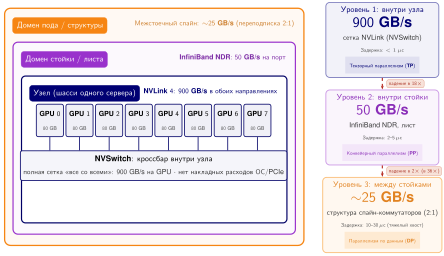

***Физическая иерархия топологии и обрывы пропускной способности:** границы аппаратуры определяют производительность коммуникации в трех различных доменах. Внутри узла NVLink обеспечивает двунаправленную пропускную способность 900 ГБ/с для коммуникации тензорного параллелизма. Внутри стойки линки InfiniBand/RoCE дают 50 ГБ/с для конвейерного параллелизма и параллелизма по данным. Между стойками и подами спайн-коммутаторные структуры снижают эффективную пропускную способность до 12–25 ГБ/с при переподписке 2:1–4:1.*

[Рисунок «Топология-неосведомленное и топология-осведомленное размещение»](#fig-topology-placement-paths) сопоставляет оптимальное и разбросанное размещение для группы тензорного параллелизма из 4 GPU. Он показывает, как путь коммуникации определяет, использует ли группа один листовой коммутатор или должна проходить более медленные переходы лист–спайн–лист.

<a id="fig-topology-placement-paths"></a>


***Размещение без учета топологии и с учетом топологии:** задание из 4 GPU, размещенное в двух стойках (слева, без учета топологии), должно проходить переходы лист–спайн–лист: 3 переключения коммутатора на сообщение AllReduce при эффективной пропускной способности около 12 ГБ/с. То же задание из 4 GPU, упакованное в одной стойке (справа, с учетом топологии), использует один листовой коммутатор: 1 переход при около 50 ГБ/с, примерно в 4× быстрее. Количественная сводка под рисунком сообщает число переходов через коммутаторы и эффективную пропускную способность.*

<a id="sec-fleet-orchestration-placement-algorithms"></a>

### Алгоритмы размещения

Разрыв пропускной способности, показанный на [рисунке «Топология-неосведомленное и топология-осведомленное размещение»](#fig-topology-placement-paths), — ключевое ограничение. Сокращение примерно в 4× от листовых путей внутри стойки до межстоечных путей лист–спайн–лист означает, что разбросанное размещение заставляет группы тензорного параллелизма тратить больше времени на коммуникацию, чем на вычисления. Этот штраф накапливается на каждом слое трансформера модели. Алгоритмы размещения с учетом топологии назначают задания узлам, минимизирующим стоимость коммуникации, превращая абстрактную задачу упаковки в задачу оптимизации графа на физической топологии кластера. Самый простой подход использует **стоимость локальности** (Locality Cost), определенную в [формуле «Оценка локальности»](#eq-fleet-orchestration-locality-score), которая штрафует выделения, охватывающие несколько доменов топологии:

<a id="eq-fleet-orchestration-locality-score"></a>

$$ \text{Стоимость}_{\text{локальности}} = \sum_{i < j} w(d(g_i, g_j)) $$

где $g_i$ и $g_j$ — GPU, назначенные заданию, $d(g_i, g_j)$ — их топологическое расстояние (0 для одного узла, 1 для одной стойки, 2 для разных стоек), а $w(\cdot)$ — весовая функция, которая растет с расстоянием. Планировщик минимизирует эту оценку при выборе выделения из множества допустимых размещений. Весовая функция кодирует влияние каждого уровня топологии на производительность: $w(0) = 0$ (один узел, NVLink, без штрафа), $w(1) = 1$ (одна стойка, один переход коммутатора), $w(2) = 10$ (разные стойки, несколько переходов коммутатора). Десятикратная разница весов между размещением в одной стойке и между стойками отражает непропорциональное влияние пересечения спайн-коммутаторов на производительность.

Более совершенные алгоритмы различают стратегии параллелизма, учитывая, что разные паттерны коммуникации имеют разные требования к пропускной способности и задержке. Тензорный параллелизм требует наибольшей пропускной способности и наименьшей задержки, потому что обменивается тензорами активаций на каждом слое; его следует ограничивать доменами NVLink внутри одного узла. Конвейерный параллелизм переносит умеренную задержку, потому что отправляет активации между стадиями реже (один раз на микропакет на границу стадий, а не на каждом слое); он может охватывать узлы внутри стойки, где InfiniBand дает достаточную пропускную способность. Параллелизм по данным с его объемной синхронизацией градиентов, которая может перекрываться с вычислениями, работает эффективно и между стойками, потому что коммуникация менее чувствительна к задержке и может эффективно использовать доступную пропускную способность.

[Алгоритм «Размещение с учетом топологии»](#algo-topology-aware-placement) объединяет эти элементы в одно решение: ограничение gang «все или ничего» из [раздела «Gang-планирование»](#sec-fleet-orchestration-gang-scheduling), стоимость локальности из [формулы «Оценка локальности»](#eq-fleet-orchestration-locality-score) и соответствие параллелизма топологии, описанное выше. Планировщик перечисляет выделения, которые помещаются, оценивает каждое по стоимости коммуникации и выбирает самое дешевое. Если ни одно не помещается, задание остается в очереди, а не занимает ускорители впустую.

<a id="algo-topology-aware-placement"></a>

**Алгоритм: размещение с учетом топологии**

```text
Вход:   задание, запрашивающее N ускорителей с группами тензорного, конвейерного и параллелизма по данным;
        топология кластера со стоимостями связей w(·) для каждого уровня
Выход:  размещение «все или ничего» с наименьшей стоимостью коммуникации, либо задание остается в очереди
перечислить допустимые слоты: наборы из N свободных ускорителей, удовлетворяющие всем измерениям ресурсов   # gang: все или ничего
если допустимых слотов нет:
    оставить задание в очереди, не удерживая ни одного ускорителя   # предотвращает взаимную блокировку удержания и ожидания
для каждого допустимого слота:
    отобразить ранги тензорного параллелизма внутри домена NVLink, стадии конвейера внутри стойки, реплики параллелизма по данным между стойками
    оценить слот по Стоимость_локальности = сумма_{i<j} w(d(g_i, g_j))
вернуть допустимый слот с наименьшей Стоимость_локальности   # оптимальный по топологии, атомарный
```

Разбросанное размещение выполняет AllReduce в 4,8× медленнее, чем слот с учетом топологии. Этот разрыв [рисунок «Влияние размещения на топологию»](#fig-topology-placement) разбивает по четырем стратегиям размещения: от случайной до оптимальной по топологии.

<a id="fig-topology-placement"></a>

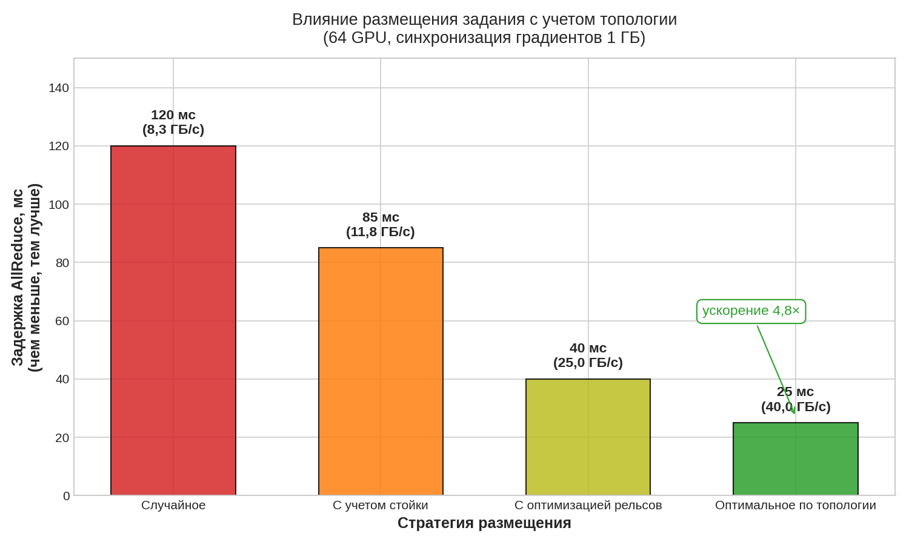

***Влияние размещения на топологию:** задержка AllReduce для четырех стратегий размещения (случайной, с учетом стойки, с оптимизацией по рельсам и оптимальной по топологии) при синхронизации градиентов на 1 ГБ на 64 GPU. Планирование с учетом топологии снижает задержку синхронизации с 120 мс до 25 мс, давая ускорение в 4,8×.*

Алгоритм **иерархического размещения** (Hierarchical Placement) назначает ресурсы слоями, которые соответствуют этой иерархии параллелизма. Сначала он назначает группы тензорного параллелизма отдельным узлам, обеспечивая, что все GPU в группе тензорного параллелизма имеют связность NVLink. Во-вторых, он группирует эти узлы в стадии конвейера внутри стоек, размещая последовательные стадии конвейера на узлах, связанных через один и тот же листовой коммутатор. В-третьих, он распределяет реплики параллелизма по данным по стойкам, обеспечивая, что каждая группа параллелизма по данным имеет доступ к полной бисекционной пропускной способности кластера для операций AllReduce. Это трехуровневое размещение повторяет трехуровневую топологию и трехуровневую стратегию параллелизма, создавая естественное соответствие между логической и физической структурой.

> **Влияние размещения на топологию**
>
> Физическое расположение GPU в структуре сетевых коммутаторов резко влияет на производительность коллективных операций. Рассмотрим операцию AllReduce на 64 GPU:
>
> - **Случайное размещение**: распределены по многим стойкам $\rightarrow$ трафик проходит через коммутаторы ядра $\rightarrow$ задержка 120 мс.
> - **С учетом стойки**: ограничены одной стойкой (коммутатор Top-of-Rack) $\rightarrow$ 85 мс.
> - **С учетом рельсов**: выровнены по специализированным «рельсам» (выделенным стандартным коммутаторам IB) $\rightarrow$ 40 мс.
> - **Оптимальное по топологии**: все GPU на одном листовом коммутаторе $\rightarrow$ 25 мс.
>
> Правильное планирование дает ускорение в 4,8× исключительно за счет учета сетевой топологии, без изменения кода модели.

Вычислительная стоимость размещения с учетом топологии нетривиальна. Перебор всех возможных размещений для задания на 256 GPU в кластере из 10 000 GPU комбинаторно неразрешим. Производственные планировщики используют эвристики: жадные алгоритмы, которые строят размещения снизу вверх (сначала заполнить домены NVLink, затем стойки, затем распределить по стойкам), алгоритмы поиска по дереву с отсечением, которые сначала исследуют самые перспективные размещения, или подходы на основе оценок, которые оценивают выборку допустимых размещений и выбирают лучшее. Задержка планирования, которую вносят алгоритмы с учетом топологии (от миллисекунд до секунд в зависимости от размера кластера и сложности алгоритма), пренебрежимо мала по сравнению с длительностью заданий от часов до недель. Поэтому прирост пропускной способности оправдывает накладные расходы планирования.

> **Влияние размещения на обучение с 3D-параллелизмом**
>
> **Сценарий**: рассмотрим учебное задание на 256 GPU с 3D-параллелизмом: 8-кратный тензорный, 4-кратный конвейерный и 8-кратный параллелизм по данным.
>
> **Хорошее размещение** (с учетом топологии):
>
> - Группы тензорного параллелизма: 32 группы по 8 GPU, каждая ограничена одним узлом на 8 GPU (NVLink: 900 ГБ/с)
> - Стадии конвейера: 4 последовательных узла внутри одной стойки (1 переход коммутатора, InfiniBand: 50 ГБ/с)
> - Реплики параллелизма по данным: 8 стоек (2 перехода коммутатора для межстоечного AllReduce)
>
> **Плохое размещение** (без учета топологии):
>
> - Группы тензорного параллелизма разделены между 2 узлами (InfiniBand вместо NVLink)
> - Стадии конвейера разбросаны по стойкам (2 перехода коммутатора вместо 1)
> - Реплики параллелизма по данным распределены случайно
>
> **Расчет**: одна коммуникация тензорного параллелизма иллюстрирует влияние. При NVLink, дающем 450 ГБ/с в каждом направлении, передача активаций в 1 ГБ занимает около 2,2 мс. По InfiniBand со скоростью 50 ГБ/с та же передача занимает около 20 мс, то есть замедление в 9×.
>
> **Системный вывод**: разрыв задержки AllReduce в 4,8× (см. рисунок выше) — это измерение только коммуникации. Он не становится сквозным штрафом в 4,8×, потому что синхронное обучение перекрывает большую часть этой коммуникации с вычислениями следующей итерации. Поскольку тензорный параллелизм обменивается данными на каждом слое трансформера (обычно 80 и более слоев для больших моделей), остаточная незамаскированная коммуникация накапливается до снижения общей пропускной способности обучения на 15–30 %. Эту цифру следует переносить на задания с 3D-параллелизмом.

<a id="sec-fleet-orchestration-rail-optimized"></a>

### Планирование с оптимизацией по рельсам

Большие кластеры GPU все чаще используют **рельсо-оптимизированные топологии** (Rail-Optimized Topologies), где каждый GPU узла подключен к другому сетевому коммутатору и создаются параллельные «рельсы» через сетевую структуру. Эта конструкция, разобранная в главе о сетевых структурах, обеспечивает сбалансированную пропускную способность всех GPU, распределяя трафик между независимыми иерархиями коммутаторов. Однако она создает и ограничение для планирования: AllReduce работает наиболее эффективно, когда взаимодействующие GPU находятся на одном рельсе (подключены к одной цепочке коммутаторов), потому что коммуникация внутри одного рельса избегает межрельсового трафика, который может создать перегрузку на общих портах коммутатора.

Рельс-осведомленное планирование назначает реплики параллелизма по данным так, чтобы соответствующие GPU на разных узлах принадлежали одному рельсу. Для кластера с 8 GPU на узел и 8 рельсами GPU 0 на каждом узле подключен к рельсу 0, GPU 1 к рельсу 1 и так далее. Планировщик размещает ранг параллелизма по данным $r$ на GPU $r \bmod 8$ на выбранных узлах. Это гарантирует, что AllReduce для каждой группы параллелизма по данным проходит только через одну иерархию коммутаторов рельса, а не переходит между рельсами. Такое выравнивание означает, что трафик AllReduce ограничен независимыми деревьями коммутаторов, что устраняет конкуренцию между группами параллелизма по данным и дает каждой группе полную пропускную способность ее выделенного рельса.

Взаимодействие рельс-осведомленного планирования и размещения с учетом топологии создает многомерную задачу оптимизации. Планировщик должен одновременно оптимизировать локальность внутри узла через NVLink (тензорный параллелизм требует GPU на одном узле), локальность внутри стойки через коммутатор (конвейерный параллелизм выигрывает от минимального числа переходов коммутатора между стадиями) и выравнивание по рельсам (параллелизм по данным выигрывает от коммуникации по одному рельсу). Эти три цели частично конфликтуют: ограничение реплик параллелизма по данным определенными позициями GPU внутри каждого узла (для выравнивания по рельсам) снижает гибкость выбора узлов по локальности стойки, а требование выделения целых узлов для локальности NVLink мешает делить узлы между заданиями, что могло бы повысить эффективность упаковки.

Производственные планировщики разрешают эти конфликты с помощью взвешенных функций оценки, которые ставят ограничения по приоритету в зависимости от характеристик нагрузки ([рисунок «Иерархическое размещение при 3D-параллелизме»](#fig-fleet-orchestration-hierarchical-placement)). Для больших учебных заданий с 3D-параллелизмом наибольший вес получает локальность тензорного параллелизма, потому что деградация производительности от NVLink к InfiniBand самая большая. Затем идет выравнивание по рельсам, потому что оно устраняет перегрузку для самого частого паттерна коммуникации, и наконец локальность стойки, поскольку выигрыш в производительности здесь меньше и может быть частично компенсирован перекрытием коммуникации с вычислениями. Для чисто параллельных по данным заданий наибольший вес получает выравнивание по рельсам. Для заданий на одном узле ограничения топологии не имеют значения, и планировщик оптимизирует исключительно эффективность упаковки.

<a id="fig-fleet-orchestration-hierarchical-placement"></a>

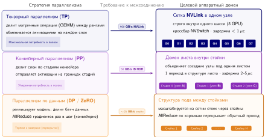

***Иерархическое размещение при 3D-параллелизме:** оптимальное размещение сопоставляет измерения распределенного обучения с соответствующими слоями физического межсоединения. Тензорный параллелизм (TP) строго размещается внутри узлов через NVLink (900 ГБ/с); конвейерный параллелизм (PP) размещается между соседними узлами внутри стойки (50 ГБ/с); а параллелизм по данным (DP) проходит между стойками через спайн-структуры, выровненные по рельсам.*

<a id="sec-fleet-orchestration-topology-discovery"></a>

### Обнаружение топологии и динамическая адаптация

Статические файлы конфигурации, такие как `topology.conf` в Slurm или метки узлов в Kubernetes, дают базовую карту кластера, но представляют намеченное состояние, а не действующее. Настоящее **обнаружение топологии** (Topology Discovery) требует интроспекции во время выполнения, чтобы проверить, что физическое оборудование соответствует архитектурной схеме. Библиотеки вроде NCCL обходят статические конфигурации: они разбирают виртуальную файловую систему Linux по пути `/sys/class/infiniband`, чтобы отобразить иерархию шины PCIe, перечислить связи NVLink и проверить близость сетевой карты (NIC). Это создает граф истинного состояния, где ребра представляют проверенные действующие линки, а не теоретические кабели.

Топология кластера — это рабочее состояние, а не фиксированная схема. Аппаратные отказы, окна обслуживания и тепловой троттлинг постоянно меняют действующую топологию, доступную планировщику. Отказ одного спайн-коммутатора в сети Clos не разрывает связность полностью, но резко снижает бисекционную пропускную способность для заданий, охватывающих затронутые стойки. Если спайн-коммутатор, обслуживающий группу AllReduce параллелизма по данным нашей модели на 175 млрд параметров, выходит из строя, межстоечная пропускная способность может упасть на 50 %. Перед планировщиком встает критическое решение по оптимизации: продолжить обучение с пониженной пропускной способностью, фактически теряя 25 % дорогих циклов GPU в ожидании отстающих градиентов, или инициировать миграцию с учетом топологии.

Миграция не бесплатна: она требует скоординированной контрольной точки, остановки задания, перепланирования на исправных узлах и фазы прогрева. Этот процесс обычно поглощает от 5 до 15 минут простоя. Однако для многонедельного учебного запуска арифметика часто выступает в пользу миграции. Если деградация сети создает штраф в 20 % к пропускной способности, точка безубыточности для 10-минутной миграции составляет меньше часа обучения. Продвинутые оркестраторы постоянно отслеживают метрики эффективной пропускной способности, которые сообщает библиотека коллективной коммуникации. Когда расхождение между назначенной оценкой топологии и реализованной пропускной способностью превышает порог, планировщик запускает процедуру «слить и мигрировать» (drain-and-migrate), рассматривая деградацию сети с той же серьезностью, что и аппаратный отказ GPU.

> **Хромающий коммутатор**
>
> **Сценарий**: многоузловое обучение фундаментальной модели демонстрирует падение пропускной способности на 30 %, при этом статические карты топологии показывают полную пропускную способность, а проверки аппаратного состояния GPU сообщают «все в порядке».
>
> **Диагноз**: приемопередатчик одного листового коммутатора испытывал высокий уровень ошибок CRC и повторных передач пакетов. Бинарные проверки «работает/не работает» проходили, но деградировавшая бисекционная пропускная способность тормозила коммуникацию AllReduce во всем учебном задании.
>
> **Системный урок**: бинарных проверок работоспособности недостаточно для структур распределенного обучения. Планировщикам нужен мониторинг топологии, учитывающий производительность: он отслеживает повторные передачи и пропускную способность коллективов и динамически помещает деградировавшие сетевые линки в карантин.

Общая идея планирования — карантин: когда данные времени выполнения говорят, что узел, стойка или линк деградировали, планировщик должен прекратить размещать там чувствительную работу, даже если номинальное число ресурсов еще выглядит доступным. Kubernetes реализует этот паттерн через **порчи и толерантности** (Taints and Tolerations)[^fn-taint-toleration-rule], тогда как кластеры Slurm обычно используют состояния drain, признаки узлов или правила разделов. Смежная проблема — как задания адаптируются, когда доступные ресурсы меняются динамически. Вместо того чтобы считать выделение ресурсов фиксированным на весь срок жизни задания, эластичное обучение позволяет заданиям расти, сжиматься и восстанавливаться без полных перезапусков.

[^fn-taint-toleration-rule]: **Порчи и толерантности (Taints and Tolerations)**: примитивы Kubernetes для отталкивания узлов, которые используются в парках ML для изоляции специализированного оборудования. Пометив узлы A100 или H100 порчей, оркестратор не дает универсальным веб-микросервисам занимать дорогую емкость GPU, и эти узлы остаются зарезервированными исключительно для учебных заданий, которые объявляют явные толерантности.

<a id="sec-fleet-orchestration-elastic-training"></a>

## Эластичное планирование

Когда спрос в кластере колеблется, жесткое выделение порождает два вида потерь. В периоды низкой нагрузки задание, работающее на 256 GPU, не может использовать простаивающие ресурсы, чтобы ускорить обучение. В периоды пикового спроса то же задание не может освободить лишние ресурсы для более приоритетной работы, не будучи полностью вытесненным. У планировщика есть только два варианта: «пусть сохраняет все ресурсы» или «убить полностью», и ничего между ними.

Эластичное планирование устраняет этот бинарный выбор. Механика восстановления эластичного обучения, разобранная в [разделе «Эластичное восстановление»](07_fault_tolerance.md#sec-fault-tolerance-reliability-reliability-elastic-training-4f87) главы об отказоустойчивости, показывает, как распределенное задание может менять число воркеров, пересчитывать размер батча и скорость обучения и перестраивать группу коммуникации после отказа. С точки зрения планировщика та же способность решает задачу распределения ресурсов при колеблющемся спросе. Задание обучения может начать работу на 128 GPU (минимум, нужный для разумной пропускной способности), вырасти до 256, когда появятся свободные ресурсы, и сократиться до 192, когда придет более приоритетная работа, при этом непрерывно продвигаясь в обучении. Такая гибкость превращает пространство действий планировщика из бинарного выбора {продолжить, вытеснить} в непрерывный спектр уровней выделения ресурсов.

<a id="sec-fleet-orchestration-elastic-contract"></a>

### Контракт между планировщиком и фреймворком

Эластичное планирование требует четко определенного контракта между планировщиком и фреймворком обучения. Планировщик гарантирует, что изменения ресурсов передаются через определенные сигналы с достаточным предварительным уведомлением для плавной адаптации. Фреймворк гарантирует, что способен обрабатывать изменения ресурсов без порчи состояния модели, используя механизмы корректировки размера батча, пересчета скорости обучения и перестройки группы коммуникации, разобранные в [разделе «Эластичное восстановление»](07_fault_tolerance.md#sec-fault-tolerance-reliability-reliability-elastic-training-mechanisms-49b1). Жизненный цикл членства воркеров следует конечному автомату, показанному на [рисунке](#fig-fleet-orchestration-elastic-state-machine): воркеры переходят между состояниями подготовки, активного обучения, динамической перебалансировки и самовосстановления после аппаратных отказов.

<a id="fig-fleet-orchestration-elastic-state-machine"></a>


***Жизненный цикл воркеров эластичного обучения и конечный автомат:** автомат, управляющий динамическим членством воркеров. Обучение начинается в состоянии «Ожидание и подготовка», через рандеву переходит в «Активное обучение» и адаптируется динамически через «Масштабирование вверх и перебалансировку» или «Вывод и сокращение» без полных перезапусков задания. Аппаратные отказы запускают самовосстановление.*

С точки зрения планировщика контракт имеет три параметра:

- **Диапазон эластичности**: $[N_{\text{min}}, N_{\text{max}}]$ задает число воркеров, в пределах которого может работать задание.
- **Стоимость перехода**: цикл рандеву, обычно 10–60 секунд, определяет, как часто планировщик может менять размер, не теряя выигрыш в пропускной способности из-за накладных расходов.
- **Кривая эффективности масштабирования**: прирост пропускной способности от каждого добавленного воркера определяет, продуктивнее ли отдать простаивающие GPU этому заданию, чем держать их для ожидающего задания с gang-планированием.

Контракт дает планировщику достаточно информации, чтобы менять размер задания, не считая эластичность бесплатной емкостью.

Планировщик должен также учитывать, что эластичное масштабирование меняет эффективный размер батча ($B_{\text{effective}} = B_{\text{per-worker}} \times N$). Две стратегии обработки этого (постоянный глобальный размер батча и адаптивная скорость обучения) накладывают разные ограничения на то, насколько агрессивно планировщик может менять размер: постоянный глобальный размер батча сохраняет сходимость, но при малом числе воркеров может нарушать лимиты памяти GPU, тогда как адаптивная скорость обучения упрощает управление воркерами, но вносит риск для сходимости при быстром масштабировании.

Фреймворки вроде TorchElastic задают диапазон членства воркеров в конфигурации запуска, как показано в листинге ниже.

<a id="lst-fleet-orchestration-torchelastic"></a>

***Конфигурация запуска TorchElastic:** флаг `--nnodes=4:16` задает эластичную группу воркеров, которая принимает от 4 до 16 узлов, или от 32 до 128 воркеров. Отдельный планировщик кластера или оператор должен получать, запускать и освобождать узлы в пределах этого диапазона.

```bash
# Запуск эластичного обучения: от 32 до 128 воркеров
torchrun \
  --nnodes=4:16 \
  --nproc_per_node=8 \
  --rdzv_backend=c10d \
  --rdzv_endpoint=head-node:29500 \
  --max_restarts=3 \
  train.py
```

Спецификация `--nnodes=4:16` задает диапазон рандеву и членства воркеров TorchElastic: от 4 до 16 узлов (от 32 до 128 воркеров при 8 процессах на узел). Она не выделяет и не меняет ресурсы кластера. Отдельный планировщик кластера или оператор должен размещать узлы и запускать или останавливать эластичные агенты по мере изменения емкости.

> **Справка: эластичное и жесткое планирование**
>
> Рассмотрим перегруженный кластер, где задание на 128 GPU ждет 8 часов полного gang-выделения.
>
> **Жесткое планирование**: ждать 8 часов, затем обучаться 24 часа на полной пропускной способности. Общее календарное время: 32 часа.
>
> **Эластичное планирование** (минимум 32, максимум 128):
>
> - Немедленный старт на 32 GPU (пропускная способность 25 % от полной)
> - Через 2 часа масштаб увеличивается до 64 GPU (пропускная способность 50 %)
> - Через 4 часа масштаб увеличивается до 128 GPU (пропускная способность 100 %)
> - Обучение продвигается в течение всего периода ожидания
>
> Примерный объем работы, выполненный за 8 часов «ожидания в очереди»:
>
> - Часы 0–2: $25\%$ пропускной способности $\times$ 2 часа = 0,5 часа эквивалента
> - Часы 2–4: $50\%$ пропускной способности $\times$ 2 часа = 1,0 часа эквивалента
> - Часы 4–8: $100\%$ пропускной способности $\times$ 4 часа = 4,0 часа эквивалента
> - Итого: 5,5 часа работы в эквиваленте полного масштаба
>
> Эластичное задание завершается примерно за 26,5 часа (8 часов масштабируемого обучения плюс 18,5 часа на полном масштабе), экономя 5,5 часа по сравнению с жестким планированием. Это улучшение на 17 % достигается полностью за счет продуктивного использования ресурсов в то время, которое иначе было бы простоем в очереди.

Планировщик не может считать каждое задание эластичным. Самое существенное ограничение — несовместимость с модельным параллелизмом. Эластичное масштабирование по сути является операцией параллелизма по данным: планировщик добавляет или удаляет реплики модели, меняя глобальный размер батча, но сохраняя архитектуру модели. Для задания на 175 млрд параметров, которое опирается на 8-кратный тензорный параллелизм внутри каждого узла, эластичность работает строго на уровне узлов. Задание может масштабироваться между 128 узлами (1 024 GPU) и 32 узлами (256 GPU) шагами по целым узлам, меняя степень параллелизма по данным. Оно не может эластично убрать один GPU из группы тензорного параллелизма: для этого пришлось бы перераспределить шарды весов модели, что эквивалентно полному циклу «контрольная точка и перезапуск». Конвейерный параллелизм в принципе допускает ограниченную эластичность, но добавление или удаление стадий требует пересчета расписания конвейера, что часто сводит выигрыш на нет.

Стоимость перехода также ограничивает частоту изменения размера. Каждое событие масштабирования вызывает от 10 до 60 секунд сниженной пропускной способности, пока фреймворк перестраивает группу коммуникации. Планировщик должен амортизировать эту стоимость на последующую продолжительность запуска, поэтому мелкие шаги изменения размера оправданы, только если задание будет работать на новом масштабе заметно дольше переходного окна. [Раздел «Политики эластичного масштабирования»](#sec-fleet-orchestration-elastic-policies) разбирает режим трешинга (thrashing), от которого защищает это правило.

<a id="sec-fleet-orchestration-elastic-scheduler-integration"></a>

### Интеграция с планировщиком

Ценность эластичного обучения критически зависит от интеграции с планировщиком. Без учета планировщиком эластичное обучение — это лишь механизм отказоустойчивости (замена отказавших воркеров). С интеграцией оно становится оптимизацией планирования, которая принципиально меняет экономику использования кластера. Планировщик должен понимать, что эластичные задания могут работать в диапазоне выделения ресурсов, заданном как $[N_{\text{min}}, N_{\text{max}}]$ воркеров, что открывает три ключевые оптимизации планирования.

Самая ценная выгода — более быстрый старт задания. Эластичное задание, запрашивающее от 32 до 128 GPU, может стартовать, как только станут доступны 32 GPU, вместо ожидания в очереди gang-планирования 128 смежных GPU. В перегруженных кластерах, где время ожидания крупных заданий составляет часы или дни, немедленный старт при сниженном масштабе часто завершает задание раньше, чем ожидание полного выделения. Этот компромисс количественно разобран во врезке «Решение об эластичном масштабировании» ниже. Планировщик может вычислять его динамически, выбирая момент старта и начальный масштаб, которые минимизируют ожидаемое полное время (время ожидания плюс время выполнения).

Оппортунистическое масштабирование позволяет планировщику использовать эластичные задания как гибкий буфер емкости. Когда ресурсы освобождаются (другие задания завершаются, предоставляются spot-инстансы, вытесненные задания возвращают ресурсы), планировщик может расширить работающие эластичные задания и повысить их пропускную способность. Когда ресурсы нужны (приходит задание более высокого приоритета, зарезервированная емкость отзывается), планировщик может сократить эластичные задания, не вытесняя их полностью. Эта двунаправленная гибкость превращает эластичные задания в буфер, который поглощает колебания загрузки и сглаживает разрыв между выделенной и продуктивной емкостью.

Плавное вытеснение (Graceful Preemption) меняет реакцию планировщика на нехватку ресурсов. Вместо того чтобы убить задание обучения ради освобождения ресурсов, планировщик может запросить сокращение, уменьшив выделение заданию, чтобы освободить емкость для более приоритетной работы. Задание продолжает работу с меньшим числом воркеров, сохраняя прогресс при сниженной пропускной способности, вместо того чтобы терять все с последней контрольной точки и нести накладные расходы на перезапуск. Это дает планировщику непрерывный спектр между «полными ресурсами» и «полностью вытесненным», вместо бинарного выбора традиционного планирования. Плавное вытеснение хорошо сочетается с вытеснением через контрольные точки: если планировщику нужно освободить все ресурсы, он сначала сокращает задание до минимального размера, а затем запускает последовательность «контрольная точка и вытеснение», минимизируя потерянную работу.

Плата за все эти выгоды — сложность. Эластичное обучение требует поддержки со стороны фреймворка (не все фреймворки ее предоставляют), вносит потенциальные проблемы сходимости из-за изменения размера батча (что требует проверки, не ухудшает ли эластичное масштабирование качество модели) и усложняет моделирование производительности (пропускная способность задания уже не постоянна, и планирование емкости становится труднее). Не все нагрузки получают одинаковую пользу от эластичного масштабирования. Задания с высоким отношением коммуникации к вычислениям получают убывающую отдачу от дополнительных воркеров, поскольку накладные расходы на коммуникацию растут с их числом, и поэтому меньше выигрывают от масштабирования вверх. Вычислительно-ограниченные задания с малыми накладными расходами на коммуникацию масштабируются почти линейно и больше выигрывают от оппортунистического масштабирования. Планировщик должен моделировать эти характеристики для каждого задания, чтобы принимать оптимальные решения об эластичном масштабировании.

<a id="sec-fleet-orchestration-elastic-policies"></a>

### Политики эластичного масштабирования

Добавление ресурсов работающему заданию не всегда ускоряет достижение сходимости. Наивное предположение, что пропускная способность растет линейно с числом воркеров, рушится под весом накладных расходов на коммуникацию, поэтому планировщик должен применять политики эластичного масштабирования, основанные на эмпирических кривых эффективности, а не только на доступности ресурсов. Эффективность масштабирования задания $\eta_{\text{scaling}}(k)$, определяемая как отношение наблюдаемой пропускной способности при $k$ воркерах к идеальному линейному ускорению, обычно имеет три фазы: линейную, где вычисления доминируют над коммуникацией; сублинейную, где задержка синхронизации градиентов начинает скрывать вычисления; и фазу насыщения, где кольцо AllReduce становится узким местом. Планировщик, который слепо назначает свободные GPU заданию в фазе насыщения, расходует емкость кластера, которая могла бы разгрузить очередь; и наоборот, запуск задания ниже его **минимально жизнеспособного масштаба** (Minimum Viable Scale) заставляет его удерживать память и сетевые аренды ради непропорционально малого прогресса.

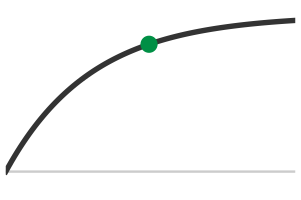

*Выгода от эластичного масштабирования выравнивается в фазе насыщения.*

Как показано на [рисунке](#fig-fleet-orchestration-scaling-efficiency-curve), решение о масштабировании поэтому определяется предельной полезностью, а не одной лишь вакантностью. Для нашей модели на 175 млрд параметров кривая эффективности получена профилированием: она линейна от 64 до 512 GPU, становится сублинейной между 512 и 1 024 и выходит на убывающую отдачу за пределами 1 024. Поэтому планировщик задает эластичный диапазон $[256, 1024]$. Если в кластере есть свободные ресурсы, но задание уже работает на 1 024 GPU, планировщик не добавляет лишние узлы, предсказывая, что прирост пропускной способности в 5 % не оправдывает накладных расходов на перераспределение шардов и альтернативной стоимости голодания ожидающего задания. Аналогично, если доступно только 128 GPU, планировщик может поставить задание в очередь, а не запускать его, поскольку интенсивность вычислений на GPU окажется слишком низкой, чтобы скрыть задержку коммуникации.

<a id="fig-fleet-orchestration-scaling-efficiency-curve"></a>

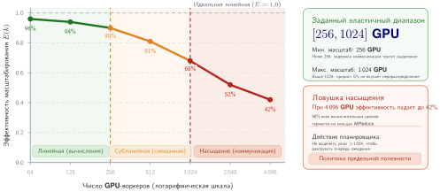

***Экспериментальная кривая эффективности масштабирования и рабочий диапазон эластичности:** наблюдаемая эффективность масштабирования ($\eta_{\text{scaling}}$) для размеров кластера от 64 до 4 096 GPU. Эффективность имеет три режима: линейное масштабирование ($\eta \ge 90\%$), сублинейное масштабирование ($70\% \le \eta < 90\%$) и насыщение коммуникации ($\eta < 70\%$). Планировщики ограничивают эластичное масштабирование жизнеспособным окном $[N_{\text{min}}, N_{\text{max}}]$, чтобы предотвратить отрицательную предельную полезность.*

Эта логика распространяется и на временное измерение: планировщик должен взвешивать немедленный прогресс меньшего выделения против отложенного выигрыша от ожидания большего. Если задание на 512 GPU может стартовать сразу на 128 GPU или подождать два часа ради полного запроса, оптимальный выбор зависит от интеграла пропускной способности по времени. Накладные расходы на вытеснение (стоимость остановки, сохранения контрольной точки и перезапуска ради смены размера) нужно амортизировать на последующую продолжительность запуска. Политика «оппортунистического масштабирования», которая меняет размер задания каждый раз, когда освобождается один узел, часто дает отрицательный чистый прогресс из-за постоянного трешинга группы распределенных процессов.

> **Решение об эластичном масштабировании**
>
> Рассмотрим задание обучения большой языковой модели с целевым размером батча, для пиковой эффективности которого нужны 512 A100. Три стратегии планирования оцениваются на окне в 24 часа.
>
> **Исходные данные**: пропускная способность на 128 GPU составляет 1 эпоху в час (базовый уровень). На 256 GPU — 1,8 эпохи в час (эффективность масштабирования 90 %). На 512 GPU — 3,2 эпохи в час (эффективность масштабирования 80 %). Стоимость изменения масштаба составляет 10 минут (0,17 часа) на сохранение контрольной точки, перераспределение шардов и перезапуск.
>
> **Стратегия 1: немедленный старт без масштабирования**: задание стартует сразу на 128 GPU и работает все 24 часа. Итоговый объем работы: $24 \times 1{,}0 = 24$ эпохи.
>
> **Стратегия 2: ожидание емкости (gang-планирование)**: задание ждет в очереди 4 часа, пока не освободятся 512 GPU, затем работает 20 часов. Итоговый объем работы: $20 \times 3{,}2 = 64$ эпохи.
>
> **Стратегия 3: эластичное масштабирование (ступенчатое увеличение)**: задание стартует сразу на 128 GPU. Через 4 часа становятся доступны 256 GPU. Задание приостанавливается, масштабируется вверх и возобновляется. Фаза 1: $4 \times 1{,}0 = 4$ эпохи. Фаза 2: $(24 - 4 - 0{,}17) \times 1{,}8 \approx 35{,}7$ эпохи. Итоговый объем работы: 4 + 35,7 = 39,7 эпохи.
>
> Эластичная стратегия дает почти в 1,7 раза больше работы в эквиваленте эпох, чем немедленный запуск в малом масштабе, но все еще отстает от gang-планирования примерно на 38 %. Разрыв сокращается, когда ожидание в очереди растет или пиковая емкость остается дефицитной. Стоимость перемасштабирования составляет всего 10 минут; если бы этот налог превысил 2 часа (из-за медленной передачи контрольной точки или компиляции), стратегия 3 отставала бы от стратегии 2 еще сильнее.

Рассмотренные до сих пор механизмы размещения и эластичности касаются эффективности отдельного задания: они оптимизируют, как каждое задание использует выделенные ему ресурсы. Экономика парка переносит цель на коллективный уровень: политика выделения должна максимизировать полезную работу по всем заданиям, поскольку каждое размещение, вытеснение и резервирование создает альтернативную стоимость.

<a id="sec-fleet-orchestration-cost-optimization"></a>

## Оптимизация стоимости

Связь между загрузкой и деньгами, установленная в [разделе «Проблема планирования»](#sec-fleet-orchestration-introduction), становится сигналом для планирования, а не полной финансовой моделью. Оркестратор учитывает цены ресурсов, обязательства по резервированию, риск прерывания, стоимость контрольных точек и сроки заданий, когда решает, принять, отложить, вытеснить или изменить размер работы. Более широкие вопросы капитального планирования, отдачи от платформы, показа и перевыставления затрат (showback и chargeback) и совокупной стоимости владения на протяжении жизненного цикла относятся к главе «Эксплуатация ML-систем в масштабе».

[На рисунке ниже](#fig-cost-idle-gpus) стоимость простоя показана явно: годовые потери как функция размера кластера и уровня загрузки. При 10 000 GPU и загрузке 50 % годовые потери превышают \$87 млн по учетной схеме главы (\$2 за GPU-час). Опубликованные измерения производственных кластеров подтверждают, что недогрузка — реальная эксплуатационная проблема: в исследовании кластера Philly компании Microsoft (Jeon et al., 2019) средняя загрузка GPU составила около 52 %, а Li et al. (2023) выяснили, что 50 % заданий на суперкомпьютере Perlmutter в NERSC использовали менее 25 % выделенной памяти GPU. Заштрихованная полоса 30–70 % на рисунке — иллюстративный рабочий диапазон для модели стоимости, а не универсальное эмпирическое утверждение о всех производственных кластерах. Переход от загрузки 50 % к 70 % на кластере из 10 000 GPU в этом сценарии экономит более \$35 млн в год, и при этом не нужно покупать ни одного дополнительного GPU.

<a id="fig-cost-idle-gpus"></a>

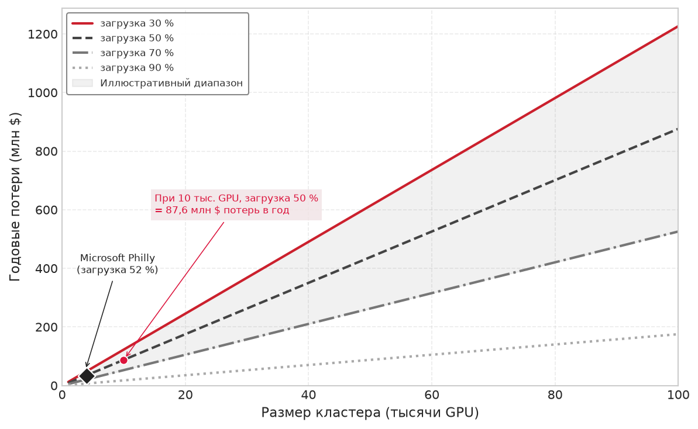

***Стоимость простаивающих GPU:** годовые потери как функция размера кластера для разных уровней загрузки GPU при цене \$2 за GPU-час (эквивалент облачной цены). Заштрихованная область между 30 и 70 % — иллюстративный рабочий диапазон для сценарного анализа. При 10 000 GPU и загрузке 50 % модель дает \$87,6 млн годовых потерь мощности. Точка Microsoft Philly отмечает опубликованную среднюю загрузку GPU 52 %. Источники данных: (Jeon et al., 2019; Li et al., 2023).*

Рисунок о простаивающей емкости задает экономическую цель; остальные инструменты контроля стоимости объясняют, как планировщик к ней движется. Прерываемая емкость снижает цену толерантной к прерываниям работы, политика резервирования и квот решает, какие задания заслуживают дефицитной гарантированной емкости, а механизмы подотчетности делают простаивающие GPU видимыми для команд, которые создают спрос.

<a id="sec-fleet-orchestration-spot-instances"></a>

### Spot-инстансы и прерываемые виртуальные машины

Облачные провайдеры предлагают **spot-инстансы**[^fn-spot-instances-cloud] (AWS) или **прерываемые виртуальные машины** (Preemptible VMs, GCP) со скидкой 60–90 % по сравнению с ценой по требованию. Оговорка состоит в том, что инстансы могут быть отозваны с предупреждением всего в 30 секунд — 2 минуты, когда провайдеру нужна емкость для клиентов с оплатой по требованию. При \$0,70 за GPU-час вместо \$2 spot-инстансы меняют экономику крупномасштабного обучения: стоимость многонедельного предобучения может снизиться с сотен тысяч долларов до менее ста тысяч.

[^fn-spot-instances-cloud]: **Spot-инстансы**: названы по «спотовой цене» биржевой торговли (текущая рыночная цена немедленной поставки). Они продают избыточную облачную емкость со скидкой 60–90 % при сохранении за провайдером права на отзыв. Решающая асимметрия для обучения ML — окно уведомления о прерывании: AWS дает 2 минуты, GCP — 30 секунд. Модели на 175 млрд параметров нужно 3–5 минут на контрольную точку, поэтому 30-секундного уведомления GCP хватает только на то, чтобы либо нести непрерывные накладные расходы на контрольные точки, либо принимать потерю работы при каждом прерывании.

Пригодность spot-инстансов для обучения ML зависит от двух факторов, которые определяют, превращается ли скидка в реальную экономию: стоимость каждого прерывания (накладные расходы на контрольную точку, время перезапуска и потерянная работа с последней контрольной точки) и частота прерываний (она зависит от типа инстанса, региона, времени суток и общего спроса в облаке). **Эффективная стоимость** (Effective Cost) обучения на spot-инстансах задается формулой:

<a id="eq-fleet-orchestration-spot-cost"></a>

$$ C_{\text{effective}} = C_{\text{spot}} \times \frac{T_{\text{total}}}{T_{\text{productive}}} $$

где $T_{\text{total}}$ включает время продуктивного обучения, накладные расходы на контрольные точки и накладные расходы на перезапуски после прерываний, а $T_{\text{productive}}$ — время, в течение которого обучение действительно продвигается. Если прерывания редки (реже одного раза в сутки), а контрольные точки эффективны (накладные расходы менее 5 %), эффективная стоимость остается близкой к цене spot, и экономия почти равна полной скидке. Если прерывания частые (каждые несколько часов), а перезапуски дороги (большая модель, медленная загрузка контрольных точек, холодный кэш GPU), эффективная стоимость может приблизиться к цене по требованию или даже превысить ее, и видимая скидка превращается в скрытую наценку.

Связь между экономией на spot-инстансах и инфраструктурой отказоустойчивости в важном смысле круговая. Механизмы отказоустойчивости из [главы об отказоустойчивости](07_fault_tolerance.md#sec-fault-tolerance-reliability) (частое асинхронное сохранение контрольных точек, быстрая загрузка контрольных точек, эластичное восстановление) напрямую делают возможным использование spot-инстансов, минимизируя стоимость каждого прерывания. Эластичное обучение позволяет заданиям продолжать работу с меньшим числом воркеров, когда часть spot-инстансов отзывается, полностью избегая перезапуска. Организации, которые инвестировали в отказоустойчивость по соображениям надежности, обнаруживают, что та же инфраструктура открывает значительную экономию за счет использования spot-инстансов, и отдача от инвестиций в отказоустойчивость оказывается далеко больше предотвращенных потерь работы из-за аппаратных отказов.

Стратегический вывод состоит в том, что инфраструктура отказоустойчивости дает двойную отдачу: она защищает от непроизвольных потерь (аппаратных отказов) и позволяет получать добровольную экономию (spot-инстансы). Эта двойная отдача часто оправдывает инвестиции в отказоустойчивость, которые трудно обосновать одними соображениями надежности, поскольку экономия от использования spot-инстансов конкретна и измерима, тогда как предотвращенные потери от аппаратных отказов статистичны и труднее поддаются количественной оценке.

<a id="sec-fleet-orchestration-spot-strategies"></a>

### Стратегии использования spot-инстансов для обучения ML

Чтобы извлечь максимум из spot-инстансов при минимальных сбоях, продвинутые планировщики применяют стратегии диверсификации и прогнозирования, которые выходят за рамки простой логики «повторить при отказе». Диверсификация по зонам доступности снижает вероятность одновременного отзыва по всему парку. Облачные провайдеры обычно управляют пулами spot независимо для каждой зоны доступности (AZ). Если задание обучения требует 1 024 GPU и все они выделены одним блоком в одной зоне, задание полностью останавливается, когда пул spot этой зоны отзывается. Распределение задания по нескольким AZ гарантирует, что событие отзыва в одной зоне затронет лишь часть парка. Планировщик все же должен тщательно моделировать корреляцию: независимые прерывания отдельных инстансов делают одновременные большие потери маловероятными, но отзывы на уровне пула или зоны могут сразу забрать сотни GPU и должны обрабатываться как события эластичного сокращения или переключения при отказе, а не как обычные изолированные отказы.

Диверсификация по типам инстансов использует независимые spot-рынки разных моделей GPU. Задание, которое строго запрашивает один тип инстанса, конкурирует на одном переполненном рынке. Задание, которое принимает несколько эквивалентных типов инстансов, резко повышает вероятность размещения. Планировщик должен вести упорядоченный по приоритету список допустимых типов инстансов и переходить на инстансы с большим объемом памяти, когда основной тип недоступен. Хотя такая смесь требует аккуратного управления попарной пропускной способностью, она позволяет использовать «апгрейд», чтобы поддерживать прогресс по смешанной стоимости, которая все еще намного ниже тарифов по требованию.

Сигналы о спотовой емкости могут направлять размещение, но не обязательно предсказывают частоту прерываний. Например, AWS Spot Placement Score оценивает текущую вероятность того, что запрос емкости в регионе или зоне доступности будет удовлетворен; он прямо не предсказывает риск прерывания. Планировщик может использовать этот сигнал, чтобы выбрать, где запрашивать емкость, но оценка числа прерываний в сутки требует отдельных исторических измерений для типа инстанса и региона. Если получившаяся модель восстановления для конкретной нагрузки показывает, что накладные расходы на прерывания съедают скидку, планировщик должен перенести задание на емкость по требованию или в другой регион.

Оптимизация частоты контрольных точек для spot-инстансов отличается от стандартной логики надежности. Формула Янга–Дэйли, разобранная в [разделе о законе Янга–Дэйли](07_fault_tolerance.md#sec-fault-tolerance-young-daly), оптимизирована для непредсказуемых аппаратных отказов. Однако прерывания spot сопровождаются предупреждением: 2 минуты на AWS, 30 секунд на GCP. **Двухуровневое сохранение контрольных точек** (Two-Tier Checkpointing) сочетает периодическую контрольную точку с интервалом Янга–Дэйли и контрольную точку «по возможности», запускаемую уведомлением о завершении. Контрольная точка по уведомлению сокращает потерю работы, только если успевает завершиться в окне предупреждения. Когда полная контрольная точка большой модели занимает больше времени, заданию приходится опираться на уже выполняющуюся асинхронную или инкрементальную контрольную точку и принимать откат к последнему надежно сохраненному состоянию.

Та же необходимость в планировании на случай непредвиденных обстоятельств становится острой, когда прерывания spot коррелированы, а не изолированы.

> **Справка: коррелированный риск spot-инстансов**
>
> **Контекст**: spot-емкость дешева, потому что ее можно отозвать. Этот риск не является независимым для разных инстансов: облачные регионы, типы инстансов, запуски продуктов и сроки могут создавать коррелированный спрос.
>
> **Режим отказа**: парк, который сосредоточивает все прерываемое обучение в одном регионе и одном типе инстансов, может сразу потерять большую долю воркеров, даже если каждый отдельный воркер выглядит пригодным к перезапуску.
>
> **Последствие**: контрольные точки справляются с изолированными прерываниями; они не решают вытеснение в масштабе парка, когда каждая повторная попытка нацелена на один и тот же исчерпанный пул.
>
> **Системный вывод**: надежный планировщик должен диверсифицировать по регионам и типам инстансов, отслеживать риск прерываний и поддерживать путь «аварийного выхода» (break glass) на емкость по требованию, когда спотовый рынок становится неблагоприятным.

<a id="sec-fleet-orchestration-capacity-reservation"></a>

### Стратегии резервирования емкости

Организации, которые опираются на облачную инфраструктуру (или рассматривают собственную инфраструктуру в экономических терминах), балансируют между тремя уровнями вычислительной емкости, каждый из которых предлагает свой компромисс между стоимостью, доступностью и обязательствами. [Таблица ниже](#tbl-cloud-capacity-reservation-tiers) сравнивает эти уровни по стоимости, доступности, риску прерывания и соответствию нагрузкам.

<a id="tbl-cloud-capacity-reservation-tiers"></a>

***Уровни резервирования облачной емкости:** уровни емкости обменивают стоимость и обязательства на гарантии доступности и риск прерывания, давая планировщику ценовую лестницу для маршрутизации нагрузок по срочности и устойчивости к перезапуску.*

| **Уровень емкости**    | **Стоимость и обязательства**                                        | **Доступность и риск прерывания**                                    | **Наиболее подходящие нагрузки**                                                                                 |
|:-----------------------|:---------------------------------------------------------------------|:---------------------------------------------------------------------|:-----------------------------------------------------------------------------------------------------------------|
| **Зарезервированная емкость** | Обязательства на один–три года, скидка 30–60 % по сравнению с ценой по требованию. | Гарантированная доступность для обещанной базовой нагрузки. | Предсказуемые постоянные нагрузки: круглосуточный инференс, плановое обучение, CI и регрессионное тестирование, задания с SLA. |
| **Емкость по требованию** | Полная цена без долгосрочных обязательств.                           | Немедленное предоставление, когда очередь или прерывание недопустимы. | Срочное переобучение, интерактивная отладка и короткие задания, которые не оправдывают управления spot-инстансами. |
| **Spot-емкость**       | Прерываемая емкость со скидкой.                                      | Доступность зависит от спроса в облаке, воркеры могут быть отозваны. | Задания, устойчивые к перезапуску: перебор гиперпараметров, абляции, предобучение с контрольными точками и исследовательская работа. |

Как показано на [рисунке](#fig-fleet-orchestration-capacity-reservation), оптимальная смесь зависит от характеристик нагрузки и приоритетов организации. Организация со стационарной загрузкой 60 % и пиковым спросом 40 % может зарезервировать емкость под 60 % пиковой потребности, использовать емкость по требованию для чувствительных к задержке всплесков, которым нужно немедленное предоставление, а остаток покрывать spot-емкостью. Система планирования должна понимать эти уровни емкости и соответствующим образом направлять нагрузки: инференс — на зарезервированную емкость ради гарантированной доступности; крупные учебные задания — на смесь зарезервированной емкости (для базового выделения) и spot-емкости (для дополнительных воркеров через эластичное масштабирование); а исследовательская работа — исключительно на spot-емкость там, где экономия максимальна и толерантность к прерываниям наибольшая.

<a id="fig-fleet-orchestration-capacity-reservation"></a>

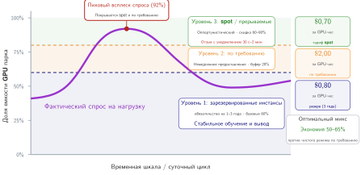

***Уровни резервирования емкости и оптимизация портфеля:** три уровня облачной емкости (зарезервированная, по требованию и spot или прерываемая) обменивают удельную стоимость на обязательства и гарантии доступности. Планировщики сопоставляют базовый стационарный спрос с зарезервированной емкостью, суточные пики — с инстансами по требованию, а обучение, устойчивое к перезапуску, — с дешевыми spot-пулами.*

> **Справка: spot-инстансы и обучение по требованию**
>
> Рассмотрим обучение модели на 70 млрд параметров, которое требует 512 GPU в течение 14 дней.
>
> **По требованию**: 512 GPU $\times$ 336 часов $\times$ \$2 за GPU-час = \$344 064
>
> **Spot** (скидка 65 %, накладные расходы на контрольные точки 5 %, 14 прерываний в сутки с перезапуском за 30 минут):
>
> - Базовая стоимость: 512 GPU $\times$ 336 часов $\times$ \$0,70 за GPU-час = \$120 422
> - Накладные расходы на контрольные точки: $5\%$ $\times$ 336 часов = 16,8 часа
> - Накладные расходы на перезапуски: 196 прерываний $\times$ 0,5 часа = 98 часов
> - Общее время: 336 часов + 16,8 часа + 98 часов = 450,8 часа
> - Итоговая стоимость: 512 GPU $\times$ 450,8 часа $\times$ \$0,70 за GPU-час = \$161 567
>
> **Экономия**: \$182 497 (53,0 %) ценой примерно на 34,2 % большего календарного времени.
>
> Экономика становится убедительной, когда инфраструктура отказоустойчивости уже на месте. Без контрольных точек одно прерывание вынуждает перезапускать задание с нуля, что потенциально растрачивает дни вычислений и сводит всю экономию на нет.

<a id="sec-fleet-orchestration-cost-scheduling"></a>

### Планирование с учетом эффективности стоимости


Планирование с учетом стоимости расширяет целевую функцию планировщика за пределы загрузки и справедливости, включая финансовую эффективность. Традиционные планировщики минимизируют одну цель (например, среднее время завершения заданий или максимальное время ожидания), тогда как планировщики, учитывающие стоимость, должны решать многокритериальные компромиссы, где время, деньги и надежность — все являются переменными решения. Планировщик регулярно выбирает между тремя классами решений:

- **Ждать или запускать сейчас**: запустить задание на зарезервированных A100 сейчас или подождать 2 часа ради spot-H100, которые выполнят задание в $3\times$ быстрее при половине стоимости.
- **Вытеснить или заплатить больше**: вытеснить низкоприоритетный перебор гиперпараметров, чтобы освободить место для приоритетного обучения на зарезервированной емкости, или разместить обучение на более дорогих инстансах по требованию.
- **Откат или эластичное сокращение**: когда spot-емкость отзывается, перенести задание на инстансы по требованию, чтобы сохранить пропускную способность ценой роста расходов, или эластично сократить задание, сохранив низкую стоимость при сниженной пропускной способности.

Каждое решение по-разному оценивает время, деньги и надежность, поэтому планирование с учетом стоимости — это проектирование политики, а не простая упаковка (bin packing).

Эти решения требуют, чтобы планировщик моделировал и ценность времени (организационная стоимость двухчасовой задержки в продуктивности исследователей, графиках запуска продуктов или конкурентной позиции), и финансовую стоимость разных распределений ресурсов. Ценность времени сильно зависит от типа нагрузки: задержка переобучения рабочей модели на 2 часа может нарушить соглашение об уровне обслуживания (SLA) и обойтись в тысячи долларов штрафов, тогда как задержка исследовательского эксперимента на 2 часа не стоит ничего, кроме терпения исследователя.

Производственные системы обычно задают **политики стоимости** (Cost Policies) для каждого класса нагрузок, кодируя эти компромиссы в конфигурации, а не требуя человеческого суждения в каждом решении. Инференс закрепляется за зарезервированной емкостью ради гарантированной доступности и предсказуемой задержки, поскольку стоимость простоя инференса (потерянная выручка, ухудшение пользовательского опыта) намного превышает надбавку за зарезервированную цену. Крупные учебные задания используют смесь зарезервированной емкости (для минимально жизнеспособного выделения) и spot-емкости (для эластичного расширения), с автоматическим откатом на емкость по требованию, если spot отозван, а задание укладывается в настраиваемый срок. Исследовательские нагрузки ограничиваются spot-емкостью, чтобы минимизировать стоимость, с пониманием, что их могут прервать и что они должны переносить переменное время завершения.

Планировщик не реализует финансовую систему учета организации. Он использует получившиеся ценовые сигналы и сигналы политик: предельную цену каждого уровня емкости, резервирование, которое может требовать проект, риск прерывания, который он может принять, и срок, который он должен соблюсти. Показ, перевыставление и распределение затрат (showback, chargeback и attribution) рассмотрены в главе «Эксплуатация ML-систем в масштабе»; эта глава использует их результаты только для ранжирования допустимых действий планировщика.

<a id="sec-fleet-orchestration-tco"></a>

### Использование сигналов совокупной стоимости владения


Совокупная стоимость владения (TCO) определяет ценовые сигналы, которые получает планировщик, но сама по себе не является механизмом планирования. Анализ «купить или построить» и TCO на протяжении жизненного цикла рассмотрены в главе «Эксплуатация ML-систем в масштабе». Оркестратору нужны только получившиеся альтернативные издержки по каждому ресурсу и ограничения политик, включая то, является ли емкость собственной, зарезервированной, по требованию или прерываемой.

> **Контрольные вопросы: компромиссы планирования с учетом стоимости**
>
> Прежде чем перейти к специализированным ML-планировщикам, проверьте, как взаимодействуют механизмы оптимизации стоимости:
>
> - [ ] **Точка безубыточности spot**: определите частоту сохранения контрольных точек, при которой обучение на spot становится дороже, чем по требованию, для задания на 512 GPU длительностью 14 дней при скидке spot 65 %, одном прерывании в сутки и накладных расходах на перезапуск 30 минут.
> - [ ] **Двойная отдача**: объясните, почему инфраструктура отказоустойчивости дает «двойную отдачу» в виде надежности и экономии средств, и определите минимальные инвестиции в отказоустойчивость, необходимые, чтобы spot-инстансы стали жизнеспособными.
> - [ ] **Размер резервирования**: определите, сэкономит или растратит деньги организация, увеличив зарезервированную емкость с 40 % до 60 %.

Ценообразование spot и стратегия резервирования сокращают стоимость запуска задания, но оставляют без внимания второй источник эффективности: динамику обучения внутри цикла обучения. Модели стоимости, которые мы рассмотрели, оптимизируют время до завершения, тогда как для исследовательской организации важна метрика «время до точности» — календарное время до достижения запуском целевого значения метрики на валидации. Планировщик, слепой к сходимости, не может определить, находится ли запуск на крутом раннем участке или в хвосте убывающей отдачи, и поэтому не может перенаправить ресурсы туда, где они дают наибольший прогресс. Закрыть этот разрыв призваны специализированные ML-планировщики, рассмотренные в [разделе «Специализированные планировщики для ML»](#sec-fleet-orchestration-custom-schedulers).

<a id="sec-fleet-orchestration-custom-schedulers"></a>

## Специализированные планировщики для ML

Планировщики общего назначения рассматривают учебные задания как непрозрачные ящики, поэтому не могут определить, находится ли модель на крутом раннем участке обучения или в финальной фазе убывающей отдачи. Специализированные ML-планировщики обменивают сложность реализации на эту видимость: они заглядывают внутрь цикла обучения, чтобы оптимизировать время до точности, а не только время до завершения. Вопрос выбора в том, какой внутренний сигнал устраняет главное узкое место парка, и четыре системы различаются не столько уровнем сложности планировщика, сколько сигналом, которому они предлагают платформе доверять: потребленным сервисом, границами итераций, ценностью завершения или измеренной полезной пропускной способностью (goodput).

<a id="sec-fleet-orchestration-tiresias"></a>

### Tiresias: планирование без оценки длительности

**Tiresias** (Gu et al., 2019) решает фундаментальную проблему, выявленную в [разделе о gang-планировании](#sec-fleet-orchestration-gang-scheduling): длительности заданий ML непредсказуемы, а политики планирования, опирающиеся на точные оценки длительности, могут принимать плохие решения, когда эти оценки недоступны или ненадежны. Вместо борьбы с этой информационной асимметрией Tiresias полностью отказывается от требования оценок длительности. Он использует планировщик **двумерного полученного сервиса** (Two-Dimensional Attained Service)[^fn-attained-service-scheduling], который принимает решения о приоритете на основе того, что задание уже потребило, а не того, что, как оно утверждает, потребит. Задания накапливают «сервис» по потребленному GPU-времени, и приоритет снижается по мере роста сервиса. Два измерения — время (сколько задание уже работает) и ресурсы (сколько GPU использует задание) — отражают и прошедшую длительность, и интенсивность использования ресурсов.

[^fn-attained-service-scheduling]: **Планирование по полученному сервису** (Attained Service Scheduling): дисциплина из теории очередей операционных систем, в которой приоритет снижается с накопленным потреблением ресурсов; она приближает теоретически оптимальную политику «кратчайшее оставшееся время обработки» (SRPT), не требуя знания будущего, которое нужно SRPT. В кластерах ML этот приближенный подход особенно эффективен, потому что длительности заданий имеют тяжелый хвост: большинство отправленных заданий — короткие эксперименты, поэтому понижение приоритета заданий с большим сервисом корректно выделяет долгоживущие выбросы, не требуя от пользователей оценок времени выполнения, которые они не могут точно вычислить.

Дискретизированная версия группирует задания в корзины сервиса (например, менее 1 GPU-часа, от 1 до 10, от 10 до 100 и более 100 GPU-часов) и продвигает задания из нижних корзин в начало очереди. Такая структура корзин означает, что все короткие задания (большая часть отправленной работы) получают высокий приоритет и быстро выполняются, тогда как немногие длинные задания, потребляющие большую часть ресурсов кластера, постепенно теряют приоритет относительно новых поступлений. Ключевая идея в том, что такое поведение приближает теоретически оптимальную политику SRPT без знания будущего, которое она требует: задания, которые потребили мало сервиса, статистически с большей вероятностью короткие, поэтому их приоритизация — хорошая эвристика для минимизации среднего времени завершения.

Эксперименты на трассах производственных кластеров Microsoft и Alibaba показывают снижение среднего времени завершения заданий на 40–60 % по сравнению с планированием FIFO, причем наибольшие улучшения получают короткие задания, которые раньше ждали долгих учебных запусков. Улучшение не бесплатно: долгие учебные задания завершаются позже, поскольку их систематически понижают в приоритете. Однако совокупный эффект положителен, потому что коротких заданий намного больше, чем длинных, и выигрыш коротких заданий в сумме превышает штраф длинных.

<a id="sec-fleet-orchestration-gandiva"></a>

### Gandiva: планирование с учетом итераций

**Gandiva** (Xiao et al., 2018) использует разделение времени по границам итераций, что повышает загрузку за счет контролируемой переподписки. Кластер из 100 GPU может поддерживать 120 одновременных заданий, если каждое тратит 20 % времени итерации на ожидание данных, поскольку планировщик может чередовать загрузку данных одного задания с вычислениями GPU другого на том же устройстве. Ключевая идея, которая делает это практичным, состоит в том, что границы итераций дают естественные точки вытеснения, где состояние GPU минимально. Между итерациями на GPU находятся только веса модели и состояние оптимизатора; промежуточные активации прямого и обратного проходов уже освобождены. Такое минимальное состояние делает переключение контекста дешевым (секунды вместо минут), в отличие от вытеснения посреди итерации, когда занята вся память активаций.

Gandiva также реализует **эластичность «рост–сжатие»** (Grow-Shrink Elasticity) с большей детализацией, чем эластичное обучение на уровне фреймворка, рассмотренное в [разделе «Эластичное планирование»](#sec-fleet-orchestration-elastic-training). Gandiva автоматически меняет степень параллелизма по данным в зависимости от доступности ресурсов в реальном времени, используя профилированное время итераций для прогноза влияния добавления или удаления воркеров на пропускную способность. Когда приходит задание высокого приоритета, Gandiva сокращает задания низкого приоритета, уменьшая число их воркеров, а не убивая их полностью, — так сохраняется их прогресс и освобождаются ресурсы. Когда ресурсы снова становятся доступны, задания наращиваются до предпочтительной степени параллелизма. Такая мелкозернистая эластичность, основанная на реальных данных профилирования на уровне итераций, позволяет принимать решения планирования, которые системы общего назначения принять не могут, поскольку у них нет видимости внутри заданий.

> **Случай из практики: хромающий коммутатор (2021)**
>
> **Контекст**: в распределенном кластере на 16 384 GPU обучение базовой модели испытывало сильное падение пропускной способности, несмотря на здоровые метрики выполнения на GPU (Sigler, 2021).
>
> **Механизм**: одиночный приемопередатчик на межстоечном спайн-коммутаторе испытывал повышенный уровень битовых ошибок, из-за чего пропускная способность линка упала со 100 Гбит/с до 1 Гбит/с ($100\times$ обвал пропускной способности). Стандартные проверки доступности (ping и статус «работает») показывали зеленый, но синхронизация градиентов AllReduce $T_{\text{sync}}$ остановилась на всех 16 384 GPU в ожидании отстающего линка.
>
> **Последствия**: эффективность аппаратного обеспечения кластера $\eta_{\text{hw}}$ упала с 45 % до 8 %, сжигая более 15 000 GPU-часов в сутки, пока телеметрия на уровне сети не пометила деградировавший порт коммутатора.
>
> **Исправление**: инженеры внедрили автоматические микробенчмарк-зонды и телеметрию ошибок пакетов, чтобы автоматически изолировать и помещать в карантин деградировавшие порты коммутатора до назначения заданий.
>
> **Системный урок**: бинарного мониторинга «работает или не работает» недостаточно для масштабирования распределенных систем. Планировщикам нужна непрерывная телеметрия с учетом производительности (счетчики коммутаторов, частоты повторных передач пакетов, коллективные бенчмарки), чтобы автоматически помещать в карантин деградировавшие сетевые пути.

<a id="sec-fleet-orchestration-themis"></a>

### Themis: справедливость по времени завершения

Традиционное справедливое распределение (fair-share) считает все GPU-секунды равноценными, даже когда равные доли дают очень разные задержки завершения. **Themis** (Mahajan et al., 2020) вместо этого измеряет справедливость в нормированном времени завершения: каждое задание сравнивает свое время завершения при конкуренции со временем, которое оно получило бы при изолированной справедливой доле кластера.

Themis распределяет ресурсы так, чтобы улучшить худшее соотношение справедливости по времени завершения среди заданий. Задание, близкое к завершению, может получить больше ресурсов, если короткая задержка раздула бы его нормированное время завершения сильнее, чем то же изменение выделения повлияло бы на другое задание. Ожидание не тратит уже потребленные GPU-часы; оно лишь откладывает момент, когда результат становится доступен. Поэтому метрика сравнивает задержку завершения, а не затраченные вычисления, и не дает политике казаться справедливой лишь потому, что она в конце концов уравнивает GPU-секунды.

Такой подход выгоден коротким заданиям и заданиям, близким к завершению, без чрезмерного штрафа для длинных, и согласует решения о планировании с экономической ценностью завершения работы, а не с простым учетом потребления ресурсов. Themis реализует эту метрику через аукционный механизм, в котором задания делают ставки на ресурсы в зависимости от их текущей предельной ценности (насколько улучшается время завершения на каждый выделенный GPU-час), создавая рыночную динамику, которая естественным образом направляет ресурсы туда, где их ценность наибольшая.

<a id="sec-fleet-orchestration-pollux"></a>

### Pollux: адаптивное выделение ресурсов

**Pollux** (Qiao et al., 2021) выбирает самый агрессивный подход из четырех исследовательских планировщиков, совместно оптимизируя выделение ресурсов и гиперпараметры обучения. Если Tiresias, Gandiva и Themis принимают решения о заданиях (когда запускать, как делить), то Pollux принимает решения внутри заданий (сколько GPU и какой размер батча). Ключевое наблюдение состоит в том, что оптимальное число GPU для учебного задания зависит от текущего размера батча, скорости обучения и уровня шума градиента, а все это меняется в ходе обучения по мере того, как модель проходит разные фазы сходимости.

Pollux динамически меняет выделение GPU и размер батча каждого задания, чтобы максимизировать **полезную пропускную способность всего кластера** (Cluster-Wide Goodput), определяемую как скорость полезного продвижения обучения по всем заданиям одновременно. Метрика goodput объединяет обе стороны компромисса в одно число: статистическую эффективность (насколько каждый шаг градиента продвигает сходимость, что зависит от размера батча) и системную пропускную способность (сколько шагов градиента в секунду, что зависит от числа GPU и накладных расходов на коммуникацию). Задание, которое получает убывающую отдачу от текущего числа GPU (поскольку накладные расходы на коммуникацию растут сверхлинейно), может передать GPU заданию, которое выиграет больше (поскольку оно находится в фазе обучения, где большие батчи улучшают статистическую эффективность).

Такая совместная оптимизация планирования и гиперпараметров дает улучшение среднего времени завершения заданий на 37–50 % по сравнению с планированием при фиксированном выделении ресурсов. Улучшение приходит из двух источников: лучшего выделения ресурсов (GPU достаются заданиям, где они дают наибольший прогресс) и лучшей настройки размера батча (каждое задание работает с размером батча, который балансирует статистическую и вычислительную эффективность для текущей фазы обучения). Совокупный эффект больше, чем эффект каждой оптимизации по отдельности.

<a id="sec-fleet-orchestration-scheduler-comparison"></a>

### Сравнение планировщиков

Специализированные ML-планировщики представляют собой поэтапный компромисс между сложностью реализации и точностью планирования, поэтому сравнение в [таблице ниже](#tbl-fleet-orchestration-scheduler-comparison) важно как фильтр для внедрения, а не как ранжирование. Планировщики общего назначения видят заявленные ресурсы и грубые метаданные времени выполнения; эти исследовательские системы добавляют специфичные для ML сигналы: структуру итераций, эластичность, фазу сходимости и измеренный goodput.

<a id="tbl-fleet-orchestration-scheduler-comparison"></a>

***Сравнение специализированных ML-планировщиков:** таксономия исследовательских планировщиков по характеристике нагрузки, которую они используют. Tiresias и Themis оптимизируют очередные метрики (время завершения заданий, справедливость), используя внешние сигналы, тогда как Gandiva и Pollux оптимизируют эффективность по внутренним данным профилирования. JCT — время завершения задания (job completion time).*

| **Планировщик** | **Ключевая идея**                          | **Сигнал планирования** | **Целевая функция**      |        **Накладные расходы** |  **Готовность к производству** |
|:----------------|:-------------------------------------------|:-----------------------:|:------------------------:|:----------------------------:|:-----------------------------:|
| **Tiresias**    | Полученный сервис предсказывает оставшееся время | Потребленные GPU-часы | Минимизировать среднее JCT | Низкие (без профилирования) | Средняя |
| **Gandiva**     | Границы итераций — точки вытеснения        | Время итераций          | Максимизировать загрузку | Средние (профилирование)    | Средняя |
| **Themis**      | Задержка завершения определяет справедливость | Нормированное время завершения | Улучшить худшую справедливость | Низкие (метаданные заданий) | Низкая (сложность аукциона) |
| **Pollux**      | Размер батча и выделение связаны           | Goodput (статистический и системный) | Максимизировать goodput кластера | Высокие (непрерывное профилирование) | Низкая (интеграция с фреймворком) |

Это пространство решений выявляет фундаментальное напряжение между сложностью планировщика и качеством планирования (см. [таблицу](#tbl-fleet-orchestration-scheduler-comparison)). Tiresias работает с наименьшим объемом информации, по сути угадывая, что «молодые» задания скоро завершатся, но при этом получает значительный выигрыш просто за счет того, что не дает крупным заданиям блокировать мелкие. Он устойчив, поскольку не требует участия пользователя или фреймворка обучения. На другом полюсе Pollux требует глубокой двусторонней интеграции: планировщик должен знать кривую масштабирования задания и масштаб шума градиента, а задание должно принимать команды на изменение размера батча и скорости обучения на лету. Когда эта интеграция работает, она дает наибольшую пропускную способность всего кластера; когда допущения нарушаются (например, модель с нестабильной динамикой сходимости, которая не выдерживает изменений размера батча), оптимизация рушится.

Режимы отказа в целом повторяют этот градиент сложности. Tiresias деградирует мягко: если его допущение (что прошлое потребление предсказывает будущее) неверно, он просто вырождается в стандартную политику справедливого распределения. Режим отказа Gandiva — это джиттер производительности: если фаза профилирования неверно оценит дисперсию итераций, он может упаковать несовместимые задания на один узел и вызвать взаимные помехи. У Pollux самый хрупкий режим отказа, поскольку он меняет саму семантику обучения; неверная модель goodput теоретически может навредить сходимости модели — на такой риск некоторые производственные команды не готовы идти даже ради заявленного выигрыша во времени завершения заданий.

Для нашей модели на 175 млрд параметров эти компромиссы диктуют гибридный жизненный цикл. Pollux дает наибольший потенциальный выигрыш на раннем, нестабильном этапе обучения, где размеры батчей малы и задание эластично; он мог бы динамически менять размер задания, чтобы заполнять свободные «окна» в кластере. Однако для эффективного использования Pollux нужно модифицировать цикл обучения, чтобы он учитывал эластичность. Tiresias дает самый простой путь внедрения: он рассматривал бы модель на 175 млрд как «тяжелое» задание и понижал бы его приоритет относительно небольших экспериментов, сохраняя отзывчивость кластера для исследователей без изменений кода самой модели. На практике большинство команд инфраструктуры начинают с политик в духе Tiresias, чтобы решить проблему «заблокированной очереди», прежде чем переходить к глубокой интеграции, которую требует Pollux.

Общая тема всех четырех систем в том, что использование предметного знания о нагрузках ML (предсказуемое время итераций, убывающая отдача от параллельного масштабирования и встроенная возможность перезапуска с контрольной точки) дает заметно лучшие результаты планирования, чем одни лишь статические запросы ресурсов. Обобщенный планировщик видит задание, которое запрашивает 64 GPU на 3 дня; ML-планировщик видит процесс стохастического градиентного спуска, который сходится нелинейно, освобождает ресурсы, если производительность выходит на плато, и может быть вытеснен с минимальными потерями. Схема выбора между этими планировщиками зависит от главного узкого места: для исследовательских кластеров с высокой текучестью разделение времени Gandiva минимизирует задержку в очереди; для производственного обучения, где основной SLA — время завершения задания, приоритизация по возрасту Tiresias предотвращает голодание; для крупномасштабного обучения, где эффективность ресурсов первостепенна, адаптивное масштабирование Pollux возвращает «разрыв эластичности», который оставляет статическое выделение.

Задача для производственных систем — учесть эти идеи, сохранив операционную надежность, гибкость политик и организационное управление, которые требуются производственной среде. Производственные платформы обычно заимствуют идеи планировщиков избирательно, поскольку надежность, управление, гетерогенное оборудование и пользовательские политики ограничивают чисто исследовательские решения.

<a id="sec-fleet-orchestration-research-to-production"></a>

### От исследований к производству

Исследовательские планировщики становятся полезными в производстве, только если их ключевой сигнал выдерживает столкновение с гетерогенным дата-центром. В исследованиях кластер часто считают однородным пулом ускорителей с единой топологией соединений, а задания — добропорядочными сущностями, которые точно заявляют свои потребности в ресурсах. В производстве «кластер» — это геологический пласт поколений оборудования: V100 вместе с A100 и H100, соединенные лоскутным одеялом из InfiniBand и Ethernet, и задания, которые часто падают, зависают или искажают свои требования к памяти. Поэтому ни один крупный гиперскейлер не «устанавливает» исследовательский планировщик как есть; вместо этого они избирательно переносят отдельные алгоритмы в стандартные оркестраторы через операторы Kubernetes или плагины Slurm.

Рассмотрим наш учебный запуск модели на 175 млрд параметров. Чистая реализация Pollux могла бы агрессивно менять размер задания в зависимости от общей загрузки кластера, наращивая и сокращая число GPU ради максимума goodput. Однако изменение числа воркеров для синхронного учебного задания требует цикла «контрольная точка и перезапуск», который для модели такого размера означает запись терабайтов состояния оптимизатора в постоянное хранилище. Если интервал перемасштабирования слишком короткий, накладные расходы ввода-вывода на контрольные точки сводят прирост пропускной способности на нет. На практике производственные команды применяют гибридный подход: адаптивное выделение в стиле Pollux используют главным образом на волатильном раннем этапе обучения или для перебора гиперпараметров, а модель на 175 млрд фиксируют в статическом выделении с учетом топологии, как только завершается разогрев скорости обучения и задание переходит в многомесячное стационарное состояние.

Производственное решение состоит в том, улучшает ли специализированная политика предельное выделение достаточно, чтобы оправдать операционную нагрузку. Эта глава оценивает такое решение по задержке в очереди, полезным GPU-часам, налогу на вытеснение и эффективности размещения. Более широкое решение об инвестициях в платформу, включая укомплектование штата, капитальное планирование, стоимость жизненного цикла и отдачу портфеля, относится к главе «Эксплуатация ML-систем в масштабе».

Риск не ограничивается стоимостью реализации: поведение планировщика может также не соответствовать семантике выполнения распределенного обучения.

> **Случай из практики: взаимная блокировка gang-планирования в OpenAI (2021)**
>
> **Контекст**: OpenAI масштабировала кластеры Kubernetes до 7 500 узлов для нагрузок, включая GPT-3, CLIP и DALL-E. Ее крупные учебные задания использовали выполнение в стиле MPI, где все воркеры группы должны были быть запланированы одновременно, прежде чем обучение могло продвинуться (Sigler, 2021).
>
> **Механизм**: планирование по умолчанию в Kubernetes размещало поды поэтапно, без ограничения «все или ничего». Когда два крупных эксперимента запросили емкость кластера, Kubernetes разместила половину подов каждого задания по узлам.
>
> **Последствия**: оба учебных задания бесконечно простаивали, удерживая выделенные GPU, давали нулевой прогресс обучения и взаимно блокировали ресурсы кластера.
>
> **Исправление**: OpenAI разработала специальные операторы gang-планирования для Kubernetes, которые обеспечивают атомарное размещение подов по принципу «все или ничего».
>
> **Системный урок**: распределенное планирование ML должно кодировать семантику выполнения задания. Для обучения в стиле MPI «запланирована часть подов» — это не частичный прогресс, а растраченное выделение. Производственным планировщикам нужны gang-планирование, квоты и политики, учитывающие нагрузку, а не только общее размещение подов.

Планировщик, созданный для общего размещения подов, будет неверно обрабатывать нагрузки, которым нужна семантика gang, и одно лишь учет gang не решает конфликтов приоритетов между конкурирующими учебными заданиями. Каждый из четырех исследовательских планировщиков, рассмотренных в этом разделе, решает одну грань этой проблемы (оценка времени выполнения, вытеснение по границам итераций, справедливость по времени завершения или совместная настройка ресурсов и гиперпараметров), но ни один не решает все грани одновременно. Пространство решений — это поэтому набор явных компромиссов, а не единственная оптимальная политика.

> **Контрольные вопросы: пространство решений специализированных планировщиков**
>
> Рассмотрите компромиссы между четырьмя исследовательскими планировщиками:
>
> - [ ] **Планирование без оценок**: определите, какую информацию Tiresias жертвует, отказываясь от оценок времени выполнения, и опишите, когда эта жертва ухудшает качество планирования.
> - [ ] **Границы разделения времени**: определите нагрузки, для которых разделение времени по границам итераций у Gandiva не работает, и объясните почему.
> - [ ] **Голодание заданий**: оцените, может ли предпочтение Themis почти завершенным заданиям лишать бесконечного ожидания долгие задания предобучения.
> - [ ] **Риск модели goodput**: опишите режим отказа, когда модель goodput у Pollux ошибается.

Специализированные планировщики максимизируют пропускную способность для долгих учебных заданий, но операционная реальность резко меняется, когда модели развертываются для инференса. Целевая функция переключается с максимизации загрузки кластера на гарантию отклика на уровне миллисекунд. Управление ресурсами обслуживания должно справляться с всплесковым, непредсказуемым трафиком, соблюдая жесткие SLO (целевые уровни обслуживания).

<a id="sec-fleet-orchestration-serving"></a>

## Управление ресурсами обслуживания

Учебные задания — предсказуемые пакетные нагрузки, которые работают неделями; нагрузки обслуживания — волатильные пользовательские сервисы, которые должны отвечать за миллисекунды на непредсказуемые всплески трафика. Когда платформа электронной коммерции запускает крупную распродажу, парк обслуживания должен мгновенно автомасштабироваться, чтобы обрабатывать тысячи запросов в секунду. Управление ресурсами обслуживания заставляет оркестратор балансировать эти жесткие ограничения по задержке с сырой загрузкой оборудования.

Для оркестрации ключевой факт об обслуживании состоит в том, что емкость инференса — это живая оболочка вокруг пользовательского трафика, а не пакетное выделение вокруг учебного задания. Оркестратор парка управляет этой оболочкой, увеличивая и уменьшая число реплик вместе со спросом, изолируя нагрузки обслуживания от взаимных помех и балансируя потребности инференса с претензиями обучения на ту же общую инфраструктуру.

<a id="sec-fleet-orchestration-autoscaling"></a>

### Автомасштабирование инференса

Kubernetes **Horizontal Pod Autoscaling (HPA)** меняет число реплик на основе наблюдаемых метрик: добавляет экземпляры при росте нагрузки и убирает их при снижении. Метрика автомасштабирования по умолчанию для обычных облачных нагрузок — загрузка CPU с целевыми значениями 50–70 %. Это значение по умолчанию плохо отражает нагрузки инференса на GPU по двум причинам. Во-первых, загрузка GPU — шумная метрика, которая может быть высокой, даже когда система не обрабатывает пользовательские запросы (фоновое обслуживание, прогрев модели). Во-вторых, связь между загрузкой GPU и задержкой инференса сильно нелинейна: задержка может резко вырасти, когда загрузка переходит порог (обычно 70–80 % для инференса на GPU), и масштабирование по загрузке становится реактивным, а не предиктивным. Выбор метрики поэтому — первое решение планирования для обслуживания: [таблица ниже](#tbl-fleet-orchestration-autoscaling-metrics) перечисляет пользовательские метрики инференса, которые предсказывают ухудшение, видимое пользователю, до того, как оно случится.

<a id="tbl-fleet-orchestration-autoscaling-metrics"></a>

***Метрики автомасштабирования инференса:** пользовательские метрики для нагрузок инференса на GPU точнее отражают связь между нагрузкой и производительностью, видимой пользователю, чем стандартная загрузка CPU. Глубина очереди служит опережающим индикатором ухудшения задержки, тогда как ожидающие токены отражают незавершенную работу авторегрессивного декодирования; занятость KV-кэша и распределение длины контекста определяют, несет ли эта работа также риск нехватки памяти.*

| **Метрика**             | **Целевой диапазон** | **Комментарии**                                                 |
|:------------------------|:--------------------:|:----------------------------------------------------------------|
| **Загрузка GPU**        |     60–80 %          | Зависит от эффективности батчинга модели                        |
| **Глубина очереди запросов** | 10–50 запросов  | Предотвращает скачки задержки до того, как они проявятся в P99  |
| **Задержка P99**        |  Ниже целевого SLO   | Реактивная метрика, отстает от изменений спроса на секунды и минуты |
| **Ожидающие токены**    |  Зависит от модели   | Токены в очереди или декодируемые в данный момент по активным запросам |

Помимо метрик для HPA из [таблицы](#tbl-fleet-orchestration-autoscaling-metrics), **Vertical Pod Autoscaling (VPA)** работает по другой оси: он корректирует запросы и лимиты ресурсов отдельных подов. Если HPA меняет число запущенных экземпляров, то VPA меняет объем ресурсов, который получает каждый экземпляр. Для инференса VPA может подобрать размер выделения памяти по наблюдаемым паттернам использования, предотвращая избыточное выделение оперативной памяти CPU и ресурсов хоста, которое уменьшает число подов инференса, помещающихся на каждый узел. Ресурсы GPU нельзя масштабировать вертикально без перезапуска пода (контекст CUDA нужно инициализировать заново), что ограничивает пользу VPA для ускоренных нагрузок, где загрузка модели занимает минуты. Однако VPA полезен для процессорных компонентов конвейеров инференса — предобработки, постобработки и токенизации, — где требования к ресурсам могут заметно отличаться от первоначальных оценок и могут корректироваться при кратком перезапуске пода.

Инференс больших языковых моделей (LLM) требует особых соображений масштабирования, которые ни HPA, ни VPA полностью не покрывают, из-за характера роста **кэша ключей и значений** (KV-кэш)[^fn-kv-cache-orchestration] в памяти. Модель на 70 млрд параметров, обслуживающая запросы с длинным контекстом, может требовать более 80 ГБ памяти GPU только под KV-кэш, даже когда движок обслуживания хранит этот кэш в страничных, несмежных блоках. Узким местом памяти GPU при обслуживании LLM поэтому являются не веса модели (они фиксированы), а KV-кэш (он растет с числом запросов и длиной контекста). Решения о масштабировании должны учитывать и частоту запросов, и распределение длины контекста, а не только вычислительную нагрузку. Внезапный рост числа запросов с длинным контекстом (например, переход от коротких запросов к чат-боту к суммаризации документов) может исчерпать память GPU даже при умеренной частоте запросов, требуя расширения несмотря на низкую загрузку вычислений GPU. И наоборот, всплеск множества запросов с коротким контекстом может нагружать вычисления, не угрожая лимитам памяти.

[^fn-kv-cache-orchestration]: **Страничный KV-кэш** (Paged KV cache): страничная организация меняет способ выделения кэша и снижает фрагментацию, но не меняет его роста с длиной последовательности и числом одновременных запросов. Поэтому автомасштабировщики должны следить за давлением на память, даже когда загрузка вычислений остается низкой.

Эта двойная ресурсная природа (вычисления и память) означает, что эффективное автомасштабирование LLM должно следить и за загрузкой вычислений GPU, и за давлением на память GPU, расширяясь, когда любой из показателей приближается к критическим порогам. Некоторые производственные системы задают составную метрику масштабирования, которая объединяет эти измерения, и запускают расширение, когда максимум нормированной загрузки вычислений и нормированного давления на память превышает порог. Такой составной подход не дает системе стать неожиданностью для любого из типов исчерпания ресурсов. [Рисунок ниже](#fig-fleet-orchestration-inference-autoscaling) иллюстрирует эту архитектуру управления с обратной связью, где двухсигнальная телеметрия подает данные на предиктивный и реактивный контроллеры, координирующие выделение подов и предварительный прогрев реплик.

<a id="fig-fleet-orchestration-inference-autoscaling"></a>

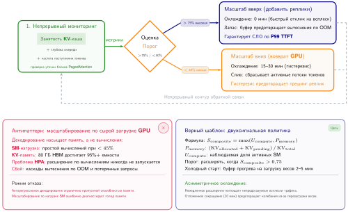

***Замкнутое управление автомасштабированием инференса:** двухсигнальная архитектура управления следит и за давлением на память GPU (занятость KV-кэша), и за вычислительной нагрузкой (загрузка SM, глубина очереди). Телеметрия питает и реактивный цикл HPA, и предиктивный контроллер прогрева, который выделяет реплики раньше дедлайнов холодного старта.*

Автомасштабирование инференса также должно учитывать **задержку холодного старта** (Cold Start Latency), которая создает напряжение между экономической эффективностью и отзывчивостью без простого решения. Проблема холодного старта в обслуживании количественно серьезнее, чем в обычных веб-сервисах, из-за огромной массы весов модели. Модель на 70 млрд параметров в FP16 занимает около 140 ГБ, и все это должно попасть в память GPU до того, как можно будет обслужить первый запрос; передача ограничена пропускной способностью PCIe или NVLink. Даже при скорости PCIe Gen4 x16 в каждом направлении 32 ГБ/с сырая передача занимает более 4 секунд, а на практике инициализация модели, компиляция графа и проверки безопасности растягивают это до 60–120 секунд. Загрузка с твердотельных накопителей NVMe (Non-Volatile Memory Express) при скорости чтения 7 ГБ/с занимает около 20 секунд; с сетевого хранилища она может превышать 2 минуты.

Агрессивные политики сокращения, которые завершают реплики во время коротких затиший трафика, создают болезненные холодные старты, когда трафик возвращается через минуты, что вызывает скачки задержки, нарушающие SLO, и ухудшает пользовательский опыт. Фундаментальная проблема в том, что трафик инференса демонстрирует всплесковость на нескольких временных масштабах (секунды, минуты, часы), и краткосрочные затишья не предсказывают надежно устойчиво низкий спрос. За пятиминутным затишьем может последовать всплеск трафика, и стоимость холодного старта в ходе этого всплеска (ухудшенная задержка для всех запросов, пока модель загружается) может превысить экономию от нескольких минут высвобожденной емкости GPU.

Производственные системы решают проблему холодного старта тремя взаимодополняющими стратегиями:

- **Минимальное число реплик** (Minimum Replica Count): поддержание хотя бы одной прогретой реплики выше нуля устраняет холодный старт для первого всплеска трафика, но создает базовые издержки даже в действительно простаивающие периоды.
- **Предиктивное масштабирование** (Predictive Scaling): масштабирование по историческим паттернам трафика, таким как суточные циклы, недельные паттерны и известные события, добавляет емкость до ожидаемых пиков, а не реагирует после прихода нагрузки.
- **Предварительный прогрев** (Prewarming): загрузка реплик модели в память GPU на резервных GPU сокращает время активации с минут загрузки модели до секунд инициализации процесса, но резервные реплики занимают память GPU, которая не может обслуживать другие нагрузки.

Организации с несколькими моделями, конкурирующими за один пул GPU, должны балансировать накладные расходы на прогрев со штрафом за холодный старт, выбирая, какие модели держать прогретыми, исходя из их паттернов трафика и требований к задержке.

<a id="sec-fleet-orchestration-predictive-autoscaling"></a>

### Предиктивное автомасштабирование и управление SLO

Реактивное автомасштабирование (как Kubernetes HPA) по своей природе смотрит назад: оно фиксирует нарушение метрики (например, загрузка GPU выше 80 %), ждет окна стабилизации и только потом запускает расширение. Для контейнера, который стартует за миллисекунды, эта задержка пренебрежимо мала. Для модели на 175 млрд параметров, которой нужно 3 минуты, чтобы загрузить веса с диска в память GPU, эта задержка губительна для SLO. Если трафик удваивается за 30 секунд — реалистичный сценарий при запуске продукта или вирусном событии, — реактивный масштабировщик выделит новые реплики только тогда, когда всплеск уже насытит существующий парк, что вызовет окно в 3 минуты ухудшенной задержки и потерянных запросов.

Ответ парка на задержку холодного старта — это подбор емкости и предварительный прогрев. Оркестратор держит достаточно прогретых реплик или подготовленного состояния моделей, чтобы новая размещенная емкость была готова раньше, чем прогнозируемый спрос превысит существующую оболочку. Непрерывный батчинг, допуск запросов, очередь и сброс нагрузки определяют, как плоскость обслуживания использует эту оболочку, пока стартуют новые реплики; эти механизмы для отдельного запроса рассмотрены в [главе «Инференс в масштабе»](10_inference.md#sec-inference-scale).

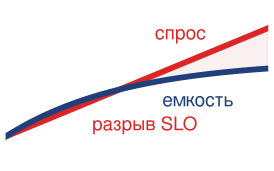

*Реактивное автомасштабирование открывает разрыв SLO на время холодного старта.*

Предиктивное автомасштабирование отделяет действия по масштабированию от текущей нагрузки. Анализ исторических паттернов трафика (суточные циклы, сезонность по дням недели) и учет опережающих индикаторов в реальном времени (например, всплеск запросов на вход часто предшествует всплеску запросов инференса) позволяют планировщику заранее подготовить емкость до прихода спроса. Обслуживание нашей модели на 175 млрд с SLO по P99 500 мс требует такого опережения. Если модели нужно 3 минуты, чтобы стать готовой, предиктивный масштабировщик должен отдать команду на расширение не менее чем за 4 минуты до ожидаемого роста трафика. Это превращает задачу масштабирования из задачи теории управления (реакция на ошибку) в задачу прогнозирования (предсказание будущего).

Эффективные политики масштабирования должны управляться **SLO**, а не загрузкой. Ориентир на фиксированную загрузку (например, «держать GPU на уровне 70 %») — это прокси, который часто подводит: модель может нарушить целевую задержку при загрузке 60 % из-за конкуренции за пропускную способность памяти или безопасно работать при 90 %, если запросы ограничены вычислениями и однородны. Политика, управляемая SLO, прямо нацелена на важную метрику: «расширять, когда задержка P99 превышает 400 мс (80 % от целевых 500 мс)». Такой подход автоматически адаптируется к изменениям характеристик нагрузки. Если новая версия модели менее эффективна, метрика задержки растет быстрее, и масштабировщик выделит больше реплик для поддержания SLO без ручной настройки порогов загрузки.

Чтобы предотвратить **колебания** (Oscillation), при которых масштабировщик быстро добавляет и убирает реплики при шумном трафике, производственные системы используют **гистерезис** (Hysteresis) и **периоды охлаждения** (Cooldown Periods). Типичная политика расширяет масштаб агрессивно (без окна стабилизации), чтобы защитить SLO, но сокращает консервативно (охлаждение 15 минут), чтобы избежать трешинга. Эта асимметрия учитывает, что стоимость ненужного расширения (потраченные впустую вычисления за 15 минут) намного ниже стоимости пропущенного расширения (нарушение SLO и отток пользователей).

> **Задержка автомасштабирования**
>
> Рассмотрим парк обслуживания из 10 реплик, каждая из которых способна обрабатывать 5 запросов в секунду (QPS) при соблюдении SLO в 500 мс. Общая емкость: 50 QPS.
>
> **Сценарий**: трафик линейно растет с 40 до 80 QPS за 60 секунд. Время загрузки модели: 3 минуты (180 секунд).
>
> **Реактивное масштабирование**: HPA обнаруживает перегрузку в момент $t =$ 15 с (когда трафик достигает 50 QPS). Он запрашивает 10 новых реплик. Эти реплики готовы в момент $t =$ 195 с (15 + 180 секунд). С $t =$ 15 с до $t =$ 195 с спрос превышает емкость. Во время роста избыточный спрос линейно растет от 0 до 30 QPS; после того как рост достигает 80 QPS, полная перегрузка в 30 QPS сохраняется до готовности новых реплик. Площадь над емкостью составляет примерно 4 725 эквивалентов запросов накопленного избыточного спроса. Эти запросы становятся очередью или сбрасываются в соответствии с политикой обслуживания; перевод этой величины в число нарушений SLO требует модели очереди, которая отслеживает задержку и сброс запросов.
>
> **Предиктивное масштабирование**: планировщик прогнозирует рост и запускает расширение в момент $t =$ −180 с. 10 новых реплик выходят в строй в момент $t = 0$ с, поднимая емкость до 100 QPS как раз к началу роста. При этих идеализированных допущениях рост не создает отставания, вызванного емкостью.

<a id="sec-fleet-orchestration-resource-isolation"></a>

### Изоляция ресурсов

Когда несколько нагрузок инференса делят одно физическое оборудование, возникают проблемы «шумного соседа»: потребление ресурсов одной нагрузкой ухудшает производительность другой. На GPU помехи проявляются через четыре общих канала ресурсов:

- **Пропускная способность памяти**: передача данных одной нагрузки может насытить интерфейс HBM.
- **Конкуренция за кэш L2**: рабочий набор одной нагрузки может вытеснить кэшированные данные другой.
- **Узкие места PCIe**: одновременные передачи между хостом и устройством могут конкурировать за пропускную способность шины.
- **Тепловые эффекты**: тепловыделение одной нагрузки может вызвать тепловой троттлинг, который затрагивает все нагрузки на том же GPU.

Для чувствительного к задержке инференса даже небольшие помехи могут поднять задержку P99 выше порогов SLO, превращая внешне хорошо обеспеченную систему в систему, нарушающую SLO.

MIG занимает край сильной изоляции ресурсов в этом пространстве решений. [Таблица профилей MIG](#tbl-fleet-orchestration-mig-profiles) уже показала фиксированные профили; операционный вывод в том, что аппаратное разбиение снижает взаимные помехи между нагрузками, но превращает выбор раздела в ограничение размещения. MIG доступен на поддерживаемых центрах обработки данных GPU NVIDIA с поддержкой MIG, профили могут требовать вывода затронутых нагрузок перед перенастройкой, а фиксированные размеры разделов могут не соответствовать требованиям нагрузки. Нагрузка, которой нужно 15 ГБ памяти GPU, теряет 5 ГБ в экземпляре MIG на 20 ГБ или вовсе не помещается в экземпляр на 10 ГБ.

Программные подходы к изоляции дают больше гибкости ценой более слабых гарантий. Эффективное совместное использование GPU для инференса требует навигации по иерархии механизмов изоляции, каждый из которых обменивает производительность на безопасность. На самом простом уровне **CUDA Time-Slicing** позволяет нескольким процессам делить GPU, переключая контексты вычислительных ресурсов. Будучи гибким, он дает слабую изоляцию производительности, поскольку контексты конкурируют за все устройство во времени. **Multi-Process Service (MPS)** NVIDIA[^fn-mps-gpu-sharing] позволяет ядрам и копиям памяти из разных процессов перекрываться, снижая накладные расходы на переключение контекста и повышая загрузку, когда один процесс не может заполнить устройство (NVIDIA, 2026). На Volta и более новых GPU каждый клиент MPS имеет отдельное виртуальное адресное пространство GPU, но клиенты по-прежнему делят исполнительные блоки, кэши, пропускную способность памяти и часть домена отказа MPS. Разделение адресных пространств поэтому не означает той изоляции производительности и отказов, которую дает MIG.

Учет памяти GPU все равно должен не позволять одной модели занимать емкость, зарезервированную для другой. Отдельное виртуальное адресное пространство блокирует прямую адресацию чужих выделений, но не создает фиксированного раздела емкости памяти. Без обязательных лимитов на клиента утечка памяти или неожиданно большой батч могут исчерпать общую память устройства и нарушить работу совместно размещенных нагрузок. Поэтому MPS подходит для взаимно доверяющих нагрузок, чей совокупный объем памяти и взаимные помехи измерены; MIG или назначение всего устройства подходят для более строгих требований к доверию и предсказуемости.

Кроме того, долго работающие экземпляры обслуживания страдают от динамической фрагментации памяти. Главный виновник — KV-кэш в трансформерном инференсе, который растет и уменьшается вместе с длиной последовательности запросов. Стандартные аллокаторы плохо справляются с такими сильно изменчивыми сроками жизни, оставляя в памяти GPU «дыры», слишком малые для новых запросов, но в сумме теряющие гигабайты. Движки обслуживания все чаще используют страничное управление памятью, выделяя KV-кэш несмежными блоками и снижая отказы из-за нехватки памяти, вызванные фрагментацией; [глава «Инференс в масштабе»](10_inference.md#sec-inference-scale) подробно разбирает механизм страничного выделения.

[^fn-mps-gpu-sharing]: **CUDA MPS (Multi-Process Service)**: клиент-серверная среда выполнения NVIDIA, которая мультиплексирует процессы CUDA через общие ресурсы планирования GPU. Клиенты Volta и новее получают отдельные виртуальные адресные пространства GPU, тогда как вычисления, кэш, пропускная способность и емкость памяти устройства остаются общими. Фатальные сбои изолируются только в подмножестве клиентов, которые делят затронутый GPU через один сервер MPS, поэтому MPS не эквивалентен аппаратному разделу или изоляции всего устройства (NVIDIA, 2026).

На уровне CPU закрепление ядер (core pinning) назначает поды инференса определенным ядрам CPU, не давая планировщику Linux переносить процессы между ядрами так, что это аннулирует кэши процессора. Для нагрузок, чувствительных к задержке, изоляция ядер через параметры ядра `isolcpus` и привязку `taskset` устраняет джиттер планирования ОС, проявляющийся как случайные скачки задержки. В сочетании с размещением, учитывающим неоднородный доступ к памяти (NUMA)[^fn-numa-node-inference], которое гарантирует, что поды инференса обращаются к памяти через ближайший контроллер памяти (избегая удаленного доступа NUMA, добавляющего от 50 до 100 нс к каждому обращению), это снижает задержку P99 на 10–30 % для задач инференса короче миллисекунды. Принцип прост: задержка инференса определяется характером обращений к памяти, и любой источник непредсказуемости обращений к памяти — вытеснение кэша при миграции ядра, удаленный доступ NUMA или промахи TLB при переключении адресных пространств — напрямую ухудшает хвостовую задержку.

[^fn-numa-node-inference]: **NUMA (Non-Uniform Memory Access)**: локальный доступ к памяти занимает около 100 нс против 150–200 нс для удаленного сокета, то есть штраф 50–100 %. Для предобработки ML-вывода размещение ядер CPU в неправильном домене NUMA относительно PCIe-подключения GPU добавляет этот штраф к каждой передаче между хостом и устройством, раздувая задержку P99 на 10–30 % для задач инференса короче миллисекунды. Исправление простое (закрепление ядер CPU и планирование подов с учетом NUMA), но его часто упускают из виду в развертываниях Kubernetes, где планировщик по умолчанию полностью игнорирует топологию NUMA.

Рассмотренные методы изоляции образуют спектр от более сильного разделения ресурсов (MIG) до гибкого программного совместного использования (MPS и time-slicing), и выбор зависит от границы доверия между совместно размещенными нагрузками. Сам по себе MIG не создает полной границы безопасности для внешних арендаторов. Многоарендная платформа должна сочетать разделение устройств с изоляцией ВМ или контейнеров, настройкой IOMMU, укреплением драйверов и среды выполнения, аутентификацией и авторизацией, а также сетевыми средствами контроля и средствами контроля хранилища. Нагрузки одной организации с более узкой границей доверия могут использовать MPS или time-slicing, когда допустима более слабая изоляция отказов и производительности.

<a id="sec-fleet-orchestration-gpu-sharing"></a>

### Экономика совместного использования GPU

Решение разместить несколько моделей на одном GPU задает границу эффективности парка инференса. Этот выбор лежит на спектре: на одном конце **эксклюзивный доступ** (Exclusive Access) обеспечивает изоляцию ресурсов устройства, но оставляет емкость простаивать; на другом — **агрессивное совместное использование** (Aggressive Sharing) через MPS или time-slicing максимизирует загрузку, но рискует помехами по задержке. Даже эксклюзивное назначение устройства для безопасности арендаторов зависит от окружающих средств контроля хоста, драйвера, идентификации, сети и хранилища. Физика компромисса упаковки определяется фрагментацией памяти и конкуренцией за вычисления.


*Совместное использование размещает двух арендаторов и снижает потери памяти с 67 % до 35 %.*

Рассмотрим GPU A100 на 80 ГБ, который обслуживает модель на 7 млрд параметров. Веса модели в FP16 занимают около 14 ГБ. С учетом типичного KV-кэша и накладных расходов на активации полный объем времени выполнения составляет около 26 ГБ. При политике эксклюзивного доступа эта единственная модель оставляет неиспользуемыми 54 ГБ (67 %) памяти большой пропускной способности GPU, что означает потерю кремниевого капитала. Разбиение GPU с помощью MIG (например, профиль `3g.40gb`) ужимает контейнер и снижает потери внутри раздела примерно до 35 %, но по-прежнему оставляет остальную часть GPU строго разделенной. Включение MPS, чтобы разместить две такие модели на одном устройстве на 80 ГБ, занимает 52 ГБ и снижает совокупные потери памяти до 35 %. Для парков, на которых работают сотни небольших моделей, переход от эксклюзивного размещения к совместному может сократить требуемое число GPU в 2–3 раза.

Эта плотность достается ценой **помех** (Interference). Когда две нагрузки делят GPU через MPS, они конкурируют за SM и пропускную способность памяти. Деградация зависит от нагрузки: две вычислительно ограниченные модели (например, обработка больших батчей), борющиеся за АЛУ, часто теряют по 15–20 % пропускной способности каждая. Однако вычислительно ограниченная модель, размещенная вместе с моделью, ограниченной памятью (например, генерацией с преобладанием декодирования), часто мирно сосуществует с ней, теряя всего 5 %, поскольку упираются они в разные аппаратные ресурсы. Задача планировщика становится многомерной задачей упаковки (bin packing): найти взаимодополняющие нагрузки, которые максимизируют плотность, соблюдая SLO по задержке.

Для гетерогенного парка эта логика диктует раздвоенную стратегию. Модели на 175 млрд параметров нужно около 350 ГБ только для весов в FP16; на A100 по 80 ГБ это означает минимум пять GPU, не считая KV-кэша, буферов активаций, рабочей памяти среды выполнения и гранулярности тензорного параллелизма. На практике реплика тензорного параллелизма на 8 GPU — более удобная единица планирования и кандидат на эксклюзивный доступ. И наоборот, десятки вспомогательных моделей размером от 1 до 7 млрд параметров, таких как классификаторы токсичности, энкодеры эмбеддингов запросов и вспомогательные генеративные модели, — главные кандидаты на совместное использование. Размещение этих небольших моделей на общих «утилитарных узлах» освобождает высокопроизводительные кластеры для основной работы по инференсу фундаментальных моделей.

> **Окупаемость совместного использования GPU**
>
> Рассмотрим парк, который обслуживает 100 различных моделей на 7 млрд (по 26 ГБ каждая) и 10 различных моделей на 175 млрд (по 350 ГБ каждая).
>
> **Стратегия A: эксклюзивный доступ (одна модель на GPU)**: модели на 7 млрд требуют 100 GPU A100 (по 80 ГБ каждый), достигая лишь 32,5 % загрузки памяти (100 $\times$ 26 ГБ использовано из 8000 ГБ всего). Модели на 175 млрд требуют 80 GPU (10 моделей $\times$ 8 GPU каждая для тензорного параллелизма). Итого парк: 180 GPU.
>
> **Стратегия B: смешанное совместное использование (MPS для малых моделей, эксклюзивный доступ для больших)**: размещаем по 2 модели на 7 млрд на A100 (2 $\times$ 26 ГБ = 52 ГБ, с запасом в пределах 80 ГБ), что требует всего 50 GPU при загрузке памяти 65 %. Модели на 175 млрд остаются без изменений — 80 GPU. Итого парк: 130 GPU.
>
> Совместное использование сокращает парк на 27,8 % (на 50 GPU меньше). При \$2 за GPU-час это экономит примерно \$876 000 в год на вычислениях — исключительно за счет политики планирования.

<a id="sec-fleet-orchestration-model-routing"></a>

### Маршрутизация моделей и управление трафиком

На уровне парка маршрутизация начинается с контракта на емкость: планировщик должен размещать и поддерживать каждую реплику обслуживания как неделимую группу исполнения, резервировать достаточный запас для своего SLO и передавать плоскости обслуживания текущую готовность и давление на память. Модель на 175 млрд параметров может сделать единицей планирования реплику из группы тензорного параллелизма на 8 GPU, а не один GPU или один процесс. Оркестратор парка решает, сколько таких групп существует, где они находятся и какие выделения меньшего приоритета могут уступить емкость, когда меняется спрос. Политику для отдельного запроса внутри этой оболочки, включая батчинг, маршрутизацию с учетом KV-кэша, допуск, перераспределение трафика и управление хвостовой задержкой, определяет [глава «Инференс в масштабе»](10_inference.md#sec-inference-scale).

<a id="sec-fleet-orchestration-boundary"></a>

### Граница между обучением и обслуживанием

Самый глубокий разрыв загрузки в парке ML — стена между обучением и обслуживанием. Большинство организаций управляют ими как отдельными феодами: кластер «производственного обслуживания», который должен справляться с пиковым трафиком (и ночью простаивает на 50 %), и кластер «исследовательского обучения», который постоянно перегружен очередью. Такое **статическое разделение** (Static Partitioning) безопасно, но экономически неэффективно. **Динамическое совместное использование** (Dynamic Sharing) объединяет эти пулы, но вносит фундаментальное трение: стоимость переключения режима.

Перевод GPU с обучения на обслуживание не происходит мгновенно. Оркестратор должен сохранить контрольную точку учебного задания (от 1 до 5 минут), остановить контейнер, запустить сервер инференса, загрузить веса модели из хранилища (от 2 до 10 минут) и выполнить прогревочные запросы (от 1 до 5 минут), чтобы заполнить кэши компиляции. Эта задержка переключения в 5–20 минут означает, что GPU не могут реагировать на всплески трафика по секундам. Вместо этого они должны следовать суточным паттернам.

Трафик инференса обычно следует «человеческой кривой»: низкий в 3 часа ночи, растет к 8 утра, достигает пика в 14:00 и спадает к 22:00. Умный оркестратор прогнозирует эту кривую за 30 минут. В 7:30 он вытесняет учебные задания низкого приоритета (например, перебор гиперпараметров), чтобы прогреть реплики инференса. В 22:30, когда трафик падает, он выводит реплики инференса и возвращает GPU планировщику обучения. [Рисунок ниже](#fig-fleet-orchestration-training-serving-diurnal) иллюстрирует этот 24-часовой суточный цикл и показывает, как оркестратор перераспределяет GPU между обслуживанием и обучением, чтобы вернуть простаивающую ночную емкость.

<a id="fig-fleet-orchestration-training-serving-diurnal"></a>

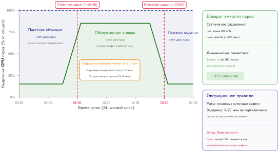

***Сдвиг суточной емкости GPU между обучением и обслуживанием:** суточный спрос обслуживания достигает пика в рабочее время и падает ночью. Вместо статического разделения выделенных кластеров динамическое совместное использование вытесняет обучение низкого приоритета ради утренних всплесков обслуживания и возвращает освобожденные GPU обучению ночью, высвобождая годовую емкость кластера на миллионы долларов.*

> **Суточный сдвиг GPU**
>
> Рассмотрим парк из 1 024 GPU, которым управляют по двум режимам:
>
> **Сценарий A: статическое разделение**: пул обслуживания резервирует 400 GPU под пиковый спрос, но среднее использование составляет всего 150 GPU (загрузка 37,5 %). Пул обучения резервирует 618 GPU, а очередь обеспечивает загрузку 100 %. Результат: 150 GPU + 618 GPU = 768 активных GPU. Загрузка парка: 75 %.
>
> **Сценарий B: динамическое совместное использование**: обслуживание берет GPU строго по мере необходимости (в среднем 150 GPU). Обучение забирает неиспользуемые GPU обслуживания (в среднем 250 GPU) за вычетом буфера безопасности в 117 GPU. Оркестратор перераспределяет примерно 133 GPU между ролями дважды в сутки по суточным прогнозам. Результат: обслуживание (150 GPU) + обучение (618 GPU + 133 GPU) = 901 активный GPU (второе слагаемое обучения — возвращенная емкость обслуживания). Загрузка парка: 88 %.
>
> Динамическое совместное использование возвращает 133 GPU эффективной емкости. При \$2 за GPU-час это создает примерно \$2,3 млн ценности в год без покупки ни одного дополнительного ускорителя.

Настроить изоляцию для одного развертывания несложно, но сохранять строгие гарантии становится трудно, когда тысячи учебных и обслуживающих нагрузок сосуществуют на одной инфраструктуре. Столкновение высокоприоритетных SLA инференса с ресурсоемкими учебными заданиями создает проблему «шумного соседа», которую простая контейнеризация не решает. Многоарендность и квоты становятся управленческим уровнем, который арбитрирует справедливый доступ и предотвращает сценарии «трагедии общин» (tragedy of the commons) в общих парках.

<a id="sec-fleet-orchestration-multi-tenancy"></a>

## Многоарендность и квоты


Когда команда компьютерного зрения неделю держит 500 GPU, а команда обработки естественного языка простаивает, пытаясь вывести критическое исправление ошибки в производство, общие кластеры вырождаются в трагедию общин. Команды с самыми агрессивными темпами отправки заданий, самыми крупными заданиями или самыми настойчивыми скриптами повторной отправки потребляют непропорционально много ресурсов, а команды с более скромными или прерывистыми потребностями обнаруживают кластер постоянно занятым. Это порождает организационное трение, политическую эскалацию к руководству и недоинвестирование в проекты, которые движутся медленнее, но потенциально ценнее, поскольку их командам не хватает инженерных усилий, чтобы конкурировать за ресурсы.

Многоарендность и квоты создают организационные и технические брандмауэры, необходимые для предотвращения этой деградации. Рассматриваемые здесь системы квот задают формальные политики выделения, заимствования и возврата ресурсов, поэтому справедливый доступ и высокая общая загрузка становятся свойствами планировщика, которые можно обеспечить принудительно, а не предметом управленческих переговоров.

<a id="sec-fleet-orchestration-fair-share-multi"></a>

### Иерархическое справедливое распределение

Квоты GPU обычно действуют на уровне пространства имен или проекта и определяют, какую долю кластера имеет право использовать каждая команда. Самый простой подход выделяет каждой команде фиксированное число GPU: команде A — 500 GPU, команде B — 300, команде C — 200. Этот подход легко понять и реализовать, но при колеблющихся нагрузках команд он ведет к систематической недогрузке. Если выделение команды A в 500 GPU простаивает на 50 % в тихий период, а очередь команды B переполнена срочной работой, кластер теряет 250 GPU емкости, которую жесткие квоты запрещают использовать команде B. Альтернатива — выделять каждой команде меньше квоты — создает другую проблему: команды блокируются при выполнении законной работы в пиковые периоды, даже когда у кластера в целом есть свободная емкость.

Иерархические квоты разрешают это противоречие: они задают ограничения на уровне подразделения, оставляя гибкость внутри команд и возможность заимствования между командами. Формула ниже ограничивает эффективную квоту любой команды как ее собственным выделением, так и емкостью родительского подразделения, которую соседние команды еще не заняли, где $U_{\text{allocated}}$ — ресурсы, которые в данный момент закреплены за каждой из остальных команд подразделения:

<a id="eq-fleet-orchestration-quota"></a>

$$ Q_{\text{effective}} = \min\left(Q_{\text{team}},\ Q_{\text{department}} - \sum_{\text{other teams}} U_{\text{allocated}}\right) $$

Когда совокупный спрос превышает емкость, каждая команда получает ресурсы пропорционально своей доле, так что ни одна команда не оказывается систематически в проигрыше. Неиспользованная емкость заимствуется вниз по иерархии: если команда A использует только 60 % своего выделения в 500 GPU, оставшиеся 200 GPU становятся доступны другим командам того же подразделения. Заимствованные ресурсы имеют более низкий приоритет вытеснения, чем собственные: когда команда A позже отправляет задания, которым нужно ее полное выделение, планировщик возвращает заимствованную емкость, вытесняя задания, работающие на этих ресурсах, и передавая емкость законному владельцу.

Этот механизм заимствования необходим для высокой загрузки в многоарендных кластерах. Без заимствования организации стоят перед мучительным выбором: либо резервировать квоту, достаточную для пикового спроса каждой команды, что оставляет емкость простаивать, когда пики не совпадают, либо выделять меньше, что блокирует команды в пиковые периоды, даже когда где-то есть возвращаемая емкость. Заимствование дает возвращаемое право, которое зависит от целевого времени отклика платформы, запаса безопасности и текущей физической емкости. Команда с правом на 500 GPU может вернуть заимствованные устройства в соответствии с этим контрактом, но планировщик не должен обещать немедленного выделения 500 GPU, когда отказы, невытесняемые резервы или запас для восстановления уменьшают возвращаемую емкость.

Динамика вытеснения при заимствовании требует аккуратной интеграции с инфраструктурой контрольных точек из [главы об отказоустойчивости](07_fault_tolerance.md#sec-fault-tolerance-reliability). Задания, работающие на заимствованной емкости, должны сохранять контрольные точки достаточно часто, чтобы вытеснение (когда команда-владелец возвращает ресурсы) не теряло значительной работы. Общие кластеры часто различают уровни планирования «гарантированный» и «оппортунистический»: гарантированные задания работают на собственной квоте команды и подвергаются вытеснению только со стороны более приоритетной работы, а оппортунистические задания работают на заимствованной емкости и принимают, что их могут вытеснить, когда команде-владельцу понадобятся ее ресурсы. Фреймворки обучения, поддерживающие эластичное масштабирование, могут отвечать на возврат заимствованной емкости сокращением, а не завершением, что дополнительно снижает стоимость механизма заимствования.

<a id="sec-fleet-orchestration-burst-capacity"></a>

### Пиковая емкость и заимствование квот

В общем кластере GPU статические квоты создают парадокс пиковой емкости: у команды A есть гарантия в 64 GPU, но для обучения на выходные ей нужно 256, тогда как гарантированная доля команды B простаивает. Решение отделяет гарантированную квоту от максимальной. Команда A может заимствовать простаивающие целые устройства до своего максимума, но эти устройства остаются частью физической емкости кластера, а не превращаются в виртуальную емкость. Если команда B возвращает свою гарантию, планировщик вытесняет или сокращает оппортунистическую работу команды A.

Пиковая емкость расширяет желаемые максимумы и веса справедливого распределения, но не одновременные гарантии. Сумма гарантий, которые платформа обязуется соблюдать одновременно, должна помещаться в возвращаемую физическую емкость после невытесняемых резервов и запаса безопасности. Команды могут объявлять более высокие максимумы или веса, потому что заимствованные задания уступают, когда возвращается гарантированный спрос, но эти значения не являются гарантиями. Контроллер допуска должен различать гарантированные и заимствованные выделения, и заимствованные задания вытесняются первыми. Дробное совместное использование — отдельный механизм, для которого требуется явный контракт MIG, MPS или time-slicing.

Чтобы управлять этим безопасно, кластеры должны реализовать строгие классы приоритета:

- **Производственное обслуживание** (Production Serving): нагрузки приоритета 0 не подлежат вытеснению.
- **Производственное обучение** (Production Training): нагрузки приоритета 1 обрабатывают основные обновления моделей и могут быть вытеснены только при сбоях обслуживания.
- **Интерактивная работа и отладка** (Interactive/Debug): нагрузки приоритета 2 получают высокий приоритет планирования, но короткие лимиты времени.
- **Пакетная работа и исследования** (Batch/Research): нагрузки приоритета 3 полностью вытесняемы и устойчивы к отказам.

Эта иерархия гарантирует, что массовый перебор гиперпараметров заполняет щели кластера, но мгновенно испаряется, когда приходит критическое переобучение.

Безопасный предел всплеска определяется возвратимостью, а не средней загрузкой SM. Планировщик должен измерять, как быстро заимствованные задания могут сохранить контрольную точку, сократиться или завершиться; зарезервировать пропускную способность ввода-вывода и сети, необходимую для такого перехода; и ограничить объем оппортунистической емкости, который можно вернуть в пределах целевого времени отклика гарантии. Задание со средней активностью SM 70 % может все равно резервировать всю память устройства и требовать каждый ранг своей группы, поэтому оставшиеся 30 % не составляют выделяемой доли устройства.

<a id="sec-fleet-orchestration-resource-accounting"></a>

### Учет ресурсов и наблюдаемость

64 GPU, которые простояли все выходные, потому что исследователь забыл отменить резерв, — это невидимые потери в многоарендном облачном парке. В выделенном кластере такие потери хотя бы заметны: свет горит, но вентиляторы молчат. В общей среде стоимость скрыта и накапливается по тысячам заданий. Эффективное управление требует выйти за пределы простых метрик «выделения» к многоуровневой модели учета, которая различает, что было запрошено, что использовано и что оказалось полезным.

Три уровня измерения вскрывают этот разрыв:

- **Выделенная емкость** (Allocated capacity): ресурсы, которые планировщик зарезервировал под задание, недоступны другим.
- **Вычислительная загрузка** (Compute utilization): доля времени, в течение которого ядра GPU активны, отражает занятость оборудования.
- **Продуктивная загрузка** (Productive utilization): доля времени, в течение которой GPU продвигает состояние модели; исключает паузы на загрузку данных, накладные расходы на коммуникацию и сохранение контрольных точек.

Это различие операционное, а не только финансовое. Команде может быть выделено 500 GPU, но она использует 350 (вычислительная загрузка 70 %) и продуктивно использует 280 (56 % выделения). Разрыв в 44 % показывает планировщику, где пропадает емкость, но сам по себе не доказывает, что задание может разделить или освободить целые устройства.

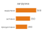

*Выделенная, активная и продуктивная загрузка далеко расходятся.*

Атрибуция в общем парке — это задача управления. Каждое допущенное задание нуждается во владельце, проекте, классе нагрузки и контракте на вытеснение, чтобы планировщик мог последовательно применять политику квот и восстановления. Метки Kubernetes и учетные записи Slurm несут эту идентичность для планирования. Глава «Эксплуатация ML-систем в масштабе» рассматривает, как организации превращают получившиеся записи использования в показ, перевыставление, подотчетность портфеля и решения об инвестициях в платформу.

Эти данные питают панель загрузки — главный инструмент оператора кластера для оценки состояния парка. Это представление должно сводить загрузку каждой команды относительно квот, глубину очереди по классам приоритета и **индекс фрагментации** (Fragmentation Index) — меру свободных GPU, которые нельзя выделить из-за топологических ограничений. Оно также должно отслеживать частоту вытеснений, прерывания spot, трафик контрольных точек и вызванные ими накладные расходы на восстановление. Эти измерения позволяют планировщику отличать простаивающую емкость, которую он может вернуть, от выделенной емкости, видимая простойность которой отражает коммуникацию, ввод-вывод или жесткую зависимость gang.

Автоматическое обнаружение аномалий превращает эти метрики в действенные сигналы. Внезапный рост потребления команды до 3$\times$ от ее исторической нормы может указывать на вышедший из-под контроля скрипт, порождающий бесконечные задания. Очередь, которая растет быстрее, чем разгребается, сигнализирует о нехватке емкости, которую должно устранить автомасштабирование. И наоборот, внезапное падение общего энергопотребления кластера обычно предшествует массовому сбою заданий, часто из-за общей зависимости, например отказа хранилища. Эти оповещения позволяют операторам вмешаться до того, как исчерпается бюджет или очередь станет неуправляемой.

> **Справка: три метрики загрузки**
>
> Чтобы отлаживать эффективность кластера, измеряйте загрузку на трех различных уровнях. **Загрузка выделения** (Allocated Utilization) — доля физических GPU, зарезервированных планировщиком; низкие значения указывают на нехватку спроса или чрезмерно жесткие квоты. **Вычислительная загрузка** (Compute Utilization) — доля времени, в течение которого выделенные GPU выполняют ядра (по данным `nvidia-smi`); низкие значения указывают на неэффективный код, узкие места ввода-вывода или простои коммуникации. **Продуктивная загрузка** (Productive Utilization) — доля выделенного времени, эффективно потраченного на обучение (без накладных расходов); низкие значения указывают на слабое распределенное масштабирование, избыточное сохранение контрольных точек или частые перезапуски.

<a id="sec-fleet-orchestration-security-isolation"></a>

### Безопасность и изоляция пространств имен

Многоарендность требует не только справедливого распределения ресурсов, но и изоляции безопасности, которая не дает командам мешать друг другу или наблюдать нагрузки друг друга. Ставки реальны: ML-модели представляют значительную интеллектуальную собственность, обучающие данные могут содержать чувствительную информацию, подпадающую под законы о конфиденциальности, а сами модели могут кодировать проприетарную бизнес-логику. Без надлежащей изоляции скомпрометированная или неверно настроенная нагрузка в пространстве имен одной команды могла бы получить доступ к весам моделей другой команды, обучающим данным или трафику инференса.

В окружениях Kubernetes фундаментальной границей изоляции служит разделение по пространствам имен. Каждая команда работает в выделенных пространствах имен с управлением доступом на основе ролей, которое ограничивает видимость ее собственными ресурсами. Политики на основе ролей определяют, кто может отправлять задания, просматривать журналы, получать доступ к артефактам моделей и менять политики планирования внутри каждого пространства имен, обеспечивая организационное управление использованием кластера.

Сетевые политики распространяют изоляцию на сетевой уровень, запрещая взаимодействие между пространствами имен, кроме явно разрешенных сервисов. Сетевые политики для ML-нагрузок должны балансировать изоляцию с коммуникационными требованиями распределенного обучения. Практичная политика может разрешать неограниченную коммуникацию «все со всеми» внутри пространства имен (необходимую для кольцевого AllReduce, разобранного в [главе о коллективных коммуникациях](06_collective_communication.md#sec-collective-communication), где каждый воркер должен обмениваться данными с каждым другим), одновременно блокируя весь входящий трафик из других пространств имен (не давая внешним нагрузкам перехватывать трафик градиентов или обновления моделей). Политики исходящего трафика могут не давать учебным заданиям обращаться к внешним сетям, снижая риск утечки данных из скомпрометированного учебного кода или отравленных зависимостей.

[Таблица ниже](#tbl-gpu-virtualization-isolation-spectrum) сравнивает варианты виртуализации GPU по силе изоляции, эффективности ресурсов и соответствию нагрузкам.

<a id="tbl-gpu-virtualization-isolation-spectrum"></a>

***Спектр изоляции виртуализации GPU:** механизмы совместного использования GPU обменивают изоляцию ресурсов устройства на эффективность упаковки. Изоляция внешних арендаторов дополнительно зависит от границ безопасности хоста, драйвера, идентификации, сети и хранилища.*

| **Вариант**                 | **Сила изоляции**                                                  | **Эффективность и гибкость**                           | **Подходящая нагрузка или граница доверия**                                 |
|:----------------------------|:-------------------------------------------------------------------|:-------------------------------------------------------|:---------------------------------------------------------------------------|
| **Time-slicing**            | Отдельные контексты; общие домены производительности и отказов устройства. | Гибкий; без пространственного резервирования.          | Доверенные пакетные задания с всплесками нагрузки.                         |
| **MPS**                     | Отдельные адресные пространства; общие домены производительности и отказов GPU. | Параллельные ядра; настраиваемые лимиты.               | Взаимно доверяющие задания с измеренным спросом.                           |
| **MIG**                     | Аппаратно разделенные память, кэш и вычисления.                    | Предсказуемо; фиксированные профили.                   | Чувствительная к SLO работа; внешним арендаторам также нужны средства безопасности платформы. |
| **Проброс всего устройства** (full device passthrough) | Эксклюзивный доступ к GPU.                       | Самая сильная изоляция устройства; самая низкая эффективность упаковки. | Задания, которые насыщают устройство или запрещают совместное использование. |

Выбор зависит от границы доверия между совместно размещенными нагрузками и чувствительности к производительности каждого типа нагрузки. Безопасность в многоарендной среде выходит за рамки простой справедливости ресурсов. Атаки по сторонним каналам на общие GPU — задокументированная уязвимость: наблюдая за конкуренцией за общие кэши или контроллеры памяти, злоумышленный арендатор может вывести архитектуру или даже свойства данных совместно размещенной модели. В чувствительных средах MIG или выделенные устройства могут укрепить изоляцию ресурсов устройства, но любой из этих механизмов остается одной из составляющих более широкой границы безопасности хоста и платформы.

<a id="sec-fleet-orchestration-preemption-cascades"></a>

### Каскады вытеснения по приоритету


*Одно вытеснение расходится кругами по многим: каскад вытеснения.*

Когда задание высокого приоритета попадает в насыщенный кластер, планировщик должен решить, какие работающие нагрузки завершить, чтобы освободить ресурсы. Это решение редко бывает изолированным. В плотно упакованных кластерах вытеснение задания среднего приоритета ради запроса высокого приоритета часто запускает **каскад вытеснения** (Preemption Cascade): вытесненное задание немедленно пытается перепланироваться, вытесняя нагрузки низкого приоритета. Без демпфирующих механизмов одно срочное развертывание сервиса инференса может прокатиться по очереди, дестабилизировать десятки учебных заданий и вызвать шквал повторных загрузок контрольных точек, который насыщает пропускную способность хранилища.

Инженерная цена вытеснения выходит далеко за пределы задержки планирования. **Налог на вытеснение** (Preemption Tax) — это сумма потерянных вычислений с последней контрольной точки, накладных расходов на сохранение состояния и штрафа холодного старта при возобновлении. Для крупномасштабного распределенного обучения этот налог нелинеен. Рассмотрим дообучение на 64 GPU для нашей модели на 175 млрд параметров. При вытеснении задание теряет работу, выполненную с последнего снимка (в среднем 15 минут). При перезапуске ему нужно 20 минут, чтобы загрузить огромное состояние оптимизатора из распределенного хранилища, и еще 10 минут прогрева, пока конвейеры данных заполняют буферы предвыборки, компиляторы «точно в срок» (JIT) заново оптимизируют ядра и кэши GPU заполняются заново.

Еще одна скрытая стоимость усиливает этот налог: восстановление состояния распределенного конвейера данных. Вытеснение крупного учебного задания не просто прерывает вычисление градиентов: оно сбрасывает детерминированное состояние загрузчика данных, включая начальное значение генератора случайных чисел для перемешивания, порядок перемешивания, примененный к эпохе, и байтовое смещение в шардах набора данных, которое точно фиксирует, какие образцы уже использованы. Без точного восстановления этого состояния перезапущенное задание либо заново читает уже обработанные образцы (искажая статистику градиентов, усиливая отдельные примеры), либо использует другой порядок перемешивания (нарушая статистическую независимость между эпохами). Восстановление распределенного конвейера данных масштаба петабайт до состояния перед вытеснением обычно требует воспроизведения журналов метаданных на всех воркерах загрузчика данных, и этот процесс может растянуть эффективное окно прогрева далеко за пределы времени, которое уходит только на перезагрузку состояния оптимизатора. Фреймворки, которые сохраняют компактную контрольную точку загрузчика данных (начальное значение, индекс выбранной перестановки и текущее смещение в шарде), снижают эту стоимость заметно, однако большинство производственных конвейеров обучения требуют ручного периода прогрева, чтобы приблизить исходный порядок данных, прежде чем качество градиентов вернется к базовому уровню.

В течение этого 45-минутного окна восстановления GPU активны, но фактически непродуктивны. При \$2 за GPU-час одно событие вытеснения стоит \$96 потраченного вычислительного капитала. Если планировщик допускает неограниченное вытеснение, 12 вытеснений в сутки растрачивают 9 часов в сутки выделения этого задания, или 576 GPU-часов в сутки для этого запуска на 64 GPU. Чтобы смягчить это, планировщики применяют **бюджеты вытеснения** (Preemption Budgets). Эти лимиты частоты ограничивают частоту сбоев, например не давая вытеснять задание чаще одного раза в час или ограничивая суммарную текучесть вытеснений в кластере 5 % емкости в любом 10-минутном окне. Это заставляет планировщик ждать естественного завершения заданий, а не запускать каскад, обменивая несколько более долгое ожидание на заметно более высокую совокупную пропускную способность.

<a id="sec-fleet-orchestration-quota-governance"></a>

### Управление квотами и организационная динамика

Планировщики управляют распределением кремния по секундам, а **управление квотами** (Quota Governance) — распределением организационных намерений по месяцам. Квоты — это интерфейс между инженерными ограничениями и бизнес-приоритетами. В зрелых ML-организациях они редко бывают статичными: их корректируют в ходе периодических **циклов пересмотра квот** (Quota Review Cycles), когда выделения пересчитываются по реализованной загрузке, а не по прогнозному спросу. Команда, которая стабильно использует лишь 40 % своего выделения в 128 GPU, фактически блокирует другим командам запуск экспериментов и создает фантомный дефицит, который увеличивает время в очереди, несмотря на достаточную физическую емкость.

Центральное противоречие в управлении квотами — **проблема накопления** (Hoarding Problem). Инженерные команды, рационально стремясь сократить время ожидания, часто запрашивают максимум емкости «на всякий случай», если проект ускорится. Это ведет к низкой средней загрузке и высокому пиковому спросу. Два паттерна, специфичные для ML, усиливают это поведение сверх общей ресурсной тревожности. Первый — фаза оценки RLHF, когда узлы GPU, выделенные политической модели, в основном простаивают, пока команда ждет оценок от людей-разметчиков. Команда сохраняет резерв, чтобы не встать в очередь снова, когда партии разметки придут, однако фактическая занятость GPU в окне разметки может упасть ниже 10 %. Второй паттерн возникает, когда команда резервирует блок GPU под учебный запуск, конвейер предобработки которого еще не завершен. Токенизация данных и нормализация словаря для больших корпусов, требующие много CPU, регулярно занимают дольше, чем оценила команда; GPU стоят зарезервированными и простаивают, пока токенизатор обрабатывает набор данных, поскольку освобождение резерва рискует потерять его в пользу конкурирующей команды. Оба сценария рациональны с точки зрения команды, но на уровне кластера они представляют систематические потери. Чтобы противодействовать этому, команды платформы внедряют **возврат емкости по загрузке** (Utilization-Based Reclamation): если пул квоты остается недогруженным в течение заданного периода, система автоматически сокращает выделение, возвращая ресурсы в общий пул. Такое техническое принуждение возвращает бремя доказательства команде, которой нужно обосновать свой резерв.

Учет квот должен оставаться близко к решению планировщика. GPU-часы, списываемые с резерва, заимствованной доли или класса вытеснения, делают альтернативную стоимость накопления видимой и позволяют плоскости управления возвращать простаивающие гарантии. Глава «Эксплуатация ML-систем в масштабе» развивает более широкую финансовую систему вокруг этих измерений, включая показ, перевыставление, отдачу платформы, капитальное планирование и стоимость жизненного цикла.

Конкретный сценарий с квотой показывает, как быстро простаивающие резервы становятся дорогими.

> **Квотное накопление**
>
> **Сценарий**: исследовательская команда резервирует статический блок из 500 GPU для предстоящего обновления модели.
>
> **Диагноз**: задержки в данных выше по потоку откладывают обучение, но команда сохраняет резерв, чтобы гарантировать доступность в будущем. GPU простаивают три недели, накопив \$504 000 капитальных потерь, пока очереди других команд растут.
>
> **Системный урок**: статические резервы квот вызывают серьезное накопление емкости. Оркестраторы парка должны реализовать динамические политики «используй или потеряешь», автоматически понижая простаивающие зарезервированные узлы (загрузка менее 20 % в течение 72 часов) до прерываемых spot-пулов.

Политика возврата «используй или потеряешь» решает самый заметный симптом накопления квот, но ставит вопрос второго порядка: когда простаивающая емкость передана другой команде, система должна различать заимствованную емкость (вытесняемую при коротком уведомлении) и гарантированные резервы (защищенные SLO). Определение уровней заимствования, вытеснения и гарантий как полноценных примитивов политики — ключевое проектное решение многоарендности.

> **Контрольные вопросы: решения по проектированию многоарендности**
>
> Рассмотрим кластер на 2 000 GPU, общий между исследовательской командой (выделение 60 %) и производственной командой (выделение 40 %):
>
> - [ ] **Возврат простаивающей емкости**: решите, может ли производственная команда использовать простаивающие 30 % кластера, и опишите поведение вытеснения, когда исследовательская команда отправляет крупное задание.
> - [ ] **Классы приоритета**: настройте классы приоритета для производственной нагрузки инференса, которой нужны 100 GPU с гарантированными SLO задержки, и для исследовательского учебного задания, которое может выдержать вытеснение.
> - [ ] **Контракт на совместное использование**: объясните, почему средняя загрузка SM 65 % не оправдывает превышения подписки устройства целиком, затем определите, какие измеренные ресурсные и изоляционные ограничения сделали бы статистическое мультиплексирование безопасным.

Даже при сложных политиках многоарендности и квот кластер все равно может стать жертвой сложных системных узких мест, которые не поддаются простому мониторингу. Когда загрузка необъяснимо падает при полных очередях, операторы должны перейти от панелей мониторинга к систематической отладке загрузки.

<a id="sec-fleet-orchestration-debugging"></a>

## Отладка загрузки кластера

Панель кластера показывает среднюю загрузку GPU на уровне 60 %, но разработчики жалуются на трехдневное ожидание в очереди для небольших отладочных заданий. Сотни GPU простаивают, но ни одно задание не запускается. Чтобы преодолеть этот разрыв между теоретической емкостью и производственной реальностью, нужен методичный криминалистический анализ, который распутает взаимодействие топологии оборудования, политик планировщика и поведения пользователей. Работа выше 80 % загрузки приводит к тому, что времена ожидания в очереди растут нелинейно ([рисунок ниже](#fig-utilization-paradox)).

<a id="fig-utilization-paradox"></a>


***Парадокс загрузки:** по мере приближения загрузки кластера к насыщению (100 %) время ожидания заданий растет гиперболически и резко расходится вблизи насыщения, а не линейно. Работа выше 80 % (зона опасности) вызывает непредсказуемые задержки планирования, особенно для крупных заданий, поэтому 100 % загрузка — антипаттерн для интерактивных исследовательских кластеров. Пунктиром показана целевая загрузка 75 %.*

Метод отладки состоит в том, чтобы сравнить состояние планировщика с физическими возможностями, проверить запросы заданий относительно реальных пулов оборудования и затем проверить, нет ли несоответствия политики и инфраструктуры. Полная очередь и простаивающие ускорители могут сосуществовать, когда планировщик соблюдает ограничения, которые панель агрегировала и скрыла. Кластер, о котором идет речь в примере «Отладка низкой загрузки GPU» ниже, работает на гетерогенном оборудовании из [таблицы инвентаризации](#tbl-fleet-orchestration-debug-inventory), накопленном за три цикла закупок.

<a id="tbl-fleet-orchestration-debug-inventory"></a>

***Инвентаризация оборудования кластера:** три поколения закупок создают отдельные пулы ресурсов с разными возможностями. Узлы A100 поддерживают тензорный параллелизм через NVLink, а узлы V100 ограничены параллелизмом по данным.*

| **Тип GPU**    | **Количество**   | **Память**          | **Межсоединение**          | **Узлы**                |
|:---------------|:----------------:|:-------------------:|:--------------------------:|:-----------------------:|
| **A100-80 GB** | 400 GPU          | 80 ГБ HBM2e         | NVLink (600 ГБ/с)          | 50 узлов $\times$ 8 GPU |
| **A100-40 GB** | 424 GPU          | 40 ГБ HBM2e         | NVLink (600 ГБ/с)          | 53 узла $\times$ 8 GPU  |
| **V100-32 GB** | 200 GPU          | 32 ГБ HBM2          | PCIe Gen3 (15,8 ГБ/с)      | 50 узлов $\times$ 4 GPU |

> **Отладка низкой загрузки GPU**
>
> **Сценарий**: кластер на 1 024 GPU показывает среднюю загрузку 60 % при более чем 50 заданиях в очереди.
>
> **Диагноз**: избыточная спецификация (пользователи копируют шаблоны A100-80 GB для заданий с потребностью в 35 ГБ памяти), фрагментация пулов и избегание устаревших V100 оставляют узлы A100-40 GB и V100 простаивающими, пока крупные задания ждут выделения A100-80 GB. Планировщик корректно соблюдал политики, написанные для однородного парка, которые больше не соответствовали гетерогенной инфраструктуре.
>
> **Системный урок**: поверхностная диагностика часто принимает несоответствие политики и инфраструктуры за ошибку алгоритма планирования. Обновление политик распределения, которое поддерживает автоматическое сопоставление возможностей, динамическое профилирование памяти и бэкфилл, повышает загрузку кластера до 84 % и возвращает \$7 млн годовой вычислительной емкости.

| **Пул**          | **До**                                  | **После**                                | **Изменение**     |
|:-----------------|:----------------------------------------:|:----------------------------------------:|:-----------------:|
| **A100-80 GB**   | 95 % выделено, 72 % эффективно           | 89 % выделено, 94 % эффективно           | +22 п. п.         |
| **A100-40 GB**   | 64 % выделено                            | 88 % выделено                            | +24 п. п.         |
| **V100**         | 0 % выделено                             | 71 % выделено                            | +71 п. п.         |
| **Весь кластер** | **60 %**                                 | **84 %**                                 | **+24 п. п.**     |

<a id="tbl-fleet-orchestration-debug-results"></a>

***Результаты восстановления загрузки:** различие между «выделенной» и «эффективной» загрузкой отражает разрыв загрузки, вызванный политикой: до исправления GPU A100-80 GB показывали высокое выделение в Slurm, но более низкую фактическую вычислительную загрузку, а жесткие шаблоны заданий оставляли без работы другие пригодные пулы оборудования. Значения «эффективной» загрузки для A100-80 GB — измеренная загрузка выделенных GPU; загрузка всего кластера считается по всему гетерогенному парку.*

Этот прирост загрузки добавляет примерно 246 полностью загруженных GPU продуктивной работы ([таблица результатов](#tbl-fleet-orchestration-debug-results)). Это эквивалентно покупке 410 дополнительных GPU, если бы они работали при прежней загрузке 60 %. При \$2 за GPU-час эквивалентная сырая емкость составляет примерно \$7 млн годовой возвращенной ценности, достигнутой изменением политик без дополнительных инвестиций в оборудование.

<a id="sec-fleet-orchestration-anti-patterns"></a>

### Распространенные антипаттерны загрузки

Высокоуровневые метрики часто скрывают глубокие неэффективности. Панель кластера может показывать выделение 85 %, но продуктивная загрузка — доля циклов, которые действительно продвигают состояние модели, — может быть заметно ниже. Чтобы отлаживать эти разрывы, нужно выявить специфические сигнатуры в телеметрии GPU, которые раскрывают скрытое узкое место.

**Задание-зомби** (zombie job) — самая вопиющая растрата: процесс обучения, который аварийно завершился или зашел в тупик, но продолжает удерживать ресурсы GPU. В распределенном запуске обучения модели на 175 млрд параметров отказ одного ранга может оставить 128 GPU выделенными и простаивающими, если очистка процесса не удалась. Сигнатура — высокое выделение памяти (более 300 ГБ) в сочетании с почти нулевой загрузкой SM (менее 5 %), которая сохраняется дольше тайм-аута heartbeat (обычно 10 минут). Такое состояние часто возникает из-за повреждения контекста CUDA или тупика на уровне драйвера, из-за которого среда выполнения контейнеров не может корректно завершить процесс; чтобы вернуть устройство, нужно принудительное исправление на уровне узла.

**Голод данных** (data starvation) проявляется как высокочастотная пилообразная волна загрузки GPU: устройство колеблется между 100 % нагрузки (прямой и обратный проход) и 0 % (ожидание следующего батча). Хотя средняя загрузка в 60–70 % может выглядеть приемлемо, GPU фактически простаивает треть своего времени. Это происходит, когда конвейер данных, ограниченный CPU, не может поддерживать пропускную способность, нужную GPU, — типичный сценарий в компьютерном зрении, где декодирование JPEG и аугментация насыщают CPU хоста. Основной диагностический признак — стандартное отклонение загрузки выше 30 %; он сигнализирует о необходимости активной предвыборки, увеличения параллелизма загрузчика или локального кэширования на NVMe, чтобы загрузить ускоритель.

**Узкое место коммуникации** проявляется в периодических синхронных провалах загрузки SM на всех рангах распределенной группы. Для модели на 175 млрд параметров синхронизация градиентов для 350 ГБ параметров требует огромной пропускной способности; если сеть недостаточна или перегружена, GPU тратят больше времени на ожидание завершения AllReduce, чем на вычисления. Диагностическая метрика — отношение времени шага. Если полное время итерации превышает 1,5$\times$ время только вычислений (прямой и обратный проходы в изоляции), накладные расходы вне вычислений превышают 0,5$\times$ времени вычислений — это существенно, но не доминирует. В упрощенной декомпозиции $T_{\text{total}} = T_{\text{compute}} + T_{\text{comm}}$ коммуникация превышает вычисления, только когда отношение больше 2$\times$; профилирование также должно отделять коммуникацию от накладных расходов на ввод и среду выполнения. Исправление требует размещения с учетом топологии, чтобы держать трафик на высокоскоростных уровнях коммутаторов, или алгоритмических изменений, например накопления градиентов, которые повышают отношение вычислений к коммуникации.

**Ловушка фрагментации памяти** — коварный режим отказа в долго работающих серверах инференса. Модель на 175 млрд параметров, обслуживающая запросы разной длины, может оказаться с 80 % своей HBM, выделенной под KV-кэш, и при этом не принимать новый запрос, потому что свободная память разбросана мелкими несмежными блоками. Для планировщика GPU выглядит заполненным, но по пропускной способности он недогружен. Это похоже на классическую проблему фрагментации кучи, но ставки выше: один перезапуск для дефрагментации сбрасывает сотни гигабайт состояния. Отношение запрошенных слотов токенов к выделенным байтам памяти часто выявляет этот разрыв; страничные аллокаторы кэша устраняют его, отделяя логическую непрерывность последовательности от физической структуры памяти, что возвращает пригодную память и повышает пропускную способность обслуживания в 2–4 раза без добавления оборудования.

Пример с отладкой иллюстрирует более общий принцип, который относится к каждой системе стека парка: системы планирования настолько эффективны, насколько эффективны реализуемые ими политики, а политики должны развиваться вместе с инфраструктурой. Когда инфраструктура меняется (добавляются новые поколения оборудования, модернизируются сетевые топологии, смесь нагрузок смещается от обучения к обслуживанию), политики, заложенные в конфигурацию планировщика, шаблоны заданий и организационные практики, нужно заново оценивать и обновлять. Самая дорогая ошибка планирования часто — не программный дефект, а политика, которая была верной для старой инфраструктуры и так и не была обновлена для новой.

Этот принцип связывает механику планирования с управлением парком. Технические политики (сопоставление типов GPU, тайм-ауты gang-планирования, периоды отсрочки вытеснения) взаимодействуют с организационными политиками (квоты команд, иерархии приоритетов, распределение затрат) и человеческим поведением (повторное использование шаблонов заданий, привычки запроса ресурсов, паттерны отправки в очередь). Эффективная оркестрация парка требует учитывать все три слоя одновременно.

<a id="sec-fleet-orchestration-fallacies"></a>

## Заблуждения и ловушки


Эти несоответствия политики и инфраструктуры повторяются в небольшом наборе заблуждений, которые могут заставить внешне здоровый планировщик расточать дорогую емкость парка. Соблазнительно взглянуть на кластер, работающий с загрузкой 98 %, и объявить победу, а потом обнаружить, что исследователи вовсе перестали отправлять задания, потому что ожидание растянулось на недели. Оркестрация кластеров полна таких контринтуитивных ловушек, когда оптимизация одной метрики разрушает общую ценность системы.

**Заблуждение**: *Более сложные алгоритмы планирования всегда повышают загрузку.*

Инженеры, столкнувшись с низкой загрузкой, часто тянутся к более продвинутым планировщикам, полагая, что узкое место в алгоритме. Как показывает пример отладки в [разделе «Отладка загрузки кластера»](#sec-fleet-orchestration-debugging), корень проблемы часто в неверной настройке политик, а не в ограничениях алгоритма. Простой планировщик FIFO с правильными политиками (сопоставление по возможностям, бэкфилл с тайм-аутами, уместные ограничения gang-планирования) часто превосходит сложный планировщик с неверными политиками. Прежде чем обновлять планировщик, проверьте политики: убедитесь, что пользователи не запрашивают ресурсов, которые им не нужны, что гетерогенные ресурсы корректно предоставлены и что тайм-ауты gang-планирования настроены.

**Ловушка**: *Считать все GPU-часы равноценными при измерении загрузки.*

Панели кластеров обычно показывают «загрузку GPU» одним процентом, усредняя по всем GPU и всем нагрузкам. Эта метрика скрывает критически важную информацию. Кластер может показывать загрузку 80 %, где 60 % — продуктивное обучение, 15 % — простаивающие GPU, выделенные заданиям, которые ждут завершения gang, а 5 % — GPU, которые выполняют загрузку данных без активных вычислений. Эффективный мониторинг различает выделенную загрузку (GPU, назначенные заданиям), вычислительную загрузку (GPU, исполняющие ядра) и продуктивную загрузку (GPU, продвигающие полезное обучение или обслуживание запросов). Только последняя метрика коррелирует с фактически поставленной ценностью.

**Заблуждение**: *Gang-планирование всегда необходимо для распределенного обучения.*

Gang-планирование предотвращает взаимные блокировки для синхронного обучения, но не все распределенное обучение синхронно. Асинхронные методы обучения переносят приход и уход воркеров, а фреймворки эластичного обучения справляются с меняющимся числом воркеров. Для нагрузок, которые могут работать асинхронно или эластично, ослабление требования gang-планирования резко повышает гибкость планирования и сокращает время ожидания в очереди. Компромисс — возможная деградация сходимости из-за устаревших градиентов или изменчивости размера батча, однако для многих практических нагрузок (перебор гиперпараметров, дообучение, предобучение с адаптивным размером батча) этот компромисс выгоден.

**Ловушка**: *Задавать статические квоты по пиковому спросу.*

Организации обычно задают квоты команд под худший случай, рассуждая, что командам нужен гарантированный доступ в периоды аврала. Если пиковый спрос команды A — 500 GPU, а команды B — 300, то при статических квотах кластеру нужно 800 GPU. На практике пики редко совпадают. Иерархическое справедливое распределение с заимствованием может обслужить пиковый спрос обеих команд на кластере из 600 GPU, потому что, когда у команды A пик, команда B обычно имеет умеренный спрос и может уступить заимствованную емкость. Статические квоты по пиковым уровням растрачивают 25–40 % емкости кластера на гарантированные, но неиспользуемые выделения.

**Заблуждение**: *Spot-инстансы всегда дешевле для обучения.*

Скидка 60–90 % на spot-инстансы создает впечатление автоматической экономии. Эффективная стоимость зависит от частоты прерываний, накладных расходов на контрольные точки и времени перезапуска. Для большой модели с контрольными точками по 15 минут и перезапусками по 30 минут каждое прерывание spot стоит 45 минут продуктивного времени. Если прерывания происходят каждые 2 часа, эффективная стоимость растет настолько, что номинальная скидка 65 % сжимается примерно до 52 % экономии. Для моделей на 100 млрд параметров и более с медленными контрольными точками на кластерах с частыми прерываниями spot инстансы по требованию при учете всех накладных расходов могут оказаться дешевле. Решение требует количественного анализа конкретной нагрузки и условий спотового рынка, а не общих допущений об экономии.

**Ловушка**: *Игнорировать топологию при планировании распределенного обучения.*

Планировщики, которые считают GPU взаимозаменяемыми единицами, создают выделения, в которых группы тензорного параллелизма распределяются по узлам (заставляя операции уровня NVLink идти через InfiniBand), или группы AllReduce пересекают спайн-коммутаторы (добавляя задержку и перегрузку). Штраф в 15–30 % пропускной способности из-за плохого размещения по топологии накапливается за многонедельные учебные запуски и может растратить больше ресурсов, чем потеряло бы ожидание выделения с учетом топологии. Планирование с учетом топологии усложняет планирование и может снижать эффективность упаковки, но для крупных распределенных учебных заданий выигрыш в пропускной способности часто оправдывает этот компромисс.

**Заблуждение**: *Одной загрузки GPU достаточно как сигнала автомасштабирования.*

Загрузка GPU — плохой прокси здоровья инференса. GPU может быть загружен на 90 % и при этом нарушать SLO задержки, потому что загрузка идет на обработку накопившейся очереди запросов. И наоборот, GPU с загрузкой 40 % может быть совершенно здоров, если он обслуживает запросы с низкой задержкой и с запасом под всплески. Правильные метрики — глубина очереди, задержка P99 относительно SLO и давление на память KV-кэша для нагрузок LLM. Опора на загрузку создает запаздывающий индикатор, который запускает масштабирование только тогда, когда производительность уже деградировала, тогда как глубина очереди и запас до SLO дают опережающие индикаторы, позволяющие парку масштабироваться до того, как пострадает пользовательский опыт. Кроме того, для LLM исчерпание памяти из-за роста KV-кэша может происходить при низкой вычислительной загрузке, и тогда запросы зависают или отказывают. Автомасштабировщик, который следит только за вычислительной загрузкой, полностью пропустит этот режим отказа и оставит сервис деградировавшим при видимой достаточности емкости.

**Ловушка**: *Использовать эластичное обучение, чтобы не принимать решений о gang-планировании.*

Эластичное обучение дополняет gang-планирование, но не заменяет его. Хотя оно позволяет заданиям менять размер, сами шаги изменения размера часто имеют атомарные требования. Эластичное обучение работает для параллелизма по данным, но не для тензорного параллелизма (которому нужно фиксированное число GPU в группе). Модель на 175 млрд параметров с 8-кратным тензорным параллелизмом требует ровно 8 GPU в каждой группе тензорного параллелизма, чтобы работать; это ограничение gang, которое эластичное обучение не может смягчить. Эластичное обучение меняет число реплик параллелизма по данным, а не конфигурацию параллелизма внутри реплики, поэтому планировщик все равно должен обеспечивать ограничения gang для базовой единицы модели. Если планировщик наивно разместит эти 8 GPU по разным стойкам или не выделит их атомарно, группа тензорного параллелизма либо не инициализируется, либо получит катастрофическое падение производительности.

**Заблуждение**: *Планировщику не нужна проверка, специфичная для нагрузки.*

Конфигурацию планировщика нужно непрерывно настраивать по мере развития нагрузок. Конфигурации по умолчанию в Slurm или Kubernetes оптимизированы под общие нагрузки и часто ставят простую справедливость выше пропускной способности. ML-специфичная настройка (тайм-ауты gang-планирования, веса размещения с учетом топологии, периоды отсрочки вытеснения и скорости затухания справедливого распределения) может повысить загрузку на 15–25 %. Организации, которые развертывают планировщик и никогда не пересматривают его конфигурацию, упускают значительную ценность. Период отсрочки вытеснения по умолчанию может оказаться слишком коротким, чтобы большая модель успела сохранить контрольную точку, и тогда работа теряется, а ненастроенный вес топологии может без нужды фрагментировать кластер. По мере роста кластера и смещения смеси нагрузок (например, от обучения к инференсу) эффективные параметры планирования смещаются вместе с ними. Рассмотрение планировщика как устройства «настроил и забыл» позволяет парку постепенно дрейфовать к неэффективности.

**Ловушка**: *Считать высокую загрузку доказательством здоровья кластера.*

Кластер, работающий с загрузкой 95 %, звучит эффективно, но может указывать на проблему: недостаточную емкость, которая душит скорость экспериментов. Когда загрузка стабильно превышает 85–90 %, времена ожидания быстро растут в соответствии с известным результатом теории очередей M/M/1 из теории случайных процессов. В этой модели среднее время ожидания пропорционально $\rho/(1-\rho)$, где $\rho$ — загрузка; при загрузке 90 % среднее ожидание в 9 раз больше времени обслуживания, а при 95 % — в 19 раз. Исследователи, которые ждут ресурсы часами или днями, проводят меньше экспериментов, проверяют меньше гипотез и медленнее итерируют архитектуры моделей. Эта сниженная скорость экспериментов имеет реальные издержки, которые труднее измерить, чем GPU-часы, но в совокупности они могут быть больше. Целевая эффективная загрузка балансирует эффективность ресурсов и продуктивность исследователей; для учебных кластеров, где отзывчивость очереди напрямую влияет на результаты исследований, она часто составляет от 70 до 85 %. Кластеры инференса, где запросы обслуживаются сразу или не обслуживаются вовсе, часто ориентируются на еще более низкую загрузку (50–70 %), чтобы сохранять запас задержки для всплесков трафика.

Распознавание этих заблуждений не дает командам платформы гнаться за ложными оптимизациями, которые хорошо выглядят на панелях, но снижают скорость разработчиков. Базовые принципы оркестрации, которые успешно справляются с этими компромиссами, имеют общую нить: они рассматривают планирование как инженерную дисциплину, а не административную функцию.

<a id="sec-fleet-orchestration-summary"></a>

## Итоги


Оркестрация парка превращает сырую емкость дата-центра в производительную ML-инфраструктуру, управляя тем, как кремний, пропускная способность и состояние взаимодействуют во времени и пространстве. С точки зрения «железного закона» производительности ($T \approx D_{\text{vol}}/\text{BW} + O/(R_{\text{peak}} \cdot \eta_{\text{hw}}) + L_{\text{lat}}$) оркестратор — центральный оптимизатор системы: стратегии размещения сохраняют пропускную способность структуры ($\text{BW}$), политики многоарендности и квот определяют реализованную эффективность оборудования ($\eta_{\text{hw}}$), а алгоритмы распределенного планирования ограничивают задержку очереди и накладные расходы на координацию ($L_{\text{lat}}$). Разница между высокопроизводительным кластером и тысячами простаивающих ускорителей состоит не в возможностях оборудования, а в способности планировщика балансировать компромиссы между атомарной согласованностью, отказоустойчивостью и топологией размещения при частичных отказах и всплесковом спросе.

Ключевая техническая идея главы в том, что размещение напрямую определяет физическую производительность. Согласуя модельный параллелизм с физической иерархией сети, планирование с учетом топологии предотвращает узкие места бисекции между стойками, защищая член коммуникации $D_{\text{vol}}/\text{BW}$ и повышая пропускную способность на 15–30 %. Специализированные планировщики — такие как Tiresias, Gandiva, Themis и Pollux — используют структуру ML-нагрузок (итеративный прогресс, тяжелохвостые длительности и предсказуемое масштабирование сходимости), чтобы минимизировать члены координации и ожидания ($L_{\text{lat}}$), сокращая среднее время завершения заданий на 40–60 % по сравнению с универсальными политиками FIFO. Эластичное обучение и управление spot расширяют этот контроль, меняя непрерывность воркеров на экономическую гибкость, при условии что задания могут динамически адаптироваться, не неся неприемлемого налога на вытеснение.

Справедливость тоже является задачей ограниченного распределения, а не одного процента квоты. DRF выравнивает наибольшую нормированную долю ресурса каждого арендатора, но размер gang, локальность топологии и совместимость ускорителей определяют, какие номинальные выделения осуществимы. Замедление и максимальное осуществимое ожидание затем показывают, переходят ли равные доли ресурсов в равный доступ во времени.

Во время обслуживания парковый планировщик сохраняет оболочку емкости, а не выбирает отдельные маршруты запросов. Он размещает неделимые реплики, поддерживает запас до SLO и использует измеренный спрос, чтобы сдвигать границу между обучением и обслуживанием. Допуск запросов, батчинг, маршрутизация, политика KV-кэша и управление хвостовой задержкой внутри этой оболочки рассмотрены в [главе «Инференс в масштабе»](10_inference.md#sec-inference-scale). Изоляция многоарендности и управление квотами по справедливому распределению остаются задачами оркестрации, поскольку они определяют, какие нагрузки могут делить оборудование и какие выделения уступают под давлением.

В конечном счете оркестрация парка в такой же мере диагностична и экономична, как и алгоритмична. Операционные патологии — задания-зомби, голод данных, несоответствие топологии и фрагментация пулов — являются симптомами рассогласования политики и инфраструктуры, а не дефектного оборудования. Когда вычислительные узлы определены, сети проложены, хранилище подключено, отказоустойчивость интегрирована и оркестраторы согласованы, парк превращается из набора изолированных серверов в связную самовосстанавливающуюся вычислительную платформу.

Размещение с учетом топологии делает конкретным обмен C$^3$. Совместное размещение группы тензорного параллелизма повышает полезную эффективность вычислений, удерживая ее коллективные операции на NVLink и снижая коммуникацию между стойками, но планировщик платит более высокой ценой координации, пока ждет осуществимого смежного выделения. Узкое место поэтому может переместиться с пропускной способности коллективных операций на задержку очереди или фрагментацию. Оправданность такого перемещения зависит от сквозного времени завершения задания, а не только от пропускной способности итераций.

> **Планирование — это системная инженерия**
>
> * **Распределенное планирование принципиально трудно**: планирование кластера сталкивается с проблемами (частичные отказы, разделы сети, несогласованность состояния), которых никогда не встречают планировщики одной машины. Теорема CAP вынуждает к компромиссам между согласованностью и доступностью, которые определяют устройство любой системы планирования.
> * **Gang-планирование предотвращает взаимные блокировки, но снижает гибкость**: gang-планирование дает распределенному обучению атомарное выделение ресурсов, предотвращающее взаимные блокировки «удержание и ожидание», но жесткое gang-планирование расходует ресурсы, когда его сочетают с тайм-аутами бэкфилла и альтернативами эластичного обучения.
> * **Справедливость измеряется по осуществимым пакетам**: DRF выравнивает доминирующую нормированную долю каждого арендатора по GPU, CPU, памяти и сети. Ограничения gang, топологии и совместимости должны сначала отсеять неосуществимые пакеты, а замедление и максимальное осуществимое ожидание проверяют, не ведет ли получившаяся политика к задержкам и голоданию.
> * **Топология определяет производительность**: место GPU в иерархии кластера значит не меньше, чем число GPU, которое получает задание. Решения о размещении NVLink против InfiniBand могут создавать разницу в пропускной способности 15–30 % для одного и того же задания на одном и том же оборудовании.
> * **Специфичное для ML планирование превосходит общие подходы**: использование характеристик нагрузок (предсказуемые потребности в ресурсах, итеративные вычисления, убывающая отдача) дает улучшение времени завершения заданий на 40–60 % по сравнению с универсальными политиками FIFO или справедливого распределения.
> * **Загрузка — экономический фактор первого порядка**: повышение загрузки большого кластера с 50 % до 80 % фактически добавляет емкость, эквивалентную тысячам GPU. Закрытие этого разрыва политиками и алгоритмами окупается быстрее, чем покупка дополнительных ускорителей.
> * **Политики должны развиваться вместе с инфраструктурой**: алгоритмы планирования настолько эффективны, насколько эффективны реализуемые ими политики. Когда инфраструктура меняется (добавляется гетерогенное оборудование, модернизируются топологии, смещается смесь нагрузок), политики нужно заново оценивать и обновлять (см. [принцип «смещение накладных расходов»](part_distributed.md#pri-conservation-overhead) в части о принципах распределенного ML).

Парк теперь имеет вычисления, коммуникацию, хранилище и устойчивость, чтобы все это работало. Ему все еще нужна политика, которая решает, что где запускается. Планировщик, который гонится за пиковой загрузкой, может зайти во взаимную блокировку, когда крупные задания конкурируют за одни и те же узлы, а планировщик, который гарантирует прогресс, может оставить часть емкости намеренно неиспользованной. Разрыв между теоретической и безопасно устойчивой пропускной способностью — цена координации. В масштабе парка производительность поэтому зависит не только от скорости оборудования, но и от политики, которая его распределяет.

> **От оркестрации к оптимизации**
>
> Поскольку распределенное выполнение рассмотрено в [главе о распределенном обучении](05_distributed_training.md#sec-distributed-training-systems), а отказоустойчивые контрольные точки — в [главе об отказоустойчивости](07_fault_tolerance.md#sec-fault-tolerance-reliability), управление ресурсами в многоарендной среде завершает операционную основу парка машинного обучения. Когда оркестратор размещает нагрузки на правильных уровнях оборудования, следующая задача — максимизировать эффективность одного узла и внутри шага. [Глава «Инженерия производительности»](09_performance_engineering.md) (первая часть переведена) рассматривает слияние операторов, точность вычислений, компиляцию графов и планирование выполнения. Оркестрация выделяет правильные ресурсы; инженерия производительности извлекает из них пиковую пропускную способность.
