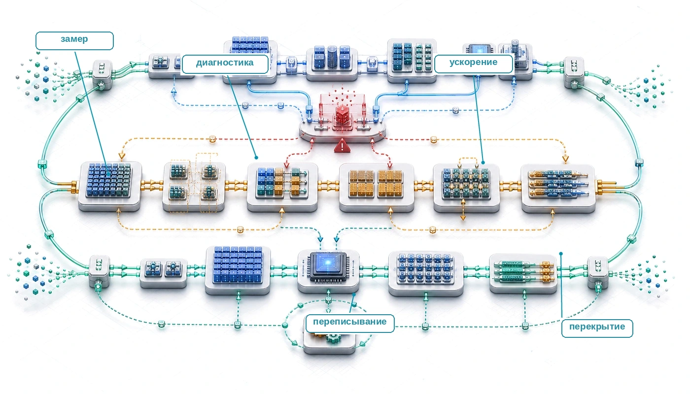
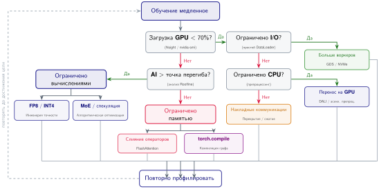
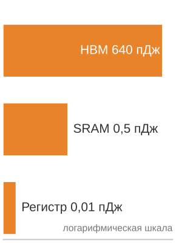
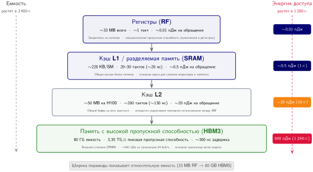
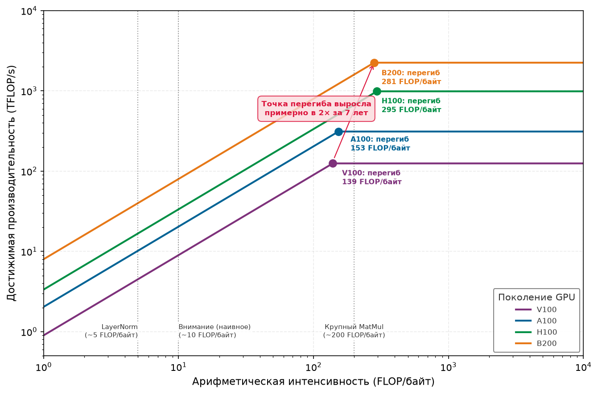
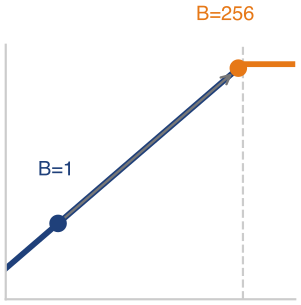
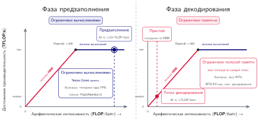

# Инженерия производительности

## Назначение

_Почему пиковая вычислительная мощность не дает пропускной способности обслуживания в реальном времени без совместного проектирования ядер и памяти?_

Сжатие модели уменьшает объем вычислений модели. Инженерия производительности перестраивает эти вычисления под физику аппаратного обеспечения. Различие важно, потому что квантованная модель, загруженная наивно в ядро, которое читает каждый вес из внешней памяти, растрачивает выигрыш по пропускной способности, ради которого квантование и делалось. Производительность зависит от всего пути, который проходит тензор: от регистров через память на кристалле к памяти с высокой пропускной способностью и обратно. Эта глава описывает системные методы, которые закрывают разрыв между эффективной моделью и реализацией, которая использует аппаратное обеспечение хорошо. В число рычагов входят слияние операторов и тайлинг, форматы точности, фреймворки компиляции, спекулятивное декодирование и разреженная маршрутизация экспертов. В терминах C³ инженерия производительности извлекает больше полезной работы из вычислительных циклов, которыми парк уже владеет.

> **Цели обучения**
>
> - Применять анализ Roofline для классификации ядер ML как ограниченных вычислениями, памятью или запуском на целевых ускорителях
> - Анализировать режимы предзаполнения, декодирования и размера батча, чтобы предсказывать поведение задержки и пропускной способности при обслуживании LLM
> - Проектировать стратегии слияния, тайлинга и CUDA-графов, которые снижают трафик HBM и накладные расходы на запуск
> - Выбирать оптимизации точности, компиляции и времени выполнения по ограничениям пропускной способности, качества и развертывания
> - Оценивать, когда спекулятивное декодирование и разреженная маршрутизация экспертов уменьшают неперекрытую работу с учетом принятия токенов, коммуникации и дисбаланса нагрузки
> - Диагностировать узкие места обслуживания с помощью профилировщиков, графиков Roofline и метрик эффективности парка
> - Синтезировать план оптимизации обслуживания модели на 70 млрд параметров с учетом компромиссов вычислений, коммуникации, координации и качества

## Стена памяти и диагностика по Roofline

Ускоритель H100, способный выдать 989 TFLOP/s плотных вычислений FP16 на тензорных ядрах, при декодировании языковой модели с малым батчем все равно может показывать однозначный процент загрузки вычислительных блоков. Процессор не испытывает недостатка в арифметике; он голодает по данным. Инженерия производительности работает внутри этого ограничения: стена памяти — это ситуация, когда перемещение байтов от памяти к вычислительным блокам может ограничить пропускную способность задолго до того, как тензорные ядра достигнут заявленного пика.

Размещение, синхронизация, восстановление и планирование могут поставить нагрузку на правильное оборудование и удержать ее в работе. Оставшаяся проблема — локальное выполнение: дорогой кремний может простаивать и после поступления работы. На стеке парка (показан на полях) инженерия производительности — это дисциплина оптимизации внутри слоя обслуживания, которая опускается на слои распределения и инфраструктуры, когда ядра, иерархия памяти, межсоединения или накладные расходы фреймворка определяют достигнутую пропускную способность. Ответ обычно — перемещение данных, поэтому инженерия производительности начинается с иерархии памяти, а затем прослеживает последствия через слияние, точность, компиляцию и алгоритмические изменения, которые перемещают меньше байтов, создают меньше накладных расходов или вообще делают другую работу.

### Железный закон производительности ML

Стена памяти — это лишь одно слагаемое в большем бюджете. [Железный закон производительности](#eq-iron-law-perf) раскладывает время выполнения ML-системы на три конкурирующие составляющие:

$$
T = \frac{D_{\text{vol}}}{\text{BW}} + \frac{O}{R_{\text{peak}} \cdot \eta_{\text{hw}}} + L_{\text{lat}}
$$

При перекрывающемся выполнении упрощение в духе Roofline заменяет сумму вычислений и перемещения данных более медленным из неперекрытых членов:

$$
T \approx \max\left( \frac{O}{R_{\text{peak}} \cdot \eta_{\text{hw}}}, \; \frac{D_{\text{vol}}}{\text{BW}} \right) + L_{\text{lat}}
$$

Унаследованный железный закон раскладывает время выполнения на три члена. Доля вычислений — это общее число операций с плавающей запятой, деленное на реализованную пропускную способность аппаратного обеспечения. Доля данных — это общий объем переданных байтов, деленный на пропускную способность памяти. Приближение Roofline затем отвечает на вопрос, какой неперекрытый член доминирует в данной рабочей точке: например, рост вычислительной пропускной способности для нагрузки, ограниченной памятью, не дает заметного выигрыша, пока не уменьшен член памяти. Член накладных расходов учитывает все остальное: задержку запуска ядер, синхронизацию, коммуникацию и неэффективность программного стека. Выполнение в режиме eager может открывать большую часть этого члена, когда цикл обучения на Python и диспетчер фреймворка отправляют много коротких ядер, но не каждый запуск проходит через глобальную блокировку интерпретатора Python (GIL): асинхронные потоки времени выполнения, скомпилированные участки и нативные расширения могут отправлять работу вне этого пути. `torch.compile(mode="reduce-overhead")` и CUDA Graphs нацелены на повторяющиеся затраты хост-отправки: они фиксируют стабильный участок и воспроизводят его работу на GPU с меньшим числом взаимодействий с CPU. Они амортизируют или устраняют повторную диспетчеризацию внутри этого участка, но не убирают все накладные расходы времени выполнения.

_Авторегрессивное декодирование трансформера часто ограничено памятью: член перемещения данных доминирует в железном законе._

Стандартное сжатие модели (прореживание, квантование, дистилляция) уменьшает внутреннюю работу модели, выполняя меньше операций над меньшими данными. Системная оптимизация решает дополняющую задачу: сокращает разрыв между этой работой и пиковой производительностью аппаратного обеспечения, перемещая те же члены через реализацию, а не через изменение модели. Данные удерживаются в быстрой памяти, каждая передача упаковывается плотнее, а программные накладные расходы устраняются.

Несколько рычагов напрямую соответствуют этим членам. Когда трафик памяти доминирует, слияние операторов и тайлинг уменьшают неперекрытый член объема данных, устраняя обращения к памяти с высокой пропускной способностью (HBM) между ядрами. Слитая последовательность, которая хранит промежуточные результаты в SRAM, может резко сократить неперекрытый член доступа к памяти, часто в 10–30× для вычисления внимания. Инженерия точности атакует тот же числитель с другой стороны: FP8, INT4 и сжатие KV-кэша (хранение ключей и значений внимания для каждого токена в меньшем числе байтов) представляют каждое значение меньшим числом байтов, поэтому та же физическая пропускная способность переносит больше полезного состояния модели.

Другие рычаги меняют члены накладных расходов или вычислений. Компиляция графов, включая `torch.compile`, Accelerated Linear Algebra (XLA) и TensorRT, снижает накладные расходы: устраняет пробелы между запусками ядер, сливает операции и оптимизирует выделение памяти по всему графу. Перекрытие вычислений и коммуникации делает распределенную коммуникацию параллельной полезной работе и выводит ее из критического пути, когда $T_{\text{comm}} \leq T_{\text{compute}}$ (то есть коммуникация завершается раньше параллельной фазы вычислений и неперекрытое время коммуникации равно нулю: $T_{\text{comm}} - T_{\text{overlap}} \leq 0$). Это условие — тест неперекрытого времени, а не новый закон: перекрытие помогает, только когда полезных вычислений достаточно, чтобы покрыть коммуникацию. Алгоритмические новшества, такие как спекулятивное декодирование и смесь экспертов (MoE), меняют сам член вычислений, заставляя модель выполнять другие вычисления, которые сохраняют контракт на выход при меньшей неперекрытой стоимости.

Каждый прием атакует свой член, и эта таксономия направляет стратегию оптимизации: сначала диагностируйте, какой член доминирует (с помощью модели Roofline из [раздела «Модель Roofline»](#sec-performance-engineering-roofline)), а затем примените прием, нацеленный на этот член. Прием, который атакует недоминирующий член, тратит инженерные усилия впустую.

Перед использованием этого диагностического процесса проверьте, как каждый член железного закона соотносится с практическим рычагом оптимизации.

> **Контрольные вопросы: железный закон производительности**
>
> Проверьте понимание системной диагностики производительности:
>
> - [ ] **Предел, ограниченный памятью**: определите, улучшит ли повышение тактовой частоты GPU (рост FLOP/s) нагрузку, ограниченную памятью.
> - [ ] **Член квантования**: укажите, какой член в [формуле](#eq-iron-law-perf) меняется, когда квантование переводит представление из FP16 в INT4.
> - [ ] **Член накладных расходов**: определите член «накладные расходы» в железном законе и объясните, почему компиляция графов нацелена именно на него.
> - [ ] **Пропускная способность для системы, ограниченной вычислениями**: оцените утверждение, что пропускная способность памяти не важна для производительности системы, ограниченной вычислениями.
> - [ ] **Разложение железного закона**: для шага, в котором 60 % времени приходится на перемещение данных, 30 % на вычисления и 10 % на задержку, определите, какая одна оптимизация дает наибольший выигрыш реального времени, и что предсказывает железный закон, когда доминирующий член уменьшен вдвое.

Тот же диагностический процесс можно оформить в виде блок-схемы решений, которая сопоставляет каждое узкое место с соответствующим приемом оптимизации. [Рисунок «Блок-схема диагностики железного закона»](#fig-iron-law-flowchart) делает последовательность явной: сначала исключаются накладные расходы I/O, CPU и коммуникации, и только затем оставшаяся нагрузка классифицируется как ограниченная вычислениями или памятью.

***Блок-схема диагностики железного закона:** процесс устранения неполадок при замедлении обучения. Он начинается с наблюдаемых симптомов (медленное обучение, низкая загрузка GPU), проходит через проверки накладных расходов I/O, CPU и коммуникации и в листьях классифицирует нагрузку как ограниченную вычислениями или памятью. Пути, ограниченные вычислениями, ведут к инженерии точности и алгоритмическим изменениям; пути, ограниченные памятью, ведут к слиянию операторов и тайлингу. Симптомы, ограниченные накладными расходами (диспетчеризация графа, коммуникация), выявляются раньше в потоке и устраняются до финальной классификации вычисления/память.*

Центральный урок [рисунка](#fig-iron-law-flowchart) таков: профилирование должно предшествовать оптимизации. Применение слияния операторов к нагрузке, ограниченной вычислениями, или инженерии точности к нагрузке, ограниченной накладными расходами, дает нулевой эффект независимо от качества реализации. Ошибочный диагноз — это не только потраченные впустую усилия: изменение производительности, выпущенное вслепую, может переместить систему в неправильную точку ее рабочей границы.

Эта граница — **граница эффективности** (efficiency frontier), парето-оптимальная кривая качества модели и пропускной способности системы. Модель на границе не может повысить пропускную способность без жертвы качеством, и наоборот. (Thompson et al., 2021) показывают, почему эта граница важна для глубокого обучения: улучшения качества потребовали быстро растущих вычислений, поэтому прирост эффективности стал ключевым для дальнейшего прогресса. Инженерия производительности сдвигает границу наружу, делая каждый уровень качества достижимым при более высокой пропускной способности или, что то же самое, делая каждый уровень пропускной способности достижимым при более высоком качестве. Цель организации — не просто достичь границы, а найти на ней точку, которая лучше всего соответствует ее требованиям к задержке, пропускной способности, стоимости и качеству.

Многомерная природа этой границы делает оптимизацию сложной. В [таблице](#tbl-performance-engineering-frontier-dimensions) перечислены пять измерений, которые инженер производительности должен сбалансировать, прежде чем выбрать цель оптимизации.

***Измерения границы эффективности:** оптимизация производительности балансирует измеримые пропускную способность, задержку, стоимость, качество и ограничения памяти, а не одно число загрузки оборудования.*

| **Измерение**                    | **Как измеряется**                                  | **Что ограничивает**                                   | **Типичное напряжение**                                             |
|:---------------------------------|:----------------------------------------------------|:-------------------------------------------------------|:--------------------------------------------------------------------|
| **Пропускная способность**       | Токенов в секунду или запросов в секунду            | Сколько работы система выполняет за единицу времени    | Большие батчи повышают пропускную способность, но часто ухудшают задержку |
| **Задержка**                     | Время до первого токена и задержка между токенами   | Как быстро система реагирует на отдельные запросы      | Меньшая задержка может требовать меньших батчей и большей стоимости на токен |
| **Стоимость**                    | Доллары за миллион токенов                          | Экономическая эффективность системы                    | Самые дешевые конфигурации могут не достигать целей по задержке или качеству |
| **Качество**                     | Перплексия, точность на бенчмарках или предпочтения людей | Точность и полезность выходов модели              | Снижение точности и спекуляция требуют ограничителей качества       |
| **Память**                       | Пиковая память GPU                                  | Допустимый размер батча и длина последовательности     | Большие контексты и батчи потребляют емкость, нужную для состояния модели |

Измерения из [таблицы](#tbl-performance-engineering-frontier-dimensions) взаимодействуют неочевидным образом. Увеличение размера батча повышает пропускную способность и эффективность стоимости, но ухудшает задержку. Снижение точности улучшает пропускную способность и использование памяти, но может ухудшить качество. Спекулятивное декодирование улучшает задержку, но может увеличить стоимость на токен. Задача инженера производительности — пройти между этими компромиссами, руководствуясь конкретными требованиями приложения.

Чат-бот реального времени ставит приоритет задержке (время до первого токена менее 200 мс, задержка между токенами менее 50 мс) и может мириться с более высокой стоимостью на токен. Конвейер пакетной обработки для суммаризации документов ставит приоритет пропускной способности и стоимости и терпит секунды задержки. Медицинская диагностическая система ставит качество выше всего, принимая меньшую пропускную способность и более высокую стоимость. Каждое приложение соответствует своей оптимальной точке на границе эффективности, а инструментарий инженерии производительности дает методы для достижения этой точки. Чтобы сделать это конкретным, рассмотрим две конфигурации развертывания одной и той же языковой модели на 70 млрд параметров при условной цене \$2,70 за час работы H100 для обеих.

Конфигурация A оптимизирована по задержке: веса FP16, батч размером 1, спекулятивное декодирование включено. Реплика модели выдает примерно 50 токенов в секунду с задержкой между токенами 20 мс, занимая 8 GPU H100 для одного потока пользователя. Стоимость: примерно \$0,12 за 1 000 выходных токенов.

Конфигурация B оптимизирована по пропускной способности: веса INT4, батч размером 64, без спекуляции. Каждый GPU H100 обслуживает примерно 4 000 токенов в секунду совокупной пропускной способности по всем батчированным запросам, с задержкой 120 мс между токенами на запрос. Стоимость: 4 GPU обслуживают 64 одновременных пользователя, примерно \$0,00019 за 1 000 выходных токенов.

Конфигурация B дает стоимость за токен в 640× ниже, чем конфигурация A, но при задержке в 6× выше. Ни одна конфигурация не является объективно «лучшей»: они представляют разные точки на границе эффективности, оптимизированные для разных приложений. Инженерия производительности — это дисциплина навигации между этими точками.

### Стена памяти

Граница эффективности задает цель оптимизации. Физика пропускной способности памяти определяет, с чего начинается оптимизация. Многие проблемы производительности ML на ускорителях начинаются с одного и того же наблюдения: узкое место — пропускная способность памяти, а не вычисления. Рассмотрим один шаг авторегрессивного декодирования в большой языковой модели. Модель читает всю свою матрицу весов из HBM[^fn-hbm-memory-performance], чтобы сгенерировать один токен, выполняя всего одну-две операции умножения с накоплением на каждый загруженный вес.

[^fn-hbm-memory-performance]: **Память с высокой пропускной способностью (HBM)**: вертикальные стопки кристаллов DRAM, соединенные через тысячи сквозных переходов через кремний (TSV). Они обеспечивают высокую совокупную пропускную способность, оставаясь при этом намного медленнее и энергоемче в доступе, чем SRAM на кристалле.

Ускоритель NVIDIA H100 выдает 1 979 TFLOP/s вычислений FP8 при бюджете тепловой мощности 700 Вт, но только 3,35 ТБ/с пропускной способности памяти. Если операция достигает арифметической интенсивности ниже 590,7 FLOP/байт, вычислительные блоки простаивают, голодая по данным. Этот разрыв между вычислительной способностью и скоростью доставки данных из памяти и есть стена памяти; он задает ландшафт, внутри которого работает вся инженерия производительности.

Стена памяти — фундаментальное физическое ограничение, а не временное инженерное. Перемещение данных стоит энергии, пропорциональной расстоянию. Обращение к значению из SRAM на кристалле (L1-кэш) стоит примерно 0,5 пДж, тогда как выборка того же значения из внешней HBM стоит около 640 пДж, то есть соотношение составляет 1 280×. Производственные ограничения определяют, сколько SRAM может находиться близко к вычислительным блокам. HBM дает емкость (у H100 она составляет 80 ГБ), но на физически большем расстоянии, поэтому данным приходится проходить по более длинным проводникам. Фундаментальное противоречие в том, что модели нуждаются в гигабайтах параметров и состояния, а физика диктует, что в каждый момент рядом с вычислительными блоками могут находиться лишь килобайты данных.

_Энергия доступа растет от регистров к HBM._

Противоречие между емкостью и пропускной способностью определяет пространство оптимизации. Слияние операторов сокращает число обращений к HBM, объединяя операции так, что промежуточные результаты остаются в SRAM. Инженерия точности сокращает число байтов на обращение, представляя значения в FP8 или INT4 вместо FP16. Стратегии тайлинга перестраивают алгоритмы так, чтобы максимизировать повторное использование данных внутри SRAM. Компиляторы графов автоматизируют эти преобразования. Каждый прием атакует свой член одного и того же фундаментального уравнения: минимизировать отношение перемещенных байтов к выполненным операциям.

### Иерархия памяти GPU

Физическая структура системы памяти GPU определяет пределы перемещения данных. В [таблице](#tbl-performance-engineering-memory-hierarchy) сведены четыре уровня по масштабу, стоимости доступа и ограничению оптимизации, которое каждый из них накладывает.

***Ограничения иерархии памяти GPU:** более быстрая память GPU меньше, ближе к вычислительным блокам и управляется явно, тогда как HBM дает емкость ценой гораздо большей задержки и энергии на обращение.*

| **Уровень**                          | **Масштаб на H100**                                                                                                  | **Стоимость доступа**                                                                                                 | **Ограничение оптимизации**                                                                                                                                                  |
|:-------------------------------------|:---------------------------------------------------------------------------------------------------------------------|:----------------------------------------------------------------------------------------------------------------------|:-----------------------------------------------------------------------------------------------------------------------------------------------------------------------------|
| **Регистры**                         | 256 КБ на SM на 132 SM, всего около 33 МБ | Один такт и около 0,01 пДж на обращение                                                                                | Закреплены за каждым потоком; аккумуляторы FP32 могут вызывать выгрузку регистров (register spilling) в L1/разделяемую память при 20–30 тактах на обращение                  |
| **Разделяемая память (SRAM)**        | До 228 КБ настраиваемой разделяемой памяти на SM                         | 20–30 тактов (около 20 нс) и около 0,5 пДж на обращение                                                               | Разделяется внутри блока потоков; слияние операторов выгодно, когда промежуточные результаты помещаются здесь, а не возвращаются в HBM                                       |
| **Кэш L2**                           | 52 МБ буфера на кристалле                                                         | Около 200 тактов (около 130 нс)                                                                                       | Автоматически обеспечивает повторное использование между SM, но авторы ядер не могут управлять им явно                                                                       |
| **HBM**                              | 80 ГБ при пропускной способности 3,35 ТБ/с | Около 300 нс и 640 пДж на обращение         | Обеспечивает емкость для модели и активаций, но чтение всего устройства занимает около 24 мс, что намного дольше целевых задержек инференса в реальном времени                |

[Таблица](#tbl-performance-engineering-memory-hierarchy) делает давление на регистры конструктивным ограничением первого класса в пользовательских ядрах Triton и CUDA: размер тайла определяет и арифметическую интенсивность, и потребность в регистрах. Она также объясняет, почему разделяемая память и повторное использование L2 так важны для внимания. Если записи KV-кэша или слитые промежуточные результаты остаются на кристалле, ядро избегает медленного и энергоемкого обхода через HBM, который доминирует в операциях с низкой арифметической интенсивностью.

Энергетическая стоимость перемещения данных имеет прямое экономическое следствие в масштабе центра обработки данных. При пиковой пропускной способности H100 3,35 ТБ/с чтение и запись HBM примерно на 10 пДж на байт (около 640 пДж на транзакцию в 64 байта) потребляют около 35–50 Вт на GPU только на интерфейсе памяти и стеках DRAM. Когда ядра многократно прогоняют промежуточные тензоры через HBM вместо того, чтобы хранить их в SRAM на кристалле (что стоит всего около 0,5 пДж на обращение), это перемещение данных рассеивает десятки киловатт по кластеру из 1 000 GPU в виде чистого отработанного тепла, не продвигая математику модели. Слияние операторов оставляет промежуточные результаты в SRAM, резко снижая мощность интерфейса памяти и устраняя задержки в сотни наносекунд, при которых простаивают SM. Физика перемещения данных — не только ограничение производительности, но и экономическое ограничение.

Задача инженерии производительности сводится к размещению данных ([рисунок](#fig-performance-engineering-gpu-memory-hierarchy)): держать данные, нужные вычислительным блокам, в самой быстрой памяти, которая может их вместить. Когда ядро читает тензор из HBM, обрабатывает его и записывает результат обратно в HBM, обход через HBM доминирует во времени выполнения любой операции с низкой арифметической интенсивностью. Все приемы здесь имеют одну цель: дольше держать данные ближе к вычислениям.

***Иерархия памяти GPU и перемещение данных:** визуальная иерархия от быстрых регистров и SRAM на кристалле через кэш L2 до внешней HBM3. Задержка растет от одного такта (около 0,01 пДж) до сотен наносекунд (около 640 пДж на транзакцию), иллюстрируя крайнее различие в стоимости между вычислениями, работающими в SRAM, и трафиком внешней памяти.*

> **Аналогия: библиотека исследователя**
>
> Иерархия памяти GPU похожа на исследователя, работающего в библиотеке:
>
> - **Регистры** (33 МБ) — рабочая память: мгновенный доступ, но емкости хватает, чтобы держать лишь несколько значений одновременно.
> - **Разделяемая память (SRAM)** — это письменный стол: до него очень быстро дотянуться, но на нем помещается лишь несколько открытых справочников.
> - **Кэш L2** (52 МБ) — тележка с книгами рядом со столом: небольшая стоимость доступа, вмещает умеренный рабочий набор.
> - **HBM** (80 ГБ) — подвал библиотеки: хранит все, что может понадобиться, но каждая поездка туда и обратно стоит сотни наносекунд.
>
> Инженерия производительности — это искусство минимизации походов в подвал.

### Расширение разрыва

Стена памяти не статична: в сравниваемых здесь поколениях ускорителей вычислительная пропускная способность росла быстрее, чем пропускная способность внешней памяти. Пропускная способность памяти растет медленнее, потому что физика внешней передачи сигналов и экономика производства HBM ограничивают, насколько быстро данные могут покинуть кристалл.

[Таблица](#tbl-widening-gap) показывает, как аппаратный баланс смещается от поколения к поколению ускорителей. Ключевой столбец — точка перегиба (ridge point): поскольку вычисления растут быстрее пропускной способности, все больше операторов требуют более высокой арифметической интенсивности, чтобы оставаться ограниченными вычислениями.

***Растущая стена памяти:** вычислительная пропускная способность выросла в 18 раз от V100 до B200 за семь лет, тогда как пропускная способность памяти выросла лишь в 8,9 раза. Точка перегиба в целом примерно удвоилась (от V100 до B200), что со временем переводит все больше нагрузок в режим, ограниченный памятью, хотя движение от поколения к поколению не монотонно (B200 немного ниже H100).*

| **GPU**  | **Год** |             **Пиковая FP16 (TFLOP/s)**              |              **Пропускная способность HBM (ТБ/с)**              |      **Точка перегиба (FLOP/байт)**      |
|:---------|:--------:|:------------------------------------------------:|:-------------------------------------------:|:-------------------------------------:|
| **V100** |   2017   | 125 | 0,9 | 139 |
| **A100** |   2020   | 312 | 2,04 | 153 |
| **H100** |   2022   | 989 | 3,35 | 295 |
| **B200** |   2024   | 2 250 | 8 | 281 |

В [таблице](#tbl-widening-gap) точка перегиба выросла с 139 FLOP/байт у V100 до 281 FLOP/байт у B200, что соответствует росту примерно в 2×. Операция с арифметической интенсивностью 200 FLOP/байт была ограничена вычислениями на V100 и A100, но ограничена памятью на H100 и B200. Приемы оптимизации, нацеленные на эффективность памяти (слияние, точность и тайлинг), поэтому становятся важнее по мере роста точки перегиба, а не менее важными. Системный урок не в том, что какое-либо конкретное ядро останется актуальным навсегда, а в том, что сокращение неперекрытого трафика памяти становится ценнее, когда вычисления растут быстрее пропускной способности.

### Модель Roofline

В [разделе о вычислительной инфраструктуре](02_compute_infrastructure.md#sec-compute-roofline) модель Roofline[^fn-roofline-williams-origin] (Williams et al., 2009) и арифметическая интенсивность были введены как основа для диагностики того, ограничена ли нагрузка вычислениями или памятью на данном ускорителе, и там была вычислена точка перегиба H100. В масштабе парка модель показывает, как точка перегиба смещается между поколениями аппаратного обеспечения, как ее сдвигает FP8, где производственные нагрузки ML лежат относительно нее и как размер батча перемещает нагрузку через нее. Модель строит достижимую производительность как функцию арифметической интенсивности, то есть отношения операций с плавающей запятой к байтам, переданным из памяти; пересечение двух режимов и есть точка перегиба.

[^fn-roofline-williams-origin]: **Модель Roofline**: исходная работа описывала модель для многоядерных CPU (Williams et al., 2009); та же диаграмма с двумя потолками напрямую переносится на ускорители.

> **Определение: арифметическая интенсивность**
>
> ***Арифметическая интенсивность*** $(I)$ — это отношение выполненных операций с плавающей запятой к числу байтов, переданных из памяти, для нагрузки ML (FLOP на байт).
>
> 1. **Значение**: она характеризует вычислительную плотность нагрузки. Это независимая переменная модели Roofline, которая определяет, работает ли система в режиме, ограниченном пропускной способностью ($\text{BW}$), или в режиме, ограниченном вычислениями ($R_{\text{peak}}$).
> 2. **Различие**: в отличие от пиковой пропускной способности (свойства аппаратного обеспечения), арифметическая интенсивность имеет две полезные формы. *Алгоритмическая интенсивность* считает объем перемещения данных, необходимый идеализированному алгоритму при заданной модели памяти; *измеренная интенсивность* делит выполненные FLOP на наблюдаемый трафик на названной границе памяти, например HBM. Последняя учитывает тайлинг, поведение кэша, слияние, дополнение (padding) и избыточные передачи.
> 3. **Типичная ошибка**: арифметическая интенсивность не является фиксированным свойством модели. Размер батча может менять алгоритмическое повторное использование, тогда как слияние и тайлинг в основном меняют измеренную интенсивность HBM, удерживая промежуточные результаты на кристалле. Точка на графике Roofline интерпретируема, только если ее соглашение о FLOP и граница памяти совпадают с потолками на том же графике.

Для заданного ускорителя с пиковой вычислительной мощностью $R_{\text{peak}}$ (в FLOP/s) и пиковой пропускной способностью памяти $\text{BW}$ (в байтах/с) [формула](#eq-performance-roofline) дает достижимую производительность нагрузки с арифметической интенсивностью $I$ (в FLOP/байт):

$$
\text{Достижимые FLOP/s} = \min(R_{\text{peak}}, \; \text{BW} \times I)
$$

[Формула](#eq-ridge-point) задает точку перегиба, в которой пересекаются оба предела:

$$
I_{\text{ridge}} = \frac{R_{\text{peak}}}{\text{BW}}
$$

Нагрузки с $I < I_{\text{ridge}}$ ограничены памятью: их производительность определяется тем, как быстро данные можно загрузить, а не тем, как быстро их можно обработать. Нагрузки с $I > I_{\text{ridge}}$ ограничены вычислениями: узким местом являются арифметические блоки. [Рисунок](#fig-roofline-model) иллюстрирует эту зависимость графически.

***Модель Roofline:** достижимая производительность (ось y) как функция арифметической интенсивности (ось x) на логарифмических осях. Наклонная линия — потолок пропускной способности памяти; горизонтальная — потолок вычислений при указанной точности (пропускная способность тензорных ядер FP8 на H100, примерно 1 979 TFLOP/s); их пересечение — точка перегиба примерно при 590,7 FLOP/байт для FP8. Большинство операций инференса трансформера лежат в области, ограниченной памятью (левее точки перегиба), тогда как большие пакетные GEMM — в области, ограниченной вычислениями (правее). Соответствующая точка перегиба для FP16 примерно 295 FLOP/байт (989 TFLOP/s разделить на 3,35 ТБ/с).*

Точка перегиба NVIDIA H100 при FP16 следует непосредственно из тех же значений пиковой вычислительной мощности и пропускной способности, что использованы в [таблице](#tbl-widening-gap):

$$
I_{\text{ridge}}^{\text{H100, FP16}} = \frac{989\text{ TFLOP/s}}{3{,}35\text{ ТБ/с}} \approx 295\text{ FLOP/байт}
$$

Любая операция с арифметической интенсивностью ниже 295,2 FLOP/байт ограничена памятью на H100 при FP16. При FP8, где вычислительная мощность удваивается до 1 979 TFLOP/s, а пропускная способность остается 3,35 ТБ/с, точка перегиба поднимается примерно до 590,7 FLOP/байт. Для A100 с 312 TFLOP/s и 2,04 ТБ/с точка перегиба ниже: примерно 153 FLOP/байт при FP16. Для поколений из [таблицы](#tbl-widening-gap) вычисления переросли пропускную способность, и точка перегиба примерно удвоилась (от V100 до B200), поэтому со временем все больше нагрузок попадают в режим, ограниченный памятью. Однако движение от поколения к поколению не монотонно, потому что каждый чип сочетает собственные вычисления и пропускную способность (точка перегиба B200 немного ниже H100). Устойчивый тренд, а не отдельный шаг, делает приемы эффективности памяти все более ценными по мере развития аппаратного обеспечения.

[Рисунок](#fig-shifting-roofline) накладывает модели Roofline для четырех поколений GPU на один график с логарифмическими осями, делая смещение точки перегиба от поколения к поколению, приведенное в [таблице](#tbl-widening-gap), видимым с первого взгляда. Операция вроде наивного самовнимания, с арифметической интенсивностью около 10 FLOP/байт, ограничена памятью на каждом поколении и с каждым новым чипом опускается все дальше под точку перегиба. Важнее то, что операции около 200 FLOP/байт, например некоторые матричные умножения и слитые блоки, могут менять режим вместе с аппаратным обеспечением. Одно и то же ядро может менять режим производительности при переходе между поколениями аппаратного обеспечения, и этот факт требует повторного профилирования при каждом обновлении оборудования.

***Смещающийся Roofline по поколениям GPU:** наложенные модели Roofline для FP16/BF16 от V100 до B200 показывают, как точка перегиба растет с 139 до 281 FLOP/байт. Операции около 200 FLOP/байт могут менять режим по мере смещения Roofline. Одно и то же ядро может менять режим производительности при переходе между поколениями аппаратного обеспечения.*

### Где лежат нагрузки ML

Операции ML охватывают три порядка величины по арифметической интенсивности, и положение каждой операции на графике Roofline определяет, какие стратегии оптимизации применимы.

Крупные операции умножения общих матриц (GEMM) — самые интенсивные по вычислениям операции в ML. Квадратное умножение матриц размерности $4096{\times}4096$ в FP16 выполняет примерно 137,4 млрд FLOP, загружая около 100,7 МБ данных, что дает арифметическую интенсивность примерно 1 365 FLOP/байт. Это заметно выше точки перегиба H100, поэтому крупные GEMM однозначно ограничены вычислениями.

Поэлементные операции рассказывают противоположную историю. Функция активации GELU (Gaussian Error Linear Unit), примененная к тензору $4096{\times}4096$, выполняет примерно 5 операций на элемент, но должна загрузить и сохранить каждый элемент, поэтому арифметическая интенсивность составляет примерно 1,2 FLOP/байт. GPU тратит почти все время на ожидание передач данных, а не на вычисления, что делает эти операции глубоко ограниченными памятью.

Авторегрессивное декодирование большой языковой модели (LLM) при размере батча один — крайний случай. Каждый шаг декодирования читает всю матрицу весов (гигабайты данных), чтобы выдать один выходной токен. При скрытой размерности 4096 и батче 1 арифметическая интенсивность примерно 1 FLOP/байт, то есть глубоко в режиме, ограниченном памятью. Арифметическая интенсивность объясняет, почему генерация токенов LLM достигает крошечной доли пиковых FLOP/s: GPU тратит почти все время на чтение весов, а не на их умножение.

[Таблица](#tbl-arithmetic-intensity) раскрывает центральную закономерность этих примеров: батчированный GEMM может достичь режима, ограниченного вычислениями, тогда как внимание, поэлементные операции и декодирование при батче 1 лежат ниже точки перегиба и определяются перемещенными байтами, а не заявленными FLOP.

***Арифметическая интенсивность типичных операций ML:** многие операции инференса трансформера, кроме крупных пакетных GEMM, лежат ниже точки перегиба H100 и потому ограничены памятью. Инженерия производительности сосредоточена на сокращении трафика памяти этих операций.*

| **Операция**                       |                  **Арифметическая интенсивность**                  | **Режим на H100 FP16** | **Основное узкое место** |
|:-----------------------------------|:----------------------------------------------------------:|:--------------------:|:----------------------:|
| **GEMM ($4096{\times}4096$)**      | ~1 365 FLOP/байт |    Ограничен вычислениями     | Пропускная способность тензорных ядер |
| **Самовнимание (seq=2048)**        |                     ~50–200 FLOP/байт                     |     Ограничен памятью     |     Пропускная способность HBM      |
| **Поэлементные (GELU, LayerNorm)** |                      ~1–3 FLOP/байт                       |     Ограничен памятью     |     Пропускная способность HBM      |
| **Декодирование LLM (batch=1)**    |                      ~1–2 FLOP/байт                       |     Ограничен памятью     |     Пропускная способность HBM      |

Большинство операций в конвейере инференса трансформера ограничено памятью. Обучение с большими батчами сдвигает больше операций в режим, ограниченный вычислениями, потому что размерности GEMM масштабируются с размером батча. Инференс же, особенно авторегрессивная генерация, определяется операциями, ограниченными памятью. Слияние, тайлинг, пониженная точность и алгоритмические сокращения решают одну и ту же фундаментальную задачу: уменьшить число байтов, перемещаемых на операцию.

Ограниченность инференса памятью объясняет и распространенное недоразумение: бенчмарки GPU, сообщающие пиковые TFLOP/s, часто не предсказывают реальной производительности инференса. Два GPU с разными TFLOP/s, но одинаковой пропускной способностью памяти, дадут практически одинаковую пропускную способность декодирования LLM при батче 1, поскольку декодирование целиком ограничено памятью. Правильная метрика для сравнения GPU в задачах инференса LLM — не FLOP/s, а сочетание пропускной способности памяти и ее емкости. Пропускная способность определяет скорость генерации токенов, а емкость — максимальный размер батча (и, следовательно, пропускную способность). Лишь при больших батчах, когда декодирование приближается к режиму, ограниченному вычислениями, различия GPU по FLOP/s превращаются в различия по пропускной способности.

## Режимы обслуживания: размер батча и предзаполнение–декодирование

Когда конечная точка обслуживания LLM выходит в эксплуатацию, обработка запросов по одному при батче 1 растрачивает более 90 % вычислительной мощности ускорителя и раздувает стоимость на токен. Однако наивное объединение запросов в большие батчи может вызвать скачки задержки, если обработка промпта и генерация токенов рассматриваются как одинаковые операции. Режим обслуживания — то, как система управляет измерением батча и разделяет обработку промпта и генерацию токенов, — определяет, остается ли декодирование прижатым к наклонному участку, ограниченному памятью, или поднимается к вычислительной крыше. Эти два структурных свойства — рычаги, через которые действуют все последующие приемы оптимизации.

### Размер батча как универсальный регулятор

Для обслуживания LLM, ограниченного памятью, размер батча часто является первым рычагом производительности, который стоит проверить, и одним из самых ограниченных. Увеличение размера батча меняет арифметическую интенсивность каждой операции. Для шага декодирования LLM арифметическая интенсивность растет линейно с размером батча:

$$
I_{\text{decode}}(B) = \frac{2PB}{P s_{\text{param}} + B d_{\text{model}} s_{\text{elem}}}
$$

Здесь $P$ — число параметров, $B$ — размер батча, $d_{\text{model}}$ — скрытая ширина, $s_{\text{param}}$ — число байтов на хранимый параметр, $s_{\text{elem}}$ — число байтов на элемент активации. При батче 1 знаменатель определяется членом весов $(P s_{\text{param}})$, и $I \approx 2/s_{\text{param}} \approx 1$ FLOP/байт для FP16. При батче 256 член весов по-прежнему доминирует, но те же байты весов амортизируются на большее число запросов, поэтому $I \approx 2 \times 256/s_{\text{param}} \approx 256$ FLOP/байт, что приближается к режиму, ограниченному вычислениями.

_Большие батчи повышают арифметическую интенсивность к точке перегиба._

При больших размерах батча GPU переходит из режима, ограниченного памятью, в режим, ограниченный вычислениями, и загрузка резко возрастает. Один H100, достигающий 5 % загрузки при батче 1, может достичь 40 % загрузки при больших батчах. Экономический вывод очевиден: стоимость на токен снижается примерно в 8 раз, когда батчирование переводит нагрузку из режима, ограниченного памятью, в режим, ограниченный вычислениями.

Ограничение — память. Каждый дополнительный запрос в батче требует собственного KV-кэша (хранилища ключей и значений внимания для каждого уже сгенерированного токена этого запроса), а суммарный KV-кэш всех запросов должен поместиться в памяти GPU вместе с весами модели. Развертывание модели на 70 млрд параметров на 8 H100 — повторяющийся пример; он подробно разобран с количественными деталями в разделе «Квантование только весов и весов с активациями» далее в этой главе и в разборе случая в конце главы. Модель на 70 млрд параметров с 140 ГБ весов в FP16 должна быть разбита (шардирована) на несколько GPU; на узле из 8 GPU остаток на каждый GPU — это то место, где должен жить KV-кэш, до учета накладных расходов. Приемы инженерии точности решают именно это ограничение: квантование весов в INT4 уменьшает объем весов на GPU примерно до 4,4 ГБ и освобождает примерно 13 ГБ на GPU под KV-кэш, что позволяет использовать размеры батчей, которые меняют экономику обслуживания.

Планировщик обслуживания может поддерживать заполненность эффективного батча, добавляя новые запросы по мере завершения старых, но эта политика работает, только когда для активных запросов есть память. Роль инженерии производительности — сделать работу такого планировщика выполнимой, минимизируя объем памяти на запрос, прежде всего за счет сжатия KV-кэша и квантования весов. Планирование вывода развивает раздел «Масштабирование вывода» (глава 10); здесь важно лишь то, что оптимизация памяти расширяет размеры батчей, которые планировщик может безопасно принять.

Ключевой фактор, позволяющий использовать большие батчи, — **PagedAttention**[^fn-paged-attention-os], техника страничного управления KV-кэшем в vLLM (Kwon et al., 2023). Традиционные реализации KV-кэша предвыделяют непрерывную память под максимально возможную длину последовательности каждого запроса.

[^fn-paged-attention-os]: **PagedAttention**: название прямо отсылает к аналогии с виртуальной памятью операционной системы, которая отображает непоследовательные физические страницы в непрерывное виртуальное адресное пространство.

Если максимум составляет 4 096 токенов, а среднее — 500, примерно 88 % выделенной памяти расходуется впустую. PagedAttention делит KV-кэш на блоки фиксированного размера (страницы), которые выделяются по мере роста последовательности. Это устраняет фрагментацию памяти и позволяет использовать почти 100 % бюджета памяти KV-кэша. Влияние на производительность косвенное, но существенное: сокращая потери памяти, PagedAttention расширяет допустимый размер батча — один из механизмов, стоящих за сообщенным в статье ростом пропускной способности в 2–4× при той же задержке.

PagedAttention и квантование KV-кэша решают взаимодополняющие источники давления на память. PagedAttention сокращает потери памяти от фрагментации, а квантование уменьшает потребление памяти за счет точности. Их совместный выигрыш по размеру батча зависит от объема весов модели, распределения длин запросов и запаса планировщика, поэтому его нельзя вывести умножением результата статьи по пропускной способности на снижение точности в 2×.

### Декомпозиция предзаполнение–декодирование

Современные системы обслуживания LLM разлагают каждый запрос на две отдельные фазы с принципиально разными характеристиками производительности. Различие между этими фазами определяет архитектуру системы и стратегию оптимизации.

**Фаза предзаполнения** (prefill) обрабатывает весь входной промпт параллельно. Если промпт содержит $S$ токенов, фаза предзаполнения выполняет один прямой проход по всем $S$ токенам одновременно. Операции GEMM имеют форму $[S,d_{\text{model}}]{\times}[d_{\text{model}},d_{\text{model}}]$, поэтому размер батча в этих операциях равен $S$. Для промпта из 1 024 токенов это арифметически интенсивно: арифметическая интенсивность примерно $2 \times 1024/2 = 1024$ FLOP/байт для весов FP16, что далеко в режиме, ограниченном вычислениями. Поэтому предзаполнение ограничено пропускной способностью тензорных ядер, а не пропускной способностью памяти.

**Фаза декодирования** (decode) генерирует выходные токены по одному, авторегрессивно. Каждый шаг имеет размер батча 1 (для одного запроса) или число одновременных запросов (для пакетного обслуживания). При батче 1 декодирование глубоко ограничено памятью, как показано в [разделе «Где лежат нагрузки ML»](#sec-performance-engineering-workload-placement).

Декомпозиция предзаполнение–декодирование имеет прямые следствия для проектирования системы, что показано на аппаратном графике Roofline на [рисунке](#fig-performance-engineering-prefill-decode-roofline). Система, оптимизированная под предзаполнение (максимизирующая загрузку FLOP/s), работает при высокой арифметической интенсивности в режиме, ограниченном вычислениями. Напротив, система, выполняющая декодирование (максимизирующая загрузку пропускной способности), работает далеко ниже точки перегиба в режиме, ограниченном памятью. Реальная система обслуживания должна обрабатывать обе фазы, часто одновременно для разных активных запросов.

***Сравнение Roofline предзаполнения и декодирования:** операционные режимы оценки промпта LLM (предзаполнение) и авторегрессивной генерации токенов (декодирование), нанесенные на аппаратную модель Roofline. Предзаполнение работает в режиме, ограниченном вычислениями, при высокой арифметической интенсивности ($I \gg I_{\text{ridge}}$), тогда как декодирование ограничено пропускной способностью HBM ($I \ll I_{\text{ridge}}$).*

Раздельное обслуживание (disaggregated serving) решает это несоответствие, выполняя предзаполнение и декодирование на отдельных пулах оборудования. Здесь разделение служит свидетельством того, что у предзаполнения и декодирования разные узкие места; маршрутизация, управление допуском и политика обслуживания разобраны в разделе «Масштабирование вывода» (глава 10). Серверы предзаполнения оптимизированы под вычисления (меньше GPU, но с более высокой пропускной способностью FLOP/s), тогда как серверы декодирования оптимизированы под пропускную способность памяти и ее емкость (больше памяти на GPU, агрессивное квантование). KV-кэш, вычисленный при предзаполнении, передается на сервер декодирования, который выполняет последующую авторегрессивную генерацию. Такое разделение позволяет каждой фазе использовать конфигурацию оборудования и программного обеспечения, настроенную под ее конкретное узкое место.

Характеристики производительности каждой фазы определяют, какие приемы оптимизации применимы. FlashAttention дает наибольший выигрыш при предзаполнении, где доминирует квадратичное вычисление внимания. Сжатие KV-кэша и спекулятивное декодирование применяются исключительно к фазе декодирования. Инженерия точности (веса FP8/INT4) полезна для обеих фаз, но по разным механизмам: предзаполнение выигрывает от удвоенной вычислительной пропускной способности (тензорные ядра FP8), тогда как декодирование выигрывает от удвоенной эффективной пропускной способности (вдвое меньше байтов на чтение веса).

Быстрый расчет декодирования показывает, почему стена памяти доминирует, даже когда у ускорителя много неиспользованных FLOP/s.

> **Диагностика по Roofline**
>
> **Задача**: модель на 70 млрд параметров развернута на 8 GPU H100 с тензорным параллелизмом. При батче 1 каждый GPU хранит примерно 8,75 млрд параметров в FP16 (17,5 ГБ весов). Каждый шаг декодирования читает свой шард весов, чтобы выдать один токен. Какова достигнутая арифметическая интенсивность и каков теоретический максимум скорости генерации токенов?
>
> **Вычисления**:
>
> Шаг 1: арифметическая интенсивность.
> Каждый шаг декодирования на GPU: FLOP $=$ $2 \times 8{,}75 \times 10^{9}$ $=$ 17,5 млрд FLOP. Загруженные байты $=$ $8{,}75 \times 10^{9} \times 2 \text{ байт}$ $=$ 17,5 ГБ.
>
> $I = \frac{1{,}75 \times 10^{10} \text{ FLOP}}{1{,}75 \times 10^{10} \text{ байт}} = 1 \text{ FLOP/байт}$
>
> При 1 FLOP/байт операция лежит далеко ниже точки перегиба H100 (около 295 FLOP/байт): глубоко в режиме, ограниченном памятью.
>
> Шаг 2: скорость генерации токенов.
> Поскольку операция ограничена памятью, производительность определяется пропускной способностью, а не вычислениями:
>
> $T_{\text{decode}} = \frac{17{,}5\,\text{ГБ}}{3{,}35\,\text{ТБ/с}} \approx 5{,}2\,\text{мс на токен}$
>
> Это дает примерно 191,4 токена в секунду на GPU, или примерно 191,4 токена в секунду для всей модели (поскольку тензорный параллелизм не умножает пропускную способность декодирования, ограниченного памятью). На практике накладные расходы на чтение KV-кэша и синхронизацию NVLink существенно снижают это значение относительно идеального предела, заданного одной лишь пропускной способностью.
>
> **Системный вывод**: при батче 1 используется лишь около 0,3 % пиковых FP16 FLOP/s H100. Все пути улучшения атакуют одну и ту же стоимость потоковой передачи весов: большие батчи амортизируют каждое чтение веса на большее число запросов, квантование уменьшает число байтов, читаемых для каждого веса, а спекулятивное декодирование пытается получить несколько принятых токенов из одного прохода весов целевой модели.

Модель Roofline задает физику, которая ограничивает всю последующую оптимизацию. Первая и самая значимая стратегия преодоления стены памяти — хранить данные в SRAM, а не перемещать их туда и обратно через HBM.
