<a id="sec-performance-engineering"></a>

# Инженерия производительности


## Назначение

_Почему пиковая вычислительная мощность не дает пропускной способности обслуживания в реальном времени без совместного проектирования ядер и памяти?_

Сжатие модели уменьшает объем вычислений модели. Инженерия производительности перестраивает эти вычисления под физику аппаратного обеспечения. Различие важно, потому что квантованная модель, загруженная наивно в ядро, которое читает каждый вес из внешней памяти, растрачивает выигрыш по пропускной способности, ради которого квантование и делалось. Производительность зависит от всего пути, который проходит тензор: от регистров через память на кристалле к памяти с высокой пропускной способностью и обратно. Эта глава описывает системные методы, которые закрывают разрыв между эффективной моделью и реализацией, которая использует аппаратное обеспечение хорошо. В число рычагов входят слияние операторов и тайлинг, форматы точности, фреймворки компиляции, спекулятивное декодирование и разреженная маршрутизация экспертов. В терминах C³ инженерия производительности извлекает больше полезной работы из вычислительных циклов, которыми парк уже владеет.

> **Цели обучения**
>
> - Применять анализ Roofline для классификации ядер ML как ограниченных вычислениями, памятью или запуском на целевых ускорителях
> - Анализировать режимы предзаполнения, декодирования и размера батча, чтобы предсказывать поведение задержки и пропускной способности при обслуживании LLM
> - Проектировать стратегии слияния, тайлинга и CUDA-графов, которые снижают трафик HBM и накладные расходы на запуск
> - Выбирать оптимизации точности, компиляции и времени выполнения по ограничениям пропускной способности, качества и развертывания
> - Оценивать, когда спекулятивное декодирование и разреженная маршрутизация экспертов уменьшают неперекрытую работу с учетом принятия токенов, коммуникации и дисбаланса нагрузки
> - Диагностировать узкие места обслуживания с помощью профилировщиков, графиков Roofline и метрик эффективности парка
> - Синтезировать план оптимизации обслуживания модели на 70 млрд параметров с учетом компромиссов вычислений, коммуникации, координации и качества

<a id="sec-performance-engineering-memory-wall"></a>

## Стена памяти и диагностика по Roofline

Ускоритель H100, способный выдать 989 TFLOP/s плотных вычислений FP16 на тензорных ядрах, при декодировании языковой модели с малым батчем все равно может показывать однозначный процент загрузки вычислительных блоков. Процессор не испытывает недостатка в арифметике; он голодает по данным. Инженерия производительности работает внутри этого ограничения: стена памяти — это ситуация, когда перемещение байтов от памяти к вычислительным блокам может ограничить пропускную способность задолго до того, как тензорные ядра достигнут заявленного пика.

Размещение, синхронизация, восстановление и планирование могут поставить нагрузку на правильное оборудование и удержать ее в работе. Оставшаяся проблема — локальное выполнение: дорогой кремний может простаивать и после поступления работы. На стеке парка (показан на полях) инженерия производительности — это дисциплина оптимизации внутри слоя обслуживания, которая опускается на слои распределения и инфраструктуры, когда ядра, иерархия памяти, межсоединения или накладные расходы фреймворка определяют достигнутую пропускную способность. Ответ обычно — перемещение данных, поэтому инженерия производительности начинается с иерархии памяти, а затем прослеживает последствия через слияние, точность, компиляцию и алгоритмические изменения, которые перемещают меньше байтов, создают меньше накладных расходов или вообще делают другую работу.

<a id="sec-performance-engineering-efficiency-frontier"></a>

### Железный закон производительности ML

Стена памяти — это лишь одно слагаемое в большем бюджете. [Железный закон производительности](#eq-iron-law-perf) раскладывает время выполнения ML-системы на три конкурирующие составляющие:

<a id="eq-iron-law-perf"></a>

$$
T = \frac{D_{\text{vol}}}{\text{BW}} + \frac{O}{R_{\text{peak}} \cdot \eta_{\text{hw}}} + L_{\text{lat}}
$$

При перекрывающемся выполнении упрощение в духе Roofline заменяет сумму вычислений и перемещения данных более медленным из неперекрытых членов:

$$
T \approx \max\left( \frac{O}{R_{\text{peak}} \cdot \eta_{\text{hw}}}, \; \frac{D_{\text{vol}}}{\text{BW}} \right) + L_{\text{lat}}
$$

Унаследованный железный закон раскладывает время выполнения на три члена. Доля вычислений — это общее число операций с плавающей запятой, деленное на реализованную пропускную способность аппаратного обеспечения. Доля данных — это общий объем переданных байтов, деленный на пропускную способность памяти. Приближение Roofline затем отвечает на вопрос, какой неперекрытый член доминирует в данной рабочей точке: например, рост вычислительной пропускной способности для нагрузки, ограниченной памятью, не дает заметного выигрыша, пока не уменьшен член памяти. Член накладных расходов учитывает все остальное: задержку запуска ядер, синхронизацию, коммуникацию и неэффективность программного стека. Выполнение в режиме eager может открывать большую часть этого члена, когда цикл обучения на Python и диспетчер фреймворка отправляют много коротких ядер, но не каждый запуск проходит через глобальную блокировку интерпретатора Python (GIL): асинхронные потоки времени выполнения, скомпилированные участки и нативные расширения могут отправлять работу вне этого пути. `torch.compile(mode="reduce-overhead")` и CUDA Graphs нацелены на повторяющиеся затраты хост-отправки: они фиксируют стабильный участок и воспроизводят его работу на GPU с меньшим числом взаимодействий с CPU. Они амортизируют или устраняют повторную диспетчеризацию внутри этого участка, но не убирают все накладные расходы времени выполнения.


_Авторегрессивное декодирование трансформера часто ограничено памятью: член перемещения данных доминирует в железном законе._

Стандартное сжатие модели (прореживание, квантование, дистилляция) уменьшает внутреннюю работу модели, выполняя меньше операций над меньшими данными. Системная оптимизация решает дополняющую задачу: сокращает разрыв между этой работой и пиковой производительностью аппаратного обеспечения, перемещая те же члены через реализацию, а не через изменение модели. Данные удерживаются в быстрой памяти, каждая передача упаковывается плотнее, а программные накладные расходы устраняются.

Несколько рычагов напрямую соответствуют этим членам. Когда трафик памяти доминирует, слияние операторов и тайлинг уменьшают неперекрытый член объема данных, устраняя обращения к памяти с высокой пропускной способностью (HBM) между ядрами. Слитая последовательность, которая хранит промежуточные результаты в SRAM, может резко сократить неперекрытый член доступа к памяти, часто в 10–30× для вычисления внимания. Инженерия точности атакует тот же числитель с другой стороны: FP8, INT4 и сжатие KV-кэша (хранение ключей и значений внимания для каждого токена в меньшем числе байтов) представляют каждое значение меньшим числом байтов, поэтому та же физическая пропускная способность переносит больше полезного состояния модели.

Другие рычаги меняют члены накладных расходов или вычислений. Компиляция графов, включая `torch.compile`, Accelerated Linear Algebra (XLA) и TensorRT, снижает накладные расходы: устраняет пробелы между запусками ядер, сливает операции и оптимизирует выделение памяти по всему графу. Перекрытие вычислений и коммуникации делает распределенную коммуникацию параллельной полезной работе и выводит ее из критического пути, когда $T_{\text{comm}} \leq T_{\text{compute}}$ (то есть коммуникация завершается раньше параллельной фазы вычислений и неперекрытое время коммуникации равно нулю: $T_{\text{comm}} - T_{\text{overlap}} \leq 0$). Это условие — тест неперекрытого времени, а не новый закон: перекрытие помогает, только когда полезных вычислений достаточно, чтобы покрыть коммуникацию. Алгоритмические новшества, такие как спекулятивное декодирование и смесь экспертов (MoE), меняют сам член вычислений, заставляя модель выполнять другие вычисления, которые сохраняют контракт на выход при меньшей неперекрытой стоимости.

Каждый прием атакует свой член, и эта таксономия направляет стратегию оптимизации: сначала диагностируйте, какой член доминирует (с помощью модели Roofline из [раздела «Модель Roofline»](#sec-performance-engineering-roofline)), а затем примените прием, нацеленный на этот член. Прием, который атакует недоминирующий член, тратит инженерные усилия впустую.

Перед использованием этого диагностического процесса проверьте, как каждый член железного закона соотносится с практическим рычагом оптимизации.

> **Контрольные вопросы: железный закон производительности**
>
> Проверьте понимание системной диагностики производительности:
>
> - [ ] **Предел, ограниченный памятью**: определите, улучшит ли повышение тактовой частоты GPU (рост FLOP/s) нагрузку, ограниченную памятью.
> - [ ] **Член квантования**: укажите, какой член в [формуле](#eq-iron-law-perf) меняется, когда квантование переводит представление из FP16 в INT4.
> - [ ] **Член накладных расходов**: определите член «накладные расходы» в железном законе и объясните, почему компиляция графов нацелена именно на него.
> - [ ] **Пропускная способность для системы, ограниченной вычислениями**: оцените утверждение, что пропускная способность памяти не важна для производительности системы, ограниченной вычислениями.
> - [ ] **Разложение железного закона**: для шага, в котором 60 % времени приходится на перемещение данных, 30 % на вычисления и 10 % на задержку, определите, какая одна оптимизация дает наибольший выигрыш реального времени, и что предсказывает железный закон, когда доминирующий член уменьшен вдвое.

Тот же диагностический процесс можно оформить в виде блок-схемы решений, которая сопоставляет каждое узкое место с соответствующим приемом оптимизации. [Рисунок «Блок-схема диагностики железного закона»](#fig-iron-law-flowchart) делает последовательность явной: сначала исключаются накладные расходы I/O, CPU и коммуникации, и только затем оставшаяся нагрузка классифицируется как ограниченная вычислениями или памятью.

<a id="fig-iron-law-flowchart"></a>


***Блок-схема диагностики железного закона:** процесс устранения неполадок при замедлении обучения. Он начинается с наблюдаемых симптомов (медленное обучение, низкая загрузка GPU), проходит через проверки накладных расходов I/O, CPU и коммуникации и в листьях классифицирует нагрузку как ограниченную вычислениями или памятью. Пути, ограниченные вычислениями, ведут к инженерии точности и алгоритмическим изменениям; пути, ограниченные памятью, ведут к слиянию операторов и тайлингу. Симптомы, ограниченные накладными расходами (диспетчеризация графа, коммуникация), выявляются раньше в потоке и устраняются до финальной классификации вычисления/память.*

Центральный урок [рисунка](#fig-iron-law-flowchart) таков: профилирование должно предшествовать оптимизации. Применение слияния операторов к нагрузке, ограниченной вычислениями, или инженерии точности к нагрузке, ограниченной накладными расходами, дает нулевой эффект независимо от качества реализации. Ошибочный диагноз — это не только потраченные впустую усилия: изменение производительности, выпущенное вслепую, может переместить систему в неправильную точку ее рабочей границы.

Эта граница — **граница эффективности** (efficiency frontier), парето-оптимальная кривая качества модели и пропускной способности системы. Модель на границе не может повысить пропускную способность без жертвы качеством, и наоборот. (Thompson et al., 2021) показывают, почему эта граница важна для глубокого обучения: улучшения качества потребовали быстро растущих вычислений, поэтому прирост эффективности стал ключевым для дальнейшего прогресса. Инженерия производительности сдвигает границу наружу, делая каждый уровень качества достижимым при более высокой пропускной способности или, что то же самое, делая каждый уровень пропускной способности достижимым при более высоком качестве. Цель организации — не просто достичь границы, а найти на ней точку, которая лучше всего соответствует ее требованиям к задержке, пропускной способности, стоимости и качеству.

Многомерная природа этой границы делает оптимизацию сложной. В [таблице](#tbl-performance-engineering-frontier-dimensions) перечислены пять измерений, которые инженер производительности должен сбалансировать, прежде чем выбрать цель оптимизации.

<a id="tbl-performance-engineering-frontier-dimensions"></a>

***Измерения границы эффективности:** оптимизация производительности балансирует измеримые пропускную способность, задержку, стоимость, качество и ограничения памяти, а не одно число загрузки оборудования.*

| **Измерение**                    | **Как измеряется**                                  | **Что ограничивает**                                   | **Типичное напряжение**                                             |
|:---------------------------------|:----------------------------------------------------|:-------------------------------------------------------|:--------------------------------------------------------------------|
| **Пропускная способность**       | Токенов в секунду или запросов в секунду            | Сколько работы система выполняет за единицу времени    | Большие батчи повышают пропускную способность, но часто ухудшают задержку |
| **Задержка**                     | Время до первого токена и задержка между токенами   | Как быстро система реагирует на отдельные запросы      | Меньшая задержка может требовать меньших батчей и большей стоимости на токен |
| **Стоимость**                    | Доллары за миллион токенов                          | Экономическая эффективность системы                    | Самые дешевые конфигурации могут не достигать целей по задержке или качеству |
| **Качество**                     | Перплексия, точность на бенчмарках или предпочтения людей | Точность и полезность выходов модели              | Снижение точности и спекуляция требуют ограничителей качества       |
| **Память**                       | Пиковая память GPU                                  | Допустимый размер батча и длина последовательности     | Большие контексты и батчи потребляют емкость, нужную для состояния модели |

Измерения из [таблицы](#tbl-performance-engineering-frontier-dimensions) взаимодействуют неочевидным образом. Увеличение размера батча повышает пропускную способность и эффективность стоимости, но ухудшает задержку. Снижение точности улучшает пропускную способность и использование памяти, но может ухудшить качество. Спекулятивное декодирование улучшает задержку, но может увеличить стоимость на токен. Задача инженера производительности — пройти между этими компромиссами, руководствуясь конкретными требованиями приложения.

Чат-бот реального времени ставит приоритет задержке (время до первого токена менее 200 мс, задержка между токенами менее 50 мс) и может мириться с более высокой стоимостью на токен. Конвейер пакетной обработки для суммаризации документов ставит приоритет пропускной способности и стоимости и терпит секунды задержки. Медицинская диагностическая система ставит качество выше всего, принимая меньшую пропускную способность и более высокую стоимость. Каждое приложение соответствует своей оптимальной точке на границе эффективности, а инструментарий инженерии производительности дает методы для достижения этой точки. Чтобы сделать это конкретным, рассмотрим две конфигурации развертывания одной и той же языковой модели на 70 млрд параметров при условной цене \$2,70 за час работы H100 для обеих.

Конфигурация A оптимизирована по задержке: веса FP16, батч размером 1, спекулятивное декодирование включено. Реплика модели выдает примерно 50 токенов в секунду с задержкой между токенами 20 мс, занимая 8 GPU H100 для одного потока пользователя. Стоимость: примерно \$0,12 за 1 000 выходных токенов.

Конфигурация B оптимизирована по пропускной способности: веса INT4, батч размером 64, без спекуляции. Каждый GPU H100 обслуживает примерно 4 000 токенов в секунду совокупной пропускной способности по всем батчированным запросам, с задержкой 120 мс между токенами на запрос. Стоимость: 4 GPU обслуживают 64 одновременных пользователя, примерно \$0,00019 за 1 000 выходных токенов.

Конфигурация B дает стоимость за токен в 640× ниже, чем конфигурация A, но при задержке в 6× выше. Ни одна конфигурация не является объективно «лучшей»: они представляют разные точки на границе эффективности, оптимизированные для разных приложений. Инженерия производительности — это дисциплина навигации между этими точками.

<a id="sec-performance-engineering-memory-wall-physics"></a>

### Стена памяти

Граница эффективности задает цель оптимизации. Физика пропускной способности памяти определяет, с чего начинается оптимизация. Многие проблемы производительности ML на ускорителях начинаются с одного и того же наблюдения: узкое место — пропускная способность памяти, а не вычисления. Рассмотрим один шаг авторегрессивного декодирования в большой языковой модели. Модель читает всю свою матрицу весов из HBM[^fn-hbm-memory-performance], чтобы сгенерировать один токен, выполняя всего одну-две операции умножения с накоплением на каждый загруженный вес.

[^fn-hbm-memory-performance]: **Память с высокой пропускной способностью (HBM)**: вертикальные стопки кристаллов DRAM, соединенные через тысячи сквозных переходов через кремний (TSV). Они обеспечивают высокую совокупную пропускную способность, оставаясь при этом намного медленнее и энергоемче в доступе, чем SRAM на кристалле.

Ускоритель NVIDIA H100 выдает 1 979 TFLOP/s вычислений FP8 при бюджете тепловой мощности 700 Вт, но только 3,35 ТБ/с пропускной способности памяти. Если операция достигает арифметической интенсивности ниже 590,7 FLOP/байт, вычислительные блоки простаивают, голодая по данным. Этот разрыв между вычислительной способностью и скоростью доставки данных из памяти и есть стена памяти; он задает ландшафт, внутри которого работает вся инженерия производительности.

Стена памяти — фундаментальное физическое ограничение, а не временное инженерное. Перемещение данных стоит энергии, пропорциональной расстоянию. Обращение к значению из SRAM на кристалле (L1-кэш) стоит примерно 0,5 пДж, тогда как выборка того же значения из внешней HBM стоит около 640 пДж, то есть соотношение составляет 1 280×. Производственные ограничения определяют, сколько SRAM может находиться близко к вычислительным блокам. HBM дает емкость (у H100 она составляет 80 ГБ), но на физически большем расстоянии, поэтому данным приходится проходить по более длинным проводникам. Фундаментальное противоречие в том, что модели нуждаются в гигабайтах параметров и состояния, а физика диктует, что в каждый момент рядом с вычислительными блоками могут находиться лишь килобайты данных.


_Энергия доступа растет от регистров к HBM._

Противоречие между емкостью и пропускной способностью определяет пространство оптимизации. Слияние операторов сокращает число обращений к HBM, объединяя операции так, что промежуточные результаты остаются в SRAM. Инженерия точности сокращает число байтов на обращение, представляя значения в FP8 или INT4 вместо FP16. Стратегии тайлинга перестраивают алгоритмы так, чтобы максимизировать повторное использование данных внутри SRAM. Компиляторы графов автоматизируют эти преобразования. Каждый прием атакует свой член одного и того же фундаментального уравнения: минимизировать отношение перемещенных байтов к выполненным операциям.

### Иерархия памяти GPU

<a id="sec-performance-engineering-memory-hierarchy"></a>

Физическая структура системы памяти GPU определяет пределы перемещения данных. В [таблице](#tbl-performance-engineering-memory-hierarchy) сведены четыре уровня по масштабу, стоимости доступа и ограничению оптимизации, которое каждый из них накладывает.

<a id="tbl-performance-engineering-memory-hierarchy"></a>

***Ограничения иерархии памяти GPU:** более быстрая память GPU меньше, ближе к вычислительным блокам и управляется явно, тогда как HBM дает емкость ценой гораздо большей задержки и энергии на обращение.*

| **Уровень**                          | **Масштаб на H100**                                                                                                  | **Стоимость доступа**                                                                                                 | **Ограничение оптимизации**                                                                                                                                                  |
|:-------------------------------------|:---------------------------------------------------------------------------------------------------------------------|:----------------------------------------------------------------------------------------------------------------------|:-----------------------------------------------------------------------------------------------------------------------------------------------------------------------------|
| **Регистры**                         | 256 КБ на SM на 132 SM, всего около 33 МБ | Один такт и около 0,01 пДж на обращение                                                                                | Закреплены за каждым потоком; аккумуляторы FP32 могут вызывать выгрузку регистров (register spilling) в L1/разделяемую память при 20–30 тактах на обращение                  |
| **Разделяемая память (SRAM)**        | До 228 КБ настраиваемой разделяемой памяти на SM                         | 20–30 тактов (около 20 нс) и около 0,5 пДж на обращение                                                               | Разделяется внутри блока потоков; слияние операторов выгодно, когда промежуточные результаты помещаются здесь, а не возвращаются в HBM                                       |
| **Кэш L2**                           | 52 МБ буфера на кристалле                                                         | Около 200 тактов (около 130 нс)                                                                                       | Автоматически обеспечивает повторное использование между SM, но авторы ядер не могут управлять им явно                                                                       |
| **HBM**                              | 80 ГБ при пропускной способности 3,35 ТБ/с | Около 300 нс и 640 пДж на обращение         | Обеспечивает емкость для модели и активаций, но чтение всего устройства занимает около 24 мс, что намного дольше целевых задержек инференса в реальном времени                |

[Таблица](#tbl-performance-engineering-memory-hierarchy) делает давление на регистры конструктивным ограничением первого класса в пользовательских ядрах Triton и CUDA: размер тайла определяет и арифметическую интенсивность, и потребность в регистрах. Она также объясняет, почему разделяемая память и повторное использование L2 так важны для внимания. Если записи KV-кэша или слитые промежуточные результаты остаются на кристалле, ядро избегает медленного и энергоемкого обхода через HBM, который доминирует в операциях с низкой арифметической интенсивностью.

Энергетическая стоимость перемещения данных имеет прямое экономическое следствие в масштабе центра обработки данных. При пиковой пропускной способности H100 3,35 ТБ/с чтение и запись HBM примерно на 10 пДж на байт (около 640 пДж на транзакцию в 64 байта) потребляют около 35–50 Вт на GPU только на интерфейсе памяти и стеках DRAM. Когда ядра многократно прогоняют промежуточные тензоры через HBM вместо того, чтобы хранить их в SRAM на кристалле (что стоит всего около 0,5 пДж на обращение), это перемещение данных рассеивает десятки киловатт по кластеру из 1 000 GPU в виде чистого отработанного тепла, не продвигая математику модели. Слияние операторов оставляет промежуточные результаты в SRAM, резко снижая мощность интерфейса памяти и устраняя задержки в сотни наносекунд, при которых простаивают SM. Физика перемещения данных — не только ограничение производительности, но и экономическое ограничение.

Задача инженерии производительности сводится к размещению данных ([рисунок](#fig-performance-engineering-gpu-memory-hierarchy)): держать данные, нужные вычислительным блокам, в самой быстрой памяти, которая может их вместить. Когда ядро читает тензор из HBM, обрабатывает его и записывает результат обратно в HBM, обход через HBM доминирует во времени выполнения любой операции с низкой арифметической интенсивностью. Все приемы здесь имеют одну цель: дольше держать данные ближе к вычислениям.

<a id="fig-performance-engineering-gpu-memory-hierarchy"></a>


***Иерархия памяти GPU и перемещение данных:** визуальная иерархия от быстрых регистров и SRAM на кристалле через кэш L2 до внешней HBM3. Задержка растет от одного такта (около 0,01 пДж) до сотен наносекунд (около 640 пДж на транзакцию), иллюстрируя крайнее различие в стоимости между вычислениями, работающими в SRAM, и трафиком внешней памяти.*

> **Аналогия: библиотека исследователя**
>
> Иерархия памяти GPU похожа на исследователя, работающего в библиотеке:
>
> - **Регистры** (33 МБ) — рабочая память: мгновенный доступ, но емкости хватает, чтобы держать лишь несколько значений одновременно.
> - **Разделяемая память (SRAM)** — это письменный стол: до него очень быстро дотянуться, но на нем помещается лишь несколько открытых справочников.
> - **Кэш L2** (52 МБ) — тележка с книгами рядом со столом: небольшая стоимость доступа, вмещает умеренный рабочий набор.
> - **HBM** (80 ГБ) — подвал библиотеки: хранит все, что может понадобиться, но каждая поездка туда и обратно стоит сотни наносекунд.
>
> Инженерия производительности — это искусство минимизации походов в подвал.

### Расширение разрыва

<a id="sec-performance-engineering-widening-gap"></a>

Стена памяти не статична: в сравниваемых здесь поколениях ускорителей вычислительная пропускная способность росла быстрее, чем пропускная способность внешней памяти. Пропускная способность памяти растет медленнее, потому что физика внешней передачи сигналов и экономика производства HBM ограничивают, насколько быстро данные могут покинуть кристалл.

[Таблица](#tbl-widening-gap) показывает, как аппаратный баланс смещается от поколения к поколению ускорителей. Ключевой столбец — точка перегиба (ridge point): поскольку вычисления растут быстрее пропускной способности, все больше операторов требуют более высокой арифметической интенсивности, чтобы оставаться ограниченными вычислениями.

<a id="tbl-widening-gap"></a>

***Растущая стена памяти:** вычислительная пропускная способность выросла в 18 раз от V100 до B200 за семь лет, тогда как пропускная способность памяти выросла лишь в 8,9 раза. Точка перегиба в целом примерно удвоилась (от V100 до B200), что со временем переводит все больше нагрузок в режим, ограниченный памятью, хотя движение от поколения к поколению не монотонно (B200 немного ниже H100).*

| **GPU**  | **Год** |             **Пиковая FP16 (TFLOP/s)**              |              **Пропускная способность HBM (ТБ/с)**              |      **Точка перегиба (FLOP/байт)**      |
|:---------|:--------:|:------------------------------------------------:|:-------------------------------------------:|:-------------------------------------:|
| **V100** |   2017   | 125 | 0,9 | 139 |
| **A100** |   2020   | 312 | 2,04 | 153 |
| **H100** |   2022   | 989 | 3,35 | 295 |
| **B200** |   2024   | 2 250 | 8 | 281 |

В [таблице](#tbl-widening-gap) точка перегиба выросла с 139 FLOP/байт у V100 до 281 FLOP/байт у B200, что соответствует росту примерно в 2×. Операция с арифметической интенсивностью 200 FLOP/байт была ограничена вычислениями на V100 и A100, но ограничена памятью на H100 и B200. Приемы оптимизации, нацеленные на эффективность памяти (слияние, точность и тайлинг), поэтому становятся важнее по мере роста точки перегиба, а не менее важными. Системный урок не в том, что какое-либо конкретное ядро останется актуальным навсегда, а в том, что сокращение неперекрытого трафика памяти становится ценнее, когда вычисления растут быстрее пропускной способности.

### Модель Roofline

<a id="sec-performance-engineering-roofline"></a>

В [разделе о вычислительной инфраструктуре](02_compute_infrastructure.md#sec-compute-roofline) модель Roofline[^fn-roofline-williams-origin] (Williams et al., 2009) и арифметическая интенсивность были введены как основа для диагностики того, ограничена ли нагрузка вычислениями или памятью на данном ускорителе, и там была вычислена точка перегиба H100. В масштабе парка модель показывает, как точка перегиба смещается между поколениями аппаратного обеспечения, как ее сдвигает FP8, где производственные нагрузки ML лежат относительно нее и как размер батча перемещает нагрузку через нее. Модель строит достижимую производительность как функцию арифметической интенсивности, то есть отношения операций с плавающей запятой к байтам, переданным из памяти; пересечение двух режимов и есть точка перегиба.

[^fn-roofline-williams-origin]: **Модель Roofline**: исходная работа описывала модель для многоядерных CPU (Williams et al., 2009); та же диаграмма с двумя потолками напрямую переносится на ускорители.

> **Определение: арифметическая интенсивность**
>
> ***Арифметическая интенсивность*** $(I)$ — это отношение выполненных операций с плавающей запятой к числу байтов, переданных из памяти, для нагрузки ML (FLOP на байт).
>
> 1. **Значение**: она характеризует вычислительную плотность нагрузки. Это независимая переменная модели Roofline, которая определяет, работает ли система в режиме, ограниченном пропускной способностью ($\text{BW}$), или в режиме, ограниченном вычислениями ($R_{\text{peak}}$).
> 2. **Различие**: в отличие от пиковой пропускной способности (свойства аппаратного обеспечения), арифметическая интенсивность имеет две полезные формы. *Алгоритмическая интенсивность* считает объем перемещения данных, необходимый идеализированному алгоритму при заданной модели памяти; *измеренная интенсивность* делит выполненные FLOP на наблюдаемый трафик на названной границе памяти, например HBM. Последняя учитывает тайлинг, поведение кэша, слияние, дополнение (padding) и избыточные передачи.
> 3. **Типичная ошибка**: арифметическая интенсивность не является фиксированным свойством модели. Размер батча может менять алгоритмическое повторное использование, тогда как слияние и тайлинг в основном меняют измеренную интенсивность HBM, удерживая промежуточные результаты на кристалле. Точка на графике Roofline интерпретируема, только если ее соглашение о FLOP и граница памяти совпадают с потолками на том же графике.

Для заданного ускорителя с пиковой вычислительной мощностью $R_{\text{peak}}$ (в FLOP/s) и пиковой пропускной способностью памяти $\text{BW}$ (в байтах/с) [формула](#eq-performance-roofline) дает достижимую производительность нагрузки с арифметической интенсивностью $I$ (в FLOP/байт):

<a id="eq-performance-roofline"></a>

$$
\text{Достижимые FLOP/s} = \min(R_{\text{peak}}, \; \text{BW} \times I)
$$

[Формула](#eq-ridge-point) задает точку перегиба, в которой пересекаются оба предела:

<a id="eq-ridge-point"></a>

$$
I_{\text{ridge}} = \frac{R_{\text{peak}}}{\text{BW}}
$$

Нагрузки с $I < I_{\text{ridge}}$ ограничены памятью: их производительность определяется тем, как быстро данные можно загрузить, а не тем, как быстро их можно обработать. Нагрузки с $I > I_{\text{ridge}}$ ограничены вычислениями: узким местом являются арифметические блоки. [Рисунок](#fig-roofline-model) иллюстрирует эту зависимость графически.

<a id="fig-roofline-model"></a>


***Модель Roofline:** достижимая производительность (ось y) как функция арифметической интенсивности (ось x) на логарифмических осях. Наклонная линия — потолок пропускной способности памяти; горизонтальная — потолок вычислений при указанной точности (пропускная способность тензорных ядер FP8 на H100, примерно 1 979 TFLOP/s); их пересечение — точка перегиба примерно при 590,7 FLOP/байт для FP8. Большинство операций инференса трансформера лежат в области, ограниченной памятью (левее точки перегиба), тогда как большие пакетные GEMM — в области, ограниченной вычислениями (правее). Соответствующая точка перегиба для FP16 примерно 295 FLOP/байт (989 TFLOP/s разделить на 3,35 ТБ/с).*

Точка перегиба NVIDIA H100 при FP16 следует непосредственно из тех же значений пиковой вычислительной мощности и пропускной способности, что использованы в [таблице](#tbl-widening-gap):

$$
I_{\text{ridge}}^{\text{H100, FP16}} = \frac{989\text{ TFLOP/s}}{3{,}35\text{ ТБ/с}} \approx 295\text{ FLOP/байт}
$$

Любая операция с арифметической интенсивностью ниже 295,2 FLOP/байт ограничена памятью на H100 при FP16. При FP8, где вычислительная мощность удваивается до 1 979 TFLOP/s, а пропускная способность остается 3,35 ТБ/с, точка перегиба поднимается примерно до 590,7 FLOP/байт. Для A100 с 312 TFLOP/s и 2,04 ТБ/с точка перегиба ниже: примерно 153 FLOP/байт при FP16. Для поколений из [таблицы](#tbl-widening-gap) вычисления переросли пропускную способность, и точка перегиба примерно удвоилась (от V100 до B200), поэтому со временем все больше нагрузок попадают в режим, ограниченный памятью. Однако движение от поколения к поколению не монотонно, потому что каждый чип сочетает собственные вычисления и пропускную способность (точка перегиба B200 немного ниже H100). Устойчивый тренд, а не отдельный шаг, делает приемы эффективности памяти все более ценными по мере развития аппаратного обеспечения.

[Рисунок](#fig-shifting-roofline) накладывает модели Roofline для четырех поколений GPU на один график с логарифмическими осями, делая смещение точки перегиба от поколения к поколению, приведенное в [таблице](#tbl-widening-gap), видимым с первого взгляда. Операция вроде наивного самовнимания, с арифметической интенсивностью около 10 FLOP/байт, ограничена памятью на каждом поколении и с каждым новым чипом опускается все дальше под точку перегиба. Важнее то, что операции около 200 FLOP/байт, например некоторые матричные умножения и слитые блоки, могут менять режим вместе с аппаратным обеспечением. Одно и то же ядро может менять режим производительности при переходе между поколениями аппаратного обеспечения, и этот факт требует повторного профилирования при каждом обновлении оборудования.

<a id="fig-shifting-roofline"></a>


***Смещающийся Roofline по поколениям GPU:** наложенные модели Roofline для FP16/BF16 от V100 до B200 показывают, как точка перегиба растет с 139 до 281 FLOP/байт. Операции около 200 FLOP/байт могут менять режим по мере смещения Roofline. Одно и то же ядро может менять режим производительности при переходе между поколениями аппаратного обеспечения.*

### Где лежат нагрузки ML

<a id="sec-performance-engineering-workload-placement"></a>

Операции ML охватывают три порядка величины по арифметической интенсивности, и положение каждой операции на графике Roofline определяет, какие стратегии оптимизации применимы.

Крупные операции умножения общих матриц (GEMM) — самые интенсивные по вычислениям операции в ML. Квадратное умножение матриц размерности $4096{\times}4096$ в FP16 выполняет примерно 137,4 млрд FLOP, загружая около 100,7 МБ данных, что дает арифметическую интенсивность примерно 1 365 FLOP/байт. Это заметно выше точки перегиба H100, поэтому крупные GEMM однозначно ограничены вычислениями.

Поэлементные операции рассказывают противоположную историю. Функция активации GELU (Gaussian Error Linear Unit), примененная к тензору $4096{\times}4096$, выполняет примерно 5 операций на элемент, но должна загрузить и сохранить каждый элемент, поэтому арифметическая интенсивность составляет примерно 1,2 FLOP/байт. GPU тратит почти все время на ожидание передач данных, а не на вычисления, что делает эти операции глубоко ограниченными памятью.

Авторегрессивное декодирование большой языковой модели (LLM) при размере батча один — крайний случай. Каждый шаг декодирования читает всю матрицу весов (гигабайты данных), чтобы выдать один выходной токен. При скрытой размерности 4096 и батче 1 арифметическая интенсивность примерно 1 FLOP/байт, то есть глубоко в режиме, ограниченном памятью. Арифметическая интенсивность объясняет, почему генерация токенов LLM достигает крошечной доли пиковых FLOP/s: GPU тратит почти все время на чтение весов, а не на их умножение.

[Таблица](#tbl-arithmetic-intensity) раскрывает центральную закономерность этих примеров: батчированный GEMM может достичь режима, ограниченного вычислениями, тогда как внимание, поэлементные операции и декодирование при батче 1 лежат ниже точки перегиба и определяются перемещенными байтами, а не заявленными FLOP.

<a id="tbl-arithmetic-intensity"></a>

***Арифметическая интенсивность типичных операций ML:** многие операции инференса трансформера, кроме крупных пакетных GEMM, лежат ниже точки перегиба H100 и потому ограничены памятью. Инженерия производительности сосредоточена на сокращении трафика памяти этих операций.*

| **Операция**                       |                  **Арифметическая интенсивность**                  | **Режим на H100 FP16** | **Основное узкое место** |
|:-----------------------------------|:----------------------------------------------------------:|:--------------------:|:----------------------:|
| **GEMM ($4096{\times}4096$)**      | ~1 365 FLOP/байт |    Ограничен вычислениями     | Пропускная способность тензорных ядер |
| **Самовнимание (seq=2048)**        |                     ~50–200 FLOP/байт                     |     Ограничен памятью     |     Пропускная способность HBM      |
| **Поэлементные (GELU, LayerNorm)** |                      ~1–3 FLOP/байт                       |     Ограничен памятью     |     Пропускная способность HBM      |
| **Декодирование LLM (batch=1)**    |                      ~1–2 FLOP/байт                       |     Ограничен памятью     |     Пропускная способность HBM      |

Большинство операций в конвейере инференса трансформера ограничено памятью. Обучение с большими батчами сдвигает больше операций в режим, ограниченный вычислениями, потому что размерности GEMM масштабируются с размером батча. Инференс же, особенно авторегрессивная генерация, определяется операциями, ограниченными памятью. Слияние, тайлинг, пониженная точность и алгоритмические сокращения решают одну и ту же фундаментальную задачу: уменьшить число байтов, перемещаемых на операцию.

Ограниченность инференса памятью объясняет и распространенное недоразумение: бенчмарки GPU, сообщающие пиковые TFLOP/s, часто не предсказывают реальной производительности инференса. Два GPU с разными TFLOP/s, но одинаковой пропускной способностью памяти, дадут практически одинаковую пропускную способность декодирования LLM при батче 1, поскольку декодирование целиком ограничено памятью. Правильная метрика для сравнения GPU в задачах инференса LLM — не FLOP/s, а сочетание пропускной способности памяти и ее емкости. Пропускная способность определяет скорость генерации токенов, а емкость — максимальный размер батча (и, следовательно, пропускную способность). Лишь при больших батчах, когда декодирование приближается к режиму, ограниченному вычислениями, различия GPU по FLOP/s превращаются в различия по пропускной способности.

## Режимы обслуживания: размер батча и предзаполнение–декодирование

<a id="sec-performance-engineering-serving-regimes-9f2c"></a>

Когда конечная точка обслуживания LLM выходит в эксплуатацию, обработка запросов по одному при батче 1 растрачивает более 90 % вычислительной мощности ускорителя и раздувает стоимость на токен. Однако наивное объединение запросов в большие батчи может вызвать скачки задержки, если обработка промпта и генерация токенов рассматриваются как одинаковые операции. Режим обслуживания — то, как система управляет измерением батча и разделяет обработку промпта и генерацию токенов, — определяет, остается ли декодирование прижатым к наклонному участку, ограниченному памятью, или поднимается к вычислительной крыше. Эти два структурных свойства — рычаги, через которые действуют все последующие приемы оптимизации.

### Размер батча как универсальный регулятор

<a id="sec-performance-engineering-batch-size"></a>

Для обслуживания LLM, ограниченного памятью, размер батча часто является первым рычагом производительности, который стоит проверить, и одним из самых ограниченных. Увеличение размера батча меняет арифметическую интенсивность каждой операции. Для шага декодирования LLM арифметическая интенсивность растет линейно с размером батча:

$$
I_{\text{decode}}(B) = \frac{2PB}{P s_{\text{param}} + B d_{\text{model}} s_{\text{elem}}}
$$

Здесь $P$ — число параметров, $B$ — размер батча, $d_{\text{model}}$ — скрытая ширина, $s_{\text{param}}$ — число байтов на хранимый параметр, $s_{\text{elem}}$ — число байтов на элемент активации. При батче 1 знаменатель определяется членом весов $(P s_{\text{param}})$, и $I \approx 2/s_{\text{param}} \approx 1$ FLOP/байт для FP16. При батче 256 член весов по-прежнему доминирует, но те же байты весов амортизируются на большее число запросов, поэтому $I \approx 2 \times 256/s_{\text{param}} \approx 256$ FLOP/байт, что приближается к режиму, ограниченному вычислениями.


_Большие батчи повышают арифметическую интенсивность к точке перегиба._

При больших размерах батча GPU переходит из режима, ограниченного памятью, в режим, ограниченный вычислениями, и загрузка резко возрастает. Один H100, достигающий 5 % загрузки при батче 1, может достичь 40 % загрузки при больших батчах. Экономический вывод очевиден: стоимость на токен снижается примерно в 8 раз, когда батчирование переводит нагрузку из режима, ограниченного памятью, в режим, ограниченный вычислениями.

Ограничение — память. Каждый дополнительный запрос в батче требует собственного KV-кэша (хранилища ключей и значений внимания для каждого уже сгенерированного токена этого запроса), а суммарный KV-кэш всех запросов должен поместиться в памяти GPU вместе с весами модели. Развертывание модели на 70 млрд параметров на 8 H100 — повторяющийся пример; он подробно разобран с количественными деталями в разделе «Квантование только весов и квантование весов с активациями» далее в этой главе и в разборе случая в конце главы. Модель на 70 млрд параметров с 140 ГБ весов в FP16 должна быть разбита (шардирована) на несколько GPU; на узле из 8 GPU остаток на каждый GPU — это то место, где должен жить KV-кэш, до учета накладных расходов. Приемы инженерии точности решают именно это ограничение: квантование весов в INT4 уменьшает объем весов на GPU примерно до 4,4 ГБ и освобождает примерно 13 ГБ на GPU под KV-кэш, что позволяет использовать размеры батчей, которые меняют экономику обслуживания.

Планировщик обслуживания может поддерживать заполненность эффективного батча, добавляя новые запросы по мере завершения старых, но эта политика работает, только когда для активных запросов есть память. Роль инженерии производительности — сделать работу такого планировщика выполнимой, минимизируя объем памяти на запрос, прежде всего за счет сжатия KV-кэша и квантования весов. Планирование инференса разобрано в [главе «Инференс в масштабе»](10_inference.md#sec-inference-scale); здесь важно лишь то, что оптимизация памяти расширяет размеры батчей, которые планировщик может безопасно принять.

Ключевой фактор, позволяющий использовать большие батчи, — **PagedAttention**[^fn-paged-attention-os], техника страничного управления KV-кэшем в vLLM (Kwon et al., 2023). Традиционные реализации KV-кэша предвыделяют непрерывную память под максимально возможную длину последовательности каждого запроса.

[^fn-paged-attention-os]: **PagedAttention**: название прямо отсылает к аналогии с виртуальной памятью операционной системы, которая отображает непоследовательные физические страницы в непрерывное виртуальное адресное пространство.

Если максимум составляет 4 096 токенов, а среднее — 500, примерно 88 % выделенной памяти расходуется впустую. PagedAttention делит KV-кэш на блоки фиксированного размера (страницы), которые выделяются по мере роста последовательности. Это устраняет фрагментацию памяти и позволяет использовать почти 100 % бюджета памяти KV-кэша. Влияние на производительность косвенное, но существенное: сокращая потери памяти, PagedAttention расширяет допустимый размер батча — один из механизмов, стоящих за сообщенным в статье ростом пропускной способности в 2–4× при той же задержке.

PagedAttention и квантование KV-кэша решают взаимодополняющие источники давления на память. PagedAttention сокращает потери памяти от фрагментации, а квантование уменьшает потребление памяти за счет точности. Их совместный выигрыш по размеру батча зависит от объема весов модели, распределения длин запросов и запаса планировщика, поэтому его нельзя вывести умножением результата статьи по пропускной способности на снижение точности в 2×.

### Декомпозиция предзаполнение–декодирование

<a id="sec-performance-engineering-prefill-decode"></a>

Современные системы обслуживания LLM разлагают каждый запрос на две отдельные фазы с принципиально разными характеристиками производительности. Различие между этими фазами определяет архитектуру системы и стратегию оптимизации.

**Фаза предзаполнения** (prefill) обрабатывает весь входной промпт параллельно. Если промпт содержит $S$ токенов, фаза предзаполнения выполняет один прямой проход по всем $S$ токенам одновременно. Операции GEMM имеют форму $[S,d_{\text{model}}]{\times}[d_{\text{model}},d_{\text{model}}]$, поэтому размер батча в этих операциях равен $S$. Для промпта из 1 024 токенов это арифметически интенсивно: арифметическая интенсивность примерно $2 \times 1024/2 = 1024$ FLOP/байт для весов FP16, что далеко в режиме, ограниченном вычислениями. Поэтому предзаполнение ограничено пропускной способностью тензорных ядер, а не пропускной способностью памяти.

**Фаза декодирования** (decode) генерирует выходные токены по одному, авторегрессивно. Каждый шаг имеет размер батча 1 (для одного запроса) или число одновременных запросов (для пакетного обслуживания). При батче 1 декодирование глубоко ограничено памятью, как показано в [разделе «Где лежат нагрузки ML»](#sec-performance-engineering-workload-placement).

Декомпозиция предзаполнение–декодирование имеет прямые следствия для проектирования системы, что показано на аппаратном графике Roofline на [рисунке](#fig-performance-engineering-prefill-decode-roofline). Система, оптимизированная под предзаполнение (максимизирующая загрузку FLOP/s), работает при высокой арифметической интенсивности в режиме, ограниченном вычислениями. Напротив, система, выполняющая декодирование (максимизирующая загрузку пропускной способности), работает далеко ниже точки перегиба в режиме, ограниченном памятью. Реальная система обслуживания должна обрабатывать обе фазы, часто одновременно для разных активных запросов.

<a id="fig-performance-engineering-prefill-decode-roofline"></a>


***Сравнение Roofline предзаполнения и декодирования:** операционные режимы оценки промпта LLM (предзаполнение) и авторегрессивной генерации токенов (декодирование), нанесенные на аппаратную модель Roofline. Предзаполнение работает в режиме, ограниченном вычислениями, при высокой арифметической интенсивности ($I \gg I_{\text{ridge}}$), тогда как декодирование ограничено пропускной способностью HBM ($I \ll I_{\text{ridge}}$).*

Раздельное обслуживание (disaggregated serving) решает это несоответствие, выполняя предзаполнение и декодирование на отдельных пулах оборудования. Здесь разделение служит свидетельством того, что у предзаполнения и декодирования разные узкие места; маршрутизация, управление допуском и политика обслуживания разобраны в [главе «Инференс в масштабе»](10_inference.md#sec-inference-scale). Серверы предзаполнения оптимизированы под вычисления (меньше GPU, но с более высокой пропускной способностью FLOP/s), тогда как серверы декодирования оптимизированы под пропускную способность памяти и ее емкость (больше памяти на GPU, агрессивное квантование). KV-кэш, вычисленный при предзаполнении, передается на сервер декодирования, который выполняет последующую авторегрессивную генерацию. Такое разделение позволяет каждой фазе использовать конфигурацию оборудования и программного обеспечения, настроенную под ее конкретное узкое место.

Характеристики производительности каждой фазы определяют, какие приемы оптимизации применимы. FlashAttention дает наибольший выигрыш при предзаполнении, где доминирует квадратичное вычисление внимания. Сжатие KV-кэша и спекулятивное декодирование применяются исключительно к фазе декодирования. Инженерия точности (веса FP8/INT4) полезна для обеих фаз, но по разным механизмам: предзаполнение выигрывает от удвоенной вычислительной пропускной способности (тензорные ядра FP8), тогда как декодирование выигрывает от удвоенной эффективной пропускной способности (вдвое меньше байтов на чтение веса).

Быстрый расчет декодирования показывает, почему стена памяти доминирует, даже когда у ускорителя много неиспользованных FLOP/s.

<a id="nbk-performance-engineering-roofline-diagnostic"></a>

> **Диагностика по Roofline**
>
> **Задача**: модель на 70 млрд параметров развернута на 8 GPU H100 с тензорным параллелизмом. При батче 1 каждый GPU хранит примерно 8,75 млрд параметров в FP16 (17,5 ГБ весов). Каждый шаг декодирования читает свой шард весов, чтобы выдать один токен. Какова достигнутая арифметическая интенсивность и каков теоретический максимум скорости генерации токенов?
>
> **Вычисления**:
>
> Шаг 1: арифметическая интенсивность.
> Каждый шаг декодирования на GPU: FLOP $=$ $2 \times 8{,}75 \times 10^{9}$ $=$ 17,5 млрд FLOP. Загруженные байты $=$ $8{,}75 \times 10^{9} \times 2 \text{ байт}$ $=$ 17,5 ГБ.
>
> $I = \frac{1{,}75 \times 10^{10} \text{ FLOP}}{1{,}75 \times 10^{10} \text{ байт}} = 1 \text{ FLOP/байт}$
>
> При 1 FLOP/байт операция лежит далеко ниже точки перегиба H100 (около 295 FLOP/байт): глубоко в режиме, ограниченном памятью.
>
> Шаг 2: скорость генерации токенов.
> Поскольку операция ограничена памятью, производительность определяется пропускной способностью, а не вычислениями:
>
> $T_{\text{decode}} = \frac{17{,}5\,\text{ГБ}}{3{,}35\,\text{ТБ/с}} \approx 5{,}2\,\text{мс на токен}$
>
> Это дает примерно 191,4 токена в секунду на GPU, или примерно 191,4 токена в секунду для всей модели (поскольку тензорный параллелизм не умножает пропускную способность декодирования, ограниченного памятью). На практике накладные расходы на чтение KV-кэша и синхронизацию NVLink существенно снижают это значение относительно идеального предела, заданного одной лишь пропускной способностью.
>
> **Системный вывод**: при батче 1 используется лишь около 0,3 % пиковых FP16 FLOP/s H100. Все пути улучшения атакуют одну и ту же стоимость потоковой передачи весов: большие батчи амортизируют каждое чтение веса на большее число запросов, квантование уменьшает число байтов, читаемых для каждого веса, а спекулятивное декодирование пытается получить несколько принятых токенов из одного прохода весов целевой модели.

Модель Roofline задает физику, которая ограничивает всю последующую оптимизацию. Первая и самая значимая стратегия преодоления стены памяти — хранить данные в SRAM, а не перемещать их туда и обратно через HBM.

<a id="sec-performance-engineering-fusion"></a>

## Слияние операторов и инженерия ядер

Рассмотрим простую последовательность операций $\mathbf{Y} = \text{LayerNorm}(\text{GELU}(\mathbf{X}\mathbf{W} + \mathbf{b}))$. В наивной реализации GPU записывает результат матричного умножения обратно в основную память, считывает его для GELU, снова записывает и в последний раз считывает для LayerNorm. Такая избыточная передача данных резко снижает производительность. **Слияние операторов** (operator fusion) устраняет эти промежуточные обращения к памяти: результаты остаются в сверхбыстрых регистрах, и вся последовательность выполняется за один проход через память.

<a id="psp-performance-engineering-analogy-short-order-cook"></a>

> **Аналогия: повар на кухне**
>
> Представьте кухню, где один повар нарезает овощи и кладет их в холодильник (HBM), второй достает их, варит и снова возвращает в холодильник, а третий достает и выкладывает на тарелки. Это невслитое выполнение: узкое место не в готовке, а в постоянной беготне к холодильнику.
>
> Слияние операторов поручает весь рецепт одному повару, который держит ингредиенты на разделочной доске (SRAM и регистры) и выполняет все три шага подряд, не возвращаясь к холодильнику до готового блюда.

<a id="sec-performance-engineering-kernel-launch"></a>

### Проблема запуска ядер

Каждый запуск ядра GPU несет накладные расходы: ЦП должен подготовить параметры запуска и отправить их в очередь команд GPU, а GPU должен распределить блоки потоков по своим потоковым мультипроцессорам (SM). Для небольшой поэлементной операции на таком ускорителе, как H100, эти накладные расходы могут составлять 5–20 мкс, — за это время ядро, ограниченное памятью, уже могло бы выполнить свою полезную работу. Когда слой трансформера состоит из десятков мелких операций (сложение, умножение, нормализация, активация), суммарные накладные расходы на запуск становятся заметными.

Каждое невслитое ядро к тому же должно записать свой результат в HBM. Рассмотрим последовательность из трех операций: $\mathbf{Y} = \text{LayerNorm}(\text{GELU}(\mathbf{X}\mathbf{W} + \mathbf{b}))$. Без слияния требуется три прохода через HBM:

1. **Ядро GEMM**: считать $X$ и $W$ из HBM, вычислить $XW + b$, записать результат $Z_1$ в HBM.
2. **Ядро GELU**: считать $Z_1$ из HBM, вычислить $\text{GELU}(Z_1)$, записать $Z_2$ в HBM.
3. **Ядро LayerNorm**: считать $Z_2$ из HBM, вычислить $\text{LayerNorm}(Z_2)$, записать $Y$ в HBM.

Промежуточные тензоры $Z_1$ и $Z_2$ занимают столько же памяти, сколько выход $Y$. При скрытой размерности 4096 и размере батча 2048 в FP16 каждый промежуточный тензор занимает 16,8 МБ. Невслитое выполнение создает 33,6 МБ промежуточных тензоров и порождает 67,1 МБ промежуточного трафика HBM, поскольку каждый тензор записывается и затем считывается снова. Слитое ядро полностью избегает этого трафика, удерживая $Z_1$ и $Z_2$ в регистрах или разделяемой памяти внутри SM. [«Слияние операторов до и после»](09_performance_engineering.md#fig-fusion-before-after) сопоставляет два пути выполнения и делает видимой экономию трафика HBM.

<a id="fig-fusion-before-after"></a>

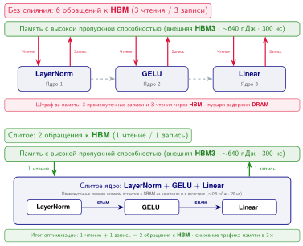

***Слияние операторов до и после:** Сверху: три отдельных ядра, каждое читает из HBM и записывает в HBM, материализуя промежуточные $Z_1$ и $Z_2$; на невслитом пути шесть обращений к HBM «туда и обратно». Снизу: одно слитое ядро читает входы однократно, хранит промежуточные результаты в SRAM и записывает только итоговый выход, оставляя всего два обращения к HBM. Слитый путь дает примерно трехкратное снижение трафика HBM на слой.*

Слияние операторов сокращает обращения к HBM с шести до двух на слой ([«Слияние операторов до и после»](09_performance_engineering.md#fig-fusion-before-after)), обеспечивая примерно трехкратное снижение трафика внешней памяти для этого блока слоя. Однако пропускная способность памяти — лишь половина проблемы. В наивной реализации без слияния выполнение одного слоя трансформера требует примерно 50 отдельных запусков ядер. Если каждый запуск обходится в 10 мкс, система тратит 500 мкс только на диспетчеризацию. Если само арифметическое выполнение слоя занимает всего 2 мс, накладные расходы на запуск съедают 20 процентов общего времени, и вычислительные блоки GPU простаивают пятую часть цикла инференса. Этот режим, ограниченный запуском, ограничивает выгоду от более быстрого оборудования: удвоение FLOP/s GPU ничего не даст для фиксированной стоимости в 500 мкс. Слияние операторов решает эту проблему, компилируя 50 дискретных операций в несколько слитых ядер, часто до 5–10 запусков. Так возвращаются потерянные такты, а нагрузка смещается от диспетчеризации обратно к аппаратным пределам, описанным моделью Roofline.

Слияние имеет и ресурсный предел. Более крупное слитое ядро удерживает больше живых значений в регистрах и часто резервирует больше разделяемой памяти на блок потоков. Любое из этих требований может уменьшить число резидентных варпов, снижая заполняемость SM и его способность скрывать задержки; избыточная потребность в регистрах может также приводить к выгрузке значений (register spilling) в локальную память, поддерживаемую иерархией кэшей или HBM. Слияние выгодно только тогда, когда сэкономленные запуски и промежуточные тензоры HBM перевешивают эту потерю заполняемости, трафик выгрузки и любые дублированные вычисления. Поэтому оценка ядра должна сравнивать измеренные байты HBM, использование регистров и разделяемой памяти, достигнутую заполняемость, число транзакций выгрузки и сквозное время, а не считать меньшее число запусков достаточным доказательством.

<a id="sec-performance-engineering-fusion-categories"></a>

### Категории слияния

Слияние выгодно, когда удаляемый трафик HBM стоит усложнения ядра. Три распространенные категории различаются этим компромиссом: сколько перемещения данных они устраняют, сколько синхронизации требуют и как часто компилятор может применять их автоматически.

Поэлементное слияние находится на конце с наименьшей сложностью: последовательные поэлементные операции (сложение, умножение, функции активации) объединяются в одно ядро. Поскольку каждый выходной элемент зависит ровно от одного входного, такое слияние всегда допустимо и просто реализуется. Фреймворки глубокого обучения обычно выполняют поэлементное слияние автоматически для поддерживаемых шаблонов.

Когда последовательность включает редукцию, решение о слиянии становится более ограниченным. Слияние редукции объединяет поэлементную операцию с последующей редукцией, например суммированием элементов для функции потерь или вычислением среднего и дисперсии для нормализации по слою. Редукции требуют межпоточного взаимодействия внутри ядра: для агрегирования частичных результатов между потоками используются инструкции обмена внутри варпа (warp shuffle) или разделяемая память. Несмотря на эту сложность, выигрыш по памяти существенен: промежуточный тензор до редукции никогда не материализуется в HBM. Для нормализации по слою слияние редукции позволяет не записывать большой предварительно нормализованный тензор в HBM и не считывать его обратно для вычисления среднего и дисперсии.

Самый выгодный случай — слияние, специфичное для оператора. Это специальные ядра, спроектированные для конкретной последовательности операций, например слитое внимание или слитый блок GEMM–смещение–активация. Архитектор ядра должен одновременно рассуждать о потоке данных, распределении разделяемой памяти и планировании потоков. Выигрыш существенен: FlashAttention устраняет квадратичную рабочую область внимания и делает состояние онлайн-softmax линейным по длине последовательности.

Чтобы оценить количественный эффект, рассмотрим каждую категорию применительно к одному слою трансформера со скрытой размерностью 4096 и размером батча 2048 в FP16. Поэлементное слияние цепочки «смещение–GELU–dropout» при такой форме устраняет два промежуточных тензора по 16,8 МБ каждый и экономит 67,1 МБ трафика HBM на слой. По всем 80 слоям это высвобождает около 5,4 ГБ трафика HBM за прямой проход. Слияние редукции LayerNorm позволяет не материализовать большие тензоры до нормализации и промежуточную статистику. Слияние внимания, специфичное для оператора (FlashAttention), дает наибольший отдельный выигрыш, устраняя квадратичные матрицы оценок и вероятностей, которые доминируют во внимании на длинном контексте. Суммарный эффект всех трех категорий слияния может устранить значительную долю трафика HBM для ограниченного памятью прямого прохода трансформера, но сквозное ускорение все равно нужно проверять профилированием, потому что узкое место может сместиться.

<a id="sec-performance-engineering-cuda-graphs"></a>

### CUDA-графы: амортизация накладных расходов на запуск

Другой, ортогональный прием для снижения члена накладных расходов в железном законе — **CUDA-графы**.[^fn-cuda-graphs-constraint] Слияние операторов объединяет несколько операций в меньшее число ядер, тогда как CUDA Graphs амортизируют повторную отправку стабильной последовательности ядер со стороны ЦП.

[^fn-cuda-graphs-constraint]: **CUDA-графы**: захват графа записывает последовательность работы GPU и ее зависимости для последующего воспроизведения (NVIDIA Corporation, 2026). Воспроизведение требует совместимого с захватом графа операций и корректного адресуемого хранилища; оно не требует численно идентичных результатов. Динамический поток управления, формы тензоров или выделения памяти могут вместо этого потребовать вариантов графа, обновлений графа или незахваченных участков. Повторяющиеся формы декодирования часто захватывать проще, чем разнородные формы предзаполнения.

В стандартном PyTorch каждый запуск ядра требует, чтобы ЦП отправил команду в очередь команд GPU. Для слоя декодера трансформера с более чем 30 ядрами это обращение от ЦП к GPU (обычно 5–10 мкс на запуск) накапливается до 150–300 мкс на слой. Для модели из 70 слоев одни только накладные расходы на запуск ядер дают 10–20 мс на прямой проход — заметная доля общего времени для инференса, ограниченного памятью.

CUDA Graphs решают эту задачу, записывая последовательность операций GPU (запусков ядер и копий памяти) в воспроизводимый граф. Запись происходит один раз в фазе прогрева. На последующих итерациях один запрос воспроизведения отправляет записанный граф и избавляет от повторного построения последовательности запусков операция за операцией. Воспроизведение все равно несет затраты хоста, драйвера, запуска графа, синхронизации и планирования на устройстве, поэтому сэкономленную долю нужно измерять для захваченного участка.

Выигрыш может быть существенным, когда короткие ядра оставляют заметные промежутки запуска на ЦП, но он уменьшается, когда доминируют длинные ядра или перемещение данных. Релевантное сравнение — это сквозное время захваченного участка до и после воспроизведения, включая прогрев и любую незахваченную работу, а не только число запусков.

Ограничение структурное, а не численное. Исполняемый граф воспроизводит захваченные узлы и зависимости относительно адресуемого хранилища, а поддерживаемые обновления графа могут менять ограниченный набор параметров узлов (NVIDIA Corporation, 2026). Переменные длины последовательностей, меняющиеся батчи, условные маршруты экспертов и шаблоны выделения памяти поэтому могут требовать нескольких вариантов графа или оставлять динамические участки в обычном потоковом выполнении. Декодирование часто представляет больше повторяющихся форм операций, чем предзаполнение, но это преимущество зависит от стратегии группировки по размерам и захвата в среде выполнения.

Слияние операторов и CUDA-графы атакуют разные источники экспонированного времени: слияние устраняет ядра и промежуточный трафик, а воспроизведение графа уменьшает повторную отправку с хоста для ядер, которые остаются. Когда трасса относит заметную долю сквозного времени к промежуткам запуска на ЦП, а нагрузка допускает стабильный захват, воспроизведение становится кандидатом на вмешательство. Профилирование после захвата должно подтвердить, что промежуток действительно сократился, а не полагаться на предположение, что весь невычислительный накладной расход исчез.

<a id="sec-performance-engineering-flashattention"></a>

### FlashAttention: внимание с тайлингом как системный примитив

Стандартное самовнимание вычисляет $\text{Softmax}(\mathbf{Q}\mathbf{K}^T / \sqrt{d_k})\mathbf{V}$, где $\mathbf{Q}$, $\mathbf{K}$ и $\mathbf{V}$ — матрицы формы $[\text{длина последовательности}{\times}\text{размерность головы}]$. Наивная реализация материализует полную матрицу внимания $S{\times}S$ $\mathbf{A} = \mathbf{Q}\mathbf{K}^T$ в HBM, где $S$ — длина последовательности. Для $S = 8192$ и точности FP16 одна только эта матрица занимает $8192 \times 8192 \times 2 \approx 134$ МБ на голову внимания, так что квадратичные тензоры оценок достигают нескольких гигабайт на слой. Упрощенный учет трафика HBM сравнивает байты, видимые для HBM, у слоя в стиле Llama с 64 головами при явных допущениях о трафике.

FlashAttention (Dao et al., 2022) переформулирует внимание через тайлинг. Вместо материализации полной матрицы $S{\times}S$ он обрабатывает $Q$, $K$ и $V$ небольшими блоками, которые помещаются в on-chip SRAM. Алгоритм загружает тайлы $Q$, $K$ и $V$, вычисляет частичные оценки внимания и поддерживает текущую статистику (онлайн-softmax), чтобы получить точный результат, ни разу не сохраняя полную матрицу внимания в HBM.


*Иллюстративный учет трафика HBM дает отношение около 65.*

Снижение трафика HBM может быть драматическим. Для длины последовательности 8192, 64 голов и размерности головы 128 в FP16 упрощенная наивная оценка учитывает запись и чтение матриц оценок и вероятностей, а также однократное перемещение $Q$, $K$, $V$ и выхода; в сумме это дает примерно 34,9 ГБ на весь слой или 545,3 МБ на голову. Идеализированная нижняя граница FlashAttention учитывает однократное чтение $Q$, $K$, $V$ и однократную запись выхода, что дает примерно 536,9 МБ на весь слой или 8,4 МБ на голову. Итоговое отношение 65× — это сравнение сценариев, а не утверждение о выделенной памяти или реально наблюдаемом трафике ядра. Фактический трафик зависит от перезагрузки тайлов и расписания реализации.

Ключевая идея FlashAttention — трюк с **онлайн-softmax**[^fn-online-softmax-algo], который делает тайлинг возможным для операции, которая, казалось бы, требует глобальной информации. Стандартный softmax вычисляет $\text{softmax}(s_i) = e^{s_i} / \sum_j e^{s_j}$, но для численной устойчивости сначала вычитает глобальный максимум: $\text{softmax}(s_i) = e^{s_i - m} / \sum_j e^{s_j - m}$, где $m = \max_j s_j$. Поиск этого глобального максимума, кажется, требует заранее увидеть все оценки, что вынудило бы материализовать полную матрицу $S{\times}S$.

[^fn-online-softmax-algo]: **Онлайн-softmax**: здесь *онлайн* означает, что вычисление обрабатывает данные инкрементально за один проход, а не требует полного входа сразу.

Онлайн-алгоритм обходит это, поддерживая текущую статистику, которая обновляется инкрементально по мере обработки каждого тайла. При обработке тайла $t$ алгоритм выполняет четыре шага:

1. Вычисляет локальный блок оценок $A_t = Q_{\text{block}} K_t^T$.
2. Обновляет текущий максимум: $m_{\text{new}} = \max(m_{\text{old}}, \max(A_t))$.
3. Перемасштабирует предыдущую сумму и выход: умножает их на $e^{m_{\text{old}} - m_{\text{new}}}$, чтобы скорректировать устаревший максимум.
4. Вычисляет локальный вклад softmax с использованием $m_{\text{new}}$ и накапливает его в текущем выходе.

После обработки всех тайлов текущий выход содержит математически эквивалентный результат стандартного алгоритма с точностью до ошибки округления выбранной точности. Шаг перемасштабирования (шаг 3) — важнейшее нововведение: он позволяет «исправить» предыдущие частичные результаты, когда новый тайл выявляет больший максимум. Алгоритм точен в математическом смысле, но порядок вычислений с плавающей запятой все же может изменить последние разряды по сравнению с нерасслитой реализацией.

Тайлинг требует дополнительной арифметики: операции перемасштабирования на шаге 3 добавляют FLOP, которых стандартный алгоритм не выполняет. Операция глубоко ограничена памятью: арифметическая интенсивность стандартного внимания падает примерно до 1–10 FLOP/байт, если учитывать материализованные тензоры оценок и вероятностей и трафик HBM, который они порождают (это ниже более высоких, зависящих от режима значений в [таблице «Арифметическая интенсивность типичных операций ML»](09_performance_engineering.md#tbl-arithmetic-intensity)). Поэтому дополнительные вычисления оказываются «бесплатными» в том смысле, что арифметические блоки GPU иначе простаивали бы в ожидании передач данных HBM. Обмен дополнительных вычислений на меньшее число обращений к памяти выгоден всегда, когда операция ограничена памятью, — это центральный принцип всей главы.

Механизм этого снижения трафика — тайлинг, показанный на схеме ([«Тайлинг FlashAttention в иерархии памяти»](09_performance_engineering.md#fig-performance-engineering-flashattention-tiling)). FlashAttention выполняет вычисление тайлами (обычно $128{\times}128$ на H100). Для одного тайла алгоритм загружает блок $Q$ ($128 \times 128 \times 2 \approx$ 32,8 КБ), блок $K$ ($128 \times 128 \times 2 \approx$ 32,8 КБ) и блок $V$ (32,8 КБ), что в сумме составляет около 98,3 КБ. Это свободно помещается в 228 КБ разделяемой памяти H100 на SM. Оценка тайла $A_{\text{tile}} = Q_{\text{tile}} K_{\text{tile}}^T$ вычисляется и полностью потребляется внутри SRAM; она никогда не записывается в HBM. Алгоритм обходит $8192/128 =$ 64 столбцовых тайла для каждого из 64 строчных тайлов, перезагружая тайлы по мере необходимости расписанием ядра. Важно то, что квадратичные матрицы оценок и вероятностей $S{\times}S$ никогда не материализуются: постоянные тензоры на голову — это $Q$, $K$, $V$, $Y$ и статистика softmax размером $\mathcal{O}(S)$.

<a id="fig-performance-engineering-flashattention-tiling"></a>

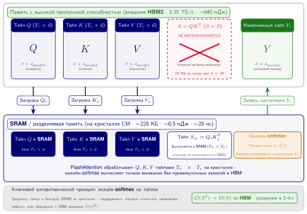

***Тайлинг FlashAttention в иерархии памяти:** блочное расписание матриц Q, K и V, загруженных в разделяемую память (SRAM) на кристалле. Оценки внимания вычисляются и перемасштабируются онлайн, без материализации квадратичной матрицы промежуточных результатов $S \times S$ во внешней HBM, что снижает трафик памяти с $\mathcal{O}(S^2)$ до $\mathcal{O}(S)$.*

FlashAttention-2 (Dao, 2023) дополнительно оптимизирует алгоритм для архитектур GPU с большим числом потоковых мультипроцессоров, перестраивая схему параллелизма. Исходный FlashAttention распараллеливал вычисления по измерениям батча и головы: каждый блок потоков обрабатывал одну пару (батч, голова) и проходил по всей последовательности. FlashAttention-2 дополнительно распараллеливает по измерению длины последовательности матрицы запросов, эффективнее распределяя работу между блоками потоков и достигая лучшей заполняемости. Он также уменьшает число FLOP, не относящихся к GEMM, перестраивая операции перемасштабирования и используя асимметрию между внешним циклом по $Q$ и внутренним циклом по $K$ и $V$.

Новые ядра семейства FlashAttention используют возможности оборудования поколения Hopper, такие как тензорные ядра FP8 и Tensor Memory Accelerator, аппаратный путь для асинхронного пакетного перемещения тензоров между HBM и разделяемой памятью. Системный принцип тот же, что и в исходном алгоритме: по мере того как оборудование открывает более быстрые пути перемещения и выполнения с меньшей точностью, схему внимания нужно переписывать так, чтобы использовать эти пути и не материализовать квадратичную рабочую область.

Первоначальный прорыв состоял в смене представления об узком месте: ограничением для внимания была иерархия памяти, а не матричное умножение.

<a id="exmp-performance-engineering-flashattention-breakthrough"></a>

> **Прорыв FlashAttention**
>
> **Сценарий**: стандартный трансформер материализует полную матрицу оценок внимания $S \times S$ в HBM GPU с высокой задержкой, создавая квадратичное узкое место по памяти и пропускной способности по мере роста длины последовательности $S$ ((Dao et al., 2022)).
>
> **Диагноз**: узким местом были иерархия памяти и пропускная способность HBM, а не вычислительная мощность. FlashAttention перестраивает внимание через блочный тайлинг и онлайн-softmax, удерживая промежуточную статистику в быстрой SRAM, чтобы вычислять внимание без записи матрицы $S \times S$ в глобальную память.
>
> **Системный урок**: FlashAttention демонстрирует проектирование алгоритмов с учетом ввода-вывода. Обмен небольшого объема дополнительных пересчетов в быстрой SRAM на устранение квадратичных записей в HBM дает ускорение по времени в 2–4× для рабочих нагрузок LLM с длинным контекстом.

Прежде чем перейти к графику масштабирования, остановимся на механизме: FlashAttention обменивает небольшой объем дополнительной арифметики на устранение квадратичного состояния, находящегося в HBM.

<a id="chk-performance-engineering-flashattention-mechanics"></a>

> **Контрольные вопросы: механика FlashAttention**
>
> Проверьте понимание внимания с учетом памяти:
>
> - [ ] **Масштабирование по длине последовательности**: объясните, почему FlashAttention дает больший выигрыш для более длинных последовательностей (например, 32K), чем для коротких (например, 512).
> - [ ] **Хранение онлайн-softmax**: определите, где находится статистика онлайн-softmax в алгоритме FlashAttention: в HBM, в кэше L2 или в SRAM SM.
> - [ ] **Число FLOP не меняется**: оцените утверждение, что FlashAttention уменьшает общее число операций с плавающей запятой (FLOP), необходимых для внимания.
> - [ ] **От памяти к размеру батча**: объясните, как снижение памяти внимания с $\mathcal{O}(S^2)$ до $\mathcal{O}(S)$ позволяет использовать большие батчи при обслуживании.

Отношение 65× относится только к заявленному сценарию трафика. [«Экономия памяти FlashAttention»](09_performance_engineering.md#fig-flashattention-memory-savings) добавляет форму масштабирования: поскольку рабочая область стандартного внимания растет квадратично, а текущее состояние FlashAttention — линейно, выигрыш расширяется с длиной последовательности. График использует более узкую границу рабочей области, поэтому его отношения не сопоставимы напрямую с оценкой трафика. Вывод в том, что разрыв растет, а не в его точной величине при данной длине.

<a id="fig-flashattention-memory-savings"></a>

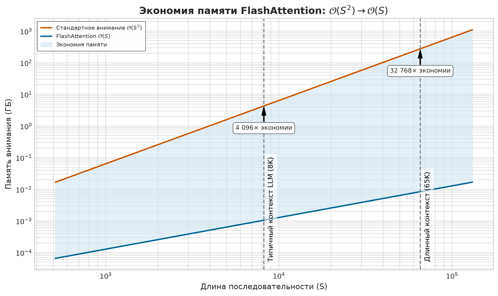

***Экономия памяти FlashAttention:** $\mathcal{O}(S^2) \rightarrow \mathcal{O}(S)$. Стандартное внимание выделяет полную матрицу оценок $S{\times}S$ в HBM, тогда как FlashAttention хранит только текущую статистику размером $\mathcal{O}(S)$. Заштрихованная область показывает память, освобожденную для KV-кэша, активаций или больших батчей. Это сравнение вспомогательной памяти использует более узкую границу, чем сценарий трафика в тексте; его смысл — в расширении разрыва по мере роста контекста, а не в одном итоговом отношении.*

FlashAttention снижает «стену памяти» внутри одного GPU, выполняя тайлинг на границе SRAM и HBM. Для длин последовательности, которые превышают емкость памяти одного GPU, тот же принцип тайлинга распространяется на несколько GPU через Ring Attention (Liu et al., 2023). Распределение блоков последовательности по кольцу ускорителей с перекрытием коммуникации и вычислений позволяет Ring Attention работать с окнами контекста, непрактичными для конфигураций с одним GPU. Распределенная механика Ring Attention разобрана в разделе «Тензорный параллелизм» главы «Распределенное обучение» в контексте более широкого обсуждения тензорного параллелизма.

<a id="sec-performance-engineering-precision"></a>

## Инженерия точности

Слияние уменьшает число обращений к HBM; инженерия точности уменьшает полезную нагрузку каждого обращения. Передача весов FP16 через HBM расходует вдвое больше байтов, чем FP8. Для ядер, ограниченных пропускной способностью, сокращение весов с 2 байт до 1 байта может примерно вдвое уменьшить трафик чтения весов и увеличить эффективную пропускную способность памяти. Инженерное решение состоит в том, где можно терпеть численный шум, чтобы снизить нагрузку на пропускную способность, а где качество требует более высокой точности. 8-битная плавающая запятая в распределенном обучении рассматривается как примитив времени обучения (раздел «FP8 в распределенном обучении» главы «Распределенное обучение»), тогда как методы квантования в этом разделе обеспечивают эффективный инференс в масштабе.

<a id="sec-performance-engineering-block-quant"></a>

### Блочное квантование

Первое решение о точности на стороне инференса — как уменьшить веса, защитив каналы, которые несут редкий, но существенный сигнал. Посттренировочное квантование в INT8 или INT4 дает еще большую экономию пропускной способности для инференса, но для LLM возникает особая проблема: **выбросы признаков** (outlier features). (Dettmers et al., 2022) обнаружили, что большие языковые модели формируют небольшое число скрытых измерений (около 0,1 процента признаков), величины активаций которых примерно в 3–20× больше, чем у остальных. Равномерное квантование INT8 на уровне тензора либо обрезает эти выбросы, уничтожая переносимую ими информацию, либо расширяет диапазон квантования, чтобы их вместить, теряя точность на большинстве близких к нулю значений.

<a id="dfn-performance-engineering-block-wise-quantization"></a>

> **Блочное квантование**
>
> ***Блочное квантование*** — это схема квантования весов ML, которая разбивает тензор весов на непересекающиеся группы по $G_{\text{block}}$ элементов и вычисляет масштаб для каждой группы $s_i = (x_{\max,i} - x_{\min,i}) / (2^b - 1)$, независимо ограничивая наихудшую ошибку квантования внутри каждой группы.
>
> 1.  **Значение**: при размере блока $G_{\text{block}} = 64$ и $b = 4$ битах веса сжимаются с 16 бит до 4 бит (сокращение памяти в 4×), а каждый масштаб FP16 добавляет $16/64 = 0{,}25$ бита на вес. Это дает эффективную разрядность $4{,}25$ бита на вес: накладные расходы 6,25 процента относительно полезной нагрузки INT4 или примерно 1,6 процента от исходного размера весов FP16.
> 2.  **Отличие**: в отличие от квантования по тензору, которое применяет единый масштаб ко всей матрице весов и вынуждает его вмещать выбросы ценой потери точности на большинстве близких к нулю весов, блочное квантование ограничивает ущерб от выбросов отдельными блоками и не дает одному экстремальному значению снизить точность квантования всего тензора.
> 3.  **Типичная ошибка**: частое заблуждение — считать размер блока бесплатным гиперпараметром. Меньшие блоки ($G_{\text{block}} = 32$) уменьшают ошибку квантования, но вдвое увеличивают накладные расходы на метаданные по сравнению с $G_{\text{block}} = 64$. При $G_{\text{block}} = 16$ масштаб добавляет 1 бит на вес: 25 процентов накладных расходов относительно полезной нагрузки INT4 или 6,25 процента от исходного размера весов FP16.

Структурный контраст между квантованием по тензору и блочным квантованием показан на [рисунке «Блочное и квантование по тензору»](09_performance_engineering.md#fig-performance-engineering-block-quantization). При квантовании по тензору один выброс растягивает масштабирующий коэффициент на весь тензор, квантуя большинство весов в ноль и уничтожая точность. При блочном квантовании штраф за динамический диапазон выброса строго ограничен его локальной группой, что сохраняет представление с высоким разрешением для окружающих весов.

<a id="fig-performance-engineering-block-quantization"></a>

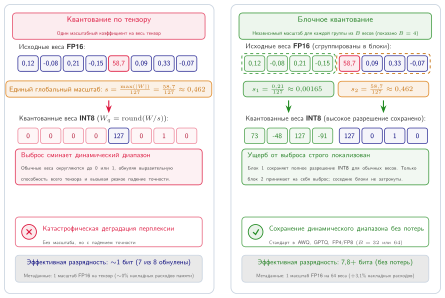

***Блочное и квантование по тензору:** При квантовании по тензору (слева) один экстремальный вес-выброс вынуждает широкий масштабирующий коэффициент, который обнуляет обычные веса и разрушает точность. При блочном квантовании (справа) веса разбиты на независимые группы: ущерб от выбросов строго изолирован в одном блоке, а остальные параметры сохраняют полный динамический диапазон INT8.*

LLM.int8() сохраняет стоимость выбросов во время выполнения, раскладывая каждое умножение матриц на две части: небольшой набор измерений-выбросов, обрабатываемых в FP16, и остальные измерения, обрабатываемые в INT8. Система определяет измерения-выбросы во время выполнения (те, что превышают порог величины, обычно 6,0), направляет их в GEMM FP16, а остальные измерения — в GEMM INT8. Результаты объединяются в итоговый выход. Так достигается почти безпотерьный инференс INT8 для моделей, которые иначе заметно деградировали бы при равномерном квантовании.

Generative Pre-trained Transformer Quantization (GPTQ) (Frantar et al., 2023) переносит стоимость в калибровку через квантование только весов с использованием информации второго порядка. Вместо того чтобы квантовать каждый вес независимо, GPTQ выполняет послойный проход реконструкции, который использует приближенную обратную матрицу Гессиана, вычисленную по калибровочным активациям, чтобы оценить, какие ошибки квантования важнее всего, а затем компенсирует эти ошибки в оставшихся неквантованных весах. Это дает представления весов INT4 с малой потерей точности для многих моделей трансформеров. Ключевая идея в том, что ошибка квантования одного веса иногда может компенсироваться через коррелированные веса того же слоя.

Activation-Aware Weight Quantization (AWQ) (Lin et al., 2024) снижает нагрузку на калибровку, наблюдая, что не все веса одинаково важны: веса, связанные с каналами высокой активации, вносят непропорционально большой вклад в выход модели. AWQ определяет эти значимые веса, анализируя величины активаций по калибровочному набору данных, а затем применяет поканальное масштабирование, чтобы защитить их перед равномерным групповым квантованием. Так достигается квантование весов INT4 с качеством, сравнимым с посттренировочными методами на основе реконструкции, без реконструкции по Гессиану в стиле GPTQ.

SmoothQuant (Xiao et al., 2023) переносит нагрузку выбросов с активаций на веса до инференса. Вместо обработки выбросов во время выполнения (LLM.int8()) или через оптимизацию весов (GPTQ, AWQ) SmoothQuant сглаживает распределение активаций перед квантованием, переводя трудность квантования с активаций на веса. Ключевое наблюдение состоит в том, что выбросы активаций зависят от канала: определенные скрытые измерения стабильно дают большие значения для всех токенов. SmoothQuant применяет поканальное преобразование масштабирования: делит активацию на коэффициент сглаживания и умножает соответствующий вес на тот же коэффициент. Это математически эквивалентное преобразование уменьшает величины выбросов активаций ценой небольшого роста величин весов, делая оба тензора более пригодными для равномерного квантования INT8. Результатом становится эффективное квантование W8A8 (вес в 8 битах, активация в 8 битах), которое использует тензорные ядра INT8 и для пропускной способности, и для выигрыша в вычислениях.

Практический выбор зависит от лимитирующего ресурса и бюджета качества. LLM.int8() обрабатывает выбросы во время выполнения смешанноточной декомпозицией, но ограничивает сжатие уровнем INT8. GPTQ использует информацию второго порядка для агрессивного сжатия весов до INT4, но требует часов калибровки для каждой модели. AWQ достигает сопоставимого качества INT4 за минуты калибровки, фокусируясь на масштабировании с учетом активаций. SmoothQuant обеспечивает квантование W8A8, предварительно обрабатывая пары «веса–активации». Для обслуживания LLM только с весами AWQ часто привлекателен, когда важно время калибровки; для рабочих нагрузок, которым нужны квантование активаций и тензорные ядра INT8, более релевантен SmoothQuant.

Выбор между этими методами зависит также от целевого развертывания. Для инференса на GPU с поддержкой тензорных ядер GPTQ и AWQ дают представления весов INT4, которые деквантуются в FP16 во время GEMM и вычисляются на тензорных ядрах FP16 GPU. Для инференса на ЦП или развертывания на периферии представления INT8 (LLM.int8() или статическое поканальное квантование INT8) могут напрямую использовать блоки целочисленной арифметики без накладных расходов на деквантование.

Стоимость хранения для блочного квантования минимальна. Хранение одного масштаба FP32 (32 бита) на каждый блок из 128 весов INT8 (1024 бита) увеличивает общий размер модели лишь на 3 процента. Этот небольшой накладной расход позволяет блочному квантованию изолировать разрушительное действие выбросов, сохраняя эффективный динамический диапазон для 99 процентов обычных весов, без штрафа по пропускной способности, которое несут форматы более высокой точности. На крайнем конце спектра развертывания квантование перестает быть оптимизацией и становится физической необходимостью. Мобильное или федеративное развертывание дает этот предельный случай: когда у устройства всего килобайты или мегабайты памяти, точность перестает быть ручкой настройки после выбора модели и становится частью проверки осуществимости.

<a id="lhs-performance-engineering-archetype-c-federated-mobilenet-tinyml-survival"></a>

> **Архетип C (федеративный MobileNet): выживание в TinyML**
>
> Для архетипа C (федеративный MobileNet) квантование — условие выживания, а не оптимизация. На микроконтроллере всего с 512 КБ SRAM модель FP16 физически не может быть загружена. Бинарные нейронные сети и квантование в 1 бит доводят это до крайности, представляя веса отдельными битами (+1/−1). Хотя это приносит заметную потерю точности, объем памяти весов сокращается в 16× относительно FP16 (в 32× относительно FP32), а энергия на операцию — до 100×, что позволяет работать интеллекту на устройствах, которые питаются от собранной энергии (микроватты).

<a id="sec-performance-engineering-ptq-qat"></a>

### Посттренировочное квантование и обучение с учетом квантования

Когда посттренировочный рецепт не укладывается в бюджет качества, решение о точности смещается от калибровки к стоимости обучения. Компромисс между **посттренировочным квантованием (PTQ)** и **обучением с учетом квантования (QAT)** определяется балансом между инженерной оперативностью и точностью модели. Для модели вроде Llama-2-70B PTQ — распространенный первый выбор для немедленного развертывания. Такие методы, как GPTQ или AWQ, обрабатывают модель послойно, используя небольшой калибровочный набор данных (обычно 128–1024 примера), чтобы минимизировать ошибку реконструкции. Этот процесс вычислительно дешев и часто требует часов, а не распределенного запуска обучения для модели на 70 млрд параметров. Хотя PTQ обычно устойчив при INT8, агрессивное квантование до INT4 или INT3 может давать заметный штраф: перплексия может ухудшиться, а бенчмарки рассуждений, такие как Massive Multitask Language Understanding (MMLU), могут упасть на несколько процентных пунктов, если рецепт квантования не защищает чувствительные слои и каналы выбросов.

Когда PTQ не достигает пороговых значений качества, QAT предлагает решение, встраивая шум квантования непосредственно в цикл обучения. Моделирование низкоточного округления в прямом проходе и приближение градиентов в обратном проходе через straight-through estimator (STE)[^fn-ste-straight-through] позволяют сети подстраивать свои веса так, чтобы быть устойчивой к квантованию.

[^fn-ste-straight-through]: **Straight-through estimator (STE)**: рассмотрен в работе (Bengio et al., 2013) для жестких стохастических нейронов. STE решает фундаментальную проблему математического анализа, которая возникает и при квантовании: градиент функции округления почти всюду равен нулю, поэтому обратное распространение через квантованные слои по стандартным правилам невозможно. STE пропускает верхний градиент через шаг округления как суррогатный градиент, делая вид, что округления не было. Это приближение на практике полезно для обучения сетей с дискретными или квантованными операциями, но это эвристика, а не общая гарантия сходимости для каждой конфигурации QAT.

Стоимость существенна: QAT фактически представляет собой полноценный запуск дообучения, часто требующий сотен GPU-часов и распределенного кластера обучения. Для модели на 70 млрд параметров это может означать многодневную задачу на нескольких GPU вместо калибровочного запуска PTQ, исчисляемого часами. Квантованное дообучение на адаптерах сокращает разрыв, замораживая низкоточную базовую модель и обновляя лишь небольшие матрицы адаптеров низкого ранга, а не все веса модели. Такой гибридный подход возвращает часть качества, которое дает QAT, при объеме памяти, достаточно малом для запуска на заметно более слабом оборудовании. Но это средство адаптации к задаче, а не универсальная замена полного переобучения с учетом квантования.

В большинстве сред развертывания практичный порядок действий — двухэтапный: сначала развернуть модель с PTQ, если она удовлетворяет требованиям качества, а затем применить QAT или квантованное дообучение на адаптерах, если модель PTQ не выдерживает целевой точности. Такая последовательность сводит инженерные усилия к минимуму и сохраняет возможность повысить качество, когда это нужно.

<a id="sec-performance-engineering-quant-strategies"></a>

### Квантование только весов и квантование весов с активациями

Последнее решение о точности — остановиться на весах или включить также активации. Квантование только весов (GPTQ, AWQ) снижает точность весов до INT4 или INT3, сохраняя активации в FP16. Во время GEMM веса INT4 деквантуются в FP16 на лету, и вычисления продолжаются на тензорных ядрах FP16. Выигрыш — меньший объем памяти для хранения весов и меньшая пропускная способность HBM для чтения весов, но сам GEMM все равно работает с точностью FP16. Этот подход идеален для инференса, ограниченного памятью (декодирование при батче 1), где узкое место — чтение весов из HBM.

Квантование весов и активаций (SmoothQuant, обучение в FP8) снижает точность и весов, и активаций, позволяя GEMM выполняться в арифметике меньшей разрядности (тензорные ядра INT8, тензорные ядра FP8). Это дает выигрыш и по пропускной способности, и по вычислениям, но его сложнее реализовать без потери качества, потому что распределения активаций более динамичны и труднее квантуются, чем распределения весов.

Выбор зависит от режима работы. Для инференса, ограниченного памятью (малые батчи), квантование только весов в INT4 часто дает наибольшее ускорение на единицу потери качества. Для инференса, ограниченного вычислениями (большие батчи), или обучения квантование весов и активаций в FP8 дает прирост пропускной способности, с которым квантование только весов не может сравниться. Высокопроизводительные системы обслуживания часто используют разные стратегии квантования для разных рабочих точек: INT4 только для весов при малых батчах (ради задержки) и FP8 для весов и активаций при больших батчах (ради пропускной способности).

Та же проблема точности распространяется и на KV-кэш (key-value), который определяет, превратится ли экономия весов в большие батчи. При декодировании веса могут агрессивно сжиматься, тогда как состояние кэша на каждый запрос продолжает расти с длиной последовательности. Поэтому изменение точности, которое не затрагивает кэш, может не сдвинуть узкое место обслуживания. Численное сжатие уменьшает число байтов, хранимых на каждый кэшированный ключ или значение, тогда как групповое внимание к запросам (grouped query attention, GQA) уменьшает число голов ключей и значений, которые нужно кэшировать на каждом слое. Оба механизма важны, потому что планировщик допускает запросы исходя из совокупного объема памяти весов и активного состояния кэша. Расчет емкости KV-кэша выделяет локальный эффект емкости до того, как раздел «Инференс в масштабе» главы «Инференс в масштабе» возвращается к полной политике обслуживания.

Расчет емкости делает конкретным влияние выбора точности на обслуживание.

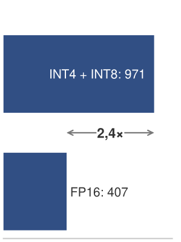

*Снижение точности освобождает память и увеличивает допустимый батч.*

<a id="nbk-performance-engineering-precision-dividend"></a>

> **Дивиденд точности**
>
> **Задача**: модель с 70 млрд параметров обслуживается на 8× GPU H100. Веса модели в FP16 занимают 140 ГБ (по 17,5 ГБ на GPU). KV-кэш в FP16 занимает 1,34 ГБ на запрос. Как квантование весов в INT4 и KV-кэша в INT8 меняет максимальный размер батча?
>
> До оптимизации (все в FP16):
>
> - Веса: 17,5 ГБ на GPU
> - Доступно под KV-кэш: 85,9 ГБ − 17,5 ГБ = 68,4 ГБ на GPU
> - KV-кэш на запрос: 1,34 ГБ суммарно, или примерно 0,17 ГБ на GPU
> - Максимальный размер батча: примерно 407 запросов
>
> После оптимизации (веса INT4, KV-кэш INT8):
>
> - Веса: 17,5 ГБ $\times$ (4/16) = 4,4 ГБ на GPU (INT4)
> - Доступно под KV-кэш: 85,9 ГБ − 4,4 ГБ = 81,5 ГБ на GPU
> - KV-кэш на запрос (INT8): примерно 0,67 ГБ суммарно, или 0,08 ГБ на GPU
> - Максимальный размер батча: примерно 971 запрос
>
> **Системный вывод**: инженерия точности меняет экономику обслуживания, позволяя использовать большие батчи. Большие батчи амортизируют фиксированную стоимость загрузки весов и переводят операции из режима, ограниченного памятью, к режиму, ограниченному вычислениями. Одна эта оптимизация может увеличить пропускную способность в 2,4× и более.

Инженерия точности уменьшает число байтов на одну транзакцию памяти. Слияние операторов уменьшает число транзакций. Вместе они атакуют одно и то же фундаментальное узкое место с взаимодополняющих сторон: когда данные должны пройти через медленную шину, передавайте меньше (точность) и передавайте их реже (слияние). Мультипликативное взаимодействие этих двух приемов объясняет, почему высокопроизводительные стеки обслуживания часто применяют оба одновременно: FlashAttention устраняет квадратичные промежуточные результаты внимания, а сжатие KV-кэша в INT8 дополнительно вдвое сокращает оставшиеся байты KV-кэша. Совокупный эффект превышает то, что дает каждый прием по отдельности. Поскольку эти шаблоны слияния и точности повторяются в устойчивых структурах слоев, следующий вопрос — когда компилятор может взять на себя преобразования по всему графу модели.

<a id="sec-performance-engineering-compilation"></a>

## Компиляция графов

После того как точность и слияние выявили повторяющиеся шаблоны оптимизации, компиляция графов спрашивает, достаточно ли эти шаблоны стабильны, чтобы компилятор мог ими управлять. Вручную писать слитые ядра CUDA для каждой возможной комбинации слоев массивной нейронной сети — сизифов труд для инженеров. Компилятор графов анализирует вычислительный граф модели и генерирует оптимизированные машинные инструкции с учетом аппаратного обеспечения. Он превращает высокоуровневый код PyTorch в специализированные ядра, когда стабильность форм и объем повторных запусков оправдывают стоимость компиляции.

<a id="psp-performance-engineering-hardware-software-co-design"></a>

> **Совместное проектирование аппаратуры и программ**
>
> Более глубокая выгода компиляции — пространственная, а не только арифметическая. Компилятор вроде XLA или TensorRT перестраивает вычисления под физическую компоновку целевого ускорителя: он разбивает матричное умножение на тайлы по размерам систолического массива, размещает промежуточные результаты в соответствии с иерархией памяти и направляет поэлементную работу на векторные АЛУ, оставляя систолический массив для GEMM. Именно так становится практически осуществимым гетерогенное выполнение в масштабе. Один и тот же граф модели отображается на разный кремний изменением отображения, а не математики.

<a id="sec-performance-engineering-compilation-pipeline"></a>

### Конвейер компиляции

Граф-компилятор преобразует высокоуровневое определение модели (код на Python) в оптимизированные машинные инструкции через многоэтапный конвейер, как показано на [рисунке «Конвейер компиляции глубокого обучения»](09_performance_engineering.md#fig-performance-engineering-compilation-pipeline). Чтобы наглядно представить этот процесс, рассмотрим стандартный блок прямого распространения трансформера (FFN), состоящий из проекции, активации, второй проекции и нормализации по слою: `LayerNorm(Linear(GELU(Linear(x))))`. В стандартном выполнении PyTorch в eager-режиме эта последовательность запускает четыре отдельных ядра, каждое из которых читает из HBM и записывает в HBM.

<a id="fig-performance-engineering-compilation-pipeline"></a>

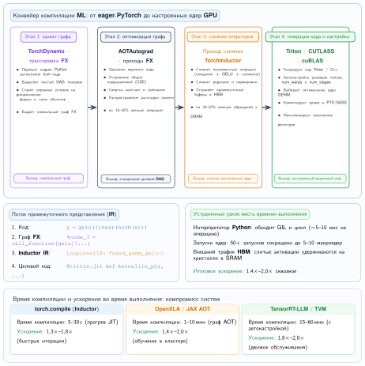

***Конвейер компиляции глубокого обучения:** четырехэтапный путь от байт-кода Python в eager-режиме через захват графа (TorchDynamo), оптимизацию на уровне графа (AOTAutograd) и слияние операторов с учетом целевого оборудования (TorchInductor) к генерации кода и автонастраиваемой компиляции ядер GPU (Triton и cuBLAS).*

На стадии **захвата графа** компилятор трассирует выполнение модели и строит вычислительный граф, ориентированный ациклический граф, в котором узлы представляют операции, а ребра — зависимости по тензорам. Для блока FFN это дает граф из четырех основных узлов и связанных с ними тензоров параметров. Динамический поток управления Python (циклы, условия) нужно обрабатывать либо трассировкой по репрезентативному пути выполнения, либо с помощью аннотаций компилятора, которые помечают динамические измерения.

На этапе **оптимизации на уровне графа** компилятор применяет алгебраические упрощения и переписывание операций. Он определяет, что добавление смещения в первом слое `Linear` можно свернуть в ядро матричного умножения. Он также распознает, что активация `GELU` — поэлементная операция, которая зависит только от выхода первого `Linear`. Эти стандартные оптимизации компилятора могут сократить размер графа на 10–30 процентов еще до начала аппаратно-специфичной работы.

Проход слияния операторов важнее всего для производительности. Он находит соседние операции, которые можно объединить в одно ядро, чтобы снизить трафик памяти. Для блока FFN компилятор может слить активацию `GELU` с хвостом ядра первого `Linear`, если GEMM поддерживает такой эпилог. Второй `Linear` стоит между `GELU` и `LayerNorm`, поэтому эти две операции не составляют соседней пары для слияния. Вместо того чтобы записывать промежуточный результат первого `Linear` в HBM и считывать его для `GELU`, слитый эпилог удерживает данные в SRAM или регистрах GPU. Это обычно снижает число обращений к HBM на 30–50 процентов и непосредственно смягчает узкое место пропускной способности памяти.

Проход планирования памяти определяет, когда выделять и освобождать тензоры. Без оптимизации трансформер может выделять отдельные буферы под каждую промежуточную активацию. Компилятор анализирует времена жизни тензоров, понимая, что вход первого `Linear` больше не нужен после того, как второй `Linear` вычислил свой выход, и переиспользует те же физические адреса памяти. Для инференса и других прямых (forward-only) нагрузок такое переиспользование буферов может превратить пиковую временную память из суммы многих буферов уровня слоя в максимальный одновременно живой рабочий набор. Активации обучения, которые нужно сохранить для обратного прохода, требуют чекпойнтинга или перевычисления (rematerialization); обычное переиспользование буферов не может сделать эти сохраненные тензоры исчезнувшими. Планирование памяти также взаимодействует со слиянием операторов: слияние двух операций устраняет промежуточный тензор между ними, что одновременно убирает трафик HBM и выделение памяти. Компилятор должен рассуждать о двух эффектах совместно, чтобы принимать выгодные решения.

Проход выбора ядер сопоставляет каждую слитую операцию с конкретной реализацией машинного кода. Для первого `Linear-GELU` компилятор выбирает оптимизированный вендором GEMM cuBLAS или CUTLASS с эпилогом активации, когда он доступен; второй `Linear` остается оптимизированным GEMM, а `LayerNorm` разворачивается в собственное оптимизированное ядро редукции и нормализации. Итог для блока FFN — сокращение с 4 отдельных ядер до 3 оптимизированных, с соответствующим снижением трафика глобальной памяти.

<a id="sec-performance-engineering-torch-compile"></a>

### torch.compile

Для рабочих нагрузок, уже написанных на PyTorch, `torch.compile` — наименее разрушительное вмешательство компилятора: он пытается захватить достаточно статичного графа, чтобы слить участки, ограниченные памятью, сохраняя динамическую модель выполнения Python. Он работает через три компонента: **TorchDynamo** для захвата графа, **TorchInductor** для генерации кода и **AOTAutograd** для заранее построенного графа обратного прохода, когда рабочим нагрузкам обучения нужны скомпилированные обратные проходы.

TorchDynamo работает на уровне байт-кода Python,[^fn-torchdynamo-python-bytecode] и это проектное решение отличает его от более ранних подходов к трассировке. Прежние методы трассировки (torch.jit.trace, torch.fx) работали на уровне исходного кода Python или абстрактного синтаксического дерева и требовали, чтобы пользователь избегал неподдерживаемых конструкций Python. TorchDynamo перехватывает сам интерпретатор байт-кода и захватывает вычислительный граф без изменения кода модели. Когда TorchDynamo встречает конструкции Python, которые не может трассировать (управление потоком, зависящее от данных, неподдерживаемые операции), он вставляет **разрыв графа** (graph break), который делит трассировку на несколько подграфов, каждый из которых компилируется независимо. Цель — захватить как можно больший подграф и аккуратно обработать динамическое поведение Python.

[^fn-torchdynamo-python-bytecode]: **Перехват байт-кода TorchDynamo**: перехватывая функцию вычисления кадров CPython (PEP 523, добавлена в Python 3.6), TorchDynamo захватывает вычислительный граф на самом низком уровне интерпретатора Python, ниже любых абстракций уровня исходного кода. Поэтому он может трассировать сквозь декораторы, замыкания и сторонние библиотеки, с которыми не справлялись прежние подходы трассировки. Цена — тесная связь с внутренностями CPython: TorchDynamo нужно обновлять для каждой новой версии Python, и он не работает на альтернативных интерпретаторах вроде PyPy.

TorchInductor генерирует оптимизированные ядра Triton (для GPU) или код C++/OpenMP (для ЦП) из захваченного графа. Triton — предметно-ориентированный язык для написания ядер GPU с синтаксисом, похожим на Python; он абстрагирует управление блоками потоков и объединение обращений к памяти (coalescing), сохраняя при этом явный контроль над решениями о тайлинге и слиянии. TorchInductor автоматически сливает поэлементные операции, сокращает трафик памяти, объединяя операции с общими входами, и выбирает размеры тайлов через автонастройку.

Простой пример иллюстрирует использование:

```python
import torch

def transformer_block(x, w1, w2, ln_weight, ln_bias):
    """Невслитый блок FFN трансформера."""
    h = x @ w1  # Линейная проекция
    h = torch.nn.functional.gelu(h)  # Активация
    h = h @ w2  # Выходная проекция
    # Нормализация по слою
    mean = h.mean(dim=-1, keepdim=True)
    var = h.var(dim=-1, keepdim=True, unbiased=False)
    h = (h - mean) / torch.sqrt(var + 1e-5)
    h = h * ln_weight + ln_bias
    return h

# Компилируем функцию: TorchDynamo трассирует, TorchInductor оптимизирует
compiled_block = torch.compile(transformer_block)

# Первый вызов запускает компиляцию; последующие вызовы используют скомпилированный код
output = compiled_block(x, w1, w2, ln_weight, ln_bias)
```

В этом примере `torch.compile` сольет активацию GELU с окружающими операциями, объединит шаги нормализации по слою (среднее, дисперсия, нормализация) в одно ядро и, возможно, сольет добавление смещения с предшествующим GEMM. Код модели остается стандартным PyTorch; оптимизацию выполняет компилятор.

<a id="sec-performance-engineering-xla"></a>

### XLA и оптимизация для TPU

XLA платит за производительность статической структурой. Используемый как бэкенд для JAX и TensorFlow, он генерирует высокоуровневое промежуточное представление оптимизатора, которое нацелено на несколько бэкендов, включая тензорные процессоры Google (TPU), GPU NVIDIA и ЦП. В отличие от TorchInductor, который генерирует код Triton для GPU NVIDIA с сохранением большей гибкости Python, XLA требует **компиляции всей программы целиком**: он трассирует всю вычислительную задачу как единый статический граф и включает глобальные оптимизации, охватывающие слои и даже прямой и обратный проходы.

Глобальное представление открывает самую характерную возможность XLA: **General and Scalable Parallelization for ML Computation Graphs (GSPMD)**, где SPMD обозначает модель выполнения «одна программа, много данных» (single program, multiple data), в которой каждое устройство выполняет одну и ту же программу над своим фрагментом данных. В распределенном обучении GSPMD автоматически разбивает вычислительный граф между тысячами ядер TPU на основе нескольких высокоуровневых аннотаций пользователя. Если пользователь PyTorch должен вручную оборачивать модели в `DistributedDataParallel` или `FullyShardedDataParallel`, то пользователь XLA определяет вычисления для одного устройства, а компилятор выводит необходимые примитивы коммуникации (AllReduce, AllGather) и вставляет их в граф. Это позволяет реализовать сложные гибридные стратегии шардинга, которые трудно написать вручную.

Именно для аппаратуры TPU XLA выполняет оптимизации раскладки, недоступные на других платформах. Он отображает матричные умножения на архитектуру систолического массива TPU, дополняя размерности до выравнивания по аппаратным блокам $128{\times}128$ и планируя инструкции так, чтобы скрыть задержку выборок из HBM. Эффект этих оптимизаций виден в метриках утилизации FLOP модели (model FLOPs utilization, MFU). На крупномасштабных рабочих нагрузках обучения LLM для тщательно настроенных запусков JAX/XLA на TPU сообщалось о MFU в диапазоне 55–65 процентов, тогда как менее настроенные установки PyTorch/GPU могут показывать меньше.

Цена производительности XLA — задержка компиляции и жесткость. Поскольку XLA должен анализировать полный статический граф, первоначальная компиляция больших моделей может занимать минуты, тогда как `torch.compile` — секунды. Любое изменение формы входа запускает полную перекомпиляцию. Поэтому XLA отлично подходит для установившихся производственных нагрузок, где граф статичен, а модель работает днями или неделями, но трудно применим в исследовательских средах с динамическими формами или быстрыми экспериментами. Выбор между `torch.compile` и XLA часто определяется аппаратным и программным стеком: рабочие процессы на GPU NVIDIA обычно начинаются с PyTorch, а рабочие процессы на TPU обычно используют JAX или TensorFlow с XLA.

<a id="sec-performance-engineering-tensorrt"></a>

### TensorRT: оптимизация инференса

NVIDIA TensorRT — специализированный компилятор для инференса, который рассматривает модель не как гибкую программу, а как жесткую задачу глобальной оптимизации. Поскольку инференс не требует обратного прохода и хранения градиентов, TensorRT применяет агрессивные преобразования, которые для обучения были бы математически некорректны или непрактично медленны. Он выполняет проход калибровки: запускает модель на репрезентативных данных, чтобы определить числовой диапазон каждого тензора активаций.

Калибровка позволяет применять **смешанноточное квантование** на детальном уровне. Наивное квантование всех слоев 70-миллиардной LLM в INT8 часто ухудшает перплексию. TensorRT может калибровать диапазоны INT8 по репрезентативным данным и строить смешанноточные движки инференса, когда точности разрешены или ограничены; для LLM политики отката на уровне слоев обычно требуют явного анализа квантования или заданных пользователем ограничений точности. TensorRT также устраняет операции, нужные только при обучении (dropout, обновления скользящей статистики batch normalization), оптимизирует под статические формы, генерируя ядра, настроенные на точные размерности, и точно планирует память, поскольку тензоры градиентов не нужны.

TensorRT выполняет **автонастройку ядер** далеко за пределами простых эвристик. Для каждой операции графа он измеряет десятки кандидатов ядер с различными размерами тайлов, конфигурациями блоков потоков и факторами разворачивания цикла на реальном целевом оборудовании. Он выбирает самую быструю реализацию для конкретного GPU и формы входа. Разрыв в производительности между TensorRT и универсальными компиляторами может быть существенным, особенно для установившихся рабочих нагрузок инференса, где движок может агрессивно специализироваться под фиксированный диапазон форм и архитектуру GPU.

Цена агрессивной оптимизации TensorRT — пониженная гибкость и высокая стоимость компиляции. Компиляция занимает минуты или часы (30–60 минут для модели на 70 млрд параметров), а получившийся движок жестко привязан к конкретной архитектуре GPU и диапазону форм входа. Любое изменение этих параметров требует перекомпиляции. Поэтому TensorRT — частый выбор для стабильных производственных развертываний с большим объемом, тогда как `torch.compile` часто лучше подходит для разработки и сервисов с меньшей нагрузкой, где важнее быстрые итерации, чем выжимание последнего процента пропускной способности.

<a id="sec-performance-engineering-compilation-overhead"></a>

### Накладные расходы компиляции и компромиссы

Компиляция графов не бесплатна. Сам процесс компиляции занимает время: от секунд для небольших моделей с `torch.compile` до минут или часов для больших моделей с полным конвейером оптимизации TensorRT. Эти накладные расходы нужно амортизировать на число выполнений скомпилированной модели.

Для обучения, которое длится часы или дни, накладные расходы компиляции пренебрежимо малы. Для инференса, который обслуживает миллионы запросов, разовая стоимость компиляции аналогично амортизируется. Проблемная ситуация — динамические или редкие нагрузки: модель, которая скомпилирована один раз, но обслуживает всего несколько сотен запросов до замены новой версией, может не окупить стоимость компиляции.

Разрывы графа — связанная проблема, специфичная для `torch.compile`. Когда TorchDynamo встречает код Python, который не может трассировать (управление потоком, зависящее от данных, вызовы нескомпилированных библиотек, динамические формы тензоров, меняющиеся между итерациями), он вставляет разрыв графа. Каждый разрыв порождает отдельный скомпилированный подграф со своими накладными расходами компиляции и потенциальными границами оптимизации. Модель с 50 разрывами графа дает 50 и более мелких скомпилированных участков, каждый из которых может оказаться слишком мал для содержательного слияния. Уменьшение числа разрывов требует переработки кода модели, чтобы он был «дружелюбнее к компилятору»: управление потоком Python заменяется тензорными операциями, а формы по возможности делаются статическими.

Динамические формы создают фундаментальное противоречие между компиляцией и гибкостью. Модель, скомпилированная для формы входа [batch=32, seq=512], будет перекомпилироваться при встрече с [batch=16, seq=1024]. TorchInductor поддерживает «динамические формы», генерируя ядра с символьными размерностями, но эта общность достается ценой меньшей оптимизации по сравнению с ядрами, специализированными под точные формы. TensorRT обходит это, требуя от пользователя задать диапазон форм входа на этапе компиляции и генерируя ядра, которые обрабатывают заданный диапазон, но ничего за его пределами.

Несмотря на эти ограничения, компиляция графов остается одним из самых доступных приемов оптимизации: она не требует изменения модели, собственных ядер и значительных правок кода. Для многих рабочих нагрузок PyTorch со стабильными формами и накладными расходами запуска или сливаемыми поэлементными участками один вызов `torch.compile` может дать ускорение на 10–40 процентов, поэтому это естественная ранняя оптимизация, которую стоит проверить, прежде чем переходить к более специализированным приемам.

Компиляция графов изменила рабочий процесс инженерии производительности. Для рабочих нагрузок, соответствующих допущениям компилятора, одна строка кода может захватить значительную долю улучшения, которое раньше требовало ручной оптимизации ядер, освобождая инженера для алгоритмических и архитектурных оптимизаций вроде спекулятивного декодирования, MoE и инженерии точности, которые компиляторы автоматизировать не могут. Компилятор берет на себя рутинные преобразования графа, а инженер — проектные решения, специфичные для рабочей нагрузки. По мере роста покрытия компиляторами такое разделение труда делает навыки проектирования систем верхнего уровня ценнее по сравнению с рутинной низкоуровневой настройкой ядер.

<a id="sec-performance-engineering-compilation-modes"></a>

### Режимы компиляции и бэкенды

Выбор режима `torch.compile` — это решение об амортизации: тратить больше времени на компиляцию стоит, только когда рабочая нагрузка будет повторно воспроизводить стабильные формы достаточно часто, чтобы окупить эту стоимость. Режим `default` — базовый для разработки: он применяет стандартные оптимизации, такие как поэлементное слияние, планирование памяти и выбор заранее настроенных ядер, с временем компиляции, подходящим для итераций. Режим `reduce-overhead` нацелен на участки, ограниченные запуском, и может использовать CUDA-графы ([«CUDA-графы: амортизация накладных расходов на запуск»](09_performance_engineering.md#sec-performance-engineering-cuda-graphs)), чтобы сократить повторные накладные расходы отправки, когда стабильные формы позволяют захват. Режим `max-autotune` — выбор для производства: он измеряет для каждой операции несколько размеров тайлов, конфигураций блоков потоков и шаблонов доступа к памяти, чтобы выбрать самое быстрое ядро. Его более долгая компиляция оправдана только тогда, когда стабильное развертывание будет повторно использовать оптимизированный граф достаточно часто, чтобы окупить эту стоимость.

Выбор бэкенда следует тому же ограничению: чем стабильнее и специфичнее для развертывания рабочая нагрузка, тем специализированнее может быть среда выполнения. TorchInductor (по умолчанию) генерирует ядра Triton для GPU и C++ для ЦП. Для оптимизации под конкретное развертывание модель можно экспортировать через `torch.export` в промежуточное представление, которое могут потреблять TensorRT, ONNX Runtime (Open Neural Network Exchange) или другие среды выполнения, специализированные под инференс. Каждый бэкенд применяет собственные проходы оптимизации поверх общих преобразований уровня графа.

<a id="sec-performance-engineering-triton"></a>

### Язык Triton

Между рукописным CUDA и полностью автоматизированными графовыми компиляторами находится **Triton**,[^fn-triton-tiled-compiler] язык на основе Python для написания ядер GPU. Triton занимает промежуточное место: программист задает алгоритм (стратегию тайлинга, шаблон слияния), а Triton берет на себя низкоуровневые задачи (планирование блоков потоков, объединение обращений к памяти, управление разделяемой памятью).

[^fn-triton-tiled-compiler]: **Triton**: представлен в работе (Tillet et al., 2019) как промежуточный язык и компилятор для тайловых вычислений нейронных сетей, впоследствии развивался в OpenAI. Ключевым проектным решением было сделать тайл, а не поток фундаментальной абстракцией программирования. Этот выбор напрямую отражает стратегию тайлинга FlashAttention: программист рассуждает о блоках данных, которые помещаются в SRAM, а компилятор отображает эти блоки на потоки GPU и разделяемую память. Такая абстракция снижает необходимость думать о низкоуровневых проблемах CUDA, таких как расхождение варпов, конфликты банков памяти и объединение обращений, сохраняя при этом контроль над решениями по иерархии памяти, которые определяют производительность ядер ML.

Ядро Triton для слитой активации GELU иллюстрирует модель программирования:

```python
import triton
import triton.language as tl

@triton.jit
def fused_gelu_kernel(
    input_ptr,
    output_ptr,
    n_elements,
    BLOCK_SIZE: tl.constexpr,
):
    # Каждый экземпляр программы обрабатывает BLOCK_SIZE элементов
    pid = tl.program_id(0)
    offsets = pid * BLOCK_SIZE + tl.arange(0, BLOCK_SIZE)
    mask = offsets < n_elements

    # Загружаем входной тайл из HBM в регистры
    x = tl.load(input_ptr + offsets, mask=mask)

    # Слитое вычисление GELU (аппроксимация tanh)
    # GELU(x) = 0.5 * x * (1 + tanh(sqrt(2/pi) * (x + 0.044715 *
    # x^3)))
    x_cubed = x * x * x
    inner = 0.7978845608 * (x + 0.044715 * x_cubed)
    gelu = 0.5 * x * (1.0 + tl.math.tanh(inner))

    # Записываем результат обратно в HBM
    tl.store(output_ptr + offsets, gelu, mask=mask)
```

Программист мыслит тайлами (`BLOCK_SIZE` элементов), а не отдельными потоками. Triton компилирует это в инструкции Parallel Thread Execution и потоковый ассемблер, автоматически выполняя отображение потоков на данные, объединение обращений к памяти и распределение регистров. Это делает реалистичным для инженеров ML (а не специалистов по GPU) написание собственных слитых ядер, когда автоматический компилятор упускает возможность слияния.

Реальная сила Triton проявляется при слиянии нескольких операций. Ядро Triton, реализующее `y = LayerNorm(GELU(x))`, загружает `x` из HBM однократно, вычисляет и GELU, и LayerNorm в регистрах и разделяемой памяти, а затем однократно записывает `y` в HBM. Без слияния эта последовательность требует трех обращений к HBM «туда и обратно»: чтение `x`, запись `GELU(x)`, чтение `GELU(x)`, запись `norm_input`, чтение `norm_input`, запись `y`. Слитое ядро сокращает трафик HBM в 3 раза, а для операций, ограниченных памятью, это напрямую переходит в ускорение в 3×.

Следствие для инженерии производительности: Triton превращает многие возможности пользовательского слияния в выход компилятора. Когда `torch.compile` находит возможность слияния, требующую собственного ядра, TorchInductor автоматически генерирует код Triton для слитой операции. Поэтому многие выгоды слияния достигаются одним вызовом `torch.compile` без рукописного кода Triton. Для сложных случаев, где эвристики компилятора пропускают узкое место, рукописные ядра Triton служат промежуточным звеном между доступностью PyTorch и производительностью тщательно настроенного CUDA.

Простая разбивка профиля показывает, как оптимизации компилятора превращают накладные расходы в полезную пропускную способность.

<a id="nbk-performance-engineering-compilation-dividend"></a>

> **Дивиденд компиляции**
>
> **Задача**: модель с 13 млрд параметров развертывается для инференса. Без компиляции eager-режим PyTorch обрабатывает 120 токенов/с на одном H100. Трасса Nsight Systems показывает, что 35 процентов времени шага уходят на поэлементные ядра (LayerNorm, GELU, остаточные сложения), а 15 процентов — на накладные расходы запуска ядер. Применив `torch.compile` с бэкендом `max-autotune`, оцените новую пропускную способность.
>
> **Вычисления**:
>
> Шаг 1: определите адресуемые накладные расходы.
> Поэлементные ядра (35 процентов) и накладные расходы запуска (15 процентов) составляют 50 процентов времени выполнения. `torch.compile` сливает поэлементные операции (сокращая их время примерно на 70 процентов за счет устраненных обращений к HBM) и сокращает число запусков ядер (устраняя большую часть накладных расходов запуска).
>
> Шаг 2: оцените время после компиляции.
> Исходное время на токен: $1 / 120 = 8{,}33\,\text{мс}$.
>
> - Время GEMM (без изменений): $8{,}33 \times 0{,}50 = 4{,}17\,\text{мс}$
> - Время поэлементных операций (сокращение на 70 процентов): $8{,}33 \times 0{,}35 \times 0{,}30 = 0{,}87\,\text{мс}$
> - Накладные расходы запуска (сокращение на 80 процентов): $8{,}33 \times 0{,}15 \times 0{,}20 = 0{,}25\,\text{мс}$
>
> Новое время на токен: $4{,}17 + 0{,}87 + 0{,}25 = 5{,}29\,\text{мс}$, что дает примерно 189 токенов/с.
>
> **Системный вывод**: `torch.compile` дает ускорение в 1,58× за счет слияния поэлементных операций и сокращения накладных расходов запуска, не затрагивая ядра GEMM. Оставшееся узкое место теперь — сам GEMM (79 процентов времени шага), что означает: дальнейшее улучшение требует либо снижения точности, либо батчирования.

Автоматизация компиляции графов делает для всего графа модели то, что ручная инженерия ядер делает для отдельных операций, применяя это систематически. Но здесь есть граница: компиляторы могут переупорядочивать известные операции, но не могут изобрести другое вычисление. Алгоритмические преобразования пересекают эту границу.

<a id="sec-performance-engineering-algorithmic-transformations"></a>

## Алгоритмические преобразования производительности

Слияние, инженерия точности и компиляция графов оптимизируют одно и то же плотное вычисление: переносят меньше байтов, используют более узкие форматы или позволяют компиляторам переупорядочивать ядра. Алгоритмические преобразования меняют саму работу. Спекулятивное декодирование атакует ограниченный памятью цикл декодирования, пытаясь принять несколько токенов за один проход целевой модели, тогда как MoE снижает стоимость плотной модели, активируя только тех экспертов, которые нужны токену. Оба приема могут улучшить бюджет железного закона, но оба могут создать новые узкие места, если их дополнительная управляющая логика, коммуникация или дисбаланс превышают работу, которую они устраняют.

<a id="sec-performance-engineering-speculative"></a>

### Спекулятивное декодирование

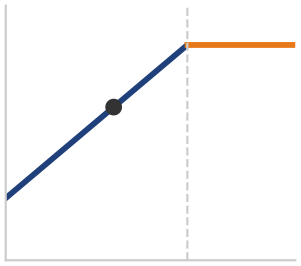

*Спекулятивное декодирование сдвигает декодирование к точке перегиба, ограниченной вычислениями.*

Спекулятивное декодирование — это оптимизация задержки, которая разрушает последовательное узкое место авторегрессивной генерации: меньшая черновая модель предсказывает несколько токенов, которые затем параллельно проверяются целевой моделью (Leviathan et al., 2023; Chen et al., 2023). Связь с инженерией производительности — в арифметической интенсивности: один прямой проход целевой модели может обработать $K$ токенов-кандидатов примерно за ту же стоимость потоковой передачи весов, что и один токен, сдвигая рабочую точку декодирования с наклонного участка, ограниченного памятью, к точке перегиба Roofline.

[«Процесс спекулятивного декодирования»](09_performance_engineering.md#fig-speculative-decoding) сопоставляет два пути декодирования: стандартное декодирование продвигается на один токен за один последовательный проход целевой модели, тогда как спекулятивное декодирование позволяет черновой модели предложить блок из $K$ токенов, которые целевая модель проверяет за один параллельный проход, выдавая принятый префикс сразу и повторно семплируя только при первом отказе.

Преобразование полезно только тогда, когда черновая модель достаточно точна и достаточно дешева. Если отвергается слишком много черновых токенов, целевая модель все равно загружает свои веса, но принимает мало полезной работы. Если черновая модель слишком дорога, проверка становится ограниченной вычислениями и стирает выгоду по пропускной способности. Батчирование тоже меняет расчет: при больших размерах батча фаза декодирования уже ближе к режиму, ограниченному вычислениями, поэтому предельная выгода от спекуляции уменьшается. Эта глава использует спекулятивное декодирование, чтобы показать, как алгоритм может изменить уравнение производительности. Раздел «Спекулятивное декодирование как политика обслуживания» главы «Инференс в масштабе» рассматривает его как политику обслуживания с последствиями для контроля допуска и соглашения об уровне обслуживания (SLA).

<a id="fig-speculative-decoding"></a>

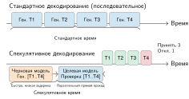

***Процесс спекулятивного декодирования:** вместо последовательной генерации токенов большой целевой моделью маленькая черновая модель предлагает последовательность из $K$ токенов. Целевая модель проверяет все $K$ токенов в одном параллельном прямом проходе. Черновые токены, прошедшие тест принятия, выдаются вместе; первый отвергнутый токен запускает исправленный семплинг и отбрасывает остаток черновика.*

Алгоритм «Спекулятивное декодирование» (ниже) делает критерий принятия точным: после единственного прохода целевой модели каждый черновой токен принимается с вероятностью $\min(1, p_\theta/q_\phi)$, а при отказе выполняется повторный семплинг из нормированного положительного остатка $(p_\theta - q_\phi)_+$. Поэтому выдаваемая последовательность распределена точно так же, как распределение целевой модели без вспомогательной модели. Именно эта гарантия корректности позволяет спекулятивному декодированию обменивать вычисления черновой модели на задержку, не сдвигая распределение выхода.

**Алгоритм (псевдокод):** Спекулятивное декодирование

```text
Вход: распределение целевой модели p_θ(· | ·); распределение черновой модели q_φ(· | ·); префикс y_{1:t}; длина черновика K
Выход: одна или несколько новых токенов, распределенных как p_θ
для i = 1 … K:
    предложить черновой токен ŷ_{t+i} из q_φ(· | y_{1:t}, ŷ_{t+1:t+i−1})
выполнить p_θ один раз на префиксе и всех K черновых токенах, чтобы получить целевые распределения для позиций черновика и позиции следующего токена
для i = 1 … K:
    a_i ← min(1, p_θ(ŷ_{t+i} | y_{1:t}, ŷ_{t+1:t+i−1}) / q_φ(ŷ_{t+i} | y_{1:t}, ŷ_{t+1:t+i−1}))
    принять ŷ_{t+i} с вероятностью a_i
    если ŷ_{t+i} отвергнут:
        выбрать один исправленный токен из нормированного положительного остатка (p_θ − q_φ)_+
        выдать принятые черновые токены и исправленный токен; отбросить оставшийся черновик; начать новый раунд
если все K черновых токенов приняты, выдать их и выбрать один дополнительный токен из распределения целевой модели
```

Спекулятивное декодирование окупается, когда черновая модель дешева, а предлагаемые ею токены согласуются с целевой моделью достаточно часто, чтобы один проход целевой модели проверил несколько токенов. Ограничивающая стоимость — доля отказов: отвергнутые черновики тратят работу черновой модели и сокращают принятую серию. Поэтому система обслуживания должна подбирать длину черновика и качество черновой модели совместно, а не считать спекуляцию бесплатным параллелизмом.

<a id="sec-performance-engineering-moe"></a>

### Смесь экспертов (MoE)

Архитектура смеси экспертов может увеличить общую емкость параметров без активации каждого параметра прямого прохода для каждого токена (Fedus et al., 2022; Lepikhin et al., 2021). Разреженная активация меняет соотношение между общим числом параметров и арифметикой на токен, но не гарантирует более высокого качества или меньшей задержки по сравнению с плотной моделью при фиксированном бюджете ресурсов. Сравнение должно сохранять постоянными качество модели, распределения батчей и длин последовательностей, топологию оборудования и цели обслуживания.

Для инженерии производительности локальный вопрос — превышает ли экономия на активных параметрах стоимость маршрутизации и коммуникации в пределах рабочего диапазона нагрузки. Указывайте число экспертов, число экспертов, выбираемых на токен, емкость экспертов, распределение токенов, дисбаланс маршрутизации, байты отправки и сборки, время AllToAll, отброшенные или переадресованные токены, а также достигнутую цель по качеству и задержке. Разреженная активация улучшает бюджет железного закона, только когда неактивные эксперты остаются вне критического пути, а маршрутизация не создает большего члена коммуникации или отстающих (stragglers).

Стандартный слой MoE-трансформера заменяет сеть прямого распространения несколькими параллельными «экспертными» FFN и облегченным **маршрутизатором** (router, он же gating network), который выбирает, какие эксперты обрабатывают каждый токен. Такая архитектура переносит проблему производительности от пропускной способности плотных матричных умножений к маршрутизации, резидентности памяти и балансировке нагрузки. Когда эксперты распределены по GPU, параллелизм экспертов (expert parallelism) размещает разных экспертов на разных устройствах, а обмен AllToAll переносит скрытое состояние каждого токена к назначенному эксперту, прежде чем вернуть результат. Экономия на активных параметрах ценна, только если этот трафик маршрутизации и любой дисбаланс экспертов остаются меньше плотных вычислений, которые они заменяют.

<a id="sec-performance-engineering-overlap"></a>

## Перекрытие коммуникации и вычислений

В шаге распределенного обучения на нескольких GPU или в проходе инференса с тензорным параллелизмом ускоритель может завершить локальное матричное умножение за микросекунды, а затем простаивать, ожидая, пока коллективная операция AllReduce передаст градиенты или активации по сети. Если коммуникация выполняется последовательно после вычислений, задержка межсоединения напрямую ограничивает пропускную способность. Перекрытие коммуникации и вычислений выводит это время коммуникации из критического пути, выполняя вычислительные ядра GPU одновременно с передачей данных по NVLink или InfiniBand. Оно опирается на CUDA-потоки, разбиение SM и хуки корзин (bucket hooks), описанные в разделе [«Перекрытие коммуникации и вычислений»](06_collective_communication.md#sec-communication-overlap).

Рассмотрим конкретный пример: модель на 70 млрд параметров с тензорным параллелизмом на 8 GPU H100. Каждый слой трансформера требует двух операций AllReduce в прямом проходе (одна после внимания, другая после FFN). Каждый AllReduce передает примерно $2 \times d_{\text{model}} \times B \times 2$ байт в FP16 (где $d_{\text{model}} = 8192$ для модели на 70 млрд параметров, а $B$ — размер батча). При размере батча 1 объем данных составляет $2 \times 8192 \times 1 \times 2 =$ 32,8 КБ на AllReduce. При пропускной способности NVLink 900 ГБ/с эта передача занимает около 36,4 нс. Однако накладные расходы запуска AllReduce (примерно 5 мкс) превышают время передачи данных более чем в 100 раз. При размере батча 1 накладные расходы AllReduce определяются задержкой программного запуска, а не пропускной способностью, и перекрытие дает ограниченную выгоду, потому что для маскировки недостаточно вычислений.

При размере батча 64 объем данных на AllReduce растет до $2 \times 8192 \times 64 \times 2 =$ 2,1 МБ и занимает около 2,3 мкс при пропускной способности NVLink. С учетом накладных расходов запуска открытая коммуникация составляет около 7,3 мкс. Вычислительный путь по шарду теперь представляет собой набор ядер, а не один GEMM: внимание и FFN вместе занимают порядка 20 мкс для этой конфигурации. Здесь время вычислений превышает время коммуникации примерно в 2,7 раза, и перекрытие становится очень эффективным. Это иллюстрирует, почему размер батча — универсальный рычаг управления: он одновременно повышает арифметическую интенсивность, утилизацию GPU и эффективность перекрытия коммуникации.

Этот пример тензорного параллелизма на уровне слоя описывает сторону задачи перекрытия с малыми объемами данных. Синхронизация градиентов при обучении использует тот же тест открытого времени, но с гораздо большими объемами данных, поэтому расчет перекрытия градиентов переходит от обмена активациями к кольцевому AllReduce по тензору градиентов.

<a id="sec-performance-engineering-overlap-quantify"></a>

### Оценка возможности перекрытия

Потенциальная выгода от перекрытия коммуникации и вычислений зависит от соотношения времени коммуникации и вычислений, которое сильно варьируется в разных системных конфигурациях.

Рассмотрим модель с 8 млрд параметров, обучаемую на 8 GPU H100 в одном узле, соединенных NVLink с совокупной двунаправленной пропускной способностью 900 ГБ/с (450 ГБ/с в каждом направлении). Тензор градиентов содержит 16,1 ГБ значений FP16. По анализу кольцевого AllReduce из раздела [«Кольцевой AllReduce»](06_collective_communication.md#sec-communication-collective-operations-collective-operations-ring-allreduce-ffce) синхронизация передает $2 \times (N-1)/N =$ 1,75 раза больший объем, чем градиенты, что при пропускной способности NVLink занимает около 62,5 мс. Прямой проход занимает 83,1 мс, а обратный проход (при MFU 40 процентов) — около 166,3 мс.

Без перекрытия шаг обучения требует 311,9 мс (83,1 мс + 166,3 мс + 62,5 мс). С перекрытием AllReduce **полностью скрывается** за обратным проходом, и время шага сокращается до 249,4 мс (83,1 мс + 166,3 мс), что дает улучшение в 1,25×. Этот пример иллюстрирует важное свойство: перекрытие наиболее эффективно, когда время вычислений обратного прохода превышает время AllReduce. Иллюстративный сценарий масштабирования в [«Бюджет перекрытия»](09_performance_engineering.md#fig-overlap-budget) показывает, как эффективность перекрытия падает примерно с 90 процентов до примерно 18 процентов, когда накладные расходы коммуникации в конце концов превышают фиксированный бюджет вычислений. Каждый столбец нормирован к бюджету вычислений в 100 единиц, а высота столбцов примерно в пять раз растет по оси x, потому что открытый сегмент коммуникации, наложенный на этот бюджет, — именно та часть коммуникации, которую перекрытие уже не может скрыть. Кривая носит диагностический, а не привязанный к модели характер: для меньших моделей или более медленных межсоединений (например, PCIe на 64 ГБ/с вместо NVLink на 900 ГБ/с) AllReduce может превысить обратный проход, и никакое перекрытие не скроет коммуникацию полностью.

<a id="fig-overlap-budget"></a>

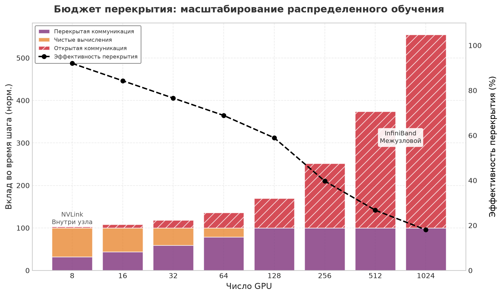

***Бюджет перекрытия:** этот иллюстративный нормированный сценарий поддерживает бюджет вычислений на уровне 100 единиц, когда число GPU растет от 8 до 1 024. Накладные расходы коммуникации растут с масштабом, оставляя больше открытой коммуникации над фиксированным бюджетом вычислений. Черная линия показывает долю коммуникации, скрытой за вычислениями, которая падает примерно с 90 процентов до примерно 18 процентов.*

<a id="sec-performance-engineering-cuda-streams"></a>

### CUDA-потоки и асинхронное выполнение

Механизм, который позволяет перекрытие на GPU NVIDIA, — это **CUDA-потоки** (CUDA streams). CUDA-поток — это упорядоченная последовательность операций GPU (запусков ядер, копий памяти, коллективных операций NCCL), которые выполняются последовательно внутри потока, но могут выполняться одновременно с операциями в других потоках. Приложение поддерживает два отдельных потока: вычислительный поток для матричных умножений и поэлементных ядер и поток коммуникации для операций NCCL. Процесс заключается в запуске вычислительного ядра на первом потоке и немедленном инициировании асинхронного вызова коммуникации на втором:

```python
compute_stream = torch.cuda.Stream()
comm_stream = torch.cuda.Stream()

with torch.cuda.stream(compute_stream):
    output = torch.matmul(A, B)  # Неблокирующее вычисление

with torch.cuda.stream(comm_stream):
    dist.all_reduce(gradients, async_op=True)  # Неблокирующая коммуникация

torch.cuda.synchronize()  # Ждем завершения обоих потоков
```

Аппаратный планировщик GPU чередует исполнительные блоки из обоих потоков: GEMM выполняется на SM, а движок NVLink тем временем обрабатывает передачу данных AllReduce. Однако потоки обеспечивают лишь логическую параллельность, а физические ресурсы у них общие. SM должны управлять инструкциями передачи данных для ядра коммуникации. На H100 с 132 SM тяжелая операция NCCL может занимать 4–8 SM исключительно для обработки протокола и копирования памяти, что приводит к **разбиению SM** (SM partitioning): доступная вычислительная пропускная способность снижается на 3–6 процентов во время коммуникации. Если вычислительное ядро достаточно плотно, чтобы загрузить 100 процентов SM, включение перекрытия может парадоксально замедлить выполнение из-за этой конкуренции за ресурсы — явления, известного как интерференция. На практике снижение вычислительной пропускной способности на 3–6 процентов гораздо меньше времени коммуникации, которое иначе осталось бы открытым, поэтому компромисс подавляюще выгоден.

На практике для эффективного перекрытия нужно учитывать несколько деталей. Операцию коммуникации нужно запускать достаточно рано, чтобы она перекрывалась с последующими вычислениями: в обратных проходах DistributedDataParallel (DDP) запускает AllReduce каждой корзины сразу, как только корзина готова, так что задержка запуска NCCL скрывается за последующими градиентными ядрами. Точки синхронизации (где один поток ждет другой) нужно минимизировать, так как каждая синхронизация сериализует выполнение.

Модуль DDP в PyTorch реализует перекрытие градиентов, регистрируя обратные хуки на каждом параметре. Когда градиент параметра вычислен в обратном проходе, хук запускает асинхронный AllReduce на отдельном потоке NCCL. DDP синхронизирует этот поток коммуникации с основным вычислительным потоком в конце обратного прохода, так что каждая редукция градиентов гарантированно завершена до того, как оптимизатор прочитает градиенты. Эта схема автоматически перекрывает коммуникацию градиентов с вычислением градиентов без вмешательства пользователя.

Когда инженеры создают собственные вспомогательные потоки для пользовательских схем перекрытия, набор специфичных для PyTorch ловушек регулярно приводит к тихим сбоям корректности или производительности. По умолчанию в PyTorch все операции ставятся в очередь на потоке по умолчанию. Тензор, созданный в потоке по умолчанию и используемый во вспомогательном потоке, не является автоматически безопасным: без явного барьера `event.record()` / `event.wait()` между ними GPU может начать читать тензор до того, как он полностью записан. Аналогично, копии памяти, запущенные без `non_blocking=True`, вставляют неявные точки синхронизации, которые сериализуют потоки, пересечение которых инженер пытался получить, часто полностью сводя на нет выгоду от перекрытия. DDP избегает этих опасностей, управляя вызовами `record_event()` внутри своих хуков корзин и гарантируя, что каждый AllReduce начинается только после завершения соответствующего события вычисления градиента. Написанный вручную код перекрытия должен воспроизводить эту дисциплину, иначе он рискует получить гонки данных, которые дают некорректные градиенты без сигнала об ошибке на уровне фреймворка.

Рассмотренные приемы (слияние, точность, компиляция, спекулятивное декодирование, MoE и перекрытие коммуникации) затрагивают разные аспекты уравнения производительности. Чтобы определить, какой прием применить в данной ситуации, нужны систематические измерения, а инструменты профилирования, которые делают эту диагностику возможной, — последнее звено в наборе инструментов оптимизации.

<a id="sec-performance-engineering-profiling"></a>

## Системное профилирование

Инженер тратит две недели на переписывание модуля PyTorch в собственное ядро CUDA, чтобы ускорить его в 5 раз, и обнаруживает, что общая задержка модели не изменилась, потому что система целиком ограничена вводом-выводом. Инженерия производительности без измерений — дорогостоящее гадание. Системное профилирование дает хирургическую диагностику, необходимую, чтобы точно определить, где GPU ждет, и применить оптимизации точечно.

<a id="psp-performance-engineering-physics-profiling-heisenberg-effect"></a>

> **Физика профилирования (эффект Гейзенберга)**
>
> Наблюдение за распределенной системой машинного обучения фундаментально меняет ее поведение. Сбор телеметрии высокого разрешения (например, отслеживание каждого запуска ядра CUDA или каждого выделения памяти) расходует пропускную способность PCIe, такты ЦП и емкость памяти. В сильно оптимизированных конвейерах обслуживания накладные расходы профилирования могут искусственно вызвать те самые всплески задержки, которые инженер пытается диагностировать. Этот «эффект Гейзенберга» требует осознанной стратегии: для непрерывного мониторинга в продакшене — телеметрия с малыми накладными расходами и выборкой, а синхронная трассировка высокой точности включается только в изолированных диагностических средах.
>
> Этот эффект особенно выражен в нагрузках PyTorch. Включение `torch.autograd.profiler` или `torch.cuda.memory._record_memory_history()` заставляет фреймворк сохранять ссылки на промежуточные тензоры активаций за пределами их обычного времени жизни, чтобы можно было записать метаданные выделения. Это мешает аллокатору памяти переиспользовать буферы тензоров, как он обычно делает, увеличивая пиковое потребление HBM и в пограничных случаях вызывая ошибки нехватки памяти (Out-Of-Memory), которых не бывает в неизмеряемом выполнении. Кроме того, проходы оптимизации графа в `torch.compile` обнаруживают наблюдение за тензорами и консервативно отключают некоторые слияния с переиспользованием буферов, так что профилируемое выполнение идет по более медленному пути, чем производственный. Практический вывод: запуск профилирования нужно рассматривать как отдельный эксперимент. Он точно характеризует структуру вычислений, но его абсолютные значения задержки и памяти завысят производственные измерения.

<a id="sec-performance-engineering-profiling-hierarchy"></a>

### Иерархия профилирования

Уровни профилирования полезны, только если они направляют движение от симптома к вмешательству. Профилирование систем ML работает на четырех уровнях, каждый из которых дает разную детализацию и нацелен на разные категории узких мест. [«Иерархия профилирования»](09_performance_engineering.md#fig-optimization-hierarchy) делает этот путь явным: от симптомов уровня приложения вниз к доказательствам на уровне ядер и аппаратных счетчиков.

<a id="fig-optimization-hierarchy"></a>

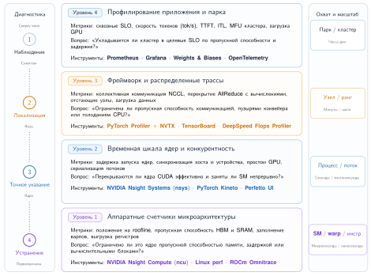

***Иерархия профилирования:** диагностика начинается с симптомов уровня приложения, затем сужается через доказательства уровня фреймворка и ядер до аппаратных счетчиков. Каждый нижний уровень жертвует охватом ради детализации, необходимой для выделения первопричины.*

Спуск начинается на уровне приложения, где сквозные метрики, такие как токены в секунду, время до первого токена, P99-задержка и утилизация GPU во времени, показывают, что система, видимая пользователю, не достигла цели. Затем диагностика спускается к распределенному профилированию по GPU и узлам, где шаблоны коммуникации показывают, перекрываются ли коллективные операции с вычислениями, какая операция доминирует во времени шага и есть ли дисбаланс нагрузки между рангами. Профилирование на уровне трассы сужает диагноз до временной шкалы ядер GPU, операций ЦП и передач данных внутри шага обучения или запроса инференса, выявляя промежутки запуска, простои (idle bubbles), последовательные узкие места и возможности перекрытия. Профилирование на уровне операций замыкает цепочку с инструментами вроде NVIDIA Nsight Compute, где достигнутая пропускная способность памяти, утилизация вычислений, заполняемость и состав инструкций определяют, ограничено ли конкретное ядро памятью, вычислениями или деталями реализации, в том числе выдает ли оно инструкции тензорных ядер (матричное умножение с накоплением в половинной точности для FP16/BF16; целочисленное матричное умножение с накоплением для INT8) или откатывается к скалярным инструкциям ядер CUDA (fused multiply-add или арифметико-логические устройства). Матричное умножение, у которого размерность скрытого слоя или тайл длины последовательности не делится на требование выравнивания тензорных ядер (кратные 8 для FP16, 16 для INT8), молча обходит тензорные ядра и выполняется на ядрах CUDA с долей пиковой пропускной способности. Такое несоответствие формы — одна из самых распространенных невидимых ошибок производительности в пользовательских ядрах ML, и без проверки счетчика состава инструкций ее не видно.

Диагностика производительности требует подхода «сверху вниз»: от глобальных симптомов к локальным причинам. При профилировании конвейера обслуживания модели на 70 млрд параметров на уровне приложения может обнаружиться: «сквозная задержка 150 мс на токен, в 3× выше цели уровня обслуживания (SLO)». Спускаясь к распределенному уровню, трассы могут показать, что один GPU постоянно отстает в операциях AllReduce, что указывает на отстающий узел (straggler) или перегрузку сети. Приближение к трассе этого конкретного GPU показывает временную шкалу выполнения ядер и промежутки, в которых SM простаивают из-за накладных расходов планирования. Наконец, профилирование на уровне ядер (с Nsight Compute) проверяет состав инструкций одного матричного умножения, выявляя промахи кэша или нагрузку на регистры. Пропуск уровней часто приводит к оптимизации не того узкого места: оптимизировать ядро бессмысленно, если GPU 40 процентов времени ждет сеть.

<a id="sec-performance-engineering-metrics"></a>

### Ключевые метрики производительности

Метрики не взаимозаменяемы: каждая отвечает на свой вопрос об узком месте. Утилизация FLOP модели (MFU) и утилизация пропускной способности модели (MBU) диагностируют полезную аппаратную работу, время до первого токена (TTFT) и межтокенная задержка (ITL) — задержку обслуживания, а пропускная способность показывает емкость при батчировании. Понимание их связей и компромиссов необходимо для инженерии производительности.

[«Метрики производительности и их диагностическое применение»](09_performance_engineering.md#tbl-performance-engineering-key-metrics) сопоставляет распространенные метрики с вопросом об узком месте, на который отвечает каждая из них.

<a id="tbl-performance-engineering-key-metrics"></a>

| **Метрика**                                  | **Определение**                                                                 | **Лучшее диагностическое применение**                                                  | **Оговорка или целевое значение**                                                                                                                          |
|:---------------------------------------------|:--------------------------------------------------------------------------------|:---------------------------------------------------------------------------------------|:------------------------------------------------------------------------------------------------------------------------------------------------------------|
| **MFU**                                      | Доля пиковых FLOP/s аппаратного обеспечения, продуктивно используемая вычислениями модели | Эффективность обучения при ограничениях памяти, накладных расходах запуска, ожидании коммуникации и накладных расходах программного обеспечения | 40–60% — обычно для хорошо настроенного обучения LLM; выше 60% — отлично                                                                                       |
| **Утилизация FLOP аппаратуры (HFU)**         | Общее число арифметических операций, включая пересчеты, деленное на пиковые FLOP/s | Отделение полезной работы модели от накладных расходов, таких как пересчет активаций       | Обычно превышает MFU; разрыв HFU–MFU оценивает потраченные впустую вычисления                                                                                |
| **Время до первого токена (TTFT)**           | Задержка от поступления запроса до первого сгенерированного токена              | Отзывчивость интерактивного обслуживания, включая очередь, предзаполнение и инициализацию | Ниже 500 мс обычно приемлемо; ниже 200 мс воспринимается как отзывчивое                                                                                      |
| **Межтокенная задержка (ITL)**               | Время между последовательными сгенерированными токенами при декодировании      | Воспринимаемая скорость генерации после первого токена                                 | Ниже 50 мс обеспечивает комфортное чтение; для речи в реальном времени может потребоваться ниже 25 мс                                                         |
| **Пропускная способность**                   | Токенов в секунду для системы или токенов в секунду на GPU для эффективности на устройство | Совокупная емкость обслуживания или обучения при батчировании                          | Большие батчи повышают пропускную способность, но увеличивают задержку на запрос; компромисс очередей рассмотрен в [приложении «Основы инференса»](appendix_inference.md#sec-appdx-inference-scale-queuing-theory-batched-inference-bbf0) |
| **Утилизация пропускной способности модели (MBU)** | Достигнутая пропускная способность памяти, деленная на пиковую пропускную способность аппаратуры | Инференс, ограниченный памятью, особенно рабочие нагрузки декодирования                 | Шаг декодирования на H100 может показывать MFU 2%, но MBU 85%, что означает насыщенный памятью и хорошо оптимизированный путь                                |

***Метрики производительности и их диагностическое применение:** каждая метрика измеряет свой уровень системы, поэтому выбор неподходящей метрики может скрыть настоящее узкое место.*

<a id="sec-performance-engineering-roofline-diagnosis"></a>

### Использование Roofline для диагностики

Выбор метрики в [таблице «Метрики производительности и их диагностическое применение»](09_performance_engineering.md#tbl-performance-engineering-key-metrics) отражает фундаментальный сдвиг узкого места между обучением и инференсом: MFU обычно — правильная призма эффективности обучения, а MBU часто — правильная призма эффективности инференса, когда декодирование ограничено трафиком HBM. Модель Roofline из раздела [«Модель Roofline»](09_performance_engineering.md#sec-performance-engineering-roofline) становится инструментом диагностики в сочетании с данными профилирования. Диагностика выполняется в три шага:

1. Измерить достигнутые FLOP/s и пропускную способность памяти для ядра с помощью Nsight Compute.
2. Вычислить операционную арифметическую интенсивность по алгоритму (FLOP/байт).
3. Отложить измеренную производительность относительно потолка Roofline.

Ядро, которое далеко ниже и потолка вычислений, и потолка пропускной способности, имеет проблему реализации: накладные расходы запуска, плохие шаблоны доступа к памяти или низкую заполняемость. Ядро, которое достигает потолка пропускной способности, но остается ниже потолка вычислений, ограничено памятью, и дальнейшая оптимизация требует сокращения трафика памяти (слияние, точность), а не повышения эффективности вычислений. Ядро на потолке вычислений ограничено вычислениями и может быть улучшено только алгоритмическими изменениями (сокращением FLOP) или более быстрым оборудованием.

Рассмотрим конкретный пример: ядро LayerNorm, профилированное на H100, показывает достигнутую вычислительную производительность 15 TFLOP/s и достигнутую пропускную способность памяти 2,8 ТБ/с. Его арифметическая интенсивность равна $15 \text{ TFLOP/s} / 2{,}8 \text{ ТБ/с} \approx 5{,}4 \text{ FLOP/байт}$. Точка перегиба H100 при FP16 составляет примерно 295,2 FLOP/байт. Поскольку 5,4 FLOP/байт далеко ниже 295,2 FLOP/байт, ядро строго ограничено памятью. Достигнутые 2,8 ТБ/с (83,6 процента от пиковой пропускной способности H100 в 3,35 ТБ/с) подтверждают, что оно работает близко к физическому пределу подсистемы памяти. Диагноз ясен: дальнейшие оптимизации на уровне FLOP дадут мало; производительность можно существенно улучшить только сокращением перемещения данных — либо слиянием (устранение обращения к HBM «туда и обратно»), либо снижением точности (вдвое меньше байтов на элемент).

<a id="sec-performance-engineering-pytorch-profiler"></a>

### Рабочий процесс PyTorch Profiler

PyTorch Profiler наиболее полезен, когда метрики приложения показывают замедление, но ответственный слой еще не известен. Его задача — сузить глобальный симптом до слоя, семейства ядер или точки синхронизации, прежде чем подключать более тяжелый инструмент. Он интегрируется с циклом обучения и собирает подробные трассы с минимальными изменениями кода:

```python
import torch
from torch.profiler import (
    profile,
    schedule,
    tensorboard_trace_handler,
)

# Профилируем 2 шага прогрева + 3 активных шага
with profile(
    activities=[
        torch.profiler.ProfilerActivity.CPU,
        torch.profiler.ProfilerActivity.CUDA,
    ],
    schedule=schedule(wait=1, warmup=2, active=3, repeat=1),
    on_trace_ready=tensorboard_trace_handler("./profiler_logs"),
    record_shapes=True,
    profile_memory=True,
    with_stack=True,
) as prof:
    for step, batch in enumerate(dataloader):
        if step >= 6:  # 1 ожидание + 2 прогрева + 3 активных
            break
        output = model(batch)
        loss = criterion(output, labels)
        loss.backward()
        optimizer.step()
        optimizer.zero_grad()
        prof.step()
```

Параметр `schedule` задает период прогрева, когда профилировщик работает, но ничего не записывает, что позволяет кэшам CUDA и компиляции «на лету» (just-in-time, JIT) стабилизироваться до начала измерения. Без прогрева первые итерации включают одноразовые затраты (компиляцию ядер, выделение памяти, инициализацию контекста CUDA), которые завышают измеренное время и искажают картину установившейся производительности.

Полученная трасса, которую можно просмотреть в TensorBoard или в средстве просмотра трасс Chrome, имеет значение лишь постольку, поскольку каждое представление ведет к вмешательству. [«Представления профилировщика и вмешательства»](09_performance_engineering.md#tbl-performance-engineering-profiler-views) превращает эти представления в диагностический контрольный список.

| **Представление трассы**                  | **Диагностический сигнал**                                                   | **Вероятное вмешательство**                                                      |
|:------------------------------------------|:-----------------------------------------------------------------------------|:---------------------------------------------------------------------------------|
| **Временная шкала ядер**                  | Ядра CUDA, их длительность, промежутки простоя GPU и неожиданно долгие ядра   | Слить операторы, использовать CUDA-графы или исследовать долгие ядра в Nsight Compute |
| **Временная шкала памяти**                | Пики выделения и освобождения или постепенный рост памяти                    | Переиспользовать буферы, спланировать выделения или искать утечки                |
| **Синхронизация ЦП и GPU**                | Точки, где ЦП ждет GPU, или GPU ждет работу запуска от ЦП                    | Убрать блокирующую синхронизацию и сократить накладные расходы запуска           |
| **События коммуникации**                  | Длительность коллективных операций NCCL относительно вычислительных ядер     | Настроить перекрытие, размер корзин или стратегию параллелизации                  |

<a id="tbl-performance-engineering-profiler-views"></a>

***Представления профилировщика и вмешательства:** представления PyTorch Profiler полезны, когда каждый визуальный сигнал указывает на конкретный следующий эксперимент.*

<a id="sec-performance-engineering-nsight-systems"></a>

### Nsight Systems: чтение временной шкалы

Профилировщик — это инструмент сортировки, а не окончательное доказательство производительности: он определяет, должен ли следующий эксперимент нацеливаться на слияние, планирование памяти, CUDA-графы или перекрытие. NVIDIA Nsight Systems отвечает на вопрос уровня трассы, поднятый более высокими уровнями профилирования: непрерывна ли временная шкала GPU, достаточно ли быстро ЦП ее подпитывает и перекрывается ли коммуникация с вычислениями. Инструмент записывает каждый запуск ядра GPU, каждую операцию памяти CUDA, каждую коммуникацию NCCL и активность потоков ЦП на единую временную шкалу.

Nsight Systems становится полезным, когда вопрос сместился от «какой слой медленный» к «почему на всей временной шкале есть промежутки». Типичный рабочий процесс начинается с записи трассы нескольких итераций обучения или инференса:

```bash
nsys profile --trace=cuda,nvtx,osrt,cudnn,cublas \
    --output=llm_profile \
    --force-overwrite=true \
    python3 inference_server.py --num-steps=5
```

Флаги `--trace` управляют тем, какие активности записываются. Флаг `cuda` фиксирует запуски ядер и операции с памятью. Флаг `nvtx` фиксирует размеченные пользователем области (PyTorch автоматически размечает границы модулей маркерами NVTX [NVIDIA Tools Extension]). Флаги `cublas` и `cudnn` фиксируют операции на уровне библиотек, что помогает понять, использует ли GEMM cuBLAS или пользовательское ядро. Команда полезна, потому что эти строки показывают, является ли узкое место накладными расходами запуска, последовательной сериализацией коммуникации или реализацией ядра.

Получившийся файл `.nsys-rep` открывается в графическом интерфейсе Nsight Systems, который показывает многострочную временную шкалу. Наибольший диагностический вес несут четыре строки.

Строка CUDA HW показывает фактическое выполнение ядер на GPU. Каждый цветной прямоугольник представляет ядро, ширина которого пропорциональна времени выполнения. Промежутки между прямоугольниками означают простой GPU, то есть потерянный потенциал. Для хорошо оптимизированного конвейера инференса строка CUDA HW должна показывать почти непрерывное выполнение ядер с минимальными промежутками.

Строка CUDA API показывает вызовы CUDA API на стороне ЦП (запуски ядер, выделения памяти, синхронизацию). Если полосы CUDA API заметно шире соответствующих полос CUDA HW, узким местом является ЦП: он не может запускать ядра достаточно быстро, чтобы загрузить GPU. CUDA-графы и `torch.compile` нацелены именно на эту проблему накладных расходов запуска ядер.

Строка NCCL (для распределенных нагрузок) показывает коллективные операции коммуникации. Сравнение строки NCCL со строкой CUDA HW показывает, перекрывается ли коммуникация с вычислениями. Если полосы NCCL появляются во время промежутков в строке CUDA HW, коммуникация сериализована. Если полосы NCCL перекрываются с полосами CUDA HW, перекрытие работает правильно.

Строка NVTX показывает размеченные пользователем области, которые PyTorch сопоставляет с именами модулей (`Linear`, `LayerNorm`, `Attention`). Это связывает низкоуровневые имена ядер (часто непонятные строки вроде `volta_fp16_s1688gemm_fp16_256x128_ldg8_f2f_nn`) с операциями модели, которые их породили.

Пять шаблонов дают наиболее диагностическую информацию из трассы Nsight Systems. [«Диагностические шаблоны временной шкалы Nsight»](09_performance_engineering.md#tbl-performance-engineering-nsight-patterns) сопоставляет каждый визуальный шаблон с вопросом об узком месте, на который он отвечает.

| **Шаблон на временной шкале**    | **Диагностический вопрос**                                          | **Направление оптимизации**                                    |
|:---------------------------------|:-------------------------------------------------------------------|:---------------------------------------------------------------|
| Выполнение ядер и промежутки простоя | Какая доля трассы — полезное выполнение GPU, а не ожидание?      | Исследовать накладные расходы запуска, простои ЦП или голод по входным данным |
| Распределение длительностей ядер | Не дробят ли нагрузку много коротких ядер?                         | Попробовать слияние, CUDA-графы или захват компилятором        |
| Совмещение NCCL со строками CUDA HW | Перекрывается ли коммуникация с вычислениями?                   | Настроить размеры корзин, планирование или схему распараллеливания |
| Пики выделения памяти            | Не материализуются ли и не выделяются ли тензоры повторно?         | Добавить планирование памяти, переиспользование буферов или слитые ядра |
| Время GEMM и не-GEMM             | Какая доля выполнения — полезная матричная арифметика, а какая — накладные расходы? | Перенести не-GEMM работу в слитые ядра или сократить трафик памяти |

<a id="tbl-performance-engineering-nsight-patterns"></a>

***Диагностические шаблоны временной шкалы Nsight:** шаблоны временной шкалы связывают визуальную структуру с вопросами об утилизации, слиянии, перекрытии, выделении памяти и эффективности арифметики.*

Опытные инженеры по производительности вырабатывают навык распознавания таких трасс и быстро определяют доминирующее узкое место по визуальной структуре временной шкалы. Трасса, в которой доминируют тонкие, плотно расположенные полосы ядер с минимальными промежутками, указывает на хорошо оптимизированный конвейер. Трасса с большими промежутками между ядрами или с полосами NCCL, не перекрывающимися с полосами CUDA HW, сразу показывает главную цель оптимизации.

<a id="sec-performance-engineering-bottleneck-patterns"></a>

### Типичные шаблоны узких мест

Профилирование ценно потому, что повторяющиеся шаблоны трассы напрямую отображаются на выбор оптимизаций. [«Типичные шаблоны узких мест в трассах»](09_performance_engineering.md#tbl-performance-engineering-bottleneck-patterns) превращает это распознавание шаблонов в диагностическую карту: сначала определяется визуальный признак, затем он связывается с вероятной причиной и вмешательством, которое меняет систему.

| **Шаблон трассы**               | **Вероятная причина**                              | **Основное вмешательство**                                                     | **Компромисс, который нужно проверить**               |
|:--------------------------------|:---------------------------------------------------|:-------------------------------------------------------------------------------|:------------------------------------------------------|
| Мелкие промежутки между многими ядрами | Доминируют накладные расходы запуска ядер     | Компиляция графа через `torch.compile`, CUDA-графы или слияние                 | Прогрев компиляции и сложность отладки               |
| Крупные пики памяти             | Невслитые операторы материализуют промежуточные тензоры | FlashAttention или пользовательское слияние на Triton                         | Численная проверка и сопровождение ядер              |
| Низкие FLOP/s при высокой пропускной способности | Доминируют операции, ограниченные памятью | Снижение точности, батчирование или алгоритмические изменения                  | Точность, давление на кэш и ограничители качества    |
| Полосы NCCL во время простоя GPU | Коммуникация сериализована, а не перекрыта        | Перекрытие градиентов в DDP или перестройка конвейера                          | Размер корзин, сложность расписания и синхронизация  |
| Часть GPU ждет отстающих        | Неравномерное распределение работы или дисбаланс нагрузки MoE | Настройка емкости MoE, корректировка вспомогательной функции потерь или разбиение тензорным параллелизмом | Качество маршрутизации и баланс утилизации |
| Повторные крупные выделения     | Буферы пересоздаются, а не переиспользуются        | Планирование памяти, предвыделенные пулы буферов или чекпойнтинг               | Стоимость пересчета и поведение аллокатора           |
| Периодические провалы утилизации GPU | Предобработка или токенизация на ЦП не конвейеризованы | Больше рабочих процессов загрузки данных, сервисы предобработки или предтокенизированные наборы данных | Стоимость хранения и актуальность данных |

<a id="tbl-performance-engineering-bottleneck-patterns"></a>

***Типичные шаблоны узких мест в трассах:** диагностическая карта от сигнатуры трассы к вероятной причине, вмешательству и компромиссу. Таблица наиболее полезна, когда профилировщик уже локализовал узкое место до накладных расходов запуска, перемещения памяти, коммуникации, балансировки нагрузки, поведения выделения памяти или подготовки входных данных.*

Полная трасса декодирования показывает, как несколько более мелких узких мест могут сочетаться в доминирующую потерю.

<a id="exmp-performance-engineering-profiler-detective"></a>

> **Детектив профилирования**
>
> **Сценарий**: авторегрессивная генерация LLM на 7 млрд параметров на GPU H100 при батче 1 дает 45 токенов/с, что ниже потолка декодирования по пропускной способности памяти в 96 токенов/с.
>
> **Диагноз**: Nsight Compute показывает, что основной GEMM в FP16 работает эффективно (пропускная способность 2,8 ТБ/с), но Nsight Systems выявляет, что 58 процентов времени шага теряется на невслитых ядрах LayerNorm и GELU, семплинге и промежутках запуска ЦП на 120 запусках на слой.
>
> **Системный урок**: систематическое профилирование выявляет узкие места там, где интуиция подводит. Оптимизация ядер GEMM дает убывающую отдачу, когда накопленные накладные расходы запуска и невслитые поэлементные операции съедают более половины длительности шага; для достижения потолка декодирования по Roofline требуется слияние ядер через `torch.compile` или Triton.

<a id="sec-performance-engineering-profiling-loop"></a>

### Цикл обратной связи профилирования

Эффективная инженерия производительности следует итеративному циклу: профилирование, диагностика, оптимизация, проверка. Шаг проверки критически важен и часто пропускается. После применения оптимизации нужно снова профилировать, чтобы подтвердить, что целевое узкое место устранено и что новое не появилось. Оптимизация производительности — это задача «водяного матраса» (waterbed): исправление одного узкого места часто выявляет следующее.

Частая ловушка — оптимизировать по микробенчмаркам, а не по сквозным трассам. Ядро, которое в изоляции выглядит в 2× быстрее, может дать лишь 5 процентов прироста сквозной пропускной способности, если оно не было узким местом или если окружающий код не может воспользоваться ускорением из-за зависимостей по данным. Всегда измеряйте эффект на уровне приложения (токены в секунду, время шага, P99-задержку) в дополнение к метрикам ядер. Та же дисциплина измерений управляет риском выкатки: изменение, которое выглядит локальным, может потребить глобальный ресурс, как только попадет на производственный трафик.

<a id="ws-performance-engineering-cloudflare-regex-outage"></a>

> **Регулярное выражение, которое насытило периферию (2019)**
>
> **Контекст**: веб-файрвол Cloudflare проверяет входящий трафик HTTP/HTTPS на глобальной периферии при жестких ограничениях задержки ($L_{\text{lat}} \le 10\text{ мс}$) (Cloudflare, 2019).
>
> **Механизм**: 2 июля 2019 года было развернуто правило на основе регулярного выражения с катастрофическим откатом (catastrophic backtracking). При проверке некоторых шаблонов полезной нагрузки число состояний вырастало от линейного до экспоненциального $O(2^N)$ инструкций ЦП, доводя загрузку ЦП до 100 процентов на всех узлах периферии.
>
> **Последствия**: 27-минутный сбой снизил глобальный трафик HTTP/HTTPS на 82 процента, возвращая ошибки 502 миллионам нижестоящих сайтов.
>
> **Реакция**: Cloudflare глобально откатила набор правил файрвола, ввела таймауты выполнения ЦП на каждую проверку регулярного выражения и обязательное канареечное тестирование обновлений наборов правил.
>
> **Системный урок**: ограничения программной производительности требуют строгих алгоритмических границ и защиты выкатки. В обслуживании ML неограниченные последовательности внимания или неучтенные преобразования признаков могут вызвать такие же обрывы задержки ($L_{\text{lat}} \to \infty$), требуя канареечных развертываний, таймаутов выполнения на каждый запрос и глобальных автоматических выключателей (circuit breakers).

Само профилирование тоже может возмущать измеряемую систему. Профилировщик PyTorch добавляет примерно 10–20 процентов накладных расходов при записи полных трасс с включенным профилированием памяти. Nsight Systems добавляет меньше накладных расходов, но все же влияет на планирование. Профилируйте шаги прогрева перед активным измерением и не учитывайте первые несколько профилируемых итераций, где может доминировать JIT-компиляция или инициализация контекста CUDA.

<a id="sec-performance-engineering-profiling-scale"></a>

### Профилирование в масштабе

Профилирование одного GPU несложно; профилирование распределенной системы из сотен или тысяч GPU создает особые трудности. Объем данных трассы растет линейно с числом GPU: 5-секундная трасса Nsight Systems для одного GPU занимает примерно 500 МБ, та же трасса для 1 000 GPU составила бы 500 ГБ, что непрактично для хранения или анализа.

Производственные системы решают эту задачу через **иерархическое профилирование**. На верхнем уровне метрики приложения (MFU, пропускная способность, время шага) непрерывно собираются со всех GPU с пренебрежимо малыми накладными расходами. Эти агрегированные метрики обнаруживают деградацию производительности. Когда деградация обнаружена, **целевое профилирование** запускается на репрезентативном подмножестве GPU (обычно по одному GPU на каждый этап конвейера и на каждую группу параллелизма по данным) на короткое окно (несколько шагов обучения). Полученные трассы анализируются, чтобы выявить конкретное узкое место.

Другой подход — **статистическое профилирование**: каждый GPU случайным образом выбирает небольшую долю своих ядер для детального измерения времени. За много шагов обучения агрегированные выборки дают статистически точную картину распределения времени ядер без накладных расходов полной трассировки. Подход аналогичен профилировщикам по выборке (например, Linux `perf`), которые используются в традиционной системной инженерии, адаптированным к контексту GPU.

Самый трудный сценарий профилирования — перемежающиеся отстающие: GPU, которые время от времени работают медленно из-за термического троттлинга, ошибок памяти или перегрузки сети, но в большинство времени работают быстро. Такие отстающие могут не проявиться в коротком окне профилирования, но за часы снижают пропускную способность обучения на 10–20 процентов. Их обнаружение требует непрерывного мониторинга времени шага каждого GPU со статистическим обнаружением аномалий: это инфраструктура профилирования, которая работает на уровне мониторинга, а не на уровне ядер.

Инструменты профилирования дают основу измерений для всей работы по оптимизации. Без измерений инженерия производительности вырождается в гадание. С измерениями она становится систематической дисциплиной, руководимой количественными данными.

<a id="sec-performance-engineering-measurement-scale"></a>

## Измерения в масштабе

Оптимизация одного узла — необходимое условие, но окончательная проверка инженерии производительности — эффективность на уровне парка. При масштабировании с 8 GPU до 1 024 GPU возникают новые источники накладных расходов, невидимые в локальных трассах. Профилировщик может объяснить, почему одно ядро простаивает; сам по себе он не может сказать, превращают ли тысячи ускорителей мощность, пропускную способность памяти и время сети в полезный прогресс модели. Измерение в масштабе требует перехода от микробенчмарков уровня ядер к глобальным метрикам эффективности, которые отражают взаимодействие вычислений, коммуникации и изменчивости аппаратуры.

Прежде чем два измерения смогут подтвердить утверждение об оптимизации, они должны разделять воспроизводимый контракт измерений. Наборы бенчмарков формализуют этот принцип, фиксируя правила нагрузки, качества и измерения до сравнения систем (Mattson et al., 2020; Reddi et al., 2019). Контракт фиксирует рамку нагрузки, включая модель, распределения длин входа и выхода, батч или конкурентность, распределение данных и критерий качества; записывает топологию оборудования, частоты ускорителей и лимиты мощности, версии ПО, точность и настройки компилятора; и задает границы времени и синхронизации. Испытания холодного старта с компиляцией и заполнением кэшей должны оставаться отдельными от испытаний установившегося состояния после прогрева. Каждая отчетная точка требует повторных испытаний со статистикой разброса, проверкой эквивалентности выходов или качества и перцентилями задержки при заданной нагрузке. Без этих контролей ускорение может происходить из-за другой работы, другого состояния машины, асинхронного времени или сдвинутой точки качества и SLO, а не от предложенной оптимизации.

| **Поле контракта**       | **Какие данные сообщать**                                                                                                       | **Какой сбой это предотвращает**                                    |
|:-------------------------|:---------------------------------------------------------------------------------------------------------------------------------|:--------------------------------------------------------------------|
| Нагрузка и корректность  | Ревизия модели; репрезентативные распределения входа и выхода; батч или конкурентность; ворота качества или эквивалентности выходов | Сравнение разной работы или принятие некорректного численного сокращения |
| Состояние системы        | Устройство и топология; частоты и лимит мощности; версии ПО, компилятора, точности и ядер                                       | Приписывание изменения аппаратуры или конфигурации оптимизации     |
| Граница измерения времени | Включенная подготовка; синхронизация устройства; прогрев; определения холодного старта и установившегося состояния             | Недоучет асинхронного выполнения или скрытие компиляции             |
| Генерация нагрузки       | Режим с открытым или закрытым циклом; заданные и достигнутые частоты поступления; завершенная пропускная способность; конкурентность; ошибки и таймауты; длительность | Сокрытие перегрузки, когда генератор снижает поступление во время остановки |
| Статистический отчет     | Число испытаний; медиана или среднее; разброс; хвостовые перцентили                                                              | Продвижение удачного единичного запуска                             |

<a id="tbl-performance-engineering-measurement-contract"></a>

***Воспроизводимый контракт измерения производительности:** каждый результат оптимизации фиксирует нагрузку, корректность, состояние системы, время и статистический отчет до сравнения реализаций.*

<a id="psp-performance-engineering-load-generation"></a>

> **Генератор нагрузки — часть измерения**
>
> **Генератор нагрузки с открытым циклом** планирует запросы независимо от ответов. **Генератор нагрузки с закрытым циклом** выдает новые запросы только по мере завершения предыдущих. Первый режим фиксирует число попыток поступления, второй — объем незавершенной работы.
>
> При 100 запросах/с расписание открытого цикла длиной 1 с содержит 100 запросов. При конкурентности один закрытый цикл фиксирует «1 медленное завершение», но не выдает замен, пропуская 99 выборок времени ожидания. Это **скоординированное упущение** (coordinated omission) делает перегрузку менее заметной.
>
> Правильный режим воспроизводит целевую нагрузку. Одновременное сообщение заданной нагрузки, фактических поступлений, завершенной пропускной способности, конкурентности, задержки, ошибок, таймаутов и длительности выявляет любую обратную связь генератора, которая скрывает очередь.

<a id="sec-performance-engineering-fleet-efficiency-metric-dff4"></a>

### Метрика эффективности парка

Утилизация аппаратуры показывает, как часто GPU заняты, но не отличает полезную работу от потраченных впустую тактов (например, пересчета активаций или пузырей коммуникации). Поэтому измерение парка требует метрики утилизации полезной работы. Фокус на «полезных» FLOP, которые требует архитектура модели, позволяет этой метрике давать инвариантную меру эффективности системы, сопоставимую между разными программными стеками и стратегиями распараллеливания.

<a id="dfn-performance-engineering-model-flops-utilization-mfu"></a>

> **MFU**
>
> ***MFU***, введенная в разделе «Эффективность масштабирования и сходимость» главы «Распределенное обучение», — это доля теоретического пикового быстродействия аппаратуры ($R_{\text{peak}}$), которую потребляют FLOP, непосредственно продвигающие обучение или инференс модели, за вычетом накладных расходов на пересчет, дополнение (padding) и синхронизацию. Новое здесь — поведение метрики в масштабе парка: как показатель уровня одного узла агрегируется по тысячам ускорителей и как налог масштабирования тянет его вниз.
>
> 1.  **Значение**: в масштабе парка MFU агрегируется по всем узлам: накладные расходы коммуникации, дисбаланс нагрузки и пузыри конвейера каждый усиливают потерю утилизации, поэтому MFU парка стабильно ниже MFU одного узла. Это основной диагностический показатель того, превращаются ли вложения в аппаратуру в прогресс модели. Один процентный пункт MFU на кластере из 10 000 GPU сокращает стоимость примерно так же, как 100 GPU.
> 2.  **Отличие**: в отличие от утилизации аппаратуры (которая показывает, как часто ускоритель «занят»), MFU показывает, какая часть этой активности способствует сходимости модели или инференсу, исключая потраченные впустую FLOP пересчета, дополнения и накладных расходов контрольных точек градиентов (gradient checkpointing).
> 3.  **Типичная ошибка**: частое заблуждение — считать, что высокая утилизация GPU означает высокую эффективность. Система может показывать 90 процентов утилизации аппаратуры при 30 процентах MFU, если тратит такты на пузыри коммуникации или неэффективные реализации ядер; поэтому для решений об оптимизации верным показателем является MFU, а не сырая утилизация.


*Налог на коммуникацию снижает локальный MFU до MFU парка.*

С MFU, определенным как полезная работа, а не как сырая занятость, расчет налога масштабирования показывает, как распределенные накладные расходы превращают сильное число одного узла в более слабый результат для всего парка.

<a id="nbk-performance-engineering-scaling-tax"></a>

> **Налог масштабирования**
>
> **Задача**: модель на 70 млрд параметров достигает MFU 65 процентов на одном узле из 8 GPU. Когда обучение масштабируется до 128 GPU, сколько MFU съедают накладные расходы межузловой коммуникации?
>
> *   **Базовая точка узла**: один узел из 8 GPU достигает MFU 65 процентов.
> *   **Производительность парка**: при 128 GPU время шага возрастает до 245 мс, и MFU падает до 48 процентов.
>
> **Вычисления**: оба значения MFU получаются из одного отношения: полезные FLOP шага, деленные на FLOP, которые кластер мог бы выполнить на пике за время шага:
>
> $$\text{MFU} = \frac{\text{FLOPs}_{\text{useful}}}{N \times R_{\text{peak}} \times t_{\text{step}}}$$
>
> Для случая парка шаг выполняет 14,9 PFLOP полезной работы, тогда как 128 GPU $\times$ 989 TFLOP/s на GPU $\times$ 245 мс времени на стене могли бы выполнить на пике 31 PFLOP. Отношение 14,9 PFLOP ÷ 31 PFLOP $\approx$ 48 процентов. Та же подстановка для одного узла дает 65 процентов, а налог масштабирования равен $1 - \text{MFU парка}/\text{MFU узла}$, то есть 26,2 процента.
>
> **Системный вывод**: налог масштабирования в 26,2 процента представляет стоимость межузловой коммуникации (задержка InfiniBand) и барьеров синхронизации. В здоровом парке этот налог должен оставаться стабильным; внезапный рост налога масштабирования сигнализирует о регрессии масштабирования, обычно вызванной несогласованной стратегией распараллеливания или «серым сбоем» (gray failure) в сетевой структуре.

<a id="sec-performance-engineering-detecting-scaling-regressions-7c11"></a>

### Обнаружение регрессий масштабирования

В масштабе система нелинейна. Изменение кода, которое вносит незначительные накладные расходы памяти на одном GPU, может вызвать катастрофический коллапс производительности на 1 000 GPU из-за удлинения пауз сборщика мусора или исчерпания буферов кредитов InfiniBand. [«Уровни тестов регрессии масштабирования»](09_performance_engineering.md#tbl-performance-engineering-scaling-regression-tests) показывает, как многоуровневые тесты ловят этот коллапс до того, как он станет инцидентом парка.

| **Уровень тестирования**        | **Что измеряет**                                                                        | **Какую регрессию ловит**                                                                          |
|:--------------------------------|:----------------------------------------------------------------------------------------|:---------------------------------------------------------------------------------------------------|
| **Маломасштабные канарейки**    | Поведение модели на 8 и 64 GPU для построения кривой эффективности масштабирования      | Изменения кода, которые безобидны на одном GPU, но изгибают кривую до запуска на весь парк         |
| **Сравнение с базовой линией парка** | MFU каждого производственного запуска относительно эталонной базовой линии для данной архитектуры модели | Изменения архитектуры, компилятора или конфигурации, которые уменьшают полезную работу парка      |
| **Обнаружение серых сбоев**     | Распределение времен шага по всему парку                                                | Отстающие узлы: один узел, который на 10% медленнее, может снизить MFU синхронного параллелизма по данным на 10% |

<a id="tbl-performance-engineering-scaling-regression-tests"></a>

***Уровни тестов регрессии масштабирования:** тестирование производительности парка идет от маломасштабных канареек к производственным базовым линиям и обнаружению серых сбоев, так что локальные изменения проверяются на распределенное поведение.*

Те же измерения объясняют, почему числа из бенчмарков нельзя напрямую переносить в планы производственной мощности.

<a id="psp-performance-engineering-hero-run-tax"></a>

> **Бенчмарк и реальность: налог на «геройский» запуск**
>
> Отраслевые бенчмарки вроде MLPerf часто представляют собой «геройские запуски» (hero runs): сильно настроенные конфигурации, где журналирование отключено, проверки безопасности обойдены, а аппаратура только что перезагружена.
>
> В продакшене достигнутый MFU обычно на 10–20 процентов ниже этих геройских значений. Разницу съедают обязательные эксплуатационные накладные расходы:
>
> *   Наблюдаемость: сбор метрик и журналирование.
> *   Надежность: контрольные точки и сигналы живости.
> *   Энтропия: термический троттлинг, фрагментация памяти и шум сети в многопользовательской среде.
>
> При планировании мощности инженеры должны закладывать бюджет на налог реальности. Если бенчмарк предсказывает 30 дней обучения, замедление на 10–20 процентов означает примерно 33,3–37,5 дня.

Измерение без действия — это накладные расходы. Руководство по оптимизации переводит трассы уровня узла и MFU парка в хирургическую последовательность вмешательств, каждое из которых нацелено на конкретное узкое место, выявленное измерением.

<a id="sec-performance-engineering-playbook"></a>

## Руководство по оптимизации: кейс LLM на 70 млрд параметров

Рассмотрим сырую, неоптимизированную модель PyTorch на 70 млрд параметров, которая к следующей неделе должна обслуживать в продакшене 1 000 токенов в секунду. Последовательность оптимизации начинается с измерения базовой линии, за которым следует классификация по Roofline для выявления доминирующего узкого места. Применять приемы оптимизации без разбора неэффективно. Руководство требует систематической, приоритизированной атаки: сначала снять ограничение стены памяти, затем слить операторы и только потом применить алгоритмические приемы вроде спекулятивного декодирования, в определенной и взаимно усиливающей последовательности.

<a id="sec-performance-engineering-diagnostic-sequence"></a>

### Последовательность диагностики

Оптимизация начинается с измерения всей нагрузки до того, как трогать отдельные ядра. Сквозная пропускная способность, трасса Nsight Systems и MFU из [раздела «Измерения в масштабе»](09_performance_engineering.md#sec-performance-engineering-measurement-scale) показывают, есть ли у системы значительный запас. Следующий диагностический шаг — классификация по Roofline: вычисляется арифметическая интенсивность доминирующих ядер, и они сопоставляются с точкой баланса машины. Эта классификация определяет основное узкое место, а основное узкое место определяет, какое средство пробовать первым. Для рабочих нагрузок, ограниченных памятью, вычислениями и коммуникацией, [«Пути оптимизации по основному узкому месту»](09_performance_engineering.md#tbl-performance-engineering-bottleneck-paths) превращает это решение в компактную карту: определить связывающий ресурс, использовать типичную настройку как проверку здравого смысла и пробовать вмешательства по порядку, пока перепрофилированная трасса не покажет, что узкое место сместилось.

| **Основное узкое место**   | **Типичная настройка**            | **Путь оптимизации**                                                                                                                                                                                                                                                                 |
|:---------------------------|:----------------------------------|:-------------------------------------------------------------------------------------------------------------------------------------------------------------------------------------------------------------------------------------------------------------------------------------|
| **Ограничено памятью**     | Инференс, особенно декодирование токенов | Снизить точность, чтобы поднять эффективную пропускную способность; слить операторы, чтобы устранить промежуточный трафик HBM; скомпилировать граф, чтобы поймать оставшиеся возможности слияния; затем рассмотреть алгоритмические изменения, такие как спекулятивное декодирование или MoE, если узкое место сохраняется. |
| **Ограничено вычислениями** | Обучение с большим батчем         | Убедиться, что тензорные ядра используются; применить компиляцию графа для выбора ядер и планирования памяти; рассмотреть FP8 для 2× пропускной способности вычислений; перекрыть коммуникацию, чтобы вычисления не простаивали. |
| **Ограничено коммуникацией** | Распределенное обучение в масштабе | Перекрыть коммуникацию градиентов с обратным проходом; сжимать градиенты или использовать коммуникацию пониженной точности; перестроить расписания конвейера, чтобы коммуникация между этапами скрывалась под полезными вычислениями; использовать размещение с учетом топологии, чтобы минимизировать трафик между узлами. |

<a id="tbl-performance-engineering-bottleneck-paths"></a>

***Пути оптимизации по основному узкому месту:** диагностическая карта от класса узкого места к упорядоченным вмешательствам, которые нужно пробовать до следующего прохода профилирования.*

Дерево решений руководства по оптимизации показано на [рисунке «Дерево решений руководства по оптимизации»](09_performance_engineering.md#fig-performance-engineering-optimization-decision-tree). Профилирование относит нагрузку к режиму, ограниченному памятью, вычислениями или коммуникацией, направляя инженера к целевым вмешательствам, которые дают предсказуемый прирост пропускной способности.

<a id="fig-performance-engineering-optimization-decision-tree"></a>

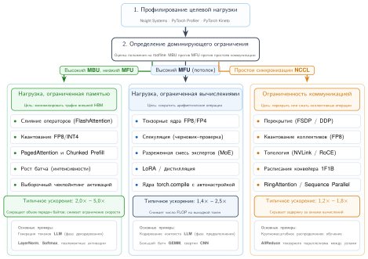

***Дерево решений руководства по оптимизации:** систематический поток устранения неполадок, который начинается с профилирования нагрузки и классификации по Roofline и направляет в руководства для режимов, ограниченных памятью, вычислениями или коммуникацией, с ожидаемым ускорением пропускной способности и итеративным повторным профилированием.*

Четвертый шаг — применить и проверить. Внедрите оптимизацию с наибольшим эффектом, снова профилируйте и проверьте улучшение. Затем повторяйте цикл, начиная с классификации по Roofline на новом профиле, поскольку узкое место могло сместиться.

<a id="sec-performance-engineering-combining"></a>

### Сочетание приемов

Производственные системы комбинируют приемы, потому что ни одно вмешательство не покрывает все члены железного закона. Оптимизированный путь ядер языковой модели может сочетать тайловое внимание, представления весов или кэша пониженной точности, компиляцию графа и воспроизведение. Устойчивый вопрос — какое вмешательство меняет измеренные байты, операции или время запуска на активном узком месте. Именованные фреймворки — это реализации таких механизмов, а не организующий принцип.

Уровень обслуживания добавляет политики допуска, состояния кэша, маршрутизации, батчирования и управления SLO. Эти политики относятся к разделу «Инференс в масштабе» главы «Инференс в масштабе». Эта глава сохраняет только их физические входы: как форма батча и последовательности меняет арифметическую интенсивность, как проверка спекуляции меняет открытую работу и как точность или структура ядра меняет емкость памяти и время выполнения. Это различие не дает благоприятному локальному результату ядра сойти за результат политики обслуживания при заданной нагрузке.

Ускорения от этих приемов не складываются; они взаимодействуют так, что требуют аккуратной последовательности. Например, квантование весов INT4 сокращает трафик HBM на токен в 4 раза, что может сместить узкое место из режима, ограниченного памятью, в режим, ограниченный вычислениями. Оказавшись ограниченным вычислениями, дальнейшие оптимизации пропускной способности (сжатие KV-кэша) дают убывающую отдачу, и приоритетом становятся оптимизации вычислений (тензорные ядра FP8). Именно поэтому итеративный цикл «профилирование, оптимизация, проверка» необходим: оптимальное сочетание зависит от конкретной модели, аппаратуры и характеристик нагрузки.

Взаимодействие оптимизаций создает граф зависимостей, по которому должен ориентироваться инженер производительности. Одни сочетания синергичны: тайловое внимание устраняет промежуточные результаты, а хранение кэша в пониженной точности освобождает память под большие батчи. Другие сочетания перекрываются: режим компилятора может уже использовать захват графа для подходящих участков, поэтому дополнительный слой захвата сэкономит мало и усложнит управление памятью. Третьи сочетания конфликтуют: спекулятивное декодирование часто выигрывает при малом батче и декодировании, ограниченном памятью, тогда как большие батчи съедают запас вычислений, который делает проверку дешевой. Только сквозное измерение по контракту из [таблицы «Воспроизводимый контракт измерения производительности»](09_performance_engineering.md#tbl-performance-engineering-measurement-contract) может отнести сочетание к синергичному, избыточному или конфликтующему для целевой нагрузки.

Практическая эвристика для последовательности оптимизаций — применять самое дешевое вмешательство, которое сдвигает узкое место, прежде чем добавлять новый алгоритмический механизм. Первый шаг зависит от измеренного узкого места. Компиляция в первую очередь — распространенная отправная точка для нагрузок со стабильными формами, когда память не является явным связывающим ограничением. Для декодирования 70B при батче 1 точность идет первой, потому что пропускная способность весов и емкость KV-кэша доминируют раньше, чем накладные расходы графа.

1. Основное исправление узкого места: применить `torch.compile`, если трасса показывает накладные расходы запуска и стабильные формы, или сначала снизить точность весов и KV-кэша, если профиль ограничен емкостью памяти или пропускной способностью.
2. Ядра семейства FlashAttention (замена библиотеки): применять, когда материализация внимания или трафик HBM внимания остается заметным в профиле.
3. Квантование весов (INT4/FP8, нужна калибровка): применять рано для обслуживания, ограниченного памятью, но проверить качество, прежде чем считать ускорение пригодным к использованию.
4. Сжатие KV-кэша (INT8, поддержка библиотеками, сокращение кэша в 2 раза): применять четвертым. Позволяет использовать большие батчи.
5. Спекулятивное декодирование (нужна черновая модель, инженерные усилия): применять последним, только если целевая задержка не достигнута. Самое сложное в развертывании.

Такой порядок отражает принцип: пассивные оптимизации (компилятор, замены библиотек) должны предшествовать активным (алгоритмическим изменениям, новым компонентам модели). Каждый шаг проверяется повторным профилированием, прежде чем перейти к следующему.

<a id="chk-performance-engineering-optimization-strategy"></a>

> **Контрольные вопросы: стратегия оптимизации**
>
> Проверьте умение проектировать план оптимизации:
>
> - [ ] **Главные оптимизации**: для рабочей нагрузки LLM при батче 1, которая достигает 25 процентов пиковой пропускной способности, определите три самые влиятельные оптимизации и их ожидаемое взаимодействие.
> - [ ] **FP8 при ограничении коммуникацией**: объясните, почему применение квантования FP8 к нагрузке, которая уже ограничена коммуникацией, не дает ускорения.
> - [ ] **Рабочий процесс профилирования**: опишите итеративный рабочий процесс профилирования и объясните, почему проверка каждой оптимизации так же важна, как ее применение.
> - [ ] **Подводные камни компиляции**: определите сценарий, в котором применение `torch.compile` ухудшит производительность.

<a id="sec-performance-engineering-case-study"></a>

### Кейс: оптимизация конвейера обслуживания LLM на 70 млрд параметров

Чтобы показать, как диагностическая последовательность и принципы сочетания работают на практике, рассмотрим задачу оптимизации LLM на 70 млрд параметров для продакшен-обслуживания. Целью является чат-бот реального времени, требующий TTFT менее 500 мс, ITL менее 50 мс и пропускной способности не менее 1 000 токенов в секунду по всему кластеру. Модель развернута на узле из 8 GPU H100, соединенных NVLink.

<a id="sec-performance-engineering-case-baseline"></a>

#### Измерение базовой линии

Исходное развертывание использует веса FP16, стандартное выполнение PyTorch в eager-режиме и тензорный параллелизм на 8 GPU. Модель 70B в FP16 требует 140 ГБ памяти под веса, распределенных примерно по 17,5 ГБ на GPU. Четыре измерения базовой линии показывают разрыв в оптимизации:

- **TTFT**: 1 200 мс (заметно выше цели в 500 мс)
- **ITL**: 85 мс (выше цели в 50 мс)
- **Пропускная способность**: 280 токенов в секунду (ниже цели в 1 000 токенов в секунду)
- **Максимальный размер батча**: 4 (ограничен памятью KV-кэша)

Трасса Nsight Systems разбивает один шаг декодирования при батче 1 на пять категорий времени:

- Ядра GEMM: 38 процентов времени шага
- Внимание (включая чтение KV-кэша): 24 процента времени шага
- Поэлементные операции (LayerNorm, GELU, остаточные связи): 14 процентов времени шага
- Коммуникация AllReduce (тензорный параллелизм): 12 процентов времени шага
- Промежутки запуска ядер и накладные расходы: 12 процентов времени шага

Анализ по Roofline подтверждает, что декодирование глубоко ограничено памятью: арифметическая интенсивность при батче 1 составляет примерно 1 FLOP/байт. GPU достигает эффективной пропускной способности 2,7 ТБ/с (80 процентов пиковой), что указывает на разумную эффективность на уровне ядер, но указывает на фундаментальное алгоритмическое ограничение.

<a id="sec-performance-engineering-case-round1"></a>

#### Раунд оптимизации 1: инженерия точности

Первая оптимизация нацелена на наибольшую возможность: сокращение байтов, читаемых при каждом чтении весов из HBM. Применение квантования весов AWQ INT4 сокращает объем весов на GPU с 17,5 ГБ примерно до 4,4 ГБ на узле из 8 GPU. Сырой трафик чтения весов падает в 4 раза, а эффективная пропускная способность для чтения весов примерно удваивается, если учесть деквантование в FP16 на лету.

Одновременно квантование KV-кэша в INT8 сокращает размер кэша на запрос вдвое. Совокупный эффект на бюджет памяти заметен: каждый GPU теперь имеет примерно 81,5 ГБ для KV-кэша вместо 68,4 ГБ. По расчету кэша GQA на 4096 токенов из раздела [«Квантование только весов и квантование весов с активациями»](09_performance_engineering.md#sec-performance-engineering-quant-strategies) это позволило бы использовать гораздо большие батчи. В данном развертывании политика обслуживания резервирует память под более длинные контексты, запас на фрагментацию и защиту хвостовой задержки. С учетом этого ограничения политики максимальный допущенный размер батча вырастает с 4 до примерно 32.

Измерения после оптимизации показывают, что ITL при батче 1 достигает 48 мс, что соответствует цели в 50 мс, тогда как пропускная способность при батче 32 достигает 720 токенов в секунду и остается ниже цели.

Трасса Nsight Systems показывает, что время GEMM снизилось примерно на 45 процентов из-за сокращения чтений весов, но время внимания и поэлементных операций не изменилось. Узкое место частично сместилось.

<a id="sec-performance-engineering-case-round2"></a>

#### Раунд оптимизации 2: слияние операторов

Второй раунд нацелен на 14 процентов времени шага, которые съедают поэлементные операции, и на 24 процента, которые съедает внимание. Применение `torch.compile` с бэкендом `max-autotune` сливает поэлементные операции (GELU, LayerNorm, остаточные сложения), сокращая их долю с 14 процентов примерно до 4 процентов времени шага. Одновременно включение FlashAttention-2 заменяет стандартную реализацию внимания и сокращает трафик HBM внимания примерно в 16 раз для фазы предзаполнения.

Для фазы декодирования эффект FlashAttention скромнее, потому что внимание при декодировании определяется чтением KV-кэша, а не матрицей оценок $S{\times}S$. Однако сочетание сжатия KV-кэша в INT8 и тайлового ядра внимания сокращает время внимания при декодировании примерно на 30 процентов в этом сценарии. Режим `reduce-overhead` в `torch.compile` захватывает стабильный участок декодирования в CUDA-граф, сокращая измеренный вклад промежутков запуска с 12 процентов до остаточной стоимости воспроизведения графа и незахваченного времени выполнения.

Измерения после оптимизации показывают TTFT 380 мс, что соответствует цели в 500 мс; ITL 32 мс при батче 1, заметно ниже цели в 50 мс; и пропускную способность при батче 32 — 1 050 токенов в секунду, что соответствует цели по пропускной способности.

<a id="sec-performance-engineering-case-round3"></a>

#### Раунд оптимизации 3: спекулятивное декодирование

Когда цель по пропускной способности достигнута, команда сосредотачивается на дальнейшем снижении ITL ради лучшего пользовательского опыта. Спекулятивное декодирование с черновой моделью на 1,5 млрд параметров (квантованной AWQ INT4 до 0,75 ГБ) развернуто на тех же GPU. Черновая модель генерирует 5 токенов-кандидатов за 4 мс (выигрывая от квантования INT4, примененного в раунде 1). Целевая модель проверяет блок кандидатов примерно за 32 мс, что сопоставимо с одним оптимизированным шагом авторегрессивного декодирования.

При стандартной модели геометрического принятия, в которой каждый черновой токен принимается независимо с вероятностью $p_{\text{acc}}$, а один бонусный токен всегда следует за последним принятым, ожидаемое число принятых токенов за раунд при $k$ черновых токенах равно $(1 - p_{\text{acc}}^{k+1})/(1 - p_{\text{acc}})$. При $p_{\text{acc}} = 0{,}78$ и $k = 5$ это дает $(1 - 0{,}78^{6})/(1 - 0{,}78) \approx 3{,}5$ токена за раунд. Эффективный ITL становится:

$$
\text{ITL}_{\text{эффективный}} = \frac{4 + 32}{3{,}5} \approx 10{,}3 \text{ мс на токен}
$$

Результат — улучшение в 3,1 раза относительно ITL раунда 2, равного 32 мс. Однако спекулятивное декодирование взаимодействует с батчированием. В этом сценарии проверка теряет запас вычислений по мере того, как батч приближается к 32; измеренная точка пересечения задержки и пропускной способности приходится примерно на размер батча 16. Это число — физический вход, специфичный для нагрузки и аппаратуры, а не универсальный порог допуска. Раздел «Инференс в масштабе» главы «Инференс в масштабе» показывает, как контроллер обслуживания сочетает такие измеренные кривые пересечения с заданной нагрузкой, состоянием кэша и целями обслуживания, чтобы решить, должна ли группа запросов использовать спекуляцию.

<a id="sec-performance-engineering-case-lessons"></a>

#### Уроки кейса

Эта последовательность показывает, почему важен порядок оптимизаций. Каждый шаг смещает узкое место. Инженерия точности (раунд 1) применена первой, потому что дает наибольший одиночный выигрыш и открывает последующие оптимизации, освобождая память под большие батчи. Слияние (раунд 2) устранило новое узкое место, которое выявила инженерия точности. Спекулятивное декодирование (раунд 3) дало улучшение задержки после того, как была достигнута цель по пропускной способности.

Каждая оптимизация меняла узкое место. До раунда 1 система была чисто ограничена пропускной способностью памяти. После квантования INT4 и батчирования система при больших батчах стала частично ограничена вычислениями. После слияния накладные расходы запуска ядер стали пренебрежимо малы, и оставшимся узким местом стал фундаментальный предел пропускной способности памяти для декодирования. Каждая оптимизация проверялась повторным профилированием, чтобы подтвердить смещение узкого места.

Итоговая система сочетает пять различных приемов: квантование весов INT4, сжатие KV-кэша в INT8, FlashAttention-2, `torch.compile` с CUDA-графами и адаптивное спекулятивное декодирование. Эти приемы не независимы, они взаимодействуют. Квантование INT4 позволяет использовать большие батчи, что меняет то, будет ли спекулятивное декодирование выгодным. Выгода FlashAttention зависит от длины последовательности, которая растет во время генерации. Инженер производительности должен рассуждать о таких взаимодействиях целостно, опираясь на данные профилирования на каждом этапе.

Кейс показывает, как разнородные оптимизации накапливаются последовательно, превращая непригодный прототип в развертывание производственного уровня. Однако путь к этим ускорениям усеян общепринятой мудростью, которая на масштабе часто оказывается катастрофической.

<a id="sec-performance-engineering-fallacies"></a>

## Заблуждения и ловушки

Команда переводит кластер инференса с A100 на H100, рассчитывая на трехкратное снижение задержки по паспортному значению терафлопс, и обнаруживает, что их генеративная модель работает лишь примерно на 15 процентов быстрее. Ловушка распространена: предполагать, что сырая вычислительная мощность определяет скорость инференса, тогда как нагрузка полностью ограничена пропускной способностью памяти.

**Заблуждение**: *Больше FLOP/s означает более быстрый инференс.*

Модель Roofline показывает, что большинство операций инференса ограничено памятью, а не вычислениями. GPU с вдвое большим пиком FLOP/s, но той же пропускной способностью памяти не будет генерировать токены быстрее при декодировании LLM при батче 1. Правильная метрика для рабочих нагрузок, ограниченных памятью, — пропускная способность, а не FLOP/s. Это заблуждение приводит к покупке самого дорогого вычислительного оборудования, когда GPU среднего класса с эквивалентной пропускной способностью HBM дал бы такую же пропускную способность инференса.

**Ловушка**: *Планирование перехода на FP8 как автоматического двукратного сокращения времени обучения.*

FP8 вдвое увеличивает пиковые TFLOP/s и вдвое повышает эффективную пропускную способность памяти, но эти выигрыши реализуются только для операций, которые при FP16 ограничены вычислениями или пропускной способностью. Поэлементные операции вроде функций активации уже ограничены накладными расходами запуска ядер, а не точностью. Шаги распределенного обучения, ограниченные коммуникацией, не получают ничего от сокращения арифметической точности, если не сокращается и объем коммуникации (размеры градиентов). Фактическое ускорение зависит от доли времени выполнения, потраченного на операции, чувствительные к точности.

**Заблуждение**: *Самое большое ядро — это вся проблема производительности.*

Кейс профилирования в разделе [«Кейс: оптимизация конвейера обслуживания LLM на 70 млрд параметров»](09_performance_engineering.md#sec-performance-engineering-case-study) иллюстрирует эту ловушку. Инженеры естественно сосредотачиваются на самом большом ядре, которым часто является GEMM в слое трансформера. Однако когда GEMM уже близок к оптимальному, оставшийся бюджет производительности распределяется между десятками мелких операций: нормализацией, активацией, оценкой внимания, управлением KV-кэшем и накладными расходами запуска ядер. Вместе эти «мелкие» операции могут съедать больше половины общего времени выполнения. Компиляция графов и систематическое слияние решают этот длинный хвост эффективнее, чем дальнейшая оптимизация GEMM.

**Ловушка**: *Применение спекулятивного декодирования без учета динамики батчей.*

Спекулятивное декодирование может сократить задержку в измеренном режиме малого батча, ограниченном памятью, когда черновая модель дешева, ее предложения достигают высокой доли принятия, а у целевой модели есть свободные вычисления для батчированной проверки. Проверка никогда не бывает бесплатной: ее открытая стоимость зависит от длины черновика, доли принятия, распределений батчей и длин последовательностей и рабочей точки ядра целевой модели. Когда батчирование съедает запас вычислений, та же конфигурация может перейти от выигрыша к проигрышу, а переменные длины принятых серий добавляют работу планировщику. Эта глава измеряет такое пересечение для фиксированной нагрузки и машины; раздел «Инференс в масштабе» главы «Инференс в масштабе» отвечает за политику допуска, которая применяет получившуюся кривую при меняющейся заданной нагрузке и целях обслуживания.

**Заблуждение**: *Число экспертов в MoE — бесплатная ручка масштабирования.*

Увеличение числа экспертов в модели MoE может увеличить общее число параметров без пропорционального роста активной арифметики на токен, что напоминает бесплатную ручку масштабирования. Однако больше экспертов по-прежнему увеличивает давление на память параметров и размещение, а распределенное размещение открывает коммуникацию отправки и сборки. Реальная стоимость зависит от числа экспертов, выбираемых на токен, перекоса распределения токенов по экспертам, емкости экспертов, топологии и батчирования; универсального порогового числа экспертов, при котором проект проигрывает, не существует. Оптимизация оправдана, только когда сравнение при одинаковом качестве показывает, что экономия активных вычислений превышает затраты на маршрутизацию, дисбаланс и коммуникацию в целевом диапазоне нагрузки.

**Ловушка**: *Использование графовых компиляторов вместо анализа ядер.*

Графовые компиляторы сильно улучшились, но остаются ограниченными своими моделями стоимости и эвристиками слияния. Для FlashAttention потребовалось человеческое понимание, что внимание можно переформулировать как тайловый алгоритм с онлайн-softmax, — алгоритмический вывод, выходящий за рамки обычных правил переписывания компилятора. Аналогично, спекулятивное декодирование и маршрутизация MoE требуют алгоритмических новаций, которые компиляторы открыть не могут. Компиляторы автоматизируют известные оптимизации; новые открывают инженеры.

**Заблуждение**: *Самая низкая поддерживаемая точность всегда является лучшей точностью.*

Агрессивное квантование (веса INT4, KV-кэш INT4, активации FP8) может ухудшать качество модели так, что его трудно обнаружить стандартными бенчмарками, но заметно пользователям. Перплексия на отложенном наборе данных может измениться меньше чем на 1 процент, тогда как модель может давать заметно худшие ответы в крайних случаях, на редких языках или в сложных рассуждениях. Правильный подход — целевое квантование: применять самую агрессивную точность к наименее чувствительным компонентам (KV-кэш, промежуточные активации), а более высокую точность сохранять для самых чувствительных (первый и последний слои, логиты внимания). Калибровка на репрезентативном наборе данных с последующей оценкой на разнообразных бенчмарках качества необходима перед развертыванием любой квантованной модели в продакшене.

**Ловушка**: *Измерение пропускной способности без измерения качества.*

Система обслуживания, которая генерирует 200 токенов в секунду, не вдвое лучше той, что генерирует 100 токенов в секунду, если первая достигает этой пропускной способности, используя квантование INT4, которое ухудшает качество ответов на 15 процентов. Метрики производительности всегда нужно сообщать вместе с метриками качества. Правильная цель оптимизации — фронт Парето пропускной способности и качества, а не одна пропускная способность.

**Заблуждение**: *Одного запуска профилирования достаточно, чтобы охарактеризовать производительность.*

Производительность систем ML нестационарна. Термический троттлинг GPU снижает частоты (а значит, и FLOP/s) после длительных нагрузок, иногда на 10–15 процентов. Фрагментация памяти накапливается за часы обслуживания, постепенно сокращая эффективный размер батча. Перегрузка сети меняется вместе с общекластерными шаблонами трафика. Запуск профилирования при холодном старте может показать другие шаблоны узких мест, чем запуск после нескольких часов производственного обслуживания. Надежная характеристика производительности требует профилирования в реалистичных, устойчивых условиях, желательно с многократными выборками на протяжении производственного запуска.

**Ловушка**: *Оптимизация под средний случай при игнорировании хвостовой задержки.*

Система обслуживания может показывать отличную среднюю межтокенную задержку (30 мс), но при этом P99-задержку 500 мс из-за пауз сборки мусора в среде выполнения Python, задержек выделения памяти CUDA или редких задержек AllReduce из-за перегрузки сети. Для интерактивных приложений пользовательский опыт определяется худшим случаем, а не средним. Инженерия производительности производственных систем должна профилировать и оптимизировать именно хвостовую задержку, часто с помощью приемов, ортогональных оптимизации базовой пропускной способности: предвыделенные пулы памяти, воспроизведение CUDA-графов без выделений внутри захваченных участков и приоритетное планирование запросов, чувствительных к задержке.

<a id="sec-performance-engineering-summary"></a>

## Итоги

Инженерия производительности закрывает разрыв между теоретической эффективностью модели и ее аппаратной реализацией, систематически оптимизируя члены железного закона производительности ML ([формула железного закона](09_performance_engineering.md#eq-iron-law-perf)): полное время выполнения $T$ определяется перемещением данных ($D_{\text{vol}} / \text{BW}$), выполнением вычислений ($O / (R_{\text{peak}} \cdot \eta_{\text{hw}})$) и накладными расходами задержки ($L_{\text{lat}}$). На современных ускорителях вроде NVIDIA H100, где точка перегиба модели Roofline при FP16 составляет 295,2 FLOP/байт, большинство авторегрессивных операций трансформера ограничено стеной памяти ($D_{\text{vol}} / \text{BW}$).

Вместо разрозненного набора трюков приемы главы образуют единый стек оптимизации, нацеленный на каждый член этого управляющего уравнения:

1. **Работа с перемещением данных ($D_{\text{vol}}/\text{BW}$)**: слияние операторов и FlashAttention устраняют избыточные передачи HBM, переводя вычисления внимания в тайлы в быстрой SRAM и заменяя квадратичный трафик памяти $\mathcal{O}(S^2)$ потоковой передачей $\mathcal{O}(S)$ (что дает сокращение трафика в 65× в примере с последовательностью 8K). Инженерия точности (форматы FP8, квантование весов INT4, сжатие KV-кэша в INT8/INT4) дополнительно уменьшает объем полезной нагрузки $D_{\text{vol}}$, вдвое сокращая трафик памяти на передачу и расширяя емкость батча на узел.
2. **Сокращение накладных расходов ($L_{\text{lat}}$)**: компиляторы графов сливают подходящие операции и улучшают планирование памяти, а CUDA-графы амортизируют повторную отправку с хоста для стабильных захваченных участков. На границе кластера перекрытие коммуникации и вычислений может скрыть задержку AllReduce между GPU под полезными градиентными GEMM обратного прохода, когда интерференция ресурсов не удлиняет эти вычисления.
3. **Перестройка алгоритмической работы ($O/R_{\text{peak}}$)**: спекулятивное декодирование и смесь экспертов меняют саму вычислительную работу: спекуляция генерирует несколько принятых токенов за каждый дорогой проход проверки целевой моделью, а MoE направляет токены в разреженные подсети экспертов, удерживая FLOP на токен $O$ низкими при масштабировании емкости модели.

Как показывает кейс профилирования в [разделе «Кейс: оптимизация конвейера обслуживания LLM на 70 млрд параметров»](09_performance_engineering.md#sec-performance-engineering-case-study), эти приемы взаимодействуют динамически. Сокращение точности весов вдвое расширяет размер батча, что повышает арифметическую интенсивность и переводит систему из режима, ограниченного памятью, к режиму, ограниченному вычислениями. Профилирование служит непрерывным механизмом обратной связи: оно выявляет, какой член [формулы железного закона](09_performance_engineering.md#eq-iron-law-perf) сейчас связывает выполнение, и направляет инженера к следующему вмешательству там, где оно действительно сдвигает время на стене, а не тратит усилия на несвязывающие узкие места.

> **Согласуйте программу с кремнием**
>
> * **Байты обычно связывают**: на современных высокопроизводительных ускорителях краткий итог Roofline из главы помещает большую часть работы трансформера ниже точки перегиба FP16 в 295,2 FLOP/байт, поэтому полезные ускорения сначала приходят от сокращения трафика HBM, удержания промежуточных результатов в SRAM и траты вычислений только тогда, когда это двигает активное узкое место.
> * **Слияние делает локальность реальной**: слияние операторов, CUDA-графы и FlashAttention — не просто трюки с ядрами; они устраняют накладные расходы запуска и избегают квадратичных промежуточных результатов внимания. В примере с 8K упрощенный сценарий трафика HBM дает отношение 65×, тогда как реальный трафик зависит от реализации.
> * **Точность покупает пропускную способность ценой риска**: FP8, INT8 и INT4 увеличивают эффективную пропускную способность и емкость батча, только если выбросы, масштабирующие коэффициенты и проверки качества находятся под контролем. Квантование — это системный контракт между численным форматом, реализацией ядра, памятью обслуживания и допустимым поведением модели.
> * **Алгоритмы могут сдвигать Roofline**: спекулятивное декодирование и смесь экспертов меняют объем полезной работы, которую выполняет каждый проход целевой модели, но вводят ограничения по доле принятия, маршрутизации, AllToAll и балансировке нагрузки. Выигрыш реален только после измерения затрат на коммуникацию и планировщик.
> * **Профилирование — на каждом шаге**: кейс на 70B показывает оптимизацию как смещение узкого места: INT4 меняет размер батча, размер батча меняет арифметическую интенсивность, и следующий предел смещается. Инженерия производительности парка — это измерить, оптимизировать связывающий член и снова измерить, прежде чем верить ускорению.

Аппаратуру продают по теоретическому пику ($R_{\text{peak}}$), но платят за устойчивую пропускную способность, которую она достигает при ограничениях пропускной способности памяти ($\text{BW}$) и программных накладных расходов ($L_{\text{lat}}$). Чтобы закрыть этот разрыв, инженерам производительности нужно рассматривать иерархию памяти, диспетчеризацию ядер и структуру алгоритма как единую взаимозависимую систему. Архитектура аппаратуры задает абсолютный потолок производительности; систематическая оптимизация определяет, насколько близко продакшен-программное обеспечение к нему подходит.

> **От оптимизации одного узла к обслуживанию в масштабе парка**
>
> Опираясь на основы вычислительной инфраструктуры и иерархии памяти из раздела [«Вычислительная инфраструктура»](02_compute_infrastructure.md#sec-compute-infrastructure), эта глава сосредоточилась на механике локального выполнения: слиянии операторов, снижении точности, компиляции графов, спекулятивной проверке и разреженной маршрутизации. Ее измерения фиксируют нагрузку и заданную нагрузку неизменными, так что изменения байтов, операций и открытых накладных расходов остаются отнесенными к реализации. Раздел «Инференс в масштабе» главы «Инференс в масштабе» использует эти измеренные механизмы и отвечает за продакшен-политики вокруг состояния кэша, допуска, маршрутизации, батчирования, планирования и защиты SLO.
