<a id="sec-inference-scale"></a>

# Инференс в масштабе

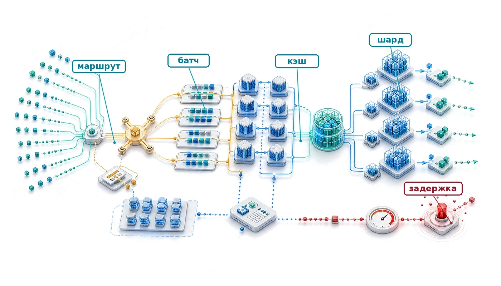

## Назначение

_Почему стоимость инференса в итоге намного превышает стоимость обучения?_

Обучение — разовая затрата; обслуживание продолжается весь операционный срок жизни модели. Модель, обученная однажды за миллионы долларов, может обслужить миллиарды запросов, и каждый из них потребляет вычисления, память, сеть и энергию. Для успешной производственной модели операционные расходы на инференс могут превышать первоначальную стоимость обучения на порядки. Эта структура затрат определяет архитектуру. Миллисекунды задержки и проценты загрузки ускорителей складываются на миллиардах запросов. Инженерия производительности дала локальный инструментарий — слияние операторов, точность, компиляцию и алгоритмические изменения вроде спекулятивного декодирования, — а эта глава применяет эти инструменты в масштабе обслуживания. Батчинг, шардирование, маршрутизация, автомасштабирование и изоляция должны удерживать строгие бюджеты задержки под живым трафиком. Требования к надежности тоже ужесточаются: простой означает потерянную выручку и сломанный пользовательский опыт, а не отложенный эксперимент. В терминах C³ обслуживание объединяет вычисления ради пропускной способности с координацией, которая должна укладываться в бюджеты задержки хвоста.

> **Цели обучения**
>
> - Оценить стоимость обслуживания модели за весь срок службы по объему запросов, составу токенов, цене ускорителя, загрузке и целевой задержке
> - Выбрать политики батчинга и планирования для задач компьютерного зрения, LLM, рекомендательных систем и потоковых нагрузок
> - Проанализировать емкость KV-кэша внимания, фрагментацию и политики управления памятью на этапе декодирования при обслуживании языковых моделей, ограниченных памятью
> - Сравнить проектные решения с шардированием, разделением этапов и квантованным обслуживанием по ограничениям коммуникации, памяти и качества
> - Оценить маршрутизацию, балансировку нагрузки и изоляцию по задержке хвоста и рискам «шумного соседа»
> - Спроектировать политики автомасштабирования и аварийного переключения между регионами, которые балансируют холодный старт, стоимость и соблюдение SLO
> - Синтезировать архитектуры обслуживания, которые управляют компромиссами C³ на уровнях запроса, реплики, сервиса и платформы

## Экономика и архитектура инференса

<a id="sec-inference-scale-scaling-inference-beyond-single-machines"></a>

Представьте языковую модель, обучение которой стоит \$5 млн и занимает два месяца. После развертывания для глобальной аудитории, которая отправляет тысячи запросов в секунду, та же модель может расходовать на вычисления инференса по \$5 млн каждую неделю. Инференс больше не временное пакетное задание. Это непрерывный сервис, чувствительный к задержке.

Слияние операторов, инженерия точности и компиляция графа могут максимизировать пропускную способность отдельных прямых проходов. Следующая задача возникает, когда одна оптимизированная модель должна обслуживать тысячи одновременных пользователей в распределенном по всему миру парке. Оптимизация инференса на одной машине, включая батчинг, кэширование, оптимизацию модели и аппаратное ускорение, дает строительные блоки. Распределенные подходы становятся необходимыми, когда эти методы исчерпывают свои возможности.

Распределенные системы инференса решают задачи, которых не существует в масштабе одной машины. Балансировка нагрузки[^fn-load-balancing-inference] становится критичной, когда запросы нужно распределять между сотнями экземпляров GPU с сохранением гарантий задержки. Маршрутизация запросов должна учитывать особенности модели: рекомендательным системам с таблицами эмбеддингов на триллионы параметров нужны другие стратегии размещения, чем большим языковым моделям, которые генерируют ответ токен за токеном. Автомасштабирование должно предвосхищать колебания спроса, которые за несколько минут могут изменить объем запросов на порядки, сохраняя границы задержки, которых ждут пользователи.

[^fn-load-balancing-inference]: **Балансировка нагрузки для инференса**: время обслуживания запроса может варьироваться от миллисекунд до десятков секунд, потому что меняются модели, длины промптов и объемы генерируемого вывода. Маршрутизация с учетом очереди точнее отражает оставшуюся работу, чем одно лишь число назначенных запросов.

Экономика инференса в масштабе принципиально отличается от экономики обучения. Затраты на обучение определяются временем вычислений и могут амортизироваться в течение срока жизни получившейся модели. Затраты на инференс напрямую связаны с пользовательским трафиком и выручкой. Система рекомендаций в электронной коммерции может обслуживать миллионы запросов в секунду в пиковые периоды покупок, и каждый запрос напрямую связан с потенциальной выручкой. Избыточный резерв в спокойные периоды или недостаток мощности в пиковые немедленно превращаются в бизнес-последствия. Эффективность инференса становится определяющим фактором так, как эффективность обучения редко. Построение такого сервиса требует трех связанных решений: когда распределение становится необходимым, как архитектура сохраняет границы задержки при меняющейся нагрузке и как утилизация ресурсов остается достаточно высокой, чтобы стоимость обслуживания не съедала ценность, которую создает модель.

### Когда обслуживания на одной машине недостаточно

<a id="sec-inference-scale-singlemachine-serving-insufficient"></a>

Три различных сигнала показывают, когда распределенный инференс становится необходимым, а не просто желательным. [Таблица «Триггеры распределенного инференса»](#tbl-distribution-triggers) классифицирует эти триггеры по типу ограничения и соответствующей стратегии.

Первый сигнал — исчерпание памяти: параметры модели, KV-кэши или таблицы эмбеддингов превышают емкость одного устройства. Один GPU NVIDIA H100 предоставляет 80 ГБ памяти HBM3[^fn-hbm3-memory-bandwidth]; в приложении о происхождении допущений парка описано происхождение этой величины емкости и других канонических аппаратных констант, которые используются в дальнейшем анализе. Модели класса GPT-4 намного превосходят эту емкость: публичная оценка смеси экспертов с примерно 1,8 трлн параметров означает около 3,5 ТБ только под веса в точности FP16, и распределение между несколькими GPU становится необходимым независимо от требований к пропускной способности. Рекомендательные системы с таблицами эмбеддингов на триллионы параметров сталкиваются с похожими ограничениями: архитектура DLRM компании Meta[^fn-dlrm-recommendation-scale] хранит таблицы эмбеддингов, которые занимают несколько терабайт памяти.

[^fn-hbm3-memory-bandwidth]: **Емкость и пропускная способность HBM3**: H100 сочетает 80 ГБ трехмерно стекированной DRAM с пропускной способностью 3,35 ТБ/с; у HBM2e на A100 она составляет 2,04 ТБ/с. Емкость определяет, помещаются ли модель и состояние кэша; пропускная способность ограничивает производительность декодирования, ограниченного памятью.

[^fn-dlrm-recommendation-scale]: **DLRM (Deep Learning Recommendation Model)**: эталонная архитектура Meta 2019 года разделяет плотные признаки, которые обрабатывают многослойные перцептроны (MLP) на GPU, и разреженные признаки, поиск по эмбеддингам которых ограничен процессором. Так получается гибридная топология обслуживания (Naumov et al., 2019). Характеристики производственных рекомендательных моделей показывают, почему эта структура важна: модели с большим количеством эмбеддингов создают ограничения доступа к памяти и ее емкости, которые отличаются от инференса плотных сверточных сетей (CNN), рекуррентных сетей (RNN) или больших языковых моделей (LLM) (Gupta et al., 2020).

Помимо ограничений памяти, пропускная способность ограничивается, когда объем запросов превышает емкость одной машины даже при оптимальном батчинге. Рассмотрим рекомендательную систему, которая обслуживает 100 000 запросов в секунду при бюджете задержки 10 мс. Если пропускная способность одной машины достигает пика в 10 000 QPS, никакая оптимизация на этой машине не удовлетворит спрос. Горизонтальное масштабирование на нескольких репликах становится обязательным.

Наконец, жесткие требования к задержке вынуждают распределять вычисления, когда время выполнения модели превышает бюджет задержки даже при размере батча один. Большие языковые модели, которые генерируют ответ токен за токеном, сталкиваются с этим ограничением особенно остро. Модель на 70 млрд параметров требует примерно 140 ГБ памяти в FP16, что превышает один GPU класса H100 с 80 ГБ еще до учета KV-кэша. Даже когда квантование или аппаратное обеспечение с большей памятью делают возможной конфигурацию с одной репликой, пропускная способность декодирования часто ограничивается пропускной способностью памяти. Шардирование модели по нескольким GPU обеспечивает параллельные вычисления, которые снижают время до первого токена ниже приемлемых порогов.

<a id="tbl-distribution-triggers"></a>

***Триггеры распределенного инференса:** каждый тип ограничения указывает на свою стратегию распределения. Ограничения памяти требуют шардирования модели; ограничения пропускной способности требуют репликации; ограничения задержки могут требовать того или другого в зависимости от того, является ли узким местом вычисление или пропускная способность памяти.*

| **Ограничение**   |      **Предел одной машины**      |                **Пример нагрузки**                |  **Стратегия распределения**  |
|:------------------|:---------------------------------:|:--------------------------------------------------:|:-----------------------------:|
| **Память**        |             80 ГБ (H100)          |          GPT-4 (~3,5 ТБ в FP16)                    | Тензорный/конвейерный параллелизм |
| **Пропускная способность** |      ~10 тыс. QPS (зрение)     |                 Рекомендации 100 тыс. QPS          |     Горизонтальная репликация |
| **Задержка**      | Прямой проход $> \text{SLO}$      |                 500 мс TTFT для LLM                |         Шардирование модели   |

Триггеры по памяти, пропускной способности и задержке становятся видимыми пользователю, как только интерактивная конечная точка начинает потоковую передачу. **Время до первого токена (TTFT)**[^fn-ttft-tpot-metrics] определяет, когда пользователь видит начало ответа, а **время на выходной токен (TPOT)** определяет, приходит ли остаток ответа в читаемом темпе. Поэтому инференс меняет многие приоритеты оптимизации, которые действовали при обучении.

[^fn-ttft-tpot-metrics]: **TTFT против TPOT**: время до первого токена измеряет начальное ожидание, включая очередь и этап предзаполнения; время на выходной токен измеряет темп декодирования после начала потоковой передачи. Политика обслуживания должна защищать оба показателя, а не скрывать медленный поток за быстрым первым ответом.

> **Контрольные вопросы: выбор стратегии распределения**
>
> Проверьте понимание того, когда переходить от обслуживания на одной машине к распределенному инференсу:
>
> - [ ] **Шардирование или репликация**: для модели на 13 млрд параметров (26 ГБ весов), которая помещается на одном A100, выберите шардирование модели или горизонтальную репликацию, когда требования к пропускной способности удваиваются.
> - [ ] **Нижняя граница задержки**: для сервиса распознавания речи в реальном времени, где основным узким местом является задержка между токенами, определите, снижает ли репликация с параллелизмом по данным эту задержку.
> - [ ] **Обязательное шардирование**: объясните, почему шардирование модели обязательно для модели на 175 млрд параметров на GPU по 80 ГБ независимо от объема запросов.
> - [ ] **Триггер задержки**: определите, когда целевая задержка вынуждает распределять вычисления, а когда добавленные накладные расходы сети, сериализации, координации или очередей могут свести выгоду на нет.

### Фундаментальная инверсия: обучение против инференса

<a id="sec-inference-scale-fundamental-inversion-training-vs-inference"></a>

Различие между оптимизацией обучения и оптимизацией инференса выходит за рамки базового противопоставления пропускной способности и задержки. Обучение оптимизирует число обработанных примеров в час и терпимо относится к колебаниям задержки. Инференс оптимизирует время отклика и должен соблюдать строгие границы задержки. В масштабе эта инверсия проявляется в архитектуре системы, распределении ресурсов и операционных приоритетах. [Таблица «Требования к системам обучения и инференса»](#tbl-training-inference-inversion) описывает шесть ключевых аспектов системы, в которых возникают эти различия.

<a id="tbl-training-inference-inversion"></a>

***Требования к системам обучения и инференса:** фундаментальная инверсия от оптимизации пропускной способности к оптимизации задержки проходит через проектирование системы, управление состоянием, формирование батчей и восстановление после отказов.*

| **Аспект**              |    **Распределенное обучение**   |  **Распределенный инференс**   |
|:------------------------|:--------------------------------:|:------------------------------:|
| **Основная метрика**    |   Пропускная способность (примеров в час) |    Задержка (P99, мс)       |
| **Допустимый разброс**  |             Часы                 |         Миллисекунды           |
| **Управление состоянием** |     Контрольные точки (периодические) |  Состояние сессии (непрерывное) |
| **Формирование батча**  |       Большой, контролируемый    |   По запросам, переменный      |
| **Устойчивость к отказам** |    Перезапуск с контрольной точки | Перенаправление без влияния на пользователя |
| **Структура стоимости** | Фиксированная длительность, переменная ставка | Переменная длительность, фиксированный SLO |

Обучение терпимо к значительному разбросу задержки, потому что цель оптимизации — совокупный прогресс за часы или дни. Итерация обучения, которая занимает 2 секунды вместо обычной 1 секунды, — приемлемое отклонение. Запрос инференса, который занимает 2 секунды вместо 100 миллисекунд, — катастрофический сбой, который может привести к уходу пользователя или каскадным таймаутам в зависимых сервисах.

Управление состоянием различается принципиально. Обучение хранит состояние модели (параметры, состояния оптимизатора), которое эволюционирует постепенно и может фиксироваться в периодических контрольных точках. Инференс часто хранит состояние сессии (историю диалога, KV-кэши, контекст пользователя), которое должно сохраняться между запросами и не может терпеть устаревание, которое внесло бы восстановление по контрольным точкам.

Обработка отказов расходится соответственно. Сбои обучения запускают восстановление из контрольной точки и продолжение, и потеря нескольких минут прогресса приемлема. Сбои инференса должны оставаться незаметными для пользователей. Запросы перенаправляются на исправные реплики, деградировавшие результаты заменяют недоступные модели, а цели уровня сервиса (SLO) должны выполняться несмотря на нестабильность инфраструктуры.

### Налог на обслуживание: накладные расходы распределения

<a id="sec-inference-scale-serving-tax-overhead-distribution"></a>

Распределение инференса по нескольким машинам вносит накладные расходы, которых нет при обслуживании на одной машине. Этот «налог на обслуживание» нужно понимать и закладывать в бюджет в рамках ограничений задержки.

Сетевая коммуникация добавляет задержку при каждом межмашинном взаимодействии. Внутри дата-центра время кругового обхода сети составляет от 50 до 500 мкс в зависимости от топологии и загрузки. Для шардирования модели, которое требует синхронизации между GPU на разных машинах, каждая точка синхронизации добавляет эти накладные расходы. Модель, зашардированная на 8 машинах с четырьмя точками синхронизации на инференс, добавляет от 200 мкс до 2 мс сетевой задержки. В приложении об основах коммуникации развивается модель $\alpha$-$\beta$, которая раскладывает каждую такую передачу на фиксированную задержку старта и член, зависящий от пропускной способности. Она дает количественную основу для того, чтобы сопоставить затраты на синхронизацию с SLO по задержке.

Накладные расходы на сериализацию усугубляют проблему, преобразуя тензоры в памяти в сетевые форматы. Традиционные сериализаторы вроде Protocol Buffers, JSON и `pickle` из Python на каждой передаче выполняют цикл «разбор, выделение памяти, копирование», и тензор активаций размером 1 ГБ сериализуется и десериализуется через такие форматы примерно за 100 мс. Альтернативы с нулевым копированием, такие как FlatBuffers и Cap'n Proto[^fn-serialization-zerocopy-buffer], обходят большую часть этих затрат, обращаясь к данным в сетевом формате на месте. Но они накладывают более строгие требования к раскладке схемы, которые принимает не каждый производственный стек.

[^fn-serialization-zerocopy-buffer]: **Сериализация с нулевым копированием**: форматы вроде FlatBuffers и Cap'n Proto могут обращаться к данным в сетевом формате на месте, избегая отдельного цикла «разбор, выделение памяти, копирование». Выгода зависит от размера полезной нагрузки, среды выполнения языка и от того, может ли последующий оператор использовать то же представление буфера.

Балансировщик нагрузки добавляет еще один слой задержки. Запросы нужно направлять на подходящие реплики, а для этого требуется разобрать метаданные запроса, обратиться к таблицам маршрутизации и передать запрос выбранному бэкенду. Хорошо настроенные балансировщики добавляют 100–500 мкс; плохо настроенные могут добавлять миллисекунды.

Накладные расходы на координацию возникают, когда запросы требуют рассылки нескольким сервисам. Система рекомендаций, которая параллельно запрашивает модель пользователя, модель товаров и модель ранжирования, должна координировать эти запросы и агрегировать результаты. Сама логика координации потребляет такты процессора и вносит разброс задержки. Наконец, задержка в очереди ($T_{\text{queuing}}$) накапливается всякий раз, когда частота прихода запросов временно превышает вычислительную мощность реплик.

Суммарный налог на обслуживание часто съедает 10–30 процентов бюджета задержки в распределенных системах, как показывает [уравнение](#eq-serving-tax):

<a id="eq-serving-tax"></a>

$$
T_{\text{total}} = T_{\text{compute}} + T_{\text{network}} + T_{\text{serialization}} + T_{\text{coordination}} + T_{\text{queuing}}
$$

Чтобы уменьшить этот налог, нужно размещать взаимодействующие компоненты рядом, использовать высокоскоростные межсоединения и проектировать шаблоны коммуникации, которые минимизируют число сетевых обращений.

### Стоимость обслуживания может превышать стоимость обучения

<a id="sec-inference-scale-serving-cost-dominates-training-cost"></a>


*Стоимость обслуживания за жизненный цикл намного превышает разовые затраты на обучение.*

Налог на обслуживание, количественно описанный в [уравнении](#eq-serving-tax), съедает долю бюджета задержки на каждый запрос. Истинное экономическое влияние инференса проявляется, когда стоимость оценивается за весь операционный срок жизни модели. **Закон доминирования стоимости обслуживания** (см. принцип «Доминирование стоимости обслуживания») утверждает, что стоимость обслуживания может превышать стоимость обучения на порядки, потому что обучение — это *разовые капитальные затраты* (CapEx), а обслуживание — *непрерывные операционные затраты* (OpEx), которые растут вместе с пользовательской базой. Быстрый расчет делает этот множитель наглядным.

> **Расчет: мультипликатор стоимости обслуживания**
>
> **Задача**: команда потратила \$2 млн на обучение модели на 70 млрд параметров и теперь обслуживает ею 1 000 000 ежедневно активных пользователей, каждый из которых делает 50 запросов в день. Что доминирует в затратах за один год: обучение или обслуживание?
>
> **Вычисления**:
>
> 1. **Стоимость обучения**: \$2 млн (разово).
> 2. **Метрика**: годовой объем инференса составляет $10^{6}\,\text{пользователей} \times 50\,\text{запросов} \times 365\,\text{дней} \approx$ 18,25 млрд запросов в год.
> 3. **Стоимость запроса**: модель на 70 млрд параметров на H100 стоит около \$0,001 за запрос (вход и выход).
> 4. **Годовая стоимость обслуживания**: 18,25 млрд запросов × \$0,001 за запрос = \$18,25 млн.
>
> **Системный вывод**: обслуживание стоит в 9,1 раза дороже обучения уже в первый год. Повышение эффективности обслуживания или связанной с задержкой эффективности на 10 процентов экономит около \$1,8 млн в первый год, почти окупая исходный запуск обучения.

Общая стоимость эксплуатации модели складывается из стоимости обучения (разовые затраты) и стоимости обслуживания (текущие затраты), как показывает [уравнение](#eq-total-cost):

<a id="eq-total-cost"></a>

$$
C_{\text{total}} = C_{\text{training}} + C_{\text{serving}} \times T_{\text{deployment}} \times Q_{\text{rate}}
$$

где $C_{\text{training}}$ — разовая стоимость обучения модели, $C_{\text{serving}}$ — стоимость обслуживания одного запроса, $T_{\text{deployment}}$ — длительность развертывания в подходящих единицах времени, $Q_{\text{rate}}$ — частота запросов.

Тот же рычаг может работать и в других категориях приложений с иной структурой затрат. В иллюстративном сценарии рекомендательной системы из главы модель DLRM обучается за \$12 000: \$3 000 на оборудование (1 000 GPU-часов по \$3 за GPU-час) плюс затраты на инженерию данных и экспериментов, в 3 раза превышающие стоимость оборудования. Обслуживание с частотой 10 000 QPS в течение 730 дней накапливает $6{,}31 \times 10^{11}$ запросов за срок службы. При предполагаемой цене \$10 за миллион запросов их обслуживание стоит \$6 307 200, что дает соотношение 525,6× в этом сценарии. [Таблица «Иллюстративные соотношения стоимости обучения и обслуживания»](#tbl-cost-ratios) дает диапазоны чувствительности для нескольких иллюстративных профилей нагрузки, а не рыночные оценки цен:

<a id="tbl-cost-ratios"></a>

***Иллюстративные соотношения стоимости обучения и обслуживания:** диапазоны показывают, как объем запросов, стоимость модели и срок службы сервиса могут сделать регулярные расходы на обслуживание выше разовых затрат на обучение. Это допущения чувствительности, а не типичные цены: при развертывании нужно подставить измеренный трафик и границы учета.*

| **Приложение**                |  **Стоимость обучения** | **Годовая стоимость обслуживания** |   **Соотношение** |
|:------------------------------|:-----------------------:|:----------------------------------:|:-----------------:|
| **Рекомендации (высокий QPS)** |   \$10K–\$100K        |       \$1M–\$10M                   | 100–1000$\times$ |
| **Ранжирование поиска**       |    \$100K–\$1M          |      \$10M–\$100M                  | 100–1000$\times$ |
| **LLM API**                   |    \$1M–\$100M          |       \$10M–\$1B                   |  10–100$\times$  |
| **Внутренняя аналитика**      |    \$1K–\$10K           |      \$10K–\$100K                  |  10–100$\times$  |

Структура затрат мотивирует оптимизацию обслуживания: каждый процентный пункт эффективности дает постоянное снижение стоимости за весь операционный срок жизни модели. [Рисунок «Кривая стоимости обслуживания»](#fig-serving-cost-curve) показывает, почему оптимизация важна: разрыв между наивным и оптимизированным обслуживанием определяет, станет ли сервис инференса прибыльным или будет приносить убытки.

<a id="fig-serving-cost-curve"></a>

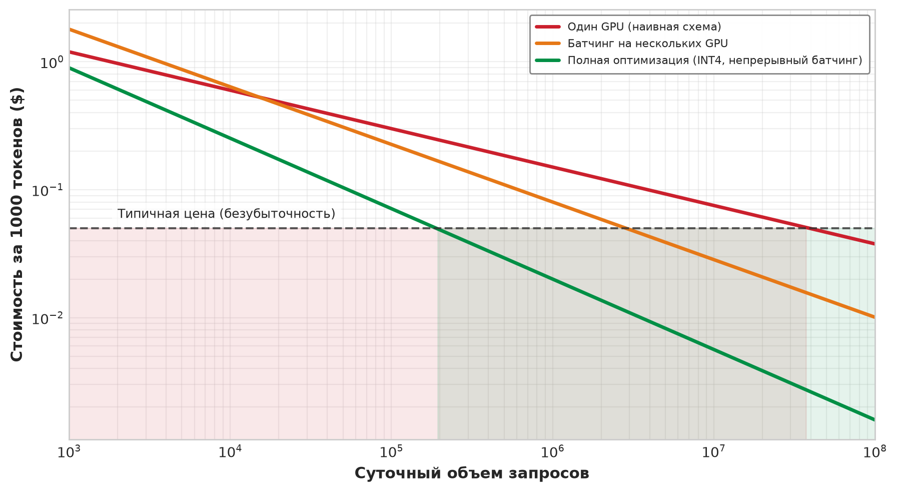

***Кривая стоимости обслуживания:** стоимость за 1000 токенов снижается с ростом масштаба и оптимизации. Обслуживание на одном GPU выходит на безубыточность только при большом объеме. Батчинг на нескольких GPU выходит на безубыточность при умеренном объеме. Полностью оптимизированное обслуживание (INT4, непрерывный батчинг, спекулятивное декодирование) становится прибыльным при гораздо меньших объемах, что принципиально меняет экономику инференса.*

Соотношения стоимости в [таблице](#tbl-cost-ratios) описывают статичную картину, но динамика накопления затрат показывает еще более яркую закономерность. [Рисунок](#fig-serving-cost-crossover) показывает совокупную полную стоимость развертывания за окно в 36 месяцев для трех репрезентативных сценариев: небольшой модели с низким трафиком, LLM на 70 млрд параметров, которая обслуживает миллион ежедневно активных пользователей, и рекомендательной системы, обслуживающей 100 миллионов пользователей. Вертикальные маркеры пересечения показывают, когда накопленные расходы на обслуживание сравниваются с первоначальной стоимостью обучения. Поскольку на графиках учтены и обучение, и обслуживание, полная стоимость на этом маркере примерно вдвое превышает базовую стоимость обучения. Для рекомендательных систем обслуживание доминирует в течение нескольких дней; для высоконагруженных LLM — примерно в течение шести недель. Только небольшие модели с дорогим обучением и низким трафиком позволяют стоимости обучения доминировать длительное время. Этот временной взгляд подкрепляет вывод, что оптимизация инференса заслуживает раннего инженерного внимания в промышленном масштабе. Для генеративных LLM-сервисов специализированные для обслуживания решения могут напрямую давать выигрыш по пропускной способности, стоимости и энергопотреблению (Patel et al., 2024).

<a id="fig-serving-cost-crossover"></a>

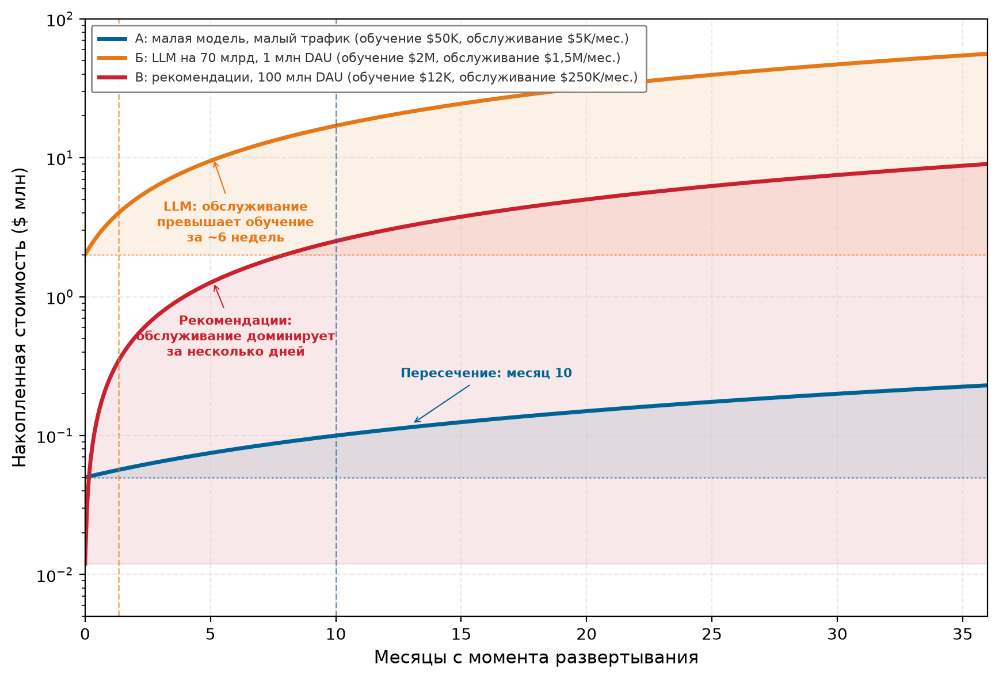

***Кривая пересечения стоимости обслуживания:** совокупная полная стоимость развертывания (первоначальное обучение плюс текущее обслуживание) для трех сценариев. Вертикальные маркеры показывают, когда доля обслуживания становится равной разовой стоимости обучения. Для высоконагруженных LLM стоимость обслуживания сравнивается со стоимостью обучения в течение недель. Для рекомендательных систем со 100 млн ежедневно активных пользователей обслуживание доминирует в течение нескольких дней. Только модели с низким трафиком и дорогим обучением позволяют стоимости обучения доминировать длительное время.*

### Инференс за пределами LLM

<a id="sec-inference-scale-inference-landscape-beyond-llms"></a>

Распространенное заблуждение — отождествлять инференс в масштабе с обслуживанием LLM. Большие языковые модели создают особые проблемы и привлекают наибольшее внимание, но это лишь часть производственного инференса. В крупных потребительских платформах рекомендательные и ранжирующие нагрузки могут доминировать в циклах и мощностях AI-инференса (Gupta et al., 2020; Hazelwood et al., 2018). Компьютерное зрение и обработка изображений, задачи NLP и LLM, выявление мошенничества, реклама и другие задачи классификации составляют остальное. [Таблица «Производственный ландшафт инференса»](#tbl-inference-landscape) сравнивает эти типы моделей по нагрузке на обслуживание и сложности оптимизации. Рекомендации упираются в поиск по эмбеддингам, зрение — в эффективность батчей, LLM — в пропускную способность памяти, а речь — в последовательное декодирование. Ни одна оптимизация не подходит всем четырем.

Рекомендательные системы часто доминируют в высокообъемном потребительском инференсе, потому что обслуживают предсказания для множества пользовательских взаимодействий. Каждая загрузка страницы, прокрутка или клик может запустить инференс ранжирования или поиска. Пользователь, просматривающий сайт электронной коммерции, может создать много запросов рекомендаций за одну сессию. Напротив, запросы к LLM обычно требуют явного действия пользователя и происходят реже.

Такое распределение напрямую влияет на выбор методов. Рекомендательные системы породили важные производственные инновации инференса: динамический батчинг, шардирование эмбеддингов, архитектуры хранилищ признаков и обслуживание с низкой задержкой. Все это разрабатывалось в первую очередь для рекомендательных нагрузок (Naumov et al., 2019; Gupta et al., 2020). Методы, специфичные для LLM, такие как непрерывный батчинг и управление KV-кэшем, относятся к другой части производственного инференса. Системы генерации изображений по тексту, например DALL-E, дают один пример мультимодальной модели (Ramesh et al., 2021), но объемы мультимодального обслуживания и целевые задержки остаются специфичными для продукта.

<a id="tbl-inference-landscape"></a>

***Производственный ландшафт инференса:** разные типы моделей создают разное давление на обслуживание, разные требования к задержке и разные задачи оптимизации. Таблица задает качественную карту нагрузок, а не универсальное распределение доли трафика. Выбор методов должен соответствовать конкретной нагрузке.*

| **Тип модели**               |        **Нагрузка на обслуживание**   |  **Целевая задержка** |    **Ключевая задача**   |
|:-----------------------------|:-------------------------------------:|:---------------------:|:------------------------:|
| **Рекомендации/ранжирование** | Высокий объем в потребительских платформах | $<10\text{ мс}$ P99 |     Поиск по эмбеддингам     |
| **Зрение (CNN)**             |         Зависит от нагрузки           |      20–100 мс        |     Эффективность батчей     |
| **LLM**                      |       Высокая стоимость запроса       |     100 мс–10 с       |     Пропускная способность памяти     |
| **Речь/аудио**               |           Управляется потоком         |      В реальном времени |    Последовательное декодирование |
| **Мультимодальные/генерация изображений по тексту** | Новые и специфичные для продукта | Зависит от случая | Кросс-модальная координация |

### Иерархия обслуживания

<a id="sec-inference-scale-serving-hierarchy"></a>

Методы оптимизации организуются в **иерархию обслуживания** по аналогии с иерархией памяти в архитектуре компьютера. Каждый уровень отвечает за свое узкое место, поэтому оптимизация, которая помогает одному уровню, может оставить другой без изменений. Уровень запроса отслеживает один запрос через предобработку, батчинг, кэширование и выполнение модели; целью здесь служит задержка, которую видит пользователь. Уровень реплики заглядывает внутрь одного экземпляра модели: загрузка GPU, управление памятью, эффективность ядер и оптимизация модели определяют, какую полезную пропускную способность может дать эта реплика до насыщения. Уровень сервиса работает уже с множеством реплик одной модели и использует балансировку нагрузки, маршрутизацию запросов и автомасштабирование, чтобы превратить отдельные реплики в совокупную мощность. Уровень платформы работает поверх сервисов и арендаторов: распределение ресурсов, мультиарендность, планирование и размещение определяют, остается ли общий парк обслуживания эффективным и не позволяет ли одна нагрузка ухудшить другую.

Иерархия важна, потому что каждый уровень меняет свою метрику и ломается на своей границе. Связанный стек развертывания показан на [рисунке](#fig-serving-hierarchy): запросы проходят через периферийную, маршрутизирующую и сервисную инфраструктуру инференса в продакшене.

<a id="fig-serving-hierarchy"></a>


***Стек развертывания обслуживания:** трехуровневый стек с накопленным бюджетом задержки сверху вниз. Уровень 1 (CDN и граничный кэш) отвечает за географическое распределение и кэшированные статические ответы (SLA менее 10 мс). Уровень 2 (шлюз и маршрутизатор) отвечает за маршрутизацию запросов, ограничение частоты и аутентификацию (SLA менее 50 мс). Уровень 3 (кластер обслуживания моделей) запускает GPU-воркеры с автомасштабированием и непрерывным батчингом (SLA менее 2 с).*

Каждый уровень имеет свои рычаги оптимизации, и [таблица](#tbl-serving-hierarchy) показывает, почему рычаг зависит от уровня: изменения на уровне запроса снижают задержку каждого запроса, изменения на уровне реплики повышают загрузку, изменения на уровне сервиса добавляют совокупную мощность, а изменения на уровне платформы повышают эффективность парка для всех арендаторов. Оптимизация не того уровня двигает не ту метрику.

<a id="tbl-serving-hierarchy"></a>

***Цели оптимизации иерархии обслуживания:** каждый уровень иерархии обслуживания нацелен на свои метрики производительности: от задержки на запрос на уровне запроса до совокупной эффективности ресурсов на уровне платформы.*

| **Уровень**  | **Цель оптимизации**    | **Основные методы**                                      |
|:-------------|:-----------------------:|:---------------------------------------------------------|
| **Запрос**   | Задержка на запрос      | Динамический батчинг, кэширование, предвыборка           |
| **Реплика**  | Пропускная способность, загрузка | Оптимизация памяти, слияние ядер                |
| **Сервис**   | Совокупная мощность     | Балансировка нагрузки, маршрутизация, автомасштабирование |
| **Платформа** | Эффективность ресурсов | Мультиарендность, планирование, размещение               |

> **Контрольные вопросы: иерархия обслуживания**
>
> Проверьте понимание того, на каком уровне иерархии обслуживания находятся конкретные оптимизации:
>
> - [ ] **Уровень памяти**: укажите уровень иерархии, который отвечает за снижение потерь памяти GPU, чтобы увеличить число одновременных запросов.
> - [ ] **Уровень кэширования**: укажите уровень иерархии, который отвечает за снижение потерь KV-кэша при разной длине запросов.
> - [ ] **Балансировка нагрузки**: укажите основную цель оптимизации алгоритмов балансировки на уровне сервиса, таких как power-of-two choices.
> - [ ] **Уровень изоляции**: оцените утверждение, что мультиарендность и изоляция ресурсов — в первую очередь задача уровня запроса.

Иерархия направляет остальную часть проектирования, допуская пересечение некоторых методов между уровнями. Батчинг, раскладка KV-кэша и оптимизации на этапе декодирования начинаются на уровне запроса. Квантование, состояние адаптеров и шардирование модели меняют бюджет памяти и вычислений реплики. Разделенное обслуживание, балансировка нагрузки и автомасштабирование координируют реплики в сервис, а мультиарендность и изоляция ресурсов управляют платформой. Квантование присутствует на всех уровнях, потому что это рычаг на уровне представления: он меняет бюджеты памяти, пропускной способности и стоимости везде, где находится состояние модели или состояние KV-кэша.

## Измерения архитектуры обслуживания

<a id="sec-inference-scale-serving-framework-selection"></a>

Система рекомендаций, которая обрабатывает 100 000 поисков эмбеддингов в секунду в шардированном хранилище признаков, требует иной архитектуры обслуживания, чем языковая модель на 70 млрд параметров, которая генерирует токены по одному. Одного выбора фреймворка недостаточно, чтобы объяснить эту разницу. Нагрузки накладывают разные ограничения на батчинг, управление памятью, планирование и топологию развертывания. Этот раздел выделяет эти архитектурные измерения, используя конкретные фреймворки как примеры, а не как предмет изучения.

### Стратегия батчинга: компромисс между пропускной способностью и задержкой

<a id="sec-inference-scale-framework-categories"></a>

Самое значимое архитектурное решение в системе обслуживания — то, как она формирует батчи из входящих запросов. Этот выбор определяет фундаментальную рабочую точку на компромиссе между пропускной способностью и задержкой.

**Статический батчинг** собирает фиксированное число запросов, прежде чем передать их ускорителю. Для моделей компьютерного зрения, которые обрабатывают входы фиксированного размера, такой подход максимизирует загрузку GPU, потому что все запросы в батче выполняют одинаковые вычислительные графы с предсказуемыми шаблонами доступа к памяти. Сервер инференса ResNet-50 может собирать батчи из 32 или 64 изображений с почти линейным масштабированием пропускной способности, потому что батч амортизирует фиксированные накладные расходы на запуск и переиспользует резидентные веса для многих входов.

Авторегрессивные языковые модели нарушают это предположение. Каждый запрос генерирует разное число выходных токенов, поэтому статический батчинг заставляет все запросы ждать самой долгой генерации в батче и может оставлять мощность ускорителя простаивающей после того, как более короткие запросы завершились. Непрерывный батчинг решает эту задачу, позволяя запросам входить в батч и выходить из него на каждом шаге декодирования. Это подход к планированию на уровне итераций, впервые представленный в Orca (Yu et al., 2022). Когда одна генерация завершается, ее слот немедленно занимает новый запрос. Системы вроде vLLM[^fn-vllm-etymology-paging] сочетают этот стиль планирования с управлением KV-кэшем на основе PagedAttention и за счет снижения потерь памяти достигают прироста пропускной способности в 2–4× по сравнению с предыдущими системами обслуживания LLM (Kwon et al., 2023).

[^fn-vllm-etymology-paging]: **vLLM и виртуальная память**: название отсылает к аналогии с операционной системой: логические страницы KV-кэша отделены от их физического расположения в памяти GPU.

Рекомендательные системы вводят третий шаблон: **батчинг с параллелизмом по признакам**. Поскольку узким местом становится распределенный поиск эмбеддингов, а не плотное матричное умножение, эти системы формируют батчи по типам признаков и шардируют батч между серверами эмбеддингов. Последующие вычисления плотного MLP могут затем работать с предварительно выбранными и заранее собранными векторами признаков. Стратегии батчинга в масштабе разбираются далее в главе; там эти подходы развиваются с количественной точностью.

### Управление памятью: от предварительного выделения к страницам

<a id="sec-inference-scale-framework-selection-criteria"></a>

Системы обслуживания принципиально различаются тем, как управляют памятью ускорителя, и это различие определяет максимальную емкость одновременных запросов.

> **Определение: KV-кэш**
>
> ***KV-кэш*** — это буфер памяти инференса LLM для каждого запроса. Он хранит тензоры ключей и значений внимания для всех уже сгенерированных токенов, чтобы следующий токен можно было получить без повторного вычисления полного внимания по префиксу.
>
> 1. **Значение**: он снижает вычисления внимания на один токен с $O(n^2)$ до $O(n)$ по длине последовательности, но его объем растет линейно и с длиной контекста, и с размером батча. Часто он занимает больше HBM, чем сами веса модели, и становится ограничивающим фактором емкости обслуживания. В приложении об основах KV-кэша выводятся основные формулы для его объема.
> 2. **Отличие**: в отличие от весов модели, которые разделяются всеми запросами и выделяются статически, KV-кэш принадлежит запросу и выделяется динамически по размеру. Каждый одновременный пользователь несет отдельные расходы памяти, пропорциональные длине последовательности, и планировщик должен закладывать их в бюджет.
> 3. **Типичная ошибка**: распространено заблуждение, что уменьшение размера модели пропорционально уменьшает память обслуживания. На практике при длинных контекстах KV-кэш доминирует в HBM, поэтому квантованная модель на 70 млрд параметров все еще может упираться в емкость при размерах батча, которые одни веса легко бы вместили.

**Предварительное выделение памяти** резервирует фиксированный бюджет памяти на запрос в момент допуска, исходя из максимально возможной длины выхода. Для модели, которая поддерживает выходы по 4 096 токенов, каждый запрос резервирует память под 4 096 токенов независимо от того, генерирует он 50 или 4 000. Такой подход прост и предсказуем, но тратит память пропорционально разрыву между максимальной и фактической длиной выхода. На практике 60–80 процентов зарезервированной памяти KV-кэша остаются неиспользованными.

**Страничное управление памятью**, по образцу виртуальной памяти операционной системы, выделяет память блоками фиксированного размера (страницами) и отображает логические позиции последовательности на физические места памяти через таблицу блоков. По мере генерации токенов новые физические блоки выделяются по требованию. Когда генерация завершается, блоки немедленно возвращаются в пул свободной памяти. Этот подход, воплощенный в PagedAttention (о нем далее в главе), достигает почти 100-процентной утилизации памяти, устраняя и внутреннюю фрагментацию (частично заполненные предварительные выделения), и внешнюю фрагментацию (непригодные разрывы между выделениями).

Стратегия управления памятью напрямую определяет емкость батча: страничные системы могут обслуживать в 2–4 раза больше одновременных запросов, чем системы с предварительным выделением, на том же оборудовании, потому что возвращают память, которую предварительное выделение тратит впустую. Для сервиса с фиксированным бюджетом GPU это означает в 2–4 раза меньшую стоимость запроса.

### Политика планирования: FCFS, вытесняющая и с учетом приоритетов

<a id="sec-inference-scale-vllm-architecture"></a>

Политика планирования определяет, какие запросы получают время GPU и в каком порядке. Это решение становится критичным, когда смесь запросов неоднородна: одни требуют 50 токенов выхода, другие — 4 000. **Планирование FCFS** (First-Come-First-Served) обрабатывает запросы в порядке поступления. FCFS справедливо и просто, но страдает от блокировки головы очереди: один длинный запрос на генерацию задерживает все последующие. Для нагрузок с высоким разбросом длины выхода FCFS дает плохую задержку хвоста.

**Вытесняющее планирование** позволяет системе прекратить выделять итерации декодирования одному запросу, чтобы запустить другой. Вытеснение практично на границах токенов, но оно не бесплатно: планировщик должен либо сохранить KV-страницы запроса в памяти с высокой пропускной способностью (HBM), либо выгрузить их в память хоста, либо отбросить и повторить предзаполнение, когда запрос возобновится. Полезная политика выбора жертвы сравнивает эти три стоимости с оставшимся сроком ожидающего запроса, а не вытесняет по фиксированной длине генерации. Сохранение состояния расходует дефицитную емкость, выгрузка тратит пропускную способность межсоединения, а пересчет — вычисления предзаполнения. При высокой нагрузке отказ от низкоприоритетной работы может обойтись дешевле, чем многократное перемещение или восстановление ее состояния.

**Планирование с учетом приоритетов** назначает запросам разные классы обслуживания и гарантирует, что запросы высокого приоритета получают слоты GPU раньше запросов низкого. Производственный API может относить запросы клиентов, которые приносят выручку, к критическим, внутреннюю пакетную обработку — к стандартной, а трафик бесплатного тарифа — к режиму наилучших усилий. Политика планирования затем гарантирует, что критические запросы никогда не ждут за трафиком наилучших усилий, даже во время всплесков нагрузки.

### Топология развертывания: от одного GPU до разделенной

<a id="sec-inference-scale-tensorrtllm-architecture"></a>

Топология развертывания определяет, как вычисления модели отображаются на физическое оборудование, и это отображение задается соотношением размера модели и емкости памяти одного устройства. Развертывание на одном GPU — самая простая топология: вся модель помещается в память одного устройства, и весь вычислительный процесс инференса выполняется локально. Для моделей до 15–20 млрд параметров (30–40 ГБ в FP16) эта топология дает наименьшую задержку, потому что устраняет всю коммуникацию между устройствами.

Тензорный параллелизм на нескольких GPU разбивает матрицы весов каждого слоя между несколькими GPU, связанными высокоскоростным межсоединением: NVLink со скоростью 900 ГБ/с в двунаправленном режиме [450 ГБ/с в каждом направлении] на H100. Каждый GPU вычисляет частичный результат для каждого слоя, а операция all-reduce синхронизирует частичные результаты перед следующим слоем. Эта топология необходима, когда веса модели превышают память одного устройства. Она снижает задержку пропорционально степени параллелизма, но платит накладными расходами на коммуникацию на каждом слое. Раздел о шардировании модели, который следует далее в главе, количественно разбирает эти накладные расходы.

Разделенное обслуживание (disaggregated serving) отделяет фазу предзаполнения (обработка входного промпта, ограниченная вычислениями) от фазы декодирования (генерация токенов по одному, ограниченная пропускной способностью памяти) и переносит их на разные пулы оборудования, оптимизированные под каждый профиль нагрузки ([рисунок](#fig-disaggregated-serving)). Узлы предзаполнения используют ускорители с высокой производительностью в FLOP/с; узлы декодирования используют конфигурации с высокой пропускной способностью памяти. Разделение устраняет взаимное влияние предзаполнения и декодирования и позволяет независимо планировать параллелизм и емкость, но оно также помещает передачу состояния на критический путь (Zhong et al., 2024). Контрастным подходом с совместным размещением служит фрагментированное предзаполнение (chunked prefill): оно ограничивает взаимное влияние, не платя за сетевую передачу (Agrawal et al., 2024).

<a id="fig-disaggregated-serving"></a>

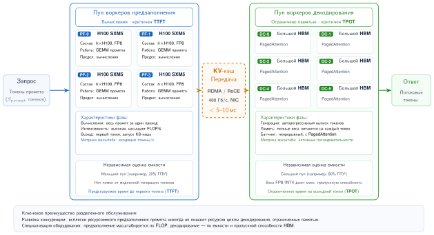

***Архитектура разделенного обслуживания:** разделение предзаполнения, ограниченного вычислениями, и декодирования, ограниченного пропускной способностью памяти, с миграцией KV-кэша по RDMA с низкой задержкой.*

Решение о разделении поэтому зависит от количественного контракта, а не только от меток фаз. Если предзаполнение выдает $S_{\mathrm{KV}}$ байт состояния внимания, а полезная пропускная способность между пулами составляет $B_{\mathrm{net}}$, то передача потребляет как минимум

<a id="eq-prefill-decode-handoff"></a>

$$
T_{\mathrm{handoff}} = L_{\mathrm{net}} + \frac{S_{\mathrm{KV}}}{B_{\mathrm{net}}},
$$

где $L_{\mathrm{net}}$ включает настройку передачи и очередь. [Уравнение](#eq-prefill-decode-handoff) делает размещение частью контракта сервиса: пул предзаполнения должен поддерживать принятую частоту промпт-токенов, пул декодирования — принятую частоту выходных токенов, а оба пула нуждаются в запасе под распределение длин запросов. Полезная метрика емкости — **SLO-goodput**, то есть частота прихода запросов, при которой и TTFT, и TPOT остаются в пределах целевых значений. Разделение окупает свою плату за передачу только тогда, когда устранение взаимного влияния фаз и балансировка двух пулов повышают SLO-goodput. В противном случае более простым решением остается фрагментированное предзаполнение с совместным размещением.

### Состояние с сохранением и без: разрыв масштабирования

<a id="sec-inference-scale-triton-inference-server"></a>

Наличие состояния у системы обслуживания определяет, является ли горизонтальное масштабирование тривиальным или требует тщательной инженерии. Модели компьютерного зрения и поиск эмбеддингов обычно не хранят состояния: любая реплика может обслужить любой запрос, потому что между запросами не сохраняется состояние сессии. Горизонтальное масштабирование прямолинейно: достаточно добавить реплики за балансировщиком нагрузки. Восстановление после отказа мгновенно, потому что балансировщик направляет трафик на исправную реплику.

Авторегрессивный запрос обладает состоянием, пока генерирует, потому что его KV-кэш принадлежит выполняющейся последовательности. Состояние между запросами необязательно. API может передавать полную историю диалога с каждым ходом и восстанавливать KV-состояние на этапе предзаполнения, тогда подходящей для следующего запроса становится любая реплика. Платформа обслуживания может вместо этого сохранять KV-состояние завершенного хода как кэш сессии, сокращая повторное предзаполнение ценой привязки к реплике, управления временем жизни кэша и сложности восстановления. Липкая маршрутизация (sticky routing) — оптимизация для такого сохраненного кэша, а не требование корректности авторегрессивных моделей.

Разрыв масштабирования, следовательно, — это решение об интерфейсе и политике кэша. Каждой активной генерации нужно состояние в пределах запроса, но сервис решает, переживает ли состояние границу запроса. Сервис без состояния между ходами платит за повторное предзаполнение, зато дешево переключается на другую реплику при отказе. Сервис с кэшем сессий экономит работу предзаполнения, но при масштабировании и отказах должен сливать, переносить или восстанавливать кэшированное состояние. Архитектура должна выбирать привязку к реплике, только когда измеренная выгода от повторного использования кэша превышает получающийся дисбаланс и затраты на восстановление.

### Сравнение архитектур

<a id="sec-inference-scale-framework-selection-decision-tree"></a>

[Таблица](#tbl-serving-architecture-dimensions) сводит, как измерения батчинга, памяти, планирования, топологии и состояния взаимодействуют в основных типах нагрузок. Она показывает, что ни одна архитектура обслуживания не оптимальна для всех нагрузок: профиль ограничений каждого типа нагрузки определяет подходящую рабочую точку по каждому измерению.

<a id="tbl-serving-architecture-dimensions"></a>

***Измерения архитектуры обслуживания по типам нагрузок:** профиль ограничений каждой нагрузки определяет оптимальную рабочую точку по пяти архитектурным измерениям. Выбор системы обслуживания сводится к подбору сочетания, которое соответствует ограничениям нагрузки.*

| **Измерение**  |       **Зрение и эмбеддинги**    |        **LLM (авторегрессивные)**     | **Рекомендации**                      |
|:---------------|:-------------------------------:|:-------------------------------------:|:--------------------------------------|
| **Батчинг**    | Статический/динамический (однородные входы) | Непрерывный (переменные выходы) | С параллелизмом по признакам (шардированные эмбеддинги) |
| **Память**     |    Предварительное выделение (предсказуемо) | Страничная (переменный KV-кэш) | Распределенная (таблицы эмбеддингов)  |
| **Планирование** |       FCFS (однородная стоимость) | Вытесняющее (высокий разброс)         | С учетом приоритетов (уровни SLO)     |
| **Топология**  |       Реплики на одном GPU      |        Тензорный/конвейерный параллелизм | Гибридное шардирование CPU–GPU       |
| **Состояние**  |            Без состояния        | Состояние запроса; необязательный кэш сессии | Без состояния или признаки сессии |

> **Контрольные вопросы: измерения обслуживания**
>
> Проверьте понимание того, как ограничения нагрузки определяют архитектурный выбор:
>
> - [ ] **LLM против зрения**: объясните, почему вытесняющее планирование важнее для LLM, чем для моделей зрения.
> - [ ] **Граница состояния**: отличите KV-состояние запроса от необязательного кэша сессии между ходами и объясните, когда липкая маршрутизация окупает свою цену в виде дисбаланса.
> - [ ] **Стандарт для рекомендаций**: объясните, почему батчинг с параллелизмом по признакам — стандарт для рекомендательных систем, но не для LLM.
> - [ ] **Давление на память**: определите, какое измерение (батчинг, память, планирование, топология или состояние) затрагивается в первую очередь, когда квантование уменьшает размер модели или KV-кэша.

Архитектурные измерения определяют, какую систему обслуживания выбрать для данной нагрузки. Вместо сравнения фреймворков по функциям инженер определяет положение нагрузки по каждому измерению (шаблон батчинга, профиль памяти, требования к планированию, топологию развертывания и наличие состояния) и выбирает систему, которая ему соответствует. Методы оптимизации этой главы работают внутри данной архитектурной рамки, и каждый из них решает конкретное измерение.

## Стратегии батчинга в масштабе

Поток из сотен разнородных чат-запросов ежесекундно поступает на сервер инференса. Если обрабатывать их по одному, GPU большую часть времени простаивает и ждет работы между короткими шагами декодирования. Ожидание, пока соберется большой статический батч, заставляет первый запрос в очереди терпеть недопустимую задержку. Батчинг в масштабе требует динамических алгоритмов, которые объединяют запросы на лету, не нарушая строгих дедлайнов для хвоста задержки.

Совместная обработка нескольких запросов амортизирует постоянные издержки (загрузку модели, накладные расходы на запуск ядер и задержку передачи данных в памяти) на больший объем полезной работы: ценой более высокой задержки на запрос мы получаем значительно более высокую пропускную способность. Обслуживание на одной машине реализует эту идею через **динамический батчинг**, который собирает запросы в пределах временного окна, прежде чем обработать их вместе.

В масштабе батчинг усложняется, потому что разные архитектуры моделей предъявляют разные требования к батчингу. Стратегия, оптимальная для моделей зрения, может оказаться катастрофической для LLM, а методы, разработанные для рекомендательных систем, могут не работать ни для тех, ни для других.

В крупных потребительских платформах рекомендательные системы могут составлять большую часть циклов инференса или нагрузки на мощности, а остальное приходится на компьютерное зрение, языковые модели, ранжирование, выявление мошенничества, рекламу и другие задачи классификации (Gupta et al., 2020; Hazelwood et al., 2018). Несмотря на такое распределение, стратегии батчинга излагаются в порядке возрастания концептуальной сложности: зрение (простой батчинг), LLM (непрерывный батчинг с KV-кэшем) и рекомендации (батчинг с параллелизмом по признакам и распределенными эмбеддингами). Такой порядок последовательно наращивает понимание, хотя производственные системы нередко сталкиваются с рекомендательными нагрузками первыми. Таксономия, которая следует дальше, сопоставляет стратегии батчинга с характеристиками моделей и дает количественный анализ того, когда применим каждый подход и какой результат ожидать.

### Почему батчинг различается по типам моделей

Эффективность батчинга зависит от того, как вычисления масштабируются с размером батча по сравнению с тем, как масштабируются память и коммуникация. Разные архитектуры моделей демонстрируют разные зависимости масштабирования, поэтому им требуются разные стратегии батчинга, что суммирует [рисунок](#fig-batching-strategies).

<a id="fig-batching-strategies"></a>

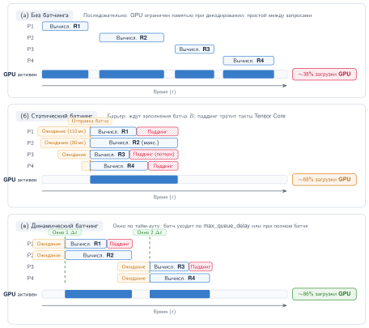

***Сравнение стратегий батчинга:** три временные диаграммы показывают, как политики батчинга обменивают время ожидания на загрузку GPU. (а) Без батчинга: запросы обрабатываются последовательно, а GPU простаивает между ними (загрузка около 40 %). (б) Статический батчинг: запросы ждут, пока соберется полный батч, прежде чем отправиться на обработку, а короткие запросы дополняются паддингом (загрузка около 70 %). (в) Динамический батчинг: собирает батч в пределах короткого временного окна с адаптивным размером, сокращая ожидание и повышая загрузку (около 85 %).*

Для **моделей зрения**, включая сверточные нейронные сети (CNN) и визуальные трансформеры (ViT), обрабатывающие изображения фиксированного размера, вычисления растут линейно с размером батча, а память — сублинейно за счет совместного использования весов. Большие батчи повышают загрузку GPU при минимальных накладных расходах, поэтому статический или динамический батчинг с большими размерами батча оптимален.

Для LLM на этапе декодирования вычисления на токен малы по сравнению с требованиями к пропускной способности памяти при загрузке весов модели. Узкое место — это *пропускная способность памяти*, а не *вычисления*. Большие батчи амортизируют загрузку весов на большее число токенов, резко повышая пропускную способность, но с убывающей отдачей по мере роста размера батча.

Для рекомендательных систем узкое место часто связано с поиском по эмбеддингам, а не с плотными вычислениями. Стратегии батчинга должны оптимизировать параллельные шаблоны доступа к эмбеддингам, а не пропускную способность умножения матриц. Поэтому декодирование не наследует заявленное число вычислений: [рисунок](#fig-gpu-memory-wall) разделяет два темпа роста, а пошаговое декодирование токен за токеном идет в темпе более медленного из них. Именно поэтому то же поколенческое обновление, которое удваивает пропускную способность предзаполнения, может почти не изменить декодирование.

<a id="fig-gpu-memory-wall"></a>

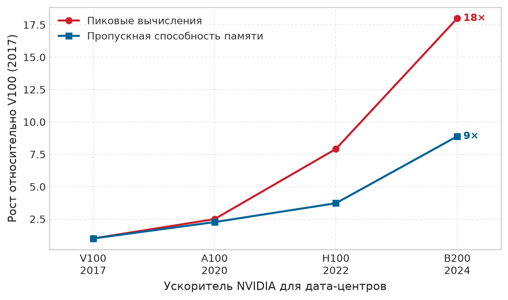

***Декодирование наследует дефицит пропускной способности:** пиковые вычисления и пропускная способность памяти для четырех поколений ускорителей, нормированные к V100. Вычисления растут в 18$\times$, тогда как пропускная способность — в 8,9$\times$. Поскольку декодирование считывает полный набор весов один раз на токен, оно идет со скоростью меньшего из двух темпов. Характеристики взяты из реестра аппаратного обеспечения MLSysIM.*

### Физика батчинга: кривая эффективности

Батчинг — не просто эвристика; это компромисс, который определяется физикой загрузки аппаратного обеспечения. Моделирование связи между размером батча $(B)$, задержкой запроса $(T_{\text{lat}})$ и пропускной способностью $(X)$ позволяет найти оптимальную рабочую точку системы инференса.

Здесь $T_{\text{lat}}$ следует стандартной нотации теории очередей для времени запроса в системе. В остальной части книги $L_{\text{lat}}$ обозначает постоянные издержки задержки или ее составляющие; в этом разделе $T_{\text{lat}}$ сохраняется для сквозного времени запроса, которое используется в законе Литтла и уравнениях батчинга.

Уравнение задержки раскладывает задержку на запрос на постоянные издержки (запуск ядра, загрузка памяти) и переменные затраты (вычисления на образец):

$$T_{\text{lat}}(B) = T_{\text{fixed}} + B \times T_{\text{variable}}$$

*   $T_{\text{fixed}}$: затраты, которые платятся один раз на батч (например, загрузка весов из HBM, задержка запуска ядра).
*   $T_{\text{variable}}$: предельная стоимость добавления одного запроса (например, время вычислений для этого образца).

Уравнение пропускной способности описывает емкость системы:

$$X(B) = \frac{B}{T_{\text{lat}}(B)} = \frac{B}{T_{\text{fixed}} + B \times T_{\text{variable}}}$$

Получающаяся **кривая эффективности батчинга** показывает три различных режима. При малых размерах батча ($B$) пропускная способность определяется $T_{\text{fixed}}$, и система ограничена задержкой (или накладными расходами), поэтому увеличение $B$ дает большой, но убывающий прирост пропускной способности. При большом $B$ член $T_{\text{fixed}}$ становится незначительным, пропускная способность асимптотически приближается к аппаратному пределу $1/T_{\text{variable}}$, и система оказывается ограниченной вычислениями (или, для LLM, пропускной способностью памяти). Оптимальный размер батча находится в «колене» кривой — точке, где прирост пропускной способности уже убывает, а задержка продолжает расти линейно.

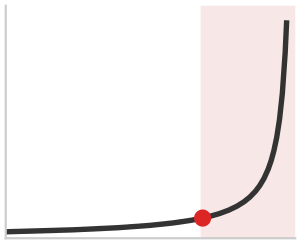

*Пропускная способность насыщается при том размере батча, при котором задержка достигает SLO.*

Инженерная цель — найти максимальное $B$, при котором $T_{\text{lat}}(B) \le \text{SLO}$. Такая постановка объясняет, почему модели зрения (высокий $T_{\text{variable}}$) насыщаются при меньших батчах, чем LLM (высокий $T_{\text{fixed}}$ из-за загрузки весов), и поэтому требуют других стратегий настройки.

> **Расчет: кривая эффективности батчинга**
>
> **Задача**: инженер оптимизирует два сервиса: модель зрения (ResNet) и LLM (70B). При каком размере батча каждый из них достигает «колена» своей кривой эффективности?
>
> **Вычисления**:
> Колено наступает там, где вычислительные затраты переменной части $(B \times T_{\text{var}})$ начинают превышать постоянные накладные расходы $(T_{\text{fixed}})$.
>
> 1. **Модель зрения** $(T_{\text{fixed}} = 2\text{ мс}, T_{\text{var}} = 1\text{ мс})$:
>    - Колено: $B \approx 2\text{ мс}/1\text{ мс} =$ 2.
>    - **Результат**: эта упрощенная модель задержки достигает первого колена амортизации накладных расходов при малом батче. Производственные CNN часто продолжают наращивать пропускную способность до батчей 32–64 и более, пока не наступит насыщение аппаратного обеспечения.
> 2. **Декодирование LLM** $(T_{\text{fixed}} = 40\text{ мс}, T_{\text{var}} = 0{,}5\text{ мс})$:
>    - Колено: $B \approx 40\text{ мс}/0{,}5\text{ мс} =$ 80.
>    - **Результат**: LLM требуют огромных батчей, чтобы амортизировать дорогие накладные расходы на загрузку весов.
>
> **Системный вывод**: поскольку «постоянные накладные расходы» LLM (загрузка 140 ГБ весов из HBM) так велики, система достигает колена эффективности лишь при размере батча 80. Поэтому обслуживание LLM требует непрерывного батчинга и страничной памяти: система должна объединить сотни одновременных пользователей в один батч только для того, чтобы преодолеть узкое место пропускной способности памяти.

Переход от батчевых уравнений к емкости всего парка требует классического результата теории очередей: **закона Литтла**[^fn-littles-law-queuing], который связывает параллелизм, пропускную способность и задержку в любой устойчивой системе. Для разных архитектур моделей [таблица](#tbl-batching-by-model) показывает, что выбор батчинга определяется связывающим ограничением: вычисления для моделей зрения, емкость или пропускная способность памяти для предзаполнения и декодирования LLM, поиск по эмбеддингам для рекомендательных систем и задержка в реальном времени для речи.

[^fn-littles-law-queuing]: **Закон Литтла**: из теории очередей: $Q_{\text{req}} = \lambda_{\text{arr}} T_{\text{lat}}$, то есть параллелизм равен интенсивности поступления, умноженной на задержку. Для парка обслуживания это определяет емкостную оболочку: если GPU способен обрабатывать 32 одновременных запроса и каждый занимает 100 мс, максимальная интенсивность поступления составляет 320 запросов в секунду. За этим пределом очереди быстро растут по мере приближения загрузки к 1, а хвост задержки $(L_{\text{lat}})$ резко возрастает.

<a id="tbl-batching-by-model"></a>

***Стратегия батчинга по типам моделей:** каждый класс моделей требует своей политики батчинга (от статического и динамического в зрении до непрерывного в декодировании LLM и параллелизма по признакам в рекомендациях), согласованной с доминирующим аппаратным узким местом.*

| **Тип модели**    | **Стратегия батчинга** | **Типичный размер батча** | **Ключевое ограничение** | **Масштабирование пропускной способности** |
|:------------------|:----------------------:|:-------------------------:|:------------------------:|:------------------------------------------:|
| **Зрение (CNN)**  |   Статический/динамический   |          32–256          |    Вычисления GPU        |      Почти линейное до 64+                 |
| **LLM (предзаполнение)** |        Динамический    |            1–64           |    Емкость памяти        |             Сублинейное                    |
| **LLM (декодирование)**  |       Непрерывный      |        сотни–тысячи       |    Пропускная способность памяти |     Логлинейное                     |
| **Рекомендации**  |  С параллелизмом по признакам |    тысячи–десятки тысяч   |    Поиск по эмбеддингам  |      Зависит от шардирования               |
| **Речь**          |        Потоковый       |             1             |     Реальное время       |        Н/Д (ограничено задержкой)          |

> **Теорема: закон Литтла для инференса**
>
> **Идея**: в любой устойчивой системе очередей среднее число запросов в системе $(Q_{\text{req}})$ равно интенсивности поступления $(\lambda_{\text{arr}})$, умноженной на среднее время, которое запрос проводит в системе $(T_{\text{lat}})$.
>
> $$ Q_{\text{req}} = \lambda_{\text{arr}} \cdot T_{\text{lat}} $$
>
> **Применение: планирование параллелизма**
>
> - **Целевая пропускная способность** $(\lambda_{\text{arr}})$: 1 000 запросов/с
> - **SLO задержки** $(T_{\text{lat}})$: 100 мс (0{,}1 с)
>
> **Требуемый параллелизм** $(Q_{\text{req}})$: $Q_{\text{req}} = 1000 \times 0{,}1 =$ 100 одновременных запросов
>
> **Планирование мощности**:
> Если одна реплика GPU обрабатывает батч размера 8 с задержкой 80 мс:
>
> 1. Пропускная способность реплики $=$ $8/0{,}08 =$ 100 запросов/с
> 2. Нижняя граница по пропускной способности $=$ $\lceil 1000/100\rceil =$ 10 реплик
> 3. Число реплик по SLO $=$ $\lceil 100/8\rceil =$ 13 реплик
>
> **Проверка**:
> Общий параллелизм системы $=$ $13\text{ реплики} \times 8\text{ батч} =$ 104, что оставляет 4 слота запросов сверх 100, требуемых законом Литтла. Нижняя граница по пропускной способности работала бы на границе устойчивости; парк, рассчитанный по SLO, работает при загрузке обслуживания около 76,9 %, оставляя конечный запас на дисперсию очередей и хвост задержки.

Эту границу устойчивости можно измерить достоверно только тогда, когда генератор нагрузки сохраняет заявленные свойства нагрузки. Контракт в разделе «Измерения в масштабе» (глава 9) различает фиксированный внешний процесс поступления и тестирование при фиксированном параллелизме, поскольку генерация, управляемая ответами, может снижать интенсивность поступления во время остановки и создавать иллюзию большего запаса мощности, чем есть на самом деле. Различие между пропускной способностью и емкостью по задержке — именно то, что формализует теория очередей. Приложение «Теория очередей для батчевого инференса» выводит распределение времени ожидания M/D/1, которое определяет, какой запас требует SLO обслуживания.

### Статический и динамический батчинг для моделей зрения

Модели зрения — самый простой случай батчинга, потому что входы имеют однородный размер (после предобработки), а вычисления следуют предсказуемому шаблону. Принципы одномашинного батчинга применяются напрямую, а в масштабе возникают соображения о формировании батчей на нескольких репликах.

Статический батчинг собирает ровно $B$ запросов перед обработкой. Это максимизирует загрузку GPU, когда поступление запросов предсказуемо, но вызывает неограниченную задержку в периоды низкого трафика.

Динамический батчинг собирает запросы в течение максимального временного окна $T_{\text{window}}$ или до достижения максимального размера батча $B_{\text{max}}$ — что наступит раньше. Ожидаемая задержка при пуассоновском поступлении с интенсивностью $\lambda_{\text{arr}}$ задается следующей формулой:

$$E[T_{\text{total}}] = E[T_{\text{queue}}] + T_{\text{batch}} + T_{\text{inference}}(B)$$

где $E[T_{\text{queue}}]$ — ожидаемая задержка в очереди, $T_{\text{batch}}$ — задержка формирования батча (до $T_{\text{window}}$), а $T_{\text{inference}}(B)$ — время инференса для размера батча $B$. Интенсивность поступления входит через члены очереди и формирования: при пуассоновском поступлении средний интервал между запросами равен $1/\lambda_{\text{arr}}$, поэтому более высокая $\lambda_{\text{arr}}$ быстрее заполняет батч и уменьшает и $E[T_{\text{queue}}]$, и $T_{\text{batch}}$, тогда как меньшая интенсивность сдвигает их к потолку $T_{\text{window}}$. Следующий рабочий пример делает эти взаимодействия конкретными.

> **Пример: динамический батчинг для ResNet-50**
>
> **Сценарий**: сервис классификации изображений получает запросы со скоростью 5 000 QPS при SLO задержки P99 в 50 мс на 10 репликах.
>
> **Диагноз**: обработка запросов по одному (без батчинга) перегружает систему ($\rho_{\text{serv}} = \lambda_{\text{arr}} \times T_{\text{svc}} = 500 \times 0{,}005 = 2{,}5$ загрузки). Динамический батчинг с окнами (вариант B: 10 мс, вариант C: 20 мс) упаковывает запросы, снижая время вычислений на запрос, и повышает емкость на реплику до 33 % в пределах SLO задержки.
>
> **Системный урок**: динамический батчинг эффективен, когда бюджет задержки имеет неиспользованный запас. Политика обслуживания превращает запас задержки в пропускную способность, но требует тщательной настройки, чтобы не допустить нарушения SLO.

На масштабе нескольких реплик формирование батчей может происходить либо на отдельных репликах, либо в централизованном слое батчинга. Батчинг на уровне реплики означает, что каждая реплика независимо формирует батчи из назначенного ей трафика. Такой подход проще в реализации, но при неравномерной нагрузке может давать разные размеры батчей на разных репликах. Централизованный батчинг использует сервис батчинга, который собирает запросы и отправляет сформированные батчи репликам. Это дает более равномерные размеры батчей, но добавляет узкое место централизации и дополнительный сетевой переход. Производственные системы обычно используют батчинг на уровне реплик вместе с балансировкой нагрузки, которая обеспечивает примерно равномерное распределение трафика: они получают выгоды централизованного батчинга без его сложности.

### Непрерывный батчинг для инференса больших языковых моделей (LLM)

Принцип авторегрессивного узкого места определяет этот режим: в генеративных моделях этап декодирования строго ограничен пропускной способностью памяти, потому что для каждого сгенерированного токена необходимо загрузить весь набор весов модели. Пропускная способность растет с размером батча, поскольку загрузка весов разделяется между несколькими запросами, а не определяется вычислительной мощностью.

> **Определение: непрерывный батчинг**
>
> ***Непрерывный батчинг*** — это стратегия обслуживания, которая отделяет состав батча от границ итераций, позволяя новым запросам входить, а завершенным — выходить на каждом шаге декодирования.
>
> 1. **Значение**: он максимизирует пропускную способность системы $(X)$, устраняя потери на паддинг и блокировку в начале очереди, присущие статическому батчингу. Он поддерживает загрузку GPU даже тогда, когда длины последовательностей сильно различаются.
> 2. **Отличие**: в отличие от статического или динамического батчинга (которые группируют запросы на уровне запроса), непрерывный батчинг работает на уровне итераций и динамически перестраивает вычислительный тензор на каждом такте.
> 3. **Ловушка**: распространено заблуждение, что непрерывный батчинг — это «просто изменение планировщика». На деле он требует динамического менеджера памяти (такого как PagedAttention), потому что KV-кэши разных запросов растут и сжимаются с разной скоростью, что исключает статическое предварительное выделение памяти.

Отделение состава батча от границ итераций означает переиспользование слотов: когда один запрос достигает стоп-токена, планировщик на следующем шаге декодирования передает его слот KV-кэша ожидающему запросу, вместо того чтобы держать мощность простаивающей до завершения самой длинной последовательности.

Авторегрессивные языковые модели ставят задачу батчинга, с которой статические и динамические подходы справляются плохо. Система Orca[^fn-orca-iteration-scheduling] (Yu et al., 2022) показывает это ограничение. Традиционный батчинг заставляет все последовательности в батче завершиться, прежде чем в него смогут войти новые, и тратит вычисления впустую, когда последовательности заканчиваются в разное время.

[^fn-orca-iteration-scheduling]: **Orca и планирование на уровне итераций**: терминология Orca подчеркивает, что решения о допуске и вытеснении принимаются между шагами декодирования, а не только тогда, когда завершается весь батч на уровне запросов (Yu et al., 2022).

Рассмотрим батч из 8 последовательностей. Если одна последовательность завершается после 10 токенов, а остальные требуют 100, ресурсы GPU, занятые завершенной последовательностью, простаивают 90 итераций. При традиционном батчинге:

$$\text{потери вычислений} = \frac{(100 - 10) \times 1}{100 \times 8} = 11{,}25\%$$

Для реалистичных распределений длины выхода с высокой дисперсией потери вычислений могут превышать 50 %. Непрерывный батчинг (также называемый батчингом на уровне итераций) отделяет состав батча от границ итераций. Алгоритм «Планировщик декодирования с непрерывным батчингом» ниже описывает планировщик как цикл декодирования: завершенные запросы освобождают страницы KV-кэша, ожидающие запросы занимают освободившиеся слоты, а следующее батчевое ядро выполняется над перестроенным набором активных последовательностей. Этот прием централен для компромисса между пропускной способностью и задержкой, который определяет обслуживание LLM в большом масштабе. Нагрузки архетипа A (GPT-4/Llama-3, см. раздел «Три системных архетипа» в главе 1) были бы экономически нежизнеспособны без него: их декодирование, ограниченное пропускной способностью памяти, оставляет вычислительные ядра простаивающими в ожидании загрузки весов, и только чередование с несвязанными запросами позволяет насытить пропускную способность.

<a id="algo-continuous-batching-decode-scheduler"></a>

**Алгоритм: планировщик декодирования с непрерывным батчингом**

```text
Вход:   очередь ожидания Q; активное множество A; распределитель страниц KV-кэша; емкость по активным токенам C_tok; батчевое ядро декодирования
Выход:  сгенерированные токены завершенных запросов; постоянно обновляемый активный батч
пока сервис работает:
    допустить запросы из Q, пока остаются емкость и свободные страницы KV-кэша; выделить состояние и добавить в A
    выполнить одно батчевое ядро декодирования по всем последовательностям в A
    добавить каждый выбранный токен и расширить его страницы KV-кэша
    удалить из A завершенные или ограниченные по длине последовательности; вернуть их страницы распределителю
    если давление на HBM превышает порог политики:
        вытеснить последовательности низкого приоритета, выгрузив их KV-кэш в DRAM CPU
    заполнить освободившуюся емкость из Q или возобновить приостановленные последовательности, страницы которых теперь помещаются
```

Допуск, завершение и пополнение слотов на каждой итерации не дают емкости по активным токенам простаивать из-за самой длинной последовательности в батче, а путь вытеснения добавляет задержку передачи из HBM в DRAM CPU при нехватке памяти. Поэтому выигрыш в пропускной способности растет с дисперсией длины выхода и должен уравновешиваться перемещением KV-кэша. Статический батчинг оставляет GPU простаивающим, пока ожидается самый длинный запрос в батче, тогда как непрерывный батчинг поддерживает насыщенность работы ускорителя ([рисунок](#fig-continuous-batching-comparison)).

<a id="fig-continuous-batching-comparison"></a>

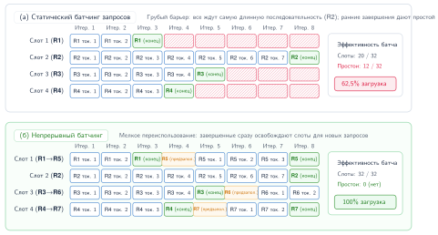

***Статический и непрерывный батчинг:** при статическом батчинге (A) все запросы в батче должны ждать самого длинного, прежде чем GPU сможет начать следующий батч; это ведет к значительному простою вычислений (затенено серым). Непрерывный батчинг (B) позволяет новым запросам входить в батч, как только завершается любой запрос; GPU остается загруженным, а пропускная способность заметно растет.*
### Анализ пропускной способности непрерывного батчинга

Контраст, показанный на [рисунке](#fig-continuous-batching-comparison), мотивирует анализ пропускной способности: статический батчинг оставляет слоты простаивающими, пока не завершится самая длинная последовательность в батче, тогда как непрерывный батчинг может заполнять эти слоты на границах итераций. Разброс длины выхода создает возможность, но сам по себе не определяет выигрыш в пропускной способности. Реализуемый выигрыш зависит также от емкости батча, полного распределения длин, поступления запросов, допуска в KV-кэш, планирования предзаполнения и накладных расходов планировщика. Поэтому не существует не зависящей от нагрузки формулы выигрыша, основанной только на коэффициенте вариации (CV), $\text{CV} = \sigma / \mu$; команды, обслуживающие модели, должны сравнивать политики при одной и той же трассе поступления, цели задержки и бюджете памяти.

Пример «Непрерывный батчинг в vLLM» ниже разбирает, как vLLM реализует непрерывный батчинг через планирование на уровне итераций, страничное управление памятью, вытеснение, пропускную способность и загрузку GPU.

> **Пример: непрерывный батчинг в vLLM**
>
> **Сценарий**: движок обслуживания LLM (vLLM) управляет авторегрессивной генерацией для входящих запросов с сильно различающейся длиной выходной последовательности (Kwon et al., 2023).
>
> **Диагноз**: статический батчинг оставляет вычислительные ядра простаивающими более чем в 50 % шагов декодирования, ожидая завершения самого длинного запроса в батче. Непрерывный батчинг проверяет завершение последовательностей на каждом шаге итерации, немедленно освобождая страницы KV-кэша завершенных запросов и допуская ожидающие запросы. Под давлением памяти запросы низкого приоритета выгружаются в DRAM CPU.
>
> **Системный урок**: непрерывный батчинг отделяет состав батча от границ запросов. Сочетание планирования на уровне итераций с динамической страничной памятью (PagedAttention) дает прирост пропускной способности в 2–4$\times$ по сравнению со статическим батчингом.

Цифры пропускной способности показывают, что непрерывный батчинг выигрывает, когда длины выходов различаются, но не показывают, откуда берется выигрыш и насколько он может вырасти. Количественная оценка потерь, которые традиционный батчинг оставляет неиспользованными, превращает эту интуицию в число, на которое может опираться планировщик.

### Количественный анализ: традиционный и непрерывный батчинг

Первая база сравнения — традиционный батчинг LLM, при котором неравные длины выходов превращают неоднородность запросов в потраченные впустую циклы декодирования. Математика потерь батчинга показывает, сколько пропускной способности теряется и при каких условиях непрерывный батчинг дает наибольшее улучшение.

#### Функция потерь традиционного батчинга

Традиционный батчинг (также называемый статическим батчингом) обрабатывает все запросы батча на всех итерациях декодирования, пока не завершится самая длинная последовательность. Для размера батча $B$ с длинами выходов $\{S_1, S_2, ..., S_B\}$ общий объем выполненных вычислений равен:

$$O_{\text{traditional}} = B \times S_{\text{max}} \times c_{\text{decode}}$$

где $S_{\text{max}} = \max_i(S_i)$, а $c_{\text{decode}}$ — стоимость вычислений на одну итерацию декодирования для одной последовательности. Однако полезные вычисления составляют лишь:

$$O_{\text{useful}} = \sum_{i=1}^{B} S_i \times c_{\text{decode}}$$

Формула ниже определяет **коэффициент потерь** (Waste Ratio), который количественно выражает неэффективность:

$$W = 1 - \frac{O_{\text{useful}}}{O_{\text{traditional}}} = 1 - \frac{\sum_{i=1}^{B} S_i}{B \times S_{\text{max}}} = 1 - \frac{\bar{S}}{S_{\text{max}}}$$

где $\bar{S}$ — средняя длина выходной последовательности. Это показывает, что потери полностью определяются отношением средней длины выхода к максимальной внутри батча. При одинаковых длинах выходов $(\bar{S} = S_{\text{max}})$ потери равны нулю. При сильно различающихся длинах потери могут превышать 50 %.

#### Рабочий пример: обслуживание LLM с переменной длиной выходов

Рассмотрим модель класса GPT, которая обслуживает четыре одновременных запроса с длинами генерации, показанными в [таблице](#tbl-batching-request-lengths) (в токенах):

<a id="tbl-batching-request-lengths"></a>

***Длины генерации одновременных запросов:** четыре одновременных запроса к модели класса GPT с разной длиной промпта и выхода. Разброс длины выхода в 4$\times$ (от 50 до 200 токенов) определяет потери батчинга, которые разбираются в этом разделе: статический батч дополняет каждый запрос до самого длинного, тратя вычисления на три более коротких запроса, пока самый длинный не завершит генерацию.*

| **Запрос** | **Длина промпта** | **Длина выхода** | **Всего токенов** |
|:-----------|:-----------------:|:----------------:|:-----------------:|
| **R1**     |        100        |        50        |        150        |
| **R2**     |         80        |       200        |        280        |
| **R3**     |        120        |       100        |        220        |
| **R4**     |         90        |       150        |        240        |

> **Расчет: потери при непрерывном батчинге**
>
> **Задача**: для четырех запросов к LLM с неравными длинами выходов оценить, сколько средней задержки теряет традиционный батчинг и как непрерывный батчинг возвращает время простоя слотов.
>
> **Переменные**:
>
> - Время декодирования на итерацию (батч из 4): 20 мс
> - Максимальная длина выхода в батче: 200 токенов (R2)
> - Средняя длина выхода: $(50 + 200 + 100 + 150) / 4 =$ 125 токенов
>
> **Традиционный батчинг**: все четыре запроса должны ждать, пока R2 завершит свои 200 токенов.
>
> - Всего итераций декодирования: 200
> - Общее время батча: $200 \times 20\text{ мс} =$ 4 000 мс
> - Времена завершения запросов:
>   - R1 полезную работу завершает на итерации 50, но ждет до итерации 200 → задержка = 4 000 мс
>   - R2 завершается на итерации 200 → задержка = 4 000 мс
>   - R3 полезную работу завершает на итерации 100, но ждет до итерации 200 → задержка = 4 000 мс
>   - R4 полезную работу завершает на итерации 150, но ждет до итерации 200 → задержка = 4 000 мс
>
> Расчет потерь по формуле коэффициента потерь:
>
> $W = 1 - \frac{125}{200} = 1 - 0{,}625 = 37{,}5\%$
>
> GPU выполняет $4 \times 200 =$ 800 «операций последовательность-итерация», но только 500 из них полезны.
>
> **Непрерывный батчинг**: последовательности покидают батч по завершении, а новые запросы могут присоединиться.
>
> - Итерация 50: R1 завершается → слот освобождается, новый запрос R5 может войти
> - Итерация 100: R3 завершается → слот освобождается, новый запрос R6 может войти
> - Итерация 150: R4 завершается → слот освобождается, новый запрос R7 может войти
> - Итерация 200: R2 завершается
>
> Задержки запросов при непрерывном батчинге (без учета очереди):
>
> - R1: $50 \times 20\text{ мс} =$ 1 000 мс (улучшение в 4$\times$ по сравнению с традиционным)
> - R3: $100 \times 20\text{ мс} =$ 2 000 (улучшение в 2$\times$)
> - R4: $150 \times 20\text{ мс} =$ 3 000 (улучшение в 1,33$\times$)
> - R2: $200 \times 20\text{ мс} =$ 4 000 (улучшения для самого длинного запроса нет)
>
> Сравнение средней задержки:
>
> - Традиционный: 4 000 мс (все запросы)
> - Непрерывный: (1 000 мс + 2 000 + 3 000 + 4 000) / 4 = 2 500
>
> **Результат**: непрерывный батчинг снижает среднюю задержку на 37,5 %, что точно совпадает с коэффициентом потерь.
>
> **Системный вывод**: непрерывный батчинг не ускоряет самый длинный запрос; он не дает более коротким запросам занимать завершенные слоты, пока они ждут этого самого длинного. Выигрыш достигается переиспользованием слотов на границах итераций — именно таким шаблоном переиспользования слотов показан [рисунок](#fig-continuous-batching-comparison).

#### Когда непрерывный батчинг дает максимальную выгоду

Анализ непрерывного батчинга показывает, что выгода растет вместе с дисперсией длины выхода. Полезная интуиция верхней границы получается при сравнении самой длинной последовательности в традиционном батче со средней длиной последовательности. Пусть $\text{CV} = \sigma / \mu$ — коэффициент вариации длин выходов. Если самый длинный запрос в батче примерно на $k$ стандартных отклонений выше среднего, то:

$$\text{Improvement} \approx \frac{S_{\text{max}}}{\bar{S}} = \frac{\mu + k\sigma}{\mu} = 1 + k \cdot \text{CV}$$

где $k$ — число стандартных отклонений, на которое максимальный выход превышает среднее. Реальные системы получают меньше этой верхней границы, потому что накладные расходы планировщика, давление на KV-кэш и разрывы при пополнении съедают часть теоретического выигрыша. Поэтому в таблице приводятся эффективные потери и ускорение, где $\text{speedup} \approx 1/(1 - W_{\text{effective}})$.

[Таблица](#tbl-continuous-batching-benefit) количественно описывает эту связь для различных типов нагрузок, включая генерацию с дополнением извлеченными данными (retrieval-augmented generation, RAG) (Lewis et al., 2020):

<a id="tbl-continuous-batching-benefit"></a>

***Выигрыш непрерывного батчинга по типам нагрузок:** более высокая дисперсия длины выхода (CV) дает больший прирост от непрерывного батчинга. Нагрузки с предсказуемой длиной выхода (дополнение кода) получают умеренный выигрыш, а сильно изменчивые нагрузки (RAG с документами разной длины) — значительное улучшение.*

| **Тип нагрузки**            |  **CV**  |  **k**  | **Потери (традиционный)** | **Ускорение (непрерывный)** |
|:----------------------------|:--------:|:-------:|:-------------------------:|:---------------------------:|
| **Дополнение кода**         |   0,3    |   2,5   |          16,7 %          |            1,2$\times$      |
| **Чат (короткие ответы)**   |   0,6    |    2    |          33,3 %          |            1,5$\times$      |
| **Общая генерация текста**  |    1     |   2,5   |           50 %           |            2$\times$        |
| **Творческое письмо**       |   1,5    |    3    |          64,3 %          |            2,8$\times$      |
| **RAG с документами переменной длины** |    2     |   2,5   |          71,4 %          |            3,5$\times$      |

Систематическая закономерность такова: непрерывный батчинг наиболее ценен, когда длины выходов непредсказуемы, смешанные типы нагрузок делят один кластер, объем запросов достаточно велик, чтобы заполнять освободившиеся слоты, и SLO задержки делают раннее завершение ценным. Он дает минимальную выгоду, когда длины выходов одинаковы, как в классификации или генерации эмбеддингов, когда батчи слишком малы, чтобы переиспользование слотов имело значение, или когда объем запросов слишком низок, чтобы заполнять освободившиеся слоты.

#### Компромиссы сложности реализации

Та же изменчивость, которая делает непрерывный батчинг ценным, также делает его сложнее в эксплуатации. Его преимущества в производительности сопровождаются сложностью реализации, которую инженеры систем должны учитывать.

Сложность управления памятью заметно возрастает. Традиционный батчинг выделяет фиксированную область KV-кэша на каждую последовательность при формировании батча и освобождает ее только после завершения всего батча. Непрерывный батчинг требует динамического выделения по мере роста последовательностей и немедленного освобождения по завершении, что требует сложного управления памятью, похожего на виртуальную память операционной системы.

Сложность планировщика растет соответственно. Традиционный батчинг использует простое планирование FIFO: собирает запросы, пока батч не заполнится или не истечет тайм-аут, а затем выполняет его. Непрерывный батчинг требует принятия решений на каждой итерации: какие последовательности допустить, какие вытеснить при нехватке памяти и как обрабатывать классы приоритетов. Это повышает накладные расходы планировщика с $\mathcal{O}(1)$ на батч до $\mathcal{O}(B)$ на итерацию.

Должен адаптироваться и дизайн ядер. Батчевые ядра GPU традиционно предполагают фиксированный состав батча. Непрерывный батчинг требует ядер, которые эффективно обрабатывают последовательности переменной длины, часто через такие приемы, как упаковка нескольких коротких последовательностей в общие маски внимания или использование специальных раскладок памяти, поддерживающих динамический состав батча.

[Таблица](#tbl-batching-tradeoffs) сводит эти компромиссы:

<a id="tbl-batching-tradeoffs"></a>

| **Измерение**                       | **Традиционный батчинг**  | **Непрерывный батчинг**                 |
|:------------------------------------|:-------------------------:|:----------------------------------------|
| **Трудозатраты на реализацию**      | Низкие (стандартные фреймворки) | Высокие (собственный планировщик, ядра) |
| **Накладные расходы памяти**        | Фиксированное выделение   | Динамическое + управление фрагментацией |
| **Задержка планировщика**           | ~0,1 мс на батч           | ~0,5–1 мс на итерацию                   |
| **Сложность отладки**               | Детерминированное поведение | Зависит от состояния, труднее отслеживать |
| **Пропускная способность (переменная длина)** | Базовая        | Улучшение в 1,5–3,5$\times$             |
| **Пропускная способность (одинаковая длина)** | Базовая        | ~1,0$\times$ (без улучшения)            |

***Компромиссы традиционного и непрерывного батчинга:** непрерывный батчинг дает значительный прирост пропускной способности для нагрузок с переменной длиной, но ценой сложности реализации. Для нагрузок с одинаковой длиной накладные расходы на сложность могут не оправдывать внедрение.*

Для новых развертываний обслуживания LLM такие фреймворки непрерывного батчинга, как vLLM, TensorRT-LLM или Text Generation Inference, предоставляют зрелые пути реализации. Решение заключается в том, использовать ли эти фреймворки или строить собственную инфраструктуру обслуживания. Для организаций, которые уже используют традиционные системы батчинга, стоимость миграции нужно сопоставить с дисперсией длины выхода нагрузки по [таблице](#tbl-continuous-batching-benefit).

Даже при зрелых фреймворках обслуживания диагностика аномалий хвостовой задержки требует систематического исследования по всему стеку системы. Типичная регрессия P99 задержки показывает, как методология стека парка применяется к уровням инфраструктуры, исполнения и обслуживания.

> **Пример: отладка высокой задержки P99**
>
> **Сценарий**: система обслуживания LLM демонстрирует высокую хвостовую задержку: P50 = 100 мс и P95 = 180 мс укладываются в SLO, но P99 достигает $L_{\text{lat}} =$ 500 мс при целевом значении 200 мс, несмотря на загрузку GPU $\eta_{\text{hw}} =$ 85 %.
>
> **Диагноз**: система работает на 4 GPU A100, соединенных через PCIe Gen4 (32 ГБ/с на GPU), а не через NVLink. Для тензорных передач размером 100 МБ задержка межпроцессорной коммуникации составляет $T_{\text{comm}} \approx$ 3,1 мс по PCIe против 0,17 мс по NVLink. Политика планирования использует максимальный размер батча 32 и тайм-аут 50 мс, из-за чего 5 % батчей испытывают задержку очереди из-за блокировки в начале очереди $T_{\text{queue}}$: короткие запросы ждут за генерацией длинных последовательностей.
>
> **Системный урок**: первопричина хвостовой задержки кроется в политике планирования и узких местах межсоединений. Внедрение учитывающего приоритеты планирования с дифференцированными ограничениями размера батча по типу запроса:
>
> 1. **Классификация запросов**: классифицировать запросы по ожидаемой длине выхода (короткие: менее 50 токенов, средние: от 50 до 200 токенов, длинные: более 200 токенов)
> 2. **Дифференцированный батчинг**: ограничить короткие батчи 8, средние — 16, длинные — 32
>
> Это снизило P99 задержку до $L_{\text{lat}} =$ 185 мс.
### Фрагментированное предзаполнение и чередование промпта с декодированием

Непрерывный батчинг отделяет допуск батча от границ итераций, однако в производственных нагрузках запросы приходят с сильно различающейся длиной промпта. Обработка таких промптов выявляет фундаментальное системное противоречие между двумя рабочими фазами авторегрессивных языковых моделей:

1.  **Фаза предзаполнения**: вычисляет представления «ключ–значение» по всем токенам промпта ($S_{\text{prompt}}$) одновременно. Поскольку все токены промпта обрабатываются параллельно, операции линейных проекций (общее матричное умножение, GEMM) работают с большой размерностью последовательности ($M = S_{\text{prompt}}$). Для слоя внимания с размерностью скрытого состояния $d_{\text{model}}$ арифметическая интенсивность растет с длиной промпта:
    $$\text{AI}_{\text{prefill}} \approx \frac{2 \cdot S_{\text{prompt}} \cdot d_{\text{model}}^2}{2 \cdot d_{\text{model}}^2} = S_{\text{prompt}} \quad \left[\frac{\text{FLOP}}{\text{байт загруженных весов}}\right]$$
    Когда $S_{\text{prompt}}$ превышает точку перегиба (ridge point) ускорителя (порядка $150\text{--}250\text{ FLOP/байт}$ на современном оборудовании с Tensor Core), предзаполнение строго **ограничено вычислениями**.

2.  **Фаза декодирования**: генерирует по одному токену на каждую последовательность последовательно. При типичных размерах батча ($B_{\text{dec}} \le 64$) арифметическая интенсивность $\text{AI}_{\text{decode}} \approx B_{\text{dec}} \ll$ точки перегиба, поэтому декодирование строго **ограничено пропускной способностью памяти**. Каждый шаг декодирования требует передать весь набор параметров модели из памяти с высокой пропускной способностью (HBM) в SRAM на кристалле, чтобы выполнить одно матрично-векторное умножение.

> **Определение: фрагментированное предзаполнение**
>
> ***Фрагментированное предзаполнение*** (chunked prefill) — это механизм обслуживания LLM, который делит длинную обработку промпта на дискретные фрагменты токенов размером не более $C_{\text{chunk}}$ и чередует вычисления предзаполнения с текущими итерациями декодирования в пределах общего бюджета токенов.
>
> 1. **Значение**: он устраняет помеху между промптом и декодированием, при которой монолитные предзаполнения останавливают активные потоки декодирования на сотни миллисекунд, обеспечивая ограниченное время между токенами (TBT) и сохраняя SLO интерактивной потоковой передачи.
> 2. **Отличие**: в отличие от монолитного непрерывного батчинга (который выполняет весь промпт до конца, прежде чем начать декодирование), фрагментированное предзаполнение рассматривает предзаполнение как многошаговый итеративный процесс, совместно планируемый вместе с токенами декодирования, ограниченными пропускной способностью памяти.
> 3. **Ловушка**: слишком маленький бюджет фрагмента $C_{\text{chunk}}$ приводит к накладным расходам на запуск ядер и маски внимания и снижает общую пропускную способность предзаполнения. Слишком большой позволяет вычислениям предзаполнения монополизировать время исполнения и вызывает скачки TBT в хвосте.

В стандартном непрерывном батчинге входящий промпт обрабатывается монолитно, прежде чем попасть в пул декодирования. Если входящий запрос содержит $8\,192$ токена промпта, вычисление его предзаполнения одним монолитным ядром занимает $100\text{--}300\text{ мс}$ на кластере из 8 GPU с тензорным параллелизмом. Поскольку современные ускорители не могут вытеснить выполняющееся вычислительное ядро без чрезмерных накладных расходов на переключение контекста и сброс памяти, все активные потоки декодирования во всем движке обслуживания останавливаются на всю длительность этого ядра предзаполнения.

Это создает серьезный хвост задержки во **времени между токенами (TBT)**, также называемой межтокенной задержкой. Пока входящий запрос получает оптимальное время до первого токена (TTFT), существующие интерактивные пользователи испытывают заметную заморозку, что нарушает SLO интерактивной потоковой передачи (которые обычно требуют $\text{P99 TBT} \le 30\text{--}50\text{ мс}$).

#### Механизм планирования фрагментированного предзаполнения

Чтобы устранить эту помеху, фрагментированное предзаполнение (определение выше), введенное системой Sarathi-Serve (Agrawal et al., 2024) и принятое современными движками обслуживания, такими как vLLM, разбивает промпты на фрагменты фиксированного размера не более $C_{\text{chunk}}$ токенов (обычно $256\text{--}512$ токенов). Промпт длиной $S_{\text{prompt}}$ обрабатывается за $\lceil S_{\text{prompt}} / C_{\text{chunk}} \rceil$ отдельных итераций планирования.

На каждой итерации планировщик формирует **гибридный батч**, который сочетает активные запросы декодирования с фрагментами предзаполнения в рамках глобального бюджета токенов итерации $T_{\text{budget}}$, как записано в уравнении ниже:

$$B_{\text{dec}} + \sum_{k \in \mathcal{P}_{\text{active}}} C_k \le T_{\text{budget}}$$

где $B_{\text{dec}}$ — число активных токенов декодирования, а $C_k$ — фрагмент токенов, выделенный ожидающему запросу предзаполнения $k$. Алгоритм «Планировщик фрагментированного предзаполнения и гибридного батча» ниже формализует этот цикл гибридного планирования на уровне итераций.

<a id="algo-chunked-prefill-scheduler"></a>

**Алгоритм: планировщик фрагментированного предзаполнения и гибридного батча**

```text
Вход:   очередь ожидания предзаполнения Q_prefill; активное множество декодирования D; бюджет токенов итерации T_budget; максимальный размер фрагмента C_chunk
Выход:  сгенерированные токены для запросов декодирования; инкрементальное построение KV-кэша для предзаполнений
пока сервис обслуживания работает:
    B_dec ← |D|
    T_rem ← T_budget − B_dec
    B_prefill ← ∅
    пока T_rem > 0 и Q_prefill не пуста:
        выбрать головной запрос предзаполнения R_i ∈ Q_prefill
        C_i ← min(C_chunk, T_rem, оставшиеся_токены_промпта(R_i))
        B_prefill ← B_prefill ∪ {(R_i, C_i)}
        T_rem ← T_rem − C_i
    выполнить единый гибридный прямой проход по (D, B_prefill)
    добавить новые сгенерированные токены для всех R ∈ D
    для каждого (R_i, C_i) ∈ B_prefill:
        обновить смещение промпта: R_i.offset ← R_i.offset + C_i
        если R_i.offset = R_i.prompt_length:
            перевести R_i из Q_prefill в D
```

#### Амортизация загрузки весов за счет попутной обработки

Чередование фрагментов предзаполнения с итерациями декодирования дает глубокий выигрыш в аппаратной эффективности, который называется **попутным декодированием** (decode piggybacking).

В изолированном шаге декодирования потоковая передача параметров модели ($W_{\text{model}}$ байт) из HBM в регистры дает низкую арифметическую интенсивность, поскольку лишь $B_{\text{dec}}$ токенов выполняют матрично-векторное умножение с этими весами. Вычислительные блоки простаивают большую часть цикла передачи данных из памяти.

В гибридной итерации веса модели, загруженные из HBM в кэш на кристалле и регистры, одновременно повторно используются как для вычислительно насыщенного фрагмента предзаполнения ($C_{\text{chunk}}$ токенов), так и для токенов декодирования, ограниченных пропускной способностью памяти ($B_{\text{dec}}$ токенов). Время выполнения итерации определяется следующим уравнением:

$$T_{\text{step}} = \max\left(\frac{W_{\text{model}}}{\text{BW}_{\text{mem}}}, \frac{2 \cdot (B_{\text{dec}} + C_{\text{chunk}}) \cdot P_{\text{model}}}{P_{\text{peak}}}\right)$$

где $P_{\text{model}}$ — число активных параметров, $\text{BW}_{\text{mem}}$ — пропускная способность памяти HBM, а $P_{\text{peak}}$ — пиковая вычислительная производительность ускорителя. Когда $C_{\text{chunk}}$ выбран так, что время вычислений совпадает со временем потоковой передачи из памяти, токены декодирования выполняются фактически «бесплатно» с точки зрения пропускной способности памяти, резко повышая пропускную способность декодирования и гарантируя при этом, что $T_{\text{step}} \le \text{SLO}_{\text{TBT}}$.

> **Пример: Sarathi — реализация фрагментированного предзаполнения**
>
> **Сценарий**: сервер инференса LLM получает смесь длинных входных промптов ($10\,000+$ токенов) и интерактивных коротких запросов декодирования (Agrawal et al., 2024).
>
> **Диагноз**: нефрагментированные предзаполнения промптов монополизируют вычислительные ядра GPU на сотни миллисекунд, блокируют шаги декодирования для одновременных запросов и вызывают сильные скачки межтокенной задержки.
>
> **Системный урок**: фрагментированное предзаполнение (Sarathi-Serve) делит длинные предзаполнения промптов на фрагменты фиксированного размера (например, 512 токенов на фрагмент), чередуя фрагменты предзаполнения с итерациями декодирования. Ограничение времени выполнения предзаполнения на итерацию предотвращает остановки декодирования и поддерживает SLO межтокенной задержки.

Рассмотренные стратегии батчинга разделяются по фундаментальной границе ограничений. Нагрузки зрения ограничены вычислениями и работают с тензорами фиксированной формы, поэтому каждое изображение в батче проходит одинаковые арифметические операции, и задача формирования батча сводится к тому, чтобы как можно плотнее заполнить вычислительный конвейер GPU. Нагрузки LLM ограничены пропускной способностью памяти и работают с последовательностями переменной длины, поэтому KV-кэш растет для каждого запроса и каждого токена, и задача формирования батча переходит к учету памяти, политикам вытеснения и планированию на уровне итераций, которое обеспечивает непрерывный батчинг. Каждый режим дал свою доминирующую стратегию, потому что дефицитный ресурс различается: для зрения — вычислительная пропускная способность, для языка — емкость памяти.

Рекомендательные системы задают третий режим ограничений, который не похож ни на один из двух. *Разреженные поиски эмбеддингов*, а не *плотные матричные умножения*, доминируют и во времени вычислений, и в трафике памяти. Один рекомендательный запрос может обращаться к миллионам записей таблицы эмбеддингов, разбросанных по шардам, тогда как следующая за ними плотная голова ранжирования сравнительно мала. Такой шаблон доступа требует стратегии батчинга, организованной вокруг типов признаков и локальности эмбеддингов, а не вокруг формы запроса или длины последовательности.

### Батчинг с параллелизмом по признакам для рекомендательных систем

Батчинг рекомендаций начинается с группировки работы вокруг локальности эмбеддингов, а не формы запроса. [Рисунок](#fig-feature-parallel-pipeline) показывает, как запрос разбивается на пути, специфичные для признаков, прежде чем голова ранжирования объединит полученные представления.

<a id="fig-feature-parallel-pipeline"></a>


***Конвейер батчинга с параллелизмом по признакам:** запросы батчируются по типу признака (пользователи, элементы, контекст) и параллельно отправляются на специализированные серверы эмбеддингов. Полученные эмбеддинги затем конкатенируются и обрабатываются плотной головой ранжирования. Эта архитектура позволяет масштабироваться до триллионов параметров, отделяя хранение эмбеддингов от плотных вычислений.*

Рекомендательные системы демонстрируют тот же принцип планирования при другом узком месте. Их вычислительный шаблон включает четыре этапа:

1. **Разреженный поиск признаков**: извлечь эмбеддинги для признаков пользователя, элемента и контекста
2. **Обработка плотных признаков**: преобразовать и нормализовать плотные признаки
3. **Взаимодействие признаков**: вычислить взаимодействия между признаками (часто через внимание или факторизацию)
4. **Голова ранжирования**: получить итоговые оценки

Поиск разреженных эмбеддингов часто доминирует в задержке и определяет стратегию батчинга. Батчинг с параллелизмом по признакам обрабатывает разные типы признаков параллельно, а не батчит целые запросы:

```
Запрос 1: [user_id_1, item_ids_1, context_1]
Запрос 2: [user_id_2, item_ids_2, context_2]
Запрос 3: [user_id_3, item_ids_3, context_3]

Представление с параллелизмом по признакам:
Эмбеддинги пользователей: [lookup(user_1), lookup(user_2), lookup(user_3)]  → параллельно
Эмбеддинги элементов:     [lookup(items_1), lookup(items_2), lookup(items_3)]  → параллельно
Признаки контекста:       [process(ctx_1), process(ctx_2), process(ctx_3)]  → параллельно

Затем: объединить признаки для каждого запроса для ранжирования
```

Параллелизм по признакам естественен, когда эмбеддинги шардированы по серверам: каждый сервер эмбеддингов обрабатывает поиски для своего шарда по всем запросам в батче. При объемах запросов масштаба Meta это превращает шардирование признаков в стратегию обслуживания, а не в деталь хранения.

> **Пример: батчинг рекомендаций в масштабе Meta**
>
> **Сценарий**: инфраструктура рекомендаций масштаба Meta обслуживает 10 миллионов QPS, выполняя 5 000 поисков эмбеддингов на запрос по 1 000 шардов.
>
> **Диагноз**: однопоточные поиски эмбеддингов для каждого запроса не справляются с 50 миллионами поисков в секунду на шард. Накопление запросов в окне 1 мс формирует батчи по 50 тыс. поисков на шард, превращая случайные обращения к памяти в последовательные.
>
> **Системный урок**: батчинг рекомендаций организован вокруг локальности разреженных признаков, а не плотных форм тензоров. Батчинг поисков на уровне шарда эмбеддингов максимизирует загрузку пропускной способности памяти в рамках сквозного бюджета задержки 5,2 мс.

### Потоковый инференс для приложений реального времени

Потоковые нагрузки задают границу, за которой сам батчинг становится неправильным решением. Распознавание речи в реальном времени, анализ видео и робототехника требуют обрабатывать входы по мере их поступления с минимальной задержкой.

Потоковый инференс обрабатывает входы инкрементально, не дожидаясь формирования батча. В распознавании речи он обрабатывает аудиокадры (фрагменты по 10–20 мс) по мере их поступления с микрофона. В анализе видео он обрабатывает кадры с частотой захвата (30–60 кадров/с) без буферизации. В робототехнике он обрабатывает показания датчиков с частотой контура управления (100–1000 Гц).

Для потоковых приложений значимая метрика — не пропускная способность, а время обработки каждого входа:

$$T_{\text{streaming}} = T_{\text{capture}} + T_{\text{transfer}} + T_{\text{inference}} + T_{\text{action}}$$

где все компоненты должны завершаться в пределах интервала между кадрами. Конвейер потокового распознавания речи показывает, как эти компоненты задержки складываются при жестких ограничениях реального времени.

> **Пример: конвейер потокового распознавания речи**
>
> **Сценарий**: конвейер потокового преобразования речи в текст в реальном времени обрабатывает аудиокадры по 20 мс при жестком бюджете сквозной задержки 100 мс (максимум 5 кадров задержки).
>
> **Диагноз**: традиционный батчинг вносит недопустимую задержку ожидания. Конвейер должен обрабатывать кадры инкрементально ($T_{\text{streaming}} = T_{\text{capture}} + T_{\text{transfer}} + T_{\text{inference}} + T_{\text{action}}$), совмещая захват аудио с оценкой акустической модели.
>
> **Системный урок**: потоковый инференс ставит задержку на кадр выше пропускной способности батча. Когда интервалы между кадрами жесткие, батчинг убирается, а исполнение оптимизируется для непрерывного инкрементального конвейера.
### Адаптивные стратегии батчинга

Когда батчинг становится специфичным для нагрузки, фиксированные параметры становятся хрупкими. Производственные системы адаптируют поведение батчинга к текущим условиям:

Адаптивный к трафику батчинг меняет окно батча в зависимости от интенсивности поступления:

$$T_{\text{window}} = \min\left(T_{\text{max}}, \frac{B_{\text{target}}}{\lambda_{\text{current}}}\right)$$

При высоком трафике окно сужается, потому что целевой размер батча заполняется быстро. При низком трафике окно расширяется, но ограничивается сверху, чтобы ограничить максимальную задержку.

Адаптивный к SLO батчинг использует дополняющий подход: он отслеживает процентили задержки и агрессивно корректирует параметры:

```
если P99_latency > 0,9 * SLO:
    уменьшить B_max на 20 %
    уменьшить T_window на 20 %
иначе если P99_latency < 0,5 * SLO:
    увеличить B_max на 10 %
    увеличить T_window на 10 %
```

Петля обратной связи поддерживает запас по задержке, одновременно максимизируя пропускную способность в штатном режиме. Батчинг с учетом запросов добавляет третье измерение, учитывая характеристики запроса при формировании батчей. Для LLM это означает группировку запросов по ожидаемой длине выхода (выводимой из типа промпта), группировку по длине промпта для минимизации паддинга и приоритизацию чувствительных к задержке запросов в меньших батчах.

Производственная инфраструктура обслуживания воплощает эти адаптивные принципы. NVIDIA Triton Inference Server реализует настраиваемую адаптивную систему батчинга, которая иллюстрирует, как SLO-осведомленные и осведомленные о запросах стратегии работают на практике. Triton предоставляет три параметра: **Max_batch_size** (верхняя граница размера батча), **Batching_timeout_ms** (максимальное время ожидания формирования батча) и **Preferred_batch_size** (целевые размеры батча, согласованные с эффективностью ядра). Внутри планировщик ведет отдельные очереди для каждого предпочтительного размера батча и направляет запросы так, чтобы минимизировать общую задержку:

$$\text{выбор очереди} = \operatorname{arg\,min}_{q} \left( \text{wait}_q + \text{exec}(|q| + 1) \right)$$

Эта оптимизация учитывает и текущую длину очереди, и эффективность ядра для получившегося размера батча. [Таблица](#tbl-inference-triton-adaptive-batching) показывает результат для ResNet-50 на V100: планировщик автоматически увеличивает размер батча, чтобы поддерживать пропускную способность по мере роста трафика, причем измеренная пропускная способность повторяет предлагаемую нагрузку до насыщения около 2 000 QPS.

<a id="tbl-inference-triton-adaptive-batching"></a>

***Адаптивный батчинг Triton: ResNet-50 на V100:** наблюдаемый размер батча, средняя задержка и устойчивая пропускная способность адаптивного батчера сервера инференса Triton при возрастающем трафике на ResNet-50 (V100).*

| **Уровень трафика** | **Средний размер батча** | **Средняя задержка** | **Пропускная способность** |
|:--------------------|:------------------------:|:--------------------:|:--------------------------:|
| **100 QPS**         |           2,1            |        8 мс          |        100 QPS            |
| **500 QPS**         |           6,3            |       12 мс          |        500 QPS            |
| **1000 QPS**        |          12,4            |       18 мс          |       1000 QPS            |
| **2000 QPS**        |          24,1            |       28 мс          |       1980 QPS            |

Каждая стратегия батчинга до этого момента предполагает, что объем работы на запрос фиксирован, как только запрос допущен: непрерывный батчинг и адаптивные окна настраивают, когда запросы входят в батч и как долго система ждет, но число шагов декодирования, которое нужно каждому запросу, считается заданным. Инференс с интенсивными рассуждениями нарушает это допущение. Когда модель может потратить больше токенов на размышления, прежде чем ответить, объем работы на запрос становится переменной, которую должен задавать планировщик, а не свойством, которое он может лишь наблюдать.

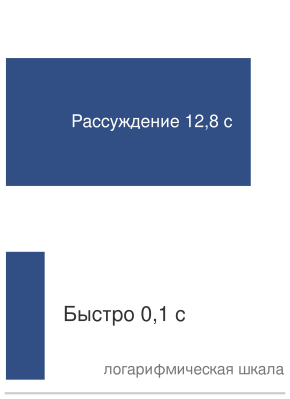

*Рассуждение увеличивает задержку примерно в 128 раз по сравнению с быстрым сопоставлением с образцом.*

### Стена логики: масштабирование вычислений на этапе тестирования

Масштабирование на этапе тестирования превращает рассуждение в серверный ресурс. Запрос может выпускать больше сгенерированных токенов, внутренних токенов цепочки рассуждений (chain-of-thought, CoT) или шагов поиска перед выдачей ответа. Работы о возможностях больших моделей описывают эмерджентное поведение (Wei et al., 2022), тогда как более поздний анализ предостерегает, что часть кажущейся эмерджентности может быть артефактом выбора метрики (Schaeffer et al., 2023).

С точки зрения систем обслуживания релевантен сдвиг в объеме работы, выпускаемой на запрос. Дополнительные рассуждения расходуют бюджет задержки, время удержания KV-кэша и время ускорителя. Модели, которые переходят от «быстрого мышления» (мгновенного сопоставления с образцом) к «медленному мышлению» (обдуманным рассуждениям), переносят давление с пропускной способности HBM на **вычисления на этапе тестирования**: планировщик должен решать, сколько шагов поиска или токенов CoT может потратить запрос. **Стена логики** (Logic Wall) — это возникающее в результате ограничение обслуживания: для сложных задач вычисления на запрос растут вместе со сложностью задачи, поэтому парк, оптимизированный на токены в секунду, также нуждается в политике распределения времени на размышления. Это иное управление, чем настройка окна батча в предыдущем разделе: адаптивный батчинг решает, когда запросы выполняются вместе, тогда как вычисления на этапе тестирования определяют, сколько работы каждому запросу разрешено выполнить.

> **Расчет: масштабирование глубины рассуждения**
>
> **Задача**: рассчитать влияние на задержку модели, которая использует 128 «токенов размышления», чтобы решить сложное математическое доказательство, по сравнению со стандартным ответом.
>
> 1. **Стандартный ответ**: ответ из 1 токена = 100 мс.
> 2. **Ответ с рассуждением**: 128 внутренних шагов поиска/CoT перед ответом.
> 3. **Задержка**: 128$\times$ 100 мс = 12,8 с.
>
> **Системный вывод**: масштабирование на этапе тестирования превращает архитектуру обслуживания из фабрики пропускной способности в поисковую машину. Тогда как стандартное обслуживание оптимизирует токены в секунду, модели с интенсивными рассуждениями ограничены шагами в секунду. Это порождает «SLO рассуждения»: пользователи могут терпеть 12 секунд ради правильного доказательства, но не ради простого приветствия. В парке машинного обучения это мотивирует динамическое распределение вычислений, при котором планировщик выделяет больше времени на размышления более трудным промптам.

Переменный объем работы на запрос завершает картину батчинга: непрерывный и адаптивный батчинг справляются с вариациями, которые система наблюдает, тогда как вычисления на этапе тестирования — это вариация, которую выбирает система. **Динамическое распределение вычислений** назначает бюджеты вычислений на запрос в зависимости от сложности задачи, толерантности к задержке и загрузки парка, а не применяет фиксированный бюджет декодирования к каждому промпту. Теперь, когда на столе есть и механизм батчинга, и бюджет вычислений на запрос, остается решить, какую комбинацию должна использовать данная нагрузка.

### Количественная сводка: выбор стратегии батчинга

Задача выбора — согласовать механизм батчинга с формой модели, дисперсией трафика и бюджетом задержки. Это согласование зависит от того, где на пути запроса расходуется бюджет задержки.

> **Контрольные вопросы: стратегии батчинга**
>
> Проверьте понимание механики различных стратегий батчинга:
>
> - [ ] **Статический или непрерывный**: для сервиса зрения с очень однородными размерами входов и предсказуемым трафиком выберите статический батчинг или непрерывный батчинг.
> - [ ] **Коэффициент потерь**: объясните, почему «коэффициент потерь» ($1 - \bar{S}/S_{\text{max}}$) сводится к нулю, когда обслуживание чат-запросов LLM переходит от статического батчинга к непрерывному.
> - [ ] **Адаптивный батчинг**: объясните, почему адаптивный батчинг (сужение окна при высоком трафике) снижает P99 задержку без потери пропускной способности.
> - [ ] **Узкое место рекомендаций**: при батчинге с параллелизмом по признакам для рекомендаций определите, является ли основным узким местом стека парка тензорные ядра GPU или пропускная способность памяти распределенного хранилища эмбеддингов.
> - [ ] **Предел батча**: объясните, почему свободная память HBM, а не вычислительная мощность Tensor Core, часто ограничивает достижимый размер батча для обслуживания LLM с длинным контекстом.

Прежде чем выбирать стратегию батчинга, важно понять, где задержка накапливается на протяжении всего жизненного цикла запроса. [Рисунок](#fig-inference-lifecycle) отображает каждый этап от клиента до ответа и показывает «налог на обслуживание», который сериализация, маршрутизация и координация налагают вне вычислений GPU.

<a id="fig-inference-lifecycle"></a>

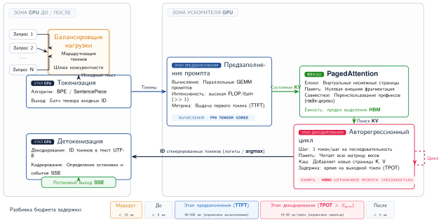

***Сквозной конвейер инференса:** подробное представление жизненного цикла запроса: клиентские запросы поступают на балансировщик нагрузки, затем проходят предобработку (токенизацию) на CPU. Данные переходят на GPU для вычислительно ограниченного этапа предзаполнения и ограниченного пропускной способностью памяти этапа декодирования, который использует KV-кэш. Наконец, ответ проходит постобработку на CPU (детокенизацию) и отправляется обратно. Эта визуализация выделяет критические компоненты «налога на обслуживание» (сериализация, маршрутизация, координация), которые расходуют бюджет задержки за пределами собственно вычислений GPU.*

Небычислительные этапы (сериализация, очереди, маршрутизация) потребляют значительную долю бюджета задержки ([рисунок](#fig-inference-lifecycle)), поэтому выбор стратегии батчинга должен учитывать весь сквозной конвейер, а не только время выполнения на GPU. Дерево решений направляет выбор стратегии.

```
Это авторегрессивная генерация текста?
|- Да → Непрерывный батчинг с фрагментированным предзаполнением
`- Нет → Это потоковая обработка речи, видео или робототехника в реальном времени?
        |- Да → Потоковый конвейер с минимальным батчингом или без него
        `- Нет → Доминируют ли поиски эмбеддингов в задержке?
                |- Да → Батчинг с параллелизмом по признакам (рекомендации)
                `- Нет → Динамический батчинг с адаптивными параметрами
```

[Таблица](#tbl-batching-parameters) показывает, что каждая стратегия настраивается на свою цель, поэтому параметр, который стоит настраивать, определяется ключевой целью: пропускная способность для статического батчинга, баланс задержки и пропускной способности для динамического, дисперсия декодирования для непрерывного, емкость шардов для параллелизма по признакам и крайний срок реального времени для потоковой обработки.

| **Стратегия**                       |     **Ключевые параметры**     | **Цель настройки**                       |
|:------------------------------------|:------------------------------:|:-----------------------------------------|
| **Статический**                     |          Размер батча          | Максимизировать пропускную способность   |
| **Динамический**                    |       Окно, макс. батч         | Баланс задержки и пропускной способности |
| **Непрерывный**                     |   Размер фрагмента, макс. батч | Минимизировать дисперсию задержки декодирования |
| **С параллелизмом по признакам**    |        Окно накопления         | Согласовать с емкостью шарда эмбеддингов |
| **Потоковый**                      |        Глубина конвейера       | Уложиться в крайний срок реального времени |

<a id="tbl-batching-parameters"></a>

***Параметры стратегий батчинга:** ключевые настраиваемые параметры (максимальный размер батча, тайм-аут очереди, ограничения итераций) для статического, динамического, непрерывного, параллелизма по признакам и потокового батчинга, которые оптимизируют пропускную способность против задержки.*

Даже хорошо настроенная стратегия непрерывного батчинга не может устранить более глубокое, специфичное для архитектуры узкое место больших языковых моделей. Контекстное окно каждого активного запроса должно храниться в памяти GPU, поэтому управление KV-кэшем становится следующим связывающим ограничением пропускной способности обслуживания.
## Управление памятью и декодированием

Когда LLM пишет эссе из 2 000 слов, ей приходится постоянно помнить каждое слово, которое она уже написала. Для этого она хранит промежуточные состояния внимания в быстро растущем буфере памяти, известном как KV-кэш. Без управления этот кэш агрессивно фрагментирует память GPU, вызывая сбои из-за нехватки памяти даже тогда, когда 40 % VRAM технически свободны.

На этой границе сходятся два класса методов. Методы емкости KV-состояния, такие как PagedAttention и кэширование префиксов, определяют, где находится состояние внимания и какую фрагментацию терпит менеджер памяти. Методы задержки на этапе декодирования, такие как спекулятивное декодирование, меняют объем работы целевой модели, необходимый на каждый выданный токен. Спекулятивное декодирование — это не сжатие KV-кэша: оно обменивает дополнительное состояние модели-черновика, проверку целевой моделью и сложность планировщика на меньшее время на выходной токен при том же бюджете памяти.

### Стена KV-кэша: ограничение емкостью памяти

Увеличение размера батча для максимизации пропускной способности в обслуживании LLM ограничено стеной KV-кэша. Веса модели представляют собой фиксированный «статический налог» на память GPU, тогда как KV-кэш растет линейно как с размером батча, так и с длиной последовательности ([рисунок](#fig-kv-cache-wall)).

<a id="fig-kv-cache-wall"></a>


***Стена KV-кэша:** полное использование памяти GPU для 70B-модели с 4-битным квантованием (веса 35 ГБ) на H100 с 80 ГБ. Пока контекст короткий, модель легко помещается, но KV-кэш (наклонные линии) в конце концов занимает всю оставшуюся HBM. При контексте 128K батч размером 2 физически невозможен на одном GPU (35 ГБ + 84 ГБ > 80 ГБ), и системе приходится либо уменьшать размер батча (что убивает пропускную способность), либо шардировать модель.*

Визуализация показывает, почему уровень реплики иногда должен шардировать модели, которые в противном случае поместились бы на одном GPU. Шардирование дает запас памяти, необходимый для поддержания больших размеров батча для запросов с длинным контекстом. Без шардирования запрос с контекстом 128K фактически «вытесняет» всех остальных пользователей с GPU.

Та же формула может быть превращена в явное ограничение размера батча для производственного оборудования.

> **Расчет: оценщик емкости KV-кэша**
>
> **Задача**: развертывание обслуживает Llama-3-70B (веса FP16 $\approx$ 141,2 ГБ) на узле из 8$\times$ H100 (всего 640 ГБ HBM). Цель — определить максимальный размер батча для длины контекста 128K токенов.
>
> **Формула**:
>
> $$ M_{\text{KV}} = 2 \times N_L \times H_{\text{KV}} \times d_{\text{head}} \times s_{\text{elem}} $$
> $$ M_{\text{total}} = M_{\text{weights}} + (B \times S \times M_{\text{KV}}) $$
>
> **Параметры**:
>
> *   $N_L = 80$, $H_{\text{KV}} = 8$ для Llama-3-70B с GQA, $d_{\text{head}} = 128$.
> *   $s_{\text{elem}} = 2$ байта (FP16).
> *   Контекст $= 131\,072$ токена.
>
> **Шаг 1**: рассчитать память на токен.
> $$ M_{\text{KV}} = 2 \times 80 \times 8 \times 128 \times 2 = 327\,680 \text{ байт} \approx 0{,}33 \text{ МБ/токен} $$
>
> **Шаг 2**: рассчитать кэш на запрос.
> $$ 131\,072 \text{ токена} \times 0{,}33 \text{ МБ/токен} \approx 42{,}9 \text{ ГБ/запрос} $$
>
> **Шаг 3**: определить максимальный размер батча.
> Доступная память под KV = 687,2 ГБ (всего) − 141,2 ГБ (веса) − 20 ГБ (система) = 526,0 ГБ.
> $$ \text{Макс. батч} = \left\lfloor \frac{526{,}0}{42{,}9} \right\rfloor = 12 $$
>
> **Системный вывод**: даже при групповом внимании с запросами (GQA) — варианте внимания с общими головами KV (см. раздел «Квантование только весов и квантование весов с активациями» в главе 9), уже учтенном в расчете по числу голов (8), — запросы с контекстом 128K потребляют десятки гигабайт KV-кэша, поэтому система обслуживает лишь небольшое число одновременных запросов с длинным контекстом, пока память не станет связывающим ограничением. Решение требует PagedAttention (для снижения фрагментации), а также квантования или шардирования KV-кэша.

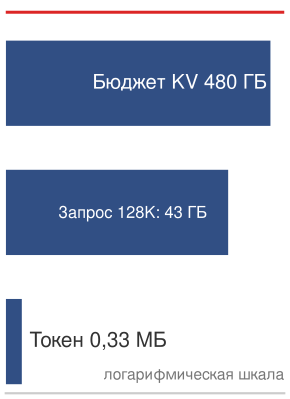

*Лестница емкости KV-кэша по длинам последовательностей относительно доступного бюджета памяти.*

### Проблема фрагментации

Традиционное выделение памяти для KV-кэша заранее резервирует непрерывную память для каждой последовательности исходя из максимально ожидаемой длины. Это создает две формы потерь.

Внутренняя фрагментация теряет память внутри каждого выделения. Последовательности короче максимального выделения оставляют неиспользованную часть простаивающей. Если максимальная длина равна 4 096, а средний выход составляет 100 токенов, теряется 97,5 % выделенной памяти.

Внешняя фрагментация усугубляет эту проблему между выделениями. По мере завершения последовательностей и начала новых память распадается на несмежные свободные блоки. Даже при достаточном общем объеме свободной памяти ни один отдельный блок может быть недостаточно велик для нового выделения максимальной длины.

Рассмотрим упрощенный пример с 8 слотами памяти и максимальной длиной последовательности 4. Резервирование фиксированного размера сначала создает внутреннюю фрагментацию:

```
Время 0: выделить Посл. A (слоты 0–3), Посл. B (слоты 4–7)
        [A][A][a][a][B][B][B][b]
        строчные = зарезервировано, но не используется
```

Внешняя фрагментация возникает после завершения последовательностей и начала новых:

```
Время 1: активные Посл. C и Посл. D освобождают два разрыва по 2 слота
        [ ][ ][C][C][ ][ ][D][D]

Время 2: попытка выделить Посл. E (нужно 4 непрерывных слота)
        [ ][ ][C][C][ ][ ][D][D]  <- всего свободных слотов = 4, наибольший блок = 2

Результат: общей свободной емкости достаточно, но ни один непрерывный блок не достаточно велик.
```

Производственные системы сообщают о 60–80 % потерь памяти из-за фрагментации в реалистичных нагрузках, что сильно ограничивает размеры батчей и пропускную способность.

### PagedAttention

Пример с фрагментацией выявляет сбой распределителя: суммарной емкости KV-кэша может хватать, тогда как непрерывного блока для следующей последовательности нет. PagedAttention решает эту проблему обслуживания, рассматривая хранилище KV-кэша как виртуальную память, а не как один предварительно выделенный блок.

> **Определение: PagedAttention**
>
> ***PagedAttention*** — это методика управления памятью обслуживания LLM, которая применяет принципы виртуальной памяти к выделению KV-кэша, храня состояния внимания в несмежных физических блоках фиксированного размера.
>
> 1. **Значение**: она устраняет внутреннюю и внешнюю фрагментацию, которая при предварительном выделении непрерывной памяти может расходовать 60–80 % памяти, выделенной под KV-кэш. Динамический рост последовательностей позволяет получить в 2–4$\times$ более высокую одновременную пропускную способность $(X)$ на том же оборудовании.
> 2. **Отличие**: в отличие от непрерывного выделения (которое требует заранее резервировать максимальную длину контекста), PagedAttention использует таблицу блоков для отображения логических индексов последовательности на физические страницы памяти, выделяя лишь то, что реально используется.
> 3. **Ловушка**: распространено заблуждение, что PagedAttention ускоряет *математику отдельного токена*. На деле это оптимизация емкости: она повышает *эффективность на уровне системы*, позволяя использовать большие батчи, хотя добавляет небольшие накладные расходы на косвенную адресацию $(L_{\text{lat}})$ при поиске указателей.

Сдвиг к виртуальной памяти меняет задачу выделения: емкость больше не нужно резервировать одним непрерывным блоком до начала запроса.

> **Аналогия: неэффективный отель**
>
> Представьте отель, где каждый гость может остаться на срок от 1 до 10 дней, но заранее этого не знает.
>
> При непрерывном выделении администратор отеля заранее блокирует люкс на 10 дней для каждого гостя. Отель на 100 номеров становится «полностью забронированным» всего с 10 гостями, теряя 90 % вместимости (внутренняя фрагментация).
>
> При PagedAttention (виртуальной памяти) администратор выдает гостю по одному номеру за раз. Если гость остается еще на день, ему выдают любой свободный номер, даже на другом этаже. Стойка регистрации ведет «таблицу блоков», чтобы отслеживать, какие номера принадлежат какому гостю. Теперь отель может одновременно разместить 100 гостей, вернув 90 % потерянной вместимости.

PagedAttention (Kwon et al., 2023), введенный в vLLM, применяет концепции виртуальной памяти к управлению KV-кэшем. Вместо непрерывного выделения KV-кэш делится на страницы фиксированного размера (в конфигурации vLLM по умолчанию используются блоки по 16 токенов), а последовательностям страницы выделяются по требованию. [Рисунок](#fig-paged-attention) иллюстрирует ключевые понятия: таблицы страниц, которые отображают логические позиции последовательности на физические страницы памяти, размер блока, определяющий число токенов на страницу (обычно 16 токенов), и физические блоки, которые предоставляют выделения памяти фиксированного размера, назначаемые любой последовательности.

<a id="fig-paged-attention"></a>


***Фрагментация KV-кэша и решение PagedAttention:** сверху слева — внутренняя фрагментация: память тратится на предварительное выделение под максимальную длину последовательности. Сверху справа — внешняя фрагментация: остаются непригодные разрывы памяти. Снизу — PagedAttention решает проблему, отображая непрерывные логические страницы последовательности на несмежные физические блоки памяти через таблицу блоков, что позволяет системе заполнять разрывы фрагментации небольшими блоками любой последовательности.*

PagedAttention дает четыре выгоды емкости:

- **Внутренняя фрагментация**: выделяются только страницы, нужные для фактических токенов.
- **Внешняя фрагментация**: любая свободная страница может быть использована любой последовательностью.
- **Динамический рост**: последовательности могут расти без предварительного выделения.
- **Совместное использование префиксов**: общие префиксы могут разделять физические страницы.

Вместе эти свойства превращают емкость KV-кэша в планируемый ресурс, а не в фиксированное резервирование на запрос.

> **Пример: детали реализации PagedAttention**
>
> **Сценарий**: сервер инференса LLM выделяет память KV-кэша для входящих последовательностей непрерывно, исходя из максимальной длины последовательности (например, 4 096 токенов).
>
> **Диагноз**: непрерывное предварительное выделение страдает от внутренней и внешней фрагментации памяти, тратя 60–70 % HBM GPU (использование пула 30–40 %). PagedAttention отображает виртуальные страницы последовательностей на несмежные физические блоки HBM (например, по 16 токенов на блок) через таблицы страниц для каждой последовательности и выполняет несмежные операции сбора (gather) в специализированных ядрах внимания.
>
> **Системный урок**: PagedAttention устраняет внутреннюю и внешнюю фрагментацию памяти. Повышение использования пула KV-кэша с 30–40 % до более 95 % позволяет движкам обслуживания упаковать значительно больше одновременных последовательностей, давая прирост пропускной способности в 2,5–4$\times$.

### Кэширование префиксов

Многие нагрузки LLM разделяют общие префиксы между запросами. Системные промпты вроде «Ты полезный ассистент…» добавляются к каждому запросу. Примеры few-shot используют одни и те же примеры для многих запросов. Контекст документа порождает множество вопросов об одном и том же документе. Повторное вычисление этих общих префиксов тратит и вычисления (предзаполнение), и память (дублирующиеся записи KV-кэша).

Кэширование префиксов разделяет записи KV-кэша между запросами с общими префиксами. [Рисунок](#fig-prefix-caching) показывает, как общие системные промпты позволяют избежать избыточных вычислений.

<a id="fig-prefix-caching"></a>

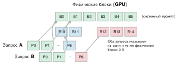

***Кэширование префиксов через совместное использование блоков:** PagedAttention обеспечивает эффективное кэширование префиксов, позволяя таблицам блоков нескольких последовательностей указывать на одни и те же физические блоки для общего содержимого. В этом примере системный промпт хранится в блоках 0–5. Запросы A и B отображают свои первые 6 логических страниц на эти же физические блоки, сохраняя в новых блоках лишь уникальные суффиксы. Это резко снижает потребление памяти и вычисления предзаполнения для нагрузок с общим контекстом.*

С PagedAttention кэширование префиксов естественно интегрируется через семантику копирования при записи:

```
Системный промпт → физические блоки [0, 1, 2, 3, 4, 5]

Таблица страниц запроса A: [0, 1, 2, 3, 4, 5, 10, 11]  <- разделяет блоки префикса
Таблица страниц запроса B: [0, 1, 2, 3, 4, 5, 12, 13, 14]  <- разделяет блоки префикса
Таблица страниц запроса C: [0, 1, 2, 3, 4, 5, 15]  <- разделяет блоки префикса
```

Все три запроса ссылаются на одни и те же физические блоки для системного промпта. Новые блоки выделяются только при генерации уникальных токенов. Экономия может быть существенной, когда много одновременных запросов разделяют один системный промпт; расчет «Кэширование префиксов в масштабе» ниже количественно оценивает ее для типичного развертывания чат-бота.

> **Расчет: кэширование префиксов в масштабе**
>
> **Сценарий**: сервис чат-бота использует системный промпт в 2 000 токенов и обслуживает 1 000 одновременных пользователей.
>
> **Без кэширования префиксов**:
>
> - KV-кэш на пользователя: $2000 + 500\text{ (средний ответ)} =$ 2 500 токенов
> - Общий KV-кэш: 2 500 токенов $\times 1000 \times 2 \times 80 \times 8192 \times 2 =$ 6,6 ТБ
>
> **С кэшированием префиксов**:
>
> - Общий префикс: 2 000 токенов (однократно)
> - Уникальные токены на пользователя: 500
> - Итого: $(2000 \times 1) + (500 \times 1000) =$ 502 000
> - Память: 502 000 $\times 2 \times 80 \times 8192 \times 2 =$ 1,3 ТБ
>
> **Результат**: кэширование префиксов дает снижение памяти KV-кэша на 79,9 % и позволяет обслуживать в 5$\times$ больше одновременных пользователей.
>
> **Системный вывод**: кэширование префиксов окупается, когда доля попаданий в префикс высока, потому что многие запросы разделяют длинный префикс. [Таблица](#tbl-inference-prefix-caching-workloads) использует иллюстративные диапазоны доли попаданий, чтобы показать, где этот метод меняет емкость обслуживания, а где нет; производственное планирование должно выводить распределение из трассы запросов.

| **Нагрузка**                         | **Доля попаданий в префикс** | **Экономия памяти** |
|:-------------------------------------|:----------------------------:|:-------------------:|
| **Чат-бот (один системный промпт)**  |           95 %+              |       70–80 %       |
| **Вопросы по документу (один документ)** |         80–90 %          |       50–70 %       |
| **Общий API (разнообразный)**        |          20–40 %             |       10–30 %       |

<a id="tbl-inference-prefix-caching-workloads"></a>

***Иллюстративная чувствительность кэширования префиксов:** предполагаемые доли попаданий в префикс и результирующее снижение памяти KV-кэша для трех форм нагрузки. Значения демонстрируют чувствительность, а не общепопуляционные нормы; команда, обслуживающая модели, должна измерять точное повторное использование префиксов и длину префиксов на собственном трафике.*
### Сжатие KV-кэша и архитектурная оптимизация

Методы управления емкостью из разделов «PagedAttention» и «Кэширование префиксов» принимают кэш как данность, тогда как сжатие его уменьшает. Расчет здесь использует базовый вариант многоголового внимания (MHA) с 64 головами KV, чтобы подраздел о групповом внимании с запросами мог выделить сокращение числа голов как отдельный архитектурный рычаг. Для модели с 70 млрд параметров, 80 слоями, 64 головами, размерностью головы 128 и длиной последовательности 4096 в FP16 KV-кэш требует:

$$\text{KV-кэш} = 2 \times 80 \times 64 \times 128 \times 4096 \times 2 \approx 10{,}7\text{ ГБ (FP16)}$$

Кэш одного запроса сам по себе потребляет значительную долю 80 ГБ HBM H100. Для батча из 8 одновременных запросов KV-кэш потребовал бы 85,9 ГБ, что превышает емкость одного GPU. Снижение этого объема требует двух взаимодополняющих стратегий: квантования и архитектурной оптимизации.

#### Квантование KV-кэша

Снижение размера кэшированных значений за счет меньшей точности дает прямую экономию памяти. Квантование только весов снижает точность весов, сохраняя активации в высокой точности. Хотя это эффективно для хранения, оно не уменьшает KV-кэш. **Квантование KV-кэша** напрямую нацелено на активации, сохраняя кэшированные ключи и значения в INT8, FP8 или даже INT4.

Сжатие KV-кэша до INT4 уменьшает его примерно до 2,7 ГБ на запрос, то есть в 4$\times$. Освободившаяся память напрямую переходит в более крупные батчи и более высокую пропускную способность обслуживания. Значения KV-кэша имеют иное распределение, чем веса модели: KIVI наблюдает выбросы по каналам в ключах и использует квантование ключей по каналам, тогда как значения не имеют такого канального шаблона и квантуются по токенам.

#### Групповое внимание с запросами (GQA)

Групповое внимание с запросами (Ainslie et al., 2023), архитектура с общими головами KV, введенная в разделе «Квантование только весов и квантование весов с активациями» главы 9, — это второй рычаг размера кэша, дополняющий квантование: если квантование уменьшает байты на кэшированный элемент, GQA уменьшает число голов ключ–значение, кэшируемых на слой. Следствие для обслуживания — арифметика числа голов. Для представительной модели с 70 млрд параметров переход от базового MHA с 64 головами KV к GQA с 8 головами KV уменьшает KV-кэш в 8$\times$:

$$\text{KV-кэш (GQA)} = 2 \times 80 \times 8 \times 128 \times 4096 \times 2 \approx 1{,}3\text{ ГБ (FP16)}$$

При 1,3 ГБ кэш GQA гораздо проще в управлении, чем 10,7 ГБ, требуемые MHA. Сочетание GQA с квантованием KV-кэша в INT8 дает размеры кэша на запрос меньше гигабайта, что часто позволяет использовать значительно большие батчи на одном GPU. GQA стал распространенным архитектурным выбором для LLM, оптимизированных под инференс, поскольку снижает давление на пропускную способность и емкость KV-кэша при сравнительно небольшом влиянии на качество во многих развертываниях.

> **Расчет: дивиденд точности**
>
> **Задача**: команда обслуживает модель с 70 млрд параметров на 4$\times$ GPU H100. Веса в FP16 занимают 140 ГБ (35 ГБ на GPU). KV-кэш в FP16 потребляет 10,7 ГБ на запрос. Как квантование весов в INT4 и KV-кэша в INT8 меняет максимальный размер батча?
>
> **До оптимизации** (все в FP16):
>
> - Веса: 35 ГБ на GPU
> - Доступно под KV-кэш: 80 ГБ $-$ 35 ГБ = 45 ГБ на GPU
> - KV-кэш на запрос: 10,7 ГБ $\div$ 4 $\approx$ 2,7 ГБ на GPU
> - Максимальный размер батча: $\lfloor$ 45 ГБ, деленные на 2,7 ГБ $\rfloor$ $\approx$ 16 запросов
>
> **После оптимизации** (веса INT4, KV-кэш INT8):
>
> - Веса: 35 ГБ $\times (4/16) =$ 8,75 ГБ на GPU (INT4)
> - Доступно под KV-кэш: 80 ГБ $-$ 8,75 ГБ = 71,25 ГБ на GPU
> - KV-кэш на запрос (INT8): 5,4 ГБ $\div$ 4 $\approx$ 1,3 ГБ на GPU
> - Максимальный размер батча: $\lfloor$ 71,25 ГБ, деленные на 1,3 ГБ $\rfloor$ $\approx$ 53 запроса
>
> **Системный вывод**: инженерия точности существенно меняет экономику обслуживания, позволяя использовать большие размеры батчей. Большие батчи амортизируют фиксированную стоимость загрузки весов, сдвигая операции от ограниченных памятью к ограниченным вычислениями.

### Спекулятивное декодирование как политика обслуживания

Спекулятивное декодирование было введено как алгоритмическая оптимизация в разделе «Спекулятивное декодирование» главы 9: малая модель-черновик предлагает $K$ токенов, целевая модель проверяет их за один параллельный прямой проход, а отбраковка выборки гарантирует, что выданные токены в точности следуют распределению целевой модели. Поэтому метод не теряет качества и ограничен долей принятия черновика $\alpha_{\text{acc}}$. Вопрос обслуживания иной. Спекуляция становится политикой допуска ресурсов под давлением соглашения об уровне обслуживания (SLA): планировщик должен решать, когда ее включать, как ее затраты памяти взаимодействуют с допуском KV-кэша и что она делает с SLA, которым связана конечная точка.


*Декодирование ограничено памятью; параллельная верификация переносит работу к хребту.*

Выигрыш в задержке реален, но условен, и условие — доля принятия. Когда модель-черновик предлагает $K$ токенов, высокая доля принятия позволяет целевой модели проверить и выдать несколько токенов за один прямой проход. Когда доля принятия падает, отброшенные токены выбрасываются, и эффективная скорость генерации возвращается к декодированию по одному токену. Математически ожидаемое число токенов, выдаваемых за раунд (включая токен коррекции), равно $\frac{1 - \alpha_{\text{acc}}^{K+1}}{1 - \alpha_{\text{acc}}}$, и при падении принятия это выражение стремится к 1. Для $K = 5$ черновых токенов и модели-черновика, которая в 20$\times$ быстрее целевой, эта чувствительность резкая:

- **Высокое принятие** $(\alpha_{\text{acc}} = 0{,}9)$: в среднем 4,69 токена за раунд, ускорение в 3,7$\times$.
- **Среднее принятие** $(\alpha_{\text{acc}} = 0{,}7)$: в среднем 2,94 токена за раунд, ускорение в 2,4$\times$.
- **Низкое принятие** $(\alpha_{\text{acc}} = 0{,}5)$: в среднем 1,97 токена за раунд, ускорение в 1,6$\times$.

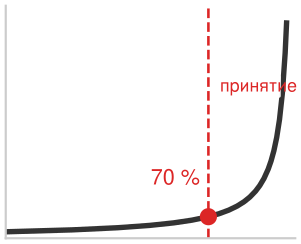

*Ускорение спекулятивного декодирования при доле принятия 70 %.*

Предсказуемый текст достигает $\alpha_{\text{acc}} > 0{,}9$, тогда как творческие рассуждения или генерация кода могут опускаться ниже 0,5; хорошо согласованные пары моделей, которые разделяют обучающие данные и архитектуру, обычно оказываются в диапазоне 0,6–0,8. Поскольку принятие — свойство нагрузки, а не аппаратного обеспечения, единая глобальная настройка неверна для смешанного парка: та же спекуляция, которая вдвое сокращает время на токен на конечной точке чата, может замедлить конечную точку генерации кода, которая находится ниже точки безубыточности по доле принятия. Поэтому система обслуживания должна решать для каждой конечной точки, и это решение определяют три задачи обслуживания.

#### Налог на спекуляцию и допуск KV-кэша

Первая задача — память. Модель-черновик — не бесплатное состояние: ей требуется собственное выделение GPU под веса, а каждый запрос в полете, использующий спекуляцию, резервирует небольшой дополнительный KV-кэш для модели-черновика наряду с кэшем целевой модели. Сочетание модели-черновика на 7 млрд с целевой моделью на 70 млрд добавляет примерно 14 ГБ весов на реплику плюс кэш черновика на запрос. Этот *налог на спекуляцию* напрямую конкурирует с бюджетом допуска KV-кэша, разобранным в разделе «Стена KV-кэша: ограничение емкостью памяти»: каждый гигабайт, который удерживает модель-черновик, — это гигабайт, который контроллер допуска не может выделить одновременному запросу. Поэтому спекуляция уменьшает максимальный размер батча, который узел может допустить, обменивая совокупную пропускную способность на задержку отдельных запросов. Контроллер допуска и политику спекуляции нельзя настраивать независимо: включение спекуляции снижает потолок параллелизма, который уже накладывает стена KV-кэша.

#### Противоречие между задержкой и пропускной способностью при SLA

Вторая задача — какой целевой показатель обслуживания (SLO) связывает конечную точку. Спекуляция улучшает время на выходной токен, но, снижая потолок параллелизма, уменьшает число запросов в секунду, которое может выдержать реплика. Конечная точка с жестким SLA на время до первого токена или на задержку на токен, например интерактивный чат, выигрывает: налог на спекуляцию покупает запас относительно целевой задержки, которая важна. Конечная точка, связанная SLA на пропускную способность, например массовая обработка документов или пакетное суммирование, страдает: спекуляция тратит емкость батча ради улучшения метрики задержки, которую никто не измеряет, а потерянный параллелизм напрямую угрожает цели пропускной способности. Поэтому решение — вопрос SLA. Планировщик включает спекуляцию на конечных точках, связанных задержкой, и выключает ее на конечных точках, связанных пропускной способностью, а на общей реплике, обслуживающей обе, он должен учитывать постоянную стоимость модели-черновика относительно более строгого из двух бюджетов.

#### Планирование для каждой конечной точки

Третья задача состоит в том, что эти решения динамические, а не статическая конфигурация. Доля принятия дрейфует вместе с составом трафика, а ценность спекуляции падает при высокой нагрузке: когда реплика уже близка к потолку параллелизма, этап декодирования ближе к ограничению вычислениями, и предельный выигрыш задержки от спекуляции уменьшается, даже если ее налог на память остается неизменным. Поэтому производственные планировщики рассматривают спекуляцию как рычаг времени выполнения, управляемый наблюдаемой нагрузкой и долей принятия. Они включают ее для чувствительных к задержке конечных точек в штатном режиме, выключают во время всплесков трафика, чтобы освободить страницы KV-кэша для допуска, и могут переключать стратегии черновика для каждой конечной точки. **Самоспекулятивное декодирование** (Self-Speculative Decoding) использует ранний выход из самой целевой модели в качестве черновика, устраняя отдельный налог памяти модели в обмен на меньшую долю принятия; **Medusa** (Cai et al., 2024) добавляет легковесные головы предсказания к основе целевой модели; **декодирование с опережением** (Lookahead Decoding) использует итерацию Якоби, чтобы полностью избежать модели-черновика. Каждый вариант обменивает свою долю налога на спекуляцию на принятие, и планировщик выбирает между ними для каждой конечной точки, исходя из того, какой SLA связывает и сколько бюджета KV-кэша остается.

### KV-кэш в распределенных системах

Когда разговор переносится, перебалансируется или разделяется между устройствами, его состояние KV должно либо переехать вместе с ним, либо быть перестроено токен за токеном. В разделе «Шардирование модели для инференса» разбираются стратегии тензорного и конвейерного параллелизма, которые распределяют модель по устройствам; каждая стратегия несет собственные последствия для управления KV-кэшем:

При тензорном параллелизме KV-кэш шардируется по устройствам вместе с головами внимания. Каждое устройство хранит кэш для своего подмножества голов.

```
Тензорный параллелизм на 8 устройств:
Устройство 0: KV-кэш для голов 0–7
Устройство 1: KV-кэш для голов 8–15
...
Устройство 7: KV-кэш для голов 56–63
```

Совместное использование между устройствами добавляет ограничение: кэширование префиксов на устройствах с тензорным параллелизмом требует, чтобы кэш был одинаково шардирован на всех устройствах. Это происходит автоматически, когда префиксы обрабатываются с одной и той же конфигурацией тензорного параллелизма.

Миграция KV-кэша создает дополнительную трудность. Когда маршрутизатор переносит разговор на другую реплику из-за отказа или перебалансировки (маршрутизация по хешу идентификатора сессии, схема консистентного хеширования, разобранная в разделе «Консистентное хеширование для маршрутизации с состоянием»), KV-кэш должен быть перенесен:

```
Варианты миграции:
1. Перестроить: повторно выполнить предзаполнение на новой реплике (500 мс и более для длинного контекста)
2. Передать: отправить KV-кэш по сети (100 МБ при 100 Гбит/с = 8 мс)
3. Гибрид: передать, если мал, перестроить, если велик

Пороговое значение решения:
if cache_size_bytes/network_bandwidth < prefill_time:
    передать()
else:
    перестроить()
```

Для Llama-70B с GQA и контекстом 4K KV-кэш составляет примерно 1,3 ГБ на последовательность в целом или около 162,5 МБ на устройство при тензорном параллелизме на 8 устройств. При 100 Гбит/с (12,5 ГБ/с) передача одного шарда занимает примерно 13 мс, тогда как передача полного кэша заняла бы около 100 мс. Оба варианта часто предпочтительнее перестройки предзаполнением (около 500 мс), поэтому передача остается лучшим выбором, когда есть пропускная способность.

### Лучшие практики управления памятью

Эффективное управление KV-кэшем начинается с учета емкости, а не с политики вытеснения. Процесс обслуживания сначала резервирует память под веса, активации, накладные расходы времени выполнения и запас безопасности, а затем рассматривает оставшуюся HBM как управляемый пул для активных последовательностей:

```
Доступная память GPU = Всего − Веса − Активации − Накладные расходы
Размер пула KV = 0.9 * Доступно  # оставить 10 % запаса

Макс. одновременных последовательностей = Размер пула KV / (средняя_длина_последовательности * кэш_на_токен)
```

Этот бюджет определяет, сколько последовательностей могут сосуществовать, прежде чем планировщик должен выбрать между отказом, вытеснением или подкачкой страниц. Когда кэш заполнен, вытеснение LRU (давно не использовавшихся) удаляет последовательность с самым старым доступом, вытеснение по размеру сначала освобождает самую длинную последовательность, а вытеснение по приоритету защищает запросы платных тарифов или чувствительные к задержке. Непрерывный батчинг затем превращает вытеснение в решение планирования: запрос с высоким приоритетом, который не помещается, запускает выбор жертвы, переносит KV-кэш жертвы в память CPU, выделяет память GPU новому запросу и восстанавливает жертву позже, если ее SLO все еще допускает задержку.

> **Пример: иерархия памяти KV-кэша**
>
> **Сценарий**: многопользовательская система обслуживания LLM испытывает исчерпание HBM под KV-кэш (лимит 80 ГБ) в пиковой конкурентности.
>
> **Диагноз**: чистое выделение HBM ограничивает конкурентность узла 50 активными последовательностями. Вытеснение или сброс запросов ухудшает пользовательский опыт. Внедрение трехуровневой иерархии памяти (HBM $\to$ DRAM CPU $\to$ твердотельный накопитель NVMe, Non-Volatile Memory Express) позволяет выгружать страницы неактивных последовательностей в DRAM CPU (задержка подкачки 1–5 мс) или на NVMe (10–50 мс).
>
> **Системный урок**: многоуровневая страничная организация KV-кэша увеличивает емкость одновременных последовательностей в 10$\times$ (с 50 до 500 последовательностей). Выгрузка в DRAM CPU служит рычагом пропускной способности для нецелевого трафика, но задержка подкачки делает ее непригодной для критичных к задержке шагов декодирования.

### Состояние адаптеров и локальность

Управление KV-кэшем делает один GPU безопасным для многих одновременных запросов; многопользовательское обслуживание адаптеров требует от того же процесса обслуживания управлять состоянием другого рода. KV-кэш — это состояние внимания на токен. Адаптер низкоранговой адаптации (LoRA) — это дельта весов для конкретного арендатора. Оба должны быть доступны в момент выполнения шага декодирования, и оба могут свести на нет выигрыш от батчинга, если планировщик игнорирует локальность. По мере того как платформы обслуживания масштабируются, поддерживая тысячи одновременных пользователей одной базовой фундаментальной модели, персонализация вводит новое узкое место памяти. LoRA хранит небольшой набор весов адаптера, специфичных для пользователя или задачи, которые модифицируют общую базовую модель без копирования всей модели. Когда у 10 000 пользователей есть уникальный адаптер LoRA, примененный к одной и той же базовой модели на 140 ГБ, копирование базовых весов для каждого пользователя физически невозможно. Вместо этого базовая модель остается закрепленной в HBM, а адаптеры конкретных пользователей подгружаются в быстрый рабочий набор на кристалле по мере необходимости.

> **Перспектива: переключение контекста в машинном обучении**
>
> Этот шаблон многопользовательского обслуживания смещает фундаментальное ограничение производительности с пропускной способности вычислений на локальность адаптеров. Когда планировщик непрерывного батчинга чередует запросы разных пользователей, веса адаптеров могут многократно перемещаться из HBM в SRAM или регистры перед каждым шагом генерации. Эффект похож на переключение контекста в операционной системе: у ускорителя есть работа, но сначала он ждет состояния, принадлежащего следующему арендатору. Если задержка подкачки адаптера превышает время вычислений шага генерации, вычислительные ядра GPU простаивают. Поэтому эффективная многопользовательская работа группирует запросы по активному адаптеру, когда это возможно, и согласует размещение адаптеров со страничной организацией KV-кэша, чтобы персонализация не свела на нет выгоду от совместного использования базовой модели.

#### Многоадаптерное обслуживание LoRA и пакетное выполнение адаптеров

В многопользовательских средах тысячи тонко настроенных адаптеров разделяют одну базовую фундаментальную модель. Для слоя линейной проекции с базовыми весами $W_0 \in \mathbb{R}^{d_{\text{out}} \times d_{\text{in}}}$ адаптер $k$ параметризует прямое преобразование с помощью матриц низкорангового разложения $A_k \in \mathbb{R}^{r_k \times d_{\text{in}}}$ и $B_k \in \mathbb{R}^{d_{\text{out}} \times r_k}$ с рангом $r_k \ll \min(d_{\text{in}}, d_{\text{out}})$ (обычно $r \in \{8, 16, 64\}$), как записано в уравнении ниже:

$$y = x W_0 + \frac{\alpha_k}{r_k} x A_k^T B_k^T$$

где $\alpha_k$ — фиксированный коэффициент масштабирования. Для базовой модели с 70 млрд параметров хранение полных копий параметров для 1 000 дообученных вариантов потребовало бы 140 ТБ памяти GPU. Напротив, 1 000 адаптеров ранга 16 занимают в совокупности лишь $\sim 150\text{ ГБ}$, что делает совместное размещение физически осуществимым.

Однако обслуживание запросов с разнородными адаптерами в одном непрерывном батче создает критическую дилемму выполнения:

1.  **Батчинг, сгруппированный по адаптерам**: если планировщик группирует входящие запросы по ID адаптера в отдельные батчи, непрерывный батчинг вырождается в мелкие фрагментированные батчи (часто размера 1 или 2 для адаптеров с низкой нагрузкой). Это лишает выгоды высокой пропускной способности потоковой передачи общих весов и вносит недопустимые задержки очереди для «холодных» адаптеров.
2.  **Последовательная диспетчеризация ядер адаптеров**: если запросы с разными адаптерами упаковываются в один батч, базовая проекция $X W_0$ выполняется эффективно как один плотный GEMM по всем токенам. Однако вычисление отдельных дельт адаптеров требует диспетчеризации отдельных малых ядер матрично-векторного умножения для уникального адаптера каждого запроса $(A_{k(i)}, B_{k(i)})$. Запуск сотен малых GEMM на слой вносит сильную сериализацию запуска на CPU, задержку запуска ядра ($\sim 3\text{--}5\ \text{мкс}$ на ядро) и низкую загрузку мультипроцессоров GPU (SM).

> **Определение: пакетное собирающее матрично-векторное умножение (BGMV)**
>
> ***Пакетное собирающее матрично-векторное умножение (BGMV)*** — это специализированное ядро GPU, которое вычисляет разнородные низкоранговые матрично-векторные произведения для разных адаптеров в рамках одного унифицированного запуска ядра, динамически собирая веса адаптеров из пула памяти по вектору индексов адаптеров для каждого токена.
>
> 1. **Значение**: оно устраняет сериализацию запусков ядер и недоиспользование памяти, присущие обслуживанию с несколькими адаптерами, позволяя оценивать сотни различных адаптеров LoRA одновременно в одном прямом проходе с пренебрежимо малыми накладными расходами по сравнению с выполнением базовой модели.
> 2. **Отличие**: стандартные GEMM требуют, чтобы все элементы батча умножались на один и тот же тензор весов. BGMV выполняет сегментированное матричное умножение, в котором каждый элемент батча умножается на собственный срез весов адаптера через косвенную индексацию указателей.
> 3. **Ловушка**: хранение всех весов адаптеров в непрерывной HBM ведет к сильной внешней фрагментации памяти. Производственные системы опираются на BGMV с постраничными таблицами адаптеров, аналогичными таблицам страниц виртуальной памяти.

Системы вроде Punica (Chen et al., 2024) и S-LoRA (Sheng et al., 2024) разрешают дилемму выполнения двумя архитектурными механизмами (определение BGMV выше):

##### Ядра пакетного собирающего матрично-векторного умножения (BGMV)

Вместо запуска отдельного ядра для каждого запроса BGMV (и его обобщенный вариант — сегментированный GEMM) выполняет все проекции адаптеров в одном запуске ядра.

Для входных активаций $X = [x_1; x_2; \dots; x_B] \in \mathbb{R}^{B \times d_{\text{in}}}$ планировщик строит целочисленный вектор отображения $M \in \mathbb{Z}^B$, где $M[i] = k(i)$ обозначает ID адаптера, назначенного запросу $i$. Ядро BGMV назначает блоки потоков токенам батча:

1.  **Сбор**: каждый блок потоков загружает соответствующую активацию токена $x_i$ в разделяемую память и читает указатель адаптера из $M[i]$.
2.  **Проекция вниз**: блок потоков выполняет матрично-векторное произведение $v_i = x_i A_{k(i)}^T \in \mathbb{R}^{1 \times r_{k(i)}}$. Поскольку $r \ll d_{\text{in}}$, $v_i$ легко помещается в регистры GPU.
3.  **Проекция вверх**: блок потоков умножает $v_i$ на $B_{k(i)}^T \in \mathbb{R}^{r_{k(i)} \times d_{\text{out}}}$, получая дельту адаптера $\Delta y_i = \frac{\alpha_{k(i)}}{r_{k(i)}} v_i B_{k(i)}^T$.
4.  **Накопление**: ядро добавляет $\Delta y_i$ на месте к выходу проекции базовой модели $y_i = x_i W_0 + \Delta y_i$.

Объединяя проекцию адаптера и динамически собирая веса по потокам, BGMV достигает более 90 % пиковой эффективности пропускной способности памяти и избегает сотен микроядерных запусков на шаг.

##### Единое постраничное управление памятью адаптеров

Чтобы управлять тысячами адаптеров, не исчерпывая HBM GPU, S-LoRA (Sheng et al., 2024) организует хранилище адаптеров в многоуровневую иерархию памяти, управляемую страничной памятью:

-   **Постраничный пул адаптеров**: HBM GPU выделяет статический пул памяти, разбитый на физические страницы фиксированного размера (например, фрагменты по 2 МБ). Матрицы адаптеров $A_k$ и $B_k$ размещаются несмежно по свободным страницам, что устраняет внешнюю фрагментацию, когда адаптеры разных рангов ($r \in \{8, 16, 32, 64\}$) динамически загружаются и выгружаются.
-   **Асинхронная предвыборка по PCIe**: редко используемые адаптеры хранятся в DRAM хост-CPU или на накопителе NVMe. Когда запрос к некэшированному адаптеру попадает в очередь ожидания, планировщик инициирует асинхронное прямое копирование в память (DMA) по PCIe Gen5 в свободные страницы адаптеров HBM, пока GPU выполняет текущие итерации декодирования.
-   **Шардирование адаптеров при тензорном параллелизме**: при тензорном параллелизме в стиле Megatron веса адаптеров разбиваются в соответствии с шардированием базовой модели:
    -   *Колоночно-параллельные слои*: базовые веса $W_0 = [W_0^{(1)} \mid W_0^{(2)}]$ разбиваются по столбцам. Понижающая проекция адаптера $A_k$ реплицируется на все ранги, тогда как повышающая проекция $B_k$ шардируется по столбцам ($B_k = [B_k^{(1)} \mid B_k^{(2)}]$), что не требует коммуникации до или после операции адаптера.
    -   *Строчно-параллельные слои*: базовые веса $W_0 = [W_0^{(1)} / W_0^{(2)}]$ разбиваются по строкам. Понижающая проекция адаптера $A_k$ шардируется по строкам ($A_k = [A_k^{(1)} / A_k^{(2)}]$), и $B_k$ также шардируется по строкам. Частичные выходы суммируются по рангам с помощью существующей коллективной операции AllReduce базового слоя.

Поскольку шардирование адаптеров полностью совпадает с шардированием базовой модели, многоадаптерное выполнение LoRA не вносит **никаких дополнительных коллективных операций коммуникации** в распределенную сеть.

Та же проблема локальности возникает в большем масштабе, когда сама модель превышает емкость одного GPU. Для фундаментальной модели с 175 млрд параметров даже веса должны распределяться по нескольким устройствам, поэтому инференс становится задачей шардирования раньше, чем задачей планирования.
## Шардирование модели для инференса

Модель с 70 млрд параметров требует более 140 ГБ VRAM, чтобы хранить веса в FP16, что превышает емкость одного GPU с 80 ГБ. Обслуживание такой модели требует разрезать ее архитектуру между несколькими GPU, которые работают вместе как одна логическая реплика. Адаптация техник распределенного обучения, в частности тензорного и конвейерного параллелизма, для инференса с низкой задержкой вводит особый набор ограничений.

### Когда шардирование становится необходимым

Шардирование модели для инференса вызвано двумя различными требованиями. [Таблица](#tbl-sharding-triggers) описывает ограничения памяти и задержки, которые делают шардирование необходимым:

Первый фактор — емкость памяти. Модель, которая не помещается в память одного GPU, должна быть шардирована независимо от соображений производительности. Для модели с $P$ параметрами при точности $b$ бит объем памяти весов вычисляется по формуле:

$$M_{\text{weights}} = P \times \frac{b}{8} \text{ байт}$$

Модель с 70 млрд параметров в FP16 (16 бит) требует:

$$M_{\text{weights}} = 70 \times 10^9 \times \frac{16}{8} = 140 \text{ ГБ}$$

Результат превышает 80 ГБ емкости GPU H100, поэтому требуется как минимум шардирование на 2 части (2-way).

Второй фактор — задержка. Даже когда модель помещается в память, шардирование может снизить задержку за счет распараллеливания вычислений. Уравнение ниже формализует потенциальное ускорение как функцию эффективности распараллеливания:

$$T_{\text{parallel}} = \frac{T_{\text{compute}}}{N} + T_{\text{comm}}(N) + T_{\text{sync}}(N) - T_{\text{overlap}}$$

где $N$ — число устройств в группе шардирования, $T_{\text{comm}}(N)$ — накладные расходы коммуникации, $T_{\text{sync}}(N)$ — накладные расходы синхронизации, а $T_{\text{overlap}}$ — коммуникация, скрытая за полезными вычислениями. В распространенном упрощении без перекрытия и при пренебрежимо малой дополнительной синхронизации это сводится к $T_{\text{compute}}/N + T_{\text{comm}}(N)$. Шардирование дает выигрыш в задержке только тогда, когда неперекрытые накладные расходы меньше времени, сэкономленного за счет распараллеливания.

| **Триггер шардирования** | **Примеры моделей** | **Минимальное шардирование** | **Стратегия** |
|:-------------------------|:-------------------:|:----------------------------:|:-------------:|
| **Память (веса)**        | Llama-70B (140 ГБ)  |           2-way              | Тензорный или конвейерный |
| **Память (KV-кэш)**      | GPT-4 (длинный контекст) |        4–8-way             | Тензорный (для кэша) |
| **Память (эмбеддинги)**  | DLRM (100 ТБ)       |          1000+-way           | Шардирование эмбеддингов |
| **Задержка**             | Любая большая модель |          Зависит            | Тензорный параллелизм |

<a id="tbl-sharding-triggers"></a>

***Триггеры шардирования:** память модели, емкость KV-кэша, размер таблицы эмбеддингов и ограничения задержки прямого прохода определяют минимальные степени шардирования и кандидатные стратегии распределения.*

### Тензорный параллелизм

Тензорный параллелизм (Shoeybi et al., 2019) распределяет отдельные слои между несколькими устройствами, обеспечивая параллельные вычисления внутри каждого слоя. Схема разбиения по столбцам и строкам, введенная для обучения в главе 5 «Распределенное обучение», применяется и здесь: разбиение первого линейного слоя по столбцам, а второго — по строкам требует лишь одной операции AllReduce на блок трансформера. Для трансформерных моделей основная цель — механизм внимания и слои прямого распространения, которые содержат большую часть вычислений.

Вычисление многоголового внимания естественным образом разбивается по головам внимания. Для модели с $N_{\text{heads}}$ головами внимания, распределенными по степени тензорного параллелизма $t$, каждое устройство вычисляет $N_{\text{heads}}/t$ голов:

$$\text{Attention}_i = \text{softmax}\left(\frac{Q_i K_i^T}{\sqrt{d_k}}\right) V_i \text{ для голов } i \in \{1, ..., N_{\text{heads}}/t\}$$

После вычисления локального внимания операция AllReduce (см. главу 6 «Коллективная коммуникация») объединяет результаты по устройствам, добавляя накладные расходы коммуникации, пропорциональные размеру активаций, деленному на пропускную способность межсоединения.

Слой прямого распространения (обычно два линейных преобразования с активацией) разбивается по скрытой размерности. Для первого линейного слоя распределяются столбцы, для второго — строки. Такое разбиение по столбцам и строкам требует только одной операции all-reduce на блок прямого распространения.

Шаблон коммуникации для инференса с тензорным параллелизмом предполагает двухфазную синхронизацию на каждый слой. [Рисунок](#fig-tensor-parallel-flow) иллюстрирует этот поток:

<a id="fig-tensor-parallel-flow"></a>


***Тензорный параллелизм для инференса:** вычисления распределяются между устройствами разбиением тензорных операций. Головы внимания разделяются между GPU, что требует операции AllReduce для синхронизации результатов. Сети прямого распространения используют стратегию разбиения по столбцам и строкам, которая требует только одной синхронизации AllReduce на блок. Такой подход снижает задержку больших моделей, но вносит накладные расходы коммуникации, которые требуют высокоскоростных межсоединений вроде NVLink.*

Время инференса при тензорном параллелизме следует уравнению:

$$T_{\text{inference}} = \frac{T_{\text{compute}}}{t} + 2 \times T_{\text{allreduce}}\left(\frac{A}{t}\right)$$

где $T_{\text{compute}}$ — последовательное время вычислений, $t$ — степень тензорного параллелизма, а $A$ — размер сокращаемых активаций. Множитель 2 учитывает две операции all-reduce на слой трансформера (внимание и прямое распространение).

> **Пример: тензорный параллелизм для Llama-70B**
>
> **Сценарий**: инженерная команда развертывает Llama-70B (70 млрд параметров, объем в FP16 — 140 ГБ) на узле из 8 GPU H100 с NVLink (Touvron et al., 2023).
>
> **Диагноз**: размещение модели на 2 GPU (140 ГБ / 80 ГБ) страдает от узких мест вычислений (30 мс на слой). Тензорный параллелизм на 8 устройств распределяет слои внимания и прямого распространения по всем 8 GPU, снижая время выполнения одного слоя до 4,35 мс несмотря на накладные расходы AllReduce.
>
> **Системный урок**: тензорный параллелизм на 8 устройств поверх NVLink дает сквозное ускорение в 6,9$\times$ (время предзаполнения снижено с 2 400 мс до 348 мс). Шардирование слоев внимания и прямого распространения по межсоединениям NVLink внутри узла покупает задержку, обменивая низкозатратные передачи NVLink на ускорение вычислений.

### Конвейерный параллелизм для инференса

Конвейерный параллелизм распределяет слои по устройствам последовательно, и каждое устройство обрабатывает подмножество слоев. В отличие от тензорного параллелизма, внутри слоя синхронизации нет, есть только синхронизация между этапами конвейера.

Для инференса конвейерный параллелизм создает «пузыри» иначе, чем при обучении. [Рисунок](#fig-pipeline-bubbles) сопоставляет задержку одного запроса (определяемую пузырями) с конвейерной пропускной способностью (пузыри амортизированы):

<a id="fig-pipeline-bubbles"></a>

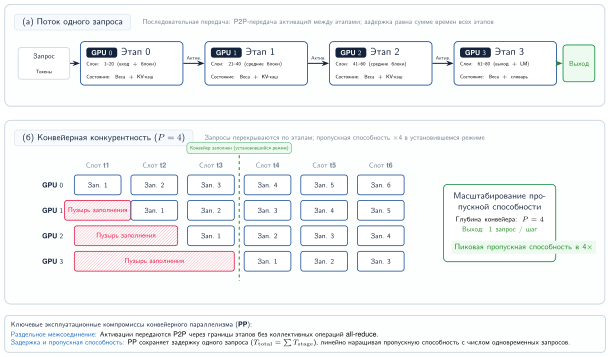

***Пузыри конвейерного параллелизма:** для одного запроса инференса (сверху) конвейерный параллелизм не дает выигрыша в задержке, поскольку запрос должен последовательно пройти все четыре этапа. При обработке нескольких одновременных запросов (снизу) конвейер заполняется, и пропускная способность растет с числом этапов. Это делает конвейерный параллелизм идеальным для высокопроизводительной пакетной обработки, но менее подходящим для интерактивного обслуживания, критичного к задержке.*

Для одного запроса конвейерный параллелизм не дает выигрыша в задержке: запрос должен последовательно пройти все этапы. Время заполнения конвейера равно времени последовательного выполнения.

Однако конвейерный параллелизм позволяет масштабировать пропускную способность за счет конвейеризации нескольких запросов:

```
Время →
Устройство 0: [Зап1] [Зап2] [Зап3] [Зап4] ...
Устройство 1:        [Зап1] [Зап2] [Зап3] [Зап4] ...
Устройство 2:               [Зап1] [Зап2] [Зап3] [Зап4] ...
Устройство 3:                      [Зап1] [Зап2] [Зап3] [Зап4] ...
```

Когда конвейер заполнен, пропускная способность равна $p$, умноженному на пропускную способность одного этапа, где $p$ — число этапов конвейера. Задержка в установившемся режиме остается примерно равной задержке на одном устройстве (сумма времен всех этапов), но пропускная способность растет с параллелизмом.

Конвейерный параллелизм подходит для инференса в трех сценариях:

- ограничения памяти требуют шардирования, но требования к задержке смягчены;
- пропускная способность важнее задержки отдельного запроса;
- сетевая пропускная способность между устройствами ограничена (нужна только передача «точка–точка»).

[Таблица](#tbl-pipeline-tensor-comparison) сводит компромиссы между этими двумя подходами к шардированию:

<a id="tbl-pipeline-tensor-comparison"></a>

| **Аспект**                  |   **Тензорный параллелизм**   |   **Конвейерный параллелизм**    |
|:----------------------------|:-----------------------------:|:--------------------------------:|
| **Задержка одного запроса** | Снижена примерно в $t\times$  |        Без улучшения             |
| **Пропускная способность**  |           $t\times$           |      $p\times$ (при конвейеризации) |
| **Шаблон коммуникации**     | AllReduce (интенсивная по пропускной способности) | Точка–точка (чувствительна к задержке) |
| **Эффективность памяти**    |    Активации реплицируются    |        Активации передаются дальше |
| **Сложность**               | Выше (нужны собственные ядра) |   Ниже (разбиение по слоям)      |

***Конвейерный и тензорный параллелизм:** ключевые компромиссы между разбиением тензоров внутри слоя (снижает задержку одного запроса, требует высокоскоростного NVLink) и конвейерной расстановкой между слоями (максимизирует пропускную способность батча, создает пузыри конвейера).*

Правило решения таково: сначала задержка, затем топология. Тензорный параллелизм — правильный выбор по умолчанию, когда важна задержка одного запроса и доступна пропускная способность класса NVLink; конвейерный параллелизм — инструмент пропускной способности для нагрузок с ослабленными требованиями к задержке или для размещений, где можно позволить себе только коммуникацию между этапами «точка–точка».

### Экспертный параллелизм для MoE-моделей

Модели смеси экспертов (MoE), такие как DeepSeek-V3 или Mixtral, создают особые трудности обслуживания, помимо тех, что возникают у плотных моделей. В слое трансформера MoE слой прямого распространения заменяется несколькими параллельными подсетями «экспертов» и легковесным маршрутизатором, который выбирает подмножество экспертов для каждого токена.

Архитектура MoE позволяет масштабировать общее число параметров при сохранении постоянных вычислений на токен. Однако обслуживание таких моделей в масштабе требует экспертного параллелизма, при котором разные эксперты размещаются на разных GPU.

#### Экономика MoE и планирование емкости

Экономика обслуживания MoE создает парадокс: *общее число параметров* определяет минимальное количество аппаратного обеспечения (для памяти), тогда как *число активных параметров* определяет стоимость вычислений на токен. Поэтому модели MoE эффективны по вычислениям, но дороги с точки зрения «аренды» VRAM.

Преимущества по производительности поразительны. Во время авторегрессивного декодирования при размере батча 1 доминирующая стоимость — чтение весов из HBM. Плотная модель на 400 млрд параметров в FP16 считывает 800 ГБ на шаг. DeepSeek-V3, несмотря на большее общее число параметров, считывает лишь 37 млрд активных параметров на шаг (около 74 ГБ в FP16), что в 10,8$\times$ меньше пропускной способности на токен. Экономия вычислений пропорциональна: в 10,8$\times$ меньше FLOP на токен.

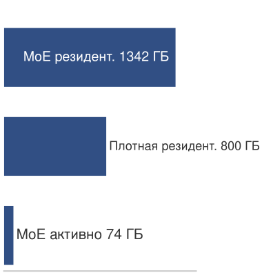

*MoE держит каждый эксперт резидентным, но активирует несколько на токен.*

Компромисс — в емкости памяти: все эксперты должны находиться в памяти, хотя в любой момент активна лишь их часть. Полная модель DeepSeek-V3 в FP16 требует около 1342 ГБ, что вынуждает распределять ее по множеству GPU.

> **Расчет: планирование емкости MoE**
>
> **Задача**: команда развертывает DeepSeek-V3 (671 млрд параметров всего, 37 млрд активных на токен) для приложения чат-бота. Модель использует веса FP8 (1 байт на параметр). Кластер состоит из узлов по 8 GPU, в каждом из которых по 8$\times$ H100 (80 ГБ HBM на GPU, 640 ГБ на узел). Сколько узлов нужно и какова задержка декодирования на токен?
>
> **Математика**:
>
> 1. **Память**: общий объем весов — 671 ГБ. Один узел (640 ГБ) недостаточен. Два узла дают 1 280 ГБ, оставляя место для KV-кэшей.
> 2. **Задержка**: каждый шаг декодирования считывает 37 млрд активных параметров (37 ГБ). При распределении на 16 GPU каждый считывает около 2,3 ГБ. При пропускной способности HBM 3,35 ТБ/с $T_{\text{read}} \approx$ 0,69 мс. Маршрутизация AllToAll добавляет около 0,3 мс.
> 3. **Нижняя граница**: оценочная задержка декодирования $\approx$ 1,0 мс на токен, или 1 000 токенов/с при размере батча 1.
>
> **Системный вывод**: MoE позволяет модели на 671 млрд параметров приблизиться по стоимости пропускной способности на токен к гораздо меньшей плотной модели, но планирование емкости по-прежнему определяется полным набором параметров, который должен оставаться резидентным.

#### Экспертный параллелизм и балансировка нагрузки

Распределение MoE-моделей по GPU вводит экспертный параллелизм: каждый GPU хранит подмножество экспертов, а токены маршрутизируются к GPU, на котором находится назначенный им эксперт. В слое MoE сеть-шлюз выбирает $k$ экспертов (из $E$ всего) для каждого токена:

$$\text{Output} = \sum_{i \in \text{top-}k} g_i \cdot \text{Expert}_i(\text{input})$$

Экспертный параллелизм распределяет экспертов по устройствам, так что каждое устройство размещает $E/N$ экспертов, где $N$ — число устройств экспертного параллелизма. [Рисунок](#fig-moe-routing) отслеживает операции маршрутизации, диспетчеризации и сбора:

<a id="fig-moe-routing"></a>

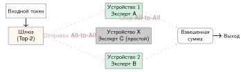

***Маршрутизация в смеси экспертов (MoE):** экспертный параллелизм распределяет «экспертов» по разным устройствам. Для каждого токена механизм-шлюз выбирает top-$k$ экспертов. Шаг коммуникации AllToAll отправляет токены на устройства, на которых размещены выбранные эксперты (1). Эксперты обрабатывают токены параллельно (2). Второй шаг AllToAll собирает результаты обратно на исходное устройство (3). Такой шаблон обеспечивает огромную емкость модели, но вносит накладные расходы коммуникации «все со всеми» (all-to-all).*

Шаблон коммуникации отличается от тензорного параллелизма: вместо all-reduce (*одни и те же данные на все устройства*) экспертный параллелизм использует all-to-all (*разные данные на разные устройства* в зависимости от маршрутизации). Этот шаблон AllToAll создает критическую системную проблему: балансировку нагрузки. Если маршрутизатор постоянно отправляет больше токенов некоторым экспертам, GPU этих экспертов становятся узкими местами, а остальные простаивают. Три механизма решают проблему дисбаланса:

- **Вспомогательная потеря** (Auxiliary Loss): дополнительное слагаемое в функции потерь при обучении штрафует неравномерную загрузку экспертов, поощряя равномерные вероятности маршрутизации.
- **Коэффициент емкости** (Capacity Factor): каждый эксперт имеет максимальное число токенов, которое он принимает за батч (обычно 1,25$\times$ от справедливой доли). Токены сверх этого предела отбрасываются или перенаправляются.
- **Буферизация экспертов** (Expert Buffering): токены буферизуются и обрабатываются на последующих итерациях, если эксперты заняты до предела, что сглаживает всплески нагрузки ценой разброса задержки.

Эти механизмы поддерживают баланс загрузки экспертов достаточно хорошо, чтобы маршрутизация оставалась преимуществом пропускной способности, а не новым источником отстающих.

#### Режимы отказа маршрутизации

Поведение маршрутизатора напрямую влияет и на производительность системы, и на качество модели. *Коллапс экспертов* — это отказ маршрутизатора на этапе обучения, при котором он сходится к небольшому подмножеству экспертов, оставляя остальных недообученными; обслуживаемая модель тогда ведет себя как небольшая плотная модель с огромным объемом памяти. *Нестабильность маршрутизации* — еще один отказ на этапе обучения: назначения колеблются, и эксперты не могут специализироваться. Обслуживание добавляет и условия перегрузки во время выполнения. Сдвиг распределения может привести к тому, что маршрутизатор, обученный на формальном тексте, перегружает конкретных «грамматических экспертов» при обслуживании разговорных данных чата, создавая горячие точки. *Отбрасывание токенов* возникает, когда эксперты с ограниченной емкостью отбрасывают токены, пропускают их вычисления и полагаются только на остаточное соединение, ухудшая качество выхода.

Эти режимы отказа следуют из базового компромисса обслуживания MoE:[^fn-moe-expert-serving] вычисления динамически маршрутизируются к разным экспертам в зависимости от входа, поэтому шаблон маршрутизации становится системной нагрузкой, а не только внутренним выбором модели. Популярные модели вроде Mixtral (Jiang et al., 2024) используют MoE для достижения высокой емкости при меньшей стоимости инференса.

[^fn-moe-expert-serving]: **Компромисс обслуживания MoE**: на каждый токен активируется лишь подмножество экспертов (обычно 2 из 8–16), что поддерживает низкое число FLOP на токен, при общем числе параметров в сотни миллиардов. Ограничение обслуживания: все веса экспертов должны находиться в памяти, хотя большая их часть простаивает на любом токене, что раздувает объем памяти в 4–8$\times$ относительно активных вычислений. Это вынуждает применять экспертный параллелизм между устройствами с коммуникацией AllToAll на каждом слое MoE.

> **Пример: экспертный параллелизм для Mixtral-8x7B**
>
> **Сценарий**: Mixtral-8x7B (46,7 млрд параметров всего, около 12,9 млрд активных на токен) обслуживается на кластере из 4 устройств GPU с маршрутизацией top-2.
>
> **Диагноз**: размещение всех 8 экспертов на всех 4 GPU создает сильную избыточность памяти. Шардирование по 2 эксперта на GPU (экспертный параллелизм на 4 части) требует операций коллективного AllToAll для диспетчеризации и сбора (около 0,4 мс), чтобы маршрутизировать токены к устройствам экспертов.
>
> **Системный урок**: экспертный параллелизм обменивает коммуникацию AllToAll на сокращение памяти параметров на GPU. Обработка токенов через 2 шардированных эксперта на GPU снижает время выполнения слоя MoE до около 1,5 мс (против около 4 мс для эквивалентного плотного слоя).

Экспертный параллелизм — пик сложности шардирования моделей; он требует тесной интеграции архитектуры модели, алгоритма маршрутизации и физической топологии межсоединений. Следующий раздел рассматривает, как рекомендательные системы используют сходные техники шардирования для огромных таблиц эмбеддингов.
### Шардирование эмбеддингов для рекомендательных систем

Рекомендательные системы обычно содержат таблицы эмбеддингов, которые по размеру многократно превышают плотные веса модели. Эталонная архитектура DLRM компании Meta использует модельный параллелизм по таблицам эмбеддингов, чтобы смягчить ограничения памяти, а плотные слои масштабирует отдельно (Naumov et al., 2019). В производственном масштабе эта структура, богатая эмбеддингами, требует стратегий шардирования, отличных от тензорного или конвейерного параллелизма.

Шардирование по строкам разбивает таблицы эмбеддингов по строкам (идентификатору сущности):

$$\text{Shard}_i = \{e_j : \text{hash}(j) \bmod N_{\text{shards}} = i\}$$

Каждый шард содержит примерно $N_{\text{entities}}/N_{\text{shards}}$ эмбеддингов, где $N_{\text{entities}}$ — общее число сущностей, а $N_{\text{shards}}$ — число шардов.

Шардирование по столбцам разбивает каждый вектор эмбеддинга между устройствами:

$$e_j = [e_j^{(0)}, e_j^{(1)}, ..., e_j^{(N_{\text{shards}}-1)}]$$

Каждое устройство хранит срез каждого эмбеддинга. Гибридное шардирование сочетает оба подхода: часто запрашиваемые эмбеддинги шардируются по столбцам для более быстрого доступа, тогда как длинный хвост использует шардирование по строкам. Выбор стратегии шардирования эмбеддингов зависит от шаблонов поиска и накладных расходов коммуникации. [Таблица](#tbl-embedding-sharding) сравнивает подходы по строкам, по столбцам и гибридный:

| **Стратегия шардирования** |    **Шаблон поиска**     | **Коммуникация** |       **Лучше всего подходит**       |
|:---------------------------|:------------------------:|:----------------:|:------------------------------------:|
| **По строкам**             | Одно устройство на поиск |  Сбор AllToAll   | Равномерный доступ                   |
| **По столбцам**            | Все устройства на поиск  |     AllGather    | Горячие эмбеддинги                   |
| **Гибридный**              | Зависит от эмбеддинга    |      Смешанная   | Производственные RecSys              |

<a id="tbl-embedding-sharding"></a>

***Стратегии шардирования эмбеддингов:** сравнение размещения эмбеддингов по строкам, по столбцам и гибридного размещения, которое балансирует локальность поиска против коллективных сетевых операций и равномерности загрузки памяти.*

Компромисс — между локальностью и балансом нагрузки. Шардирование по строкам держит каждый вектор эмбеддинга целиком на одном устройстве, что локализует поиск, но требует сбора AllToAll, чтобы собрать векторы, разбросанные по идентификаторам сущностей; шардирование по столбцам распараллеливает каждый поиск между устройствами ценой AllGather; гибридное шардирование находит компромисс, реплицируя горячие эмбеддинги по столбцам и шардируя по строкам холодный хвост. [Рисунок](#fig-embedding-sharding) показывает три раскладки, где сетевой сбор по строкам — это коллективная операция AllToAll, названная в [таблице](#tbl-embedding-sharding).

<a id="fig-embedding-sharding"></a>


***Стратегии шардирования эмбеддингов:** шардирование по строкам размещает полные векторы эмбеддингов на определенных серверах по идентификатору сущности, что требует сетевого сбора для поиска. Шардирование по столбцам разбивает каждый вектор между всеми серверами, позволяя выполнять параллельные локальные поиски с последующим AllGather, что эффективно для популярных «горячих» эмбеддингов. Гибридное шардирование сочетает эти подходы: шардирование по столбцам для горячих элементов и по строкам для «холодного» длинного хвоста, чтобы балансировать нагрузку и память.*

Все три стратегии шардирования работают в производственном масштабе. Инфраструктура рекомендаций Meta дает конкретный пример того, как подходы по строкам, по столбцам и гибридный сочетаются для обслуживания таблиц эмбеддингов на триллионы сущностей.

> **Архетип B (DLRM в масштабе): шардирование эмбеддингов в Meta**
>
> Для рабочей нагрузки архетипа B инфраструктура Meta демонстрирует шардирование эмбеддингов в экстремальном масштабе:
>
> **Масштаб**:
>
> - Таблицы эмбеддингов: более 100 ТБ всего
> - Уникальные сущности: более 10 трлн
> - Размерность эмбеддинга: 128–256
> - Шарды: более 1 000 серверов
>
> Эти пункты про масштаб описывают общие итоги на уровне инфраструктуры, а не одну плотную резидентную таблицу, в которой у каждой уникальной сущности есть вектор размерностью 128–256. Плотная таблица INT8 с 10 трлн сущностей и 128 измерениями потребовала бы не менее 1 280 ТБ, тогда как 100 ТБ на то же число сущностей составляют в среднем лишь 10 байт на сущность. Поэтому производственная система опирается на сжатие, многоуровневое хранение, холодное хранилище и неравномерное покрытие сущностей, а не на одну полностью материализованную плотную матрицу.
>
> **Стратегия шардирования**:
>
> - **Горячие эмбеддинги** (верхний 1 % по частоте обращений): реплицируются на все шарды
> - **Теплые эмбеддинги** (следующие 10 %): шардированы по столбцам с параллелизмом на 8 частей
> - **Холодные эмбеддинги** (остальные 89 %): шардированы по строкам с консистентным хешированием
>
> Каждый запрос инференса требует примерно 5 000 поисков эмбеддингов. Без оптимизации это потребовало бы 5 000 сетевых обходов туда и обратно. Вместо этого система применяет несколько оптимизаций. Накопление батча собирает поиски в течение 1 мс. Дедупликация удаляет повторяющиеся сущности между запросами. Батчинг с учетом шардов группирует поиски по целевому шарду. Параллельная диспетчеризация отправляет батчевые запросы на все шарды одновременно. Потоковая сборка восстанавливает эмбеддинги по мере прихода ответов.
>
> Порядок величины эффекта этих оптимизаций на число обходов, задержку поиска и пропускную способность показан в [таблице](#tbl-inference-meta-embedding-perf):
>
> | **Метрика**              | **Без оптимизации** | **С оптимизацией** |
> |:-------------------------|:-------------------:|:------------------:|
> | **Сетевые обходы туда и обратно** |        5 000        |     1 (батчевый)   |
> | **Задержка поиска**      |        50 мс        |        2 мс        |
> | **Сетевая пропускная способность** |      10 Гбит/с      |   40 Гбит/с (пиковая) |
>
> <a id="tbl-inference-meta-embedding-perf"></a>
>
> ***Производительность поиска по шардированным эмбеддингам Meta:** измерения сетевых обходов туда и обратно, задержки поиска и пропускной способности для пути поиска рекомендаций до и после батчинга и диспетчеризации с учетом шардов, показывающие эффект на порядок величины.*
>
> Главный урок архетипа: обслуживание в масштабе DLRM определяется размещением разреженных эмбеддингов и координацией поиска, а не плотными FLOP/с ускорителя.

### Гибридные стратегии шардирования

Производственные системы часто сочетают несколько стратегий шардирования, потому что ни одна ось не удовлетворяет все ограничения инференса. Гибридное шардирование объединяет требования к памяти, задержке и коммуникации: одна ось может удерживать веса резидентными, другая — снижать задержку на токен, а третья — маршрутизировать разреженные компоненты, не загоняя плотные слои на неподходящее устройство. Три повторяющиеся комбинации иллюстрируют этот шаблон.

Тензорный и конвейерный параллелизм сочетаются, когда модели требуют одновременно распределения памяти и снижения задержки:

```
8 GPU, организованных как 2 на 4 (этапы конвейера на тензорный параллелизм):

Этап 0 (слои 1–40):  TP на GPU 0, 1, 2, 3
Этап 1 (слои 41–80): TP на GPU 4, 5, 6, 7
```

Сочетание дает снижение задержки в 4$\times$ (за счет TP), обеспечивая при этом модели, которым для памяти требуется шардирование на 8 частей.

Экспертный и тензорный параллелизм сочетаются для MoE-моделей, в которых отдельные эксперты велики:

```
Mixtral с крупными экспертами:

- Экспертный параллелизм: распределить 8 экспертов по 8 группам GPU
- Тензорный параллелизм: каждый эксперт распределен по 2 GPU
- Всего GPU: 16
```

Параллелизм эмбеддингов и плотных слоев обслуживает рекомендательные модели, у которых велики и эмбеддинги, и плотные компоненты:

```
Модель масштаба DLRM:

- Шардирование эмбеддингов: 1 000 шардов на CPU-серверах
- Плотная модель: тензорный параллелизм на 8 GPU
- Коммуникация: эмбеддинги собираются на GPU, обрабатываются и возвращаются
```

Гибридное шардирование решает задачу размещения или задержки, добавляя новые шаблоны коммуникации на каждой границе между шардами. Следующий вопрос — остается ли «налог на коммуникацию» в пределах бюджета задержки и пропускной способности.

### Анализ накладных расходов коммуникации

Практическое ускорение от шардирования критически зависит от эффективности коммуникации. Каждая стратегия шардирования имеет характерные шаблоны коммуникации с различными требованиями к пропускной способности и задержке.

Уравнение ниже количественно определяет время коммуникации AllReduce для тензорного параллелизма, где данные объединяются со всех устройств, а результат доступен на всех устройствах:

$$T_{\text{allreduce}} \approx 2(N-1)\alpha + \frac{2(N-1)}{N} \times \frac{M}{\beta}$$

где $N$ — число устройств, $M$ — размер полезной нагрузки коллективной операции, $\alpha$ — задержка запуска, а $\beta$ — пропускная способность межсоединения. Множитель 2 учитывает фазы reduce-scatter и all-gather. В приложении о коммуникации (раздел «AllReduce») выводится стоимость кольцевого AllReduce и его масштабирование $2(N-1)/N$, оптимальное по пропускной способности; это объясняет, почему накладные расходы коммуникации на слой остаются ограниченными по мере роста степени тензорного параллелизма.

Уравнение ниже выражает более простую коммуникацию «точка–точка» для конвейерного параллелизма, где данные передаются от одного устройства к следующему:

$$T_{\text{p2p}}(n) = \alpha + \frac{n}{\beta}$$

где $n$ — размер полезной нагрузки «точка–точка», $\alpha$ — задержка сети, а $n/\beta$ — время передачи. Следующее уравнение описывает более сложную коммуникацию AllToAll для экспертного параллелизма, где каждое устройство обменивается различными данными с каждым другим устройством:

$$T_{\text{alltoall}} = (N-1) \times \left(\alpha + \frac{M/N}{\beta}\right)$$

Оба уравнения показывают, что достижимые пропускная способность $\beta$ и задержка $\alpha$ базового межсоединения определяют реальную производительность шардирования. Производственное оборудование различается по обеим осям достаточно сильно, чтобы выбор межсоединения мог решить, будет ли план шардирования жизнеспособным.

Накладные расходы коммуникации сильно зависят от технологии межсоединения. [Таблица](#tbl-inference-interconnect-specs) фиксирует физическую пропускную способность, задержку и предполагаемую область применения каждого кандидатного межсоединения:

| **Межсоединение**  |          **Пропускная способность**          |   **Задержка**   |     **Область применения**     |
|:-------------------|:--------------------------------------------:|:----------------:|:-----------------------------:|
| **NVLink (H100)**  |                  900 ГБ/с                    |      500 нс      | TP внутри узла                |
| **PCIe Gen5**      |                  64 ГБ/с                     |       1 мкс      | Внутри узла (без NVLink)      |
| **InfiniBand HDR** |        200 Гбит/с (25 ГБ/с)                   |       7 мкс      | Между узлами                  |
| **Ethernet 100G** |       100 Гбит/с (12,5 ГБ/с)                  |      50 мкс      | Между узлами (массовое оборудование) |

<a id="tbl-inference-interconnect-specs"></a>

***Спецификации центров обработки данных по межсоединениям:** пропускная способность, задержка и предполагаемая область применения NVLink, PCIe Gen5, InfiniBand HDR и 100G Ethernet, задающие физические пределы, которые ограничивают достижимое ускорение от шардирования.*

[Таблица](#tbl-inference-allreduce-interconnect) переводит эти пропускные способности во время AllReduce для слоя тензорного параллелизма на 8 частей (активация 8 МБ на операцию all-reduce; батч = 1, скрытая размерность = 8 192) как долю 30-мс бюджета слоя трансформера:

| **Межсоединение** |   **Время AllReduce**   | **Доля от слоя 30 мс** |
|:------------------|:-----------------------:|:----------------------:|
| **NVLink**        |        0,03 мс          |        0,10 %         |
| **InfiniBand**    |        0,56 мс          |          1,9 %         |
| **100G Ethernet** |        1,12 мс          |          3,7 %         |

<a id="tbl-inference-allreduce-interconnect"></a>

***Стоимость AllReduce по межсоединениям:** время AllReduce для активации 8 МБ по NVLink, InfiniBand и 100G Ethernet, каждое как доля 30-мс бюджета слоя трансформера, показывающее, почему тензорный параллелизм внутри узла требует пропускной способности класса NVLink.*

Инженерная граница локальна: NVLink делает тензорный параллелизм эффективным внутри узла, InfiniBand может сделать тензорный параллелизм между узлами приемлемым для тщательно выбранных нагрузок, а массовый Ethernet обычно слишком медленен для инференса, чувствительного к задержке.

Пропускная способность NVLink[^fn-nvlink-bandwidth-inf] заметно менялась от поколения к поколению GPU.

[^fn-nvlink-bandwidth-inf]: **Эволюция пропускной способности NVLink**: каждое поколение NVLink повышает потолок локальной коммуникации, но реальные накладные расходы тензорного параллелизма по-прежнему зависят от размера сообщения, реализации коллектива, топологии и того, сколько вычислений может перекрыться с передачей.

### Выбор стратегии шардирования

Выбор стратегии шардирования зависит от архитектуры модели и приоритетов развертывания. [Таблица](#tbl-sharding-selection) оценивает каждый подход по четырем ключевым факторам:

| **Фактор**                | **Тензорный параллелизм** | **Конвейерный параллелизм** | **Экспертный параллелизм** | **Шардирование эмбеддингов** |
|:--------------------------|:-------------------------:|:---------------------------:|:--------------------------:|:----------------------------:|
| **Приоритет задержки**    |       Лучше всего         |          Хуже всего         |          Умеренно          |             Н/Д              |
| **Приоритет пропускной способности** |     Хорошо         |     Лучше всего (конвейер)  |           Хорошо           |         Лучше всего          |
| **Ограничение межсоединением** |     Плохо подходит    |         Подходит            |          Умеренно          |           Подходит           |
| **Трудозатраты на реализацию** |        Высокие        |            Низкие           |          Средние           |           Высокие            |

<a id="tbl-sharding-selection"></a>

***Руководство по выбору стратегии шардирования:** оценка тензорного, конвейерного, экспертного и шардирования эмбеддингов по целевым показателям задержки, приоритетам пропускной способности, ограничениям межсоединений и сложности реализации.*

Выбор стратегии начинается с узкого места развертывания. Используйте тензорный параллелизм, когда доминирует задержка и межсоединение выдерживает частые коллективные операции; конвейерный параллелизм — когда пропускная способность важнее задержки на запрос; экспертный параллелизм — когда маршрутизация MoE определяет структуру модели; а шардирование эмбеддингов — когда большие разреженные таблицы доминируют в емкости.

Когда собраны массивно шардированные реплики на нескольких GPU, десятки из них должны работать параллельно, чтобы обслужить глобальный трафик. Задача сдвигается от внутренней механики одной реплики к уровню управления трафиком, который маршрутизирует миллионы пользовательских запросов по парку.
## Балансировка нагрузки и маршрутизация запросов

Если в работе находятся десять реплик модели и поступает новый запрос на суммаризацию документа на 5 000 слов, отправка его на уже перегруженную реплику вызовет резкий скачок задержки для каждого пользователя, назначенного этому узлу. Простая балансировка по кругу (round-robin) катастрофически не работает для генеративного ML. Производственное обслуживание требует интеллектуальной маршрутизации запросов, которая оценивает внутреннее состояние памяти и очередей каждой реплики в парке.

> **Архетип B (DLRM в масштабе): хвост в масштабе**
>
> Архетип B (DLRM в масштабе) опирается на границы производительности $P_{99} \le 100\text{ мс}$. Поскольку высокопроизводительное обслуживание агрегирует $10^7$ QPS, события хвоста задержки с вероятностью $10^{-4}$ происходят 1 000 раз в секунду. Это делает необходимой маршрутизацию по схеме двух выборов, чтобы подавить задержку очереди $T_{\text{queue}}$, которая иначе доминирует над вычислениями $T_{\text{compute}}$.

### Принципы балансировки нагрузки


*Маршрутизация по схеме двух выборов сглаживает хвостовой дисбаланс случайного размещения.*

Балансировка нагрузки решает две основные цели, которые иногда конфликтуют: минимизацию задержки и максимизацию утилизации. Минимизация задержки направляет запросы на реплики, которые могут обслужить их быстрее всего, учитывая текущую глубину очереди и время обработки; максимизация утилизации равномерно распределяет нагрузку, избегая как простаивающих, так и перегруженных реплик. Противоречие возникает потому, что маршрутизация, оптимальная по задержке, может концентрировать нагрузку на быстрых репликах, снижая их производительность и оставляя другие недоиспользованными.

Поэтому оценке нужны четыре сигнала, которые охватывают и хвост задержки, и балансировку нагрузки:

- **Максимальная длина очереди**: определяет задержку в худшем случае.
- **Дисперсия нагрузки**: измеряет, насколько равномерно распределена работа.
- **Разброс утилизации**: показывает, простаивают ли одни реплики, пока другие насыщены.
- **Накладные расходы решения**: отражают стоимость выбора маршрута.

Политика, оптимизирующая только один из этих сигналов, может выглядеть здоровой в целом, отправляя при этом невезучие запросы в хвост.

### Round-robin и случайное назначение

Простейшие стратегии балансировки назначают запросы, не учитывая состояние сервера. Round-robin посылает запрос 1 на сервер 1, запрос 2 на сервер 2 и так далее, что дает идеальное распределение только тогда, когда серверы однородны, а времена обработки запросов одинаковы. Случайное назначение выбирает сервер равномерно случайным образом для каждого запроса; при большом числе запросов оно сходится к равномерному среднему распределению, но его дисперсия выше, чем у round-robin. Обе стратегии — разумные базовые варианты для одинаковых серверов, однако производственное обслуживание редко удовлетворяет этому допущению. Разнородные поколения GPU, различные конфигурации памяти, переменные размеры запросов, поведение прогрева и реплики, приближающиеся к пределам памяти, — все это делает состояние парка серверов значимым.

В этих реалистичных условиях неинформированные стратегии работают плохо, потому что неудачные назначения накапливаются в хвосте. Максимальная длина очереди при случайном назначении следует классическому результату о задаче «шары по корзинам» (balls-into-bins) (Mitzenmacher, 2001), показанному в формуле ниже:

$$E[\text{макс. очередь}] = \Theta\left(\frac{\log R}{\log \log R}\right)$$

где $R$ — число серверов или реплик. При $R = 1\,000$ отношение $\log R/\log\log R \approx 6{,}9/1{,}9 \approx 3{,}6$, которое ведущая константа поднимает примерно до 4–5 запросов в самой длинной очереди в худшем случае. Это кажется немного, но невезучие запросы в длинных очередях испытывают заметно более высокую задержку. Принцип выбора из двух дает теоретический ответ: один дополнительный опрос длины очереди меняет поведение хвоста с $\mathcal{O}(\log R / \log \log R)$ на $\mathcal{O}(\log \log R)$.

### Выбор из двух

Фундаментальный результат теории балансировки нагрузки (Mitzenmacher, 2001) показывает, что опрос всего двух случайных серверов перед принятием решения о маршрутизации дает экспоненциально лучшее распределение нагрузки, чем случайное назначение.[^fn-balls-bins-routing]

[^fn-balls-bins-routing]: **Шары по корзинам (выбор из двух)**: при случайном размещении максимальная загрузка корзины равна $\Theta(\log R / \log \log R)$; выбор менее загруженной из двух случайных корзин снижает ее до $\Theta(\log \log R)$. Выигрыш для обслуживания зависит от того, насколько точно измеренная длина очереди отражает оставшуюся работу.

Процедура намеренно мала, но сигнал нагрузки должен соответствовать нагрузке обслуживания. Для однородного парка зрения достаточно текущей длины очереди. Для парка LLM активные токены, оценка оставшейся работы декодирования и давление KV-кэша лучше приближают работу, которую реплика уже приняла. [Алгоритм](#algo-power-two-choices-routing) ниже описывает типичный цикл маршрутизации: опросить две реплики, сравнить нормализованную работу и направить запрос без опроса всего парка.

<a id="algo-power-two-choices-routing"></a>

**Алгоритм: маршрутизация запроса по схеме выбора из двух**

```text
Вход:   множество реплик S; запрос r; веса емкости w_s; сигнал работы на реплику W_s (длина очереди, активные токены, предсказанная работа или заполненность KV-кэша)
Выход:  выбранная реплика для r
выбрать две кандидатные реплики s_a, s_b из S            ▷ с учетом веса емкости
запросить W_{s_a}, W_{s_b}; оценить инкрементальную работу ĉ(r) (ожидаемые выходные токены или страницы KV)
u_s ← (W_s + ĉ(r)) / w_s для s ∈ {s_a, s_b}              ▷ нагрузка после допуска
s* ← кандидат с меньшим u_s                              ▷ при равенстве: привязка к кэшу
направить r на s*
обновить локальное состояние допуска для s*
вернуть s*
```

Два зонда и одно обновление состояния на запрос — это координация $\mathcal{O}(1)$, а не сканирование всех реплик, и выигрыш по хвосту задержки проявляется только тогда, когда сигнал нагрузки отражает реальную работу: в обслуживании LLM одно лишь число запросов может скрывать 10-токенный запрос за 500-токенным, тогда как сигналы активных токенов и KV-кэша выявляют риск. Граница длины очереди в формуле ниже формализует, почему это небольшое изменение важно, снижая максимальную длину очереди с $\mathcal{O}(\log R / \log \log R)$ до $\mathcal{O}(\log \log R)$:

$$E[\text{макс. очередь}]_{\text{два выбора}} = \Theta(\log \log R)$$

Для 1 000 серверов случайное назначение дает максимальную очередь примерно из 4–5 запросов, тогда как выбор из двух снижает максимум примерно до 2. Улучшение экспоненциальное: выбор из двух на 1 000 серверах достигает лучшего баланса, чем случайное назначение на всего 10 серверах.

> **Теорема: граница балансировки нагрузки при выборе из двух**
>
> Для $R$ серверов, получающих независимые запросы, случайное назначение дает максимальную длину очереди $\mathcal{O}(\log R / \log \log R)$ с высокой вероятностью, тогда как маршрутизация каждого запроса в более короткую из двух случайно выбранных очередей снижает максимальную длину очереди до $\mathcal{O}(\log \log R)$.
>
> Практический вывод: почти оптимальная балансировка нагрузки не требует опроса всего парка. Два зонда избегают стоимости $R$ зондов точной маршрутизации на наименее загруженный сервер, выигрыш растет с размером системы, а метод остается достаточно простым, чтобы реализовать его внутри обычных балансировщиков нагрузки. Варианты выбора из двух появляются в крупных системах, потому что они дают сильное поведение хвоста без глобального опроса.

Механизм интуитивен: случайное назначение время от времени делает плохой выбор, направляя запрос на уже занятый сервер, и эти ошибки накапливаются. При выборе из двух алгоритм почти никогда не делает худший выбор, избегая хвостового поведения, которое создает длинные очереди. Математически, когда $m$ серверов имеют длину очереди $k$, случайное назначение увеличивает длину очереди до $k+1$ с вероятностью, пропорциональной $m/R$. При выборе из двух эта вероятность падает до $(m/R)^2$, что создает сверхэкспоненциальное убывание распределения длин очередей.

### Взвешенная и адаптивная балансировка нагрузки

Когда у серверов разная емкость, наивная балансировка создает дисбаланс. Смесь GPU A100 и GPU T4 меньшей емкости, получающих одинаковые интенсивности запросов, перегрузит серверы T4, оставляя емкость A100 простаивающей. Взвешенный round-robin корректирует среднюю интенсивность назначений, направляя запросы пропорционально емкости сервера:

$$\Pr(\text{маршрут на сервер } i) = \frac{w_i}{\sum_j w_j}$$

где $w_i$ — вес, или емкость, сервера $i$. Взвешенный выбор из двух применяет ту же идею к контролю хвоста: выбирает два сервера с вероятностью, пропорциональной их весам, сравнивает текущую нагрузку относительно емкости и направляет запрос на тот, у которого меньше относительная нагрузка. Пример с весами делает эту политику конкретной для смешанного оборудования GPU.

> **Пример: неоднородный кластер GPU**
>
> **Сценарий**: кластер обслуживания смешивает 10 GPU H100 (по 1 000 QPS каждый) и 20 GPU A100 (по 600 QPS каждый), обрабатывая целевой трафик 15 000 QPS.
>
> **Диагноз**: невзвешенный round-robin направляет всем узлам одинаковое число запросов (500 QPS), оставляя H100 недозагруженными (50 %) и перегружая A100 (83,3 %). Взвешенная маршрутизация присваивает H100 вес 4,5 %, а A100 — вес 2,7 %, выравнивая утилизацию между уровнями (68,2 % против 68,2 %).
>
> **Системный урок**: неоднородным кластерам инференса нужна маршрутизация с учетом емкости. Равные объемы запросов создают неравномерную нагрузку, когда уровни оборудования имеют разные скорости обслуживания.

Статические веса учитывают известные различия емкости, но реплики в производстве также меняются со временем. Адаптивная балансировка нагрузки корректирует веса динамически на основе наблюдаемой производительности:

```
Для каждого сервера i:
    latency[i] = экспоненциальное_скользящее_среднее(наблюдаемая_задержка)
    weight[i] = 1 / latency[i]  # взвешивание по обратной задержке
```

Взвешивание по обратной задержке снижает вероятность маршрутизации на серверы, чья наблюдаемая задержка выросла, независимо от причины: давления памяти, термического троттлинга, состава запросов или фоновой работы, потребляющей ресурсы.

### Балансировка по наименьшему числу соединений

Альтернативой случайному выбору служит маршрутизация на сервер с наименьшим числом активных соединений или самой короткой очередью. Least-connections (по наименьшему числу соединений) поддерживает счетчик активных запросов для каждого сервера, направляет новый запрос на минимальный счетчик, увеличивает его при отправке и уменьшает при завершении. Для долгих запросов, распространенных в обслуживании LLM, это превосходит round-robin, потому что учитывает работу, которая еще выполняется, а не только историческую последовательность назначений.

Сложность в поддержании точных счетчиков соединений в распределенной системе. Централизованный счетчик дает единый источник истины, но может стать узким местом. Распределенные счетчики с распространением сплетнями (gossip) лучше масштабируются, но могут маршрутизировать на основе устаревшей информации. Выборочный least-connections сочетает эту идею с выбором из двух, опрашивая только подмножество серверов и выбирая минимум.

> **Пример: наименьшее число соединений для обслуживания LLM**
>
> **Сценарий**: парк обслуживания LLM обрабатывает запросы с сильно различающейся длиной выходной последовательности (500 мс для 10 токенов против 25 секунд для 500 токенов).
>
> **Диагноз**: round-robin назначает работу на основе исторического числа запросов, оставляя узлы, которые обрабатывают длинные генерации, перегруженными (P99 = 45 с), пока простаивающие узлы ждут. Least-connections направляет новую работу на узлы с наименьшим числом активных запросов в полете.
>
> **Системный урок**: маршрутизация least-connections учитывает оставшуюся работу в полете, а не историческое число назначений. Для обслуживания LLM с переменной длиной выхода least-connections снижает хвостовую задержку P99 на 38 % (с 45 с до 28 с).

### Консистентное хеширование для маршрутизации с состоянием

Многие нагрузки инференса поддерживают состояние, которое выигрывает от аффинности маршрутизации. Сервис LLM может хранить KV-состояние завершенных ходов как кэш сессии, рекомендательные сессии несут пользовательский контекст и недавние взаимодействия, а потоковый инференс может зависеть от состояния модели из предыдущих кадров. Для этих нагрузок маршрутизация одного и того же пользователя или сессии на один и тот же сервер может избежать промахов кэша и восстановления состояния. API LLM без состояния, который получает полный диалог в каждом запросе, не нуждается в такой аффинности; он все же может использовать маршрутизацию с учетом префиксов, когда переиспользуемый префикс случайно оказался в кэше.

**Консистентное хеширование**[^fn-consistent-hashing-kv] (Karger et al., 1997) сопоставляет запросы серверам на основе хеша ключа маршрутизации (идентификатора пользователя, идентификатора сессии):

[^fn-consistent-hashing-kv]: **Консистентное хеширование**: алгоритм на основе кольца был разработан для крупномасштабного распределенного кэширования в Akamai (Karger et al., 1997). Его свойство ограниченного переназначения позже оказалось полезным всюду, где изменения состава системы должны сохранять локальность кэша.

$$\text{сервер}(\text{запрос}) = \operatorname{arg\,min}_{s \in \mathcal{S}_{\text{srv}}} \text{расстояние}(\text{hash}(key), \text{hash}(s))$$

где $\mathcal{S}_{\text{srv}}$ — множество серверов, отображенных на кольцо, а каждый запрос направляется на ближайший по часовой стрелке сервер.

Важные свойства — детерминированность, ограниченное нарушение и баланс. При фиксированном составе кольца один и тот же ключ направляется на один и тот же сервер. Изменение состава переназначает только затронутые интервалы: добавление сервера перемещает около $1/(N+1)$ ключей, а удаление — примерно его долю $1/N$. Виртуальные узлы делают эти доли приблизительными, сглаживая неравномерные диапазоны хешей между физическими серверами. Для LLM-обслуживания с кэшем сессий выигрыш в том, что вероятность попадания последующего хода на реплику с переиспользуемым состоянием возрастает. Аффинность не может предотвратить повторное предзаполнение после маршрутизации при перегрузке, сбоя, вытеснения или переназначения при изменении состава, а попадание в кэш вредно, если выбранная реплика слишком перегружена, чтобы уложиться в крайний срок запроса.

> **Пример: консистентное хеширование для аффинности KV-кэша**
>
> **Сценарий**: сервис многоходового чата LLM маршрутизирует пользовательские запросы по кластеру реплик инференса без аффинности сессии.
>
> **Диагноз**: в этом сценарии маршрутизация без аффинности отправляет последующие ходы диалога на разные реплики, заставляя каждый ход перестраивать KV-кэш с нуля (штраф 500 мс, что тратит 4,5 с за 10-ходовой диалог). При фиксированном составе консистентное хеширование детерминированно отображает идентификатор пользователя на одну реплику и сохраняет большинство отображений при изменении состава.
>
> **Системный урок**: консистентное хеширование улучшает локальность KV-кэша в многоходовых сессиях без полного переназначения ключей при масштабировании. Оно снижает избыточное предзаполнение, когда предпочтительная реплика остается исправной и своевременной, но маршрутизация при перегрузке, вытеснение, сбой и доля переназначенных ключей все еще требуют передачи или восстановления кэша.

Та же машинерия маршрутизации с состоянием становится границей корректности, когда кэшированное состояние специфично для пользователя.

> **Случай из практики: когда состояние кэша переходило между пользователями (2023)**
>
> **Контекст**: ChatGPT использовал Redis Cluster через клиент redis-py для кэширования пользовательской информации и названий диалогов в высоконагруженной системе обслуживания (OpenAI, 2023).
>
> **Механизм**: из-за гонки в пуле соединений Asyncio отмененные запросы оставляли непрочитанные ответы в переиспользуемых буферах соединений, из-за чего последующие запросы получали данные кэша, принадлежавшие предыдущим пользователям.
>
> **Последствия**: 20 марта 2023 года OpenAI отключила ChatGPT, после того как пользователи сообщили, что видят названия диалогов и платежные данные других активных пользователей.
>
> **Исправление**: OpenAI отправила мейнтейнерам Redis патч для пути отмены в redis-py и добавила избыточные проверки, что данные, возвращенные из кэша, принадлежат запрашивающему пользователю.
>
> **Системный урок**: инфраструктура инференса с состоянием требует гарантий изоляции для кэшей, пулов соединений и ключей маршрутизации. Кэш — часть границы корректности обслуживания, а не просто оптимизация.
### Маршрутизация запросов для шардированных моделей

Стратегии шардирования, разобранные в разделе «Шардирование модели для инференса», вносят сложность маршрутизации: один запрос инференса может требовать вычислений на нескольких устройствах, что требует координации. Шаблон маршрутизации зависит от стратегии шардирования.

При тензорном параллелизме каждый запрос рассылается на все устройства группы шардирования. Каждое устройство обрабатывает свою часть каждого слоя, а результаты синхронизируются через AllReduce. [Рисунок](#fig-tensor-parallel-routing) показывает этот шаблон: рассылку, вычисление и сбор.

<a id="fig-tensor-parallel-routing"></a>

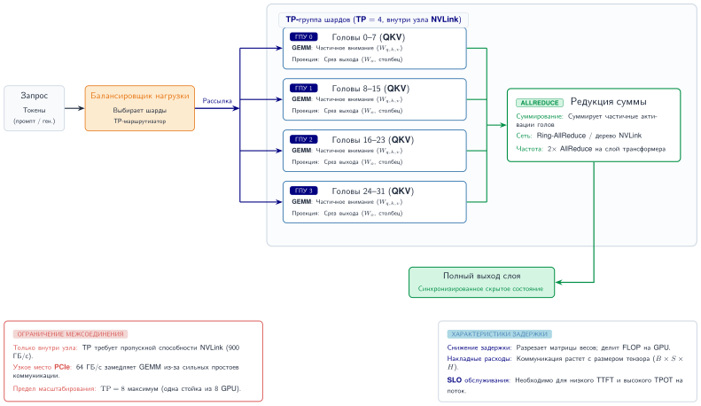

***Маршрутизация запроса при тензорном параллелизме:** запрос рассылается от балансировщика нагрузки на все устройства группы шардирования. Каждый GPU вычисляет назначенную ему часть голов внимания, затем одна операция AllReduce синхронизирует результаты перед возвратом ответа. Пропускная способность межсоединения, а не размер модели, определяет задержку.*

Ключевое ограничение, видимое на [рисунке](#fig-tensor-parallel-routing), состоит в том, что каждый запрос требует синхронизации AllReduce между всеми устройствами группы шардирования, поэтому определяющим задержку фактором становится пропускная способность межсоединения, а не размер модели.

При конвейерном параллелизме каждый запрос последовательно проходит этапы, и каждый этап передает активации следующему. [Рисунок](#fig-pipeline-parallel-routing) показывает, как конвейеризация нескольких запросов дает масштабирование пропускной способности, хотя задержка одного запроса равна сумме времен всех этапов.

<a id="fig-pipeline-parallel-routing"></a>


***Запрос при конвейерном параллелизме:** (а) один запрос последовательно проходит четыре этапа — выигрыша в задержке от параллелизма нет. (б) несколько запросов заполняют конвейер: в установившемся режиме пропускная способность растет с числом этапов, тогда как задержка на запрос остается примерно постоянной.*

Ключевой вывод [рисунка](#fig-pipeline-parallel-routing): конвейерный параллелизм не дает выигрыша в задержке одного запроса, поскольку он все равно проходит все этапы последовательно. Пропускная способность растет, только когда несколько одновременных запросов заполняют конвейер и достигают установившейся пропускной способности, пропорциональной числу этапов.

При экспертном параллелизме каждый запрос отправляется на устройства, на которых размещены выбранные им эксперты, согласно решению шлюза. Два шага коммуникации AllToAll обрамляют вычисления экспертов ([рисунок](#fig-expert-parallel-routing)).

<a id="fig-expert-parallel-routing"></a>


***Запрос при экспертном параллелизме (MoE):** шлюз выбирает top-$k$ экспертов; диспетчеризация AllToAll отправляет токены на GPU, на которых размещены эти эксперты; эксперты вычисляют параллельно; второй AllToAll собирает результаты. Нижняя панель сравнивает несбалансированную маршрутизацию (один эксперт становится узким местом) со сбалансированной (равномерная загрузка благодаря вспомогательной потере).*

Эти два шага коммуникации AllToAll делают экспертный параллелизм особенно чувствительным к дисбалансу нагрузки: если функция шлюза сосредотачивает токены на нескольких экспертах, их устройства становятся узкими местами, а остальные простаивают.

Когда несколько групп шардирования обеспечивают горизонтальное масштабирование, балансировщик нагрузки направляет запросы группам, а не отдельным устройствам. [Рисунок](#fig-shard-group-scaling) показывает эту двухуровневую иерархию: стандартные алгоритмы балансировки (round-robin, выбор из двух, консистентное хеширование) работают на уровне группы, а каждая группа обрабатывает собственный внутренний AllReduce локально.

<a id="fig-shard-group-scaling"></a>

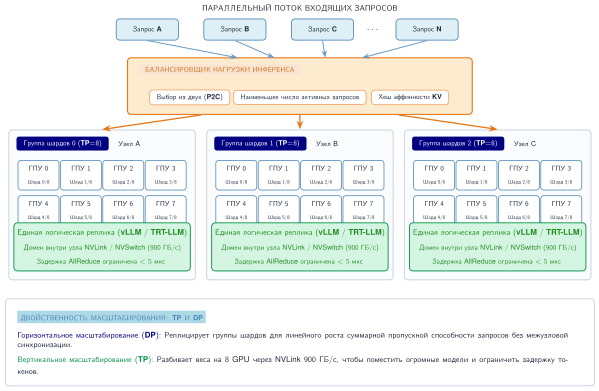

***Горизонтальное масштабирование группами шардирования:** балансировщик нагрузки рассматривает каждую группу шардирования как один логический сервер инференса. Внутри каждой группы 8 GPU координируются через тензорный параллелизм. Добавление групп масштабирует пропускную способность линейно; добавление GPU в группу уменьшает задержку на запрос.*

Двухуровневая иерархия на [рисунке](#fig-shard-group-scaling) разделяет задачи: балансировщик нагрузки рассматривает каждую группу шардирования как один логический сервер, используя стандартные алгоритмы, а внутренняя координация AllReduce остается локальной для каждой группы. Добавление групп шардирования масштабирует пропускную способность линейно; добавление GPU в группу уменьшает задержку на запрос.

### Проверка работоспособности и отказоустойчивость

Балансировщики нагрузки могут обходить отказы, только если сигнал работоспособности соответствует режиму отказа. Для обслуживания ML процесс, который жив, все равно может быть непригоден: веса не загружены, пул памяти GPU исчерпан или первый запрос запустит долгий прогрев. Поэтому производственные системы выстраивают проверки работоспособности от самых дешевых к самым реалистичным.

Зонды живости проверяют, что процесс сервера запущен:

```
GET /health/live
Ответ: 200 OK (процесс работает) или тайм-аут (процесс остановлен)
```

Зонды готовности идут дальше и проверяют, что сервер может обрабатывать запросы (модель загружена, GPU инициализирован):

```
GET /health/ready
Ответ: 200 OK (готов к обслуживанию) или 503 (не готов)
```

Глубокие проверки работоспособности проверяют, что реальный инференс работает, выполняя тестовый запрос:

```
POST /health/inference
Тело: {"prompt": "test"}
Ответ: 200 OK с корректным выводом или ошибка
```

Глубокие проверки — главная защита от отказа, которого не существует в традиционных веб-серверах: тихой деградации аппаратного обеспечения. GPU с деградировавшими модулями HBM может продолжать отвечать на проверки HTTP 200 на уровне процесса, тихо отказывая на реальных запросах из-за давления памяти или непрогретого состояния модели.

> **Пример: проверки работоспособности для инференса на GPU**
>
> **Сценарий**: серверы инференса на GPU проходят стандартные проверки HTTP 200 на уровне процесса, но тихо отказывают на реальных запросах из-за давления памяти или непрогретого состояния модели.
>
> **Диагноз**: стандартные зонды не проверяют выделение памяти GPU (`MIN_REQUEST_MEMORY`) или состояние прогрева модели, поэтому деградировавшие узлы получают производственный трафик и вызывают сбои генерации.
>
> **Системный урок**: проверка работоспособности инференса на GPU требует многоуровневых зондов (живость, готовность, глубокая проверка). Зонды готовности должны проверять доступность памяти GPU и состояние прогрева, а глубокие проверки — сверять распределения выходных логитов с ожидаемыми границами.

### Количественный анализ: влияние алгоритма балансировки нагрузки

Выбор алгоритма балансировки нагрузки количественно влияет на производительность системы. Рассмотрим систему со 100 серверами, 10 000 QPS и переменными размерами запросов (CV = 0,5). [Таблица](#tbl-lb-comparison) количественно описывает компромиссы по задержке и накладным расходам:

| **Алгоритм**          | **Макс. очередь** | **Задержка P99** | **Накладные расходы CPU** |
|:----------------------|:-----------------:|:----------------:|:-------------------------:|
| **Случайный**         |    4,2 запроса    |       45 мс      |        Минимальные        |
| **Round-robin**       |    2,8 запроса    |       32 мс      |        Минимальные        |
| **Выбор из двух**     |    1,9 запроса    |       24 мс      |      2 зонда на запрос    |
| **Наименьшее число соединений** |  1,4 запроса |       19 мс      |     Глобальное состояние  |
| **Выбор из двух + LC** |    1,2 запроса    |       17 мс      |      2 зонда + состояние  |

<a id="tbl-lb-comparison"></a>

***Сравнение алгоритмов балансировки нагрузки:** компромиссы между случайной маршрутизацией, round-robin, выбором из двух, наименьшим числом соединений и гибридной маршрутизацией; показано, как опрашивающие состояние зонды снижают задержку P99 ценой накладных расходов плоскости управления.*

[Таблица](#tbl-lb-comparison) показывает знакомый компромисс обслуживания: случайная маршрутизация и round-robin держат накладные расходы CPU около нуля, но оставляют более длинные очереди и больший разброс задержки; выбор из двух примерно вдвое снижает задержку p99 при всего двух зондах на запрос; наименьшее число соединений улучшает результат дальше, когда стоимость запроса меняется, но требует глобального состояния; а сочетание выбора из двух с наименьшим числом соединений дает самые короткие очереди при наибольшей сложности реализации.

Для многих систем обслуживания выбор из двух дает хороший компромисс между улучшением производительности и сложностью реализации. Наименьшее число соединений добавляет ценность для нагрузок с высокой дисперсией размера запроса (обслуживание LLM, ранжирование в рекомендациях).

### Предохранители и обратное давление

Когда сервер инференса на GPU замедляется, маршрутизация на него еще большего числа запросов может превратить локальное замедление в отказ всего парка. Тепловой троттлинг — типичный триггер: реплика, которая обычно обслуживает запрос за 50 мс, начинает тратить 500 мс, за ней накапливаются очереди, тайм-ауты клиентов порождают повторные попытки, а эти повторы переносят нагрузку на соседние реплики. Балансировщику нагрузки нужен способ перестать считать такую реплику просто медленной и начать считать ее недоступной.

**Шаблон предохранителя** (circuit breaker)[^fn-circuit-breaker-serving] (Nygard, 2007) обеспечивает такой контроль. В замкнутом состоянии сервер получает обычный трафик. Когда частота ошибок, частота тайм-аутов или задержка превышают порог, предохранитель размыкается, и запросы либо быстро завершаются с ошибкой, либо направляются в другое место, вместо того чтобы ждать за насыщенной очередью. После интервала восстановления предохранитель переходит в полуоткрытое состояние: он пропускает небольшое число зондирующих запросов, замыкается, если они успешны, и снова размыкается, если нет. Важное системное свойство — ограниченный радиус поражения. Отказавшая реплика теряет трафик достаточно быстро, чтобы ее очередь не могла экспортировать перегрузку на остальной парк.

[^fn-circuit-breaker-serving]: **Предохранитель (circuit breaker)**: название происходит от электрического устройства защиты, которое прерывает ток до того, как перегруженная цепь нанесет более широкий ущерб.

Распространение обратного давления дополняет предохранитель, делая перегрузку видимой выше по потоку. Когда глубина очереди пересекает порог, сервер возвращает сигнал, например `503 Service Unavailable`; балансировщик нагрузки помечает реплику как деградировавшую и направляет на нее меньше запросов. Если все реплики становятся деградировавшими, система переходит от управления маршрутизацией к управлению допуском, отклоняя часть запросов на границе, а не принимая работу, которую не сможет обслужить в пределах SLO задержки. Предохранители изолируют нездоровые реплики; обратное давление велит остальной системе замедлиться, пока повторные попытки не усилили отказ.

Обратное давление работает только тогда, когда контракт запроса распространяется по всему графу обслуживания. Шлюз преобразует тайм-аут клиента в абсолютный дедлайн, и каждый последующий этап вычитает прошедшее время, прежде чем допустить дополнительную работу. Если клиент отключился или дедлайн истек, отмена должна дойти до поставленной в очередь работы CPU, батчей ускорителя, вызовов поиска и потокового вывода. Отмененный запрос, который остается в непрерывном батче, — это «зомби-работа»: он потребляет страницы KV-кэша и пропускную способность декодирования, не производя полезного ответа. Некоторые ядра нельзя прервать на полпути запуска, поэтому отмена обычно вступает в силу на границе следующего батча или токена; планировщик должен измерять эту задержку отмены, а не обещать мгновенную вытесняемость.

Один и тот же идентификатор запроса должен связывать маршрутизацию, очередь, предзаполнение, декодирование, выделение кэша и потоковую передачу ответа. Полезная трасса обслуживания фиксирует допущенные и отклоненные запросы, задержку в очереди, TTFT, TPOT, входные и выходные токены, страницы кэша, состав батча, вытеснения, отмены и решения о запасном варианте. Совокупная утилизация ускорителя не отличает полезную работу от запоздавшей или отмененной. Показатели полезной пропускной способности SLO (goodput) и доля потраченных впустую токенов закрывают этот разрыв, показывая, какая завершенная работа соответствовала контракту и какое исполнение система выполнила уже после того, как результат потерял ценность.

Насыщенный парк LLM под давлением KV-кэша имеет три клапана сброса, которых не может предоставить общее обратное давление:

- **Вытеснение контекста**: вытеснить более старые реплики диалога из KV-кэша, чтобы уменьшить окно контекста и освободить память.
- **Спекулятивное декодирование**: отключить спекулятивное декодирование, чтобы освободить память GPU, которую занимает модель-черновик.
- **Маршрутизация на запасной вариант**: направлять новые запросы на меньшую квантованную запасную модель, пока очередь основной модели не опустеет.

Каждый ответ обменивает качество выхода или задержку на сохранение доступности, что с точки зрения пользователя часто предпочтительнее отказа. Проектировщик системы должен определить, какие режимы деградации приемлемы на каждом уровне давления, поскольку правильный компромисс зависит от приложения: ассистент реального времени переносит усечение контекста лучше, чем тихую деградацию качества.

> **Пример: предотвращение каскадного отказа**
>
> **Сценарий**: один сервер инференса на GPU испытывает тепловой троттлинг (задержка подскакивает с 50 мс до 500 мс) в парке из нескольких реплик.
>
> **Диагноз**: незащищенные балансировщики продолжают отправлять трафик на медленную реплику, заполняя очереди и порождая повторные попытки клиентов, которые каскадно переносят перегрузку на исправные соседние серверы.
>
> **Системный урок**: предохранители изолируют деградировавшие реплики GPU до того, как повторный трафик вызовет сбой всего парка. Размыкание предохранителя при нарушении порогов ошибок или задержки (уровень ошибок 50 %) обеспечивает быстрый отказ и сохраняет емкость остальных реплик.

Эффективная маршрутизация предполагает, что серверы инференса владеют базовым оборудованием. В корпоративных средах, однако, критичные производственные модели часто работают на тех же физических кластерах, что и экспериментальные модели и конечные точки разработчиков. Чтобы не дать шальному запросу ухудшить производственный сервис, нужна строгая многопользовательская изоляция и изоляция ресурсов.
## Многопользовательский режим и изоляция

Представьте критичный чат-бот службы поддержки клиентов, работающий на том же GPU-сервере, что и экспериментальный скрипт компьютерного зрения. Если экспериментальная нагрузка случайно монополизирует шину PCIe или пропускную способность памяти, чат-бот для клиентов начнет превышать тайм-ауты, нарушая SLA. Многопользовательский режим и изоляция гарантируют, что совместно размещенные нагрузки экономят деньги, не жертвуя предсказуемостью флагманских сервисов.

### Вызов многопользовательского режима

Многопользовательский режим экономит за счет эффективности затрат, операционной простоты и статистического мультиплексирования. Совместное использование инфраструктуры повышает утилизацию ресурсов, сокращает число кластеров для управления и делает совокупный трафик более предсказуемым, чем трафик любого отдельного арендатора.

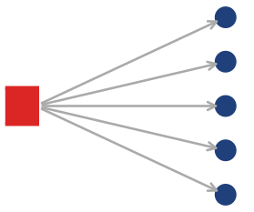

*Всплеск одного арендатора может ухудшить работу каждой нагрузки, разделяющей пул.*

Такое совместное использование создает проблему изоляции и компромиссы многопользовательского режима, которые описывает [таблица](#tbl-tenancy-comparison): шумные соседи могут сделать всплеск одного арендатора причиной деградации других, конкуренция за ресурсы охватывает память GPU, сетевую пропускную способность и такты CPU, границы безопасности должны защищать данные арендаторов, а сложность SLO возрастает, когда у арендаторов разные требования.

| **Аспект**                | **Один арендатор**     | **Многопользовательский режим** |
|:--------------------------|:----------------------:|:-------------------------------:|
| **Утилизация ресурсов**   |        30–50 %         |            70–90 %              |
| **Стоимость запроса**     |         Выше           |             Ниже                |
| **Гарантии SLO**          |         Простые        |            Сложные              |
| **Изоляция**              |         Полная         |     Требует инженерной работы   |
| **Операционные накладные расходы** | Выше (много кластеров) | Ниже (меньше кластеров) |

<a id="tbl-tenancy-comparison"></a>

***Компромиссы однопользовательского и многопользовательского развертывания:** многопользовательские развертывания удваивают утилизацию GPU и снижают стоимость запроса, но вносят риски шумного соседа, которые требуют строгих средств изоляции.*

### Проблемы шумного соседа

Проблема шумного соседа возникает, когда нагрузка одного арендатора ухудшает производительность для других, разделяющих ту же инфраструктуру. Вмешательство проявляется сразу по трем измерениям ресурсов.

Конкуренция за память GPU самая серьезная: арендатор с неожиданно длинными последовательностями может захватить непропорционально большую долю пула KV-кэша. Рассмотрим трех арендаторов, делящих пул KV-кэша на 60 ГБ с равными выделениями по 20 ГБ. Когда один арендатор начинает отправлять запросы с длинным контекстом, его выделение может разрастись до 45 ГБ, что вызывает вытеснения и снижает число одновременных последовательностей у остальных арендаторов с 200 до 75 — уменьшение размера батча на 62 %, которое напрямую ухудшает их пропускную способность. Насыщение сетевой пропускной способности усиливает этот эффект, когда арендатор, передающий много крупных ответов, занимает доступную исходящую емкость. Совместное использование времени GPU между арендаторами вносит накладные расходы переключения контекста и непредсказуемый разброс задержки. Измерение влияния шумного соседа требует одновременного учета всех трех измерений вмешательства.

> **Пример: количественная оценка влияния шумного соседа**
>
> **Сценарий**: платформа инференса обслуживает 10 арендаторов на общих GPU H100 по 100 QPS каждый при SLO P99 в 50 мс.
>
> **Диагноз**: арендатор 3 выбрасывает всплеск до 500 QPS (5$\times$ от базового уровня). Без изоляции конкуренция за память KV-кэша и вычисления каскадно приводит к нарушениям P99 задержки (22–45 мс) для всех 10 арендаторов на общем пуле.
>
> **Системный урок**: общая емкость повышает утилизацию только при строгой изоляции. Незащищенные общие пулы сводят эффективные SLO к худшему всплеску любого отдельного арендатора.

> **Пример: шумный сосед при квотах на арендатора**
>
> **Сценарий**: арендатор 3 выбрасывает всплеск до 500 QPS на общем кластере инференса с включенными квотами ресурсов на арендатора.
>
> **Диагноз**: принудительное применение квот ограничивает арендатора 3 до 120 QPS (нарушая только SLO арендатора 3), тогда как арендаторы 1–2 и 4–10 сохраняют нормальную задержку 15 мс.
>
> **Системный урок**: квоты на арендатора превращают отказы уровня всей платформы в изолированные решения контроля допуска, защищая совместно размещенных арендаторов от всплесков шумного соседа.

### Квоты ресурсов и справедливое распределение

Квоты ресурсов ограничивают то, что каждый арендатор может потребить, не давая никому монополизировать общие ресурсы. Жесткие квоты превращают совместное обслуживание в контроль допуска. Частота запросов и параллелизм ограничивают давление поступления, тогда как входные токены, выходные токены, страницы KV-кэша, время ускорителя и исходящие байты ограничивают работу, выполняемую после допуска. Один скалярный лимит не может защитить все эти ресурсы, потому что два запроса могут иметь одинаковое число, но различаться на порядки по длине промпта или сгенерированного вывода. [Листинг](#lst-resource-quotas) показывает типичные ворота, чтобы арендатора можно было ограничить на границе дефицитного ресурса, а не ухудшать весь батч.

<a id="lst-resource-quotas"></a>

***Многомерные квоты ресурсов:** контроль допуска проверяет одновременность на арендатора, выделение KV-кэша, частоту запросов и бюджеты входных и выходных токенов до допуска работы.*

```python
class TenantQuota:
    max_concurrent_requests: int  # например, 100
    max_kv_cache_mb: int  # например, 20 000
    max_qps: int  # например, 1 000
    max_input_tokens_per_minute: int
    max_output_tokens_per_minute: int
    max_batch_tokens: int  # например, 50 000


def admit_request(tenant_id, request):
    quota = get_quota(tenant_id)
    usage = get_usage(tenant_id)

    if usage.concurrent >= quota.max_concurrent_requests:
        return RateLimitError("превышен лимит одновременных запросов")
    if usage.kv_cache_mb >= quota.max_kv_cache_mb:
        return RateLimitError("превышен лимит памяти")
    if usage.qps >= quota.max_qps:
        return RateLimitError("превышен лимит частоты")
    if usage.input_tokens + request.input_tokens > quota.max_input_tokens_per_minute:
        return RateLimitError("превышен лимит входных токенов")
    if usage.output_tokens + request.max_output_tokens > quota.max_output_tokens_per_minute:
        return RateLimitError("превышен лимит выходных токенов")

    return admit(request)
```

Инвариант — отказ до вмешательства. Запрос, который превысит любую квоту арендатора, никогда не попадает в планировщик, что не дает защищенным арендаторам платить за чужой всплеск большей задержкой в очереди или давлением KV-кэша.

Мягкие квоты со справедливым распределением — более гибкая альтернатива. У каждого арендатора есть номинальная квота генерации токенов (например, 10 000 токенов в секунду), но когда кластер недозагружен (50 % емкости), арендаторы могут выбрасывать всплеск до 2$\times$ от своей квоты. Когда кластер насыщен (90 % емкости), квоты применяются. Такой подход максимизирует утилизацию в периоды низкого трафика, защищая арендаторов при конкуренции.

Когда суммарный спрос превышает емкость, справедливость max-min выделяет ресурсы так, чтобы максимизировать минимальное выделение между арендаторами. Алгоритм сначала выдает каждому арендатору равную долю, затем перераспределяет неиспользованную емкость от арендаторов, спрос которых ниже их равной доли. Сырое число запросов — неподходящая единица для этого расчета, потому что равное число запросов не означает равной нагрузки: арендатор, отправляющий запросы суммаризации с длинным контекстом, потребляет гораздо больше вычислений предзаполнения и емкости KV-кэша, чем арендатор, отправляющий короткие запросы классификации. Скорости токенов — полезные единицы учета, но входные и выходные токены должны оставаться раздельными, потому что они нагружают разные фазы. Резервирование памяти и параллелизм требуют дополнительных ограничений. Для трех арендаторов с требованиями выходов 30 000, 20 000 и 80 000 токенов в секунду, конкурирующих за пул декодирования, способный на 100 000 токенов в секунду, справедливость max-min дает выделения 30 000, 20 000 и 50 000. Такое распределение защищает пропускную способность декодирования; отдельный бюджет входных токенов защищает пул предзаполнения.

### Приоритетное планирование

Когда у арендаторов разные требования SLO, приоритетное планирование гарантирует, что запросы высокого приоритета получают ресурсы первыми. [Таблица](#tbl-priority-scheduling-classes) показывает, что права на вытеснение и гарантии ресурсов движутся вместе по трем классам: критичный трафик одновременно вытесняет любой низший класс и резервирует емкость, тогда как фоновый не вытесняет никого и не получает гарантий, поэтому уровень SLO напрямую соответствует положению в лестнице вытеснения.

| **Класс**           |   **Сценарий**    |     **Вытеснение**      | **Гарантия ресурсов** |
|:--------------------|:-----------------:|:-----------------------:|:---------------------:|
| **Критичный**       | Приносящий выручку |   Может вытеснять низшие |    100 % зарезервировано |
| **Стандартный**     |  Общий трафик     | Может вытеснять фоновые |     Взвешенная доля   |
| **Фоновый (best-effort)** | Фоновый, пакетный | Не может вытеснять  |     Без гарантий      |

<a id="tbl-priority-scheduling-classes"></a>

***Классы приоритетного планирования:** трехуровневая иерархия приоритетов для многопользовательского инференса. Критичный трафик получает 100 % зарезервированной емкости и может вытеснить любой низший класс; стандартный трафик делит емкость пропорционально и может вытеснять фоновый; фоновый работает на остаточной емкости без гарантий.*

Планировщик сортирует входящие запросы по классу приоритета, а внутри класса — по времени поступления. Когда приходит новый критичный запрос, он обгоняет все стандартные и фоновые запросы в очереди, гарантируя, что трафик, приносящий выручку, никогда не ждет за фоновыми пакетными заданиями.

Вытеснение распространяет этот принцип на запросы, уже находящиеся в работе, но приоритет не делает перемещение состояния бесплатным. На границе токена планировщик может прекратить выдавать работу декодирования запросу низкого приоритета, сохранив его страницы KV-кэша, выгрузить эти страницы в память хоста, отбросить их для последующего пересчета или отклонить запрос, если его дедлайн уже не может быть выдержан. Сохранение работает, когда HBM, а не вычисления, в избытке; выгрузка работает, только когда время передачи укладывается в дедлайн и не перегружает другой трафик; пересчет работает, когда повторное предзаполнение обходится дешевле миграции. Политика выбора жертвы должна учитывать оставшееся время обслуживания, размер состояния и запас до дедлайна, иначе агрессивное вытеснение может потребить больше емкости, чем освобождает.

### Шаблон переборки (bulkhead)

Шаблон переборки[^fn-bulkhead-service-isolation] (Nygard, 2007) физически изолирует нагрузки арендаторов, не давая отказам распространяться между арендаторами. Шаблон назван по корабельным отсекам, которые сдерживают затопление в изолированных секциях.

[^fn-bulkhead-service-isolation]: **Ограничения переборок**: перегородка изолирует отказ, только если закрывает нужную границу. Незавершенные переборки «Титаника» позволили воде перетекать между отсеками; аналогично, мягкая квота не может изолировать общую память или пропускную способность, которые остаются глобально исчерпаемыми.

Самая сильная форма переборки выделяет целые реплики конкретным арендаторам или группам арендаторов. [Рисунок](#fig-bulkhead-patterns) иллюстрирует эту изоляцию на уровне развертывания между уровнями gold и standard:

<a id="fig-bulkhead-patterns"></a>


***Шаблоны изоляции переборками:** чтобы предотвратить каскадные отказы в многопользовательских системах, переборки изолируют ресурсы. Переборки на уровне развертывания (показаны) выделяют физические реплики арендаторам высокого приоритета, обеспечивая полную изоляцию. Переборки на уровне запроса вводят строгие ограничения параллелизма внутри общих процессов. Подобно корабельным отсекам, эти границы гарантируют, что отказ или исчерпание ресурса в одном сегменте не потопит всю платформу.*

Переборки на уровне развертывания обеспечивают полную изоляцию для премиальных арендаторов, гарантируя, что их производительность никогда не зависит от других нагрузок. Цена — более низкая общая утилизация ресурсов и больше операционных накладных расходов на управление выделенной инфраструктурой.

Переборки на уровне запроса дополняют физическое разделение, ограничивая то, что любой отдельный запрос может потребить внутри общего процесса. Ограничение длины входа (например, 8 000 токенов), длины выхода (2 000 токенов) и времени выполнения (30 секунд) не дает одному патологическому запросу монополизировать GPU на минуты, пока другие запросы стоят в очереди за ним.

Изоляция отказов естественно следует из границ переборок. Когда арендатор отправляет некорректный ввод, вызывающий ошибку модели, переборка ограничивает сбой запросом этого арендатора; другие арендаторы продолжают работать как обычно, а не делят упавший рабочий процесс инференса. В многопользовательских развертываниях эти границы обычно совпадают с уровнями сервисов, каждый со своими гарантиями ресурсов.

> **Пример: конфигурация переборок для уровней API**
>
> **Сценарий**: платформа API LLM обслуживает уровни Enterprise, Professional и Free на общем и выделенном оборудовании.
>
> **Диагноз**: неразделенные многопользовательские пулы позволяют всплескам трафика уровня Free или некорректным запросам ухудшать SLO Enterprise. Изоляция переборками выделяет Enterprise выделенные пулы GPU (доступность 99,9 %), отдает 70 % емкости Professional и ограничивает уровень Free 30 % емкости по принципу best-effort.
>
> **Системный урок**: переборки концентрируют накладные расходы изоляции там, где этого требуют бизнес-требования. Аппаратное разделение гарантирует соблюдение SLA для высокоценных уровней, одновременно максимизируя утилизацию на нижних уровнях.

Изоляция арендаторов ограничивает радиус поражения избыточного спроса, но не создает емкость. Когда защищенные очереди приближаются к бюджетам задержки, сервису нужен контур управления, который может добавить реплики до того, как допуск начнет отказывать.
## Автомасштабирование и управление емкостью

Автоскейлер обслуживания, который реагирует только на среднюю утилизацию ускорителя, может масштабироваться в неверном направлении. Декодирование может насытить пропускную способность памяти, в то время как арифметические блоки кажутся простаивающими; длинные промпты могут исчерпать емкость предзаполнения раньше, чем вырастет число запросов; а поставленная в очередь работа может нарушить SLO, пока утилизация парка остается умеренной. Управляющий сигнал должен отражать невыполненную работу относительно емкости обслуживания конкретной фазы.

Для традиционной модели с фиксированной стоимостью достаточно задержки в очереди и интенсивности запросов на готовую реплику. Авторегрессивное обслуживание требует как минимум раздельных интенсивностей поступления входных и выходных токенов, активной заполненности KV-кэша и наблюдаемых скоростей обслуживания пулов предзаполнения и декодирования. Контроллер преобразует каждый сигнал в требуемое число реплик, а затем берет максимальную потребность плюс запас на отказы и прогноз. Масштабирование по полезной пропускной способности SLO (goodput) не дает контроллеру считать полезной емкостью запросы, которые завершаются после своих целевых значений TTFT или TPOT.

Масштабирование вверх и вниз требует асимметричных доказательств. Масштабирование вверх срабатывает при устойчивом росте очереди, прогнозируемом спросе или снижении запаса до дедлайна, поскольку задержка холодного старта делает запоздалые реакции дорогими. Масштабирование вниз требует низкого спроса в течение более длинного окна, достаточного резервного объема, чтобы пережить отказ одной реплики, и плана слива (drain) для запросов в полете и любого необязательного кэша сессий. Этот гистерезис предотвращает колебания, при которых реплики многократно загружают большие веса, принимают работу и завершаются, не амортизировав стоимость запуска.

Контроллеру также нужна наблюдаемость, которая отличает спрос от поврежденного предложения. Интенсивность запросов, входные и выходные токены, возраст очереди, TTFT, TPOT, пропущенные дедлайны, отказы допуска, готовые реплики, сбои загрузки модели и скорость обслуживания по каждой фазе образуют минимальный набор обратной связи. Без измерений готовности реплик и скорости обслуживания автоскейлер может реагировать на больную реплику добавлением холодных реплик бесконечно, в то время как исходный отказ остается скрытым.

> **Пример: временная шкала холодного старта для Llama-70B**
>
> **Сценарий**: автоскейлинговый движок выделяет новую реплику обслуживания Llama-70B на инстансе GPU H100 во время внезапного всплеска трафика.
>
> **Диагноз**: при допущениях сценария запуск новой реплики занимает около 7 минут ($T_{\text{cold start}} = T_{\text{provision}} + T_{\text{load}} + T_{\text{warmup}}$): 5 минут на загрузку 140 ГБ артефактов модели из объектного хранилища и 1 минута на загрузку на устройство и прогрев. Реактивное автомасштабирование не успевает поглотить всплеск до истечения тайм-аутов запросов.
>
> **Системный урок**: задержка холодного старта зависит от размера артефактов, эффективной пропускной способности хранилища, задержки выделения, компиляции и прогрева. Контроллер должен измерять это распределение и начинать выделение достаточно заранее, чтобы его высокий процентиль укладывался в горизонт прогноза; упреждение в 5–10 минут специфично для этого сценария.

> **Пример: всплеск трафика ChatGPT**
>
> **Сценарий**: ChatGPT вырос с нуля до 100 млн активных пользователей за два месяца, создав беспрецедентные всплески трафика в глобальных кластерах инференса.
>
> **Диагноз**: быстрое принятие пользователями вызвало сильные узкие места холодного старта и крайнее давление на KV-кэш, что привело к насыщению очередей по всему парку и тайм-аутам запросов при неоптимизированных стеках обслуживания.
>
> **Системный урок**: всплески трафика масштаба интернета превращают задержку холодного старта и объем KV-кэша из деталей настройки инфраструктуры в связывающие ограничения архитектуры системы. Устойчивый быстрый рост требует сочетания предварительно прогретых пулов GPU с непрерывным батчингом на уровне итераций и маршрутизацией с состоянием.

> **Пример: предиктивное масштабирование под трафик**
>
> **Сценарий**: коммерческий сервис чат-бота сталкивается с предсказуемыми суточными паттернами трафика: рост с 500 QPS ночью до 3 000 QPS в пик.
>
> **Диагноз**: реактивное масштабирование запускает наращивание только после прихода трафика, вызывая перегрузки из-за 7-минутной задержки холодного старта во время утренних подъемов трафика (06:00 и 09:00 UTC).
>
> **Системный урок**: предиктивное автомасштабирование превращает суточные прогнозы временных рядов в запланированные окна предварительного прогрева, как показано в разбивке расписания ([таблица](#tbl-inference-chatbot-predictive-schedule)). Запуск наращивания за 30 минут до ожидаемых подъемов гарантирует, что реплики полностью прогреты к приходу трафика.
>
> <a id="tbl-inference-chatbot-predictive-schedule"></a>
>
> | **Время** | **Действие** | **Активных реплик** | **Запускаемых реплик** |
> |:----------|:------------:|:-------------------:|:----------------------:|
> | 05:30     | Масштабирование вверх | 5          | +10 прогреваются       |
> | 06:00     | Рост трафика | 15                  | –                      |
> | 08:30     | Масштабирование вверх | 15         | +15 прогреваются       |
> | 09:00     | Пик трафика  | 30                  | –                      |
> | 17:00     | Масштабирование вниз | 20          | −10 завершаются        |
> | 20:00     | Масштабирование вниз | 10          | −10 завершаются        |
> | 00:00     | Масштабирование вниз | 5           | −5 завершаются         |
>
> ***Расписание предиктивного масштабирования:** действия масштабирования по временным интервалам, активные реплики и реплики в процессе прогрева холодного старта для нагрузки чат-бота.*
>
> **Системный вывод**: реактивный автоскейлер должен перепровизионировать при каждом подъеме (около 45 реплик в пике), потому что не может предвидеть кривую. Предиктивное масштабирование подгоняет парк под фактический пик (30 реплик), возвращая примерно 33 % расходов на GPU без жертвы запасом по задержке.

Экономия, показанная в примере «Предиктивное масштабирование под трафик», зависит от предвидения трафика до его прихода. Проактивное выделение ресурсов избегает нарушений SLO, которые испытывают системы, работающие только реактивно, в периоды подъема ([рисунок](#fig-predictive-reactive-scaling)).

<a id="fig-predictive-reactive-scaling"></a>

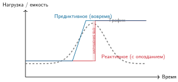

***Предиктивное и реактивное масштабирование:** реактивное масштабирование (красная линия) реагирует на всплески трафика после их возникновения, что ведет к периодам недостаточного выделения, когда SLO нарушаются из-за задержки холодного старта. Предиктивное масштабирование (синяя линия) предвидит трафик и начинает выделять емкость до прихода всплеска, обеспечивая стабильную производительность.*

### Управление прогретым пулом

Поддержание пула предварительно прогретых реплик сокращает эффективное время холодного старта, покупая готовность простоя до прихода спроса. Размер прогретого пула начинается с ожидаемого всплеска и пропускной способности на реплику:

$$\text{Размер прогретого пула} = \frac{\text{Макс. ожидаемый всплеск}}{\text{Пропускная способность на реплику}} \times \text{Коэффициент запаса}$$

Например, если максимальный ожидаемый всплеск вдвое превышает обычный, а коэффициент запаса равен 1,5, парку нужно, чтобы до прихода всплеска был доступен втрое больший объем минимального пула:

$$\text{Прогретый пул} = 2 \times 1{,}5 = 3 \times \text{минимальной емкости пула}$$

Стоимость поддержания прогретых реплик составляет $\text{Размер пула} \times \text{стоимость GPU в час} \times \text{доля простоя}$, создавая прямой компромисс между скоростью реакции и расходами на простаивающую емкость. Многоуровневые прогретые пулы, сведенные в [таблице](#tbl-warm-pool-tiers), решают этот компромисс, поддерживая реплики на разных уровнях готовности, каждый с собственной задержкой активации и стоимостью:

| **Уровень** | **Состояние**                | **Время отклика** | **Стоимость (относительно)** |
|:------------|:-----------------------------|:-----------------:|:----------------------------:|
| **Горячий** | GPU загружен, работает       |     Мгновенно     |            100 %             |
| **Теплый**  | GPU выделен, модель загружена |       30 с       |            60 %              |
| **Холодный** | GPU не выделен              |      5+ мин       |             0 %              |

<a id="tbl-warm-pool-tiers"></a>

***Уровни готовности многоуровневого прогретого пула:** три уровня готовности задают компромисс между задержкой активации и стоимостью простаивающей емкости. Горячие реплики мгновенно поглощают всплески по полной цене; теплые активируются за 30 секунд при 60 % стоимости; холодные ничего не стоят, но выходят в строй за пять минут. Производственные развертывания сочетают малый горячий пул, больший теплый пул и неограниченную холодную емкость.*

При всплеске трафика последовательность масштабирования немедленно активирует горячие реплики, переводит теплые в работу в течение 30 секунд и запускает холодный старт новых экземпляров, только если спрос сохраняется сверх емкости теплого пула. Типичная конфигурация поддерживает 2 горячие реплики для мгновенного поглощения всплесков и 5 теплых реплик для устойчивых всплесков, при неограниченной холодной емкости у облачного провайдера.

### Анализ времени реакции масштабирования

Бюджет реакции масштабирования — это сумма задержек обнаружения, решения, выделения и прогрева в контуре управления. Уравнение ниже делает эти фазы явными:

$$T_{\text{response}} = T_{\text{detect}} + T_{\text{decide}} + T_{\text{provision}} + T_{\text{warmup}}$$

[Таблица](#tbl-scaling-response-components) раскладывает каждый член и указывает основной путь оптимизации:

| **Компонент**    | **Длительность** |     **Оптимизация**     |
|:-----------------|:----------------:|:-----------------------:|
| **Обнаружение**  |    10–60 с       | Сократить интервал метрик |
| **Решение**      |     1–5 с        |  Более быстрый автоскейлер |
| **Выделение**    |   30 с–5 мин     |      Прогретые пулы     |
| **Прогрев**      |     5–30 с       |     Предкомпиляция      |

<a id="tbl-scaling-response-components"></a>

***Компоненты времени реакции масштабирования:** четыре фазы события масштабирования с типичными длительностями и основным рычагом оптимизации. Выделение доминирует в бюджете на порядок, поэтому прогретые пулы — оптимизация с высоким рычагом для парков, чувствительных к задержке.*

У каждого компонента есть свои возможности оптимизации. Скорость обнаружения повышается при сборе метрик с интервалом 1 секунда вместо 60 секунд, ценой более шумных сигналов и большего объема метрик. Скорость решения повышается за счет заранее вычисленных планов масштабирования для прогнозируемых сценариев, так что при срабатывании триггера система выполняет готовый план, а не вычисляет его с нуля. Скорость выделения растет драматичнее всего за счет прогретых пулов, которые полностью устраняют фазу выделения для ожидаемого спроса. Скорость прогрева растет за счет предкомпилированных движков инференса, которые пропускают just-in-time (JIT) компиляцию, сокращая последнюю фазу с 30 секунд до менее 5.

### Спотовые и вытесняемые инстансы

Облачные провайдеры могут предлагать GPU-инстансы со скидкой[^fn-spot-instance-inference], которые могут быть отозваны с коротким предупреждением, поэтому решение о планировании состоит в том, может ли нагрузка слиться, перенаправиться или пересчитать работу, не нарушая SLO. [Таблица](#tbl-gpu-instance-types) описывает три класса GPU-инстансов и нагрузки, для которых каждый лучше всего подходит:

[^fn-spot-instance-inference]: **Экономика спотовых инстансов**: скидки провайдеров и уведомления о прекращении различаются по регионам, типам инстансов и времени. Для инференса отзыв может уничтожить запросы в полете и состояние KV-кэша, поэтому любая экономия должна покрывать стоимость слива, перенаправления и восстановления емкости.

| **Тип инстанса**     | **Скидка** | **Уведомление о прерывании** |  **Сценарий**   |
|:---------------------|:----------:|:----------------------------:|:---------------:|
| **По требованию**    |     0 %    |            Никогда           |  Критичные к SLO |
| **Зарезервированные** |   30–60 %  |            Никогда           | Стабильная база |
| **Спотовые/вытесняемые** |  60–90 % |          30 с–2 мин          | Пиковая емкость |

<a id="tbl-gpu-instance-types"></a>

***Типы GPU-инстансов по цене и надежности:** три класса GPU-инстансов обменивают скидку на риск прерывания. «По требованию» — эталонная цена без прерываний; зарезервированные инстансы обменивают предварительное обязательство на умеренную скидку; спотовые инстансы обменивают риск вытеснения на крупную экономию. Производственные парки часто держат базу из зарезервированных и инстансов по требованию, а всплески уводят на спотовую емкость для трафика best-effort.*

Обработка прерывания спотового инстанса — гонка с окном предупреждения провайдера. [Листинг](#lst-spot-termination) упорядочивает путь остановки так, чтобы сначала прекращался новый прием работы, работа в полете сливалась, пока есть время, восстанавливаемое состояние сохранялось, а балансировщик нагрузки переставал направлять трафик до исчезновения инстанса.

<a id="lst-spot-termination"></a>

***Обработка прерывания спотового инстанса:** корректная последовательность остановки: прекращает допуск, снимает регистрацию с балансировщика нагрузки, сливает запросы в полете и сохраняет восстанавливаемое состояние.*

```python
async def handle_spot_termination():
    # Получено предупреждение за 2 минуты
    # 1. Прекратить допуск и удалить реплику из маршрутизации
    stop_accepting_requests()
    deregister_from_loadbalancer()

    # 2. Завершить запросы в полете (если возможно)
    await complete_inflight(timeout=90)

    # 3. Сохранить состояние для возобновления в другом месте
    save_kv_cache_to_storage()

    # 4. Корректно завершить работу
    shutdown()
```

Порядок важен, потому что шаги не взаимозаменяемы. Прекращение допуска и снятие регистрации в первую очередь не дают новым запросам приходить в окне слива; затем обработчик завершает работу в полете, сохраняет восстанавливаемое состояние и выключается до дедлайна прекращения.

Архитектура с учетом спота делит трафик между репликами по требованию и спотовыми по классу SLO ([рисунок](#fig-spot-aware-routing)). Запросы, критичные к SLO, всегда направляются на емкость по требованию, тогда как запросы best-effort несут экономию и риск прерывания спотовых инстансов.

<a id="fig-spot-aware-routing"></a>


***Распределение трафика с учетом спота:** балансировщик нагрузки направляет 70 % трафика на реплики по требованию (гарантированная доступность) и 30 % на спотовые реплики (экономия, риск вытеснения). Запросы, критичные к SLO, всегда используют инстансы по требованию; запросы best-effort терпят редкие повторные попытки при вытеснении. В типичном сценарии скидки смешанный парк дает примерно 18–27 % снижения стоимости по сравнению со 100 % по требованию.*

Разделенная архитектура на [рисунке](#fig-spot-aware-routing) дает примерно 18–27 % снижения стоимости по сравнению с полностью парком по требованию в типичном сценарии скидки, при этом принимая риск вытеснения только для трафика best-effort и сохраняя запросы, критичные к SLO, на гарантированной емкости.
### Глобальная инфраструктура инференса

Расширение изоляции ресурсов и границ отказов за пределы одного центра обработки данных приводит к глобальной инфраструктуре. Глобальное обслуживание становится необходимым, когда расстояние, домены отказов или требования к локализации данных выходят за пределы того, что может скрыть один регион. Пользователь в Токио ожидает ответа с низкой задержкой независимо от того, где обучались модели и где находится штаб-квартира компании; инженерный выбор состоит в том, реплицировать вычисления, кэшировать повторяющуюся работу или централизовать модель и платить сетевым штрафом. Архитектурные схемы полезны, только если они привязаны к этому выбору.

#### Почему важна многорегиональность

Развертывание в одном регионе создает три фундаментальных ограничения. Самое непосредственное — нижний предел задержки, который задает время кругового прохода сети (RTT) до удаленных пользователей, количественно описанное в [таблице](#tbl-rtt-by-user-location):

| **Местоположение пользователя** | **RTT до US-East** | **RTT до локального региона** |
|:--------------------------------|:------------------:|:-----------------------------:|
| **Нью-Йорк**                    |       10 мс        |            10 мс              |
| **Лондон**                      |       75 мс        |            10 мс              |
| **Токио**                       |       150 мс       |            10 мс              |
| **Сидней**                      |       200 мс       |            10 мс              |

<a id="tbl-rtt-by-user-location"></a>

***Сетевой RTT по местоположению пользователя:** единственное развертывание в US-East накладывает RTT от 75 до 200 мс на европейских, азиатских и австралийских пользователей, что на порядок выше нижнего предела локального региона. Для интерактивных нагрузок, где каждый запрос делает несколько вызовов модели, этот нижний предел задержки быстро накапливается, что мотивирует многорегиональное развертывание для любой глобально распределенной аудитории.*

Для интерактивных приложений (чат-боты, автодополнение) эти задержки накапливаются по нескольким вызовам модели на запрос. Помимо задержки, развертывание в одном регионе создает единую точку отказа: отказы облачных регионов, хотя и редки, поражают всех пользователей одновременно. Регуляторные ограничения добавляют третье измерение: требования к локализации данных (Общий регламент по защите данных GDPR и законы о суверенитете данных) могут требовать обработки пользовательских данных внутри конкретных географических границ. Получающиеся схемы образуют лестницу решений: региональные реплики стоят дороже всего в развертывании, но минимизируют RTT и изолируют региональные отказы; краевое кэширование требует операционной сложности только тогда, когда запросы повторяются; а межрегиональное шардирование — крайнее средство при нехватке емкости, потому что задержка между регионами перекрывает вычисления на каждом этапе.

#### Схема 1: глобальная балансировка с региональными репликами

Каждый регион запускает независимые реплики инференса с одинаковыми моделями. Глобальный балансировщик нагрузки направляет каждого пользователя в ближайший регион на основе измеренной задержки кругового прохода ([рисунок](#fig-global-inference-multiregion)). Общий реестр моделей синхронизирует веса между регионами во время выкатов.

<a id="fig-global-inference-multiregion"></a>

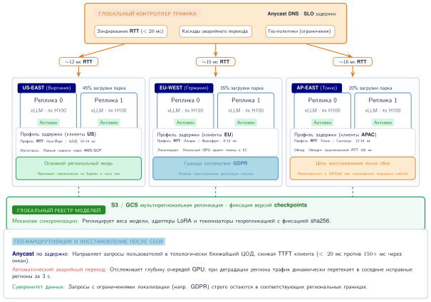

***Глобальная балансировка нагрузки между регионами инференса:** глобальный балансировщик нагрузки направляет запросы в три независимых региональных развертывания (US-East, EU-West, Asia-Pacific) по задержке. Каждый регион работает независимо; общий реестр моделей синхронизирует веса. При отказе региона балансировщик перенаправляет трафик в следующий по близости исправный регион.*

Независимые региональные реплики снижают RTT с 150–200 мс до менее 10 мс для удаленных пользователей, а общий реестр моделей обеспечивает согласованность между развертываниями. Синхронизация моделей — первая архитектурная задача: обновления должны распространяться во все регионы. Синхронизация с push-моделью позволяет центральному реестру отправлять обновления в каждый регион, что просто, но создает возможное окно несогласованности; синхронизация с pull-моделью позволяет регионам опрашивать обновления, обменивая более высокую задержку выката на более строгую согласованность; гибридная синхронизация сочетает push-уведомление с pull-проверкой. Согласованность версий — вторая задача. Во время выкатов разные регионы могут кратковременно обслуживать разные версии. Для большинства приложений это приемлемо, но приложениям, требующим строгой согласованности, нужна фиксация версии в маршрутизации запросов.

#### Схема 2: краевое кэширование с центральным инференсом

Для моделей, слишком больших для глобального тиражирования, кэширование ответов на периферии устраняет избыточный инференс для повторяющихся запросов. [Рисунок](#fig-edge-cache-routing) показывает два пути: попадание в кэш возвращается менее чем за 10 мс с ближайшего периферийного узла; промах в кэше проходит весь бэкенд и заполняет кэш при возврате.

<a id="fig-edge-cache-routing"></a>


***Пути попадания и промаха в краевом кэше:** попадание в кэш возвращается немедленно с периферийного узла CDN (менее 10 мс). Промах проходит до центрального инференса и заполняет кэш при возврате. Доля попаданий определяет эффективную экономию стоимости; открытые генеративные нагрузки имеют низкую повторяемость и мало выигрывают от этой схемы.*

Два пути на [рисунке](#fig-edge-cache-routing) подчеркивают разницу в задержке: попадания в кэш избегают обхода бэкенда, а промахи его несут. Эффективность зависит от повторяемости запросов в таких нагрузках, как автодополнение, FAQ-чатботы, открытый чат и генерация кода. [Таблица](#tbl-edge-cache-hit-rates) приводит иллюстративные диапазоны доли попаданий для анализа чувствительности; реальный проект должен выводить долю попаданий и корректность из производственных трасс.

| **Нагрузка**        | **Доля попаданий в кэш** | **Пригодность** |
|:--------------------|:------------------------:|:---------------:|
| **Автодополнение**  |         60–80 %         |    Отлично      |
| **FAQ-чатбот**      |         40–60 %         |     Хорошо      |
| **Открытый чат**    |         5–15 %          |      Плохо      |
| **Генерация кода**  |         20–40 %         |    Умеренно     |

<a id="tbl-edge-cache-hit-rates"></a>

***Иллюстративные диапазоны доли попаданий в краевом кэше:** предполагаемые диапазоны попаданий в кэш для четырех форм нагрузки. Эти значения — входные данные сценариев, а не универсальная статистика нагрузок. Повторяемость, выведенная из трасс, валидность ответов и сэкономленная задержка определяют, стоит ли кэширование того.*

Семантическое кэширование[^fn-semantic-cache-tradeoff] (кэширование на основе сходства эмбеддингов, а не точного совпадения) может повысить долю попаданий для открытых нагрузок.

[^fn-semantic-cache-tradeoff]: **Семантическое кэширование**: поиск по сходству может переиспользовать ответы за пределами точного совпадения строк, но добавляет работу по извлечению и может вернуть недопустимый ответ, когда поверхностно похожие запросы требуют разных ответов. Порог сходства поэтому обменивает охват кэша на корректность.

#### Схема 3: межрегиональное шардирование модели

Межрегиональное шардирование модели — стратегия крайней меры для емкости, а не обычная оптимизация задержки. Для самых больших моделей конвейерный параллелизм теоретически может охватывать регионы: маршрутизатор назначает ранние слои одному региону, а поздние — другому. Этот шаблон редко практичен, потому что сетевая задержка между регионами (75–150 мс) доминирует над временем вычислений на этап (1–5 мс), делая межрегиональный конвейерный параллелизм в 10–100$\times$ медленнее развертывания в одном месте. Он применим, только когда ни один регион не имеет достаточной емкости GPU для всей модели.

Поскольку межрегиональное шардирование так дорого на установившемся пути, большинство производственных схем держат инференс в одном месте, а другие регионы используют для отказоустойчивости. Вопрос о межрегиональном шардировании смещается от разделения одного запроса между регионами к решению о том, как быстро трафик может переместиться при отказе региона.

#### Межрегиональный аварийный переход

Когда регион становится недоступным, трафик должен перенаправляться в исправные регионы. [Листинг](#lst-active-failover) показывает логику маршрутизации active-active при аварийном переходе, которая переходит на следующий исправный регион после тайм-аута или недоступности.

<a id="lst-active-failover"></a>

***Активный-активный аварийный переход:** глобальная маршрутизация, которая сначала обращается к основной региональной конечной точке со строгим тайм-аутом, а затем переходит на вторичный исправный регион.*

```python
# Упрощенная логика глобальной маршрутизации
def route_request(user_region, request):
    primary = get_nearest_healthy_region(user_region)
    secondary = get_second_nearest_healthy_region(user_region)

    try:
        return call_region(primary, request, timeout=2.0)
    except (Timeout, RegionUnavailable):
        # Переход на запасной регион с возросшей задержкой
        return call_region(secondary, request, timeout=5.0)
```

Обслуживание LLM с состоянием усложняет аварийный переход по сравнению с обычной HTTP-маршрутизацией, потому что принимающий регион должен поглотить и трафик, и утерянное состояние сессии. Потеря аффинности сессии означает, что пользователи в середине диалога теряют состояние KV-кэша, поэтому резервный регион должен восстановить контекст из истории диалога. Принимающий регион также видит внезапный всплеск емкости, что требует заранее выделенного запаса, обычно на 30–50 % выше установившегося уровня, или принятия ухудшенной задержки во время перехода. Когда отказавший регион восстанавливается, постепенный возврат переносит трафик обратно достаточно медленно, чтобы избежать колебаний.

#### Глобальное развертывание модели

Развертывание обновлений моделей между регионами требует аккуратной координации. Поэтапный выкат начинается с канареечного развертывания в одном регионе (обычно 1 % трафика), затем наблюдается в течение 1–4 часов и постепенно расширяется на другие регионы. Каждая точка расширения — ворота: если доля ошибок превышает 0,1 % или задержка P99 выходит за пределы целевой, выкат останавливается. Откат переключает затронутый регион обратно на предыдущую версию модели, сохраняя новую версию для отладки. Ключевой инвариант: ни один регион не переходит на новую версию, пока предыдущий регион не продемонстрировал исправные метрики в течение достаточного окна наблюдения.

Здоровье глобального развертывания требует мониторинга четырех метрик как по регионам, так и глобально, как указано в [таблице](#tbl-global-deployment-health-metrics):

| **Метрика**           |    **По регионам**     |           **Глобально**           |
|:----------------------|:----------------------:|:---------------------------------:|
| **Доля ошибок**       |     $< 0{,}1\%$        |           $< 0{,}1\%$             |
| **Задержка P99**      | $< \text{цель}$        |        $< 2\times$ одного региона |
| **Пропускная способность** |   Стабильная       |             Стабильная            |
| **Качество модели**   |   В допустимых пределах |  Согласованное между регионами   |

<a id="tbl-global-deployment-health-metrics"></a>

***Показатели здоровья глобального развертывания:** четыре показателя, отслеживаемые на уровне регионов и глобально во время поэтапных выкатов. Пороги по регионам выявляют локальные регрессии; глобальные пороги ловят межрегиональные эффекты (например, рост P99 более чем в 2$\times$ от целевого одного региона), которые не покажет ни одна проверка по региону.*

#### Оптимизация стоимости по регионам

Цены на GPU различаются по провайдеру, контракту, региону и времени. В [таблице](#tbl-gpu-region-pricing) использован гипотетический снимок цен, чтобы показать, как размещение может балансировать стоимость и требования к задержке; ее не следует использовать для закупок:

| **Регион**  | **Спотовая цена H100** | **По требованию** | **Задержка до пользователей в США** |
|:------------|:----------------------:|:-----------------:|:-----------------------------------:|
| **US-East** |       \$2,50/ч         |     \$4,00/ч      |             10–50 мс                |
| **US-West** |       \$2,30/ч         |     \$3,80/ч      |             30–70 мс                |
| **EU-West** |       \$2,80/ч         |     \$4,20/ч      |            75–100 мс                |

<a id="tbl-gpu-region-pricing"></a>

***Гипотетический снимок региональных цен и задержек:** сценарные цены и RTT иллюстрируют расчет размещения. Оба входа зависят от времени и провайдера; перед принятием решения о маршрутизации развертывание должно обновить их по своему контракту и измеренным сетевым путям.*

Маршрутизация с учетом стоимости направляет нагрузки, толерантные к задержке (пакетный инференс, фоновая обработка), в самый дешевый доступный регион ([листинг](#lst-cost-aware-routing)).

<a id="lst-cost-aware-routing"></a>

***Маршрутизация с учетом стоимости:** маршрутизатор с приоритетами направляет низкоприоритетные пакетные запросы в самый дешевый регион с доступной емкостью, а чувствительный к задержке интерактивный трафик — в ближайший регион.*

```python
def route_batch_request(request):
    if request.priority == "low":
        # Направить в самый дешевый регион с емкостью
        return get_cheapest_region_with_capacity()
    else:
        # Направить в ближайший регион
        return get_nearest_region(request.user_location)
```

Маршрутизация по времени суток может снизить затраты на 20–40 % для пакетных нагрузок, сохраняя SLO для интерактивного трафика.

Агрессивное масштабирование глобальной инфраструктуры очень эффективно, но и исключительно дорого. Чтобы дополнительно сгладить кривую стоимости больших развертываний, проектировщики систем меняют фундаментальное численное представление модели, чтобы выполнять ее быстрее и потреблять меньше памяти, — через квантование.
## Квантование весов для обслуживания

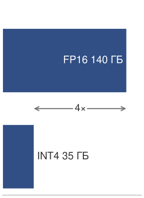

*INT4 превращает модель на двух GPU в кандидата на один GPU.*

Квантование весов для обслуживания — это решение о выборе узкого места: снижение весов с 16-битных чисел с плавающей точкой до 8- или 4-битных целых может превратить языковую модель на 140 ГБ в FP16, которой нужны два GPU A100, в представление INT4 на 35 ГБ, которое помещается на одном GPU. Компромисс — небольшая потеря точности в обмен на снижение спроса на пропускную способность памяти и емкость в 4$\times$.

> **Перспектива: квантование как ограничение обслуживания**
>
> В системах обслуживания квантование — не просто техника сжатия модели; оно меняет связывающий ресурс. Посттренировочное квантование может уменьшить развернутую модель без переобучения, тогда как обучение с учетом квантования тратит усилия обучения на сохранение точности при меньшей разрядности. Системный вопрос — какое ограничение ослабляет представление с меньшей разрядностью: емкость памяти GPU, пропускную способность HBM во время декодирования, поддержку инструкций ускорителя или стоимость обслуживаемого токена. Основы точности изложены в разделах «Инженерия точности» и «Посттренировочное квантование и обучение с учетом квантования» главы 9.

Квантование снижает численную точность весов и активаций модели, уменьшая объем памяти в 2–4$\times$ и одновременно повышая пропускную способность декодирования, которая ограничена пропускной способностью памяти, а не вычислениями. Решение об обслуживании — что именно должно сжаться: резидентные веса для размещения, байты, передаваемые на шаг декодирования, для пропускной способности, активации для пропускной способности предзаполнения или путь точности, поддерживаемый целевым оборудованием. Обслуживание в масштабе также вводит особые трудности: модели нужно квантовать после обучения без доступа к обучающим данным, качество должно сохраняться на разнообразных входах, а целевые аппаратные платформы варьируются от ускорителей центров обработки данных до периферийных. Поэтому производственному инференсу нужна модель решений, а не перечень методов. Модель решений в [таблице](#tbl-serving-quantization-decision-model) привязывает выбор метода к ограничению обслуживания, которое связывает систему.

| **Связывающее ограничение обслуживания** | **Изменение представления** | **Семейство методов** | **Риск, который нужно проверить перед выкатом** |
|:-----------------------------------------|:----------------------------|:----------------------|:------------------------------------------------|
| Модель не помещается в памяти            | Квантовать только веса      | GPTQ, AWQ             | Несоответствие калибровки и регрессия качества  |
| Декодирование ограничено пропускной способностью | Уменьшить байты, читаемые на токен | Пути W4A16 только для весов | Поддержка ядер и запас KV-кэша          |
| Предзаполнение ограничено вычислениями   | Квантовать веса и активации | SmoothQuant W8A8      | Выбросы активаций и аппаратный путь INT8        |
| Выбросы блокируют низкую точность        | Сменить базис координат до квантования | Методы на основе вращения | Накладные расходы преобразования и ограниченный путь времени выполнения |

<a id="tbl-serving-quantization-decision-model"></a>

***Модель решений для квантования при обслуживании:** методы квантования полезны, только если они ослабляют ресурс, который связывает систему обслуживания. Семейство методов следует из узкого места: размещение, пропускная способность, вычисления предзаполнения или устойчивость к выбросам.*

### Специфичные для LLM трудности квантования

Большие языковые модели ставят особые задачи квантования, отличные от моделей зрения или рекомендаций. Проблема выбросов активаций возникает потому, что некоторые головы внимания производят величины активаций на порядки больше типичных значений. Наивное квантование отсекает эти выбросы, вызывая значительную деградацию качества.

Рассмотрим слой языковой модели, где большинство значений активаций умеренны, но отдельные каналы дают гораздо большие выбросы (Xiao et al., 2023). Симметричное квантование INT8 с диапазоном [-127, 127] не имеет безболезненного выбора масштаба: широкий диапазон сохраняет выбросы, но сжимает типичные значения в слишком малое число корзин, а узкий диапазон сохраняет разрешение для типичных значений, но отсекает выбросы и вносит большие ошибки.

Распределение выбросов объясняет, почему специализированные методы, которые следуют, различаются: каждый защищает свою часть контракта обслуживания.

### GPTQ: послойное квантование весов

Обобщенное посттренировочное квантование (GPTQ) (Frantar et al., 2023) — выбор только для весов, когда развертывание требует 4-битного сжатия после обучения и может позволить себе калибровочные данные. Его ценность для обслуживания в том, что модель становится меньше без полного переобучения. Риск в том, что округление одного веса меняет выход слоя таким образом, что последующие веса должны его компенсировать. GPTQ решает этот риск, используя калибровочные активации, чтобы оценить, какие ошибки весов важнее всего,[^fn-hessian-second-order] затем компенсируя оставшиеся некватованные веса по мере округления каждого столбца.

[^fn-hessian-second-order]: **Матрица Гессе в квантовании**: приближение $\mathbf{H} = \mathbf{X}^T \mathbf{X}$ ранжирует локальную чувствительность выхода при калибровочных входах. GPTQ использует эту информацию, чтобы компенсировать ошибку квантования, вместо того чтобы считать, что каждый вес вносит одинаковый вклад.

GPTQ обрабатывает модель послойно, квантуя каждую матрицу весов столбец за столбцом[^fn-gptq-column-wise] и компенсируя еще некватованные столбцы, так что выход слоя смещается как можно меньше. Следствие для обслуживания — двухчастная стоимость развертывания: проход калибровки по 128–256 репрезентативным образцам, которые должны соответствовать производственному трафику, и послойное обновление второго порядка, которое превращает квантование в работу офлайн длительностью от минут до часов, а не в одноразовое приведение типа. Обе стоимости оплачиваются до развертывания, поэтому не затрагивают задержку обслуживания, но набор калибровки, искажающий смесь производственного трафика, — это режим отказа, который нужно проверить перед выкатом.

[^fn-gptq-column-wise]: **Поколоночное обновление GPTQ (Generalized Post-Training Quantization)**: GPTQ раскладывает обратную матрицу Гессе $H^{-1}$ по Холецкому, так что компенсация становится устойчивым треугольным обновлением: после округления столбца $q$ остаточная ошибка распространяется на столбцы $q{+}1{:}$ с весами $[H^{-1}][:,q{+}1{:}] / [H^{-1}]_{qq}$. Разложение избегает пересчета полной обратной матрицы для каждого столбца, давая работу $\mathcal{O}(d_{\text{row}} \cdot d_{\text{col}}^2)$ вместо наивной $\mathcal{O}(d_{\text{row}} \cdot d_{\text{col}}^3)$. Масштабирование по группам (размер группы 128) дает каналам выбросов более мелкий шаг, чем единый масштаб на матрицу.

[Таблица](#tbl-gptq-performance) сводит производительность GPTQ по размерам моделей Llama:

| **Модель**    | **Биты** | **Рост перплексии** | **Снижение памяти** | **Время квантования** |
|:--------------|:--------:|:-------------------:|:-------------------:|:---------------------:|
| **Llama-7B**  |    4     |         +0,3        |       4$\times$    |        15 мин         |
| **Llama-13B** |    4     |         +0,2        |       4$\times$    |        30 мин         |
| **Llama-70B** |    4     |        +0,15        |       4$\times$    |        3 часа         |

<a id="tbl-gptq-performance"></a>

***Производительность GPTQ по размерам Llama:** качество квантования остается удивительно стабильным при росте размера модели: модель на 70 млрд теряет меньше перплексии, чем модель на 7 млрд, при той же цели в 4 бита. Снижение памяти равномерно составляет 4$\times$. Время квантования растет почти линейно с размером модели, определяемое послойными обновлениями второго порядка.*

Сильные стороны GPTQ — быстрое квантование без переобучения, минимальная потеря качества для 4-битных весов и широкая совместимость с оборудованием. Ограничения включают требование калибровочных данных, чувствительность к выбору калибровочного набора и послойную обработку, которая не может использовать межслойную информацию.

### AWQ: квантование весов с учетом активаций

Квантование весов с учетом активаций (AWQ) (Lin et al., 2024) атакует ту же цель обслуживания только весов с другой стороны — со стороны активаций. Проход калибровки измеряет величины активаций по каналам, и веса, питающие несколько каналов с большой величиной, масштабируются вверх перед квантованием (с соответствующим масштабом, включенным в следующий слой), так что эти существенные веса сохраняют разрешение, а остальные квантуются агрессивно. Его преимущество для обслуживания перед GPTQ в том, что защита существенных каналов избавляет от прохода обратной связи по ошибкам для каждого столбца, так что калибровка легче и не требует эталонного выхода; риск, который нужно проверить, — масштабирование существенных каналов должно объединяться с развернутым графом без отдельной операции времени выполнения, иначе выигрыш по памяти съедается дополнительным ядром.

[Таблица](#tbl-awq-vs-gptq) сводит, как AWQ сравнивается с GPTQ по компенсации ошибок, стоимости калибровки, качеству, скорости и совместимости с оборудованием.

| **Аспект**                 |        **GPTQ**          |       **AWQ**          |
|:---------------------------|:------------------------:|:----------------------:|
| **Компенсация ошибок**     | Корректирует оставшиеся веса | Масштабирует существенные каналы |
| **Данные калибровки**      |     128–256 образцов     |      128 образцов      |
| **Качество (4 бита)**      |          Высокое         |        Отличное        |
| **Скорость**               |         Быстрее          |     Немного медленнее  |
| **Совместимость с оборудованием** |        Широкая    |         Широкая        |

<a id="tbl-awq-vs-gptq"></a>

***AWQ против GPTQ:** AWQ масштабирует существенные каналы вместо компенсации остаточной ошибки, достигает более высокого качества при 4 битах при незначительно более медленной калибровке и совпадает с GPTQ по совместимости с оборудованием.*

В представительных условиях AWQ может обеспечить на 0,5–1 процентный пункт меньшую деградацию перплексии, чем GPTQ при той же разрядности, что делает его правдоподобным выбором, когда бюджет качества жесткий.

### SmoothQuant: перенос трудности квантования

SmoothQuant (Xiao et al., 2023) — путь обслуживания для развертываний W8A8, где важно квантование активаций, особенно предзаполнение, ограниченное вычислениями. Активации несут непредсказуемые выбросы, которые ломают INT8; веса — нет. SmoothQuant делит активации на поканальный масштаб и умножает соответствующие веса на тот же масштаб, алгебраически тождественное преобразование, которое оставляет выход слоя неизменным, перенося трудно квантуемый диапазон из активаций в более снисходительные веса. Его следствие для обслуживания в том, что масштабы складываются в существующие веса и дешевое деление активаций, так что сглаженная модель работает на стандартном пути INT8 с почти нулевыми накладными расходами времени выполнения; риск, который нужно проверить, — миграция лишь переносит выбросы, а не удаляет их, поэтому калибровочный набор, экстремумы активаций которого отличаются от производственных, все еще может отсекать значения.

В режиме развертывания W8A8 SmoothQuant позволяет квантовать INT8 и веса, и активации. [Таблица](#tbl-smoothquant-w8a8) показывает, как W8A8 сравнивается с базовым FP16 и квантованием только весов:

| **Конфигурация**         | **Память** | **Ускорение предзаполнения** | **Ускорение декодирования** | **Качество**     |
|:-------------------------|:----------:|:----------------------------:|:---------------------------:|:----------------:|
| **FP16 (базовая)**       |  1$\times$ |          1$\times$           |         1$\times$           |     Базовое      |
| **W8A16 (только веса)**  |  2$\times$ |         1,3$\times$          |        1,8$\times$          | $<0{,}5\%$ потери |
| **W8A8 (SmoothQuant)**   |  2$\times$ |        1,8–2$\times$         |       1,3–1,5$\times$       |  $<1\%$ потери   |

<a id="tbl-smoothquant-w8a8"></a>

***W8A8 SmoothQuant против квантования только весов:** W8A8 квантует и веса, и активации в INT8, удваивая экономию памяти и открывая ускорение предзаполнения, ограниченного вычислениями, но его ускорение декодирования ниже, чем у W8A16, потому что декодирование ограничено пропускной способностью памяти, а меньшие веса W8A8 уже учитываются более простой схемой квантования только весов.*

Ключевое различие: W8A8 дает около 2$\times$ ускорения для предзаполнения, ограниченного вычислениями (обработка батча с начальным промптом), но лишь 1,3–1,5$\times$ для декодирования, ограниченного пропускной способностью памяти (генерация токенов по одному). Обслуживание LLM обычно тяжело на декодировании, поэтому реальные улучшения пропускной способности от W8A8 часто составляют 1,3–1,7$\times$, а не теоретические 2$\times$ вычислительной пропускной способности тензорных ядер INT8.

### Квантование на основе вращения

Традиционные методы квантования (GPTQ, AWQ, SmoothQuant) справляются с выбросами через компенсацию или миграцию. **Квантование на основе вращения** (Ashkboos et al., 2024) — агрессивный путь, когда выбросы активаций блокируют более низкую точность: оно математически преобразует пространство весов и активаций, чтобы полностью устранить выбросы.

Фундаментальная идея: выбросы — артефакты представления в базисе координат. Вращение в другой базис распределяет экстремальные значения равномерно, делая все значения пригодными для квантования.

#### QuaRot (квантование с вращением)

QuaRot вращает пространства весов и активаций ортогональным преобразованием Адамара[^fn-quarot-hadamard-transform], так что любой единичный выброс распределяется равномерно по всем измерениям, оставляя распределение без доминирующего значения, которое может захватить равномерное квантование с малым числом бит. Поскольку вращение ортогонально, выход слоя не меняется, а преобразование не требует калибровочных данных — именно это позволяет QuaRot достичь W4A4, где методы компенсации и миграции останавливаются на более высокой точности. Следствие для обслуживания — стоимость времени выполнения, которую другие методы не платят: вращение выполняется встроенно на каждом прямом проходе, добавляя примерно 3 % накладных расходов, поэтому проверка перед выкатом — покрывает ли выигрыш W4A4 по памяти и пропускной способности эту постоянную плату на целевом оборудовании.

[^fn-quarot-hadamard-transform]: **Вращение Адамара в QuaRot (квантование с вращением)**: QuaRot преобразует активации как $X' = X \cdot H$, а веса как $\mathbf{W}' = \mathbf{H}^T \cdot \mathbf{W}$, где $H$ — ортогональная матрица Адамара, вычисляемая структурно и не сохраняемая. Ортогональность сохраняет $\mathbf{X} \mathbf{W} = \mathbf{X}' \mathbf{W}'$, так что выход слоя не меняется. Эффект распределения выбросов конкретен: вектор $[1000, 1, 1, 1]$ с одним экстремальным значением после преобразования становится примерно $[502, 500, 500, 500]$, так что ни одна координата не доминирует в диапазоне квантования.

[Таблица](#tbl-quarot-vs-smoothquant) сопоставляет вращательный подход QuaRot с миграцией SmoothQuant. Рабочий компромисс — стоимость калибровки и времени выполнения: SmoothQuant избегает накладных расходов времени выполнения после калибровки, но останавливается на W8A8, тогда как QuaRot достигает W4A4, платя встроенной стоимостью вращения.

| **Аспект**            | **SmoothQuant** |           **QuaRot**          |
|:----------------------|:---------------:|:-----------------------------:|
| **Данные калибровки** |    Требуются    |   Не требуются (без данных)   |
| **Минимальная точность** |     W8A8     |             W4A4              |
| **Накладные расходы времени выполнения** |     ~0 %     |  ~3 % (преобразования Адамара) |
| **Обработка выбросов** |    Миграция     |          Устранение           |

<a id="tbl-quarot-vs-smoothquant"></a>

***QuaRot против SmoothQuant:** SmoothQuant переносит выбросы из активаций в веса и работает без накладных расходов времени выполнения, но требует калибровочных данных и останавливается на W8A8. QuaRot устраняет выбросы преобразованием Адамара, работает без данных, достигает W4A4 и платит примерно 3 % времени выполнения за встроенные преобразования.*

[Таблица](#tbl-quarot-perplexity) сравнивает перплексию методов квантования и вариантов точности на Llama 2 70B:

| **Метод**       | **Точность** | **Перплексия Llama 2 70B** | **Относительно базового** |
|:----------------|:------------:|:--------------------------:|:-------------------------:|
| **FP16**        |    W16A16    |           3,12             |         Базовое           |
| **SmoothQuant** |     W8A8     |           3,18             |          +0,06            |
| **GPTQ**        |    W4A16     |           3,24             |          +0,12            |
| **QuaRot**      |     W4A4     |           3,31             |          +0,19            |

<a id="tbl-quarot-perplexity"></a>

***Перплексия квантования на Llama 2 70B:** деградация перплексии для четырех методов квантования на модели на 70 млрд. W4A4 у QuaRot укладывается в 0,2 перплексии от базового FP16, одновременно давая примерно 4$\times$ снижения памяти для квантованных тензоров, что показывает: методы на основе вращения делают 4-битное квантование активаций жизнеспособным для производственного инференса.*

QuaRot достигает 4-битных весов *и* 4-битных активаций с качеством, сопоставимым с GPTQ при 4-битных только весах, что дает примерно 4$\times$ снижения памяти относительно FP16 для квантованных весов и активаций. SpinQuant развивает QuaRot, обучая оптимальные матрицы вращения во время короткой тонкой настройки, улучшая качество ценой вычислений обучения. Методы вращения, таким образом, расширяют досягаемость низкой точности, но окупается ли компромисс, зависит от поддержки выбранной точности аппаратным обеспечением развертывания.

### Совместное проектирование аппаратного обеспечения и развертывания

Метод квантования окупается, только когда аппаратное обеспечение развертывания ускоряет выбранную точность. Разные ускорители поддерживают форматы вроде BF16, INT8 и INT4 с разными множителями производительности.

[Таблица](#tbl-tensor-core-precision-support) сводит поддержку точности тензорных ядер NVIDIA в Ampere и Hopper:

| **Формат**     |     **Ampere (A100)**     | **Hopper (H100)**                                                       | **Ускорение относительно FP16** |
|:---------------|:-------------------------:|:------------------------------------------------------------------------|:-------------------------------:|
| **FP16**       |            Да             | Да                                                                      |            1$\times$            |
| **BF16**       |            Да             | Да                                                                      |            1$\times$            |
| **INT8**       |            Да             | Да                                                                      |            2$\times$            |
| **FP8 (E4M3)** |            Нет            | Да                                                                      |            2$\times$            |
| **INT4**       | Да (нативные тензорные ядра) | Зависит от программного обеспечения/фреймворка на H100; нативный FP4 — возможность Blackwell |   Зависит от нагрузки   |

<a id="tbl-tensor-core-precision-support"></a>

***Поддержка точности тензорными ядрами и ускорение:** нативная поддержка точности тензорных ядер NVIDIA Ampere и Hopper. Ускорение 2$\times$ для INT8 и FP8 отражает удвоенную пропускную способность этих нативных путей. A100 предоставляет нативные операции INT4 на тензорных ядрах, хотя реализуемое ускорение LLM все еще зависит от поддержки фреймворком и ядрами; развертывание INT4 на H100 остается зависимым от программного обеспечения и фреймворка, а нативный FP4 впервые появляется в Blackwell.*

Пропускная способность памяти доминирует в пропускной способности декодирования авторегрессивных LLM, потому что каждый токен читает всю модель:

$$\text{Пропускная способность декодирования} \propto \frac{\text{Пропускная способность памяти}}{\text{Размер модели в байтах}}$$

В идеальном случае, ограниченном памятью, снижение весов FP16 до 4-битных значений сокращает трафик весов в 4$\times$, но реализуемая пропускная способность декодирования зависит от поддержки ядер, накладных расходов деквантования, точности KV-кэша, формы батча и от того, действительно ли узкое место — пропускная способность HBM. Ценность 4-битного обслуживания поэтому наиболее сильна, когда оно увеличивает резидентность модели или емкость батча, а выигрыш в пропускной способности нужно проверять на целевой нагрузке обслуживания.

[Таблица](#tbl-quantization-deployment-configurations) показывает, что конфигурация следует из двух вещей, которые развертывание фиксирует заранее: пути точности, поддерживаемого целевым оборудованием, и того, является ли цель резидентностью памяти или пропускной способностью. Ограниченные памятью потребительские GPU берут W4A16, INT8-ускорители — W8A8 для пропускной способности тензорных ядер, а оборудование класса H100 — свой нативный путь FP8.

| **Квантование**        | **Лучше всего для**                | **Поддержка фреймворков**     |
|:-----------------------|:-----------------------------------|:-----------------------------:|
| **W4A16 (GPTQ/AWQ)**   | Потребительские GPU, ограниченные памятью | vLLM, TensorRT-LLM, llama.cpp |
| **W8A8 (SmoothQuant)** | INT8-ускорители, высокая пропускная способность | TensorRT-LLM, ONNX Runtime |
| **FP8**                | Развертывания H100/H200            |        TensorRT-LLM           |
| **W4A4**               | Исследования, экстремальное сжатие |           Ограниченная        |

<a id="tbl-quantization-deployment-configurations"></a>

***Конфигурации развертывания квантования:** соответствие схемы квантования целевому развертыванию и поддерживающим фреймворкам. W4A16 распространен для потребительских и ограниченных по памяти развертываний; W8A8 открывает пропускную способность тензорных ядер INT8; FP8 — нативный путь низкой точности на развертываниях класса H100/H200; W4A4 — агрессивная цель сжатия с более ограниченной поддержкой фреймворков.*

### Контракт времени выполнения для квантованного обслуживания

Производственные фреймворки обслуживания важны, потому что квантованные веса снижают стоимость только тогда, когда время выполнения сохраняет теоретическую экономию. Устойчивый контракт не зависит от фреймворка: стек обслуживания должен загрузить квантованный артефакт, не деквантуя его молча, выбрать ядра, которые выполняют намеченный путь низкой точности, выделить KV-кэш вокруг меньшего следа весов и выдавать достаточно телеметрии, чтобы обнаружить регрессии качества или задержки. [Таблица](#tbl-quantized-serving-runtime-contract) перечисляет эти обязанности и то, как каждая из них незаметно сводит на нет теоретическую экономию, когда время выполнения ее не выполняет; все четыре вместе образуют минимальный контракт, который фреймворк должен выполнить, прежде чем квантование станет выигрышем производственного обслуживания.

| **Обязанность времени выполнения**      | **Почему это важно**                                                              |
|:----------------------------------------|:----------------------------------------------------------------------------------|
| Сохранять квантованный артефакт         | Молчаливая деквантизация восстанавливает стоимость памяти и пропускной способности FP16. |
| Выбирать совместимые низкоточные ядра   | Неподдерживаемые операторы переходят на более медленное или более точное исполнение. |
| Планировать память вокруг весов и KV-кэша | Выигрыш емкости важен, только если освобожденная память становится полезным запасом батча. |
| Проверять качество и задержку вместе    | Путь с меньшей разрядностью, который укладывается в задержку, но не проходит по качеству задачи, не является выигрышем обслуживания. |

<a id="tbl-quantized-serving-runtime-contract"></a>

***Контракт времени выполнения квантованного обслуживания:** API фреймворков различаются, но каждый производственный путь должен сохранять представление, выбирать поддерживаемые ядра, планировать память и проверять качество на развернутом трафике.*

Квантованные модели сочетаются с PagedAttention для максимальной эффективности памяти:

$$\text{Макс. батч} = \frac{\text{Память GPU} - \text{Квантованные веса}}{\text{KV-кэш на последовательность}}$$

Модель на 70 млрд с 4-битными весами требует примерно 35 ГБ, оставляя 45 ГБ на GPU A100 на 80 ГБ под KV-кэш. При KV-кэше FP16 примерно 2,6 ГБ на 1K-токенную последовательность для базового MHA это поддерживает около 17 одновременных 1K-токенных последовательностей до прочих накладных расходов времени выполнения. С весами FP16 та же модель на 70 млрд вообще не поместилась бы на одном A100, поэтому квантование только весов меняет и осуществимость, и емкость батча.

### Рекомендации по выбору квантования

Окончательный выбор сопоставляет метод с связывающим ограничением. Пути с чувствительностью к задержке должны предпочитать FP16 или BF16, когда накладные расходы квантования доминировали бы, тогда как пути, ориентированные на пропускную способность, вероятнее выиграют от квантования. Поддержка аппаратного обеспечения сужает допустимый выбор: развертывания H100 и H200 могут рассматривать FP8, потому что оборудование дает нативную поддержку с минимальной потерей качества; развертывания A100 и A10G обычно выбирают между W8A8 и W4A16 в зависимости от нагрузки; потребительские GPU часто требуют W4A16, чтобы модель поместилась. Бюджет качества затем задает нижнюю границу точности. Если допустима деградация менее 0,5 %, правдоподобная цель — 4-битный AWQ; если допустима деградация менее 1 %, могут подойти 4-битный GPTQ или W8A8 SmoothQuant; если деградация недопустима, самым безопасным остается FP16 или BF16. Связывающий ресурс делает окончательное различие: предзаполнение, ограниченное вычислениями, выигрывает от W8A8, потому что он дает ускорение 2$\times$, тогда как декодирование, ограниченное памятью, выигрывает от W4A16, потому что он дает эффективное увеличение пропускной способности в 4$\times$.

[Таблица](#tbl-quantization-serving-cost) показывает, как квантование меняет стоимость обслуживания на миллион токенов:

| **Конфигурация**                | **Стоимость за 1 млн токенов (оценка)** |
|:--------------------------------|:---------------------------------------:|
| **FP16 на 8$\times$ A100**      |                 \$2,40                  |
| **AWQ 4 бита на 4$\times$ A100** |                \$1,20                  |
| **AWQ 4 бита на 2$\times$ A100** |                \$0,60                  |

<a id="tbl-quantization-serving-cost"></a>

***Влияние квантования на стоимость обслуживания:** оценочная стоимость за миллион токенов для трех конфигураций. Сокращение числа GPU вдвое за счет 4-битного квантования вдвое сокращает стоимость; сокращение еще вдвое доводит стоимость за миллион токенов до четверти базового FP16. Экономия стоимости почти полностью происходит из-за меньшего числа GPU, а не из-за роста пропускной способности на GPU.*

Квантование может снизить стоимость обслуживания в 2–4$\times$ при сохранении приемлемого качества, что делает его важным рычагом для экономически эффективного развертывания LLM.

Эти оптимизации обслуживания охватывают непрерывный батчинг, PagedAttention, глобальную балансировку нагрузки и экстремальное квантование. Разобранные далее кейс-стади показывают, как производственные системы в глобальном масштабе сочетают эти методы, чтобы достичь конкретных целей по стоимости и задержке.
## Примеры из практики

Производственные системы обслуживания в масштабе вынуждают методы главы выдерживать реальную дисперсию нагрузки, бюджеты задержки и операционные ограничения. Кейсы связываются разными ограничениями: масштабом эмбеддингов, генерацией переменной длины, стоимостью каскада или свежестью мультимодальных данных. Примеры показывают, как системы сочетают батчинг, шардирование, кэширование, маршрутизацию и квантование, чтобы достичь конкретных целей по стоимости и задержке. Механизмы Orca и vLLM, разобранные ранее в главе, дают примитивы обслуживания LLM; кейсы этого раздела расширяют картину на обслуживание рекомендаций, глобальную маршрутизацию запросов, каскады ранжирования и свежесть мультимодальных данных.

### Обслуживание рекомендаций Meta

Инфраструктура рекомендаций Meta связывается масштабом эмбеддингов, а не вычислениями плотного прямого прохода. Она обслуживает предсказания для лент, рекламы и ранжирования контента в Facebook, Instagram, WhatsApp и Messenger, что делает ее одним из крупнейших производственных развертываний инференса в мире.

Цифры масштаба объясняют, почему локальность эмбеддингов доминирует в проекте:

- Объем запросов: миллиарды запросов в день
- Целевая задержка: P99 менее 10 мс
- Разнообразие моделей: сотни вариантов моделей
- Кардинальность признаков: триллионы уникальных сущностей

Стек обслуживания отделяет разреженный поиск от плотного ранжирования:

```
Запрос пользователя → Сбор признаков → Поиск эмбеддингов → Инференс модели → Ответ

                    |                     |                  |
                    v                     v                  v
             Хранилище признаков    Серверы эмбеддингов   Инференс на GPU
             (CPU, DRAM)           (CPU + SSD, тысячи)    (GPU, сотни)
```

В архитектуре Meta определяющее проектное ограничение — масштаб эмбеддингов: таблицы суммарно превышают 100 ТБ, что требует более 1 000 шардов. Meta использует гибридную стратегию шардирования:

- Горячие эмбеддинги (верхний 1 %): реплицированы в памяти всех серверов инференса
- Теплые эмбеддинги (следующие 10 %): шардированы по столбцам с параллелизмом на 8 частей
- Холодные эмбеддинги (остальные 89 %): шардированы по строкам с консистентным хешированием, на SSD

Гибридное шардирование снижает задержку поиска эмбеддингов с 50 мс (наивно) до 2 мс за счет батчинга и оптимизации локальности.

Вместо батчинга целых запросов Meta батчит на уровне признаков. Каждый запрос инференса запускает 5 000+ поисков эмбеддингов, но эти поиски батчатся между запросами в окне 1 мс. Это обеспечивает более 90 % утилизации пропускной способности памяти на серверах эмбеддингов.

Итоговая гибридная архитектура CPU-GPU выполняет плотные вычисления модели (башни ранжирования) на GPU, тогда как разреженные поиски эмбеддингов выполняются на CPU-серверах с большой памятью и хранилищем SSD. [Таблица](#tbl-meta-dlrm-hybrid-hardware) размещает каждый компонент на том оборудовании, сильные стороны которого совпадают с его узким местом: ограниченные памятью разреженные поиски попадают на CPU-серверы с SSD, маловычислительная обработка признаков остается на CPU, а только плотный проход ранжирования использует GPU.

| **Компонент**          | **Оборудование** | **Задержка** | **Пропускная способность** |
|:-----------------------|:----------------:|:------------:|:--------------------------:|
| **Поиск эмбеддингов**  |    CPU + SSD     |     2 мс     |       50 млн поисков/с     |
| **Обработка признаков** |       CPU        |     1 мс     |        10 млн операций/с   |
| **Плотное ранжирование** |       GPU        |    1,5 мс    |       100 тыс. инференсов/с |

<a id="tbl-meta-dlrm-hybrid-hardware"></a>

***Гибридная архитектура DLRM Meta на CPU/GPU:** соответствие оборудования и нагрузки для стека рекомендаций Meta. CPU + SSD обрабатывает путь, ограниченный пропускной способностью, для разреженных данных; CPU — обработку признаков с низкой арифметической интенсивностью; GPU — плотный прямой проход ранжирования. Три бюджета задержки в сумме дают около 5 мс, что хорошо укладывается в типичные SLO рекомендаций.*

Урок обслуживания: задержка рекомендаций часто доминируется поиском эмбеддингов, а не инференсом плотной модели. Батчинг с параллелизмом по признакам и гибридная архитектура CPU-GPU сопоставляют оборудование с разреженной и плотной частями нагрузки, что задает контраст с API-обслуживанием в стиле GPT, где дисперсия запросов и авторегрессивное состояние доминируют.

### Инфраструктура API OpenAI

Инфраструктура в стиле API OpenAI связывается дисперсией запросов: короткие промпты, запросы с длинным контекстом и модели разного размера делят емкость, тогда как пользователи ожидают предсказуемого TTFT. Инфраструктура обслуживает модели класса GPT для больших потоков разработчиков и приложений, поддерживая качество обслуживания для разнообразных нагрузок.

Цифры масштаба объясняют, почему доминируют непрерывный батчинг и контроль допуска:

- Объем запросов: миллионы запросов в час
- Целевая задержка: TTFT менее 2 с; пропускная способность зависит от модели
- Размеры моделей: от миллиардов до сотен миллиардов параметров
- Длины контекста: до 128K токенов

Стек обслуживания отделяет маршрутизацию, планирование, управление кэшем и группы шардирования:

```
API-шлюз → Ограничение частоты → Маршрутизатор запросов → Кластер моделей → Потоковая передача ответа

                                     |
                                     v
                              +-------------+
                              | Пул моделей |
                              | +---------+ |
                              | | Большая | |
                              | | 8×H100  | |
                              | +---------+ |
                              | +---------+ |
                              | | Меньшая | |
                              | | 4×A100  | |
                              | +---------+ |
                              +-------------+
```

Главное проектное решение — не дать длинным промптам блокировать обслуживание декодирования для всех остальных.

Проект обслуживания с длинным контекстом в духе Orca использует непрерывный батчинг, чтобы поддерживать высокую загрузку GPU, несмотря на переменную длину выхода. Фрагментированное предзаполнение ограничивает задержку декодирования, обрабатывая длинные промпты фрагментами, которые чередуются с текущей генерацией. [Таблица](#tbl-batching-strategies-comparison) сопоставляет три подхода:

| **Стратегия батчинга**   | **Утилизация GPU** | **Поведение при промпте 128K**            |
|:-------------------------|:------------------:|:------------------------------------------|
| **Статический батчинг**  |        45 %        | TTFT 30 с; декодирование заблокировано    |
| **Непрерывный батчинг**  |        75 %        | TTFT 30 с; декодирование все еще блокируется предзаполнением |
| **Непрерывный + фрагментированный** |     85 %        | TTFT 30 с; простои декодирования ограничены ~3 с |

<a id="tbl-batching-strategies-comparison"></a>

***Сравнение стратегий батчинга:** три подхода к батчингу с соответствующей утилизацией GPU и поведением при промпте 128K. Статический батчинг позволяет самому длинному запросу держать простой весь батч; непрерывный батчинг повышает утилизацию до 75 %, но все еще останавливает декодирование за длинными предзаполнениями; фрагментированное предзаполнение чередует фрагменты предзаполнения с декодированием, ограничивая простои декодирования несколькими секундами при утилизации 85 %.*

Крупным моделям класса GPT часто требуется тензорный параллелизм на 8 частей или более для емкости памяти и задержки:

- 8$\times$ H100 на группу шардирования крупной модели
- NVLink для коммуникации внутри узла
- Консистентное хеширование для аффинности сессий (переиспользование KV-кэша)

OpenAI реализует ограничение частоты на нескольких уровнях, чтобы предотвратить шумных соседей:

- Ограничения частоты запросов на ключ API
- Ограничения на токены в минуту на ключ API
- Квоты емкости на уровне организации
- Глобальные лимиты емкости модели

В периоды пикового спроса OpenAI перераспределяет емкость между моделями по глубине очереди:

```
if large_model_queue_depth > threshold:
    # Перевести часть емкости меньшей модели на большую
    reallocate_cluster_capacity(from="smaller-model", to="large-model", fraction=0.2)
```

API LLM управляются контролем дисперсии. Непрерывный батчинг, кэширование префиксов и многоуровневое ограничение частоты не дают длинным промптам, повторяющемуся контексту диалога и всплескам трафика превратить запрос одного пользователя в задержку для всех остальных. Поиск по ранжированию сталкивается с другой формой той же проблемы: многие более дешевые модели должны работать согласованно в рамках одного жесткого дедлайна.

### Ранжирование в поиске Google

Поиск Google связывается стоимостью каскада: каждый запрос координирует много небольших моделей в рамках одного сквозного бюджета задержки, а не обслуживает одну большую модель. Ансамбль объединяет специализированные модели для понимания запроса, релевантности документа и ранжирования результатов.

Цифры масштаба объясняют, почему каскад обязателен:

- Объем запросов: миллиарды поисков в день
- Целевая задержка: менее 200 мс сквозной
- Число моделей: десятки моделей на запрос
- Обработка результатов: тысячи документов на запрос

Чтобы уложиться в этот бюджет задержки при оценке тысяч документов, система использует каскад ранжирования ([рисунок](#fig-ranking-cascade)), который постепенно сужает множество кандидатов через все более дорогие модели.

<a id="fig-ranking-cascade"></a>

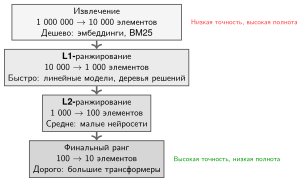

***Архитектура каскада ранжирования:** для оптимизации задержки и стоимости поисковые и рекомендательные системы используют каскад все более сложных моделей. Ранние этапы (извлечение) отфильтровывают миллионы кандидатов до тысяч с помощью быстрых и дешевых эвристик. Поздние этапы применяют дорогие высокоточные модели только к самым перспективным кандидатам.*

Центральное проектное решение — прогрессивное уточнение: вместо того чтобы запускать одну дорогую модель на всех кандидатах, Google использует каскад ранжирования. [Таблица](#tbl-google-ranking-cascade) показывает компромисс каскада: каждый этап тратит больший бюджет задержки на меньшее множество кандидатов, поэтому дорогой ансамбль L3 доступен только потому, что L0–L2 уже сократили кандидатов на четыре порядка величины.

| **Этап**             | **Сложность модели** |     **Кандидаты**     | **Бюджет задержки** |
|:---------------------|:--------------------:|:---------------------:|:-------------------:|
| **L0 (извлечение)**  |  Поиск эмбеддингов   | 1 000 000 → 10 000   |        10 мс        |
| **L1 (первый проход)** |   Линейная модель  |   10 000 → 1 000     |        20 мс        |
| **L2 (второй проход)** | Небольшой трансформер |    1 000 → 100      |        50 мс        |
| **L3 (финальное ранжирование)** | Большой ансамбль |    100 → 10       |       100 мс        |

<a id="tbl-google-ranking-cascade"></a>

***Каскад ранжирования Google:** четырехэтапный каскад, который сокращает миллион кандидатов до десяти, расходуя вычисления пропорционально глубине. Каждый этап применяет более дорогую модель к меньшему числу кандидатов, поэтому общая стоимость определяется дешевыми ранними этапами, а не дорогим финальным ансамблем.*

Каскад снижает число финальных оценок L3 в 10 000$\times$ по сравнению с запуском L3 на всех кандидатах. В этой упрощенной модели бюджета запроса стадия L3 стоит 1 мс на кандидата. Применение L3 ко всему множеству из миллиона кандидатов потребило бы около 1000 с работы модели, тогда как бюджет каскада в сумме составляет 180 мс. Получаемое сокращение работы модели — примерно 5 600$\times$.

При жестких бюджетах задержки Google использует спекулятивное выполнение для ансамблей моделей. Здесь спекуляция означает запуск работы по ранжированию кандидатов параллельно под дедлайн, а не верификацию черновых токенов при декодировании LLM:

```
# Вместо последовательного:
#   q1 = model1(query)
#   q2 = model2(query)
#   q3 = model3(query, q1, q2)

# Спекулятивно параллельно:
async_q1 = async model1(query)
async_q2 = async model2(query)
async_q3 = async model3(query, predicted_q1, predicted_q2)

# Использовать фактические результаты, если они пришли вовремя, иначе — спекулятивные
```

Развертывания поиска могут запускать модели ранжирования на тензорных процессорах (TPU)[^fn-tpu-serving-accelerator], оптимизированных для инференса трансформеров. Пулы TPU обеспечивают:

[^fn-tpu-serving-accelerator]: **TPU для инференса**: систолическое исполнение может дать регулярный профиль времени для ранжирующих нагрузок фиксированной формы. Хвост задержки по-прежнему зависит от батчинга, подготовки входов, коммуникации и очередей вокруг ускорителя.

- 2D-топологию сетки для эффективного AllReduce
- высокую пропускную способность памяти для операций внимания
- специальное квантование для эффективности обслуживания

Каждый подзапрос несет дедлайн, и воркеры упорядочивают работу по близости дедлайна:

```
Очередь воркера: [Док1: осталось 50 мс] [Док2: осталось 30 мс] [Док3: осталось 80 мс]
                                      ↑ обработать первым

Если дедлайн будет пропущен:
  вернуть кэшированный или результат по умолчанию вместо тайм-аута
```

Урок обслуживания: каскады ранжирования снижают стоимость, тратя дорогие модели только на сжимающееся множество кандидатов, тогда как распространение дедлайнов и приоритетное планирование удерживают ансамбль в жестком бюджете задержки. Специализированное оборудование может повысить предсказуемость, когда нагрузка совпадает с ускорителем, но следующий кейс добавляет ограничение свежести, которое одно оборудование решить не может.

### Мультимодальные рекомендации TikTok

Рекомендательная система TikTok связывается со свежестью при жестком SLO ранжирования: понимание видео дорого, новый контент поступает непрерывно, а моделирование пользователя остается онлайн. Она сочетает понимание видео (зрение) с моделированием пользователя (рекомендации) для персонализированного ранжирования контента, создавая мультимодальную задачу инференса, в которой разные типы моделей должны координироваться.

Цифры масштаба объясняют, почему важно разделение онлайн- и офлайн-работы:

- Объем запросов: миллионы ранжирований видео в секунду
- Целевая задержка: P99 менее 50 мс
- Объем контента: миллионы новых видео ежедневно
- Модальности: видео, аудио, текст, сигналы пользователя

Стек обслуживания разделяет пути контента и пользователя:

```
Запрос пользователя → Эмбеддинг пользователя → Кандидаты-видео → Понимание видео → Ранжирование

                    |                  |                    |
                    v                  v                    v
             Башня пользователя   Кэш видео          Модели зрения
               (трансформер)    (предвычислено)     (по запросу)
```

Архитектура TikTok разделяет понимание пользователя (онлайн) и понимание контента (офлайн) через двухбашенную архитектуру с кэшированием.[^fn-two-tower-serving] [Таблица](#tbl-tiktok-two-tower-updates) сопоставляет частоту обновления онлайн- и офлайн-башен:

[^fn-two-tower-serving]: **Двухбашенная архитектура**: кодирует признаки пользователя и признаки элемента через отдельные нейронные сети («башни») в эмбеддинги, затем оценивает их скалярным произведением. Преимущество для обслуживания: эмбеддинги элементов можно предвычислить офлайн и кэшировать, сведя онлайн-инференс к прямому проходу башни пользователя плюс поиск векторного сходства за доли миллисекунды. Компромисс — меньшая выразительность модели из-за позднего взаимодействия, поскольку башни не могут учитывать признаки друг друга при кодировании.

| **Башня**       | **Частота обновления** | **Задержка** | **Вычисления** |
|:----------------|:----------------------:|:------------:|:--------------:|
| **Башня пользователя** |  В реальном времени  |     5 мс     | GPU (онлайн)   |
| **Башня видео** |        Ежечасно        |     Н/Д      | GPU (пакетно)  |

<a id="tbl-tiktok-two-tower-updates"></a>

***Частота обновления двухбашенной архитектуры TikTok:** башни пользователя и видео работают с разной частотой: признаки пользователя меняются каждую секунду и требуют онлайн-инференса; признаки видео меняются гораздо медленнее и предвычисляются пакетами раз в час. Эта асимметричная схема выводит инференс зрения из критического пути почти для каждого запроса.*

Эмбеддинги видео предвычисляются и кэшируются, исключая инференс зрения из критического пути для большинства запросов. Онлайн-инференс зрения нужен только для новых видео (загруженных в течение часа).

Как и Meta, TikTok использует CPU для операций с эмбеддингами и GPU для плотных вычислений модели:

```
Признаки пользователя → предобработка на CPU (1 мс)
                      → поиск эмбеддингов (2 мс, CPU+DRAM)
                      → плотное ранжирование (10 мс, GPU)
                      → форматирование ответа (1 мс)
```

Новый видеоконтент обрабатывается с разными приоритетами, как показывает [таблица](#tbl-tiktok-video-priorities):

| **Приоритет**  | **SLA** | **Сценарий**                 |
|:---------------|:-------:|:-----------------------------|
| **Критичный**  |  5 мин  | Автор с большой аудиторией   |
| **Стандартный** | 30 мин | Обычные загрузки             |
| **Фоновый**    | 2 часа  | Массовый или импортированный контент |

<a id="tbl-tiktok-video-priorities"></a>

***Уровни приоритета приема видео TikTok:** трехуровневый SLA для приема видео. Авторы с большим числом подписчиков получают SLA в пять минут, чтобы максимизировать свежесть контента для своей аудитории; стандартные загрузки — 30 минут; массовые импорты получают два часа запаса, чтобы система могла поглотить их в тихие периоды.*

Схема приоритетов гарантирует, что контент популярных авторов быстро попадает в рекомендации, при управлении стоимостью вычислений.

TikTok объединяет несколько модальностей через позднее слияние, которое сочетает независимо вычисленные эмбеддинги или оценки модальностей ближе к концу ранжирования, а не запускает одну совместную модель над всеми сырыми модальностями:

```
Эмбеддинг видео (512d) -+
Эмбеддинг аудио (256d) -+- Конкатенация → MLP слияния → Итоговый эмбеддинг (256d)
Эмбеддинг текста (256d) -+
```

Позднее слияние позволяет независимо обновлять модель каждой модальности без переобучения всей системы.

Урок обслуживания: свежесть требует разделения онлайн- и офлайн-работы. Двухбашенные архитектуры делают агрессивное кэширование возможным, потому что эмбеддинги элементов можно обновлять асинхронно, а обработка по приоритетам тратит самые свежие вычисления там, где они дают наибольший эффект для пользователя.

### Общие наблюдения

Во всех этих кейсах общая закономерность — специализация вместо универсального стека обслуживания. Системы отделяют эмбеддинги и извлечение от ранжирования и генерации, используют гибридные архитектуры CPU-GPU, чтобы сопоставить оборудование с характеристиками нагрузки, кэшируют на нескольких уровнях, принимая устаревание, прогрессивно сужают множества кандидатов, чтобы не тратить дорогую работу на маловероятные элементы, и распространяют дедлайны, чтобы компромиссы качества и задержки оставались явными под давлением. [Таблица](#tbl-case-studies-summary) указывает основной метод и ключевую инновацию каждой системы. Четыре системы различаются именно потому, что каждая специализирована под свою нагрузку; эта специализация и есть общий шаблон, а не противоречие ему.

| **Система** | **Основной метод**    | **Ключевая инновация**    |
|:------------|:----------------------|:--------------------------|
| **Meta**    | Шардирование эмбеддингов | Батчинг с параллелизмом по признакам |
| **OpenAI**  | Непрерывный батчинг   | Фрагментированное предзаполнение  |
| **Google**  | Каскад ранжирования   | Спекулятивное выполнение  |
| **TikTok**  | Кэширование двухбашенной архитектуры | Мультимодальное слияние |

<a id="tbl-case-studies-summary"></a>

***Сводка кейс-стади:** синтез основных методов обслуживания и ключевых архитектурных инноваций в производственных нагрузках Meta, Google и TikTok.*

Кейсы показывают, почему архитектуры обслуживания должны адаптироваться к своим нагрузкам. Применение привычных допущений веб-сервисов к системам, ограниченным GPU, создает заблуждения и ловушки, разобранные далее.
## Заблуждения и ловушки

Команда DevOps применяет свои стандартные правила балансировки нагрузки веб-серверов к новому парку узлов инференса на GPU и наблюдает, как хвост задержки взлетает, потому что они не учли крайнюю дисперсию генерации токенов авторегрессивными моделями. Инференс в масштабе ломает правила традиционных микросервисов и создает опасные заблуждения для инженеров, переходящих от стандартной веб-разработки к системам машинного обучения.

> **Заблуждение и ловушка**
>
> **Заблуждение:** *Инференс в масштабе — это то же самое, что обслуживание LLM.*
>
> Представление, подкрепляемое LLM-ориентированными дискуссиями, ведет к чрезмерному вниманию к методам, специфичным для LLM, при игнорировании более широкого ландшафта инференса. Производственные данные показывают, что рекомендательные модели создают основной объем ежедневного трафика запросов и спроса на емкость в гипермасштабных парках, тогда как зрение, выявление мошенничества и модели классификации составляют остальное (Gupta et al., 2020; Hazelwood et al., 2018). Практик, который понимает только непрерывный батчинг и управление KV-кэшем, не готов к батчингу с параллелизмом по признакам и шардированию эмбеддингов, которые доминируют в инференсе рекомендаций высокой нагрузки. Выбор техники должен соответствовать фактической нагрузке.

> **Заблуждение и ловушка**
>
> **Ловушка:** *Использование инфраструктуры обучения для производственного обслуживания.*
>
> Обучение и обслуживание имеют разные требования. Обучение оптимизирует совокупную пропускную способность за часы или дни; обслуживание оптимизирует задержку на запрос при строгих SLO. Обучение терпимо к батчам в тысячи примеров; обслуживание часто требует батчей из одной цифры. Обучение принимает восстановление по контрольным точкам; обслуживанию нужен плавный аварийный переход без влияния на пользователя. Команды, которые разворачивают учебные кластеры для обслуживания, часто обнаруживают недопустимую дисперсию задержки, плохую утилизацию ресурсов и трудности с соблюдением SLO. Необходима специально созданная инфраструктура обслуживания с подходящими батчингом, балансировкой нагрузки и автомасштабированием.

> **Заблуждение и ловушка**
>
> **Заблуждение:** *Непрерывный батчинг решает всю проблему обслуживания LLM.*
>
> Непрерывный батчинг резко повышает утилизацию GPU при обслуживании LLM, но решает лишь одно измерение проблемы. Предзаполнение остается узким местом для длинных контекстов, поскольку квадратичное вычисление внимания нельзя избежать независимо от того, как батчатся последующие итерации декодирования. Раздел «Управление памятью и декодированием» показывает, что память KV-кэша, а не вычисления, часто ограничивает размер батча. Сетевая пропускная способность между шардированными компонентами модели может доминировать в задержке для больших моделей. Непрерывный батчинг необходим, но недостаточен для эффективного обслуживания LLM.

> **Заблуждение и ловушка**
>
> **Ловушка:** *Расчет парка по средней пропускной способности.*
>
> Теория очередей показывает, что системы, рассчитанные на среднюю нагрузку, нарушают SLO в пиковые периоды трафика. При средней утилизации 80 % умеренный всплеск трафика в 25 % поднимает утилизацию выше 100 %, вызывая неограниченный рост очереди. Раздел «Предиктивное автомасштабирование и управление SLO» главы 8 показывает, как проблема холодного старта усугубляет это: к моменту, когда становится доступна новая емкость, на что для инстансов GPU может уйти несколько минут, нарушения SLO уже произошли. Планирование емкости должно учитывать пиковую нагрузку плюс запас, а не среднюю нагрузку.

> **Заблуждение и ловушка**
>
> **Заблуждение:** *Балансировка нагрузки не имеет большого значения для инференса.*
>
> Простые стратегии балансировки вроде round-robin кажутся адекватными, пока не рассмотрены количественно. Раздел «Балансировка нагрузки и маршрутизация запросов» показывает, что случайное назначение дает максимальные длины очередей $\mathcal{O}(\log R / \log \log R)$ по $R$ серверам. Выбор из двух снижает это до $\mathcal{O}(\log \log R)$ — экспоненциальное улучшение. Для кластера на 1 000 серверов это переходит от максимальной очереди примерно в 4–5 запросов к примерно 2 запросам. На хвостовых задержках, которые определяют соответствие SLO, эта разница существенна. Выбор алгоритма балансировки нагрузки имеет первоочередное влияние на производительность системы.

> **Заблуждение и ловушка**
>
> **Ловушка:** *Игнорирование налога на обслуживание.*
>
> Распределенный инференс вносит накладные расходы, которых нет в обслуживании на одной машине: сетевые обходы туда и обратно, сериализацию, решения балансировщика нагрузки и координацию для шардированных моделей. Этот «налог на обслуживание» часто поглощает 10–30 % бюджета задержки. Команда, которая добивается инференса модели за 70 мс на одном GPU, может удивиться, когда сквозная задержка в производстве достигнет 100 мс из-за этих накладных расходов. Бюджеты задержки должны явно учитывать накладные расходы распределения, а не только время вычислений.

> **Заблуждение и ловушка**
>
> **Заблуждение:** *Больше памяти GPU всегда означает больший размер батча и более высокую пропускную способность.*
>
> Больше памяти GPU позволяет использовать большие батчи только для моделей, пропускная способность которых ограничена емкостью. Связывающее ограничение декодирования LLM — пропускная способность памяти, а не емкость: как только пропускная способность HBM насыщается, добавление памяти не увеличивает токены в секунду. Иерархия узких мест делает эту ошибку видимой.
>
> Хотя больший объем памяти GPU позволяет использовать большие батчи для моделей, которые помещаются в память, узкое место часто смещается раньше, чем память исчерпана. Пропускная способность памяти ограничивает пропускную способность операций, ограниченных ею (декодирование LLM). Вычисления ограничивают пропускную способность операций, ограниченных вычислениями (предзаполнение, инференс зрения). Рабочая нагрузка декодирования с ограничением по пропускной способности на H100 с 80 ГБ памяти в конце концов выходит на плато, когда насыщается пропускная способность HBM3 (3,35 ТБ/с); одно лишь добавление памяти не повышает пропускную способность токенов после достижения этой точки. Понимание того, ограничена ли нагрузка вычислениями, пропускной способностью памяти или емкостью, направляет правильное распределение ресурсов.

> **Заблуждение и ловушка**
>
> **Ловушка:** *Откладывание изоляции многопользовательского режима до продакшна.*
>
> В разработке и на стейджинге развертывания для одного арендатора работают хорошо. В продакшне шумные соседи вызывают внезапную, непредсказуемую деградацию производительности, которую трудно диагностировать и устранить. Арендатор, выбрасывающий всплеск до 5$\times$ от обычного трафика, может ухудшить задержку для всех остальных арендаторов на общей инфраструктуре. Как подчеркивается в разделе «Многопользовательский режим и изоляция», квоты ресурсов, приоритетное планирование и изоляция переборками должны закладываться в систему с самого начала, а не достраиваться после инцидентов в продакшне.
>
> Избегание этих ловушек держит инфраструктуру обслуживания устойчивой к дисперсии трафика, экономичной при фиксированных SLO и стабильно отзывчивой для всех арендаторов.

## Итоги

Инференс в масштабе — это сервисный слой, который превращает обученные модели и распределенное оборудование в глобальные предсказания с низкой задержкой. Пока обучение оптимизирует совокупную пропускную способность ($O/R_{\text{peak}}$) за фиксированный прогон, производственное обслуживание переворачивает каждое допущение: OpEx непрерывно накапливается на каждом запросе, а видимая пользователю хвостовая задержка ($L_{\text{lat}}$) определяет, остается ли сервис жизнеспособным при строгих целевых значениях P99.

В основе производительности обслуживания лежит фундаментальное физическое разделение между вычислениями и пропускной способностью памяти. Фаза предзаполнения ограничена вычислениями ($O/R_{\text{peak}}$), достигая высокой арифметической интенсивности, поскольку токены промпта обрабатываются параллельно. Авторегрессивное декодирование, напротив, строго ограничено пропускной способностью памяти ($D_{\text{vol}}/\text{BW}$): каждый сгенерированный токен требует полного чтения параметров модели и расширяющегося кэша ключей и значений через HBM. Это расхождение означает, что эффективность одной реплики ($\eta_{\text{hw}}$) сильно колеблется на протяжении жизненного цикла запроса, что делает статический батчинг неэффективным.

Чтобы максимизировать пропускную способность при ограничениях пропускной способности памяти, современные архитектуры обслуживания согласовывают иерархию памяти и планировщик итераций. Непрерывный батчинг устраняет простой ускорителя, вставляя новые запросы на границах токенов; PagedAttention устраняет физическую фрагментацию памяти ($D_{\text{frag}}$), динамически выделяя страницы KV-кэша; а разделение предзаполнения и декодирования переносит обработку промптов, ограниченную вычислениями, и генерацию токенов, ограниченную пропускной способностью, в специализированные пулы оборудования.

Когда размер модели или объем запросов превышает емкость HBM одного устройства, шардирование модели (тензорный и экспертный параллелизм) и глобальная балансировка нагрузки распределяют состояние между ускорителями. Однако распределение вносит налог на синхронизацию в сети ($L_{\text{comm}}$), определяемый нижними границами задержки межсоединения ($\alpha$) и пропускной способностью передачи ($\beta$). На всех уровнях иерархии обслуживания — от батчинга на уровне запроса до многопользовательского режима на уровне платформы — инженерная цель состоит в том, чтобы максимизировать утилизацию ресурсов и допустимую емкость запросов, строго ограничивая хвостовую задержку в рамках бюджета SLO пользователя.

> **Ключевые выводы: обслуживание переворачивает все допущения**
>
> * **Стоимость обслуживания накапливается бесконечно**: обучение оплачивается однократно, а OpEx инференса начисляется на каждом запросе (принцип о доминировании стоимости обслуживания); для высоконагруженных производственных систем она может доминировать в 100$\times$ или более за срок службы модели. Миллисекунды, фрагменты памяти и проценты утилизации — это финансовые рычаги, а не локальные оптимизации.
> * **Хвостовая задержка определяет архитектуру**: системы инференса оптимизируются под SLO P99, поэтому батчинг, шардирование, кэширование и автомасштабирование должны повышать утилизацию, не тратя видимый пользователю дедлайн. Агрегированной пропускной способности недостаточно, когда один медленный запрос может сломать нижестоящие сервисы.
> * **Декодирование превращает память в емкость**: предзаполнение LLM ограничено вычислениями, тогда как авторегрессивное декодирование перечитывает веса и расширяет приватное KV-состояние токен за токеном (принцип авторегрессивного узкого места). Непрерывный батчинг, PagedAttention, повторное использование префиксов и сжатие KV важны, потому что превращают дефицитную пропускную способность HBM и память в допущенные запросы.
> * **Класс модели задает примитив**: модели зрения выигрывают от предсказуемых статических или динамических батчей, рекомендательные системы — от шардирования эмбеддингов с параллелизмом по признакам, а LLM — от планирования на уровне итераций. Планировщик парка должен соответствовать форме нагрузки, а не применять одно универсальное правило размера батча.
> * **Распределение всегда выставляет счет**: тензорный параллелизм, маршрутизация экспертов, глобальная балансировка нагрузки, многопользовательский режим и аварийный переход (принцип выбора из двух) — все они покупают емкость или изоляцию, добавляя коммуникацию и координацию. Производственное обслуживание работает только тогда, когда этот налог явно заложен в бюджет внутри границ задержки, стоимости и надежности.

В конечном счете эффективность обслуживания управляется законом доминирования стоимости обслуживания (принцип о доминировании стоимости обслуживания): капитальные затраты на обучение оплачиваются однократно, но OpEx инференса непрерывно накапливается на каждом запросе за оперативный срок жизни модели. Поскольку авторегрессивное декодирование физически ограничено пропускной способностью HBM ($D_{\text{vol}} / \text{BW}$), а не сырой арифметикой ($R_{\text{peak}}$), эффективность системы зависит от превращения простаивающей емкости памяти и пропускной способности в допустимую конкурентность. На масштабе парка возврат одного мегабайта фрагментированного KV-кэша или экономия десяти миллисекунд налога на синхронизацию напрямую переходит в миллионы долларов устойчивой операционной экономии.

> **Связь с главами: от дата-центра к периферии**
>
> Архитектурные основы инференса в масштабе, разобранные здесь, — непрерывный батчинг, PagedAttention, шардирование моделей и балансировка нагрузки по глубине очереди, — все предполагают оборудование класса дата-центра: корпоративные ускорители, высокоскоростные межсоединения NVLink (глава 6 «Коллективная коммуникация») и терабайты HBM. Опираясь на локальную компиляцию времени выполнения (глава 9 «Инженерия производительности»), эта глава масштабировала обслуживание до парков дата-центров. Однако многим приложениям нужны предсказания ближе к пользователю: на смартфонах, IoT-устройствах или локальных шлюзах, где бюджеты мощности измеряются в милливаттах, память — в мегабайтах, а связь прерывиста. Раздел «Граничный интеллект» (глава 11) рассматривает, как меняются принципы обслуживания, когда интеллект переходит на периферию и все допущения дата-центра инвертируются.
