<a id="sec-edge-intelligence"></a>

# Граничный интеллект


## Назначение

_Почему интеллект должен адаптироваться там, где он работает, а не оставаться замороженным после обучения далеко отсюда?_

Модель, обученная в дата-центре, сталкивается с новыми условиями, когда ее развертывают на устройстве пользователя. Словарь, освещение, акустика и привычки использования могут отличаться от распределений, которые сформировали ее параметры, и разрыв может расти по мере изменения поведения. Централизованное обучение не может предусмотреть каждый контекст и персонализировать модель для каждого пользователя. Исходные наблюдения тоже не всегда можно передать: этому мешают ограничения приватности, пропускная способность и требования к задержке. Обучение на устройстве переносит адаптацию туда, где возникают данные. В терминах C³ вычисления переходят на устройство, коммуникация сокращается от сырых наблюдений до выборочных обновлений, а координация работает в рамках бюджетов энергии и памяти граничного устройства.

> **Цели обучения**
>
> - Сопоставить централизованное обучение в облаке, обучение на устройстве и федеративное обучение, проанализировав потоки данных, свойства приватности и эксплуатационные компромиссы
> - Количественно оценить накладные расходы обучения на граничном устройстве по сравнению с развертыванием только для инференса по памяти, вычислениям и энергии
> - Вывести условие допуска фоновой адаптации из запаса по энергии, тепловому режиму и задержке переднего плана
> - Выбрать стратегии адаптации модели, сравнив объемы памяти, выразительность и сходимость для возможностей конкретного устройства
> - Применить методы эффективности данных (обучение на нескольких примерах, воспроизведение опыта, контрастное обучение), чтобы учиться на ограниченных локальных данных без катастрофического забывания
> - Спроектировать системы федеративного обучения, которые агрегируют приватные обновления, управляя разнородными данными, эффективностью коммуникации и отстающими участниками
> - Объяснить эксплуатационные средства контроля, необходимые для обучения на устройстве: развертывание с учетом устройства, распределенную валидацию, мониторинг с сохранением приватности и откат на разнородных популяциях устройств

## Парадигма граничного обучения

Представьте голосового ассистента, обученного на миллионах общих аудиозаписей в облачном дата-центре. После развертывания он может плохо понимать региональный акцент или бытовой словарь. Без локальной адаптации его качество снижается по мере того, как использование расходится с распределением обучающих данных. **Граничный интеллект** размещает инференс, адаптацию и координацию на устройствах, которые наблюдают данные, или рядом с ними, что позволяет моделям реагировать на локальный контекст в условиях ограничений по энергии, памяти, приватности и связности.

Системы машинного обучения в дата-центре предполагают контролируемую среду, где вычислительных ресурсов достаточно, сетевое соединение надежно, а поведение системы предсказуемо. Централизованный инференс — самый ясный пример такого допущения, и граница его нарушает.

Смартфон, который учится предсказывать ввод текста пользователя, умный дом, адаптирующийся к бытовым привычкам, или автономный автомобиль, обновляющий модели восприятия по местным условиям движения, — все это сценарии, в которых традиционное централизованное обучение оказывается недостаточным. Смартфон сталкивается с языковыми особенностями конкретного пользователя, которых не было в общих обучающих данных. Умному дому нужно учитывать сезонные изменения и особенности семьи, которые сильно различаются от дома к дому. Автомобиль сталкивается с местными дорожными условиями, погодой и поведением участников движения, которые отличаются от среды обучения.

Эти сценарии требуют обучения на устройстве, при котором модели обучаются и адаптируются непосредственно на устройствах, где они работают.[^fn-a11-bionic-enclave] Машинное обучение тогда переходит от централизованного обучения к распределенному обучению на разнородных устройствах, каждое из которых работает в своих локальных ограничениях. В стеке парка это подталкивает вычисления к пределам мощности, памяти и тепловой емкости устройства. Адаптация на устройстве становится возможной не из-за нового алгоритма, а из-за изменения в кремнии: пропускная способность мобильных ускорителей, показанная на [рисунке](#fig-edge-npu-tops), выросла больше чем на порядок за семь лет, и задачи, похожие на обучение, стали помещаться в энергетический бюджет смартфона.

[^fn-a11-bionic-enclave]: **A11 Bionic (2017)**: первая система на кристалле (SoC) Apple с выделенным нейронным движком, заявленная производительность которого достигала 600 миллиардов операций в секунду для задач инференса машинного обучения. Системное следствие: мобильный NPU стал отдельным энергетическим доменом. Адаптация на устройстве становится практичнее, когда оптимизированный под инференс кремний освобождает тепловой запас для коротких локальных обучающих или персонализирующих всплесков.

<a id="fig-edge-npu-tops"></a>

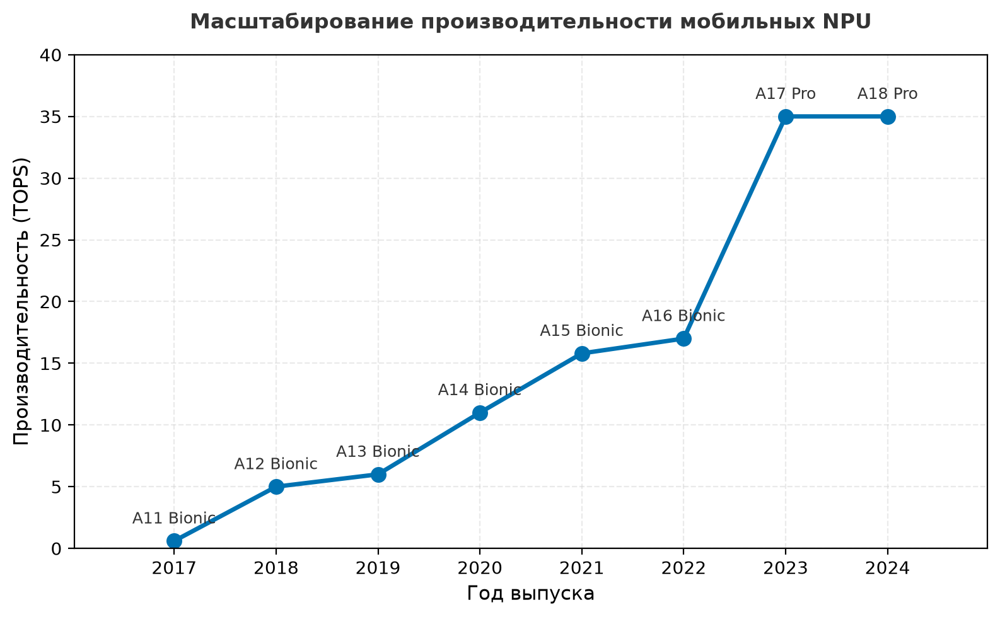

***Масштабирование производительности мобильного NPU:** пропускная способность выделенных мобильных нейронных ускорителей по годам выпуска: от менее одного TOPS в 2017 году примерно до 35 TOPS в 2024 году, с резким скачком в поколении 2023 года. Обучение на устройстве стало системной возможностью только тогда, когда эта кривая поднялась выше пропускной способности, которую требует шаг обучения.*

Локальная адаптация возможна только на аппаратуре, которая уже проходит порог инференса, потому что шаг градиента стоит строго больше прямого прохода, на котором он основан. Специализированные ускорители задают этот порог: они определяют, есть ли у граничного устройства достаточный запас по задержке и энергии, чтобы вообще запускать интеллектуальные нагрузки, а значит, возможно ли какое-либо локальное обучение.

> **Перспектива: «кремниевый дивиденд» выделенного NPU**
>
> Разрыв между запуском модели на обычном мобильном CPU и на выделенном NPU лучше понимать как «кремниевый дивиденд», а не как незначительное ускорение. Опубликованные профили NPU различаются по поколению кремния и типу нагрузки, поэтому этот блокнот использует явные сценарные допущения, а не сообщает результаты бенчмарка: 20-кратное улучшение задержки и 60-кратное улучшение энергоэффективности относительно модельного базового уровня MobileNetV2 (1,883 мс на инференс). Эти множители иллюстрируют чувствительность к выигрышу ускорителя; это не измеренные свойства названного мобильного профиля или конкретного NPU.
>
> Для проектирования системы важно то, что означают такие соотношения. При принятых допущениях специализированное железо создает существенный запас по задержке и энергии. Сделает ли этот запас нагрузку осуществимой, позволит ли непрерывное фоновое выполнение или сделает ли откат на CPU неприемлемым, нужно установить по измерениям задержки, мощности и температуры для конкретной нагрузки и устройства.

Переход к обучению на устройстве вносит фундаментальное напряжение в проектирование систем машинного обучения. Облачные архитектуры используют изобилие вычислительных ресурсов и контролируемую рабочую среду, а граничные устройства должны работать в жестко ограниченных ресурсных рамках. Память измеряется мегабайтами, а не гигабайтами; бюджеты мощности измеряются милливаттами, а не ваттами; сетевое соединение может быть прерывистым или полностью отсутствовать. Когда локальная модель работает в контуре, критичном для безопасности, эти ограничения становятся инженерными задачами, от которых зависит безопасность людей.

Эти ограничения проходят через архетип C (федеративный MobileNet), описанный во введении, где автономность требует, чтобы обучение происходило на устройстве при жестких ресурсных ограничениях. Архетип C представляет крайнюю точку этого спектра. Работая в бюджетах в милливатты, он не может позволить себе энергетическую стоимость передачи сырых данных в облако. Поэтому локальность данных — физическая необходимость, навязанная энергетической стеной, а не просто функция приватности. Квантованное обучение, разреженные обновления и федеративная координация — это стратегии выживания, которые позволяют архетипу C существовать.

Справиться с этим архитектурным напряжением нужно, перенося методы сжатия из инференса и сочетая их с алгоритмическими приемами, шаблонами проектирования и системными принципами, которые позволяют эффективно учиться при крайних ограничениях ресурсов. Задача выходит за рамки обычной оптимизации алгоритмов обучения: требуется пересмотреть весь конвейер машинного обучения для сред развертывания, где традиционные вычислительные допущения не работают.

> **Определение: обучение на устройстве**
>
> ***Обучение на устройстве*** — это локальное обучение или адаптация моделей машинного обучения непосредственно на развернутом железе без необходимости соединения с сервером.
>
> 1. **Значение**: оно обеспечивает гиперперсонализацию и автономную работу в условиях жестких ресурсных ограничений. В рамках железного закона обучение на устройстве должно минимизировать полную энергию, потребляемую на одно обновление, потому что каждый шаг градиента расходует ограниченный заряд батареи и конкурирует с другими задачами системы за доступную пропускную способность вычислений $(R_{\text{peak}})$.
> 2. **Отличие**: в отличие от граничного инференса, который только выполняет фиксированную модель, обучение на устройстве включает локальный цикл оптимизации (прямой и обратный проходы), требующий заметно больше памяти и вычислений.
> 3. **Распространенная ловушка**: распространено заблуждение, что обучение на устройстве требует обучения с нуля. На деле это почти всегда адаптация на устройстве: дообучение небольшого подмножества параметров предобученной базовой модели под распределение данных локальной среды.

Последствия выходят далеко за пределы технической оптимизации и затрагивают каждую фазу жизненного цикла машинного обучения. Модели переходят от предсказуемых схем версионирования к непрерывным траекториям расхождения и адаптации. Оценка качества смещается от централизованных панелей мониторинга к распределенной оценке на разнородных популяциях пользователей. Защита приватности становится базовым архитектурным требованием, которое формирует проектные решения, а не последующей задачей соответствия требованиям.

### Мотивы и выгоды

Системы машинного обучения традиционно опирались на централизованные конвейеры обучения. Крупномасштабная распределенная инфраструктура позволяет разрабатывать и уточнять модели на централизованно управляемых наборах данных (Dean et al., 2012). После обучения эти модели можно развернуть на клиентских устройствах для инференса, и тогда возникает четкое разделение между фазами обучения и развертывания. Такая архитектурная граница хорошо служила многим сценариям, но накладывает серьезные ограничения там, где локальные данные динамичны, приватны или сильно персонализированы.

Обучение на устройстве бросает вызов этой устоявшейся модели: оно позволяет системам обучаться или адаптироваться непосредственно на устройстве, не полагаясь на постоянное соединение с облаком. Этот сдвиг отражает меняющиеся требования приложений и ожидания пользователей, которым нужны отзывчивые, персонализированные и сохраняющие приватность[^fn-dp-leakage-bound] системы машинного обучения.

[^fn-dp-leakage-bound]: **Приватность (дифференциальная приватность)**: хотя федеративное обучение не передает сырые данные, исследования показали, что сырые градиенты можно «обратить» и восстановить входные примеры. Дифференциальная приватность добавляет калиброванный шум, ограничивая утечку, которую вносит любая отдельная запись или пользователь при заданном определении соседства; это снижает риск вывода, но сила гарантии зависит от $\varepsilon$, $\delta$, композиции и качества реализации.

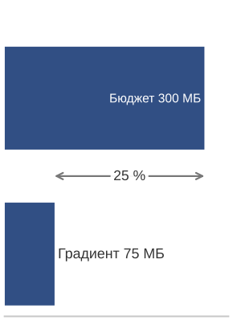

*Обучение на устройстве упирается в стену памяти раньше, чем в стену вычислений.*

Рассмотрим клавиатуру смартфона, которая подстраивается под уникальный словарь и манеру печати пользователя. Чтобы персонализировать предсказания, система должна выполнять обновления градиента компактной языковой модели на локально наблюдаемом вводе текста. Одно обновление градиента даже для минимальной языковой модели требует 50–100 МБ памяти под активации и состояние оптимизатора. Операционные системы смартфонов часто оставляют фоновым приложениям, таким как клавиатуры, лишь 200–300 МБ, причем точный бюджет зависит от ОС, поколения устройства и нагрузки переднего плана. Этот узкий запас показывает центральную инженерную задачу обучения на устройстве: один шаг обучения может занять 25 % доступной памяти. Система должна добиться осмысленной персонализации, работая в настолько жестких ограничениях, что традиционные подходы к обучению становятся архитектурно невозможными. Эта количественная реальность требует специальных методов, которые делают адаптацию возможной при крайних ресурсных ограничениях.

Четыре ключевых соображения мотивируют переход от централизованного обучения к децентрализованному (Li et al., 2020): персонализация, задержка и доступность, приватность и эффективность инфраструктуры. Персонализация — самый весомый мотив: развернутые модели часто сталкиваются с паттернами использования и распределениями данных, которые отличаются от условий обучения. Локальная адаптация позволяет моделям уточнять поведение с учетом данных конкретного пользователя, отражая языковые предпочтения, физиологические базовые показатели, особенности датчиков или условия среды. Эта способность необходима в приложениях с высокой межпользовательской изменчивостью, где одна глобальная модель не может эффективно обслуживать всех пользователей.

Требования к задержке и доступности дают дополнительное обоснование локальному обучению. В граничных вычислениях связь с централизованной инфраструктурой может быть ненадежной, задержанной или намеренно ограниченной, чтобы сохранить пропускную способность или снизить энергопотребление. Обучение на устройстве позволяет моделям улучшаться автономно даже в полностью офлайновом режиме или в контекстах, чувствительных к задержке, где обновления с отправкой в облако и обратно архитектурно невозможны.

Третий весомый мотив — приватность. Многие приложения работают с чувствительными или регулируемыми данными: биометрическими измерениями, вводом текста, перемещениями, сведениями о здоровье. Локальное обучение может снизить риски приватности, оставляя сырые данные на устройстве и ограничивая передачу в централизованные системы. Это может упростить инженерное обеспечение соответствия требованиям, но само по себе не подтверждает соблюдение таких норм, как Общий регламент ЕС по защите данных (GDPR),[^fn-gdpr-ondevice-compliance] Закон США о переносимости и подотчетности медицинского страхования (HIPAA)[^fn-hipaa-ondevice-enclave] (HHS, 2026), или региональные законы о суверенитете данных.

[^fn-gdpr-ondevice-compliance]: **GDPR (Общий регламент ЕС по защите данных)**: действует с мая 2018 года; требует законного основания, минимизации данных, ограничения цели, а также процессов обработки прав субъектов данных при обработке персональных данных. В чувствительных контекстах может требоваться явное согласие, но оно не единственное законное основание. Обучение на устройстве может сократить объем персональных данных, передаваемых в централизованные системы, и упростить некоторые вопросы трансграничной передачи и хранения, однако развертываниям все равно нужны механизмы согласия, прав и управления, соответствующие данным и сценарию использования.

[^fn-hipaa-ondevice-enclave]: **HIPAA (Закон США о переносимости и подотчетности медицинского страхования)**: обязывает покрываемые организации и их деловых партнеров применять административные, физические и технические меры защиты защищенной медицинской информации (PHI). Облачные сервисы, которые создают, получают, хранят или передают электронную PHI от имени покрываемой организации или делового партнера, как правило, требуют соответствующего соглашения о деловом партнерстве (Business Associate Agreement) и мер по правилу безопасности (Security Rule). Обучение на устройстве может сократить передачу PHI и риски управления поставщиками, но не снимает обязательств HIPAA для охваченных развертываний в здравоохранении.

Экономический мотив распределенного обучения связан с эффективностью инфраструктуры. Централизованные конвейеры обучения требуют существенной серверной инфраструктуры для сбора, хранения и обработки данных, которые могут поступать с миллионов устройств. Перенос обучения на граничные устройства сокращает затраты на коммуникацию и распределяет обучающую нагрузку по парку устройств, снижая нагрузку на централизованные ресурсы и улучшая масштабируемость.

### Альтернативные подходы и критерии выбора

Обучение на устройстве требует значительных инженерных затрат, которые не всегда оправданы. Более простые альтернативы часто дают сопоставимый результат при меньших эксплуатационных накладных расходах, а преждевременное внедрение добавляет сложность без пропорциональной пользы.

В [таблице](#tbl-edge-ondevice-learning-alternatives) сравниваются три альтернативы, которые часто удовлетворяют требованиям персонализации и адаптации без сложности локального обучения.

<a id="tbl-edge-ondevice-learning-alternatives"></a>

***Альтернативы обучению на устройстве:** простые механизмы персонализации могут удовлетворить многие требования адаптации без локальных обновлений градиента, поэтому обучение на устройстве стоит оставлять для случаев, когда требования приватности, задержки, связности или измеренного качества исключают эти варианты.*

| **Альтернатива**                                  | **Механизм**                                                                                                                                                                                                                                  | **Когда подходит**                                                                                                                                                              |
|:--------------------------------------------------|:-----------------------------------------------------------------------------------------------------------------------------------------------------------------------------------------------------------------------------------------------|:--------------------------------------------------------------------------------------------------------------------------------------------------------------------------------|
| **Персонализация на основе признаков**            | Хранить предпочтения пользователя, историю взаимодействий и поведенческие признаки локально, а затем подавать эти признаки в статическую модель вместо адаптации весов модели.                                                                | Системы рекомендации новостей могут хранить локально предпочтения по темам и паттерны чтения, а затем сочетать эти признаки с централизованной моделью контента.                |
| **Дообучение в облаке с мерами приватности**      | Централизовать адаптацию, обрабатывая данные пользователей пакетами в часы низкой нагрузки с помощью методов сохранения приватности: дифференциальной приватности, федеративной аналитики, безопасной агрегации (Bonawitz et al., 2017) или их сочетаний. | Такой подход часто дает более высокую точность, чем обновления на устройстве с ограниченными ресурсами, и при этом сохраняет приемлемые свойства приватности для многих приложений. |
| **Персональные таблицы поиска**                   | Сочетать глобальные модели с персонализированным извлечением, поддерживая облегченную таблицу для часто используемых локальных паттернов.                                                                                                     | Нужна выгода от персонализации при минимальных вычислительных и складских накладных расходах.                                                                                    |

В строке про дообучение в облаке дифференциальная приватность[^fn-dp-federated-privacy] — это механизм, который ограничивает утечку информации, добавляя шум; этот шум может потребовать больше раундов или больше данных.

[^fn-dp-federated-privacy]: **Дифференциальная приватность**: математическая основа, которая ограничивает утечку информации, добавляя калиброванный шум к вычислениям. В граничном обучении этот шум становится системной стоимостью, потому что более шумные обновления обычно требуют больше раундов или больше данных для достижения той же полезности. Глава «Безопасность и приватность» развивает формальный аппарат бюджета приватности.

Решение о реализации обучения на устройстве должно опираться на измеримые требования, которые исключают эти более простые альтернативы. Реальные ограничения приватности, которые юридически запрещают облачную обработку, настоящие сетевые ограничения, мешающие надежной связи, количественные бюджеты задержки, которые исключают обращение в облако и обратно, или подтверждаемые улучшения производительности, оправдывающие эксплуатационную сложность, — законные основания для внедрения обучения на устройстве.

Для приложений с жесткими временными требованиями задержка сетевого обращения делает облачные альтернативы архитектурно невозможными. Обработка камеры за 33 мс, голосовой отклик за 500 мс, задержка от движения до изображения в AR/VR менее 20 мс или управление, критичное для безопасности, менее 10 мс — все эти сценарии сталкиваются с временем сетевого обращения, которое обычно составляет от 50 до 200 мс. В таких случаях обучение на устройстве необходимо независимо от соображений сложности. Команды должны тщательно оценить более простые решения, прежде чем вкладываться в значительные инженерные затраты, которых требует обучение на устройстве.

### Перенос знаний как основа адаптации

Эти мотивы опираются на более широкое понятие переноса знаний: предобученная модель передает полезные представления новой задаче или области. Этот базовый принцип делает обучение на устройстве и осуществимым, и эффективным, позволяя выполнять сложную адаптацию при минимальных локальных ресурсах. [Рисунок](#fig-transfer-conceptual) иллюстрирует, как перенос знаний происходит между близкими задачами, например между разными настольными играми или музыкальными инструментами, или между областями, у которых есть общая структура, например от езды на велосипеде к управлению самокатом. В обучении на устройстве модель, предобученная в облаке, эффективно адаптируется к новому контексту, используя только локальные данные и ограниченные обновления. Это позволяет быстро адаптироваться без обучения с нуля, даже если новая задача отличается модальностью входа или целью.

<a id="fig-transfer-conceptual"></a>


***Перенос знаний:** предобученные модели ускоряют обучение новым задачам, используя существующие представления, как видно по переносу навыков между близкими настольными играми или музыкальными инструментами. Этот перенос распространяется и на другие области, например на езду на велосипеде и управление самокатом, где общие базовые структуры позволяют эффективно адаптироваться при ограниченном объеме новых данных.*

Этот концептуальный сдвиг, обеспеченный переносом обучения и адаптацией, открывает путь к реальным приложениям обучения на устройстве. Адаптирует ли языковая модель под личные привычки ввода текста, настраивает ли распознавание жестов под индивидуальные движения или перекалибрует ли модель датчика в меняющейся среде, обучение на устройстве позволяет системам со временем оставаться отзывчивыми, эффективными и согласованными с пользователем.

### Прикладные области

Мотивы обучения на устройстве проявляются в потребительских технологиях, здравоохранении, промышленных системах и встраиваемых приложениях, и в каждой области персонализация, задержка, приватность и эффективность инфраструктуры становятся существенными. Прогнозирование ввода на мобильных устройствах — хорошо описанный пример обучения на устройстве. В таких системах, как клавиатуры смартфонов, функции предиктивного текста и автоисправления выигрывают от непрерывной локальной адаптации. Паттерны печати пользователя очень индивидуальны и быстро меняются, поэтому централизованные статические модели не обеспечивают качественного пользовательского опыта. Обучение на устройстве позволяет языковым моделям уточнять предсказания прямо на устройстве, достигая персонализации при сохранении локальности данных. Например, Gboard от Google[^fn-gboard-federated-scale] использует федеративное обучение, чтобы улучшать общие модели для большой популяции пользователей, сохраняя сырые данные на каждом устройстве (Hard et al., 2018).

[^fn-gboard-federated-scale]: **Gboard (2017)**: одно из первых широко описанных коммерческих развертываний федеративного обучения в мобильном масштабе. Опубликованные отчеты показали, что модели клавиатуры могут улучшаться за счет агрегированных обновлений с устройств, пока сырой набранный текст остается локальным. Системное следствие устойчиво: сжатые обновления и механизмы приватности делают возможным обучение на всем парке устройств по ограниченным мобильным сетям без централизации сырых нажатий клавиш.

[Рисунок](#fig-ondevice-gboard) демонстрирует две стратегии предсказания во время инференса. Предсказание следующего слова предлагает вероятные продолжения по текущему контексту, а Smart Compose использует переоценку на лету, чтобы предлагать динамические дополнения. Эти механизмы персонализируют непосредственное взаимодействие через локальный контекст; более долгосрочное улучшение модели происходит отдельно, когда федеративное обучение агрегирует допустимые обновления с устройств.

<a id="fig-ondevice-gboard"></a>

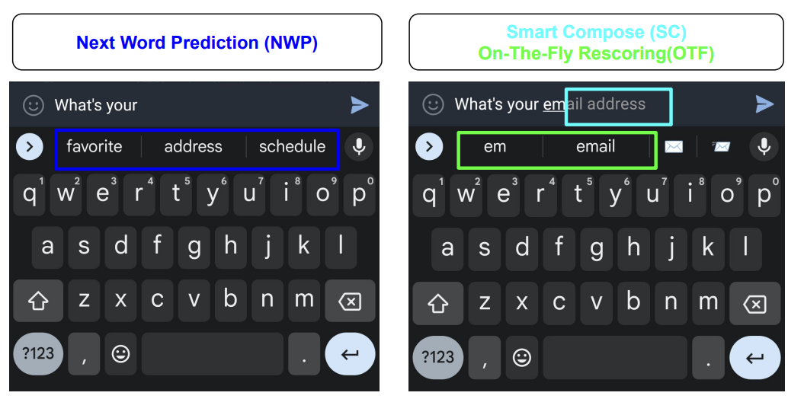

***Стратегии предсказания на устройстве:** Gboard выполняет предсказание следующего слова и переоценку Smart Compose локально во время инференса. Эти механизмы, работающие в момент запроса, используют локальный контекст, не отправляя каждое нажатие клавиши на центральный сервер; асинхронное федеративное обучение — это отдельный процесс, который улучшает общие параметры модели по допустимым обновлениям с устройств.*

Носимые устройства и устройства мониторинга здоровья дают не менее убедительные сценарии, но с дополнительными нормативными ограничениями. Эти системы опираются на данные в реальном времени с акселерометров, датчиков частоты сердечных сокращений и мониторов электродермальной активности, чтобы отслеживать здоровье и физическую форму пользователя. Физиологические базовые показатели сильно различаются у разных людей, и это создает задачу персонализации, которую статические модели эффективно решить не могут. Обучение на устройстве позволяет моделям со временем адаптироваться к этим индивидуальным базовым показателям, заметно повышая точность распознавания активности, определения стресса и стадий сна и при этом соблюдая нормативные требования к локализации данных.

Голосовое взаимодействие — еще одна важная прикладная область со своими акустическими трудностями. Обнаружение ключевого слова[^fn-wakeword-power-budget] и голосовые интерфейсы в таких устройствах, как умные колонки и наушники, должны быстро и точно распознавать голосовые команды даже в шумной или меняющейся акустической среде.

[^fn-wakeword-power-budget]: **Обнаружение ключевого слова**: постоянно включенное распознавание ключевых слов обычно работает в диапазоне от долей милливатта до нескольких милливатт, что гораздо меньше полного распознавания речи, и использует компактные нейронные сети, оптимизированные для задержки менее 100 мс и очень низкой частоты ложных срабатываний. Эта жесткая ограниченность мощности определяет пространство проектирования: модель должна быть достаточно малой, чтобы работать на выделенном постоянно включенном процессоре, поэтому персонализация на устройстве критична для снижения ложных срабатываний без увеличения размера модели.

Эти системы сталкиваются с жесткими требованиями к задержке. Голосовые интерфейсы должны держать сквозное время отклика ниже 500 мс, чтобы сохранять естественный ход разговора, а обнаружение ключевого слова требует времени отклика менее 100 мс, чтобы не раздражать пользователя. Локальное обучение позволяет моделям адаптироваться к индивидуальному голосовому профилю пользователя и меняющемуся окружающему контексту, снижая число ложных срабатываний и пропусков, и при этом удовлетворяет этим строгим ограничениям производительности. Эта адаптация особенно ценна в аудио дальнего поля, где конфигурации микрофонов и акустика помещений заметно различаются от развертывания к развертыванию.

Помимо потребительских приложений, промышленный IoT и системы удаленного мониторинга показывают ценность обучения на устройстве в условиях ограниченных ресурсов. В таких приложениях, как сельскохозяйственные датчики, мониторинг трубопроводов или наблюдение за окружающей средой, связь с централизованной инфраструктурой может быть ограниченной, дорогой или вовсе недоступной. Обучение на устройстве позволяет этим системам обнаруживать аномалии, корректировать пороги или адаптироваться к сезонным трендам без постоянной связи с облаком. Эта возможность необходима для поддержания автономности и надежности граничных сенсорных сетей, где простой системы или пропущенные обнаружения могут иметь серьезные экономические или последствия для безопасности.

Самые требовательные приложения возникают во встраиваемых системах компьютерного зрения, включая робототехнику, AR/VR и умные камеры. Они сочетают сложную обработку изображений с самым жестким концом бюджетов задержки, описанных в разделе «Альтернативные подходы и критерии выбора» выше: бюджет кадра 33 мс для камер 30 кадров в секунду, бюджет задержки от движения до изображения менее 20 мс, который предотвращает укачивание в AR/VR, и граница менее 10 мс для управления, критичного для безопасности. Эти системы также работают в новых или быстро меняющихся условиях, которые заметно отличаются от условий исходного обучения. **Адаптация на устройстве** позволяет моделям перекалибровываться под новое освещение, внешний вид объектов или паттерны движения, соблюдая эти критические бюджеты задержки, которые по сути определяют архитектурное решение между обработкой на устройстве и облачной обработкой.

Каждая область показывает общий паттерн. Условия развертывания вносят вариативность и контекстные требования, которые нельзя предусмотреть при централизованном обучении. Эти приложения показывают, как мотивирующие факторы превращаются в конкретные инженерные ограничения. Клавиатуры на мобильных устройствах сталкиваются с ограничениями памяти для хранения пользовательских паттернов. Носимые устройства сталкиваются с энергетическими бюджетами, которые ограничивают частоту обучения. Голосовые интерфейсы должны укладываться в требования задержки менее 100 мс, которые исключают координацию в облаке. Системы промышленного IoT работают в условиях ограниченной сети, которые требуют автономной адаптации. Этот паттерн выявляет фундаментальное требование проектирования, которое определяет все последующие технические решения: обучение должно выполняться эффективно, приватно и надежно при существенных ограничениях ресурсов. Раздел «Ограничения проектирования» систематически анализирует эти ограничения, раздел «Адаптация модели» (далее) описывает приемы адаптации моделей в жестких ресурсных рамках, а раздел «Федеративное обучение: алгоритмы» (далее) задает протоколы координации с сохранением приватности для популяций устройств.

### Архитектурные компромиссы: централизованное и децентрализованное обучение

Эти приложения показывают, что обучение на устройстве меняет жизненный цикл обучения, а не только целевое развертывание. В централизованной системе модели обучаются в дата-центрах на агрегированных наборах данных, развертываются на клиенты как статические артефакты и получают периодические обновления через офлайн-переобучение. Такой подход дает существенные вычислительные ресурсы, доступ к разнообразным данным и зрелые конвейеры отладки и валидации. Он также предполагает надежную передачу данных, приемлемое централизованное хранение данных и инфраструктуру, способную управлять обновлениями на всем парке, — допущения, которые граничные развертывания могут нарушать.

Обучение на устройстве переворачивает эти допущения. Каждое устройство хранит собственную копию модели и адаптирует ее локально, используя данные, недоступные централизованной инфраструктуре. Обучение происходит асинхронно при меняющихся ресурсных условиях, которые задаются паттернами использования устройства, уровнем заряда батареи и тепловым состоянием. Сырые данные остаются на устройстве, что снижает риски приватности, но усложняет координацию. Аппаратные возможности, среды выполнения и паттерны использования заметно различаются между устройствами, поэтому процесс обучения становится неоднородным и трудно стандартизируемым.

Децентрализация вводит новый класс системных задач. Устройства могут работать с разными версиями моделей, что приводит к поведенческим расхождениям по всему парку. Оценка и валидация усложняются, когда клиенты участвуют прерывисто и работают на разнородном железе (Bonawitz et al., 2019). Обновления модели нужно тщательно контролировать, чтобы предотвратить деградацию, а гарантии безопасности становится труднее обеспечивать без централизованной инфраструктуры тестирования.

Управление тысячами разнородных граничных устройств выходит за рамки обычной сложности распределенных систем. Разнородность устройств простирается дальше аппаратных различий и включает версии операционной системы, патчи безопасности, сетевые конфигурации и политики управления питанием. Крупномасштабные федеративные системы должны переносить клиентов, которые не проходят проверки допустимости, опаздывают или выпадают во время раундов обучения (Bonawitz et al., 2019). Некоторые устройства отключены неделями или месяцами, что создает постоянные трудности координации.

Когда отключенные устройства снова подключаются, им нужна сверка состояния, чтобы избежать конфликтов версий. Проверка обновлений становится критичной, потому что устройства могут молча не применить обновление или сообщить об успехе, продолжая работать со старой моделью. Надежные системы реализуют многоэтапную проверку. Криптографические подписи подтверждают целостность обновления, функциональные тесты проверяют поведение модели, а телеметрия подтверждает успешность развертывания. Стратегии отката должны учитывать частичные развертывания, когда одни устройства получили обновление, а другие остаются на предыдущих версиях. Поддержание согласованности системы при восстановлении после сбоев требует сложной оркестрации, которая опирается на принципы распределенных систем и добавляет граничные специфические сложности.

Несмотря на эти трудности, децентрализация позволяет глубоко персонализировать модели без централизованного надзора, поддерживает обучение в отключенных или ограниченных по пропускной способности средах и снижает эксплуатационную стоимость обновлений модели. Центральный вопрос состоит в том, как координировать обучение между устройствами, и этот вопрос раскрывается в трех эксплуатационных фазах: централизованном обучении, локальной адаптации и федеративной координации.

Традиционная централизованная парадигма начинается с обучения в облаке на агрегированных данных, за которым следует развертывание статической модели на клиентские устройства. Такой подход хорошо работает, когда сбор данных осуществим, сетевое соединение надежно, а одна глобальная модель может эффективно обслуживать всех пользователей. Однако он перестает работать, когда данные становятся персонализированными, чувствительными к приватности или собираются в средах с ограниченной связностью.

После развертывания начинают проявляться локальные различия, потому что каждое устройство сталкивается с собственным распределением данных. Устройства собирают данные, которые отражают индивидуальные паттерны пользователя, условия среды и контексты использования. Эти данные часто не являются независимыми и одинаково распределенными (non-IID)[^fn-noniid-federated-distribution] и зашумлены, поэтому для сохранения качества требуется локальная адаптация модели. Этот переход отмечает смену от глобального обобщения к локальной специализации.

[^fn-noniid-federated-distribution]: **Non-IID (не независимые и не одинаково распределенные данные)**: данные, у которых выборки не извлекаются из одного общего распределения; это условие по умолчанию в федеративном обучении, где каждое устройство отражает паттерны одного пользователя. Non-IID распределения меток и признаков могут заметно ухудшать федеративное усреднение по сравнению с базовым случаем независимых и одинаково распределенных (i.i.d.) данных (Zhao et al., 2018), поэтому системы вынуждены применять такие приемы, как локальные слои адаптации или кластеризованная агрегация, чтобы сохранить сходимость.

Финальная фаза вводит федеративную координацию, при которой устройства периодически синхронизируют свои локальные адаптации через агрегированные обновления модели, а не через совместное использование сырых данных. Это позволяет уточнять модель глобально с сохранением приватности, сохраняя преимущества локальной персонализации.

[Рисунок](#fig-centralized-vs-decentralized) прослеживает эту эволюцию от централизованного обучения через локальную адаптацию к федеративной координации. Каждая фаза увеличивает сложность координации и при этом открывает возможности, невозможные в чисто централизованных развертываниях.

<a id="fig-centralized-vs-decentralized"></a>


***Локальное, централизованное облачное и федеративное обучение:** на панелях сравниваются три архитектуры, а не подразумевается обязательная эволюция: (A) локальное обучение, при котором одно устройство учится без внешней коммуникации; (B) централизованное облачное обучение, при котором устройства отправляют сырые данные на сервер; и (C) федеративное обучение, при котором устройства отправляют обновления модели ($\Delta\theta$) координатору федеративного усреднения (FedAvg). Третья схема сохраняет локальность данных, но требует отдельных средств контроля приватности для обновлений и метаданных.*

Переход от локального обучения (область A) к централизованному облачному обучению (область B) и далее к федеративной координации (область C) представляет собой фундаментальный сдвиг в архитектуре машинного обучения. Каждая фаза вносит свои эксплуатационные характеристики: от изолированных локальных моделей к единообразным глобальным моделям и скоординированному распределенному обучению.

Децентрализованное непрерывное обучение переписывает правила проектирования систем. Система больше не работает в климатизированных дата-центрах с практически неограниченной мощностью; она должна столкнуться с жесткими физическими и алгоритмическими пределами граничных устройств.

<a id="sec-edge-intelligence-design-constraints-c776"></a>

## Ограничения проектирования

Дообучение нейронной сети на смартфоне ограничено мощностью и теплом. Кластер для обучения на GPU может потреблять мегаватты, а смартфон должен выполнять обратное распространение ошибки в тепловом бюджете примерно 10 Вт. При устойчивой нагрузке 10 Вт идеализированный аккумулятор 15 Вт·ч истощился бы примерно за 1,5 часа, а тепловой дискомфорт или троттлинг могут ограничить нагрузку раньше. Поэтому обучение на устройстве должно расходовать вычисления, память и данные бережно.

Ограничения на параметры, операции и данные действуют не аддитивно, а мультипликативно, создавая задачу условной оптимизации, которая гораздо сложнее развертывания только для инференса. Самый важный сдвиг касается того, для чего нужно сжатие. Квантование уменьшает число байт на вес, прореживание удаляет лишние параметры, а дистилляция знаний переносит поведение в меньшую архитектуру; обучение на устройстве превращает эти инструменты из необязательных оптимизаций в базовое требование осуществимости. Этот базовый уровень сжатия, введенный здесь, — то, на что опираются последующие разделы, а не то, что там выводится заново.

Обучение на устройстве работает в тех же ограничениях эффективности, что и инференс, но с усилениями, специфичными для обучения, из-за которых оптимизация становится гораздо требовательнее. Инференсу нужен один прямой проход через сеть, тогда как обучению нужны прямое распространение, вычисление градиентов через обратное распространение ошибки и обновление весов. Вместе с активациями, градиентами и состоянием оптимизатора это увеличивает требования к памяти в 4–12$\times$, а вычислительные затраты — в 2–3$\times$. Именно эти усиления делают базовый уровень сжатия на границе обязательным: обучение в таких ограничениях устройства без него было бы невозможно.

Фундаментальные инженерные задачи, которые определяют реализацию обучения на устройстве, прямо следуют из этих мотивов. Чтобы обучение работало на устройстве, нужно полностью пересмотреть привычные предположения о том, где и как работают системы машинного обучения. В централизованной среде модели обучаются при доступе к обширной вычислительной инфраструктуре, большим и отобранным наборам данных и щедрым бюджетам памяти и энергии. На границе ни одно из этих предположений не выполняется, и пространство проектирования оказывается принципиально другим.

Эти ограничения задают допустимую область, а не контрольный список. Сжатие модели определяет, сколько алгоритма можно менять. Разреженные, неравномерные данные определяют, сколько полезного сигнала может извлечь каждое локальное обновление. Ограниченные вычисления определяют, можно ли вообще запускать обучение и когда. Взаимодействие этих измерений задает дальнейший выбор между методами адаптации, эффективности данных и федеративной координации.

### Количественная оценка накладных расходов обучения на граничных устройствах

Помимо базового уровня сжатия, обучение усиливает давление на объем памяти, пропускную способность памяти и загрузку аппаратуры способами, которые специфичны для локальной адаптации, и эти давления накапливаются, а не складываются. В [таблице](#tbl-training-amplification) количественно показано, как вычислительные операции растут в 2–3$\times$, а энергопотребление может вырасти в 10–50$\times$; [рисунок](#fig-training-memory-amplifier) показывает репрезентативный бюджет памяти в стиле Adam (Adaptive Moment Estimation), равный 9$\times$, внутри этого более широкого диапазона.

<a id="tbl-training-amplification"></a>

***Обучение усиливает ограничения инференса:** обучение на устройстве работает в тех же ограничениях эффективности, что и инференс, но с усилениями, специфичными для обучения, которые делают оптимизацию значительно сложнее. В таблице количественно показано, как каждое измерение ограничений усиливается при переходе от запуска предобученных моделей к их локальной адаптации. Коэффициенты усиления предполагают стандартное обратное распространение ошибки без оптимизаций вроде контрольных точек градиентов.*

| **Измерение ограничения** | **Инференс**                            | **Усиление при обучении**                                      | **Влияние на проект**                                       |
|:--------------------------|:----------------------------------------|:---------------------------------------------------------------|:------------------------------------------------------------|
| **Объем памяти**          | Веса модели и одна карта активаций      | Веса + полный кэш активаций + градиенты + состояние оптимизатора | Рост в 4–12$\times$; требует агрессивного сжатия           |
| **Вычислительные операции** | Только прямой проход                  | Прямой + обратный проход + обновление весов                    | Рост в 2–3$\times$; ограничивает сложность модели           |
| **Пропускная способность памяти** | Последовательное чтение весов    | Двунаправленный поток данных для градиентов                    | Рост в 5–10$\times$; создает узкие места                    |
| **Энергия на выборку**    | Одна операция инференса                 | Несколько шагов градиента до сходимости                        | Рост в 10–50$\times$; требует оппортунистического планирования |
| **Требования к данным**   | Заранее собранные, отобранные наборы    | Разреженные, зашумленные, потоковые локальные данные           | Требует методов, эффективных по числу примеров              |
| **Загрузка аппаратуры**   | Оптимизировано для прямых проходов      | Другие паттерны доступа для обратного распространения          | Ускорители инференса могут не помочь обучению               |

Типичный бюджет обучения в стиле Adam ([рисунок](#fig-training-memory-amplifier)) может достигать 9$\times$ роста объема памяти в диапазоне моделей разного масштаба; более широкий диапазон 4–12$\times$ зависит от выбора оптимизатора, размера батча, контрольных точек активаций и числа обновляемых слоев.

<a id="fig-training-memory-amplifier"></a>

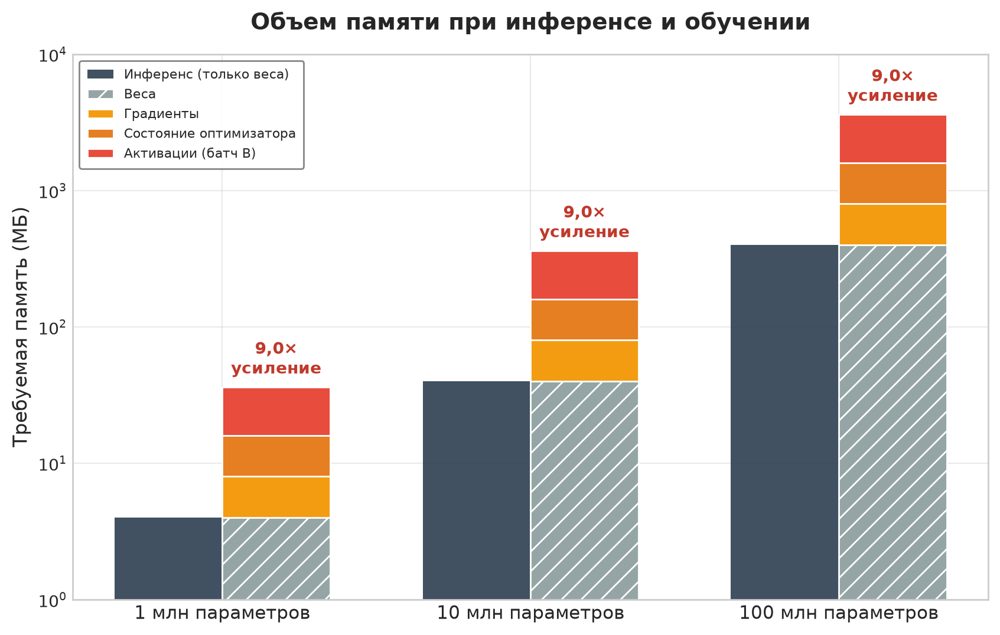

***Усиление памяти при обучении:** столбцы сравнивают объем памяти для инференса и обучения на разных масштабах моделей от 1 млн до 100 млн параметров. Эта иллюстративная конфигурация хранит веса, градиенты, состояние оптимизатора и активации и дает репрезентативный рост объема памяти в 9$\times$.*

#### Пиковое потребление памяти

Потребление памяти при обучении не постоянно. Оно колеблется и достигает максимума во время обратного прохода, когда активации, градиенты и состояния оптимизатора должны сосуществовать. Этот пик определяет, можно ли обучить модель на устройстве. Для модели с 10 млн параметров на смартфоне с 8 ГБ ОЗУ 40 МБ весов FP32 могут вырасти больше чем до 200 МБ во время обратного распространения ошибки, когда накапливаются активации, градиенты и состояния оптимизатора; при этом память конкурирует напрямую с операционной системой и приложениями переднего плана. Такие приемы, как контрольные точки градиентов, смягчают этот пик: они отбрасывают промежуточные активации в прямом проходе и пересчитывают их по требованию в обратном проходе (Chen et al., 2016). Такой подход обменивает дополнительные вычисления на меньший пик памяти; точная экономия зависит от того, какие активации сохраняются в контрольных точках и какой объем пересчета способно выдержать устройство.

Эти усиления объясняют, почему стандартные методы оптимизации без изменений не работают для нагрузок обучения. Каждая категория ограничений формирует систему обучения на устройстве и требует подходов, которые опираются на методы, ориентированные на инференс, но выходят за их пределы.

> **Контрольные вопросы: ограничения обучения на устройстве**
>
> Проверьте, понимаете ли вы, как обучение усиливает граничные ограничения:
>
> - **Взрыв памяти при обучении:** объясните, почему обучение на устройстве обычно требует в 4–12 раз больше памяти, чем инференс той же модели на том же устройстве.
> - **Голодающий NPU:** объясните, как быстрый NPU может простаивать, когда конвейер обучения не успевает подавать данные и активации в пределах бюджета памяти устройства.
> - **Нехватка памяти в обратном проходе:** объясните, почему модель с 10 млн параметров все равно может вызвать ошибку нехватки памяти (OOM) в обратном проходе на смартфоне с 8 ГБ ОЗУ.
> - **Энергия контрольных точек:** оцените утверждение, что контрольные точки градиентов снижают полное энергопотребление обучения на устройстве.

[Рисунок](#fig-ondevice-pretraining) показывает, как полный конвейер обучения сочетает офлайновое предобучение с онлайновым адаптивным обучением на IoT-устройствах с ограниченными ресурсами. Система сначала проходит метаобучение на общих данных. Во время развертывания специфичные для устройства ограничения (доступность данных, вычисления и память) формируют стратегию адаптации: ранжируют и выбирают слои и каналы для обновления. Такое выборочное дообучение позволяет эффективно обучаться на устройстве в ограниченных ресурсных рамках.

<a id="fig-ondevice-pretraining"></a>

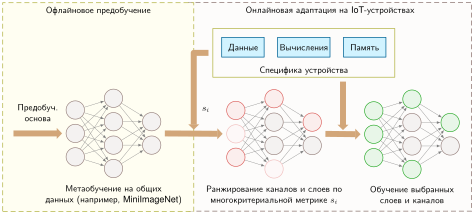

***Предобучение на устройстве и выборочное дообучение:** двухэтапный конвейер сначала выполняет метаобучение полной нейронной сети на общих облачных данных. Затем ограничения устройства направляют шаг ранжирования важности, который выбирает слои и каналы для локального обновления, пока остальная часть сети остается замороженной.*

Устройствам с ограниченными ресурсами нужен двухэтапный процесс обучения. Офлайновое предобучение задает начальные веса модели. Онлайновая адаптация затем выборочно обновляет слои с учетом доступных данных, вычислений и памяти. Такой подход балансирует качество модели с практическими ограничениями граничного развертывания и позволяет непрерывно обучаться в реальных условиях.

### Ограничения модели

Структура и размер модели машинного обучения напрямую определяют, возможно ли обучение на устройстве. Модели в облаке могут насчитывать миллиарды параметров и опираться на бюджеты памяти в несколько гигабайт; модели для обучения на устройстве должны укладываться в жесткие ограничения по памяти, хранилищу и вычислительной сложности. При обучении эти ограничения ужесточаются еще больше: вычисление градиентов, обновление параметров и управление состоянием оптимизатора требуют ресурсов сверх тех, что нужны для инференса.

Масштаб этих ограничений становится конкретным на всем спектре устройств. MobileNetV2, которую часто используют в мобильных задачах компьютерного зрения, в стандартной конфигурации занимает около 14 МБ. Для смартфонов с гигабайтами доступной ОЗУ это осуществимо, но это намного больше, чем 256 КБ SRAM и 1 МБ флеш-памяти у микроконтроллеров вроде Arduino Nano 33 BLE Sense.[^fn-arduino-memory-wall] На таких сильно ограниченных платформах даже один сверточный слой может не поместиться в доступную ОЗУ при обучении из-за промежуточных карт признаков и хранения градиентов.

[^fn-arduino-memory-wall]: **Arduino Nano 33 BLE Sense**: при 256 КБ SRAM, примерно в 65 536 раз меньше 16 ГБ флагманского смартфона, одно RGB-изображение $224{\times}224{\times}3$ занимает около 151 КБ и расходует примерно 60 % доступной памяти; хранение активаций и градиентов добавляет еще несколько живых тензоров, а состояние оптимизатора может сильно увеличить объем обучения по сравнению с инференсом. Это значит, что даже крошечный слой сверточной нейронной сети (CNN) может превысить общий объем SRAM во время обратного распространения ошибки. Эта стена памяти делает квантование в 8 или 4 бита обязательным условием, а не оптимизацией.

Сам процесс обучения резко увеличивает эффективный объем памяти. Стандартное обратное распространение ошибки кэширует активации каждого слоя в прямом проходе, а затем использует их при вычислении градиентов в обратном проходе. Анализ усиления ограничений, приведенный выше, показал, что это кэширование активаций умножает требования к памяти по сравнению с развертыванием только для инференса. Даже скромная модель из 10 сверточных слоев, обрабатывающая изображения $64{\times}64$, может требовать от 1 до 2 МБ, что намного больше емкости SRAM большинства встраиваемых систем.

Сложность модели также напрямую влияет на энергопотребление во время работы и тепловые пределы. В умных часах или носимых устройствах с батареей длительное обучение модели может быстро истощить запас энергии или вызвать троттлинг из-за нагрева, который ухудшает производительность. Обучение полной модели с операциями над числами с плавающей точкой на таких устройствах часто неосуществимо с точки зрения энергии, даже если ограничения памяти соблюдены. Сверхлегкие бенчмарки вроде MLPerf Tiny задают небольшие квантованные цели для инференса на сильно ограниченных устройствах (Banbury et al., 2021). Приемы адаптации на устройстве затем снижают стоимость обучения, замораживая большую часть параметров, уменьшая хранение активаций или выбирая разреженные наборы обновлений (Cai et al., 2020; Kwon et al., 2024).

Практические последствия ограничений по батарее и теплу выходят за рамки простого сокращения длительности обучения. Мобильные устройства должны тщательно балансировать возможности обучения и пользовательский опыт. Агрессивное обучение на устройстве может вызывать заметный нагрев и быстрый разряд батареи, что ведет к недовольству пользователей и удалению приложения. Нагрузки машинного обучения на смартфонах обычно укладываются в устойчивый диапазон обработки 2–3 Вт, чтобы не создавать тепловой дискомфорт, хотя могут кратковременно выдавать 5–10 Вт до начала троттлинга. Обучение даже скромных моделей легко выходит за эти устойчивые пределы мощности. Поэтому нужны разумные стратегии планирования: обучение во время зарядки, когда теплоотвод лучше, использование энергоэффективных ядер для вычисления градиентов, когда это возможно, и циклическое включение с приостановкой обучения при превышении температурных порогов. Некоторые системы даже учитывают паттерны использования устройства и запускают интенсивную адаптацию только ночью, во время зарядки, когда устройство простаивает и подключено к питанию.

Эти ограничения требуют, чтобы архитектуры моделей с самого начала проектировались для обучения на устройстве. Большие трансформеры и глубокие сверточные сети попросту непригодны для адаптации на устройстве без разбиения, квантования или переноса вычислений на другие узлы. Специализированные легковесные архитектуры, такие как MobileNet,[^fn-mobilenet-edge-efficiency] SqueezeNet (Iandola et al., 2016) и EfficientNet (Tan и Le, 2019), решают задачи инференса при ограниченных ресурсах с помощью раздельных поэлементных сверток,[^fn-depthwise-flop-savings] модулей типа «бутылочное горлышко» и fire-модулей и составного масштабирования модели. Квантование и выборочные обновления — это отдельные решения о развертывании и адаптации, которые накладываются поверх архитектуры.

[^fn-mobilenet-edge-efficiency]: **MobileNet (2017)**: архитектура Google сократила число операций с плавающей точкой (FLOPs) по сравнению со стандартными CNN в 8–9 раз за счет раздельных поэлементных сверток. Системное следствие: MobileNetV2 выполняет классификацию ImageNet примерно за 75 мс на телефоне Pixel против 1,8 с у ResNet-50, переходя порог, при котором инференс в реальном времени и адаптация на устройстве становятся устойчивыми по нагреву в пределах энергетического бюджета смартфона 2–3 Вт.

[^fn-depthwise-flop-savings]: **Раздельные поэлементные сверточные слои (depthwise separable convolutions)**: раскладывают стандартную свертку на поэлементный фильтр для каждого канала, за которым следует поточечная комбинация $1{\times}1$. Для свертки $3{\times}3$ с 512 входными и выходными каналами это сокращает число параметров с 2,36 млн примерно до 267 тыс., то есть в 8,8 раза. Экономия здесь физическая, а не только теоретическая: именно это разложение делает возможным инференс CNN в реальном времени на мобильных CPU, и оно так же сокращает память, нужную для кэширования активаций при обучении на устройстве.

Модульность — ключевое свойство проектирования. MobileNet (Howard et al., 2017) и MobileNetV2 (Sandler et al., 2018) можно настраивать с разными множителями ширины и разрешением, чтобы балансировать качество и использование ресурсов. Полная MobileNetV2 с множителем ширины $\alpha_{\text{width}}=1.0$ содержит около 3,5 млн параметров (14 МБ в FP32). При $\alpha_{\text{width}}=0.5$ полная модель на 1000 классов содержит около 2,0 млн параметров (7,9 МБ), а развертывание только экстрактора признаков с небольшой головой под задачу может сократиться до 0,69 млн параметров (2,8 МБ), что укладывается в бюджет модели 4 МБ.

### Ограничения данных

Архитектура модели определяет базовый уровень памяти и вычислений для обучения на устройстве, но доступность и качество данных создают не менее фундаментальные ограничения, которые определяют каждый аспект процесса обучения. Данные, доступные системам машинного обучения на устройстве, сильно отличаются от больших отобранных наборов, которые используются в облачном обучении. На границе данные собираются локально, разрежены во времени и часто не структурированы или не размечены. Возникающие трудности с объемом, качеством и статистическим распределением напрямую влияют на надежность и обобщаемость обучения на устройстве.

Объем данных сильно ограничен и хранилищем, и спорадическим характером взаимодействия пользователя. Умный фитнес-трекер может собирать данные о движении только во время физической активности, создавая относительно немного размеченных примеров в день. Если пользователь занимается 30 минут, для обучения может оказаться доступно всего несколько сотен точек данных, тогда как для эффективного обучения с учителем нужны тысячи или миллионы примеров. Дефицит данных вынуждает перейти от алгоритмов, рассчитанных на богатые данные, к алгоритмам, эффективным по данным.

Данные на устройстве также часто не являются независимыми и одинаково распределенными (non-i.i.d.) (Zhao et al., 2018), что создает статистические трудности, с которыми облачные системы редко сталкиваются. Голосовой ассистент, развернутый в множестве домохозяйств, сталкивается с большим разнообразием акцентов, языков, манер речи и паттернов команд. Клавиатуры смартфонов адаптируются к индивидуальным манерам печати, предпочтениям автоисправления и многоязычному использованию, которое сильно различается между пользователями. Неоднородность осложняет и сходимость модели, и разработку механизмов обновления, которые должны обобщаться на разные устройства, сохраняя персонализацию.

Дефицит меток усиливает проблему распределения. Большая часть данных, собранных на границе, по умолчанию не размечена, поэтому системам приходится учиться по слабым или неявным сигналам обучения с учителем. Камера смартфона может снимать тысячи изображений в течение дня, но лишь немногие связаны с осмысленными действиями пользователя (отметкой, добавлением в избранное или отправкой), которые могли бы служить неявными метками. Во многих приложениях, включая обнаружение аномалий в данных датчиков и адаптацию распознавания жестов, явные метки могут быть полностью недоступны, и тогда традиционное обучение с учителем невозможно без альтернативных методов слабого обучения с учителем или адаптации без учителя.

Качество данных создает дополнительные трудности. Встраиваемые системы, такие как экологические датчики или автомобильные электронные блоки управления (ECU), испытывают дрейф калибровки датчиков, помехи среды и механический износ, из-за чего входные сигналы со временем искажаются или дрейфуют. Без централизованных систем валидации, которые обнаруживают и отфильтровывают такие ошибки, они незаметно ухудшают качество обучения.

Наиболее жесткие ограничения накладывают вопросы приватности и безопасности: они часто делают обмен данными архитектурно невозможным, а не просто нежелательным. Чувствительная информация, такая как данные о здоровье, личная переписка или поведенческие паттерны, должна быть защищена от несанкционированного доступа в соответствии с правовыми и этическими требованиями. Поэтому обучение на устройстве должно опираться на методы, которые позволяют локальную адаптацию, никогда не раскрывая чувствительную информацию, и это коренным образом меняет то, как проектируются и валидируются системы обучения.

### Ограничения вычислений

Аппаратный ландшафт граничных устройств обеспечивает вычислительную основу для машинного обучения. Он охватывает микроконтроллеры вроде STM32F4 и ESP32 на самом ограниченном конце, процессоры мобильного класса с выделенными ИИ-ускорителями (Apple Neural Engine, Qualcomm Hexagon, Google Tensor) посередине и высокопроизводительные граничные устройства на верхнем конце. Хотя эти устройства обеспечивают разный уровень возможностей инференса (вычислительной пропускной способности, пропускной способности памяти и энергоэффективности при работе с предобученными моделями), нагрузки обучения имеют принципиально иные вычислительные характеристики, которые меняют паттерны загрузки аппаратуры.

Обучение на устройстве должно работать в вычислительных рамках, которые по сырой мощности отличаются от облачной инфраструктуры обучения на сотни или тысячи раз. Ключевое отличие: обратное распространение ошибки требует заметно более высокой пропускной способности памяти, чем инференс, из-за вычисления градиентов и кэширования активаций; обновление весов создает паттерны доступа с преобладанием записи, в отличие от read-only операций инференса; а управление состоянием оптимизатора требует дополнительного выделения памяти. Аппаратура, вполне достаточная для инференса, может оказаться совершенно непригодной для адаптации, даже если обновляется только небольшое подмножество параметров.

На самом ограниченном конце такие устройства, как микроконтроллеры STM32F4[^fn-stm32-memory-limits] и ESP32[^fn-esp32-microcontroller-training], предлагают лишь несколько сотен килобайт SRAM и ограниченные бюджеты вычислений и мощности (Warden и Situnayake, 2020). Хотя эти семейства включают поддержку чисел с одинарной точностью, практические развертывания машинного обучения обычно опираются на квантованные или целочисленные с фиксированной точкой ядра ради эффективности. Библиотеки вроде CMSIS-NN (Lai et al., 2018) предоставляют оптимизированные ядра нейронных сетей для процессоров Arm Cortex-M и дают ускорение времени выполнения в 4,6 раза за счет арифметики с фиксированной точкой и оптимизаций single instruction, multiple data. Эти жесткие ограничения исключают обычные библиотеки глубокого обучения и требуют моделей, спроектированных под квантованную арифметику и минимальное выделение памяти во время работы. Даже простым моделям нужны обучение с учетом квантования[^fn-qat-power-efficiency] и выборочные обновления параметров, чтобы выполнять циклы обучения, не выходя за бюджеты памяти и мощности.

[^fn-stm32-memory-limits]: **STM32F4 (микроконтроллер)**: при 192 КБ SRAM, тактовой частоте 168 МГц и модуле операций с плавающей точкой одинарной точности главное ограничение — не отсутствие плавающей точки, а крошечный бюджет памяти и энергии. Плотный слой с 1000 входными признаками и 10 скрытыми нейронами требует около 40,04 КБ под веса и смещения в FP32, то есть около 20,85 % всей SRAM без учета активаций и градиентов. При активной мощности около 100 мВт даже простые обновления градиентов нужно запускать с циклическим включением, а ядра INT8 или с фиксированной точкой предпочтительны, когда это позволяет точность.

[^fn-esp32-microcontroller-training]: **ESP32**: предлагает 520 КБ SRAM и двухъядерный процессор на 240 МГц со встроенными Wi-Fi и Bluetooth, что делает его недорогой платформой для экспериментов, сочетающих локальную адаптацию с федеративной координацией. Его CPU поддерживает операции с плавающей точкой, но ради пропускной способности, объема памяти и энергоэффективности обычно предпочитают ядра с фиксированной точкой и 8-битные; компактные 8-битные модели могут занимать около 50 КБ, что позволяет выполнять базовую адаптацию на устройстве для обнаружения аномалий в данных датчиков.

[^fn-qat-power-efficiency]: **Обучение с учетом квантования (QAT)**: моделирует арифметику низкой точности во время обучения, поэтому модель учится устойчивым представлениям при сниженной точности. В отличие от посттренировочного квантования (PTQ), которое переводит уже обученную модель FP32 задним числом (Jacob et al., 2018; Krishnamoorthi, 2018), выигрыш для системы — меньший трафик памяти и более дешевая целочисленная арифметика: модели энергии аппаратуры показывают, что арифметика низкой точности и перемещение данных в памяти могут быть значительно дешевле вычислений в FP32 (Horowitz, 2014). Точные результаты по скорости, энергии и качеству зависят от процессора, реализации ядра, модели и данных калибровки. На граничных устройствах QAT часто является предварительным условием для того, чтобы адаптация укладывалась в тепловой и бюджет памяти.

Практические следствия суровы: хотя микроконтроллер STM32F4 может выполнить простую модель линейной регрессии с несколькими сотнями параметров, обучение даже небольшой сверточной сети сразу превысит его объем памяти. В этих сильно ограниченных средах нейронные обновления часто ограничиваются простыми алгоритмами, такими как стохастический градиентный спуск (SGD),[^fn-sgd-microcontroller-training] а ненейронная адаптация может использовать кластеризацию k-средних для обновления центроидов или порогов в обнаружении аномалий в данных датчиков. Оба подхода реализуются целочисленной арифметикой с минимальными накладными расходами памяти, что представляет собой принципиальный отход от практики машинного обучения в дата-центрах.

[^fn-sgd-microcontroller-training]: **SGD (стохастический градиентный спуск)**: обновляет параметры по градиентам одного примера или небольшого батча, храня только текущие параметры и их градиенты. Этот минимальный объем памяти делает SGD одним из немногих правдоподобных оптимизаторов на микроконтроллерах: адаптивная оценка моментов (Adam) требует в 3 раза больше памяти, чем SGD, для оценок моментов по каждому параметру, что превышает бюджет SRAM на устройствах с объемом менее 512 КБ. Цена такого выбора — более медленная сходимость, которая требует больше шагов градиента для достижения сопоставимой точности.

Поднимаясь по вычислительной иерархии, мы видим, что аппаратура мобильного класса дает улучшение, но все равно работает в жестких ограничениях. Платформы, включая Qualcomm Snapdragon, Apple Neural Engine,[^fn-neuralengine-hardware-evolution] и Google Tensor SoC,[^fn-tensorsoc-federated-learning] дают заметно больше вычислительной мощности, чем микроконтроллеры, часто с выделенными ИИ-ускорителями и оптимизированной поддержкой матричных операций в 8-битной или смешанной точности[^fn-mixedprecision-edge-quantization]. Эти ускорители предлагают выделенные блоки матричного умножения, иерархии памяти на кристалле и функции управления питанием, специально созданные для инференса нейронных сетей, с разной поддержкой локальных обучающих нагрузок. Хотя эти платформы могут поддерживать более сложные процедуры обучения, включая полное обратное распространение ошибки на компактных моделях, они все равно сильно уступают вычислительной пропускной способности и пропускной способности памяти дата-центров. Например, обучение легковесного трансформера[^fn-transformer-mobile-serving] на смартфоне технически осуществимо, но должно быть жестко ограничено по времени и энергопотреблению, чтобы не ухудшать пользовательский опыт, что подчеркивает постоянное напряжение между возможностями обучения и практическими ограничениями развертывания.

[^fn-neuralengine-hardware-evolution]: **Apple Neural Engine**: от A11 (0,6 TOPS) до мобильных NPU флагманского класса около 35 TOPS; мобильное нейроускорение улучшилось примерно на два порядка в пределах этой линейки устройств. Системное следствие: в этом репрезентативном расчете дообучение классификатора MobileNet занимает около 2 с на нейроускорителе против 45 с на CPU, при этом дополнительное энергопотребление составляет около 500 мВт. Такое ускорение примерно в 23 раза при минимальной цене по мощности делает адаптацию на устройстве осуществимой по нагреву при обычном использовании телефона и позволяет запускать компактные задачи персонализации короткими всплесками с помощью ускорителя в рамках строгих политик нагрева и батареи.

[^fn-tensorsoc-federated-learning]: **Google Tensor SoC (2021)**: объединяет специализированное ускорение ML с инструментами Android и TensorFlow Lite, что делает его полезным примером совместного проектирования аппаратуры и программного обеспечения для инференса на устройстве и федеративных рабочих процессов. Системный вывод: одной мощности ускорителя недостаточно, потому что локальная адаптация зависит и от поддержки компилятора, операторов времени выполнения, управления питанием и оркестрации обновлений.

[^fn-mixedprecision-edge-quantization]: **Обучение в смешанной точности**: назначает разным операциям разную числовую точность: FP16 для прямого и обратного проходов, FP32 для накопления параметров. Это вдвое сокращает использование памяти и удваивает пропускную способность на аппаратуре с Tensor Cores. Мобильные реализации идут дальше: INT8 для инференса и FP16 для градиентов сокращают память обучения в 4 раза по сравнению с полной FP32, сохраняя ошибки накопления ограниченными за счет масштабирования функции потерь (loss scaling).

[^fn-transformer-mobile-serving]: **Легковесные трансформеры**: оптимизированные для мобильных устройств архитектуры вроде MobileBERT дают ускорение в 4–6 раз по сравнению с полными моделями за счет дистилляции знаний и прореживания голов внимания; они сохраняют 97 % точности BERT-base при времени инференса около 40 мс на мобильном CPU против 160 мс у полного BERT. Ограничение, которое важно для обучения на устройстве: даже эти сжатые трансформеры требуют 50–200 МБ для активаций обучения, что упирается в 2–4 ГБ, доступных на телефонах среднего класса.

Опубликованные результаты бенчмарков MLPerf Tiny и официальные данные производителей делают эти классы аппаратуры конкретными. [Рисунок](#fig-edge-inference-landscape) сопоставляет задержку инференса и энергию на один инференс для репрезентативных устройств и показывает три отчетливых кластера, разделенных примерно 100$\times$ по энергопотреблению. Выделенные нейронные процессоры, такие как Syntiant Core 2 и NPU STM32N6, распознают ключевые слова быстрее 5 мс при 30–160 микроджоулях, а граничные GPU, такие как Jetson AGX Orin, дают задержку менее миллисекунды при 15 миллиджоулях. Разрыв в 100$\times$ по энергии между классами определяет, какие устройства могут работать от батареи месяцами, а какие — часами, и тем самым формирует допустимое пространство проектирования для обучения на устройстве.

<a id="fig-edge-inference-landscape"></a>

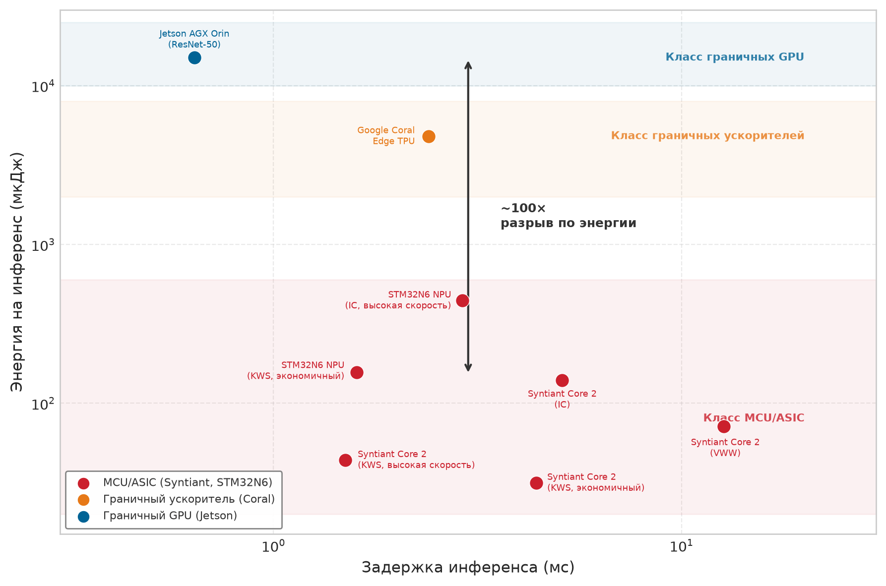

***Ландшафт граничного инференса:** опубликованные измерения задержки и энергии инференса из MLPerf Tiny и официальных бенчмарков выявляют три отчетливых класса аппаратуры, разделенных примерно 100$\times$ по энергопотреблению. Выделенные нейронные процессоры (Syntiant, STM32N6) распознают ключевые слова быстрее 5 мс при 30–160 микроджоулях, а граничные GPU (Jetson Orin) дают задержку менее миллисекунды при 15 мДж.*

Эти вычислительные ограничения становятся особенно острыми в системах реального времени или питаемых от батареи, где бюджеты задержки, описанные в разделе «Альтернативные подходы и критерии выбора» выше, превращаются в жесткие архитектурные ограничения: они определяют, вообще возможна ли адаптация на устройстве или облачные альтернативы становятся архитектурно необходимыми. Более трудное ограничение состоит в том, что адаптация не может занять устройство целиком. В распознавателе речи на смартфоне адаптация на устройстве должна незаметно сосуществовать с основными нагрузками инференса, не мешая задержке отклика и отзывчивости системы. Аналогично в носимых медицинских мониторах обучение должно происходить по возможности в заранее определенные окна (обычно во время низкой активности или зарядки), чтобы сохранять заряд батареи и не создавать проблем с терморегулированием.

Помимо сырой вычислительной мощности, архитектурные последствия этих аппаратных ограничений распространяются на фундаментальные решения системного проектирования. Операции обучения имеют принципиально иные паттерны доступа к памяти, чем нагрузки инференса: обратное распространение ошибки требует в 3–5 раз более высокой пропускной способности памяти из-за вычисления градиентов и кэширования активаций, что создает узкие места, которые чисто вычислительные метрики не отражают. Граничные ускорители решают эти задачи с помощью специализированных аппаратных функций. Тракты адаптивной точности позволяют динамически переключаться между INT4 для прямых проходов и FP16 для вычисления градиентов, оптимизируя точность и эффективность в рамках бюджетов мощности. Блоки разреженных вычислений ускоряют выборочные обновления параметров, пропуская нулевые градиенты, что критично для эффективных обновлений только смещений и структурированных низкоранговых обновлений (см. раздел «Структурированные обновления параметров» далее). Архитектуры вычислений рядом с памятью[^fn-nearmemory-edge-training] сокращают затраты на перемещение данных, выполняя обновление градиентов непосредственно рядом с хранилищем весов, и устраняют узкое место пропускной способности памяти. Однако многие граничные ускорители по-прежнему оптимизированы в первую очередь под инференс, что открывает возможности для совместного проектирования аппаратуры и программного обеспечения для ускорителей обучения на устройстве, рассчитанных на особые требования локальной адаптации.

[^fn-nearmemory-edge-training]: **Вычисления рядом с памятью (near-memory computing)**: размещают вычислительные элементы рядом с массивами памяти или внутри них, что сокращает перемещение данных, которое в обычных архитектурах часто доминирует над энергией арифметики (Horowitz, 2014). Проекты ускорителей рядом с памятью, такие как TensorDIMM, показывают, как перенос тензорных операций ближе к памяти может улучшить пропускную способность и энергетику для глубоких нагрузок, ограниченных памятью (Kwon и Rhu, 2018). Для обучения на границе, где вычисление градиентов создает паттерны записи, которые перегружают иерархии кэшей, такой архитектурный сдвиг мог бы сделать некоторые формы обратного распространения ошибки на устройстве практичнее.

#### Стена памяти мобильных устройств

Мобильные NPU дают впечатляющие TOPS, но «стена памяти», которую разбирает раздел главы о вычислительной инфраструктуре, становится непреодолимым барьером для крупных моделей на граничных устройствах. Та же стена пропускной способности, которая ограничивает обновления при обучении, яснее всего видна при декодировании мобильных языковых моделей: если веса и состояние KV-кэша не могут проходить через память достаточно быстро, никакой заявленный TOPS не спасет нагрузку. Недавний анализ показывает, что авторегрессивное декодирование переносит давление на инференс больших языковых моделей (LLM) на память и межсоединения, а не на пиковую арифметическую пропускную способность (Ma и Patterson, 2026). Количественный разрыв разителен: HBM3 центра обработки данных на H100 дает 3 350 ГБ/с пиковой однонаправленной пропускной способности DRAM, тогда как флагманские мобильные системы, например на A17 Pro или Snapdragon 8 Gen 3, находятся примерно на уровне 64–100 ГБ/с пропускной способности LPDDR5X.

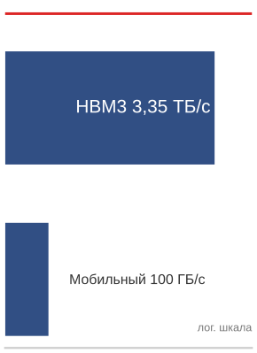

*Высокоскоростная память (HBM) центров обработки данных опережает пропускную способность мобильной памяти примерно в 34 раза.*

Разрыв пропускной способности в 30–50 раз означает, что даже если модель помещается в мобильную ОЗУ, она будет порождать токены в 30–50 раз медленнее, чем GPU центра обработки данных. Поэтому локальный LLM-сервис на устройстве требует агрессивного квантования (INT4 или даже INT2) как **стратегии выживания по пропускной способности**, а не просто оптимизации емкости. Уменьшение размера модели в 8 раз фактически увеличивает относительную пропускную способность и делает интерактивную генерацию возможной на мобильном железе.

> **Перспектива: почему узкое место — пропускная способность, а не TOPS**
>
> Разрыв пропускной способности становится определяющим, потому что каждый сгенерированный токен передает веса модели из памяти в вычислительные блоки. Поэтому член данных железного закона $(D_{\text{vol}} / \text{BW})$ доминирует над вычислительным членом, когда веса превышают объем кэша на кристалле, а это верно для миллиардных моделей на кремнии мобильного класса. Именно поэтому квантование сокращает $D_{\text{vol}}$, а не арифметику на токен.
>
> Практическое следствие таково: при выборе граничного ускорителя для декодирования трансформера решающим показателем служат ГБ/с, которые чип способен поддерживать к памяти на корпусе, а не пиковые TOPS в спецификации. На кремнии мобильного класса эти величины могут расходиться на порядки.

### Проблемы интеграции граничного железа

Помимо отдельных ограничений моделей, данных и вычислений, системы обучения на устройстве должны учитывать физику мобильных вычислений: рассеивание мощности, тепловые пределы и энергетические бюджеты. Эти физические ограничения — фундаментальные факторы проектирования, которые определяют все допустимое пространство алгоритмов обучения на устройстве.

#### Анализ ограничений энергии и температуры

Управление энергией и теплом — самые трудные аспекты проектирования систем обучения на устройстве, поскольку они напрямую влияют на пользовательский опыт и срок службы устройства. Мобильные устройства работают в строгих энергетических бюджетах, которые фундаментально определяют допустимую сложность модели и расписание обучения.

> **Сценарий: разряд батареи — цена обучения на границе**
>
> **Задача**: команда проектирует фоновую задачу дообучения для персонализированного голосового ассистента на смартфоне. Задача потребляет 4,5 Вт и занимает 30 минут. Если в телефоне аккумулятор 15 Вт·ч, какую часть заряда батареи пользователя съест это «невидимое» обновление?
>
> **Расчет**:
>
> 1. Полная энергия: 4,5 Вт $\times$ 0,5 ч = 2,25 Вт·ч.
> 2. **Влияние на батарею**: 2,25 Вт·ч / 15 Вт·ч = 15 %.
>
> **Системный вывод**: расход 15 % заряда батареи на фоновую задачу — серьезное нарушение принципов мобильного UX: это эквивалентно потере часа экранного времени. Поэтому обучение на устройстве обычно ограничивают **оппортунистическим планированием**: оно запускается только тогда, когда устройство подключено к зарядке и Wi-Fi и тепловой режим стабилен. Проектирование для границы означает уважать энергетический бюджет пользователя так же строго, как бюджет точности модели.

Этот расчет батареи — локальная версия более широкого энергетического ограничения: обучение должно укладываться в энергетический бюджет пользователя, а не только в цель точности модели. Поэтому производственный проект должен учитывать энергию на этапе планирования, сравнивать локальные вычисления со стоимостью коммуникации и откладывать обучение, когда устройство пользователя не может принять обновление.

Это решение можно выразить как условие допуска фоновой работы. Пусть $E_{\text{update}}$ — предсказанная энергия одного окна адаптации, $E_{\text{slack}}$ — энергия, которую политика допускает до следующей возможности зарядки, $P_{\text{device}}$ — текущая устойчивая мощность, $P_{\text{update}}$ — прирост мощности от адаптации, а $P_{\text{thermal}}$ — тепловой предел устойчивой работы. Пусть $L_{\text{fg}}$ — измеренная задержка переднего плана, $\Delta L_{\text{fg}}^{\text{wc}}$ — наихудший прирост задержки при параллельной адаптации, а $L_{\text{deadline}}$ — крайний срок переднего плана. Среда выполнения допускает обновление, только если

<a id="eq-edge-background-admission"></a>

$$
E_{\text{update}} \le E_{\text{slack}}
\quad \land \quad
P_{\text{device}} + P_{\text{update}} \le P_{\text{thermal}}
\quad \land \quad
L_{\text{fg}} + \Delta L_{\text{fg}}^{\text{wc}} \le L_{\text{deadline}}.
$$

Зарядка может увеличить энергетический лимит, но не отменяет проверок по теплу и задержке переднего плана. Величины должны получаться из профилирования, специфичного для устройства и нагрузки, а среда выполнения должна отзывать допуск, когда измеренная область меняется. Более короткие окна обновления, меньшая скважность или меньший набор обучаемых параметров могут сделать отклоненное обновление осуществимым; позволить фоновому обучению съесть крайний срок переднего плана нельзя.

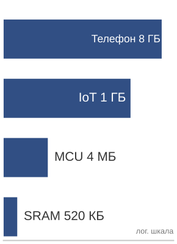

*Память устройств различается примерно в 15 000 раз: от телефона до микроконтроллера.*

#### Оптимизация иерархии памяти

Помимо тепловых и энергетических трудностей, ограничения иерархии памяти создают еще одно фундаментальное узкое место, которое определяет проектирование систем обучения на устройстве. Анализ усиления ограничений показывает, что эти ограничения влияют и на хранение статической модели, и на динамические требования к памяти при обучении, часто выталкивая системы за пределы практических возможностей.

Иерархия памяти устройств охватывает несколько порядков величины по разным классам устройств, и каждый из них создает свои ограничения для обучения на устройстве. Флагманский телефон предоставляет около 8 ГБ общей системной памяти, но для приложений доступна только ее часть, поскольку операционная система и фоновые процессы занимают свою долю. Бюджетные Android-устройства работают примерно с 4 ГБ общей системной памяти, из которых после накладных расходов ОС для задач ML остается примерно 1–2 ГБ. Встраиваемые IoT-системы имеют от 64 МБ до 1 ГБ общей памяти, которую нужно делить между системными задачами и данными приложений, что создает серьезные ограничения для любых алгоритмов обучения. Микроконтроллеры располагают лишь 256 КБ–2 МБ SRAM, что требует крайней оптимизации и аккуратного управления памятью и принципиально ограничивает сложность моделей, которые могут адаптироваться на такой платформе.

Расширение памяти при обучении создает особенно острые трудности, которые часто определяют, осуществим ли вообще проект. Стандартное обратное распространение ошибки требует кэширования промежуточных активаций каждого слоя в прямом проходе, которые затем используются при вычислении градиентов в обратном проходе, что создает значительные накладные расходы памяти. Модель масштаба MobileNetV2, которая спокойно помещается для инференса, может превысить доступный бюджет памяти, когда добавляются активации, градиенты и состояние оптимизатора, и тогда обучение без агрессивной оптимизации становится невозможным. Квантование, прореживание и дистилляция могут каждое по отдельности уменьшить объем модели или стоимость обновления (Jacob et al., 2018; Han et al., 2015; Hinton et al., 2015), но их выигрыш зависит от нагрузки и сам по себе не складывается. Эти приемы нужно проверять вместе, чтобы добиться сжатия, необходимого для практического развертывания.

Поэтому оптимизация кэша становится критичной для достижения приемлемой производительности при ограниченных пулах памяти. Современные мобильные SoC имеют сложные иерархии памяти с кэшем L1 (32–64 КБ), кэшем L2 (1–8 МБ) и системной памятью (4–16 ГБ), между уровнями которых задержки различаются в 10–100$\times$; при превышении емкости кэша рабочим набором возникают резкие провалы производительности. Нагрузки обучения, которые не умещаются в кэш, сильно замедляются из-за узких мест пропускной способности памяти, и это может замедлить обучение на порядки. Успешные системы обучения на устройстве должны тщательно проектировать паттерны доступа к данным, чтобы максимизировать попадания в кэш: часто это требует специальной раскладки памяти, которая группирует связанные параметры ради пространственной локальности, аккуратно подобранных мини-батчей, полностью помещающихся в ограничения кэша, и продуманных стратегий накопления градиентов, которые минимизируют дорогой трафик шины памяти.

Ограничения пропускной способности памяти особенно остро проявляются при обучении. Инференс в основном последовательно читает веса модели, тогда как обучению нужен двунаправленный поток данных для вычисления градиентов и обновления весов. Этот возросший трафик может насытить подсистему памяти и создать узкие места, которые ограничивают пропускную способность обучения независимо от вычислительной мощности. Продвинутые реализации применяют такие приемы, как контрольные точки градиентов[^fn-checkpoint-edge-storage] для обмена вычислений на память (Chen et al., 2016), и обучение в смешанной точности для снижения требований к пропускной способности при сохранении численной устойчивости.

[^fn-checkpoint-edge-storage]: **Контрольные точки градиентов (gradient checkpointing)**: обменивают вычисления на память, пересчитывая выбранные промежуточные активации в обратном проходе вместо хранения всех их. Общий результат для контрольных точек — сублинейная память активаций ценой дополнительных вычислений в прямом проходе (Chen et al., 2016). На граничных устройствах, где память — связывающее ограничение, этот компромисс может определить, поместится ли модель в 2 ГБ ОЗУ или потребует 8 ГБ, но точные коэффициенты памяти и вычислений зависят от архитектуры и расписания.

#### Оптимизация мобильных ИИ-ускорителей

Выбор ускорителя важен меньше как сравнение пиковых TOPS, чем как вопрос о том, какой примитив обучения аппаратура способна поддерживать устойчиво. Движки инференса с фиксированной точностью благоприятствуют адаптации, которая в основном инференсная; программируемые векторные блоки делают компактное обратное распространение ошибки правдоподобнее; а тесная интеграция с фреймворками снижает накладные расходы федеративной координации. Архитектурные различия между этими ускорителями задают пространство проектирования для алгоритмов обучения на устройстве.

Флагманские мобильные ускорители следует рассматривать как разные адаптационные рамки, а не как рейтинг по пиковым TOPS. Флагманские мобильные NPU дают десятки TOPS пиковой производительности, причем 35 TOPS здесь служат обобщенной высокой отправной точкой, а не характеристикой одного конкретного чипа. Нейронный движок Apple в первую очередь оптимизирован под паттерны инференса CoreML с ограниченной поддержкой обучения, что делает его хорошо подходящим для адаптационных техник, ориентированных на инференс. Цифровой сигнальный процессор (DSP) Qualcomm Hexagon в Snapdragon 8 Gen 3 достигает 45 TOPS с гибкой поддержкой точности и программируемыми векторными блоками, что позволяет вести рабочие процессы обучения в смешанной точности с динамической адаптацией точности по фазе обучения и ограничениям памяти. Тензорный процессор (TPU) Google Tensor в Pixel 8 оптимизирован специально под операции TensorFlow Lite с сильной производительностью INT8 и тесной интеграцией с фреймворками федеративного обучения, что отражает фокус программного стека на сценариях распределенного обучения. Разрыв в энергоэффективности объясняет, почему выделенные нейронные процессоры необходимы: NPU дают 1–5 TOPS на ватт против 0,1–0,2 TOPS на ватт у универсальных CPU, то есть преимущество в эффективности в 5–50$\times$, которое отличает осуществимое обучение на устройстве от неосуществимого.

Каждый ускоритель подразумевает разные парадигмы обучения. Нейронный движок Apple хорошо справляется с инференсом в фиксированной точности, но поддерживает динамически-точностные вычисления градиентов лишь ограниченно, что делает его лучше подходящим для адаптационных техник, ориентированных на инференс, таких как обучение на нескольких примерах. Программируемые DSP дают большую гибкость обучения благодаря векторным блокам и арифметике смешанной точности, что позволяет выполнять обратное распространение ошибки на компактных моделях, если программный стек открывает нужные операторы. Мобильные ускорители класса TPU тесно интегрированы со средами выполнения фреймворков и инструментами федеративного обучения, что снижает накладные расходы системы на локальное обучение и координацию обновлений.

Эти особенности каждого поставщика наследуют те же паттерны доступа и аппаратные свойства, специфичные для обучения, которые обсуждались в разделе «Ограничения вычислений» выше: поток градиентов с преобладанием записи, тракты адаптивной точности, блоки разреженных обновлений и вычисления рядом с памятью, которые отличают ускоритель, способный к обучению, от ускорителя только для инференса. Следствие для проектирования: выбор архитектуры здесь — это не выбор по пиковой пропускной способности; он влияет на все, от стратегий квантования модели и подходов к вычислению градиентов до протоколов федеративной коммуникации и политик терморегулирования.

### Комплексные стратегии управления ресурсами

Анализ ограничений в этом разделе выявляет три категории трудностей, которые определяют пространство проектирования обучения на устройстве, и каждая категория задает соответствующий столп решения. Усиление ресурсов, при котором обучение увеличивает требования к памяти в 4–12$\times$, вычислительные затраты в 2–3$\times$ и энергопотребление пропорционально, требует подходов адаптации модели, которые сокращают объем обновления параметров, сохраняя способность к обучению. Дефицит информации, включающий ограниченные локальные наборы данных, неоднородные по распределению данные, ограничения приватности на обмен данными и минимальный контроль обучения, порождает решения эффективности данных, которые извлекают максимум учебного сигнала из минимального числа примеров. Задачи координации, такие как разнородность устройств, прерывистая связность, сложность распределенной валидации и требования масштабируемости, мотивируют механизмы федеративной координации, которые обеспечивают совместную работу по популяциям устройств с сохранением приватности.

[Таблица](#tbl-constraint-solution-mapping) показывает, как это соответствие между ограничениями и решениями на граничном обучении создает систематическую инженерную рамку: адаптация модели решает ограничения памяти и вычислений через выборочные обновления параметров, эффективность данных максимизирует обучение на дефицитных приватных примерах, а федеративная координация обеспечивает совместную работу с сохранением приватности. Устойчивые системы не рассматривают эти подходы как независимые техники: они объединяют все три, чтобы создать согласованные адаптивные системы, которые эффективно работают в граничных ограничениях.

<a id="tbl-constraint-solution-mapping"></a>

***Соответствие ограничений и решений:** каждая из трех фундаментальных категорий ограничений обучения на устройстве непосредственно порождает соответствующий подход к решению.*

| **Категория ограничения**   | **Ключевые трудности**                                                                                                     | **Подход к решению**                                                                                                                                                           |
|:----------------------------|:---------------------------------------------------------------------------------------------------------------------------|:-------------------------------------------------------------------------------------------------------------------------------------------------------------------------------|
| **Усиление ресурсов**       | • Нагрузки обучения (память в 4–12$\times$)<br>• Ограничения памяти<br>• Ограничения мощности                              | **Адаптация модели**<br>• Эффективные по параметрам обновления<br>• Дообучение выборочных слоев<br>• Низкоранговые адаптации                                                  |
| **Дефицит информации**      | • Ограниченные локальные наборы данных<br>• Неоднородные распределения (non-IID)<br>• Ограничения приватности                | **Эффективность данных**<br>• Обучение на нескольких примерах<br>• Мета-обучение<br>• Перенос обучения                                                                         |
| **Задачи координации**      | • Разнородность устройств<br>• Прерывистая связность<br>• Сложность распределенной валидации<br>• Требования масштабируемости | **Федеративная координация**<br>• Федеративное усреднение и асинхронная агрегация<br>• Безопасная агрегация и дифференциальная приватность<br>• Выбор клиентов и обработка отстающих |

Каждый столп решения расширяет инструменты сжатия и распределенных систем, чтобы решать конкретную категорию ограничений. Ни один столп сам по себе не достаточен, но их интеграция создает системы, способные к осмысленной адаптации в жестких ограничениях граничных сред развертывания.

<a id="sec-edge-intelligence-model-adaptation-6a82"></a>

## Адаптация модели

Персонализация модели с миллиардом параметров на умных часах, в которых всего `500 МБ` системной памяти, невозможна без отказа от цели обновлять всю модель целиком. Вместо обновления всей модели система замораживает подавляющую часть сети и обучает лишь компактный, стратегически размещенный набор параметров. В этом и состоит суть адаптации модели, эффективной по ресурсам.

> **Сценарий: скрытая цена персонализации**
>
> **Задача**: команда развертывает модель компьютерного зрения с 10 млн параметров на смартфоне, который поддерживает 10 различных «пользовательских контекстов» (дом, офис, автомобиль и т. д.). Если полностью дообученная модель занимает 40 МБ, на сколько меньше места потребуют остаточные адаптеры?
>
> **Расчет**:
>
> 1. **Полное дообучение**: 10 контекстов $\times$ 40 МБ = 400 МБ.
> 2. **Подход с адаптерами**: (1 $\times$ 40 МБ базовая модель) + (10 $\times$ 200 КБ адаптеров) $\approx$ 42 МБ.
> 3. **Экономия памяти**: 400 МБ/42 МБ $\approx$ 9,5× сокращение общего объема хранения на устройстве.
> 4. **Эффективность на контекст**: 40 МБ/0,2 МБ = 200×.
>
> **Системный вывод**: персонализация — это задача плотности хранения. На устройстве с ограниченной флеш-памятью хранение 10 версий одной и той же модели размером 40 МБ быстро съедает 400 МБ. Разбиение модели на замороженную базовую часть и динамические адаптеры снижает предельную стоимость нового пользовательского контекста в 200 раз. В граничном парке устройств только модульность позволяет масштабировать интеллект, не исчерпав физическое оборудование.
>
> 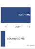
>
> *Адаптеры делают персонализацию для каждого пользователя дешевой по сравнению с полными копиями модели.*

Инженерная задача сосредоточена на навигации по фундаментальному пространству компромиссов: выразительность адаптации против потребления ресурсов. На одном полюсе обновление всех параметров дает максимальную гибкость, но превышает возможности граничных устройств. На другом полюсе отсутствие адаптации сохраняет ресурсы, но не улавливает паттерны конкретного пользователя. Эффективные системы обучения на устройстве должны работать посередине, выбирая стратегии адаптации по трем ключевым инженерным критериям:

- Ресурсный бюджет определяет, какие подходы к адаптации осуществимы. Миниатюрное носимое устройство с 1 МБ ОЗУ требует принципиально иных стратегий, чем смартфон с 8 ГБ.
- Вариативность, характерная для пользователя, определяет, насколько сложной должна быть адаптация. Простое обучение предпочтениям может требовать только обновления смещений, тогда как сложные сдвиги предметной области требуют более развитых подходов.
- Интеграция в систему определяет, может ли метод адаптации встроиться в существующие конвейеры инференса, протоколы федеративной координации и системы эксплуатационного мониторинга для развертывания модели и управления ее жизненным циклом.

Выбор методов адаптации следует той же логике: от легковесных подходов ([«Заморозка весов»](#sec-edge-intelligence-weight-freezing-3407)) к более выразительным, но требовательным к ресурсам методам ([«Разреженные обновления»](#sec-edge-intelligence-sparse-updates-879b)). Каждый метод представляет собой отдельную точку в пространстве инженерных компромиссов.

Поверх базиса сжатия, заложенного в [«Ограничения проектирования»](#sec-edge-intelligence-design-constraints-c776), адаптация модели добавляет второй шаг: полное переобучение модели на границе ни необходимо, ни осуществимо, поэтому системы стратегически используют предобученные представления и адаптируют только минимальное подмножество параметров, необходимое для учета локальных различий: *сохранять то, что работает глобально, адаптировать то, что важно локально*. Эти три критерия превращают адаптацию в решение о соответствии устройству. Заморозка весов подходит для жестких ограничений памяти: обновляются только члены смещения или последние слои. Структурированные обновления используют низкоранговые и остаточные адаптации, когда устройство может позволить себе большую выразительность, но не полное дообучение. Разреженные обновления резервируют дефицитную емкость обучения для параметров с наибольшей ценностью для адаптации.

<a id="sec-edge-intelligence-weight-freezing-3407"></a>

### Заморозка весов

Самый прямой подход к обучению на устройстве состоит в том, чтобы заморозить большую часть параметров модели и адаптировать лишь минимальное подмножество. **Адаптация только смещений** (Bias-Only Adaptation) фиксирует все веса и обновляет только члены смещения (скалярные сдвиги, применяемые после линейных или сверточных слоев). Такое ограничение сокращает число обучаемых параметров в 100–1000$\times$, упрощает управление памятью при обратном распространении ошибки и помогает смягчить переобучение, когда обучающих данных мало или они зашумлены.

Рассмотрим стандартный слой нейронной сети:
$$
y = W x + b
$$
где $\mathbf{W} \in \mathbb{R}^{m \times n}$ — матрица весов, $b \in \mathbb{R}^m$ — вектор смещения, а $x \in \mathbb{R}^n$ — вход. При полном обучении градиенты вычисляются и применяются как к $W$, так и к $b$. При адаптации только смещений система замораживает тензор весов ($\Delta W = 0$) и вычисляет градиенты исключительно для смещения:
$$
W \leftarrow W, \quad b \leftarrow b - \eta \frac{\partial \mathcal{L}}{\partial b}
$$

Это уменьшает число сохраняемых градиентов и состояний оптимизатора, позволяя обучению идти в условиях ограниченной памяти. На встраиваемых устройствах без блоков операций с плавающей точкой такое сокращение делает обучение на устройстве возможным. [Листинг](#lst-bias-adaptation) делает ограничение явным: все веса сверточных и полносвязных слоев остаются замороженными, и только члены смещения адаптируются под локальные данные.

<a id="lst-bias-adaptation"></a>

***Адаптация только смещений:** заморозка параметров модели, кроме смещений, для снижения потребления памяти и обучения на устройстве.*

```python
# Заморозить все параметры
for name, param in model.named_parameters():
    param.requires_grad = False

# Включить градиенты только для параметров смещения
for name, param in model.named_parameters():
    if "bias" in name:
        param.requires_grad = True
```

Такой шаблон гарантирует, что в обратном проходе и обновлении оптимизатора участвуют только члены смещения, что упрощает процесс обучения и сохраняет возможность адаптации. Это полезно при адаптации предобученных моделей к данным конкретного пользователя или устройства, когда базовые представления остаются релевантными, но требуют калибровки.

Практическая эффективность этого подхода показана в работе по переносу обучения с малым объемом памяти (Tiny Transfer Learning, TinyTL) (Cai et al., 2020), которая явно разработана для эффективной адаптации глубоких нейронных сетей на микроконтроллерах и других платформах с жестко ограниченной памятью. Вместо обновления всех параметров сети во время обучения (невозможного на таких устройствах) TinyTL стратегически замораживает как сверточные веса, так и статистики пакетной нормализации, обучая только члены смещения и в некоторых случаях легковесные остаточные компоненты. Такое архитектурное ограничение радикально меняет требования к памяти при обратном распространении ошибки, поскольку крупнейший потребитель памяти (промежуточные активации) больше не нужно сохранять для вычисления градиентов через замороженные слои.

[Рисунок](#fig-tinytl-architecture) показывает это архитектурное влияние, сопоставляя стандартное обучение с подходом TinyTL. Там, где обычное обратное распространение ошибки требует хранения активаций во всех слоях, TinyTL замораживает веса базовой части и статистики пакетной нормализации, обучая только финальный классификатор и легковесные модули смещения. Это устраняет необходимость хранить активации замороженных слоев, делая адаптацию возможной в жестких ограничениях памяти, описанных выше.

<a id="fig-tinytl-architecture"></a>

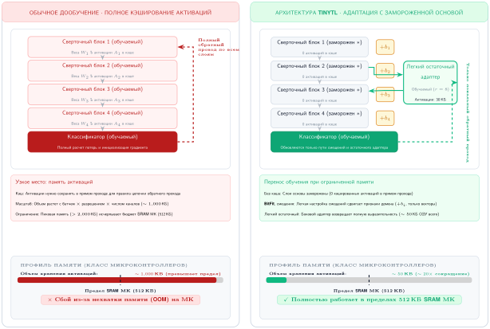

***Оптимизация памяти TinyTL:** на панелях сопоставлены стандартное дообучение и TinyTL. Обычное обратное распространение ошибки хранит активации во всех слоях, тогда как TinyTL замораживает веса базовой части и обучает только члены смещения и легковесные остаточные модули, снижая требования к памяти для адаптации на устройстве.*

Сокращение памяти полезно только тогда, когда замороженная базовая часть остается достаточно выразительной для целевой задачи. Члены смещения допускают небольшие, но значимые сдвиги в поведении модели, особенно для задач персонализации. Когда сдвиг предметной области более значителен, TinyTL может опционально включать небольшие остаточные адаптеры для повышения выразительности, сохраняя при этом жесткий профиль памяти и энергии системы.

Эти архитектурные решения позволяют TinyTL сократить использование памяти при обучении в 10$\times$. Например, при адаптации модели MobileNetV2 с помощью TinyTL число обновляемых параметров может снизиться с более чем 3 млн до менее 50 000.[^fn-tinytl-memory-efficiency] В сочетании с квантованием это позволяет проводить локальную адаптацию на устройствах с памятью всего в несколько сотен килобайт, делая обучение на устройстве действительно осуществимым в ограниченных условиях.

[^fn-tinytl-memory-efficiency]: **Экономия памяти TinyTL**: сокращение обучаемых параметров примерно в 68× (с 3,4 млн до 50 тыс.) снижает требования к памяти при обучении MobileNetV2 с примерно 20 МБ (веса и активации в FP32) до примерно 600 КБ, что укладывается в бюджет микроконтроллера с 1 МБ памяти. Реальные развертывания на STM32H7 достигают 85 % точности полного дообучения, выполняя обновления примерно за 30 секунд против 8 минут, что показывает: адаптация только смещений обменивает выразительность на осуществимость на самом ограниченном оборудовании.

[Рисунок](#fig-tinytl-memory) раскрывает этот профиль памяти, сопоставляя примерно 2 100 КБ, которые требует стандартное дообучение, с примерно 390 КБ для TinyTL относительно 512 КБ встроенной SRAM типичных микроконтроллеров.

<a id="fig-tinytl-memory"></a>

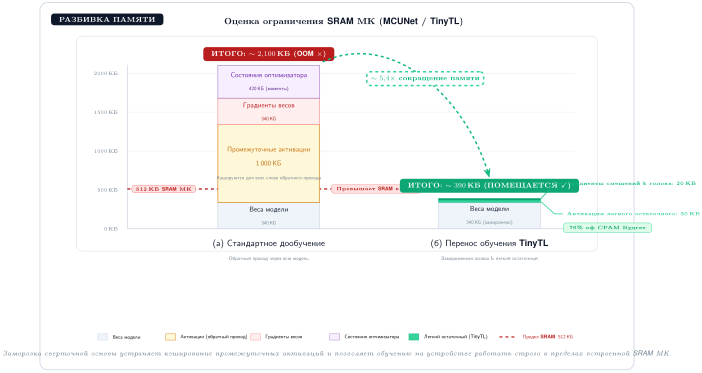

***Разбивка памяти TinyTL:** сравнение структуры потребления памяти при обучении для стандартного дообучения и TinyTL на аппаратуре микроконтроллера. Стандартное обратное распространение ошибки требует хранения промежуточных активаций, которые превышают предел SRAM в 512 КБ, тогда как TinyTL свободно работает в пределах SRAM за счет отказа от кэширования активаций базовой части.*

### Структурированные обновления параметров

Хотя заморозка весов обеспечивает вычислительную эффективность и понятные границы памяти, она сильно ограничивает выразительность модели, сводя адаптацию к небольшому подмножеству параметров. Когда обновлений только смещений недостаточно для учета сложных сдвигов предметной области или паттернов конкретного пользователя, остаточные и низкоранговые методы дают промежуточный вариант между исключительной эффективностью заморозки весов и полной выразительностью неограниченного дообучения. Вместо изменения существующих параметров эти методы расширяют замороженные модели небольшими обучаемыми компонентами, такими как остаточные модули адаптации (Houlsby et al., 2019) или низкоранговые параметризации (Hu et al., 2021). Основная часть сети остается фиксированной, оптимизируются только добавленные компоненты, и модель может реагировать на новые данные, не отказываясь от границ по памяти и вычислениям, которые делают адаптацию на устройстве осуществимой.

#### Адаптация на основе адаптеров

Распространенная реализация предполагает вставку остаточных адаптеров — небольших остаточных узких слоев — между существующими слоями предобученной модели. Рассмотрим скрытое представление $h$, передаваемое между слоями. Остаточный адаптер вводит преобразование:
$$
h' = h + A(h)
$$
где $A(\cdot)$ — обучаемая функция, обычно состоящая из двух линейных слоев с нелинейностью:
$$
A(h) = W_2 \, \sigma(W_1 h)
$$
с $W_1 \in \mathbb{R}^{r \times d}$ и $W_2 \in \mathbb{R}^{d \times r}$, где $r \ll d$. Такая конструкция «бутылочного горлышка» гарантирует, что на каждый слой вводится лишь небольшое число параметров.

Адаптеры работают как обучаемые возмущения поверх замороженной базовой части. Поскольку они малы и применяются разреженно, их накладные расходы по памяти незначительны, но они позволяют модели смещать свои предсказания в ответ на новые входы.

#### Низкоранговые методы

Еще один эффективный подход — ограничить сами обновления весов низкоранговой структурой. Вместо обновления полной матрицы $\mathbf{W}$ обновление аппроксимируется так:
$$
\Delta \mathbf{W} \approx \mathbf{U} \mathbf{V}^\top
$$
где $\mathbf{U} \in \mathbb{R}^{m \times r}$ и $\mathbf{V} \in \mathbb{R}^{n \times r}$, при $r \ll \min(m,n)$. Это сокращает число обучаемых параметров с $mn$ до $r(m + n)$.

Математическая интуиция этого разложения связана с фундаментальными принципами линейной алгебры: любую матрицу можно выразить как сумму матриц ранга один с помощью сингулярного разложения. Ограничение обновлений низким рангом (обычно $r = 4$ до $16$) охватывает ограниченный набор мод вариации и одновременно сокращает число параметров. Для типичного слоя трансформера с размерностями $768{\times}768$ полное дообучение требует обновления 589 824 параметров. При разложении ранга 4 обновляются лишь $768{\times}4{\times}2 =$ 6 144 параметра, то есть сокращение на 99 %. Сохраняется ли при этом большая часть качества адаптации, зависит от задачи, ранга и базовой модели; низкоранговая адаптация (LoRA) показывает, что низкоранговые адаптеры могут сравняться с полным дообучением или приблизиться к нему на нескольких бенчмарках адаптации трансформеров (Hu et al., 2021).

При адаптации новый вес вычисляется как:
$$
W_{\text{adapted}} = W_{\text{frozen}} + U V^\top
$$

Эта формулировка обычно используется в LoRA,[^fn-lora-adapter-efficiency] изначально разработанной для моделей трансформеров (Hu et al., 2021), но широко применимой к разным архитектурам. С точки зрения системной инженерии LoRA делает обучаемый адаптер артефактом, который можно хранить, передавать, планировать и откатывать отдельно от замороженной базовой модели.

[^fn-lora-adapter-efficiency]: **LoRA (низкоранговая адаптация)**: Hu et al. (2021) обучают матрицы разложения ранга $r$, $\mathbf{A}$ и $\mathbf{B}$, вместо обновления полных матриц весов, сокращая число обучаемых параметров в 100–10 000$\times$ при сохранении большей части качества адаптации. Для обучения на устройстве такое сжатие решающее, но оно затрагивает состояние адаптера, а не полный объем модели: модель с 7 млрд параметров имеет примерно 14 ГБ веса в FP16 до учета градиентов, состояния оптимизатора и активаций, тогда как LoRA ранга 16 может сократить обучаемые параметры адаптера до десятков или сотен мегабайт. Практическое развертывание на телефоне по-прежнему требует хранить, квантовать или выгружать замороженную базовую модель.

[Рисунок](#fig-adapter-lora-arch) иллюстрирует двухпутевую архитектуру низкоранговой адаптации (LoRA), отделяя замороженную предобученную матрицу $W_0$ от низкоранговых матриц проекции вниз и вверх $A$ и $B$.

<a id="fig-adapter-lora-arch"></a>

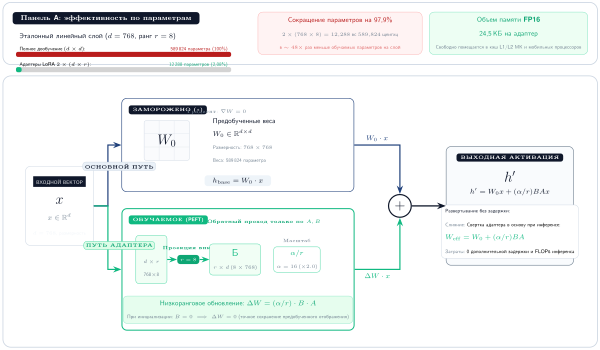

***Архитектура LoRA и эффективность по параметрам:** вход $x$ проходит и через замороженную матрицу весов $W_0$, и через низкоранговый обучаемый путь адаптера, состоящий из проекции вниз $A$ и проекции вверх $B$. При инференсе веса адаптера можно свернуть непосредственно в базовые веса без дополнительной задержки.*

Рассмотрим мобильное развертывание, в котором языковая модель с 7 млрд параметров имеет 14 ГБ веса в FP16, не считая дополнительных градиентов, состояний оптимизатора и активаций, которые требует полное дообучение. Такой объем невозможен на смартфонах с примерно 8 ГБ общей памяти, если только базовая модель не подвергнута агрессивному квантованию, разбиению или выгрузке. LoRA ранга 16 может сократить обучаемые параметры адаптера до десятков или сотен мегабайт, делая локальную адаптацию правдоподобной лишь тогда, когда замороженная базовая модель обрабатывается отдельно.

Эффективность LoRA особенно важна в сценариях с прерывистой связью. Полное обновление модели по сотовой сети потребовало бы загрузки 14 ГБ и соответствующих расходов на трафик, тогда как обновление адаптера для тарифного профиля составляет 50 МБ. Небольшие обновления адаптеров могут синхронизироваться менее чем за минуту на хороших мобильных каналах; более крупные обновления адаптеров обычно требуют LTE или Wi-Fi для координации за доли минуты и могут занимать минуты на 3G. Это все равно намного практичнее многочасовых передач полной модели.

Развертывание с разбиением по уровням устройств может использовать разные конфигурации адаптеров в зависимости от возможностей устройства. Флагманские телефоны используют более широкие «горлышки» для большей выразительности, устройства среднего класса — умеренные «горлышки» для сбалансированной производительности, а бюджетные устройства — узкие «горлышки», чтобы уложиться примерно в 2 ГБ памяти. Эти остаточные модули адаптеров можно эффективно реализовать на граничных устройствах, особенно когда матрицы проекции вниз и вверх малы и поддерживаются представления с фиксированной точкой. [Листинг](#lst-lowrank-adapter) реализует этот шаблон низкорангового адаптера в виде остаточного «горлышка» и показывает, как компактная проекция вниз и вверх добавляет обучаемую емкость, не обновляя замороженную основу.

> **Пример: обучение клавиатуры на устройстве**
>
> **Сценарий**: крупномасштабные мобильные клавиатурные системы (например, Gboard) адаптируют модели предсказания следующего слова локально на сотнях миллионов мобильных устройств (McMahan et al., 2017).
>
> **Диагноз**: локальное обучение рискует вызвать вытеснение процесса ОС и сбой для пользователя, если пиковая память $M_{\text{peak}} \ge 50\text{ МБ}$ или заряд батареи падает. Конвейер запускает обучение только тогда, когда устройство простаивает, подключено к зарядке и к Wi-Fi, и использует квантованные векторы обновлений, чтобы минимизировать объем передаваемых по сети данных $D_{\text{vol}} / \text{BW}$.
>
> **Системный урок**: обучение на устройстве жизнеспособно только тогда, когда локальные границы ресурсов ($M_{\text{peak}}$, $E_{\text{battery}}$), пропускная способность сети ($D_{\text{vol}} / \text{BW}$) и дифференциальная приватность спроектированы вместе как сквозной системный протокол.

Возвращаясь к механизму адаптера, [Листинг](#lst-lowrank-adapter) показывает остаточное «горлышко», которое делает экономию памяти конкретной: замороженная базовая часть остается нетронутой, тогда как обучаются только веса проекции вниз и вверх.

<a id="lst-lowrank-adapter"></a>

***Остаточный адаптер-«горлышко»:** код реализует компактный модуль адаптера со слоями проекции вниз и вверх, что сокращает число обучаемых параметров и обеспечивает эффективную адаптацию модели на граничных устройствах.*

```python
import torch.nn as nn

class Adapter(nn.Module):
    def __init__(self, dim, bottleneck_dim):
        super().__init__()
        # Проекция из полной размерности в «горлышко» (например, 768 -> 16)
        self.down = nn.Linear(
            dim, bottleneck_dim
        )  # W1: обучается сжатию
        # Проекция обратно к исходной размерности (например, 16 -> 768)
        self.up = nn.Linear(
            bottleneck_dim, dim
        )  # W2: обучается расширению
        self.activation = nn.ReLU()

    def forward(self, x):
        # Остаточное соединение: исходный сигнал + низкоранговая адаптация
        # Обучаются только параметры адаптера; базовая модель заморожена
        return x + self.up(self.activation(self.down(x)))
```

Этот адаптер добавляет к замороженному слою небольшое остаточное преобразование. При встраивании в большую модель обучаются только параметры адаптера.

<a id="sec-edge-intelligence-edge-personalization-a511"></a>

#### Граничная персонализация

Адаптеры обеспечивают эффективную многопользовательскую архитектуру для граничного интеллекта, в которой одна замороженная базовая часть поддерживает несколько персонализированных контекстов. Рассмотрим модель компьютерного зрения с 10 млн параметров, развернутую на смартфоне с 8 ГБ ОЗУ. Полное дообучение потребовало бы хранить отдельную копию весов модели объемом 40 МБ для каждого контекста персонализации (дом, офис, улица), быстро заполняя память устройства. Адаптер ранга 64 вводит всего около 50 000 параметров (примерно 200 КБ) на контекст, то есть сокращение объема хранения в 200$\times$. Такая эффективность позволяет устройству хранить десятки специализированных адаптеров, которые используют одну и ту же замороженную базовую часть и динамически переключаются в зависимости от местоположения или активности пользователя.

Этот шаблон **переключения адаптеров** превращает смартфон из статического движка инференса в обучающуюся систему, учитывающую контекст. Когда пользователь попадает в условия слабого освещения, система может загрузить подходящий адаптер в конвейер обработки изображений, вместо того чтобы заменять всю базовую часть. Модульность естественным образом распространяется и на федеративное обучение: в примере с 10-миллионной моделью, приведенном ранее в этом разделе, передача адаптера размером 200 КБ обходится гораздо дешевле, чем передача обновления полной модели размером 40 МБ по сотовой сети с ограниченной пропускной способностью. Исследования остаточных адаптеров показывают, что небольшие обучаемые модули могут адаптировать общую визуальную базовую часть к нескольким визуальным доменам (Rebuffi et al., 2017), что делает их полезным проектным решением на стыке качества персонализации и ресурсов системы. Замороженная базовая часть помогает сохранять общие визуальные представления, а адаптеры предоставляют ограниченное место для обновлений, специфичных для пользователя или контекста, не подвергая всю модель катастрофическому забыванию — потере ранее выученного общего поведения, когда новые обновления его перезаписывают (формализовано в разделе [«Воспроизведение опыта»](#sec-edge-intelligence-experience-replay-737e) далее в этой главе).

В системах камер смартфонов освещение окружающей среды, предпочтения пользователя и искажения объектива различаются между пользователями. Общую модель можно заморозить и дообучать для каждого устройства с помощью нескольких остаточных модулей, что обеспечивает легковесную персонализацию без дестабилизации базовой модели. В голосовых системах модули адаптеров снижают частоту ошибок распознавания речи при персонализированном распознавании без переобучения всей акустической модели. Они также позволяют легко откатываться или переключаться между пользовательскими версиями — критически важная эксплуатационная возможность, когда локальная адаптация иногда ухудшает, а не улучшает работу.

#### Компромиссы между производительностью и ресурсами

Выбор правильной стратегии адаптации требует количественного анализа спектра «ресурсы — выразительность». Для модели с 10 млн параметров компромиссы конкретны. Обновления только смещений наиболее эффективны: им нужно лишь 50 КБ обучаемых параметров и незначительные вычислительные накладные расходы, но они плохо адаптируются к структурным сдвигам предметной области, таким как изменение геометрии сенсоров или появление новых категорий объектов. На другом полюсе полное дообучение обеспечивает максимальную выразительность, но требует 40 МБ и более под градиенты и состояния оптимизатора, что делает его непригодным для фонового обучения на типичных мобильных устройствах. LoRA и остаточные адаптеры занимают стратегическую середину: конфигурация LoRA ранга 64, описанная в разделе [«Граничная персонализация»](#sec-edge-intelligence-edge-personalization-a511), требует примерно 200 КБ обучаемой памяти, тогда как стандартный остаточный адаптер нуждается в нескольких мегабайтах.

Выбор между LoRA и остаточными адаптерами часто зависит от ограничений задержки инференса. Матрицы LoRA можно математически слить с весами замороженной базовой части при инференсе $(\mathbf{W}_{\text{final}} = \mathbf{W}_{\text{frozen}} + \mathbf{U} \mathbf{V}^\top)$, что дает нулевую дополнительную задержку инференса. Это делает LoRA идеальным выбором для путей с жесткими требованиями к задержке, таких как обработка видео в реальном времени, где важна каждая миллисекунда. Остаточные адаптеры, напротив, остаются отдельными модулями ($y = f(x) + \text{Adapter}(x)$) и добавляют 1–3 % к задержке инференса из-за дополнительного прямого прохода через слои адаптера. Однако такое разделение позволяет горячую замену, описанную выше: переключение адаптеров требует загрузки только небольших весов адаптера, а не пересчета слитых матриц.

Реализация этих методов адаптации требует системной поддержки динамических вычислительных графов и возможности избирательно внедрять обучаемые параметры. Не все среды развертывания или движки инференса поддерживают такие возможности нативно. TensorFlow Lite и ONNX Runtime Mobile (Open Neural Network Exchange) обеспечивают поддержку архитектур в стиле адаптеров, но собственные стеки инференса на микроконтроллерах могут требовать ручной реализации прямого прохода адаптера.

Системным архитекторам следует применять к этому решению фреймворк уровней устройств. На флагманских телефонах (уровень 1) со специализированными нейронными движками и 8 ГБ ОЗУ и более остаточные адаптеры обеспечивают хороший баланс модульности и скорости, позволяя переключаться с учетом контекста при минимальном влиянии на задержку. На устройствах среднего класса (уровень 2) с объемом от 1 ГБ до этого предела LoRA привлекательна, поскольку слияние весов полностью устраняет накладные расходы во время работы. Для сверхограниченных IoT-узлов (уровень 3) с ОЗУ менее 1 ГБ обновления только смещений могут оказаться единственным практичным вариантом. Такой поуровневый подход гарантирует, что механизм адаптации соответствует физической реальности оборудования, предотвращая тепловое троттлинг и обеспечивая осмысленную персонализацию на каждом уровне возможностей.

> **Контрольные вопросы: граничная персонализация**
>
> Проверьте понимание эффективной адаптации на устройстве:
>
> - [ ] Переключение адаптеров: объясните, почему переключение адаптеров экономичнее по памяти, чем хранение отдельных полных копий модели для разных пользовательских контекстов.
> - [ ] Размер адаптера: сравните размер **адаптера ранга 64** со стандартной моделью компьютерного зрения с 10 млн параметров.
> - [ ] Остаточные адаптеры и LoRA: определите уровень развертывания (уровень 1, 2 или 3), на котором **остаточные адаптеры** предпочтительнее LoRA, и обоснуйте выбор.
> - [ ] Пропускная способность адаптеров: оцените утверждение, что передача весов адаптеров в федеративном обучении расходует больше пропускной способности, чем передача всей модели.

<a id="sec-edge-intelligence-sparse-updates-879b"></a>

### Разреженные обновления

Разреженные обновления — это самый выразительный конец иерархии адаптации модели. Вместо добавления новых параметров или заранее выбранного фиксированного подмножества система динамически определяет, какие существующие параметры дают наибольшую пользу для адаптации к конкретной задаче или пользователю. Это сохраняет больше гибкости полного дообучения, оставляя объем обновления достаточно малым для граничного развертывания.

Решение о разреженном обновлении выходит за рамки простого обновления меньшего числа параметров. Обучение остается ресурсоемким даже тогда, когда методы адаптации модели ограничивают обучение небольшим подмножеством. Разреженное обновление снимает оставшуюся стоимость, выбирая только параметры, значимые для задачи, что сокращает память и вычисления при сохранении содержательной персонализации.

Ключевая идея состоит в том, что слои вносят неодинаковый вклад в локальный прирост производительности. Если система способна выделить минимальное подмножество с наибольшей ценностью для адаптации, она может направить дефицитную емкость обучения туда, где она сильнее всего меняет поведение модели.

#### Проектирование разреженных обновлений

Пусть нейронная сеть задается параметрами $\theta = \{\theta_1, \theta_2, \ldots, \theta_{N_L}\}$ по $N_L$ слоям. При стандартном дообучении градиенты вычисляются и обновления выполняются для всех параметров:
$$
\theta_i \leftarrow \theta_i - \eta \frac{\partial \mathcal{L}}{\partial \theta_i}, \quad \text{для } i = 1, \ldots, N_L
$$

При адаптивных к задаче разреженных обновлениях система выбирает небольшое подмножество $\mathcal{S} \subset \{1, \ldots, N_L\}$, так что обновляются только параметры из $\mathcal{S}$:
$$
\theta_i \leftarrow
\begin{cases}
\theta_i - \eta \frac{\partial \mathcal{L}}{\partial \theta_i}, & \text{если } i \in \mathcal{S} \\
\theta_i, & \text{иначе}
\end{cases}
$$

Задача состоит в том, чтобы выбрать оптимальное подмножество $\mathcal{S}$ при заданных ограничениях памяти и вычислений. Обоснованная стратегия — анализ вклада, эмпирический метод, который оценивает, насколько каждый слой вносит вклад в улучшение производительности на целевой задаче. Например, можно измерить предельный прирост от обновления каждого слоя по отдельности:

1. Заморозить всю модель.
2. Разморозить один кандидатный слой.
3. Кратко дообучить и оценить улучшение точности на валидации.
4. Ранжировать слои по приросту производительности на единицу стоимости (например, на КБ обучаемой памяти).

Такое профилирование по слоям дает ранжирование, по которому можно построить $\mathcal{S}$ при заданном бюджете памяти.

Конкретный пример — TinyTrain, метод, разработанный для быстрой адаптации на устройстве (Kwon et al., 2024). TinyTrain сочетает офлайновую подготовку с методом адаптивных к задаче разреженных обновлений, который динамически выбирает слои или каналы для обновления на основе пользовательских данных, ограничений памяти и ограничений вычислений. Во время работы система обновляет только выбранное подмножество, а не считает всю сеть обучаемой.

На практике избирательное обновление слоев превращает ранжирование в решения `requires_grad` или в эквивалентные маски вычислительного графа. [Листинг](#lst-selective-update) расширяет этот шаблон до выбора слоев на основе профилирования, демонстрируя, как профилирование оборудования определяет, какие слои обновлять, исходя из оценок вклада и ограничений памяти.

<a id="lst-selective-update"></a>

***Избирательное обновление слоев:** этот прием позволяет дообучать конкретные слои предобученной модели, оставляя остальные замороженными, и оптимизирует вычислительные ресурсы для целевых улучшений. Источник: документация PyTorch.*

```python
# Избирательное обновление слоев на основе анализа вклада
# Слои выбраны профилированием: conv2 и fc дают наибольший
# эффект «точность на КБ» для этой задачи

for name, param in model.named_parameters():
    if "conv2" in name or "fc" in name:
        param.requires_grad = True  # Обучать слои с высоким влиянием
    else:
        param.requires_grad = False  # Заморозить слои с низким влиянием

# Результат: ~10 % параметров обучаются, ~60 % качества адаптации
# Экономия памяти: градиенты хранятся только для выбранных слоев
```

TinyTrain делает мотивацию для работы во время выполнения конкретной. Рассмотрим сценарий, в котором пользователь носит гарнитуру дополненной реальности, выполняющую распознавание объектов в реальном времени. По мере смены освещения и окружения система должна адаптироваться, чтобы сохранять точность, но обучение должно происходить в короткие периоды простоя или во время зарядки. TinyTrain решает это ограничение с помощью адаптивных к задаче разреженных обновлений: процесс развертывания выбирает небольшой набор для обновления, который укладывается в бюджет памяти и вычислений устройства. Подход сохраняет адаптацию быстрой, энергоэффективной и учитывающей память, когда целевая задача и профиль устройства соответствуют допущениям метода.

Адаптивные к задаче разреженные обновления тоже порождают системные компромиссы. Анализ вклада имеет нетривиальную вычислительную стоимость даже тогда, когда он выполняется при предобучении или первичном профилировании, поэтому конвейер развертывания должен закладывать на это бюджет. Требует внимания и стабильность: если для обновления выбрано слишком мало параметров, модель может недообучиться на целевом распределении, поэтому командам нужны пороги валидации для выбранного подмножества перед развертыванием. Политика выбора также должна учитывать аппаратно-специфичные затраты на выполнение, поскольку некоторые параметры имеют высокие оценки вклада, но оказываются дорогими для обновления на определенных архитектурах. Несмотря на эти компромиссы, адаптивные к задаче разреженные обновления дают практичный механизм масштабирования адаптации в контекстах развертывания от микроконтроллеров до мобильных устройств (Kwon et al., 2024).

#### Сравнение стратегий адаптации

Каждая стратегия адаптации предлагает свой баланс между выразительностью, эффективностью по ресурсам и сложностью реализации. Адаптация только смещений — самый легковесный подход: она обновляет лишь скалярные сдвиги в каждом слое, замораживая все остальные параметры. Это снижает требования к памяти и вычислительную нагрузку, делая подход пригодным для устройств с жесткими бюджетами памяти и энергии. Однако ее ограниченная выразительность означает, что она лучше всего подходит для приложений, где предобученная модель уже улавливает большую часть релевантных признаков задачи и требуется лишь небольшая локальная калибровка.

Остаточная адаптация, часто реализуемая через модули адаптеров, вводит небольшое число обучаемых параметров в замороженную базовую часть нейронной сети. Это дает большую гибкость, чем обновления только смещений, и при этом сохраняет контроль над стоимостью адаптации. Поскольку базовая часть остается фиксированной, обучение можно выполнять эффективно и безопасно в ограниченных условиях. Метод поддерживает модульную персонализацию для разных задач и пользователей, что делает его удачным выбором для мобильных сценариев, где нужна умеренная емкость адаптации.

Адаптивные к задаче разреженные обновления дают наибольший потенциал для дообучения под конкретную задачу, избирательно обновляя лишь подмножество слоев или параметров на основе их вклада в производительность на целевой задаче. Хотя этот метод позволяет выполнять выразительную локальную адаптацию, он требует механизма выбора слоев — через профилирование, анализ вклада или метаобучение, что добавляет сложности. Тем не менее при аккуратном применении он позволяет динамически балансировать точность и эффективность, особенно в системах, которые сталкиваются с большими сдвигами предметной области или меняющимися входными условиями. В [таблице](#tbl-adaptation-strategies) сопоставляются компромиссы стратегий адаптации по обучаемым параметрам, накладным расходам памяти, выразительности, пригодности для сценариев использования и системным требованиям. Выбор оптимального варианта зависит от области применения, доступного оборудования, требований к задержке и ожидаемого сдвига распределения.

<a id="tbl-adaptation-strategies"></a>

***Компромиссы стратегий адаптации:** в таблице охарактеризованы три подхода к адаптации модели — обновление только смещений, остаточные адаптеры и избирательные обновления слоев — по их влиянию на обучаемые параметры, накладные расходы памяти, выразительность, пригодность для сценариев использования и системные требования. Эти характеристики показывают внутренние компромиссы между гибкостью модели, вычислительными затратами и производительностью при развертывании систем машинного обучения в динамических средах.*

| **Метод**                | **Обучаемые параметры**     | **Накладные расходы памяти** | **Выразительность**  | **Пригодность для сценария**         | **Системные требования**               |
|:-------------------------|:---------------------------:|:----------------------------:|:--------------------:|:-------------------------------------|:---------------------------------------|
| **Обновление только смещений** | Только члены смещения  | Минимальные                  | Низкая               | Простая персонализация; низкая дисперсия | Крайне жесткие ограничения памяти и вычислений |
| **Остаточные адаптеры**  | Модули адаптеров            | Умеренные                    | От умеренной до высокой | Настройка под пользователя на мобильных устройствах | SoC мобильного класса с поддержкой среды выполнения |
| **Разреженные обновления слоев** | Избирательные подмножества параметров | Переменные | Высокая (адаптивная к задаче) | Адаптация в реальном времени; сдвиг предметной области | Требует профилирования или метаобучения |

Заморозка весов и обучение адаптеров решают проблему узкого места по памяти, но остается статистическая задача. Даже при ресурсно-эффективном механизме обучения граничные устройства редко располагают тысячами размеченных примеров, нужных для обучения адаптеров с нуля. Это ограничение вводит второй столп обучения на устройстве: эффективность данных.

<a id="sec-edge-intelligence-data-efficiency-c701"></a>

## Эффективность данных

Пользователь исправляет автоисправление на клавиатуре смартфона, возможно, три раза в день. Система не может требовать 10 000 размеченных предложений, чтобы обучить локальную языковую модель. Эффективность данных на границе означает агрессивное обучение на разреженном, зашумленном и нерегламентированном потоке неявной обратной связи от пользователя с максимальным извлечением сигнала из каждого взаимодействия.

Инженерная задача системы сосредоточена на ключевом компромиссе: стоимость сбора данных против качества адаптации. Граничные устройства сталкиваются с жесткими ограничениями на получение данных, которые меняют проектирование систем обучения способами, не встречающимися в централизованном обучении. Понимание и преодоление этих ограничений требует систематического анализа четырех взаимосвязанных инженерных измерений:

- Стоимость получения данных включает неудобство для пользователя, энергопотребление, накладные расходы на хранение и риск для приватности. Голосовой ассистент, обучающийся на аудиообразцах, должен балансировать потенциальное улучшение с расходом батареи и комфортом пользователя при постоянной записи.
- Глубина сбора определяет, тратит ли система ограниченную емкость на широкое покрытие или на подробные примеры. Мобильная клавиатура может собирать много поверхностных паттернов набора или меньше подробных последовательностей взаимодействия, и каждая стратегия подразумевает разные подходы к обучению.
- Срочность обучения определяет, должна ли система адаптироваться немедленно по минимальному числу примеров, как в сценариях экстренного реагирования, или может накапливать свидетельства со временем, как при обучении предпочтениям пользователя.
- Интеграция в жизненный цикл определяет, подходят ли методы эффективности данных к подходам адаптации модели из [«Адаптация модели»](#sec-edge-intelligence-model-adaptation-6a82), федеративной координации ([«Федеративное обучение: алгоритмы»](#sec-edge-intelligence-federated-learning-6e7e)) и эксплуатационному мониторингу развертывания модели и управления ее жизненным циклом.

Эти инженерные ограничения создают систематическое пространство компромиссов, в котором разные подходы к эффективности данных служат разным комбинациям ограничений. Вместо выбора единственного метода успешные системы обучения на устройстве обычно комбинируют несколько подходов, каждый из которых решает конкретный аспект дефицита данных.

Выбор стратегии зависит от того, какой дефицит связывает систему первым. Адаптация по нескольким примерам подходит для случаев, когда персонализацию должны обеспечить несколько размеченных или слабо размеченных примеров. Потоковые обновления подходят для ситуаций, когда полезные данные поступают постепенно и не могут быть заранее собраны в батчи. Воспроизведение опыта тратит память, чтобы стабилизировать непрерывные обновления, повторно используя дефицитные примеры. Сжатие данных снижает стоимость хранения таких историй, чтобы воспроизведение и легковесное обучение оставались осуществимыми в бюджетах памяти граничного устройства.

### Обучение на нескольких примерах и потоковые данные

В совокупности эти методы превращают дефицит данных в задачу распределения: метки, память, вычисления и бюджет приватности следует тратить там, где они дают наиболее надежный локальный сигнал. В традиционных рабочих процессах машинного обучения эффективное обучение обычно требует больших размеченных наборов данных, тщательно подобранных и предобработанных, чтобы обеспечить достаточное разнообразие и баланс. Обучение на устройстве, напротив, часто должно идти лишь по горстке локальных примеров, собранных пассивно при взаимодействии пользователя или по данным окружающих датчиков и редко размеченных в контролируемом виде. Эти ограничения мотивируют две взаимодополняющие стратегии адаптации: обучение на нескольких примерах, при котором модели обобщают с небольшого статичного набора примеров, и потоковую адаптацию, при которой обновления происходят непрерывно по мере поступления данных.

Адаптация по нескольким примерам особенно актуальна, когда устройство наблюдает небольшое число размеченных или слабо размеченных экземпляров для новой задачи или нового состояния пользователя (Wang et al., 2020). В таких условиях полное дообучение всех параметров модели часто невозможно без переобучения. Вместо этого применяют методы вроде обновления только смещений, модулей адаптеров или классификации на основе прототипов, которые используют ограниченные данные, минимизируя емкость для запоминания. Пусть $\mathcal{S} = \{(x_i, y_i)\}_{i=1}^K$ обозначает $K$-примерный набор размеченных примеров, собранных на устройстве. Обновление модели осуществимо, только если три ограничения остаются в допустимых пределах:

- Объем работы с градиентами остается малым: $K_{\text{steps}} \ll 100$.
- Число обновляемых параметров остается компактным: $|\theta_{\text{updated}}| \ll |\theta|$.
- Знания о прежних задачах сохраняются, без катастрофического забывания.

Системы распознавания ключевых слов (KWS) — типичная цель для адаптации на устройстве с малым объемом данных; набор Speech Commands предоставляет стандартный набор данных для обучения и оценки моделей KWS с ограниченным словарем в условиях устройства (Warden, 2018). Такие модели используются для обнаружения фиксированных фраз, включая фразы вроде «Hey Siri»[^fn-heysiri-alwayson-power] или «OK Google», с низкой задержкой и высокой надежностью. Типичная модель KWS состоит из предобученного акустического энкодера (например, небольшой сверточной или рекуррентной сети, которая преобразует входное аудио в пространство эмбеддингов), за которым следует легковесный классификатор. В коммерческих системах энкодер обучается централизованно на тысячах часов размеченной речи на нескольких языках и с разными дикторами. Однако поддержка пользовательских слов пробуждения (например, «Hey Jarvis») или адаптация к недостаточно представленным акцентам и диалектам часто невозможна через централизованное обучение из-за дефицита данных и проблем приватности.

[^fn-heysiri-alwayson-power]: **Энергобюджет «Hey Siri»**: детектор постоянной готовности потребляет $<1$ мВт при непрерывном мониторинге аудио, используя компактную акустическую модель на маломощном процессоре постоянной готовности, а не на основных ядрах приложений. Ограничения предельно жесткие: задержка обнаружения $<100$ мс, $<0,1$ ложного срабатывания в час и доля истинно положительных срабатываний $>95$ % при разных акцентах и шумовых условиях. Персонализация по нескольким примерам должна повышать точность в рамках этого фиксированного бюджета мощности и размера модели, то есть адаптация может настраивать веса классификатора, но не может расширять модель.

Адаптация по нескольким примерам решает эту задачу, дообучая только выходной классификатор или небольшое подмножество параметров, включая члены смещения, по нескольким примерам высказываний, собранных непосредственно на устройстве. Например, пользователь может предоставить 5–10 записей своего пользовательского слова пробуждения. Эти образцы затем используются для локального обновления модели, а основной энкодер остается замороженным, чтобы сохранить обобщающую способность и снизить накладные расходы памяти. Это позволяет персонализировать систему без дополнительных размеченных данных и без передачи приватного аудио в облако.

Подход вычислительно эффективен и согласован с принципами проектирования, сохраняющими приватность. Поскольку обновляется только выходной слой, часто за один шаг градиента или вычисление прототипа, общий объем памяти и вычислений во время работы совместим с мобильными устройствами класса смартфонов и даже с микроконтроллерами.

Помимо статичного обучения по нескольким примерам, многие сценарии на устройстве выигрывают от потоковой адаптации, при которой модели должны обучаться постепенно по мере поступления новых данных (Hayes et al., 2020). Потоковая адаптация обобщает эту идею на непрерывные асинхронные условия, где данные поступают постепенно во времени. Пусть $\{x_t\}_{t=1}^{\infty}$ — поток наблюдений. В потоковых условиях модель должна обновлять себя после наблюдения каждого нового входа, обычно без доступа к прежним данным и при ограниченной памяти и вычислениях. Вычислимая функция потерь может опираться на неявную обратную связь, псевдометки, самоконтролируемые цели, ошибку реконструкции или специфичный для задачи прокси-сигнал, а не на явные человеческие метки. Обновление модели можно записать в общем виде:
$$
\theta_{t+1} = \theta_t - \eta_t \nabla \mathcal{L}(x_t; \theta_t)
$$
где $\eta_t$ — скорость обучения в момент времени $t$. Такая форма адаптации чувствительна к шуму и дрейфу распределения входа, поэтому она часто включает такие механизмы, как затухание скорости обучения, метаобученную инициализацию или шлюзование обновлений для повышения стабильности.

Помимо KWS, практических примеров этих стратегий много. В носимых устройствах для здоровья модель, которая классифицирует физическую активность, может начинать с общего классификатора и адаптироваться к движениям конкретного пользователя, используя всего несколько размеченных сегментов активности. В умных ассистентах профили голоса пользователя со временем дообучаются по текущей речевой активности, даже когда явный контроль недоступен. Локальные исправления, повторения или завершение задачи в нижестоящей системе могут давать неявные сигналы, но только после того, как система определит, какое событие считается обратной связью, и проверит его достоверность. Пользователь может принять предложение потому, что оно удобно, а не потому, что оно правильно, бросить задачу по причинам, не связанным с моделью, или исправить ошибку, которую сама модель и вызвала. Поэтому в продакшн-адаптации наблюдаемые события нужно отделять от выведенных меток, сохранять контрольную когорту без адаптации, измерять отложенные результаты, когда они доступны, и приостанавливать обучение, когда связь между прокси-сигналом и результатом смещается.

Адаптация по нескольким примерам и потоковая адаптация образуют основу для более продвинутых стратегий памяти и воспроизведения, которые решают проблемы стабильности непрерывного обучения на устройстве.

<a id="sec-edge-intelligence-experience-replay-737e"></a>

### Воспроизведение опыта

> **Определение: катастрофическое забывание**
>
> ***Катастрофическое забывание*** — это явление, при котором нейронная сеть, последовательно обучаемая на новых задачах или распределениях данных, быстро теряет качество на ранее выученных задачах, поскольку градиентные обновления, оптимизирующие новую цель, перезаписывают конфигурации весов, которые поддерживали старую.
>
> 1.  **Значимость**: без явного смягчения дообучение развернутого классификатора на новом домене может резко снизить точность на прежней задаче, даже когда новый домен близок к старому (Kirkpatrick et al., 2017). Это центральный режим отказа обучения на устройстве и федеративного обучения: каждое устройство, которое адаптируется локально к недавним данным своего пользователя, рискует стереть общие способности, за которые была заплачена централизованным обучением, а потеря незаметна до тех пор, пока инференс не столкнется с входами, выходящими за пределы недавнего контекста.
> 2.  **Отличие**: в отличие от переобучения (сбоя обобщения на одной фиксированной задаче) и сдвига распределения (несоответствия между обучающими и инференсными данными во время развертывания), забывание — это явление во время обучения, вызванное последовательной структурой самого потока обновлений: емкость модели достаточна, но ее веса не могут закодировать новую цель, не нарушая кодирование старой.
> 3.  **Типичная ловушка**: распространено заблуждение, что небольшого буфера воспроизведения опыта достаточно для защиты. Наивное воспроизведение 100–1 000 сохраненных образцов может скрыть кратковременное забывание на отложенной валидационной выборке, но при этом ухудшать производительность на редких классах или на хвосте распределения, поскольку распределение выборки в буфере недопредставляет хвосты. Продакшн-развертывания требуют буферов, пропорциональных емкости, приоритетного воспроизведения или методов регуляризации весов, таких как упругая консолидация весов ([«Пожизненная адаптация без забывания»](#sec-edge-intelligence-lifelong-adaptation-without-forgetting-9200)).
>
> 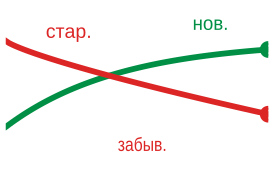
>
> *Обучение новой задаче снижает точность на старой.*

Воспроизведение опыта решает проблему катастрофического забывания при непрерывном обучении, поддерживая буфер репрезентативных примеров из предыдущих эпизодов обучения. Этот прием, изначально разработанный для обучения с подкреплением (Mnih et al., 2015), оказывается незаменимым при обучении на устройстве, где последовательные потоки данных могут приводить к переобучению на недавних примерах. Здесь воспроизведение опыта решает непосредственную задачу стабильности; биоинспирированное пожизненное обучение ([«Пожизненная адаптация без забывания»](#sec-edge-intelligence-lifelong-adaptation-without-forgetting-9200)) решает ту же проблему стабильности с помощью локальных механизмов пластичности и консолидации.

В отличие от серверных стратегий воспроизведения, которые опираются на большие наборы данных и значительные вычислительные ресурсы, воспроизведение на устройстве должно работать при крайне ограниченной емкости, часто с десятками или сотнями образцов, и не должно мешать работе пользователя (Rolnick et al., 2019). Буферы могут хранить только сжатые признаки или дистиллированные сводки, а обновления должны происходить оппортунистически (например, в периоды простоя или при зарядке). Эти системные ограничения меняют способы реализации и оценки воспроизведения в контексте встраиваемого машинного обучения.

Пусть $\mathcal{M}$ обозначает буфер памяти, который хранит подмножество обучающих примеров фиксированного размера. В момент времени $t$ модель получает новую точку данных $(x_t, y_t)$ и добавляет ее в $\mathcal{M}$. Затем обновление на основе воспроизведения выбирает батч $\{(x_i, y_i)\}_{i=1}^{k}$ из $\mathcal{M}$ и применяет шаг градиента:
$$
\theta_{t+1} = \theta_t - \eta \nabla_\theta \left[ \frac{1}{k} \sum_{i=1}^{k} \mathcal{L}(x_i, y_i; \theta_t) \right]
$$
где $\theta_t$ — параметры модели, $\eta$ — скорость обучения, а $\mathcal{L}$ — функция потерь. Со временем такой механизм воспроизведения позволяет модели подкреплять прежние знания, одновременно включая новую информацию.

Практическая реализация на устройстве может использовать кольцевой буфер для хранения небольшого набора сжатых векторов признаков вместо полных входных примеров. [Листинг](#lst-replay-buffer) реализует этот минимальный дизайн буфера воспроизведения и показывает, как циклическое хранилище обеспечивает эффективное управление памятью, балансируя сохранение исторических знаний и включение новой информации.

<a id="lst-replay-buffer"></a>

***Буфер воспроизведения:** реализует циклическое хранилище для эффективного управления памятью в ограниченных условиях. Такой подход позволяет модели эффективно сохранять недавние точки данных и выбирать из них образцы, балансируя использование исторической информации и включение новых сведений.*

```python
import random

# Кольцевой буфер для воспроизведения опыта на устройствах с ограниченной памятью
# Хранит сжатые признаки (а не сырые входы), чтобы минимизировать занимаемую память
class ReplayBuffer:
    def __init__(self, capacity):
        self.capacity = capacity  # Фиксированный размер, например 1000 примеров
        self.buffer = []
        self.index = 0  # Указатель циклической записи

    def store(self, feature_vec, label):
        if len(self.buffer) < self.capacity:
            self.buffer.append((feature_vec, label))  # Фаза заполнения
        else:
            self.buffer[self.index] = (
                feature_vec,
                label,
            )  # Перезаписать самый старый
        self.index = (self.index + 1) % self.capacity  # Циклический переход

    def sample(self, k):
        # Случайная выборка предотвращает смещение в сторону недавних примеров при воспроизведении
        return random.sample(self.buffer, min(k, len(self.buffer)))
```

Эта реализация поддерживает циклический буфер фиксированной емкости, который хранит сжатые представления (например, эмбеддинги последнего слоя) и связанные с ними метки. Такие буферы полезны для воспроизведения обновлений адаптации без нарушения бюджетов памяти и энергии.

В приложениях TinyML[^fn-tinyml-deployment-scale] воспроизведение опыта применялось к задачам вроде распознавания жестов, где устройства должны непрерывно улучшать предсказания, наблюдая за небольшим числом событий в день. Вместо обучения непосредственно на потоковых данных устройство сохраняет репрезентативные векторы признаков недавних жестов и периодически использует их для дообучения границ классификации. Аналогично, в распознавании ключевых слов на устройстве воспроизведение прошлых высказываний может повысить точность обнаружения слова пробуждения без передачи аудио за пределы устройства.

[^fn-tinyml-deployment-scale]: **Масштаб TinyML**: более 100 млрд микроконтроллеров поставляются ежегодно, но менее 1 % из них поддерживают обучение на устройстве из-за ограничений памяти ($<256$ КБ) и мощности ($<1$ мВт). Разрыв между развернутым оборудованием и оборудованием, способным к машинному обучению, определяет инженерную задачу: обеспечить воспроизведение опыта и адаптацию на чипах стоимостью менее \$1 можно только с алгоритмами, рассчитанными на килобайты, а не гигабайты.

Хотя воспроизведение опыта повышает стабильность в условиях дефицита данных или нестационарной среды, оно порождает несколько компромиссов. Хранение сырых входов может нарушать ограничения приватности или превышать бюджеты хранения, особенно в задачах компьютерного зрения и аудио. Воспроизведение по векторам признаков снижает использование памяти, но может ограничивать богатство градиентов для вышестоящих слоев. Циклы записи во встроенную флеш-память, которые часто необходимы для долговременного хранения на встраиваемых устройствах, также могут вызывать опасения по поводу износа ячеек. Эти ограничения требуют тщательного совместного проектирования политик использования памяти, частоты воспроизведения и стратегий выбора признаков, особенно в сценариях непрерывного развертывания.

### Сжатие данных

Во многих сценариях обучения на устройстве сырые обучающие данные могут быть слишком большими, зашумленными или избыточными, чтобы эффективно хранить и обрабатывать их. Это мотивирует использование сжатых представлений данных, в которых исходные входы преобразуются в низкоразмерные эмбеддинги или компактные кодировки, сохраняющие важную информацию при минимизации затрат памяти и вычислений.

Сжатые представления служат двум взаимодополняющим целям: они уменьшают объем хранимых данных, позволяя устройствам поддерживать более длинные истории или буферы воспроизведения при жестких бюджетах памяти (Hayes et al., 2020), и упрощают задачу обучения, проецируя сырые входы в более структурированные пространства признаков, часто выученные через предобучение или метаобучение, в которых эффективная адаптация возможна при минимальном контроле.

Один распространенный подход — кодировать точки данных предобученным экстрактором признаков и отбрасывать исходный высокоразмерный вход. Например, изображение $x_i$ может пройти через CNN, чтобы получить вектор эмбеддинга $z_i = f(x_i)$, где $f(\cdot)$ — фиксированный энкодер признаков. Этот эмбеддинг отражает визуальную структуру (например, форму, текстуру или пространственное расположение) в компактном представлении, обычно размером от 64 до 512 измерений, пригодном для легковесной последующей адаптации.

Математически обучение может идти по сжатым образцам $(z_i, y_i)$ с помощью легковесного декодера или проекционной головы. Пусть $\theta$ — обучаемые параметры этой модели-декодера, которая обычно представляет собой небольшую нейронную сеть, отображающую сжатые представления в выходные предсказания. По мере подачи каждого примера параметры модели обновляются градиентным спуском:
$$
\theta_{t+1} = \theta_t - \eta \nabla_\theta \mathcal{L}\big(g(z_i; \theta), y_i\big)
$$
Это правило обновления определяют шесть компонентов:

- $z_i$ — сжатое представление $i$-го входа,
- $y_i$ — соответствующая метка или сигнал обучения с учителем,
- $g(z_i; \theta)$ — предсказание декодера,
- $\mathcal{L}$ — функция потерь, измеряющая ошибку предсказания,
- $\eta$ — скорость обучения, и
- $\nabla_\theta$ — градиент по параметрам $\theta$.

Эта формулировка показывает, что нужно обучать только компактную модель-декодер с набором параметров $\theta$, что делает процесс обучения осуществимым даже при ограниченной памяти и вычислениях.

Более продвинутые подходы выходят за рамки фиксированных энкодеров, когда ограничивающим фактором становится память для воспроизведения, а не вычисления модели. Они выучивают дискретные или разреженные словари: базисы для повторяющихся паттернов сенсорных трасс, которые можно хранить компактнее, чем сырые примеры воспроизведения. Набор сенсорных трасс можно разложить как $X \approx \Phi_{\text{dict}}C$, где $\Phi_{\text{dict}}$ — словарь базисных паттернов, а $C$ — блочно-разреженная матрица коэффициентов, указывающая, какие паттерны активны в каждом примере. Обновление лишь небольшого числа атомов словаря или коэффициентов позволяет модели адаптироваться с минимальными накладными расходами на буфер воспроизведения.

Сжатые представления могут сократить срок хранения сырых входов, но эмбеддинг не становится анонимным только потому, что он низкоразмерный. Он может сохранять идентичность, атрибуты или достаточно структуры для инверсии, и к нему нужно применять такой же анализ контроля доступа, хранения и удаления, как и к исходным данным, если только отдельный механизм приватности не дает более сильной гарантии. Сжатие также может действовать как неявный регуляризатор, сглаживая обучение и смягчая переобучение, когда доступно лишь несколько обучающих примеров.

На практике эти стратегии применяются в таких областях, как распознавание ключевых слов, где необработанные аудиосигналы сначала преобразуются в мел-частотные кепстральные коэффициенты (MFCC),[^fn-mfcc-audio-compression] компактное, сжатое с потерями представление спектра мощности речи. Эти векторы MFCC служат сжатыми входами для нижестоящих моделей, позволяя проводить локальную адаптацию всего с несколькими килобайтами памяти.

[^fn-mfcc-audio-compression]: **MFCC (мел-частотные кепстральные коэффициенты)**: аудиопризнаки, которые применяют частотное искажение по мел-шкале (подчеркивающее низкие частоты, где сосредоточена речь), а затем кепстральный анализ, сокращая окно аудио из 320 отсчетов (20 мс при 16 кГц) с 640 байт примерно до 50 байт в 12–13 коэффициентах. Это 13$\times$ сжатие сохраняет разборчивость речи и делает распознавание ключевых слов на устройстве осуществимым в килобайтах памяти; коэффициент сжатия напрямую определяет емкость буфера воспроизведения для адаптации голоса по нескольким примерам.

### Сравнение стратегий эффективности данных

Обучение по нескольким примерам, воспроизведение опыта и сжатые представления данных по-разному решают аспекты адаптации на устройстве, когда данных мало или они поступают потоком. Их эффективность зависит от системных факторов: объема памяти, доступности данных, структуры задачи и требований к приватности.

Адаптация по нескольким примерам хорошо работает, когда доступен небольшой, но информативный набор размеченных примеров, особенно когда требуется персонализация или быстрая настройка под конкретную задачу. Она минимизирует потребности в вычислениях и данных, но ее эффективность зависит от качества предобученных представлений и соответствия исходной модели локальной задаче.

Воспроизведение опыта решает задачу непрерывной адаптации, смягчая забывание и повышая стабильность, особенно в нестационарной среде. Оно позволяет повторно использовать прошлые данные, но требует памяти для хранения примеров и вычислительных циклов для периодических обновлений. Буферы воспроизведения могут также вызывать опасения по поводу приватности или долговечности, особенно на устройствах с ограниченным хранилищем или ограниченным числом циклов записи во флеш-память.

Сжатые представления данных снижают накладные расходы обучения, преобразуя сырые данные в компактные пространства признаков. Такой подход поддерживает более длительное сохранение опыта и эффективное дообучение, особенно когда обучаемы только легковесные головы. Сжатие может вносить потери информации, а фиксированные энкодеры могут не улавливать релевантную для задачи изменчивость, если они плохо согласованы с условиями развертывания. В [таблице](#tbl-ondevice-techniques) суммируются компромиссы обучения на устройстве по требованиям к данным, накладным расходам памяти и пригодности для сценариев использования для каждого метода.

<a id="tbl-ondevice-techniques"></a>

***Компромиссы обучения на устройстве:** выбор метода зависит от связывающего граничного ограничения. Адаптация по нескольким примерам минимизирует потребность в размеченных данных, воспроизведение повышает стабильность при дрейфе ценой памяти, а сжатые представления продлевают хранение, когда сырые данные слишком велики или слишком чувствительны для сохранения.*

| **Метод**                      |     **Требования к данным**   | **Накладные расходы памяти/вычислений** | **Пригодность для сценария**                       |
|:-------------------------------|:-----------------------------:|:---------------------------:|:---------------------------------------------------|
| **Адаптация по нескольким примерам** | Небольшой размеченный набор ($K$ примеров) | Низкие | Персонализация, быстрое дообучение на устройстве |
| **Воспроизведение опыта**      |         Потоковые данные      | Умеренные (буфер и обновление) | Нестационарные данные, стабильность при дрейфе |
| **Сжатые представления**       |   Неразмеченные или закодированные данные | От низких до умеренных | Устройства с ограниченной памятью; контексты, чувствительные к приватности |

На практике эти методы не исключают друг друга. Многие реальные системы комбинируют их для достижения надежной и эффективной адаптации. Например, система распознавания ключевых слов может использовать сжатые аудиопризнаки (например, MFCC), дообучать несколько параметров по небольшому опорному набору и поддерживать буфер воспроизведения прошлых эмбеддингов для непрерывного уточнения.

Эффективная адаптация и стратегии данных позволяют одному устройству обучаться на своем пользователе. Однако миллионы изолированных устройств, обучающихся по отдельности, упускают огромную возможность разделить свои локальные наблюдения. Агрегация этого распределенного интеллекта без ущерба для приватности пользователя требует математики федеративного обучения.

<a id="sec-edge-intelligence-federated-learning-6e7e"></a>

## Федеративное обучение: алгоритмы

Представим, что больница хочет обучить ИИ на медицинских картах пациентов, чтобы предсказывать осложнения, но политика управления данными и действующие требования юрисдикции запрещают централизовать сырые данные пациентов для этой цели. Это федеративное обучение между изолированными организациями (cross-silo): небольшое число надежных учреждений сотрудничает, не централизуя свои данные. Задача состоит в том, чтобы позволить нескольким больницам совместно обучать глобальную модель, никогда не передавая друг другу сырые данные. Федеративное обучение решает ее, перенося вычисления к данным: модель рассылается на периферию, а затем агрегируются только полученные обновления модели.

Рассмотрим голосового ассистента, развернутого в 10 млн домохозяйств. Это федеративное обучение между устройствами (cross-device): множество ненадежных, периодически подключающихся устройств вносят небольшие обновления, когда это позволяют локальные условия. Каждое устройство адаптируется локально к голосу, акценту и словарю своего пользователя. Устройство A выучивает слово «data» как «DAY-tuh», устройство B — как «DA-tuh». Устройство C часто сталкивается с редкой фразой «machine learning» (техническое домохозяйство), а устройство D никогда ее не слышит (нетехническое домохозяйство). Спустя шесть месяцев изолированной локальной адаптации проявляются четыре режима отказа:

- Каждое устройство хорошо работает с паттернами одного пользователя, но плохо обобщает за их пределы.
- Редкий словарь выучивается на одних устройствах и забывается на других.
- Локальные смещения накапливаются без коррекции со стороны более широкой популяции.
- Ценные выводы, полученные на одном устройстве, не приносят пользы остальным.

Индивидуальное обучение на устройстве, эффективное для локальной персонализации, сталкивается с фундаментальными ограничениями, когда устройства работают изолированно. Каждое устройство наблюдает лишь узкий срез полного распределения данных, что ограничивает обобщение. Возможности устройств сильно различаются, создавая дисбаланс обучения в популяции. Ценные выводы, полученные на одном устройстве, не могут принести пользу другим, снижая общий интеллект системы. Без координации модели могут расходиться или деградировать со временем из-за локальных смещений.

Федеративное обучение решает эти задачи координации через совместную работу с сохранением приватности: устройства вносят вклад в коллективный интеллект, не передавая сырые примеры. Подход превращает локальность данных в один из механизмов контроля приватности, но не в полную гарантию приватности. Система по-прежнему должна считать градиенты, дельты моделей, время участия, идентификаторы устройств и агрегированную статистику чувствительными выходными данными, поскольку эти сигналы могут раскрывать сведения о локальных пользователях (Kairouz и McMahan, 2021; Zhu et al., 2019).

> **Определение: федеративное обучение**
>
> ***Федеративное обучение*** — это децентрализованная парадигма обучения, в которой распределенные устройства совместно обучают общую модель на локальных данных, обмениваясь только обновлениями модели (градиентами или весами).
>
> 1.  **Значимость**: оно превращает ограничение локальности данных в свойство приватности. В рамках железного закона федеративное обучение ограничено глобальной пропускной способностью сети ($\text{BW}$) и крайней неоднородностью парка устройств, где эффективность конкретного устройства $(\eta_{\text{hw}})$ и доступность могут различаться на порядки.
> 2.  **Отличие**: в отличие от централизованного обучения, где данные перемещаются к вычислениям, федеративное обучение переносит вычисления к данным. Сырые обучающие примеры могут оставаться локально, но обновления модели, метаданные об участии и протокольные сообщения по-прежнему пересекают границу устройства и могут нести персональную информацию.
> 3.  **Типичная ловушка**: распространено заблуждение, что федеративное обучение «по своей сути приватно». На деле сами обновления модели могут утекать информацию через атаки инверсии градиентов, поэтому нужны дополнительные защиты, такие как дифференциальная приватность или безопасная агрегация.

В этом сценарии персонализации камеры одно компактное обновление модели по восходящему каналу намного меньше одной загрузки сырых наблюдений за неделю. Общий объем федеративной коммуникации все равно зависит от числа раундов и загрузок модели.

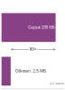

*Одно сжатое обновление меньше одной загрузки сырых данных; повторные раунды накапливаются.*

> **Сценарий: обновления модели против сырых данных**
>
> **Задача**: команда проектирует федеративную систему персонализации камеры, которая обучается на 200 МБ сжатых изображений пользователя в неделю. Сравните одну загрузку этих изображений с одним раундом сжатого обновления модели по восходящему каналу.
>
> **Расчет**:
> Эффективность использования пропускной способности — это отношение объема сырых данных к размеру обновления модели.
>
> 1. **Загрузка сырых данных**: 200 МБ в неделю.
> 2. **Один раунд федеративной загрузки**: сжатое обновление модели (5 млн параметров) весит 2,5 МБ.
> 3. **Сокращение одного раунда по восходящему каналу**: 200 МБ/2,5 МБ = 80×.
>
> **Системный вывод**: в этом сценарии один восходящий канал в 2,5 МБ в 80 раз меньше одной загрузки сырых данных в 200 МБ. Это отношение не является сквозной экономией коммуникации для всего цикла обучения: примерно после 80 раундов загрузки обновлений суммарный объем одних только загрузок обновлений равен объему сырых данных, не считая загрузок глобальной модели, повторных передач и накладных расходов протокола. Поэтому развертывание должно умножать трафик одного раунда на ожидаемое число раундов.

Трехфазная эволюция, представленная на [рисунке](#fig-centralized-vs-decentralized) (только локальное обучение, централизованное облако, федеративное обучение), теперь приходит к определяющей позиции федеративного обучения. [Рисунок](#fig-learning-paradigms) повторяет это сравнение с акцентом, необходимым для раздела об алгоритмах: офлайновое обучение учит модель централизованно и развертывает статичные модели; обучение на устройстве адаптирует модели локально, но изолированно, без обмена выводами между пользователями; а федеративное обучение связывает оба подхода, координируя обновления глобально, пока сырые данные остаются локальными, так что оно получает выгоду от распределенных улучшений модели, не централизуя данные, которые их породили.

<a id="fig-learning-paradigms"></a>


***Граничные парадигмы обучения:** на панелях сравниваются три подхода к обучению модели на периферии. Офлайновое обучение проводится в облаке и развертывает статичные модели; обучение на устройстве адаптирует модели локально, используя данные устройства; федеративное обучение координирует распределенное обучение, сохраняя сырые данные локально.*

Федеративное обучение балансирует приватность данных и совместное улучшение модели, координируя локальное обучение на распределенных устройствах, в отличие от централизованного подхода офлайнового обучения или изолированной адаптации обучения на устройстве. Каждая парадигма по-разному решает вопросы расположения данных и стратегий обновления модели, выявляя компромиссы между персонализацией, безопасностью данных и совместным использованием глобальных знаний.

### Совместное обучение с сохранением приватности

В таких областях применения, как персонализация клавиатуры Gboard, носимый мониторинг здоровья и голосовые интерфейсы, компактные локальные обновления решают лишь сторону проблемы, связанную с перемещением данных. Федеративное обучение (Federated Learning, FL) добавляет уровень координации: оно обучает общую модель на популяции устройств, не передавая сырые данные на центральный сервер (McMahan et al., 2017). В отличие от традиционных конвейеров централизованного обучения, которые требуют агрегировать все обучающие данные в одном месте, федеративное обучение распределяет сам процесс обучения. Каждое участвующее устройство вычисляет обновления на основе своих локальных данных и вносит вклад в глобальную модель через протокол агрегации, обычно координируемый центральным сервером.

Такой сдвиг хорошо соответствует мобильным, граничным и встроенным системам, поскольку сохраняет локальность данных и при этом улучшает общую модель. Однако преимущества в приватности и персонализации реальны, только если система также учитывает вариативность клиентов, эффективность коммуникации и распределения non-i.i.d. данных[^fn-noniid-convergence-bound] с помощью специализированных протоколов и механизмов координации.

[^fn-noniid-convergence-bound]: **Non-IID данные**: данные, которые *не* являются независимыми и одинаково распределенными; при обучении в дата-центре перемешивание данных гарантирует, что каждый батч представляет глобальное распределение. На периферии данные каждого пользователя по своей природе смещены (non-IID): пользователь в Токио печатает в основном по-японски, а пользователь в Лондоне — по-английски. Такое смещение создает расхождение градиентов, из-за которого стандартный FedAvg сходится в 2–5$\times$ медленнее, чем централизованный SGD.

Три области определяют федеративное обучение в условиях устройств: базовые протоколы обучения, которые управляют координацией между устройствами, стратегии планирования и эффективности коммуникации, а также подходы к персонализации. Механизмы приватности, такие как безопасная агрегация и дифференциальная приватность, охватывают эти области, а не заменяют их: они определяют, что сервер может вывести из обновлений и сколько шума должен поглотить цикл обучения.

Первое архитектурное решение состоит в том, образуют ли участники федерацию между устройствами или между изолированными организациями. Это различие меняет модель отказов, политику планирования и единицу приватности еще до выбора оптимизатора (Kairouz и McMahan, 2021). [Таблица](#tbl-edge-cross-device-silo) делает эти последствия явными.

<a id="tbl-edge-cross-device-silo"></a>

***Федеративное обучение между устройствами и между изолированными организациями:** состав участников определяет планирование, доверие, взвешивание и семантику приватности. Протокол, созданный для миллионов ненадежных телефонов, не обязательно подходит для консорциума больниц.*

| **Измерение проектирования** | **Федерация между устройствами**                                | **Федерация между изолированными организациями**                               |
|:-----------------------------|:----------------------------------------------------------------|:-------------------------------------------------------------------------------|
| **Участники**                | Большая популяция периодически доступных личных устройств       | Небольшой набор известных организаций или площадок                             |
| **Семантика раунда**         | Выбрать подходящую когорту; ожидать отстающих и выбывших        | Координировать стабильный состав; выяснять причины отсутствия площадок         |
| **Граница доверия**          | Считать клиентское ПО и локальные данные потенциально скомпрометированными | Аутентифицировать учреждения, но по-прежнему изолировать каждого хранителя данных |
| **Взвешивание по умолчанию** | Решить, отражает ли целевая функция примеры или пользователей   | Взвешивание следует согласованной целевой функции учреждений, а не размеру площадки по умолчанию |
| **Единица приватности**      | Обычно пользователь или устройство в течение всей истории участия | Обычно человек или запись в данных площадки, иногда сама площадка             |

### Протоколы обучения

Протоколы, которые делают распределенную координацию практичной в масштабе, должны одновременно решать три инженерные задачи: обеспечить совместимость локальных обновлений несмотря на non-IID распределения данных, эффективно агрегировать эти обновления при ограниченной пропускной способности и координировать сроки между устройствами с неоднородной доступностью.

#### Локальное обучение

Локальное обучение — это место, где сохранение приватности становится системной границей. Отдельные устройства вычисляют обновления модели по приватным данным, но каждый локальный выбор влияет на корректность агрегата: с какой базовой модели стартует устройство, какие локальные примеры оно выбирает, сколько оптимизации выполняет и какое обновление отправляет обратно. Поэтому цикл удобно представлять как упорядоченный протокол, а не как абстрактное определение:

1. **Инициализация модели**: каждое устройство инициализирует параметры своей локальной модели, часто загружая последнюю глобальную модель с сервера.
2. **Выборка локальных данных**: устройство выбирает подмножество своих локальных данных для обучения. Эти данные могут быть non-IID, то есть не равномерно распределены между устройствами.
3. **Локальное обучение**: устройство выполняет несколько итераций обучения на своих локальных данных, обновляя параметры модели на основе вычисленных градиентов.
4. **Обновление модели**: после локального обучения устройство вычисляет обновление модели (например, разность между обновленными и исходными параметрами) и готовится отправить его на сервер.
5. Коммуникация: устройство передает обновление модели на сервер, обычно по защищенному каналу связи, чтобы защитить приватность пользователя.
6. **Агрегация модели**: сервер агрегирует обновления с многих устройств, чтобы получить новую глобальную модель, которая затем рассылается обратно участвующим устройствам.

Процесс повторяется итеративно: устройства периодически загружают последнюю глобальную модель и выполняют локальное обучение. Частота обновлений зависит от системных ограничений, доступности устройств и стоимости коммуникации.

<a id="sec-edge-intelligence-federated-aggregation-protocols-5d37"></a>

#### Протоколы федеративной агрегации

Центральный механизм координации в федеративном обучении позволяет устройствам с небольшими локальными наборами данных совместно обучать общую модель. Клиентские устройства выполняют локальное обучение и передают обновления модели центральному серверу, который агрегирует их в уточненную глобальную модель и рассылает ее для следующего раунда обучения. Циклическая процедура отделяет обучение от централизованного сбора данных, что подходит для сред, где пользовательские данные приватны, пропускная способность ограничена, а участие устройств эпизодично.

Самой распространенной базовой версией этого процесса является федеративное усреднение (FedAvg),[^fn-fedavg-communication-rounds] которое стало каноническим алгоритмом федеративного обучения (McMahan et al., 2017). В FedAvg каждое устройство обучает свою локальную копию модели с помощью SGD на своих приватных данных.

[^fn-fedavg-communication-rounds]: **FedAvg (федеративное усреднение)**: McMahan et al. (2017) усредняют веса модели вместо отдельных градиентов, позволяя каждому клиенту выполнить несколько локальных шагов SGD (обычно от 1 до 20) перед одной загрузкой. Это сокращает коммуникацию в 10–100$\times$ по сравнению с распределенным SGD, делая федеративное обучение жизнеспособным в мобильных сетях, где пропускная способность восходящего канала является связывающим ограничением. Компромисс: больше локальных шагов повышают эффективность коммуникации, но усиливают расхождение на non-IID данных, что требует тщательной настройки для каждого развертывания.

Формально пусть $\mathcal{D}_k$ обозначает локальный набор данных клиента $k$, а $\theta_k^t$ — параметры модели на клиенте $k$ в раунде $t$. Каждый клиент выполняет $E$ эпох SGD на своих локальных данных, получая обновление $\theta_k^{t+1}$. Центральный сервер затем агрегирует эти обновления так:
$$
\theta^{t+1} = \sum_{k=1}^{C} \frac{n_k}{n} \theta_k^{t+1}
$$
<a id="eq-fedavg-weighted-aggregation"></a>

где $n_k = |\mathcal{D}_k|$ — число образцов на устройстве $k$, $n = \sum_k n_k$ — общее число образцов среди участвующих клиентов, а $C$ — число активных устройств в текущем раунде.

Эта формула оптимизирует **взвешенную по примерам** целевую функцию: клиент с вдесятеро большим числом локальных примеров получает вдесятеро большее влияние. Такой выбор уместен, когда каждый пример должен вносить равный вклад, но он может позволить самым активным пользователям или крупным учреждениям доминировать в модели. **Взвешенная по пользователям** целевая функция вместо этого назначает каждому участвующему клиенту вес $1/C$, опционально ограничивая или нормализуя локальный вклад каждого клиента перед агрегацией. Ни один выбор не является универсально справедливым. Система должна заявить, что является ее единицей интереса: пример, пользователь, организация или когорта развертывания, — и затем оценивать именно эту популяцию, а не наследовать $n_k/n$ как реализационное умолчание.

<a id="sec-edge-intelligence-straggler-mitigation-b49d"></a>

#### Смягчение влияния отстающих участников

В парке из миллионов разнородных устройств ожидание ответа от каждого выбранного клиента непрактично. Сетевая задержка, разряд батареи или конкуренция фоновых процессов могут заставить некоторые устройства («отстающих») работать в 10$\times$ дольше среднего. На уровне семантики раунда последствие прямое: взвешенная агрегация в [уравнении](#eq-fedavg-weighted-aggregation) не может продвинуться, пока не придет достаточно обновлений, поэтому длительность раунда определяется самыми медленными устройствами, которых сервер еще ждет. Ответ на это на уровне планирования — избыточный отбор (over-selection) — относится к политике планирования клиентов и рассматривается вместе с остальным планированием клиентов в разделе [«Планирование клиентов»](#sec-edge-intelligence-client-scheduling-f675).

Этот циклический протокол координации образует основу федеративного обучения. [Рисунок](#fig-federated-averaging-cycle) разбивает протокол федеративного усреднения на четыре фазы: выбор клиентов (с избыточным отбором для обработки отстающих), локальное обучение на приватных данных, загрузку параметров с необязательным сжатием и взвешенную агрегацию, которая порождает обновленную глобальную модель.

<a id="fig-federated-averaging-cycle"></a>

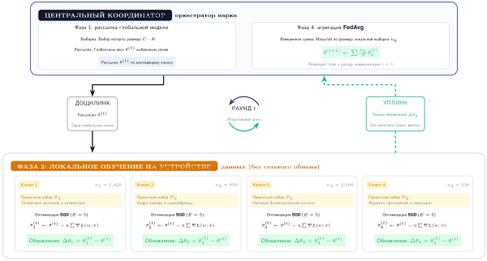

***Протокол федеративного усреднения:** четырехфазный цикл начинается, когда сервер рассылает глобальную модель участвующим клиентам. Клиенты обучаются локально на приватных данных, загружают обновления модели, а сервер агрегирует эти обновления в следующую глобальную модель.*

Эта базовая структура порождает ряд проектных решений и компромиссов. Число локальных эпох $E$ влияет на баланс между вычислениями и коммуникацией: большее $E$ снижает частоту коммуникации, но рискует привести к расхождению, если локальные распределения данных сильно различаются. Выбор участвующих клиентов влияет на стабильность сходимости и справедливость. В реальных развертываниях не все устройства доступны постоянно, а аппаратные возможности могут заметно различаться, что требует надежного планирования участия и устойчивости к отказам.

#### Анализ сходимости федеративного обучения

Сходится ли федеративное обучение и насколько быстро оно достигает приемлемой точности, — ключевые вопросы для проектирования системы. В отличие от централизованного обучения, где сходимость зависит в первую очередь от скорости обучения и размера батча, сходимость федеративного обучения зависит от взаимодействия между раундами коммуникации, локальными вычислениями, участием клиентов и неоднородностью данных. Эти факторы определяют, достигнет ли федеративное развертывание целевой точности за часы, дни или никогда. «Слабое масштабирование на масштабе парка» разбирает аргумент слабого масштабирования: почему добавление участвующих устройств увеличивает общий объем работы быстрее, чем сокращает время по часам, и это задает убывающую отдачу, которая ограничивает, насколько участие клиентов может ускорить сходимость здесь.

##### Основы скорости сходимости

Полезная системная абстракция — отслеживать участвующих клиентов, локальные эпохи и раунды коммуникации вместе. McMahan et al. (2017) определяют FedAvg через эти управляющие параметры, но они не устанавливают универсальной скорости сходимости, основанной только на их произведении. Чтобы показать, как эти параметры могут тянуть в противоположных направлениях, эта глава использует следующую безразмерную игрушечную оценку чувствительности:

$$
S_{\text{toy}}(C,E,R;\beta_{\text{het}})
= \frac{\sigma(1+\beta_{\text{het}})}{\sqrt{CER}}
+ \frac{\beta_{\text{het}}^2 E^2}{R}
$$

Здесь $C$ — число участвующих клиентов в раунде, $E$ — число локальных эпох, $R$ — число раундов коммуникации, $\sigma$ — безразмерная константа сценария, а $\beta_{\text{het}}$ — безразмерный параметр дрейфа клиентов. Первый член убывает по мере обработки большего числа клиентско-эпох, а второй намеренно штрафует большое $E$ при неоднородности. Эта оценка не является теоремой о сходимости, эмпирически откалиброванным оценщиком или предсказателем разрыва целевой функции.

Произведение $CER$ полезно лишь как учетная величина числа клиентско-эпох. Равенство $CER$ не означает равной сходимости, поскольку выборка клиентов, число примеров на клиента, размер батча, размер шага, дрейф локальных обновлений и распределения данных могут различаться. Поэтому производственные решения требуют измерений или результата о сходимости, предположения которого совпадают с развернутым оптимизатором и данными.

##### Влияние non-IID данных

Обзоры и эмпирические исследования федеративного обучения выделяют non-IID данные как ключевую проблему сходимости и используют такие меры, как локальная несхожесть, расстояние Вассерштейна (earth mover's distance) или расхождение весов (Li et al., 2020; Zhao et al., 2018). Эти меры не взаимозаменяемы. В игрушечной оценке $\beta_{\text{het}}$ — лишь параметр сценария: при нулевом значении член дрейфа исчезает, а при его росте дополнительные локальные эпохи становятся дороже. У него нет универсального масштаба и прямого оценщика, пригодного для разных приложений.

Член $E^2/R$ кодирует одно качественное взаимодействие: больше локальной работы может снижать частоту коммуникации, но может также увеличивать дрейф клиентов, когда цели различаются. Показатель степени и коэффициент — допущения этого упражнения по чувствительности, а не утверждение о каждом развертывании FedAvg.

##### Игрушечный пример чувствительности к неоднородности

Поскольку $\beta_{\text{het}}$ не является наблюдаемой метрикой, для него не следует задавать эмпирические диапазоны по областям применения. Приведенный ниже расчетный пример выбирает $\beta_{\text{het}}=1{,}5$ только для того, чтобы показать арифметику игрушечной оценки; это значение не характеризует данные клавиатуры, языка или здоровья.

Гипотетическая конфигурация со 100 клиентами делает игрушечную арифметику конкретной: $C$ = 10 клиентов, выбранных в раунде, $E$ = 5 локальных эпох в раунде, пороговое значение компоненты $\epsilon$ = 0,01 и два сценария, $\beta_{\text{het}}$ = 0 и $\beta_{\text{het}}$ = 1,5. Эти входные данные не описывают производственное развертывание.

Игрушечный случай без дрейфа $(\beta_{\text{het}} = 0)$: поскольку второй член равен нулю, а выбор сценария $\sigma=1$, установка первого члена не выше $\epsilon$ дает:

$$
R_{\text{IID}} \geq \frac{\sigma^2}{C \cdot E \cdot \epsilon^2} = \frac{1}{10 \cdot 5 \cdot 0{,}0001} = 200 \text{ раундов}
$$

При 10 клиентах в раунде и 5 локальных эпохах это представляет 200 $\times$ 10 $\times$ 5 = 10 000 клиентско-эпох вычислений в сумме.

Игрушечный случай с положительным дрейфом $(\beta_{\text{het}} = 1{,}5)$: примените порог отдельно к обеим компонентам. При $E=5$ первая компонента требует 1 250 раундов, тогда как предполагаемая компонента дрейфа требует:

$$
\frac{\beta_{\text{het}}^2 E^2}{R} \leq \epsilon \implies R \geq \frac{\beta_{\text{het}}^2 E^2}{\epsilon} = \frac{2{,}25 \times 25}{0{,}01} = 5\,625 \text{ раундов}
$$

Больший порог компоненты примерно в 28,1× выше сценария без дрейфа. Он соответствует 5 625 $\times$ 10 $\times$ 5 = 281 250 клиентско-эпохам. Это результаты выбранных игрушечных констант, а не предсказанные затраты на сходимость.

Предполагаемый член дрейфа $E^2$ делает оценку чувствительной к выбору локальных эпох. При $E = 2$ вместо $E = 5$ порог компоненты дрейфа уменьшается до 900 раундов, а порог первой компоненты растет до 3 125:

$$
R \geq \max\left(\frac{(1+\beta_{\text{het}})^2}{C \cdot E \cdot \epsilon^2}, \frac{\beta_{\text{het}}^2 E^2}{\epsilon}\right)
= \max\left(\frac{2{,}5^2}{10 \cdot 2 \cdot 0{,}0001}, \frac{2{,}25 \times 4}{0{,}01}\right)
= \max(3\,125, 900) = 3\,125 \text{ раундов}
$$

В рамках этой игрушечной оценки число раундов до пересечения порога снижается в 1,80×, тогда как локальная работа на раунд уменьшается в 2,5×. Число клиентско-эпох становится равным 3 125 $\times$ 10 $\times$ 2 = 62 500, что на 4,5× меньше сценария с $E$ = 5. Это демонстрирует лишь чувствительность, заложенную в предполагаемой формуле; реальное развертывание должно оценивать компромисс эмпирически или использовать применимый результат о сходимости.

##### Компромисс между коммуникацией и вычислениями

Взаимодействие между локальными эпохами и раундами коммуникации создает фундаментальный проектный компромисс, показанный на [рисунке](#fig-comm-compute-tradeoff). Больше локальных эпох снижает частоту коммуникации (вычислительное притяжение), но увеличивает дрейф клиентов (статистический штраф), тогда как меньше локальных эпох поддерживают более плотную синхронизацию ценой большей стоимости коммуникации.

<a id="fig-comm-compute-tradeoff"></a>

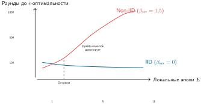

***Компромисс между коммуникацией и вычислениями:** эта схема показывает качественное напряжение между выполнением большей локальной работы за раунд и накоплением дрейфа клиентов при non-IID данных. Ее ось $\epsilon$-оптимальности и подписи рабочих точек — схематические обозначения, а не гарантия сходимости или универсальный оптимальный диапазон эпох; проектировщики системы должны измерять развернутый оптимизатор, данные и популяцию клиентов.*

Оптимальная рабочая точка зависит от факторов конкретного развертывания. Стоимость коммуникации (пропускная способность, энергия) выигрывает от большего $E$, тогда как скорость сходимости при неоднородности выигрывает от меньшего $E$. Практические системы часто используют адаптивные стратегии, которые начинают с малого $E$ и увеличивают его по мере приближения модели к сходимости и снижения дрейфа клиентов.

##### Когда федеративное обучение работает

Федеративное обучение достигает практической сходимости, только когда выполнено несколько условий развертывания, — тема, подчеркиваемая в обзорах систем федеративного обучения и открытых задач (Kairouz и McMahan, 2021):

- Неоднородность должна оставаться достаточно ограниченной, чтобы дрейф клиентов не доминировал во времени обучения. Когда популяции сильно неоднородны, разбиение клиентов на более однородные группы или персонализация могут быть предпочтительнее одной глобальной модели.
- Участие клиентов должно быть достаточным, чтобы давать стабильные агрегированные обновления. Очень низкое участие делает оценки градиентов шумными и усиливает смещение отбора.
- Каждому участвующему клиенту нужно достаточно локальных данных для содержательного вычисления обновления. Крошечные локальные батчи могут давать обновления с высокой дисперсией, которые дестабилизируют обучение.

Когда эти условия нарушены, необходимы альтернативные подходы. Сильная неоднородность предполагает иерархическое федеративное обучение с региональной агрегацией или полностью персонализированные модели без глобальной агрегации. Очень низкие уровни участия указывают на необходимость асинхронных протоколов, которые не требуют синхронизированных раундов. Клиенты с минимальными локальными данными выигрывают от методов адаптации по нескольким примерам, а не от обучения на основе градиентов.

Эти математические протоколи агрегации показывают, что децентрализованное обучение теоретически возможно. Выполнить федеративное усреднение на десяти надежных узлах в лаборатории тривиально; выполнить его на десяти миллионах смартфонов, которые постоянно подключаются и отключаются от сотовых сетей, — совсем другая инженерная задача. Надежные федеративные системы должны переводить алгоритм в механизмы оркестрации, планирования и обработки отказов, которые с самого начала предполагают ненадежность клиентов.

## Федеративное обучение: системы в масштабе

В учебном алгоритме все 100 граничных устройств безупречно вычисляют свои обновления и одновременно отправляют результаты на сервер. На практике раунд федеративного обучения, охватывающий миллион смартфонов, должен справляться с перегревом устройств, потерей Wi-Fi, переходом в режим энергосбережения или выключением. Построение федеративных систем в масштабе означает создание оркестратора, который считает асинхронные выбывания и экстремальных отстающих стандартными рабочими условиями.

<a id="sec-edge-intelligence-client-scheduling-f675"></a>

### Планирование клиентов

Федеративное обучение работает в предположении, что клиенты, то есть устройства, хранящие локальные данные, периодически становятся доступны для участия в раундах обучения. В реальных системах доступность клиентов прерывиста и изменчива. Устройства могут быть выключены, отключены от питания, не иметь сетевого доступа или иным образом не могут участвовать в данный момент. Поэтому планирование клиентов играет центральную роль в эффективности и результативности распределенного обучения.

На базовом уровне системы федеративного машинного обучения определяют критерии допуска к участию. Устройства должны соответствовать минимальным требованиям: быть подключенными к питанию, к Wi-Fi и простаивать, чтобы не мешать работе пользователя и не расходовать заряд батареи. Эти критерии определяют, какое подмножество всей популяции считается «доступным» в каждом раунде обучения.

Помимо этих операционных фильтров, устройства различаются аппаратными возможностями, доступностью данных и сетевыми условиями. Некоторые смартфоны содержат много недавних примеров, относящихся к текущей задаче, тогда как у других данные устаревшие или нерелевантные. Сетевая пропускная способность и скорость загрузки могут сильно варьироваться в зависимости от географии и инфраструктуры оператора связи. Поэтому случайный выбор клиентов может привести к плохому покрытию базового распределения данных и нестабильной сходимости модели.

Отбор, управляемый доступностью, порождает смещение участия. Клиенты с благоприятными условиями чаще участвуют повторно. К таким условиям относятся частая зарядка, топовое аппаратное обеспечение и стабильное подключение. Между тем другие систематически недопредставлены. Это может сместить итоговую модель в сторону поведения и предпочтений привилегированной части популяции, вызывая вопросы справедливости и обобщения.

Масштаб смещения участия становится очевидным при изучении реальной статистики развертываний. Исследования развертываний федеративного обучения показывают, что самые активные 10 % устройств могут вносить более 50 % раундов обучения, тогда как нижние 50 % устройств могут не участвовать вовсе. Это создает петлю обратной связи: модели все сильнее оптимизируются под пользователей с флагманскими устройствами и стабильным подключением, потенциально ухудшая работу для пользователей с ограниченными ресурсами, которым адаптация нужнее всего. Модель предсказания клавиатуры может сместиться к паттернам набора пользователей флагманских телефонов, которые заряжают устройство ночью, и упускать важные языковые вариации пользователей бюджетных устройств или с нерегулярной зарядкой.

Чтобы решить эти задачи, системы должны балансировать эффективность планирования и разнообразие клиентов. Ключевой подход — стратифицированная или квотная выборка, которая обеспечивает репрезентативное участие клиентов из разных групп. Некоторые системы реализуют «бюджеты справедливости», которые отслеживают накопленное участие и активно отдают приоритет недопредставленным устройствам, когда они становятся доступны. Другие используют методы важностной выборки, чтобы перевзвешивать вклады на основе оцененной статистики популяции, а не сырых долей участия. Например, асинхронные методы на основе буферов позволяют участвующим клиентам вносить обновления модели независимо, без требования синхронизированной координации в каждом раунде (Nguyen et al., 2021). Эта модель была расширена для учета устаревания обновлений (Rodio и Neglia, 2024) и механизмов справедливости (Ma et al., 2024), предотвращая смещение из-за слишком активных клиентов, которые иначе могли бы доминировать в процессе обучения.

Эти механизмы справедливости существуют наряду с адаптивными стратегиями выбора клиентов. Системы федеративного машинного обучения могут отдавать приоритет клиентам с недопредставленными типами данных, выбирать для выборки географические регионы или демографические группы, которые встречаются реже, и использовать историю участия, чтобы соблюдать ограничения справедливости. Прогнозное моделирование может предсказывать будущую доступность клиентов или вероятность успешного участия, повышая пропускную способность обучения.

Выбранные клиенты выполняют один или несколько шагов локального обучения на своих приватных данных и передают обновления модели центральному серверу. Эти обновления агрегируются, чтобы сформировать новую глобальную модель. Как правило, агрегация взвешенная: вклад каждого клиента масштабируется, например, по числу локальных примеров, использованных при обучении, прежде чем производится усреднение. Это гарантирует, что клиенты с более репрезентативными или большими наборами данных оказывают пропорциональное влияние на глобальную модель.

Планирование также должно ограничивать время ожидания раунда самых медленных участников. Как было показано в разделе [«Смягчение влияния отстающих участников»](#sec-edge-intelligence-straggler-mitigation-b49d), отстающие могут работать в 10$\times$ дольше медианного устройства, и раунд не может агрегировать результаты, пока не придет достаточно обновлений.

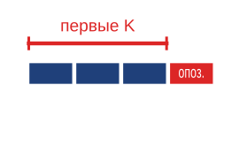

*Избыточный отбор закрывает раунд по первым K обновлениям.*

Чтобы глобальное обновление модели не застопорилось, производственные системы FL применяют **избыточный отбор** (over-selection). Сервер выбирает пул кандидатов размером $K_{\text{candidates}}$, превышающий целевое число обновлений $K_{\text{target}}$ (обычно $K_{\text{candidates}} \approx 1{,}3 \times K_{\text{target}}$). Сервер агрегирует обновления от первых $K_{\text{target}}$ ответивших и отбрасывает остальные. Такой подход ограничивает длительность раунда скоростью $K_{\text{target}}$-го по быстроте устройства, а не абсолютно самого медленного, что резко ускоряет сходимость по астрономическому времени.

Эти решения по планированию напрямую влияют на скорость сходимости, обобщение модели, энергопотребление и общий пользовательский опыт. Плохое планирование приводит к избыточному числу отстающих, переобучению на узких сегментах клиентов или напрасным вычислениям. Поэтому планирование клиентов — основной компонент проектирования системы федеративного обучения, требующий одновременно алгоритмической глубины и координации на уровне инфраструктуры.

> **Контрольные вопросы: проектирование федеративной системы**
>
> Рассмотрим архитектуру федеративной системы обучения для парка из 10 млн мобильных устройств. Данные сильно non-IID (у пользователей различные, кластеризованные паттерны набора текста), а сетевая среда ограничена (1–10 Мбит/с). Прежде чем выбирать оптимизации для этого сценария, классифицируйте локальные узкие места и укажите, какое системное ограничение доминирует в каждом решении.
>
> Рассмотрите три проектных решения:
>
> 1.  Агрегация: выберите простое FedAvg, сокращение числа локальных эпох или персонализацию/кластеризацию для non-IID популяции и обоснуйте, как этот выбор контролирует дрейф клиентов.
> 2.  Приватность: решите, нужен ли развертыванию формальный шум дифференциальной приватности или для заявленной модели угроз достаточно безопасной агрегации и минимизации данных; качественно объясните ожидаемую стоимость по времени сходимости.
> 3.  Коммуникация: выберите между квантованием градиентов (например, 8-битным) и структурированной разреженностью при ограниченной пропускной способности и обоснуйте компромисс между пропускной способностью и точностью.

<a id="sec-edge-intelligence-bandwidthaware-update-compression-7730"></a>

### Сжатие обновлений с учетом пропускной способности

Сжатие обновлений — это сначала диагностика узкого места, и лишь потом выбор метода: если каждый раунд передает полные веса модели или градиенты, мобильная пропускная способность и бюджеты батареи определяют сходимость раньше, чем оптимизатор.[^fn-wireless-bandwidth-bottleneck] Проектное решение состоит в том, какую информацию можно квантовать, разреживать или оставлять локально, сохранив при этом достаточную точность градиентов, чтобы FedAvg сходился.

[^fn-wireless-bandwidth-bottleneck]: **Асимметрия беспроводной загрузки**: загрузка по LTE в среднем составляет 5–10 Мбит/с против 50 и более Мбит/с при загрузке данных, что создает асимметричное узкое место, доминирующее в проектировании федеративного обучения; передача обновления модели размером 50 МБ расходует примерно 100 мАч (2–3 % заряда батареи) и занимает 40–80 секунд по LTE. Маломощные протоколы еще хуже: LoRaWAN работает максимум на 50 кбит/с при 1 % рабочем цикле, что делает несжатые обновления физически невозможными. Эта асимметрия объясняет, почему сжатие градиентов не опционально, а архитектурно необходимо.

Решение о сжатии распадается на три рычага, каждый из которых меняет свою часть узкого места коммуникации: сжатие модели уменьшает число бит на обновление, избирательная передача сокращает, какие параметры путешествуют, а архитектурное разбиение оставляет часть состояния локальной. Методы сжатия модели направлены на уменьшение размера передаваемых обновлений за счет квантования,[^fn-quantization-edge-compression] разреживания или подвыборки, что иллюстрирует [рисунок](#fig-gradient-compression). Вместо отправки градиентов полной точности клиент передает квантованные 8-битные обновления или сообщает только top-$k$ элементов градиента[^fn-sparsification-topk-gradient] с наибольшей величиной. Эти преобразования — механизмы коммуникации, а не механизмы приватности: меньший эмбеддинг, разреженное обновление или градиент низкой точности все равно могут раскрывать принадлежность к выборке, атрибуты или восстановимые признаки.

[^fn-quantization-edge-compression]: **Квантование градиентов**: преобразует градиенты FP32 в меньшую точность (INT8, INT4 или 1 бит) перед передачей. Такие методы, как квантованный SGD и signSGD, показывают, что квантованные или знаковые обновления могут существенно сократить коммуникацию, опираясь на стохастическое квантование или компенсацию ошибок для сохранения поведения сходимости (Alistarh et al., 2017; Bernstein et al., 2018). Достигаемое сокращение байтов и влияние на точность зависят от оптимизатора, модели, неоднородности данных и схемы обработки остатков.

[^fn-sparsification-topk-gradient]: **Разреживание градиентов**: передает только 1–10 % градиентов с наибольшей по модулю величиной, используя наблюдение, что большинство элементов градиента близки к нулю и мало вносят в сходимость. Локальное накопление градиентов хранит непереданные остатки, пока они не станут достаточно большими для отправки, достигая сжатия в 10–100$\times$ при сохранении качества обучения; этот паттерн используется в разреженном SGD и глубоком сжатии градиентов (Stich et al., 2018; Lin et al., 2018). Компромисс: агрессивное разреживание может смещать обновления в сторону часто активных параметров, потенциально снижая персонализацию для редких паттернов пользователей.

Избирательная передача обновлений дополнительно снижает коммуникацию, передавая лишь подмножества параметров модели или обновлений. При послойной избирательной передаче клиенты обновляют только определенные слои, обычно финальный классификатор или модули адаптеров, сохраняя замороженной большую часть базовой части. Это снижает и стоимость загрузки, и риск переобучения общих представлений под нерепрезентативные данные клиента.

Разделенные модели и архитектурное разбиение делят модель на общую глобальную и локальную компоненты. Клиенты обучают и поддерживают локальные модули независимо, синхронизируя с сервером только общие части. Это снижает коммуникацию и сужает то, что раскрывается, но общие обновления все равно могут утекать информацию; утверждение о приватности зависит от модели угроз и таких мер контроля, как безопасная агрегация или дифференциальная приватность.

Все эти подходы работают в рамках протокола агрегации FedAvg ([«Протоколы федеративной агрегации»](#sec-edge-intelligence-federated-aggregation-protocols-5d37)): сжатие меняет то, что передает каждый клиент, но не то, как сервер объединяет обновления. Полный учет коммуникации для раунда $r$ выглядит так:

$$
B_r = B_{\text{download},r} + B_{\text{upload},r} + B_{\text{protocol},r} + B_{\text{retry},r},
$$
<a id="eq-edge-federated-communication-ledger"></a>

[уравнение](#eq-edge-federated-communication-ledger) делает явными трафик загрузки, выгрузки, протокольный трафик и трафик повторов. Загрузка распространяет состояние модели, выгрузка переносит обновления клиентов, протокольный трафик покрывает аутентификацию и криптографическую настройку, а повторы учитывают неудачные или повторные передачи. Поэтому оптимизация только $B_{\text{upload},r}$ может лишь переместить узкое место, а не устранить его. Хотя [рисунок](#fig-fl-communication-computation) иллюстрирует компромисс между локальными вычислениями и сетевой пропускной способностью, другие коммуникационно-эффективные обновления вносят собственные издержки. Сжатие может снижать точность градиентов, избирательные обновления могут ограничивать емкость модели, а разделенные архитектуры могут усложнять координацию. Эффективное федеративное обучение требует балансировать коммуникацию, приватность и сходимость с учетом возможностей и изменчивости популяции клиентов. «Экономика сжатия» разбирает порог окупаемости сжатия на расчетном примере.

В отличие от качественной схемы сходимости на [рисунке](#fig-comm-compute-tradeoff), [рисунок](#fig-fl-communication-computation) моделирует сквозное время обучения при трех иллюстративных режимах сети. Он делает задержку коммуникации частью целевой функции, а не рассматривает одно лишь число раундов как прокси.

<a id="fig-fl-communication-computation"></a>

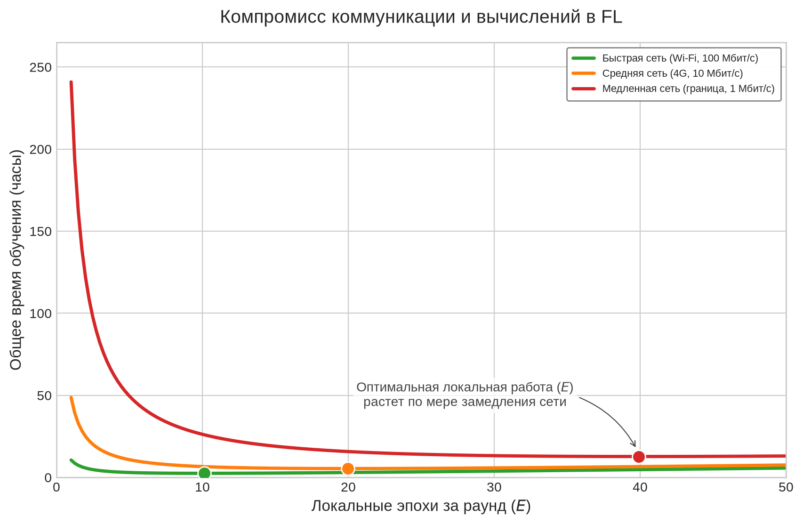

***Компромисс между коммуникацией и вычислениями в федеративном обучении:** по мере снижения пропускной способности сети с быстрой до медленной число локальных эпох, минимизирующее время, смещается вправо, поскольку дополнительные локальные вычисления амортизируют больше коммуникации. Чрезмерная локальная работа в конечном счете увеличивает общее время, когда дрейф клиентов требует больше глобальных раундов для сходимости.*

Когда система выбрала, сколько локальной работы выполнять, сжатие обновлений определяет, сколько должен передавать каждый раунд.

<a id="fig-gradient-compression"></a>

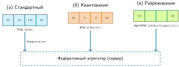

***Методы сжатия градиентов:** стандартные обновления передают значения полной точности; квантование отображает значения в корзины меньшей точности, например из FP32 в INT8; а разреживание передает только наиболее значимые top-$k$ градиенты. Последние два механизма сокращают объем передаваемых байтов, но вносят ошибку представления или остаточное состояние, которым должен управлять алгоритм обучения.*

Эти методы сжатия в совокупности уменьшают полезную нагрузку обновлений, обеспечивая жизнеспособность федеративных раундов даже в сильно ограниченных мобильных сетях.

### Федеративная персонализация

Хотя сжатие и стратегии коммуникации улучшают масштабируемость, они не решают важного ограничения глобальной парадигмы федеративного обучения — неспособности уловить специфичные для пользователя различия. В реальных развертываниях устройства часто наблюдают различные и неоднородные распределения данных. Модель «один размер для всех», примененная равномерно к разным пользователям, может работать хуже. Это мотивирует персонализированное федеративное обучение, в котором локальные модели адаптируются к данным конкретного пользователя без утраты преимуществ глобальной координации.

Пусть $\theta_k$ обозначает параметры модели на клиенте $k$, а $\theta_{\text{global}}$ — агрегированную глобальную модель. Для $K$ клиентов традиционное FL стремится минимизировать глобальную целевую функцию:
$$
\min_\theta \sum_{k=1}^K w_k \mathcal{L}_k(\theta)
$$
где $\mathcal{L}_k(\theta)$ — локальная функция потерь на клиенте $k$, а $w_k$ — весовой коэффициент (например, пропорциональный размеру локального набора данных). Однако такая формулировка предполагает, что одна модель $\theta$ может хорошо обслужить всех пользователей. На практике ландшафты локальных потерь $\mathcal{L}_k$ часто существенно различаются между клиентами, отражая non-IID распределения данных и различные требования задач.

Персонализация изменяет эту целевую функцию, позволяя каждому клиенту поддерживать собственные адаптированные параметры $\theta_k$, оптимизируемые одновременно относительно глобальной модели и локальных данных:
$$
\min_{\theta_1, \ldots, \theta_K} \sum_{k=1}^K \left( \mathcal{L}_k(\theta_k) + \lambda_{\text{reg}} \cdot \mathcal{R}(\theta_k, \theta_{\text{global}}) \right)
$$

Здесь $\mathcal{R}$ — регуляризационный член, штрафующий отклонение от глобальной модели, а $\lambda_{\text{reg}}$ задает силу этого штрафа. Такая формулировка позволяет локальным моделям отклоняться по необходимости, сохраняя при этом выгоду от глобальной координации.

Реальные сценарии иллюстрируют важность этого подхода. Рассмотрим носимый монитор здоровья, который отслеживает физиологические сигналы для классификации физической активности. Хотя глобальная модель может работать достаточно хорошо для всей популяции, у отдельных пользователей есть уникальные паттерны движения, походки или расположения датчиков. Персонализированное дообучение финального классификационного слоя или низкоранговых адаптеров позволяет повысить точность, особенно для редких или специфичных для пользователя классов.

Несколько стратегий персонализации решают компромиссы между вычислительными накладными расходами, раскрытием информации и скоростью адаптации. Один широко используемый подход — локальное дообучение: каждый клиент загружает последнюю глобальную модель и выполняет небольшое число шагов градиента на своих локальных данных. Этот метод не передает эти примеры во время адаптации, но получающееся локальное состояние и любое последующее обновление остаются чувствительными к приватности. Он также может давать неоптимальные результаты, когда глобальная модель плохо согласована с распределением данных клиента или когда локальный набор данных крайне ограничен.

Другой эффективный прием — слои персонализации, при котором модель делится на общую базовую часть и легковесную клиент-специфичную голову, обычно финальный классификационный слой (Arivazhagan et al., 2019). На устройстве обновляется только голова, что снижает использование памяти и время обучения. Этот подход особенно хорошо подходит для сценариев, в которых основные различия между клиентами касаются выходных категорий или границ решений.

Кластеризованное федеративное обучение предлагает альтернативу: клиенты группируются по сходству данных или характеристик производительности, и для каждого кластера обучается отдельная модель. Эта стратегия может повысить точность внутри однородных подгрупп, но добавляет системную сложность и может требовать обмена метаданными для определения членства в группе.

Наконец, подходы метаобучения, такие как метаобучение, не зависящее от модели (model-agnostic meta-learning, MAML),[^fn-maml-fewshot-adaptation] направлены на создание инициализации глобальной модели, которую можно быстро адаптировать к новым задачам всего несколькими локальными обновлениями (Finn et al., 2017). Этот прием особенно полезен, когда у клиентов ограниченные данные или они работают в средах с частыми сдвигами распределения.

[^fn-maml-fewshot-adaptation]: **MAML (Model-Agnostic Meta-Learning)**: Finn et al. (2017) оптимизируют инициализацию модели, из которой один или несколько шагов градиента дают хорошее качество на новой задаче; эксперименты включают настройки с одним примером и с несколькими примерами. Метаобучение дороже обычного дообучения, поскольку дифференцирует через сам процесс адаптации, но адаптация при развертывании может ограничиваться небольшим числом локальных обновлений. Это делает MAML актуальным для граничных сценариев, где вычисления инференса дешевы, а обучающих данных мало.

Каждая из этих стратегий отражает отдельную точку в пространстве компромиссов персонализации. Посмотрите [таблицу](#tbl-personalization-strategies), чтобы увидеть, как вычислительные накладные расходы, гарантии приватности и задержка адаптации различаются между локальным дообучением, слоями персонализации, кластеризованным федеративным обучением и подходами метаобучения.

<a id="tbl-personalization-strategies"></a>

***Компромиссы персонализации:** стратегии федеративного обучения балансируют персонализацию с вычислениями, раскрытием информации и задержкой адаптации. Локальность данных сужает раскрытие, но сама по себе не дает гарантии приватности.*

| **Стратегия**              | **Механизм персонализации**                       |  **Вычислительные накладные расходы** |               **Сохранение приватности**               |   **Скорость адаптации**  |
|:---------------------------|:--------------------------------------------------|:---------------------:|:--------------------------------------------------------:|:-----------------------:|
| **Локальное дообучение**   | Градиентный спуск по локальной функции потерь после агрегации | От низких до умеренных | Сырые примеры остаются локально; адаптированное состояние остается чувствительным | Быстрая (несколько шагов) |
| **Слои персонализации**    | Разделенная модель: общая база + специфичная для пользователя голова | Умеренные | Сужает общее состояние; не гарантирует приватность | Быстрая (обучение малой головы) |
| **Кластеризованное FL**    | Группировка клиентов по сходству данных и обучение для каждой группы | От умеренных до высоких | Членство в группе и обновления могут раскрывать атрибуты | Средняя |
| **Метаобучение**           | Обучение быстрой адаптации между задачами и устройствами | Высокие (мета-цель) | Зависит от метаобучения и протокола адаптации | Очень быстрая (по нескольким примерам) |

Выбор подходящего метода персонализации зависит от ограничений развертывания, характеристик данных и желаемого баланса между точностью, приватностью и вычислительной эффективностью. [Рисунок](#fig-personalization-arch) сравнивает три архитектурных подхода: полное дообучение дает максимальную выразительность при высокой вычислительной стоимости, адаптация только головы обходится дешево, но адаптирует ограниченно, а методы на основе адаптеров балансируют эффективность с глубокой адаптацией представлений через небольшие обучаемые модули.

<a id="fig-personalization-arch"></a>


***Архитектуры федеративной персонализации:** на панелях сравниваются стратегии адаптации глобальных моделей к локальным данным. Полное дообучение обновляет каждый параметр; адаптация только головы замораживает экстрактор признаков; а обучение на основе адаптеров, такое как LoRA, вставляет небольшие обучаемые модули в замороженную базовую часть. Каждый шаг обменивает дополнительные локальные вычисления и состояние на большую емкость адаптации.*

Ключевое различие, которое выявляет [рисунок](#fig-personalization-arch), — компромисс между выразительностью адаптации и вычислительной стоимостью: полное дообучение обновляет каждый параметр, но требует ресурсов, недоступных большинству граничных устройств, тогда как методы на основе адаптеров достигают глубокой адаптации представлений при малой доле бюджета памяти и вычислений.

### Федеративная приватность

Хотя федеративное обучение часто мотивируют заботой о приватности, поскольку оно сохраняет сырые данные локальными, а не передает их на центральный сервер, эта парадигма вносит собственные риски безопасности и приватности. Хотя устройства не передают сырые данные, передаваемые обновления модели (такие как градиенты или изменения весов) могут непреднамеренно раскрывать информацию о лежащих в основе приватных данных. Такие методы, как атаки инверсии модели[^fn-inversion-edge-training] и атаки вывода о членстве[^fn-membership-inference-edge], показывают, что злоумышленники могут частично восстановить или вывести свойства локальных наборов данных, анализируя эти обновления.

[^fn-inversion-edge-training]: **Атака инверсии модели**: восстанавливает обучающие данные по выходам модели или градиентам, оптимизируя входы так, чтобы максимизировать оценки уверенности (Fredrikson et al., 2015; Zhu et al., 2019). В федеративном обучении градиентные обновления могут раскрывать больше информации, чем одни выходы модели, поскольку напрямую показывают сведения о шагах обучения. Защиты, такие как возмущение градиентов, безопасная агрегация и дифференциальная приватность, добавляют компромиссы по протоколу, полезности, коммуникации или вычислениям, величина которых зависит от модели угроз и развертывания.

[^fn-membership-inference-edge]: **Атака вывода о членстве**: определяет, использовались ли конкретные точки данных для обучения модели, используя разрыв уверенности между обучающими данными (высокая уверенность, низкие потери) и невидимыми данными (Shokri et al., 2017). Опубликованные атаки могут работать существенно лучше случайного угадывания на переобученных моделях. В федеративном обучении на персональных данных это означает, что злоумышленник может вывести, использовались ли записи конкретного пациента для обучения модели здоровья, что делает регуляризацию и дифференциальную приватность архитектурно важными всякий раз, когда модель угроз включает раскрытие обучающих данных.

Чтобы снизить такие риски, системы федеративного машинного обучения могут применять защитные меры. Протоколы **безопасной агрегации**[^fn-secagg-secure-aggregation] гарантируют, что отдельные обновления модели шифруются и агрегируются так, что сервер видит только комбинированный результат, а не вклад какого-либо отдельного клиента. Методы дифференциальной приватности вносят тщательно калиброванный шум в обновления, чтобы математически ограничить информацию, которую можно вывести о данных любого отдельного клиента.

[^fn-secagg-secure-aggregation]: **Безопасная агрегация**: криптографический протокол, в котором пары клиентов обмениваются случайными масками, которые сокращаются в серверной сумме, раскрывая только совокупный градиент без раскрытия индивидуальных вкладов (Bonawitz et al., 2017). Федеративные системы производственного масштаба, такие как Gboard, сочетают безопасную агрегацию с проверками допуска, обработкой выбывания участников и планированием раундов (Bonawitz et al., 2019). Расширение коммуникации и требования к минимальному участию зависят от параметров протокола и модели безопасности, поэтому системы агрегации должны ждать достаточного числа допущенных устройств, прежде чем запускать раунд.

Эти средства решают разные задачи. Безопасная агрегация ограничивает то, что координатор узнает о каждом отправленном обновлении, тогда как дифференциальная приватность ограничивает, насколько заявленная единица приватности может влиять на опубликованный результат. Поэтому развертыванию нужен журнал приватности, который фиксирует единицу защиты, правило обрезки, механизм шума, допущения о выборке, расход $(\epsilon,\delta)$ для каждой публикации и накопленную композицию по обучению и федеративной аналитике (Abadi et al., 2016; Kairouz и McMahan, 2021). Сброс счетчика раундов не сбрасывает потерю приватности для пользователя, который участвует снова.

Безопасная агрегация также создает конфликт устойчивости. Правила, устойчивые к византийским отказам, такие как Krum, покоординатная фильтрация или проверка аномалий каждого клиента, требуют доступа к отдельным обновлениям, тогда как безопасная агрегация намеренно скрывает эти обновления (Blanchard et al., 2017; Bonawitz et al., 2017). Система не может одновременно заявлять о произвольной проверке каждого клиента и о стандартной безопасной агрегации над теми же сообщениями. Вместо этого она должна проверять клиентов до маскирования, использовать аттестованное выполнение и ограниченные локальные обновления, вычислять только совместимые с агрегацией проверки или применять протокол, разработанный для оценки одобренных устойчивых статистик без раскрытия сырых вкладов клиентов. [Рисунок](#fig-secure-agg) иллюстрирует приватную сторону этой границы.

<a id="fig-secure-agg"></a>

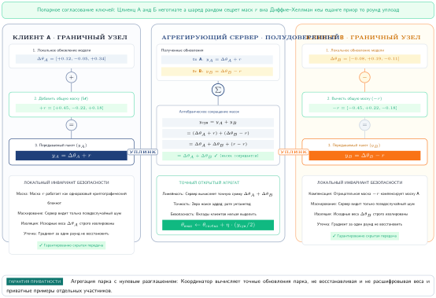

***Протокол безопасной агрегации:** диаграмма упрощенно показывает, как криптографическое маскирование защищает отдельные обновления. Пары клиентов соглашаются о общих случайных масках, которые один добавляет, а другой вычитает. Центральный сервер суммирует маскированные обновления, и маски сокращаются в агрегате, не раскрывая сырой вклад ни одного из клиентов.*

<a id="sec-edge-intelligence-largescale-device-orchestration-1360"></a>

### Оркестрация устройств в большом масштабе

Это алгебраическое сокращение делает безопасную агрегацию совместимой с дифференциальной приватностью для многоуровневой защиты: протокол сначала скрывает индивидуальные вклады, а затем шум приватности может ограничить то, что агрегат еще раскрывает. Оно не означает, что вносящие вклад устройства или обновления заслуживают доверия. Федеративное обучение превращает машинное обучение в масштабную задачу распределенных систем, которая выходит за рамки традиционных алгоритмических соображений. Координация тысяч или миллионов разнородных устройств с прерывистой связью требует протоколов, которые справляются с византийскими отказами [клиенты, отправляющие произвольные или вредоносные обновления], разделениями сети [временная потеря связи между участниками] и ограниченной коммуникацией. Эти задачи отличаются от контролируемого обучения в дата-центре, где высокоскоростные сети и управляемая инфраструктура сужают границы доверия и доступности.

#### Оптимизация сети и пропускной способности

Узкое место коммуникации — главное ограничение масштабируемости систем федеративного обучения. Количественная оценка реальных требований к передаче выявляет проектные ограничения на архитектуры моделей, стратегии сжатия обновлений и политики участия клиентов, которые определяют жизнеспособность системы.

Иерархия федеративной коммуникации показывает жесткие ограничения пропускной способности, в которых должно работать распределенное обучение. Полная синхронизация модели может требовать от десятков до сотен мегабайт на раунд обучения для распространенных глубоких моделей, что плохо подходит для прерывистых мобильных восходящих каналов. Поэтому исследования федеративной оптимизации изучают сокращение коммуникации за счет структурированных обновлений, квантования, разреживания и избирательной передачи (Konečný et al., 2016; McMahan et al., 2017). Практические развертывания часто идут дальше, передавая только адаптеры, головы или сжатые сводки обновлений вместо полных состояний модели. Частота коммуникации вводит критический компромисс между свежестью обновлений модели, где более частые обновления позволяют быстрее адаптироваться к меняющимся условиям, и ограничениями сетевой эффективности, которые задают устойчивое потребление пропускной способности.

Сетевая инфраструктура напрямую влияет на уровень участия и общую жизнеспособность системы. Пропускная способность мобильной загрузки резко меняется в зависимости от географии, оператора, поколения радиосвязи, перегрузки сети и того, остается ли устройство простаивающим достаточно долго, чтобы завершить передачу. Обновление размером в несколько мегабайт может быть приемлемым для флагманского устройства со стабильным подключением, но непрактичным для бюджетного устройства с перегруженным восходящим каналом. Такая вариативность сетевых возможностей требует адаптивных стратегий коммуникации, которые оптимизируются под наименее способные подключения, позволяя устройствам с высокими возможностями вносить больший вклад.

Связь между требованиями к коммуникации и уровнями участия демонстрирует резкие пороговые эффекты. Передача больших моделей резко снижает устойчивое участие клиентов, поскольку устройства должны оставаться простаивающими, подключенными, достаточно заряженными и готовыми тратить пропускную способность загрузки на все время передачи. Сохранение обновлений небольшими, часто за счет совместной передачи только адаптеров или агрессивного сжатия, расширяет пул допущенных устройств и сокращает длительность раунда. Эта эффективность коммуникации напрямую переходит в улучшение качества модели: более высокий уровень участия дает лучшее статистическое разнообразие и более устойчивые оценки градиентов для обновлений глобальной модели. Методы сжатия, которые делают такие малые обновления возможными (квантование градиентов, разреживание и выбор top-$k$ с накоплением ошибки), — те же, что описаны в разделе [«Сжатие обновлений с учетом пропускной способности»](#sec-edge-intelligence-bandwidthaware-update-compression-7730); здесь они служат аргументу об участии, а не аргументу о пропускной способности, поскольку именно уменьшение обновления расширяет пул допущенных устройств.

#### Асинхронная синхронизация устройств

Федеративное обучение наследует отказы от распределенных систем и машинного обучения, но его цель координации — не консенсус в смысле Paxos или Raft. Реплики не согласовывают один журнал команд; координатор решает, какие стохастические обновления клиентов допущены, как взвешивать устаревшие обновления и какое правило агрегации может выдерживать неисправных участников, не позволяя им управлять моделью. Устройства выходят из строя, теряют питание или отключаются во время раундов, а скомпрометированные клиенты могут отправлять отравленные обновления. Устойчивая агрегация может снизить влияние некоторых неисправных участников, но ее допущения, вычислительная стоимость и совместимость с безопасной агрегацией должны быть явными.

Цепочка доверия начинается еще до агрегации. Производственный координатор аутентифицирует устройство и экземпляр приложения, проверяет подписанную модель и версию политики обучения, проверяет допуск и актуальность, привязывает возвращенное обновление к этой версии и одноразовому значению раунда, а также фиксирует, прошло ли обновление проверку протокольных границ. Аттестация на аппаратной основе может усилить утверждения о том, что код идентичен, на поддерживаемых устройствах, но она не может доказать, что локальные примеры безвредны или репрезентативны. Получающаяся запись о целостности обновления поддерживает отклонение, откат и анализ инцидентов, не рассматривая идентичность устройства как свидетельство корректности градиента.

Разделения сети создают особенно острые проблемы для протоколов федеративной координации. В отличие от традиционных распределенных систем, работающих в надежных сетях дата-центров, федеративное обучение должно корректно справляться с длительными отключениями клиентов, когда устройства могут оставаться офлайн часами или сутками во время поездок, в зонах плохого покрытия или просто будучи выключенными. Асинхронные протоколы координации позволяют продолжать обучение, несмотря на отсутствующих участников, но должны тщательно балансировать устаревание (принятие потенциально устаревших вкладов) и свежесть (приоритет недавним, но потенциально редким обновлениям).

Стратегии отказоустойчивости и восстановления образуют существенный слой инфраструктуры федеративного обучения. Синхронизация контрольных точек через периодические снимки глобальной модели позволяет восстанавливаться после отказов сервера и дает точки отката, когда обнаружены поврежденные раунды обучения, хотя сохранение контрольных точек больших моделей на миллионах устройств влечет существенные накладные расходы на хранение и коммуникацию. Обработка частичных обновлений гарантирует, что системы корректно справляются с неполными раундами обучения, когда значительные подмножества клиентов выходят из строя или отключаются посреди обучения, что требует аккуратных стратегий взвешивания, чтобы не допустить смещения в сторону более надежных когорт устройств. Протоколы согласования состояний позволяют клиентам, возвращающимся после длительного офлайн-периода (иногда дней или недель), эффективно пересинхронизироваться с текущей глобальной моделью, минимизируя накладные расходы коммуникации, которые могли бы перегрузить устройства с ограниченной пропускной способностью. Динамическая балансировка нагрузки решает проблему неравномерных паттернов доступности клиентов, создающих вычислительные горячие точки, и требует интеллектуального перераспределения нагрузки между доступными участниками, чтобы поддерживать пропускную способность обучения при меняющемся уровне участия.

Асинхронный характер федеративной координации вносит дополнительную сложность в сохранение гарантий сходимости обучения. Традиционное синхронное обучение предполагает, что все участники завершают каждый раунд, тогда как федеративные системы должны корректно справляться с отстающими[^fn-straggler-federated-delay] и выбывающими участниками.

[^fn-straggler-federated-delay]: **Проблема отстающих**: в обучении в дата-центре отстающие замедляют синхронный прогресс; в федеративном обучении проблема усиливается неоднородным оборудованием, прерывистой связью и окнами допуска (Bonawitz et al., 2019; Kairouz и McMahan, 2021). Решения вроде асинхронной агрегации и ограниченного устаревания (игнорирование обновлений старше $k$ раундов) повышают пропускную способность, но вводят компромисс справедливости: агрессивное смягчение влияния отстающих смещает модели в сторону пользователей с флагманскими устройствами, потенциально ухудшая работу для наиболее ограниченных пользователей, которым персонализация нужнее всего.

<a id="sec-edge-intelligence-managing-milliondevice-heterogeneity-86c1"></a>

#### Управление неоднородностью миллионов устройств

Оркестрация миллиона устройств — это решение об уровнях: система должна определить, какие клиенты могут обучаться, какие могут только отправлять облегченные обновления, и какое смещение вносит такой отбор. Сложность в том, что аппаратные возможности, сетевые условия, распределения данных и паттерны доступности меняются одновременно, что противоречит традиционным допущениям распределенного машинного обучения об однородных участниках, работающих в похожих условиях.

Реальные развертывания федеративного обучения сталкиваются с многомерной неоднородностью устройств, которая создает экстремальные различия по каждому измерению системы. Вычислительная вариативность охватывает около 1 166,7× различий в вычислительной мощности между флагманскими смартфонами с производительностью 35 TOPS и IoT-микроконтроллерами с производительностью всего 0,03 TOPS, что принципиально ограничивает, какие модели могут обучаться на устройствах разных уровней. Ограничения памяти демонстрируют еще более резкие различия в доступном ОЗУ между категориями устройств — примерно до 65 536× между микроконтроллерами с 256 КБ и премиальными смартфонами с 16 ГБ, что определяет, могут ли устройства вообще выполнять какое-либо локальное обучение или должны полагаться исключительно на инференс. Ограничения по энергии заставляют планировать сессии обучения с учетом режимов зарядки, тепловых ограничений и требований сохранения батареи: фоновая адаптация часто ориентируется примерно на 500–1000 мВт, хотя телефоны могут устойчиво выдерживать 2–3 Вт для переднеплановых ML-нагрузок и кратковременно выдавать больше. Разнообразие сетей создает различия производительности на порядки, поскольку Wi-Fi, 4G, 5G и спутниковая связь демонстрируют резко различающиеся пропускную способность (от 1 Мбит/с до 1 Гбит/с), задержку (от 10 мс до 600 мс) и надежность, что определяет осуществимые частоты обновлений и требования к сжатию.

Адаптивные протоколы координации решают эту неоднородность с помощью изощренных стратегий участия по уровням, оптимизирующих использование ресурсов по всему спектру устройств. Устройства с высокими возможностями, такие как флагманские смартфоны, могут выполнять сложное локальное обучение с большими батчами и несколькими эпохами, тогда как ресурсно ограниченные IoT-устройства вносят вклад через облегченные обновления, специализированные подзадачи или даже простую агрегацию данных. Так возникает естественная вычислительная иерархия, в которой мощные устройства выступают в роли «суперузлов», выполняющих непропорционально большой объем вычислений, а граничные устройства вносят специализированные локальные знания и покрытие.

Задачи масштаба выходят за пределы неоднородности устройств и касаются накладных расходов координации. Федеративное обучение не запускает Raft или PBFT среди миллионов клиентов, и иерархическая агрегация не выполняет локального консенсуса. Региональные агрегаторы снижают входящую нагрузку, проверяя допущенную когорту и комбинируя обновления перед пересылкой частичного агрегата; согласование упорядоченного реплицированного журнала, если оно нужно для собственных метаданных координатора, остается отдельным сервисом плоскости управления. Граничная инфраструктура может предоставлять точки агрегации, но каждый добавленный уровень создает еще одну границу доверия и еще одно место, где взвешивание, обрезка, учет приватности и восстановление после отказов должны оставаться согласованными.

Федеративные системы могут реализовывать изощренные стратегии выбора клиентов, которые балансируют статистическое разнообразие с практическими ограничениями. Случайная выборка обеспечивает несмещенное представление, но может выбрать много слабых устройств, тогда как выбор по возможностям повышает эффективность обучения, но рискует статистическим смещением. Гибридные подходы используют стратифицированную выборку по уровням устройств, обеспечивая одновременно статистическую репрезентативность и вычислительную эффективность. Эти стратегии отбора также должны учитывать временные паттерны: устройства офисных работников могут быть доступны в определенные часы, тогда как IoT-датчики дают непрерывные, но ограниченные вычислительные ресурсы.

С надежной оркестрацией, управляющей неоднородностью и прерывистостью миллионов устройств, отдельные компоненты децентрализованного ИИ на месте. Каждая опора до сих пор рассматривалась как дискретная возможность, которую вызывает устройство, однако развернутая граничная модель не адаптируется один раз и не останавливается; она продолжает обучаться на протяжении всего срока развертывания, и именно здесь три опоры перестают быть разделимыми.

## Непрерывная адаптация при граничных бюджетах

Непрерывная адаптация на граничных устройствах должна укладываться в бюджеты энергии, памяти и коммуникации, в которых почти нет места для потерь. Опоры адаптации модели, эффективности данных и федеративной координации каждая атакует свой кусок этого бюджета, но модель, которая продолжает обучаться после развертывания, должна соблюдать их все одновременно. Мозг человека работает при мощности около 20 Вт, непрерывно обучаясь на ограниченном контроле и не забывая катастрофически.[^fn-brain-energy-efficiency] Это сравнение не делает биологию рецептом развертывания; оно объясняет, почему граничные системы снова и снова приходят к разреженности, воспроизведению и оппортунистическим обновлениям.

Биологические аналогии полезны, только когда проясняют инженерные решения. Разреженные представления отражают избирательные обновления параметров, которые держат мобильную адаптацию дешевой. Буферы воспроизведения параллельны механизмам консолидации памяти, стабилизирующим непрерывное обучение. Локально-глобальная координация перекликается с потребностью в индивидуальной адаптации без отказа от улучшений на уровне популяции. Суть в том, чтобы понять, почему одни и те же ограничения снова и снова порождают похожие проектные паттерны.

[^fn-brain-energy-efficiency]: **Энергоэффективность мозга**: при 20 Вт мозг обрабатывает примерно $10^{15}$ операций в секунду, что при этой грубой модели подсчета операций эквивалентно примерно 50 TOPS/Вт; по сравнению с диапазоном мобильных NPU в 1–5 TOPS/Вт, использованным ранее в этой главе, это примерно в 10–50× выше энергоэффективность, хотя биологические синаптические события и цифровые операции — лишь приблизительная аналогия. Эта эффективность достигается за счет экстремальной разреженности (одновременно активны лишь 1–2 % из 86 млрд нейронов) и событийно-управляемой обработки, которая запускает вычисления только при изменении входа. Эти два принципа напрямую влияют на проектирование граничного машинного обучения: разреженные паттерны активации и оппортунистическое планирование обучения — не эвристики, а попытки приблизиться к пределам биологической эффективности.

Для граничных систем полезно сравнивать не число нейронов, а дисциплину бюджета. Система обучения мощностью 20 Вт, из которых примерно 10 Вт доступны для активного обучения и консолидации памяти, находится в том же порядке величин, что и мощность, которую мобильное устройство может выделить во время зарядки. Разреженные распределенные представления снижают трафик памяти, поскольку при когнитивной задаче активны лишь 1–2 % нейронов. Обучение на нескольких примерах и непрерывная консолидация указывают на ту же системную цель: адаптироваться по небольшому локальному свидетельству, не перезаписывая представление, которое все еще служит исходной задаче. Иерархическая обработка добавляет последний урок: переиспользуемые признаки уменьшают объем работы, которую каждый новый локальный контекст должен выполнить.

Из этого сравнения следуют два давления на реализацию. Разреженные представления естественно отображаются на избирательные обновления параметров и обрезанные архитектуры, которые удерживают мобильную адаптацию в пределах памяти и энергии. Событийно-управляемая обработка отображается на оппортунистическое планирование, при котором устройство тратит энергию на обучение только тогда, когда новый вход, время простоя, состояние питания и тепловой запас делают обновление того стоящим. Аналогия полезна лишь потому, что заостряет эти инженерные ограничения.

### Стратегии использования неразмеченных данных

Неразмеченные потоки сенсоров превращают аргумент об эффективности в решение о хранении и планировании. Мобильные устройства непрерывно собирают визуальные данные с камер, временные паттерны с акселерометров, пространственные паттерны с GPS и паттерны взаимодействия с сенсорного экрана, и все это может поддерживать самоконтролируемое обучение. Инженерный вопрос в том, какие следы кодируют устойчивую структуру, а какие должны истечь, прежде чем вытеснят состояние модели, буферы воспроизведения или пользовательское хранилище.

Масштаб данных мобильных сенсоров делает это решение конкретным для четырех распространенных типов потоков:

- Визуальные потоки с камер, работающих на 30 кадрах в секунду, дают примерно 2,6 млн кадров в день, обеспечивая обильные данные для подходов контрастного обучения, которые выучивают визуальные представления, сравнивая аугментированные версии одного и того же изображения.[^fn-mobilesensor-data-scale]
- Потоки движения с акселерометров, дискретизируемых с частотой 100 Гц, порождают 8,6 млн точек данных в день, фиксируя временные паттерны, пригодные для обучения представлений человеческой активности и движения устройства.
- Следы местоположения с GPS позволяют выучивать пространственные представления и прогнозировать поведение, фиксируя паттерны перемещения и часто посещаемые места без явных меток.
- Паттерны взаимодействия из событий касания, динамики набора текста и последовательностей использования приложений создают богатые поведенческие эмбеддинги, которые выявляют предпочтения и привычки пользователя, позволяя персонализировать адаптацию модели без ручной разметки.

[^fn-mobilesensor-data-scale]: **Масштаб данных мобильных сенсоров**: типичный смартфон генерирует 2–4 ГБ данных сенсоров в день: камеры (1–2 ГБ), акселерометры (примерно 50 МБ), GPS (примерно 10 МБ) и события касания (примерно 5 МБ). Контрастное обучение может извлекать полезные представления из небольшой сохраненной выборки этих данных, делая самоконтролируемое обучение на устройстве осуществимым без меток и облачной обработки. Ограничением становится политика хранения, а не доступность данных: решение о том, что сохранять и что отбрасывать до того, как заполнится память.

Контрастное обучение[^fn-contrastive-edge-learning] на основе временных корреляций открывает особенно перспективные возможности для использования этих данных сенсоров. Последовательные кадры с мобильных камер или аугментированные виды одного и того же кадра естественно дают положительные пары для обучения визуальных представлений. Отрицательные примеры берутся из других кадров, образцов других устройств или очередей воспроизведения/памяти, которые представляют несхожие сцены.

[^fn-contrastive-edge-learning]: **Контрастное обучение**: самоконтролируемый метод, который выучивает представления, отличая похожие (положительные) пары от непохожих (отрицательных) без меток. SimCLR (Chen et al., 2020) показывает, что большие батчи аугментированных видов позволяют выучить сильные визуальные представления без человеческих меток. Для граничных устройств переносимая системная идея состоит в том, чтобы использовать неразмеченные потоки сенсоров для обучения представлений или предобучения, а затем тратить дефицитные метки только на легковесную локальную адаптацию; точная экономия меток зависит от задачи, политики хранения и бюджета вычислений.

Биологическое вдохновение распространяется и на непрерывное обучение без забывания. Мозг постоянно интегрирует новый опыт, сохраняя воспоминания десятилетиями благодаря таким механизмам, как синаптическая консолидация и воспроизведение. Системы на устройстве должны реализовывать аналогичные механизмы: упругая консолидация весов[^fn-ewc-continual-learning] (Kirkpatrick et al., 2017) предотвращает катастрофическое забывание, защищая веса, важные для прежних задач; воспроизведение опыта поддерживает стабильность при адаптации, перемежая новое обучение воспроизведенными примерами прежних задач; а прогрессивные нейросетевые архитектуры выделяют новую емкость для новых задач, вместо того чтобы вталкивать все знания в сеть фиксированной емкости (Rusu et al., 2016). Последний вариант привлекателен, когда интерференция сильна, но он расходует дополнительную память и поэтому подходит только устройствам с достаточным свободным объемом.

[^fn-ewc-continual-learning]: **EWC (упругая консолидация весов)**: оценивает важность каждого параметра для прежних задач с помощью матрицы информации Фишера, затем штрафует изменения важных параметров при обучении новому. Это добавляет лишь 10–15 % вычислений на шаг обучения, но требует хранить одну оценку важности на параметр (по 4 байта каждая), примерно удваивая объем памяти весов. Компромисс с буферами воспроизведения очевиден: EWC обменивает память, пропорциональную размеру модели, на память, пропорциональную истории данных, и выигрывает в граничных сценариях с большой моделью и малым объемом данных.

<a id="sec-edge-intelligence-lifelong-adaptation-without-forgetting-9200"></a>

### Пожизненная адаптация без забывания

Реальное развертывание на устройстве требует непрерывной адаптации к меняющимся условиям, поведению пользователя и требованиям задач. Это ставит фундаментальную задачу компромисса между стабильностью и пластичностью: модели должны оставаться достаточно стабильными, чтобы сохранять имеющиеся знания, и достаточно пластичными, чтобы выучивать новые паттерны.

Непрерывное обучение на граничных устройствах сталкивается с несколькими взаимосвязанными задачами, которые усугубляют сложность распределенной адаптации:

- Катастрофическое забывание возникает, когда новое обучение перезаписывает ранее приобретенные знания, и модель теряет качество на прежних задачах, адаптируясь к новым. Проблема особенно серьезна, когда устройства не имеют доступа к историческим обучающим данным.
- Интерференция задач возникает, когда несколько целей обучения конкурируют за ограниченную емкость модели, вынуждая делать трудные компромиссы между разными способностями, которые модель должна поддерживать одновременно.
- Сдвиг распределения данных проявляется в том, что среда развертывания заметно отличается от условий обучения, и модели приходится адаптироваться к новым паттернам, сохраняя качество на исходном распределении.
- Ограничения ресурсов сужают доступные решения: ограниченная память не позволяет хранить всю историческую выборку для подходов на основе воспроизведения, которые хорошо работают в централизованных условиях, но превышают возможности граничных устройств.

Подходы метаобучения решают эти задачи, обучая сами алгоритмы, а не только конкретные задачи. MAML обучает модели быстро адаптироваться к новым задачам при минимуме данных, то есть именно к той способности, которая нужна для персонализированной адаптации на устройстве, где сбор больших пользовательских наборов данных непрактичен. Методы обучения на нескольких примерах обеспечивают быструю специализацию по небольшим пользовательским наборам данных, позволяя модели персонализироваться по считаным примерам, сохраняя общие способности, выученные при предобучении.

Теоретическая основа приводит к компактному правилу проектирования: долговечное обучение на устройстве минимизирует след адаптации, сохраняя достаточную пластичность, чтобы отслеживать локальные изменения. Разреженные архитектуры моделей снижают требования к памяти и вычислениям, самоконтролируемые цели используют обильные неразмеченные данные сенсоров, а метаобучение обеспечивает эффективную персонализацию по ограниченному числу взаимодействий с пользователем.

Это правило сначала меняет то, что устройству разрешено обновлять. Полное дообучение модели обычно невозможно на граничных платформах, поэтому локальные стратегии обновления, включая оптимизацию только смещений, остаточные адаптеры и легковесные головы для конкретных задач, удерживают специализацию модели в рамках ресурсных ограничений, снижая риск переобучения или нестабильности. Когда нужна персонализация, ограничение обновлений легковесными компонентами сдерживает катастрофическое забывание, снижает накладные расходы памяти и ускоряет адаптацию без дестабилизации основных представлений модели. Осуществимость этой стратегии критически зависит от силы офлайнового предобучения (Bommasani et al., 2021): предобученные модели должны инкапсулировать обобщаемые признаки, чтобы устройство тратило свою ограниченную энергию на специализацию поведения, а не на переобучение представлений по дефицитным локальным данным.

Как только след обновления ограничен, среда выполнения должна решить, когда обновление может выполняться и следует ли им делиться. Оппортунистическое планирование откладывает локальные обновления до периодов, когда устройство простаивает, подключено к внешнему питанию и работает в надежной сети, минимизируя влияние фонового обучения на задержку, расход батареи и тепловые характеристики. В децентрализованном или федеративном контексте то же давление бюджета действует и на коммуникацию: квантованные градиенты, разреженные наборы параметров и избирательная передача моделей позволяют большим разнородным паркам координироваться, не перегружая бюджеты пропускной способности и энергии (Konečný et al., 2016).

Стабильность затем становится задачей управления состоянием. Буферы воспроизведения, опорные наборы, журналы адаптации и метаданные обновлений модели должны быть защищены от несанкционированного доступа и подмены, поскольку они кодируют локальное свидетельство, сформировавшее модель. Легковесное шифрование или безопасное хранилище на аппаратной основе могут снизить эту уязвимость, но средства защиты не доказывают, что адаптация остается полезной. Легковесные методы валидации, включая оценку уверенности, эвристики обнаружения дрейфа (Gama et al., 2014) и оценку теневой модели, отслеживают динамику адаптации и могут запустить откат до серьезной деградации. Надежные процедуры отката требуют доверенной базовой контрольной точки, которую можно быстро восстановить, особенно в областях, важных для безопасности и регулируемых, где восстановление после сбоя должно быть доказуемым.

Требования приватности и соответствия замыкают цикл. Согласие пользователя, минимизация данных, ограничения сроков хранения и право на удаление должны закладываться в конвейер адаптации, а не добавляться после развертывания. Выполнение нормативных обязательств в масштабе требует рабочих процессов обучения на устройстве, которые сохраняют аудируемую автономность: модель может адаптироваться на месте, но система по-прежнему сохраняет достаточный контроль, чтобы объяснить, ограничить и при необходимости отменить эту адаптацию.

Для систематической структуры решений см. [рисунок](#fig-odl-design-flow): блок-схема помогает практикам пройти ключевые точки решений о сложности адаптации, доступности вычислений и требованиях к совместному использованию данных, сопоставляя эти выборы с конкретными стратегиями реализации — от обновлений только смещений до полного федеративного обучения с мерами приватности.

<a id="fig-odl-design-flow"></a>


***Схема проектирования обучения на устройстве:** эта структура решений выбирает метод для одного устройства и одной политики. Она сопоставляет сложность адаптации, доступность вычислений и ограничения совместного использования данных с обновлениями только смещений, адаптерами, полным дообучением, локальным обучением или федеративной координацией.*

Эта блок-схема направляет систематическую разработку практических систем машинного обучения на устройстве, намечая ключевые точки решений, связанные с управлением данными, выбором модели и соображениями приватности на протяжении жизненного цикла системы. Включение требований приватности и соответствия, таких как согласие пользователя и минимизация данных, в процесс проектирования обеспечивает аудируемую автономность и масштабируемое развертывание интеллекта на устройстве.

Проектное правило и блок-схема решений описывают, что должно делать одно устройство. Запуск такой адаптации на всем парке, по графику выпусков, с мониторингом и откатом — отдельная дисциплина: она превращает эти выборы непрерывного обучения в операции, которые должны выдерживать CI/CD, версионирование и отсутствие централизованных меток.

## Интеграция в продакшн

Одно дело — написать скрипт-прототип, который дообучает адаптер на Raspberry Pi. Совсем другая дисциплина — доставить эту возможность на 50 млн устройств в строгом конвейере CI/CD, так чтобы плохое обновление градиента не «закирпичило» приложение. Интеграция в продакшн — это место, где теоретическая элегантность граничного интеллекта сталкивается с беспощадными реалиями мобильной программной инженерии.

### Проблемы интеграции MLOps

Интеграция обучения на устройстве в MLOps меняет то, что должны проверять операции: вместо одного артефакта модели в одной контролируемой среде появляется иерархия базовых моделей, адаптеров, политик и локальных состояний, распределенных по разнородным устройствам. Традиционные конвейеры непрерывной интеграции, системы версионирования моделей и инфраструктура мониторинга дают необходимую основу, но предполагают централизованный доступ к данным, контролируемую среду развертывания и единый мониторинг. Граничное обучение нарушает эти допущения, требуя эксплуатационных практик, которые сохраняют надежность, пока координация с сохранением приватности и локальная адаптация продолжаются после развертывания.

[Рисунок](#fig-edge-mlops-pipeline) описывает сквозной жизненный цикл граничного MLOps, связывая облачное предобучение, сжатие и развертывание по воздуху (OTA) с локальной адаптацией на устройстве и петлями обратной связи телеметрии, сохраняющей приватность.

<a id="fig-edge-mlops-pipeline"></a>

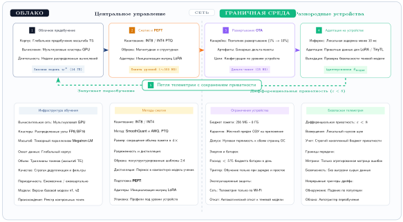

***Конвейер жизненного цикла граничного MLOps:** жизненный цикл связывает облачное предобучение и сжатие модели с развертыванием по воздуху, адаптацией на устройстве и телеметрией с сохранением приватности, которая замыкает петлю без передачи сырых пользовательских данных.*

#### Трансформация конвейера развертывания

Традиционные конвейеры развертывания MLOps выпускают один проверенный артефакт модели в однородную инфраструктуру. Обучение на устройстве превращает этот артефакт в пакет политик, потому что класс устройства определяет, что означает безопасная адаптация. Микроконтроллеры получают обновления только смещений, телефоны среднего класса используют адаптеры LoRA, а флагманские устройства выполняют избирательное обновление слоев. Развертываемая единица включает политики адаптации, начальные веса модели и конфигурации оптимизации для конкретного устройства, поэтому CI/CD должен проверять политику, которая выбирает между ними, а не только веса.

Этот сдвиг меняет и версионирование. Если централизованные системы поддерживают одну версию модели, системы обучения на устройстве должны одновременно отслеживать несколько измерений версий. Предобученная базовая часть, распространяемая на все устройства, представляет версию базовой модели, которая служит основой для всех локальных адаптаций. Разные механизмы обновления, развернутые для каждого класса устройств, составляют стратегии адаптации: от простых корректировок смещений на микроконтроллерах до полного дообучения слоев на флагманских устройствах. Локальные состояния моделей естественно расходятся с базовой версией по мере того, как устройства сталкиваются с уникальными распределениями данных, создавая контрольные точки для отдельных устройств, которые отражают индивидуальную историю адаптации. Раунды федеративного обучения, периодически синхронизирующие популяции устройств, задают эпохи агрегации — дискретные точки, в которых распределенные знания сходятся в обновленные глобальные модели. Надежное развертывание реализует многоуровневые схемы версионирования, в которых базовые модели эволюционируют медленно, часто по расписанию, а локальные адаптации происходят непрерывно, создавая иерархическое пространство версий вместо линейной истории версий, привычной для традиционных развертываний.

#### Эволюция системы мониторинга

Традиционные практики мониторинга агрегируют метрики с централизованных серверов инференса. Мониторинг обучения на устройстве должен работать в принципиально иных ограничениях, которые меняют то, как системы наблюдают, измеряют и реагируют на поведение модели на распределенных популяциях устройств.

Телеметрия, сохраняющая приватность, — первое фундаментальное отличие от традиционного мониторинга. Сбор метрик производительности без ущерба для приватности пользователя требует федеративной аналитики, при которой устройства передают только агрегированную статистику или дифференциально-приватные сводки. Системы не могут просто записывать отдельные предсказания или обучающие примеры, как это делают централизованные системы. Вместо этого устройства сообщают сводки распределений, такие как средняя точность и гистограммы уверенности, а не метрики по отдельным примерам. Когда требуются формальные гарантии приватности, передаваемая статистика нуждается в механизмах дифференциальной приватности, которые ограничивают утечку информации тщательно калиброванным добавлением шума. Протоколы безопасной агрегации не дают серверу видеть вклады отдельных устройств, снижая риск того, что сам процесс агрегации восстановит приватную информацию по данным любого устройства.

Обнаружение дрейфа представляет дополнительные трудности, поскольку истинные метки недоступны. Традиционный мониторинг сравнивает предсказания модели с размеченными валидационными наборами, которые хранятся на централизованной инфраструктуре. Системы на устройствах должны обнаруживать дрейф, используя только локальные сигналы, доступные во время развертывания:

- Калибровка уверенности сравнивает вероятности с итоговыми результатами, когда метки существуют. Без результатов сдвиги уверенности лишь фиксируют изменение распределения оценок.
- Мониторинг распределения входов обнаруживает, когда распределения признаков смещаются относительно обучающих данных, с помощью статистических методов, не требующих меток.
- Прокси производительности задачи используют неявную обратную связь, такую как исправления или отказы от задачи, только после проверки причинной связи с качеством задачи; собственные подсказки модели могут менять обратную связь, которую она наблюдает позже.
- Сравнение с теневой базовой линией запускает замороженную базовую модель рядом с адаптированной, чтобы измерить расхождение. Без меток или проверенного инварианта сравнение фиксирует изменение, но не определяет, какая модель лучше.

Отслеживание производительности по неоднородным группам решает третью критическую задачу: глобальные средние скрывают серьезные сбои, когда популяции устройств сильно различаются. Системы мониторинга должны сегментировать производительность по нескольким измерениям, чтобы выявлять системные проблемы, затрагивающие отдельные когорты устройств:

- Разрывы производительности по возможностям устройств показывают, когда флагманские устройства получают заметно лучшие результаты, чем бюджетные, что указывает на необходимость корректировки стратегий адаптации для аппаратного обеспечения с ограниченными ресурсами.
- Проблемы регионального смещения возникают, когда модели хорошо работают на одних географических рынках и плохо на других, потенциально отражая сдвиги распределения данных или культурные факторы, не учтенные при первичном обучении.
- Временные паттерны проявляются, когда производительность падает на устройствах, работающих со старыми базовыми моделями, которые не получали недавних обновлений от федеративной агрегации.
- Неравенство участия становится видимым при сравнении устройств, которые часто адаптируются, с теми, которые редко участвуют в обучении, выявляя возможные проблемы справедливости в распределении выгод обучения по популяции пользователей.

Эти срезы позволяют видеть сбои отдельных когорт, не давая сильным устройствам скрывать регрессии слабых устройств внутри глобального среднего.

#### Оркестрация непрерывного обучения

Традиционное непрерывное обучение запускает запланированные задания переобучения на централизованной инфраструктуре с предсказуемой доступностью ресурсов и скоординированным выполнением. Обучение на устройстве превращает это в непрерывное распределенное обучение, в котором миллионы устройств обучаются независимо, без глобальной синхронизации, что создает задачи оркестрации, требующие принципиально иных стратегий координации.

Асинхронная координация устройств — первое крупное отличие от централизованного обучения. Миллионы устройств обучаются независимо на своих локальных данных, но система оркестрации не может полагаться на синхронизированное участие. В типичном мобильном развертывании в любом раунде обучения может быть доступно лишь меньшинство устройств из-за ограничений сетевого подключения, ограничений батареи и различных паттернов использования. Система должна обладать устойчивостью к отстающим, гарантируя, что медленные устройства с ограниченным оборудованием или плохим сетевым подключением не блокируют более быстрые устройства в их локальных адаптациях. Устройства часто работают с разными версиями базовой модели одновременно, создавая рассогласование версий, которое протокол агрегации должен корректно обрабатывать, не заставляя все устройства поддерживать одинаковые состояния модели. Согласование состояний становится необходимым, когда устройства переподключаются после длительного офлайн-периода, иногда дней или недель, и системе нужно интегрировать накопленные локальные адаптации, несмотря на пропущенные раунды федеративной агрегации.

Планирование с учетом ресурсов гарантирует, что обучение учитывает и ограничения устройства, и пользовательский опыт:

- Политики оркестрации реализуют оппортунистические окна обучения, которые запускают адаптацию только тогда, когда устройство простаивает, заряжается и подключено к Wi-Fi, избегая помех активным задачам пользователя и расходования платного мобильного трафика.
- Тепловые бюджеты приостанавливают обучение, когда температура устройства превышает пороги, заданные производителем, предотвращая дискомфорт пользователя и повреждение оборудования от длительных вычислительных нагрузок.
- Политики сохранения батареи ограничивают энергопотребление обучения менее чем 5 % емкости батареи в день, гарантируя, что обучение на устройстве не будет заметно сокращать время работы устройства с точки зрения пользователя.
- Сетевая коммуникация с учетом ресурсов агрессивно сжимает обновления модели, когда устройства вынуждены использовать платные соединения, обменивая вычислительные накладные расходы на сокращение потребления пропускной способности, чтобы минимизировать списания за пользовательский трафик.

Оценка сходимости без глобальной видимости создает последнюю задачу оркестрации. Традиционное обучение отслеживает кривые потерь на централизованных валидационных наборах, что дает четкие сигналы о прогрессе обучения и сходимости. Распределенное обучение должно оценивать сходимость по косвенным сигналам, агрегированным по популяции устройств:

- Федеративная оценка агрегирует валидационные метрики с устройств, которые поддерживают локальные отложенные выборки, обеспечивая приблизительные оценки качества глобальной модели, несмотря на неполное участие устройств.
- Отслеживание величины обновлений измеряет, насколько локальные градиенты меняют глобальную модель в каждом раунде агрегации; уменьшение размеров обновлений сигнализирует о возможной сходимости.
- Разнообразие участия обеспечивает широкое представительство устройств в агрегированных обновлениях, не позволяя метрикам сходимости отражать лишь узкое подмножество среды развертывания.
- Временная согласованность фиксирует момент, когда улучшения модели выходят на плато в нескольких раундах агрегации, что указывает на то, что текущая стратегия адаптации исчерпала свой потенциальный выигрыш и, возможно, требует корректировки.

В совокупности эти сигналы заменяют кривые потерь централизованного обучения, недоступные в федеративных условиях, проверками прогресса на уровне популяции.

<a id="sec-edge-intelligence-validation-strategy-adaptation-ab3d"></a>

#### Адаптация стратегии валидации

Традиционные подходы к валидации предполагают доступ к отложенным тестовым наборам и централизованной инфраструктуре оценки, где качество модели можно напрямую измерить относительно известной истины. Обучение на устройстве требует распределенной валидации, которая уважает приватность и ресурсные ограничения, но при этом дает надежные сигналы качества для разнородных популяций устройств.

Оценка теневой модели поддерживает несколько вариантов модели на каждом устройстве и сравнивает их поведение. Устройства могут запускать замороженную последнюю проверенную модель рядом с локально адаптированной версией и измерять расхождение предсказаний, сдвиги уверенности, задержку и использование ресурсов на одном и том же потоке входов. Без меток или проверенного прокси результата эти сравнения фиксируют изменение, а не деградацию производительности: согласие может скрывать общую ошибку, а расхождение не показывает, какая модель права. Теневое сравнение поэтому может приостановить обновление для дальнейшей оценки, но автоматический откат требует размеченных результатов, проверенного инварианта поведения или прокси, связь которого с качеством задачи установлена для данного развертывания.

Шлюзы на основе уверенности дают еще один сигнал об изменении, когда метки недоступны. Даже уверенность откалиброванной модели интерпретируема только относительно популяции и задачи, на которых проводилась калибровка. Падение может отражать сдвиг распределения, неоднозначность или изменившуюся шкалу оценок; стабильная уверенность может сосуществовать с самоуверенными ошибками. Системы могут использовать уверенность, чтобы запустить расследование или консервативно остановить адаптацию, но они не должны утверждать, что адаптированная модель хуже, без отложенных меток, рандомизированной оценки, доверенных исправлений пользователя или другого проверенного сигнала результата.

Федеративное A/B-тестирование позволяет проверять новые стратегии адаптации или архитектуры моделей на распределенных популяциях устройств. Для проверки предложенных изменений системы проводят распределенные эксперименты, которые случайно относят устройства к экспериментальной и контрольной группам, сохраняя статистический баланс между уровнями устройств и паттернами использования. Обе группы собирают федеративные метрики с помощью протоколов агрегации, сохраняющих приватность, которые не дают раскрывать данные отдельных устройств, но позволяют сравнивать популяции. Система сравнивает частоту успешных адаптаций (как часто локальные адаптации улучшают базовые модели), скорость сходимости, показывающую, как быстро устройства достигают оптимальной производительности, и итоговые метрики качества, отражающие окончательное качество модели после завершения адаптации. Стратегии, которые демонстрируют явные улучшения в экспериментальных группах, постепенно выкатываются на популяцию устройств, начиная с небольших долей и расширяясь только после подтверждения, что выгоды обобщаются за пределы экспериментальной когорты.

Эти эксплуатационные трансформации требуют новых инструментов и инфраструктуры, которые систематически расширяют традиционные практики MLOps. Конвейеры CI/CD, панели мониторинга, фреймворки A/B-тестирования и процедуры реагирования на инциденты, созданные для централизованных развертываний, образуют основу операций обучения на устройстве. Протоколы федеративного обучения, представленные в разделе [«Федеративное обучение: алгоритмы»](#sec-edge-intelligence-federated-learning-6e7e), предоставляют механизмы координации для распределенного обучения, а раздел [«Наблюдаемость распределенных систем»](#sec-edge-intelligence-distributed-system-observability-2270) рассматривает пробелы в наблюдаемости, создаваемые децентрализованной адаптацией. Подход теневой валидации работает как непрерывный конвейер сравнения, запущенный на каждом устройстве ([рисунок](#fig-shadow-validation)): входящие данные проходят через замороженную базовую модель и локально адаптированную модель, прежде чем арбитр решит, принять или откатить адаптацию.

<a id="fig-shadow-validation"></a>

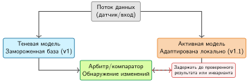

***Теневая валидация на устройстве:** замороженная базовая модель работает рядом с активной моделью. Их расхождение, уверенность, задержка и изменения ресурсов могут сигнализировать об изменении без меток; решение об откате по-прежнему требует проверенного сигнала результата или инварианта безопасности.*

Успешные развертывания обучения на устройстве опираются на проверенные методологии MLOps, адаптируя их к уникальным задачам распределенной, неоднородной среды обучения. Такой эволюционный подход обеспечивает эксплуатационную надежность и одновременно открывает преимущества граничного обучения. Когда опоры построены, а эксплуатационный каркас на месте, остается вопрос о том, как три опоры сочетаются в едином парке устройств, а не работают как отдельные методы.

## Объединение трех опор

Интеграция становится конкретной: вместо того чтобы развертывать одну политику адаптации повсюду, риски ограничиваются за счет сопоставления каждой опоры с возможностями устройства. Рассмотрим промышленное развертывание голосового ассистента на 50 млн устройств, где каждый уровень ограничивает то, что могут делать остальные.

В главе три опоры рассматривались отдельно: адаптация модели, эффективность данных и федеративная координация. Рассматриваемые как изолированные методы, каждая из них решает локальное ограничение, но оставляет остальные свободными вести себя некорректно. Производственный голосовой ассистент показывает главный результат: интегрировать все три по уровням устройств, так чтобы политика, решающая, насколько устройство может адаптироваться, была той же политикой, которая решает, сколько оно может помнить и как может участвовать в работе парка.

Уровень адаптации модели стратифицирует методы по возможностям устройства, сопоставляя сложность с доступными ресурсами. Флагманские телефоны, составляющие верхние 20 % развертывания, используют адаптеры LoRA ранга 32, которые позволяют выучивать сложные голосовые паттерны через многомерные обновления параметров. Устройства среднего уровня, составляющие 60 % парка, применяют адаптеры ранга 16, балансирующие выразительность адаптации с более жесткими ограничениями памяти, типичными для массовых смартфонов. Бюджетные устройства, на которые приходятся оставшиеся 20 %, опираются на обновления только смещений, которые уверенно укладываются в лимиты памяти 1 ГБ и при этом обеспечивают базовую персонализацию.

Уровень эффективности данных реализует адаптивные стратегии по всей популяции устройств, учитывая индивидуальные ресурсные ограничения. Все устройства используют воспроизведение опыта,[^fn-replay-buffer-forgetting] но с размерами буферов, подходящими для устройства: 10 МБ на бюджетных устройствах против 100 МБ на флагманских моделях, что гарантирует, что устройства с ограниченной памятью тоже могут получать выгоду от обучения на основе воспроизведения. Обучение на нескольких примерах позволяет быстро адаптироваться к новым пользователям уже в первые 5–10 взаимодействий, снижая проблему холодного старта[^fn-coldstart-edge-personalization], которая мучает системы, требующие обширных обучающих данных. Потоковые обновления учитывают непрерывную эволюцию голосовых паттернов по мере того, как речевой стиль пользователей естественно меняется со временем или они начинают пользоваться ассистентом в новых акустических условиях.

[^fn-replay-buffer-forgetting]: **Воспроизведение опыта**: заимствовано из обучения с подкреплением (Mnih et al., 2015); хранит прошлые пары вход–выход в буфере и перемежает их с новыми обучающими данными, чтобы снизить катастрофическое забывание при непрерывном обучении (Rolnick et al., 2019). Экономичные по памяти граничные реализации могут хранить сжатые эмбеддинги или сводки вместо сырых входов, снижая нагрузку на хранение и приватность ценой менее полной информации о градиентах. Размер буфера, политика выборки и выбор представления совместно определяют компромисс между стабильностью и памятью: слишком маленький буфер ведет к деградации старых задач, слишком большой — конкурирует с весами модели за дефицитную граничную память.

[^fn-coldstart-edge-personalization]: **Проблема холодного старта**: у новых пользователей или устройств нет локальных данных для персонализации, поэтому первые предсказания должны опираться на глобальную модель, грубый контекст или явный ввод пользователя. Метаобученные инициализации (такие как MAML) или сохраняющая приватность статистика популяции могут запустить персонализацию, но фундаментальный компромисс остается: более быстрый холодный старт требует больше информации из глобальной модели, которая может не отражать распределение нового пользователя. Адаптация по 5–10 взаимодействиям дает один из вариантов баланса скорости и локальной релевантности.

Уровень федеративной координации оркестрирует совместную работу с сохранением приватности по всей популяции устройств. Устройства участвуют в раундах федеративного обучения оппортунистически, исходя из статуса подключения и уровня заряда батареи, что гарантирует, что координация не ухудшает пользовательский опыт. Адаптеры LoRA агрегируются эффективно: 50 МБ на обновление против 14 ГБ для полной синхронизации модели, что делает федеративное обучение практичным в мобильных сетях. Сырые аудиопримеры могут оставаться локально, но обновления LoRA и метаданные об участии, полученные из индивидуальных голосовых паттернов, покидают устройство и остаются чувствительными. Безопасная агрегация ограничивает проверку каждого клиента, дифференциальная приватность с накопленным учетом ограничивает утечку при публикации результатов, а контроль хранения и доступа ограничивает, как долго путь обновления сохраняет чувствительное состояние.

Эти уровни работают как система, только если интеграционная политика защищает от несоответствия возможностей, отказа компонентов, конфликтов ресурсов и непроверенного непредвиденного поведения. [Таблица](#tbl-edge-integration-controls) сопоставляет меры контроля интеграции граничного обучения каждому системному риску: иерархическое сопоставление возможностей, плавную деградацию, явную политику приоритетов и проверку производительности.

<a id="tbl-edge-integration-controls"></a>

***Меры контроля интеграции граничного обучения:** многоуровневое граничное развертывание требует явных мер контроля сопоставления возможностей, плавной деградации, конфликтов ресурсов и проверки для всех комбинаций устройств и сетей.*

| **Риск интеграции**  | **Мера контроля**                | **Почему это важно**                                                                                                                                 |
|:---------------------|:---------------------------------|:-----------------------------------------------------------------------------------------------------------------------------------------------------|
| Несоответствие возможностей | Иерархическое сопоставление возможностей | Развертывает более сложные методы на способных устройствах, сохраняя базовую функциональность на всем спектре устройств. |
| Отказ компонента     | Плавная деградация               | Сохраняет полезность локальной адаптации, когда связь плохая или ограничения батареи переводят систему в режим минимальной адаптации. |
| Конфликт ресурсов    | Явная политика приоритетов       | Не позволяет адаптации модели и буферам воспроизведения конкурировать за одну и ту же память, энергию или бюджет задержки без заранее определенного владельца. |
| Непредвиденное поведение | Проверка производительности  | Тестирует комбинации уровня устройства, состояния сети и политики адаптации, поскольку интегрированные системы отказывают так, как не проявляется у отдельных методов. |

Такой интегрированный подход превращает обучение на устройстве из набора методов в согласованную системную возможность, которая обеспечивает надежную персонализацию в условиях реального развертывания. Стратегия адаптации по уровням ([рисунок](#fig-tiered-adaptation)) сопоставляет эти методы с возможностями устройств.

[Рисунок](#fig-tiered-adaptation) расширяет выбор для одного устройства, показанный на [рисунке](#fig-odl-design-flow), до политики для парка: каждый уровень устройств получает метод адаптации, соответствующий его ресурсному бюджету, а ценность совместно используемых данных определяет, остается ли координация локальной или становится федеративной.

<a id="fig-tiered-adaptation"></a>

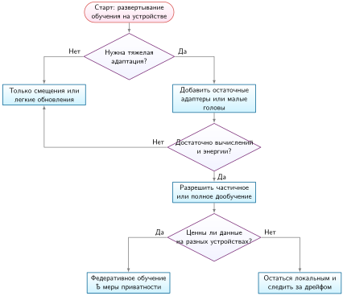

***Стратегия адаптации по уровням:** блок-схема объединяет политику адаптации по уровням устройств и требования совместного использования данных по всему парку. Легковесные устройства используют обновления только смещений, более мощные добавляют остаточные адаптеры, а устройства с достаточными вычислительными ресурсами допускают полное дообучение; ценность данных на разных устройствах определяет, остается ли обучение локальным или становится федеративным.*

> **Контрольные вопросы: интеграция трех опор по уровням устройств**
>
> В главе построены три опоры обучения на устройстве: адаптация модели (обновления только смещений, адаптеры, полное дообучение), эффективность данных (обучение на нескольких примерах, воспроизведение опыта, контрастное обучение) и федеративная координация (агрегация, безопасная агрегация, обработка дрейфа). [Рисунок](#fig-tiered-adaptation) сопоставляет каждый метод с возможностями класса устройств. Проверьте интеграцию трех опор на одном и том же развертывании.
>
> - [ ] Сопоставление возможностей по уровням устройств: для парка с сенсорами ключевых слов на Cortex-M0+, смартфонами на Cortex-A78 и граничными серверами сопоставьте каждый уровень устройств с методом адаптации, который он поддерживает в [рисунке](#fig-tiered-adaptation), и укажите, что сломается, если один метод применить ко всем трем уровням.
> - [ ] Справедливость федеративного участия: когда 90 % вычислений федеративного раунда приходятся на верхние 10 % устройств по возможностям, сделайте вывод о том, как это отражается на представлении глобальной моделью долгохвостового поведения пользователей, и укажите защиту из опоры эффективности данных.
> - [ ] Обнаружение дрейфа без меток: для развернутой модели персонализации без истинных меток на границе опишите, как устройство может обнаружить достаточный локальный сдвиг распределения, чтобы оправдать федеративный раунд, используя только сигналы, доступные на пути инференса устройства.
> - [ ] Минимум участия для безопасной агрегации: при пороге безопасной агрегации в 100 устройств и только 30 активных устройствах в данный час определите реакцию системы и укажите, какая опора должна компенсировать ситуацию.
> - [ ] Компромисс аудируемой автономности: разделите сигналы, которые может наблюдать центральный оператор, и состояние устройства, которое должно оставаться скрытым, и найдите в этом разделении риск катастрофического забывания.

Самые тяжелые сбои граничного обучения возникают, когда адаптация модели, эффективность данных и федеративная координация взаимодействуют, а не когда отказывает одна опора в одиночку. Хотя эти методы адаптации, эффективности и координации решают отдельные ограничения, в реальных развертываниях они также порождают сбои взаимодействия: адаптер может уложиться в память, но переобучиться на разреженных локальных данных; буфер воспроизведения может стабилизировать обучение, но утечь чувствительную историю; а федеративный раунд может улучшить глобальную модель, одновременно усиливая смещение участия. Эти ограничения дают важный контекст для решения о том, когда обучение на устройстве уместно, а когда безопаснее более простая стратегия.

Именно это взаимодействие отличает граничное обучение от традиционного централизованного обучения. Контролируемые среды обучения могут стандартизировать оборудование, подбирать данные и проверять обновления до выпуска. Граничные развертывания одновременно получают разнородные устройства, фрагментированные данные и ограниченную видимость, поэтому следующий проектный вопрос состоит в том, как каждый источник вариативности меняет границы стратегий адаптации, методов эффективности данных и механизмов координации, разработанных ранее в главе.

## Инженерные задачи и способы их смягчения

Модель предиктивного текста на миллиард пользователей, которая учится на живом вводе с клавиатуры, можно отравить, если скоординированная группа злоумышленников многократно вводит определенное оскорбительное слово и эти локальные обновления попадают в глобальный федеративный агрегат. Интеграционная политика по уровням ограничивает, где каждая опора может действовать, но она не устраняет поверхности отказа, которые создает адаптация модели в реальном мире: неоднородность устройств и данных, non-IID распределения, ограниченную наблюдаемость, конкуренцию за ресурсы, скрытые сбои и риски безопасности и соответствия нормативным требованиям, связанные с адаптацией после выпуска. Остаток этого раздела разбирает эти задачи и инженерные меры, которые требует каждая из них, начиная с вариативности, которую труднее всего учесть при проектировании, потому что она присутствует уже при первом развертывании.

### Управление неоднородностью устройств и данных

Неоднородность — это не фоновая вариативность; она определяет, какие устройства могут обучаться, какие могут проводить валидацию, а какие способны вносить лишь облегченные сигналы. Количественный разброс, установленный в разделе [«Управление неоднородностью миллионов устройств»](#sec-edge-intelligence-managing-milliondevice-heterogeneity-86c1), задает ресурсные рамки. Здесь задача управления состоит в воспроизводимости: одно развертывание должно вести себя согласованно на смартфонах, носимых устройствах, IoT-датчиках и микроконтроллерах, аппаратные уровни, программные стеки, сетевое подключение и доступность питания которых резко различаются.

Аппаратные уровни по-прежнему определяют путь выполнения. Устройства класса Arm Cortex-M, CPU серии A мобильного класса и телефоны со специализированными NPU[^fn-armcortex-processor-heterogeneity] могут участвовать в одной федеративной популяции, но каждый уровень поддерживает собственный диапазон адаптации. Поэтому система должна назначать форматы моделей, алгоритмы обучения, обязанности по валидации и частоту обновлений по классу устройства, а не считать парк однородным.

[^fn-armcortex-processor-heterogeneity]: **Спектр Arm Cortex**: типичные граничные узлы охватывают почти шесть порядков величин: от устройств класса Cortex-M с частотой около 48 МГц, 32 КБ ОЗУ и мощностью 10 мкВт до устройств мобильного класса с частотой около 3 ГГц, 16 ГБ ОЗУ и мощностью 5 Вт (Warden и Situnayake, 2020; Lai et al., 2018). Обзоры федеративного обучения и отчеты о производственных системах выделяют такую клиентскую неоднородность и перекос доступности как ключевую системную задачу (Kairouz и McMahan, 2021; Bonawitz et al., 2019). Проектное следствие — разбиение по уровням: квантованный инференс на самых маломощных микроконтроллерах, облегченные обновления только смещений на более крупных встроенных или носимых уровнях и полные циклы адаптации или обратного распространения ошибки только на SoC мобильного класса.

Программная неоднородность усугубляет задачу. Устройства могут работать с разными версиями операционных систем, драйверов уровня ядра и библиотек среды выполнения. Некоторые среды поддерживают оптимизированные среды ML, такие как TensorFlow Lite[^fn-tflite-runtime-inference] Micro или ONNX Runtime Mobile,[^fn-onnx-runtime-inference] тогда как другие опираются на собственные стеки инференса или ограниченные API. Эти расхождения могут приводить к тонким несогласованностям поведения, особенно когда модели компилируются по-разному или когда точность вычислений с плавающей точкой различается между платформами.

[^fn-tflite-runtime-inference]: **TensorFlow Lite**: мобильная среда инференса Google, оптимизированная для Arm со специализированными ядрами 8-битной и 16-битной точности, которые дают инференс в 3$\times$ быстрее полного TensorFlow. TFLite Micro распространяется на микроконтроллеры с памятью $<1$ МБ. Системное следствие для федеративного обучения: различия среды выполнения между TFLite и другими фреймворками могут приводить к численно различным градиентным обновлениям от одинаковых моделей, вводя шум агрегации, который накапливается по неоднородным паркам устройств.

[^fn-onnx-runtime-inference]: **ONNX Runtime Mobile**: кроссплатформенный движок инференса Microsoft, использующий независимый от поставщика формат Open Neural Network Exchange, который позволяет обучать в одном фреймворке и развертывать на iOS, Android и встроенном Linux. Мобильный вариант на некоторых моделях дает инференс в 2–3$\times$ быстрее TFLite за счет слияния операторов. Для федеративного обучения переносимость ONNX снижает проблему численного расхождения: единое представление модели на разнородных устройствах дает более согласованные градиентные обновления при агрегации.

Подключение и время работы добавляют измерение планирования. Некоторые устройства подключаются к сети прерывисто, включаются в сеть лишь изредка или работают при строгих ограничениях пропускной способности. Другие имеют постоянное питание и надежную сеть, но все равно ставят отзывчивость для пользователя выше фонового обучения. Эти различия усложняют скоординированное обучение, поскольку право на обновление меняется вместе с текущим состоянием устройства, а не только с его аппаратным уровнем.

Фрагментация системы замыкает эту картину, делая воспроизводимость и тестирование свойством парка, а не свойством лаборатории. При таком широком диапазоне сред выполнения согласованное поведение модели трудно гарантировать, а сбои трудно воспроизвести. Поэтому мониторинг, валидация и откат становятся важнее, но и труднее единообразно реализовать по всему парку.

Следствие видно на федеративном развертывании для мобильной клавиатуры. Флагманский смартфон может иметь 8 ГБ ОЗУ, выделенный ИИ-ускоритель и постоянный доступ к Wi-Fi. Бюджетное устройство может располагать лишь 2 ГБ ОЗУ, без аппаратного ускорения и полагаться на прерывистую мобильную передачу данных. Эти различия влияют на то, как долго могут идти сессии обучения, как часто модели можно обновлять и даже возможно ли обучение вообще. Чтобы поддерживать такой диапазон, система должна динамически корректировать расписания обучения, форматы моделей и стратегии сжатия, обеспечивая справедливое улучшение модели для всех пользователей с учетом ограничений каждого устройства.

### Проблемы распределения non-IID данных

В централизованном машинном обучении данные можно агрегировать, перемешивать и подбирать так, чтобы приблизить независимые и одинаково распределенные (i.i.d.) выборки, — ключевое допущение многих алгоритмов обучения. Системы обучения на устройстве и федеративного обучения фундаментально бросают вызов этому допущению и требуют алгоритмов, которые справляются с сильно фрагментированными и non-IID данными на разнородных устройствах и в разных контекстах.

Статистические последствия этой фрагментации создают каскадные проблемы на протяжении всего процесса обучения. Градиенты, вычисленные на разных устройствах, могут конфликтовать, замедляя сходимость или дестабилизируя обучение. Локальные обновления рискуют переобучиться под индивидуальные особенности клиентов, снижая качество при глобальной агрегации. Разнообразие данных между клиентами также усложняет оценку, поскольку ни один тестовый набор не может представить истинное распределение в развертывании.

С операционной точки зрения non-IID данные — это задача управления не меньше, чем статистическая задача. Кластерное федеративное обучение, слои персонализации, стратифицированная выборка клиентов, валидация по когортам, взвешивание по важности и адаптивные схемы агрегации дают частичные средства контроля, но оптимальное сочетание зависит от того, какие срезы популяции недопредставлены и какие конфликты обновлений дестабилизируют глобальную модель.

Меру следует выбирать по наблюдаемому сбою, а не по общей метке «non-IID». [Таблица](#tbl-edge-noniid-control) сопоставляет четыре распространенных наблюдения с ограниченными решениями.

<a id="tbl-edge-noniid-control"></a>

***Решения по контролю non-IID:** non-IID данные — это не одно скалярное условие. Система должна связать измеренный перекос когорт или конфликт обновлений с конкретной мерой контроля и проверить результат относительно заявленной цели популяции.*

| **Наблюдаемое свидетельство**                                      | **Вероятный сбой**             | **Мера контроля для проверки**                                                 | **Критерий выпуска**                                                  |
|:-------------------------------------------------------------------|:-------------------------------|:-------------------------------------------------------------------------------|:-----------------------------------------------------------------------|
| Метрики когорт расходятся, пока общее качество растет              | Недопредставленность популяции | Стратифицированная выборка или ограниченные веса важности                      | Метрика худшей когорты улучшается без недопустимой потери общего качества |
| Больше локальных шагов увеличивает расхождение обновлений и число раундов до цели | Дрейф клиентов | Уменьшить число локальных шагов, добавить проксимальную регуляризацию или адаптировать серверный оптимизатор | Астрономическое время и объем байтов до цели уменьшаются на репрезентативных когортах |
| Одна глобальная модель недообслуживает устойчивые различные кластеры | Мультимодальные цели клиентов | Кластерные модели или общая база с локальными головами                         | Каждый кластер имеет достаточную поддержку и превосходит глобальную базовую линию |
| Активные пользователи доминируют в агрегате                        | Несоответствие весов целевой функции | Заменить взвешивание по примерам взвешиванием по пользователям или ограничить вклад каждого пользователя | Оценка соответствует заявленной целевой функции на уровне пользователя или примера |

<a id="sec-edge-intelligence-distributed-system-observability-2270"></a>

### Наблюдаемость распределенных систем

Наблюдаемость — это плоскость управления, которая не дает локальной адаптации стать невидимой. Традиционные централизованные мониторы MLOps собирают телеметрию предсказаний, меток и производительности в одном месте; этот подход становится непрактичным, когда устройства работают с прерывистым подключением и данные нельзя централизовать. Граничным системам по-прежнему нужны обнаружение дрейфа и мониторинг производительности, но эти методы должны работать через сводки, сохраняющие приватность, локальные шлюзы и частичные сигналы популяции.

Сдвиг видимости важен, потому что модели на устройствах продолжают меняться после выпуска. В централизованных системах обновления модели можно оценить на отложенных валидационных наборах до продвижения. В системах на устройствах внутренние обновления могут происходить в сильно разнородных и отключенных средах, что создает центральный вопрос безопасности для граничной наблюдаемости: улучшает ли локальная адаптация модель или незаметно уводит ее от задуманного поведения.

Основная трудность — отсутствие централизованных валидационных данных. В традиционных процессах модели обучаются и оцениваются на подобранных наборах данных, которые служат прокси условий развертывания. Обучающиеся на устройстве системы, напротив, адаптируются к локальным входам, которые редко размечены и могут систематически не собираться. В результате качество и направление обновлений — улучшают ли они обобщение или вызывают дрейф — трудно оценить, не мешая пользовательскому опыту и не нарушая ограничения приватности.

Риск дрейфа модели особенно велик в потоковых условиях, где непрерывная адаптация может вызвать медленную деградацию производительности. Например, модель распознавания речи, которая слишком агрессивно адаптируется к фоновому шуму, может в конце концов переобучиться под преходящие акустические условия, снижая точность на целевой задаче. Без видимости эволюции параметров или выходов модели такие ухудшения могут оставаться незамеченными, пока не станут серьезными.

Смягчение этой проблемы требует сравнения на устройстве и шлюзования обновлений. Механизмы теневой модели и контрольных точек, введенные в разделе [«Адаптация стратегии валидации»](#sec-edge-intelligence-validation-strategy-adaptation-ab3d), сравнивают адаптированную модель со стабильной базовой линией и сохраняют состояние, которое известно как хорошее. Без меток расхождение или более низкая уверенность могут оправдать удержание обновления, но не могут установить, что адаптация ухудшила поведение. Шлюзы отката поэтому нуждаются в отложенных результатах, проверенном прокси задачи или инварианте безопасности, нарушение которого достаточно даже без метки качества.

В некоторых случаях федеративная валидация дает частичное решение. Устройства могут передавать защищенные обновления моделей или сводные статистики, которые сервер агрегирует, чтобы выявить изменения на уровне популяции. Агрегация не анонимизирует эти сигналы автоматически: путь телеметрии нуждается в минимизации данных, безопасной агрегации там, где это уместно, объявленной единице приватности и учете приватности для повторных публикаций. Даже тогда агрегатная валидация может пропустить редкие или специфичные для пользователя сбои.

Мониторинг обновлений и валидация в обучении на устройстве требуют пересмотра традиционных практик оценки. Вместо централизованных тестовых наборов системы должны опираться на неявные сигналы, обратную связь во время работы и консервативные политики адаптации, чтобы обеспечивать устойчивость. Отсутствие глобальной наблюдаемости отражает более глубокую системную задачу: согласование локальной адаптации с глобальной надежностью.

#### Оценка производительности в динамических средах

Систематические подходы к измерению производительности ML-систем включают задержку инференса, пропускную способность, энергоэффективность и метрики точности. Эти методики бенчмаркинга дают основу для характеризации производительности модели, но они создавались для статических нагрузок инференса. Обучение на устройстве требует расширения этих метрик, чтобы фиксировать качество адаптации и эффективность обучения через специализированные бенчмарки обучения.

Помимо традиционных метрик инференса, адаптивные системы требуют мер, которые объясняют, стоит ли локальное обучение своих ресурсных затрат. Эффективность адаптации измеряет, насколько растет точность на каждый использованный обучающий пример. Система, которая получает 2 % точности по 100 локальным примерам, полезнее на устройстве, чем система, которой для того же улучшения нужно 500 примеров, поскольку меньше примеров означает более быструю персонализацию, меньше локального хранилища и меньше окон обучения, конкурирующих с работой для пользователя.

Соответствие рамкам устройства измеряет, остается ли улучшение в пределах ресурсных бюджетов. Сходимость при ограниченной памяти оценивает валидационные потери при фиксированном бюджете ОЗУ, например «сходимость в пределах объема обучения 512 КБ», а энергия на обновление измеряет миллиджоули, потраченные на шаг градиента; фоновая адаптация обычно рассчитана на 500–1000 мВт, что соответствует примерно 1,8–3,6 кДж в час адаптации до заметного влияния на время работы от батареи. Время до адаптации распространяет ту же идею на планирование, измеряя астрономическое время от новых данных до измеримого улучшения, включая ожидание простоя, статуса зарядки и теплового запаса, а не только сырую пропускную способность ускорителя.

Качество персонализации измеряет, улучшает ли адаптация нужное поведение, не повреждая базовую модель. Дельта производительности для пользователя сравнивает адаптированную модель с глобальной базовой линией на удерживаемых данных конкретного пользователя, и развертываниям обычно нужны статистически значимые улучшения, часто выше 2 % точности, прежде чем принять накладные расходы вычислений и энергии. Компромисс персонализации и приватности измеряет прирост точности на единицу локального раскрытия данных, а частота катастрофического забывания измеряет деградацию исходной задачи после локальной адаптации; многие системы нацеливаются на потерю точности на исходной задаче менее 5 %, чтобы персонализация не стирала общие способности.

Когда устройства координируются через федеративные протоколы, разобранные в разделе [«Федеративное обучение: алгоритмы»](#sec-edge-intelligence-federated-learning-6e7e), метрики переходят от одного устройства к популяции. Эффективность коммуникации измеряет прирост точности на переданный байт и показывает, делают ли сжатие градиентов и избирательные обновления мобильное развертывание практичным; конструкции со сжатыми обновлениями могут сильно сокращать передаваемые байты, но сохранение точности зависит от модели, оптимизатора, неоднородности данных и правила сжатия (Konečný et al., 2016; Kairouz и McMahan, 2021). Влияние отстающих измеряет задержку сходимости, вызванную медленными или ненадежными устройствами, а качество агрегации отслеживает качество глобальной модели при изменении доли участия. Вместе эти метрики выявляют специфичный для развертывания минимально жизнеспособный порог участия, ниже которого федеративное обучение становится нестабильным.

Эти бенчмарки обучения дополняют метрики инференса, включая задержку, пропускную способность и точность, создавая полную характеристику производительности адаптивных систем. Практический бенчмаркинг должен измерять оба измерения: система, которая быстро выполняет инференс, но медленно адаптируется, или эффективно адаптируется, но дает плохую итоговую точность, не отвечает требованиям реального мира. Интеграция бенчмарков инференса и обучения позволяет проводить целостную оценку систем обучения на устройстве на протяжении всего их эксплуатационного жизненного цикла.

### Управление ресурсами

Обучение на устройстве вводит режимы конкуренции за ресурсы, которых нет в традиционных развертываниях только для инференса. На этапе развертывания осуществимость уже не абстрактна; оперативный вопрос в том, как распределять дефицитные ресурсы, пока пользователь все еще взаимодействует с устройством. Многие граничные устройства рассчитаны на эффективный запуск предобученных моделей, но редко проектируются с учетом обучающих нагрузок. Поэтому локальная адаптация конкурирует за дефицитные ресурсы, включая такты вычислений, пропускную способность памяти, энергию и тепловой запас, с другими системными процессами и пользовательскими приложениями.

Самое прямое ограничение — доступность вычислений. Обучение включает дополнительные прямые и обратные проходы через модель, что может превосходить стоимость инференса. Даже когда обновляется лишь небольшое подмножество параметров, например при адаптации только смещений или только головы, обратное распространение ошибки все равно должно пройти через соответствующие слои, что увеличивает число инструкций и трафик памяти. На устройствах с общими вычислительными блоками (например, мобильных SoC или встроенных CPU) эта нагрузка может задерживать интерактивные задачи, снижать частоту кадров или ухудшать обработку сенсоров.

Энергопотребление усугубляет проблему. Адаптация обычно включает длительные вычисления по нескольким входным образцам, что нагружает устройства от батареи и может приводить к быстрому истощению энергии. Например, выполнение одной эпохи адаптации на микроконтроллере может потреблять несколько миллиджоулей[^fn-mcu-milliwatt-power] — заметную долю энергетического бюджета системы с циклическим режимом работы, которая питается от энергосбора. Это требует тщательного планирования, при котором обучение происходит только в периоды простоя, когда запасы энергии велики, а ограничения задержки для пользователя ослаблены.

[^fn-mcu-milliwatt-power]: **Энергобюджет микроконтроллера**: микроконтроллер, потребляющий 10 мВт при обучении, расходует 36 Дж в час, поэтому небольшая батарейка-таблетка на 200 мАч (примерно 2 200 Дж полезной энергии при 3 В) поддерживает около 60 часов непрерывных вычислений. Энергосбор внутри помещений дает лишь 10–100 $\mu$Вт непрерывно, то есть на два-три порядка меньше потребления обучения, поэтому реальные развертывания работают циклами: обучение по 10 секунд в час расходует всего около 0,1 Дж за сессию и ограничивает адаптацию несколькими сотнями шагов градиента за сессию. Именно этот энергетический потолок, а не пропускная способность вычислений, — связывающее ограничение, которое определяет, какие алгоритмы осуществимы на устройствах с энергосбором.

С точки зрения памяти обучение требует большего пикового использования, чем инференс, особенно потому, что обратное распространение ошибки должно хранить или пересчитывать промежуточные активации;[^fn-activationcaching-memory-saving] эффективные системы обучения на устройстве снижают эту нагрузку на активации и ограничивают объем обучаемого состояния (Cai et al., 2020; Kwon et al., 2024).

[^fn-activationcaching-memory-saving]: **Кэширование активаций**: активации прямого прохода должны храниться или пересчитываться для обратного распространения ошибки, и для многих CNN память активаций может превышать объем весов модели. На устройствах с ОЗУ $<512$ КБ одни только активации могут превышать общий объем памяти, исключая многослойную адаптацию вовсе, если не применяются контрольные точки градиентов (Chen et al., 2016), низкоранговые обновления или методы разреженных обновлений.

Эти требования к ресурсам также нужно уравновесить с целями QoS[^fn-qos-edge-training]. Пользователи ожидают, что граничные устройства отвечают надежно и стабильно, независимо от того, идет ли обучение в фоне. Любая заметная деградация, включая пропуски аудио в детекторе слова пробуждения или задержку на дисплее носимого устройства, может подорвать доверие пользователя.

[^fn-qos-edge-training]: **QoS для граничного ML**: гарантии задержки, которые обучение на устройстве не должно нарушать: голосовые ассистенты, видеоприложения и носимые устройства имеют жесткие бюджеты времени интерактивного отклика. Фоновое обучение, которое заметно увеличивает задержку, пропускает кадры или задерживает обработку сенсоров, может подорвать доверие пользователя. Системы обеспечивают это приоритетным планированием, при котором инференс вытесняет обучение, и ресурсными регуляторами, которые ограничивают обучение, когда метрики QoS приближаются к порогам, заданным для развертывания.

В некоторых развертываниях адаптация дополнительно ограничивается стоимостью, которую накладывает сетевая инфраструктура. Например, устройства могут переносить части обучающей нагрузки на ближайшие шлюзы или облачные узлы,[^fn-cloudlet-edge-training] что вводит компромиссы пропускной способности и коммуникации.

[^fn-cloudlet-edge-training]: **Cloudlet (облачный микроузел)**: вычислительный уровень небольшого масштаба, расположенный близко к пользователям, часто рядом с сетями доступа или корпоративными площадками, обеспечивает разгрузку с меньшей задержкой, чем удаленный облачный регион. Этот промежуточный уровень поддерживает гибридное обучение на устройстве: чувствительный ко времени инференс выполняется локально, а агрегация, валидация или более тяжелая адаптация могут разгружаться на ближайший узел, когда это позволяют сеть и модель доверия. Цена — сложность развертывания: cloudlet добавляют слой оркестрации, который должен решать для каждого обновления, вычислять ли его локально, разгрузить на ближайший узел или отложить в облако.

Стоимость обучения на устройстве измеряется не только в FLOPs или объеме памяти. Она проявляется как сложное взаимодействие нагрузки системы, пользовательского опыта, доступности энергии и мощности инфраструктуры. Решение этих задач требует совместного проектирования на алгоритмическом, среде выполнения и аппаратном уровнях, чтобы адаптация оставалась незаметной, эффективной и устойчивой в условиях реального мира.

### Выявление и предотвращение сбоев системы

Те же ограничения также делают сбои трудно видимыми: сбои систем обучения на устройстве развиваются медленно, локально и часто без централизованных свидетельств. Опираясь на описанные задачи в исследованиях федеративного обучения (Kairouz и McMahan, 2021) и известные риски адаптивных систем, стоит внимательно рассмотреть несколько категорий сбоев.

Самый фундаментальный риск обучения на устройстве — неограниченный дрейф адаптации, при котором непрерывное обучение без ограничений постепенно уводит модели от задуманного поведения. Рассмотрим гипотетическую систему предсказания клавиатуры, которая учится на всех вводах пользователя, включая исправления. Она может начать включать опечатки в число допустимых подсказок, что приведет к постепенно ухудшающимся предсказаниям. Этот риск становится острым в приложениях мониторинга здоровья, где медленные изменения пользовательских базовых показателей могут выучиваться как «норма», потенциально заставляя систему пропускать важные аномалии, которые обнаружила бы статическая модель. Коварство этого дрейфа в том, что он происходит медленно и локально, поэтому его трудно обнаружить без надлежащей инфраструктуры мониторинга.

Помимо дрейфа отдельных устройств, федеративные системы сталкиваются с проблемой усиления смещения участия на уровне популяции. Устройства с надежным питанием и подключением чаще участвуют в федеративных раундах (Li et al., 2020). Это неравномерное участие создает сценарии, в которых модели все сильнее оптимизируются под пользователей с флагманскими устройствами, а производительность ухудшается у тех, кто располагает ограниченными ресурсами. Возникающая петля обратной связи усугубляет цифровое неравенство: лучше обслуживаемые пользователи получают лучшие модели, а недообслуженные группы переживают ухудшение производительности, что снижает их вовлеченность и дополнительно уменьшает их представленность в обучающих раундах (Wang et al., 2021). Эти проблемы справедливости и усиления смещения подчеркивают этические последствия распределенных систем обучения.

Эти систематические смещения взаимодействуют с проблемами качества данных и создают петли автоисправления, особенно в текстовых приложениях. Когда системы не могут отличить намеренный ввод от исправления, они могут выработать неожиданное поведение. Часто исправляемая предметная терминология может ошибочно выучиться как ошибка, приводя к неуместным подсказкам в профессиональных контекстах. Эта проблема усиливает задачу дрейфа: модели не только адаптируются к индивидуальным особенностям, но и могут учиться на собственных ошибках, когда пользователи принимают автоисправления, не понимая, что система учится на этих взаимодействиях.

Эти режимы отказа связывают индивидуальный дрейф, смещение популяции и деградацию качества данных. Обзоры федеративного обучения выделяют неоднородность, смещение участия, приватность и нестабильность оптимизации как риски развертывания (Li et al., 2020; Kairouz и McMahan, 2021). В ответ успешные системы могут ограничивать адаптацию, стратифицировать выборку, отличать исправления от надежных меток и использовать теневые сравнения, чтобы выявлять изменения, которые требуют проверенной оценки.

### Оценка рисков развертывания в продакшне

Развертывание адаптивных моделей на граничных устройствах создает задачи, которые выходят за рамки технической осуществимости. В областях, где необходимы соответствие требованиям, аудируемость и нормативное одобрение, включая здравоохранение, финансы и системы, важные для безопасности, обучение на устройстве порождает центральное противоречие между автономностью системы и контролем.

В традиционных конвейерах машинного обучения все обновления моделей централизованно управляются, версионируются и валидируются. Обучающие данные, контрольные точки модели и метрики оценки обычно фиксируются в воспроизводимых рабочих процессах, которые поддерживают прослеживаемость. Однако когда обучение происходит на самом устройстве, эта видимость теряется. Каждое устройство может независимо развивать свои параметры модели, под влиянием уникальных локальных потоков данных, которые никогда не наблюдает разработчик или сопровождающий системы.

Эта автономность создает разрыв валидации. Без доступа к входным данным или точной траектории обновлений становится трудно проверить, что обученная модель все еще соответствует исходной спецификации или гарантиям производительности. Это особенно проблематично в регулируемых отраслях, где сертификация зависит от демонстрации того, что система ведет себя согласованно в заданных эксплуатационных границах. Устройство, которое обновляет себя в ответ на реальное использование, может выйти за эти границы, вызвав нарушения требований без какого-либо внешнего сигнала.

Отсутствие централизованного надзора усложняет откат и восстановление после сбоев. Если обновление модели ухудшает производительность, это может не сразу обнаружиться, особенно в офлайн-сценариях или в системах без телеметрии. Когда сбой наблюдается, внутреннее состояние системы может значительно отклониться от любой известной контрольной точки, и диагностика с восстановлением становятся сложнее, чем в статических развертываниях. Поэтому восстановление зависит от надежных механизмов безопасности, таких как консервативные пороги обновления, кэши отката или двухмодельные архитектуры, которые сохраняют проверенную базовую линию.

Помимо задач соответствия, обучение на устройстве вводит новые уязвимости безопасности. Поскольку адаптация модели происходит локально и опирается на специфичные для устройства, потенциально недоверенные потоки данных, злоумышленники могут пытаться манипулировать процессом обучения, подделывая сохраненные данные, например буферы воспроизведения, или внедряя отравленные примеры во время адаптации, чтобы ухудшить производительность модели или внести уязвимости. Любые локально сохраненные данные адаптации, такие как векторы признаков или примеры для обучения по нескольким примерам, должны быть защищены от несанкционированного доступа, чтобы предотвратить непреднамеренную утечку информации.

Поддержание целостности модели с течением времени особенно трудно в децентрализованных условиях, где централизованный мониторинг и валидация ограничены. Автономные обновления без внешней видимости могут привести к дрейфу моделей в небезопасные или смещенные состояния. Эти риски усугубляются обязательствами соответствия, такими как право на удаление по GDPR: если пользовательские данные незаметно влияют на модель через адаптацию, отслеживание и отмена этого влияния становятся сложными.

Та же проблема локального состояния становится критичной для безопасности, когда контуры восприятия и управления опираются на локальные модели. Резервный вариант с участием человека не является механизмом безопасности, пока сам резерв не спроектирован как часть системы.

> **Случай из практики: граничная модель с резервом в виде человека (2016)**
>
> **Контекст**: автомобиль Tesla Model S 2015 года, работавший с аппаратным обеспечением Mobileye EyeQ3 и NVIDIA Mobile SoC, выполнял восприятие и управляющие решения локально, полагаясь на контроль человека (National Transportation Safety Board, 2017). Для расчетного упражнения команда принимает $L_{\text{lat}} \le 50\text{ мс}$ как явное требование сценария контура безопасности, а не как измеренное свойство этого автомобиля.
>
> **Механизм**: в аварии 7 мая 2016 года в Уильистоне яркий дневной свет и белый борт полуприцепа создали оптическую обстановку вне распределения обучающих данных, в которой датчики зрения не смогли отличить фон прицепа. Система работала за пределами своей расчетной операционной области, а передача управления человеку требовала $\sim 1{,}5\text{–}2{,}5\text{ с}$ — на порядки медленнее, чем цикл сенсоров $L_{\text{lat}}$.
>
> **Последствия**: автомобиль проехал под полуприцепом без торможения, что привело к смертельному столкновению.
>
> **Исправление**: Tesla обновила парк, переведя обработку сигналов на радар в роли основного источника, модернизировав локальное вычислительное оборудование для зрения и введя обязательные оповещения о контроле рук на руле.
>
> **Системный урок**: граничная автономность — это замкнутый контур реального времени. Когда задержка сенсоров $L_{\text{lat}}$ и границы выполнения $O / (R_{\text{peak}} \cdot \eta_{\text{hw}})$ вступают в конфликт со скоростью реакции человека, допущения о резервном управлении перестают работать; безопасность должна закладываться в сам контур управления.

Непосредственная проектная обязанность — рассматривать состояние модели, буферы воспроизведения и триггеры адаптации как активы, чувствительные к безопасности. Граничное обучение не может полагаться на централизованную проверку задним числом; ему нужны локальные проверки целостности, защищенное хранилище и консервативные политики обновления до начала адаптации.

Нормы приватности также нетривиально взаимодействуют с обучением на устройстве. Хотя локальная адаптация может снизить потребность в передаче чувствительных данных, она все равно может требовать хранения и обработки персональной информации, включая следы сенсоров или поведенческие журналы, на самом устройстве. Эти соображения приватности требуют внимательного отношения к системам безопасности и нормативному соответствию. В зависимости от юрисдикции это может повлечь дополнительные требования к срокам хранения данных, согласию пользователя и аудируемости. Системы должны проектироваться так, чтобы выполнять эти требования, не подрывая эффективность адаптации, что часто означает шифрование сохраненных данных, соблюдение ограничений хранения или механизмы сброса, которыми управляет пользователь.

Наконец, появление граничного обучения ставит открытые вопросы об ответственности за отладку и анализ сбоев в децентрализованных системах обучения (Kairouz и McMahan, 2021). Когда модель адаптируется автономно, вопрос о том, кто отвечает за выявление и исправление ее поведения, остается нерешенным. Если адаптированная модель принимает ошибочное решение, например неверно диагностирует состояние здоровья или неправильно понимает голосовую команду, первопричина может лежать в локальном дрейфе данных, неудачной инициализации или недостаточных защитных мерах. Без стандартизированных механизмов для фиксации и анализа таких режимов отказа анализ первопричин может быть затруднен.

Решение этих задач развертывания и соответствия требует инструментов, протоколов и практик проектирования, которые поддерживают аудируемую автономность — способность системы адаптироваться на месте, сохраняя при этом выполнение внешних требований к прослеживаемости, воспроизводимости и защите пользователя. Для любого развертывания, которое допускает адаптацию после выпуска, эти задачи являются центральными как для архитектуры системы, так и для структур управления.

### Синтез инженерных задач

Решение о развертывании должно рассматривать эти задачи обучения на устройстве как связанные ограничения. Вариативность оборудования определяет, кто может участвовать; участие меняет наблюдаемое распределение данных; ограниченная обратная связь ослабляет валидацию; конкуренция за ресурсы ограничивает, когда защитные меры могут работать; а адаптация после развертывания усложняет аудит и откат. [Таблица](#tbl-ondevice-challenges) сопоставляет каждую первопричину с системным обязательством, которое она создает.

<a id="tbl-ondevice-challenges"></a>

***Задачи обучения на устройстве:** системная неоднородность, non-IID данные и ограниченные ресурсы создают уникальные задачи для развертывания и адаптации моделей машинного обучения на граничных устройствах, влияя на переносимость, стабильность и управление. В таблице раскрыты первопричины этих задач и их системные последствия, выделены компромиссы между качеством модели и ресурсными ограничениями.*

| **Задача**                             | **Первопричина**                                   | **Системные последствия**                             |
|:---------------------------------------|:---------------------------------------------------|:------------------------------------------------------|
| **Системная неоднородность**           | Разнородное оборудование, программное обеспечение и инструменты сборки | Ограничивает переносимость; требует настройки под конкретные платформы |
| **Non-IID и фрагментированные данные** | Локальные распределения данных, специфичные для пользователя | Затрудняет обобщение; повышает риск дрейфа            |
| **Ограниченная наблюдаемость и обратная связь** | Нет централизованного тестирования и журналирования | Затрудняет валидацию обновлений и отладку             |
| **Конкуренция за ресурсы и планирование** | Конкурирующие требования к памяти, вычислениям и батарее | Требует динамического планирования и обучения с учетом бюджета |
| **Риск развертывания и соответствия**  | Обучение продолжается после развертывания          | Усложняет версионирование моделей, аудит и откат      |

### Основы устойчивых ИИ-систем

Отравление, инверсия, дрейф и сбои валидации также происходят в централизованных системах машинного обучения, но локальная адаптация делает их труднее наблюдать, атрибутировать и откатывать во всем разнородном парке. Неисправный или злоумышленный клиент может отправить отравленное обновление,[^fn-byzantine-federated-resilience] обновление может раскрыть информацию, несмотря на локальность данных, а локальный сдвиг распределения может оставаться невидимым в средних по популяции значениях.

Поэтому граничная архитектура должна связывать диапазон адаптации, целостность обновлений, учет приватности, устойчивую агрегацию, доказательства валидации и откат в один контур управления. Эти механизмы не заменяют друг друга: безопасная агрегация скрывает индивидуальные вклады, устойчивая статистика ограничивает некоторое злонамеренное влияние, а проверенные результаты устанавливают, улучшилось ли поведение. Следующая глава рассматривает эксплуатационную задачу, которая остается после создания этих защит: поддержание их мониторинга и жизненного цикла во всем парке.

[^fn-byzantine-federated-resilience]: **Византийская отказоустойчивость в федеративном обучении (FL)**: назван по задаче о византийских генералах (Lamport et al., 1982), это свойство позволяет полезно агрегировать данные, несмотря на вредоносных или неисправных участников; исходный анализ Krum требует условий вроде $2f + 2 < n$ (Blanchard et al., 2017), тогда как покоординатные медианный и усеченный средний агрегаторы опираются на другие допущения устойчивости; допустимая византийская доля зависит от правила агрегации, размерности и статистической модели. Эти защиты могут увеличивать накладные расходы коммуникации и вычислений, поскольку требуют дополнительной валидации, устойчивой статистики или избыточного участия. Эта цена — плата за доверие в открытых федеративных системах, где любое клиентское устройство может быть скомпрометировано.

## Заблуждения и ловушки

Команда пытается перенести свою масштабную облачную систему рекомендаций в мобильное приложение, полагая, что флагманский чип смартфона справится с несколькими эпохами обратного распространения ошибки. Приложение мгновенно падает с ошибками нехватки памяти, а заряд батареи телефона резко падает на 20 %. Эти режимы отказа иллюстрируют типичные заблуждения и ловушки граничного интеллекта:

> **Заблуждение и ловушка**
>
> **Заблуждение**: *обучение на устройстве дает те же возможности адаптации, что и обучение в облаке.*
>
> Команды ожидают, что локальное обучение повторит улучшения модели централизованного обучения, игнорируя фундаментальные ресурсные ограничения. Обучение на устройстве усиливает потребность в ресурсах в 4–12$\times$ по сравнению с развертыванием только для инференса из-за кэширования активаций, хранения градиентов, состояния оптимизатора и двунаправленного трафика памяти (см. раздел [«Адаптация модели»](#sec-edge-intelligence-model-adaptation-6a82)). Локальные наборы данных обычно малы, смещены и нерепрезентативны, а вычислительные бюджеты остаются на порядки ниже облачных GPU. Смартфон с 8 ГБ ОЗУ и бюджетом мощности 5 Вт не может воспроизвести адаптацию, которую достигают системы дата-центра с терабайтами памяти и киловаттами мощности. Эффективное обучение на устройстве требует проектирования стратегий адаптации, которые дают содержательные улучшения в этих ограничениях, а не попыток воспроизвести возможности обучения облачного масштаба.

> **Заблуждение и ловушка**
>
> **Ловушка**: *предположение, что федеративное обучение автоматически сохраняет приватность без дополнительных мер защиты.*
>
> Практики полагают, что хранение данных на локальных устройствах по своей природе обеспечивает защиту приватности, не учитывая, что можно вывести из обновлений модели. Обновления градиентов и параметров существенно раскрывают информацию о локальных обучающих данных через различные атаки вывода, а паттерны участия устройств выявляют чувствительные сведения о пользователях и их деятельности. Более сильная защита приватности требует дополнительных механизмов: дифференциальная приватность дает настраиваемую вероятностную границу того, насколько распределение выходов может измениться из-за данных одного человека, а протоколы безопасной агрегации предотвращают инспекцию параметров во время координации (Bonawitz et al., 2017) (как показано на [рисунке](#fig-secure-agg), с криптографическим маскированием). Одна лишь локальность данных недостаточна для защиты приватности.

> **Заблуждение и ловушка**
>
> **Заблуждение**: *адаптация при ограниченных ресурсах всегда дает лучшие персонализированные модели, чем универсальные.*
>
> Это убеждение предполагает, что любая локальная адаптация полезна независимо от качества и количества доступных локальных данных. Обучение на устройстве с недостаточными, зашумленными или смещенными локальными данными может фактически ухудшить производительность модели по сравнению с хорошо обученными универсальными моделями (см. раздел [«Эффективность данных»](#sec-edge-intelligence-data-efficiency-c701)). Небольшие наборы данных могут не давать достаточного сигнала для содержательного обучения, а адаптация к локальному шуму может навредить обобщению. Эффективные системы обучения на устройстве должны включать механизмы, которые определяют, когда локальная адаптация полезна, и возвращаются к универсальным моделям, когда локальных данных недостаточно для надежного обучения.

> **Заблуждение и ловушка**
>
> **Ловушка**: *игнорирование неоднородности между разными типами устройств и их возможностями.*
>
> Команды проектируют системы обучения на устройстве, предполагая одинаковые аппаратные возможности у всех развернутых устройств. Реальные развертывания охватывают разнородное оборудование с различной вычислительной мощностью, объемом памяти, энергетическими ограничениями и возможностями сети. Возможности граничных устройств охватывают почти шесть порядков величин по памяти и мощности и четыре порядка по пропускной способности CPU: от микроконтроллеров с 32 КБ ОЗУ до смартфонов с 16 ГБ, от процессоров класса Cortex-M с частотой 48 МГц (~10 MIPS) до мобильных процессоров с частотой 3 ГГц (~100 000 MIPS), от узлов сенсоров с мощностью 10 мкВт до флагманских телефонов с 5 Вт (Warden и Situnayake, 2020; Lai et al., 2018). Алгоритм обучения, хорошо работающий на высококлассных смартфонах, может катастрофически отказать на ресурсно ограниченных IoT-устройствах. Алгоритмы федеративного обучения должны учитывать неоднородность клиентов и их доступность (Kairouz и McMahan, 2021; Bonawitz et al., 2019), используя избирательное участие, сжатие и поуровневые стратегии агрегации, когда развертывание охватывает различия производительности в 10 000×.

> **Заблуждение и ловушка**
>
> **Заблуждение**: *координация граничного обучения — это просто масштабирование сервера агрегации.*
>
> Это убеждение рассматривает координацию как задачу усреднения без состояния, как будто локальные обновления регулярно приходят, представляют сравнимые популяции устройств и могут быть объединены без операционного контекста. В масштабе парка сервер агрегации — лишь один компонент большего контура управления: он должен знать, какие устройства допущены, какую версию модели они держат, поддерживают ли их состояние питания и сети участие и безопасно ли продвигать полученное обновление.

> **Заблуждение и ловушка**
>
> **Ловушка**: *недооценка сложности координации обучения в распределенных граничных системах.*
>
> Многие команды сосредоточены на оптимизации отдельных устройств, не учитывая системные задачи координации обучения на тысячах или миллионах граничных устройств. Оркестрация граничных систем (раздел [«Оркестрация устройств в большом масштабе»](#sec-edge-intelligence-largescale-device-orchestration-1360)) должна справляться с прерывистой связью, меняющимися состояниями питания, разными часовыми поясами и непредсказуемыми паттернами доступности устройств, которые создают сложные задачи планирования и синхронизации. Кластеризация устройств, координация федеративных раундов, версионирование моделей в разных контекстах развертывания и обработка частичного участия ненадежных устройств требуют сложной инфраструктуры, выходящей за рамки простых серверов агрегации. Кроме того, реальные граничные развертывания включают многочисленных заинтересованных сторон с разными стимулами, требованиями безопасности и операционными процедурами, которые нужно уравновешивать с целями обучения. Эффективным системам граничного обучения нужны надежные фреймворки оркестрации, способные поддерживать согласованность системы несмотря на постоянную смену устройств, разделения сети и эксплуатационные сбои.

## Итоги

Граничные системы должны учитывать тепловое дросселирование, неоднородность устройств и федеративную оркестрацию. Граничный интеллект работает на ресурсно ограниченной границе парка машинного обучения. Инфраструктура дата-центров и глобальные системы обслуживания предполагают изобилие энергии, памяти и связи; граничные развертывания, напротив, включают датчики с микроваттным энергобюджетом, микроконтроллеры с килобайтами памяти и смартфоны, которые сталкиваются с мобильной «стеной памяти».

Три проектных рычага делают обучение возможным при этих ограничениях. Адаптация модели уменьшает след обновления, замораживая большую часть сети или используя небольшие адаптеры. Эффективность данных извлекает полезный сигнал из малого числа локальных образцов или потокового опыта. Федеративная координация позволяет популяции улучшать общую модель без централизации сырых данных. Успех на границе требует не только алгоритмической изобретательности; он требует совместного проектирования математических требований программного обеспечения и тепловых, энергетических и сетевых реалий оборудования.

Во время выполнения эти реалии становятся решением о допуске, а не общим предпочтением «запускать, когда простаивает». Фоновая адаптация может выполняться, только если ее прогнозируемая энергия и устойчивая мощность укладываются в текущий запас устройства, а профилированная наихудшая интерференция сохраняет дедлайн переднего плана. Поскольку состояние зарядки не устраняет нагрев или конкуренцию, каждое допущенное окно остается отзываемым по мере изменения состояния устройства.

Многие устройства выполняют инференс локально — от предсказания клавиатуры на смартфонах до обнаружения аномалий на промышленных датчиках. Граничный интеллект решает задачи, которые никакое масштабирование дата-центров не может удовлетворить: приложения, критичные к задержке, где облачные циклы «туда и обратно» вносят неприемлемые задержки, области, чувствительные к приватности, где сырые данные никогда не должны покидать устройство, и среды с ограниченной связью, где доступ к сети прерывист или отсутствует. По мере того как возможности устройств растут благодаря специализации аппаратного обеспечения и алгоритмической эффективности, граница между тем, что требует облачной инфраструктуры, и тем, что может выполняться локально, может смещаться, но принципы совместного проектирования остаются центральными для архитектуры производственных ML-систем.

> **Ключевые выводы: физика задает бюджет**
>
> * **Граница переворачивает парк**: дата-центры борются за то, чтобы держать многие ускорители занятыми; граничные устройства борются за обучение при ограниченной батарее, килобайтах памяти, тепловом дросселировании (принцип «стена плотности мощности») и прерывистых каналах. Те же ограничения вычислений, коммуникации и координации порождают иную дисциплину, когда связывающим фактором становится дефицит, а не масштаб.
> * **Пропускная способность важнее заявленных TOPS**: LLM на устройстве ограничены пропускной способностью мобильной памяти (принцип «авторегрессивное узкое место»), а не пиковой вычислительной мощностью NPU. Разрыв в 30–50$\times$ между мобильной ОЗУ и HBM дата-центра делает квантование и локальность условиями выживания для интерактивного декодирования.
> * **Обучение умножает объем**: обучение на устройстве требует активаций, градиентов, состояния оптимизатора и двунаправленного трафика, повышая потребление ресурсов в 4–12$\times$ по сравнению с развертыванием только для инференса. Стратегии адаптации должны уменьшать обновление, а не просто сжимать развернутую модель.
> * **Фоновое обучение — это условная работа**: допускайте окно адаптации, только если [уравнение](#eq-edge-background-admission) сохраняет бюджеты энергии, тепла и задержки переднего плана при измеренной наихудшей интерференции. Одной зарядки недостаточно.
> * **Адаптации нужны три рычага**: обновления только смещений, LoRA, разреженные слои, повторное использование данных по нескольким примерам и воспроизведение опыта каждый расходуют разные бюджеты памяти, энергии и приватности. Федеративная координация добавляет обучение популяции только тогда, когда протоколы справляются с non-IID данными и выбыванием клиентов.
> * **Неоднородность — нормальный режим работы**: граничные парки включают микроконтроллеры, телефоны, шлюзы и NPU с неравномерной доступностью и производительностью. Федеративные системы должны рассматривать отстающих, смещение участия, откат и наблюдаемость, сохраняющую приватность, как ограничения проектирования протокола, а не как очистку после развертывания.

Предыдущие главы подталкивали к большему числу ускорителей, пропускной способности и мощности, рассматривая дата-центр как одну машину. Граничные системы применяют те же физические ограничения с противоположного края. Дата-центр должен держать занятыми тысячи ускорителей; граничное устройство должно работать в пределах батареи, теплового режима и порой лишь килобайт памяти. Телефон — не маленький дата-центр, а датчик — не медленный GPU. Когда дефицит задает условия, проектирование системы должно получить больше от меньшего.

> **Связь с главами: от устройств к операциям**
>
> Граничный интеллект выводит модели на границу, где разнообразие аппаратного обеспечения, бюджеты батареи, прерывистая связь и локальная автономность становятся ограничениями первого порядка. Развертывание моделей на всем этом спектре, от GPU дата-центров до граничных датчиков, — только начало. Поддержание таких развертываний в производственном масштабе требует систематических эксплуатационных практик. «Эксплуатация ML-систем в масштабе» рассматривает инженерные платформы, мониторинг и структуры управления жизненным циклом, которые нужны, чтобы весь парк машинного обучения работал надежно.
