<a id="sec-ops-scale"></a>

# Эксплуатация ML-систем в масштабе

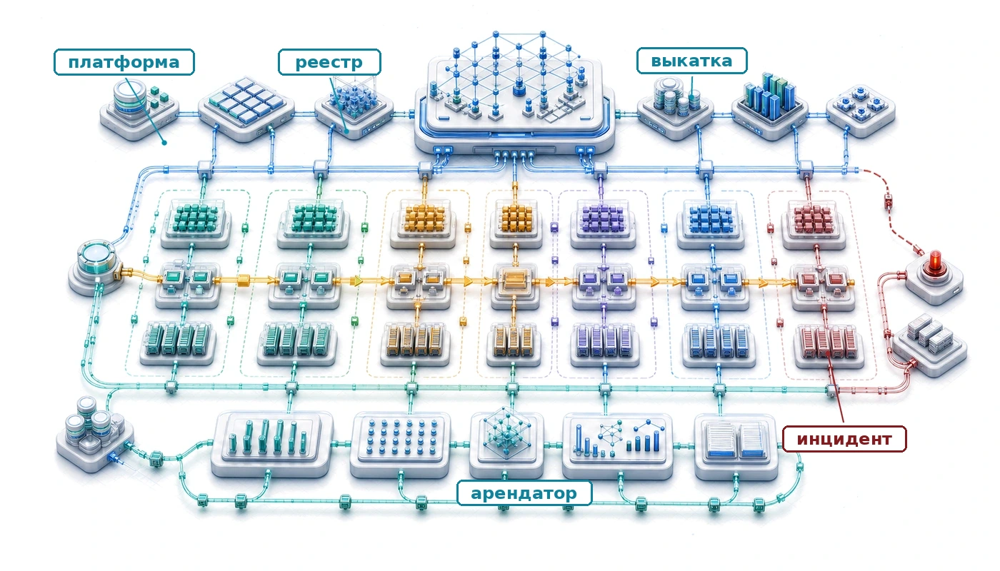

## Назначение

_Почему практики, которые работают при управлении одной моделью, рассыпаются, когда организация развертывает сотни?_

Одна модель — это проект. Сто моделей образуют систему систем, зависимости и отказы которой нельзя контролировать по одной модели за раз. Изменение конвейера данных может затронуть двенадцать моделей, созданных четырьмя командами, а сбой развертывания может потребовать согласованного отката взаимосвязанных сервисов. На таком масштабе ручное развертывание, разрозненный мониторинг и учет в таблицах становятся обузой. Поэтому MLOps превращается в общую инфраструктуру с единообразными API, автоматизированными контрольными воротами качества, мониторингом на уровне парка и управлением, которое учитывает зависимости. В терминах C³ эксплуатация в масштабе заменяет повторяющуюся координацию людей стандартизированными платформенными механизмами для поддержки парка и управления им.

> **Цели обучения**
>
> - Рассчитать окупаемость инвестиций, загрузку и совокупную стоимость владения для общих ML-платформ в портфелях моделей
> - Спроектировать реестры, контрольные ворота выпуска и контракты оценки, которые сохраняют происхождение данных, безопасность зависимостей и уверенность в откате
> - Количественно оценить технический долг по скорости развертывания, частоте инцидентов, объему рутинной работы (toil) и метрикам времени реагирования
> - Оценить иерархии мониторинга и диагностировать производственные инциденты на уровнях данных, платформы, обслуживания и управления
> - Спроектировать эксплуатацию хранилища признаков, которая управляет свежестью, владением, совместимостью и перекосом между обучением и обслуживанием
> - Оценить организационные решения и решения о жизненном цикле платформы, опираясь на данные о внедрении, версионировании и выводе из эксплуатации

## Портфель и мотивация плоскости управления

Рассмотрим команду из пяти инженеров, которая поддерживает одну модель рекомендаций. Когда модель дрейфует, они переобучают ее вручную. Когда задержка API растет, они вручную масштабируют экземпляры. Теперь представьте, что эта же команда должна поддерживать пятьсот моделей в десятках продуктовых поверхностей. Ручное вмешательство уже не просто неэффективно, оно математически невозможно. Переход от эксплуатации одной модели к эксплуатации платформы заменяет обслуживание с участием человека в контуре автоматизированным системным управлением. Здесь формулируется проблема портфеля и плоскости управления: единицей планирования мощностей, надежности и инвестиций становится парк, а не отдельная модель.

Слой управления — это **плоскость управления** (Control Plane) стека парка: панель наблюдения, настройки и обслуживания, которая не дает физической инфраструктуре, обучающим системам, путям обслуживания, граничным развертываниям и правилам управления разойтись. Когда модели охватывают дата-центры, платформы обслуживания и разнородные граничные парки, надежность зависит уже не столько от одной модели, сколько от эксплуатационного механизма, который делает весь парк наблюдаемым, согласованным и восстанавливаемым.

Распределенные архитектуры обслуживания справляются с огромными потоками запросов, а граничное развертывание переносит интеллект на смартфоны, микроконтроллеры и федеративные парки, охватывающие миллиарды разнородных устройств. Теперь возникает вопрос: что происходит, когда организации должны поддерживать не одну такую систему, а сотни, на всем этом спектре? Управление отдельными моделями и эксплуатация корпоративных ML-платформ — принципиально разные задачи, которые разделяет фазовый переход в операционной сложности. Эксплуатация платформы берет эту сложность на себя через экономику парка и модели совокупной стоимости, управление множеством моделей, CI/CD, системы мониторинга и основу в виде хранилища признаков, которые позволяют сотням моделей делить одну согласованную эксплуатационную основу.

MLOps для одной модели сосредоточен на непрерывной интеграции, конвейерах развертывания и мониторинге отдельных моделей, и каждая растущая организация на собственном опыте находит его пределы. Первые несколько моделей можно вести в таблицах, развертывать вручную и мониторить от случая к случаю, а каждая команда моделей вырабатывает собственные практики под свои требования. Подход поначалу работает потому, что модели независимы: то, что происходит с системой рекомендаций, не влияет на модель выявления мошенничества.

С ростом числа моделей независимость исчезает. Модели начинают делить источники данных, и изменения в восходящих конвейерах данных каскадно распространяются на множество потребителей. Инфраструктура становится предметом спора: развертывание одной модели задерживает развертывание другой. Панелей мониторинга становится так много, что ни одна команда не может увидеть полное состояние системы. Дежурства расширяются от ответственности за одну модель до координации между моделями, которая требует понимания взаимодействий между системами, созданными разными командами с разными допущениями.

Эффективность инфраструктуры усугубляет эти трудности координации. Производственные рабочие нагрузки ML редко добиваются высокой загрузки ускорителей: задания обучения запускаются от случая к случаю, а нагрузка инференса колеблется вместе с пользовательским трафиком. Команда одной модели может мириться с загрузкой ускорителей в 20 процентов, потому что дальнейшая оптимизация не стоит инженерных усилий. Умножьте на сто моделей, и эта недогрузка означает миллионы долларов впустую потраченной инфраструктуры. Аналогично, редкий производственный инцидент одной модели управляем, но сто моделей с независимыми режимами отказа производят непрерывный поток оповещений, который изматывает дежурных инженеров и заслоняет настоящие аварии.

Организационный ответ — платформенное мышление. Вместо того чтобы считать каждую модель независимой системой со своей инфраструктурой, платформы предоставляют общие сервисы, которые распределяют эксплуатационные издержки по всему портфелю моделей. Хранилища признаков[^fn-feature-store-skew] устраняют повторные вычисления признаков. Единые конвейеры развертывания обеспечивают единообразную практику выкатки. Централизованный мониторинг объединяет сигналы от всех моделей, чтобы выявлять системные проблемы и планировать мощности. Задача — спроектировать, построить и эксплуатировать такие платформы, чтобы они масштабировались вместе с портфелем, а не против него.

[^fn-feature-store-skew]: **Хранилище признаков** (Feature Store): централизованный репозиторий, который управляет вычислением, хранением и выдачей признаков ML. Основная системная проблема, которую оно решает, — перекос между обучением и обслуживанием. Раздел «Эксплуатация хранилища признаков» разбирает этот режим отказа и инвариант платформы, который его сдерживает.

## Проблема N моделей

Технологическая организация, внедряя машинное обучение, часто проходит предсказуемый путь. Первой моделью может стать рекомендатель на главной странице, за которым следуют ранжирование поиска, выявление мошенничества и модерация контента. Сначала каждая команда работает самостоятельно и разрабатывает собственные конвейеры обработки данных, обучения, валидации и развертывания. При небольшом числе моделей такая независимость позволяет каждой команде оптимизировать систему под свои требования.

С ростом числа моделей возникают не *мультипликативные*, а *комбинаторные* проблемы. Сотня моделей не требует в 100 раз больше эксплуатационных усилий, чем одна модель; она создает зависимости и взаимодействия, которые порождают сверхлинейный рост **операционной сложности**. [Таблица](#tbl-ops-scale-complexity) количественно описывает этот рост по шести эксплуатационным измерениям: от координации развертываний, которая в масштабе становится критическим путем, до сложности отладки, требующей распределенной трассировки через границы моделей.

<a id="tbl-ops-scale-complexity"></a>

***Рост операционной сложности при масштабировании:** шесть измерений операционной сложности для 1, 10 и 100 моделей. Координация развертываний переходит от отсутствия к критическому пути, панели мониторинга без агрегации становятся неуправляемыми, а отладка сдвигается от локального расследования к требованиям распределенной трассировки на уровне всей организации.*

| **Эксплуатационный аспект**    | **Одна модель** | **10 моделей**     |         **100 моделей**          |
|:-------------------------------|:---------------:|:------------------:|:--------------------------------:|
| **Координация развертываний**  |      Нет        | Эпизодическая      |        Критический путь          |
| **Общие зависимости по данным**|      Нет        | Частичное пересечение | Плотный граф                  |
| **Панели мониторинга**         |        1        |        10          |          Неуправляемо            |
| **Охват дежурств**             |  Одна команда   | Несколько команд   |        Вся организация           |
| **Загрузка инфраструктуры**    | Часто простаивает | Умеренное совместное использование | Эффективность критична   |
| **Сложность отладки**          |    Локальная    | Межкомандная       | Нужна распределенная трассировка |

> **Сценарий: дивиденд совместного использования**
>
> **Задача**: платформенная команда управляет парком из 100 GPU. При выделенных квотах для каждой команды среднее время простоя составляет 70 процентов. Переход к многопользовательской ML-платформе, которая делит ресурсы между командами и использует простаивающие GPU обучения для инференса, снижает совокупный простой до 30 процентов. Сколько аппаратных затрат экономит платформа?
>
> **Расчет**:
> Для фиксированной активной нагрузки требуемое оборудование обратно пропорционально загрузке, а полезная работа на GPU пропорциональна загрузке.
>
> 1. **Прирост эффективности**: 0,70 (общий пул) / 0,30 (выделенные квоты) = 2,33$\times$ больше работы на GPU.
> 2. **Сокращение оборудования**: 1 − (0,30 / 0,70) = 57,1 процента.
> 3. **Годовая экономия**: 57 процентов от бюджета 1,75 млн \$ ≈ 1 000 000 \$ в год.
>
> **Системный вывод**: многопользовательская работа действует как инфраструктурный мультипликатор. Разрушение ресурсных изоляций сокращает требуемое оборудование на 57 процентов для той же нагрузки; при том же бюджете на оборудование полезная работа растет с эквивалента 30 до эквивалента 70 активных GPU. В парке машинного обучения *статистическое мультиплексирование* (принцип, согласно которому пиковые потребности разных команд редко совпадают) — механизм, который делает общие платформы экономически устойчивыми. Основная роль платформенной команды — собирать этот дивиденд совместного использования и реинвестировать его в будущий рост мощностей.

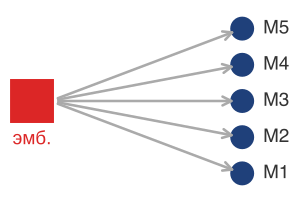

*Одно восходящее обновление эмбеддингов может ухудшить работу каждой зависимой модели.*

Фундаментальный вывод состоит в том, что эксплуатационные практики для отдельных моделей не компонуются. Когда модель A зависит от признаков, вычисленных конвейером B, который использует эмбеддинги модели C, изменение любого компонента каскадно распространяется непредсказуемо. Казалось бы, безобидное обновление слоя эмбеддингов модели C может сместить распределения признаков, от которых зависит модель A, и ухудшить ее качество, хотя сама модель A не менялась. Эта каскадная взаимозависимость превращает масштаб в качественно иную задачу управления.

> **Перспектива: взрыв сложности**
>
> За определенным размером парка узким местом становится не оптимизация отдельной модели, а координация на уровне системы: взаимодействия между моделями важнее любой из них. Графы зависимостей, общие признаки и конкуренция за одну и ту же инфраструктуру означают, что предельная стоимость сотой модели определяется тем, как она связана с остальными девяноста девятью, а не самой моделью.

[Рисунок](#fig-n-models-complexity) наглядно показывает этот сверхлинейный рост по трем измерениям сложности. Количество оповещений мониторинга растет линейно с числом моделей, а конфликты зависимостей растут квадратично, поскольку модели делят признаки, источники данных и инфраструктуру. Совокупная эксплуатационная нагрузка пересекает возможности команды примерно на 50 моделях — эмпирическом пороге, на котором организации понимают, что им нужна платформенная инженерия.

<a id="fig-n-models-complexity"></a>

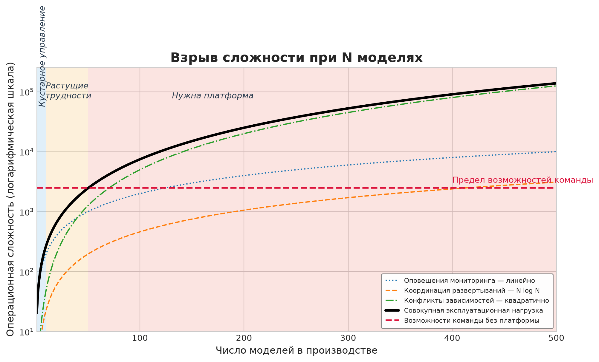

***Взрыв сложности при N моделях:** кривые показывают, что оповещения мониторинга растут линейно с числом моделей, координация развертываний растет как $\mathcal{O}(N_{\text{models}} \log N_{\text{models}})$, а конфликты зависимостей растут квадратично, поскольку модели делят признаки и источники данных. Совокупная эксплуатационная нагрузка пересекает возможности команды примерно на 50 моделях, отмечая переход от кустарного управления моделями к операциям, которые требуют платформы.*

Когда организация переходит этот порог в 50 моделей, комбинаторный рост сопровождения вынуждает к структурной перестройке. Чтобы справиться с этой сложностью, нужно перейти от кустарных практик для каждой модели к общей платформенной инженерии, а это коренным образом меняет экономику парка машинного обучения.

### Количественная оценка экономики платформы

Экономический аргумент в пользу эксплуатации платформы опирается на понимание как издержек раздробленных подходов, так и отдачи от общей инфраструктуры. [Уравнение](#eq-platform-roi) формализует окупаемость инвестиций в платформу как отношение экономии инженерного времени по всем моделям к совокупной стоимости платформы:

$$\text{ROI}_{\text{platform}} = \frac{N_{\text{models}} \times T_{\text{saved}} \times C_{\text{engineer}}}{C_{\text{platform}}}$$

<a id="eq-platform-roi"></a>

где $N_{\text{models}}$ — число моделей, которые получают выгоду от платформы, $T_{\text{saved}}$ — инженерное время, сэкономленное на одной модели за период, $C_{\text{engineer}}$ — полная стоимость часа инженера, а $C_{\text{platform}}$ — совокупная стоимость платформы, включая разработку, инфраструктуру и сопровождение.

Уравнение показывает, почему инвестиции в платформу имеют смысл только при достаточном масштабе. Для небольшой организации с пятью моделями знаменатель может превышать числитель даже при заметной экономии на каждой модели. По мере роста числа моделей числитель растет линейно с $N_{\text{models}}$, а стоимость платформы растет гораздо медленнее, обычно сублинейно из-за амортизации инфраструктуры.

> **Сценарий: дивиденд платформы**
>
> **Задача**: организация управляет 50 моделями. Централизованная команда ML-платформы стоит 120 000 \$ в месяц. Если платформа экономит каждой команде моделей 20 часов ручной рутины в месяц, окупаются ли инвестиции в платформу?
>
> **Расчет**:
>
> 1. **Валовая месячная экономия**: 50 моделей $\times$ 20 часов/модель $\times$ 150 \$/ч = 150 000 \$.
> 2. **Чистая месячная выгода**: 150 000 \$ (экономия) − 120 000 \$/мес (стоимость) = 30 000 \$.
> 3. **Коэффициент окупаемости**: 150 000 \$ / 120 000 \$/мес = 1,25.
>
> **Системный вывод**: платформы обладают порогом масштаба. При 50 моделях эта платформа приносит 25 процентов отдачи от своей стоимости. Однако если бы у организации было только 20 моделей, экономия составила бы всего 60 000 \$ — убыток в 50 процентов от зарплаты платформенной команды. В MLOps платформенная инженерия — это постоянные издержки, которые окупаются переменной экономией. Строить платформу пора тогда, когда «налог на ручную рутину» по парку моделей превышает «налог на сопровождение платформы».

#### От кустарных операций к промышленным

Расчет дивиденда платформы дает общее правило; этот разбор превращает его в эксплуатационное решение. Вопрос не в том, эстетически ли аккуратнее общие инструменты, а в том, меньше ли фиксированная стоимость платформы, чем ручная рутина, которую она убирает по всему парку моделей.

Рассмотрим организацию, которая оценивает, стоит ли строить централизованную ML-платформу. Текущее состояние описывают пять параметров:

- 50 производственных моделей в 8 командах
- Каждая модель требует 40 инженерных часов в месяц на эксплуатационные задачи
- Инженер обходится в 150 \$ в час с полной нагрузкой (fully loaded)
- Стоимость разработки платформы: 2 млн \$, амортизированных за 3 года
- Ожидаемая экономия времени: 30 часов на модель в месяц после запуска платформы

До платформы (годовые эксплуатационные расходы):

$C_{\text{current}} = 50 \times 40 \times 12 \times 150 = \$3\,600\,000$

После платформы (годовые эксплуатационные расходы плюс амортизированная стоимость платформы):

$C_{\text{after}} = 50 \times 10 \times 12 \times 150 + \frac{2\,000\,000}{3} = \$900\,000 + \$666\,667 = \$1\,566\,666{,}7$

Годовая экономия составляет 2 033 333,3 \$, то есть снижение эксплуатационных расходов на 56,5 процента. Платформа окупается уже в первый год.

Экономический разрыв объясняет, почему крупные технологические компании активно инвестируют в ML-платформы, тогда как меньшие организации часто не могут обосновать подобные вложения. Порог окупаемости обычно лежит между 20 и 50 моделями в зависимости от сложности моделей и структуры организации.

[Рисунок](#fig-platform-roi-threshold) показывает этот пороговый эффект: окупаемость платформы как функция числа моделей построена для двух уровней стоимости. Платформа за 2 млн \$ в год окупается примерно на 20 моделях, а более дорогая корпоративная платформа за 5 млн \$ в год требует около 50 моделей. За точкой окупаемости окупаемость растет линейно, поскольку каждая дополнительная модель добавляет одну и ту же экономию на модель к числителю [уравнения](#eq-platform-roi), а стоимость платформы остается практически фиксированной. При 100 моделях платформа за 2 млн \$ дает пятикратную отдачу от инвестиций. Эта линейность одновременно служит экономическим аргументом в пользу инвестиций в платформу и объясняет, почему организации, которые откладывают построение платформы до момента, когда они «достигнут масштаба», часто оказываются парализованы накопленным операционным долгом: точка окупаемости наступает раньше, чем подсказывает интуиция.

Порог окупаемости — не универсальная константа; он зависит от двух величин, которыми управляет читатель. Сценарий «Дивиденд платформы» (команда платформы за 120 тыс. \$ в месяц экономит 20 часов на модель) и пример из раздела «От кустарных операций к промышленным» (разработка за 2 млн \$, амортизированная за три года, экономит 30 часов на модель) достигают окупаемости при других числах моделей, чем на этом рисунке, именно потому, что предполагают разную базу стоимости платформы и разную экономию на модель. Кривые на рисунке фиксируют стоимость платформы круглой годовой цифрой и предполагают 100 тыс. \$ экономии на модель в год, чтобы выделить форму порога; сценарий и пример заменяют эту округленность явными эксплуатационными допущениями. Все три случая подчиняются одной и той же [формуле](#eq-platform-roi): изменение числителя (экономия на модель) или знаменателя (стоимость платформы) сдвигает точку окупаемости, но линейный наклон после нее не меняется.

<a id="fig-platform-roi-threshold"></a>

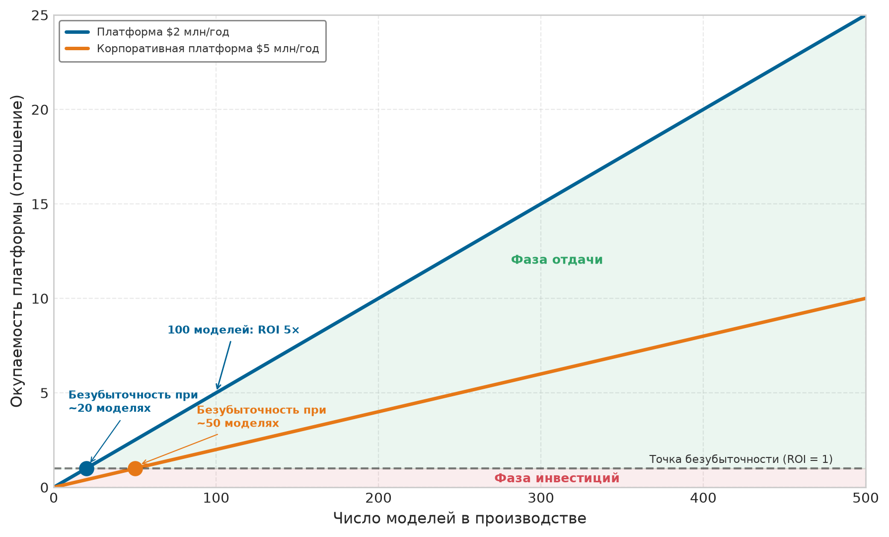

***Порог окупаемости платформы:** кривые показывают окупаемость инвестиций в платформу как функцию числа моделей для двух уровней стоимости. Платформа за 2 млн \$ в год окупается примерно на 20 моделях, а корпоративная платформа за 5 млн \$ в год требует около 50 моделей. За точкой окупаемости окупаемость растет линейно: при 100 моделях платформа за 2 млн \$ дает пятикратную отдачу.*

> **Контрольные вопросы: окупаемость платформы**
>
> [Уравнение](#eq-platform-roi) выражает окупаемость инвестиций в платформу как $N_{\text{models}} \times T_{\text{saved}} \times C_{\text{engineer}} / C_{\text{platform}}$. [Рисунок](#fig-platform-roi-threshold) показывает две кривые стоимости и линейный рост окупаемости после точки окупаемости. Примените формулу к двум конкретным решениям.
>
> - [ ] **Окупаемость платформы**: для организации с 30 моделями, каждая из которых экономит 200 инженерных часов в год по 150 \$ в час, рассчитайте окупаемость платформы за 2 млн \$ в год и корпоративной платформы за 5 млн \$ в год.
> - [ ] **Число моделей для окупаемости**: используя ту же экономию на модель (30 тыс. \$ в год, то есть 200 часов по 150 \$ в час), определите число моделей, при котором окупается каждая платформа, сравните его с ориентировочными значениями 20 и 50 на [рисунке](#fig-platform-roi-threshold) и выведите неявную экономию на модель, которую подразумевает рисунок.
> - [ ] **Строить сейчас или подождать**: для организации с 8 моделями, которая обсуждает постройку платформы за 2 млн \$ в год, используйте линейную структуру окупаемости из [уравнения](#eq-platform-roi) за точкой окупаемости, чтобы сформулировать самый сильный аргумент в пользу постройки сейчас и предположение о будущем росте, которое для этого аргумента необходимо.

Окупаемость платформы — один рычаг; стоимость отдельных запусков обучения и решения о мощностях, которые из нее следуют, — другой. Один запуск на 2 048 GPU H100 делает этот вопрос о мощностях конкретным и связывает его с экономикой парка, где загрузка, контрольные точки и учет углерода становятся решениями уровня платформы, а не изолированными издержками эксперимента.

### Планирование мощностей и стоимость обучения

Планирование мощностей для крупномасштабного ML — это задача оптимизации экономики GPU-часа. Рассмотрим конкретный случай: 30-дневный запуск обучения на кластере из 256 узлов H100 (2 048 GPU) по условной рыночной ставке 2 \$ за GPU-час представляет прямые инвестиции примерно в 2,95 млн \$. На таком масштабе стоимость одного запуска обучения $(C_{\text{run}})$ становится основным проектным рычагом, который определяет размер всего парка. Более быстрый вывод на рынок подталкивает планировщика к большему числу GPU, но крупные задания также страдают от убывающей параллельной эффективности и более высокой вероятности аппаратного прерывания. Поэтому совокупная стоимость — не просто функция времени вычислений: она должна учитывать подготовку данных, контрольные точки и стоимость восстановления после прерываний (см. главу «Отказоустойчивость»).

Стремление к эффективности заставляет мощности вести себя как динамический ресурс, а не как статическое выделение. Организации должны решать, когда покупать дополнительные постоянные мощности, а когда получить ту же эффективную пропускную способность за счет лучшей оркестрации или оптимизации модели. У решения есть и энергетическое измерение: питание тысяч GPU в течение месяцев потребляет столько электричества, что финансовая и углеродная стоимость растут вместе. Планирование мощностей поэтому становится стратегическим рычагом, который в одном решении балансирует производительность, бюджет, энергопотребление и ответственную инженерию. Видимость стоимости также усиливает аргумент в пользу погашения технического долга: те же метрики, которые выявляют неконтролируемый рост затрат на обучение, показывают скрытую цену неверсионированных данных, хрупких конвейеров и ручной рутины.

### Количественная оценка и управление техническим долгом ML

Технический долг в масштабе парка — это задача приоритизации: платформа должна найти скрытую зависимость, которая замедляет развертывания, повышает частоту инцидентов или поглощает больше всего инженерной рутины, и погасить ее первой. Четыре категории долга (данных, конфигурации, модели и инфраструктуры) показывают, откуда исходит тормозящий эффект, а количественная оценка каждой делает их сопоставимыми по всему парку, чтобы самый проблемный можно было устранить первым.

> **Сценарий: дивиденд сопровождения**
>
> **Задача**: команда тратит 40 часов в месяц на ручное исправление «сломанной сантехники» (устаревшие данные, упавшие скрипты, ручной мониторинг). Одномесячная интенсивная очистка (160 часов) должна сократить это до 8 часов в месяц. Окупается ли очистка за трехлетний жизненный цикл модели?
>
> **Расчет**:
>
> 1. **Текущее положение** (3 года): 36 месяцев $\times$ 40 часов/месяц $\times$ 150 \$/ч = 216 000 \$.
> 2. **Проактивный путь**: (160 часов вложений + 36 месяцев $\times$ 8 часов/месяц) $\times$ 150 \$/ч = 67 200 \$.
> 3. **Чистая экономия**: 216 000 \$ − 67 200 \$ = 148 800 \$.
> 4. **Коэффициент дивиденда**: 3,2×.
>
> **Системный вывод**: проактивное сопровождение снижает совокупные издержки в 3,2 раза за жизненный цикл модели. В парке ML «сантехника» (plumbing) важнее «труб» (pipes): организация, которая игнорирует технический долг, в конце концов тратит весь бюджет на поддержание старых моделей и не оставляет мощностей для новой разработки. Самые успешные команды рассматривают рефакторинг как высокодоходную инвестицию, а не как отвлечение.

Дивиденд сопровождения становится практически применимым только тогда, когда платформа может сравнивать разные долги в общем операционном масштабе. Технический долг ML проявляется в измеримых симптомах, которые напрямую влияют на скорость и надежность платформы (Sculley et al., 2015; Amershi et al., 2019).

#### Категории долга и измерение

Категория долга важна, потому что каждый режим сбоя оставляет свой эксплуатационный след. [Таблица](#tbl-ops-scale-debt-measurement-map) превращает таксономию в карту измерений: долг данных проявляется как инциденты и ручное вмешательство в конвейер, долг конфигурации — как непроверенная поверхность выпуска, долг модели — как тормоз из клеевого кода, а долг инфраструктуры — как рутина, которая поглощает мощности платформы.

<a id="tbl-ops-scale-debt-measurement-map"></a>

***Карта измерения технического долга:** разные типы долга требуют разных наблюдаемых сигналов. Общий процесс оценки может сравнивать их только после того, как каждая категория связана с симптомом и порогом, которые делают долг операционно видимым.*

| **Тип долга**       | **Эксплуатационный симптом**                                        | **Сигнал измерения**                                              | **Порог предупреждения**                                           |
|:--------------------|:--------------------------------------------------------------------|:------------------------------------------------------------------|:-------------------------------------------------------------------|
| Долг данных         | Нестабильные зависимости, отсутствие версионирования, слабая валидация | Инциденты с данными в месяц и ручное вмешательство в конвейер | Более 10 инцидентов с данными в месяц или 30 % ручных запусков.    |
| Долг конфигурации   | Разовые файлы, дублированные параметры, отсутствие валидации        | Сбои развертывания, строки конфигурации, непроверенные параметры  | Более 500 строк непроверенной конфигурации на модель.              |
| Долг модели         | Клеевой код, необъявленные потребители, запутанные пути обслуживания | Оценка связности, недокументированные потребители, время трассировки | Более 20 % инженерного времени уходит на поддержку клеевого кода. |
| Долг инфраструктуры | Хрупкие конвейеры, ручное развертывание, дрейф окружения           | Часы рутины, охват автоматизацией, инциденты дрейфа               | Более 50 % мощностей платформы уходит на рутину.                   |

#### Количественные метрики

[Таблица](#tbl-ops-scale-debt-prioritization-metrics) превращает четыре метрики долга в карту базовых уровней и порогов, сопоставляя каждый симптом с точкой, в которой он становится сигналом эскалации.

<a id="tbl-ops-scale-debt-prioritization-metrics"></a>

***Метрики приоритизации технического долга:** операционный долг становится действенным, когда у каждой метрики есть здоровый базовый уровень и порог, который превращает скрытое трение в очередь инженерных задач.*

| **Метрика**              | **Сигнал**                                                                 | **Здоровый базовый уровень**                                                              | **Порог предупреждения**                                                                                   |
|:-------------------------|:---------------------------------------------------------------------------|:------------------------------------------------------------------------------------------|:-----------------------------------------------------------------------------------------------------------|
| **Скорость развертывания** | Время от коммита кода до развертывания в производстве; показывает трение выпуска. | Менее одного дня для изменений кода инференса и менее одной недели для изменений обучения. | Более двух недель указывают на сложность конфигурации, хрупкие зависимости или недостаточную автоматизацию. |
| **Частота инцидентов**   | Вред для надежности, видимый как число инцидентов на 1000 развертываний.   | Менее 5 инцидентов на 1000 развертываний.                                                 | Более 20 инцидентов указывают на долг в процедурах тестирования, валидации или развертывания.              |
| **Доля рутины (toil)**   | Ресурс команды, поглощенный ручной эксплуатационной работой.               | Менее 20 % ресурса уходит на рутину.                                                      | Более 50 % указывают на долг автоматизации, который мешает команде улучшать платформу.                     |
| **Устаревание зависимостей** | Доля зависимостей, отстающих от поддерживаемых или актуальных версий.   | Менее 10 % устаревших зависимостей.                                                       | Более 30 % указывают на долг обновлений, который повышает риск безопасности и ограничивает улучшения производительности. |

Пример ниже применяет логику порогов, чтобы ранжировать долг по тому ресурсу, который каждое исправление возвращает команде платформы.

#### Разбор на примере: аудит и приоритизация ML-долга

Команда ML-платформы, которая поддерживает 40 производственных моделей силами 15 инженеров, сталкивается с проблемами скорости развертывания. Новые модели требуют 6 недель, чтобы попасть в производство, что раздражает и команду платформы, и команды моделей. Аудит должен ранжировать долги по тому, сколько ресурсов платформы каждый из них освобождает, а не по тому, какой симптом заметнее всего.

Перед оценкой аудит фиксирует три категории долга в [таблице](#tbl-ml-debt-audit-inputs). Каждая строка сопоставляет эксплуатационный симптом с мерой воздействия, которая делает долг сопоставимым между командами.

<a id="tbl-ml-debt-audit-inputs"></a>

***Исходные данные аудита ML-долга:** первичные наблюдения по долгу конфигурации, клеевому коду конвейера и долгу мониторинга до приоритизации. Таблица сохраняет симптом, метрику воздействия, техническую меру и оценку годовых издержек для каждой категории долга.*

| **Категория долга**    | **Симптом**                                                                                                 | **Метрика воздействия**                                  | **Техническая мера**                                                                   | **Оценка годовых издержек**                                                  |
|:-----------------------|:------------------------------------------------------------------------------------------------------------|:---------------------------------------------------------|:---------------------------------------------------------------------------------------|:-----------------------------------------------------------------------------|
| **Долг конфигурации**  | У каждой модели есть индивидуальные YAML-файлы конфигурации в среднем на 847 строк без схемы валидации       | 35 % задержек развертывания вызваны поздними ошибками конфигурации | Ручная проверка конфигурации требуется при каждом развертывании                        | 12 инженерных часов на развертывание $\times$ 80 развертываний в год = 960 часов |
| **Клеевой код конвейера** | Предобработка данных использует 23 разных скрипта с 62 % дублирования кода                              | 12 инженерных часов в неделю на отладку поломок конвейера | Общей библиотеки предобработки нет; каждая команда реализует собственную логику        | 12 часов в неделю $\times$ 52 недели = 624 часа                              |
| **Долг мониторинга**   | Каждая модель использует разовый мониторинг, единой платформы наблюдаемости нет                             | Среднее время обнаружения инцидентов — 4,2 часа          | 23 подхода к мониторингу на 40 моделях                                                 | Затяжные инциденты стоят 50 тыс. \$ на инцидент $\times$ 15 инцидентов в год = 750 тыс. \$ |

Оценка использует три критерия: тяжесть воздействия, частоту и стоимость устранения, каждый по шкале от 1 до 3. [Таблица](#tbl-debt-prioritization-scoring) ранжирует три категории долга, наблюдавшиеся ранее. Большее воздействие и частота повышают приоритет, а большая стоимость устранения — понижают.

<a id="tbl-debt-prioritization-scoring"></a>

***Оценка приоритетов долга:** трехкритериальная оценка (тяжесть воздействия, частота и стоимость устранения), примененная к трем наблюдаемым категориям долга. Баллы считаются как $\text{Воздействие} \times \text{Частота} / \text{Стоимость устранения}$, поэтому более медленные или дорогие исправления получают штраф. Долг конфигурации набирает наибольший балл, что обосновывает устранение в первую очередь.*

| **Категория долга** | **Воздействие** | **Частота**   | **Стоимость устранения** | **Итоговый балл** | **Приоритет** |
|:--------------------|:---------------:|:-------------:|:------------------------:|:-----------------:|:-------------:|
| **Конфигурация**    | 3 (высокое)     | 3 (ежедневно) | 2 (средняя: 6 недель)    | 4,5               | **1-й**       |
| **Мониторинг**      | 3 (высокое)     | 2 (еженедельно) | 2 (средняя: 8 недель)  | 3                 | **2-й**       |
| **Клеевой код конвейера** | 2 (среднее) | 2 (еженедельно) | 3 (высокая: 16 недель) | 1,3               | **3-й**       |

Балл делает долг конфигурации первой целью погашения: сначала нужно построить валидацию схемы конфигурации и систему шаблонов, и лишь потом заниматься клеевым кодом конвейера с меньшим баллом. Инвестиции требуют 6 недель инженерной работы на построение системы конфигурации. Она устраняет 35 процентов повторяющейся рутины проверки конфигурации: 12 инженерных часов на развертывание $\times$ 80 развертываний в год $\times$ 35 процентов = 336 инженерных часов, сэкономленных за год. По 150 \$ в час это 50 тыс. \$ годовой экономии, поэтому инвестиции окупаются примерно за 8,6 месяца.

#### Схема принятия решения

Общее решение о погашении долга расширяет оцененный пример явной оценкой выгоды: воздействие отражает тяжесть, частота — то, как часто встречается долг, выгода — избегаемые эксплуатационные издержки, а стоимость устранения — требуемые инженерные усилия:

$$\text{Приоритет погашения} = \frac{\text{Воздействие} \times \text{Частота} \times \text{Выгода}}{\text{Стоимость устранения}}$$

<a id="eq-ops-scale-paydown-priority"></a>

Формула приоритета из [уравнения](#eq-ops-scale-paydown-priority) привязывает автоматизацию к операционной ценности: частые исправления с большим воздействием и выгодой опережают дорогую работу, отдача от которой спекулятивна.

> **Сценарий: окупаемость автоматизации**
>
> **Задача**: команда тратит 10 часов ручной рутины на каждое развертывание модели. Вложение 120 часов в конвейер CI/CD, как ожидается, снизит рутину развертывания до 0,5 часа. При 3 развертываниях в неделю, через сколько времени автоматизация окупится?
>
> **Расчет**:
>
> 1. **Стоимость автоматизации**: 120 часов $\times$ 150 \$/ч = 18 000 \$.
> 2. **Недельная экономия**: 9,5 часа/развертывание $\times$ 3 развертывания/неделю $\times$ 150 \$/ч = 4 275 \$/неделю.
> 3. **Срок окупаемости**: 18 000 \$ / 4 275 \$/неделю $\approx$ 4,2 недели.
>
> **Системный вывод**: автоматизация — это высокодоходное капиталовложение. Срок окупаемости 4,2 недели — исключительная отдача от инженерного времени. В MLOps рутина (toil) — самый дорогой технический долг, который может нести организация: погашение его на раннем этапе дает большие дивиденды на весь остаток жизненного цикла модели.

Правило решения асимметрично. Долг стоит погашать, когда этот коэффициент превышает ожидаемую отдачу от разработки функций. Долг конфигурации из [таблицы](#tbl-debt-prioritization-scoring) подходит под это правило: у него большое воздействие (блокирует развертывания), высокая частота (каждое развертывание), высокая выгода (устраняет 35 процентов задержек) и умеренная стоимость (6 недель). Откладывать погашение стоит, когда долг локализован в одной команде, частота низкая (ежемесячно или реже), вывод системы из эксплуатации запланирован в течение 12 месяцев или стоимость устранения превышает 6 месяцев инженерных усилий.

Та же логика приоритизации должна стать организационной привычкой, иначе измеренный долг снова накопится между аудитами. Оцененный долг сначала становится элементом бэклога с указанием затронутых систем, оценкой воздействия, стоимостью устранения и баллом приоритета. Квартальный обзор затем обновляет этот бэклог по мере изменения потребностей платформы, сохраняя ранжирование связанным с текущей скоростью развертывания, частотой инцидентов и рутиной, а не с устаревшими жалобами.

Бюджет долга переводит это ранжирование в мощности. Выделение 20–30 процентов спринта на погашение делает устранение явно конкурирующим с разработкой функций, тогда как команды, тратящие на долг меньше 10 процентов, обычно видят, что долг растет быстрее, чем они успевают с ним справляться. Профилактика переносит то же рассуждение в код и проектирование: каждое предлагаемое изменение должно проверяться на предмет того, вводит ли оно сложность конфигурации, труднообслуживаемые зависимости по данным или ручные эксплуатационные процедуры, поскольку предотвратить появление долга дешевле, чем погашать его позже.

### Чем эксплуатация отличается в масштабе

Эксплуатационные требования для многомодельных платформ качественно отличаются от **эксплуатации одной модели**. [Таблица](#tbl-ops-scale-differences) сопоставляет эти подходы по шести измерениям и показывает, что развертывание на уровне платформы требует планирования с учетом зависимостей, мониторинг должен сместиться от *ориентированного на модель* к *системно ориентированной* агрегации, а управление эволюционирует от политик *конкретной команды* к стандартам *всей организации*:

<a id="tbl-ops-scale-differences"></a>

***Эксплуатация одной модели и платформы:** шесть качественных различий, которые возникают при переходе от одной модели к 100 и более. Развертывание переходит от выкатки под контролем команды к координации платформы с учетом зависимостей, мониторинг — от панелей, ориентированных на модель, к агрегации на уровне системы, а управление расширяется от политик отдельных команд до автоматизированного принуждения на уровне всей организации.*

| **Аспект**              | **Эксплуатация одной модели** | **Многомодельная платформа (100+)**                  |
|:------------------------|:-----------------------------:|:----------------------------------------------------|
| **Развертывание**       | Простая выкатка под контролем команды | Планирование с учетом зависимостей, координируемое платформой |
| **Мониторинг**          | Метрики, ориентированные на модель | Системный, с агрегацией по моделям                 |
| **Отладка**             | Локальная для модели и данных | Распределенная трассировка через границы моделей     |
| **Управление ресурсами** | Выделенное распределение     | Общие пулы с многопользовательской изоляцией         |
| **Управление**          | Политики конкретной команды   | Стандарты и автоматизация для всей организации       |
| **Организация**         | Владение одной командой       | Платформенная команда плюс команды-потребители       |

Качественный разрыв заметнее всего в эксплуатации развертываний. Развертывание одной модели просто: проверить новую версию, выкатить ее на канареечную группу, следить за регрессиями и перейти к полному выпуску. Развертывание в масштабе платформы должно учитывать порядок зависимостей: модели, которые потребляют признаки других моделей, нельзя обновлять независимо. Координация откатов становится необходимой, поскольку возврат одной модели может потребовать возврата зависимых моделей. Конкуренция за ресурсы возникает, когда несколько развертываний борются за память GPU или пропускную способность сети. Управление радиусом поражения ограничивает последствия любого отказа развертывания.

Для систем рекомендаций эта сложность особенно острая. Типичный запрос рекомендации может затрагивать 10–50 моделей, которые выполняются последовательно или параллельно: модели поиска кандидатов, модели ранжирования, фильтры разнообразия и слои бизнес-правил. Обновление любого компонента требует понимания его взаимодействия со всеми остальными.

Требования к мониторингу эволюционируют аналогично. В масштабе одной модели мониторинг сосредоточен на метриках конкретной модели: точность предсказаний, задержка инференса и индикаторы дрейфа данных. В масштабе платформы такой подход становится нежизнеспособным. При 100 моделях 100 независимых панелей создают информационную перегрузку, которая мешает эффективно реагировать на инциденты.

Мониторинг платформы поэтому должен агрегировать данные по моделям, сохраняя возможность детализации. Для этого нужны иерархические метрики. Бизнес-метрики отражают общее состояние системы через выручку, вовлеченность и удовлетворенность пользователей. Метрики портфеля агрегируют качество моделей по домену или бизнес-подразделению. Метрики модели отслеживают точность, задержку и дрейф отдельной модели. Метрики инфраструктуры контролируют загрузку GPU, давление на память и пропускную способность сети.

#### Сбор телеметрии в масштабе

Переход к наблюдаемости уровня платформы требует фундаментального сдвига в **парадигмах телеметрии в масштабе**. Когда 10 000 граничных узлов или сотни микросервисов одновременно генерируют журналы, сама инфраструктура мониторинга может стать узким местом и создать «эффект громового стада», который перегружает сеть. Телеметрию нужно строго классифицировать и сэмплировать, чтобы система наблюдения не возмущала производственную систему. [Таблица](#tbl-ops-scale-telemetry) разделяет типы телеметрии по росту объема и эксплуатационному применению, чтобы платформа могла решить, что собирать непрерывно, а что сэмплировать.

<a id="tbl-ops-scale-telemetry"></a>

***Парадигмы телеметрии в масштабе:** поскольку журналы и трассировки растут линейно с объемом запросов, их нужно агрессивно сэмплировать или агрегировать на границе, тогда как метрики можно непрерывно передавать или опрашивать без перегрузки сети.*

| **Тип телеметрии** | **Определение**                                             |          **Объем**          | **Основное применение**                                  |
|:-------------------|:------------------------------------------------------------|:---------------------------:|:---------------------------------------------------------|
| **Метрики**        | Агрегированные числовые данные (счетчики, измерители, гистограммы). | Низкий (постоянный размер) | Оповещения, отслеживание SLA и общая визуализация на панелях. |
| **Журналы**        | Дискретные записи конкретных событий с временными метками.  | Высокий (растет с числом запросов) | Анализ первопричин после инцидентов и аудит.            |
| **Трассировки**    | Сквозные пути запросов через распределенные микросервисы.   | Очень высокий               | Диагностика узких мест задержки и распределенных сбоев.  |

Обратите внимание в [таблице](#tbl-ops-scale-telemetry): метрики остаются компактными, тогда как журналы и трассировки растут линейно с частотой запросов, причем трассировки занимают гораздо больший объем на запрос. Поэтому эффективные платформы по умолчанию показывают панели метрик верхнего уровня и включают детальное исследование нижних уровней только при обнаружении аномалий.

### Разнообразие эксплуатационных практик по типам моделей

Помимо соображений масштаба, разные типы моделей требуют принципиально разных эксплуатационных схем. Практики, подходящие для развертывания большой языковой модели, совершенно непригодны для **системы выявления мошенничества**, и наоборот. Таксономия архетипов (см. раздел «Маячные архетипы» главы «Введение») помогает интерпретировать **эксплуатационные требования по типам моделей** из [таблицы](#tbl-ops-scale-model-types): большие языковые модели (LLM) требуют поэтапной выкатки в течение дней и недель с окнами отката длительностью в часы, тогда как выявление мошенничества требует почасовых обновлений с откатом за секунды, чтобы противостоять адверсарной динамике.

<a id="tbl-ops-scale-model-types"></a>

***Эксплуатационные требования по типам моделей:** частота обновлений, схемы развертывания и скорость отката различаются у типов моделей из-за разных профилей риска. LLM требуют ежемесячных поэтапных выкаток с откатом за часы или дни из-за риска регрессии качества, тогда как выявление мошенничества требует почасовых обновлений с откатом за секунды, чтобы противодействовать адверсарной динамике.*

| **Тип модели**                  | **Частота обновлений** | **Схема развертывания**          | **Основной риск**          | **Скорость отката** |
|:--------------------------------|:----------------------:|:--------------------------------:|:--------------------------:|:-------------------:|
| **Архетип A (GPT-4/Llama-3)**   | Ежемесячно–ежеквартально | Поэтапная, осторожная          | Регрессия качества, безопасность | Часы–дни          |
| **Архетип B (DLRM в масштабе)** | Ежедневно–еженедельно  | Теневое развертывание, чередование | Падение вовлеченности      | Минуты              |
| **Выявление мошенничества**     | Ежечасно–ежедневно     | Быстрая, с мгновенным откатом    | Ложноотрицательные срабатывания | Секунды           |
| **Зрение (классификация)**      | Еженедельно–ежемесячно | Канареечная                      | Регрессия точности         | Минуты              |
| **Ранжирование поиска**         | Ежедневно              | A/B с контрольной группой (holdout) | Деградация релевантности | Минуты              |

Таблица — это карта соответствия между риском и темпом выпусков, а не каталог моделей. Большие языковые модели находятся на медленном конце, потому что размер, стоимость и тонкие регрессии качества делают каждый выпуск событием с высокими ставками. Небольшое ухудшение качества ответов может не проявиться в автоматических метриках, но способно заметно снизить удовлетворенность пользователей, поэтому обновления LLM обычно включают продолжительное теневое развертывание, оценку людьми наряду с автоматическими метриками, поэтапную выкатку в течение дней или недель и оценку безопасности до любого выхода в производство.

Стоимость регрессии становится конкретной, когда одна модель должна сохранить сразу все возможности:

> **Маячный архетип A (GPT-4/Llama-3): цена регрессии**
>
> **Контекст**: архетип A (GPT-4/Llama-3), введенный в разделе «Маячные архетипы» главы «Введение», представляет сверхбольшие универсальные модели (70–405 млрд параметров), которые обслуживают миллионы одновременных запросов в самых разных задачах.
>
> **Механизм**: «дилемма универсала» возникает, когда целевая тонкая настройка (например, оптимизация генерации кода на Python) вызывает катастрофическое забывание в неконтролируемых областях (например, в творческом письме или рассуждении). Оценка кандидатных весов на более чем 10 000 эталонных промптов требует значительных вычислений для валидации $O/(R_{\text{peak}} \cdot \eta_{\text{hw}})$, то есть сотен GPU-часов до одобрения.
>
> **Последствия**: незаметная деградация вторичных метрик вынуждает к дорогостоящим экстренным откатам, растрачивая мощности обслуживания и нарушая целевые показатели задержки $L_{\text{lat}}$.
>
> **Системный урок**: контрольные ворота выпуска для больших универсальных LLM должны сочетать широкие эталонные тесты возможностей (такие как Massive Multitask Language Understanding (MMLU) и HumanEval) с проверками безопасности на основе политик. Автоматическая оценка на воротах должна закладываться в эксплуатационные издержки развертывания $O/(R_{\text{peak}} \cdot \eta_{\text{hw}})$, а не рассматриваться как бесплатная предполетная проверка.

Эксплуатационный ритм LLM часто измеряется неделями и месяцами: каждое обновление рассматривается как значимое событие, требующее межфункциональной координации. Системы рекомендаций могут работать в более быстром ритме, поскольку предпочтения пользователей и наполнение каталога меняются непрерывно (Steck et al., 2021; Gomez-Uribe и Hunt, 2015). Устаревшие признаки рекомендаций поэтому могут ухудшить релевантность раньше, чем очередное пакетное обновление догонит изменения, хотя риск развертывания остается специфичным для конкретной нагрузки.

Поэтому эксплуатация рекомендаций опирается на четыре паттерна:

- **Непрерывное обучение**: конвейеры выпускают ежедневные или еженедельные обновления моделей.
- **Чередующиеся эксперименты**: несколько вариантов моделей сравниваются на одних и тех же запросах.
- **Быстрые итерации**: изменения могут попасть в производство в течение часов.
- **Строгое A/B-тестирование**: статистическая инфраструктура отделяет реальные изменения вовлеченности от шума.

Ключевая метрика, которая отражает эту эксплуатационную срочность, — задержка свежести признаков: она измеряет, насколько быстро действия пользователя доходят до предсказаний модели.

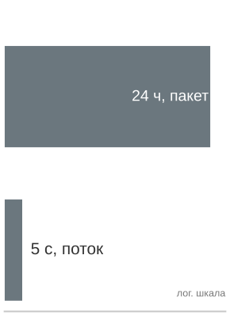

*Потоковая обработка закрывает разрыв свежести, который оставляет пакетная.*

> **Пример: задержка свежести признаков**
>
> **Сценарий**: сервис рекомендаций в реальном времени обрабатывает журналы взаимодействий пользователя, чтобы вычислять векторы признаков во время активной сессии.
>
> **Диагноз**: ежедневные пакетные конвейеры признаков имеют высокую задержку свежести ($T_{\text{freshness}} \approx 12\text{--}24\text{ ч}$), из-за чего рекомендации остаются статичными и вызывают уход пользователей из сессии. Потоковые конвейеры (Kafka/Flink) снижают задержку свежести до $T_{\text{freshness}} \approx 1\text{--}5\text{ с}$, обновляя векторы признаков до следующего действия пользователя.
>
> **Системный урок**: задержка свежести признаков — это физическая системная метрика ($T_{\text{freshness}} = T_{\text{available}} - T_{\text{event}}$). Переход от пакетного к потоковому приему дает прирост вовлеченности на 10–20 процентов, который оправдывает эксплуатационные затраты на хранилище признаков реального времени.

Ключевой вывод состоит в том, что эксплуатация рекомендаций по сути является управлением ансамблями. Один запрос рекомендации может вызывать от десяти до пятидесяти различных моделей, каждая из которых требует собственного ритма обновлений и при этом должна сохранять согласованное поведение системы.

Системы выявления мошенничества сталкиваются с особым набором эксплуатационных задач, поскольку их входные данные формируются адаптивными противниками. Мошенники активно зондируют системы в поисках уязвимостей, а после обнаружения быстро меняют тактику. Модель, которая не может адаптироваться в течение нескольких часов, создает окно уязвимости. Эта адверсарная динамика задает четыре эксплуатационных требования:

- **Частые обновления**: модели обновляются ежечасно или чаще в ответ на новые паттерны.
- **Мгновенный откат**: обслуживание может вернуться к прежней версии за секунды, когда возрастает доля ложных срабатываний.
- **Теневое скорирование**: все транзакции оцениваются кандидатными моделями для быстрого сравнения.
- **Мониторинг скорости признаков**: резкие сдвиги распределений обнаруживаются до того, как ими воспользуются противники.

Профиль риска асимметричен. Ложноотрицательные срабатывания (пропущенное мошенничество) ведут к прямым финансовым потерям, а ложноположительные (заблокированные законные транзакции) создают трения с клиентами. Эксплуатация должна балансировать эти конкурирующие требования в реальном времени.

Эти разнообразные эксплуатационные паттерны отражают один базовый принцип: профиль риска определяет ритм эксплуатации. У LLM большая поверхность рисков развертывания, включая предвзятость, злоупотребления и экологический ущерб, что обосновывает тщательный анализ соотношения рисков и выгод до выпуска (Bender et al., 2021). Системы рекомендаций работают быстро, потому что устаревшие модели теряют релевантность быстрее, чем плохие обновления успевают нанести ущерб. Выявление мошенничества работает непрерывно, потому что противники не ждут плановых развертываний. Понимание этого принципа позволяет командам проектировать подходящие эксплуатационные практики для новых типов моделей, анализируя их характеристики риска, а не копируя паттерны у внешне похожих систем.

Остальная часть главы остается на уровне корпоративного парка: общая инфраструктура для множества взаимодействующих моделей, а не базовый переход от ad hoc блокнотов к автоматизированным конвейерам для одной модели. Вопрос в том, когда общий слой становится дешевле и безопаснее, чем позволять каждой команде строить собственный эксплуатационный стек.

### Обоснование платформенной команды

Выделенная команда ML-платформы оправдана, когда раздробленность стоит дороже общей инфраструктуры, необходимой для ее замены. Поэтому решение сочетает количественные факторы (экономию средств, рост скорости) с качественными (согласованность, управление, удержание талантов).

Обоснование опирается на расчет окупаемости, приведенный выше, а вспомогательные метрики показывают, где общее владение превращается в экономию по всему парку: эффективность инфраструктуры, время до производства и снижение числа инцидентов. Эффективность инфраструктуры растет за счет общих кластеров GPU, которые достигают загрузки 70–80 процентов против 30–40 процентов у выделенных ресурсов каждой команды. Для организации со 100 GPU по 2 \$ за GPU-час переход от 35 до 75 процентов эффективной загрузки экономит примерно 930 000 \$ в год, поскольку те же 35 активных GPU-эквивалентов можно обслуживать меньшим числом выделенных GPU. Время до производства сокращается благодаря платформенным абстракциям, которые уменьшают путь от обученной модели до развертывания в производстве; если это ускорение позволяет выводить в производство одну дополнительную высокоценную модель в квартал, деловая ценность обычно превышает стоимость платформы. Снижение числа инцидентов следует из стандартизированных развертываний и мониторинга: зрелые платформы часто сокращают инциденты, связанные с ML, на 60–80 процентов, и это снижение переходит и в прямую экономию, и в лучший пользовательский опыт.

Качественный довод следует из той же стоимости раздробленности. Отказы платформ являются отказами координации не меньше, чем отказами инфраструктуры, и общее владение улучшает четыре поверхности координации:

- **Согласованность**: стандартизированные практики гарантируют, что все модели соответствуют базовым требованиям к качеству мониторинга, возможности отката и документации.
- **Обмен знаниями**: централизованные команды делают эксплуатационную экспертизу доступной всем командам моделей, а не держат ее изолированно.
- **Карьерное развитие**: платформенные роли открывают карьерные пути для ML-инженеров, интересующихся инфраструктурой.
- **Готовность к регулированию**: контроли уровня платформы служат основой соответствия требованиям по мере роста регулирования ИИ.

Решение создать платформенную команду обычно принимается, когда организации понимают, что альтернатива — продолжать раздробленность — обходится дороже, чем инвестиции в платформу. Такое понимание часто приходит после серьезного производственного инцидента, который выявил межмодельные зависимости или эксплуатационные пробелы. Получающаяся экономика показывает, почему эксплуатация платформы становится все ценнее по мере роста парка моделей.

> **Перспектива: отдача платформы растет с каждой моделью**
>
> Поскольку [уравнение](#eq-platform-roi) увеличивает числитель линейно с $N_{\text{models}}$, а стоимость платформы остается примерно постоянной, коэффициент окупаемости растет с каждой моделью, которую обслуживает платформа: экономия на каждую модель покрывается знаменателем, который почти не меняется. Выигрыш — не выплата быстрее линейной, а коэффициент, который продолжает расти за точкой окупаемости. Поэтому организации, откладывающие инвестиции в платформу, накапливают операционный долг, который с ростом парка становится все дороже устранять.

## Экономика парка и загрузка

Хотя эксплуатационные инструменты экономят инженерные часы, финансовый баланс развернутого парка моделей определяется загрузкой. GPU, который простаивает между всплесками, зарезервирован под неудачные выкатки или заперт за узким местом планировщика, стоит столько же, сколько GPU, обслуживающий полезные предсказания. Поэтому практики развертывания не могут масштабироваться экономично, пока платформа не видит, где используется мощность, где она зарезервирована и где пропадает впустую.

Три экономических уровня не дают бухгалтерии свести разнородные решения к одной цифре стоимости. **Экономика платформы** спрашивает, окупаются ли общие возможности плоскости управления своей фиксированной стоимостью разработки и сопровождения по всему портфелю. **Экономика парка** спрашивает, дают ли общее железо, помещения и обязательства по мощностям полезную работу при приемлемой загрузке и риске. **Экономика нагрузки** спрашивает, оправдывает ли одно задание обучения, одна конечная точка обслуживания или один эксперимент свою предельную стоимость вычислений, данных и инженерных усилий. Уровни образуют иерархию: оптимизация нагрузки не может спасти переразвернутый парк, а высокая загрузка парка не оправдывает платформу, стоимость внедрения которой превышает рутину, которую она убирает. Решения о маржинальном планировании внутри парка относятся к главе «Оркестрация парка»; эта глава отвечает за капитальное планирование, отдачу портфеля, совокупную стоимость владения (TCO) на протяжении жизненного цикла и распределение затрат между командами.

Инженерные ограничения в конечном счете являются экономическими: каждое проектное решение обменивает стоимость на производительность, а «правильная» инфраструктура — та, которая максимизирует полезные вычисления на доллар за весь срок службы системы. При допущении 350 000 \$ за узел DGX H100 на 8 GPU кластер из 10 000 GPU представляет около 437,5 млн \$ капитальных затрат только на узлы, без сети, помещений, персонала и обслуживания. Однако цена покупки — лишь начало. За типичный трехлетний срок службы оборудования энергия, охлаждение, помещения, сеть, персонал и обслуживание определяют, станет ли парк активом или простаивающей обузой. TCO[^fn-tco-ownership-analysis] важна здесь, потому что превращает загрузку в центральный эксплуатационный инвариант, лежащий в основе более широкого учета жизненного цикла ML, который разбирается в разделе «Структура TCO для ML-систем».

Экономика инфраструктуры ML отличается от традиционной ИТ по трем фундаментальным признакам. Ускорители быстро обесцениваются, энергия является эксплуатационной статьей первого порядка, а чувствительность к загрузке экстремальна: один и тот же парк может быть блестящей инвестицией при загрузке 80 процентов или финансовой катастрофой при 20 процентах, без какого-либо изменения стоимости оборудования или помещений. Для эксплуатации в масштабе это главный урок. Платформа должна заставлять дорогие мощности выполнять полезную работу, сохраняя при этом достаточный запас для отказов, откатов и всплесков трафика.

[^fn-tco-ownership-analysis]: **TCO** (совокупная стоимость владения): финансовая схема, сформализованная Gartner в 1980-х годах для закупок ИТ, которая суммирует CapEx (единовременные затраты на приобретение) и OpEx (периодические эксплуатационные расходы) за жизненный цикл системы. Для ML-кластеров анализ TCO особенно важен, потому что энергия, охлаждение, персонал, помещения и сеть существенно меняют экономику за три года, а разница в загрузке на 60 процентных пунктов (с 20 до 80 процентов) может полностью перевернуть решение «строить или покупать» без изменения какой-либо характеристики оборудования.

### Статьи затрат как эксплуатационные ограничения

Совокупная стоимость ML-кластера делится на две большие категории. **Капитальные затраты (CapEx)** покрывают единовременные расходы на создание инфраструктуры: ускорители, серверы, сетевое оборудование, строительство помещений и монтаж. **Операционные затраты (OpEx)** покрывают периодические расходы на ее эксплуатацию: электроэнергию, охлаждение, сетевой трафик, персонал, обслуживание и лицензии на ПО. Для крупного локального кластера примерное распределение таково.

[Таблица](#tbl-frontier-training-cost-stack) разделяет стек затрат на капитальные и операционные статьи, каждая из которых по-разному влияет на загрузку.

<a id="tbl-frontier-training-cost-stack"></a>

***Стек затрат на обучение передовых моделей:** капитальные затраты определяются ускорителями, сетью и помещениями, а операционные — электроэнергией и специализированным персоналом.*

| **Статья затрат**            | **Класс затрат** | **Типичная доля**  | **Состав и последствия**                                                                                                                                                                             |
|:-----------------------------|:----------------:|:-------------------|:-----------------------------------------------------------------------------------------------------------------------------------------------------------------------------------------------------|
| **Ускорители и серверы**     |      CapEx       | 50–60 % CapEx      | GPU или TPU, серверы хоста, контроллеры управления платой и локальное хранилище; эта категория доминирует в первичной закупке и амортизации.                                                          |
| **Сеть**                     |      CapEx       | 10–15 % CapEx      | Коммутаторы InfiniBand, HCA, кабели и оптические трансиверы; фабрика fat-tree для 1 024 GPU может стоить 10–20 млн \$.                                                                              |
| **Помещения и охлаждение**   |      CapEx       | 15–25 % CapEx      | Строительство или реконструкция здания, трансформаторы, ИБП, PDU и холодильная установка; жидкостное охлаждение добавляет 10–15 % к стоимости помещений, но снижает долгосрочные OpEx.           |
| **Электроэнергия**           |      OpEx        | 60–70 % OpEx       | При 0,07 \$/кВт·ч кластер из 1 024 GPU H100, потребляющий 1 МВт с учетом охлаждения при эффективности использования энергии (PUE) 1,1, стоит около 615 000 \$ в год.                                |
| **Персонал и обслуживание**  |      OpEx        | 20–30 % OpEx       | Системные администраторы, техники по оборудованию, запасные части и лицензии на ПО.                                                                                                                  |

Рассмотрим в качестве примера расчета стоимости эксплуатации передовую модель с 175 млрд параметров. Для нее минимально жизнеспособный кластер обучения требует примерно 1 024 GPU H100 на 128 узлах, чтобы завершить запуск обучения за 2–4 недели. Оценка TCO за трехлетний жизненный цикл показывает резкую зависимость от загрузки. Капитальные затраты на оборудование доминируют: 44,80 млн \$ (350 000 \$ за узел), к которым добавляются 5 млн \$ на двухуровневую сеть InfiniBand fat-tree и пропорциональные 10 млн \$ на помещения. Эксплуатационные расходы добавляют около 1,5 млн \$ в год на электроэнергию (при 0,07 \$/кВт·ч и PUE 1,1) и профильный персонал, поэтому трехлетний итог составляет около 64 млн \$. Если этот выделенный кластер обучает только шесть крупных моделей в год, эффективная стоимость одного запуска составит 3,5 млн \$. Аренда того же выделения из 1 024 GPU в публичном облаке по 4,00 \$ за GPU-час стоит около 1,3–2,7 млн \$ за запуск (1 024 GPU × 336–672 часа × 4 \$), или 24–48 млн \$ за три года при шести запусках в год. Для такого прерывистого ритма облако дешевле, потому что организация не платит за простаивающие недели. Экономическое преимущество владения оборудованием проявляется только при *непрерывной загрузке*: если кластер работает круглосуточно (обслуживая обучение, инференс, дообучение и эксперименты), эффективная стоимость в собственном дата-центре падает примерно до 2,40 \$ за GPU-час, что заметно ниже облачной ставки. Эта зависимость от загрузки — центральное напряжение любого анализа «строить или покупать».

### Загрузка как экономический инвариант

Самый важный экономический вопрос — способен ли парк поддерживать достаточную полезную нагрузку, чтобы амортизировать фиксированные мощности. **«Строить или покупать»** — одно из выражений этого вопроса, но тот же инвариант появляется и внутри развернутой платформы: зарезервированные мощности, резервные пулы, региональные реплики и запас под канареечные выкатки становятся экономичными только тогда, когда их ценность для надежности оправдывает стоимость простоя. [Рисунок](#fig-tco-build-vs-buy) делает зависимость от загрузки видимой, показывая накопленную стоимость во времени для собственных и арендуемых мощностей.

<a id="fig-tco-build-vs-buy"></a>


***Сравнение TCO «строить или покупать»:** кривые сравнивают накопленную стоимость за 30-месячный горизонт для эталонного кластера H100 с высокой загрузкой. Развертывание на собственном оборудовании начинается со ступеньки капитальных затрат плюс ежемесячные операционные расходы, тогда как стоимость аренды в облаке растет линейно.*

На графике эталон использует 1 024 GPU H100 на 128 узлах при устойчивой загрузке 80 процентов. Кривая собственного парка начинается с 59,80 млн \$ капитальных затрат на старте и добавляет около 1,5 млн \$ в год, тогда как аренда в облаке по 4 \$ за GPU-час растет примерно на 2,39 млн \$ в месяц. За 30 месяцев линия облака достигает 71,8 млн \$, а линия собственного парка пересекает ее примерно на 26,4 месяце.

Облачные провайдеры берут плату за GPU-час. При примерно 4,00 \$ за час H100 один узел из 8 GPU при загрузке 80 процентов стоит 224 256 \$ в год. Собственный узел DGX H100 стоит около 350 000 \$ при покупке. С амортизацией за три года и с учетом затрат на электроэнергию 4 519 \$ на узел в год полные годовые расходы на собственное оборудование составляют около 121 186 \$ на узел. Решая уравнение безубыточности с масштабированием электроэнергии при той же загрузке, собственная инфраструктура становится выгоднее, когда устойчивая загрузка превышает примерно 42,5 процента.

Тот же расчет объясняет, почему облачные цены нельзя читать как простой прайс-лист. Зарезервированные мощности снижают почасовую ставку на 40–60 процентов, но превращают возможность выбора в обязательство. Спотовые или прерываемые мощности могут стоить на 60–80 процентов дешевле, но скидка приходит вместе с риском прерывания. Дешевые мощности поэтому полезны только тогда, когда система обучения или обслуживания уже имеет контрольные точки, эластичность и контроль допуска, которые не дают прерываниям превратиться в потерянную работу или сбои, видимые пользователю.

Собственные мощности переносят в платформу другой набор рисков. Строительство помещений может добавить 500–1 000 \$ на киловатт ИТ-мощности, а сеть, персонал, обслуживание и устаревание оборудования продолжают накапливаться даже тогда, когда GPU простаивают. Трехлетний GPU может стать экономически «запертым», если следующее поколение дает в 3 раза больше производительности на ватт. Поэтому инженерный вопрос не в том, дешевле ли один канал закупки вообще; он в том, может ли набор нагрузок поддерживать фиксированные мощности достаточно полезными, чтобы компенсировать риски жизненного цикла и эксплуатации.

Гибридные схемы следуют из того же инварианта. Собственная инфраструктура может нести предсказуемую базовую нагрузку, а облачные выделения поглощают пиковый спрос, ранний доступ к новому железу или прерывистые кампании обучения. Гибридное разделение — не компромисс между двумя категориями поставщиков; это политика планирования, которая балансирует капитальный риск, загрузку и риск сроков.

Для модели на 175 млрд параметров ответ определяется ритмом работы. Команда, которая обучает одну крупную модель в год и обслуживает ее остальные одиннадцать месяцев, может использовать собственное оборудование для обучения лишь 15–20 процентов времени. Команда, которая проводит непрерывные эксперименты, подборы гиперпараметров, задания дообучения и варианты моделей, может поддерживать загрузку 70–80 процентов на том же парке. Железо не изменилось; изменилась структура нагрузки, и именно она изменила экономику. В промежуточном режиме платформа владеет достаточными мощностями для непрерывной базовой нагрузки, а на крупные запуски обучения, которым временно нужно в 5–10 раз больше базового выделения, уходит в облако.

#### Эксплуатационная сложность

TCO также недооценивает эксплуатационную сложность владения парком. Обслуживание оборудования означает диагностику отказавших GPU, кабелей NVLink, HCA InfiniBand и компонентов охлаждения до того, как локальная неисправность превратится в замедление всего кластера. Кластер из 10 000 GPU, в котором отказ одного GPU происходит примерно раз в пять часов (как предсказывает анализ среднего времени между отказами при каноническом интервале отказов 50 000 часов на GPU), требует путей замены, измеряемых часами, а не днями. Раздел приложения «Основы надежности» приводит базовые значения среднего времени до отказа по компонентам и переводит их в частоту отказов парка, стоящую за этими пятью часами, так что аргумент о штате опирается на измеренный бюджет надежности, а не на предполагаемый.

Программная сторона создает ту же связку. CUDA, драйверы GPU, драйверы InfiniBand, среды выполнения контейнеров, планировщики, системы мониторинга и фреймворки обучения участвуют в достигаемом значении загрузки. Несовместимость драйвера и набора инструментов может незаметно ухудшить производительность, а пробел в планировщике или мониторинге может запереть ускорители за упавшими заданиями. Крупным кластерам обучения обычно нужно 5–15 инфраструктурных инженеров на 10 000 GPU, потому что оптимизация производительности непрерывна: по мере изменения моделей, фреймворков и конфигураций оборудования меняются и шаблоны коммуникации, давление на память и стратегии параллелизма. Разбор недогруженного парка по осям вычислений, коммуникаций и координации в приложении «От D·A·M к C³» дает инженеру по производительности схему, чтобы найти, куда уходит потерянная загрузка, а не настраивать вслепую (см. там же дерево решений по телеметрии C³ и карту показателей парка).

Облачные провайдеры берут наценку над стоимостью сырого железа и электроэнергии отчасти потому, что берут на себя эту эксплуатационную нагрузку. Дело не в том, что облако технически проще во всем; оно предоставляет другой интерфейс. Платформа либо платит за внутреннюю экспертизу в поведении ядер GPU, эксплуатации InfiniBand, отладке распределенных систем, жидкостном охлаждении и энергетической инфраструктуре, либо платит провайдеру, чтобы он спрятал часть этого механизма за сервисным договором. В обоих случаях экономика по-прежнему определяется полезной работой на доллар.

#### От TCO к совокупной ценности владения

Более полная схема, чем TCO, — совокупная ценность владения (total value of ownership), которая учитывает ценность, создаваемую инфраструктурой, а не только ее стоимость. Два кластера с одинаковым TCO могут дать разный результат, если один достигнет результата на две недели раньше, поддержит более высокую эффективность масштабирования, быстрее запускает задания, дешевле сохраняет контрольные точки или обслуживает получившуюся модель с меньшей стоимостью на токен. Эти величины трудно оценить точно, но в системных рассуждениях они не необязательны: время до результата влияет на сроки продукта, эффективность масштабирования — на итоговое качество модели при фиксированном окне обучения, скорость экспериментов — на число гипотез, которые команда может проверить, а эффективность инференса может доминировать над стоимостью обучения в течение многолетнего развертывания.

Такой ценностно-ориентированный взгляд меняет инфраструктурное решение с минимизации стоимости на управление ограничениями. Более дешевый кластер, который замедляет исследовательский цикл или дает модель с более высокой стоимостью обслуживания, может обойтись дороже за жизненный цикл модели. И наоборот: более дорогая платформа обучения может окупиться, если позволяет получить меньшую или более эффективную развернутую модель.

Измерение инференса в совокупной ценности владения (TVO) заслуживает особого внимания, потому что оно часто доминирует в общей экономической картине. Обучение модели на 175 млрд параметров — единовременная стоимость: даже при 5 млн \$ за запуск обучения это ограниченные расходы. Обслуживание обученной модели, однако, — постоянная эксплуатационная статья, которая накапливается без конца. Популярная LLM, которая обслуживает 10 млн запросов в день, при среднем 500 токенах на запрос обрабатывает 5 млрд токенов в день. При стоимости инференса 2,00 \$ за миллион токенов на оборудовании H100 дневная стоимость обслуживания составляет 10 000 \$, или примерно 3,6 млн \$ в год. Совокупные расходы на инференс превышают запуск обучения за 5 млн \$ примерно через 17 месяцев и во время многолетнего развертывания превышают его в несколько раз. Эта инверсия означает, что инфраструктурные решения, оптимизированные под обучение (максимум TFLOP/s на доллар), могут быть неоптимальны для совокупной стоимости модели на всем жизненном цикле. Организация, которая тратит дополнительные 2 млн \$ на инфраструктуру обучения, чтобы получить модель, на 20 процентов эффективнее на инференсе (за счет лучшего поиска архитектуры, который дает более быстрый эксперимент), может окупить эти вложения за трехлетний срок обслуживания при таком трафике.

> **Сценарий: кластер на 10 000 GPU**
>
> Рассмотрим кластер из 1 250 узлов DGX H100 (10 000 GPU) для обучения модели на 175 млрд параметров.
>
> **Собственный кластер (3 года)**:
>
> - **Капитальные затраты на оборудование**: 1 250 $\times$ 350 000 \$ = 437,5 млн \$
> - **Капитальные затраты на сеть**: ~25 млн \$ (фабрика InfiniBand fat-tree)
> - **Капитальные затраты на помещения**: ~75 млн \$ (зал дата-центра с жидкостным охлаждением)
> - **Годовая электроэнергия**: упрощенная оценка только по GPU: 10 000 GPU $\times$ 700 Вт $\times$ PUE 1,1 $\times$ 8 760 ч/год $\times$ 0,07 \$/кВт·ч = 4,7 млн \$/год
> - **Годовой персонал**: ~5 млн \$/год
> - **Итого за 3 года**: 537,5 млн \$ + 3 года $\times$ 9,7 млн \$ ≈ 566,7 млн \$
>
> **Аренда в облаке** (трехлетняя аренда при загрузке 80 процентов):
>
> - **Годовая стоимость**: 10 000 GPU $\times$ 4 \$/GPU-час $\times$ 8 760 ч/год $\times$ 0,80 = 280,3 млн \$/год
> - **Итого за 3 года**: ~841,0 млн \$
>
> **Системный вывод**: загрузка — связующая переменная TCO парка. Собственный кластер экономит примерно 274,3 млн \$ за три года при загрузке 80 процентов, но экономия исчезает, если загрузка падает ниже примерно 53,9 процента, поскольку собственное оборудование все равно несет расходы на помещения и персонал независимо от нагрузки.

Этот порог загрузки объясняет, почему масштаб инфраструктуры может стать конкурентным преимуществом.

> **Перспектива: инфраструктурный ров**
>
> Строительство кластера на 10 000 GPU экономит сотни миллионов по сравнению с арендой в облаке, но только если у организации достаточно нагрузок, чтобы его занять. Крупные технологические компании с непрерывными конвейерами обучения, частыми обновлениями моделей и массивными нагрузками инференса достигают загрузки 70–90 процентов, что делает собственную инфраструктуру очень экономичной. У небольших организаций с эпизодическими потребностями в обучении загрузка может быть лишь 20–30 процентов, и тогда аренда в облаке дешевле, несмотря на более высокую почасовую стоимость. Эта динамика создает инфраструктурный ров: организации с масштабом могут позволить себе строить, а строительство делает масштаб дешевле, что позволяет создавать более амбициозные модели, которые требуют еще больше инфраструктуры. Разрыв со временем усиливается, давая организациям с высокой загрузкой структурное преимущество при обучении крупнейших моделей.

### Амортизация и жизненный цикл

Ускорители ML **обесцениваются** быстрее любой другой категории ИТ-оборудования. Традиционные серверы служат 5–7 лет; сетевые коммутаторы — еще дольше. Ускорители ML становятся экономически устаревшими за 3–4 года, потому что каждое новое поколение дает больше производительности на ватт. По эффективности для низкой точности из [таблицы](#tbl-power-efficiency) парк эпохи V100 потребляет примерно такую же мощность на GPU, что и парк уровня H100, но получает лишь около 1/6,8 пропускной способности на ватт. Стоимость электроэнергии на единицу полезных вычислений поэтому примерно в 6,8 раза выше, чем у команды, использующей эталонное железо уровня H100.

Экономический эффект этого обесценивания значителен. GPU V100, который в 2018 году стоил 10 000–12 000 \$, в 2023 году продавался на вторичном рынке за 2 000–3 000 \$, то есть обесценивание на 70–80 процентов за пять лет. GPU A100, стоивший в 2021 году 15 000–20 000 \$, в 2024 году продавался за 8 000–12 000 \$, всего через три года. Эти темпы обесценивания гораздо круче, чем у традиционного ИТ-оборудования, и отражают быстрый темп инноваций в ускорителях.

Быстрое обесценивание превращает политику обновления в задачу планирования. Большинство организаций амортизируют ускорители ML за три года для целей учета, даже если железо физически работает дольше. Замена всего парка сразу создает крупный всплеск капитальных затрат, тогда как поэтапное обновление снижает пиковые расходы, но оставляет планировщику смешанное по поколениям железо. Фреймворки обучения должны тогда справляться с разными вычислительными возможностями, объемами памяти и пропускной способностью коммуникаций внутри одного парка, так что выбор в учете становится ограничением программного обеспечения и размещения.

Та же логика жизненного цикла определяет, где старые ускорители остаются полезными. GPU, неэффективный для самых крупных запусков обучения, может по-прежнему экономично обслуживать меньшие модели, задания дообучения или инференс, ограниченный памятью, поскольку пропускная способность памяти растет медленнее пиковой арифметической производительности. Перепродажа, переназначение и схемы совместного использования мощностей — все это попытки сохранить загрузку, пока рыночная стоимость железа падает. Они работают, только если платформа может направлять работу на нужное поколение, не скрывая от пользователей провалов производительности.

Обесценивание наиболее губительно для прерывистых нагрузок. Если команда обучает одну крупную модель в год, GPU теряют стоимость в месяцы простоя, хотя не выполняют никаких полезных вычислений. Облачные мощности распределяют то же обесценивание между многими клиентами, тогда как собственные мощности должны амортизировать его по собственной структуре нагрузки. Поэтому инвариант загрузки появляется снова: железо должно либо оставаться занятым, либо быть достаточно дешевым, чтобы его можно было списать.

Для модели на 175 млрд параметров расчет амортизации безжалостен. При допущении 350 000 \$ за узел из 8 GPU кластер из 1 000 GPU H100 стоит 43,75 млн \$ без учета сети и помещений. Если через трехлетнее окно обновления остаточная стоимость этого кластера при перепродаже составляет примерно 7–10 млн \$, поскольку новые ускорители дают в 3–4 раза больше производительности на ватт, чистое обесценивание железа составит 33,75–36,75 млн \$. Если кластер обучил лишь две крупные модели за весь срок службы, каждая модель эффективно стоила 16,9–18,4 млн \$ только в обесцененном железе — без учета электроэнергии, персонала или помещений. Если тот же кластер работал непрерывно при загрузке 80 процентов три года (обучение, дообучение, инференс и эксперименты), обесцененная стоимость железа на GPU-час после перепродажи падает примерно до 1,61–1,75 \$, что все еще заметно ниже облачной ставки. Расчет амортизации подкрепляет центральный урок анализа TCO: загрузка — самая важная переменная в определении того, экономически ли оправдана собственная инфраструктура.

### Траектория энергоэффективности

Траектория **энергоэффективности** по поколениям ускорителей дает количественную основу для решений об обновлении кластеров. Замена старого кластера новым поколением может окупиться одной лишь экономией электроэнергии, особенно в масштабе.

<a id="tbl-power-efficiency"></a>

***Энергоэффективность графических процессоров по поколениям:** каждое поколение дает заметно больше вычислений на ватт, поэтому при фиксированном бюджете мощности новое железо дает в разы большую пропускную способность. Объект, потребляющий 10 МВт, может обучать модели примерно в 10 раз быстрее на B200, чем на V100, без какого-либо роста стоимости электроэнергии.*

| **Поколение**   |              **Пиковые TFLOP/s (лучшая точность)**               |                   **TDP (Вт)**                    |                       **TFLOP/s на ватт**                        |                 **Относительная эффективность**                  |
|:----------------|:----------------------------------------------------------------------:|:-------------------------------------------------:|:------------------------------------------------------------------------:|:---------------------------------------------------------:|
| **V100 (2017)** |    125 TFLOP/s (FP16)    |      300 Вт     | 0,42 TFLOP/s/Вт | 1× |
| **A100 (2020)** |  312 TFLOP/s (FP16)   |    400 Вт    | 0,78 TFLOP/s/Вт | 1,9× |
| **H100 (2022)** | 1 979 TFLOP/s (FP8) |    700 Вт    | 2,83 TFLOP/s/Вт | 6,8× |
| **B200 (2024)** |   4 500 TFLOP/s (FP8)    | 1 000 Вт | 4,50 TFLOP/s/Вт | 10,8× |

Циклы обновления железа в конечном счете связаны с получением большей работы на доллар электроэнергии, а не с более высокими пиковыми FLOP/s ([таблица](#tbl-power-efficiency)). В масштабе экономия электроэнергии при переходе на более эффективное поколение может покрыть значительную долю стоимости покупки нового железа уже в первый год. Эта экономическая динамика вызывает быстрое обесценивание ускорителей ML: GPU трехлетней давности одновременно медленнее нового поколения и дороже в эксплуатации на единицу полезных вычислений.

Рассмотрим конкретный сценарий обновления. Организация, эксплуатирующая 1 000 GPU V100 (по 300 Вт, 0,42 TFLOP/s/Вт), потребляет 300 кВт ИТ-мощности ради совокупной пропускной способности 125 000 TFLOP/s. Замена их на 1 000 GPU H100 (по 700 Вт, 2,83 TFLOP/s/Вт) увеличивает потребление до 700 кВт, но дает 1 979 000 TFLOP/s, то есть рост пропускной способности в 15,8 раза при росте мощности в 2,3 раза.

Или же организация могла бы сравняться по пропускной способности с парком V100, взяв примерно 63 GPU H100, которые потребляют всего 44 кВт и освобождают 256 кВт мощности для других нагрузок. Лучшая стратегия зависит от того, ограничена ли организация пропускной способностью (хочет обучать более крупные модели) или мощностью (имеет фиксированный электрический бюджет).

Оба сценария показывают, что поколенческие улучшения эффективности перестраивают экономику парка. Случай, ограниченный мощностью, особенно поучителен: дата-центр с фиксированным бюджетом мощности 300 кВт может дать примерно в 6,8 раза больше вычислений, заменив V100 на H100, хотя сможет установить лишь 43 процента от прежнего числа GPU. Прирост пропускной способности в 15,8 раза относится к обновлению с тем же числом GPU, которое поднимает мощность с 300 до 700 кВт. Не бюджет закупок, а мощность все чаще становится связующим ограничением для расширения парка.

Взаимодействие CapEx и OpEx также формирует стратегию закупок. Облачные провайдеры амортизируют свое железо за более короткие сроки (часто 18–24 месяца), потому что могут продавать инстансы предыдущего поколения по более низкой цене чувствительным к цене клиентам, извлекая остаточную стоимость. Собственные операторы обычно амортизируют за 3–5 лет, принимая, что относительная производительность железа со временем снижается.

Некоторые организации выбирают гибридный подход: запускают базовые нагрузки на собственной инфраструктуре ради экономической эффективности и переходят в облако на пиковый спрос или ради доступа к новому железу до крупной покупки. Эта гибридная модель подходит средним ИИ-компаниям, у которых есть стабильная установившаяся нагрузка обучения, что оправдывает собственное железо, но которым периодически нужно в 2–3 раза больше базовой мощности для кампаний обучения новых моделей.

Траектория энергоэффективности имеет прямое следствие для экономики обучения модели на 175 млрд параметров, и сравнение V100 с H100 делает это следствие конкретным. Обучение на 1 000 GPU V100 потребовало бы около 300 Вт на каждый (300 кВт ИТ-мощности на 1 000 GPU) и заняло бы примерно 8 месяцев (с учетом меньшей пропускной способности V100). Обучение на 1 000 GPU H100 требует 700 Вт на каждый (700 кВт ИТ-мощности на 1 000 GPU), но завершается примерно за 2–4 недели. Кластер H100 потребляет в 2,3 раза больше мощности в единицу времени, но заканчивает в 8–16 раз быстрее, что дает чистое снижение энергии в 3,5–7 раз для того же запуска обучения. При стоимости электроэнергии 0,07 \$/кВт·ч запуск на V100 стоит примерно 120 000 \$ электроэнергии, тогда как запуск на H100 — примерно 25 000 \$. Новое железо одновременно быстрее, дешевле в эксплуатации и энергоэффективнее — редкое совпадение, которое делает решения об обновлении железа простыми для организаций, имеющих капитал на инвестиции.

### Время поставки мощностей как эксплуатационный риск

Экономика инфраструктуры ML — не только про характеристики железа и тарифы на электроэнергию. Время поставки мощностей само по себе является эксплуатационным риском: платформа, которая не может быстро получить, зарезервировать или освободить мощности, может пропустить запуски моделей, задержать миграции с безопасным откатом или работать без запаса, необходимого для реакции на инциденты.

**Цепочка поставок** GPU необычайно концентрирована. NVIDIA владеет примерно 80–90 процентами рынка дата-центровых GPU для ML-нагрузок. TSMC производит практически все кристаллы высокопроизводительных GPU. Небольшое число компаний (SK Hynix, Samsung и Micron) выпускает стеки HBM. Эта концентрация означает, что сбой в любом отдельном звене цепочки поставок — будь то стихийное бедствие на фабрике, поломка оборудования у производителя памяти с высокой пропускной способностью (HBM) или геополитическое событие, затрагивающее экспорт чипов, — может задержать поставки GPU по всей отрасли.

Практическое следствие этой концентрации — мощности в больших масштабах меняются медленно. Сроки закупки для крупных развертываний (1 000+ GPU) обычно составляют 6–12 месяцев от решения о покупке до первой пригодной к использованию мощности, а всплески спроса могут растянуть этот горизонт еще дальше. Для развернутых парков эта задержка меняет эксплуатацию: платформа должна прогнозировать рост моделей, резервировать мощности для обновления и поддерживать резервные варианты до прихода спроса, а не после того, как панели мониторинга покраснеют.

Для модели на 175 млрд параметров урок планирования таков: доступ к железу становится частью графика развертывания. Минимально жизнеспособное выделение из 1 000 H100 при допущении 350 000 \$ за узел из 8 GPU, принятом в разделе «Загрузка как экономический инвариант», представляет около 44 млн \$ в узлах, но эксплуатационный риск — не только цена покупки. Если выделение придет с опозданием на квартал, у платформы может не хватить мощностей для дообучения, теневого трафика, расширения канареечной выкатки или развертывания с безопасным откатом в окне запуска модели. Планирование мощностей поэтому — контроль надежности, а не просто закупочная функция.

### Облачные мощности как эксплуатационное ограничение

Для организаций, которые выбирают **облачный путь**, провайдер берет владение железом на себя, но выставляет мощности, топологию и риск прерываний как эксплуатационные ограничения. Конкретные типы инстансов и цены часто меняются, поэтому устойчивое различие — не бренд поставщика, а то, как облачное выделение влияет на коммуникацию, планирование и отказоустойчивость.

Во-первых, **фабрика межсоединений** определяет, сохраняют ли распределенные задания и пути инференса на нескольких узлах предположения о масштабировании, заложенные в проект. Фабрики типа InfiniBand и фабрики на базе Ethernet имеют разные фиксированные задержки и стоимость на байт; приложение «Основы коммуникации» разделяет эти составляющие (модель альфа-бета), чтобы платформа могла решить, важен ли штраф за топологию для данной нагрузки.

Во-вторых, **гранулярность выделения** определяет, сколько топологии контролирует платформа. Отдельные инстансы максимизируют гибкость, но заставляют команду самой собирать размещение, сеть и политику планирования. Выделения на уровне пода дают готовую предсоединенную единицу, но уменьшают свободу компоновки.

В-третьих, варианты **специализированных ускорителей** применяют тот же компромисс общности и эффективности, что и на уровне кремния: меньшая стоимость операции для поддерживаемых нагрузок, но меньшая гибкость для нестандартных архитектур. Выбор повторяет решение о собственных ускорителях, с той разницей, что путь выхода — миграция в облако, а не обновление железа.

Модели ценообразования у разных провайдеров имеют общую структуру риска. **Инстансы по требованию** (On-Demand) покупают гибкость по самой высокой почасовой цене. **Зарезервированные инстансы** (Reserved) снижают цену за единицу ценой обязательства. **Спотовые или прерываемые инстансы** (Spot, Preemptible) дают самую низкую цену за единицу ценой согласия на риск прерывания. Выбор платформы поэтому — решение об отказоустойчивости: дешевые мощности полезны только тогда, когда контрольные точки, эластичность и контроль допуска не дают прерываниям превратиться в видимые пользователю сбои.

Экономика спотовых инстансов заслуживает особого внимания, потому что для организаций с инженерной зрелостью, позволяющей ею воспользоваться, она может резко снизить стоимость обучения. При скидке 70 процентов спотовый инстанс H100 стоит примерно 1,20 \$ за GPU-час вместо 4,00 \$. Для модели на 175 млрд параметров нагрузка на 1 000 GPU продолжительностью 2–4 недели потребляет примерно 336 000–672 000 выделенных GPU-часов. Стоимость по запросу составляет около 1,3–2,7 млн \$, тогда как спотовые цены снизили бы счет примерно до 0,4–0,8 млн \$ без учета прерываний. Однако стохастическая природа вытеснения превращает обучение из детерминированного процесса в задачу инженерии отказоустойчивости. Если облачный провайдер забирает 5 процентов узлов в середине обучения, стандартное задание обучения мгновенно падает. Чтобы получить экономику спотов, нужен эластичный фреймворк обучения (например, TorchElastic), который перезапускает воркеры и заново согласует их состав в новом членстве, а контрольные точки приложения дают состояние для восстановления. Экономическая жизнеспособность упирается в **налог на контрольные точки**: если система должна сохранять контрольную точку каждые 10 минут, чтобы ограничить потери данных при вытеснении, а каждая контрольная точка занимает 30 секунд, около 5 процентов «дешевых» вычислений уходит на накладные расходы ввода-вывода. Существует точка безубыточности, в которой частота вытеснений в сочетании с накладными расходами на контрольные точки делает спотовые инстансы дороже по реальному времени, чем зарезервированные, несмотря на более низкую почасовую ставку.

Важное соображение для облачной ML-инфраструктуры — **сеть между инстансами**. В отличие от локальных кластеров, где топология сети спроектирована под заказ, облачные инстансы делят сетевую фабрику провайдера с другими арендаторами. Провайдеры могут предлагать группы размещения или выделенные сетевые фабрики, которые резервируют пропускную способность между инстансами одной группы, сопоставимую с InfiniBand или эквивалентную.

Однако коммуникация между группами или зонами доступности может идти через общую инфраструктуру с меньшей пропускной способностью и большей задержкой. Фреймворки обучения, которые охватывают несколько групп размещения или зон доступности, должны учитывать эту неоднородную топологию пропускной способности — задачу, которой нет в выделенных локальных кластерах. Практическое следствие: облачные задания обучения по возможности должны помещаться в одну группу размещения, поскольку пересечение границ группы может снизить эффективность масштабирования на 20–40 процентов.

Для модели на 175 млрд параметров облачный путь ставит конкретную задачу: получить 1 000+ GPU в одной группе размещения на многонедельный запуск обучения. Облачные провайдеры обычно ограничивают размер групп размещения 256–512 GPU, поэтому крупный запуск обучения должен либо договариваться о нестандартном выделении, часто требующем значительного обязательства, либо мириться со штрафом производительности за распределение по нескольким группам. Доступность больших непрерывных выделений GPU зависит от региона и времени суток, а в периоды пикового спроса организации могут ждать достаточного выделения неделями. Эта неопределенность доступности — скрытая стоимость облачного пути, которая не видна в ценах за GPU-час, но может существенно сдвинуть сроки обучения.

> **Контрольные вопросы: решение TCO**
>
> Организации нужно обучать 10 моделей в год, каждая требует 1 000 GPU-часов на H100; она оценивает локальный кластер из 8 GPU против облачных инстансов по 4 \$ за GPU-час.
>
> - [ ] **Оценка облачной стоимости**: рассчитайте годовую облачную стоимость по объему обучения и почасовой ставке.
> - [ ] **TCO локального кластера**: рассчитайте приведенную к году стоимость локального кластера при 350 000 \$ за узел из 8 GPU, электроэнергии 0,07 \$/кВт·ч при PUE 1,1 и 700 Вт на GPU.
> - [ ] **Объем безубыточности**: найдите число запусков обучения в год, при котором локальный кластер становится дешевле.

### Методология планирования инфраструктуры

**Планирование инфраструктуры** начинается тогда, когда требование нагрузки становится требованием к помещению. Крупный запуск обучения не просто требует больше GPU: размер модели задает давление на память, бюджет токенов — бюджет вычислений, желаемые календарные сроки — совокупную пропускную способность, а шаблон коммуникации определяет фабрику, которая сделает кластер полезным. После выбора ускорителя его тепловой расчетный показатель (TDP) ограничивает охлаждение, плотность стоек, компоновку подов, мощность помещения и в конечном счете совокупную стоимость владения. Поэтому планирование — это причинная цепочка, а не список покупок.

Первый шаг — **характеризация нагрузки**. Целевой размер модели определяет минимальное число ускорителей и стратегию памяти. Размер набора данных, целевая пропускная способность и допустимое время обучения превращают цель обучения в требование в FLOP-часах. Затем шаблон коммуникации меняет ответ по сети: плотные модели нагружают AllReduce, модели смеси экспертов — AllToAll, а модели с конвейерным параллелизмом создают больше трафика «точка-точка». Требования инференса добавляют еще одно ограничение, поскольку железо, которое эффективно обучает модель, может оказаться не тем, которое экономично ее обслуживает.

Когда эти ограничения явны, **снизу вверх** (Bottom-Up Sizing) расчет идет от ускорителя наружу. Анализ Roofline отличает обучение, ограниченное вычислениями, от обслуживания, ограниченного памятью. Обучение с вычислительным ограничением оптимизирует устойчивые TFLOP/s на доллар, тогда как инференс с ограничением по памяти часто оптимизирует пропускную способность на доллар и задержку на ватт.

На этом этапе планирование превращается в последовательность связанных проектных ограничений, а не в список покупок. Размер узла определяет, сколько ускорителей делят один хост и какой уровень памяти несет состояние оптимизатора, активации и подготовку данных. Для модели на 175 млрд параметров это ведет к восьми GPU на узел с тензорным параллелизмом и примерно 2 ТБ DRAM хоста для выгрузки состояния оптимизатора. Затем размер кластера определяется делением общего бюджета вычислений на устойчивую пропускную способность узла после потерь на утилизацию FLOPs модели (MFU) и добавлением 5–10 процентов для пула обслуживания и запасных частей.

Проектирование сети следует за основной коллективной операцией и сверяет ожидаемое масштабирование с анализом эффективности масштабирования в разделе «Математика масштабирования распределенного обучения». Фабрика несет существенные капитальные затраты наряду со своей ролью в производительности: глава «Сетевые фабрики» (раздел о топологии) выводит число листовых и магистральных коммутаторов, которое требует fat-tree, но каждый коммутатор InfiniBand NDR стоит 15 000–30 000 \$, а активные оптические кабели добавляют 500–1 000 \$ на линк, поэтому сеть для кластера из 1 024 GPU стоит 5–15 млн \$ в зависимости от коэффициента подписки и доли оптики. Фабрика RoCE (удаленный прямой доступ к памяти (RDMA) поверх Converged Ethernet) снижает стоимость порта, но при пакетном, синхронизированном трафике распределенного обучения теряет пакеты: даже 1 процент повторных передач может снизить эффективную пропускную способность AllReduce на 10–20 процентов, потому что каждый GPU ждет самого медленного участника. Когда парк GPU — инвестиция в 35 млн \$ и более, премия за InfiniBand может окупиться, не давая сети стать узким местом.

Питание и охлаждение переводят ИТ-нагрузку через PUE, а затем локально проверяют плотность стоек: стойка из четырех узлов DGX H100 — это примерно проектная точка 30–40 кВт с учетом GPU, хост-систем, сети, преобразования энергии и накладных расходов на охлаждение. Большая плотность меняет архитектуру охлаждения в дополнение к росту энергопотребления. TCO и график остаются проектными переменными, поскольку кластер должен прибыть вовремя, чтобы иметь значение, а поставки GPU или электромонтажные работы часто определяют время поставки.

Та же цепочка становится конкретной для плана обучения на 175 млрд параметров. Обучение с большим батчем ограничено вычислениями, поэтому проект оптимизирует устойчивые TFLOP/s на доллар и выбирает H100, а не ускоритель для инференса, оптимизированный под пропускную способность. Состояние обучения объемом 2,2 ТБ не может уместиться на одном устройстве, что заставляет применять тензорный параллелизм внутри каждого узла, а также шардинг оптимизатора, чекпойнтинг активаций и выгрузку на более широкую группу data-параллелизма. Это ограничение по памяти задает форму узла DGX H100 еще до того, как планировщик помещений дойдет до таблицы с мощностями.

Затем размер кластера следует из бюджета вычислений. При 6 FLOP на параметр-токен, для 175 млрд параметров и 300 млрд токенов запуск требует 3,15 × 10²³ FLOP. Используя консервативную базу планирования BF16/FP16, а не пиковую цифру FP8 в заголовках, каждый H100 дает 989 TFLOP/s пиковой и 445,1 TFLOP/s устойчивой производительности при MFU 45 процентов. При 1 024 GPU кластер выходит примерно на 455,7 PFLOP/s устойчивой производительности и завершает запуск примерно за 8 дней идеализированного времени вычислений, или за 2–4 недели с учетом эксплуатационных накладных расходов. Конфигурация TP-8, PP-4, DP-32 создает структурированный трафик AllReduce, подходящий для фабрики InfiniBand с рельсовой оптимизацией (rail-optimized).

128 узлов потребляют 33,5 кВт на стойку из четырех узлов при 32 стойках — примерно 1,1 МВт нагрузки, существенной для помещения, что делает жидкостное охлаждение необходимым. Трехлетний TCO собственного варианта составляет примерно 64 млн \$; аренда в облаке для нагрузки из шести запусков в год стоит примерно 24–48 млн \$ в зависимости от того, длится ли каждый запуск 2 или 4 недели, а непрерывное облачное использование дороже. Безубыточность зависит от устойчивой загрузки сверх первого запуска обучения. Закупка GPU (6–12 месяцев) и подготовка помещения должны начаться немедленно, при этом поэтапное развертывание нацелено на первичную мощность в течение 3 месяцев.

#### Выбор площадки и физические ограничения

Цепочка планирования до сих пор предполагала, что помещение уже существует, но для парка такого масштаба сама площадка — переменная планирования, которая фиксирует несколько ограничений еще до покупки любого ускорителя. Доступность электроэнергии — первое и обычно самое жесткое ограничение. Под из 10 000 GPU требует 10–15 МВт непрерывной мощности, что равно мощности среднего завода, и в масштабе мегаватт разница между выгодным и невыгодным тарифом на электроэнергию может составить десятки миллионов долларов за жизненный цикл оборудования. Площадки рядом с гидроэлектростанциями (Тихоокеанский Северо-Запад, Скандинавия, Квебек) дают много низкоуглеродной энергии, но часто далеки от кадрового резерва и существующей оптики, поэтому компромисс между дешевой энергией и близостью к инженерам становится одним из самых весомых решений о размещении.

Климат площадки — второе ограничение. В умеренных или холодных климатах площадки достигают меньшего PUE за счет **фрикулинга** (free cooling: использования наружного воздуха напрямую, без механического охлаждения) на большей части года; помещение Meta в Лулео (Швеция), где среднегодовая температура около 1 градуса Цельсия, приближается к PUE 1,03 при круглогодичном фрикулинге. Жаркие и засушливые регионы сталкиваются и с более высокими расходами на охлаждение, и с нехваткой воды для испарительных градирен. Объект на 10 МВт со стандартным испарительным охлаждением может потреблять более 100 млн литров воды в год, что в регионах с нехваткой воды ставит дата-центр в прямую конкуренцию с муниципальными и сельскохозяйственными потребностями и может привести к ограничениям на разрешения; замкнутые жидкостные или сухие охладители сокращают расход воды почти до нуля, но повышают капитальные затраты и, в жарком климате, PUE. Сетевая связность — третье ограничение: кластерам обучения, которые принимают географически распределенные данные, нужна широкополосная межрегиональная сеть, а кластерам обслуживания — близость к точкам обмена интернет-трафиком для задержки конечного пользователя, поэтому некоторые организации разносят поды обучения в удаленных площадках с дешевой энергией и поды обслуживания — ближе к центрам населения.

Эти ограничения часто противоречат друг другу, а юридические границы могут перекрывать все остальные. Экспортный контроль выступает жестким фильтром, определяющим, какие классы ускорителей может размещать данная территория. Регламент ЕС GDPR ограничивает трансграничную передачу данных, требуя применимого механизма передачи, например решения о достаточности уровня защиты или надлежащих гарантий; отдельные законы о локализации данных могут требовать обработки внутри страны. В результате возникает феномен **Power Alley** (аллея мощности), который концентрирует мощности в нескольких зонах: Северная Вирджиния — ради связности, Тихоокеанский Северо-Запад — ради дешевой гидроэнергии, страны Северной Европы — ради фрикулинга. По мере насыщения этих зон местные сети сталкиваются с многолетним ожиданием новой мощности подстанций, что подталкивает операторов к нетипичным «брауфилд»-площадкам (бывшим алюминиевым заводам, закрытым угольным станциям), где есть высоковольтная передача, но оптику и охлаждение приходится строить с нуля.

#### Сроки строительства и развертывания

Выбор площадки напрямую влияет на график, а срок от решения до первого вычисления — то ограничение планирования, которое организации чаще всего недооценивают. Строительство помещения с нуля занимает 18–30 месяцев; самыми долгими по срокам поставки являются электрическая подстанция (18–24 месяца) и строительный каркас здания (12–18 месяцев), тогда как сроки поставки GPU в периоды высокого спроса достигают 6–12 месяцев и идут параллельно. Практическое следствие: решения об инфраструктуре нужно принимать за 18–30 месяцев до того, как инфраструктура понадобится, часто выбирая проект помещения под железо, которого еще не существует. Чтобы сгладить это несоответствие, опытные команды проектируют с запасом (**Headroom**): электрическую инфраструктуру берут с запасом 30–50 процентов, холодильную установку рассчитывают на более высокие тепловые плотности, чем требует первоначальное развертывание, и задают гибкую компоновку стоек. Типичная надбавка составляет 10–20 процентов от капитальных затрат на помещение, и она покупает возможность обновлять вычислительную мощность без перестройки здания.

График строительства определяется **критическим путем**, который должен согласовать два разных потока работ: трек помещения (площадка, электроснабжение, каркас, охлаждение) и трек железа (выделение кремния, сборка серверов, интеграция сети). Закупки GPU привлекают внимание, но настоящее узкое место часто — электрическая подстанция, чьи согласования и поставка трансформаторов нельзя ускорить расходами. Так возникает задача синхронизации с высокими ставками: выделение на 20 000 GPU (500 млн \$ и более), полученное до готовности помещения, обесценивается на складе, а каркас за 200 млн \$, завершенный до прихода кремния, оставляет капитальные активы без дела. Чтобы застраховаться, команды используют **поэтапное развертывание** (Phased Deployment): ввод помещения волнами, а не одна дата запуска; часто первые 10–20 процентов мощностей (2 000 из 10 000 GPU) запускают, пока продолжается строительство. Ранняя фаза позволяет команде программного обеспечения проверить стек распределенного обучения и настроить ядра коллективных коммуникаций на реальной топологии, а одновременно проверить на нагрузку распределение питания и охлаждение, выявляя горячие точки и дефекты кабельной разводки в малом масштабе.

Эти сложные решения оправдывает **временная стоимость вычислений** (Time Value of Compute). Для разработки крупных моделей стоимость задержки может превышать проценты на капитал, потому что задержанные вычисления откладывают эксперименты, запуски продуктов и последующие возможности. Модель, которая должна приносить 10 млн \$ ценности в месяц, теряет 30 млн \$ из-за трехмесячной задержки строительства, и эта потеря часто полностью перекрывает стоимость электрической инфраструктуры помещения. Такой расчет может оправдать переплату за сборные модульные дата-центры или аренду временных колокейшн-площадей, чтобы закрыть разрыв между поставкой кремния и готовностью помещения. Именно поэтому планирование мощностей — это контроль надежности и скорости продукта, а не только закупочная функция.

> **Контрольные вопросы: планирование инфраструктуры**
>
> Команде нужно обучить модель на 70 млрд параметров на 1 трлн токенов за 4 недели, при пиковой производительности H100 1979 TFLOP/s FP8 (MFU 45 процентов) и потолке мощности помещения 2 МВт.
>
> - [ ] **Размер парка GPU**: определите минимальное число GPU, необходимое для завершения обучения за 4 недели при бюджете вычислений $6 \times 70 \times 10^9 \times 10^{12} = 4{,}2 \times 10^{23}$ FLOP.
> - [ ] **Запас мощности**: оцените достаточность бюджета 2 МВт при PUE 1,1, 700 Вт на GPU и накладных расходах 50 процентов на небазовые компоненты.
> - [ ] **Сравнение стоимости**: оцените стоимость запуска обучения при 4 \$ за GPU-час в облаке и при 350 000 \$ за узел из 8 GPU в собственном дата-центре.

Экономическое обоснование эксплуатации платформы в масштабе становится очевидным, а техническая реализация начинается с обманчиво трудной задачи: не допустить столкновения независимых моделей. Управление множеством моделей требует распутывания скрытых зависимостей, которые возникают, когда сотни моделей делят одни и те же данные, инфраструктуру и пользовательский опыт.

## Управление состоянием и изменениями

Представьте платформу электронной коммерции, где модель ранжирования поиска использует выходы модели пользовательских эмбеддингов. Если команда эмбеддингов тихо выкатит обновленную модель с другой размерностью или масштабом, модель поиска немедленно начнет выдавать бессмысленные предсказания. Переход от эксплуатации одной модели к эксплуатации многих держится именно на управлении такой невидимой взаимозависимостью. Этот раздел управляет состоянием и изменениями во всем парке: реестры раскрывают зависимости, контрольные ворота ограничивают риск развертывания, мониторинг проверяет инварианты, а операции с признаками сохраняют контракты данных.

Управление несколькими моделями в продакшене создает задачи координации, которых нет при эксплуатации одной модели. Когда модели делят признаки, передают предсказания друг другу или конкурируют за общие ресурсы инфраструктуры, их поведение становится взаимозависимым. Эффективное управление портфелем поэтому начинается с реестров, отслеживания зависимостей и практик развертывания, учитывающих ансамбли, которые делают эти связи явными.

### Реестры моделей в масштабе

Эффективное управление многими моделями начинается с превращения артефактов в управляемые интерфейсы. Реестр моделей служит центральным каталогом всех артефактов машинного обучения организации, но в корпоративном масштабе каталог должен также показывать граф зависимостей, который определяет, какие последующие системы может сломать обновление.

#### Базовые требования к реестру

Реестр может обеспечивать контроль зависимостей, только если надежны четыре обычные возможности каталога. [Таблица](#tbl-core-registry-requirements) описывает минимальный интерфейс: идентификаторы версий позволяют потребителям зафиксировать именно тот артефакт, который они проверили; метаданные раскрывают контекст обучения и развертывания, необходимый для проверки; хранилище артефактов превращает записи реестра в долговечные развертываемые активы; а контроль доступа делает явными границы владения.

<a id="tbl-core-registry-requirements"></a>

***Базовые требования к реестру:** корпоративным реестрам моделей нужны версии, метаданные, хранилище артефактов и контроль доступа, прежде чем проверка с учетом зависимостей станет надежной. Эти возможности каталога делают артефакты моделей управляемыми производственными интерфейсами, а не файлами на общем хранилище.*

| **Требование**     | **Что хранит или обеспечивает**                                                                                    | **Почему это важно в масштабе**                                                           |
|:-------------------|:-------------------------------------------------------------------------------------------------------------------|:------------------------------------------------------------------------------------------|
| Управление версиями | Уникальные идентификаторы артефактов и происхождение данных обучения, гиперпараметров, коммитов кода и метрик оценки. | Потребители могут зафиксировать именно тот артефакт, который они проверили.               |
| Хранение метаданных | Конфигурация обучения, результаты оценки, требования к оборудованию, конфигурация обслуживания и владелец.          | Решения о развертывании и проверке можно принимать без обратного инжиниринга артефакта.   |
| Хранение артефактов | Долговечные бинарные файлы моделей с эффективным извлечением и кэшированием рядом с местами обслуживания.           | Крупные модели, такие как LLM, могут превышать 100 ГБ и не могут полагаться на ad hoc распространение файлов. |
| Контроль доступа    | Права на чтение и запись, администрирование и только чтение на границах команд и зависимостей.                     | Разработчики моделей, операторы платформы и зависимые команды взаимодействуют через управляемые API. |

#### Отслеживание зависимостей

Помимо этих базовых требований, отличительная черта корпоративных реестров — явное отслеживание зависимостей. [Рисунок](#fig-model-registry) показывает, как обновления восходящей модели (например, модели пользовательских эмбеддингов) автоматически запускают оповещения и валидацию для всех последующих потребителей, включая модели ранжирования и поиска. Когда модель A использует признаки, вычисленные моделью B, эту связь нужно фиксировать и принудительно соблюдать.

<a id="fig-model-registry"></a>


***Реестр моделей с учетом зависимостей:** реестр показывает ребра зависимостей от модели пользовательских эмбеддингов к потребителям поиска, ранжирования и ансамбля. Изменение восходящей версии поэтому выявляет, какие последующие модели требуют проверки, оценки или переобучения перед развертыванием.*

Ключевой вывод из [рисунка](#fig-model-registry): одно обновление восходящей модели может незаметно сделать недействительным каждого потребителя, если реестр не закрепляет явные ребра зависимостей. Необходимость такого отслеживания становится очевидной, если рассмотреть систему рекомендаций с четырьмя взаимозависимыми моделями:

- Модель эмбеддингов E создает эмбеддинги пользователей и товаров
- Модель извлечения R использует эмбеддинги E для генерации кандидатов
- Модели ранжирования R1, R2, R3 оценивают кандидатов, используя эмбеддинги E
- Модель ансамбля M объединяет выходы R1, R2, R3

Граф зависимостей должен быть явным в реестре, потому что процесс одобрения обновления — это обход графа. Когда модель эмбеддингов E обновляется, реестр выполняет четыре шага обхода графа:

1. Определить все зависимые модели (R, R1, R2, R3, M)
2. Запустить повторную оценку зависимых моделей с новыми эмбеддингами
3. Заблокировать развертывание нового E, пока совместимость не подтверждена
4. Согласовать порядок развертывания, если обновления продолжаются

Без явного отслеживания зависимостей организации обнаруживают их через производственные сбои, когда изменение восходящей модели ломает последующих потребителей.

Листинг ниже показывает, как одна запись YAML фиксирует расположение артефакта, происхождение обучения и пороги оценки, давая трекеру зависимостей достаточно метаданных, чтобы определить, какие последующие модели нужно переоценить при изменении восходящих эмбеддингов.

```yaml
model:
  name: user_embedding_v3
  version: "3.2.1"
  type: embedding_model
  domain: recommendation

artifact:
  path: gs://models/user_embedding_v3/3.2.1/
  format: tensorflow_savedmodel
  size_bytes: 4294967296

training:
  data_version: user_interaction_2024_01
  code_commit: abc123def
  started_at: 2024-01-15T10:00:00Z
  duration_hours: 48
  hardware: 8xA100-80 GB

evaluation:
  metrics:
    recall_at_100: 0.342
    embedding_quality: 0.891
  evaluation_set: eval_2024_01

dependencies:
  upstream:
    - feature_store/user_features_v2
    - feature_store/interaction_features_v1
  downstream:
    - models/candidate_retrieval_v4
    - models/ranking_ensemble_v2

serving:
  min_replicas: 10
  max_replicas: 100
  latency_p99_target_ms: 5
  memory_gb: 16

ownership:
  team: recommendation-core
  oncall: recsys-oncall-team
```

### Управление ансамблями

Системы рекомендаций — хороший пример задачи управления многими моделями, поскольку работают как ансамбли из 10–50 моделей на каждый запрос. Платформа должна управлять ансамблем как единым производственным интерфейсом, даже когда его компоненты принадлежат разным командам.

#### Почему ансамбли доминируют в рекомендациях

Современные системы рекомендаций используют архитектуры ансамблей, потому что одна модель не может одновременно удовлетворить все ограничения по задержке, качеству и бизнесу. Разнородные цели требуют специализированных моделей: вовлеченность, разнообразие, свежесть, наличие товаров и бизнес-ограничения часто тянут в разные стороны, поэтому отдельные модели специализируются на каждой цели, а ансамбль объединяет их выходы. Поэтапная фильтрация — системный аналог такой специализации. Обрабатывать огромные наборы кандидатов одной дорогой моделью вычислительно невозможно, поэтому многоступенчатые архитектуры постепенно отсеивают кандидатов: извлечение дает управляемый набор кандидатов, ранжирование оценивает его с более богатыми признаками, а последующие этапы повторного ранжирования и бизнес-правил формируют итоговый порядок (Covington et al., 2016; Liu et al., 2022).

Та же декомпозиция повышает скорость экспериментов, потому что команды могут обновлять отдельные компоненты без переобучения всего стека рекомендаций, но такая независимость создает для платформы обязательства по совместимости версий. Она также меняет управление рисками. Другие компоненты ансамбля иногда могут компенсировать отказ одной модели или ее плохой результат, однако платформа должна замечать, когда компенсация скрывает регрессию, а не устраняет ее.

#### Схемы развертывания ансамблей

Развертывание обновлений ансамбля требует координации, которой нет при развертывании одной модели. Рассмотрим обновление модели тонкого ранжирования внутри ансамбля рекомендаций. [Таблица](#tbl-ops-scale-ensemble-deploy) разбивает **поэтапную схему развертывания ансамбля** на четыре фазы: теневое развертывание (24–48 часов с логированием без обслуживания), канареечная выкатка (1 процент трафика на 4–8 часов), поэтапный выпуск (от 5 до 100 процентов за 24–72 часа) и период выдержки (soak, 7–14 дней наблюдения за отложенными эффектами).

<a id="tbl-ops-scale-ensemble-deploy"></a>

***Поэтапная схема развертывания ансамбля:** четырехфазный выпуск для обновления компонентов ансамбля рекомендаций. Теневое развертывание (24–48 часов) проверяет поведение без влияния на пользователей, канарейка (1 процент трафика, 4–8 часов) позволяет статистически обнаруживать регрессии, поэтапное расширение постепенно увеличивает охват, а период выдержки (7–14 дней) выявляет отложенные эффекты взаимодействий.*

| **Этап развертывания** | **Действия**                                                          | **Длительность** | **Триггер отката**                     |
|:-----------------------|:----------------------------------------------------------------------|:----------------:|:---------------------------------------|
| **Теневой**            | Новая модель оценивает наравне с продакшеном, результаты логируются, но не отдаются пользователю | 24–48 часов | Метрики качества ниже порога           |
| **Канареечный**        | 1 % трафика получает результаты новой модели                          |  4–8 часов       | Статистическая значимость регрессии    |
| **Поэтапный выпуск**   | 5 % → 25 % → 50 % → 100 %                                             | 24–72 часа       | Ухудшение бизнес-метрик                |
| **Выдержка (soak)**    | Полный трафик, расширенный мониторинг                                 |  7–14 дней       | Проявляются отложенные эффекты         |

Растянутые сроки отражают сложность обнаружения регрессий в ансамблевых системах. Изменение компонента, которое улучшает его локальные метрики, может ухудшить производительность системы в целом через тонкие взаимодействия с другими компонентами.

#### Эффекты взаимодействия

Компоненты ансамбля взаимодействуют так, что локальной проверки недостаточно; три повторяющихся паттерна объясняют, почему платформе нужны контрольные группы (holdout), промежуточное логирование и длительные периоды выдержки:

- **Компенсационные эффекты**: модель извлечения начинает возвращать кандидатов худшего качества, а модель ранжирования учится компенсировать это, повышая вес сигналов качества; когда извлечение исправлено, ранжирование может переусердствовать и ухудшить результаты.
- **Распространение сдвига распределения**: восходящая модель улучшается локально, но меняет входное распределение, которое видят последующие модели, обученные на старом представлении.
- **Петли обратной связи**: решения ранжирования влияют на то, с какими товарами взаимодействуют пользователи, а эти взаимодействия становятся обучающими данными для будущих моделей в течение дней и недель.

Управление этими взаимодействиями требует контрольных групп, которые не получают изменений и дают стабильную базу для сравнения, обширного логирования промежуточных выходов моделей помимо итоговых рекомендаций, долгосрочного мониторинга эффектов петель обратной связи и периодических экспериментов по сбросу ансамбля, в которых все компоненты переобучаются вместе.

### Управление жизненным циклом модели

Управление жизненным циклом существует, чтобы зависимости моделей не превращались в постоянные обязательства: каждое продвижение расширяет радиус поражения модели, а каждый вывод из эксплуатации должен перевести ее потребителей на другие модели, прежде чем платформа сможет освободить ресурсы. Этапы жизненного цикла описывают этот путь от разработки до архива; каждый из них определяется накладываемыми воротами, а не статусной меткой.

```text
Разработка → Стейджинг → Канарейка → Продакшен → Устаревание → Архив
```

На этапе разработки модели существуют как экспериментальные артефакты. Требования эксплуатации намеренно легкие, но не необязательны: успешные эксперименты должны сохранять результаты, историю версий и достаточно метаданных для воспроизводимости, чтобы их можно было оспорить позже. Поэтому эксплуатационная забота здесь — готовность к переходу. Перспективная модель не должна переходить на стейджинг, пока у нее нет четких критериев готовности к продакшену, автоматической оценки на данных, эквивалентных продакшену, и документации, достаточной для проверки.

Стейджинг превращает кандидата в развертываемый сервис, не открывая его пользователям. Модель на стейджинге должна обрабатывать производственный трафик в теневом режиме, работать с производственными конвейерами признаков, выполняться на оборудовании, эквивалентном продакшену, и соответствовать требованиям по задержке и пропускной способности. Контрольные ворота продвижения затем сочетают автоматические проверки, например пороги метрик и требования к задержке, с проверкой поведения модели и рисков человеком.

Продакшен расширяет радиус поражения от проверочного трафика до живого, поэтому модели теперь нужен непрерывный мониторинг с оповещениями, запас мощности на колебания трафика, процедуры отката и дежурная поддержка. Продакшен не является конечным состоянием. Модели по-прежнему нуждаются в переобучении по мере сдвига распределений данных, в обновлении конвейеров признаков по мере изменения восходящих данных, в обновлении инфраструктуры по мере развития систем обслуживания и в периодической переоценке относительно более новых базовых уровней.

Жизненный цикл замыкается только тогда, когда модель можно вывести из эксплуатации, не сломав ее потребителей. Устаревание выявляет зависимые системы, предоставляет пути миграции и сроки, сохраняет старую модель до завершения миграции и архивирует артефакты для воспроизводимости и аудита. Организации часто недоинвестируют в этот последний этап, что ведет к накоплению «зомби-моделей»[^fn-zombie-models-waste], которые потребляют ресурсы, но приносят сомнительную пользу. Принудительное соблюдение жизненного цикла на уровне платформы помогает справиться с этим паттерном.

[^fn-zombie-models-waste]: **Зомби-модели** (Zombie models): производственные модели, которые продолжают обслуживать запросы, хотя устарели или заменены. Даже модель с низким трафиком занимает ресурсы реестра, мониторинга, управления зависимостями и дежурств, пока ее намеренно не выведут из эксплуатации. Поэтому эксплуатационная цена выходит за рамки вычислений: зомби-модели увеличивают граф зависимостей, делая обновления платформы и патчи безопасности медленнее и рискованнее.

### Схемы развертывания по числу моделей

Подходящая схема развертывания зависит от числа и взаимозависимости обновляемых моделей, потому что каждая дополнительная зависимость расширяет единицу отката. [Таблица](#tbl-ops-scale-deploy-patterns) классифицирует **схемы развертывания по масштабу**: развертывание одной модели (ежемесячные обновления для изолированных классификаторов изображений), конвейерное развертывание (еженедельные обновления для 3–5 последовательных NLP-моделей), развертывание ансамбля (ежедневные обновления для 10–50 компонентов рекомендаций) и платформенное развертывание (непрерывные обновления сотен корпоративных моделей).

<a id="tbl-ops-scale-deploy-patterns"></a>

***Схемы развертывания по масштабу:** четыре схемы для разного числа моделей и частоты обновлений. Развертывание одной модели (1 модель, ежемесячные обновления) использует стандартные канареечные выкатки, а платформенные развертывания (100+ моделей, непрерывные обновления) требуют автоматического соблюдения политик, анализа влияния на другие модели и глобального ограничения частоты, чтобы не допустить одновременных высокорисковых развертываний.*

| **Схема**        | **Число моделей** | **Частота обновлений** | **Пример**              |
|:-----------------|:-----------------:|:----------------------:|:-----------------------:|
| **Одна модель**  |        1          |       Ежемесячно       | Классификатор изображений |
| **Конвейер**     |       3–5         |       Еженедельно      | Конвейер NLP-обработки  |
| **Ансамбль**     |      10–50        |       Ежедневно        | Система рекомендаций    |
| **Платформа**    |      сотни        |       Непрерывно       | Корпоративная ML-платформа |

Для изолированных моделей без зависимостей достаточно стандартных схем развертывания. Канареечные развертывания, переключения blue-green[^fn-blue-green-deployment] и постепенные выкатки работают эффективно, потому что откат означает возврат одного артефакта модели к предыдущей версии.

[^fn-blue-green-deployment]: **Blue-Green Deployment** (сине-зеленое развертывание): схема выпуска, которая использует две одинаковые производственные среды («синюю» и «зеленую»). Одновременно активна только одна из них. Это позволяет выкатывать без простоя и откатывать почти мгновенно, если новая модель не работает, но ценой удвоения требуемой инфраструктуры обслуживания $(C_{\text{infer}})$.

Конвейеры вводят ограничения порядка, потому что модели выполняются последовательно, а выход каждой модели поступает на вход следующей. Правило развертывания — совместимость раньше открытия доступа: развертывать восходящие модели раньше их последующих потребителей, проверять каждый этап перед переходом дальше, сохранять совместимость версий между этапами и откатывать конвейер целиком, если сбоит любой этап.

Ансамбли расширяют задачу координации, потому что несколько моделей могут выполняться параллельно или в составе графа. Разные команды могут обновлять компоненты по разным графикам, частичные обновления могут затрагивать только часть ансамбля, а поведение системы возникает из взаимодействий компонентов. Поэтому тестирования в изоляции недостаточно; интеграционное тестирование становится воротами развертывания.

На уровне платформы непрерывное развертывание означает, что где-то всегда обновляется какая-то модель, поэтому платформа должна не допускать, чтобы индивидуально безопасные изменения складывались в небезопасное состояние парка. Развертывание на уровне платформы требует автоматизированных политик выкатки на основе классификации риска модели, анализа влияния на другие модели до одобрения развертывания, глобального ограничения частоты, чтобы не допустить одновременных высокорисковых развертываний, и автоматической корреляции инцидентов с недавними развертываниями.

### Зависимости между моделями на практике

#### Пример: экосистема моделей электронной коммерции

Аргумент о контроле зависимостей становится конкретным на графе моделей электронной коммерции, где единый интерфейс эмбеддингов расходится веером по извлечению, ранжированию и бизнес-логике. Платформа электронной коммерции обычно начинает граф с моделей эмбеддингов. **Модель эмбеддингов пользователя** строит представления пользователей по истории поведения, а **модель эмбеддингов товара** представляет товары по атрибутам и взаимодействиям. Эти эмбеддинги не являются итоговыми предсказаниями; это общие интерфейсы, которые потребляют последующие сервисы.

Следующий слой превращает общие представления в наборы кандидатов и бизнес-сигналы. Модель извлечения кандидатов использует эмбеддинги, чтобы найти релевантные товары, а **модель чувствительности к цене** оценивает, насколько сильно пользователь реагирует на изменения цены. **Модель ранжирования** затем оценивает товары-кандидаты, используя и признаки эмбеддингов, и вспомогательные сигналы, а модель бизнес-правил применяет ограничения по акциям и остаткам, прежде чем результаты попадут к пользователю.

[Рисунок](#fig-ecommerce-graph) отображает эту структуру зависимостей: эмбеддинги пользователей и товаров проходят через модели извлечения и чувствительности к цене, прежде чем сойтись в слоях ранжирования и бизнес-правил. Граф раскрывает важные эксплуатационные последствия.

<a id="fig-ecommerce-graph"></a>


***Экосистема моделей электронной коммерции:** граф зависимостей показывает, что восходящие модели (эмбеддинги) питают модели среднего уровня (извлечение, чувствительность к цене), которые питают итоговое ранжирование и слои логики. Изменения модели эмбеддингов пользователя требуют согласованных обновлений всех последующих потребителей.*

[Рисунок](#fig-ecommerce-graph) показывает радиус поражения: единственное изменение модели эмбеддингов пользователя распространяется через двух прямых потребителей и еще два транзитивных узла, доходя до слоя бизнес-правил. Поэтому эксплуатационные процедуры должны учитывать четыре требования к координации:

1. Повторно оценить все последующие модели с новыми эмбеддингами до развертывания
2. Рассмотреть одновременное развертывание связанных компонентов
3. Отслеживать и прямые метрики (качество эмбеддингов), и последующие метрики (качество ранжирования)
4. Поддерживать совместимость версий эмбеддингов или координировать синхронизированные обновления

Пример показывает, почему управление множеством моделей требует явного отслеживания зависимостей и координированных процедур развертывания. Однако графы зависимостей и реестры — это статичные артефакты. Перенос связанных моделей из репозитория в живую производственную среду без каскадных сбоев требует автоматизированных, проверяемых конвейеров развертывания.

## CI/CD для ML в масштабе

Графы зависимостей и архитектуры ансамблей, рассмотренные в управлении множеством моделей, сами себя не развертывают. Каждое обновление модели должно пройти по паутине зависимостей: обновление модели эмбеддингов может потребовать повторной оценки четырех транзитивных последующих компонентов, включая слой бизнес-правил, прежде чем какой-либо компонент безопасно попадет в производство. Эта задача координации превращает CI/CD из проблемы отдельной модели в задачу оркестрации платформы. Программный CI/CD проверяет код изолированно, а ML CI/CD в масштабе должен проверять модели в их эксплуатационном контексте: гарантировать, что восходящие изменения не ломают последующих потребителей и что порядок развертывания учитывает граф зависимостей.

В главе «Распределенное обучение» показано, как параллелизм данных, тензорный и конвейерный параллелизм позволяют обучать модели, слишком большие для одной машины; такие обучения дают артефакты, которые нужно проверять и развертывать в масштабе. Практики **непрерывной интеграции** и непрерывного развертывания для машинного обучения отличаются от традиционного CI/CD по одной оси: программный CI/CD сосредоточен на корректности кода и надежности развертывания, тогда как ML CI/CD дополнительно должен проверять данные, подтверждать качество модели и управлять взаимодействием кода, данных и обученных параметров. В масштабе платформы эти задачи умножаются, потому что конвейеры должны координироваться между сотнями моделей с разными требованиями.

### Автоматизация конвейера обучения

CI/CD для машинного обучения начинается с того, что обучение становится воспроизводимым источником развертываемых артефактов, а не кустарным запуском задания. Хорошо спроектированный конвейер обучения выполняется воспроизводимо, корректно обрабатывает сбои и выпускает артефакты, пригодные для проверки перед развертыванием.

#### Этапы конвейера

Полный конвейер обучения включает валидацию данных, выполнение обучения, оценку модели, регистрацию в реестре и канареечное развертывание. Между этапами стоят контрольные ворота качества, которые не дают дефектным артефактам двигаться дальше ([рисунок](#fig-ml-cicd)). Порядок важен, потому что каждый этап защищает свой инвариант парка.

<a id="fig-ml-cicd"></a>

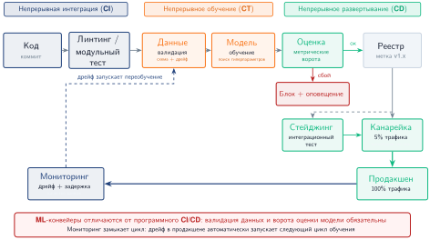

***Конвейер ML CI/CD:** автоматизированный процесс превращает код и данные в развернутый сервис. Этапы: валидация данных (проверки схемы и дрейфа), обучение, оценка (метрические ворота), регистрация артефакта и поэтапное развертывание (канареечная выкатка). Петли обратной связи автоматически запускают переобучение или оповещения, если ворота не пройдены.*

1. Валидация данных фиксирует версию данных и отвергает сбои схемы, свежести или распределения до того, как они потратят мощности обучения.
2. Инжиниринг признаков сохраняет контракт признаков между обучением и обслуживанием, чтобы изменения предобработки не превращались в незаметные регрессии в производстве.
3. Обучение фиксирует код, данные, гиперпараметры, аппаратные рамки и начальные значения генератора случайных чисел (seed), чтобы перспективный артефакт можно было позже воспроизвести или оспорить.
4. Оценка сравнивает кандидата с базовыми моделями, метриками по срезам, бюджетами задержки и задачно-специфичными воротами, прежде чем на него будет направлен пользовательский трафик.
5. Генерация артефакта упаковывает модель вместе с конфигурацией обслуживания, версиями зависимостей и целью отката.
6. Регистрация записывает артефакт в реестр моделей вместе с происхождением, согласованиями и правом на развертывание.

Каждый этап должен выполняться независимо и быть идемпотентным: если конвейер падает на оценке, перезапуск не должен заново выполнять валидацию данных и инжиниринг признаков, если их входные данные не изменились.

#### Оркестрация конвейера

Конвейерам обучения нужны системы оркестрации, которые делают явными порядок зависимостей, распределение ресурсов и восстановление после сбоев. Оркестратор представляет процесс как ориентированный ациклический граф (DAG), отслеживает зависимости между этапами, повторяет временно неудачные шаги без перезапуска не затронутой работы, распределяет дефицитные ресурсы, такие как GPU и память, кэширует промежуточные результаты, если входные данные не изменились, и записывает журналы и артефакты для последующей отладки.

Распространенные варианты оркестрации: Kubeflow Pipelines[^fn-kubeflow-pipeline-orchestration] (Bisong, 2019), Airflow с расширениями для ML и облачные решения вроде Vertex AI Pipelines или SageMaker Pipelines. Выбор зависит от того, какие контракты зависимостей и ресурсов платформа должна обеспечивать, а также от существующей инфраструктуры, опыта команды и требований к масштабу. Оркестрация фиксирует контракт выполнения, а параметризация фиксирует контракт вариаций: один и тот же граф может работать с разными данными, моделями и аппаратными рамками, не превращаясь каждый раз в новую программу.

[^fn-kubeflow-pipeline-orchestration]: **Kubeflow**: открытая ML-платформа, выпущенная Google в 2018 году, которая связывает оркестрацию конвейеров с управлением ресурсами Kubernetes. Ключевое системное следствие: поскольку DAG Kubeflow выражают и вычислительные зависимости, и запросы ресурсов, оркестратор может планировать шаги обучения с интенсивным использованием GPU только тогда, когда ускорители доступны. Так предотвращается конкуренция за ресурсы, которая делает ручное планирование многомодельных парков обучения неприемлемым.

#### Параметризация конвейера

Эффективные конвейеры отделяют конфигурацию от кода (см. листинг ниже).

```{.yaml}
training_pipeline:
  model_type: transformer_ranking
  data:
    train_path: gs://data/train/2024-01-*
    eval_path: gs://data/eval/2024-01-15
    schema_version: v3.2
  features:
    user_features: [embedding, history, demographics]
    item_features: [embedding, attributes, popularity]
  training:
    epochs: 10
    batch_size: 4096
    learning_rate: 0.001
    optimizer: adam
    hardware: 4xA100
  evaluation:
    metrics: [ndcg_10, mrr, coverage]
    baseline_model: ranking_v2.1.0
```

Такое разделение делает обучение управляемым конфигурацией: платформа может менять версии данных, перебор гиперпараметров, записи о воспроизводимости и переопределения ресурсов для конкретной среды, не переписывая код конвейера. Файл параметров также является артефактом аудита. Когда кандидатная модель позднее доходит до ворот выпуска, платформа может восстановить, какой срез данных, какой набор признаков, какая аппаратная рамка и какая конфигурация порогов ее породили. Такое происхождение превращает валидацию из разового суждения в воспроизводимый контракт.

### Контрольные ворота валидации

Контрольные ворота валидации определяют, должна ли обученная модель двигаться к производству. Эффективные ворота балансируют тщательность и скорость развертывания. Ворота выпуска — это пакет доказательств, а не одна оценка: качество модели, задержка, ограничения политики и справедливости, качество данных и эксплуатационная готовность отвечают каждая за свой режим отказа, прежде чем модель может безопасно получить трафик.

#### Ворота производительности

Валидация производительности сравнивает кандидатную модель с абсолютными порогами, которые модель должна превышать, с относительными базовыми значениями, которые она должна совпадать или превосходить с текущей производственной версией, и с историческими трендами, от которых она не должна регрессировать относительно недавней траектории качества. Многокритериальную проверку демонстрирует листинг ниже.

```python
def evaluate_performance_gate(
    candidate_metrics, production_metrics, thresholds
):
    """
    Проверить, проходит ли кандидатная модель ворота производительности.

    Возвращает кортеж (passed: bool, reasons: list)
    """
    reasons = []

    # Проверка абсолютного порога
    if candidate_metrics["ndcg_10"] < thresholds["min_ndcg"]:
        reasons.append(
            f"NDCG_10 {candidate_metrics['ndcg_10']:.4f} ниже минимума {thresholds['min_ndcg']}"
        )

    # Проверка относительного улучшения
    relative_improvement = (
        candidate_metrics["ndcg_10"] - production_metrics["ndcg_10"]
    ) / production_metrics["ndcg_10"]
    if relative_improvement < thresholds["min_improvement"]:
        reasons.append(
            f"Улучшение {relative_improvement:.2%} ниже минимума {thresholds['min_improvement']:.2%}"
        )

    # Проверка регрессии вторичных метрик
    for metric in ["mrr", "coverage"]:
        if candidate_metrics[metric] < production_metrics[metric] * (
            1 - thresholds["max_regression"]
        ):
            reasons.append(
                f"Регрессия {metric} превышает допуск {thresholds['max_regression']:.2%}"
            )

    return (len(reasons) == 0, reasons)
```

#### Ворота задержки

Производственные модели должны соответствовать требованиям к задержке. Валидация должна измерять задержку инференса на репрезентативном оборудовании, проверять ее при ожидаемых уровнях пропускной способности и учитывать эффекты батчинга, если они применимы. [Таблица](#tbl-ops-scale-latency-gates) задает пороги задержки по типам моделей: для обнаружения мошенничества требования самые строгие (5 мс p50, 20 мс p99 с немедленной блокировкой при нарушении), а LLM допускают более широкие границы (500 мс p50, 2000 мс p99), отражающие их иные эксплуатационные ограничения.

<a id="tbl-ops-scale-latency-gates"></a>

***Пороги задержки по типам моделей:** производственные требования к задержке (p50 и p99) и действия ворот при превышении порогов. Обнаружение мошенничества задает самые строгие требования (5 мс p50, 20 мс p99) с блокировкой высокого приоритета, что отражает реальное время обработки транзакций. LLM допускают более широкие границы (500 мс p50, 2000 мс p99), но требуют оптимизации до одобрения развертывания.*

| **Тип модели**          | **Целевое p50** | **Целевое p99** | **Действие при превышении**            |
|:------------------------|:---------------:|:---------------:|:---------------------------------------|
| **LLM**                 |     500 мс      |    2000 мс      | Блокировать развертывание, требовать оптимизацию |
| **Рекомендации**        |     10 мс       |     50 мс       | Блокировать развертывание              |
| **Обнаружение мошенничества** |   5 мс      |     20 мс       | Блокировать развертывание, высокий приоритет |
| **Зрение**              |     50 мс       |    200 мс       | Предупреждение, условное одобрение     |

Ворота задержки ловят явные нарушения производительности, но некоторые регрессии проходят все ворота и все равно ухудшают продукт. Самые опасные отказы семантически скрыты: допустимые выходы построены на испорченных входах.

> **Пример: тихая регрессия модели**
>
> **Сценарий**: высоконагруженная модель ранжирования продукта ($25\,000\text{ QPS}$) проходит офлайн-валидацию и ворота задержки обслуживания ($L_{\text{lat}} < 12\text{ мс}$), но после развертывания вызывает падение конверсии на 3,2 процента.
>
> **Диагноз**: обновление схемы на восходящем уровне привело к тому, что ключевой признак сходства с пользователем возвращал `null` для 8 процентов запросов. Слой обслуживания незаметно заменял `null` на `0.0` — допустимое вещественное значение, — поэтому частота HTTP-ошибок и задержка оставались нормальными, а качество предсказаний деградировало без оповещения в течение 48 часов.
>
> **Системный урок**: синтаксически допустимые импутации признаков вызывают семантически скрытые сбои в производстве. Автоматические конвейеры выпуска и системы мониторинга должны оценивать сдвиги распределения ($\Delta D_{\text{vol}}$) наравне с доступностью системы и целевыми уровнями обслуживания (SLO) по задержке.

#### Ворота справедливости

Концепции справедливости становятся операционными на этапе выпуска, когда политические решения кодируются как пороги. Для моделей, затрагивающих пользователей, валидация справедливости[^fn-fairness-validation-tradeoff] превращает политическое обязательство в ворота выпуска. Платформа не может просто спросить, «справедлива ли модель», потому что в разных контекстах справедливость определяется по-разному. В эксплуатации эти определения впервые появляются как исполняемые пороги. [Уравнение](#eq-demographic-parity) выражает один операционный выбор: вероятность положительного предсказания не должна различаться между защищаемыми группами $a$ и $b$ больше чем на порог $\epsilon$. [Уравнение](#eq-equalized-odds) задает более строгий выбор из семейства равенства шансов: поведение предсказаний должно быть схожим между группами при условии истинного исхода (Hardt et al., 2016).

[^fn-fairness-validation-tradeoff]: **Валидация справедливости в машинном обучении**: существует несколько определений справедливости (демографический паритет, равенство шансов, калибровка), и выполнить их одновременно в реалистичных условиях, как правило, невозможно (Chouldechova, 2017; Kleinberg et al., 2017). Это навязывает проектное решение: автоматические ворота валидации должны кодировать, какое определение справедливости приоритетно для организации, так что сама конфигурация ворот становится политическим решением, которое нельзя передать общему порогу.

$$\text{Демографический паритет: } |\Pr(\hat{Y}=1 \mid A=a) - \Pr(\hat{Y}=1 \mid A=b)| < \epsilon$$

<a id="eq-demographic-parity"></a>

$$\text{Равенство шансов: } |\Pr(\hat{Y}=1 \mid Y=y, A=a) - \Pr(\hat{Y}=1 \mid Y=y, A=b)| < \epsilon, \quad \forall y \in \{0,1\}$$

<a id="eq-equalized-odds"></a>

где $A$ — защищаемый признак, $\hat{Y}$ — предсказание модели, а $Y$ — истинный исход. Практический смысл не в том, что каждые ворота должны обеспечивать каждое определение. Ворота должны фиксировать, какое определение выбрала организация, сравнивать измеренное значение как с историческими базовыми уровнями, так и с абсолютными порогами, и направлять пограничные случаи на проверку человеком, поскольку результат справедливости, близкий к порогу, — тоже управленческое решение.

#### Ворота качества данных

До обучения или развертывания валидация качества данных проверяет, что данные обладают ожидаемыми свойствами (Caveness et al., 2020). Соответствие схеме проверяет, что все обязательные поля присутствуют и имеют правильные типы. Статистические свойства гарантируют, что распределения признаков остаются в ожидаемых границах. Проверки свежести подтверждают, что данные не устарели сверх допустимых порогов. Проверка полноты гарантирует, что доля пропусков остается в допуске.

Эти ворота ловят проблемы, которые иначе проявились бы как загадочная деградация модели, и завершают пакет доказательств перед развертыванием. Риск переходит от валидности артефакта к воздействию живого трафика. Следующий контроль — уже не еще одна офлайн-оценка, а объем производственного трафика, который разрешено использовать для проверки артефакта в реальных условиях.

### Стратегии поэтапной выкатки

Поэтапная выкатка — механизм, который превращает риск развертывания в управляемый бюджет экспозиции. Трафик растет только тогда, когда модель заслуживает каждый больший радиус поражения, продолжая показывать приемлемое качество.

> **Сценарий: безопасность поэтапной выкатки**
>
> **Задача**: команда развертывает новую модель ранжирования. «Сине-зеленое» развертывание (переключение 100 процентов трафика) подвергает всех пользователей любым возможным ошибкам. Канареечное развертывание начинается с 5 процентов трафика. Насколько подход с канарейкой снижает «экспозицию риска» развертывания?
>
> **Расчет**:
> Экспозиция риска пропорциональна доле трафика, затронутой за время окна обнаружения.
>
> 1. **Экспозиция сине-зеленого развертывания**: 100 процентов пользователей затронуты до отката.
> 2. **Экспозиция канарейки**: 5 процентов пользователей затронуты до отката.
> 3. **Снижение риска**: $100 / 5 = 20\times$.
>
> **Системный вывод**: поэтапная выкатка — это страховой полис для качества модели. Ограничение начальной экспозиции 5 процентами сокращает радиус поражения катастрофического сбоя в 20 раз. В парке машинного обучения, где поведение модели вероятностно и трудно поддается модульным тестам, постепенная экспозиция — единственный надежный способ гарантировать, что «современный уровень на бумаге» не превратится в «сломано в производстве».

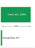

*Канареечная выкатка снижает начальную экспозицию в 20 раз.*

#### Сине-зеленое развертывание

Сине-зеленое развертывание поддерживает два одинаковых производственных окружения. Текущая версия (синяя) обслуживает трафик, пока готовится новая (зеленая). Когда она готова, трафик мгновенно переключается на зеленую.

Стоимость такого дублирования для ML-систем качественно отличается от случая веб-сервисов без сохранения состояния. Рекомендательная или языковая модель, которой для хранения весов в VRAM нужно несколько GPU, не может разделить эту память между окружениями: сине-зеленое развертывание большой модели означает одновременное хранение двух полных копий весов на параллельных выделениях ускорителей. Загрузка весов в память GPU также занимает заметное время (десятки секунд или минуты для контрольных точек размером в несколько гигабайт), поэтому выгода «мгновенного отката» предполагает, что веса остаются прогретыми в резервном окружении на протяжении всего окна развертывания. Эффективная стоимость — это не просто удвоенная инфраструктура обслуживания, а удвоенное резервирование памяти GPU на время перехода. Многие организации, работающие с большими моделями, рассматривают сине-зеленое развертывание как теоретическую возможность и на практике полагаются на канареечное или теневое развертывание, потому что емкость оборудования и стоимость делают дублирующее выделение непрактичным.

Сине-зеленое развертывание дает простую умственную модель и полное тестирование в окружении, эквивалентном производственному, до экспозиции. Но оно требует дублирующего выделения GPU и памяти на время перехода, не дает постепенной экспозиции для выявления тонких регрессий качества и опирается на бинарное переключение, которое может пропустить проблемы, проявляющиеся только в масштабе. Этот шаблон подходит для низкорисковых изменений легких моделей, где постепенная выкатка дает мало дополнительной безопасности, а стоимость дублирующей мощности приемлема.

#### Канареечное развертывание

Канареечное развертывание[^fn-canary-traffic-deployment] направляет небольшую долю трафика на новую версию, одновременно отслеживая регрессии. Если метрики остаются приемлемыми, доля трафика растет, пока новая версия не начнет обслуживать весь трафик.

[^fn-canary-traffic-deployment]: **Канареечное развертывание**: назван по практике шахтеров, которые брали с собой канареек, чтобы обнаруживать ядовитые газы, — небольшая жертва, защищающая всех. Для ML-систем аналогия точна: регрессии моделей обычно проявляются как постепенная деградация точности, а не как падения, поэтому они незаметны для проверок работоспособности, но обнаруживаются статистическим сравнением трафика канарейки и контрольного трафика. Без этапов канарейки слегка деградировавшая модель может дойти до 100 процентов трафика прежде, чем кто-либо заметит потерю.

Типичная последовательность идет от 1 процента к 5, 25, 50 и 100 процентам по мере накопления доказательств. Определение длительности каждого этапа критически важно. [Уравнение](#eq-canary-duration) связывает длительность этапа с требуемым объемом выборки, частотой запросов и долей трафика, позволяя точно рассчитать минимальную длительность канарейки для статистической достоверности:

$$T_{\text{stage}} = \frac{n_{\text{samples needed}}}{r_{\text{requests}} \times p_{\text{stage}}}$$

<a id="eq-canary-duration"></a>

где $T_{\text{stage}}$ — длительность, требуемая при данной доле трафика, $n_{\text{samples needed}}$ — число наблюдений, необходимое для статистической значимости, $r_{\text{requests}}$ — частота запросов, а $p_{\text{stage}}$ — доля трафика.

#### Разбор на примере: расчет длительности канарейки

Модель обслуживает 1 миллион запросов в час. Чтобы с 95-процентной достоверностью обнаружить изменение доли кликов (CTR) на 1 процент, требуется примерно 10 000 наблюдений на вариант.

При 1-процентном трафике канарейки: $T_{1\%} = \frac{10\,000}{1\,000\,000 \times 0.01} = 1\text{ ч}$. При 5-процентном трафике канарейки: $T_{5\%} = \frac{10\,000}{1\,000\,000 \times 0.05} = 0.2\text{ ч} = 12\text{ мин}$.

Организация может настроить пять этапов выкатки:

- 1 процент в течение 2 часов (2$\times$ минимума для запаса)
- 5 процентов в течение 30 минут
- 25 процентов в течение 30 минут
- 50 процентов в течение 1 часа
- 100 процентов развертывания

Общая выкатка занимает примерно 4 часа до уверенного развертывания.

> **Сценарий: цена запоздалого оповещения**
>
> **Задача**: команда развертывает модель рекомендаций, в которой есть скрытая ошибка: она снижает CTR на 0,5 процентного пункта (10 процентов относительно), с 5 до 4,5 процента. Если сервис обрабатывает 5 000 запросов в секунду и каждый клик стоит 0,50 \$, сколько выручки теряется, если обнаружение и устранение занимают 24 часа?
>
> **Расчет**:
>
> 1. **Всего запросов**: 5 000 запросов/с $\times$ 86 400 с/сутки = 432 000 000 запросов.
> 2. **Потерянные клики**: 432 000 000 запросов $\times$ 0,005 = 2 160 000 потерянных кликов.
> 3. **Общий финансовый ущерб**: 2 160 000 потерянных кликов $\times$ 0,50 \$/клик = 1 080 000 \$.
>
> **Системный вывод**: «незначительное» снижение на 0,5 процентного пункта у высоконагруженной модели — это ущерб в 1 080 000 \$ в день. MLOps — по сути управление экономическим риском. Каждый час, отнятый у «времени до обнаружения» с помощью канареечных развертываний и автоматического мониторинга дрейфа, напрямую переходит в сохраненную выручку. В стеке парка мониторинг — это «страховой полис», который защищает деловую ценность модели.

### Координация многорегионального развертывания

В главе «Отказоустойчивость» разобраны контрольные точки, эластичное обучение и механизмы восстановления для обработки сбоев внутри распределенных заданий обучения. Многорегиональное развертывание использует ту же идею отказоустойчивости (сохранять полезную работу и состояние при сбоях) в плоскости инференса, где координация между географическими регионами создает задачи, которых нет в эксплуатации одного региона. Согласованность версий модели, маршрутизация трафика во время переходов и скоординированный откат требуют явного проектирования протокола, чтобы предотвратить смешанное обслуживание версий, которое может испортить валидность A/B-теста и пользовательский опыт.

#### Проблемы координации

Многорегиональное развертывание ML вносит две нагрузки на координацию, которых нет при выкатке сервисов без состояния. Во-первых, артефакты моделей велики: ансамбль разреженных и плотных моделей производственной системы рекомендаций может требовать десятков и сотен гигабайт данных контрольных точек, а обслуживание инференса большой языковой модели — сотен гигабайт на реплику. Распределение этих артефактов по глобальным сетям до того, как регион сможет обслуживать трафик, — это задача планирования с ограниченной пропускной способностью, а не простая отправка конфигурации из метаданных. Во-вторых, большинство ML-моделей не несут свой контекст в запросе; они получают его из хранилища признаков. Если регион B уже получил новый файл модели, но его региональное хранилище признаков еще не синхронизировало последние эмбеддинги пользователей, этот регион будет выдавать деградировавшие предсказания, несмотря на технически успешное развертывание. Поэтому проверка готовности ML-региона должна подтверждать файл модели, согласованность хранилища признаков и исправность обслуживания как одно связное состояние.

Смешанное обслуживание версий — режим отказа, который определяет многорегиональное развертывание. Протокол выкатки должен сохранять связную границу версий, даже когда часы, объем трафика, маршрутизация и поведение отката различаются по регионам.

Рассогласование часов и координация по времени создают неоднозначность в границах фаз канарейки. Когда развертывание начинается в 14:00 UTC, регион A может начать 1-процентную канарейку, а регион B из-за сетевых задержек или эксплуатационных различий все еще обслуживает старую версию. Определение фаз развертывания по настенному времени приводит к несогласованному опыту: пользователи, пересекающие границы регионов, встречают разные версии модели, поэтому производственным системам нужны логические состояния выкатки в дополнение к отметкам времени.

Региональные колебания трафика превращают один и тот же процент в разные статистические свидетельства. Глобальная 1-процентная канарейка может означать 5 процентов трафика в регионе с малым объемом, чего достаточно для статистической значимости, но лишь 0,3 процента в регионе с большим объемом, что, возможно, недостаточно. Размеры выборок по регионам должны проверяться независимо, прежде чем платформа станет считать канарейку доказательством.

Маршрутизация запросов между регионами превращает региональный перекос в несогласованность, видимую пользователю. Пользователей могут направлять в разные регионы в зависимости от задержки, балансировки нагрузки или переключения на резерв. Пользователь, чьи запросы в течение окна развертывания проходят через несколько регионов, может получать предсказания от разных версий модели, что нарушает предпосылки о согласованности, на которых основан анализ A/B-тестов.

Откат — последний тест на согласованность. Откат одного региона, пока другие продолжают обслуживать новую версию, создает ту же проблему смешанных версий, которую призвана предотвращать аккуратная координация развертывания, поэтому откат должен быть частью протокола выкатки, а не импровизированным аварийным действием.

#### Стратегии развертывания

Многорегиональная координация выбирает, где платить налог на выкатку: в большей длительности развертывания, в более строгой синхронизации или в ограниченном региональном перекосе. Три архитектурных подхода делают разные компромиссы:

- **Последовательная региональная выкатка**: регионы развертываются по одному, полностью проходя цикл канарейки в каждом регионе, прежде чем начнется следующий. Это максимизирует безопасность, ограничивая радиус поражения одним регионом, но пропорционально увеличивает общую длительность развертывания с ростом числа регионов.
- **Синхронизированная глобальная выкатка**: все регионы одновременно поддерживают одинаковое состояние развертывания. Сервис глобальной координации переводит регионы между фазами канарейки в одну и ту же логическую отметку времени, давая пользователям согласованный опыт, но превращая любую региональную проблему в часть глобального решения о развертывании.
- **Гибридная выкатка**: координатор развертывания задает минимальные и максимальные границы фаз, а внутри них регионы продвигаются независимо. Регионы могут ускоряться по фазам, если локальные метрики сильны, или приостанавливаться при появлении проблем, а глобальные ограничения не дают версиям чрезмерно расходиться.

Правильный выбор зависит от того, что для развертывания важнее всего: минимальный радиус поражения, глобальная согласованность или ограниченная региональная независимость.

Для консервативной последовательной выкатки по 5 регионам типичная последовательность такова:

1. Регион-канарейка (наименьший трафик): полный цикл канарейки, 24–48 часов
2. Регионы ранних последователей (2 региона, 20 процентов глобального трафика): параллельное развертывание, 24–48 часов
3. Основные регионы (2 региона, 70 процентов глобального трафика): параллельное развертывание, 24–48 часов
4. Финальная проверка: проверка согласованности между регионами, 12–24 часа

Общая длительность развертывания: 3,5–7 дней для консервативной выкатки.

#### Управление трафиком во время переходов

Сохранение согласованности запросов во время переходов развертывания требует трех средств управления маршрутизацией, которые поддерживают целостность эксперимента и пользовательского опыта:

- **Липкая маршрутизация** (sticky routing): запросы пользователя постоянно направляются в один и тот же регион на протяжении окна развертывания, обычно через согласованное хеширование по идентификатору пользователя. Пользователи стабильно видят либо старую, либо новую версию и никогда не смешивают их внутри одной сессии.
- **Закрепление версии** (version pinning): клиенты включают хеш версии модели в запрос, а инфраструктура обслуживания направляет его на реплики, работающие с этой версией. Это поддерживает постепенную миграцию клиентов независимо от состояния развертывания на стороне сервера.
- **Изоляция запросов** (request isolation): межрегиональный трафик отключается во время критических фаз развертывания. Во время оценки канарейки это гарантирует, что метрики отражают поведение одного региона, а не смешанные схемы маршрутизации.

Эти средства сохраняют статистический смысл метрик развертывания, пока пользователи перемещаются через меняющийся парк.

#### Модели согласованности для развертывания

Выбор модели согласованности влияет и на сложность развертывания, и на валидность метрик развертывания. [Таблица](#tbl-multi-region-consistency) сравнивает модели согласованности развертывания для многорегиональных систем: строгая согласованность гарантирует одинаковые версии во всех регионах (необходимо для финансовых прогнозов), но требует больших издержек координации, тогда как конечная согласованность допускает независимое продвижение, подходящее для рекомендаций контента, ценой временного расхождения версий:

<a id="tbl-multi-region-consistency"></a>

***Модели согласованности для многорегионального развертывания:** три гарантии согласованности с их сценариями использования и издержками координации. Строгая согласованность (все регионы обслуживают одинаковые версии) необходима для финансовых прогнозов, но требует высоких издержек синхронизации. Конечная согласованность позволяет регионам продвигаться независимо и подходит для рекомендаций контента, но может давать временное расхождение версий.*

| **Модель**            | **Гарантия**                              |         **Сценарий использования**     | **Издержки координации**      |
|:----------------------|:------------------------------------------|:--------------------------------------:|:------------------------------|
| **Строгая**           | Все регионы обслуживают одинаковую версию | Финансовые прогнозы, критичные к безопасности | Высокие (глобальная синхронизация) |
| **Конечная**          | Регионы сходятся к одной версии           |        Рекомендации контента           | Низкие (независимое продвижение) |
| **Ограниченное отставание** | Регионы отстоят друг от друга не более чем на $k$ версий | Ранжирование в реальном времени | Средние (мониторинг версий)   |

Для валидности A/B-тестирования обслуживание модели обычно требует строгой согласованности внутри групп воздействия. Если часть пользователей, назначенных в группу воздействия, получает предсказания старой версии из-за времени развертывания, измеренный эффект воздействия размывается. Конечная согласованность между группами допустима, поскольку каждая группа анализируется независимо.

#### Координация отката

Откат многорегионального развертывания требует аккуратной координации, чтобы предотвратить колебания и смешанное обслуживание версий. Протокол отката имеет две упорядоченные фазы:

1. **Глобальная остановка трафика на новую версию**: координатор развертывания рассылает намерение отката, ждет, пока каждый регион подтвердит, что прекратил направлять новый трафик на новую версию, и позволяет запросам в полете завершиться. Регионы, не подтвердившие до истечения таймаута, помечаются как неисправные.
2. **Глобальное восстановление старой версии**: координатор подтверждает, что все регионы обслуживают только старую версию, возобновляет обычную маршрутизацию трафика, очищает состояние развертывания и готовит систему к повторной попытке позже.

Протокол гарантирует, что ни в какой момент одни регионы не обслуживают новую версию, в то время как другие уже откатились: это создало бы несогласованный пользовательский опыт.

Частичный откат позволяет откатывать отдельные регионы, пока другие продолжают работу. Это уместно, когда проблемы специфичны для региона (инфраструктурные сбои, региональные схемы трафика), а не присущи модели. Координатор развертывания отслеживает состояние по регионам и не допускает несогласованных глобальных решений на основе неполной информации.

#### Разбор на примере: накладные расходы многорегиональной координации

Система рекомендаций развертывается в 5 регионах со средней межрегиональной задержкой 80 мс. Протокол координации требует пяти шагов:

1. Объявить намерение развертывания (рассылка во все регионы): 80 мс
2. Получить подтверждения (ожидание самого медленного региона): 80 мс
3. Выполнить фазу развертывания (локально в регионе): переменная величина
4. Подтвердить завершение (рассылка): 80 мс
5. Получить подтверждения (ожидание самого медленного региона): 80 мс

Минимальные накладные расходы координации на переход между фазами: 320 мс только на сам протокол синхронизации. Для развертывания с 5 фазами канарейки координация добавляет 1,6 секунды к общей длительности развертывания, что незначительно по сравнению с часами, проведенными в каждой фазе.

Однако сервис координации становится критической зависимостью. Если координатор выходит из строя во время развертывания, возможны три варианта поведения в зависимости от модели согласованности:

- При строгой согласованности: все регионы замирают в текущем состоянии до восстановления координатора
- При конечной согласованности: регионы продолжают независимое продвижение, потенциально расходясь
- При ограниченном отставании: регионы продолжают работу, а отказ координатора запускает оповещения, если отставание выходит за границы

Организации, развертывающие модели, критичные к безопасности, обычно резервируют координатор с помощью протоколов консенсуса (Raft, Paxos), которые переживают отказ одного узла и сохраняют гарантии согласованности.

### Эксперименты в производстве как ворота выпуска

Когда координация выкатки сохраняет границы версий, следующий вопрос — безопасно ли выставлять кандидатную модель пользователям. Теневой трафик, чередование, A/B-тесты и проверки сетевых эффектов образуют лестницу экспериментов: каждый шаг дает более сильное производственное свидетельство ценой больших эксплуатационных издержек. Поэтому производственный эксперимент — это ворота выпуска, а не открытый поиск прироста метрики. До начала экспозиции запись о выпуске должна назвать инвариантные метрики, порог решения, максимальный радиус поражения для пользователей и инфраструктуры, правило остановки, владельца отката и доказательства, необходимые для продвижения. Кандидат, который улучшает основную метрику, но исчерпывает запас по задержке, надежности, справедливости или стоимости, не проходит ворота.

#### Теневое развертывание и воспроизведение трафика

Теневое развертывание запускает новую модель параллельно с производственной: она получает те же входные данные и записывает выходы, но не влияет на результаты, видимые пользователю ([рисунок](#fig-shadow-deployment)). Это дает самую точную тестовую среду, которая возможна без реальной экспозиции, и позволяет обнаруживать проблемы, ускользающие от офлайн-валидации.

<a id="fig-shadow-deployment"></a>

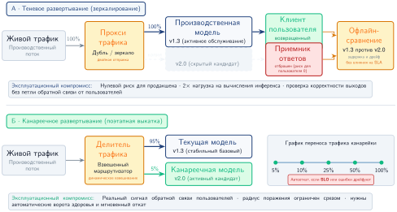

***Архитектура теневого развертывания:** производственный трафик асинхронно дублируется в теневую модель. Маршрутизатор немедленно возвращает пользователю производственный ответ, а оба ответа записываются для офлайн-сравнения качества и операционной валидации.*

Теневое развертывание окупает издержки на дублирующую инфраструктуру, когда отвечает на вопросы валидации, на которые не могут ответить офлайн-тесты. Нагрузочное тестирование в эксплуатации доказывает, что новая модель может выдержать полный объем производственного трафика, не падая, не теряя память и не нарушая целевые показатели задержки SLO.[^fn-slo-three-nines] Модель, которая проходит офлайн-валидацию на малых наборах данных, может проявить утечки памяти, регрессии производительности или конкуренцию за ресурсы при обработке миллионов запросов в час. Теневое развертывание ловит такие операционные проблемы до влияния на пользователей.

[^fn-slo-three-nines]: **Целевой уровень обслуживания (SLO)**: целевой уровень надежности; для API обслуживания модели доступность «три девятки» (99,9 процента) допускает всего 8,7 часа простоя в год. Для задержки SLO по P99 в 200 мс означает, что 99 процентов запросов должны завершаться быстрее 200 мс. Выполнение таких целей в масштабе требует автоматического масштабирования и автоматических выключателей (circuit breaker) для обработки всплесков нагрузки.

Когда теневой путь изолирован, сигнал валидации поступает из сравнения поведения при реальном трафике. Сравнение выходов выявляет сдвиги распределения, выбросы и крайние случаи, которые скрывают агрегированные офлайн-метрики: для моделей классификации это может показать систематические сдвиги в оценках уверенности, а для рекомендательных систем — изменения в разнообразии или распределении категорий. Поведенческая валидация ловит отказы на редких входах, которые появляются нечасто в валидационных наборах, но тысячи раз в день встречаются в производственном трафике. Характеризация производительности измеряет фактическую задержку, пропускную способность и потребление ресурсов, проверяя допущения о мощности до того, как модель получит видимый пользователям трафик.

Теневое развертывание требует захвата и воспроизведения производственного трафика, и выбор способа воспроизведения определяет компромисс между точностью, стоимостью и свежестью. Три архитектурных шаблона решают разные эксплуатационные задачи.

**Живое зеркалирование** дублирует каждый производственный запрос в теневую модель в реальном времени. Производственная модель отвечает пользователю, а теневая обрабатывает тот же вход параллельно. Это дает немедленную валидацию в полном производственном масштабе, но требует теневой инфраструктуры, способной выдержать 100-процентную нагрузку трафика. Чтобы этот путь валидации не стал производственной зависимостью, система обслуживания должна вызывать теневые запросы асинхронно, задавать таймауты, сбрасывать теневую нагрузку, когда она отстает, и изолировать ресурсы, чтобы теневая работа не влияла на производственные ответы.

**Выборочное воспроизведение** зеркалирует настраиваемую долю производственного трафика на теневые модели. Это снижает инфраструктурные издержки, сохраняя статистическую мощность для валидации: теневая модель, получающая 10 процентов трафика, все равно обрабатывает сотни тысяч запросов в день в масштабе, чего достаточно для обнаружения большинства проблем. Политика выборки определяет, какие отказы остаются видимыми при меньшей стоимости. Случайная выборка проста и несмещенна, стратифицированная выборка сохраняет представительство пользовательских сегментов и типов запросов, а адаптивная выборка увеличивает долю для тех шаблонов, где выходы теневой и производственной моделей расходятся.

**Пакетное воспроизведение** собирает журналы производственного трафика и асинхронно воспроизводит их на теневых моделях. Это отделяет теневую валидацию от ограничений задержки производства, позволяет проводить регрессионные тесты быстрее реального времени на исторических данных и дает возможность оптимизировать стоимость вне пиковых часов. Та же развязка ослабляет сигнал для систем, чувствительных к свежести: валидация запаздывает на часы или дни, требует постоянной инфраструктуры логирования, может воспроизводить зависящие от времени признаки с устаревшим контекстом и не может проверить эксплуатационные характеристики реального времени.

Эффективное теневое развертывание требует количественных метрик сравнения, выходящих за рамки простой точности, поскольку решается вопрос, ведет ли себя кандидат как производственная модель под реальной нагрузкой. Расхождение выходов измеряет, насколько теневые предсказания отличаются от производственных: системы классификации отслеживают долю несогласий, сдвиги вероятностей и концентрацию по классам, а системы регрессии вычисляют среднеквадратичную ошибку между теневыми и производственными выходами. Метрики производительности сравнивают распределения задержки, пропускную способность и потребление ресурсов: модель с той же точностью, но на 50 процентов более высокой задержкой P99, требует корректировки мощности инфраструктуры до развертывания.

Набор метрик должен также отделять эксплуатационные сбои от реальных изменений модели. Метрики режимов ошибок считают таймауты, исключения, некорректные выходы и пустые предсказания. Теневая модель, которая завершается таймаутом на 0,1 процента запросов, дает 1 000 сбоев в день при объеме 1 млн запросов в день, а шаблоны запросов, вызывающие эти сбои, направляют устранение. Статистическая валидация затем определяет, отражают ли наблюдаемые различия реальные изменения модели или случайные колебания. Поскольку производственная и теневая модели обрабатывают одни и те же 100 тыс. запросов, их исходы парные. Определим бинарный отказ относительно размеченного исхода или валидационного оракула. Пусть $b$ — число запросов, на которых производственная модель отказывает, а теневая — нет, а $c$ — число запросов, на которых теневая модель отказывает, а производственная — нет. Критерий Макнемара для больших выборок использует несогласованные пары:

$$\chi^2 = \frac{(b-c)^2}{b+c}$$

Для теста с одной степенью свободы при $\alpha_{\text{sig}} = 0.05$ отвергаем равенство вероятностей отказа, когда $\chi^2 > 3.84$. Доли отказов в 1 и 1,5 процента сами по себе эту статистику не определяют; необходимо сохранять парные несогласованные счетчики $b$ и $c$.

#### Разбор на примере: рабочий процесс теневого развертывания

Модель обнаружения мошенничества обрабатывает 5 млн транзакций в день. Команда разрабатывает новую архитектуру модели, которая, как ожидается, улучшит точность при сохранении полноты. Рабочий процесс теневого развертывания начинается с фазы выборочной тени: 10 процентов трафика зеркалируются в течение трех дней, так что теневая инфраструктура обрабатывает 500 тыс. запросов в день. Наблюдаемая полнота теневой модели составляет 94,2 процента против 94,5 процента в производстве, что статистически не отличается, а точность растет с 82,3 до 87,1 процента со статистической значимостью. Задержка P99 теневой модели достигает 45 мс против 38 мс в производстве, что приемлемо при SLO в 50 мс, поэтому команда переходит к полной тени.

Фаза полной тени зеркалирует 100 процентов трафика в течение пяти дней. Это подтверждает, что прирост точности сохраняется в полном масштабе, но также выявляет крайний случай: теневая модель помечает 0,02 процента транзакций как ошибки из-за неожиданного распределения признаков, то есть 1 000 транзакций в день. Первопричина — повышенная чувствительность к выбросам по сумме транзакции. После корректировки порогов обрезки признаков и повторного развертывания тени доля ошибок падает до 0,001 процента, и это открывает ворота для канареечного развертывания.

Послевыкатная валидация затем сравнивает фактические производственные метрики с теневыми предсказаниями. Точность в производстве составляет 87,3 процента против 87,1 процента в тени, что находится в пределах ожидаемой вариации. В этом случае теневое развертывание успешно предсказало поведение в производстве.

#### Инфраструктура теневого развертывания

Эксплуатация теневых развертываний в масштабе требует инфраструктуры, которая сохраняет сигнал валидации, не возмущая производство. Слой зеркалирования трафика перехватывает производственные запросы и дублирует их в теневые окружения, обрабатывая логику маршрутизации, решения о выборке, применение таймаутов и изоляцию ошибок, чтобы сбои тени не могли повлиять на производство. Инфраструктура логирования и сравнения фиксирует выходы производственной и теневой моделей, вычисляет метрики расхождения и хранит результаты для анализа. Высоконагруженные системы могут генерировать терабайты данных сравнения, поэтому проектирование хранения и запросов становится частью архитектуры валидации.

Операционный слой замыкает цикл. Оповещения и панели мониторинга выводят статистически значимые расхождения, регрессии производительности и повышенную частоту ошибок тем, кто принимает решения о развертывании, а детализированные представления показывают шаблоны запросов, объясняющие расхождение. Изоляция ресурсов не дает теневым нагрузкам забирать производственную мощность через отдельные пулы вычислений, распределение сетевой полосы и мощность баз данных. В облачных развертываниях такую изоляцию часто обеспечивают отдельными кластерами; в локальных развертываниях нужно явное разбиение ресурсов.

#### Когда теневое развертывание необходимо

Теневое развертывание наиболее ценно, когда стоимость дублирующей инфраструктуры меньше стоимости необнаруженной регрессии в производстве:

- новые архитектуры моделей, для которых офлайн-валидация может пропустить специфичные для производства режимы отказа
- модели высокой ставки (финансовые, медицинские, критичные к безопасности), где производственные проблемы имеют тяжелые последствия
- модели со сложными зависимостями от признаков реального времени, которые офлайн-воспроизведение не может полностью проверить
- развертывания, чувствительные к производительности, где регрессии задержки или пропускной способности должны выявляться до влияния на пользователей
- регуляторная среда, требующая доказательств валидации до производства

Оно менее критично, когда риск развертывания ограничен, а откат дешев:

- мелкие обновления модели (переобучение с той же архитектурой), поведение которых в производстве хорошо изучено
- модели с низким риском, где быстрый откат приемлем
- среды с ограниченными ресурсами, где стоимость теневой инфраструктуры превышает пользу от валидации

Поэтому решение здесь экономическое не меньше, чем техническое: платите за теневую валидацию, когда дублирующая мощность покупает информацию о риске, которую не могут дать офлайн-тесты и дешевый откат.

#### Эксперименты с чередованием

Эксперименты с чередованием[^fn-interleaving-evaluation-efficiency] были разработаны для оценки ранжирования и поиска (Chapelle et al., 2012) и также используются в экспериментах персонализации рекомендаций (Netflix Technology Blog, 2017). Вместо разделения пользователей между вариантами чередование показывает каждому пользователю элементы обоих вариантов, а затем измеряет, с какими элементами пользователи взаимодействуют.

[^fn-interleaving-evaluation-efficiency]: **Эксперименты с чередованием**: первоначально разработаны для оценки поисковых систем. Чередование объединяет результаты двух ранжировщиков в один список, показываемый каждому пользователю, а затем засчитывает клики тому ранжировщику, который дал элемент (Chapelle et al., 2012). Оно может требовать гораздо меньше выборок, чем A/B-тестирование, поскольку каждый пользователь дает прямое внутрисубъектное сравнение, а не только межпопуляционный сигнал. Для рекомендательных систем парка, которые итерируют по многим вариантам моделей, этот выигрыш в эффективности выборки напрямую переходит в более быстрые циклы экспериментов и меньшие упущенные выгоды от неоптимальных моделей в производстве.

Ключевая идея — статистическая эффективность. Эксперимент с чередованием может требовать гораздо меньше выборок, чем A/B-тест, а Netflix сообщает о более чем 100$\times$ меньшем числе пользователей для некоторых экспериментов с ранжированием (Netflix Technology Blog, 2017), поскольку каждый пользователь дает прямые сравнительные сигналы, а не вносит вклад только в агрегированную статистику.

Реализация чередования:

1. Оба варианта модели оценивают всех кандидатов
2. Результаты чередуются методом командного драфта (team draft) или вероятностным чередованием
3. Взаимодействия пользователя засчитываются варианту-источнику
4. Статистические тесты определяют победивший вариант

Чередование необходимо для рекомендательных систем, где быстрое обнаружение небольших изменений вовлеченности ускоряет итерации; [рисунок](#fig-interleaving-vs-ab) сопоставляет эту чувствительность с традиционным A/B-тестированием.

<a id="fig-interleaving-vs-ab"></a>

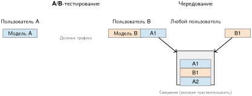

***Чередование против A/B-теста:** при классическом A/B-тесте (слева) пользователь видит только один вариант. При чередовании (справа) пользователь видит смешанный список. Клики по элементам засчитываются ранжировщику-источнику, что дает сигнал более высокой чувствительности, контролирующий дисперсию конкретного пользователя.*

#### Статистические основы A/B-тестирования

Статистические трудности экспериментов умножаются в масштабе платформы. A/B-тестирование дает строгие рамки для сравнения вариантов модели (Kohavi et al., 2009; Kohavi et al., 2020), но требует внимания к статистической мощности,[^fn-ab-testing-power] порогам значимости и поправке на множественное тестирование.

[^fn-ab-testing-power]: **Мощность A/B-теста**: вероятность того, что эксперимент правильно обнаруживает реальный эффект ($1-\beta_{\text{stat}}$, обычно 0,8). В масштабе парка системная задача — статистическая мощность: если ожидаемое улучшение мало (например, 0,1 процента), эксперименту может понадобиться миллионы выборок, чтобы достичь статистической значимости, расходуя существенные ресурсы обслуживания $(C_{\text{infer}})$ на протяжении недель.

#### Расчет размера выборки

Неправильные статистические практики приводят либо к ложноположительным результатам, которые тратят инженерные ресурсы, либо к ложноотрицательным, которые пропускают реальные улучшения. Поэтому необходимый размер выборки для обнаружения эффекта выбирается по четырем параметрам: уровню значимости $(\alpha_{\text{sig}})$, статистической мощности $(1-\beta_{\text{stat}})$, базовой доле конверсии $(p)$ и минимальному обнаруживаемому эффекту $(\delta)$. [Уравнение](#eq-ops-scale-ab-sample-size) формализует эту связь для сравнения двух долей и показывает, что требуемые выборки обратно пропорциональны квадрату минимального обнаруживаемого эффекта:

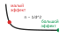

*Обнаружение меньших эффектов резко увеличивает требуемый размер выборки.*

$$n_{\text{sample}} = \frac{(z_{1-\alpha_{\text{sig}}/2} + z_{1-\beta_{\text{stat}}})^2 \times 2p(1-p)}{\delta^2}$$

<a id="eq-ops-scale-ab-sample-size"></a>

где $z_{1-\alpha_{\text{sig}}/2}$ — двустороннее критическое значение для уровня значимости $\alpha_{\text{sig}}$ (обычно 1,96 при $\alpha_{\text{sig}} = 0.05$), $z_{1-\beta_{\text{stat}}}$ — критическое значение для мощности (обычно 0,84 для мощности 80 процентов), $p$ — базовая доля, а $\delta$ — минимальный обнаруживаемый эффект как абсолютная разница.

#### Разбор на примере: размер выборки для модели рекомендаций

У системы рекомендаций базовый CTR составляет 5 процентов. Команда хочет обнаружить относительное улучшение на 10 процентов (0,5 процентного пункта в абсолютном выражении) с 95-процентной достоверностью и 80-процентной мощностью.

Параметры:

- $z_{1-\alpha_{\text{sig}}/2} = 1.96$ (95-процентная достоверность, двусторонняя)
- $z_{1-\beta_{\text{stat}}} = 0.84$ (80-процентная мощность)
- $p = 0.05$ (базовый CTR)
- $\delta = 0.005$ (улучшение на 0,5 процентного пункта)

Расчет:

$$n_{\text{sample}} = \frac{(1.96 + 0.84)^2 \times 2 \times 0.05 \times 0.95}{0.005^2}$$

$$n_{\text{sample}} = \frac{7.84 \times 0.095}{0.000025} = \frac{0.7448}{0.000025} = 29\,792$$

Каждому варианту требуется примерно 30 000 выборок, всего 60 000 наблюдений. При 1 млн запросов в день этот эксперимент занимает менее 2 часов. Однако для модели с базовым CTR в 1 процент, которая обнаруживает относительное улучшение на 5 процентов (0,05 процентного пункта), расчет дает:

$$n_{\text{sample}} = \frac{7.84 \times 2 \times 0.01 \times 0.99}{0.0005^2} = \frac{0.1552}{0.00000025} = 620\,800$$

Теперь каждому варианту нужно примерно 621 тыс. выборок. При 1 млн запросов в день, поделенных поровну между двумя вариантами, эксперимент занимает около 30 часов. Чем ниже базовая доля и меньше эффект, тем дольше должен идти эксперимент.

#### Проверка статистической значимости

После сбора данных двухвыборочный z-тест для долей определяет, является ли наблюдаемая разница статистически значимой. [Уравнение](#eq-ab-ztest) вычисляет тестовую статистику как разность наблюдаемых долей, нормированную объединенной стандартной ошибкой:

$$z = \frac{\hat{p}_B - \hat{p}_A}{\sqrt{\hat{p}(1-\hat{p})(\frac{1}{m_A} + \frac{1}{m_B})}}$$

<a id="eq-ab-ztest"></a>

где $\hat{p}_A$ и $\hat{p}_B$ — наблюдаемые доли конверсии в контроле и воздействии, $m_A$ и $m_B$ — размеры выборок, а $\hat{p} = \frac{m_A\hat{p}_A + m_B\hat{p}_B}{m_A + m_B}$ — объединенная доля. Если $|z| > Z_{\alpha_{\text{sig}}}$, отвергаем нулевую гипотезу и заключаем, что варианты значимо различаются.

#### Поправка на множественное тестирование

Одновременный или последовательный запуск нескольких A/B-тестов без поправки завышает ошибку семейства (familywise error rate). При 20 независимых тестах на уровне $\alpha_{\text{sig}} = 0.05$ вероятность хотя бы одного ложноположительного результата составляет:

$$\Pr(\text{хотя бы один ложноположительный результат}) = 1 - (1-\alpha_{\text{sig}})^k = 1 - 0.95^{20} = 0.642$$

Результат — 64-процентный шанс ложно обнаружить улучшение. Три подхода к поправке решают эту проблему.

Поправка Бонферрони сужает порог значимости до $\alpha_{\text{sig}}' = \frac{\alpha_{\text{sig}}}{k}$ для $k$ тестов. Она консервативна, но проста. Для 20 тестов при $\alpha_{\text{sig}} = 0.05$ используется $\alpha_{\text{sig}}' = 0.0025$ для каждого теста. Это контролирует ошибку семейства, но снижает статистическую мощность.

Поправка Шидака дает менее консервативную корректировку. [Уравнение](#eq-sidak-correction) вычисляет порог для каждого теста, который точно поддерживает заданную ошибку семейства и дает немного больше мощности, чем Бонферрони:

$$\alpha_{\text{sig}}' = 1 - (1-\alpha_{\text{sig}})^{1/k}$$

<a id="eq-sidak-correction"></a>

Для 20 тестов: $\alpha_{\text{sig}}' = 1 - 0.95^{1/20} = 0.00256$, что немного мягче поправки Бонферрони.

Контроль доли ложных открытий (FDR) по процедуре Бенджамини — Хохберга допускает заданную долю ложноположительных результатов среди всех отвержений. Это уместно, когда некоторые ложноположительные результаты допустимы. Упорядочим p-значения от меньшего к большему: $p_{(1)} \leq p_{(2)} \leq \ldots \leq p_{(k)}$. Найдем наибольшее $i$, при котором:

$$p_{(i)} \leq \frac{i}{k} \times \alpha_{\text{sig}}$$

Отвергаем все гипотезы $H_{(1)}, \ldots, H_{(i)}$. Эта процедура дает более высокую статистическую мощность, чем Бонферрони, при большом числе тестов.

#### Последовательное тестирование и раннее прекращение

Традиционные A/B-тесты фиксируют размер выборки заранее и оценивают результат один раз. Последовательное тестирование позволяет отслеживать результаты в ходе сбора данных с обоснованными правилами раннего прекращения. Это может сократить длительность эксперимента на 50 процентов и более при контроле ошибок.

Последовательный критерий отношения правдоподобия (SPRT) оценивает отношение правдоподобий после каждого наблюдения:

$$\Lambda_m = \frac{p(X_1, \ldots, X_m \mid H_1)}{p(X_1, \ldots, X_m \mid H_0)}$$

Остановить и отвергнуть $H_0$, если $\Lambda_m \geq \frac{1-\beta_{\text{stat}}}{\alpha_{\text{sig}}}$; остановить и принять $H_0$, если $\Lambda_m \leq \frac{\beta_{\text{stat}}}{1-\alpha_{\text{sig}}}$; в остальных случаях продолжать сбор данных.

Для крупномасштабного A/B-тестирования групповые последовательные методы делят эксперимент на плановые этапы анализа. На каждом этапе тестовая статистика сравнивается со скорректированными порогами (вычисляемыми такими методами, как границы О'Брайена — Флеминга или Покока), которые поддерживают общий $\alpha_{\text{sig}}$.

#### Практические соображения внедрения

Реальное A/B-тестирование сталкивается с осложнениями, выходящими за рамки учебной статистики. Эффекты переноса (carryover) возникают, когда пользователи, попавшие в воздействие, сохраняют изменения поведения после возврата в контроль. Это нарушает допущение о независимости, поэтому смягчение требует достаточных периодов «отмывки» (washout) или стабильного назначения на основе cookie.

Сетевые эффекты возникают, когда воздействие на пользователя A меняет поведение пользователя B через взаимодействие. Это нарушает допущение о стабильности значения воздействия на единицу (SUTVA), поэтому смягчение использует кластерную рандомизацию на уровне сетевого сообщества, хотя это снижает статистическую мощность (Rubin, 1980; Hudgens и Halloran, 2008; Eckles et al., 2017).

Эффекты новизны возникают, когда новые варианты модели показывают искусственное улучшение, потому что пользователи реагируют на новизну, а не на реальное превосходство. Смягчение — увеличение длительности эксперимента (обычно 2–4 недели), чтобы увидеть поведение в установившемся режиме.

Выбор метрик может вводить в заблуждение, когда суррогатные метрики (клики, вовлеченность) не согласуются с долгосрочными целями (удержание, выручка). Смягчение — отслеживание как краткосрочных суррогатных метрик, так и долгосрочных контрольных метрик (guardrail), даже если последние требуют более длительного наблюдения.

#### Разбор на примере: сценарий множественного тестирования

Команда платформы проводит 30 A/B-тестов в квартал, сравнивая кандидатные модели. При использовании $\alpha_{\text{sig}} = 0.05$ без поправки ожидается $30 \times 0.05 = 1.5$ ложноположительных результата за квартал. За год ожидается примерно 6 моделей, ошибочно признанных улучшениями, что тратит инженерные усилия на развертывания без реальной ценности.

Применяя поправку Бонферрони: $\alpha_{\text{sig}}' = \frac{0.05}{30} = 0.00167$ для каждого теста. Это требует больших выборок. Для примера модели рекомендаций из раздела «Разбор на примере: размер выборки для модели рекомендаций» (базовый уровень 5 процентов, эффект 0,5 процентного пункта) исходное требование составляло 30 тыс. выборок на вариант. При двусторонней поправке Бонферрони критическое значение возрастает примерно до 3,14, и требование увеличивается примерно до 60 тыс. выборок на вариант.

При контроле FDR на уровне $q = 0.05$: при многократном использовании процедура Бенджамини — Хохберга контролирует ожидаемую долю ложных открытий среди отвергнутых гипотез. Если 10 из 30 тестов объявлены значимыми, цель — ожидаемая доля ложных открытий 5 процентов среди этих открытий, а не жесткий максимум их числа в этом квартале. Это дает лучшую мощность, чем Бонферрони, при большом числе тестов.

Выбор метода поправки зависит от последствий ложноположительных результатов. Для решений высокой ставки (финансовые модели, системы, критичные к безопасности) используйте консервативную поправку Бонферрони. Для исследовательского анализа, где пропуск истинных эффектов дорог, используйте контроль FDR.

> **Контрольные вопросы: ошибка семейства при множественном тестировании**
>
> Методы поправки: Бонферрони, Шидака и Бенджамини — Хохберга. Примените рассуждение о семействе ошибок к платформе меньшего масштаба.
>
> - [ ] **Ошибка семейства**: для 20 одновременных A/B-тестов в квартал при $\alpha_{\text{sig}} = 0.05$ без поправки рассчитайте ожидаемое число ложноположительных результатов и ошибку семейства при независимости.
> - [ ] **Поправка Бонферрони**: примените поправку Бонферрони, рассчитайте порог для каждого теста $\alpha_{\text{sig}}'$, вычислите ошибку семейства после поправки и сравните ее с непоправленной.
> - [ ] **Бонферрони или FDR**: для 20 тестов, где команда ожидает, что большинство кандидатов действительно улучшат метрику, выберите поправку Бонферрони или контроль FDR по процедуре Бенджамини — Хохберга и обоснуйте компромисс статистической мощности.

### Нарушения SUTVA и сетевые эффекты

Статистические расчеты, представленные выше, опираются на фундаментальное допущение: независимость пользователей. Воздействие, назначенное одному пользователю, не должно менять исход другого. Если пользователь A получает улучшенный алгоритм рекомендаций, поведение пользователя B должно оставаться неизменным, ведь пользователь B никогда не видел нового алгоритма. Это допущение о независимости лежит в основе всех расчетов размера выборки и проверок значимости, представленных выше.

Социальные платформы систематически нарушают это допущение. Когда пользователь A получает более качественные рекомендации контента, он делится этим контентом со своей сетью, включая пользователя B из контрольной группы. Вовлеченность пользователя B меняется, хотя он ни разу не видел воздействия. Контрольное условие загрязняется не из-за ошибки эксперимента, а из-за естественной механики сетевых продуктов.

Формально стандартное A/B-тестирование опирается на SUTVA: исход $Y_i(w)$ пользователя $i$ зависит только от его собственного назначения $w$, но не от воздействий, назначенных другим пользователям (Rubin, 1980). Это допущение систематически нарушается в сетевых продуктах и распределенных ML-системах, что приводит к смещенным оценкам эффекта, которые могут ввести в заблуждение решения о развертывании (Hudgens и Halloran, 2008; Eckles et al., 2017).

#### Категории сетевых эффектов

Сетевые эффекты проявляются в трех основных формах, и каждая требует собственных методов обнаружения и смягчения:

- **Прямые сетевые эффекты**: воздействие на пользователя A напрямую влияет на исход пользователя B через взаимодействия на платформе. В эксперименте с ранжированием ленты пользователи из группы воздействия могут делиться с пользователями контрольной группы алгоритмически оптимизированным контентом, смещая измеренные эффекты к нулю, потому что контрольные пользователи частично получают воздействие через распространение в сети.
- **Косвенные сетевые эффекты**: рыночные механизмы влияют на всех пользователей независимо от их индивидуального назначения. Эксперимент с ценообразованием в сервисе такси, который повышает вознаграждение водителей в группе воздействия, может привлечь больше водителей в целом, так что пользователи контрольной группы получают меньшее время ожидания, а измеренный эффект воздействия занижает истинную выгоду.
- **Эффекты перетекания (spillover)**: эффекты воздействия распространяются за географические или временные границы. Локальный эксперимент с рекомендациями может сдвинуть поток посетителей ресторанов и сигналы популярности в соседних районах, изменяя качество рекомендаций для близких контрольных пользователей.

Во всех трех случаях эксперимент уже не измеряет независимые индивидуальные эффекты воздействия на уровне пользователя.

#### Количественная оценка нарушений SUTVA

Величина смещения от сетевых эффектов зависит от структуры сети и корреляции исходов. Для экспериментов с рандомизацией по кластерам [уравнение](#eq-sutva-vif) дает распространенное приближение эффекта дизайна, которое количественно определяет, как внутрикластерная корреляция раздувает дисперсию оценок эффекта воздействия и напрямую определяет необходимое увеличение размера выборки для эквивалентной мощности:

$$\text{DEFF} \approx 1 + (m - 1)\rho$$

<a id="eq-sutva-vif"></a>

где $m$ — средний размер кластера, а $\rho$ — внутрикластерная корреляция исходов (насколько похожи исходы внутри связанных групп пользователей). Этот коэффициент показывает, во сколько раз должны вырасти выборки для достижения эквивалентной статистической мощности. Сетевая интерференция может также смещать саму оценку эффекта воздействия, поэтому раздувание дисперсии — лишь часть поправки.

#### Разбор на примере: сетевое смещение в социальных рекомендациях

Социальная платформа тестирует новый алгоритм ранжирования ленты. Индивидуальная рандомизация пользователей назначает 50 процентов пользователей в группу воздействия.

Условия эксперимента:

- 10 млн пользователей, в среднем по 150 связей у каждого
- Коэффициент кластеризации $C = 0.4$ (типично для социальных сетей)
- Исход: ежедневные минуты вовлеченности

Результаты наивного анализа:

- Группа воздействия: в среднем 45,2 минуты
- Контрольная группа: в среднем 43,8 минуты
- Измеренный эффект: +1,4 минуты (+3,2 процента)

Однако сетевой анализ показывает, что у пользователей контрольной группы в среднем около половины связей находятся в группе воздействия, как и ожидается при независимой индивидуальной рандомизации. Эти связи делятся контентом с алгоритмическим усилением, который видят пользователи контрольной группы, и это завышает вовлеченность контрольной группы.

Скорректированный анализ с взвешиванием по обратной вероятности (inverse probability weighting) для сетевой экспозиции дает:

- Скорректированная базовая линия контроля: 42,3 минуты (что показала бы контрольная группа без перетекания)
- Истинный эффект воздействия: +2,9 минуты (+6,9 процента)
- Нарушение SUTVA завысило контроль на 1,5 минуты, вдвое уменьшив измеренный эффект

При внутрикластерной корреляции $\rho = 0.15$ и среднем размере экспериментального кластера $m = 1.4$ эффективных пользователя:

$$\text{DEFF} = 1 + (1.4 - 1) \times 0.15 = 1.06$$

Этот упрощенный расчет дает раздувание дисперсии на 6 процентов и потребовал бы выборок на 6 процентов больше для эквивалентной мощности. Однако поправка смещения гораздо важнее, чем корректировка дисперсии.

#### Обнаружение нарушений

Обнаружение нарушений SUTVA требует явного измерения сетевой экспозиции через три взаимодополняющие проверки:

- **Анализ эго-сети**: измерьте экспозицию каждого контрольного пользователя к воздействию через его связи, используя $e_i = |\{j \in \mathcal{N}_i : W_j = 1\}| / |\mathcal{N}_i|$, где $\mathcal{N}_i$ — множество связей контрольного пользователя $i$, а $W_j$ указывает назначение пользователя $j$. Если исходы контрольной группы коррелируют с $e_i$, сетевые эффекты присутствуют; регрессия исходов контроля на экспозицию количественно определяет величину перетекания.
- **Тесты интерференции**: сравните исходы контрольных пользователей с высокой и низкой экспозицией воздействию. При SUTVA эти группы должны показывать одинаковые исходы, поэтому значимые различия указывают на сетевое загрязнение.
- **Временной анализ**: проверьте, распространяются ли эффекты воздействия во времени. Если метрики контрольной группы изо дня в день сближаются с метриками группы воздействия, перетекание накапливается через сеть.

Вместе эти проверки превращают перетекание из скрытого нарушения допущения в измеримое условие эксперимента.

#### Подходы к смягчению

Когда нарушения SUTVA обнаружены, четыре изменения дизайна эксперимента позволяют восстановить валидные причинные оценки:

- **Рандомизация по графовым кластерам**: воздействие назначается на уровне сообщества, а не отдельного пользователя. Алгоритмы разбиения графа, такие как Louvain или спектральная кластеризация, делят граф пользователей на кластеры с плотными внутренними связями и редкими межкластерными ребрами, после чего кластеры рандомизируются, так что пользователи в основном взаимодействуют с теми, кто находится в том же условии. Цена — сниженная статистическая мощность: при $k$ кластерах эффективный размер выборки становится $k$, а не общим числом индивидуальных пользователей.
- **Дизайн с исключением эго-сети**: пользователи, чья сетевая экспозиция превышает порог, исключаются из анализа. Анализ только контрольных пользователей с минимальным числом связей из группы воздействия, например $e_i < 0.05$, гарантирует, что контрольное условие остается незагрязненным, ценой размера выборки.
- **Эксперименты с переключением (switchback)**: все пользователи чередуют воздействие и контроль по временным периодам, например часам или дням. Поскольку все пользователи получают оба условия, перекрестного загрязнения между пользователями внутри периодов нет, а анализ сравнивает исходы между временными периодами, а не между пользователями.
- **Географические эксперименты**: географические границы действуют как естественные барьеры для сетевых эффектов. Для сервисов, зависящих от места, рандомизация на уровне города или региона устраняет большинство путей перетекания, потому что пользователи разных городов редко взаимодействуют напрямую.

Правильный дизайн — тот, который устраняет доминирующий путь интерференции, не разрушая статистической мощности.

#### Практическая реализация

Внедрение A/B-тестирования с учетом сети требует инвестиций в инфраструктуру:

- конвейеры графового анализа, которые вычисляют сетевые статистики и назначения кластеров
- расчет экспозиции для каждого пользователя на основе статуса воздействия его связей
- модифицированные статистические тесты, учитывающие кластерную рандомизацию
- панели мониторинга с индикаторами перетекания

Для рекомендательных систем в масштабе инженерные затраты оправданы величиной смещения, которое вносят сетевые эффекты. Система, измеряющая улучшение на 3 процента, когда истинный эффект составляет 6 процентов, может ошибочно отвергнуть ценные изменения модели или ошибочно приоритизировать худшие альтернативы.

### Сквозной контракт оценки

Лестница экспериментов дает свидетельства, но свидетельства с разных этапов полезны, только если относятся к одному кандидату и одному решению. **Контракт оценки** — это версионированная запись о выпуске, которая связывает модель и ее зависимости с нагрузкой, метриками, статистическим дизайном, порогами приемки, условиями отката и ответственными владельцами. [Таблица](#tbl-ops-scale-evaluation-contract) собирает эту запись так, чтобы кандидат не мог пройти офлайн-проверку качества на одном наборе данных, проверку производительности на более легком профиле нагрузки и онлайн-оценку при третьей конфигурации.

<a id="tbl-ops-scale-evaluation-contract"></a>

***Сквозной контракт оценки:** выпуск модели принимается по одной версионированной записи, которая охватывает офлайн-поведение, производительность, эквивалентную производственной, специализированные гарантии, онлайн-эксперименты и восстановление. У каждой плоскости есть и владелец свидетельств, и условие, по которому истекает ее утверждение.*

| **Плоскость свидетельств** | **Что должен фиксировать контракт**                                                                                                                                  | **Правило принятия или аннулирования**                                                                                                                                                                | **Ответственный владелец**                       |
|:---------------------------|:--------------------------------------------------------------------------------------------------------------------------------------------------------------------|:------------------------------------------------------------------------------------------------------------------------------------------------------------------------------------------------------|:-------------------------------------------------|
| Офлайн-поведение           | Версия оценочного набора, основная метрика, значимые срезы, базовый уровень, свидетельства неопределенности и тесты робастности из [главы «Устойчивый ИИ»]                              | Продвигать, только если заранее заданные границы агрегата и срезов выполняются; аннулировать, если популяция, определение метки или назначение выходят за пределы проверенной области                   | Владелец модели и предметный эксперт              |
| Системная производительность | Аппаратная и программная рамка, модель нагрузки (открытая или закрытая петля), параллелизм, состав запросов, прогрев, задержка p50 и хвостовая задержка, пропускная способность, ошибки и стоимость ресурсов | Продвигать только при нагрузочном контракте, эквивалентном производственному; аннулировать, если исчерпан запас мощности или бюджет SLO                                                              | Владельцы обслуживания и надежности (SRE)         |
| Ответственность и безопасность | Срезы справедливости, свидетельства приватности и безопасности, требования к затронутым сторонам и утверждения о гарантиях из [главы «Ответственный ИИ»]                            | Продвигать только тогда, когда заявленные утверждения имеют достаточные свидетельства и проверку; аннулировать при существенном изменении, отказе контроля или сигнале неограниченного вреда          | Владелец риска и орган управления                 |
| Онлайн-эксперимент         | Единица назначения, контрольная группа (holdout), минимально обнаруживаемый эффект, мощность, размер выборки, доверительный интервал, поправка на множественное тестирование, правило остановки и контрольные метрики (guardrail) | Продвигать только после прохождения запланированного правила решения; останавливать и откатывать, когда любая контрольная метрика пересекает заранее заданный порог                                  | Владелец эксперимента и владелец продуктового решения |
| Восстановление и аудит     | Артефакт отката и зависимости, окна срабатывания, срок хранения свидетельств, версии данных и кода, окружение, seed, сырые агрегированные счетчики и одобрения                       | Отклонять экспозицию без проверенного отката; вновь открывать решение, если свидетельства нельзя воспроизвести или сохранить на период, требуемый для проверки                                         | Владелец выпуска, владелец платформы и хранитель аудита |

Приемка намеренно распределена, но полномочия на продвижение однозначны. Владельцы модели и предметной области принимают предсказательную полезность; владелец обслуживания принимает мощность и надежность; специализированные владельцы рисков принимают ограниченные утверждения о робастности, справедливости, приватности и безопасности. Назначенный орган выпуска продвигает модель только тогда, когда все необходимые подтверждения относятся к одному и тому же артефакту. Платформа автоматизирует ворота и сохраняет свидетельства, но не может выбирать продуктовую цель и не может отменить проваленное утверждение о гарантиях.

Аннулирование — обратный путь через контракт. Дрейф за пределы оцененной популяции, изменение признака или определения метки, исчерпанный запас по задержке, статистически подтвержденная регрессия контрольной метрики или существенное изменение управления возвращают кандидата к ответственным воротам. Пороги и цели отката фиксируются до экспозиции, чтобы кажущийся прирост основной метрики не мог переопределить успех после того, как результат известен. Воспроизводимость требует сохранять входы этого решения, а не только его вердикт: снимок набора данных и трафика, версии модели и кода, окружение и аппаратную рамку, начальные значения генератора случайных чисел (seed), правила назначения и выборки, достаточные статистики или разрешенные журналы, одобрения и точный артефакт отката.

### Управление граничным парком

Эксплуатационные задачи, рассмотренные до сих пор, предполагают контролируемую среду дата-центра. Однако в главе «Граничный интеллект» показано, что федеративное обучение и ML на устройстве распространяют «парк машинного обучения» на миллионы разнородных граничных устройств с ограниченной связью, энергией и вычислительной мощностью. Управление этой распределенной популяцией вводит три различные задачи MLOps.

Три ограничения взаимодействуют, поэтому их нужно решать как одну задачу проектирования эксплуатации, а не как независимые замечания. [Таблица](#tbl-ops-scale-edge-fleet-controls) сопоставляет каждое ограничение с необходимым контролем платформы, включая валидацию с аппаратом в контуре и федеративную аналитику.

<a id="tbl-ops-scale-edge-fleet-controls"></a>

***Средства управления граничным парком:** граничные операции связывают задержку выкатки, гетерогенность устройств и наблюдаемость с ограничениями приватности. Уровень управления должен восстанавливать глобальное состояние парка по частичным сигналам, сохраняя совместимость со многими активными версиями моделей.*

| **Ограничение граничного парка** | **Почему оно возникает**                                                                                                                                  | **Управляющий контроль платформы**                                                                                                              |
|:---------------------------------|:------------------------------------------------------------------------------------------------------------------------------------------------------------|:------------------------------------------------------------------------------------------------------------------------------------------------|
| Экстремальное рассогласование версий | Выкатки могут длиться недели или месяцы, потому что устройства офлайн, с низким зарядом или в ограниченных сетях. В любой момент может оставаться активными 50 версий модели. | Поддерживать обратно совместимые конвейеры данных и контракты обслуживания для моделей, развернутых месяцами ранее.                              |
| Валидация с учетом устройства | Пороги точности не показывают, превышает ли модель бюджет памяти микроконтроллера в 1 МБ или вызывает ли тепловое троттлинг в SoC смартфона.            | Добавить валидацию с аппаратом в контуре (hardware-in-the-loop) на физических или эмулированных целевых устройствах перед продвижением.           |
| Телеметрия с ограничениями приватности | Сырые предсказания нельзя непрерывно передавать обратно: правила приватности и стоимость полосы ограничивают наблюдаемость.                        | Использовать федеративную аналитику: устройства вычисляют локальные статистики, например частоту ошибок или дрейф, и передают только агрегированные, обезличенные сигналы состояния. |

### Управление риском выкатки

Не все развертывания несут одинаковый риск. Эффективные системы CI/CD классифицируют развертывания по профилю риска и обрабатывают их соответственно. [Таблица](#tbl-ops-scale-risk-categories) задает выбор стратегии выкатки по риску, сопоставляя четыре категории риска подходящим стратегиям: мелкие исправления проходят через быструю канарейку, а критические изменения ядра модели требуют полной последовательности — теневого развертывания, проверки человеком и поэтапной выкатки.

#### Классификация риска

[Уравнение](#eq-rollout-risk) формализует риск развертывания как произведение вероятности регрессии, тяжести последствий и уровня экспозиции, давая количественную основу для решений о выкатке на основе риска:

$$R_{\text{rollout}} = p_{\text{regression}} \times I_{\text{regression}} \times E_{\text{exposure}}$$

<a id="eq-rollout-risk"></a>

где $p_{\text{regression}}$ — вероятность того, что изменение вызывает регрессию, $I_{\text{regression}}$ — тяжесть последствий, если регрессия произошла, а $E_{\text{exposure}}$ — уровень экспозиции в период выкатки.

Система оценки риска выкатки предлагает три стратегии смягчения:

- Снизить $p_{\text{regression}}$: более тщательное тестирование до развертывания
- Снизить $I_{\text{regression}}$: архитектурные шаблоны, которые ограничивают радиус поражения
- Снизить $E_{\text{exposure}}$: более медленные выкатки с меньшей начальной долей трафика

Эти рычаги превращают скалярную формулу риска в политику выкатки: каждая категория риска определяет, сколько доказательств собрать, насколько малым должен оставаться радиус поражения и насколько медленно должна расти экспозиция.

#### Категории риска

Уравнение риска становится применимым только тогда, когда платформа сопоставляет измеренный риск с политикой выкатки. [Таблица](#tbl-ops-scale-risk-categories) переводит вероятность, ущерб и экспозицию в позицию развертывания: изменения низкого риска могут пройти быструю канарейку, а критичные для безопасности изменения требуют теневой валидации, проверки человеком и более медленного расширения трафика.

<a id="tbl-ops-scale-risk-categories"></a>

***Выбор стратегии выкатки по риску:** четыре качественные категории риска, сопоставленные со стратегиями развертывания. Команды вычисляют численный риск выкатки по [уравнению](#eq-rollout-risk), а затем выбирают шаблон выкатки, соответствующий полученному профилю риска.*

| **Категория** | **$p_{\text{regression}}$** | **$I_{\text{regression}}$** | **Стратегия выкатки**           |
|:--------------|:---------------------------:|:---------------------------:|:-------------------------------:|
| **Низкий**    |   Мелкое исправление кода   |   Ограниченное влияние на пользователей | Быстрая канарейка               |
| **Средний**   |      Переобученная модель   |      Эффекты вовлеченности  | Стандартная канарейка           |
| **Высокий**   |     Новая архитектура       |      Влияние на выручку     | Расширенная тень + медленная канарейка |
| **Критический** |    Изменение ядра модели   |   Последствия для безопасности | Тень + проверка человеком + поэтапная выкатка |

#### Автоматические триггеры отката

Категории риска определяют, насколько осторожно должен расширяться трафик, а триггеры отката определяют, когда расширение должно прекратиться. Конфигурация триггеров отката в листинге ниже делает это условие остановки исполняемым: каждая отслеживаемая метрика связывается с порогом, окном наблюдения и минимальным числом выборок.

```python
rollback_config = {
    "metrics": {
        "engagement_rate": {
            "threshold": -0.02,  # относительное падение на 2% запускает откат
            "window_minutes": 15,
            "min_samples": 1000,
        },
        "error_rate": {
            "threshold": 0.01,  # абсолютный рост на 1% запускает откат
            "window_minutes": 5,
            "min_samples": 500,
        },
        "latency_p99": {
            "threshold": 1.5,  # относительный рост на 50% запускает откат
            "window_minutes": 5,
            "min_samples": 100,
        },
    },
    "rollback_action": "immediate",  # или 'gradual' для менее серьезных проблем
    "notification": ["oncall", "model-owner"],
}
```

Автоматический откат должен балансировать чувствительность и ложные срабатывания. Требования статистической значимости (минимальное число выборок, длительность окна) не дают преждевременно откатывать развертывание из-за случайных колебаний и одновременно позволяют быстро реагировать на настоящие регрессии.

### Шаблоны CI/CD по типам моделей

Тип модели определяет, какое ограничение CI/CD является определяющим: семантическое качество, мощность вовлеченности, состязательная срочность или точность классификации. [Таблица](#tbl-ops-scale-cicd-patterns) сопоставляет шаблоны CI/CD по типам моделей: LLM требуют конвейеров с воротами качества, где оценка людьми занимает дни или недели, тогда как обнаружение мошенничества использует конвейеры с пороговыми воротами, обеспечивающие развертывание за часы и откат за секунды, чтобы противостоять состязательной динамике.

<a id="tbl-ops-scale-cicd-patterns"></a>

***Шаблоны CI/CD по типам моделей:** фокус валидации, скорость выкатки и возможности отката различаются по типам моделей. LLM требуют конвейеров с воротами качества, где оценка людьми для развертывания занимает дни или недели, тогда как обнаружение мошенничества использует конвейеры с пороговыми воротами, обеспечивающие развертывание за часы и автоматический откат за секунды, чтобы противостоять состязательной динамике.*

| **Шаблон**            | **Тип модели** | **Фокус валидации**    | **Скорость выкатки** | **Скорость отката** |
|:----------------------|:--------------:|:----------------------:|:-------------------:|:-------------------:|
| **С воротами качества** |     LLM        | Оценка людьми, безопасность | Дни–недели       |        Часы         |
| **Управляемый метриками** | Рекомендации | Метрики вовлеченности  |   Часы–дни          |       Минуты        |
| **С пороговыми воротами** | Мошенничество | Точность/полнота      |        Часы         |       Секунды       |
| **Ориентированный на точность** |   Зрение   | Метрики классификации  |        Дни          |       Минуты        |

Для LLM определяющим ограничением является семантическое и безопасное качество, поэтому конвейер намеренно медленный. Автоматическая оценка на бенчмарках MMLU, HumanEval и похожих задачах сужает набор кандидатов; оценка людьми проверяет выборочные выходы по категориям возможностей; проверка безопасности включает red-teaming и тесты на токсичность; теневое развертывание измеряет сигналы удовлетворенности пользователей; а медленная поэтапная выкатка дает выпуску продолжительный период проверки под нагрузкой. Полный цикл от кандидатной модели до полного развертывания может занимать 2–4 недели, поскольку основной риск — тонкая регрессия, которую обычные автоматические метрики не замечают.

Системы рекомендаций определяются свежестью и мощностью вовлеченности, поэтому конвейер ставит на первое место быстрое, но статистически обоснованное сравнение. Офлайн-оценка нормализованного дисконтированного накопленного выигрыша (NDCG) и полноты отсеивает кандидатные модели; чередование сравнивает кандидата с производственной базовой линией на одних и тех же запросах; статистические тесты решают, изменилась ли вовлеченность; а быстрая канарейка автоматически продвигает модель или откатывает ее. Плановые обновления могут завершаться за 24–48 часов, поскольку цена устаревших рекомендаций может превышать цену тщательно ограниченного эксперимента.

Модели мошенничества определяются состязательной срочностью. Конвейер по-прежнему оценивает размеченные случаи мошенничества, проверяет долю ложных срабатываний на легитимном трафике и выставляет теневые оценки транзакциям, чтобы сравнить точность и полноту, но он спроектирован вокруг быстрого развертывания с возможностью мгновенного отката, потому что атакующие адаптируются, пока выкатка еще идет. Плановые обновления могут завершаться за 4–12 часов, а экстренные обновления могут выкатываться меньше чем за час, когда возникают новые схемы мошенничества.

Зрелый конвейер CI/CD гарантирует, что в производство попадают только здоровые, проверенные модели, и завершает цикл развертывания за часы, а не недели. Развертывание — это не *финишная черта*, а *стартовая*. Когда модель безопасно развернута, главный эксплуатационный вопрос состоит в том, продолжает ли она работать как ожидается при меняющихся условиях. Ответ на него требует архитектуры мониторинга, которая масштабируется вместе с автоматизированным развертыванием.

## Мониторинг в масштабе

Обнаружение дрейфа на уровне приложения зависит от исправной физической основы. В масштабе парка деградировавшее соединение NVLink или перегревающийся GPU с троттлингом могут маскироваться под программный таймаут. Поэтому мониторинг начинается снизу вверх, с телеметрии парка, затем поднимается через агрегацию оповещений, сигналы качества модели, панели мониторинга и наблюдаемость стоимости, чтобы операторы могли направить симптом на уровень, который способен его устранить.

### Телеметрия парка и наблюдаемость оборудования

Поскольку отказ — обычное явление на уровне пода, **мониторинг парка** и **наблюдаемость оборудования** являются не эксплуатационным удобством, а предпосылкой продуктивного обучения. Кластер на 10 000 GPU испытывает аппаратные отказы примерно раз в пять часов, и разница между 10-минутным восстановлением и многочасовым сбоем зависит от того, может ли команда эксплуатации обнаружить деградацию до того, как она станет отказом. Сама система мониторинга — распределенная система, собирающая телеметрию с каждого GPU, коммутатора и компонента охлаждения парка.

Телеметрия охватывает три физических уровня. На уровне GPU наиболее диагностичны температура перехода (которая показывает деградацию охлаждения), счетчики ECC-ошибок в HBM и SRAM (где растущая частота исправляемых ошибок часто предшествует неисправляемой ошибке, вызывающей сбой) и загрузка SM (которая отличает аппаратные неисправности от программной неэффективности). На уровне сети частота повторных передач пакетов на отдельных портах выявляет неисправные кабели или коммутаторы. На уровне площадки отклонения температуры теплоносителя запускают автоматический сброс нагрузки до того, как возникнет тепловое повреждение. Трудность состоит не в сборе этих сигналов по отдельности, а в их корреляции по пространственному и временному измерениям.

Наиболее ценная для эксплуатации возможность мониторинга — **корреляционный анализ** этих потоков телеметрии. Один GPU с повышенной температурой может указывать на неисправный вентилятор или ограничение потока теплоносителя. Однако если 8 GPU в одном узле одновременно показывают повышенные температуры, причина, скорее всего, в охлаждении на уровне узла. Если все GPU в стойке показывают повышенные температуры, вероятно, проблема в блоке распределения теплоносителя (CDU) на уровне стойки. Если GPU в нескольких стойках показывают согласованные изменения температуры, причина, скорее всего, в событии уровня площадки, например в отказе чиллера. Система мониторинга должна обнаруживать и классифицировать такие шаблоны на правильном пространственном масштабе, чтобы направить операторов к реальной первопричине, а не порождать сотни независимых оповещений о одной и той же базовой проблеме.

Масштаб этой телеметрии нетривиален. Кластер на 10 000 GPU генерирует примерно 1 ТБ метрических данных в день: только температуры переходов, снимаемые каждую секунду по 10 000 GPU, дают 864 млн точек данных ежедневно, не считая счетчиков ECC, показаний мощности, частоты ошибок NVLink и статистики сетевых портов. Прием, индексирование и запрос этого потока временных рядов с субсекундной задержкой требуют собственной выделенной инфраструктуры. Организации обычно отводят 1–2 процента совокупной вычислительной мощности и емкости хранения кластера под сам стек мониторинга: базы временных рядов (Prometheus, InfluxDB или собственные решения), движки оповещений и системы панелей. Эти эксплуатационные издержки — цена видимости в масштабе; без них парк работает вслепую.

Прежде чем задание обучения будет распределено на набор узлов, планировщик запускает **автоматизированные предполетные проверки**, чтобы подтвердить исправность оборудования. Плоскость управления выполняет серию коротких интенсивных диагностик: тесты общего матричного умножения (GEMM), чтобы проверить пропускную способность тензорных ядер, тесты NCCL AllReduce, чтобы проверить пропускную способность NVLink и InfiniBand, и тесты памяти, чтобы выявить слабые ячейки HBM, которые могут давать неисправляемые ошибки под длительной нагрузкой. Узел, который показывает низкие результаты в любой диагностике, автоматически изолируется для ремонта, и до запуска задания вместо него подставляется исправный. Этот процесс проверки добавляет 5–10 минут к времени запуска задания, что незначительно по сравнению с часами потерянных вычислений, когда обучение падает на полпути из-за деградировавшего GPU, который прошел простой самотест при включении, но отказывает под длительной арифметической нагрузкой.

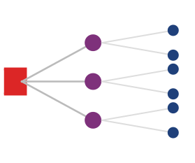

*Один медленный ускоритель задерживает всех остальных на барьере.*

Самый коварный противник в большом парке — не жесткий отказ, а **серый отказ** (gray failure): компонент продолжает работать, но с деградировавшей производительностью. Один GPU с частично отказавшим стеком HBM может работать лишь на 75 процентах своей пиковой пропускной способности. NVLink с пограничной целостностью сигнала может вынуждать к частому переобучению линка, вызывая микросекундные простои, которые накапливаются в секунды потерянного времени на каждом шаге обучения. В синхронной задаче с параллелизмом данных один отстающий узел замедляет весь кластер, потому что каждый другой GPU должен ждать, пока самый медленный участник завершит свой вклад в AllReduce. Такие серые отказы невидимы для простых проверок «работает/не работает» и требуют непрерывного, мелкозернистого тестирования производительности, чтобы их обнаружить. Наиболее эффективный подход — периодически запускать микробенчмарки на простаивающих узлах (или в плановые окна обслуживания) и сравнивать производительность каждого узла с базовой линией парка. Узел, чья пропускная способность GEMM опускается ниже 90 процентов медианы парка или чья пропускная способность NVLink падает ниже 85 процентов, помечается для расследования, даже если он не испытал никакой жесткой ошибки.

> **Перспектива: профилактическое и реактивное обслуживание**
>
> Операторы парков усвоили, зачастую на горьком опыте, что профилактическое обслуживание резко снижает влияние аппаратных отказов на продуктивность обучения. Три опоры профилактического обслуживания: **предиктивная диагностика** (использование моделей, обученных на исторической телеметрии, для предсказания отказов компонентов за 24–72 часа до их возникновения), **плановые тесты прогрева (burn-in)** (запуск эталонных нагрузок на только что установленных узлах до назначения производственной работы) и **скользящие окна обслуживания** (прогон 2–5 процентов узлов через проверки работоспособности без снижения доступной мощности). Организации, инвестирующие в профилактическое обслуживание, обычно достигают эффективной загрузки парка 95–98 процентов, тогда как организации, полагающиеся на реактивное обслуживание, — 80–90 процентов.

В многопользовательских кластерах, где несколько заданий обучения делят одну физическую инфраструктуру, проблема «шумного соседа» создает угрозу производительности, невидимую для метрик отдельного задания. Контейнеризация строго ограничивает использование CPU и памяти, но сетевая структура часто остается общим ресурсом, подверженным взаимным помехам. Если задание A запускает массивную операцию AllReduce через коммутаторы верхнего уровня как раз в тот момент, когда задание B пытается получить обучающие данные из сетевого хранилища, микровсплески конкуренции за пакеты могут снизить пропускную способность задания B на 30–40 процентов. Эта интерференция особенно коварна в кластерах с RDMA, где трафик обходит CPU хоста и поэтому стандартное планирование пакетов на уровне ОС неэффективно. Современная оркестрация смягчает ее с помощью **статического закрепления рельсов** (Static Rail Alignment), то есть физического выделения определенных подсетей InfiniBand определенным заданиям, либо с помощью протоколов уведомления о перегрузке, которые ограничивают агрессивные потоки на уровне коммутационного оборудования. Для организаций, которые запускают обучение модели на 175 млрд параметров наряду с небольшими исследовательскими экспериментами, самый безопасный подход — физически разбить кластер на изолированные «острова» с выделенными сетевыми структурами, принимая потерю загрузки из-за фрагментации в обмен на предсказуемость производительности.

Частота контрольных точек — это место, где аппаратная телеметрия становится видимой для ML-операторов, а не только для техников дата-центра. Деградировавший узел, который вынуждает часто восстанавливаться из контрольных точек, или путь хранения, который удлиняет запись контрольных точек, напрямую превращается в потерянную пропускную способность обучения. В приложении «Основы надежности» выведен компромисс между контрольными точками и вычислениями и интервал Янга — Далли, который в главе «Отказоустойчивость» применяется к стратегиям контрольных точек; обязанность эксплуатации здесь — раскрывать телеметрию, от которой зависят эти формулы: время записи, частоту отказов, поведение отстающих узлов и длительность восстановления. Без такой видимости платформа может сообщать, что задание «выполняется», в то время как полезное обучение незаметно сошло на нет за повторами и медленными контрольными точками.

Когда физическая основа учтена, мониторинг возвращается к парку развернутых моделей. Модели, прошедшие ворота валидации и выдержавшие канареечное развертывание, попадают в производственную среду, где постепенная деградация, дрейф данных и возникающие взаимодействия могут подтачивать качество в течение недель или месяцев. Поэтапные стратегии выкатки и триггеры отката, рассмотренные в разделе о CI/CD, выявляют острые сбои при развертывании; системы мониторинга должны выявлять хроническую деградацию во время эксплуатации. В масштабе платформы, где одновременно работают сотни моделей, наивный подход — применять практики мониторинга одной модели к каждой модели независимо — ведет к **усталости от оповещений** (alert fatigue), пропущенным корреляциям и эксплуатационному хаосу. Стратегии мониторинга, подходящие для корпоративных ML-платформ, требуют иерархической агрегации и системного управления.

### Проблема усталости от оповещений

Математическая реальность мониторинга в масштабе обнаруживает ограничения оповещений на уровне отдельной модели. Рассмотрим математику мониторинга 100 моделей с независимыми оповещениями. Если у каждой модели 10 отслеживаемых метрик и каждая метрика дает оповещения с долей ложноположительных срабатываний 0,3 процента (пороги в 3 сигма), ожидаемое число ложных оповещений все равно остается значительным.

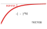

*По мере умножения тестов ложные оповещения становятся математически неизбежными.*

> **Сценарий: налог на ложные тревоги**
>
> **Задача**: рассмотрим систему, которая отслеживает 100 моделей. У каждой модели 10 метрик (задержка, точность, дрейф и другие). Пороги оповещений заданы на уровне 3 сигма (специфичность 99,7 процента), а контрольный скрипт пересчитывает каждую метрику с фиксированным интервалом. Такая конфигурация порождает огромное число ложных тревог, которые дежурный инженер должен разбирать каждый день.
>
> **Расчет**:
>
> 1. **Всего мониторов**: 100 моделей $\times$ 10 метрик = 1 000 мониторов.
> 2. **Доля ложноположительных срабатываний**: $1 - 0.997 = 0.003$ (0,3 процента).
> 3. **Проверок в день**: предположим проверки каждые 5 минут (288 проверок в сутки).
> 4. **Ложных тревог в день**: $1\,000 \times 288 \times 0.003$ $\approx$ 864 оповещения в день.
>
> **Системный вывод**: даже при оповещениях высокой специфичности (3 сигма) масштаб становится проблемой. Оповещать по сырым метрикам невозможно. Нужна иерархическая агрегация (например, «здоровье кластера» вместо «здоровья узла»), чтобы пережить «налог на ложные тревоги».

[уравнение](#eq-false-alert-rate) показывает математическую неизбежность усталости от оповещений в масштабе: для одной метрики с долей ложноположительных срабатываний $\alpha_{\text{fp}}$ вероятность хотя бы одного ложного оповещения растет экспоненциально с числом независимых тестов $N_{\text{tests}}$:

$$\Pr(\text{хотя бы одно ложное оповещение}) = 1 - (1 - \alpha_{\text{fp}})^{N_{\text{tests}}}$$

<a id="eq-false-alert-rate"></a>

При $\alpha_{\text{fp}} = 0.05$ и $N_{\text{tests}} = 1000$ (100 моделей $\times$ 10 метрик):

$$\Pr(\text{ложное оповещение}) = 1 - (1 - 0.05)^{1000} = 1 - 0.95^{1000} \approx 1.0$$

Вероятность практически равна 100 процентам. На таком масштабе система мониторинга будет непрерывно порождать ложные оповещения. Возникает разрушительная динамика: операторы учатся игнорировать оповещения, потому что большинство из них ложные, настоящие проблемы теряются в шуме, а система мониторинга приносит отрицательную ценность вместо положительной.

#### Разбор на примере: объем оповещений

Сценарий «Налог на ложные тревоги» уже показывает, что трехсигмовый анализ нагружает команду. Ослабление до более распространенного двухсигмового порога (доля ложноположительных срабатываний 5 процентов) делает нагрузку неподъемной. ML-платформа мониторит 100 моделей при следующей конфигурации:

- 10 метрик на модель (точность, задержка p50, задержка p99, пропускная способность, частота ошибок, свежесть данных, дрейф признаков, использование памяти, загрузка GPU, объем запросов)
- Порог оповещения на уровне 2 стандартных отклонений (примерно 5 процентов ложноположительных срабатываний на метрику)
- Метрики проверяются каждые 5 минут

Ожидаемое число ложных оповещений в день: $\text{Ложных оповещений в день} = 100 \times 10 \times 0.05 \times \frac{24 \times 60}{5} = 14\,400$.

Даже если 99 процентов из них дедуплицируются или автоматически закрываются, оставшиеся 144 оповещения в день перегрузят любую дежурную команду. Система мониторинга становится бесполезной вопреки (точнее, из-за) полноты охвата.

### Иерархическая архитектура мониторинга

Проблема усталости от оповещений требует принципиально иного подхода. Решение — иерархический мониторинг ([рисунок](#fig-monitoring-pyramid)), который превращает мониторинг в систему маршрутизации оповещений: широкие сигналы решают, поражен ли парк; сигналы портфеля определяют, какое семейство моделей или предметная область владеет инцидентом; сигналы модели поддерживают локальную диагностику, а сигналы инфраструктуры направляют отказы команде платформы. Иерархия снижает объем оповещений, сохраняя путь от симптома к владельцу.

<a id="fig-monitoring-pyramid"></a>

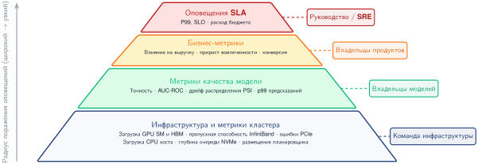

***Иерархическая архитектура мониторинга:** чтобы предотвратить усталость от оповещений, мониторинг работает на четырех уровнях абстракции. Высокоуровневые бизнес-метрики запускают тревоги о широких проблемах, а метрики нижних уровней используются в основном для расследования и анализа первопричин.*

Иерархия работает потому, что каждый уровень отвечает на свой вопрос маршрутизации. [Таблица](#tbl-hierarchical-monitoring-levels) сопоставляет каждый уровень с его сигналом, владельцем и эксплуатационной ролью.

<a id="tbl-hierarchical-monitoring-levels"></a>

***Уровни иерархического мониторинга:** уровни мониторинга отделяют оповещение от диагностики. Верхние уровни решают, нужно ли направлять инцидент и куда; нижние уровни сохраняют доказательства, необходимые для определения, вызвано ли происшествие поведением модели, дрейфом данных, насыщением обслуживания или отказом инфраструктуры.*

| **Уровень**     | **Характерные сигналы**                                                                                                                               | **Основной владелец** | **Эксплуатационная роль**                                                                       |
|:----------------|:------------------------------------------------------------------------------------------------------------------------------------------------------|:----------------------|:------------------------------------------------------------------------------------------------|
| Бизнес          | Выручка или конверсия, приписанные рекомендациям, индикаторы вовлеченности, доля автоматизации и объем ручной проверки.                              | Руководитель инцидента | Немногочисленные оповещения высокой достоверности, указывающие на нарушение продукта или бизнеса. |
| Портфель        | Прирост вовлеченности и разнообразие для рекомендаций, пойманное мошенничество и доля ложноположительных срабатываний или доля выявленных нарушений и апелляций. | Команда предметной области | Направляет расследование к семейству моделей или продуктовой области, владеющей общей целью.      |
| Модель          | Качество решения задачи, распределения задержки, пропускная способность, частота ошибок, использование ресурсов, насыщение обслуживания и состояние последнего развертывания. | Владелец модели      | Поддерживает локальную диагностику, когда сместились бизнес- или портфельные сигналы.           |
| Инфраструктура  | Загрузка и доступность GPU-кластера, задержка хранилища признаков, время конвейера обучения, состояние обслуживания, сеть и хранилище.                  | Команда платформы    | Направляет отказы, требующие ремонта мощности, размещения, сети, хранилища или плоскости управления. |

#### Многомерные бюджеты надежности

Парк не может описывать надежность только доступностью. Конечная точка может возвращать HTTP 200, обслуживая устаревшие признаки, не попадая в целевую задержку или выдавая предсказания ниже порога качества. Поэтому каждому сервису нужен вектор SLO

$$
\mathbf{S} = (S_{\text{availability}}, S_{\text{latency}}, S_{\text{freshness}}, S_{\text{quality}}),
$$

с одним индикатором, целью, окном измерения и владельцем для каждого измерения. Для измерения $i$ нормированное потребление бюджета за окно равно

$$
b_i = \frac{V_i}{A_i},
$$

где $V_i$ — доля подходящих наблюдений, нарушающих цель $i$, а $A_i$ — допустимая доля нарушений для той же цели и того же окна. Числитель и знаменатель поэтому имеют одинаковые единицы внутри каждого измерения: доля неуспешных запросов для доступности, доля запоздалых запросов для задержки, доля предсказаний на устаревших признаках для свежести и доля оценок ниже порога для качества модели. Значение $b_i=1$ исчерпывает бюджет этого измерения; $b_i>1$ означает, что сервис израсходовал больше ненадежности, чем допускает контракт. Отношения можно сравнивать после такой нормировки по измерениям, но их сырые величины задержки, свежести и качества несопоставимы. Парк остается в пределах своей оболочки надежности, только если $\max_i b_i \leq 1$. Усреднение измерений скрыло бы серьезную регрессию качества за идеальным аптаймом, поэтому решение о выпуске определяет максимум.

Скорость расходования бюджета (burn rate) превращает этот вектор в эксплуатационное средство управления. Быстрое расходование по любому измерению вызывает дежурного владельца и останавливает продвижение; устойчивое умеренное расходование снижает скорость выкатки и требует устранения причины; исчерпанный бюджет замораживает несущественные выпуски до тех пор, пока ответственный индикатор не вернется в пределы политики восстановления. Платформа отвечает за вычисление индикаторов, общие окна, маршрутизацию оповещений и исполнение. Команды моделей отвечают за пороги качества решения задачи и устранение поведения моделей; владельцы данных отвечают за свежесть и валидность; владельцы обслуживания — за задержку и доступность. Такое разделение превращает мониторинг в явный контракт между свидетельствами и полномочиями, а не в панель, которую все видят, но никто не обязан по ней действовать.

[Таблица](#tbl-ops-scale-reliability-budget-vector) сопоставляет каждое измерение бюджета с его владельцем и последствием для выпуска.

<a id="tbl-ops-scale-reliability-budget-vector"></a>

***Вектор бюджета надежности ML:** надежность парка объединяет здоровье сервиса, свежесть данных и поведение модели. Любое исчерпанное измерение может остановить выпуск, потому что успех по одному измерению не компенсирует отказ по другому.*

| **Измерение бюджета** | **Характерный индикатор**                          | **Основной владелец** | **Последствие для выпуска**                                   |
|:----------------------|:---------------------------------------------------|:----------------------|:-------------------------------------------------------------|
| Доступность           | Успешные допустимые запросы / все запросы          | Обслуживание          | Остановить выкатку или переключиться на резерв, когда быстрое расходование превышает политику |
| Задержка              | Запросы, соответствующие цели по хвостовой задержке | Обслуживание/платформа | Снизить трафик, нагрузку на мощность или сложность кандидата  |
| Свежесть              | Предсказания, использующие признаки в пределах SLO свежести | Данные           | Блокировать продвижение и перейти на безопасный путь признаков |
| Качество модели       | Метрика задачи с учетом срезов выше порога качества | Модель/предметная область | Откатить, воздержаться или направить на проверенную базовую модель |

### Обнаружение аномалий по всему парку

Вместо оповещений по порогам отдельных метрик обнаружение аномалий по всему парку выявляет необычные шаблоны в портфеле моделей. Стек обнаружения идет от локального статистического контроля процесса к корреляции между семействами моделей и к оценкам дрейфа, которые объясняют, почему сдвинулась метрика. Такой порядок держит объем оповещений низким, сохраняя достаточно доказательств, чтобы направить инцидент правильному владельцу.

#### Статистический контроль процесса

Статистический контроль процесса (SPC) возник в промышленном контроле качества (Shewhart, 1931). При адаптации к мониторингу ML контрольные карты[^fn-spc-process-control] отслеживают, остаются ли распределения метрик стабильными во времени, и дополняют методы обнаружения дрейфа, которые следят за изменением распределений данных (Gama et al., 2014). Основная идея состоит в том, чтобы отличать обычную вариацию (нормальные колебания) от вариации с особой причиной (настоящих аномалий).

[^fn-spc-process-control]: **Статистический контроль процесса (SPC)**: Shewhart (1931) установил рамки контрольных карт для контроля качества производства. При нормальной аппроксимации контрольный предел в 3 сигма дает вероятность ложной тревоги всего 0,27 процента для стабильного процесса. Для мониторинга парка ML даже малые доли ложных тревог на отдельный тест накапливаются по многим моделям и метрикам, и управление усталостью от оповещений становится внутренним ограничением применения SPC на уровне платформы.

Для метрики $X$ с установленным средним $\mu$ и стандартным отклонением $\sigma$ верхний контрольный предел равен $\text{UCL} = \mu + 3\sigma$, а нижний — $\text{LCL} = \mu - 3\sigma$. Точки за пределами контрольных границ или систематические шаблоны, например 7 последовательных точек выше или ниже среднего, запускают расследование.

#### Корреляция по всему парку

Когда несколько моделей одновременно демонстрируют похожие аномалии, первопричина, скорее всего, в общей инфраструктуре или данных, а не в отдельных моделях. Корреляционный анализ между моделями дает три эксплуатационных выигрыша:

- автоматическое отнесение аномалий к вероятным причинам (развертывание, проблема данных, инфраструктура)
- дедупликация оповещений с общими причинами
- приоритизация по широте влияния

Листинг ниже превращает корреляцию в правило сортировки. Когда доля аномальных моделей пересекает порог парка, инцидент переходит от множества локальных задач отладки к одному расследованию общей причины.

```python
def detect_fleet_anomaly(model_metrics, threshold=0.6):
    """
    Обнаружить коррелированные аномалии по парку моделей.

    Возвращает список кортежей (timestamp, affected_models, likely_cause).
    """
    anomalies = []

    for timestamp in model_metrics.timestamps:
        # Найти модели с аномальными метриками в этот момент
        anomalous_models = []
        for model in model_metrics.models:
            if is_anomalous(model_metrics[model][timestamp]):
                anomalous_models.append(model)

        # Проверить, превышает ли доля аномалий порог корреляции
        if (
            len(anomalous_models) / len(model_metrics.models)
            > threshold
        ):
            # Затронуто много моделей -> вероятно общая причина
            cause = attribute_to_shared_cause(
                timestamp, anomalous_models
            )
            anomalies.append((timestamp, anomalous_models, cause))

    return anomalies
```

Порог не дает монитору реагировать на изолированный шум отдельной модели, одновременно позволяя ловить сбои в масштабе платформы. Выше порога правильным владельцем обычно оказывается общая зависимость, например развертывание, конвейер признаков или инфраструктурный сервис, а не каждая команда моделей по отдельности.

#### Обнаружение дрейфа

Дрейф данных — это постепенные сдвиги распределения входов, которые со временем ухудшают качество модели. Чтобы обнаружить дрейф, нужно различать два фундаментальных типа.

**Ковариатный сдвиг** возникает, когда распределение входных признаков $p(x)$ меняется, но связь между входами и выходами $p(y \mid x)$ остается постоянной. Его можно обнаружить в реальном времени, отслеживая статистики входов, такие как среднее, дисперсия и доля пропусков, без необходимости в метках.

**Концептуальный дрейф** возникает, когда связь $p(y \mid x)$ меняется, например когда пользователи меняют определение спама или релевантного контента. Для его обнаружения нужны эталонные метки, которые часто запаздывают на минуты, дни или недели.

Поскольку метки часто запаздывают, большинство систем мониторинга в реальном времени использует ковариатный сдвиг как опережающий индикатор возможной деградации качества. Дешевая оценка дрейфа ценна, даже когда она не является полной теорией робастности, потому что показывает оператору, где искать, еще до прихода меток исходов.

Для непрерывных признаков индекс стабильности популяции (PSI)[^fn-psi-population-drift] количественно описывает сдвиг распределения (Yurdakul и Naranjo, 2020). [Уравнение](#eq-psi-monitoring) вычисляет PSI как сумму взвешенных логарифмом отношений разностей между фактической и ожидаемой долями корзин. Значения 0,1 и 0,25 широко используются как отраслевые эвристики, а не как универсальные статистические пороги; производственная система должна калибровать полосы оповещений под размер выборки, разбиение на корзины и стоимость ложной тревоги. В эксплуатации платформы PSI играет узкую роль как дешевый сигнал оповещения.

[^fn-psi-population-drift]: **Индекс стабильности популяции (PSI)**: изначально разработан в кредитном скоринге для обнаружения сдвигов в популяции заявителей на кредит, где регуляторы требовали количественного мониторинга дрейфа. Стандартные пороги ($\text{PSI} < 0.1$ — стабильно, $\text{PSI} \geq 0.25$ — требуется действие) были установлены эмпирически в финансовых услугах. Для мониторинга парка ML преимущество PSI — вычислительная дешевизна: один проход по гистограммам по корзинам, что делает возможным отслеживание сотен признаков у сотен моделей без исчерпания бюджета мониторинга.

$$\text{PSI} = \sum_{i=1}^{K_{\text{bucket}}} (A_i - E_i) \times \ln\left(\frac{A_i}{E_i}\right)$$

<a id="eq-psi-monitoring"></a>

где $A_i$ — доля в корзине $i$ фактического (текущего) распределения, $E_i$ — доля в корзине $i$ ожидаемого (эталонного) распределения, а $K_{\text{bucket}}$ — число корзин.

Интерпретация намеренно грубая. PSI ниже 0,1 обычно оставляет модель на обычном пути мониторинга. Значения от 0,1 до 0,25 создают заявку на расследование. Значения от 0,25 и выше указывают на достаточный сдвиг, поэтому платформа должна считать модель потенциально деградировавшей еще до того, как метки подтвердят исход.

> **Сценарий: время обнаружения и задержка мониторинга**
>
> **Задача**: производственная модель имеет базовую точность 95 процентов. Событие дрейфа данных снижает точность на 2 процента. Если размеченные исходы поступают со скоростью 1000 выборок в час, сколько времени нужно, чтобы статистически доказать деградацию модели?
>
> **Расчет**:
> Обнаружение требует достаточно выборок, чтобы отличить сигнал (падение на 2 процента) от шума (случайной дисперсии). Двухвыборочный тест долей задает число выборок по базовой и деградировавшей точности ($p_1$, $p_2$) и целевым значениям достоверности и мощности ($z_{\alpha/2}$, $z_{\beta}$):
>
> $$n \approx \frac{(z_{\alpha/2} + z_{\beta})^2 \left[ p_1(1 - p_1) + p_2(1 - p_2) \right]}{(p_1 - p_2)^2}$$
>
> 1. **Требуемое число выборок**: при 95-процентной достоверности и 80-процентной мощности стандартные нормальные квантили равны $z_{\alpha/2} = 1.96,\ z_{\beta} = 0.84$, и подстановка дает $n \approx (1.96 + 0.84)^2 \times \left[ 0.95(1 - 0.95) + 0.93(1 - 0.93) \right] / (0.95 - 0.93)^2 \approx 2\,207$ выборок.
> 2. **Задержка обнаружения**: 2 207 выборок / 1000 выборок в час $\approx$ 2,2 часа.
>
> **Системный вывод**: мониторинг не мгновенен. При деградации на 2 процента модель работает в нерабочем состоянии примерно 2,2 часа, прежде чем данных станет достаточно для оповещения. Это и есть *задержка мониторинга*. Ее сокращение требует либо увеличения объема размеченных данных (дорого), либо мониторинга «прокси-метрик», таких как **PSI** (быстрее, но шумнее). В парке с высокими ставками оповещение срабатывает по *дрейфу входов* как опережающему индикатору, а не ждет падения точности.

Мониторинг дрейфа по всему парку распространяет этот сигнал на весь портфель. Скачок PSI в одном некритичном признаке может быть локальным расследованием, но одновременный дрейф по общим признакам или нескольким зависимым моделям указывает на сбой конвейера данных с большим радиусом поражения.

### Мониторинг, специфичный для типа модели

Частота мониторинга следует за ценой отказа. [Таблица](#tbl-ops-scale-monitoring-types) задает **параметры мониторинга по типам моделей**: рекомендательные системы требуют мониторинга CTR в реальном времени с порогами деградации 5 процентов, тогда как классификаторы зрения допускают ежедневные проверки точности с порогами, заданными для набора данных, что отражает их более низкую частоту обновлений.

<a id="tbl-ops-scale-monitoring-types"></a>

***Параметры мониторинга по типам моделей:** основные метрики, пороги оповещений и частоты мониторинга, подобранные под эксплуатационные требования моделей. Рекомендательные системы требуют мониторинга CTR в реальном времени с порогами деградации 5 процентов, а классификаторы зрения допускают ежедневные проверки точности при порогах, заданных для набора данных, что отражает их более низкую частоту обновлений и более стабильные распределения входов.*

| **Тип модели**      |      **Основные метрики**       |  **Пороги оповещений** | **Частота мониторинга** |
|:--------------------|:-------------------------------:|:----------------------:|:-----------------------:|
| **Рекомендации**    |      CTR, прирост вовлеченности |  падение на 5% относительно | Реальное время          |
| **Мошенничество**   | Точность, полнота, доля мошенничества |  деградация на 1% | Реальное время          |
| **LLM**             | Оценки качества, метрики безопасности | Калибровка для каждой модели | Раз в час       |
| **Зрение**          |       Точность по классам       |  Для каждого набора данных | Раз в день           |
| **Ранжирование поиска** |     NDCG, позиция клика      |  деградация на 2% | Реальное время          |

Мониторинг рекомендаций ведется в реальном времени, потому что последствия для продукта возникают в реальном времени. Долю кликов (CTR), время просмотра и конверсию следует сравнивать с исторически сопоставленными по времени базовыми значениями, с контрольным трафиком, когда он доступен, и с предыдущей версией модели после выпуска. Этих быстрых метрик вовлеченности недостаточно сами по себе: разнообразие, охват каталога и индикаторы «информационного пузыря» защищают долгосрочный пользовательский опыт, а атрибуция выручки и метрики рекламного инвентаря связывают качество рекомендаций с бизнес-результатами.

Мониторинг мошенничества определяется состязательной срочностью. Пропущенное мошенничество создает немедленный финансовый ущерб, но избыточные ложные срабатывания создают трение с клиентами и нагрузку на ручную проверку. Поэтому поверхность мониторинга должна сочетать долю обнаружения, предотвращенную денежную сумму и задержку обнаружения с долей ложноположительных срабатываний, событиями блокировки легитимных транзакций, объемом ручной проверки и состязательными индикаторами, такими как шаблоны зондирования или внезапные сдвиги в мошеннической активности.

Мониторинг LLM определяется семантическим качеством, которое трудно измерить одними сервисными метриками. Задержка, скорость генерации токенов, частота ошибок и оценки классификатора безопасности устанавливают эксплуатационное здоровье; сигналы удовлетворенности пользователей, такие как доля оценок «нравится/не нравится», частота повторных генераций и косвенные признаки выполнения задачи, добавляют отложенные свидетельства качества. Метрики безопасности, такие как обнаружения токсичности, доля отказов и индикаторы галлюцинаций, остаются частичными, поэтому они должны запускать проверку, а не претендовать на полное покрытие.

Стандартный мониторинг не может обнаружить семантические сбои безопасности, такие как убедительная дезинформация или умелые манипуляции. Здесь **red teaming** (проверка на прочность силами «красной команды») — это канал мониторинга в производстве, а не полноценная программа состязательной оценки: до развертывания люди-оценщики или автоматические зонды пытаются провести **джейлбрейки**, а меньший непрерывный набор зондов проверяет, что фильтры безопасности в производстве остаются включенными. Выборочная отложенная проверка людьми замыкает цикл для сбоев, которые автоматические метрики не видят.

### Архитектура наблюдаемости

Эффективный мониторинг требует инфраструктуры наблюдаемости, которая сохраняет достаточно контекста, чтобы направить оповещение от симптома к владельцу. Каждый канал доказательств отвечает на свой эксплуатационный вопрос. Метрики показывают, что свойство сервиса вышло за допустимые границы; трассировки показывают, где запрос провел время; журналы объясняют, какой компонент выдал аномальное событие; а журналы предсказаний связывают здоровье системы с поведением модели. В многомодельных системах один пользовательский запрос может проходить через несколько моделей, поэтому распределенная трассировка[^fn-distributed-tracing-ml], впервые примененная в системе Dapper от Google (Sigelman et al., 2010), становится единственным надежным способом разложить сквозную задержку по сервисам инференса. [Таблица](#tbl-ops-scale-observability-signals) подытоживает архитектуру как карту доказательств, а не как набор разрозненных инструментов телеметрии.

[^fn-distributed-tracing-ml]: **Распределенная трассировка**: статья Dapper 2010 года от Google установила шаблон распространения уникальных идентификаторов трассировки через границы сервисов. Для многомодельных ML-конвейеров трассировка — единственный надежный способ отнести сквозную задержку к конкретному этапу модели: без нее всплеск хвостовой задержки в 50 мс в конвейере из 10 моделей потребовал бы расследования всех 10 моделей по отдельности. Dapper достигал этого при накладных расходах CPU менее 0,3 процента на хост, задавая планку производительности, которая делает постоянную трассировку возможной в масштабе парка.

<a id="tbl-ops-scale-observability-signals"></a>

***Сигналы наблюдаемости по эксплуатационным вопросам:** архитектура наблюдаемости — это система маршрутизации доказательств. Метрики привлекают внимание, трассировки локализуют путь запроса, журналы объясняют поведение компонентов, а журналы предсказаний связывают эксплуатационные симптомы с качеством модели.*

| **Канал доказательств** | **Основной вопрос**                          | **Что сохраняется**                                                    | **Типичный выявляемый сбой**                         |
|:------------------------|:---------------------------------------------|:-----------------------------------------------------------------------|:-----------------------------------------------------|
| Метрики                 | Какое свойство сервиса вышло за границы?     | Потоки в реальном времени для оповещений и агрегированные временные ряды для трендов | Дрейф, насыщение, всплески частоты ошибок, аномалии стоимости |
| Трассировки             | Где этот запрос провел время?                | Идентификаторы запросов, распространяемые через вызовы моделей, тайминги и ресурсы | Межмодельная задержка, сбои при разветвлении, горячие этапы |
| Журналы                 | Какой компонент выдал аномальное событие?    | Структурированные события с единообразными схемами и индексами для поиска | Новые классы ошибок, сбои зависимостей, неудачные выпуски |
| Журналы предсказаний    | Сохранило ли здоровье системы поведение модели? | Выборочные входы, выходы, признаки и отложенные метки | Регрессии точности, плохие когорты, пробелы в данных |

Журналирование предсказаний — самый дорогой канал доказательств, потому что он записывает данные, обращенные к модели, а не компактные счетчики сервиса. Поэтому производственные системы выборочно сохраняют его, например записывая 1 процент предсказаний или все предсказания для отдельных пользователей, чтобы парк сохранял достаточно примеров для офлайн-оценки точности, генерации обучающих данных и отладки отказов, не превращая мониторинг в нагрузку на хранилище.

### Дизайн панелей мониторинга

Панель мониторинга — это поверхность человеческого внимания иерархии мониторинга. Она должна отвечать на те же вопросы маршрутизации, не заставляя каждого читателя работать в одной и той же консоли отладки: руководителям нужно знать, поражен ли бизнес, владельцам предметных областей — какой портфель сбоит, владельцам моделей — доказательства по их модели, а реагирующим на инциденты — трассировку от симптома до первопричины. [Таблица](#tbl-ops-scale-dashboard-views) показывает эту последовательность.

<a id="tbl-ops-scale-dashboard-views"></a>

***Представления панелей по эксплуатационным вопросам:** иерархия панелей должна направлять внимание от влияния на бизнес к первопричине. Каждое представление показывает объем деталей, необходимый для решения на своем уровне, не давая руководящим представлениям превратиться в консоли отладки, а представлениям расследования — в сводки по портфелю.*

| **Представление** | **Вопрос, на который отвечает**                        | **Какие сигналы выводить**                                                             |
|:------------------|:--------------------------------------------------------|:---------------------------------------------------------------------------------------|
| Руководство       | Поражен ли бизнес?                                      | Здоровье платформы, влияние на бизнес, активные инциденты, ключевые тренды             |
| Портфель          | Какая предметная область или семейство моделей вызывает нарушение? | Инвентарь моделей, метрики портфеля, недавние развертывания, использование ресурсов и стоимость |
| Модель            | Что изменилось у ответственной модели?                  | Текущие метрики в сравнении с базовыми линиями, история развертываний, индикаторы дрейфа, атрибуция стоимости |
| Расследование     | Почему произошло изменение?                             | Корреляции между моделями, наложения временных рядов, поиск по журналам, детали трассировки на уровне запроса |

### Мониторинг стоимости и обнаружение аномалий

Три структурных свойства инфраструктуры ML делают обнаружение аномалий стоимости качественно сложнее, чем для общих веб-сервисов. Во-первых, автомасштабирование GPU «ступенчато»: добавление одной реплики инференса для большой модели означает выделение целого узла с несколькими GPU, поэтому небольшой перелив трафика вызывает скачок стоимости, а не плавное линейное масштабирование. Во-вторых, распределенные задания обучения могут катастрофически сбоить: неверно настроенный перебор гиперпараметров, DAG, который не учитывает вытеснение спотовых инстансов, или бесконечный цикл повторов при неудачной контрольной точке может потребить целый кластер GPU-часов, прежде чем сработает какое-либо оповещение. В-третьих, «зомби-модели» (см. раздел «Управление состоянием и изменениями») продолжают занимать память GPU и мощность обслуживания, даже когда получают ничтожный трафик, создавая хроническую базовую стоимость, которая накапливается по парку. Аномалии стоимости в платформе моделей поэтому обычно вызваны не всплесками трафика, а ошибками конфигурации обучающих заданий, поведением автомасштабирования на границах гранулярности GPU или сбоями жизненного цикла моделей. Эффективное обнаружение аномалий должно различать эти причины, а не просто сообщать, что стоимость изменилась.

В масштабе незамеченные аномалии стоимости могут накопить миллионы долларов непредвиденных списаний, прежде чем их поймает ручная проверка. Количественная схема обнаружения аномалий стоимости балансирует чувствительность и долю ложноположительных срабатываний.

#### Метрики обнаружения аномалий стоимости

Основа мониторинга стоимости — статистическое обнаружение аномалий. Для временного ряда стоимости с исторически средним $\mu$ и стандартным отклонением $\sigma$ **Z-оценка** количественно описывает, насколько необычно текущее наблюдение:

$$Z = \frac{C_{\text{current}} - \mu}{\sigma}$$

где $C_{\text{current}}$ — наблюдаемая стоимость за текущий период. Z-оценка 3 означает, что текущая стоимость на 3 стандартных отклонения выше исторического среднего, событие, которое при нормальной работе ожидается менее чем в 0,3 процента случаев.

Дополняя анализ Z-оценки, обнаружение **процентного изменения** фиксирует внезапные сдвиги независимо от исторической дисперсии. Это полезно для выявления ступенчатого роста, например когда неверно настроенный автомасштабировщик за ночь удваивает число инстансов:

$$\Delta\% = \frac{C_{\text{current}} - C_{\text{previous}}}{C_{\text{previous}}} \times 100$$

#### Пороги оповещений и анализ ложноположительных срабатываний

Эффективные оповещения требуют калибровки порогов, чтобы сбалансировать чувствительность обнаружения и эксплуатационную нагрузку. Две распространенные конфигурации: **порог Z-оценки**, который срабатывает при $|Z| > 3$ по правилу трех сигм, и **порог процентного изменения**, который срабатывает при $|\Delta\%| > 50\%$ день ко дню. Выбор порогов определяет долю ложноположительных срабатываний. Для нормально распределенной метрики стоимости, проверяемой ежедневно, порог в 3 сигма дает:

$$\Pr(\text{ложноположительное срабатывание в день}) = 2 \times (1 - \Phi(3)) \approx 0.0027$$

За год ежедневного мониторинга:

$$E[\text{ложных оповещений в год}] = 365 \times 0.0027 \approx 1$$

Такая частота эксплуатационно приемлема. Понижение порога до 2 сигм увеличило бы число ложных оповещений в год примерно до 16, что, вероятно, вызвало бы усталость от оповещений без существенного улучшения обнаружения.

Для оповещений на основе процентов доля ложноположительных срабатываний зависит от естественной волатильности стоимости. Сервисы с естественно переменным спросом могут требовать более высоких порогов (75 или 100 процентов), чтобы избежать избыточных оповещений, тогда как сервисы со стабильной базовой нагрузкой могут использовать более жесткие пороги (25 или 30 процентов).

#### Разбор на примере: обнаружение всплеска стоимости инференса

Сервис рекомендаций обычно стоит \$100 в день за вычисления инференса. Команда эксплуатации получает оповещение: к концу дня стоимость достигла \$250.

Исторические данные показывают среднюю дневную стоимость $\mu = \$100$ при стандартном отклонении $\sigma = \$15$, поэтому первая проверка — насколько оповещение статистически правдоподобно при нормальной работе: $Z = \frac{\$250 - \$100}{\$15} = \frac{\$150}{\$15} = 10$.

Z-оценка 10 чрезвычайно маловероятна при нормальной работе, но команда все равно подтверждает данные биллинга, прежде чем считать оповещение реальным. После исключения задержек биллинга, двойного учета и ошибок конвейера расследование переходит к эксплуатационному сигналу. Объем запросов не изменился, значит, трафик не вызвал всплеск. P99-задержка выросла с 50 мс до 125 мс, а это означает, что каждый запрос теперь потребляет примерно 2,5$\times$ больше GPU-секунд. Новая версия модели, развернутая в 2:00 ночи, использовала более крупную модель ранжирования и дополнительные признаки ради улучшения качества; загрузка GPU при этом оставалась около 95 процентов, а пропускная способность на GPU упала на 60 процентов. Первопричиной было обновление модели, которое увеличило вычислительную стоимость каждого предсказания: при неизменном трафике и 2,5$\times$ стоимости на запрос общая стоимость выросла с \$100 в день до \$250 в день. Решение для платформы — оправдывает ли улучшение качества рост стоимости или требуется оптимизация квантизацией, меньшими батчами или дистилляцией модели.

#### Структура анализа первопричин

[Таблица](#tbl-cost-anomaly-categories) группирует **категории первопричин аномалий стоимости** в пять классов, у каждого из которых свой путь расследования:

<a id="tbl-cost-anomaly-categories"></a>

***Категории первопричин аномалий стоимости:** пять основных категорий аномалий стоимости с характерными признаками и подходами к расследованию. Рост трафика проявляется пропорциональным ростом QPS, а регрессия эффективности — ростом задержки при стабильном трафике.*

| **Категория**             | **Признаки**                            | **Путь расследования**                                              |
|:--------------------------|:----------------------------------------|:--------------------------------------------------------------------|
| **Рост трафика**          | QPS пропорционален стоимости            | Проверить вышестоящие сервисы, маркетинговые кампании, вирусные события |
| **Регрессия эффективности** | Стоимость выросла, QPS не изменился, задержка выросла | Просмотреть недавние развертывания, обновления моделей, изменения инфраструктуры |
| **Утечка ресурсов**       | Постепенный рост стоимости, стабильная загрузка | Проверить осиротевшие ресурсы, неудачные задания очистки, зомби-процессы |
| **Изменение цен**         | Стоимость выросла, все метрики стабильны | Проверить цены облачного провайдера, истечение резервных инстансов  |
| **Ошибка конфигурации**   | Ступенчатый рост стоимости              | Проверить правила автомасштабирования, типы инстансов, число реплик |

#### Распределение стоимости по сервисам и командам

Эффективное управление стоимостью требует относить расходы к организационным единицам. Распределение по тегам назначает стоимость на основе метаданных ресурсов (см. листинг ниже).

```{.yaml}
# Схема тегов ресурсов для распределения стоимости
cost_allocation:
  dimensions:
    - team: "recommendation"      # Организационный владелец
    - service: "ranking-model"    # Конкретный сервис
    - environment: "production"   # prod/staging/dev
    - model_type: "inference"     # training/inference
    - cost_center: "CC-4521"      # Учет для финансового отдела

  shared_cost_distribution:
    # Затраты на инфраструктуру платформы распределяются по использованию
    - resource: "shared-gpu-cluster"
      method: "proportional_gpu_hours"
    - resource: "feature-store"
      method: "proportional_query_volume"
    - resource: "monitoring-infrastructure"
      method: "equal_split"
```

Общая инфраструктура требует политик распределения. Три распространенных метода решают эту задачу:

- **Пропорциональное распределение**: распределить общие затраты на основе метрик использования (GPU-часы, байты хранения, вызовы API)
- **Равное деление**: разделить затраты поровну между потребляющими командами (подходит для фиксированной инфраструктуры)
- **Предельная стоимость**: взимать с команд приращение стоимости, которое добавляет их использование

Политика распределения определяет, сможет ли панель назначить действие, а не только описать расходы.

#### Панели стоимости

Эффективные панели мониторинга стоимости используют ту же иерархию маршрутизации внимания, что и панели надежности. Представление для руководства отслеживает общую стоимость ML-инфраструктуры, тренд по месяцам, бюджет в сравнении с фактом и метрики эффективности стоимости, такие как стоимость предсказания и стоимость на активного пользователя. Представление портфеля разбивает стоимость по предметным областям и типам моделей, чтобы команда платформы видела, что вызывает изменение: рекомендации, мошенничество, поиск или другая область. Представление сервиса показывает стоимость по сервисам, стоимость инференса, эффективность загрузки GPU и сравнение с бюджетом. Представление расследования добавляет маркеры развертываний, корреляции операционных метрик и детализацию атрибуции, чтобы аномалию можно было связать с конкретным изменением, а не считать бухгалтерским шумом.

Четыре ключевые метрики управляют постоянным мониторингом стоимости:

- **Стоимость на инференс**: экономическая метрика единицы обслуживания, формализованная в разделе «FinOps для ML-платформ»; здесь отслеживается ее тренд, чтобы находить регрессии эффективности.
- **Стоимость на активного пользователя**: стоимость инфраструктуры, нормированная на пользовательскую базу. Позволяет сравнивать сервисы разного масштаба.
- **Эффективность использования GPU**: выручка или ценность, созданная за GPU-час. Связывает стоимость инфраструктуры с бизнес-результатами.
- **Скорость расходования бюджета**: текущая скорость трат относительно выделенного бюджета. Позволяет вмешаться заранее, до перерасхода.

Интеграция мониторинга стоимости с иерархической архитектурой мониторинга гарантирует, что аномалии стоимости получают должное внимание наравне с метриками производительности и качества. Строить такие конвейеры CI/CD и иерархические системы мониторинга для каждой продуктовой команды непомерно дорого. Чтобы сделать эти возможности общедоступными без дублирования усилий, организации должны превратить их в единый внутренний продукт — дисциплину, известную как платформенная инженерия.

## Платформенная инженерия

Организации, в которых каждая команда специалистов по данным самостоятельно поднимает GPU-кластеры, настраивает реестры моделей и подключает панели оповещений, платят огромный налог на дублирование обычной инфраструктурной работы. **Платформенная инженерия** решает эту задачу, рассматривая саму ML-инфраструктуру как продукт: она предоставляет проторенные дороги, которые позволяют продуктовым командам полностью сосредоточиться на моделировании, а не на инфраструктурной рутине.

Платформенная инженерия для машинного обучения создает общую инфраструктуру, которая позволяет командам моделей разрабатывать, развертывать и эксплуатировать модели, не управляя лежащей в основе сложностью. Эффективные платформы балансируют возможности самообслуживания, ускоряющие разработку, с требованиями управления, которые обеспечивают согласованность и надежность.

### Уровни абстракции

**Решение об уровне абстракции** — это то, сколько эксплуатационных суждений платформа должна централизовать от имени команд моделей. Слишком мало абстракции оставляет каждую команду платить один и тот же инфраструктурный налог; слишком много скрывает средства контроля, которые нужны нестандартным нагрузкам. Четыре уровня из [таблицы](#tbl-ops-scale-platform-abstraction-levels) лежат на кривой «гибкость против удобства», различаясь тем, за какие задачи отвечает платформа, а какие оставляет команде модели.

<a id="tbl-ops-scale-platform-abstraction-levels"></a>

***Уровни абстракции платформы:** платформенная инженерия централизует разные части жизненного цикла ML на каждом уровне абстракции. Подходящий уровень зависит от того, что организация ценит больше: специфичный для нагрузки контроль или общие эксплуатационные инварианты.*

| **Уровень** | **Платформа отвечает за**                                                                                                 | **Команда модели отвечает за**                                                   | **Подходящий случай и риск**                                                                                              |
|:------------|:--------------------------------------------------------------------------------------------------------------------------|:---------------------------------------------------------------------------------|:---------------------------------------------------------------------------------------------------------------------------|
| Уровень 1   | Мощность GPU, тома хранения, сетевую связность и базовую оркестрацию, например пространства имен Kubernetes                | Код обучения, стек обслуживания, мониторинг и путь развертывания                  | Подходит для нестандартных нагрузок при сильных инфраструктурных командах; становится дорогим, когда многие команды повторяют одну и ту же эксплуатационную работу |
| Уровень 2   | Стандартизированные контейнеры, интеграцию с Kubernetes с учетом ML, постоянные тома и базовую поддержку service mesh   | Структуру экспериментов, задания обучения, релизы обслуживания и рабочие процессы мониторинга | Снижает дублирование упаковки; эксплуатационная корректность по-прежнему сильно зависит от каждой команды                  |
| Уровень 3   | Специфичные для ML контуры управления: планирование с учетом топологии, подбор гиперпараметров, распределенное обучение, обслуживание | Суждения о моделировании и компромиссы, специфичные для нагрузки                | Поглощает режимы отказа, повторяющиеся в разных командах; такие системы, как Kubeflow и Ray, часто находятся около этого уровня |
| Уровень 4   | Полноценный продукт на весь жизненный цикл: среды разработки, хранилища признаков, отслеживание экспериментов, реестры, CI/CD, мониторинг, стоимость, управление | Продуктовые и модельные намерения верхнего уровня при меньшем прямом контроле низкоуровневых деталей | Максимизирует скорость и согласованность; команда платформы принимает ответственность за политику, надежность и экономическую прозрачность |

Управляемые платформы и платформы жизненного цикла, такие как Vertex AI, SageMaker, TensorFlow Extended (TFX)[^fn-tfx-production-pipeline] в Google (Baylor et al., 2017) и MLflow (Zaharia et al., 2018), представляют полноценный конец этого спектра. Компромисс явный: команды получают скорость и согласованность, отказываясь от части низкоуровневого контроля, а команда платформы берет на себя ответственность за политику, надежность и экономическую прозрачность.

[^fn-tfx-production-pipeline]: **TensorFlow Extended (TFX)**: производственная ML-платформа Google. Ключевая архитектурная идея TFX в том, что валидация данных через TensorFlow Data Validation (TFDV) закрывает конвейер до начала обучения, выявляя нарушения схемы и дрейф распределения, которые иначе породили бы незаметно деградировавшие модели. Философия «отказ до обучения» предотвращает самый дорогой класс потерь в ML: GPU-часы, потраченные на обучение на испорченных данных.

### Жизненный цикл платформы и внедрение

Внутренняя ML-платформа — это версионированный продукт, а не одноразовый инфраструктурный проект. Ее интерфейсы, поддерживаемые рабочие процессы, целевые показатели надежности и границы владения должны развиваться, не заставляя каждую команду модели переходить на синхронизированную миграцию. Поэтому каждый выпуск платформы требует гарантий совместимости, пути миграции, телеметрии, которая различает старые и новые пути, и даты вывода из эксплуатации для устаревшего поведения. Команде платформы также нужны собственные целевые показатели уровня обслуживания, потому что отказ реестра, сервиса признаков или контроллера развертывания может одновременно заблокировать все продуктовые команды.

Внедрение измеряет, снимает ли платформа работу, а не просто централизует ее. Полезные показатели: доля производственных моделей на поддерживаемых путях, время от проверенного артефакта до ограниченного производственного трафика, доля исключений, завершенность миграции, нагрузка на поддержку и повторяющаяся рутина (toil) вне проторенной дороги. Большое число регистраций при сохраняющихся самописных конвейерах сигнализирует о номинальном внедрении и слабом соответствии продукту. И наоборот, обязательная миграция может поднять процент внедрения, одновременно увеличив срок выполнения и эксплуатационный риск. Поэтому дорожная карта платформы должна сочетать результаты парка с данными пользователей: снижение числа инцидентов и атрибуция стоимости важны наравне со временем до первого развертывания и долей команд, которые могут выполнять плановые изменения без вмешательства платформы.

Решения о жизненном цикле должны сохранять лазейку для рабочих нагрузок, ограничения которых не вписываются в общий путь. Исключения должны быть явными, ограниченными по времени контрактами с назначенными владельцами и обязательствами по интеграции, а не постоянными ответвлениями. Когда объем исключений растет вокруг одной и той же отсутствующей возможности, этот шаблон становится продуктовым свидетельством для следующей версии платформы. Когда возможность больше не оправдывает стоимость сопровождения и миграции, платформа должна вывести ее из употребления через измеримую параллельную работу двух путей, тестирование совместимости и финальный шлюз удаления. Такая продуктовая дисциплина не дает общей плоскости управления стать следующим источником технического долга.

### Самообслуживаемое развертывание моделей

Самообслуживаемое развертывание работает только тогда, когда платформа позволяет командам моделей двигаться быстро, сохраняя рискованный выбор в управляемых границах. Поэтому проектный вопрос состоит в том, какие решения о развертывании должны оставаться за командой, а какие инварианты платформа обязана обеспечить до того, как модель получит производственный трафик.

#### Проектирование API развертывания

Хорошо спроектированный API развертывания абстрагирует эксплуатационную сложность, делая намерение команды модели декларативным. Урок для платформы — не форма конкретного YAML-файла, а то, какие инварианты платформа должна зафиксировать, прежде чем превратит версию модели в трафик парка. Инварианты из [таблицы](#tbl-self-service-deployment-invariants) — это контракт платформы за декларативным интерфейсом. Prometheus[^fn-prometheus-fleet-metrics] — один из распространенных эксплуатационных приемников для телеметрической стороны этого контракта.

<a id="tbl-self-service-deployment-invariants"></a>

***Инварианты самообслуживаемого развертывания:** API развертывания должен кодировать средства контроля, которые не позволяют локальной автономии команд создавать риск для всего парка. Конкретный синтаксис может различаться, но инварианты должны переноситься между платформами.*

| **Заявленное намерение**  | **Инвариант платформы**                                                                                                |
|:--------------------------|:-----------------------------------------------------------------------------------------------------------------------|
| Артефакт модели и версия  | Система обслуживания загружает из реестра именно проверенную модель.                                                   |
| Ресурсный профиль         | Запросы GPU, памяти и реплик остаются в пределах квот и ограничений планирования.                                      |
| Политика трафика          | Средства управления канарейкой, тенью и откатом ограничивают радиус поражения до полного продвижения.                  |
| Ворота качества           | Пороги ошибок, задержки, дрейфа и качества решения задачи блокируют небезопасное продвижение.                          |
| Приемник телеметрии       | Эксплуатационные метрики поступают в эксплуатационный мониторинг, а сигналы качества модели — в мониторы дрейфа и срезов. |
| Граница одобрения         | Доступ к чувствительным данным, перерасход бюджета и окна высокорисковых выпусков требуют проверки.                    |

[^fn-prometheus-fleet-metrics]: **Prometheus**: открытая система мониторинга, которую сейчас поддерживает CNCF; она использует модель опроса (pull), собирая метрики с экспортеров. Для парков ML Prometheus — стандарт отслеживания эксплуатационного здоровья (загрузка CPU/GPU, частоты запросов), но его модель временных рядов плохо подходит для отслеживания многомерного дрейфа распределений, что требует двухуровневой архитектуры мониторинга.

TensorFlow Serving предоставляет возможности жизненного цикла обслуживания моделей: загрузку, версионирование, канареечное развертывание и откат (Olston et al., 2017). Самообслуживаемая платформа добавляет слой политик поверх этих возможностей: команды моделей задают намерение, а платформа переводит его в планирование, маршрутизацию трафика, телеметрию и средства контроля одобрений.

### Управление ресурсами

Эффективное использование ресурсов определяет экономику платформы, поскольку общая мощность окупается, только если рабочие нагрузки обучения и обслуживания получают разные средства контроля. Обучение может обменивать время на загрузку; обслуживание обменивает мощность на защиту хвостовой задержки, поэтому одна политика планировщика не может оптимизировать оба.

#### Управление ресурсами обучения

Нагрузки обучения ориентированы на пакетную обработку, поэтому их гибкость можно превратить в более высокую загрузку. У заданий заданы время начала и окончания, требования к памяти GPU часто известны заранее, а многие запуски можно вытеснять и перезапускать, если контрольные точки ограничивают потерю работы. Планировщик обучения использует очереди приоритетов, справедливое разделение и размещение с учетом сроков, чтобы решить, какие задания должны ждать, какие — переместиться, а какие низкоприоритетные задания можно вытеснить[^fn-preemption-spot-instance] ради срочной работы. Спотовые и прерываемые инстансы хорошо вписываются в этот контур управления, потому что автоматический повтор при вытеснении может сохранить прогресс и одновременно снизить стоимость.

[^fn-preemption-spot-instance]: **Вытеснение заданий** (job preemption): возможность остановить рабочие нагрузки более низкого приоритета, чтобы освободить ресурсы для срочной работы. Облачные провайдеры предлагают скидки 60–90 процентов на прерываемые и спотовые инстансы, но цена такова: ML-обучение должно поддерживать сохранение контрольных точек и возобновление. Без периодических контрольных точек вытесненный 72-часовой запуск обучения начинается заново, и экономия в 70 процентов превращается в чистый убыток. Частота контрольных точек сама по себе — компромисс между нагрузкой на ввод-вывод и риском потери вычислений.

#### Управление ресурсами обслуживания

Нагрузки обслуживания определяются задержкой, а не гибкостью пакетов. Спрос колеблется в зависимости от времени суток, событий и сезонности, но живой запрос нельзя вытеснить без влияния на пользователя. Поэтому контур управления обслуживанием начинается с SLO по задержке и спрашивает, сколько мощности должно быть онлайн до прихода запросов.

Автомасштабирование добавляет горизонтальную мощность на основе частоты запросов, задержки или специфичных для модели метрик очереди, но оно должно учитывать время загрузки модели и гранулярность памяти GPU. Изоляция ресурсов не дает одной модели забрать бюджет другой, а оптимизация стоимости сочетает инстансы правильного размера, зарезервированную мощность под базовый спрос и спотовые инстансы только там, где переполнение может выдержать прерывание. Эксплуатационная цель — не максимальная загрузка сама по себе, а самый дешевый план мощности, который по-прежнему защищает хвостовую задержку.

#### Метрики использования платформы

Когда средства управления обучением и обслуживанием разделены, общей платформе все равно нужна совокупная мера того, превращается ли мощность в полезную работу. [Уравнение](#eq-platform-utilization) определяет эффективность платформы как средневзвешенную по мощности загрузку всех ресурсов:

$$U_{\text{platform}} = \frac{\sum_{i} U_i \times \text{Cap}_i}{\sum_{i} \text{Cap}_i}$$

<a id="eq-platform-utilization"></a>

где $U_i$ — загрузка ресурса $i$, а $\text{Cap}_i$ — мощность ресурса $i$. Взвешивание по мощности делает метрику честной в отношении того, где находится простаивающая работа: один простаивающий GPU и простаивающий узел из восьми GPU не одинаково расточительны, поэтому небольшой недогруженный ресурс не должен тянуть среднее платформы вниз так же сильно, как большой простаивающий пул.

Однако сырой загрузки недостаточно. Эффективная загрузка должна также учитывать качество загрузки, чтобы определить, выполняют ли GPU полезную работу или ждут данных; справедливость загрузки, чтобы оценить, распределена ли она надлежащим образом между командами; и стоимость загрузки, чтобы оценить эффективность в единицах стоимости выхода ML.

#### Разбор на примере: эффективность GPU-кластера

Платформа эксплуатирует кластер обучения на 100 GPU со средней загрузкой GPU 65 процентов, загрузкой памяти 80 процентов, средним временем ожидания в очереди четыре часа и стоимостью \$2,50 за GPU-час. Высокая загрузка памяти говорит о том, что задания в целом подобраны верно, а более низкая вычислительная загрузка указывает на шаги обучения, ограниченные вводом-выводом. Очереди показывают, что спрос уже превышает предложение, поэтому решение платформы не сводится к простому вопросу о покупке дополнительных GPU. Дневные расходы кластера фиксированы выделенной мощностью: $100 \times 24 \times \$2.50 = \$6\,000$ в сутки, но в полезную работу GPU сейчас превращается только $100 \times 24 \times 0.65 \times \$2.50 = \$3\,900$ в сутки. Если оптимизация загрузки данных поднимет вычислительную загрузку до 80 процентов, полезная работа вырастет до $100 \times 24 \times 0.80 \times \$2.50 = \$4\,800$ в сутки без добавления мощности. Одни и те же измерения поэтому поддерживают два разных действия: сначала устранить узкое место ввода-вывода, чтобы вернуть простаивающую мощность, а затем использовать планирование или расширение только для оставшегося давления очереди.

> **Контрольные вопросы: годовая стоимость недоиспользования GPU-кластера**
>
> Используйте дневные расходы кластера (\$6 000 в сутки) и продуктивные GPU-часы (\$3 900 в сутки при загрузке 65 процентов), чтобы распространить анализ на годовой масштаб и сравнить его с аргументом об окупаемости платформы.
>
> - [ ] **Стоимость недоиспользования**: рассчитайте годовую стоимость недоиспользования кластера на 100 GPU при загрузке 65 процентов, стоимость после оптимизации до 80 процентов и годовую экономию от оптимизации загрузки данных.
> - [ ] **Динамика очереди**: используя закон Литтла $Q_{\text{req}} = \lambda_{\text{arr}} T_{\text{lat}}$, рассчитайте интенсивность поступления для среднего ожидания 4 часа при 100 заданиях в очереди и определите, что вернет больше годовой ценности: расширение мощности или оптимизация загрузки.
> - [ ] **Экономия против платформы**: сравните годовую экономию от оптимизации кластера со сценарием инвестиций в платформу за 2 млн \$ в год и определите размер парка, при котором одна только эффективность кластера окупает инвестиции в платформу при неизменной экономии на модель.

### Расширенные метрики парка: производительность ML (ML productivity goodput, MPG)

Метрики загрузки отражают занятость ресурса, но часто не показывают настоящую инженерную ценность. GPU, работающий на 100 процентах загрузки во время подбора гиперпараметров, который в итоге падает из-за ошибки конфигурации, «эффективен» с точки зрения железа, но «расточителен» с точки зрения продуктивности. Чтобы решить эту проблему, **производительность ML (ML Productivity Goodput, MPG)** дает комплексную метрику эффективности парка (Wongpanich et al., 2025).

MPG расширяет закон парка, введенный в главе «Введение», в **«железный закон» эффективности парка машинного обучения**. Так же как классический «железный закон» производительности процессора (Hennessy и Patterson, 2011) раскладывает время выполнения CPU, эта формулировка раскладывает эффективность ML-парка на три ортогональные компоненты:

$$\text{MPG} = \text{Эффективность планирования} \times \text{Эффективность выполнения} \times \text{Эффективность программы}$$

- **Эффективность планирования**: измеряет способность платформы размещать задания на доступных ресурсах. Она штрафует за задержки в очередях и фрагментацию, когда ресурсы есть, но назначить их нельзя.
- **Эффективность выполнения**: отражает качество использования аппаратуры во время исполнения. Она штрафует за «badput» (непродуктивное время), такое как накладные расходы на перезапуск после вытеснения, простой из-за узких мест загрузки данных и эффекты отстающих узлов в распределенном обучении.
- **Эффективность программы**: оценивает, оптимизирован ли код, выполняемый на аппаратуре. Она штрафует за неоптимальные ядра, избыточную точность (FP32 там, где достаточно BF16) и повторные вычисления.

Отслеживание компонентов «железного закона» помогает командам платформы выйти за рамки простой «загрузки» и измерять «goodput» — скорость, с которой завершается корректная, полезная работа по обучению моделей. Такой переход часто показывает, что кластеры с высокой загрузкой могут иметь низкий MPG из-за частых сбоев или неэффективного кода, и направляет усилия по оптимизации на самые значимые узкие места.

### Многопользовательский режим и изоляция

Корпоративные платформы окупают дивиденд совместного использования, только если несколько команд могут делить инфраструктуру, не деля сбоев. Многопользовательский режим поэтому сначала является задачей изоляции и лишь потом задачей эффективности: платформа должна одновременно ограничивать влияние на производительность, утечку данных и перенос стоимости.

#### Требования к изоляции

Арендаторам нужна изоляция на каждой границе, где нагрузка, данные или стоимость одной команды могут повлиять на другую:

- **Изоляция производительности**: лимиты ресурсов, справедливость планирования и качество обслуживания сети не дают одной нагрузке ухудшать другую во время всплесков обучения или обслуживания.
- **Изоляция безопасности**: контроль доступа, сегментация сети и шифрование не дают командам с разным уровнем чувствительности случайно использовать общие пути данных.
- **Изоляция стоимости**: учет и перевыставление расходов делают использование каждой команды атрибутируемым.

Вместе три границы делают общую инфраструктуру достаточно безопасной, чтобы команды пользовались ею без ручного согласования каждого развертывания.

#### Архитектура пространств имен

Типичная многопользовательская архитектура использует иерархические пространства имен:

```text
Платформа
|-- Команда A
|   |-- Разработка
|   |-- Стейджинг
|   `-- Производство
|-- Команда B
|   |-- Разработка
|   |-- Стейджинг
|   `-- Производство
`-- Общие
    |-- Хранилище признаков
    |-- Реестр моделей
    `-- Мониторинг
```

Каждая команда получает выделенные пространства имен с квотами ресурсов, а общие сервисы работают в общих пространствах имен с соответствующим контролем доступа. Без средств контроля требовательная нагрузка одной команды может ухудшить производительность для других, и этот режим отказа известен как проблема «шумного соседа»[^fn-noisy-neighbor-ml]. Профилактика требует контроля на границах запросов, частоты, приоритета и бюджета.

[^fn-noisy-neighbor-ml]: **Проблема шумного соседа**: режим отказа многопользовательской системы, при котором нагрузка одного арендатора ухудшает производительность совместно размещенных арендаторов. ML-нагрузки особенно к этому склонны: задания обучения жадно выделяют память GPU, и одно задание, запрашивающее всю доступную HBM на общем узле, может лишить ресурсов совместно размещенные сервисы инференса, вызывая всплески задержки, которые нарушают SLO. В отличие от CPU-нагрузок, память GPU нельзя выделить с перерасходом, поэтому физическая изоляция ресурсов — единственная надежная профилактика.

Четыре средства управления не дают одному арендатору подавить общие сервисы:

- **Лимиты запросов**: у каждого запроса есть потолок ресурсов, которые он может потребить.
- **Ограничение частоты**: у каждого арендатора ограничена частота запросов, чтобы общие сервисы не перегружались.
- **Классы приоритета**: критичные нагрузки получают ресурсы даже при конкуренции.
- **Бюджеты всплесков**: временные превышения ресурсов допускаются, пока сохраняется долгосрочная справедливость.

Вместе эти средства делают справедливость обеспечиваемой на пути запроса, а не зависящей от согласований задним числом.

### FinOps для ML-платформ

Практики финансовых операций (FinOps) в традиционной ИТ редко учитывают структуру стоимости ML-нагрузок. Стоимость вычислений на GPU доминирует в бюджетах ML: один запуск обучения может стоить десятки тысяч долларов. Инфраструктура обслуживания масштабируется вместе с трафиком, создавая переменные затраты, которые могут колебаться на порядок между пиком и спадом. Экспериментальный характер разработки ML означает, что многие запуски обучения не дают производственной ценности. Эффективный FinOps для ML требует специализированных практик, которые учитывают эти реалии.

> **Определение: FinOps для ML**
>
> ***FinOps для ML*** — это практика рассмотрения стоимости вычислений как инженерного ограничения первого класса (измеряемого в реальном времени для каждого эксперимента и модели и оптимизируемого совместно с точностью и задержкой), а не учета задним числом через годовую сверку бюджета.
>
> 1. **Значимость**: затраты на ML-вычисления быстро растут с объемом экспериментов. Команда, которая использует 1 000 GPU-часов в день по \$3 за GPU-час, тратит \$3 000 в день (\$1,1 млн в год) только на обучение. Имея видимость стоимости по каждому эксперименту, инженер может заметить, что 30 процентов запусков прекращаются раньше из-за расхождения (это устранимо лучшим подбором гиперпараметров), а спотовые инстансы дают снижение стоимости на 60–70 процентов для отказоустойчивых нагрузок, сокращая эффективные расходы на 40–50 процентов без изменения качества результата.
> 2. **Отличие**: в отличие от традиционного ИТ-бюджетирования, которое распределяет фиксированные годовые бюджеты вычислений по подразделениям, FinOps для ML работает на уровне отдельного запуска и отдельной модели с обратной связью в реальном времени. Это позволяет принимать решения вроде досрочной остановки запуска обучения за \$50 тыс. на шаге 1 000, когда кривые потерь сигнализируют о расхождении, а не обнаруживать потери после завершения всего запуска.
> 3. **Частое заблуждение**: распространено мнение, что FinOps означает минимизацию расходов на вычисления. Цель — максимизировать точность на доллар на протяжении всего жизненного цикла: запуск обучения за \$500 тыс., порождающий модель, которая обслуживает 10 млрд инференсов по \$0,0001 за запрос, может быть куда экономичнее запуска за \$50 тыс., порождающего модель, которой для достижения той же точности в масштабе требуется в 10$\times$ больше вычислений инференса.

#### Компоненты стоимости

**Разбивка стоимости ML-платформы** охватывает несколько категорий с разными стратегиями оптимизации. [Таблица](#tbl-ops-scale-cost-breakdown) показывает, что вычисления обучения доминируют (40–60 процентов затрат), определяясь часами GPU и объемом экспериментов; основными рычагами оптимизации выступают спотовые инстансы и досрочная остановка:

<a id="tbl-ops-scale-cost-breakdown"></a>

***Разбивка стоимости ML-платформы:** пять категорий затрат с типичной долей бюджета и рычагами оптимизации. Вычисления обучения доминируют (40–60 процентов), определяясь часами GPU и объемом экспериментов; спотовые инстансы и досрочная остановка дают основную экономию. Вычисления обслуживания (20–40 процентов) масштабируются с трафиком; автомасштабирование и оптимизация модели снижают затраты при сохранении SLO по задержке.*

| **Категория затрат**   | **Типичная доля** | **Основные драйверы**                 | **Рычаг оптимизации**              |
|:-----------------------|:-----------------:|:--------------------------------------|:-----------------------------------|
| **Вычисления обучения** |      40–60%      | Часы GPU, объем экспериментов         | Спотовые инстансы, досрочная остановка |
| **Вычисления обслуживания** |   20–40%     | Объем трафика, SLO по задержке        | Автомасштабирование, оптимизация модели |
| **Хранение**           |      10–20%       | Размер набора данных, частота контрольных точек | Многоуровневое хранение, политики хранения |
| **Сеть**               |       5–15%       | Многорегиональность, передача данных  | Кэширование, сжатие                |
| **Накладные расходы платформы** |  5–10%    | Размер команды, инструменты           | Автоматизация, самообслуживание    |

### Стратегии оптимизации стоимости

Оптимизация стоимости — это решение о распределении риска, а не каталог скидок. Прерываемые вычисления окупаются, только когда контрольные точки ограничивают работу, потерянную из-за вытеснения; автомасштабирование обслуживания — только в пределах бюджета задержки; подбор размера инстансов — только по измеренной стоимости шага или инференса. Каждый рычаг оптимизации меняет определенный риск на определенную экономию.

#### Спотовые и прерываемые инстансы

Облачные провайдеры предлагают значительные скидки (60–90 процентов) на прерываемую вычислительную мощность. Нагрузки ML-обучения хорошо подходят для спотовых инстансов: контрольные точки позволяют восстанавливаться после прерываний, задания обучения терпят задержки лучше, чем обслуживание, а крупные пакетные задания амортизируют накладные расходы на получение инстансов.

Эффективное использование спота требует трех практик:

- **Настройка частоты контрольных точек**: балансируйте накладные расходы на контрольные точки против возможной потери работы. Для задания, стоящего \$10 в час на спотовых инстансах, почасовые контрольные точки, теряющие самое большее час работы (\$10), значительно перевешивают стоимость хранения контрольных точек.
- **Диверсификация инстансов**: запрашивайте мощность по нескольким типам инстансов и зонам доступности, чтобы снизить вероятность прерывания.
- **Резервные стратегии**: автоматически переходите на инстансы по требованию для чувствительных ко времени заданий или когда доступность спота низка.

Вместе эти практики превращают дешевый, но ненадежный ресурс в вариант обучения с ограниченным риском.

```text
Сравнение стоимости обучения (100 GPU-часов):
|-- По требованию:                 100 × $3.00 = $300
|-- Спот (скидка 70%):             100 × $0.90 = $90 (+ возможные повторные запуски)
|-- Зарезервированные (скидка 40%): 100 × $1.80 = $180 (требуется обязательство)
`-- Фактический спот с прерываниями: ~$110 (с учетом 20% накладных расходов на повторные запуски)
```

Сторона обслуживания распределяет риск иначе. Затраты на обслуживание масштабируются с трафиком, но ML-обслуживание не может автомасштабироваться так же, как веб-приложение без состояния. Большие модели могут загружаться секунды или минуты, поэтому чисто реактивное масштабирование приходит уже после всплеска задержки; платформе нужно предиктивное повышение мощности до ожидаемого спроса.

Шаги мощности тоже дискретны. Память ускорителей делает масштабирование обслуживания скачкообразным: 0, 1, 2 или 4 ускорителя, а не плавные доли CPU. Батчинг добавляет еще одну связь, поскольку ожидание большего батча улучшает загрузку, но расходует бюджет задержки. Поэтому политика автомасштабирования должна выбирать самый дешевый шаг мощности, который все еще защищает SLO по задержке p99.

Выбор инстанса начинается с определяющего ограничения, а не с самого нового типа инстанса. Обучение, ограниченное памятью, с большими таблицами эмбеддингов в первую очередь требует емкости и пропускной способности памяти GPU. Плотное обучение, ограниченное вычислениями, максимизирует устойчивые FLOP/s на доллар.

Обслуживание снова разделяет решение. Чувствительное к задержке обслуживание минимизирует холодный старт и задержку одного запроса, а ориентированное на пропускную способность максимизирует запросы на доллар за счет батчинга. Поэтому выбор инстанса должен опираться на бенчмарки: сравнивайте стоимость шага обучения или стоимость инференса по типам инстансов, а не предполагайте, что более крупное оборудование автоматически экономичнее.

### Видимость стоимости и атрибуция

Оптимизация стоимости требует детальной видимости расходов, потому что команды не могут оптимизировать то, что не видят и чем не владеют. Политика атрибуции — это задача проектирования стимулов, а не только бухгалтерская задача. Прямой учет взимает с команд ровно за потребленные ресурсы; это самая точная модель, но она может поощрять недостаточное выделение мощности, когда команды оптимизируют счет вместо здоровья сервиса. Атрибуция на основе выделения взимает плату за зарезервированную мощность, а не за фактическое использование, что делает бюджеты предсказуемыми, но может скрывать расточительство. Гибридная атрибуция сочетает базовый платеж за выделение с переменным платежом за избыточное использование, балансируя предсказуемость и стимулы к эффективности.

Для обслуживания ключевой единичной экономической метрикой служит **стоимость на инференс** (cost per inference). [Уравнение](#eq-cost-per-inference) выражает ее как полную стоимость обслуживания, деленную на число инференсов, что позволяет напрямую сравнивать эффективность моделей и планировать мощность:

$$\text{Стоимость на инференс} = \frac{\text{Полная стоимость обслуживания}}{\text{Всего обслужено инференсов}}$$

<a id="eq-cost-per-inference"></a>

Стоимость на инференс становится мостом от телеметрии инфраструктуры к продуктовым решениям. Команды могут сравнивать версии моделей, спрашивая, оправдывает ли прирост точности удвоенную стоимость инференса; оценивать работу по оптимизации, измеряя, снизила ли квантизация стоимость на инференс на 40 процентов; и прогнозировать месячные затраты на обслуживание при ожидаемом трафике. Отслеживание метрики по модели, сегменту клиентов и типу запроса показывает, какая нагрузка заслуживает усилий по оптимизации.

Эффективное перевыставление расходов замыкает цикл, делая эти затраты действенными. Для этого нужны детальный учет ресурсов, правила атрибуции, которые связывают ресурсы с командами, панели, показывающие стоимость по командам, проектам и моделям, инструменты прогнозирования, которые помогают командам планировать бюджеты, и обнаружение аномалий для неожиданного роста затрат.

### Разработка с учетом бюджета

FinOps выходит за рамки оптимизации инфраструктуры, потому что обратная связь по стоимости меняет, какие эксперименты запускают команды и какие модели они выпускают. Неограниченное экспериментирование ведет к неуправляемым затратам, но бюджетные средства контроля должны делать компромиссы видимыми до того, как они заблокируют полезную работу: лимиты на эксперимент ограничивают отдельные запуски обучения порогом стоимости, бюджеты команд выделяют месячные вычислительные бюджеты с видимостью потребления, а процессы одобрения требуют проверки экспериментов, превышающих пороги стоимости. Эти средства должны информировать, а не блокировать. Цель — осознанность стоимости, а не предотвращение ценных экспериментов.

#### Компромиссы стоимости и качества

Выбор модели должен явно учитывать стоимость наряду с точностью. [Таблица](#tbl-ops-scale-cost-quality) иллюстрирует **анализ компромисса стоимости и качества**: переход от малой модели к средней дает прирост точности на 3 процентных пункта при росте стоимости обучения в 10 раз, тогда как переход от средней к большой дает лишь еще 1 процентный пункт за еще 10-кратный рост стоимости. Этот паттерн должен влиять на решения о развертывании:

<a id="tbl-ops-scale-cost-quality"></a>

***Анализ компромисса стоимости и качества:** убывающая отдача от масштабирования модели. Переход от малой к средней модели дает прирост точности на 3 процентных пункта при 10-кратном росте стоимости обучения; переход от средней к большой дает лишь 1 дополнительный пункт при еще одном 10-кратном росте. Этот паттерн показывает, почему явный анализ стоимости и качества должен определять выбор модели, а не выбор по умолчанию в пользу более крупных архитектур.*

| **Модель**  | **Точность** | **Стоимость обучения** | **Стоимость обслуживания на 1 тыс.** | **Оценка ценности**                            |
|:------------|:------------:|:----------------------:|:------------------------------------:|:-----------------------------------------------|
| **Малая**   |     92%      |        \$500           |               \$0,10                | Базовая                                        |
| **Средняя** |     95%      |       \$5 000         |               \$0,50                | 3 процентных пункта за 10-кратную стоимость    |
| **Большая** |     96%      |      \$50 000         |               \$2,00                | Еще 1 процентный пункт за 10-кратную стоимость |

Для многих приложений предельный прирост точности не оправдывает рост стоимости. Явный учет таких компромиссов не дает по умолчанию выбирать самую большую доступную модель.

Метрики эффективности должны рассматриваться вместе с качеством модели, чтобы платформа могла находить расточительство, которое скрывает одна точность. [Таблица](#tbl-ops-scale-efficiency-metric-actions) связывает каждую метрику с эксплуатационным вопросом, на который она отвечает.

<a id="tbl-ops-scale-efficiency-metric-actions"></a>

***Карта действий по метрикам эффективности:** метрики эффективности полезны только тогда, когда определяют решение. Платформа рассматривает эти сигналы вместе с метриками качества, чтобы находить расточительство, которое скрывает одна точность.*

| **Метрика**                       | **Сигнал расточительства**                            | **Типичное действие**                                                 |
|:----------------------------------|:------------------------------------------------------|:----------------------------------------------------------------------|
| Стоимость на пункт точности       | Прирост точности покупается непропорциональными расходами | Пересмотреть размер модели, набор признаков или целевой уровень обслуживания перед масштабированием. |
| Эксперименты на одну продуктивную модель | Много запусков дают мало пригодного к развертыванию результата | Улучшить дизайн экспериментов, правила остановки и критерии продвижения. |
| Загрузка GPU                      | Мощность зарезервирована, но не выполняет полезной работы | Подобрать размер инстансов, улучшить батчинг или профилировать неэффективный код. |
| Доля использования спота          | Подходящие нагрузки используют дорогую мощность по требованию | Перевести отказоустойчивые задания на спотовые инстансы с поддержкой контрольных точек. |

Регулярный обзор этих метрик выявляет системные неэффективности и направляет улучшения платформы. Та же видимость должна распространяться и на слой знаний современных ML-приложений. Поиск, дообучение и управление полным жизненным циклом выглядят как выбор качества модели из блокнота, но в масштабе парка они становятся решениями о размещении стоимости.

### RAG и дообучение: компромисс эксплуатации знаний

Доменные знания могут жить в индексе, доступном для поиска, в весах модели или в весах адаптеров, и каждое размещение создает собственную поверхность эксплуатационных затрат. **Генерация с дополнением извлечением (Retrieval-Augmented Generation, RAG)** извлекает документы во время инференса и помещает их в промпт (Lewis et al., 2020). Дообучение сохраняет адаптацию в весах модели или в весах адаптеров: контролируемое дообучение обучается на отобранных парах «вход — выход», а низкоранговая адаптация (LoRA) хранит небольшие дельты весов адаптера (Hu et al., 2021). Оба подхода могут улучшить поведение модели в задаче, но они переносят стоимость и риск отказа в разные места парка.

RAG выбирает свежесть и атрибуцию вместо более дешевого инференса. Обновление индекса документов может менять ответы системы без переобучения модели, а извлеченные фрагменты дают конкретный след источников для сгенерированных утверждений. Стоимость переходит в путь обслуживания: каждый запрос может нести большую полезную нагрузку извлеченного контекста, например 10 000 дополнительных токенов. Это увеличивает работу внимания на этапе предзаполнения примерно квадратично по длине последовательности, а кэш KV растет линейно с длиной контекста. FlashAttention снижает трафик памяти и объем промежуточного хранения, но не устраняет вычислительную нагрузку внимания и объем KV-кэша, которые создает длинный контекст. Длинные контексты также несут риск качества: модель может недоиспользовать релевантные свидетельства, когда промпт содержит слишком много извлеченного материала.

Дообучение выбирает компактный инференс вместо быстрых обновлений знаний. Платформа платит за подготовку данных, валидацию, обучение и оценку до развертывания, но успешная адаптация может сократить промпты и снизить стоимость обслуживания запроса. Дообучение на адаптерах меняет проблему парка, а не устраняет ее: тысячи адаптеров LoRA, специфичных для клиентов, создают задачу многопользовательского обслуживания, а устаревшие или неверные факты, встроенные в веса, труднее удалить, чем документы в индексе.

Граница решения проходит там, где пересекаются изменчивость знаний, требования к атрибуции, бюджет задержки и сложность управления адаптерами. RAG подходит для изменчивых фактов, строгих требований к атрибуции и умеренного объема запросов, потому что индекс может меняться быстрее, чем конвейер обучения. Дообучение подходит для специализированного предметного языка, жестких бюджетов задержки и требований к стабильному поведению, поскольку модель сама несет адаптацию и не тратит 10 000 контекстных токенов на каждый запрос. Многие зрелые платформы используют оба подхода: дообучение учит модель, как пользоваться инструментами организации и ее стилем документов, а RAG подает факты, которые должны оставаться свежими.

### Модель TCO для ML-систем

Пока практики FinOps дают операционную видимость стоимости, стратегические инвестиционные решения в ML требуют полноценной **модели TCO** (Total Cost of Ownership), которая фиксирует полную экономическую картину по всему жизненному циклу ML. В разделе «Экономика парка и загрузка» введена совокупная стоимость владения оборудованием: CapEx и OpEx физического парка. Теперь эта оптика расширяется до всего жизненного цикла ML: оборудование лежит в основе слагаемых стоимости обучения и инференса, а затраты на данные и итерации завершают четырехкомпонентную модель. В отличие от традиционного программного обеспечения, где доминируют затраты на инфраструктуру, ML-системы имеют характерную четырехкомпонентную структуру стоимости, которая по-разному меняется с масштабом.

> **Определение: TCO ML-систем**
>
> ***Совокупная стоимость владения (TCO) ML-систем*** — это полный экономический учет разработки, развертывания и эксплуатации возможностей машинного обучения на протяжении всего жизненного цикла.
>
> 1. **Значимость**: она фиксирует инверсию стоимости в масштабе. Обучение — разовая операция, тогда как совокупный TCO инференса растет линейно с принятием пользователями и временем и за трехлетний период часто в 5–10 раз превышает затраты на разработку.
> 2. **Отличие**: в отличие от традиционного ИТ-TCO (где доминируют капитальные затраты на оборудование), TCO ML формируется эффективностью работы $(\eta_{\text{hw}})$, то есть способностью обслуживать предсказания при минимально возможных энергетических и вычислительных затратах на запрос.
> 3. **Частое заблуждение**: распространено мнение, что главный финансовый риск — первоначальный счет за обучение. На деле долг данных и накладные расходы на сопровождение — это «скрытые проценты», которые могут сделать точную модель экономически неустойчивой в производстве.

#### Уравнение TCO

[Уравнение](#eq-tco-ml) выражает совокупную стоимость владения как сумму четырех различных компонентов стоимости, каждый из которых имеет свои характеристики масштабирования и рычаги оптимизации:

$$\text{TCO}_{\text{ML}} = C_{\text{train}} + C_{\text{infer}} + C_{\text{data}} + C_{\text{iter}}$$

<a id="eq-tco-ml"></a>

Здесь $C_{\text{train}}$ — разовая стоимость обучения и оценки, $C_{\text{infer}}$ — повторяющаяся стоимость обслуживания, $C_{\text{data}}$ покрывает получение, хранение, очистку и управление данными, а $C_{\text{iter}}$ охватывает затраты на итерации: переобучение, валидацию, реагирование на инциденты и сопровождение.

Пока вычисления GPU и хранение — видимые затраты, скрытые эксплуатационные издержки часто составляют половину фактического бюджета ([рисунок](#fig-tco-iceberg)).

<a id="fig-tco-iceberg"></a>

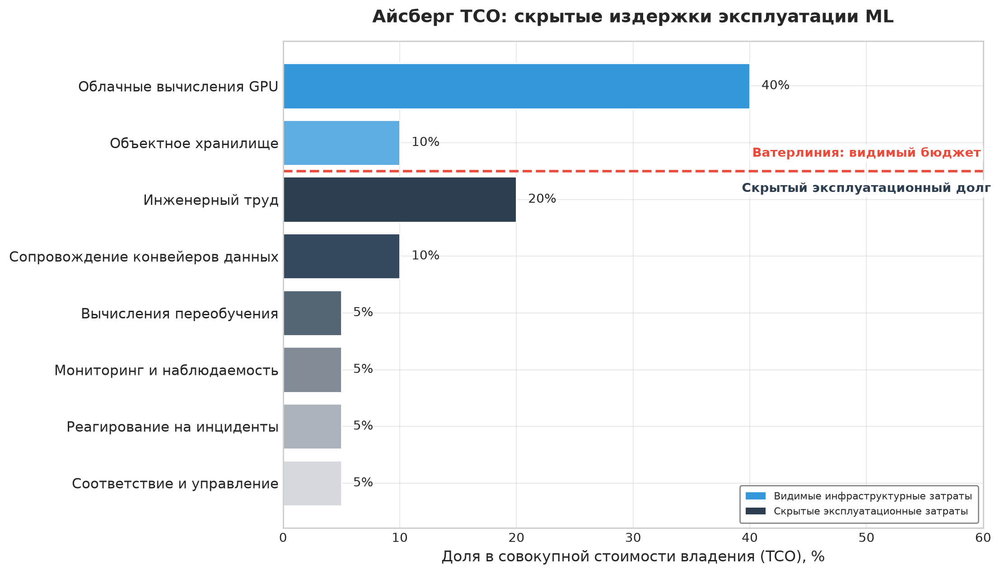

***Айсберг TCO:** анализ отделяет видимые инфраструктурные затраты от эксплуатационных, которые легче упустить. В этом иллюстративном бюджете инженерный труд, сопровождение и соответствие требованиям вместе составляют половину совокупной стоимости.*

Декомпозиция выявляет важное наблюдение: доминирующая статья стоимости меняется по мере созревания организаций. На ранних стадиях ML-усилия доминируются $C_{\text{iter}}$ (экспериментами), на стадии роста — $C_{\text{train}}$ (разработкой моделей), а в производственном масштабе — $C_{\text{infer}}$ (обслуживанием при больших объемах). Стратегии оптимизации должны соответствовать текущей структуре стоимости.

#### Модель стоимости обучения

Затраты на обучение включают вычисления, необходимые для разработки и поддержки моделей. [Уравнение](#eq-training-cost) формализует стоимость обучения как функцию числа GPU, длительности обучения, ставок стоимости часа ускорителя без учета энергии, накладных расходов дата-центра на энергию и накладных расходов на сбои:

$$C_{\text{train}} = N_{\text{GPU}} \times T_{\text{hours}} \times \left(R_{\text{GPU/hr}} + P_{\text{GPU}} \times R_{\$/\text{kWh}} \times \text{PUE}\right) \times (1 + F_{\text{fail}})$$

<a id="eq-training-cost"></a>

где:

- $N_{\text{GPU}}$ — число выделенных GPU
- $T_{\text{hours}}$ — длительность обучения в часах
- $R_{\text{GPU/hr}}$ — стоимость часа ускорителя без учета энергии
- $P_{\text{GPU}}$ — потребляемая мощность одного GPU в кВт
- $R_{\$/\text{kWh}}$ — цена электроэнергии
- $\text{PUE}$ — коэффициент эффективности использования энергии (PUE), применяемый к энергетическому члену
- $F_{\text{fail}}$ — коэффициент накладных расходов на сбои (доля обучения, потерянная из-за отказов и перезапусков)

Коэффициент PUE отражает эффективность дата-центра: PUE 1,2 означает 20 процентов дополнительной мощности на охлаждение и инфраструктуру. Он применяется к потреблению энергии, а не ко всей ставке часа ускорителя. Накладные расходы на сбои $F_{\text{fail}}$ учитывают затраты на контрольные точки и перезапуски; в масштабе в главе «Отказоустойчивость» показано, как отказы компонентов переходят в накладные расходы на контрольные точки и перезапуск для длительных заданий парка.

#### Разбор на примере: расчет стоимости обучения

Рассмотрим обучение большой языковой модели:

- Конфигурация: 256 GPU H100 в течение 14 дней
- Базовая ставка часа ускорителя: \$3,50 за GPU-час
- Надбавка за энергию: 700 Вт при \$0,07 за кВт·ч и PUE 1,15 добавляет \$0,06 за GPU-час
- Эффективная ставка: \$3,56 за GPU-час
- Накладные расходы на сбои: 15 процентов (типично для многоузлового обучения)

$C_{\text{train}} = 256 \times (14 \times 24) \times (\$3.50 + \$0.06) \times 1.15 \approx \$352\,150$

Если эта модель требует ежеквартального переобучения, годовая стоимость обучения достигает примерно \$1,4 млн. Однако для производственных систем, обслуживающих миллионы пользователей, стоимость обучения часто составляет малую долю совокупного TCO.

#### Модель стоимости инференса


*В производственном масштабе обслуживание (инференс) доминирует в совокупной стоимости владения.*

Инференс доминирует в TCO производственных ML-систем в масштабе. [Уравнение](#eq-ops-scale-inference-cost) определяет емкость обслуживания по устойчивой пропускной способности на GPU, измеренной при репрезентативном батчинге, целевом SLO задержки и требуемом эксплуатационном запасе:

$$N_{\text{GPU}} = \left\lceil \frac{Q_{\text{daily}}}{86{,}400 \times q_{\text{GPU,target}}} \right\rceil, \qquad C_{\text{infer}} = N_{\text{GPU}} \times 24 \times 365 \times R_{\text{GPU/hr}}$$

<a id="eq-ops-scale-inference-cost"></a>

где:

- $Q_{\text{daily}}$ — суточный объем запросов
- $q_{\text{GPU,target}}$ — устойчивое число запросов в секунду на GPU при целевом SLO задержки, с учетом батчинга и эксплуатационного запаса
- $N_{\text{GPU}}$ — целое число постоянно выделенных GPU
- $R_{\text{GPU/hr}}$ — почасовая стоимость GPU

Ключевой вывод: стоимость инференса растет с объемом запросов дискретными шагами мощности. Загрузка и батчинг снижают стоимость только тогда, когда улучшают измеренную пропускную способность при целевом SLO задержки; их не следует применять повторно как независимые делители.

#### Альтернативная формулировка

Для планирования мощности стоимость инференса можно выразить через требуемые GPU-секунды на запрос:

$$C_{\text{infer}} = Q_{\text{annual}} \times S_{\text{GPU/query}} \times \frac{R_{\text{GPU/hr}}}{3600}$$

где $S_{\text{GPU/query}}$ — измеренные суммарные GPU-секунды на запрос при репрезентативном батчинге и целевом SLO. Эта формулировка использует спрос на ресурсы, а не сквозную задержку запроса, и уже учитывает достигнутую загрузку и эффективность батчинга.

#### Модель стоимости данных

Стоимость данных демонстрирует сверхлинейное масштабирование с пользовательской базой из-за роста хранилища, объема передачи и требований к обработке. [Уравнение](#eq-data-cost) раскладывает стоимость данных на три компонента, которые масштабируются по-разному: стоимость хранения $C_{\text{storage}}$, стоимость исходящего трафика $C_{\text{egress}}$ за перемещение данных по сети и стоимость обработки $C_{\text{process}}$:

$$C_{\text{data}} = C_{\text{storage}} + C_{\text{egress}} + C_{\text{process}}$$

<a id="eq-data-cost"></a>

Стоимость хранения растет с требованиями к срокам хранения данных:

$$C_{\text{storage}} = D_{\text{vol,data}} \times R_{\text{storage/GB}} \times T_{\text{retention}}$$

где $D_{\text{vol,data}}$ — объем данных в ГБ, $R_{\text{storage/GB}}$ — ежемесячная ставка хранения, а $T_{\text{retention}}$ — срок хранения в месяцах.

Стоимость исходящего трафика масштабируется с объемом передачи данных:

$$C_{\text{egress}} = D_{\text{vol,transfer}} \times R_{\text{egress/GB}}$$

Тарифы облачного исходящего трафика (\$0,08–0,12 за гигабайт) делают передачу данных значимым драйвером стоимости для многорегиональных развертываний и распределения обучающих данных.

Стоимость обработки масштабируется с вычислительными требованиями на извлечение, преобразование, загрузку, инжиниринг признаков и валидацию данных:

$$C_{\text{process}} = D_{\text{vol,processed}} \times R_{\text{process/GB}}$$

Стоимость обработки данных часто удивляет организации: конвейер инжиниринга признаков, обрабатывающий 10 терабайт в день по \$0,02 за гигабайт, стоит \$73 000 в год.

#### Модель стоимости итераций

Затраты на разработку отражают инженерные инвестиции в эксперименты и улучшение моделей. [Уравнение](#eq-iteration-cost) формализует их как число экспериментов, умноженное на суммарные инженерные и вычислительные затраты на эксперимент:

$$C_{\text{iter}} = N_{\text{exp}} \times (C_{\text{engineer,per-exp}} + C_{\text{compute,per-exp}})$$

<a id="eq-iteration-cost"></a>

где:

- $N_{\text{exp}}$ — число проведенных экспериментов
- $C_{\text{engineer,per-exp}}$ — инженерная стоимость одного эксперимента
- $C_{\text{compute,per-exp}}$ — вычислительная стоимость одного эксперимента

Критический, но часто упускаемый факт: неудачные эксперименты имеют реальную стоимость. Если 90 процентов экспериментов не улучшают производственные метрики, эффективная стоимость одного успешного эксперимента в 10 раз выше номинальной стоимости эксперимента. Это мотивирует инвестиции в инфраструктуру экспериментов, которая снижает инженерные и вычислительные затраты на эксперимент и повышает долю успешных экспериментов.

#### Разбор на примере: TCO стартапа и производственной компании

[Таблица](#tbl-ops-tco-comparison) показывает, как структура стоимости меняется с масштабом, сравнивая две организации. Стартап эксплуатирует 1 производственную модель, обслуживающую 100 000 пользователей в день, с ежемесячным переобучением, командой из 2 инженеров и облачной инфраструктурой. Производственная компания эксплуатирует 50 моделей, обслуживающих 10 млн пользователей в день, с еженедельным переобучением для высокоскоростных моделей, выделенной командой ML-платформы из 15 инженеров и гибридной облачной и локальной инфраструктурой.

<a id="tbl-ops-tco-comparison"></a>

***TCO: стартап против производственной компании:** структура стоимости резко меняется с масштабом. В стартапах доминируют затраты на итерации (зарплаты инженеров на эксперименты), тогда как в производственных компаниях доминирующими становятся затраты на инференс по мере роста объема обслуживания. Рост числа пользователей в 100 раз дает лишь 20,6-кратный рост TCO благодаря эффектам оптимизации, но обратите внимание на сверхлинейный рост затрат на данные в 160 раз.*

| **Статья затрат**   |                    **Стартап**                     |               **Производственная компания**               | **Коэффициент роста**                                                                      |
|:--------------------|:--------------------------------------------------:|:--------------------------------------------------:|:-------------------------------------------------------------------------------------------|
| **Обучение**        |    \$5 000 в месяц     |    \$150 000 в месяц     | 30× (больше моделей, крупнее)              |
| **Инференс**        |    \$2 000 в месяц    |    \$400 000 в месяц    | 200× (в 100 раз больше пользователей, оптимизация) |
| **Данные**          |      \$500 в месяц       |      \$80 000 в месяц       | 160× (сверхлинейно по числу пользователей)               |
| **Итерации**        |    \$40 000 в месяц    |    \$350 000 в месяц    | 8,75× (размер команды, эксперименты)          |
| **Общий TCO**       |    **\$47 500 в месяц**    |    **\$980 000 в месяц**    | **20,6×**                                   |
| **Доминирующая статья** | Итерации (84%) | Инференс (41%) |                                                                                            |

Сравнение выявляет структурный сдвиг в экономике ML. Стартапы тратят 84 процента на итерации через людей и эксперименты, а производственные компании — 41 процент на инфраструктуру инференса, поэтому каждая стадия требует разных стратегий оптимизации. TCO также растет сублинейно: рост числа пользователей в 100 раз дает лишь 20,6-кратный рост TCO, потому что экономия от масштаба инференса и амортизированные затраты на обучение поглощают часть роста. Данные нарушают этот паттерн: они растут в 160 раз при росте пользователей в 100 раз, поскольку объем хранения увеличивается с историей пользователей, а затраты на обработку растут со сложностью признаков. Последний сдвиг дает автоматизация платформы: производственная компания проводит в 10 раз больше экспериментов, но затраты на итерации растут лишь в 8,75 раза, потому что накладные расходы на эксперимент падают.

#### Анализ чувствительности TCO

Понимание того, как TCO реагирует на ключевые параметры, позволяет планировать стратегически. [Таблица](#tbl-tco-sensitivity) показывает влияние увеличения ключевых параметров в 2 раза на каждый компонент стоимости:

<a id="tbl-tco-sensitivity"></a>

***Анализ чувствительности TCO:** влияние 2-кратного увеличения ключевых параметров на компоненты стоимости. Число моделей имеет наибольший суммарный эффект (85 процентов), поскольку затрагивает все компоненты, а частота переобучения — наименьший (25 процентов), так как влияет только на обучение и связанные затраты на данные. Рост пользователей дает сверхлинейный эффект на затраты на данные (120 процентов) из-за того, что требования к хранению и обработке растут быстрее числа пользователей.*

| **Параметр**         |                 **Изменение**                |                           **Обучение**                          |                          **Инференс**                           |                           **Данные**                          |                       **Суммарный эффект**                       |
|:---------------------|:-----------------------------------------:|:---------------------------------------------------------------:|:----------------------------------------------------------------:|:-----------------------------------------------------------:|:------------------------------------------------------------:|
| **Ежедневные пользователи** | 2× |      --     |     100%      |      120%     |     45%      |
| **Число моделей**    | 2× |      100%     |     100%      |      50%     |     85%      |
| **Запросов на пользователя** | 2× |   --   |   100%   |   80%   |   40%   |
| **Размер модели**    | 2× |      150%      |      120%      |      30%      |      55%      |
| **Частота переобучения** | 2× | 100% | -- | 40% | 25% |

Нелинейные эффекты объясняют, почему колонка суммарного эффекта не просто повторяет изменение входа. **Масштабирование пользователей** делает затраты на данные сверхлинейными (120 процентов при 2-кратном росте пользователей), потому что накопление истории пользователей и вычисление признаков между пользователями добавляют состояние быстрее, чем растет число пользователей. **Масштабирование размера модели** увеличивает стоимость обучения на 150 процентов при 2-кратном росте параметров, поскольку требования к памяти могут вынудить к конфигурациям с несколькими GPU вместо простого запуска на одном более крупном устройстве. Число моделей создает самый широкий мультипликативный эффект, потому что каждая дополнительная модель одновременно затрагивает обучение, инференс, данные, мониторинг, развертывание и управление, делая рост портфеля самым дорогим измерением масштабирования.

#### Схема решения: скорость против эффективности

Анализ TCO позволяет принимать обоснованные решения о том, когда оптимизировать скорость разработки, а когда операционную эффективность. [Уравнение](#eq-optimization-breakeven) вычисляет точку окупаемости инвестиций в оптимизацию:

$$T_{\text{breakeven}} = \frac{C_{\text{optimization}}}{C_{\text{save,monthly}}}$$

<a id="eq-optimization-breakeven"></a>

где $C_{\text{optimization}}$ — единовременная стоимость внедрения оптимизации, а $C_{\text{save,monthly}}$ — ежемесячная экономия, которую она дает.

Уравнение окупаемости становится полезным только тогда, когда известна доминирующая статья стоимости. [Таблица](#tbl-tco-cost-structure-decisions) сопоставляет каждую структуру стоимости с позицией оптимизации и порогом окупаемости, которые должны определять инвестиционные решения.

<a id="tbl-tco-cost-structure-decisions"></a>

***Правила решений по структуре стоимости:** позиция оптимизации меняется по мере того, как TCO смещается от доминирования итераций к доминированию обучения и затем инференса.*

| **Доминирующая структура стоимости**                        | **Контекст эксплуатации** | **Позиция оптимизации**                                                                                                                                                                                                                                | **Порог окупаемости**                           |
|:------------------------------------------------------------|:----------------------|:--------------------------------------------------------------------------------------------------------------------------------------------------------------------------------------------------------------------------------------------------------|:------------------------------------------------|
| Доминируют итерации ($C_{\text{iter}} > 50\%$ TCO)          | Ранняя стадия         | Оптимизировать скорость разработки, мириться с более высокой стоимостью инференса, пока эксперименты меняются, и инвестировать в инфраструктуру экспериментов, которая сокращает $T_{\text{exp}}$. Откладывать работу по эффективности инфраструктуры, пока структура стоимости не сместится. | Откладывать, если не ускоряет итерации напрямую. |
| Доминирует обучение ($C_{\text{train}} > 40\%$ TCO)         | Стадия роста          | Инвестировать в эффективность обучения: смешанная точность, контрольные точки градиентов, спотовые инстансы с сохранением и возобновлением, изменения архитектуры, сокращающие время обучения.                                                       | Окупаемость 3–6 месяцев приемлема.              |
| Доминирует инференс ($C_{\text{infer}} > 40\%$ TCO)         | Стадия масштаба       | Приоритет — оптимизация обслуживания: квантизация, батчинг, кэширование и дистилляция, поскольку окупаемость оптимизации модели максимальна, когда каждый запрос повторяет экономию. | Требуется окупаемость 1–3 месяца.               |

#### Разбор на примере: решение об инвестиции в оптимизацию

Производственная компания ($C_{\text{infer}} = \$400\text{ тыс./мес.}$) оценивает квантизацию INT8:

- Стоимость внедрения: \$80 000 (инженерное время и валидация)
- Ожидаемое снижение стоимости инференса: 40 процентов
- Ежемесячная экономия: \$400 000 $\times$ 0,40 = \$160 000

$T_{\text{breakeven}} = \frac{\$80\,000}{\$160\,000/\text{мес.}} = 0.5 \text{ мес.}$

Окупаемость за 2 недели делает эту инвестицию очень привлекательной. Однако если та же компания ($C_{\text{train}} = \$150\text{ тыс./мес.}$) оценивает оптимизацию обучения:

- Стоимость внедрения: \$80 000
- Ожидаемое снижение стоимости обучения: 30 процентов
- Ежемесячная экономия: \$150 000 $\times$ 0,30 = \$45 000

$T_{\text{breakeven}} = \frac{\$80\,000}{\$45\,000/\text{мес.}} = 1.8 \text{ мес.}$

Все еще привлекательно, но с меньшим приоритетом, чем оптимизация инференса, из-за более длинной окупаемости и меньшей абсолютной экономии. Та же логика окупаемости обобщается в матрицу приоритетов оптимизации. [Таблица](#tbl-optimization-priority) сопоставляет доминирующую структуру стоимости с работами по оптимизации, которые следует выполнить первыми:

<a id="tbl-optimization-priority"></a>

***Матрица приоритетов оптимизации:** сопоставляйте инвестиции в оптимизацию с текущей структурой стоимости. Когда доминируют итерации, инвестируйте в скорость разработчиков, а не в инфраструктуру. Когда доминирует инференс, оптимизация модели дает самую быструю окупаемость. Структуры стоимости, где доминируют данные (нетипично, но возможно при крупных хранилищах признаков), требуют оптимизации хранения и передачи до улучшения моделей.*

| **Доминирующая статья** |  **Первый приоритет** |   **Второй приоритет**    |          **Избегать**          |
|:---------------------|:-------------------:|:------------------------:|:---------------------------:|
| **Итерации (>50%)** | Скорость экспериментов |    Инструменты разработчика     | Оптимизация инфраструктуры |
| **Обучение (>40%)**  | Эффективность обучения | Спот/прерываемые вычисления |   Избыточная инженерия обслуживания  |
| **Инференс (>40%)** |  Оптимизация модели |  Инфраструктура обслуживания  |     Избыточное переобучение    |
| **Данные (>30%)**      |   Многоуровневое хранение   |     Снижение исходящего трафика     | Преждевременное расширение признаков |

#### Архитектурные решения, определяемые TCO

Анализ TCO должен влиять на архитектурный выбор наряду с операционной оптимизацией. Анализ «строить или покупать» с учетом загрузки из раздела «Загрузка как экономический инвариант» применяется для каждой модели: сервисы платформы с оплатой по использованию могут иметь более низкий TCO, чем самоуправляемая инфраструктура, когда нагрузка не может поддерживать загрузку, амортизирующую собственную мощность, особенно там, где доминируют затраты на итерации. **Выбор архитектуры модели** меняет то же уравнение: модель, требующая в 2 раза больших затрат на обучение, но в 0,5 раза меньших затрат на инференс, может иметь более низкий TCO в масштабе, где доминирует инференс. **Частота переобучения** увеличивает $C_{\text{train}}$ и $C_{\text{data}}$, но может сократить $C_{\text{iter}}$, так как позволяет раньше ловить дрейф и избегать экстренных вмешательств. **Сложность признаков** аналогично увеличивает $C_{\text{data}}$ через хранение и обработку и $C_{\text{train}}$ через более длительное обучение, но может сократить $C_{\text{iter}}$, поскольку быстрее улучшает качество модели.

Модель TCO переводит эти архитектурные споры из обсуждения мнений в количественный анализ с измеримыми результатами. Среди этих инвестиций одна составляющая неизменно оказывается и самой дорогой в построении, и самой ценной для стандартизации. Поскольку данные — основа каждой модели парка, платформа должна решить постоянную задачу: подавать согласованные признаки в масштабе.

## Эксплуатация хранилища признаков

Рассмотрим систему обнаружения мошенничества, которой нужно знать объем транзакций пользователя за последние десять минут. В продакшене это требует поиска в базе данных за доли миллисекунды. Однако при обучении оценка годовой истории требует массивного распределенного соединения по миллиардам строк. Когда логика вычисления «объема транзакций» хотя бы немного различается между пакетной обработкой и поиском в реальном времени, возникающий перекос между обучением и обслуживанием незаметно разрушит качество модели.

Первое проектное решение — архитектура двойного хранилища: онлайн-хранилища обслуживают признаки с низкой задержкой, а офлайн-хранилища генерируют воспроизводимые обучающие данные. Эксплуатация таких систем в масштабе ставит особые задачи свежести, согласованности и производительности. Основная проблема, которую решают хранилища признаков, — **разрыв между обучением и обслуживанием** (Training-Serving Gap): признаки, вычисленные при обучении, должны воспроизводиться при обслуживании, но вычислительные контексты принципиально различаются: *пакетный* и *реального времени*, *часы* и *миллисекунды*. Этот разрыв часто проявляется как перекос между обучением и обслуживанием — критический режим отказа, при котором тонкие различия в логике обработки признаков между пакетным обучением и конвейерами инференса в реальном времени вызывают незаметную деградацию точности.

> **Перспектива: перекос между обучением и обслуживанием**
>
> В масштабе парка вопрос смещается от обнаружения перекоса в одной модели к управлению им как свойством платформы. Хранилище признаков снижает перекос, заставляя конвейеры обучения и обслуживания читать общие определения признаков и материализованные значения там, где это возможно. Тем самым равенство $f_{\text{train}}(x) \equiv f_{\text{serve}}(x)$ превращается в архитектурный инвариант, который можно проверять и отслеживать, вместо ручного соглашения, которое каждая команда повторяет сама.

Гарантия должна выполняться в обоих вычислительных контекстах, поэтому хранилища признаков — это архитектурная граница, а не удобство хранения. При обучении признаки вычисляются пакетно по историческим данным: конвейер может тратить часы на вычисление признаков для миллионов примеров, и приоритет здесь — корректность и покрытие. При обслуживании те же определения должны быть доступны через поиск с низкой задержкой, и приоритет — ограниченная хвостовая задержка живых запросов.

### Архитектура хранилища признаков

Паттерн двойного хранилища ([рисунок](#fig-feature-store-architecture)) разрешает этот конфликт, разделяя офлайн-аналитическое хранилище и онлайн-хранилище «ключ — значение», связанные общим слоем материализации.

<a id="fig-feature-store-architecture"></a>

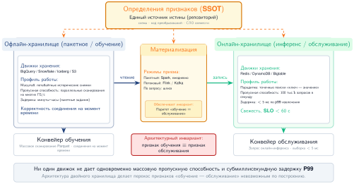

***Архитектура хранилища признаков:** архитектура двойного хранилища разрешает конфликт между обучением (пакетные сканирования с высокой пропускной способностью) и обслуживанием (точечные поиски с низкой задержкой). Признаки материализуются из пакетных и потоковых источников в офлайн-хранилище (для обучения) и онлайн-хранилище (для обслуживания), обеспечивая согласованность на протяжении всего жизненного цикла ML.*

Хранилище признаков — не просто база данных; это архитектурный паттерн, призванный разрешить фундаментальный конфликт между паттернами доступа к данным при обучении моделей и обслуживании в реальном времени. Обучению нужны аналитические сканирования больших исторических наборов с высокой пропускной способностью, а обслуживанию — точечные поиски с низкой задержкой для отдельных запросов предсказания. Ни одна база данных не может эффективно удовлетворить оба ограничения, поэтому принимается **архитектура двойного хранилища**, состоящая из офлайн-хранилища и онлайн-хранилища.

**Офлайн-хранилище** — система записи для всех исторических данных признаков, часто содержащая петабайты информации. Оно оптимизировано под массовые последовательные чтения, характерные для генерации обучающих данных, где один запрос может сканировать терабайты, чтобы собрать набор признаков для миллионов примеров. Ключевая метрика — пропускная способность, а не задержка. Типичные варианты: BigQuery, Snowflake или озера данных на S3 с форматами вроде Apache Iceberg, предназначенные для распараллеливания крупных аналитических запросов.

**Онлайн-хранилище** создано для скорости во время обслуживания. Когда приходит запрос предсказания, модели нужны признаки в строгом бюджете задержки — часто p99 меньше 10 миллисекунд. Для платформы, обслуживающей 10 000 моделей, это может означать миллионы запросов в секунду. Поэтому нужна парадигма «ключ — значение», с системами вроде Redis, DynamoDB или Bigtable, оптимизированными для извлечения небольшого числа значений по ключу сущности.

Признаки загружаются в эти хранилища через процесс, называемый **материализацией**. Пакетные вычислительные конвейеры, часто работающие на Spark, выполняются ежедневно или ежечасно и генерируют признаки из исторических данных. Потоковые конвейеры на Flink или Spark Streaming генерируют признаки почти в реальном времени из потоков событий вроде Kafka. Вычисление по запросу рассчитывает признаки во время запроса, когда требования к свежести превышают частоту пакетной обработки. Центральная архитектурная задача — обеспечить согласованность между двумя хранилищами при материализации. Если в офлайн-хранилище есть значение признака для обучения, которое не было идентично доступно в онлайн-хранилище в момент предсказания, возникает тонкая форма утечки данных, которая может привести к незаметной деградации модели в продакшене. Это и есть проблема перекоса между обучением и обслуживанием, сформулированная в перспективе выше.

Для платформы, управляющей более чем 10 000 моделями, эта централизованная архитектура двойного хранилища не является необязательной. Она дает управляемый контракт между производством данных и их потреблением моделями, не допуская тысяч независимых, неподдерживаемых конвейеров признаков и гарантируя, что все модели строятся на согласованном, качественном источнике истины.

### SLO свежести

Свежесть признака — это задержка между событиями реального мира и их отражением в значениях признаков. [Таблица](#tbl-ops-scale-feature-freshness) сопоставляет четыре типа признаков с требованиями свежести: статические признаки вроде демографии пользователя допускают устаревание на уровне дней при пакетном вычислении, тогда как признаки реального времени, отражающие последнее действие пользователя, требуют свежести на уровне секунд через потоковое вычисление или вычисление по запросу.

Требование свежести особенно остро для рекомендательных систем, где устаревшие признаки становятся прямым налогом на вовлеченность.

> **Маячный архетип B (DLRM в масштабе): налог на устаревание**
>
> **Контекст**: рекомендательные нагрузки маячного архетипа B (DLRM в масштабе) поддерживают многотерабайтные разреженные таблицы эмбеддингов ($M_{\text{capacity}} > 1\text{ ТБ}$) в распределенной памяти и обрабатывают более $100\,000\text{ QPS}$ при жестких бюджетах задержки ($L_{\text{lat}} < 10\text{ мс}$).
>
> **Механизм**: истинное намерение пользователя смещается непрерывно. Если конвейер материализации признаков имеет задержку обновления 10 минут ($T_{\text{staleness}} = 600\text{ с}$), запросы обслуживания потребляют устаревшие векторы эмбеддингов $D_{\text{vol}}$, и последующие ранжировщики рекомендуют нерелевантные элементы.
>
> **Последствия**: задержки приема $D_{\text{vol}}/\text{BW}$ снижают долю кликов на 5–15 процентов, создавая серьезный выручочный штраф («налог на устаревание»).
>
> **Системный урок**: операции DLRM должны ставить пропускную способность материализации признаков $D_{\text{vol}}/\text{BW}$ и низколатентную потоковую инфраструктуру выше пакетных заданий, согласуя емкость потокового приема непосредственно со скоростью затухания пользовательского намерения.

**Требования свежести признаков по типам** задают SLO, которые должны соблюдать система мониторинга и оповещений.

<a id="tbl-ops-scale-feature-freshness"></a>

***Требования к свежести признаков по типам:** четыре категории признаков с порогами SLO и схемами вычисления. Статические признаки (демография пользователя) допускают устаревание на уровне дней при пакетном вычислении; признаки реального времени (последнее действие) требуют свежести на уровне секунд через потоковое или вычисление по запросу, напрямую влияя на качество рекомендаций и вовлеченность.*

| **Тип признака**    |       **Пример**        | **SLO свежести**  | **Схема вычисления**    |
|:--------------------|:-----------------------:|:-----------------:|:-----------------------:|
| **Статический**     |    Демография пользователя |       Дни        |          Пакетная       |
| **Медленно меняющийся** |   Предпочтения пользователя |      Часы       |          Пакетная       |
| **Уровня сессии**   | Контекст текущей сессии |      Минуты      |        Потоковая        |
| **Реального времени** |     Последнее действие |     Секунды      |   Потоковая/по запросу  |

Свежесть становится эксплуатационной только тогда, когда SLO превращается в измеряемую величину. [Уравнение](#eq-feature-staleness) определяет устаревание признака как разницу между текущим временем и моментом последнего обновления признака, что позволяет напрямую сравнивать его с порогами из [таблицы](#tbl-ops-scale-feature-freshness):

$$\text{Устаревание} = t_{\text{current}} - t_{\text{feature\_update}}$$

<a id="eq-feature-staleness"></a>

Скаляр устаревания дает пакетным и потоковым путям общее правило оповещения. Потоковые признаки должны оставаться близкими к нулю, кроме периодов сбоя конвейера, а пакетные признаки предсказуемо растут между плановыми обновлениями; поэтому система мониторинга должна сравнивать каждый признак с его собственным SLO, а не применять единый глобальный порог свежести.

#### Разбор на примере: влияние свежести на качество модели

Рекомендательная система использует признаки пользовательских взаимодействий с разным уровнем свежести. Тестирование на исторических данных дает прирост вовлеченности из [таблицы](#tbl-feature-freshness-engagement):

<a id="tbl-feature-freshness-engagement"></a>

***Прирост вовлеченности по свежести признаков:** историческое тестирование системы рекомендаций. Признаки реального времени (менее одной минуты) дают на 4,2 процентного пункта больше прироста вовлеченности, чем дневные признаки. Разрыв в 2,1 пункта между почасовыми и признаками реального времени количественно выражает ценность инвестиций в потоковую инфраструктуру признаков.*

| **Свежесть признака**          | **Прирост вовлеченности относительно базовой линии** |
|:-------------------------------|:----------------------------------------------------:|
| **Реального времени (< 1 мин)** |              +12,3%                                  |
| **Почти реального времени (< 5 мин)** |       +11,8%                                  |
| **Раз в час**                  |              +10,2%                                  |
| **Раз в день**                 |              +8,1%                                   |

Разница вовлеченности между почасовыми и признаками реального времени составляет 2,1 процентного пункта. Если это переводится в \$10 млн годовой ценности вовлеченности, инвестиции в инфраструктуру признаков реального времени могут оправдываться, если их стоимость ниже этой ценности.

> **Контрольные вопросы: цена решения о пакетной и потоковой свежести**
>
> [Таблица](#tbl-feature-freshness-engagement) показывает, что переход от почасовых к признакам реального времени добавляет 2,1 процентного пункта прироста вовлеченности. Оцените этот прирост как \$10 млн годовой ценности вовлеченности и примените его к выбору между потоковой и пакетной инфраструктурой.
>
> - [ ] **Точка безубыточности свежести**: определите максимальную годовую стоимость конвейера признаков реального времени, который еще окупается при приросте 2,1 пункта при неизменной ценности вовлеченности 10 млн \$, и укажите порог стоимости, ниже которого потоковая обработка явно выигрывает.
> - [ ] **Прирост на пункт**: сравните переходы «раз в день → раз в час», «раз в час → почти реального времени» и «почти реального времени → реального времени» по отдаче на процентный пункт сокращения задержки и выведите подходящую цель свежести для команды, которая не может позволить себе полную потоковую обработку.
> - [ ] **Масштабирование на пользователей**: если годовая ценность вовлеченности 10 млн \$ масштабируется линейно с числом пользователей платформы, определите число пользователей, при котором потоковая платформа признаков стоимостью 5 млн \$ в год окупается, укажите диапазон, в котором она не окупается, и выберите альтернативную архитектуру из [таблицы](#tbl-ops-scale-feature-freshness).

### Корректность на момент времени

Обучающие данные должны использовать признаки такими, какими они были на момент каждого обучающего примера. [Рисунок](#fig-time-travel) иллюстрирует проблему «путешествия во времени»: пакетное задание, вычисляющее `total_clicks_today` в полночь, дает значение 10, но использование его для обучения модели, предсказывающей поведение в полдень, вносит утечку, поскольку истинное значение в полдень было лишь 4. Использование текущих значений признаков для разметки исторических событий создает утечку данных[^fn-data-leakage-pitfall], которая завышает офлайн-метрики, но проваливается в продакшене.

[^fn-data-leakage-pitfall]: **Утечка данных** (data leakage): ошибка, при которой информация из будущего загрязняет обучающие данные. Системная опасность в том, что утечка порождает модели с впечатляющими офлайн-метриками (иногда свыше 99 процентов точности), которые полностью проваливаются в продакшене, где информации из будущего нет. В масштабе хранилища признаков риск утечки умножается, потому что признаки, вычисленные пакетно, могут содержать временную информацию, невидимую для команды моделей, но доступную оптимизатору; поэтому корректность на момент времени становится гарантией инфраструктуры, а не обязанностью каждой команды.

<a id="fig-time-travel"></a>


***Корректность на момент времени:** соединение на момент времени предотвращает утечку, сопоставляя каждое обучающее событие со значениями признаков, какими они были *на момент события*, а не с их текущими значениями. Результирующий пример содержит только ту информацию, которая была бы доступна во время инференса.*

Контраст на [рисунке](#fig-time-travel) резок: корректное значение на момент времени в полдень — 4 клика, но наивное пакетное соединение подставило бы значение полуночи, 10, завышая обучающий сигнал в 2,5 раза и порождая модель, которая не обобщается на продакшен. Отказ «путешествия во времени» распространен потому, что значение признака верно в базе данных, но неверно для исторического момента предсказания: `total_clicks_today` равно 10 в полночь, но предсказание в полдень должно видеть только 4 клика, существовавших к полудню. Обучение на значении полуночи переносит информацию из будущего в пример, поэтому модель учится «жульничать» сигналами, недоступными в продакшене. Результатом могут стать впечатляющие офлайн-метрики и катастрофический сбой в продакшене, когда данных из будущего не окажется.

Хранилища признаков реализуют **соединения на момент времени** (point-in-time joins), которые извлекают значения признаков на заданные отметки времени, как показано в листинге ниже.

```{.sql}
SELECT
    e.user_id,
    e.event_timestamp,
    e.label,
    f.feature_1,
    f.feature_2
FROM events e
LEFT JOIN LATERAL (
    SELECT feature_1, feature_2
    FROM features f
    WHERE f.user_id = e.user_id
      AND f.feature_timestamp <= e.event_timestamp
    ORDER BY f.feature_timestamp DESC
    LIMIT 1
) f ON TRUE
```

Этот запрос извлекает самые свежие значения признаков, существовавшие до каждого события, гарантируя, что обучающие данные отражают реальность продакшена.

Корректность на момент времени имеет цену в хранении: хранилище должно сохранять историю признаков, а не только их текущие значения. Та же гарантия, которая предотвращает утечку, умножает удерживаемое состояние:

$$\text{Объем хранения} = N_{\text{entities}} \times N_{\text{features}} \times \frac{T_{\text{retention}}}{T_{\text{update}}}$$

Для 100 млн пользователей, 1000 признаков, годового хранения и обновлений каждый час история содержит 876 трлн значений признаков. При 100 байтах на значение это примерно 87,6 ПБ до сжатия. Эффективные хранилища признаков используют сжатие, колоночное хранение и политики хранения, чтобы управлять этим масштабом.

### Версионирование и происхождение признаков

Определения признаков — это производственные интерфейсы, поэтому изменение одного из них без версионирования может сломать каждую зависимую модель. Версионирование и происхождение (lineage) делают эту эволюцию управляемой, а не неявной.

Типичный инцидент с признаком `user_engagement_score` иллюстрирует механику. Команда платформы меняет признак с 30-дневной z-оценки на 7-дневное масштабирование min-max. Результат по-прежнему может быть числом с плавающей точкой, поэтому одна только валидация схемы может пройти, тогда как смысл признака полностью меняется. Версионирование называет семантическое изменение до того, как оно дойдет до продакшена; происхождение (lineage) определяет каждую модель, обученную или обслуживавшуюся со старым смыслом; пересчет истории (backfill) заново вычисляет исторические значения для нового смысла; а проверки свежести и качества решают, безопасно ли использовать переписанную историю. Без этой цепочки миграция признака превращается в незаметную многомодельную регрессию.

Безопасный интерфейс признака фиксирует оба измерения версии и поля происхождения. [Таблица](#tbl-ops-scale-feature-version-lineage-components) связывает эти поля с их эксплуатационным применением.

<a id="tbl-ops-scale-feature-version-lineage-components"></a>

***Компоненты версии и происхождения признака:** версионирование признаков отделяет изменения логики, данных и схемы; происхождение фиксирует путь, необходимый для отладки, аудита и воспроизведения значений признаков. Вместе эти поля превращают определение признака в управляемый производственный интерфейс.*

| **Компонент**                         | **Что фиксирует**                                       | **Эксплуатационное применение**                                                 |
|:--------------------------------------|:--------------------------------------------------------|:-------------------------------------------------------------------------------|
| Версия определения                    | Логику вычисления признака                              | Блокирует незаметные семантические изменения, когда меняется формула, но не тип. |
| Версия данных                         | Снимок источника или контракт потока                    | Отличает изменения модели от изменений восходящих данных.                      |
| Версия схемы                          | Тип выхода, форму, единицы измерения и допустимость пропусков | Сохраняет проверки совместимости API, по-прежнему называя семантические сдвиги. |
| Декларация потребителя                | Точные версии признаков, которые использует каждая модель | Дает платформе место для блокировки небезопасных обновлений до обслуживания.   |
| Происхождение источника (source lineage) | Исходные таблицы, потоки и их версии                 | Прослеживает плохие предсказания до восходящих данных, которые их породили.    |
| Происхождение преобразования и среды (provenance) | Код преобразования, отметку времени и окружение | Воспроизводит исторические значения для аудита, отладки и соответствия требованиям. |
| Метрики качества и свежести           | Результаты валидации, наблюдавшиеся при создании значения | Оценивает радиус поражения и решает, безопасно ли использовать переписанную историю. |

### Процедуры пересчета истории

Пересчет истории (backfill) — это производственная миграция над историей: изменение определения признака переписывает обучающую запись для каждой зависящей от него модели, поэтому платформа должна ограничить вычислительную стоимость, проверить, что пересчитанные значения совпадают, и сохранить путь назад. Если рассматривать пересчет как миграцию, операционный вопрос меняется: не может ли вычисление выполниться однажды, а может ли история быть переписана без порчи будущих обучающих данных.

Контракт выполнения, описанный в главе «Хранение данных», делает эту проверку безопасности конкретной. Каждая партиция пересчета нуждается в стабильной идентичности и идемпотентном или транзакционном пути записи, чтобы повторы не дублировали эффекты признаков; границы времени событий и политика поздних данных также должны соответствовать соединению на момент времени, которое используется для обучения. Иначе механически успешный повтор может дать историю, полную по времени обработки, но неверную на момент предсказания, которое модель должна воспроизвести.

В масштабе исторические данные могут находиться в холодном хранилище, поэтому пересчет прежде всего становится задачей размещения данных. Длинное историческое окно затем конкурирует с производственными нагрузками за вычисления. Даже после завершения задания платформа не может просто доверять новым значениям: она должна сравнить перекрывающиеся периоды с исходным вычислением и согласовать работу с зависимыми конвейерами, чтобы задания обучения не смешивали старую и новую семантику посреди запуска.

Практический паттерн инкрементальный. Исторические данные обрабатываются по партициям по датам, и каждая партиция валидируется до начала следующей. В период двойной записи старое и новое вычисления работают параллельно, что дает платформе перекрывающиеся значения для сравнения до переключения. Откат остается возможным, потому что предыдущая версия признака и ее происхождение доступны до тех пор, пока зависимые модели не будут переобучены, оценены и повторно развернуты.

### Проблемы масштаба

Хранилища признаков в масштабе системы рекомендаций сталкиваются со связанной системной задачей: объем запросов, бюджет задержки и история хранения ограничивают одновременно.

Арифметика крупного рекомендателя объясняет, почему хранилище признаков становится инфраструктурой обслуживания, а не удобством для метаданных. 1 млрд рекомендаций в день при 100 признаках на рекомендацию дает 100 млрд поисков признаков в день. Средняя нагрузка составляет около 1,16 млн запросов в секунду до учета пиковой нагрузки, которая обычно в 5–10 раз превышает среднюю.

Получение признаков должно помещаться в общий бюджет задержки, потому что каждая лишняя миллисекунда поиска отнимает время у ранжирования. Если бюджет рекомендации составляет 50 мс, хранилище признаков может получить лишь 5–10 мс. Сетевые накладные расходы могут съесть 1–2 мс этого выделения, оставляя примерно 3–8 мс на сам поиск в хранилище. Чтобы уложиться в бюджет, нужны хранение в памяти, аккуратный батчинг и географическое размещение достаточно близко к парку обслуживания, чтобы сетевая задержка не доминировала.

Производственные хранилища признаков также несут два временных горизонта одновременно. Онлайн-путь хранит текущие значения для миллиардов сущностей и тысяч признаков на сущность, обычно в диапазоне терабайт до репликации. Офлайн-путь хранит достаточно исторического состояния, чтобы восстанавливать обучающие примеры, что может довести удерживаемую историю признаков до петабайт. Многорегиональная репликация затем обслуживает одновременно доступность и задержку, но также делает свежесть и согласованность видимыми эксплуатационными задачами.

### Эксплуатация качества данных

**Качество данных** — основной источник производственных проблем ML (Polyzotis et al., 2017). Мониторинг моделей обнаруживает симптомы, тогда как мониторинг качества данных предотвращает проблемы у их источника. В масштабе эксплуатация качества данных становится столь же критичной, как эксплуатация качества моделей, и требует систематического мониторинга, валидации и процедур реагирования на инциденты.

Первый шаг — измерение: качество данных должно выражаться в измерениях, которые напрямую соответствуют воротам предотвращения. **Полнота** показывает, присутствуют ли ожидаемые записи и поля. Ежедневный конвейер данных, который должен выдавать 10 млн пользовательских событий, но доставляет лишь 8,2 млн, полон на 82 процента, что обычно указывает на сбой конвейера или проблему восходящего источника, а не на обычную статистическую вариацию. **Согласованность** охватывает соответствие схеме и ссылочную целостность: признак возраста должен находиться между 0 и 120, тогда как значения вроде 999 или -1 указывают на утечку служебных значений или ошибки данных. Производственные системы часто отклоняют партии, не прошедшие более 5 процентов правил валидации, потому что пропустить испорченные данные обходится дороже, чем задержать партию.

**Своевременность** измеряет свежесть относительно SLO потребляющей модели. Обнаружению мошенничества могут нужны признаки моложе 100 миллисекунд, тогда как демографические признаки допускают устаревание, измеряемое днями; поэтому порог оповещения должен быть привязан к назначению признака, а не к глобальной константе. **Точность** спрашивает, остаются ли значения правильными в ожидаемых распределениях. Например, дрейф датчика после истечения калибровки может оставить значения корректного типа, но неверные. Статистические тесты, такие как Колмогорова — Смирнова для непрерывных признаков, хи-квадрат для категориальных и maximum mean discrepancy для многомерных данных, превращают эти проверки точности в повторяющиеся ворота.

Валидация затем превращает эти измерения в многослойную защиту. Валидация схемы обеспечивает ожидаемые имена столбцов, типы и ограничения при приеме; инструменты вроде Great Expectations, TensorFlow Data Validation и Pandera предоставляют декларативные схемы с автоматическими проверками. Мониторинг распределений отслеживает распределения признаков во времени и ловит дрейф, который может не нарушать ограничение типа, но указывает на восходящее изменение, вероятно ухудшающее качество модели. Кросс-полевая валидация добавляет бизнес-логику, которую не могут выразить ни схема, ни маргинальные распределения: если `country="USA"`, то `zip_code` должен соответствовать американскому почтовому формату; если `order_status="shipped"`, то должна существовать `shipping_date`; а возраст, вычисленный по дате рождения, должен совпадать с любым явным полем возраста.

#### Разбор на примере: расследование инцидента качества данных

CTR модели рекомендаций падает на 8 процентов за 5 дней. Первоначальная гипотеза связана с дрейфом модели, но расследование качества данных выявляет первопричину.

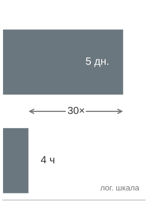

*Каждая минута запоздалого обнаружения увеличивает стоимость.*

Расследование начинается с симптома модели, а затем идет назад по пути данных. **Метрики модели** подтверждают, что CTR снизился с 4,2 процента до 3,87 процента, но **проверки свежести** показывают, что признаки по-прежнему приходят в пределах SLO в 1 час. Это исключает устаревший конвейер и указывает на семантическое изменение. Затем анализ распределений показывает, что среднее значение `user_engagement_score` сместилось с 0,42 до 0,31, то есть на 26 процентов, а **отслеживание происхождения** (lineage tracking) связывает сдвиг с версией восходящего конвейера, развернутой 5 дней назад. Первопричина — не дрейф модели, а ошибка вычисления признака в новой версии конвейера.

Количественный ущерб — относительная потеря CTR, умноженная на недельную выручку и долю недели, в течение которой система была подвержена проблеме: 8 процентов от \$15 млн в неделю за 5 дней дают \$857 тыс. потерянной выручки. Мониторинг распределений с автоматическими оповещениями обнаружил бы сдвиг в течение 4 часов, сократив ущерб на 97 процентов. Решение — откатить конвейер к предыдущей версии, заново развернуть модели с корректно вычисленными признаками и добавить ворота валидации распределений, чтобы не допускать развертывания конвейеров со сдвигом признаков больше порога 10 процентов.

#### Операционная интеграция

Эксплуатация качества данных встраивается в производственные системы, превращая проверки в обязательные контракты. **Контракты данных** устанавливают формальные соглашения между производителями и потребителями данных: требования к схеме, SLO свежести, пороги качества по полноте и точности и процедуры эскалации при нарушениях. Когда производитель данных меняет схему или логику вычисления, контракт вынуждает к явным переговорам с потребителями, а не допускает тихого изменения интерфейса.

Контракт становится операционным через **непрерывную валидацию** и **реагирование на инциденты**. Валидация до приема отклоняет плохие исходные данные до их принятия, проверки после преобразования подтверждают, что логика вычисления по-прежнему дает ожидаемые значения, а финальная валидация не допускает испорченные признаки к моделям. Когда качество все же деградирует, автоматические оповещения вызывают дежурную команду с указанием серьезности и затронутых систем, автоматические выключатели не дают заведомо плохим данным попасть в обслуживание, резервные пути используют последние известные хорошие данные или кэшированные признаки, а плохие партии помещаются в карантин для криминалистического анализа. Анализ первопричин затем чинит конвейер, а не только снимает текущее оповещение.

В корпоративном масштабе с тысячами признаков мониторинг должен агрегировать по вероятному общему режиму отказа. Мониторинг отдельных признаков порождает усталость от оповещений, тогда как иерархический мониторинг сохраняет сигнал, группируя признаки по эксплуатационным границам. Группировка по исходной системе выявляет общие восходящие сбои, например отказ платежного процессинга, который одновременно затрагивает все признаки, связанные с платежами. Группировка по конвейеру вычислений выявляет ошибки в коде преобразований или зависимостях. Группировка по частоте обновления отделяет потоковые признаки от ежедневных пакетных, поскольку пороги устаревания и чувствительность оповещений различаются по шаблонам обновления. Группировка по предметной области затем направляет оповещения о демографических признаках пользователей, каталоге товаров и признаках взаимодействий командам, которые понимают затронутые модели.

Мониторинг свежести применяет то же правило агрегации ко времени. Для 10 000 признаков, обновляемых с разной частотой, непрерывная проверка свежести создает значительные накладные расходы, поэтому эффективные реализации сокращают число проверок, не теряя системного сигнала. Выборка 1 процента репрезентативных сущностей вместо каждого значения признака обычно достаточна, чтобы обнаружить системные сбои свежести. Агрегация на уровне конвейера еще дешевле, когда один конвейер обновляет 500 признаков, потому что отметка времени обновления конвейера отражает состояние свежести всей группы. Стратификация порогов резервирует мониторинг отдельных признаков для критичных для выручки признаков, а для признаков с меньшим немедленным влиянием устаревания используется агрегированный мониторинг. Получающиеся накладные расходы масштабируются с числом различных признаков, а не с объемом значений признаков, поэтому эффективные реализации поддерживают накладные расходы $\mathcal{O}(F)$ даже тогда, когда значения признаков масштабируются до миллиардов сущностей.

## Организационная эксплуатация и обучение

Плоскость управления становится устойчивой только тогда, когда ее технические интерфейсы совпадают с организационными полномочиями. Этот третий акт распределяет владение платформой, сравнивает способы институционализации и замыкает эксплуатационный контур через реагирование на инциденты и обучение после инцидентов.

Хранилища признаков решили, кто владеет общим признаком; более широкий вопрос — кто владеет самой общей платформой. Одной технической инфраструктуры недостаточно для эксплуатации ML в масштабе: организационная структура определяет, становятся ли возможности платформы общей инфраструктурой или еще одним узким местом. Центральный вопрос — где организация размещает инварианты. Безопасность развертывания, наблюдаемость, соответствие требованиям, контроль стоимости и согласованность признаков могут либо обеспечиваться один раз командой платформы, либо переизобретаться по-разному в каждой команде моделей.

### Централизованная команда платформы

Централизованная команда ML-платформы максимизирует согласованность, создавая и поддерживая общую инфраструктуру, пока команды моделей сосредоточены на разработке моделей. На [рисунке](#fig-ml-org-models) этот паттерн сопоставлен с встроенной и гибридной альтернативами, каждая из которых по-разному выбирает между согласованностью и скоростью.

<a id="fig-ml-org-models"></a>

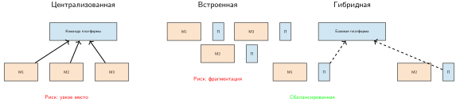

***Организационные паттерны для ML:** централизованная модель обеспечивает согласованность, но рискует стать узким местом; встроенная модель дает скорость, но рискует фрагментацией; гибридная базовая платформа со встроенными специалистами балансирует стандартизацию и отзывчивость.*

Централизация работает, когда одни и те же эксплуатационные ошибки иначе повторялись бы по всей организации. Общая команда может обеспечивать единообразную практику развертывания, мониторинга и управления; вкладываться один раз в инфраструктуру обучения, обслуживания и наблюдаемости; концентрировать глубокую экспертизу ML-систем, которую было бы трудно воспроизвести во многих продуктовых командах. Она также дает инженерам инфраструктуры видимый карьерный путь, вместо того чтобы распылять их как одиночных специалистов поддержки.

Та же структура может превратиться в очередь. Если каждый запрос к платформе проходит через одну команду, команды моделей ждут решений о приоритетах, которыми не управляют. Удаленность от продуктового контекста может также породить абстракции, технически изящные, но плохо подходящие ограничениям потребляющей команды. Поэтому централизация наиболее сильна, когда общие инварианты важнее локальных различий, и наиболее слаба, когда командам моделей нужны быстрые предметно-специфичные изменения.

### Встроенные ML-инженеры

Встроенный паттерн выбирает близость вместо единообразия: экспертиза ML-инфраструктуры размещается внутри команд моделей, а координация идет через сообщества практики, а не через единую линию подчинения. Выгода — отзывчивость: инженер инфраструктуры напрямую видит данные команды, поведение моделей, давление релизов и историю инцидентов, поэтому локальные изменения не ждут межкомандного планирования.

Цена проявляется позже, когда каждая команда немного по-своему решила задачи развертывания, мониторинга и управления признаками. Фрагментация тратит инженерные усилия, усложняет интеграцию и делает качество платформы зависимым от навыков и загрузки того, кто случайно встроен в данную команду. Встроенные команды поэтому работают лучше всего, когда локальная скорость важнее межкомандной согласованности, и хуже всего, когда каждая команда заново реализует одну и ту же платформенную основу.

### Гибридные модели

Большинство зрелых организаций принимает гибридные подходы, потому что ни чистая централизация, ни чистое встраивание не справляются хорошо и с общей инфраструктурой, и с предметно-специфичными потребностями. Основная команда платформы владеет вычислениями, хранением, сетью, общими системами обучения и обслуживания, мониторингом, безопасностью, соответствием требованиям и средствами контроля стоимости. Доменные инженеры платформы остаются ближе к командам рекомендаций, языка, зрения, мошенничества или поиска, где требования конкретной нагрузки меняются быстрее, чем должна меняться общая основа.

Федеративный вариант той же идеи распределяет работу по реализации, не отказываясь от архитектурного контроля. Крупные команды-участники помогают поддерживать компоненты платформы, но стандарты, границы владения и приоритеты согласуются явно. Это работает только тогда, когда у управления есть реальные полномочия: иначе федерация вырождается во встраивание с большим числом совещаний.

### Выбор организационного паттерна

Подходящий организационный паттерн зависит от того, где стандартизация создает больше ценности, чем локальная автономия. [Таблица](#tbl-ops-scale-org-factors) суммирует **факторы выбора организационного паттерна**: большое число моделей, более строгие регуляторные требования и незрелая инфраструктура склоняют к централизованным платформам, тогда как разнородные портфели моделей и небольшие организации могут выиграть от распределенной экспертизы:

<a id="tbl-ops-scale-org-factors"></a>

***Факторы выбора организационного паттерна:** пять критериев выбора между централизованной и распределенной командами ML-платформы. Большое число моделей (100+), более строгие регуляторные требования и более ранняя зрелость инфраструктуры склоняют к централизованным платформам; разнородные портфели моделей и небольшие организации могут выиграть от распределенной экспертизы с координацией через сообщества практики.*

| **Фактор**                  | **В пользу централизации** | **В пользу распределения** |
|:----------------------------|:--------------------------:|:--------------------------:|
| **Число моделей**           |     Больше (100+)          |     Меньше (10–20)         |
| **Сходство моделей**        |       Однородные           |        Разнородные         |
| **Размер организации**      |        Крупнее             |         Меньше             |
| **Регуляторные требования** |        Строже              |         Мягче              |
| **Зрелость инфраструктуры** |     Ранняя стадия          |      Поздняя стадия        |

Логика выбора становится яснее на конкретном примере. Технологическая компания с 50 ML-инженерами в 8 командах эксплуатирует 80 производственных моделей в областях рекомендаций, мошенничества, поиска и рекламы. Каждая команда поддерживает собственное развертывание и мониторинг, что породило дублирующую инфраструктурную работу и несогласованные практики интеграции. Число моделей достаточно велико, чтобы общая инвестиция в платформу окупилась, но предметное разнообразие настолько реально, что чисто централизованная команда с трудом понимала бы каждую нагрузку.

Итоговая конструкция гибридная. Центральная команда платформы примерно из 12–15 инженеров владеет базовой инфраструктурой, а руководители доменных платформ остаются встроены в крупнейшие команды моделей. Сообщество практики координирует стандарты, а общая модель вклада позволяет доменным командам передавать в основную ветку переиспользуемые компоненты вместо поддержки постоянных форков.

Установление общих моделей вклада и доменных руководителей платформы позволяет организациям стандартизировать общую плоскость управления, не превращая каждый предметно-специфичный запрос в узкое место платформы. Те же компромиссы платформенной инженерии, управления признаками и управления становятся более конкретными в гиперсистемах, которые строят крупные технологические компании.

## Кейсы платформ

Кейсы платформ воплощают компромиссы эксплуатации, разобранные ранее в этой главе: стандартизация против локальной скорости команд, абстракция против контроля, свежесть против стоимости и управление против автономии. Каждый кейс показывает другой способ сделать эксплуатацию многомодельного парка повторяемой, не превращая каждую модель в индивидуальную инфраструктуру.

### Uber Michelangelo

Платформа Michelangelo от Uber показывает, почему повторяемость становится первым требованием платформы в масштабе компании (Hermann и Del Balso, 2017). Кейс воплощает первый компромисс эксплуатации в последовательности платформ: стандартизацию против локальной скорости команд. До Michelangelo Uber столкнулась с проблемой «двойной реализации»: специалисты по данным разрабатывали модели на Python, а инженерные команды были вынуждены переписывать конвейеры признаков для продакшена, что создавало задержки и расхождение логики. Платформа объединила обучение моделей, развертывание, обслуживание, управление рабочими процессами и управление признаками для таких сценариев, как прогноз времени прибытия, обнаружение мошенничества и рекомендации. Ее хранилище признаков централизовало переиспользуемые признаки, например агрегаты по расстоянию поездки, сокращая дублирующую инженерию признаков и решая задачу согласованности между обучением и обслуживанием.

Эксплуатационная задача в Uber выходила за рамки числа моделей: инженерам инфраструктуры нужно было сделать разработку моделей повторяемой во многих продуктовых командах. Michelangelo предоставлял «золотой путь» для типовых рабочих процессов: команды могли обучать модели, создавать офлайн-наборы для обучения, обслуживать предсказания онлайн или пакетно и переиспользовать конвейеры признаков, управляемые платформой. Эта стандартизация улучшила автоматизацию обучения, оценки, развертывания и мониторинга, при этом продуктовые команды по-прежнему отвечали за поведение моделей и бизнес-специфичную валидацию.

Критическая эволюция таких платформ, как Michelangelo, — переход от обучения, центрированного на пакетной обработке, к более свежим онлайн-признакам и обслуживанию с меньшей задержкой. Ранние платформенные решения обычно сочетали офлайн-хранилища для обучающих данных с онлайн-хранилищами для обслуживания предвычисленных или недавно вычисленных признаков. Продукты реального времени, такие как доставка еды и обнаружение мошенничества, затем вводят проблемы согласованности: одно и то же определение признака должно давать совместимые значения для офлайн-наборов обучения и онлайн-запросов инференса. Урок сохраняется, даже когда детали реализации различаются: централизованные ML-платформы должны предоставлять общие абстракции для признаков, обучения, обслуживания, экспериментов и мониторинга, не превращая каждую модель в индивидуальную инфраструктуру.

### Meta FBLearner Flow

FBLearner Flow в Meta показывает, что демократизация ML-инфраструктуры требует скрывать управление ресурсами, не скрывая структуры рабочего процесса (Engineering at Meta, 2016). По сообщениям Facebook, более 25 процентов инженерной организации пользовались FBLearner Flow, система обучила более миллиона моделей, а ее сервис онлайн-предсказаний делал более 6 миллионов предсказаний в секунду. Основная эксплуатационная задача — «проблема N моделей»: многим командам нужны повторяемые рабочие процессы моделей без ручного построения инфраструктуры для каждой модели ранжирования, рекламы, рекомендаций или проверки целостности. FBLearner решал ее, рассматривая конвейер обучения как DAG, который абстрагирует лежащую под ним инфраструктуру. Инженер описывает рабочий процесс в коде, а платформа берет на себя распределение ресурсов, управление зависимостями и отказоустойчивость.

Определяющая черта крупных социальных ML-платформ — свежесть признаков. Для таких продуктов, как лента ранжирования, ценность признака (например, «пользователь только что поставил лайк похожему видео») может быстро обесцениваться. Это подталкивает платформы к потоковой обработке, онлайн-вычислению признаков и мониторингу, который отслеживает распределения данных так же, как здоровье сервиса. Стандартные метрики вроде загрузки CPU недостаточны, чтобы обнаружить тихие сбои в потоках признаков; производственным ML-системам нужны проверки отсутствующих признаков, сдвигов распределений и перекоса между обучением и обслуживанием.

Чтобы управлять риском развертывания, платформы такого масштаба обычно используют теневой режим (или **dark launching**), канареечные выпуски и онлайн-оценку до широкого продвижения. Кандидатные модели могут работать рядом с текущей производственной моделью, получая живой трафик, а их выходы записываются, но не показываются пользователям. Эта фаза проверяет эксплуатационную целостность (задержку, использование памяти, частоту ошибок) и накапливает данные для сравнения до того, как модель повлияет на опыт пользователей.

### Инфраструктура ML в Netflix

Инфраструктура ML в Netflix показывает, как платформы персонализации управляют стоимостью ветвления (fan-out) при строгом бюджете задержки (Gomez-Uribe и Hunt, 2015). Вместо одной модели, принимающей одно решение, рекомендательная система сочетает несколько алгоритмов ранжирования и персонализации для задач генерации страницы, выбора рядов, поиска, «продолжить просмотр» и персонализации обложек. Эксплуатационная задача — **стоимость ветвления** (fan-out cost): каждый дополнительный онлайн-ранжировщик или зависимость по признакам потребляет бюджет задержки. Поэтому производственные системы разделяют генерацию кандидатов, офлайн-обучение моделей, онлайн-ранжирование и кэширование, чтобы главная страница оставалась персонализированной, не выполняя неограниченного числа дорогих моделей на каждый запрос.

Конкретную проблему, которую Netflix решает особенно активно, — **холодный старт** (cold start): невозможность рекомендовать контент новому пользователю без истории или рекомендовать новый сериал без данных о просмотрах. Их инфраструктура решает это с помощью «онлайн-обучения» на бандитах, которые динамически балансируют исследование и эксплуатацию. Когда выходит новый сериал, система выделяет небольшой «бюджет» показов, чтобы проверить тайтл на разных когортах пользователей и быстро сойтись к эффективной аудитории. Для этого нужна инфраструктура, способная обновлять политики обслуживания, бюджеты исследования и состояние рекомендаций почти в реальном времени, а не ждать традиционного ежедневного цикла пакетного обучения. Система также должна учитывать задержку «петли обратной связи»: взаимодействие пользователя с новым тайтлом сразу отражается в его последующих рекомендациях. Это требование подтолкнуло Netflix к переносу ключевых частей инжиниринга признаков в сам слой обслуживания.

Чтобы проверять эти сложные взаимодействия, Netflix перешла от стандартного A/B-тестирования (Netflix Technology Blog, 2017) к чередованию (interleaving). В традиционном A/B-тесте группа A видит ранжирование 1, а группа B — ранжирование 2. Для обнаружения малых улучшений это требует огромных выборок и долгих сроков. Чередование смешивает результаты ранжирований 1 и 2 в один список для одного и того же пользователя и отслеживает, из какого источника пользователь кликает. Метод устраняет пользовательскую дисперсию и дает прямое сравнение «лицом к лицу». Инфраструктура поддерживает это, позволяя слою обслуживания на лету объединять ранжированные списки и записывать данные атрибуции с высокой точностью. Хотя это усложняет конвейеры логирования и атрибуции, количественный результат существенен: Netflix может обнаруживать статистически значимые улучшения со 100-кратно меньшим числом пользователей, чем при традиционном A/B-тестировании, что позволяет итерировать алгоритмы ранжирования с темпом, который традиционные фреймворки тестирования не могли поддерживать.

### Google Vertex AI

Google Vertex AI иллюстрирует проблему абстракции управляемой платформы: платформа должна убирать клеевой код, сохраняя достаточный контроль для нестандартных нагрузок. Google стремилась решить проблему «клеевого кода», где 95 процентов ML-кода — инфраструктурный шаблонный код, предоставляя единую плоскость управления, которая охватывает разметку данных, обучение и обслуживание. Ключевое архитектурное решение — интеграция **AutoML** как полноценного компонента наряду с пользовательским обучением. Это позволяет платформе выполнять поиск нейронной архитектуры, чтобы найти эффективную структуру модели при заданном бюджете. Эксплуатационный компромисс здесь — «вычисления вместо человеческого времени»: вместо того чтобы инженер неделями подбирал гиперпараметры, платформа запускает сотни параллельных испытаний. Для этого нужен многопользовательский планировщик, способный управлять «пиковой мощностью» и позволяющий высокоприоритетным производственным заданиям вытеснять экспериментальные испытания AutoML без потери состояния, что фактически максимизирует загрузку кластера.

Для слоя обслуживания Vertex AI решает проблему «шумного соседа», присущую многопользовательским средам. Когда тысячи клиентов развертывают модели на одном парке процессоров тензорных вычислений (TPU) и GPU, конкуренция за ресурсы может вызывать непредсказуемые всплески задержки. Google решает это строгой стратегией контейнеризации и архитектурой «предсказательного сайдкара» (prediction sidecar). Каждая модель работает в изолированном контейнере, но общий прокси-сайдкар обрабатывает логирование, мониторинг и батчинг запросов. Такое разделение позволяет платформе вводить строгие квоты ресурсов (CPU, RAM, память ускорителя) и предоставлять автомасштабирование, которое реагирует на пользовательские метрики вроде «глубины очереди запросов» наряду с загрузкой CPU. Количественный выигрыш — более предсказуемый хвост задержки: жесткие границы изоляции снижают вероятность того, что тяжелое пакетное задание одного арендатора ухудшит производительность реального времени у другого.

Vertex также решает задачу хранилища признаков, делая акцент на согласованности и соответствии требованиям. Управляемое обслуживание признаков и извлечение на момент времени позволяют конвейерам обучения запрашивать только те значения признаков, которые существовали на отметку времени каждого обучающего примера. Распространенная эксплуатационная ошибка в ML — временная утечка данных: использование значений признаков, которые не были доступны на момент предсказания. Управляемое обслуживание признаков также контролирует перекос между обучением и обслуживанием, описанный в разделе «Эксплуатация хранилища признаков», стандартизируя определения признаков и пути обслуживания в обоих контекстах. Эти проектные решения добавляют накладные расходы на хранение и происхождение, но устраняют целые классы тихих ошибок. В сочетании со средствами контроля стоимости и загрузки для обучения и обслуживания управляемые платформы могут помогать командам управлять совокупной стоимостью владения, а не просто предоставлять сырые вычислительные ресурсы.

### Платформа ML в Spotify

Платформа ML в Spotify показывает, как инфраструктура персонализации балансирует исследование и эксплуатацию в масштабе 500 млн пользователей. Основная эксплуатационная проблема в том, что строгая оптимизация под немедленные клики (эксплуатацию) порождает «**информационные пузыри**» (Filter Bubbles), которые ухудшают долгосрочное удержание пользователей. Чтобы противодействовать этому, платформа поддерживает контрфактическую оценку и алгоритмы контекстных бандитов — методы оценки исходов и распределения трафика на исследование при частичной обратной связи — непосредственно в пути обслуживания. Архитектура разделяет фазу «генерации кандидатов» (извлечение 1 000 потенциальных треков) и фазу «ранжирования» (упорядочивание первых 10). Генераторы кандидатов разнообразны: одни — модели коллаборативной фильтрации (Koren et al., 2009), обновляемые ежедневно, другие — «алготориальные» эвристики, обновляемые в реальном времени. Такая развязка позволяет комбинировать стратегии извлечения без переписывания тяжелой логики ранжирования и ускоряет эксперименты с новыми типами контента, такими как подкасты и аудиокниги.

Центральный компонент их архитектуры — **проторенная дорога** (Paved Road) для оркестрации моделей (Spotify Engineering, 2019). Spotify описывает путь платформы, построенный вокруг TensorFlow Extended, Kubeflow Pipelines, отслеживания метаданных и централизованных кластеров Kubeflow, чтобы команды могли перейти от экспериментов к повторяемым производственным рабочим процессам. Эксплуатационный урок — происхождение (lineage), а не криптография: артефакты моделей, наборы данных, код и метаданные конвейеров должны оставаться связанными настолько, чтобы инженер мог проследить тихую регрессию до данных или состояния рабочего процесса, которые ее породили. Канареечное развертывание и откат остаются необходимыми средствами контроля выпуска, но это платформенные политики, наложенные поверх слоя метаданных, а не утверждения, установленные самим источником Spotify.

Жесткие требования задержки в Spotify не подлежат обсуждению: воспроизведение должно казаться мгновенным. Это навязывает проектный компромисс, при котором сложный инференс часто предвычисляется. Для плейлиста «Discover Weekly» платформа запускает массивные пакетные задания инференса на выходных и хранит результаты в низколатентном хранилище «ключ — значение». Однако для экрана «Главная», который должен реагировать на только что прослушанный трек, используется гибридный подход. Эмбеддинги пользователя обновляются почти в реальном времени через потоковый конвейер, а тяжелые матрицы сходства треков вычисляются офлайн. Такая разделенная архитектура позволяет добиться задержки менее 100 мс для экрана «Главная», одновременно учитывая непосредственную историю пользователя. Системный урок: требования задержки определяют, где выполняется персонализация. Предвычислять нужно то, что может устареть, стримить то, что должно быть свежим, а онлайн-инференс резервировать для того, что пользователь должен пережить немедленно.

Жесткие требования к задержке объясняют, почему зрелые платформы персонализации предвычисляют как можно больше работы, но предвычисление не устраняет эксплуатационного риска. Те же общие реестры, хранилища признаков и оркестраторы, которые делают платформы эффективными, также создают плоскости управления, сбои которых требуют дисциплинированного реагирования на инциденты.

### Сравнительный синтез плоскостей управления

Кейсы различаются нагрузкой и организационной формой, но сходятся к одним и тем же обязанностям плоскости управления. Michelangelo делает упор на переиспользуемые контракты признаков и рабочих процессов между продуктовыми командами. FBLearner Flow — на оркестрацию на уровне DAG и абстракцию ресурсов для большой инженерной организации. Netflix — на композицию с ограниченной задержкой и эксперименты высокой чувствительности. Vertex AI — на управляемую изоляцию и интеграцию жизненного цикла для арендаторов. Spotify — на проторенную дорогу, которая сохраняет происхождение при смешивании пакетных, потоковых и онлайн-решений. Ни одна реализация не является образцом; устойчивый паттерн в том, что общее состояние, свидетельства выпуска, политика ресурсов и владение становятся интерфейсами платформы.

[Таблица](#tbl-ops-scale-case-study-synthesis) делает явными общий контракт и сохраняемую доменную ответственность.

<a id="tbl-ops-scale-case-study-synthesis"></a>

***Сравнительные плоскости управления платформ:** пять кейсов по-разному распределяют реализацию, но сохраняют один и тот же системный контракт: платформа владеет общими инвариантами и свидетельствами, а доменные команды сохраняют намерение нагрузки и критерии приемки.*

| **Кейс**       | **Основное давление**                  | **Акцент плоскости управления**                | **Сохраняемая локальная ответственность**         |
|:---------------|:---------------------------------------|:-----------------------------------------------|:--------------------------------------------------|
| Michelangelo   | Повторяющаяся работа с признаками и развертыванием | Общие признаки и повторяемые рабочие процессы | Поведение модели и валидация, специфичные для продукта |
| FBLearner Flow | Много команд и разнородные конвейеры   | Оркестрация DAG и абстракция ресурсов          | Намерение рабочего процесса и предметная оценка   |
| Netflix        | Ветвление при строгих бюджетах задержки | Композиция, предвычисление, эксперименты       | Цели ранжирования и компромиссы пользовательского опыта |
| Vertex AI      | Управляемая инфраструктура с несколькими арендаторами | Изоляция, политики и интеграция жизненного цикла | Конфигурация нагрузки и критерии приемки      |
| Spotify        | Свежая персонализация со смешанными путями | Происхождение, проторенные дороги и гибридное перемещение данных | Доменная политика и стратегия исследования |

Сравнение также выявляет ограничение принятия. Платформа преуспевает, когда ее общий путь фиксирует повторяющиеся инварианты, не стирая доменного суждения. Слишком мало платформенного владения воссоздает самодельную инфраструктуру; слишком много превращает каждую нестандартную нагрузку в очередь центральной команды. Версионированные интерфейсы, явные исключения и метрики принятия на основе результатов позволяют корректировать эту границу по мере изменения портфеля.

## Отладка в продакшене и реагирование на инциденты

В 3:00 ночи PagerDuty оповещает дежурного инженера, что выручка от основной рекомендательной системы упала на 15 процентов за последний час. Серверы исправны, задержка в норме, журналов исключений нет. Обычное программное обеспечение тоже может молча возвращать неверные результаты, но машинное обучение добавляет сбои, коренящиеся в данных и статистическом поведении, тогда как обычные сигналы здоровья сервиса остаются нормальными. Поэтому отладка производственных ML-систем требует методик расследования, которые выходят за рамки кода и инфраструктуры.

Когда отладка в продакшене забирает значительную долю инженерного внимания, масштаб платформы умножает сложность: сбои могут возникать в конвейерах данных, коде моделей, инфраструктуре или во взаимодействиях между компонентами, которыми ни одна команда не владеет от начала до конца. Поэтому эффективное реагирование на инцидент требует диагностического порядка: классифицировать инцидент, отнести сбой к правильной зависимости, ограничить радиус поражения и затем превратить инцидент в более сильное платформенное средство управления.

> **Случай из практики: исчезнувшая плоскость управления (2021)**
>
> **Контекст**: глобальная магистраль Meta соединяла ее дата-центры и несла зависимости, потеря которых также делала недоступными DNS и внутренние инструменты восстановления (Janardhan, 2021).
>
> **Механизм**: 4 октября 2021 года рутинная аудиторская команда, предназначенная для оценки емкости магистрали, непреднамеренно разорвала все каналы магистрали. Это запустило автоматический отзыв маршрутов Border Gateway Protocol, сбросив все авторитетные маршруты DNS, нарушив внутреннюю аутентификацию и изолировав инструменты внеполосного управления, необходимые для удаленного устранения.
>
> **Последствия**: Facebook, Instagram и WhatsApp пережили глобальный простой длительностью 5,5 часа, затронувший более 3,5 млрд пользователей, а экземпляры обслуживания моделей потеряли доступ к хранилищам признаков и реестрам управления.
>
> **Исправление**: инженеры физически прибыли в дата-центр в Санта-Кларе, чтобы выполнить жесткий аппаратный сброс и восстановить плоскость управления DNS через локальный внеполосный доступ.
>
> **Системный урок**: эксплуатация в масштабе платформы должна рассматривать плоскость управления как жесткую зависимость с определенным радиусом поражения. ML-платформы несут идентичный риск сбоя в масштабе парка: планировщики обучения, реестры моделей, хранилища признаков и маршрутизаторы инференса разделяют нижележащие плоскости аутентификации, DNS и сети. При сетевых разделениях восстановление требует строгой физической и логической изоляции между плоскостью управления и инфраструктурой обслуживания инференса.

### Классификация инцидентов

Классификация инцидентов — первое маршрутизирующее решение в аварии: категория подсказывает дежурным, какую телеметрию смотреть первой, какого владельца вызвать и является ли вероятным средством управления откат, ремонт данных или изоляция инфраструктуры. Категории инцидентов организованы вокруг первого диагностического сигнала.

**Инциденты данных** связаны с проблемами входных данных: сбои конвейеров, из-за которых свежие данные не доходят до моделей, изменения схемы, ломающие потребителей, ухудшение качества данных из-за пропусков или сдвигов распределений, а также устаревание признаков сверх порогов SLO. Такие инциденты часто проявляются как деградация точности сразу у нескольких моделей, использующих общие источники данных, поэтому здоровье конвейера данных становится первой диагностической контрольной точкой.

**Инциденты моделей** связаны с поведением моделей: деградация точности за пределами допустимых порогов, всплески задержки, указывающие на вычислительные проблемы, исчерпание памяти из-за растущего состояния (KV-кэш, буферы) и сдвиги смещения предсказаний, обнаруженные мониторингом справедливости. Инциденты моделей обычно затрагивают отдельные модели. Если одновременно деградируют несколько не связанных между собой моделей, подозревайте общую проблему данных или инфраструктуры, а не независимые проблемы моделей.

**Инфраструктурные инциденты** связаны с платформой обслуживания: отказы GPU, вызывающие ошибки запросов, сетевые разделения между шардами моделей, неверная настройка балансировщиков, плохо маршрутизирующих трафик, и проблемы оркестрации контейнеров, влияющие на развертывания. Такие инциденты обычно дают всплески частоты ошибок и шаблоны таймаутов, а не постепенную деградацию точности.

**Инциденты бизнес-метрик** связаны с неожиданными изменениями нижестоящих KPI: падением вовлеченности без понятной причины в модели или данных, аномалиями выручки во время нормальной работы модели и сдвигами поведения пользователей, влияющими на эффективность модели. Такие инциденты труднее всего атрибутировать, потому что они могут быть вызваны внешними факторами (конкуренция, сезонность, маркетинговые кампании), а не проблемами ML-системы.

### Анализ атрибуции

Анализ атрибуции защищает диагностический порядок: сначала определить первопричину, и только затем внедрять исправления. Анализ временной корреляции прослеживает деградацию назад через недавние изменения:

```text
Симптом: вовлеченность в рекомендациях упала на 5% за последний час

Шаг 1: проверить недавние развертывания
        → за последние 4 часа развертываний моделей не было
        → исключить изменение модели как причину

Шаг 2: проверить SLO свежести признаков
        → user_features: 3 часа устаревания (SLO: 1 час)
        → конвейер признаков задерживается

Шаг 3: проверить статус конвейера признаков
        → отставание потребителя Kafka: 10 млн событий (норма: 10 тыс.)
        → узкое место приема данных

Шаг 4: исследовать кластер Kafka
        → диск брокера заполнен на 95% в партиции 7
        → первопричина установлена
```

Когда точность модели падает, критически важно различить, лежит ли первопричина в *данных* или в *модели*. Поток атрибуции разделяет четыре класса сбоев:

- **Дрейф данных**: распределение входов сместилось (новая демография пользователей, сезонные паттерны)
- **Устаревание признаков**: задержки конвейера, вызывающие устаревшие предсказания
- **Деградация модели**: концептуальный дрейф, при котором истинные зависимости изменились
- **Изменение восходящей модели**: модель, от которой зависит данная модель, была обновлена

Диагностическая последовательность затем проверяет наиболее вероятные общие причины раньше локальных дефектов модели:

1. Сравнить текущее распределение входов с распределением обучения
2. Проверить свежесть всех входных признаков
3. Изучить производительность на стабильных оценочных наборах
4. Проследить граф зависимостей на предмет недавних изменений

> **Пример: каскад конвейера признаков**
>
> **Сценарий**: базовая команда платформы меняет логику преобразования общего признака `user_engagement_score` на месте, изменяя его нормировку с 30-дневной z-оценки на 7-дневное масштабирование min-max.
>
> **Диагноз**: четырнадцать последующих моделей в пяти инженерных командах использовали признак как непроверсионированный интерфейс. Мутация на месте сделала недействительными предположения о распределении признака, что вызвало падение точности ранжирования на 12 процентов и 18 часов межкомандной отладочной рутины.
>
> **Системный урок**: общие определения признаков — это производственные API-контракты, которые требуют явного, неизменяемого версионирования (`user_engagement_score_v2`). Мутации схемы на месте ломают ожидания контракта в зависимых парках моделей.

На уровне платформы сбои часто охватывают несколько моделей, поэтому набор затронутых моделей становится диагностическим сигналом. Паттерны межмодельной корреляции раскрывают вероятную первопричину, как показано в [таблице](#tbl-cross-model-failure-patterns):

<a id="tbl-cross-model-failure-patterns"></a>

***Паттерны сбоев нескольких моделей:** на уровне платформы то, какие модели деградируют одновременно, прямо указывает на общий слой инфраструктуры, ответственный за сбой. Согласованная деградация всех рекомендательных систем указывает на хранилище признаков; деградация всех моделей зрения — на конвейер предобработки изображений; деградация одной модели изолирует проблему в этой модели.*

| **Паттерн**                    | **Вероятная причина**        |
|:-------------------------------|:-----------------------------|
| **Деградировали все модели рекомендаций** | Проблема хранилища признаков |
| **Деградировали все модели зрения** | Конвейер предобработки изображений |
| **Деградировала одна модель**  | Проблема, специфичная для модели |
| **Географический паттерн**     | Региональная инфраструктура  |
| **Временной паттерн**          | Расписание пакетных заданий  |

### Разработка регламентов (runbook)

Runbook оправдывает свое место, когда сохраняет диагностический порядок под давлением времени. Для ML-систем правильный диагностический порядок противоположен тому, что подсказывают инфраструктурные инстинкты: ML-системы отказывают молча. Когда конвейер признаков встает, значения признаков устаревают, а модель продолжает обрабатывать эти устаревшие признаки, возвращая HTTP 200 с нормальной задержкой; качество предсказаний деградирует невидимо, а инфраструктурные проверки выглядят зелеными. Поэтому runbook для ML должен начинаться с здоровья данных и семантики: проверки свежести признаков, подтверждения того, что распределения входов согласуются с обучающими данными, и проверки, не менялась ли недавно версия модели. Только после подтверждения целостности данных и поведения модели runbook должен переходить к инфраструктурным проверкам. Если задержка и частота ошибок в норме, но бизнес-KPI упали, runbook должен немедленно направить дежурного к свежести признаков и дрейфу распределений, прежде чем начинать любое расследование инфраструктуры. Такой порядок начинается с видимого пользователю симптома, проверяет зависимости данных и семантики раньше инфраструктуры и заранее называет пороги эскалации, так что дежурный под стрессом всегда знает следующую проверку, а не только систему, которую нужно осмотреть.

Переиспользуемая структура — это диагностический поток, а не шаблон документа. При падении вовлеченности в рекомендациях дежурный должен проходить один и тот же контур управления каждый раз. [Таблица](#tbl-runbook-diagnostic-flow) называет контрольные вопросы, которые сохраняют этот порядок под давлением.

<a id="tbl-runbook-diagnostic-flow"></a>

***Диагностический поток runbook:** runbook для ML должен сохранять порядок рассуждений от симптома к зависимости и к смягчению. Конкретные названия дашбордов могут меняться, не делая диагностическую модель недействительной.*

| **Шаг**              | **Вопрос**                                        | **Пример доказательств**                               |
|:---------------------|:--------------------------------------------------|:-------------------------------------------------------|
| Обнаружить влияние на пользователей | Какой продукт или когорта деградирует?     | CTR, конверсия, удержание, выручка или доля жалоб      |
| Локализовать зависимость | Изменился ли общий сервис для многих моделей?    | Свежесть признаков, реестр моделей, региональное здоровье |
| Ограничить радиус поражения | Можно ли сократить трафик, запустить тень или откатить? | Метрики канарейки, цель отката, насыщение обслуживания |
| Эскалировать по доказательствам | Какая команда владеет отказавшим средством управления? | Конвейер данных, платформа, обслуживание или владелец модели |
| Извлечь урок из пробела | Какой недостающий сигнал поймал бы это раньше? | Ворота свежести, оповещение по срезу, ограничитель развертывания |

Антишаблоны runbook нарушают диагностический порядок тремя распространенными способами. Слишком частная инструкция вроде «Если модель BERT падает, перезапустить контейнер» фиксирует одно историческое исправление, а не переиспользуемое расследование. Расплывчатая инструкция вроде «Исследовать проблему» перекладывает все суждение обратно на дежурного в самый неподходящий момент. Устаревший runbook хуже отсутствия runbook, когда он направляет дежурных к выведенным из эксплуатации системам, нерабочим панелям или неактуальным контактам.

### Разборы после инцидентов

Отчеты о постинцидентных разборах (PIR) превращают инциденты в организационное обучение только тогда, когда из одного сбоя получается более сильное средство управления платформой. Запись об инциденте должна связывать длительность и влияние на пользователей с хронологией обнаружения, атрибуции, смягчения и восстановления. Первопричины должны указывать на средство управления, которое отказало или отсутствовало, а корректирующие действия должны называть владельцев и сроки, чтобы разбор менял платформу, а не только документировал простой.

Полезны те поля разбора, которые принуждают к решению об управлении. Длительность и влияние количественно определяют серьезность; хронология показывает задержку обнаружения и атрибуции; первопричины называют отсутствующие средства управления; а корректирующие действия назначают владельца следующего изменения платформы. В инциденте со свежестью признаков самое важное наблюдение не в том, что заполнился диск, а в том, что ни одни ворота свежести не поймали остановившийся конвейер признаков до того, как сдвинулись метрики вовлеченности. Вопросы из [таблицы](#tbl-pir-control-questions) превращают эту хронологию в работу платформы.

<a id="tbl-pir-control-questions"></a>

***Контрольные вопросы разбора инцидента:** разбор после инцидента ценен, когда превращает хронологию инцидента в более сильный инвариант платформы.*

| **Вопрос разбора**                | **Управленческое решение, которое он должен принудить**                         |
|:----------------------------------|:--------------------------------------------------------------------------------|
| Как долго было видно влияние на пользователей? | Доминировала ли задержка обнаружения или задержка смягчения.           |
| Какая зависимость отказала первой? | Принадлежит ли недостающее средство управления данным, платформе, обслуживанию или коду модели. |
| Какой сигнал пришел слишком поздно? | Нужен ли новый страж свежести, среза, насыщения или канарейки.               |
| Что ограничило бы влияние?        | Отсутствовали ли откат, теневой трафик, контроль допуска или запасной путь.     |
| Кто владеет следующим средством управления? | Меняет ли разбор платформу, а не только фиксирует вину.               |

Эффективные разборы требуют психологической безопасности и системного взгляда, а не поиска виноватых. Разбор должен выяснять, какие системы допустили инцидент, а не какой человек его вызвал. Он должен спрашивать, какой сигнал обнаружил бы сбой раньше, а не почему конкретный человек его пропустил. Он должен предотвращать класс сбоев, а не только тот конкретный сбой, который произошел.

### Телеметрия парка и ответственность за распределенные сбои

Распределенные обучение и инференс могут отказывать на уровне ранга, устройства, хоста, линка сети, шарда данных или зависимости плоскости управления. Диагностика на уровне механизма и семантика восстановления для таких сбоев относятся к главе «Отказоустойчивость». Эксплуатация в масштабе решает другую задачу: собрать достаточно коррелированных свидетельств, чтобы определить затронутый домен, назначить полномочия до возникновения инцидента и сохранить свидетельства, необходимые для эскалации и обучения после разбора.

Контракт телеметрии начинается со стабильных идентификаторов. Каждое событие должно нести идентификатор задания или сервиса, номер попытки и версию модели, ранг и хост, идентичность устройства, положение в топологии, шард данных или когорту запросов, сборку ПО, синхронизированную отметку настенного времени или трассировки для корреляции между хостами, а также локальное монотонное время хоста или порядковый номер для локальных длительностей и упорядочивания. Метаданные о доменах часов и неопределенности синхронизации ограничивают точность, с которой можно упорядочить события с разных хостов. Журналы без этих измерений заставляют дежурных восстанавливать соединения во время простоя, а неограниченные метки с высокой кардинальностью могут перегрузить систему мониторинга. Поэтому платформа хранит низкокардинальные агрегаты здоровья для оповещений и сохраняет выборочные или ограниченные событием трассировки высокой кардинальности для диагностики. Полезность телеметрии определяет корреляция, а не объем сырых журналов.

[Таблица](#tbl-ops-scale-distributed-failure-ownership) связывает каждый класс свидетельств с первым владельцем и свидетельствами, необходимыми для эскалации.

<a id="tbl-ops-scale-distributed-failure-ownership"></a>

***Телеметрия и ответственность за распределенные сбои:** платформа собирает коррелированные свидетельства и направляет инцидент; команда владеющей подсистемы выполняет диагностику на уровне механизма. Стабильные поля идентичности и топологии позволяют дежурным отличить один дефектный ранг от сбоя ПО или сети на уровне всего парка.*

| **Свидетельство сбоя**                 | **Сигнал уровня парка**                                           | **Первый владелец**  | **Свидетельство для эскалации**                              |
|:---------------------------------------|:------------------------------------------------------------------|:---------------------|:-------------------------------------------------------------|
| Прогресс коллективной операции останавливается | Ранги, входящие в каждую коллективную операцию и завершающие ее, по доменам топологии | Среда выполнения обучения | Набор заблокированных рангов, последняя завершенная коллективная операция, локальность сети |
| Один ранг приближается к пределу памяти | Распределение выделенной, зарезервированной и пиковой памяти по рангам | Команда модели/обучения | Фаза выделения, состояние модели, сравнение с соседними рангами |
| Время шага формирует длинный хвост     | Распределение времени шага по рангам, коррелированное с хостом и коммутатором | Инфраструктура парка | Устойчивость отстающих, тепловые, сетевые и входные свидетельства |
| Потери или градиенты расходятся между рангами | Числовые сводки по рангам, связанные с артефактом и шардом данных | Команда модели/обучения | Первый расходящийся шаг, шард, сборка и контрольная точка |
| Повторные попытки падают в одном домене | Частота отказов по хосту, стойке, поколению оборудования и сборке ПО | Инфраструктура парка | История карантина и воспроизведение на заведомо исправном домене |

Ответственность должна включать полномочия на сдерживание влияния. Владелец среды выполнения обучения может отменить или перезапустить задание, когда прогресс останавливается; инфраструктура парка может поместить в карантин устройство, хост или домен топологии; владелец данных может остановить испорченный шард; а владелец модели решает, аннулирует ли численная расходимость полученный артефакт. Координатор инцидента согласует эти действия, когда затронуто больше одного домена. Панель, которая указывает вероятную причину, но не называет, кто может остановить трафик, поместить мощность в карантин или аннулировать артефакт, оставляет самое весомое решение нерешенным.

Хранение телеметрии замыкает контур управления. Обычным здоровым запускам нужны агрегированные распределения и выборочные трассировки, тогда как неудачные попытки и нарушения ворот выпуска требуют полных свидетельств на уровне событий на протяжении разбора и окна корректирующих действий. Платформа должна измерять задержку атрибуции, долю инцидентов, направленных правильному владельцу при первой эскалации, повторяемость по классам сбоев и время от корректирующего действия до развернутого средства управления. Эти измерения показывают, снижает ли наблюдаемость риск парка или лишь порождает больше данных.

### Практики дежурств (on-call) для ML-команд

Системы ML требуют специализированных практик дежурств, потому что качество предсказаний, свежесть данных и графы зависимостей наравне с аптаймом становятся задачами надежности. Фреймворк отладки в этом разделе объясняет, почему инцидент может начаться как аномалия бизнес-метрики, а закончиться в конвейере признаков, реестре моделей или остановившейся распределенной операции. Организация дежурств должна делать эту диагностическую нагрузку устойчивой, опираясь на устоявшиеся принципы инженерии надежности сайтов (SRE)[^fn-sre-reliability-engineering] (Beyer et al., 2016).

[^fn-sre-reliability-engineering]: **Инженерия надежности сайтов (SRE)**: основана Беном Трейнором Слоссом в Google в 2003 году; SRE ввела бюджеты ошибок и SLO как количественные контракты надежности. Для ML-систем классический SRE нужно расширить: традиционные сервисы отказывают бинарно (работает или нет), а модели деградируют вероятностно — точность может упасть на 5 процентов за недели, не запуская ни одной проверки здоровья. Это требует SLO, учитывающих дрейф, которые рассматривают качество предсказаний наравне с аптаймом как метрику надежности.

Структурная проблема дежурств именно для ML в том, что экспертиза, необходимая для устранения инцидента, редко сосредоточена в одном инженере. Один производственный ML-инцидент может потребовать, чтобы инженер ML-платформы диагностировал планировщик GPU в Kubernetes, инженер данных проследил устаревший конвейер признаков, а исследователь моделей интерпретировал, является ли сдвиг распределения ошибкой или ожидаемым концептуальным дрейфом. Традиционные дежурства с одной ролью плохо подходят для этого, потому что симптом (деградировавшая метрика рекомендаций) полностью отделен от домена первопричины (изменения схемы восходящей темы Kafka). Зрелые ML-организации решают это, структурируя дежурство как многоуровневую систему или систему с матрицей доменов: основной дежурный отвечает за первичную сортировку и эскалацию, а четкие пути эскалации ведут к инженерии данных, разработке моделей и инфраструктуре платформы как к доменным специалистам. Задача основного дежурного — направить инцидент в правильный домен в течение первых 15–30 минут, а не уметь устранить каждый класс сбоев в одиночку.

Проектирование дежурств определяет, может ли команда выдержать эту диагностическую нагрузку. [Таблица](#tbl-oncall-rotation-design) содержит рекомендации, отражающие практику отрасли. Схема — ограниченная непрерывность с резервированием: короткие дежурства ограничивают выгорание, запасное покрытие обрабатывает инциденты, затрагивающие несколько доменов, а перекрытие при передаче сохраняет контекст.

<a id="tbl-oncall-rotation-design"></a>

***Проектирование дежурств:** рекомендации практики отрасли по длительности дежурства, покрытию основной и запасной ролями, перекрытию при передаче и передаче «вслед за солнцем» в ML-дежурствах. Рекомендации балансируют стоимость переключения контекста (короткие дежурства) против риска выгорания (длинные дежурства), обеспечивая перекрытие экспертизы для сложных ML-инцидентов.*

| **Аспект**               | **Рекомендация**                                                 |
|:-------------------------|:-----------------------------------------------------------------|
| **Длительность дежурства** | 1 неделя (короче — переключение контекста, длиннее — выгорание) |
| **Основной + запасной**  | Всегда иметь резерв; ML-инциденты часто требуют нескольких экспертов |
| **Перекрытие при передаче** | 30 минут перекрытия для передачи контекста инцидента          |
| **Эстафета «вслед за солнцем»** | Для глобальных команд передача по часовому поясу; не более 8-часовых смен |

Усталость от оповещений постоянно угрожает эффективности дежурств. Признаки: дежурные инженеры игнорируют оповещения, считают их ложными, увеличивают время подтверждения, а оповещения закрываются автоматически без расследования. Смягчение должно сокращать вызовы, которые не ведут к действию, специфичному для ML:

1. Раз в квартал подстраивать пороги дрейфа, свежести, задержки и бизнес-метрик по доле ложноположительных срабатываний.
2. Дедуплицировать связанные оповещения моделей, хранилища признаков, обслуживания и инфраструктуры в одну страницу инцидента.
3. Прикреплять регламенты, которые называют вероятного владельца и первый диагностический запрос для каждого оповещения.
4. Отслеживать соотношение «оповещение — действие»; ориентир — более 80 процентов.

Помимо общих навыков SRE, дежурство по ML требует интерпретации метрик качества модели, понимания зависимостей конвейеров данных, различения ошибок модели и дрейфа данных и принятия решений «откатить или расследовать» под давлением. Сокращение рутины (toil) не менее важно, потому что повторяющиеся ручные задачи поглощают мощность, нужную для улучшения платформы. Отслеживайте время, потраченное на повторяющиеся ручные задачи, и добивайтесь, чтобы рутина занимала менее 25 процентов времени дежурства.

Типичная ML-рутина обычно накапливается на границе модели и платформы:

- ручной перезапуск упавших заданий обучения
- ручное одобрение рутинных развертываний
- расследование оповещений, которые не требуют действий
- формирование регулярных отчетов

Автоматизация — устойчивый ответ на повторяющуюся рутину. Час разработки автоматизации, которая экономит 10 минут на инцидент, окупается в течение квартала, если автоматизируемая задача иначе повторялась бы не менее шести раз за этот квартал. Несмотря на эти эксплуатационные инструменты, распространенные заблуждения постоянно уводят инженерные команды в сторону, когда они пытаются масштабировать эксплуатацию ML.

## Заблуждения и ловушки

Эксплуатационная сложность не растет линейно с числом моделей, потому что модели разделяют признаки, конвейеры, инфраструктуру и оповещения. Следующие заблуждения и ловушки показывают, где поэлементные практики отказывают, когда эти взаимодействия начинают доминировать.

**Заблуждение**: *эксплуатационная сложность растет линейно с числом моделей.*

В производстве сложность растет сверхлинейно из-за зависимостей между моделями: 100 моделей образуют плотные графы зависимостей, где модель A зависит от признаков конвейера B, использующего эмбеддинги модели C, и изолированные обновления становятся невозможны. Одно лишь бремя мониторинга показательно: 100 моделей с 10 метриками каждая при доле ложноположительных срабатываний 5 процентов порождают 14 400 ложных оповещений в день. Платформа, поддерживающая 40 моделей с поэлементными эксплуатационными практиками, требует 1 600 инженерных часов в месяц (\$2,88 млн в год при \$150 за час). Поэлементные шаблоны CI/CD, мониторинга и развертывания не складываются в масштабе.

**Ловушка**: *применять независимые оповещения к каждой модели и каждой метрике.*

Исчерпывающее поэлементное оповещение гарантирует усталость от оповещений. [Уравнение](#eq-false-alert-rate) показывает, что при $N_{\text{tests}}=1000$ независимых тестах (100 моделей $\times$ 10 метрик) и $\alpha_{\text{fp}}=0.05$ вероятность хотя бы одного ложного оповещения равна $1 - 0.95^{1000} \approx 1.0$. Операторы учатся игнорировать шум, и настоящие инциденты исчезают. Решение — иерархический мониторинг: бизнес-метрики привлекают внимание руководства, метрики портфеля агрегируют связанные модели, а метрики отдельных моделей служат расследованию, а не первичному оповещению.

**Заблуждение**: *инвестиции в платформу могут подождать, пока организация не достигнет 100 и более моделей.*

[Рисунок](#fig-platform-roi-threshold) показывает, что окупаемость платформы становится положительной при 20–50 моделях, а не при 100 и более. Технический долг от разрозненных практик быстро нарастает: 40 моделей, поддерживаемых YAML-файлами по 847 строк без схемы валидации, вызывают 35 процентов задержек развертывания; 23 скрипта предобработки с 62-процентным дублированием требуют 12 инженерных часов в неделю на отладку. Когда организации достигают 100 моделей, стоимость миграции превышает стоимость первоначального построения платформы в 3–5 раз. При 50 моделях, каждая из которых требует 40 часов ежемесячной эксплуатационной работы, инвестиция в платформу за \$2 млн окупается в течение 12 месяцев.

**Ловушка**: *применять единые процедуры ко всем развертываниям независимо от профиля риска.*

Одна и та же поэтапная выкатка для каждого обновления модели либо перегружает изменения низкого риска, либо недостаточно защищает изменения высокого риска. [Таблица](#tbl-ops-scale-model-types) показывает, что обнаружение мошенничества требует ежечасных обновлений с мгновенным откатом, тогда как LLM требуют ежемесячных поэтапных выкаток с окнами отката от часов до дней. Модель мошенничества, которую нельзя переразвернуть в течение часа, дает окно для эксплуатации; LLM, развернутая без многодневного теневого тестирования, рискует нарушением безопасности на миллионах запросов. Политики на основе риска должны соответствовать шаблонам из раздела «CI/CD для ML в масштабе»: мгновенный откат для состязательных моделей, канареечные развертывания для рекомендаций, теневые развертывания для LLM.

**Заблуждение**: *метрики отдельной модели, такие как функция потерь и точность, достаточны в масштабе.*

В многомодельных платформах системные метрики важнее производительности отдельной модели. Ансамбль рекомендаций, вызывающий 10–50 моделей, может испытать снижение задержки на 30 процентов, когда одна восходящая модель поиска замедлится на 20 мс, хотя все метрики точности останутся в норме. Дрейф восходящих эмбеддингов может одновременно деградировать 12 нижестоящих моделей, и этот режим отказа невидим при отслеживании точности отдельной модели. В разделе «Мониторинг в масштабе» показано, что наблюдаемость платформы требует бизнес-метрик на вершине, метрик портфеля для координации, метрик модели для расследования и метрик инфраструктуры в основании.

**Ловушка**: *по умолчанию использовать пакетные конвейеры для всех признаков, чтобы упростить архитектуру.*

Пакетные конвейеры с ежедневным обновлением признаков игнорируют количественное влияние устаревания. Формула свежести $T_{\text{freshness}} = T_{\text{available}} - T_{\text{event}}$ показывает, что ежедневная пакетная обработка дает $T_{\text{freshness}} \approx 12\text{--}24 \text{ ч}$, а потоковые конвейеры достигают $T_{\text{freshness}} \approx 1\text{--}5 \text{ с}$. Пример системы рекомендаций в [таблице](#tbl-feature-freshness-engagement) количественно оценивает прирост вовлеченности от более свежих признаков, а для обнаружения мошенничества признаки возрастом в сутки дают противнику 24-часовое окно для эксплуатации. Платформа рекомендаций, которая приносит \$15 млн в неделю, из них 10 процентов от ML, и улучшает эту долю на 15 процентов признаками реального времени, получает \$225 тыс. в неделю, что легко покрывает затраты на потоковую инфраструктуру.

**Заблуждение**: *технический долг неизбежен в масштабе и должен решаться только тогда, когда блокирует критическую работу.*

Исходная посылка неверно понимает экономику технического долга. В разделе «Количественная оценка и управление техническим долгом ML» установлены количественные пороги: срок развертывания более 2 недель (целевое значение: менее 1 дня) указывает на сложность конфигурации, частота инцидентов более 20 на 1 000 развертываний (целевое значение: менее 5) указывает на долг тестирования, а рутина (toil) свыше 50 процентов мощности (целевое значение: менее 20 процентов) указывает на долг автоматизации. Только долг мониторинга при среднем времени обнаружения 4,2 часа стоит \$50 тыс. за инцидент × 15 инцидентов в год = \$750 тыс. в год. Организации, которые считают долг неизбежным, наблюдают, как рутина поглощает 70–80 процентов инженерной мощности, создавая спираль, в которой команды могут только поддерживать существующие системы.

**Ловушка**: *оставлять метрики долга качественными, пока рутина не поглотит команду.*

Команды, которые принимают растущее время развертывания и расширяющуюся рутину как неизбежную «цену роста», упускают эксплуатационный сигнал о том, что граница платформы провалилась. Долг нужно измерять, пока он еще достаточно мал, чтобы его можно было перенаправить: срок выполнения развертывания, частота инцидентов, шум оповещений, задержка отката и доля рутины — все это опережающие индикаторы. Осознание этих ловушек завершает уровень управления парком ИИ, прежде чем обсуждение переходит к безопасности.

## Итоги

Эксплуатация ML-систем в масштабе — это управленческий уровень парка машинного обучения. Окружающие главы прошли путь от физической инфраструктуры через распределенное обучение и обслуживание к эксплуатационным механизмам, которые поддерживают сотни моделей и крупные популяции устройств.

Переход от управления одной моделью к эксплуатации организационной платформы — качественный сдвиг в сложности. Поэлементные эксплуатационные практики не складываются; они порождают комбинаторный долг, который можно разрешить только платформенными абстракциями, такими как централизованные реестры, CI/CD с учетом ансамблей и иерархический мониторинг.

Эксплуатационные ритмы должны соответствовать профилям риска моделей: от поэтапных выкаток LLM, длящихся недели, до откатов за секунды в состязательном обнаружении мошенничества. Производственные эксперименты становятся воротами выпуска, решения о продвижении которых учитывают бюджеты доступности, задержки, свежести и качества модели. Модель TCO ($\text{TCO}_{\text{ML}} = C_{\text{train}} + C_{\text{infer}} + C_{\text{data}} + C_{\text{iter}}$) дает количественную основу для стратегических инвестиционных решений: она показывает, как структура стоимости смещается от стадий с доминированием итераций к производственному масштабу с доминированием инференса, и как соответственно должны меняться приоритеты оптимизации. Видение MLOps распространяется и на границу: там расхождение версий парка и валидация с аппаратом в контуре управляют интеллектом на миллионах разнородных устройств.

Центральный урок эксплуатации в масштабе: управление одной моделью качественно отличается от управления сотнями. Одну модель можно эксплуатировать ручными процессами, ad hoc мониторингом и самописными скриптами развертывания. На уровне организации эти практики рушатся под комбинаторным весом: 200 моделей с независимыми конвейерами CI/CD, индивидуальными настройками оповещений и отдельным учетом стоимости создают тысячи эксплуатационных поверхностей, которые ни одна команда не может поддерживать. Ответом могут быть только платформенные абстракции, которые превращают поэлементную рутину в общую инфраструктуру, где каждая дополнительная модель несет предельную, а не линейную эксплуатационную стоимость.

Анализ TCO поддерживает количественные решения об инвестициях в инфраструктуру, в том числе о том, когда платформа за \$2 млн может окупиться, устраняя дублирующие конвейеры и снижая затраты на реагирование на инциденты. Иерархический мониторинг выявляет межмодельные сбои, которые пропускают поэлементные панели, а частота развертываний, частота инцидентов и доля рутины делают окупаемость платформы измеримой. Без этих средств контроля эксплуатационный долг поглощает растущую долю инженерной мощности.

> **Ключевые выводы: платформы, а не конвейеры**
>
> - **Одна модель — не единица измерения**: в масштабе портфеля эксплуатационным объектом становится граф зависимостей моделей, признаков, конвейеров, оповещений и владельцев. Реестры, происхождение и CI/CD с учетом ансамблей не дают локальному обновлению незаметно сломать нижестоящих потребителей.
> - **Платформы делают рутину предельной**: пример из итогов — платформа за 50 моделей и \$2 млн — показывает, почему общая инфраструктура окупается, когда устраняются повторяющиеся конвейеры, реагирование на инциденты и ручная координация. Рассмотрение платформы как версионированного продукта не дает внедрению, исключениям, миграциям и выводу из эксплуатации воссоздавать эту рутину.
> - **Стоимость владения выбирает цель**: уравнение стоимости владения разделяет затраты на обучение, инференс, данные и итерации, а доминирующий член меняется в течение жизни системы (принцип доминирования стоимости обслуживания). Ранние парки должны покупать скорость; зрелые парки с большим трафиком — эффективность обслуживания, загрузку и атрибуцию стоимости.
> - **Надежность — это вектор**: панели и оповещения по отдельным моделям превращаются в шум, когда каждая из 100 моделей порождает независимые сбои. Иерархическая телеметрия направляет инциденты с общей причиной, а худшая скорость расходования бюджета по доступности, задержке, свежести и качеству определяет решения о выпуске.
> - **Оценка — это один версионированный контракт**: офлайн-качество, производственная нагрузка, статистическая мощность, свидетельства гарантий, пороги отката и метаданные воспроизводимости должны описывать одного и того же кандидата. Каждое утверждение о приемке требует владельца и условия аннулирования.
> - **Эксплуатация доходит до границы**: парки моделей не заканчиваются в дата-центре. Выкатки длиной в недели, валидация с аппаратом в контуре, расхождение версий и отказы разнородных устройств делают развертывание на границе частью той же платформенной дисциплины, которая управляет CI/CD в облаке.

Эксплуатация не масштабируется бесплатно. Нагрузка парка определяется не столько одной моделью, сколько взаимодействиями между моделями, поэтому усилия растут быстрее числа моделей, если платформа не разрывает эту связь. Когда единицей, которую строят, мониторят и финансируют, становится парк, а не модель, каждая новая модель перестает быть фиксированной эксплуатационной нагрузкой и становится предельной.

> **Связь с главами: управляемый парк все еще остается поверхностью атаки**
>
> Эксплуатационный механизм теперь на месте. Экономика платформы, мониторинг парка, развертывание на границе и управление FinOps держат сотни моделей надежными и наблюдаемыми. Однако надежность и наблюдаемость ничего не говорят о противниках. Каждую конечную точку модели, которую выставляет парк, можно зондировать для извлечения или обхода; любой общий конвейер можно отравить; а каждый обучающий корпус и поток телеметрии — это риск для приватности. Глава «Безопасность и приватность» разбирает эту уязвимость и спрашивает, как парк защищает свои модели, данные и пользователей при работе в масштабе.
