<a id="sec-robust-ai"></a>

# Надежный ИИ

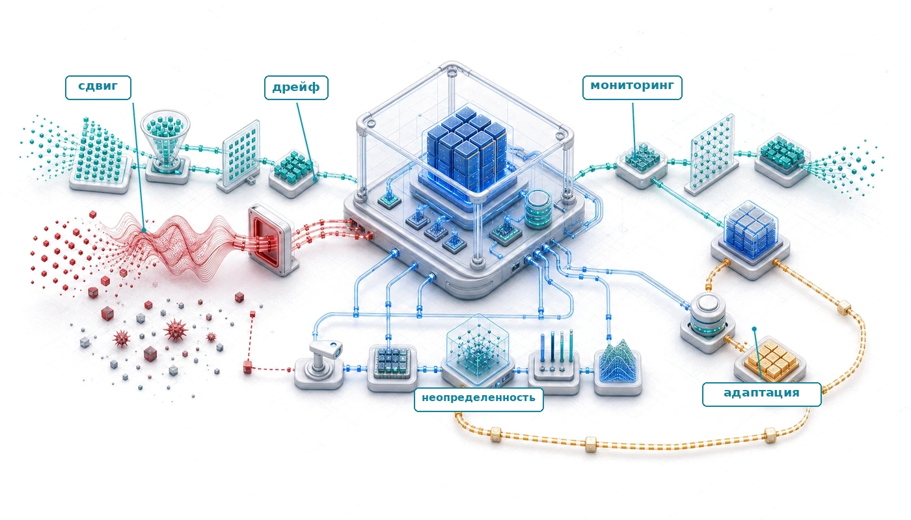

## Назначение

_Почему системы машинного обучения могут отказывать незаметно, даже когда привычные признаки здоровья остаются в норме?_

Многие программные дефекты проявляются громко: исключения роняют процессы, ошибки типов останавливают компиляцию, а сбои утверждений прерывают выполнение. Обычное программное обеспечение тоже может молча возвращать неверные результаты, но машинное обучение добавляет статистические режимы отказа, которые привычные признаки здоровья не показывают. Модель, столкнувшаяся с входами вне распределения, может продолжать выдавать результаты с полной уверенностью, не сигнализируя, что эти результаты ненадежны. Система под состязательной атакой может отдавать манипулированные предсказания, неотличимые от законных. Модель, деградирующая из-за дрейфа распределения, может сохранять стабильную задержку и аптайм, пока ее точность незаметно разрушается. Эта тишина делает отказы ML особенно опасными. Когда деградация становится видна в бизнес-метриках, ущерб может копиться уже несколько недель. Когда состязательную атаку обнаруживают, она могла повлиять на тысячи решений. Инженерия надежности существует, чтобы сделать невидимое видимым: системы строятся так, чтобы замечать, что они работают за пределами своей компетенции, сопротивляться манипуляциям и деградировать постепенно, а не выдавать уверенно неверные результаты. В терминах C³ эта видимость покупается намеренным вычислительным штрафом. Непрерывная верификация — это координационная работа, которая ловит тихий статистический распад.

> **Цели обучения**
>
> - Классифицировать задачи надежности на изменения среды, атаки на входы и отказы системного уровня
> - Объяснять, как программные отказы усиливают отказы модели или маскируются под них, используя количественные метрики надежности
> - Оценивать методы состязательных атак и выбирать защиты: состязательное обучение, сертификацию и очистку входов
> - Строить защиты от отравления данных с помощью обнаружения аномалий, статистической проверки и устойчивого обучения
> - Применять статистические метрики дрейфа, чтобы выбрать ответ: мониторинг, расследование или переобучение
> - Различать калибровку, селективное предсказание и конформное покрытие, включая допущения и эксплуатационные издержки каждого из них
> - Интегрировать надежность по измерениям модели и системы, распределяя бюджет между точностью, вычислениями, энергией и устойчивостью
>

<a id="sec-robust-ai-introduction-robust-ai-systems-4671"></a>
## Проблема тихого отказа

Надежный ИИ находится в уровне управления стека парка. Безопасность и приватность задают состязательную границу: кто может манипулировать моделью, извлекать из нее данные или делать выводы через нее и какие средства контроля сдерживают этот доступ. Надежность задает следующий системный вопрос: когда входы, распределения данных, аппаратура или программное обеспечение перестают соответствовать условиям, предполагавшимся при обучении и валидации, продолжает ли парк давать ограниченное, восстанавливаемое поведение? Те же состязательные примеры, которые безопасность рассматривает как злоупотребление, здесь становятся возмущениями модели, которые нужно измерять, против которых нужно защищаться и которые нужно сертифицировать; неумышленный дрейф и сбои получают такую же инженерную обработку. Система, которая безопасна, но хрупка, операционно бесполезна, поэтому инженерия надежности удерживает парк в работе при возмущениях и деградированных условиях.

Система машинного зрения автономного автомобиля может безупречно работать в солнечный день в Калифорнии и незаметно отказать, когда метель в Колорадо изменит визуальное распределение. Она не выбросит необработанное исключение и не напечатает трассировку стека; она может с полной уверенностью принять занесенный снегом знак «Стоп» за знак ограничения скорости. Надежность — это инженерная дисциплина, которая ограничивает такое поведение под эксплуатационной нагрузкой: сдвиг распределения, шум датчиков, состязательно сконструированные входы и аппаратные или программные сбои, которые оставляют сервис внешне здоровым, в то время как ответы модели становятся ненадежными.

Главное в этой дисциплине — именно тишина. Система восприятия беспилотного автомобиля не падает, когда принимает грузовик за небо; модель прогноза спроса не выдает ошибку, когда дает крайне неточные предсказания; система медицинской диагностики не останавливается, когда тихо выдает неверные классификации, способные угрожать жизни пациентов. Этот **режим тихого отказа** делает надежность особой и критически важной задачей ИИ-систем: инженеры должны защищаться от мира, который отказывается соответствовать обучающим данным, а не только от ошибок в коде.

Задача тихого отказа становится острее по мере того, как системы ML расширяются в самые разные контексты развертывания. В облачных сервисах, на граничных устройствах и во встроенных системах аппаратные и программные сбои напрямую влияют на производительность и надежность. Растущая сложность этих систем и их применение в критически важных для безопасности задачах[^fn-safety-critical-ml] делают отказоустойчивые архитектуры необходимыми для поддержания целостности системы.

[^fn-safety-critical-ml]: **Критически важные для безопасности применения**: стандарты безопасности задают требования к целостности через анализ опасностей, специфичный для предметной области, процессы разработки и системные доказательства, а не через одну взаимозаменяемую процентную долю точности модели. Компонент ML поэтому должен вносить доказательства в системную аргументацию о безопасности, а не заявлять соответствие только по тестовой точности.

Контрольные точки и восстановление поддерживают жизнеспособность обучающих заданий, а контроль доступа обеспечивает аутентификацию на границе системы. Ни то, ни другое не решает ситуацию, когда развернутая модель получает состязательный вход, неотличимый от законного, когда распределение данных дрейфует настолько, что предсказания теряют смысл, или когда программный сбой в конвейере предобработки тихо портит каждый вывод. Эти режимы отказа охватывают весь жизненный цикл ML и требуют методов обнаружения, изоляции и восстановления, выходящих за рамки любой отдельной защиты. Последствия игнорирования варьируются от экономических потерь до угрозы жизни в критически важных областях. Разрыв между кривыми на [рисунке](#fig-adversarial-robustness-trend) — эмпирическое выражение этого аргумента: семь лет прогресса подняли обе кривые, но не сократили расстояние между ними, потому что измеряемое свойство определяется при обучении, а не добавляется после него.

Эти режимы отказа подводят к точному определению надежного ИИ:

> **Определение: надежный ИИ**
>
> ***Надежный ИИ*** — это измеримое системное свойство: предсказания модели остаются валидными (в пределах заданных границ ошибки) при сдвиге распределения, состязательных возмущениях и аппаратных или программных сбоях, а не только средняя точность, достигаемая в идеальных условиях независимых и одинаково распределенных (i.i.d.) данных.
>
> 1.  **Значимость**: надежность количественно оценивается относительно явно заданного множества условий эксплуатации или угроз. Сертифицированный классификатор может доказать, что его предсказание не изменится для любого входа внутри заданного множества возмущений, например шара $\ell_\infty$ радиуса $\epsilon$ вокруг одной тестовой точки. Эмпирические стресс-тесты, напротив, измеряют производительность на поименованных искажениях, сдвигах или атаках, но не доказывают поведения вне проверенных случаев.
> 2.  **Различие**: стандартная обобщающая способность измеряет среднюю точность на отложенных i.i.d.-данных, взятых из обучающего распределения. Надежность измеряет поведение при заданных отклонениях от этого распределения: естественных сдвигах, семантических преобразованиях, физических изменениях, злонамеренных запросах и возмущениях, ограниченных по норме. Одни оценки являются наихудшими в формально заданном множестве, другие дают эмпирические свидетельства по выборке эксплуатационной среды.
> 3.  **Распространенное заблуждение**: часто считают, что надежность можно добавить к любой существующей модели как постфактум-слой мониторинга. Свойства надежности модели определяются в первую очередь на этапе обучения: модели, обученные без состязательных примеров и без целей надежности, *не могут* достичь сертифицированной надежности одной лишь фильтрацией на этапе вывода, потому что уязвимость находится в выученной границе решений, а не в том, какие входы доходят до модели.
>

<a id="fig-adversarial-robustness-trend"></a>

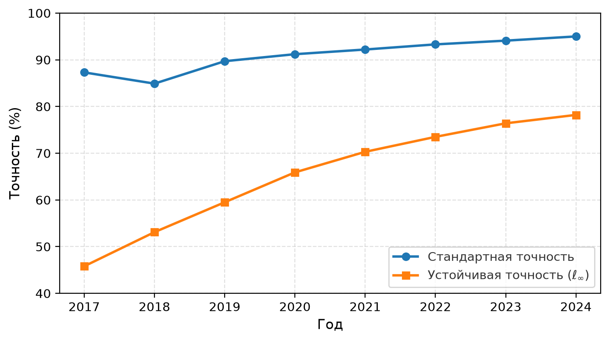

***Устойчивость к состязательным атакам и стандартная точность:** точность на CIFAR-10 без атаки и устойчивая точность при атаке в норме $\ell_\infty$ ($\epsilon = 8/255$) с 2017 по 2024 год. Стандартная точность выходит на плато выше 95 процентов, тогда как устойчивая точность отстает примерно на двадцать пунктов. Сохраняющийся разрыв и есть свидетельство того, что устойчивость — это свойство, задаваемое при обучении.*

Три категории угроз порождают эти тихие отказы, и каждая требует своих инженерных ответов. Первая и самая распространенная — изменения среды: сдвиги распределения, дрейф концепта и меняющиеся эксплуатационные контексты подрывают базовые допущения обучения модели. Модель, обученная на прошлогодних транзакциях, незаметно становится ненадежной по мере того, как меняется поведение клиентов, поэтому нужны непрерывный мониторинг и стратегии адаптации, выходящие за рамки стандартных эксплуатационных практик.

Вторая категория — злонамеренная манипуляция, направленная непосредственно на поведение модели. Состязательные атаки, попытки отравления данных и уязвимости к инъекции промптов заставляют модели неверно классифицировать входы или выдавать ненадежные результаты. Такие отказы не может предотвратить аутентификация и контроль доступа ([глава «Безопасность и приватность»](13_security_privacy.md)), потому что атакующий действует внутри собственного входного пространства модели.

Третья категория — отказы системного уровня: аппаратные сбои, ошибки программного обеспечения, отказы зависимостей и ошибки времени выполнения, которые портят механизмы вокруг модели. Эти сбои также могут усиливать, маскировать или имитировать другие отказы надежности. Ошибки, конструктивные недостатки и реализационные дефекты в алгоритмах, библиотеках и фреймворках распространяются по системе и создают системные уязвимости[^fn-systemic-vulnerability-ml], которые выходят за рамки отказа отдельного компонента. Ошибка предобработки может создать искусственный сдвиг распределения; численная ошибка может испортить поведение модели так, что его не отличить от состязательной атаки; гонка может повредить выученные представления. Поскольку эти сбои возникают на уровне системы, их подробная таксономия и стратегии смягчения рассмотрены в [главе «Отказоустойчивость»](07_fault_tolerance.md); эта глава сосредоточена на том, как системные сбои взаимодействуют со сдвигами среды и атаками на входы.

[^fn-systemic-vulnerability-ml]: **Системная уязвимость**: архитектурные слабости, которые каскадируют через слои, а не изолируются в одном компоненте. Log4Shell (CVE-2021-44228) затронул сотни миллионов устройств через одну библиотеку логирования. Конвейеры ML сталкиваются с аналогичным риском: одна версия CUDA или PyTorch, закрепленная в тысячах моделей, означает, что одна уязвимость компрометирует весь парк одновременно, превращая управление зависимостями в функцию, критичную для надежности.

Подход к защите зависит от того, где работает система. Крупные облачные среды могут позволить себе избыточность и сложные механизмы обнаружения ошибок, которые переполнили бы бюджеты питания и памяти граничного устройства. Граничные устройства ([глава «Граничный интеллект»](11_edge_intelligence.md)) должны полагаться на точечное укрепление[^fn-hardening-strategy-ml], которое защищает наиболее критичные пути вывода и принимает более слабые гарантии в остальном.

[^fn-hardening-strategy-ml]: **Стратегия укрепления**: эшелонированная защита конвейеров ML: загрузка модели (проверка подписи), обработка входов (фильтрация состязательных воздействий) и валидация выходов (пороги уверенности). На ресурсно ограниченных граничных устройствах выборочное укрепление защищает критические пути, то есть движок вывода, и принимает более слабые гарантии для журналирования, потому что полная избыточность превысила бы бюджеты питания и памяти, которые делают граничное развертывание жизнеспособным.

Несмотря на эти контекстные различия, надежной системе ML нужны отказоустойчивость, устойчивость к ошибкам и стабильная производительность во всех средах развертывания, и эти гарантии не бесплатны. Коррекция ошибок добавляет накладные расходы на пропускную способность памяти, избыточная обработка умножает энергопотребление, а непрерывный мониторинг забирает долю вычислений; каждое из этих решений также порождает дополнительное тепло, которое усугубляет проблемы теплового управления, ограничивающие плотность развертывания. Вопрос надежности в том, в какой момент эта дополнительная стоимость ресурсов приносит достаточную ценность надежности, чтобы оправдать себя.

Таким образом, надежность — не запоздалая мысль, которую можно прикрутить к готовой системе. Это архитектурное ограничение, которое формирует каждый уровень конвейера ML: от валидации входов и состязательного обучения до обнаружения дрейфа и изоляции программных сбоев. Цена пренебрежения ею копится незаметно, пока система не откажет в продакшене. Тихие отказы уже нанесли серьезный ущерб производственным системам в облачных, граничных и встроенных развертываниях.

<a id="sec-robust-ai-realworld-robustness-failures-c119"></a>

## Реальные сбои надежности

В облачных, граничных и встроенных средах ML-системы отказывают тогда, когда скрытое в стеке допущение превращается в зависимость, которую система не отслеживает. Приведенные ниже инциденты различаются масштабом и областью, но все показывают одну и ту же закономерность: система продолжает работать, пока незамеченное условие портит результат.

> **Случай из практики: метка, раскрывшая пробел в тестировании (2015)**
>
> **Контекст**: в июне 2015 года Google Photos использовала автоматическую разметку изображений, чтобы упорядочивать фотографии пользователей (Kasperkevic, 2015).
>
> **Механизм**: глубокий сверточный классификатор изображений дал серьезный сбой на уровне срезов данных: фотографии Джеки Алсине с самим собой и его темнокожим другом были отнесены к альбомной метке «Гориллы». Оценка опиралась только на агрегированную точность top-1/top-5 по $D_{\text{vol}}$, которая маскировала высокорисковые сбои на срезах.
>
> **Последствия**: заметная ошибка классификации вызвала общественный резонанс и выявила серьезный пробел в проверке безопасности многоклассовых моделей зрения.
>
> **Исправление**: Google выпустила экстренный хотфикс, исключивший из таксономии метки «gorilla», «chimpanzee» и «monkey», и параллельно разрабатывала конвейеры оценки по срезам и автоматической фильтрации безопасности.
>
> **Системный урок**: надежность ML в продакшене нельзя определить агрегированной точностью на тестовом наборе. Задачи классификации с высокими ставками требуют оценки по срезам, автоматических защит от токсичного контента и устойчивых запасных вариантов, встроенных непосредственно в конвейер обслуживания.

Тот же сбой надежности на уровне модели — лишь частный случай более широкой проблемы. В облачной инфраструктуре скрытое допущение часто состоит в том, что общая зависимость остается доступной и корректной.

<a id="sec-robust-ai-cloud-infrastructure-failures-1c8c"></a>
### Сбои облачной инфраструктуры

Надежные ML-системы наследуют традицию надежности, которая старше машинного обучения. Громкие отказы не-ML-инфраструктуры, например отключение S3 в AWS в 2017 году[^fn-aws-s3-outage], когда ошибочно введенная команда технического обслуживания удалила слишком много мощности и каскадом прошла через все сервисы, которые считали региональное объектное хранилище инвариантом доступности (Amazon Web Services, 2017), относятся к тому классу сбоев зависимостей и отказов, механику обнаружения и восстановления которых подробно разбирает [глава «Отказоустойчивость»](07_fault_tolerance.md). Они громкие, а не тихие, и задают дисциплину, которую эта глава принимает как исходную, но не ту, на которой она сосредоточена: тихие, модельные отказы. Экономика крупномасштабного обучения усиливает эти последствия: отключение S3 лишает тысячи ускорителей шардов данных одновременно, а контрольные точки, которые не удалось записать во время отключения, означают, что когда вытеснение вернет кластер планировщику, часы или дни градиентных обновлений будут невосстановимы. Действительно новая и исключительно ML-специфичная проблема возникает тогда, когда отказ тихий: система продолжает обслуживать запросы, пока незамеченная порча распространяется.

[^fn-aws-s3-outage]: **Отключение AWS S3 (2017)**: ошибочная команда во время плановых работ по обслуживанию удалила слишком много мощности из подсистем индекса и размещения S3 в регионе US-East-1. Пока эти подсистемы перезапускались, S3 не могла обрабатывать запросы, а зависимые сервисы AWS испытывали повышенное число ошибок или нарушения работы. Инцидент выявил паттерн зависимости от одного региона: системы, которые считают доступность регионального хранилища инвариантом, могут отказать, даже когда их собственный код приложения и логика обслуживания моделей не менялись.

В другом случае (Dixit et al., 2021) Facebook столкнулась с проблемой тихого повреждения данных (SDC)[^fn-sdc-silent-data] в своей инфраструктуре распределенных запросов ([рисунок](#fig-sdc-robust)). SDC — это необнаруженные ошибки во время вычислений или передачи данных, которые тихо распространяются через слои системы. Система Facebook обрабатывала запросы в стиле SQL над наборами данных и поддерживала приложение сжатия, предназначенное для уменьшения объема хранимых данных. Неиспользуемые файлы сжимались, а при запросе на чтение распаковывались. Перед распаковкой выполнялась проверка размера, чтобы убедиться, что файл корректен. Однако непредвиденный сбой время от времени возвращал нулевой размер для корректных файлов, что приводило к ошибкам распаковки и пропущенным записям в выходной базе данных. Проблема проявлялась спорадически: часть вычислений возвращала корректные размеры файлов, и это делало диагностику особенно трудной.

[^fn-sdc-silent-data]: **Тихое повреждение данных (SDC)**: аппаратные ошибки, которые портят данные, не вызывая никакого механизма обнаружения. Meta сообщила, что ежедневно шесть-восемь машин на миллион испытывают SDC, а такие ставки «на порядки выше предсказаний по мягким ошибкам». В системах ML SDC особенно опасно: испорченные веса или активации дают правдоподобные, но неверные результаты, которые проходят все проверки работоспособности и избегают мониторинга, ловящего громкие отказы.

<a id="fig-sdc-robust"></a>

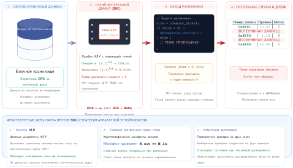

***Тихое повреждение данных:** неожиданные сбои могут возвращать неверные размеры файлов, что ведет к потере данных при распаковке и распространяет ошибки через распределенные системы запросов, несмотря на видимую операционную успешность. Этот пример из Facebook показывает трудность необнаруженных ошибок и важность надежного обнаружения ошибок в конвейерах обработки больших данных. Источник: Facebook (Dixit et al., 2021).*

В распределенном обучении ML тихое повреждение данных качественно разрушительнее, чем в обычных системах обработки данных: испорченный градиент или активация может сбить состояние оптимизатора и повлиять на последующие шаги, вместо того чтобы оставаться ограниченным одним результатом запроса. Потерянная строка в ответе базы данных — это локальная потеря данных, ограниченная выходом этого запроса. В ML средством часто становится откат к последней чистой контрольной точке и перезапуск затронутого обучения. Поэтому SDC может скомпрометировать точность модели без всякого сигнала тревоги, а радиус поражения растет вместе с конструкцией синхронизации и контрольных точек, а не остается локальным. Производственный отчет Meta показывает, что SDC — системная проблема парка, затрагивающая процессоры и программные уровни (Dixit et al., 2021), а недавние работы по обучению больших языковых моделей (LLM) показывают, что реальные SDC могут менять выходы подмодулей, шаги оптимизатора, всплески потерь и итоговые веса модели (Ma et al., 2025). Приглашенный доклад Dean на MLSys 2024 описывает ту же проблему надежности в промышленном масштабе: аппаратные ошибки во время крупных обучающих заданий ML возникают достаточно регулярно, чтобы некорректные вычисления одного дефектного чипа могли распространиться и заразить весь запуск (Dean, 2024).

<a id="sec-robust-ai-edge-device-vulnerabilities-ddfe"></a>

### Уязвимости граничных устройств

Распределенные граничные развертывания[^fn-edge-compute-robustness] обнажают хрупкость систем ML там, где вычисления, питание и связность жестко ограничены. Беспилотные автомобили — каноничный пример этой уязвимости: они работают в открытой среде с жесткими требованиями к задержке в реальном времени и нулевой терпимостью к отказам.

[^fn-edge-compute-robustness]: **Граничные вычисления**: обработка данных локально, а не в централизованных облаках, что снижает задержку вывода с примерно 100 мс (облачный цикл) до менее 10 мс. Компромисс надежности жесток: граничные устройства выигрывают в задержке, но теряют избыточность, эластичное масштабирование и централизованный мониторинг, которые делают облачные системы устойчивыми. Граничная модель, которая отказала, не может переключиться на резервный кластер: она должна деградировать постепенно в пределах собственных бюджетов питания и памяти или безопасно отказать за миллисекунды.

В мае 2016 года смертельная авария с Tesla Model S в режиме Autopilot[^fn-autopilot-perception-safety] показала катастрофический потенциал сбоев восприятия (National Transportation Safety Board, 2017). Двигаясь со скоростью 74 мили в час на участке с ограничением 65 миль в час, автомобиль не распознал полуприцеп, пересекавший его путь; ни система предупреждения о лобовом столкновении, ни автоматическое экстренное торможение не сработали. Расследование показало, что система не была спроектирована для распознавания поперечного движения, и незапланированное эксплуатационное условие превратилось в высокоскоростное столкновение с подкатом под прицеп ([рисунок](#fig-tesla-example)).

[^fn-autopilot-perception-safety]: **Autopilot**: в аварии 2016 года применялась тогдашняя система помощи водителю уровня SAE 2 от Tesla и стек восприятия эпохи Mobileye, а не более поздние комплекты с восемью камерами для полной автономии (FSD) или двойным чипом FSD. Более поздние автомобили Tesla получили расширенное покрытие камерами и выделенные вычислители FSD, но урок надежности тот же: сбор данных в масштабе парка автоматически не покрывает редкие сценарии, например белый прицеп на фоне яркого неба.

<a id="fig-tesla-example"></a>


***Сбой восприятия Autopilot:** эта авария показывает критические риски для безопасности при опоре на машинное обучение в восприятии автономных систем: ошибки классификации объектов могут привести к катастрофическим последствиям. Инцидент подчеркивает необходимость надежной валидации, резервирования и аварийных механизмов в конструкции беспилотных автомобилей, чтобы смягчать влияние несовершенных моделей ИИ. Источник: BBC News.*

Схожий трагический сбой произошел в марте 2018 года в Темпе, штат Аризона, когда испытательный беспилотный автомобиль Uber сбил и убил пешехода (National Transportation Safety Board, 2019). Система восприятия обнаружила жертву за шесть секунд до удара, но принципиально не справилась с **устойчивостью классификации объекта**. Пока пешеход переходил дорогу, система меняла классификацию с «неизвестного объекта» на «автомобиль», а затем на «велосипед», и при каждой смене сбрасывала историю прогноза траектории. Поскольку у системы не было устойчивого трека объекта, она предсказала траекторию столкновения лишь за 1,3 секунды до удара, слишком поздно для того, чтобы водитель-оператор успел вмешаться.

Помимо автомобилестроения, промышленные граничные развертывания сталкиваются с похожими опасностями. Инспекционный дрон, обследующий линии высокого напряжения, может опираться на визуальную одометрию для стабилизации; внезапное изменение освещения или повторяющаяся текстура могут привести к расхождению алгоритма локализации и столкновению или уходу дрона. У граничных устройств нет **запасной избыточности**: если основной движок вывода становится неуверенным, некуда перенаправить трафик, потому что вторичного кластера не существует. Система должна деградировать постепенно или безопасно отказать за миллисекунды. Отсутствие эластичности ресурсов делает граничный ИИ особенно уязвимым к изменениям среды, которые центр обработки данных компенсировал бы массовым избыточным резервированием.

<a id="sec-robust-ai-embedded-system-constraints-ec7a"></a>

### Ограничения встроенных систем

Встроенные системы[^fn-embedded-ml-constraints] работают в еще более жестких ограничениях, чем граничные устройства, часто в критически важных средах, где восстановление после отказа невозможно. Это также области, где ML наследует самую требовательную часть довузовской традиции надежности: классические ошибки встроенного ПО, описанные ниже, — громкие, не-ML отказы, механика которых относится к [главе «Отказоустойчивость»](07_fault_tolerance.md), но они задают планку валидации, которую должен преодолеть и любой компонент ML в контуре принятия решений.

[^fn-embedded-ml-constraints]: **Встроенные системы**: специализированные процессоры, от 8-битных микроконтроллеров (килобайты ОЗУ) до сложных систем на кристалле (SoC); ежегодно выпускается более 30 миллиардов таких устройств. Требования реального времени (сроки от микросекунд до миллисекунд) и работа без присмотра (годы без обслуживания) делают развертывание ML особенно трудным: модели нельзя просто обновить, обновления по воздуху рискуют превратить устройство в кирпич, а в контуре нет человека, который заметил бы тихую деградацию.

Потеря марсианского посадочного аппарата Mars Polar Lander в 1999 году, которую комиссия по расследованию объяснила преждевременным обнаружением касания поверхности, вероятно, выключившим двигатели до посадки (NASA Mars Program Independent Assessment Team, 2000), — канонический пример: там, где восстановление невозможно, строгая программная валидация — обязательное условие, а не роскошь, и та же строгость относится к любому компоненту ML в контуре принятия решений ([рисунок](#fig-nasa-example)).

<a id="fig-nasa-example"></a>


***Роботизированный посадочный аппарат на Марсе:** художественное изображение посадочного аппарата NASA InSight, развернутого на поверхности Марса. Удаленные роботизированные миссии иллюстрируют класс систем, в которых программные или сенсорные сбои нельзя устранить вмешательством человека; это оправдывает строгую валидацию и анализ режимов отказа, которым должны соответствовать и компоненты ML в контуре принятия решений. Источник: Slashgear.*

Коммерческая авиация демонстрирует ту же унаследованную опасность: директива Федерального управления гражданской авиации США (FAA) 2015 года последовала за обнаружением компанией Boeing того, что самолет 787, непрерывно работавший 248 дней, мог потерять все переменное напряжение, если все четыре блока управления генераторами одновременно перейдут в аварийный режим,[^fn-failsafe-system-fallback] так что сам аптайм стал фактором риска. Системы, критичные для безопасности,[^fn-asil-ml-certification] требуют строгих требований к надежности именно из-за таких скрытых опасностей.

[^fn-failsafe-system-fallback]: **Механизм аварийного отключения**: система, которая переходит в безопасное состояние при обнаружении сбоя, следуя паттерну автоматического выключателя (замкнут, разомкнут, полуоткрыт). В обслуживании ML к механизмам аварийного отключения относятся отказ по порогу уверенности (передача предсказаний ниже порога человеку), переход к более простым моделям и автоматический откат, когда срабатывают мониторы дрейфа. Компромисс — доступность: агрессивные пороги уверенности отклоняют от 5 до 15 процентов законного трафика, поэтому настройка границы отказа становится оптимизацией «надежность против пропускной способности».

[^fn-asil-ml-certification]: **ASIL (уровни автомобильной безопасности, Automotive Safety Integrity Levels)**: ISO 26262 использует уровни целостности автомобильной безопасности, чтобы масштабировать обязательства функциональной безопасности в соответствии с анализом опасностей. ASIL D — самый строгий уровень, но это не универсальный процент надежности компонента. Компонент восприятия ML усложняет полученное обоснование безопасности, поскольку его поведение зависит от эксплуатационного распределения и не может быть обосновано одной лишь агрегированной точностью на тестах.

> «Если четыре основных блока управления генераторами (связанные с генераторами на двигателях) были включены одновременно после 248 дней непрерывной работы, все четыре блока перейдут в аварийный режим одновременно, что приведет к потере всего переменного электропитания независимо от фазы полета». Директива Федерального управления гражданской авиации (Federal Aviation Administration, 2015)

Когда ИИ применяется в авиации, включая задачи вроде автономного управления полетом и предиктивного обслуживания, надежность встроенных систем влияет на безопасность пассажиров. Эти довузовские отказы задают планку валидации, которую должен преодолеть любой компонент ML, работающий в тех же средах. Нейронная сеть, которая выполняет визуальную одометрию на планетоходе, должна выдерживать вызванные радиацией сбои в весах, активациях и состоянии управления. Ее системная архитектура может сочетать закаленные компоненты, обнаружение и коррекцию ошибок, очистку состояния, резервирование и сторожевые таймеры в соответствии с моделью отказов миссии; ни один отдельный механизм не обеспечивает безопасность на уровне модели. Аргументация о безопасности должна связывать локализацию аппаратных сбоев с обнаружением поведенческих ошибок и проверенным запасным режимом. В тракте управления полетом низкая уверенность может способствовать срабатыванию такого перехода, но сама по себе уверенность не является детерминированным сертификатом безопасности: передача управления также должна вытекать из калиброванных свидетельств, исправности датчиков и системы и независимо проверенного деградированного режима.

Ставки становятся еще выше для имплантируемых медицинских устройств. Программный или аппаратный сбой в гипотетическом умном кардиостимуляторе может поставить под угрозу жизнь пациента. Когда системы ИИ берут на себя роли восприятия, принятия решений и управления в таких приложениях, возникают новые источники уязвимости: ошибки, связанные с данными, неопределенность модели[^fn-epistemic-uncertainty-ml] и непредсказуемое поведение в редких граничных случаях. Непрозрачная природа некоторых моделей ИИ усложняет диагностику сбоев и восстановление.

[^fn-epistemic-uncertainty-ml]: **Неопределенность модели (эпистемическая неопределенность)**: устранимый разрыв между выученным представлением модели и истинным процессом порождения данных, в отличие от алеаторической неопределенности, то есть неустранимого шума данных. Количественная оценка эпистемической неопределенности позволяет реализовать важный механизм надежности: системы, критичные для безопасности, могут передавать решение человеку-оператору, когда предсказания выходят за пределы обучающего распределения. Стоимость для системы существенна: байесовские аппроксимации или Monte Carlo dropout требуют нескольких проходов вывода, создавая прямой компромисс между осведомленностью о неопределенности и задержкой обслуживания.

Каждый из этих отказов выявляет общие паттерны, которые требуют систематического подхода к оценке и смягчению надежности: отключение AWS нарушило работу облачных сервисов, зависящих от S3, ошибки восприятия беспилотных автомобилей привели к смертельным авариям, а программные ошибки космических аппаратов стали причиной потери миссий. Эти структурные паттерны пересекают среды развертывания, и единая схема надежности должна описывать, как разные режимы отказа взаимодействуют и усиливают друг друга в масштабе системы.

<a id="sec-robust-ai-unified-framework-robust-ai-b25d"></a>

## Единая схема надежного ИИ

Переключенный бит в модуле памяти GPU может заставить языковую модель генерировать токсичный текст. Постепенное изменение демографии пользователей может вызвать внезапный всплеск задержки рекомендаций. Производственные системы ML не могут рассматривать такие явления как изолированные ошибки. Единая схема должна описывать, как низкоуровневые аппаратные сбои, программные ошибки, дрейф данных и состязательные входы каскадно поднимаются вверх и разрушают целостность выхода модели.

<a id="sec-robust-ai-building-previous-concepts-ef4a"></a>

### Связи с предыдущими понятиями

Механизмы отказоустойчивости из [главы «Отказоустойчивость»](07_fault_tolerance.md), изначально созданные для восстановления обучающих заданий после аппаратных сбоев, играют вторую роль и в надежности: обеспечение доступности на этапе вывода. Восстановление при обучении сосредоточено на восстановлении из контрольных точек, но надежность расширяет это до **плавной деградации** (graceful degradation): служба вывода остается работоспособной, даже когда входы состязательны или компоненты деградируют. Распределенные архитектуры обучения из [главы «Распределенное обучение»](05_distributed_training.md) вносят уникальные уязвимости: один узел, передающий испорченные градиенты во время операции AllReduce, может отравить глобальные веса модели, что требует протоколов византийской отказоустойчивости, которые проверяют обновления партнеров перед агрегацией.

Фреймворки безопасности из [главы «Безопасность и приватность»](13_security_privacy.md) дают принципы моделирования угроз, на которые опираются стратегии защиты от состязательных атак. Системы эксплуатационного мониторинга из [главы «Эксплуатация ML-систем в масштабе»](12_ops_scale.md) дают инфраструктурную основу для обнаружения угроз надежности в продакшене. Инфраструктура обслуживания из [главы «Инференс в масштабе»](10_inference.md) создает новые поверхности атак: батчинг, маршрутизация моделей и конвейерный параллелизм открывают логику планирования и отдельные стадии конвейера состязательным запросам.


*При шардированном выводе отказ одной стадии срывает весь запрос.*

Крупные плотные модели усиливают эти риски. Модель класса GPT-3 с 175 млрд параметров ($P = 1.75 \times 10^{11}$) требует объема весов $D_{\text{vol}} = P \times b_{\text{param}} = 1.75 \times 10^{11} \times 2\text{ Б} = 350\text{ ГБ}$ при точности обслуживания FP16/BF16 ($b_{\text{param}} = 2\text{ Б/параметр}$). Поскольку объем весов $D_{\text{vol}}$, то есть 350 ГБ, превышает встроенную память $M_{\text{mem}}$ любого отдельного ускорителя (например, 80 ГБ у A100 или H100), развертывания должны шардировать веса и активации по нескольким устройствам. Каждая дополнительная стадия конвейера или тензорного параллелизма увеличивает поверхность отказа по сравнению с монолитным развертыванием: один битовый сбой, сетевое разделение или состязательный вход, нацеленный на одну стадию, может уронить весь запрос на вывод. Методы эффективности, такие как квантование INT8 и агрессивное прореживание, усугубляют проблему, уменьшая **запас надежности** (robustness margin): величину возмущения входа, численной ошибки или изменения представления, которую модель может поглотить до того, как ее предсказание изменится. Поэтому инженерия надежности — это постоянные переговоры с ограничениями эффективности и масштабируемости, установленными в предыдущих главах.

<a id="sec-robust-ai-ml-performance-system-reliability-7d42"></a>

### От производительности ML к надежности системы

Когда тихий отказ становится системным свойством, точность, задержка и пропускная способность уже не описывают полную оболочку надежности. Развернутая модель также зависит от вычислительного субстрата, который ее исполняет, и этот субстрат может испортить правильную модель, не вызвав видимого отказа сервиса.

Аппаратная надежность напрямую влияет на производительность ML ([рисунок](#fig-weight-corruption)): один битовый сбой в поле экспоненты тензора весов IEEE 754 может мгновенно превратить обычный параметр в огромный выброс, насыщая нижележащие нейроны по мере распространения ошибки через прямой проход. Целевые атаки переворотом битов намеренно выбирают уязвимые биты весов, поэтому их результаты не следует трактовать как эффект одного случайного аппаратного сбоя. Сбои подсистемы памяти во время обучения также могут портить градиентные обновления и мешать сходимости модели. Современные трансформеры, такие как GPT-3 с 175 млрд параметров, выполняют огромное число операций с плавающей точкой (количество $\text{FLOP}$ и пиковая пропускная способность $R_{\text{peak}}$ в $\text{FLOP/s}$) и создают множество возможностей для аппаратных сбоев во время прямого прохода. Подсистемы памяти GPU, такие как HBM2 у V100, работают с однонаправленной пиковой пропускной способностью памяти ($\text{BW}_{\text{mem}}$) до 900 ГБ/с, но пиковая пропускная способность передачи не определяет частоту мягких ошибок устройства: количественная оценка подверженности требует источника с ставкой для конкретного устройства или типа памяти, с соответствующим объемом хранения и базой по времени.

<a id="fig-weight-corruption"></a>

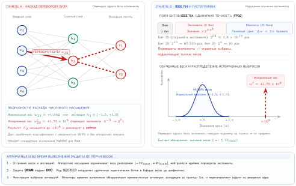

***Порча весов переворотом бита:** диаграмма прямого прохода нейронной сети (слева) показывает ПЕРЕВОРОТ БИТА в одном весе: нормальный путь превращается в испорченный, и ошибка распространяется на выходы. Гистограмма значений весов (справа) показывает, что одиночный испорченный вес попадает в крайний хвост $10^k$, далеко за пределы нормального распределения. Переворот бита экспоненты с разрядом $2^k$ в IEEE 754 меняет значение в $2^{\pm 2^k}$ раз, насыщая нижележащие нейроны и вызывая тихую ошибку классификации.*

Связь между аппаратной надежностью и производительностью ML требует понятий из инженерии надежности:[^fn-reliability-eng-ml] моделей отказов, описывающих, как происходят сбои; механизмов обнаружения ошибок, которые выявляют проблемы до того, как они повлияют на результаты; и стратегий восстановления, которые возвращают систему к работе. Эти понятия надежности дополняют методы оптимизации производительности, такие как квантование, прореживание и дистилляция знаний, гарантируя, что оптимизированные системы продолжают корректно работать в реальных условиях.

[^fn-reliability-eng-ml]: **Инженерия надежности (Reliability Engineering)**: возникла в аэрокосмической отрасли 1950-х годов с анализом среднего времени между отказами и анализом режимов отказа; количественно оценивает надежность системы как $R_{\text{system}}(t)=e^{-N\lambda t}$ для $N$ независимых компонентов с экспоненциальным распределением отказов. Системы ML наследуют эти методы, но добавляют режимы отказа, которые традиционная надежность не предвидела: дрейф модели (система деградирует без какого-либо аппаратного сбоя), состязательная устойчивость (система правильно работает на тестовом наборе, но отказывает на специально построенных входах) и эпистемическая неопределенность (система не может отличить то, что она знает, от того, чего не знает).

Как показано в [главе «Отказоустойчивость»](07_fault_tolerance.md), тихое повреждение на одном устройстве накапливается по парку из $N$ устройств по формуле $\Pr(\geq 1) = 1 - (1 - p)^N$. Это та же арифметика, которая делает один битовый сбой почти неизбежным событием в масштабе обучения. Последствия для надежности видны на [рисунке](#fig-silent-error-probability). Перебор частоты на одно устройство показывает, как резко растет вероятность на уровне кластера, когда модель шардирована между тысячами устройств. Кривая использует иллюстративную стресс-тестовую частоту 0,01 процента на устройство-час. При такой частоте кластер из 10 000 устройств скорее столкнется с тихой ошибкой за час, чем нет (вероятность 63,2 процента), а вероятность превышает 95 процентов примерно при 29 956 устройствах. Отчет Meta о SDC подтверждает повреждение на наблюдаемом масштабе парка (Dixit et al., 2021).

<a id="fig-silent-error-probability"></a>

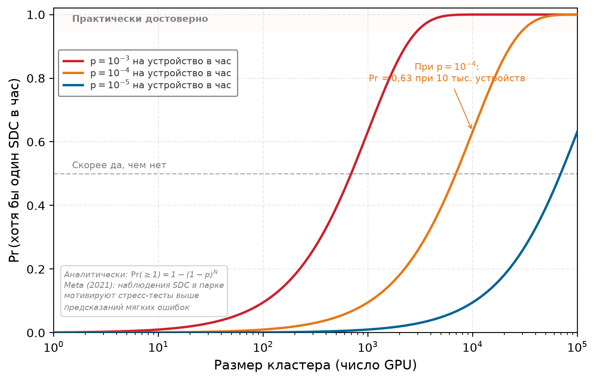

***Вероятность тихой ошибки в масштабе:** вероятность возникновения хотя бы одного события тихого повреждения данных за час как функция размера кластера для трех иллюстративных частот ошибок на устройство. Кривые показывают, как быстро вероятности на уровне кластера накапливаются по мере роста частоты на устройство.*

Накопительный эффект на уровне кластера мотивирует единую схему надежности, охватывающую все измерения ML-систем. Сбои, возникающие из аппаратуры, состязательных входов и программных дефектов, имеют общие черты и поддаются систематическим подходам.

<a id="sec-robust-ai-three-pillars-robust-ai-2626"></a>

### Три опоры надежного ИИ

Единая схема помогает инженерам определить, какой сигнал отказа они видят, прежде чем выбрать защиту. Изменения среды, атаки на уровне входов и сбои системного уровня создают разные свидетельства и требуют разных ответов; программные сбои пересекают все три, потому что могут усиливать их или маскироваться под любой из них. **Схема трех опор** (Three Pillars Framework) на [рисунке](#fig-three-pillars-framework) организует эти угрозы как взаимосвязанные уязвимости, которым нужны взаимодополняющие стратегии защиты.

<a id="fig-three-pillars-framework"></a>

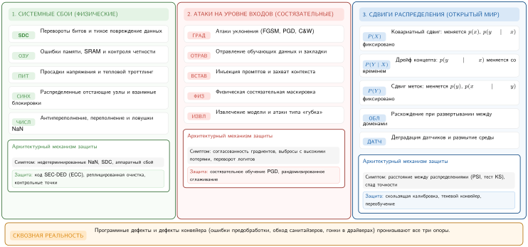

***Схема трех опор:** три основные категории задач надежности, которые системы ИИ должны решать, чтобы работать надежно в реальных развертываниях. Надежная система ИИ строится на эффективной обработке этих трех областей задач.*

Что добавляет рисунок к трем категориям, введенным ранее, — это свидетельство, которое создает каждая опора, и семейство защит, которое она требует. Изменения среды порождают статистический сигнал: распределение входов или меток непрерывно смещается относительно эталона, поэтому свидетельством служит расстояние между распределениями, а семейство ответов — мониторинг, рекалибровка и переобучение.

Атаки на уровне входов порождают состязательный сигнал: специально сконструированный вход или отравленный образец создан, чтобы максимизировать ошибку. Свидетельством служат возмущения, согласованные с градиентом, или аномальные обучающие образцы, а семейство ответов — состязательное обучение, сертификация и очистка входов. Поскольку атакующий действует в собственном входном пространстве модели, аутентификация и контроль доступа ([глава «Безопасность и приватность»](13_security_privacy.md)) на этот отказ не распространяются.

Сбои системного уровня охватывают отказы, возникающие в аппаратуре, коде, фреймворках и инфраструктуре развертывания, которые обеспечивают работу систем ML: численную нестабильность при вычислении градиентов, порчу конвейера данных из-за ошибок предобработки, гонки в распределенном обучении, утечки памяти, деградирующие долгоживущие сервисы, отказы зависимостей из-за несовпадения версий и аппаратные сбои, такие как переключения битов или события питания. Механика самих сбоев, их обнаружение и восстановление относятся к [главе «Отказоустойчивость»](07_fault_tolerance.md). Что делает третью опору проблемой надежности, а не чисто проблемой отказоустойчивости, так это то, что такие сбои редко заявляют о себе как о сбоях: они маскируются под две другие опоры, и инженер, который неверно прочитает маскировку, потратит бюджет защиты впустую.

<a id="sec-robust-ai-diagnosing-the-masquerade-9f21"></a>

#### Диагностика маскировки

Рассмотрим оператора, который видит один и тот же поверхностный симптом из всех трех опор: точность модели падает, а задержка и аптайм остаются стабильными. Ошибка предобработки, которая незаметно изменяет масштаб признака, выглядит для монитора дрейфа точно как ковариатный сдвиг, потому что статистика признака действительно сместилась. Численное переполнение, портящее активации слоя, дает уверенные ошибочные классификации, которые выглядят точно как состязательный пример, потому что решение изменилось без видимой причины во входе. Трудность именно в маскировке: дешевые детекторы конкретной опоры срабатывают на симптом, а не на причину.

Три признака разделяют эти случаи:

- **Граница изменения**: настоящий сдвиг среды происходит непрерывно и затрагивает целые популяции входов по мере развития мира; сбой конвейера проявляется как скачок, синхронизированный с развертыванием, обновлением зависимости или изменением схемы, и он может сдвигать признаки, которые никакой реальный процесс не сдвинул бы вместе.
- **Воспроизводимость при фиксированном входе**: прогоните эталонные входы через предобработку и артефакты модели с зафиксированными версиями. Детерминированный конвейер или численная ошибка должны воспроизводиться на той же стадии, тогда как переходный аппаратный сбой часто не воспроизводится и может быть изолирован повторным выполнением или резервным оборудованием. Дрейф и состязательное поведение также могут воспроизводиться при фиксированном входе, поэтому одного воспроизведения недостаточно, чтобы определить причину: сравнивайте сырые и предобработанные тензоры, версии артефактов и статистику на уровне популяции вместе с результатом воспроизведения.
- **Корреляция между уровнями**: реальная состязательная кампания коррелирует с аномалиями пространства входов, такими как необычные паттерны запросов или возмущения, согласованные с градиентом. Маскирующийся программный сбой, напротив, коррелирует с сигналами системного уровня, включая выпуск кода, счетчик ECC, проверку SDC или сигнал о нехватке памяти, которые уже отслеживаются, как описано в [главе «Отказоустойчивость»](07_fault_tolerance.md).

Поэтому дисциплина диагностики состоит в том, чтобы сначала прочитать свидетельства системного уровня, а лишь потом принимать гипотезу о дрейфе или атаке, которую подсказывает поверхностный симптом. Ответ, который требует каждая опора, различен, и правильной может оказаться только одна.

<a id="sec-robust-ai-common-robustness-principles-cb22"></a>

### Общие принципы надежности

Во всех трех категориях общая инженерная задача состоит в том, чтобы решить, какой сигнал запускает какой ответ. Надежным системам нужны порог обнаружения, путь деградации и механизм адаптации, у каждого из которых есть явный бюджет стоимости.

Обнаружение и мониторинг образуют основу этой стратегии, и каждая опора требует своего сигнала. Системный мониторинг отбирает показания аппаратуры и среды выполнения, чтобы поймать аномалии температуры, колебания напряжения, ошибки памяти или тихое повреждение данных до того, как они испортят состояние модели. Мониторинг атак на уровне входов использует статистические тесты или тесты в пространстве активаций, чтобы помечать состязательные входы и попытки отравления до того, как они достигнут границы решений или цикла обучения. Мониторинг сдвигов среды сравнивает производственный трафик с эталонными распределениями, используя такие инструменты, как maximum mean discrepancy (MMD),[^fn-mmd-distribution-drift] индекс стабильности популяции (PSI) или тесты Колмогорова — Смирнова (KS). Та же количественная дисциплина относится и к стоимости защиты: механизмы надежности нужно закладывать в бюджет, а не просто включать, потому что каждый детектор торгует чувствительностью против ложных срабатываний, задержки и вычислительных накладных расходов.

> **Сценарий: цена защиты**
>
> **Задача**: команда обучает устойчивый классификатор для беспилотного автомобиля, применяя состязательное обучение с семишаговой атакой проективным градиентным спуском (PGD-7). Для каждого обучающего батча эта атака ищет возмущение с высокими потерями внутри заданного шара нормы. Насколько эта дополнительная работа по генерации атаки замедляет обучение?
>
> **Расчет**:
> Генерация состязательного примера требует $K$ дополнительных шагов градиента на обучающий образец.
>
> 1. **Проходы вперед и назад**: 1 (стандартный) + 7 (генерация атаки) = 8 проходов в сумме.
> 2. **Замедление обучения**: в 8× раз медленнее.
> 3. **Стоимость полезности**: точность против наихудшей атаки составляет 70 процентов, при 95 процентах точности на чистых данных для стандартной модели.
>
> **Системный вывод**: устойчивость — это компромисс между эффективностью и полезностью. В этом примере PGD-7 команда платит 8× за обучение и наблюдает разрыв 25 процентных пунктов между стандартной точностью на чистых данных и устойчивой точностью при заданной модели цифровых возмущений. Это вычитание не выделяет налог на чистую точность; раздел «Рабочий процесс защиты от состязательных атак» объясняет четыре сопоставимых измерения, необходимых для оценки компромисса. В парке машинного обучения «надежность» — не переключатель, который можно включить; это бюджет, который команда тратит. Такое давление бюджета часто делает обнаружение привлекательным для компонентов с меньшим риском, тогда как сертификацию и устойчивое обучение легче обосновать для критичных для безопасности путей.

[^fn-mmd-distribution-drift]: **Maximum mean discrepancy (MMD)**: ядерный статистический тест, измеряющий расстояние между двумя распределениями в воспроизводящем ядерном гильбертовом пространстве, без параметрических допущений. В отличие от одномерных тестов (KS, PSI), которые требуют оценки по каждому признаку, MMD работает с совместными распределениями. Это критично для входов ML, где дрейф проявляется в корреляциях признаков, а не в отдельных признаках. Компромисс — вычисления: MMD масштабируется как $\mathcal{O}(n^2)$ по размеру выборки, поэтому без подвыборки или приближений случайными признаками он непрактичен для мониторинга в реальном времени.

Постепенная деградация превращает обнаружение в ограниченный рабочий режим вместо сбоя. Устойчивые системы демонстрируют предсказуемое снижение производительности, которое сохраняет критические возможности. Память с исправлением одиночных и обнаружением двойных ошибок (SECDED) защищает каждое кодовое слово: она исправляет любую однобитовую ошибку и обнаруживает любую двухбитовую ошибку внутри этого слова. Распространенное 72-битное кодовое слово использует 8 контрольных битов на 64 бита данных, то есть 12,5 процента накладных расходов на хранение; его задержка и пропускная способность зависят от реализации. Квантование модели с FP32 до INT8 снижает требования к памяти на 75 процентов и время вывода в 2–4×, обменивая 1–3 процента точности на продолжение работы в условиях ограниченных ресурсов. Системы с запасным ансамблем обменивают пиковую точность на непрерывность: они сохраняют большую часть пиковой производительности, когда основная модель отказывает, и переключаются достаточно быстро, чтобы уложиться в бюджет обслуживания в реальном времени.

Адаптивный ответ замыкает цикл, меняя поведение системы, когда сигнал сохраняется. Адаптация может включать активацию механизмов коррекции ошибок, применение методов предобработки входов или динамическую настройку параметров модели. Ключевой принцип состоит в том, что надежность не статична: она требует постоянной подстройки, чтобы сохранять эффективность.

Обнаружение, деградация и адаптация выходят за рамки восстановления после сбоев и образуют систематическую стратегию адаптации производительности, которая проходит через всю архитектуру ML-систем. [Рисунок](#fig-robustness-taxonomy) разворачивает ту же схему трех опор с [рисунка](#fig-three-pillars-framework) в конкретные подтипы отказов, а затем привязывает к каждому подтипу общий паттерн ответа: стратегии обнаружения составляют основу систем мониторинга, плавная деградация направляет механизмы запасного варианта, когда компоненты отказывают, а адаптивный ответ позволяет системам эволюционировать вместе с меняющимися условиями.

<a id="fig-robustness-taxonomy"></a>


***Таксономия надежности:** изменения среды, атаки на уровне входов и сбои системного уровня, разложенные на конкретные подтипы отказов. Программные сбои могут появляться внутри всех трех категорий или усиливать их.*

Таксономия на [рисунке](#fig-robustness-taxonomy) показывает, что ни одна отдельная защита не покрывает все три опоры: изменения среды, атаки на уровне входов и сбои системного уровня требуют разных механизмов обнаружения, деградации и адаптации, поэтому эшелонированная защита становится основной стратегией для производственных систем.

План оценки должен сохранять эти различия. [Таблица](#tbl-robust-ai-evaluation-matrix) задает минимальные свидетельства для каждого класса отказов и не дает пройденному тесту в одном столбце превратиться в утверждение о надежности в другом.

<a id="tbl-robust-ai-evaluation-matrix"></a>

***Матрица оценки надежности:** каждый класс отказов требует собственного вмешательства, свидетельств, срезов и эксплуатационного решения. Совокупная точность на тесте или один бенчмарк атак не могут заменить всю матрицу.*

| Класс отказа             | Оценочный набор или вмешательство                                                   | Основное свидетельство                                               | Обязательный срез                          | Граница решения                                           |
|:-------------------------|:------------------------------------------------------------------------------------|:---------------------------------------------------------------------|:-------------------------------------------|:----------------------------------------------------------|
| Естественный сдвиг       | Отложенные данные по времени, географии, устройствам и условиям среды               | Точность или потери, ошибка калибровки и статистика дрейфа           | Критические когорты и условия «хвоста»     | Продолжить, расследовать, рекалибровать, переобучить или перейти на запасной вариант |
| Поштучная компетентность | Ошибки на данных из распределения плюс входы около и далеко от распределения (OOD)  | Кривая «риск — покрытие», оценка OOD и нагрузка на запасной путь     | Классы запросов с высокими последствиями   | Ответить, перенаправить, воздержаться или отклонить        |
| Состязательная манипуляция | Атаки белого ящика, черного ящика, переносимые и физические, соответствующие модели угроз | Устойчивая точность по бюджету атаки; сертифицированная точность там, где она доступна | Целевые классы и возможности злоумышленника | Принять, укрепить, ограничить или заблокировать выпуск     |
| Отравление               | Сценарии компрометации источника, инверсии меток, закладки, сибил-атаки и византийские участники-вкладчики | Метрики чистых данных и успеха атаки, потери на срезах, полнота детектора | Источники, участники и подгруппы           | Изолировать, исключить, перевзвесить или откатить          |
| Системный сбой           | Внедрение неисправностей в путях данных, среды выполнения, ускорителя и сети        | Частота тихих ошибок, задержка обнаружения, успешность восстановления | Коррелированные и многокомпонентные сбои   | Повторить, изолировать, деградировать или безопасно остановиться |

<a id="sec-robust-ai-integration-across-ml-pipeline-8286"></a>

### Интеграция по всему конвейеру ML

Надежность нельзя навесить на уже обученную модель: это атрибут качества, который обеспечивается на каждом этапе жизненного цикла ML, — принцип, который часто называют эшелонированной защитой (defense in depth). На этапе приема данных фильтры санитарной обработки должны отклонять некорректные или статистически аномальные записи до того, как они попадут в обучающий набор, предотвращая отравление данных у самого источника. Во время обучения состязательное обучение напрямую подвергает модель наихудшим возмущениям, а рандомизированное сглаживание позже превращает повторные зашумленные предсказания в сертифицируемую границу надежности. Оба семейства стремятся ограничить, насколько быстро выходы могут меняться при изменении входов; это интуиция, стоящая за **константой Липшица** модели.[^fn-lipschitz-continuity-bound] Валидация выходит за рамки простых метрик точности и включает стресс-тестирование на наборах данных вне распределения, чтобы убедиться, что граница решений модели хорошо ведет себя в открытом мире.

[^fn-lipschitz-continuity-bound]: **Липшицевость (Lipschitz Continuity)**: математическое свойство, которое ограничивает, насколько выход функции меняется относительно изменения входа ($\lVert f(x) - f(x') \rVert \le K \lVert x - x' \rVert$). Малая константа Липшица $(K)$ ограничивает изменение оценок, но сама по себе не предотвращает смену метки. Сертификат надежности дополнительно требует, чтобы отрыв оценки лучшего класса от следующего превышал наихудшее изменение оценки внутри радиуса возмущения. Уменьшение $K$ может увеличить сертифицированный радиус, однако принуждение к низкой константе может ценой потери точности на чистых данных и дополнительных затрат на обучение.

После развертывания фокус смещается на защиту во время выполнения. Надежный сервер вывода дополняет свою архитектуру обслуживания методами обнаружения из раздела «Методы обнаружения» далее в книге, включая фильтрацию входов, которая перехватывает состязательные запросы до того, как они попадут к ускорителю. Для производственного конвейера обнаружения мошенничества этот многоуровневый подход дает совокупный эффект: дешевая статистическая проверка ловит только самые грубые попытки отравления на этапе приема данных, тогда как семантическая фильтрация входов во время обслуживания блокирует значительно большую долю изощренных атак уклонения. Слой мониторинга работает как страховочная сеть: он обнаруживает дрейф распределения, например внезапный сдвиг сумм транзакций или геолокаций пользователей, и запускает расследование и корреляцию с производительностью. Переобучение начинается только тогда, когда валидированные результаты, анализ первопричин и ворота выпуска показывают, что обновление модели — подходящий ответ.

Целостный взгляд интегрируется с аппаратной реальностью. Аппаратные сбои (переходные, постоянные и перемежающиеся) подробно рассмотрены в [главе «Отказоустойчивость»](07_fault_tolerance.md), где они входят в более широкие механизмы обнаружения и восстановления для распределенных систем. Надежный программный конвейер рассматривает тихое повреждение данных в АЛУ или переворот бита в памяти с высокой пропускной способностью (HBM) как еще одну форму шума, которую нужно отфильтровать или повторить, а не как исключительный сбой. С рамками жизненного цикла и аппаратуры на месте глава переходит к самому распространенному источнику деградации модели: реальный мир постоянно меняется, тогда как обучающие наборы данных застывают во времени.

> **Контрольные вопросы: диагностика сигнала отказа**
>
> Единая схема требует назвать, какая из трех опор породила тихий отказ, прежде чем выбрать защиту, и помнить, что программные сбои могут маскироваться под любую из них.
>
> *Классификация угрозы*
>
> - **Классификация опоры**: отнесите к правильным опорам надежности модель, теряющую точность по мере изменения поведения клиентов, специально сконструированный вход, который вынуждает ошибочную классификацию, и переворот бита в HBM ускорителя.
> - **Имитация программного сбоя**: объясните, почему ошибка предобработки, которая сдвигает статистику признаков каждого вывода, трудно отличима от настоящего сдвига среды, и затем отнесите ее к соответствующей опоре.
>
> *Выбор ответа*
>
> - **Выбор реакции**: сопоставьте одиночную битовую ошибку памяти, исправленную ECC, и сработавший монитор дрейфа с общими ответами: обнаружением, плавной деградацией и адаптивным ответом.
> - **Эффекты масштаба парка**: объясните, почему пренебрежимо малая частота тихого повреждения на одно устройство становится архитектурным ограничением при масштабе парка из десятков тысяч ускорителей.

<a id="sec-robust-ai-environmental-shifts-a2cf"></a>

## Изменения среды

Обучающие данные фиксируют прошлый мир, тогда как производственный трафик продолжает меняться. Изменения среды — это сбои надежности, которые возникают из-за этого расхождения: распределения данных, поведение пользователей и условия эксплуатации смещаются после того, как модель выучила свою границу. Эти сдвиги также взаимодействуют с другими видами уязвимостей: модель, испытывающая сдвиг распределения, становится более восприимчивой к состязательным атакам, а программные ошибки могут проявляться иначе при изменившихся условиях среды.

<a id="sec-robust-ai-distribution-shift-concept-drift-55e2"></a>

### Сдвиг распределения и дрейф концепта

Медицинская модель диагностики, обученная на рентгеновских снимках из хорошо оснащенной больницы, резко теряет точность, когда ее развертывают в сельской клинике со старым оборудованием. Медицинские состояния при этом не изменились; различаются характеристики снимков. Мир, с которым сталкивается модель, отличается от мира, на котором она училась, и результатом становится **сдвиг распределения** (distribution shift).

> **Сценарий: обнаружение реального сдвига распределения**
>
> **Задача**: модель отслеживает критический входной признак с известным стандартным отклонением 0,3. Базовое среднее значение равнялось 0,5. За последние 1 000 запросов среднее сместилось до 0,55. Инженерный вопрос: это случайная флуктуация или реальный сдвиг распределения?
>
> **Расчет**:
> Обнаружение требует доказать, что наблюдаемое изменение статистически маловероятно при базовом распределении.
>
> 1. **Разность средних**: 0,05.
> 2. **Стандартная ошибка**: $0{,}3/\sqrt{1000} \approx 0{,}009$.
> 3. **Статистическая значимость**: сдвиг примерно на 5,3 стандартной ошибки от среднего.
> 4. **P-значение**: $< 0{,}001$.
>
> **Системный вывод**: статистическая значимость — это отношение сигнала к шуму системы мониторинга. Сдвиг в 0,05 может показаться «небольшим», но при базовой модели вероятность получить выборочное среднее хотя бы так далеко от базового меньше 0,1 процента. В парке машинного обучения это подтвержденный сигнал дрейфа, но еще не подтвержденная регрессия модели. Система должна запустить расследование, усилить мониторинг и сопоставить сдвиг с точностью, полнотой, задержкой и бизнес-метриками; откат модели или переобучение оправданы только тогда, когда сдвинувшийся признак имеет высокую важность, дрейф превышает серьезные пороги или деградируют сервисные метрики.

[Рисунок](#fig-shift-types) разделяет три режима отказа, которые детектор дрейфа может выявить: входы могут сместиться, априорное распределение меток может сместиться или сама связь между входом и меткой может измениться.

<a id="fig-shift-types"></a>

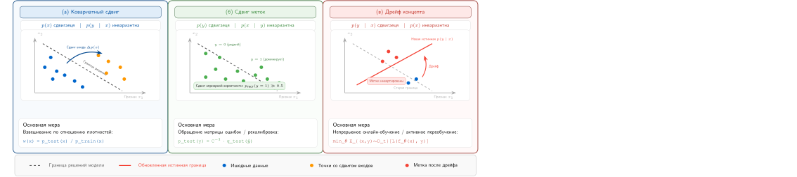

***Типы сдвига распределения:** ковариатный сдвиг меняет $p(x)$ при неизменном $p(y \mid x)$; сдвиг меток меняет $p(y)$ при неизменном $p(x \mid y)$; дрейф концепта меняет $p(y \mid x)$. Различение этих случаев определяет, уместны ли взвешивание, рекалибровка или адаптация модели.*

Эти сдвиги происходят естественно по мере изменения среды. Предпочтения пользователей меняются по сезонам, язык обогащается новым сленгом, а экономические закономерности смещаются вместе с рынком. В отличие от состязательных атак, которым нужен злонамеренный умысел, эти сдвиги возникают органически из динамики реальных систем.

<a id="sec-robust-ai-technical-categories-cc06"></a>

#### Технические категории

Ковариатный сдвиг возникает, когда распределение входов меняется, а связь между входами и выходами остается неизменной (Quiñonero-Candela et al., 2009). Модели восприятия беспилотных автомобилей, обученные на дневных снимках, могут терять точность примерно на 15–30 процентов при развертывании ночью, хотя задача распознавания объектов не меняется; величина зависит от сдвига яркости и характеристик датчика. Погодные условия вносят дополнительный ковариатный сдвиг: дождь, снег и туман, как сообщается, снижают mAP обнаружения объектов примерно на 10–25 процентов по сравнению с базовыми условиями ясной погоды в оценках автономного вождения. Эти числа следует читать как представительные величины из бенчмарков восприятия автономных автомобилей, а не как один цитируемый результат. Изменения среды фактически сдвигают точки данных относительно выученной границы решений ([рисунок](#fig-boundary-shift)), вызывая ошибки классификации без какого-либо изменения самой модели.

<a id="fig-boundary-shift"></a>

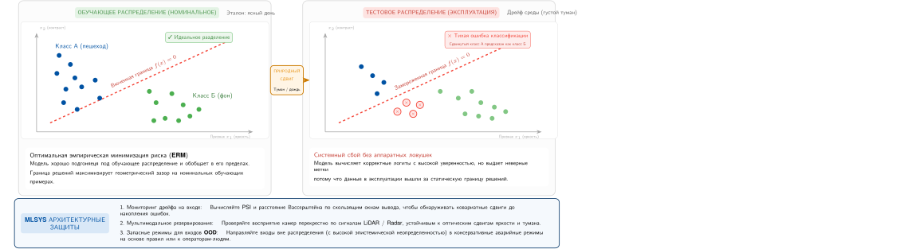

***Граница решений при сдвиге распределения:** изменения среды (например, переход от дня к ночи или от ясной погоды к туману) сдвигают точки данных во входном пространстве. Когда сдвиг переводит точки через выученную границу решений, модель ошибается на входах, с которыми справилась бы в условиях обучения. В отличие от состязательных возмущений, эти сдвиги возникают естественно и затрагивают целые популяции входов, а не отдельные примеры.*

[Рисунок](#fig-boundary-shift) иллюстрирует случай, когда распределения входов смещаются, а истинное отображение $p(y \mid x)$ остается фиксированным. Более коварный вариант возникает, когда само отображение меняется: правильная метка для данного входа сегодня отличается от той, что была во время обучения.

> **Определение: дрейф концепта**
>
> ***Дрейф концепта*** — это подтип сдвига распределения для развернутой модели, при котором статистическая связь $p(y \mid x)$ меняется со временем: граница решений становится неверной, а не просто меняется распределение входов. Его родственник — дрейф данных (см. раздел «Мониторинг в масштабе» главы «Эксплуатация ML-систем в масштабе»), при котором $p(x)$ меняется, а $p(y \mid x)$ остается стабильным.
>
> 1.  **Значимость**: дрейф концепта вызывает тихую деградацию модели, потому что историческое отображение, выученное моделью, перестает отражать текущую реальность. В рамках железного закона (iron law) он сокращает эффективное окно развертывания до переобучения: модели мошенничества, рекомендательные системы и другие модели, зависящие от поведения, могут требовать периодического переобучения или рекалибровки по мере того, как меняются злоумышленники, пользователи и политики. Стоимость исправления может варьироваться от рекалибровки или инкрементального дообучения до полного обучения, поэтому скорость дрейфа влияет на амортизированную стоимость одного предсказания, но не сводит каждую реакцию к цене исходного запуска.
> 2.  **Различие**: при дрейфе данных меняется $p(x)$, а $p(y \mid x)$ остается стабильным, поэтому повторная выборка, взвешивание или рекалибровка могут помочь, но свежие входы сами по себе не гарантируют восстановления качества. Дрейф концепта требует адаптации к новому $p(y \mid x)$, обычно с опорой на недавние наблюдаемые исходы. Поэтому дрейф концепта структурно дороже в исправлении, чем повторная выборка существующего размеченного распределения.
> 3.  **Частая ошибка**: распространено заблуждение, что дрейф концепта можно обнаружить, отслеживая статистику входных признаков. Поскольку $p(x)$ может оставаться полностью неизменным, мониторинг на уровне входов (PSI, KL-дивергенция по признакам) не покажет сигнала. Дрейф концепта можно подтвердить только сравнением предсказаний с наблюдаемыми исходами, что делает его значительно труднее обнаружить в реальном времени и требует контура обратной связи по эталонным меткам, прежде чем можно начать исправление.

Дрейф концепта — это изменение базовой связи между входами и выходами во времени (Widmer и Kubat, 1996). В продакшене это часто проявляется в таких областях, как обнаружение мошенничества или рекомендации, где злоумышленники, сезонные закономерности и предпочтения пользователей меняют связь с метками и вынуждают к периодической рекалибровке или переобучению.

Сдвиг меток возникает, когда маргинальное распределение меток $p(y)$ меняется, а условное распределение входов по классам $p(x \mid y)$ остается фиксированным (Lipton et al., 2018). Во время COVID-19, например, структура больничных случаев и распространенность заболевания менялись быстро, поэтому диагностические модели могли требовать пересмотра порогов, даже когда признаки на изображениях сохраняли то же клиническое значение. Аналогичные сдвиги распространенности классов могут происходить по мере смены сезонов, политик или пользовательских популяций; они требуют рекалибровки или взвешивания, а не предположения, что сама связь признака и метки изменилась.

Модели могут также ошибаться, потому что усвоили неверные уроки из обучающих данных, а не потому что мир изменился. Классический пример — модель, которая учится распознавать «корову» по фону «трава». Когда ей показывают корову на песчаном пляже, она ошибается. Первопричина — **ложная корреляция** (spurious correlation): признак, предсказательный в обучающей выборке, но не связанный с меткой причинно.

Стандартное обучение методом эмпирической минимизации риска (ERM) поощряет такие сокращения, потому что их часто статистически проще выучить, чем устойчивые признаки (форма, текстура). Такие методы, как **групповая распределительно устойчивая оптимизация** (Group Distributionally Robust Optimization, Group DRO), явно смягчают эту проблему, минимизируя *наихудшие потери по группам* (например, коров на песке), а не *средние потери*. Метод требует, чтобы группы были известны или выведены заранее, но когда такие группы доступны, он заставляет модель выучивать признаки, которые работают во всех контекстах.

<a id="sec-robust-ai-monitoring-adaptation-strategies-f305"></a>

### Стратегии мониторинга и адаптации

Мониторинг дрейфа оправдывает себя, только когда превращает сигнал распределения в операционное решение: расследовать, адаптировать, переобучить или продолжать наблюдение.

Статистические метрики расстояния количественно оценивают степень сдвига распределения, измеряя различия между обучающими и эксплуатационными данными. В этом иллюстративном сценарии мониторинга уровня H100 MMD с радиально-базисными ядрами ($\gamma = 1{,}0$) обрабатывает 10 000 выборок за 150 мс; ее чувствительность зависит от модели сдвига и выбора ядра. Тесты Колмогорова — Смирнова могут обнаруживать одномерные сдвиги при выборках от 1 000 и более, но плохо масштабируются на многомерные данные и пропускают совместные изменения, которые сохраняют маргинальные распределения. Сервис в этом примере использует значения PSI[^fn-psi-etymology-statistic] от 0,1 до 0,25 как триггеры расследования, а не как универсальные статистические пороги.

Высокоразмерный и временной трафик требует больше, чем одного скалярного показателя для всего парка. Мониторы отдельных признаков могут оставаться ровными, тогда как корреляции, структура последовательностей или небольшая когорта меняются. Поэтому эксплуатационная схема сочетает дешевые оповещения по каждому признаку с тестами в пространстве эмбеддингов или ядер, срезами по когортам, скользящими окнами нескольких длительностей и проверками точек перелома. Окна должны сохранять сезонность и контекст событий: сравнение трафика понедельника с трафиком воскресенья может создать ложную тревогу, тогда как усреднение за неделю может скрыть внезапный часовой сбой. Дизайн монитора — часть гипотезы, а не нейтральная обертка вокруг модели.

[^fn-psi-etymology-statistic]: **Индекс стабильности популяции (PSI)**: PSI стал распространенным в мониторинге кредитного риска как сравнение эталонной и текущей популяций. Его симметричная логарифмическая формулировка дает удобный скалярный сигнал тревоги для признаков, разбитых на интервалы, однако значение зависит от разбиения на бины, сглаживания, размера выборки и выбранной базовой выборки. PSI может запустить расследование; сам по себе он не показывает, что предсказательная эффективность ухудшилась или что переобучение — правильный ответ.

Как только монитор срабатывает, адаптация становится бюджетируемой реакцией, а не автоматической командой на переобучение. Онлайн-обучение обновляет модель по последовательным наблюдениям (Shalev-Shwartz, 2012); сохранение прежнего поведения остается отдельной задачей проектирования. Бюджет адаптации зависит от размера модели, скорости дрейфа и задержки обратной связи: слишком агрессивное обновление может подстраиваться под шум, а слишком медленное оставляет производительность дрейфовать. В продакшене онлайн-системы обычно явно ограничивают частоту обновлений, размер состояния и задержку обслуживания, а не предполагают, что адаптация ничего не стоит. Такие методы, как эластичная консолидация весов (Elastic Weight Consolidation), уменьшают катастрофическое забывание, штрафуя изменения параметров, важных для предыдущих задач (Kirkpatrick et al., 2017).

Адаптивные ансамблевые методы поддерживают несколько моделей или гипотез и взвешивают их или выбирают между ними по недавней эффективности, что делает их полезными при постепенном дрейфе концепта (Gama et al., 2014). Этот подход обменивает дополнительную сложность обслуживания и мониторинга на способность реагировать, когда одна статическая модель перестает соответствовать распределению развертывания.

Федеративное обучение позволяет распределенно адаптировать модель, когда данные нельзя централизовать по соображениям приватности, регулирования или пропускной способности сети. Тогда адаптация должна перемещаться к данным, и это делает бюджет коммуникации, а не вычисления, связывающим ограничением: каждый раунд передает параметры модели множеству участников, поэтому вопрос проектирования в том, сколько раундов и сколько передачи за раунд система может себе позволить. Механика федеративного обучения описана в [главе «Граничный интеллект»](11_edge_intelligence.md); важный для надежности момент в том, что любой шум приватности, добавляемый для защиты участников (например, через дифференциальную приватность), имеет цену в полезности, которую нужно измерить для конкретного применения, а не считать несущественной.

<a id="sec-robust-ai-quantitative-drift-detection-1e04"></a>

### Количественное обнаружение дрейфа

Количественное обнаружение дрейфа должно отвечать на операционный вопрос: следует ли модели продолжать обслуживание, находиться под более пристальным наблюдением или перейти к расследованию первопричины, которое может оправдать рекалибровку, исправление данных или переобучение. PSI дает дешевый сигнал тревоги по всему парку, который запускает это решение; математические основы ниже показывают, как сервис может калибровать пороги, не принимая их за универсальную политику.

<a id="sec-robust-ai-population-stability-index-psi-077d"></a>

#### Индекс стабильности популяции (PSI)

В разделе «Обнаружение дрейфа» главы «Эксплуатация ML-систем в масштабе» PSI введен как дешевый сигнал тревоги по всему парку, с его происхождением из кредитного скоринга и обычно используемыми условными диапазонами. Полная статистическая механика, стоящая за этим сигналом, определяет, как вычисляется PSI, какие выборы разбиения на бины и сглаживания управляют его чувствительностью и как он сочетается с KL-дивергенцией, тестами значимости и отложенными свидетельствами качества в расследовании. PSI измеряет расхождение между ожидаемым (базовым) распределением $p_{\text{base}}$ и фактическим (текущим) распределением $p_{\text{curr}}$, вычисляя симметричную разность логарифмов отношений по дискретизированным бинам.

Для признака, дискретизированного на $k$ бинов, PSI определяется как:

$$
\text{PSI} = \sum_{i=1}^{k} (p_i - q_i) \times \ln\left(\frac{p_i}{q_i}\right)
$$

где $p_i$ — доля наблюдений в бине $i$ для базового распределения, а $q_i$ — соответствующая доля в текущем распределении. Логарифмический член усиливает большие относительные изменения, тогда как член $(p_i - q_i)$ взвешивает их по абсолютной величине. Команды часто используют условные диапазоны как начальные уровни тревоги, а затем калибруют их по историческим колебаниям и последующей ошибке.

[Таблица](#tbl-robust-ai-psi-thresholds) собирает распространенные диапазоны PSI и рекомендуемое действие на каждом уровне. Эти пороговые диапазоны — конвенции мониторинга, особенно распространенные в практике кредитного скоринга, а не универсальные статистические гарантии; PSI следует интерпретировать вместе с важностью признаков и метриками качества модели на последующих этапах (Yurdakul и Naranjo, 2020).

<a id="tbl-robust-ai-psi-thresholds"></a>

***Иллюстративные пороги оповещения PSI:** распространенные диапазоны индекса стабильности популяции могут задавать начальный уровень серьезности, но каждый сервис должен проверить их на своем разбиении на бины, базовой выборке, размере выборки, предсказательных признаках и стоимости реакции.*

| **Значение PSI**               | **Интерпретация**     | **Рекомендуемое действие** |
|:-------------------------------|:---------------------:|:--------------------------:|
| $\text{PSI} < 0{,}1$           | Пренебрежимый сдвиг   | Продолжить мониторинг      |
| $0{,}1 \le \text{PSI} < 0{,}2$ | Незначительный сдвиг  | Выяснить первопричину      |
| $0{,}2 \le \text{PSI} < 0{,}25$ | Умеренный сдвиг      | Эскалировать расследование |
| **$\text{PSI} \ge 0{,}25$**    | Сильный сдвиг         | Расследовать немедленно    |

Несколько решений по реализации определяют, достаточно ли чувствителен PSI, чтобы быть полезным. Выбор бинов существенно влияет на чувствительность PSI. Для категориальных признаков каждая категория образует естественный бин. Для непрерывных признаков равноширинные бины (обычно 10–20) или квантильные бины дают разные компромиссы: равноширинные бины сохраняют абсолютный масштаб пространства признаков, тогда как квантильные обеспечивают достаточный размер выборки в каждом бине, но могут скрывать сдвиги в хвостах. В продакшене часто используют десять бинов с минимумом 5 процентов наблюдений в каждом для статистической устойчивости.

Когда в одном из распределений у бина нет наблюдений, добавление малой сглаживающей константы (обычно $\epsilon_{\text{smooth}} = 10^{-8}$) предотвращает неопределенные логарифмы и почти не влияет на значение PSI. Индекс у этой константы отделяет численную защиту от радиуса состязательного возмущения $\epsilon$, который вводится позже в главе. Мониторинг индекса стабильности популяции во времени ([рисунок](#fig-distribution-shift-detector)) показывает, когда модель переходит из стабильной (зеленой) зоны в зону предупреждения (оранжевую) и критическую (красную) зону, и запускает путь эскалации, который после корреляции с качеством может привести к переобучению.

<a id="fig-distribution-shift-detector"></a>

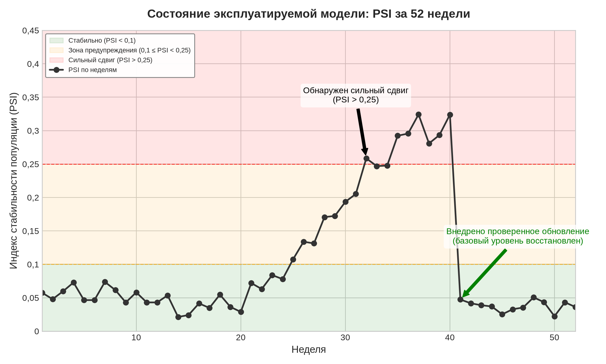

***Калиброванный рабочий процесс обнаружения сдвига распределения:** в этом синтетическом сервисе PSI входит в зону предупреждения по мере того, как поведение пользователей сдвигается, и пересекает порог эскалации на 32-й неделе. Анализ первопричин, офлайн-валидация и выпуск модели предшествуют восстановлению базового уровня на 41-й неделе.*

Этот пороговый путь автоматизирует оповещение, а не исправление. Операторам по-прежнему нужны метки или другие свидетельства исхода, анализ первопричин и оцененная реакция, прежде чем менять модель. Принудительное разбиение непрерывных переменных на бины отбрасывает информацию о форме распределения, что и побуждает к непрерывным метрикам дрейфа.

<a id="sec-robust-ai-kullbackleibler-divergence-64a7"></a>

#### Дивергенция Кульбака — Лейблера

Для непрерывных признаков, где бинирование может терять информацию, **дивергенция Кульбака — Лейблера** (Kullback-Leibler, KL) дает более прямую меру различия распределений. KL-дивергенция от базового распределения $p_{\text{base}}$ к текущему распределению $p_{\text{curr}}$ определяется как:

$$
\mathcal{D}_{\text{KL}}(p_{\text{base}} \lVert p_{\text{curr}}) = \int_{-\infty}^{\infty} p_{\text{base}}(x) \ln\left(\frac{p_{\text{base}}(x)}{p_{\text{curr}}(x)}\right) dx
$$

где $p_{\text{base}}(x)$ и $p_{\text{curr}}(x)$ — плотности вероятности базового и текущего распределений соответственно. В отличие от PSI, KL-дивергенция асимметрична: $\mathcal{D}_{\text{KL}}(p_{\text{base}} \lVert p_{\text{curr}}) \neq \mathcal{D}_{\text{KL}}(p_{\text{curr}} \lVert p_{\text{base}})$. При обнаружении дрейфа обычно вычисляют $\mathcal{D}_{\text{KL}}(\text{базовое} \lVert \text{текущее})$, измеряя, сколько информации теряется, когда текущее распределение используется для аппроксимации базового.

Чтобы устранить асимметрию, практики часто используют дивергенцию Йенсена — Шеннона:

$$
\mathcal{D}_{\text{JS}}(p_{\text{base}} \lVert p_{\text{curr}}) = \frac{1}{2} \mathcal{D}_{\text{KL}}(p_{\text{base}} \lVert p_{\text{mix}}) + \frac{1}{2} \mathcal{D}_{\text{KL}}(p_{\text{curr}} \lVert p_{\text{mix}})
$$

где $p_{\text{mix}} = \frac{1}{2}(p_{\text{base}} + p_{\text{curr}})$ — смесь распределений. **Дивергенция Йенсена — Шеннона** ограничена сверху значением $\ln(2)$ (примерно 0,693), что делает выбор порога интуитивнее, чем для неограниченной KL-дивергенции.

Для рабочего примера мониторинга мошенничества [таблица](#tbl-kl-divergence-thresholds) задает начальные диапазоны оповещения по KL, которые команда проверит на своем историческом трафике.

<a id="tbl-kl-divergence-thresholds"></a>

***Калиброванные для сценария диапазоны оповещения по KL:** рабочий сервис мошенничества использует эти значения, чтобы назначить серьезность мониторинга, а не чтобы запускать переобучение. Другой признак, оценщик плотности или модель последствий потребуют иной калибровки.*

| **Значение $\mathcal{D}_{\text{KL}}$**        | **Интерпретация**       |
|:----------------------------------------------|:-----------------------:|
| **$\mathcal{D}_{\text{KL}} < 0{,}05$**        | Минимальная дивергенция |
| **$0{,}05 \le \mathcal{D}_{\text{KL}} < 0{,}1$** | Умеренная дивергенция |
| **$\mathcal{D}_{\text{KL}} \ge 0{,}1$**       | Существенная дивергенция |

Для практического вычисления ядерная оценка плотности с гауссовыми ядрами дает гладкие аппроксимации плотностей, пригодные для интегрирования. Однако вычислительная стоимость растет как $\mathcal{O}(n^2)$ по $n$ выборкам, поэтому для больших наборов данных необходима выборка.

<a id="sec-robust-ai-statistical-significance-testing-dfde"></a>

#### Проверка статистической значимости

PSI и KL-дивергенция показывают, насколько велико распределительное изменение, тогда как статистические проверки гипотез отвечают на дополняющий вопрос: превышает ли наблюдаемое различие шум выборки. Двухвыборочный тест Колмогорова — Смирнова (KS) (Berger и Zhou, 2014) сравнивает эмпирические функции распределения (CDF) двух выборок без предположения о каком-либо параметрическом виде. Статистика теста:

$$
D_{n,m} = \sup_x |F_n(x) - G_m(x)|
$$

где $F_n$ и $G_m$ — эмпирические CDF выборок размера $n$ и $m$ соответственно. Нулевая гипотеза (отсутствие различия распределений) отвергается, когда:

$$
D_{n,m} > c(\alpha) \sqrt{\frac{n + m}{nm}}
$$

где $c(\alpha)$ зависит от уровня значимости (например, $c(0{,}05) \approx 1{,}36$). Тест KS особенно эффективен для обнаружения сдвигов положения (среднего) и разброса (дисперсии), но хуже чувствителен к изменениям формы распределения.

Для категориальных признаков **критерий согласия хи-квадрат** (Chi-Square Goodness-of-Fit Test) сравнивает наблюдаемые частоты с ожидаемыми при базовом распределении:

$$
\chi^2 = \sum_{i=1}^{k} \frac{(n_i^{\text{obs}} - n_i^{\text{exp}})^2}{n_i^{\text{exp}}}
$$

где $n_i^{\text{obs}}$ — наблюдаемое число в категории $i$, а $n_i^{\text{exp}}$ — ожидаемое число по базовому распределению. При $k-1$ степенях свободы нулевая гипотеза отвергается, когда $\chi^2$ превышает критическое значение для уровня значимости $\alpha$.

Когда отслеживается много признаков одновременно, проверка значимости должна также учитывать повторные сравнения. Поправка Бонферрони (деление $\alpha$ на число тестов) или контроль частоты ложных открытий (FDR) предотвращают избыточные ложные тревоги. Для $m$ признаков при уровне значимости $\alpha = 0{,}05$ поправка Бонферрони требует, чтобы каждый тест давал $p < 0{,}05/m$ для признания значимости.

<a id="sec-robust-ai-worked-example-production-fraud-detection-model-b25b"></a>

#### Разбор: модель обнаружения мошенничества в продакшене

Рассмотрим модель обнаружения мошенничества, обслуживающую платформу электронной коммерции, с двумя ключевыми входными признаками: страной пользователя (категориальный) и суммой транзакции (непрерывный). Через шесть месяцев в продакшене команда эксплуатации подозревает дрейф распределения и должна решить, нужно ли переобучение.

##### Шаг 1: анализ категориальных признаков

[Таблица](#tbl-psi-country-example) сравнивает базовое (обучающее) и текущее (продакшен) распределения для четырех названных стран и группы «Прочие».

<a id="tbl-psi-country-example"></a>

***Декомпозиция PSI по признаку «страна»:** вклад каждой страны в общий PSI для признака «страна пользователя» в продакшен-модели обнаружения мошенничества. Группа «Прочие» дает основную часть расхождения (0,0470 из общего значения 0,065), что отражает рост трафика вне США, Великобритании, Германии и Франции за шесть месяцев в продакшене.*

| **Страна**    | **Базовое ($p_i$)** | **Текущее ($q_i$)** | **$p_i - q_i$** | **$\ln(p_i/q_i)$** | **Вклад** |
|:--------------|:-------------------:|:-------------------:|:---------------:|:------------------:|:---------:|
| США           | 0,45                | 0,38                | 0,07            | 0,169              | 0,0118    |
| Великобритания | 0,20               | 0,18                | 0,02            | 0,105              | 0,0021    |
| Германия      | 0,15                | 0,14                | 0,01            | 0,069              | 0,0007    |
| Франция       | 0,10                | 0,12                | −0,02           | −0,182             | 0,0036    |
| Прочие        | 0,10                | 0,18                | −0,08           | −0,588             | 0,0470    |

Сложив вклады по странам, получаем $\text{PSI}_{\text{страна}} = 0{,}0118 + 0{,}0021 + 0{,}0007 + 0{,}0036 + 0{,}0470 = 0{,}065$.

PSI, равный 0,065, остается внутри калиброванной базы этого сервиса для признака «страна», поэтому сам по себе этот признак не эскалирует текущее расследование.

##### Шаг 2: анализ непрерывных признаков

Для признака суммы транзакции (логарифмированного для нормальности) вычислим KL-дивергенцию с помощью оценки плотности ядрами:

- Базовое распределение: $\mu = 4{,}2$, $\sigma = 1{,}1$ (логарифм суммы в долларах)
- Текущее распределение: $\mu = 4{,}5$, $\sigma = 1{,}3$ (логарифм суммы в долларах)

Для приблизительно гауссовых распределений KL-дивергенция имеет замкнутое решение:

$$
\mathcal{D}_{\text{KL}} = \ln\frac{\sigma_{\text{curr}}}{\sigma_{\text{base}}} + \frac{\sigma_{\text{base}}^2 + (\mu_{\text{base}} - \mu_{\text{curr}})^2}{2\sigma_{\text{curr}}^2} - \frac{1}{2}
$$

Замкнутое решение дает $\mathcal{D}_{\text{KL}} = \ln\frac{1{,}3}{1{,}1} + \frac{1{,}30}{3{,}38} - 0{,}5 = 0{,}167 + 0{,}385 - 0{,}5 = 0{,}052$. KL-дивергенция, равная 0,052, указывает на умеренный дрейф, который требует дальнейшего расследования, но не немедленного переобучения.

##### Шаг 3: статистическая значимость по критерию KS

Применяем тест KS к 10 000 базовых выборок и 10 000 текущих выборок для суммы транзакции:

$$
D_{10000,10000} = 0{,}089
$$

Критическое значение при $\alpha = 0{,}05$: $c(0{,}05) \sqrt{\frac{20000}{10^8}} \approx 0{,}019$.

Поскольку наблюдаемая статистика 0,089 превышает критическое значение 0,019, различие статистически значимо $(p < 0{,}001)$. Однако *статистическая значимость* сама по себе не предписывает переобучения: *практическая значимость* (значения PSI и KL) предполагает мониторинг, а не немедленное действие.

##### Шаг 4: применение схемы решения

[Таблица](#tbl-retraining-decision-matrix) объединяет количественные свидетельства.

<a id="tbl-retraining-decision-matrix"></a>

***Матрица решений по мониторингу мошенничества:** объединенные количественные свидетельства для этого рабочего сценария, сравниваемые с порогами, калиброванными по историческому трафику и пропускной способности проверки. Статистическая значимость без подтвержденного эффекта на качество усиливает мониторинг, а не требует переобучения.*

| **Метрика**                             | **Значение** |  **Порог**      | **Уровень действия** |
|:----------------------------------------|:------------:|:---------------:|:--------------------:|
| **PSI (страна)**                        | 0,065        | $< 0{,}1$       | Мониторинг           |
| **$\mathcal{D}_{\text{KL}}$ (сумма)**   | 0,052        | $< 0{,}1$       | Мониторинг           |
| **Критерий KS**                         | $p < 0{,}001$ | $\alpha = 0{,}05$ | Значимо            |

Решение: продолжать мониторинг этой модели мошенничества с повышенной частотой (еженедельно вместо ежемесячного). Превышение порога PSI или KL для сценария запускает анализ первопричин. Обновление модели становится кандидатом, только если отложенные метки показывают деградацию сверх проверенного допуска команды и расследование выявляет сдвиг, который может устранить переобучение. Числовые границы относятся к этому рабочему сервису; другая модель должна калибровать собственные пороги по базовой вариации, последствиям сбоев и пропускной способности реагирования.

<a id="sec-robust-ai-retraining-decision-framework-68e3"></a>

#### Схема решений о переобучении

Систематическая схема решений объединяет метрики дрейфа с мониторингом качества, чтобы определить оптимальное время переобучения. Три уровня ниже намеренно разделяют обнаружение, корреляцию и действие, чтобы оповещения по метрикам не превращались в автоматические команды переобучения.

<a id="sec-robust-ai-level-1-automated-monitoring-e418"></a>

##### Уровень 1: автоматизированный мониторинг

Для этого сценария мониторинга мошенничества команда настраивает три порога расследования по своей исторической базе:

- $\text{PSI} > 0{,}1$ по любому признаку высокой важности
- $\mathcal{D}_{\text{KL}} > 0{,}05$ по непрерывным признакам
- $p$-значение теста KS $< 0{,}01$ с поправкой Бонферрони

<a id="sec-robust-ai-level-2-performance-correlation-9708"></a>

##### Уровень 2: корреляция с качеством

Когда срабатывает одно из этих калиброванных для сценария оповещений, три корреляции с качеством направляют расследование:

- Если деградация качества превышает проверенный допуск сервиса и совпадает с дрейфом: выявить затронутые срезы и проверить, устраняет ли причину рекалибровка, исправление данных или переобучение
- Если дрейф обнаружен, а качество стабильно: продолжить мониторинг, расследовать источник дрейфа
- Если качество деградирует без обнаруженного дрейфа: расследовать дрейф концепта или сдвиг меток

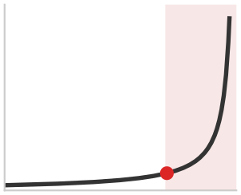

*Калиброванная для сервиса точка перегиба, где растет срочность расследования; это не универсальная граница PSI.*

<a id="sec-robust-ai-level-3-retraining-vs-investigation-4338"></a>

##### Уровень 3: переобучение или расследование

Не весь дрейф требует переобучения. [Таблица](#tbl-robust-ai-retraining-decision-rules) отделяет немедленное исправление от расследования и продолжения мониторинга.

<a id="tbl-robust-ai-retraining-decision-rules"></a>

***Правила решения о переобучении:** реакция на дрейф зависит от силы статистического сигнала, наблюдаемого изменения качества и внешних свидетельств того, действительно ли изменилась среда.*

| **Действие**             | **Условия срабатывания**                                                                                                                                                                  | **Логика реакции**                                                                                                               |
|:-------------------------|:------------------------------------------------------------------------------------------------------------------------------------------------------------------------------------------|:---------------------------------------------------------------------------------------------------------------------------------|
| **Обновить модель**      | Качество выходит за проверенный допуск ошибки, метки подтверждают сдвиг, анализ первопричин показывает, что обновление модели его устраняет, а офлайн- и теневая оценка проходит ворота выпуска | Свидетельства указывают, что рекалибровка или переобучение — подходящая реакция, а не простая регистрация изменения популяции     |
| **Сначала расследовать** | Оповещение о дрейфе по калиброванному для сценария порогу срабатывает при стабильном качестве, сдвиг локализован в непредсказательных признаках или правдоподобно сезонное либо разовое событие | Сигнал оправдывает диагностику, но не заранее заданное исправление                                                               |
| **Продолжать мониторинг** | Статистики дрейфа остаются в пределах калиброванной базы сервиса, качество в допуске, а внешних свидетельств изменения среды нет                                                       | Свидетельств пока недостаточно для изменения модели, но базовый уровень остается под наблюдением                                 |

Количественная схема превращает обнаружение дрейфа из реактивного устранения неполадок в проактивное сопровождение модели, позволяя системам ML сохранять надежность по мере эволюции эксплуатационной среды (Gama et al., 2014). Ни один диапазон PSI не является универсальным правилом переобучения: большой сдвиг в непредсказательном признаке может быть безвреден, тогда как небольшой сдвиг в критичной для безопасности подгруппе может требовать немедленного сдерживания.

<a id="sec-robust-ai-selective-prediction"></a>

### Компетентность на уровне запроса и селективное предсказание

Мониторинг популяции отвечает на вопрос, изменился ли трафик в целом. Система обслуживания сталкивается с другим решением на каждом запросе: находится ли этот конкретный вход в пределах продемонстрированной компетенции модели и должна ли система действовать по своему предсказанию. Стабильный дневной PSI может сосуществовать с редким и опасным запросом вне распределения, тогда как большой сдвиг популяции может оставить отдельные предсказания хорошо обоснованными. Поэтому надежности парка нужны и мониторы популяции, и контракт решения на уровне запроса.

Контракт объединяет три сигнала. **Калибровка** (calibration) проверяет, соответствует ли оценка 0,8 примерно 80-процентной правильности на определенной валидационной популяции (Guo et al., 2017). **Обнаружение входов вне распределения** (out-of-distribution, OOD) оценивает, насколько запрос отличается от валидированного входного распределения модели (Hendrycks и Gimpel, 2017). **Селективное предсказание** (selective prediction) превращает эти сигналы в политику действий: отвечать выше порога приемлемости, направлять неуверенные случаи более сильной модели или рецензенту и воздерживаться, когда ни один путь не может удовлетворить границу риска. Ни один из трех не заменяет остальные: откалиброванный классификатор может оставаться уверенно ошибочным на входах OOD, а детектор OOD может пометить новизну, не оценив ошибку задачи.

Для принятого множества $A_\tau = \{x : s(x) \ge \tau\}$ при пороге $\tau$ покрытие равно $\Pr(x \in A_\tau)$, а селективный риск — это средние потери при условии принятия:

$$
\operatorname{coverage}(\tau)=\Pr(x\in A_\tau), \qquad
\operatorname{risk}(\tau)=\mathbb{E}[\ell(f(x),y)\mid x\in A_\tau].
$$

Перебор $\tau$ дает кривую «риск — покрытие», а не одно число точности. Повышение порога обычно снижает риск принятых запросов за счет уменьшения покрытия, но отклоненный трафик никуда не исчезает. Путь запасного варианта нуждается в достаточной емкости очереди, рецензентов или вторичной модели, чтобы поглотить долю воздержаний в рамках исходных бюджетов задержки и безопасности. Если метки приходят через несколько дней, система может сразу отслеживать оценки и нагрузку на запасной путь, но не может подтвердить селективный риск, пока не вернутся исходы. В течение этой задержки ограничения частоты, консервативные пороги и безопасное значение по умолчанию ограничивают подверженность риску.

<a id="sec-robust-ai-conformal-coverage"></a>

#### Конечновыборочное покрытие с конформным предсказанием

Калибровка описывает, соответствуют ли предсказанные вероятности эмпирическим частотам; селективное предсказание выбирает, на какие запросы система будет отвечать. **Конформное предсказание** (conformal prediction) задает другой контракт: оно оборачивает обученный предиктор мерой неконформности $s(x,y)$ и отложенным калибровочным набором. Для $n_{\mathrm{cal}}$ калибровочных оценок, отсортированных по возрастанию, положим $k=\min\{\lceil(n_{\mathrm{cal}}+1)(1-\alpha)\rceil,n_{\mathrm{cal}}\}$ и $\widehat q_{1-\alpha}=s_{(k)}$. Множество предсказаний:

$$
C_\alpha(x)=\{y:s(x,y)\leq \widehat q_{1-\alpha}\}, \qquad
\Pr\!\left(Y_{n+1}\in C_\alpha(X_{n+1})\right)\geq 1-\alpha.
$$

Для обменяемых калибровочных и тестовых примеров поправка на ранг $(n_{\mathrm{cal}}+1)$ делает эту гарантию конечновыборочной *маргинальной*: на повторяющихся примерах множество содержит истинный исход не реже целевой доли (Lei et al., 2018). Использование обычного эмпирического $(1-\alpha)$-квантиля вместо этого может давать недопокрытие при конечных размерах выборки. Гарантия не условна для каждого входа или подгруппы. Редкая подгруппа может иметь плохое покрытие, даже когда совокупное покрытие корректно, особенно если она вносит мало калибровочных примеров.

Системное обязательство — сохранить условия, на которых держится гарантия. Сдвиг распределения или устаревший калибровочный набор нарушают аргумент об обменяемости, а повторная настройка модели, оценки или порога по одним и тем же калибровочным исходам делает проверочные свидетельства адаптивными, а не независимыми. Поэтому продакшен-системы версионируют предиктор, оценку, снимок калибровки и целевое $\alpha$ вместе; отслеживают реализованное покрытие по значимым срезам, когда появляются метки; и обновляют или изолируют контракт при изменении трафика. Конформализация не защищает от произвольного сдвига.

Размер множества или ширина интервала дают сигнал операционной нагрузки. Более крупные выходы означают менее конкретные предсказания и могут запускать воздержание, более сильную модель или проверку человеком, поэтому их хвостовое распределение определяет емкость запасного пути так же, как кривая «риск — покрытие» определяет долю отклоненного трафика. Целевое покрытие, таким образом, не бесплатно: его увеличение обычно расширяет множества, повышает спрос на проверку или снижает долю запросов, по которым система может действовать автоматически.

<a id="sec-robust-ai-robustness-generative-ai-941b"></a>

### Надежность генеративного ИИ

LLM смещают поверхность отказа от неверной классификации к семантической надежности: бегло написанный ответ может быть фактически необоснованным, при этом система выглядит здоровой. Исходный вопрос о надежности классификатора был таким: меняется ли метка при возмущении. Генеративная версия спрашивает, сохраняет ли открытый результат фактичность, политические ограничения и намерение задачи при вариации промпта. Оценки в специализированных областях, таких как юридические или медицинские консультации, показывают, что частота галлюцинаций сильно зависит от модели, контекста извлечения, дизайна промпта и температуры сэмплирования. Энтропия токенов и логарифм вероятности могут выявить нестабильность генерации, но ни один из них не является оценкой фактичности. Модель может назначить высокую вероятность ложному утверждению, выученному из данных, или низкую — правильному, но редкому утверждению. Поэтому маршрутизация в продакшене должна калибровать эти сигналы по ошибкам конкретной задачи и сочетать их с проверками доказательств, опорой на извлеченные данные или внешней верификацией.

**Самосогласованность** (self-consistency) выбирает несколько путей рассуждения или ответов на один и тот же запрос. Расхождение дает сигнал нестабильности, который может направить запрос на проверку; согласие дает более слабое свидетельство, потому что коррелированные выборки могут повторять одно и то же заблуждение или необоснованное утверждение. Энтропия на уровне последовательности имеет то же ограничение: она может служить откалиброванным признаком маршрутизации для названной задачи, но не превращает неопределенность в правдивость. Контракт эксплуатации должен измерять ошибку при условии оценки маршрутизации и обеспечивать путь отказа, извлечения, инструментов или человека, который получает помеченные генерации.

В архитектурах генерации с дополнением извлеченными данными (retrieval-augmented generation, RAG; см. [главу «Инференс в масштабе»](10_inference.md)) надежность сильно зависит от качества извлеченного контекста. **Шум извлечения** (retrieval noise), то есть внедрение нерелевантных или противоречивых документов в промпт, может отвлечь модель, заставив ее игнорировать внутренние параметрические знания и распространять ошибки из контекста. Надежные RAG-развертывания могут использовать модели переранжирования и верификаторы контекста, чтобы отфильтровать шум до этапа генерации.

Генеративные модели сталкиваются также с особой угрозой — **инъекцией промпта** (prompt injection), при которой злоумышленник встраивает инструкции во входные данные, чтобы переопределить системный промпт модели. Хотя ее часто рассматривают как проблему безопасности в [главе «Безопасность и приватность»](13_security_privacy.md), инъекция промпта в равной мере является сбоем надежности: модель, которую можно легко подтолкнуть к игнорированию поведенческих ограничений, не смогла сохранить инварианты выхода при состязательном входе. Распространенный паттерн развертывания — добавить **выходные ограничители** (output guardrails): легковесные классификаторы, которые сканируют сгенерированный текст на нарушения политики, токсичность или логические ошибки до возврата ответа пользователю. Этот финальный шаг проверки помогает сохранить надежность всей системы, даже если основная модель попадает в режим отказа.

Хотя инъекция промпта использует языковую гибкость генеративных моделей, она представляет собой мост между естественными сдвигами среды и преднамеренной состязательной манипуляцией. Взаимодействие работает в обе стороны: сами системы мониторинга распределения могут быть использованы злоумышленниками, которые создают входы, обходящие пороги дрейфа, превращая защитный инструмент в слепую зону. Когда противник перестает полагаться на естественный дрейф и начинает целенаправленно восстанавливать границы решений модели, чтобы вызвать конкретные ошибки, угроза переходит из области устойчивости к среде в строго математическое поле входных атак.

> **Контрольные вопросы: обнаружение дрейфа и решение о переобучении**
>
> Изменения среды делятся на отдельные типы, а схема дрейфа в этой главе намеренно отделяет сработавший показатель от команды на переобучение.
>
> *Различение типа сдвига*
>
> - **Таксономия сдвигов**: различайте ковариатный сдвиг, сдвиг меток и дрейф концепта по тому, какую вероятность затрагивает изменение, и объясните, почему мониторинг статистик признаков остается молчаливым при чистом дрейфе концепта.
> - **Ложная корреляция**: определите сбой в сценарии «корова на пляже», где мир не изменился, а модель усвоила неверный урок, и объясните, почему стандартная эмпирическая минимизация риска этому способствует.
>
> *Рассуждение о порогах и стоимости*
>
> - **Суждение о порогах**: выберите переобучение, расследование или продолжение мониторинга для признака высокой важности, индекс стабильности популяции которого находится в диапазоне сильного сдвига, при неизменных точности и полноте.
> - **Асимметрия стоимости**: объясните, почему дрейф концепта структурно дороже в исправлении, чем дрейф данных, даже при таком же объеме свежих данных.

<a id="sec-robust-ai-inputlevel-attacks-model-robustness-d6ea"></a>
## Входные атаки и устойчивость модели

Добавление микроскопического, математически рассчитанного слоя шума к изображению доброкачественного кожного образования — шума настолько слабого, что дерматолог его не видит, — заставляет промышленную диагностическую модель поставить диагноз «злокачественное» с уверенностью 99,9 процента. Многомерные границы решений, которые выучивают глубокие нейронные сети, имеют контринтуитивные слепые зоны, которыми злоумышленники могут сознательно воспользоваться. Практический вопрос в том, что атакующий может видеть или контролировать: градиенты, запросы, физические датчики или обучающие данные. Состязательные атаки обнажают эти слепые зоны.

<a id="sec-robust-ai-adversarial-attacks-481c"></a>
### Состязательные атаки

> **Определение: состязательная атака**

> ***Состязательная атака*** — это целенаправленное воздействие на вход модели, на ее взаимодействие или на среду, рассчитанное на нарушение заданной поведенческой цели. Воздействие может быть ограничено по норме и визуально незаметным, но может быть и семантическим, физическим, основанным на запросах или откровенно заметным.

> 1. **Значимость**: состязательная оценка проверяет, может ли атакующий подобрать входные данные или преобразования, которые выводят модель за пределы ее предполагаемой области поведения. Возмущения изображений с ограниченной нормой — один важный случай, но патчи, повороты, напечатанные объекты, вредоносный текст и повторные запросы в режиме «черного ящика» выявляют другие границы системы.
> 2. **Различие**: в отличие от случайного искажения, выбранного независимо от цели, состязательное воздействие подбирается так, чтобы вызвать отказ. Градиенты для этого не обязательны: атакующие могут использовать суррогатные модели, решения, видимые только по запросам, поиск, семантические правки или контроль над средой физического восприятия.
> 3. **Частая ловушка**: распространено заблуждение, что уязвимость к состязательным атакам — это «ошибка», которую можно исправить. На самом деле это структурная уязвимость многих стандартных нейронных сетей, обученных минимизацией эмпирического риска; устойчивая защита обычно требует фундаментальных изменений целевой функции (например, состязательного обучения).

Категории состязательных атак кодируют доступ и стоимость. Атакующий с доступом «белого ящика» может использовать градиенты напрямую, атакующий «черного ящика» опирается на перенос атаки, а физический атакующий должен пережить камеры, освещение и расстояние. [Рисунок](#fig-adversarial-attack-noise-example) показывает общий механизм: малые, тщательно сконструированные возмущения входных данных могут вызвать ошибку классификации с высокой уверенностью; возмущения незаметны для человеческого глаза, но губительны для точности модели.

<a id="fig-adversarial-attack-noise-example"></a>


***Состязательное возмущение:** тонкий, намеренно сконструированный шум может заставить нейронные сети ошибочно классифицировать изображения с высокой уверенностью и выявить уязвимости устойчивости модели. Эти возмущения, незаметные для человека, меняют вход так, чтобы максимизировать ошибку предсказания, и подчеркивают необходимость защиты от состязательных атак.*


Эффективность этих атак восходит к фундаментальному расхождению между человеческим и машинным восприятием.[^fn-perception-gap-adversarial] Нейронные сети проводят нелинейные границы решений в многомерном пространстве признаков, и состязательные возмущения используют геометрию этих границ: множество входных измерений дает атакующему множество направлений, по которым можно давить одновременно, поэтому изменение, незаметное в любом отдельном измерении, все же может пересечь границу.

[^fn-perception-gap-adversarial]: **Человек и машина: восприятие**: на этот разрыв впервые указали Szegedy et al. (2013). Нейронные сети выучивают статистические корреляции в пространстве пикселей, а не семантические инварианты, которые обеспечивает человеческое зрение. Разрыв — не ошибка, которую можно исправить, а структурное следствие градиентной оптимизации на конечных обучающих данных: модель находит границы решений, минимизирующие эмпирический риск, а состязательные возмущения используют обширные области входного пространства, которые эти границы оставляют без защиты.

<a id="sec-robust-ai-attack-categories-mechanisms-fed5"></a>
#### Категории атак и механизмы

Полезна не сама по себе атака, а доступ атакующего. Каждый механизм выявляет свою стоимость, которую защита должна поднять: доступ к градиентам, время оптимизации, построение суррогатной модели или физический контроль над средой датчиков.

Самый прямой случай — доступ к градиентам в режиме «белого ящика». Нейронные сети вычисляют градиенты, чтобы понять, как изменения параметров уменьшают функцию потерь; атакующий с доступом к градиентам может применить ту же логику ко входу. Для классификатора изображений, который верно распознал кошку, градиент по входному изображению показывает, какие попиксельные изменения сильнее всего увеличили бы ошибку предсказания. **Метод быстрого знакового градиента (FGSM)**[^fn-fgsm-adversarial-attack] превращает эту идею в атаку за один шаг: каждый входной признак смещается в направлении, которое быстрее всего увеличивает потери.

[^fn-fgsm-adversarial-attack]: **Метод быстрого знакового градиента (FGSM)**: предложенный Goodfellow et al. (2015) на ICLR, FGSM строит состязательные образцы за один градиентный шаг, что делает его практичным для использования в ходе обучения. Эта двойная роль определяет его долговременное значение для систем: та же атака, которая выявила хрупкость нейронных сетей, стала простым примитивом состязательного обучения, в котором возмущения, построенные FGSM, дополняют чистые батчи примерами, выбранными для роста потерь.

Лежащая в основе математическая формулировка выражает эту интуитивную процедуру:

$$
x_{\text{adv}} = x + \epsilon \cdot \text{sign}\big(\nabla_x \mathcal{L}(\theta, x, y)\big)
$$

где:

- $x$ — исходный вход;
- $x_{\text{adv}}$ — состязательный образец;
- $\mathcal{L}(\theta, x, y)$ — функция потерь предсказания;
- $\nabla_x \mathcal{L}$ определяет изменения входа, которые сильнее всего увеличивают эти потери;
- $\text{sign}(\cdot)$ сохраняет только направление наискорейшего подъема;
- $\epsilon$ задает, какое возмущение атакующему разрешено добавить.

[Рисунок](#fig-gradient-attack) показывает, как этот подход строит состязательные образцы: одним шагом в направлении, которое наиболее быстро увеличивает потери, при этом величина возмущения в норме $\ell_\infty$ ограничена значением $\epsilon$.

<a id="fig-gradient-attack"></a>

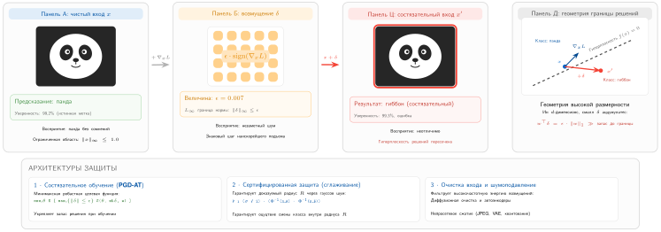

***Механизм атаки на основе градиента:** метод быстрого знакового градиента (FGSM) и родственные градиентные атаки создают тонкий входной шум, величина которого задается $\epsilon$ и который максимизирует функцию потерь $\mathcal{L}(\theta, x, y)$ и вынуждает ошибку классификации. Возмущение сдвигает вход $x$ через выученную границу решений. Источник: адаптировано из руководства по градиентным атакам на defence.AI.*


FGSM дешев, потому что делает один шаг. **Атака проецированным градиентным спуском (PGD)** (Madry et al., 2018) тратит больше вычислений на более сильную атаку: она многократно применяет градиентные обновления и после каждого шага проецирует результат обратно в допустимый шар нормы вокруг исходного входа. Такое итеративное уточнение делает PGD стандартным эталоном устойчивости в режиме «белого ящика». **Атака на основе карты значимости Якобиана (JSMA)** (Papernot et al., 2016) использует якобиан, чтобы найти наиболее влиятельные входные признаки, и изменяет меньший набор измерений в сторону целевого класса. Эти методы наиболее эффективны в условиях «белого ящика»,[^fn-white-box-robustness] когда атакующий знает архитектуру модели и ее градиенты.

[^fn-white-box-robustness]: **Атака в режиме «белого ящика»**: состязательная атака при полном знании модели (архитектура, веса, градиенты). Такие методы, как PGD и атака Карлини — Вагнера (C&W), сильны, потому что оптимизируют непосредственно против модели, а не зондируют ее извне. Хотя для многих развернутых систем такой сценарий менее реалистичен, чем сценарий «черного ящика», анализ в режиме «белого ящика» задает жесткий эталон в заданной норме, при заданном бюджете возмущений и заданной процедуре атаки. Прохождение PGD — свидетельство для данной модели угроз, а не универсальная гарантия против каждой более слабой атаки.

Когда атакующего заботит не скорость, а незаметность, атака превращается в задачу оптимизации. Атака Карлини и Вагнера (C&W)[^fn-cw-attack-optimization] (Carlini и Wagner, 2017) ищет наименьшее возмущение, которое вызывает ошибку классификации и при этом сохраняет перцептивное сходство с исходным входом. Вместо того чтобы просто следовать знаку градиента, C&W оптимизирует собственную целевую функцию, которая уравновешивает размер возмущения и уверенность в неверном ответе.

[^fn-cw-attack-optimization]: **Атака Карлини — Вагнера (C&W)**: предложена в 2016 году (опубликована в IEEE S&P 2017). C&W формулирует построение состязательных образцов как задачу условной оптимизации, которая находит минимальное возмущение, вызывающее ошибку классификации. Ее значение методологическое: C&W сломала дефенсивную дистилляцию (раннюю защиту, которая маскировала градиенты, чтобы ослабить более слабые атаки) и несколько других защит, устоявших против FGSM и PGD. Это закрепило принцип: заявления о надежности нужно проверять против атак на основе оптимизации, а не только эвристик по знаку градиента.

Атаки C&W трудно обнаружить, потому что возмущения обычно незаметны для человека и могут оптимизироваться при разных ограничениях нормы, например $\ell_2$ или $\ell_\infty$. **Атака Elastic Net на DNN (EAD)** добавляет регуляризацию elastic net, сочетая штрафы $\ell_1$ и $\ell_2$, чтобы получать разреженные локализованные возмущения. Эти методы на основе оптимизации вычислительно тяжелее атак по знаку градиента, но дают атакующему более тонкий контроль над геометрией состязательного образца.

Атакующие в режиме «черного ящика» теряют прямой доступ к градиентам, но все еще могут использовать переносимость.[^fn-transferability-blackbox-attack] **Переносимость** — это явление, при котором состязательные образцы, построенные для одной модели, могут обмануть другие модели, даже если архитектуры или обучающие наборы различаются. Атакующий может обучить или получить суррогатную модель, построить атаки офлайн, а затем передать полученные образцы целевому API, ни разу не увидев его весов или градиентов.

[^fn-transferability-blackbox-attack]: **Переносимость**: свойство, проанализированное в Papernot et al. (2016): состязательные образцы, построенные для одной модели, могут обмануть модели другой архитектуры. Это меняет модель угроз для развернутых систем ML: атакующим не нужно видеть веса целевой модели. Они могут локально обучить замещающую модель, построить атаки офлайн и перенести их на промышленные API. Ансамблевое состязательное обучение обучает модель на возмущениях, построенных по нескольким моделям, чтобы повысить устойчивость к переносу, но дополнительная генерация атак и разнообразие моделей делают его осознанным решением о бюджете обучения, а не бесплатной мерой защиты (Tram\`{e}r et al., 2017).

Успех переноса зависит от сходства моделей, пересечения обучающих данных и регуляризации. Атакующие могут улучшить перенос, используя разнообразие входов, например случайное изменение масштаба или обрезку, и импульс при оптимизации. Эта модель угроз особенно важна для коммерческих API, где атакующий видит входы и выходы, но не внутренние вычисления.


*Один суррогатный состязательный образец переносится на множество моделей.*

Атакующие в физическом мире сталкиваются с самым жестким ограничением: возмущение должно пережить датчики, расстояние, освещение, угол обзора и обычные вариации эксплуатации. Состязательные патчи — это напечатанные рисунки, которые размещают на объектах, чтобы камеры и детекторы неверно читали сцену. Измененные дорожные знаки, нашивки на одежду и напечатанные на 3D-принтере объекты переносят атаку из цифрового входного тензора в физическую среду. Это делает вопрос устойчивости операционным, а не только математическим: защита, которая работает на сохраненном изображении, может не сработать, когда атака проходит через объектив камеры, сжатие, размытие движением и меняющееся освещение. Эти угрозы важнее всего для систем ИИ, развернутых в физическом пространстве, например в автономных транспортных средствах, дронах и системах наблюдения, где ошибка модели становится проблемой безопасности, ответственности и подотчетности в реальном мире.

> **Пример: атака на знак «Стоп»**
>
>
> **Сценарий**: физические состязательные патчи (черно-белые наклейки на знаке «Стоп») атакуют модель технического зрения автономного автомобиля (Eykholt et al., 2018).
>
> **Диагноз**: физические возмущения переживают шум датчиков, углы съемки, изменения расстояния (до 30 футов) и вариации освещения и заставляют детектор принять знак «Стоп» за знак ограничения скорости 45 миль в час.
>
> **Системный урок**: устойчивость нужно проверять на полном физическом контуре датчиков, а не только на цифровых эталонных изображениях. Стеки восприятия, критичные для безопасности, требуют пространственно-временной проверки и слияния данных датчиков, чтобы предотвратить физические атаки одним патчем.
>


Смысл [таблица](#tbl-attack_types) — в выборе защиты, а не в словаре. Модель, не проходящая тест PGD в режиме «белого ящика», не имеет достоверного заявления о наихудшей устойчивости; модель, доступная через API, должна закладывать бюджет на перенос суррогатов и зондирование; система технического зрения, критичная для безопасности, должна проверяться на полном контуре датчиков, а не только на сохраненных изображениях. Строки таблицы поэтому показывают, что атакующий использует, чтобы пересечь границу решений: градиенты, оптимизацию, перенос через суррогат или манипуляцию физическим датчиком.


<a id="tbl-attack_types"></a>

***Категории состязательных атак:** механизмы атаки определяют выбор защиты. Градиентные атаки и атаки оптимизацией требуют устойчивости к явному пересечению границы решений, атаки переносом проверяют открытость в режиме «черного ящика», а физические атаки требуют оценки через развернутый контур датчиков.*

| **Категория**    | **Метод**       | **Механизм**                                              |
|:-----------------|:----------------|:----------------------------------------------------------|
| **Градиентная**  | FGSM            | Возмущает входы вдоль градиента потерь                    |
|                  | PGD             | Итеративное уточнение FGSM в несколько шагов              |
|                  | JSMA            | Нацеливается на наиболее влиятельные признаки             |
| **Оптимизация**  | C&W             | Минимизирует размер возмущения при условии ошибки классификации |
|                  | DeepFool        | Находит минимальное возмущение, пересекающее границу решений |
|                  | EAD             | Регуляризация elastic net для разреженных возмущений      |
| **Перенос**      | Переносимость   | Состязательные образцы переносятся между моделями (черный ящик) |
| **Физическая**   | Патчи           | Напечатанные патчи обманывают детекторы в реальном мире   |
|                  | 3D-объекты      | Объемные объекты вводят в заблуждение датчики в эксплуатации |


Защиту нельзя выбрать обобщенно. Состязательное обучение повышает стоимость градиентных атак, преобразование входа разрушает некоторые малые возмущения до инференса, ансамбли делают перенос менее надежным, а физическая проверка выявляет отказы, которые пропускают цифровые тесты. Бюджет защиты важен, потому что состязательные атаки выходят далеко за пределы базовой ошибки классификации, которую иллюстрирует [Рисунок](#fig-adversarial-googlenet): незаметное возмущение заставляет GoogLeNet принять панду за гиббона на изображении, которое иначе не изменилось. Этот отказ на одном изображении — лишь точка входа; тот же принцип масштабируется до физических, переносимых и системных атак, которые создают риски во всех областях развертывания.

<a id="fig-adversarial-googlenet"></a>

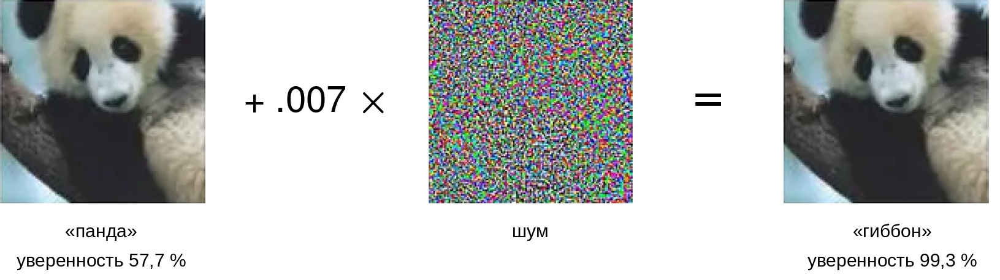

***Незаметная ошибка классификации GoogLeNet:** тонкий, намеренно сконструированный шум, добавленный к изображению, заставляет обученную глубокую нейронную сеть (GoogLeNet) принять панду за гиббона, хотя возмущенное изображение остается визуально неотличимым для человека. Эта классическая демонстрация показывает хрупкость нейронных сетей и мотивирует состязательное обучение. Источник: Goodfellow et al. (2015).*


Физическая атака наклейками на знаки «Стоп» (классическое описание дано в главе «Безопасность и приватность») переводила знаки «Стоп» в знаки ограничения скорости в 84,8 процента кадров видео с движущегося автомобиля; возмущение различимо для человека, но решающе для классификатора. Для автономных автомобилей вывод прямой: наклейки на реальных дорогах могут заставить самоуправляемый автомобиль принять знак «Стоп» за знак ограничения скорости, что ведет к проезду перекрестков без полной остановки или к непреднамеренному разгону у перекрестка ([Рисунок](#fig-graffiti)).

<a id="fig-graffiti"></a>


***Состязательное возмущение (заметный вариант):** физически реализуемые изменения могут заставить модели машинного обучения делать неверные предсказания. На изображении показан вариант высокой заметности (открытое вандальное оформление, а не незаметное возмущение), чтобы возмущение было различимо в печати. В литературе более опасный класс атак использует небольшие незаметные наклейки, которые выглядят как обычный износ, но вызывают ту же ошибку классификации — см. Eykholt et al. (2017).*


Помимо снижения качества, состязательные уязвимости создают каскадные системные риски. В здравоохранении атаки на медицинские изображения могут привести к ошибочному диагнозу (Tsai et al., 2023). Финансовые системы сталкиваются с аналогичным риском манипуляции, когда модели тональности, мошенничества или торговли опираются на хрупкие входные шаблоны. Состязательные уязвимости подрывают доверие к модели, раскрывая зависимость от признаков, которые предсказательны на обучающем распределении, но неустойчивы к сконструированным возмущениям (Goodfellow et al., 2015; Madry et al., 2018). Каждая защита от них, в свою очередь, имеет собственную цену: состязательное обучение увеличивает стоимость обучения (Bai et al., 2021), а обнаружение во время работы, такое как сжатие признаков (Xu et al., 2018), добавляет проверки на этапе инференса. Поэтому сама защита становится статьей бюджета, а не бесплатной страховкой. Состязательная уязвимость подчеркивает срочную необходимость в стратегиях защиты, рассмотренных в [разделе](#sec-robust-ai-input-attack-detection-defense-19d3).

<a id="sec-robust-ai-data-poisoning-4b55"></a>
### Отравление данных

Рассмотренные атаки искажают зафиксированную модель во время инференса. Отравление, напротив, портит саму модель, обращаясь к данным, на которых она учится. Классическая иллюстрация здесь — чат-бот Tay от Microsoft: это была система онлайн-обучения, в которой злонамеренные пользователи формировали будущее поведение системы, а не возмущали изображение с ограниченной нормой. В течение 24 часов после запуска скоординированные пользователи манипулировали ее механизмами обучения, чтобы генерировать неприемлемый и оскорбительный контент. В системе не было фильтрации контента, проверки пользовательского ввода и поведенческого мониторинга, любой из которых мог бы обнаружить и предотвратить эксплуатацию. Системы, обучающиеся на пользовательских взаимодействиях, требуют проверки входных данных, фильтрации контента и постоянного поведенческого мониторинга как базовых мер защиты.


*Отравление данных идет по жизненному циклу: внедрение, обучение, срабатывание.*

> **Определение: отравление данных**
>
>
> ***Отравление данных*** — это порча обучающих данных с целью скомпрометировать поведение модели во время инференса, либо путем внедрения вредоносных примеров, либо путем изменения существующих меток.
>
> 1.  **Значимость**: отравление подрывает базовое допущение о целостности данных. Даже малая доля отравленных примеров (например, менее 1 процента) может создать закладки или систематические смещения, которые остаются скрытыми, пока их не активируют определенные входы во время эксплуатации.
> 2.  **Различие**: в отличие от состязательных атак, которые происходят во время инференса, отравление данных происходит при сборе данных или обучении и загрязняет выученное моделью отображение от источника.
> 3.  **Частая ловушка**: распространено заблуждение, что отравление можно «исправить» большим объемом данных. На самом деле отравление часто использует свойство агрегации обучения: добавление чистых данных может не «вымыть» тщательно нацеленную закладку, которая использует уникальный триггер.
>


Отравление данных нацелено на сами обучающие данные и загрязняет выученное моделью отображение еще до начала развертывания. Отличие от состязательных атак принципиально: состязательные возмущения обманывают обученную модель во время инференса, а отравление учит модель неверным шаблонам с самого начала. По мере того как системы ML все чаще получают данные из автоматизированных конвейеров, веб-скрейпинга и краудсорсинговой разметки, отравление становится проблемой целостности конвейера не меньше, чем проблемой устойчивости модели: система должна обнаружить порчу до того, как обучающаяся модель ее усвоит.

Классическая ранняя постановка в безопасности ML — атака[^fn-data-poisoning-attack] на машины опорных векторов, описанная Biggio et al. (2012). Более поздние работы по отравлению расширяют цель до данных веб-масштаба и конвейеров генеративных моделей [см. также Shan et al. (2023)]. **Атаки отравлением** меняют существующие обучающие примеры, добавляют вредоносные примеры или нарушают конвейер сбора данных ([Рисунок](#fig-dirty-label-example)). Последствия особенно серьезны в областях с высокими ставками, таких как здравоохранение, где даже небольшие нарушения обучающих данных могут привести к опасным ошибочным диагнозам (Marulli et al., 2022).

[^fn-data-poisoning-attack]: **Отравление данных**: в этой классической постановке злоумышленник внедряет вредоносные обучающие примеры, чтобы испортить сам процесс обучения. В отличие от состязательных примеров, которые нацелены на инференс и иногда могут быть смягчены во время эксплуатации, отравление встраивает уязвимости в веса модели в ходе обучения. В веб-масштабе это меняет системную задачу: вместо фильтрации отдельных запросов инференса нужно сохранять происхождение данных, очищать подозрительные партии и проверять обучающие примеры до того, как они станут поведением модели.

<a id="fig-dirty-label-example"></a>


***Отравление данных с неверными метками:** несовпадающие пары «изображение — текст» представляют атаку с «грязными метками», при которой изображения кошек спарены с вводящими в заблуждение подписями «собака» в обучающих данных. Включение таких испорченных пар заставляет модели выучивать неверные мультимодальные связи.*


Отравление данных обычно разворачивается в три этапа. На этапе внедрения злоумышленник вводит отравленные примеры в обучающий набор: измененные версии существующих данных или совершенно новые экземпляры, созданные так, чтобы слиться с чистыми примерами. Атакующий может нацеливаться на определенные классы, вставлять вредоносные триггеры или конструировать выбросы, призванные исказить границу решений. Во время обучения модель усваивает эти примеры и выучивает ложные или вводящие в заблуждение шаблоны; поскольку отравленные данные часто статистически похожи на чистые, порча остается незамеченной при стандартной оценке. Наконец, во время развертывания злоумышленник использует скомпрометированную модель: активирует ошибки классификации закладок, снижает общую точность или целенаправленно манипулирует предсказаниями так, что их трудно отследить до обучающих данных.

Категории отравления различаются тем, чего противник хочет добиться от обученной модели (Oprea et al., 2022). При атаках на доступность значительная часть обучающих данных отравляется с целью снизить общую производительность модели. Классический пример — инверсия меток: например, систематическая замена примеров с истинной меткой $y = 1$ на $y = 0$ в задаче бинарной классификации. Такие атаки делают модель ненадежной для широкого круга входов, фактически делая ее непригодной.

Напротив, целенаправленные атаки отравлением нацелены лишь на отдельные классы или экземпляры. Здесь злоумышленник меняет ровно столько данных, чтобы небольшой набор входов был классифицирован неверно, в то время как общая точность остается относительно стабильной. Тонкость целенаправленных атак делает их особенно трудными для обнаружения.

Отравление закладками[^fn-backdoor-trigger-ml] вносит скрытые триггеры в обучающие данные: тонкие шаблоны или признаки, которые модель учится связывать с определенным выходом. Когда триггер появляется во время инференса, модель манипулируется так, что выдает заранее заданный ответ. Такие атаки часто оказываются эффективными, даже если триггерный шаблон незаметен для наблюдателя-человека.

[^fn-backdoor-trigger-ml]: **Атака закладкой**: введена Gu et al. (2017). Закладки внедряют скрытые триггеры в обучающие данные, которые активируют вредоносное поведение на инференсе, когда появляется определенный шаблон. BadNets показала, что атаки на основе триггеров могут сохранять точность на чистых данных, одновременно вызывая целенаправленные ошибки классификации, поэтому одна только обычная точность на тестах — слабый детектор. Задача защиты асимметрична: атакующему нужен лишь небольшой триггерный патч, а защитник должен аудировать обучающий набор или искать спектральные аномалии в пространстве активаций высокой размерности (Tran et al., 2018).

**Отравление подгрупп** компрометирует определенное подмножество популяции данных. По намерению оно близко к целенаправленным атакам, но применяет деградацию в духе атак на доступность к локальной группе, например к определенной демографической группе или кластеру признаков, оставляя общую производительность модели нетронутой. Локальный характер таких атак делает их одновременно высокоэффективными и особенно опасными в приложениях, чувствительных к справедливости.

> **Архетип B (DLRM в масштабе): инъекция фальшивых профилей**
>
>
> Архетип B (DLRM в масштабе), то есть рабочая нагрузка DLRM, особенно уязвим для **инъекции фальшивых профилей**. Поскольку системы рекомендаций часто используют онлайн-обучение, чтобы адаптироваться к трендам пользователей в реальном времени, злоумышленник может создать сеть «сибиловых» аккаунтов — фальшивых идентичностей под управлением одного и того же атакующего, которые взаимодействуют с определенными товарами, искусственно повышая их популярность или связывая их с высокоценными демографическими группами. Это отравление обходит традиционные межсетевые экраны, потому что вредоносные взаимодействия выглядят как законное поведение пользователей. Для его обнаружения нужны защиты на основе спектральных сигнатур, которые ищут подозрительные низкоранговые кластеры в шаблонах активаций, либо другие методы пространства активаций.
>


Общая черта всех четырех категорий — их тонкость: манипулированные примеры, как правило, неотличимы от чистых данных, поэтому их трудно выявить стандартной валидацией. Атаки могут исходить от внутренних участников с привилегированным доступом к конвейеру или от внешних противников, которые эксплуатируют слабые места сбора данных, особенно в краудсорсинговых средах или открытых конвейерах данных, лишенных проверок целостности и отслеживания происхождения.

Распределенное и федеративное обучение добавляет к той же угрозе ось участников. Злонамеренному клиенту не нужно вставлять видимую запись в центральный корпус: он может отправить обновление модели, выбранное так, чтобы сдвинуть агрегат, внедрить закладку или использовать сибиловые идентичности для непропорционального веса. Оценка должна варьировать число и координацию злонамеренных участников, гетерогенность их данных, график участия и знание правила агрегации. Глобальная чистая точность опять-таки недостаточна: контрольная точка требует успеха атаки на триггер или целевую подгруппу, полноты обнаружения аномалий на уровне участников и стоимости чистой полезности робастной агрегации. Krum, покоординатная медиана и усеченное среднее переносят ограниченное византийское поведение только при сделанных ими допущениях (Blanchard et al., 2017; Yin et al., 2018). Высокая размерность и неидентичные, неодинаково распределенные (не i.i.d.) обновления клиентов могут делать честных участников похожими на аномальных. Поэтому происхождение данных, ограничения участия, робастная агрегация и удерживаемые контрольные примеры (canaries) должны работать вместе, а не полагаться на одно правило расстояния как на доказательство защиты от отравления.

<a id="sec-robust-ai-data-poisoning-attack-methods-d168"></a>
#### Методы атак отравлением данных

Четыре категории выше описывают *цель* атакующего, а *механизм* атаки зависит от его доступа к системе и знания конвейера данных. Всем им общая форма: отравленная запись попадает в конвейер обучения вместе с чистыми данными и портит модель, которую выдает конвейер ([Рисунок](#fig-distribution-shift-example)). Самый прямой механизм — изменение меток: атакующий выбирает подмножество обучающих примеров и меняет их метки, переворачивая $y = 1$ в $y = 0$ или переназначая категории в многоклассовых задачах. Даже коррупция меток небольшого масштаба может заметно сдвинуть границы решений.

<a id="fig-distribution-shift-example"></a>


***Влияние отравления данных:** единственная отравленная запись, внесенная в обучающий набор, портит модель, которую выдает конвейер. Сравниваются обычный конвейер обучения (чистые данные, набор данных, алгоритм обучения, модель) и атака отравлением, при которой одна вредоносная запись проходит до обученной модели. Даже ограниченный состязательный контроль над обучающими данными может нарушить обучение модели, что подчеркивает уязвимость подходов, основанных на данных, к злонамеренной манипуляции.*


После изменения меток атакующий может сохранить метку и вместо этого испортить признаки. Незаметные возмущения изображений, тонкие сдвиги структурированных полей и фиксированные триггерные шаблоны преследуют один и тот же результат: обучающий пример все еще выглядит законным, но он сгибает выученную границу решений в сторону будущего отказа. Генеративные методы и инструменты синтеза данных создают тот же риск в большем масштабе, поскольку могут производить натурально выглядящие примеры, единственная цель которых — исказить то, что выучивает модель.

Станут ли такие примеры отравлением, зависит от границы данных. Веб-скрейпинг, ленты социальных сетей, краудсорсинговая разметка и пользовательские отправки от недоверенных источников позволяют отравленным записям попадать выше по конвейеру и проходить слабые проверки очистки в «доверенной» форме. Физические системы добавляют второй путь: наклейка на дорожном знаке — это состязательная атака на инференсе, когда автомобиль ее видит, но становится отравлением на этапе обучения, если конвейер обучения на данных парка устройств позднее собирает это изображение и включает его в корпус. Системы онлайн-обучения еще больше сокращают петлю обратной связи: они позволяют злоумышленнику вводить небольшие порции вредоносных данных, пока поведение модели не начнет дрейфовать без единой очевидной аномалии. Совместные сценарии снова расширяют границу: когда многие клиенты вносят обновления модели в центральный агрегатор, один злонамеренный участник может отравить общую глобальную модель, которую выдает агрегация ([Рисунок](#fig-poisoning-attack-example)).


<a id="fig-poisoning-attack-example"></a>


***Совместное отравление через агрегацию:** в совместном обучении несколько клиентов каждый обучается на локальных данных и отправляет обновления модели центральному серверу, который агрегирует их в общую глобальную модель. Один злонамеренный участник может внедрить отравленные обновления, которые сервер включает в агрегированную модель, так что порча распространяется на каждого клиента без единой очевидной аномалии. Эта поверхность атаки отличается от состязательных примеров: она нацелена на модель во время *обучения*, а не во время *инференса*.*


Сговор внутренних участников добавляет еще один уровень сложности. Злонамеренные участники, которые законно имеют доступ к обучающим данным, например разметчики, исследователи или поставщики данных, могут разработать стратегии отравления, более целенаправленные и тонкие, чем внешние атаки, потому что знают архитектуру модели или процедуры обучения. Будь то снижение точности, скрытая закладка или усиленное смещение против демографической подгруппы, отравление данных в конечном счете подрывает доверие к самой системе: модель, обученная на отравленных данных, не может считаться надежной, даже если хорошо проходит эталонные оценки.

<a id="sec-robust-ai-case-study-art-protection-via-poisoning-6106"></a>
#### Случай из практики: защита творческих работ через отравление

Отравление данных не всегда злонамеренно. Исследователи начали рассматривать его как оборонительный инструмент, в частности для защиты творческих работ от несанкционированного использования генеративными моделями ИИ.

Nightshade, разработанный исследователями Чикагского университета, помогает художникам не допустить, чтобы их работы собирали и использовали для обучения моделей генерации изображений без согласия (Shan et al., 2023). Nightshade позволяет художникам наносить тонкие возмущения на свои изображения перед публикацией в сети. Эти изменения незаметны для зрителей, но серьезно ухудшают работу генеративных моделей, которые включают их в обучение.

Когда Stable Diffusion обучили всего на 300 отравленных изображениях, модель начала выдавать странные результаты: на запрос «car» — коров, а на «dog» — существ, похожих на кошек ([Рисунок](#fig-poisoning)). Эксперимент демонстрирует **отравление концепта**: отравленные примеры могут искажать семантические ассоциации модели.

<a id="fig-poisoning"></a>


***Зависимость отравления концепта от дозы:** выходы Stable Diffusion XL при четырех дозах отравления (чистая модель, 50, 100, 300 образцов) и восьми исходных запросах (собака, автомобиль, сумка, шляпа, фэнтези-арт, кубизм, мультфильм, концепт-арт). С ростом дозы выходы смещаются от исходного концепта к целевому концепту атакующего, демонстрируя отравление концепта в стиле Nightshade для предобученной модели.*


Что делает Nightshade особенно действенным, так это каскадный эффект отравленных концептов. Поскольку генеративные модели опираются на семантические связи между категориями, отравленный концепт «автомобиль» может перетекать в смежные понятия, такие как «грузовик», «автобус» или «поезд», что ведет к массовым галлюцинациям. Тот же прием, который защищает художественный контент, можно переиспользовать для саботажа законных обучающих конвейеров, что подчеркивает дилемму двойного назначения[^fn-dual-use-ml], лежащую в основе безопасности машинного обучения.

[^fn-dual-use-ml]: **Дилемма двойного назначения**: структурное противоречие, при котором оборонительные возможности ML (состязательное обучение, инструменты отравления данных, фреймворки тестирования «красной командой») одновременно являются наступательными. Это создает гонку вооружений, в которой публикации оборонительных исследований становятся руководствами для атак. Для инженерии систем ML следствие архитектурное: механизмы устойчивости должны исходить из того, что атакующий знает о защите, исключать безопасность через сокрытие и требовать формально проверяемых гарантий там, где это возможно.

Прежде чем перейти от механизмов отравления к защитам, быстрая проверка классификации отделяет целенаправленное отравление от более широких атак на доступность.

> **Пример: классификация целенаправленного отравления**
>
>
> **Сценарий**: злоумышленник меняет метки небольшого подмножества обучающих данных так, что один развернутый классификатор стабильно относит определенный защищаемый класс или шаблон объекта к неверному выходу.
>
> **Диагноз**: это целенаправленная атака. Атакующий не пытается снизить общую производительность модели; он вызывает конкретную ошибку, сохраняя достаточную общую точность, поэтому агрегированные метрики валидации могут выглядеть благополучно.
>
> **Системный урок**: защита от целенаправленного отравления требует оценки по срезам, проверок происхождения данных и контрольных примеров для классов высокого риска. Сама по себе общая точность — слабый детектор, потому что атака спроектирована так, чтобы прятаться внутри обычной производительности.
>


Механика этих атак на уровне входов — от состязательных возмущений и отравления данных до их взаимодействия с естественными сдвигами распределения ([раздел](#sec-robust-ai-environmental-shifts-a2cf)) — задает поверхность угроз. Следующий вопрос в том, *как* спроектировать алгоритмические защиты, необходимые для защиты рабочих моделей от этих атак.

<a id="sec-robust-ai-input-attack-detection-defense-19d3"></a>
## Защиты от состязательных атак

Состязательная защита — это бюджетированный ответ на конкретную модель угроз. Чем сильнее гарантия, тем больше система платит в чистой точности, вычислениях обучения, задержке инференса или операционном покрытии.

<a id="sec-robust-ai-adversarial-attack-defenses-1dc8"></a>
### Рабочий процесс защиты от состязательных атак

Рабочий процесс защиты от состязательных атак состоит из четырех последовательных уровней:

1. **Определить модель угроз**: задать бюджет возмущения, знание атакующего и то, происходит ли атака во время инференса или обучения.
2. **Выбрать бюджет устойчивости**: решить, тратить ли бюджет на обучение, сертификацию, обнаружение входов или защитные барьеры на этапе обслуживания.
3. **Измерить компромисс**: оценить обе стороны защиты, потому что улучшение наихудшего поведения может снизить чистую точность, повысить задержку инференса или умножить стоимость обучения.
4. **Сохранять состязательный характер оценки**: проверять защиту против атак сильнее тех, на которых она была спроектирована.

Порядок важен: некалиброванная модель угроз делает цикл бюджета и оценки бессмысленным.

Для угроз возмущений, направленных на модель, самой прямой защитой на этапе обучения является **состязательное обучение**, которое включает состязательные примеры в сам процесс обучения.


> **Перспектива: правильный учет налога на устойчивость**
>
>
> Допустим, стандартная ResNet-50 показывает 76 % точности Top-1 на чистом ImageNet, а состязательно обученная модель — около 50 % при атаке $\ell_\infty$ с $\epsilon=8/255$. Вычитание этих значений дает 26 процентных пунктов, но этот разрыв сравнивает разные модели в разных условиях оценки. Это не цена устойчивости на чистых данных.
>
> Налог на чистую точность должен сравнивать стандартную и устойчивую модели на одном и том же чистом тестовом наборе. Выгода устойчивости должна сравнивать эти модели при одной и той же атаке, одном бюджете возмущения и одной силе атаки. Указание всех четырех ячеек не дает видимому компромиссу смешивать эффект модели с эффектом условий оценки.
>
> **Системный вывод**: устойчивость может снизить чистую точность и увеличить вычисления, но каждый налог требует сопоставимой базы. Шлюз развертывания должен раздельно сообщать чистую точность, эмпирическую устойчивую точность, спецификацию атаки и стоимость оценки.
>


Штраф за вычисления устойчивости (принцип штрафа за вычисления устойчивости) количественно выражает эту стоимость: устойчивость в духе PGD может требовать в несколько раз больше вычислений за эпоху, чем стандартная оптимизация, потому что каждый батч выполняет внутренние шаги атаки. Для многих приложений эффективнее полагаться на внешние защитные барьеры (фильтрацию входов, проверку выходов), чем обучать внутреннюю устойчивость в весах модели.

Любая защита несет инженерный налог в точности, вычислениях или в том и другом. Выбор защиты поэтому начинается с модели угроз и с бюджета, доступного для покрытия этой стоимости.

> **Пример: выбор защиты по модели угроз**
>
>
> **Сценарий**: производственным командам нужно выбрать защиты для трех различных систем: классификатора изображений, которому угрожают атаки уклонения, системы рекомендаций, которой угрожает отравление обучающих данных, и детектора мошенничества, который сталкивается с естественным сдвигом распределения.
>
> **Диагноз**: единообразная защита для всех трех систем не работает: она раздувает задержку инференса классификатора изображений, игнорирует отравление обучающих данных в рекомендациях и пропускает статистический дрейф в детекции мошенничества.
>
> **Системный урок**: выбор защиты должен подстраиваться под модель угроз. Состязательное обучение справляется с уклонением в реальном времени, робастная матричная факторизация и обрезка данных останавливают отравление, а непрерывный мониторинг с триггерами дрейфа решает проблему сдвига распределения.
>


<a id="sec-robust-ai-certified-defenses"></a>
#### Сертифицированные защиты

Состязательное обучение эмпирично: оно устойчиво к конкретным атакам, встречавшимся при обучении, но часто не выдерживает новых или более сильных возмущений. **Сертифицированная устойчивость** предлагает математическую гарантию: для заданного входа $x$ и радиуса $\epsilon$ не существует возмущения $\|\delta\|_p < \epsilon$, которое меняло бы предсказание модели. Широко используемая техника масштабирования этой идеи на многомерные входы, такие как ImageNet, — **рандомизированное сглаживание**. Вместо того чтобы классифицировать $x$ напрямую, оно классифицирует сглаженную функцию $g(x)$, определенную как ожидаемое предсказание базового классификатора $f$ при гауссовском шуме: $g(x) = \operatorname{arg\,max}_c \Pr(f(x+\delta) = c)$, где $\delta \sim \mathcal{N}(0, \sigma^2 I)$.


Cohen et al. (2019) доказали точную многоклассовую границу для сертифицированного радиуса $R$, используя нижнюю границу вероятности верхнего класса $p_A$ и верхнюю границу вероятности класса-преемника $p_B$: $R = \frac{\sigma}{2}\left(\Phi^{-1}(p_A) - \Phi^{-1}(p_B)\right)$, где $\Phi^{-1}$ — обратная функция стандартного нормального распределения. В частном бинарном случае, когда $p_B = 1 - p_A$, это сводится к $R = \sigma\Phi^{-1}(p_A)$. Граница превращает устойчивость в задачу статистического оценивания. Если бинарное решение имеет вероятность верхнего класса $p_A$ = 0,999 при шуме $\sigma$ = 0,5, упрощенный радиус составляет примерно 1,5, но многоклассовые сертификаты ImageNet должны также учитывать класс-преемник. Однако эта гарантия стоит дорого и по точности, и по вычислениям. На ImageNet та же работа сообщает нетривиальную сертифицированную точность для рандомизированного сглаживания, в том числе сертификацию при радиусе 0,5, но сертификация требует выборки множества векторов шума на каждый инференс, чтобы оценить вероятности классов с достаточной уверенностью. Большой рост задержки инференса ограничивает сертифицированные защиты асинхронным аудитом или защитными блокировками для критичных случаев, а не путями обслуживания в реальном времени.

Сертифицированные защиты покрывают одну часть рабочего процесса защиты от состязательных атак. Производственным системам по-прежнему нужны пути обнаружения подозрительных входов, стратегии смягчения, которые меняют поведение обучения или обслуживания, и процедуры оценки, которые проверяют, какие модели угроз остаются покрытыми.

<a id="sec-robust-ai-detection-techniques-0e7e"></a>
#### Методы обнаружения

Обнаружение состязательных примеров до того, как они дойдут до модели, образует первую линию защиты, только если сигнал доходит до решения о обслуживании: отклонить, преобразовать, направить или проверить. Самый дешевый сигнал спрашивает, все еще ли текущая популяция входов похожа на эталонную. Статистические тесты, такие как тест Колмогорова — Смирнова[^fn-ks-test-adversarial] (Berger и Zhou, 2014) или тест Андерсона — Дарлинга, измеряют расхождение распределений и могут отмечать входы, которые отклоняются от известной доброкачественной базы.

[^fn-ks-test-adversarial]: **Тест Колмогорова — Смирнова (KS)**: непараметрический тест, сравнивающий два распределения вероятностей. Он вычислительно эффективен, $\mathcal{O}(n \log n)$, но ограничен одномерными распределениями. Для обнаружения состязательных атак тесты KS сравнивают распределения входов по признакам с обучающими базами, отмечая отклонения при $p$-значениях меньше 0,05. Критическое ограничение для систем ML: состязательные возмущения часто сохраняют маргинальные распределения, одновременно портя совместную структуру, поэтому тесты KS могут пропустить атаки, которые поймали бы MMD или метрики пространства эмбеддингов.

Этот сигнал слаб против атак, которые сохраняют маргинальные распределения, поэтому производственные защиты часто добавляют проверку, которая уничтожает возмущения. **Сжатие признаков**[^fn-feature-squeeze-defense] (Xu et al., 2018) снижает сложность входного пространства через уменьшение размерности или дискретизацию, а затем сравнивает предсказание модели до и после преобразования. Большое изменение предсказания — свидетельство того, что исходный вход опирался на хрупкие высокочастотные детали.

[^fn-feature-squeeze-defense]: **Сжатие признаков**: защита, предложенная Xu et al. (2018), которая снижает точность входов (например, с 256 до 16 уровней цвета) или пространственное разрешение (медианная фильтрация), чтобы разрушить мелкозернистые возмущения, от которых зависят состязательные примеры. В их оценке сжатие признаков устранило многие состязательные примеры, сохранив высокую чистую точность; адаптивные атаки нужно проверить, прежде чем считать защиту готовой к производству. Механизм обнаружения сравнивает предсказания на исходных и сжатых входах: большое расхождение сигнализирует о состязательной манипуляции при низкой задержке.

Самый дорогой сигнал спрашивает, не сомневается ли модель в собственном ответе. Состязательные примеры часто лежат около нестабильных участков границы решений, поэтому неопределенность может направить вход на отклонение, проверку человеком или на более устойчивую модель. **Байесовские нейронные сети** оценивают неопределенность, рассматривая веса как распределения, а ансамблевые методы сравнивают предсказания независимо обученных моделей и используют расхождение как сигнал тревоги (Lakshminarayanan et al., 2017). Оба подхода улучшают качество обнаружения, но тратят дополнительные вычисления инференса, поэтому их легче обосновать для пакетной оценки или защитных блокировок, чем для каждого запроса с низкой задержкой.

Dropout[^fn-dropout-uncertainty-robustness], изначально задуманный как техника регуляризации для предотвращения переобучения (Hinton et al., 2012), случайно отключает долю нейронов на каждой итерации обучения, заставляя сеть не полагаться чрезмерно на отдельные нейроны и улучшая обобщение. Тот же механизм можно переиспользовать для оценки неопределенности через **Monte Carlo dropout**[^fn-mc-dropout-inference] на этапе инференса: несколько прямых проходов с разными масками dropout приближают распределение неопределенности. Полученные оценки менее точны, чем байесовские методы, потому что dropout создавался для регуляризации, а не для количественной оценки неопределенности. Гибридные подходы, которые сочетают dropout с легкими ансамблевыми методами или байесовскими приближениями, балансируют вычислительную эффективность и качество оценки, делая обнаружение на основе неопределенности практичнее для производственного развертывания.

[^fn-dropout-uncertainty-robustness]: **Dropout**: регуляризация, введенная Srivastava et al. (2014). Она случайно отключает долю скрытых элементов во время обучения, препятствуя коадаптации и улучшая обобщение. Ее роль в устойчивости косвенная, а не гарантия против отказов нейронов или весов: тот же стохастический механизм маскирования можно оставить активным на инференсе, чтобы приблизить байесовскую неопределенность методом Monte Carlo dropout (Gal и Ghahramani, 2016).

[^fn-mc-dropout-inference]: **Monte Carlo dropout**: предложен Gal и Ghahramani (2016). MC dropout переосмысляет dropout как приближенный байесовский вывод, сохраняя dropout активным при повторных стохастических прямых проходах. Разброс предсказаний дает оценку неопределенности без изменений архитектуры. Каждый дополнительный образец добавляет работу на инференсе, поэтому развертывания должны выбирать число образцов в соответствии с бюджетами задержки и неопределенности.

<a id="sec-robust-ai-defense-strategies-cb2d"></a>
#### Стратегии защиты

Когда слой обнаружения отмечает состязательные входы, стратегии защиты смягчают их воздействие и повышают устойчивость модели. Самая распространенная стратегия — состязательное обучение: дополнение обучающих данных состязательными примерами, чтобы модель училась правильно классифицировать возмущенные входы. [листинг](#lst-adversarial-training) реализует этот шаблон с FGSM: возмущения строятся на лету и смешиваются с чистыми данными в каждом обучающем батче. Метод повышает устойчивость, но налагает значительные вычислительные накладные расходы, которыми производственные системы должны аккуратно управлять.

Генерация состязательных примеров увеличивает время обучения, потому что каждый шаг требует дополнительных прямого и обратного проходов через модель (Madry et al., 2018; Bai et al., 2021). Накладные расходы памяти зависят от того, хранит ли реализация чистые и состязательные примеры вместе, пересчитывает ли возмущения или переиспользует информацию о градиентах. Итеративные атаки, такие как PGD, которые требуют нескольких шагов оптимизации, нуждаются в специализированной инфраструктуре для эффективной генерации; оптимизированные варианты снижают накладные расходы, переиспользуя вычисления вместо того, чтобы рассматривать каждый шаг атаки как отдельный полный проход обучения (Shafahi et al., 2019).

Стоимость чистой точности зависит от модели угроз и защиты. Ее нужно измерять, сравнивая стандартную и устойчивую модели на одном и том же чистом тестовом наборе, отдельно от сравнения устойчивой точности при согласованной атаке. Бюджет возмущения, рецепт обучения, емкость модели и метод сертификации меняют результат, поэтому одно вычитание между условиями не может служить универсальным налогом. Емкость модели тоже может возрасти, когда рецепт устойчивости использует более широкие сети или другие архитектурные изменения, добавляя память и стоимость обучения сверх измеренного компромисса по точности.

Подбор гиперпараметров становится заметно сложнее при балансировке целей устойчивости и производительности. Процедуры валидации должны оценивать и чистую, и состязательную производительность с помощью нескольких методов атак, а инфраструктура развертывания должна поддерживать дополнительные вычислительные требования, включая память GPU для вычисления градиентов и хранилище для кэша состязательных примеров.


<a id="lst-adversarial-training"></a>

***Псевдокод состязательного обучения:** не зависящее от фреймворка состязательное обучение с возмущениями в духе FGSM во время обучения; чистые и возмущенные данные смешиваются, чтобы повысить устойчивость к градиентным атакам.*

```text
function adversarial_training_step(model, clean_batch, labels, epsilon):
    logits = model(clean_batch)
    clean_loss = loss(logits, labels)

    input_gradient = gradient(clean_loss, clean_batch)
    perturbation = epsilon * sign(input_gradient)
    adversarial_batch = clip(clean_batch + perturbation, valid_input_range)

    mixed_batch = concatenate(clean_batch, adversarial_batch)
    mixed_labels = concatenate(labels, labels)

    return loss(model(mixed_batch), mixed_labels)
```


Реализация в [листинг](#lst-adversarial-training) строит состязательные примеры на лету в ходе обучения: дифференцирует потери по входу, применяет функцию знака, чтобы извлечь направление возмущения, и смешивает получившиеся состязательные примеры с чистыми обучающими данными. Ограничение (clipping) сохраняет допустимый диапазон входов, а конкатенация удваивает эффективный размер батча, объединяя чистые и состязательные примеры. Такой подход требует аккуратной настройки бюджета возмущения $\epsilon$; оптимизированные варианты могут снизить накладные расходы состязательного обучения, переиспользуя вычисления градиентов (Shafahi et al., 2019).

Когда состязательные примеры становятся частью цикла обучения, развертывание должно согласовывать методы устойчивости с конвейерами MLOps, стратегиями мониторинга и инфраструктурой распределенного обучения, которая синхронизирует обновления между узлами. Остальные стратегии лишь переносят точку расходов, а не устраняют их. **Защитная дистилляция** (Papernot et al., 2016) тратит ресурсы на этапе обучения: модель-ученик учится на мягких метках учителя, что может сгладить поведение решений, но все равно должно проверяться против более сильных атак. Предобработка входа тратит ресурсы на этапе обслуживания: шумоподавление изображений, сжатие JPEG, случайное изменение масштаба, дополнение полями и случайные преобразования пытаются стереть возмущения до того, как модель их увидит. Ансамбли тратят ресурсы на избыточность: комбинация моделей с разными архитектурами, обучающими данными или путями предобработки делает менее вероятным, что возмущение, обманувшее одного участника, обманет всех.

<a id="sec-robust-ai-evaluation-testing-4b54"></a>
#### Оценка и тестирование

Оценка состязательных защит замыкает цикл бюджета: система должна измерить, какие атаки защита действительно покрывает и какую производительность приносит в жертву при контролируемых атаках. Метрики устойчивости количественно выражают стойкость через точность на состязательных примерах, искажение, необходимое для обмана модели, и производительность при разных бюджетах атаки. Стандартизированные эталоны, такие как MNIST-C (Mu и Gilmer, 2019), CIFAR-10-C и ImageNet-C (Hendrycks и Dietterich, 2019), измеряют распространенные повреждения, а не злонамеренное наихудшее поведение, поэтому их результаты занимают другую ячейку [таблица](#tbl-robust-ai-evaluation-matrix).

Эмпирическая оценка атак должна быть адаптивной к защите. Оценщик должен знать предобработку, детектор, источники случайности, ансамбль и правило отказа; оптимизировать через дифференцируемые компоненты; использовать математическое ожидание по преобразованиям для случайных элементов; проверять атаки переносом и атаки на основе запросов, когда градиенты недоступны; и включать весь конвейер, а не только сохраненную модель. Несколько случайных перезапусков и бюджеты атак могут усилить доказательства в пределах данной модели угроз, но успешный тест PGD не доказывает ни того, что PGD нашел внутренний максимум, ни того, что семантические, физические или атаки с другой нормой покрыты. Только сертификат устанавливает гарантию, и только для заявленного входа, нормы, радиуса и допущений.

Состязательное обучение и сертифицированные защиты борются с атаками на входы модели во время инференса в рамках ограниченных моделей угроз. Они не доказывают, что модель обучалась на надежных данных. Если противник скомпрометировал конвейер данных задолго до того, как модель была собрана, доказательства, полученные на инференсе, оставляют компрометацию обучения нетронутой. Описанные ранее атаки отравлением данных требуют собственного класса защит.

> **Контрольные вопросы: выбор и бюджетирование состязательной защиты**
>
>
> Состязательная защита — это бюджетированный ответ на конкретную модель угроз. Более сильные гарантии обычно меняют чистую точность, вычисления, задержку или покрытие, но направление и величина этих изменений зависят от нагрузки, модели, защиты и границы оценки.
>
> **Сопоставление защиты с угрозой**
>
> - [ ] **Оценка в наихудшем случае**: объясните, почему прохождение теста PGD в режиме «белого ящика» дает эмпирическое свидетельство только для оцененной модели, нормы, бюджета, перезапусков и реализации атаки, а не общую гарантию наихудшего случая.
> - [ ] **Соответствие модели угроз**: подберите акцент защиты для классификатора, доступного через API, и для критичного для безопасности детектора дорожных знаков, и объясните, почему одного состязательного обучения недостаточно для обоих.
>
> **Рассуждения о бюджете**
>
> - [ ] **Сертифицированные и эмпирические защиты**: объясните, когда стоимость выборки рандомизированного сглаживания делает предпочтительным асинхронный аудит или выборочный путь обслуживания, а не предполагает, что у каждого сертифицированного развертывания одно и то же ограничение задержки.
> - [ ] **Бюджет защиты**: сравните обнаружение входов с внутренней устойчивостью модели для компонента низкого риска, используя измеренные чистую точность, устойчивую точность, вычисления, задержку и покрытие, а не предполагая фиксированный налог на чистую точность.
>


<a id="sec-robust-ai-data-poisoning-defenses-d070"></a>
## Защиты от отравления данных

Защиты от отравления охраняют цепочку поставок обучающих данных, а не границу инференса. Последовательность защиты применяет четыре уровня по порядку:

1. **Происхождение и контроль доступа**: установить, какие источники имеют право изменять данные.
2. **Обнаружение аномалий и санитизация**: выявить подозрительные записи до обучения.
3. **Робастные целевые функции**: снизить влияние оставшихся отравленных примеров.
4. **Обучение представлений**: сделать модель менее зависимой от хрупких артефактов.

Каждый уровень покрывает свою точку на пути данных; ни один детектор не может заменить сквозных мер контроля.

Представьте хедж-фонд, который обучает модель анализа тональности на финансовых твитах. Если конкурирующая фирма координирует сеть ботов, которые систематически связывают слово «рост» с негативной тональностью в период обучения, только что развернутый торговый алгоритм будет агрессивно открывать короткие позиции по акциям при позитивных отчетах о прибыли. Атаки отравлением данных ([Рисунок](#fig-adversarial-attack-injection)) нацелены на цепочку поставок машинного обучения и манипулируют сырьем интеллекта еще до того, как модель начнет учиться. Как показано на схеме, защита от этих атак требует активного слоя перехвата, который анализирует и очищает набор данных до того, как отравленные записи попадут в цикл обучения.

<a id="fig-adversarial-attack-injection"></a>

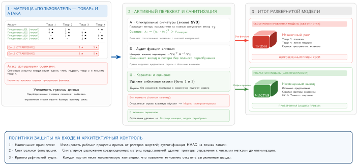

***Схема отравления данных и перехвата:** противники вносят вредоносные строки в матрицу рейтингов «пользователь — товар», чтобы манипулировать поведением модели. Активный слой защиты анализирует и очищает набор данных до обучения, позволяя системе получить незараженную модель. Источник: адаптировано из иллюстрации журнала *Mathematics* 12(2):247.*


<a id="sec-robust-ai-anomaly-detection-techniques-bc27"></a>
### Контроль входа и аномалий

Защита от отравления начинается на границе данных, до запуска любого статистического детектора. Конвейер должен знать, какие источники имеют право вносить обучающие данные, как проверяется их подлинность и какие роли могут менять принятые записи. Строгое управление применяет принцип наименьших привилегий,[^fn-least-privilege-ml] журналирует события доступа к данным и их изменения и присваивает каждой принятой партии идентичность источника. Эти меры не доказывают, что каждая запись чистая, но они ограничивают поверхность атаки и дают результатам аномалий прослеживаемое происхождение.

[^fn-least-privilege-ml]: **Принцип наименьших привилегий**: сформулирован Saltzer и Schroeder (1975). Он ограничивает права доступа минимумом, необходимым каждому компоненту. Применительно к конвейерам ML: контейнеры инференса не должны иметь доступа к обучающим данным, задания обучения не должны достигать производственных баз данных, а модели не должны иметь сетевого доступа сверх требуемых API. Нарушения создают поверхность атаки для отравления данных: если конвейер обучения может читать из непроверенных источников, он рано или поздно поглотит состязательные данные. Тот же принцип распространяется на реестр моделей, хранилище артефактов, которое сопоставляет идентификаторы версий с файлами весов и управляет тем, какой псевдоним (например, `staging`, `production`) указывает на какую контрольную точку. Продвижение к псевдониму `production` следует ограничить узким, аудируемым набором автоматических сервисов оценки и назначенных инженеров выпуска. Если учетные данные исследователя скомпрометированы, управление доступом по принципу наименьших привилегий не даст этой компрометации распространиться в подмененную модель с закладкой, которая попадет на живой трафик.

После границы источника обнаружение аномалий спрашивает, принадлежит ли кандидат-пример обучению тому распределению, которому конвейер намеревался обучаться. Самые дешевые тесты сравнивают каждую запись с основным распределением: фильтрация по z-оценке, метод Тьюки и расстояние Махаланобиса помечают примеры, значения признаков которых лежат далеко от нормальных диапазонов. Эти тесты полезны, потому что достаточно быстры для запуска при приеме данных, но ловят только отравления, которые выглядят статистическими выбросами в исходном пространстве признаков. Для многомерных или мультимодальных данных расстояния в исходных признаках — слабый сигнал: отравленный фрагмент изображения или тонко неверная подпись выглядит незаметно при поиксельном измерении, но является семантическим выбросом в плотном пространстве эмбеддингов предобученной модели зрения или языка. Поэтому производственные конвейеры все чаще применяют расстояние Махаланобиса и кластеризацию не к исходным признакам, а к скрытым представлениям, которые выдает энкодер фундаментальной модели. Там семантические аномалии, которые пропускает исходная статистика, часто видны как изолированные точки или области низкой плотности далеко от центроидов классов.

Более скоординированные атаки требуют проверок, учитывающих структуру. Методы кластеризации, такие как K-средних, DBSCAN и иерархическая кластеризация, ищут аномальные группы или изолированные точки, а не единичные экстремальные значения. **Автоэнкодеры** добавляют к тому же шлюзу обученное представление: модель хорошо восстанавливает обычные примеры, поэтому высокая ошибка восстановления помечает запись как аномальную и потенциально отравленную ([Рисунок](#fig-autoencoder)). У каждого метода есть режим отказа. Тесты выбросов пропускают отравления с чистыми метками, кластеризация зависит от представления признаков, а автоэнкодеры могут выучить шаблон атаки, если эталонный корпус уже загрязнен.

<a id="fig-autoencoder"></a>

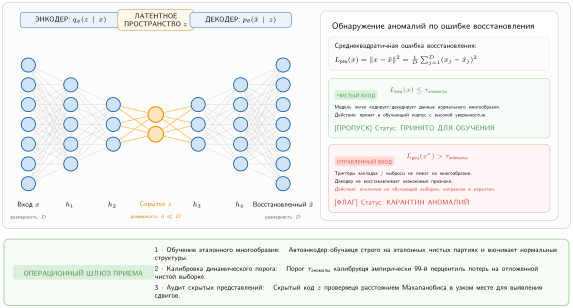

***Архитектура автоэнкодера:** автоэнкодеры выучивают сжатые представления данных, минимизируя ошибку восстановления, что позволяет обнаруживать аномалии по входам с высокой ошибкой восстановления. При обучении на обычных данных сеть выучивает эффективное кодирование и декодирование и становится чувствительной к отклонениям, указывающим на возможные атаки отравлением. Источник: адаптировано из руководства *Towards Data Science* по автоэнкодерам.*


<a id="sec-robust-ai-sanitization-preprocessing-f883"></a>
#### Санитизация и предобработка

Санитизация превращает сигналы аномалий в изменения обучающего набора до того, как отравление попадет в оптимизацию. Подозрительную запись можно отклонить, поместить в карантин для проверки, снизить ее вес при обучении или оставить с явным флагом происхождения. Рутинная очистка по-прежнему важна: дедупликация, обработка пропусков, проверка типов, ограничения диапазонов и перекрестная проверка полей устраняют многие малоэффективные попытки отравления и одновременно улучшают обычное качество данных.

**Происхождение данных** и отслеживание родословной делают эти решения обратимыми. Каждый элемент данных нуждается в записи о своем источнике, преобразованиях, результатах проверки и движении по конвейеру. Когда модель позднее демонстрирует признак отравления, родословная позволяет оператору проследить подозрительное поведение до исходной партии, оценить, какие обученные модели использовали скомпрометированные примеры, и решить, удалять, перемаркировать или переузвешивать затронутые записи.

Когда подозрительные данные уже попали в корпус, санитизация переходит от проверок источника к проверкам представлений. **Спектральные сигнатуры** (Tran et al., 2018) используют наблюдение, что триггеры закладок — определенные шаблоны, добавленные ко входам, чтобы вынудить целевую метку, — вносят обнаруживаемую статистическую аномалию во внутренние представления сети. При анализе активаций скомпрометированного класса отравленные примеры часто сильно выравниваются вдоль верхнего сингулярного вектора ковариационной матрицы. Проецирование примеров на это главное направление и удаление выбросов может очистить набор данных, не зная самого триггерного шаблона, потому что сигнал закладки должен быть достаточно сильным, чтобы перебить естественные признаки, и поэтому оставляет след в представлении.

**Функции влияния** (Koh и Liang, 2017) выполняют более узкую отладочную роль. Они аппроксимируют эффект удаления одной обучающей точки $z$ на потери модели для конкретной тестовой точки $z_{\text{test}}$ без переобучения. Вычисляемая через произведения обратного гессиана на вектор, функция влияния $I(z, z_{\text{test}}) \approx -\nabla_\theta \mathcal{L}(z_{\text{test}}, \hat{\theta})^T H_{\hat{\theta}}^{-1} \nabla_\theta \mathcal{L}(z, \hat{\theta})$ показывает, какие обучающие примеры «ответственны» за конкретное предсказание. Если модель принимает знак «Стоп» за знак ограничения скорости, функции влияния могут выделить кандидатов-изображений из обучения, которые внесли вклад в это решение. Метод избегает явного вычисления обратного гессиана с помощью итеративных приближений, но его результаты остаются приближенными в глубоких невыпуклых сетях. При современных масштабах моделей анализ влияния поэтому требует проверки для конкретной архитектуры, аппроксимации и отладочной задачи, а не служит точной атрибуцией.


Если отравленные примеры переживают получение и санитизацию, целевая функция обучения становится последним местом, где можно ограничить их влияние. Робастная оптимизация изменяет целевую функцию, чтобы минимизировать влияние выбросов или отравленных экземпляров. Робастные функции потерь, такие как функция Хьюбера,[^fn-huber-loss-robust] функция Тьюки (Beaton и Tukey, 1974) и потери на усеченном среднем, снижают вес или игнорируют вклад аномальных экземпляров в ходе обучения. Методы регуляризации ($\ell_1$ или $\ell_2$) ограничивают сложность модели и могут снизить чувствительность к некоторым отравленным данным. На более высоком уровне минимаксные[^fn-minimax-adversarial-formulation] и распределительно-робастные цели оптимизируют производительность на заданном множестве неопределенности. Цель задает формальный ориентир, но приближенный оптимизатор сам по себе не доказывает, что обученная модель достигает этой цели или устойчива к атакам за пределами этого множества.

[^fn-huber-loss-robust]: **Функция потерь Хьюбера**: эта кусочно заданная функция переходит от квадратичной (среднеквадратичная ошибка) к линейной (средняя абсолютная ошибка) при фиксированном пороге (обычно 1,0–1,5), ограничивая величину градиента для экстремальных примеров. В условиях отравленных данных функция Хьюбера не дает небольшому числу вредоносных примеров создавать непропорционально большие градиенты, которые доминировали бы в обновлениях параметров, — свойство, которого нет у стандартной среднеквадратичной ошибки: один выброс с ошибкой, в 100× раз больше обычной, дает 10 000× квадратичной потери и 100× величины градиента остатка.

[^fn-minimax-adversarial-formulation]: **Минимакс**: стратегия из теории игр, восходящая к von Neumann (1928), которая минимизирует максимально возможные потери. В состязательной устойчивости Madry et al. (2018) формулируют обучение как $\min_\theta \max_{\|\delta\| \leq \epsilon} \mathcal{L}(f_\theta(x + \delta), y)$: модель учится минимизировать потери при наихудшем возмущении в выбранном шаре нормы. Внутренняя максимизация вычислительно дорога, потому что ее обычно аппроксимируют итеративными атаками вроде PGD, поэтому состязательное обучение с PGD — это бюджетный выбор устойчивости, а не бесплатное изменение целевой функции (Bai et al., 2021; Shafahi et al., 2019).


*Функция Хьюбера ограничивает влияние выбросов, которое усиливает квадратичная потеря.*


**Аугментация данных** (data augmentation) создает дополнительные обучающие примеры, применяя случайные преобразования или возмущения к существующим данным ([Рисунок](#fig-data-augmentation)), и повышает разнообразие и устойчивость обучающего набора. Контролируемые вариации делают модель менее чувствительной к конкретным шаблонам или артефактам, которые содержат отравленные примеры. Методы рандомизации, такие как случайная подвыборка или бутстрэп-агрегирование (bagging), дополнительно снижают влияние отравленных данных, обучая несколько моделей на разных подмножествах и объединяя их предсказания.

<a id="fig-data-augmentation"></a>

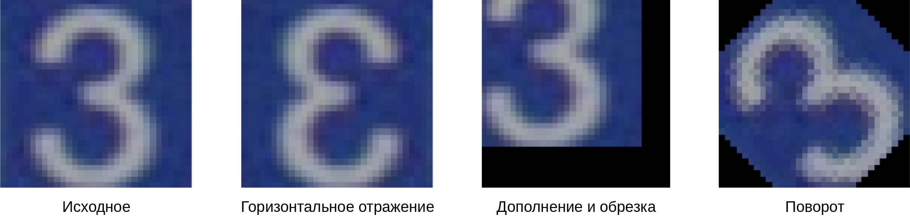

***Техники аугментации данных:** применение таких преобразований, как горизонтальные отражения, повороты и обрезка, расширяет обучающие наборы и повышает устойчивость модели к вариациям входных данных, одновременно снижая переобучение. Эти техники порождают новые обучающие примеры без дополнительных размеченных данных и эффективно увеличивают разнообразие набора, улучшая обобщающую способность.*


Рабочее правило многослойно: аутентифицировать источники и управлять ими до приема данных, санитизировать подозрительные данные до обучения,[^fn-data-sanitization-ml] ограничивать выжившие выбросы во время оптимизации и сохранять родословную, чтобы инцидент можно было проследить до скомпрометированного источника. Отравление данных остается активной областью исследований, но производственные системы должны рассматривать обучающий корпус как цепочку поставок, а не как пассивный набор данных.

[^fn-data-sanitization-ml]: **Санитизация данных**: удаление чувствительных или вредоносных данных из обучающих конвейеров. В контексте отравления это означает выявление и удаление состязательных обучающих примеров до того, как они испортят веса модели. Специфическая для ML трудность в том, что отравленные примеры спроектированы так, чтобы статистически не отличаться от чистых данных, поэтому наивная фильтрация (удаление выбросов, проверка меток) пропускает изощренные атаки. Эффективная санитизация требует анализа в пространстве активаций (спектральные сигнатуры) или аудита через функции влияния; оба подхода вычислительно дороги в масштабе.

Граница данных, таким образом, — один слой устойчивости, а не вся защита. Когда цепочка поставок обучения находится под управлением и подозрительные записи отфильтрованы, модели все равно нужны представления, которые переживают обычные вариации эксплуатации. Помимо обнаружения и исправления сдвигов после их возникновения ([раздел](#sec-robust-ai-environmental-shifts-a2cf)), дополняющий подход строит устойчивые к сдвигам представления с самого начала, опираясь на основы трансферного обучения и адаптации к домену (Pan и Yang, 2010).

<a id="sec-robust-ai-selfsupervised-learning-robustness-0c94"></a>
### Защита на уровне представлений: самообучение

**Самообучение** (Self-Supervised Learning, SSL) меняет источник контроля. Вместо того чтобы опираться только на метки задач, модель учится, решая претекстовые задачи, которые требуют структуры самих данных. Это важно для устойчивости, потому что многие хрупкие модели переобучаются на том шорткате, который проще всего эксплуатировать: фон изображения, артефакт разметки или узкий шаблон формулировки. Задача предобучения, которая вознаграждает стабильную структуру между разными представлениями, маскированными токенами или маскированными фрагментами изображения, дает представлению шанс выучить сигналы, которые переживают больше вариаций эксплуатации.

Методы контрастивного обучения, такие как SimCLR (Chen et al., 2020), воплощают эту идею, притягивая разные представления одного и того же примера к общему представлению. Модель вознаграждается за то, что считает обрезку, сдвиг цвета или аугментацию тем же базовым объектом, а не новым признаком, специфичным для класса. **Маскированное языковое моделирование** в BERT (Devlin et al., 2019) и маскированное автокодирование в зрении (He et al., 2021) идут другим путем: они скрывают часть входа и вынуждают модель восстановить или предсказать ее по контексту. Оба семейства снижают зависимость от единственного сигнала контроля с метками, поэтому представления SSL часто лучше переносятся, когда распределение эксплуатации отличается от размеченного обучающего набора.

Эта польза для переноса — главная системная причина использовать SSL в конвейере устойчивости. Большие неразмеченные корпуса подвергают модель доменам, преобразованиям и редким случаям, которые было бы слишком дорого полностью разметить. В производстве SSL обычно служит основой, а не полной защитой: предобучить на широких неразмеченных данных, дообучить на контролируемой задаче, затем применить состязательные, дрейфовые и защиты от отравления, описанные ранее в главе, к модели для конкретной задачи. Многозадачное обучение может сохранить часть этой пользы, поддерживая самоконтролируемую цель активной, пока контролируемая задача тянет представление к метрике развертывания.

Ограничение в том, что SSL — не гарантия устойчивости. Цель контрастивного или маскированного предобучения все равно может выучить хрупкие шорткаты, а атакующий, который понимает претекстовую задачу, может целенаправленно атаковать эти шорткаты. Теория, объясняющая, когда SSL улучшает устойчивость, остается неполной, а вычислительная стоимость может быть значительной, потому что предобучение переносит работу в начало жизненного цикла. Системное решение поэтому состоит в том, снижает ли более широкое обучение представлений ожидаемую стоимость дрейфа, перемаркировки и устойчивого дообучения достаточно, чтобы оправдать дополнительный бюджет предобучения.

<a id="sec-robust-ai-fallacies-pitfalls-087e"></a>
## Заблуждения и ловушки

Устойчивость охватывает сдвиги среды, атаки на входы и системные сбои. Каждая область угроз порождает заблуждения, которые приводят к недостаточным защитам или к неверному распределению инженерных ресурсов.

> **Заблуждение и ловушка**
>
> **Заблуждение:** *Состязательные примеры — академическая диковинка без реального влияния.*
>
> Опубликованные атаки в физическом мире, такие как состязательные патчи на одежде или наклейки на знаки «Стоп», обманывали оцененные модели зрения в контролируемых условиях патчей и дорожных знаков без цифрового доступа к модели. Защита от этих атак требует оценки под конкретную модель угроз, аугментации данных физическим миром, обучения с учетом патчей и обнаружения на этапе обслуживания. Связанное цифровое состязательное обучение в духе PGD обычно увеличивает стоимость обучения в несколько раз, в зависимости от числа шагов атаки. Пренебрежение этими защитами оставляет системы в открытой среде уязвимыми к отказам, которые обычные цифровые тестовые наборы не выявляют.

> **Заблуждение и ловушка**
>
> **Ловушка:** *Принимать успех на тестовом наборе за доказательство устойчивости.*
>
> Стандартные тестовые наборы взяты из того же i.i.d.-распределения, что и обучающие данные, и не могут измерить устойчивость к реальным сдвигам. В производстве неотслеживаемые сдвиги распределения могут вызвать тихую деградацию производительности: опубликованные оценки вне распределения часто показывают большое падение точности, когда популяция развертывания расходится с обучающим распределением.

> **Заблуждение и ловушка**
>
> **Заблуждение:** *Мониторинг сдвига распределения после развертывания необязателен.*
>
> Модели часто деградируют незаметно: сохраняют высокие оценки уверенности, даже когда предсказательная производительность падает из-за дрейфа. Метрики вроде PSI могут выявить сдвиги популяции раньше, чем точность опустится ниже порогов соглашения об уровне обслуживания (SLA), что позволяет вмешаться проактивно, если отслеживаемые признаки предсказывают последующую производительность.

> **Заблуждение и ловушка**
>
> **Ловушка:** *Игнорировать защиты от отравления, пока атакующий не контролирует конвейер обучения.*
>
> **Чистое отравление** (clean-label poisoning) компрометирует модели, внедряя вредоносные примеры в публичные наборы данных или собранные из сети источники, и не требует доступа к внутреннему коду. Определяющее свойство — рычаг: триггер закладки можно внедрить, испортив крошечную долю обучающих данных, заведомо меньше 1 процента, и он остается скрытым до появления триггера на инференсе. Поэтому размер отравленной части не служит защитой.

> **Заблуждение и ловушка**
>
> **Заблуждение:** *Средняя точность достаточна для измерения устойчивости.*
>
> Высокая средняя точность часто скрывает хрупкость: модель с точностью 95 процентов может оказаться на 100 процентов уязвимой к целенаправленным возмущениям на критичных граничных случаях. Надежная оценка требует вычисления сертифицированного радиуса устойчивости или точности в наихудшем случае при заданном бюджете возмущения.

> **Заблуждение и ловушка**
>
> **Ловушка:** *Считать состязательное обучение полным решением проблемы устойчивости.*
>
> Устойчивость не универсальна: она строго связана с конкретной моделью угроз, использованной при обучении. Модель, состязательно обученная против атак в норме $\ell_\infty$, может не давать никакой защиты от атак в норме $\ell_2$ или геометрических атак, поэтому нужна разнообразная стратегия защиты.

> **Заблуждение и ловушка**
>
> **Заблуждение:** *Программные ошибки не важны, когда модель верна.*
>
> Сосредоточенность только на алгоритмической устойчивости игнорирует то, что программные ошибки в конвейерах данных и инфраструктуре обслуживания — основная причина сбоев ML. Анализы инцидентов часто показывают, что в центре отказов оказываются проблемы конвейера и данных, а не архитектура модели или одни только состязательные атаки. Таксономия и смягчение этих системных сбоев — предмет главы «Отказоустойчивость», а модель, закаленная против состязательных возмущений, остается хрупкой, если ошибка предобработки тихо портит ее входы.

> **Заблуждение и ловушка**
>
> **Ловушка:** *Укреплять модель, оставляя проверки конвейера неопробованными.*
>
> Работа над устойчивостью может сосредоточиться на состязательном обучении, сертифицированных радиусах или защите от отравления, в то время как проверка схемы, паритет предобработки, свежесть признаков и учения по откату остаются недостаточно проверенными. Такой дисбаланс создает систему, которая устойчива к одному классу атак, но выходит из строя при обычных операционных сбоях. Устойчивое развертывание проверяет модель и конвейер вместе, потому что модель видит только те входы, которые доставляет окружающая система.
>
> Эти заблуждения имеют общий корень: устойчивость рассматривается как одномерная проблема, а не как многослойная инженерная дисциплина.

<a id="sec-robust-ai-summary-a274"></a>
## Итоги

Надежный ИИ превращает надежность системы из эмпирической надежды в явный инженерный бюджет. Там, где здоровье традиционного ПО измеряется временем работы и задержкой, системы ML отказывают тихо: точность предсказаний деградирует под воздействием дрейфа среды, модели поддаются состязательным возмущениям входов или отравленным обучающим данным, а ошибки конвейера маскируются под настоящие сдвиги распределения. Системные программные сбои (глава «Отказоустойчивость») усиливают эти уязвимости, портя потоки данных или обновления градиентов без срабатывания аппаратных исключений. Чтобы сделать эти тихие отказы видимыми, нужна диагностическая инфраструктура на протяжении всего жизненного цикла модели: от оценки наихудшего случая и спектральной фильтрации до метрик сдвига распределения (PSI, расхождение Кульбака — Лейблера, двухвыборочный тест KS) и количественной оценки неопределенности.

Каждый механизм устойчивости перераспределяет ресурсы в рамках железного закона систем ML ($T \approx D_{\text{vol}}/\text{BW} + O/(R_{\text{peak}}\eta_{\text{hw}}) + L_{\text{lat}}$). Многошаговый PGD во время обучения увеличивает вычислительный член $O$; снижает ли он также чистую точность и насколько, зависит от модели, данных, набора возмущений и рецепта обучения. Сертифицированные радиусы, такие как рандомизированное сглаживание, и методы неопределенности на этапе инференса, такие как выборка самосогласованности, добавляют прямые проходы при включении, увеличивая работу по обслуживанию и часто задержку. Непрерывный мониторинг распределений и санитизация отравлений расходуют пропускную способность передачи данных $D_{\text{vol}}/\text{BW}$ на входе обслуживания. Инженерия устойчивости сопоставляет эти специфичные для нагрузки издержки со снижением тихого риска там, где последствия отказа наиболее серьезны.

Конформная маршрутизация делает эту аллокацию C$^3$ операционной. Вычисление наборов предсказаний добавляет ограниченные вычисления, возврат или передача больших наборов увеличивает коммуникацию, а пороги воздержания плюс владение эскалацией добавляют координацию. Механизм покрытия может переместить узкое место с инференса модели на ресурсы человеческой проверки или резервного пути, когда сдвиг распределения раздувает наборы. Действительная оценка покрытия поэтому недостаточна, если развертывание не обеспечивает путь, который обрабатывает неуверенные случаи.

> **Ключевые выводы: тихий отказ — настоящая угроза**
>
> * **Молчание — режим отказа**: устойчивость нужна потому, что дрейф, состязательные возмущения, отравление и численные сбои часто сохраняют время работы и задержку, портя при этом предсказания. Производственным системам нужны мониторы, которые выявляют потерю компетентности раньше, чем жалобы пользователей или бизнес-метрики.
> * **Устойчивость покупается явно**: сильное состязательное обучение (принцип штрафа за вычисления устойчивости) может снизить чистую точность и умножить вычисления обучения, а сертифицированные защиты и выборка неопределенности добавляют стоимость обслуживания. Оцените каждый эффект относительно сопоставимой базы, прежде чем решать, сколько устойчивости оправдывают последствия отказа.
> * **Дрейф требует калиброванных мер расстояния**: статистические метрики расстояния превращают сдвиг среды в пороги для проверки, переобучения, отката или маршрутизации. Метрика полезна только тогда, когда она связана с путем реагирования и откалибрована по ложным срабатываниям.
> * **У гарантий покрытия есть условия работы**: конформное предсказание дает конечновыборочное маргинальное покрытие при обменяемости, а не уверенность для отдельного входа или подгруппы. Версионируйте и обновляйте доказательства калибровки и резервируйте мощности для больших наборов предсказаний.
> * **Угрозы маскируются друг под друга**: программная ошибка может выглядеть как дрейф концепта, отравленный пример — как редкий выброс, а состязательный вход может прятаться внутри естественной вариации. Устойчивые системы сочетают проверку входа, защиты обучения, сигналы неопределенности и проверку выходов.
> * **Надежность генеративных моделей семантическая**: галлюцинации LLM — это уверенно беглые отказы, а не простые ошибки меток. Энтропия и самосогласованность — это сигналы маршрутизации, а не гарантии фактичности; проверки обоснованности (grounding), внешняя верификация и политики эскалации должны ограничивать то, что система вправе утверждать.

Никакая конечная оценка не устанавливает устойчивость ко всем потрясениям. Каждая защита меняет бюджет, специфичный для нагрузки: состязательное обучение добавляет работу по генерации атак и может изменить чистую точность; сертификаты и выборка неопределенности добавляют оценки при использовании; мониторинг дрейфа непрерывно потребляет потоковую пропускную способность. Инженерный вопрос — какое ограниченное утверждение о устойчивости оправдывают последствия отказа и какую измеренную стоимость ресурсов, полезности и покрытия это утверждение накладывает. Слишком слабая защита оставляет тихие отказы необнаруженными, а избыточно проработанная защита может нарушить целевые уровни обслуживания (SLO) или сделать сервис экономически неконкурентоспособным.

Эта глава отвечает за доказательства поведения: тесты, специфичные для модели угроз, кривые «риск — покрытие», сертификаты, расследования дрейфа, меры контроля отравлений и проверенное поведение резервного пути. Глава об ответственном ИИ использует эти доказательства, чтобы ответить на другой вопрос: кто определяет приемлемый остаточный риск, кто обладает полномочиями на запуск и откат, как затронутые стороны могут оспорить решения и когда существенное изменение делает обоснование безопасности недействительным. Разделение доказательств и полномочий не дает оценке устойчивости по ошибке стать управленческим решением.

Журнал выпуска из главы «Эксплуатация ML-систем в масштабе» переносит эти доказательства в производство, привязывая каждое утверждение об устойчивости к оцененному артефакту, рабочей области, владельцу и правилу аннулирования. Эта передача не дает сертификату, стресс-тесту или результату покрытия быть использованными повторно после того, как нагрузка или версия модели, которые их обосновывали, изменились.

> **Связь с главами: от надежности к устойчивому развитию**
>
> Как сбалансировать броню системы с физическими ресурсами, которые нужны для ее работы? Устойчивость опирается на моделирование угроз (глава «Безопасность и приватность») и отказоустойчивость (глава «Отказоустойчивость»), чтобы защитить парк от дрейфа распределения, манипуляций входами и системных сбоев. Однако умножение бюджетов вычислений и задержки ради устойчивости увеличивает энергопотребление и аппаратный след. Надежная система должна работать и в рамках долгосрочных планетарных и ресурсных ограничений. Устойчивое развитие (глава об устойчивом развитии ИИ) превращает это требование в задачу учета ресурсов, которая включает углеродный след жизненного цикла, планирование с учетом углерода и алгоритмическую эффективность.
