<a id="sec-sustainable-ai"></a>

# Устойчивый ИИ

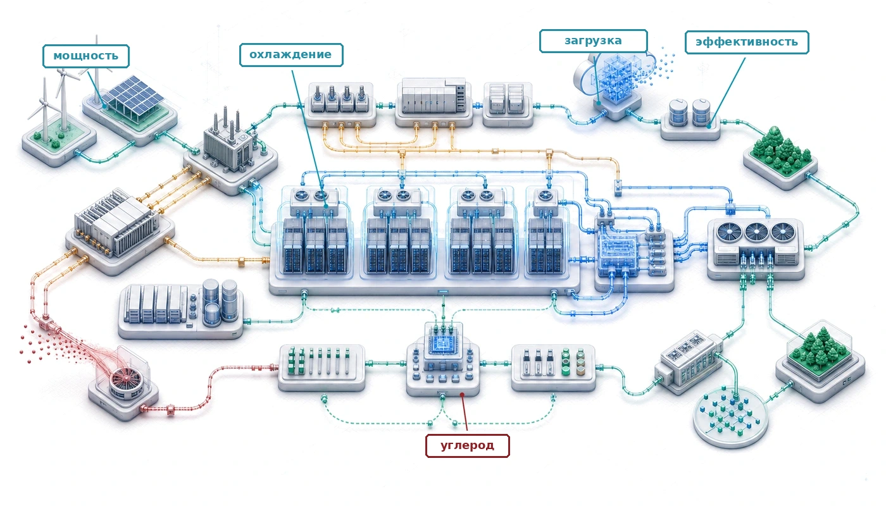

## Назначение

_Почему энергопотребление определяет, какие системы машинного обучения вообще могут существовать, а не только сколько стоит их эксплуатация?_

Энергия — это одновременно эксплуатационный расход и физическое ограничение на то, что можно построить. У центра обработки данных (ЦОД) фиксированный бюджет, который задают электрическая инфраструктура и мощность охлаждения: обучение, которое этот бюджет превышает, не может идти дальше, каким бы финансовым ресурсом ни располагала команда. Мощность энергосети и возможности охлаждения также ограничивают место развертывания. В крупнейших масштабах физическая осуществимость зависит от энергоэффективности не меньше, чем от алгоритмических возможностей. Поэтому устойчивость должна стоять в одном ряду с точностью и задержкой при проектировании системы. В терминах C³ никакое сочетание вычислений, коммуникации и координации не может превысить мощность, которую обеспечивает объект.

> **Цели обучения**
>
> - Объяснять, почему мощность и охлаждение объекта ограничивают, какие системы машинного обучения физически могут существовать
> - Анализировать рост вычислений, эффективность оборудования и эффект отскока спроса, чтобы прогнозировать потребность парка в ресурсах
> - Рассчитывать эксплуатационный, воплощенный и полный жизненный углерод по энергопотреблению, PUE, производству и углеродоемкости сети
> - Анализировать узкие места энергии: эксплуатацию, перемещение данных, охлаждение, воду и ограничения системы электроснабжения
> - Сравнивать обучение, инференс, граничные и федеративные нагрузки по энергии, углероду и бюджету батарей
> - Проектировать меры смягчения на уровне алгоритмов, инфраструктуры, планирования, срока службы оборудования и операций с учетом углерода
> - Оценивать заявления о политике, углеродных компенсациях и экологической справедливости по измеримому снижению выбросов парка

<a id="sec-sustainable-ai-sustainable-ai-engineering-discipline-6d39"></a>

## Энергетический потолок

Модель может быть защищена от состязательных атак и устойчива к сдвигу распределения, но все равно выйти из строя, если доступная сеть не может питать ее ускорители или объект не может их охладить. **Устойчивость** начинается на этой границе: там, где точности, задержки и надежности уже недостаточно, потому что система должна также укладываться в бюджеты мощности, охлаждения, воды, углерода и срока службы оборудования. Энергия — главная валюта машинного обучения, а плотность мощности — потолок вычислительной емкости дата-центра.[^fn-joule-energy-scale]

Когда инженер оптимизирует запрос к базе данных, чтобы сэкономить 100 мс, это обычная настройка производительности. В масштабе парка та же экономия, повторенная миллиарды раз в день, превращается в мегаватты электрической нагрузки, тепловой нагрузки на охлаждение и предотвращенные выбросы углерода (Lacoste et al., 2019). Система, которая выходит за пределы своей рабочей области, терпит операционный отказ в том же смысле, что и система, которая падает: ее нельзя развернуть в нужном масштабе.

[^fn-joule-energy-scale]: **Энергетическая шкала джоуля**: один ускоритель A100 при пиковой нагрузке потребляет около 400 джоулей в секунду (400 Вт). У обучения больших моделей нет одного обоснованного диапазона в джоулях: размер модели, число аппаратных устройств, реальная мощность, загрузка и длительность прогона могут каждый раз менять суммарную энергию на порядки. Инженерный урок лежит в переходе от повторяющихся затрат на операцию к энергии объекта, поэтому глава сообщает измеренную или смоделированную энергию нагрузки, а не относит каждый крупный прогон к одному фиксированному диапазону.

Этот потолок делает устойчивость проектным ограничением, а не категорией отчетности. Та же инженерная дисциплина, которая распределяет память, пропускную способность и отказоустойчивость, должна распределять джоули, нагрузку на охлаждение, воплощенный углерод и циклы замены оборудования.

Современные приложения машинного обучения работают в промышленных масштабах, и их воздействие на окружающую среду сопоставимо с воздействием давно существующих тяжелых отраслей. Обучение одной большой модели ИИ может потребить столько же электроэнергии, сколько за целый год потребляют около 120 американских домохозяйств. Спрос на вычисления растет быстрее эффективности оборудования (Sevilla et al., 2022); в этой книге разрыв между ними называется **парадоксом устойчивости**. Устойчивый ИИ рассматривает этот разрыв как системную задачу первого класса, а не как внешний эффект, которым нужно управлять после развертывания.

<a id="dfn-sustainable-ai-sustainable-ai"></a>

> **Определение: устойчивый ИИ**
>
> ***Устойчивый ИИ*** — это инженерная практика измерения и оптимизации полной экологической стоимости систем машинного обучения (энергии, воды и воплощенного углерода на этапах обучения, инференса и производства оборудования) и включения этих затрат в архитектурные решения как явных ограничений наравне с целями производительности и точности (van Wynsberghe, 2021; Lannelongue et al., 2021; Henderson et al., 2020).
>
> 1.  **Значимость**: обучение GPT-3 потребило около 1 287 МВт·ч энергии (Li, 2020), что эквивалентно примерно 120 годам электроснабжения американских домохозяйств. Та же логика жизненного цикла действует и после обучения: предобученные модели часто можно адаптировать с гораздо меньшими затратами, чем обучать с нуля, а массовый инференс со временем может доминировать в общем энергопотреблении. Поэтому устойчивый ИИ учитывает и разовые прогоны обучения, и повторяющиеся нагрузки обслуживания, а не считает обучение всем углеродным следом.
> 2.  **Различие**: в отличие от корпоративной отчетности об устойчивом развитии, которая сводит энергопотребление в годовые раскрытия выбросов CO₂, инженерия устойчивого ИИ работает на уровне отдельной нагрузки: выбирает оборудование по эффективности FLOP/с на ватт, планирует обучение на периоды высокой доли возобновляемой энергии и выбирает архитектуры, которые минимизируют FLOP инференса, а не просто максимизируют точность.
> 3.  **Распространенное заблуждение**: часто считают, что переход на возобновляемую энергию решает проблему устойчивости. Для аппаратно-емкого машинного обучения воплощенный углерод (выбросы при производстве чипов, серверов и охлаждающего оборудования до того, как они выполнят хоть одно задание обучения) часто равен эксплуатационному или превышает его; более 50 процентов углерода жизненного цикла граничного устройства может приходиться на производство, поэтому срок службы оборудования и коэффициент его загрузки так же важны, как источник энергии.

Экологическое воздействие систем ИИ охватывает весь жизненный цикл: от производства полупроводников и строительства дата-центров до обучения, развертывания инференса и электронных отходов (van Wynsberghe, 2021; Gupta et al., 2022; Luccioni et al., 2023). Если рассматривать весь этот жизненный цикл как инженерную задачу, а не как упражнение корпоративной ответственности, устойчивость превращается из расплывчатой цели в измеримое инженерное требование. Чтобы оптимизировать этот след, сначала нужно понять физическую энергию одного крупного прогона обучения.

<a id="chk-sustainable-ai-energy-intelligence"></a>

> **Контрольные вопросы: энергия интеллекта**
>
> Модель с 175 млрд параметров требует примерно $3{,}14 \times 10^{23}$ FLOP для обучения. Предположим PUE дата-центра 1,1 и сквозную реализуемую эффективность обучения 50 GFLOP/Дж:
>
> - Энергия обучения: рассчитайте полное энергопотребление в мегаватт-часах (МВт·ч).
> - Годы домохозяйств: переведите энергию прогона в годы домохозяйств, используя среднее потребление американского домохозяйства 10,7 МВт·ч в год.
> - Граница метрики: оцените, отражают ли годы домохозяйств истинную экологическую стоимость, если отделить энергопотребление (МВт·ч) от углеродоемкости, то есть граммов CO₂, которые сеть выбрасывает на киловатт-час поставленной энергии (г CO₂/кВт·ч).

Эта оценка в годах домохозяйств — ставка, но это лишь электричество, входящее в здание. Следующий вопрос — куда физически уходит эта энергия: сколько доходит до ускорителей, сколько съедают накладные расходы охлаждения и распределения питания и как сеть за счетчиком превращает киловатты в углерод.

<a id="sec-sustainable-ai-scale-environmental-impact-ac9a"></a>

### Масштаб воздействия на окружающую среду

Прогон обучения, измеряемый в мегаватт-часах, трудно осмыслить: мало кто представляет, что мегаватт-час электричества из сети означает для атмосферы. Пересчет этой энергии в выбросы, а затем в известный углеродный ориентир — CO₂ одного трансатлантического перелета — превращает абстрактное число в число с физическими последствиями.

<a id="nbk-sustainable-ai-carbon-cost-training"></a>

> **Сценарий: углеродная цена обучения**
>
> **Задача**: команда обучает большую модель (размера GPT-3), которая потребляет 1 287 МВт·ч. Сколько CO₂ выбрасывается и как это сравнить с трансатлантическим перелетом?
>
> **Расчет**:
>
> 1. **Энергия**: энергопотребление обучения составляет 1 287 МВт·ч = 1 287 000 кВт·ч.
> 2. Углеродоемкость (среднее значение по США): $\approx$ 0,429 кг/кВт·ч.
> 3. Суммарные выбросы: 1 287 000 кВт·ч $\times$ 0,429 кг/кВт·ч $\approx$ 552 123 кг.
> 4. Сравнение:
>     - Один пассажир, Нью-Йорк — Лондон (туда и обратно): $\approx$ 1 000 кг.
>     - Соотношение: 552 123 кг / 1 000 кг = 552,1.
>
> **Системный вывод**: одно обучение выбрасывает столько же углерода, сколько сотни перелетов туда и обратно через Атлантику. Оптимизация важна. При такой границе учета операционного электричества перенос задания на гидроэнергетическую сеть (0,020 кг/кВт·ч) сократил бы выбросы в 21,4 раза — примерно до 25,7 пассажирских перелетов туда и обратно. Сравнение не делает гидроэнергетику нулевой по жизненному циклу и не отменяет местного воздействия на воду и экосистемы.

Этот расчет показывает углеродную цену одного прогона; при масштабе крупного кластера следующее ограничение — способна ли вообще сеть подать на кластер нужную мощность.

<a id="lhs-sustainable-ai-archetype-gpt-4-llama-3-energy-wall"></a>

> **Архетип A (GPT-4/Llama-3): энергетическая стена**
>
> Архетип A (обучение класса GPT-4) наиболее наглядно показывает проблему мощности. Один кластер из 25 000 GPU, потребляющих по 700 Вт на чип, требует 17,5 МВт мощности ускорителей до учета серверов, сети и охлаждения. Ограничение физическое, а не финансовое: это проблема пропускной способности сети. Организациям, которые ведут нагрузки архетипа A, может понадобиться выделенная энергетическая инфраструктура или регионы с избытком возобновляемой энергии, поэтому планирование с учетом углерода (перенос несрочной работы на чистые часы сети) и географическая оптимизация (размещение нагрузок там, где мощность, охлаждение и ограничения по углероду подходят задаче) становятся ключевыми решениями парка наравне с подбором скорости обучения.

Уже эта нагрузка ускорителей, без учета серверов, сети и охлаждения, конкурирует с тяжелой промышленностью за мощность сети. Поэтому решающим рычагом становится то, где и когда выполняется задание; дальше идут расчеты именно об этом.

Сравнение двух регионов вручную еще посильно, но реальный парк взвешивает много регионов, изменчивую во времени углеродоемкость и региональные тарифы на электроэнергию одновременно. Такое пространство решений слишком велико, чтобы его оценить на глаз. Тогда выбор места становится задачей оптимизации, и поиск выполняет решатель.

<a id="exmp-sustainable-ai-automated-carbon-aware-scheduling-tier-3-optimizer"></a>

> **Пример: автоматическое размещение с учетом углерода**
>
> **Сценарий**: команда планирует крупный прогон обучения, которому нужно 10 000 МВт·ч энергии, и выбирает между тремя кандидатными регионами дата-центров с разными тарифами на электроэнергию и углеродоемкостью.
>
> **Диагностика**: если смотреть только на тарифы на электроэнергию, выигрывают регионы с дешевой ископаемой генерацией. При внутреннем углеродном налоге в \$100 за тонну `PlacementOptimizer` учитывает одновременно углеродоемкость сети и региональные тарифы и выбирает Квебек с полной стоимостью \$0,66 млн.
>
> **Системный урок**: планирование с учетом углерода переводит экологические внешние эффекты во внутренний критерий планирования парка. Оптимизатор показывает, что сети с высокой долей возобновляемых источников минимизируют истинную совокупную стоимость владения (TCO), когда углеродные штрафы учтены в размещении нагрузок машинного обучения.

Оптимизатор расписания рассматривает углеродоемкость как изменяющийся во времени входной параметр и переносит нагрузки на часы с низким уровнем выбросов внутри одного региона. Географическое размещение продолжает ту же логику в пространстве: поскольку национальные сети различаются по углеродоемкости на порядок, выбор места запуска задания может перевесить любой выигрыш от выбора времени запуска. Расчет в записной книжке [«География углерода»](#nbk-sustainable-ai-geography-carbon) выделяет этот географический фактор, удерживая спрос на энергию постоянным и меняя только сеть.

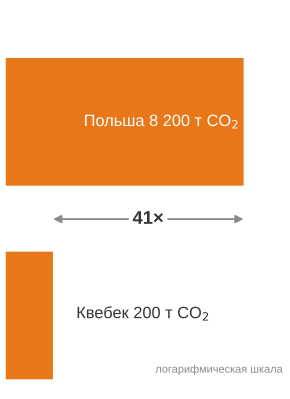

*Углеродный след того же задания зависит от места, где оно выполняется.*

<a id="nbk-sustainable-ai-geography-carbon"></a>

> **Сценарий: география углерода**
>
> **Задача**: команда выбирает дата-центр для обучения на 10 000 МВт·ч.
>
> - Площадка A (Квебек): гидроэнергетика, 20 г/кВт·ч CO₂.
> - Площадка B (Польша): в основном уголь, 820 г/кВт·ч CO₂.
>
> Как место размещения влияет на углеродный след модели?
>
> **Расчет**:
> Углерод = энергия $\times$ углеродоемкость сети.
>
> 1. Выбросы площадки A: 10 000 000 кВт·ч $\times$ 20 г/кВт·ч = 200 000 000 г = 200 т CO₂.
> 2. Выбросы площадки B: 10 000 000 кВт·ч $\times$ 820 г/кВт·ч = 8 200 000 000 г = 8 200 т CO₂.
> 3. Соотношение: 8 200 т / 200 т = разница в 41×.
>
> **Системный вывод**: выбор площадки доминирует над остальными рычагами модели. Пара «Квебек — Польша» дает разницу в 41×, что превышает многие распространенные выигрыши алгоритмической эффективности. Эффективность распространяется не только на FLOP, но и на углеродоемкость этих FLOP, поэтому планирование с учетом углерода становится операционной компетенцией первого класса в парке машинного обучения.

Пара «Квебек — Польша» служит каноническим ориентиром для географического рычага, который используется во всей главе. Углеродоемкость сетей мира различается примерно в 10–80 раз, а типичные пары регионов попадают в диапазон от 8 до 40 раз; точное значение зависит от того, какие две сети сравниваются и учитывается ли временная изменчивость. Последующие разделы приводят разные числа внутри этого диапазона, и каждое из них называет допущение, которое сдвигает результат.

Расчет в годах домохозяйств для GPT-3 задает масштаб нагрузки. Последствия для парка еще больше: Международное энергетическое агентство (IEA) прогнозирует, что глобальное потребление электроэнергии дата-центрами достигнет около 945 ТВт·ч к 2030 году, то есть чуть меньше 3 процентов мирового спроса на электроэнергию, при этом серверы с ускорителями ИИ обеспечивают значительную часть роста.[^fn-datacenter-power-scale] Вычислительные потребности выросли в 350 000 раз с 2012 по 2019 год (Schwartz et al., 2020), тогда как эффективность оборудования росла гораздо медленнее, что создает нерустойчивую траекторию роста.

[^fn-datacenter-power-scale]: **Промышленный масштаб дата-центров**: аналитический доклад IEA 2025 года *Energy and AI* прогнозирует, что к 2030 году дата-центры будут потреблять около 945 ТВт·ч электроэнергии, чуть меньше 3 процентов мирового спроса на электроэнергию. Это метрика спроса на электроэнергию, которую нельзя напрямую сравнивать с долями авиации или цементной промышленности в мировых выбросах, но она означает, что инфраструктура ИИ конкурирует с тяжелой промышленностью за мощности сети: регионы, которые не могут расширять генерацию, не могут расширять и развертывание ИИ, каким бы ни был спрос.

Помимо прямого потребления энергии, системы ИИ влияют на окружающую среду через производство оборудования и потребление ресурсов. Нагрузки обучения и инференса зависят от специализированных процессоров, для которых нужны редкоземельные металлы, добыча и переработка которых сопровождаются загрязнением.[^fn-gpu-embodied-carbon] Растущий спрос на приложения ИИ ускоряет производство электронных отходов: мировой объем таких отходов достигает 54 млн метрических тонн в год (Forti et al., 2020). Оборудование для ИИ быстро устаревает из-за растущих требований к производительности.[^fn-ewaste-hardware-disposal]

[^fn-gpu-embodied-carbon]: **Воплощенный углерод при производстве GPU**: отчет о углеродном следе продукта NVIDIA HGX H100 указывает 1 312 кг CO₂e на плату из восьми H100, или примерно 164 кг CO₂e на один H100 при равномерном распределении между восемью GPU (NVIDIA Corporation, 2025). Производство передовых техпроцессов также требует значительного объема сверхчистой воды, специальных газов, химикатов и высокотемпературных технологических операций. Этот воплощенный углерод означает, что в регионах с чистой сетью (гидро- и атомная энергетика) выбросы при производстве могут сравняться с эксплуатационным углеродом или превзойти его, делая срок службы оборудования и повторное использование важными рычагами устойчивости.

[^fn-ewaste-hardware-disposal]: **Электронные отходы от оборудования ИИ**: в 2019 году мировые электронные отходы достигли 53,6 млн метрических тонн, из них 15 процентов приходилось на вычислительное оборудование. Ускорители ИИ усиливают эту проблему: циклы устаревания 3–5 лет, вызванные быстрым развитием архитектур, означают, что парк из 10 000 GPU создает 10–20 метрических тонн токсичных отходов на каждом цикле обновления; в них содержатся свинец, ртуть и кадмий, которые требуют специальной утилизации.

Эти экологические вызовы — часть энергетического потолка, а не его надстройка: сообщества, которые предоставляют землю, воду, мощности сети и место для отходов, тоже несут часть системной стоимости. Эти расчеты масштаба превращают устойчивость в задачу распределения ресурсов. Прогресс ИИ создает выгоды в одной части системы, а издержки электричества, воды, земли и утилизации перекладывает на другую, поэтому экологическую ответственность нужно рассматривать как часть системного проектирования, а не как отчетность после развертывания.

<a id="sec-sustainable-ai-environmental-justice-responsible-development-3923"></a>

### Экологическая справедливость и ответственная разработка

Выбор площадки поэтому становится решением об экологической справедливости, а не только решением для фасилити-менеджмента. Экологическая устойчивость расширяет ответственность ML-систем от поведения модели до экологического попечительства (Vinuesa et al., 2020). Вычислительные ресурсы, нужные для разработки ИИ, сосредотачивают экологические издержки в конкретных сообществах и неравномерно распределяют выгоды между населением мира. Дата-центры создают нагрузку и на энергосеть, и на воду для охлаждения, а местное бремя зависит от структуры энергобаланса, водосбора и конкурирующих региональных нужд.

Такая географическая концентрация создает риски экологической справедливости, которые согласуются с более широкими рамками ответственного ИИ.[^fn-siting-environmental-justice] Здесь утверждение о справедливости узкое и системное: парк ML распределяет выгоды, потребление электроэнергии, использование воды, давление на землю и электронные отходы между разными сообществами. Сообщества, принимающие инфраструктуру ИИ, могут нести непропорционально большое экологическое бремя, имея при этом ограниченный доступ к экономическим выгодам ИИ, поэтому выбор площадки становится частью пространства инженерного проектирования, а не заботой фасилити-менеджмента.

[^fn-siting-environmental-justice]: **Экологическая справедливость при выборе площадки для дата-центра**: дата-центры тяготеют к дешевой земле и дешевому электричеству, что часто означает экономически неблагополучные районы. Результат — асимметричный внешний эффект: сообщества, которые принимают инфраструктуру ИИ, несут истощение водных ресурсов, эффект городского острова тепла и нагрузку на сеть, а экономические выгоды концентрируются в далеких технологических центрах. Для инженеров ML-систем это создает проектное ограничение: при выборе площадки нужно учитывать социальное согласие наряду с углеродоемкостью сети, потому что протесты сообщества могут заблокировать или задержать расширение объекта.

<a id="sec-sustainable-ai-exponential-growth-vs-physical-constraints-0f4e"></a>

### Экспоненциальный рост и физические ограничения

Быстрый рост вычислительных потребностей ставит под вопрос долгосрочную устойчивость обучения и развертывания ИИ. В окне 2012–2019 годов, которое рассматривается здесь, сообщаемые вычисления обучения ИИ выросли в 350 000 раз[^fn-compute-growth-scaling] (Schwartz et al., 2020). Многие крупные режимы обучения с тех пор продолжали отдавать предпочтение большим моделям, большим обучающим наборам данных или более высоким вычислительным бюджетам. Поддерживать такую траекторию трудно, когда прирост эффективности оборудования не успевает за спросом нагрузки. Эффективность на операцию выросла; общий спрос вырос быстрее. [«Историческая динамика вычислений ИИ»](#fig-ai-compute-growth) делает это несоответствие видимым, и именно поэтому прирост эффективности на FLOP не превращается в меньший счет за электроэнергию для прогона.

<a id="fig-ai-compute-growth"></a>

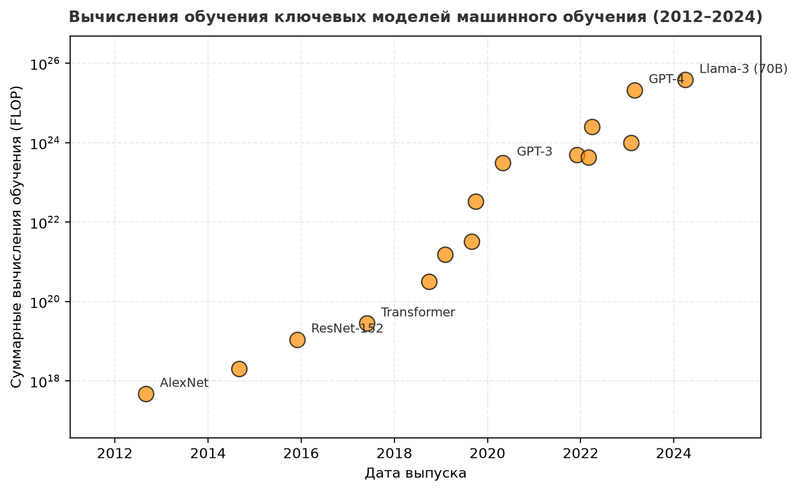

***Историческая динамика вычислений ИИ:** вычисления обучения ключевых моделей по дате выпуска на логарифмической шкале, охватывающей около восьми порядков величины. Наклон заметно выше темпа удвоения, который эффективность оборудования обеспечила за то же окно, поэтому суммарная энергия на прогон обучения выросла, хотя энергия на FLOP снизилась.*

[^fn-compute-growth-scaling]: **Темп роста вычислений ИИ**: рост в 350 000 раз с 2012 по 2019 год подразумевает время удвоения около 4,6 месяца, примерно в 5,3 раза быстрее удвоения каждые 2 года по закону Мура. Это расхождение — одна из основных движущих сил энергетической стены: никакое физически осуществимое улучшение кремниевой эффективности не может догнать темп удвоения, измеряемый месяцами, за счет одного лишь масштабирования техпроцесса, поэтому алгоритмическая эффективность и планирование с учетом углерода становятся центральными рычагами устойчивости в масштабе.

Исторически вычислительная эффективность росла вместе с развитием полупроводниковых технологий. Закон Мура предсказывал, что число транзисторов на чипе удваивается примерно каждые два года, что вело к непрерывному росту вычислительной мощности и энергоэффективности.[^fn-moores-law-sustainability] Однако передовые техпроцессы упираются в фундаментальные физические пределы, поэтому дальнейшее масштабирование транзисторов становится трудным и дорогим. Масштабирование Деннарда, которое когда-то гарантировало, что меньшие транзисторы работают при меньшей мощности, тоже закончилось, и это привело к застою в росте энергоэффективности на транзистор.[^fn-dennard-scaling-sustainability]

[^fn-moores-law-sustainability]: **Закон Мура**: наблюдение Гордона Мура 1965 года о том, что плотность транзисторов удваивается каждые два года, обеспечило десятилетия «бесплатного» прироста эффективности для полупроводниковой отрасли. На техпроцессах с однозначными нанометрами физические пределы делают дальнейший прогресс труднее: отдельные атомы становятся частью ограничения. Для устойчивости ИИ замедление масштабирования техпроцессов означает, что дополнительная эффективность должна приходить из архитектурной специализации и алгоритмической оптимизации, а не только из уменьшения размеров.

[^fn-dennard-scaling-sustainability]: **Масштабирование Деннарда**: Роберт Деннард в 1974 году показал, что меньшие транзисторы могут работать при постоянной плотности мощности, пропорционально снижая напряжение. Эта закономерность закончилась примерно в 2005 году, когда ток утечки сделал дальнейшее снижение напряжения непрактичным. Для устойчивости ИИ следствие прямое: без масштабирования Деннарда каждый новый техпроцесс больше не дает пропорциональной экономии мощности, что толкает работу по эффективности к специализированным ускорителям — графическим процессорам (GPU) и тензорным процессорам (TPU), которые используют архитектурный параллелизм, а не только физику транзисторов.

Когда модели ИИ масштабируются быстрее, чем улучшается оборудование, которое их выполняет, энергетический бюджет открывает разрыв, который должна закрыть алгоритмическая эффективность. Расхождение между вычислительным спросом и эффективностью оборудования ([«Энергетическая стена в цифрах»](#fig-energy-wall-quantitative)) создает нерустойчивую траекторию для окна роста вычислений 2012–2019 годов. Эта техническая реальность делает необходимым скоординированное действие по всему системному стеку — от отдельных алгоритмических решений до проектирования инфраструктуры и политических рамок.

<a id="fig-energy-wall-quantitative"></a>

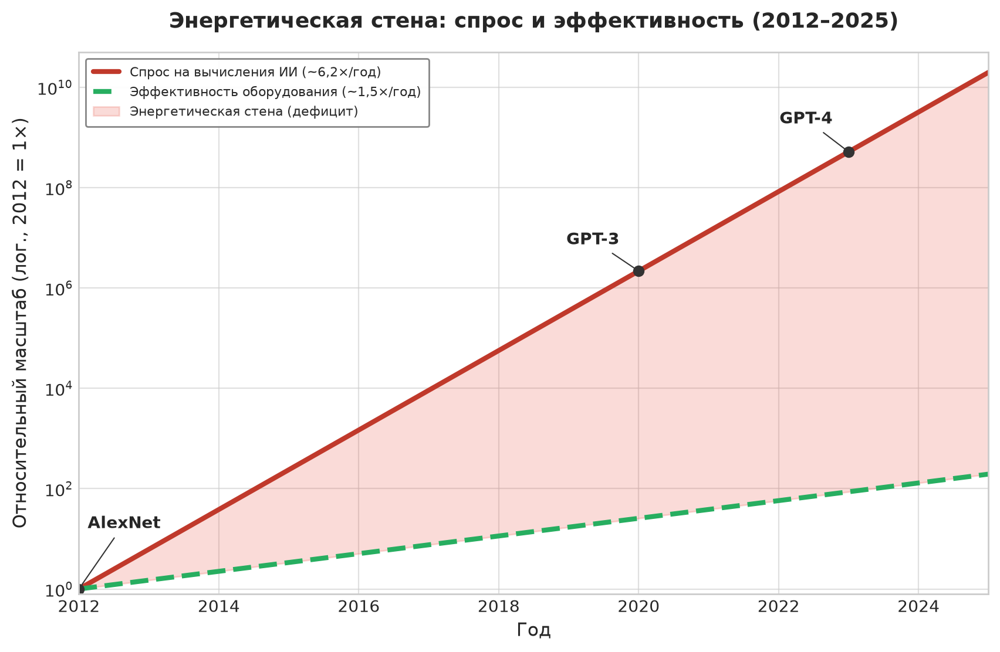

***Энергетическая стена в цифрах:** расхождение между ростом спроса на вычисления (примерно 6,2×/год, что соответствует историческому утверждению за 2012–2019 годы) и более медленным ростом эффективности оборудования (примерно 1,5×/год) создает огромный энергетический дефицит.*

Чтобы сделать неопределенность видимой, [«Сценарии чувствительности потребления дата-центров при высоком росте»](#fig-data-center-energy-usage) показывает сценарии чувствительности при высоком росте для потребления электроэнергии дата-центрами, а не более ранний базовый прогноз IEA. Разброс между лучшим, ожидаемым и худшим сценариями показывает, насколько сильно результат зависит от допущений о повышении эффективности и росте спроса.

<a id="fig-data-center-energy-usage"></a>


***Сценарии чувствительности потребления дата-центров при высоком росте:** потребление электроэнергии дата-центрами по миру в сценариях 2010–2030 годов при агрессивных допущениях о росте спроса. Три траектории — лучший, ожидаемый и худший случай — резко расходятся после 2018 года, показывая неопределенность и важность повышения эффективности; их следует читать как диапазон чувствительности, а не как базовый прогноз IEA.*

<a id="sec-sustainable-ai-energy-wall"></a>

### Энергетическая стена: расходящееся масштабирование

[«Энергетическая стена в цифрах»](#fig-energy-wall-quantitative) описывает энергетическую стену как расхождение между спросом на вычисления и эффективностью кремния, но эффективность кремния — лишь один из потолков. Даже если каждый ускоритель достигнет теоретического предела, остается второй потолок: физическая энергетическая инфраструктура, то есть удельная энергоемкость батарей и эффективность сети, которые растут гораздо медленнее спроса на вычисления. Устойчивость ИИ — уникальная инженерная задача, потому что это гонка двух принципиально разных физик: экспоненциального роста логики и линейного роста энергетической инфраструктуры.

Вычисления ИИ выросли примерно в 350 000 раз за 2012–2019 годы ([«Энергетическая стена»](#fig-energy-wall)), тогда как удельная энергоемкость батарей и эффективность сети улучшались лишь примерно на 2–5 процентов в год.

<a id="fig-energy-wall"></a>

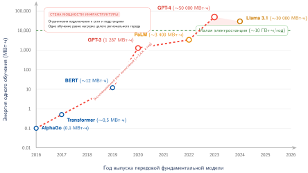

***Энергетическая стена:** энергия обучения (МВт·ч) за 2016–2026 годы относительно горизонтальной линии мощности электростанции; ключевые модели отмечены вдоль траектории. За это окно кривая по опубликованным оценкам поднимается примерно в 350 000 раз, тогда как удельная энергоемкость батарей и эффективность сети улучшаются лишь на 2–5 процентов в год; это и образует «энергетическую стену» — точку, где алгоритмические амбиции опережают физическую основу.*

Пока логика ИИ следует «железному закону» программной оптимизации, энергия подчиняется законам химии и термодинамики. За тот же семилетний интервал удельная энергоемкость батарей выросла бы лишь примерно на 40,7 процента при годовом темпе 5 процентов, а эффективность сети — примерно на 14,9 процента при годовом темпе 2 процента. Разрыв в 248 738,5 раза между этими кривыми и есть энергетическая стена: точка, в которой уже невозможно «купить выход» из проблемы эффективности, просто добавляя мощности.

<a id="sec-sustainable-ai-grid-dynamics"></a>

### Динамика энергосети дата-центра

Устойчивый ИИ требует смотреть дальше серверной стойки — на интерфейс с электрической сетью. Традиционные дата-центры — это нагрузки установившегося режима: они потребляют постоянную мощность круглосуточно. Кластеры обучения ML, напротив, создают переходные нагрузки.

<a id="ws-sustainable-ai-ireland-grid-constraint"></a>

> **Случай из практики: сеть становится узким местом (2022)**
>
> **Контекст**: в июле 2022 года правительство Ирландии опубликовало *Government Statement on the Role of Data Centres in Ireland's Enterprise Strategy* (заявление правительства о роли дата-центров в корпоративной стратегии страны), закрепив позицию страны по отношению к сектору, который к тому времени потреблял примерно 18 процентов измеряемой электроэнергии Ирландии — почти полностью в районе Большого Дублина (Government of Ireland, 2022; International Energy Agency, 2024).
>
> **Механизм**: заявки на подключение дата-центров опережали расширение электрических передающих сетей, и местная дублинская сеть подошла к физическим тепловым и вольтовым пределам, а сроки усиления растянулись на следующее десятилетие.
>
> **Последствия**: EirGrid ввела мораторий на новые подключения дата-центров в регионе Дублина до 2028 года, остановив развертывание новых кластеров вычислений ИИ.
>
> **Исправление**: операторы дата-центров внедрили накопители возобновляемой энергии на площадке, батарейное сглаживание нагрузки и географическую диверсификацию в регионы с избыточной возобновляемой мощностью.
>
> **Системный урок**: устойчивый ИИ ограничен подключением к сети, географией и адекватностью энергосистемы. Эффективные ускорители помогают, но парк не может расти быстрее сети, которая его питает, поэтому главным ограничением становится уже не чип, а подстанция.

То же ограничение интерфейса с сетью проявляется в миллисекундном масштабе, а механизм за ним — аппаратура распределения питания. Кластер из 10 000 GPU может менять нагрузку на 5–10 мегаватт во время шага синхронизации AllReduce. Для электроэнергетической компании это событие шума: когда тысячи GPU внезапно прекращают вычисления, чтобы дождаться сети, возникает скачок напряжения в сети; когда они возобновляют работу, возникает провал напряжения. Управление такими переходными процессами требует **энергетической буферизации**: батарейных массивов или мощных конденсаторов на площадке, которые сглаживают итерации обучения, чтобы парк ML не дестабилизировал местную муниципальную сеть.

Тепло — парное ограничение объекта: дата-центр физически превращает высококачественную энергию (электричество) в низкокачественную (отходящее тепло). Устойчивый парк рассматривает это тепло как утилизируемый побочный продукт, а не как загрязнитель. Современные объекты в странах Северной Европы, например, используют **централизованное теплоснабжение**, подавая отходящее тепло в городские системы отопления, а **промышленное использование тепла** может направлять низкопотенциальное тепло при температуре около 45 °C в теплицы или на опреснение воды. Такие схемы утилизации тепла дата-центров компенсируют тепловой спрос поблизости, а не выбрасывают все тепло в атмосферу[^fn-pue-efficiency-evolution] (Ebrahimi et al., 2014).

[^fn-pue-efficiency-evolution]: **PUE (power usage effectiveness)**: PUE сравнивает полную мощность объекта с мощностью, поставляемой ИТ-оборудованию (The Green Grid, 2007). Снижение нефункциональных накладных расходов повышает эффективность объекта, но метрика не отражает углеродоемкость электричества или воду, израсходованную на охлаждение. Поэтому коэффициенты углеродной эффективности (CUE) и водной эффективности (WUE) выявляют ограничения, которые одна лишь PUE оставляет невидимыми.

<a id="sec-sustainable-ai-training-scale-energy-concentration"></a>

### Концентрация энергии в масштабе обучения

Ограничения по сети, размещению и повторному использованию тепла становятся острыми, потому что крупные кампании обучения концентрируют спрос на энергию в длинные синхронизированные прогоны. Масштаб GPT-3 уже задан; новая системная проблема — временная концентрация и дополнительная энергия распределенной коммуникации при обучении.[^fn-comm-energy-overhead]

[^fn-comm-energy-overhead]: **Накладные расходы коммуникации при обучении**: распределенное обучение добавляет к энергетическому балансу сетевые передачи, простои синхронизации и ввод-вывод контрольных точек. Доля зависит от нагрузки и топологии: стратегия параллелизма, размеры тензоров, технология линков, потери загрузки и дополнительные итерации определяют, является ли коммуникация второстепенным слагаемым или главной энергетической статьей. Поэтому договор об измерении должен учитывать эти составляющие для конкретного прогона, а не применять универсальный процент.

Такая концентрация делает повышение эффективности инженерным императивом. Большие генеративные модели усугубляют проблему, когда каждое следующее поколение увеличивает число параметров, объем токенов или то и другое.

В диапазонах, изученных Kaplan et al. (2020), законы масштабирования моделей показали, что увеличение размера модели, объема данных и вычислений, используемых для обучения, плавно улучшает качество. [«Законы масштабирования моделей»](#fig-model-scaling) показывает, что тестовые потери предсказуемо снижаются в этих диапазонах по мере роста каждого из трех факторов. Помимо обучения, массово развернутые системы, например крупные рекомендательные системы и генеративные сервисы, требуют непрерывного инференса в масштабе и потребляют энергию даже после завершения обучения. Совокупная энергетическая нагрузка поэтому зависит и от однократного прогона обучения, и от устойчивого объема запросов после развертывания.

<a id="fig-model-scaling"></a>

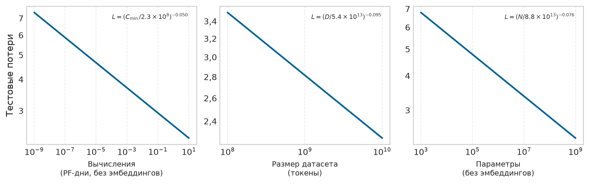

***Законы масштабирования моделей:** в диапазонах, изученных Kaplan et al. (2020), рост размера модели, объема данных и вычислений последовательно снижает тестовые потери. Рисунок воспроизводит обозначения исходной статьи, где $N$ — число параметров, а $C_{\min}$ — вычисления; в остальной книге для числа параметров используется $P$, а для числа операций — $O$. Эти законы масштабирования объясняют, почему большие модели, больше данных и больше вычислений стали привлекательными проектными решениями внутри этого режима.*

Выбор оборудования — первое место, где физика энергии становится архитектурным решением. Разные типы процессоров влияют на экологическое воздействие через свои энергетические характеристики. Если использовать пДж/FLOP как общую точку сравнения, центральные процессоры тратят около 100 пДж/FLOP, графические процессоры — примерно 10 пДж/FLOP на плотные тензорные операции, специализированные тензорные процессоры достигают примерно 1–2 пДж/FLOP, а фиксированные низкоточные ускорители приближаются к 0,1 пДж на операцию.[^fn-pjmac-energy-hierarchy] Эти аппаратные платформы требуют редкоземельных металлов и сложных производственных процессов с воплощенным углеродом.

[^fn-pjmac-energy-hierarchy]: **пДж/FLOP и пДж на операцию умножения с накоплением (MAC)**: спецификации энергоэффективности часто смешивают операции с плавающей запятой и умножение с накоплением (где 1 MAC = 2 FLOP), поэтому нужен пересчет между единицами и уровнями точности. Упрощенная иерархия, которую мы используем, согласуется с более поздними сравнениями в этой главе: CPU около 100 пДж/FLOP, GPU около 10 пДж/FLOP на плотные тензорные операции, TPU около 1–2 пДж/FLOP, а специализированные низкоточные интегральные схемы (ASIC) приближаются к 0,1 пДж на операцию. Точную энергию на операцию для форматов от FP64 до INT4 и кремниевых узлов 7, 5 и 3 нм см. в приложении «Системные допущения». Выбор подходящего уровня аппаратуры для данной нагрузки может снизить энергопотребление в 100–1000 раз без каких-либо алгоритмических изменений.

Производство чипов ИИ энергоемко: множество технологических стадий Протокол парниковых газов (GHG Protocol) относит к выбросам Scope 3 цепочки создания стоимости, а не к прямому потреблению электричества оператором. По мере роста моделей растет спрос на аппаратуру ИИ, что усиливает экологическое воздействие производства и утилизации полупроводников.

<a id="sec-sustainable-ai-theoretical-efficiency-limits-d880"></a>

### Теоретические пределы эффективности как модель устойчивости

Чтобы понять масштаб энергетической задачи ИИ, полезно сравнить крупные цифровые системы с теоретическими пределами вычислительной эффективности. Большие языковые модели (LLM) могут отставать по энергоэффективности примерно в $10^6\times$ от высокоэффективных физических и биологических систем распознавания образов. Сравнение приблизительное, а не эквивалентность «FLOP на синапс»: оно говорит о том, что плотные цифровые модели тратят огромную энергию на постоянную арифметику и глобальное перемещение данных, тогда как разреженные физические системы часто вычисляют только тогда, когда меняются сигналы. Этот разрыв — запас, который энергетическая стена оставляет на столе.

Этот разрыв указывает на механизм, а не на очередное сравнение масштабов моделей: плотный кремний тратит энергию на непрерывную активацию и глобальное перемещение данных, тогда как разреженные событийно-управляемые вычисления могут избегать работы, когда сигналы не меняются. Это мотивирует парадигмы вычислений, которые ставят энергетически осознанную архитектуру выше сырой пропускной способности.

<a id="sec-sustainable-ai-principles-highefficiency-computing-6a9b"></a>

#### Принципы высокоэффективных вычислений

Урок устойчивости из высокоэффективных вычислений состоит в том, где плотное машинное обучение тратит энергию: в непрерывной активации, в обучении, жадном к данным, и в глобальном перемещении. Три принципа делают эти каналы потерь явными:

- **Избирательная событийная активация**: вместо непрерывной обработки всей информации высокоэффективные системы асинхронны. Они активируют лишь небольшие участки сети в каждый момент и тратят энергию только на обработку меняющихся сигналов.[^fn-eventdriven-energy-efficiency]
- **Локальное обучение и эффективность по выборке**: плотное масштабирование языковых моделей часто требует обучения на триллионах токенов, чтобы достичь широкой компетентности. Высокоэффективные модели используют сильные индуктивные смещения и самообучение с локальными правилами, чтобы получать способности из данных, в 10 000 раз меньших (в мотивирующем биологическом сравнении), что снижает совокупную энергетическую стоимость фазы обучения.
- **Разреженность и разреженные соединения**: в нагрузках ускорителей с большим перемещением данных и глобальной синхронизацией энергия часто тратится на перемещение операндов, а не на арифметику. Высокоэффективные системы используют разреженные представления, где для любой задачи активны лишь 1–2 процента параметров, что снижает энергию пропускной способности и переключения в 50–100 раз, когда разреженность соответствует работе, которую аппаратура может увидеть и исключить.

[^fn-eventdriven-energy-efficiency]: **Событийные вычисления**: парадигма, в которой вычисление запускается только по изменению входа, а не по непрерывным тактам. Нейроморфные чипы вроде Intel Loihi используют это для снижения энергии в 100–1000 раз на временных задачах (аудио, видео, сенсорные данные), потребляя почти нулевую мощность, когда входы статичны. Компромисс: событийные архитектуры теряют пропускную способность на пакетных нагрузках, где все данные меняются одновременно.

Биологическая модель указывает на перспективные направления исследований для устойчивого ИИ. Архитектуры, реализующие **спайковые нейронные сети (SNN)** — событийные модели, которые обмениваются дискретными спайками, — или паттерны разреженной активации, могут дать заметное снижение энергии, имитируя разреженную коммуникацию[^fn-snn-neuromorphic-efficiency] (Prakash et al., 2023). Локальные алгоритмы обучения и самообучающиеся подходы открывают дополнительные пути к системам, которые эффективнее по выборке и бережнее к энергии.

[^fn-snn-neuromorphic-efficiency]: **Спайковые нейронные сети (SNN)**: нейронные сети третьего поколения, которые обмениваются дискретными спайками, а не непрерывными активациями. SNN обрабатывают информацию только тогда, когда происходят спайки, что дает экономию в 10–100 раз на временных данных (аудио, видео, сенсорные потоки). Компромисс для устойчивости: алгоритмы обучения SNN для многих тестовых задач пока менее зрелые, чем обратное распространение ошибки, но аппаратные реализации вроде Intel Loihi 2 показывают потолок эффективности, к которому могут приближаться эти архитектуры.

Достижение устойчивого ИИ требует системного сдвига в проектировании: от постоянно активных плотных архитектур к событийным разреженным моделям вычислений. Поскольку вычислительные потребности опережают инкрементальный прирост эффективности кремниевого производства, решение экологической проблемы ИИ требует пересмотра фундаментальной «физики» алгоритма на основе этих принципов эффективности.

[«Каскад мер по сокращению энергетического разрыва»](#fig-energy-intervention) показывает, как каскад из шести мер может сократить энергетический разрыв примерно в 10 000 раз, превращая неразрешимое расхождение в инженерную задачу. Шесть коэффициентов отдельных шагов на бумаге перемножаются в большее число, но заголовочные 10 000 раз — намеренно консервативная композиция: перекрывающиеся рычаги не складываются чисто, потому что каждая мера съедает сбережения, доступные следующей. Ни один рычаг не достаточен; закрыть разрыв можно только при одновременном прогрессе на алгоритмическом, аппаратном и системном фронтах.

<a id="fig-energy-intervention"></a>

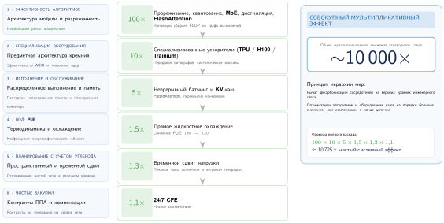

***Каскад мер по сокращению энергетического разрыва:** шесть последовательных мер постепенно закрывают энергетический разрыв. Совокупный каскад дает консервативную композицию порядка $10\,000\times$, которая ниже наивного произведения коэффициентов отдельных шагов, поскольку перекрывающиеся рычаги не складываются чисто и оставляют управляемый остаток, который инженерия может закрыть.*

Сочетание экспоненциального роста вычислительных потребностей с жесткими физическими пределами эффективности создает нерустойчивую траекторию, которая угрожает долгосрочной жизнеспособности масштабирования ИИ. Чтобы изменить эту траекторию, нужно выйти за пределы прикидочных расчетов и построить строгие системные рамки для измерения и оценки энергопотребления по всей инфраструктуре машинного обучения.

<a id="sec-sustainable-ai-part-ii-measurement-assessment-fb0b"></a>

## Измерение энергии и моделирование

Инженеры не могут оптимизировать то, что не могут измерить. Кластер, потребляющий пять мегаватт во время обучения большой языковой модели, направляет лишь часть этой мощности на матричные умножения: остальное потребляют центральные процессоры, память, сеть, преобразование питания и охлаждение. Эффективное энергетическое моделирование требует разложить суммарный счет за электроэнергию дата-центра на детальные метрики уровня отдельных компонентов, на которые инженеры могут нацеливать оптимизацию.

Основы инфраструктуры дата-центров из главы [«Вычислительная инфраструктура»](02_compute_infrastructure.md#sec-compute-infrastructure) показали, что питание и охлаждение являются главными инженерными ограничениями. Систематическое измерение превращает эти ограничения в практические показатели устойчивости по трем важнейшим направлениям: учет энергопотребления при обучении и инференсе, анализ углеродного следа на протяжении жизненного цикла систем и оценка использования ресурсов оборудования и инфраструктуры. Как инженерия производительности требует профилирования до оптимизации, так и инженерия устойчивого ИИ требует измерения до смягчения последствий.

Процедура принятия решений одинакова на протяжении всей главы: измерить доминирующую составляющую жизненного цикла, определить физическое узкое место, стоящее за ней, выбрать меру, которая меняет эту составляющую, и проверить, не сводят ли эффект отскока выигрыш на нет. Операционная электроэнергия, воплощенный углерод, накладные расходы охлаждения, потребление воды и электронные отходы требуют разных рычагов. Планировщик не может устранить выбросы производства, а долговечность оборудования не может исправить размещение выполнения с высокой углеродоемкостью, поэтому устойчивое проектирование начинается с поиска того члена, который действительно доминирует в нагрузке.

Утверждение об устойчивости сопоставимо только тогда, когда оно удовлетворяет **контракту измерения**. Контракт сначала называет функциональную единицу, например один завершенный прогон обучения или 1 000 обслуженных запросов при заданном качестве вывода. Затем он фиксирует границу системы, включая то, какие статьи вычислений, памяти, сети, объекта, производства и утилизации входят в учет (International Organization for Standardization, 2006). Запись также должна назвать правило распределения для общей инфраструктуры и воплощенных выбросов; сигнал углеродоемкости и то, является ли он средним или предельным; время и место работы; ограничения по качеству, задержке и надежности, которые определяют полезную работу; а также диапазон неопределенности и чувствительность к существенным допущениям. Результат, который не содержит какого-либо из этих полей, может диагностировать один компонент, но не может обосновать сквозное сравнение.

Этот контракт разделяет два вопроса, которые иначе легко смешать. **Атрибутивный учет** распределяет инвентаризацию наблюдаемых выбросов по нагрузкам для отчетности, обычно используя среднюю углеродоемкость сети и явную долю общей инфраструктуры. **Консеквенциальный учет** оценивает, как решение меняет выбросы, например моделируя генератор, который затрагивается, когда планировщик переносит один мегаватт-час нагрузки. Первый отвечает на вопрос, какая доля существующего следа принадлежит нагрузке; второй — на вопрос, меняет ли изменение нагрузки след (Present et al., 2024). Поэтому планирование с учетом углерода нуждается в сигнале, подходящем для консеквенциального анализа, даже если ретроспективная инвентаризация организации использует атрибутивные средние значения. Доступные предельные коэффициенты могут быть историческими оценками, прогнозами или недоступны на нужные время и место нагрузки, поэтому контракт должен фиксировать источник, разрешение и неопределенность, а не считать «предельное» значение универсально наблюдаемой величиной.

<a id="sec-sustainable-ai-carbon-footprint-analysis-ccc5"></a>

### Анализ углеродного следа

Анализ углеродного следа превращает устойчивость из общего обязательства в проектное ограничение. Он связывает энергопотребление, углеродоемкость сети и потребности жизненного цикла в ресурсах с теми же решениями, которые уже определяют производительность и эффективность. Поэтому команды, которые создают и развертывают системы ИИ, нуждаются в учетной модели на уровне нагрузки, прежде чем смогут выбирать между более крупными моделями, аппаратурой с меньшим энергопотреблением, более чистыми регионами или отложенным обучением.

Учетная модель важна, потому что делает этические компромиссы поддающимися аудиту. Погоня за более крупными моделями может ставить точность и возможности выше энергоэффективности и увеличивать выбросы углерода, когда рост вычислений опережает выигрыш в эффективности. Оптимизация ради устойчивости может создавать инженерные компромиссы, такие как дополнительные усилия по настройке, ограничения аппаратуры или изменение точности в зависимости от задачи, поэтому инженерная задача состоит в том, чтобы явно сопоставить эти издержки с экологической пользой. Учет экологических соображений при проектировании систем ИИ поэтому является инженерным обязательством, которое воплощается в энергоосознанных методах обучения, аппаратных решениях с малым энергопотреблением и стратегиях развертывания с учетом углерода (Schwartz et al., 2020; Patterson et al., 2021).

Прослеживаемость — техническое звено между измерением устойчивости и подотчетностью. Прозрачность, справедливость и подотчетность выступают как ограничения устойчивости ([«Этические проблемы ИИ»](#fig-ethical-ai)): пробелы в прозрачности скрывают затраты энергии и углерода, сбои справедливости распределяют вред неравномерно, а слабая подотчетность затрудняет отслеживание потребления ресурсов. Подотчетность означает возможность аудита заявлений о ресурсах. Команда должна уметь связать версию модели, прогон обучения, обслуживающую нагрузку, регион, источник энергии и оценку жизненного цикла достаточно хорошо, чтобы можно было проверить заявления об углероде и воде.

<a id="fig-ethical-ai"></a>

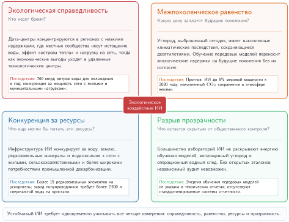
***Этические проблемы ИИ:** Четырехквадрантная схема проблем экологической справедливости и подотчетности в системах ИИ, охватывающая прозрачность, справедливость и устойчивость. Квадранты показывают, как проектные решения в одном квадранте (например, непрозрачность обучающих данных) передаются в результаты соседнего квадранта (например, дискриминационные предсказания или неотслеживаемое потребление ресурсов). Решение этих задач требует упреждающих проектных решений, которые ставят подотчетность на первое место и сводят к минимуму негативные социальные и экологические последствия.*

Чтобы измерение ограничивало проектирование, отчетные метрики должны раскрывать стоимость на уровне нагрузки, а не совокупные заявления масштаба облака, которые остаются непрозрачными, когда отчетность ведется на уровне всей компании. Практический стандарт — это подотчетность за потребление ресурсов на протяжении всего жизненного цикла ИИ, и он требует той же цепочки доказательств, что и для задержки, точности и надежности: заявление должно опираться на журналы, счетчики, версии моделей и решения о развертывании, а не только на агрегированные обязательства в области устойчивости. Расчет углеродного следа делает эту цепочку доказательств явной, объединяя энергию нагрузки, PUE объекта, углеродоемкость сети и воплощенный углерод.

<a id="nbk-sustainable-ai-lifecycle-carbon-estimation"></a>

> **Сценарий: оценка жизненного углеродного следа**
>
> **Задача**: рассчитать полный углеродный след обучения модели с 70 млрд параметров.
>
> Переменные: 2 048 GPU H100, 30 дней, тепловая расчетная мощность (TDP) 700 Вт, поддерживающая мощность стойки, PUE 1,12, углеродоемкость сети 429 г $\text{CO}_2$/кВт·ч.
>
> **Расчет**: мощность ускорителей = 2 048 $\times$ 0,7 кВт $\approx$ 1 433,6 кВт. Применение профиля стойки DGX H100 для учета узлов хоста, памяти, сети и преобразования питания поднимает ИТ-нагрузку до 1 971,2 кВт; мощность объекта = 1 971,2 кВт $\times$ 1,12 $\approx$ 2 207,7 кВт. Энергия = 2 207,7 кВт $\times$ 24 ч/сут $\times$ 30 дней $\approx$ 1 589 575,7 кВт·ч. Выбросы $\approx$ 681,9 т $\text{CO}_2$.
>
> Воплощенный углерод: считаем, что углеродный след производства составляет $\approx$ 164 кг $\text{CO}_2$ на один GPU H100, распределяя углеродный след продукта HGX H100 baseboard от NVIDIA поровну между восемью GPU (NVIDIA Corporation, 2025). Этот расчет использует распределение по времени: он относит задаче долю выбросов производства, соответствующую ее 1-месячной занятости при 3-летнем сроке службы. При этом объявленном правиле (2 048 $\times$ 164 кг) / 36 $\approx$ 9,3 т $\text{CO}_2$.
>
> **Результат**: 681,9 т + 9,3 т $\approx$ 691,3 т $\text{CO}_2$.
>
> **Системный вывод**: оперативная составляющая доминирует в этом окне обучения, но воплощенный углерод не равен нулю. Учет жизненного цикла не позволяет командам прятать выбросы производства за пределами бюджета обучения.

Время — одна обоснованная, но не единственная база распределения. Общие парки могут распределять воплощенные выбросы по часам работы ускорителей, зарезервированной мощности или доле полезных вычислений нагрузки. Выбранный знаменатель нужно указывать и применять последовательно; иначе задача с низкой загрузкой может выглядеть искусственно дешевой лишь потому, что простаивающую мощность оплачивает другой арендатор. Решения о закупках нуждаются как в нераспределенном итоге парка, так и в доле, отнесенной к нагрузке, потому что амортизация меняет владельца выброса в учетной книге, но не убирает его из атмосферы.

Поэтому каждая оценка жизненного цикла должна сопровождаться интервалом неопределенности, а не одной окончательной цифрой. Средняя мощность нагрузки, PUE, углеродоемкость сети, срок службы оборудования, загрузка и углеродный след производства измеряются или моделируются с разными погрешностями. Анализ чувствительности варьирует допущения, которые могут изменить решение: работу на чистой сети против работы на углеродоемкой, трехлетний против пятилетнего срока службы, малый против большого объема обслуживания. Затем он показывает, остается ли предпочтительный вариант предпочтительным. Точность арифметики не может компенсировать нестабильную границу системы.

Перевод энергопотребления в выбросы углерода — лишь первая задача измерения. Систематическая оценка жизненного цикла по всему циклу жизни оборудования показывает, где сосредоточены выбросы углерода и где инженерные меры дают наибольшую отдачу.

<a id="sec-sustainable-ai-threephase-lifecycle-assessment-framework-883a"></a>

#### Трехфазная схема оценки жизненного цикла

Практический вопрос — какая фаза жизненного цикла доминирует в данной нагрузке, потому что от ответа зависит, какой рычаг оптимизации выбрать. Поэтому эффективное измерение углеродного следа разделяет три фазы, которые вместе определяют воздействие на окружающую среду.

Для исследовательских нагрузок, ориентированных на обучение, фаза обучения часто доминирует в операционных выбросах, поскольку математическая оптимизация требует длительных параллельных вычислений.[^fn-optimizer-memory-overhead] Географическое размещение затем меняет операционный результат, потому что одна и та же нагрузка может попасть на сети с совсем разной углеродоемкостью.[^fn-grid-carbon-variance]

[^fn-optimizer-memory-overhead]: **Память оптимизатора как энергетическая стоимость**: Адаптивная оценка моментов (Adam) хранит оценки первого и второго момента для каждого параметра, в отличие от обычного стохастического градиентного спуска (SGD). Для модели на 70 млрд параметров в FP32 эти два буфера моментов составляют 560 ГБ, а параметры вместе с моментами — 840 ГБ (без градиентов). Вывод для устойчивости прямой: большее состояние оптимизатора означает больше обращений к памяти с высокой пропускной способностью (HBM) на каждом шаге обучения, а при 160 пДж на байт для DRAM перемещение данных может доминировать в энергетическом бюджете обновления параметров.

[^fn-grid-carbon-variance]: **Разброс углеродоемкости**: углеродоемкость сети различается на два порядка: уголь — 820 г CO₂/кВт·ч, гидроэнергетика — 10–30 г CO₂/кВт·ч. Важно, что интенсивность также меняется во времени: в Техасе она колеблется в 10$\times$ в течение одного дня в зависимости от ветровой генерации. Эта двойная географическая и временная изменчивость делает планирование с учетом углерода жизнеспособным: сочетание географического рычага (диапазон в 8–40 раз из [«Масштаб воздействия на окружающую среду»](#sec-sustainable-ai-scale-environmental-impact-ac9a)) с временным сдвигом смещает достижимый разброс к верхней границе диапазона в 10–80 раз, поэтому идентичные прогоны обучения могут различаться по выбросам в несколько раз только в зависимости от того, когда и где они выполняются.

Для массовых производственных сервисов фаза инференса может доминировать в выбросах за весь срок службы, потому что обслуживание модели повторяется непрерывно после завершения обучения. Хотя отдельный инференс требует меньше вычислений, чем обучение, совокупное воздействие растет вместе с широтой развертывания и частотой использования. Модели, обслуживающие миллионы пользователей, создают постоянные выбросы, которые за длительный период развертывания могут превысить затраты на обучение.

Фаза производства вносит воплощенный углерод от выпуска аппаратуры, включая изготовление полупроводников, добычу редкоземельных металлов и логистику цепочек поставок.[^fn-embodied-hardware-carbon] Ее доля меньше для долгих нагрузок на углеродоемких сетях, но на чистых сетях или у малозагруженного оборудования она может достигать 30–50 % выбросов за весь срок службы. Эту фазу часто упускают из виду, а между тем она представляет собой неустранимую базовую величину выбросов, не зависящую от операционной эффективности.

[^fn-embodied-hardware-carbon]: **Воплощенный углерод**: CO₂, выброшенный при производстве, транспортировке и утилизации до того, как устройство выполнит первую операцию FLOP. Равномерное распределение углеродного следа продукта HGX H100 baseboard от NVIDIA между восемью GPU дает примерно 164 кг CO₂e на один H100 (NVIDIA Corporation, 2025); при мощности 700 Вт на средней американской сети непрерывная работа уравнивает воплощенный углерод примерно за три–четыре недели. По мере того как дата-центры переходят на возобновляемую энергию, доля воплощенного углерода в полных выбросах за срок службы растет и может превышать 30 процентов, что делает циклы замены оборудования решением первого порядка для устойчивости.

<a id="sec-sustainable-ai-geographic-temporal-optimization-492c"></a>

#### Географическая и временная оптимизация

Углеродоемкость различается по географическим местам и периодам времени, что создает возможности для оптимизации. Временное планирование может снизить выбросы, когда нагрузки, допускающие отсрочку, переносятся на часы или регионы с меньшим углеродным следом; реальный выигрыш зависит от гибкости нагрузки, структуры генерации и от того, использует ли планировщик средние или предельные выбросы (Patterson et al., 2022; Radovanovic et al., 2021). Системы планирования с учетом углерода могут автоматически переносить несрочные задания обучения в регионы и на часы с меньшей углеродоемкостью.

Отслеживание углерода на этапе разработки важно тогда, когда оно влияет на решения о размещении и выборе сложности, а не превращается в отчет задним числом. Такие инструменты, как CarbonTracker (Anthony et al., 2020) и CodeCarbon (Schmidt et al., 2021), охватывают границу нагрузки, оценивают энергию по счетчикам аппаратуры или моделям загрузки, подставляют местную углеродоемкость сети и записывают полученные выбросы вместе с метаданными эксперимента. Важен не вызов API, а момент измерения: оценка должна появиться, пока размер модели, длительность обучения, регион и расписание еще можно менять, до того как прогон уже израсходовал энергию.

<a id="sec-sustainable-ai-power-modeling-fundamentals-67cb-67cb"></a>

### Основы моделирования мощности

Понимание того, куда уходит энергия в системах ИИ, требует опоры на физику цифровых вычислений. Уравнение мощности КМОП задает основу для рассуждений о потреблении энергии в цифровых процессорах, но полезная модель должна подниматься на три уровня: мощность кристалла объясняет, почему важны напряжение, точность и активность; методы оптимизации показывают, как алгоритмы меняют эти переменные; а метрики уровня объекта показывают, сохраняется ли экономия на уровне кристалла после накладных расходов охлаждения и подачи питания.

<a id="sec-sustainable-ai-cmos-power-equation-a33a-a33a"></a>

#### Уравнение мощности КМОП

Каждая цифровая схема потребляет мощность через два фундаментальных механизма. **Динамическая мощность** возникает при переключении транзисторов между состояниями, а **статическая мощность** определяется током утечки, который течет даже тогда, когда транзисторы номинально выключены. [«Уравнение мощности КМОП»](#eq-cmos-power) формализует полное потребление мощности:

<a id="eq-cmos-power"></a>

$$P_{\text{total}} = P_{\text{dynamic}} + P_{\text{static}} = \alpha_{\text{sw}} C V^2 f + V I_{\text{leak}}$$

Компонента динамической мощности $P_{\text{dynamic}} = \alpha_{\text{sw}} C V^2 f$ зависит от четырех параметров. **Коэффициент активности переключения** $\alpha_{\text{sw}}$ задает долю транзисторов, меняющих состояние за один такт, и изменяется от 0 до 1. Процессоры общего назначения обычно имеют $\alpha_{\text{sw}} \approx 0{,}1$–$0{,}3$ из-за разнообразия наборов инструкций, тогда как специализированные ускорители ИИ могут достигать $\alpha_{\text{sw}} \approx 0{,}6$–$0{,}8$ благодаря оптимизированному потоку данных, который держит больше схем активными во время вычислений. Емкость нагрузки $C$ масштабируется с числом транзисторов и длиной межсоединений. Напряжение питания $V$ входит квадратично, поэтому снижение напряжения — самый эффективный рычаг для энергоэффективности. Тактовая частота $f$ задает число операций в секунду.

Компонента статической мощности $P_{\text{static}} = V \cdot I_{\text{leak}}$ отражает ток утечки, который экспоненциально растет с температурой и примерно удваивается при каждом повышении на 10 градусов Цельсия. Эта температурная зависимость создает обратную связь: большая мощность порождает тепло, тепло увеличивает утечку, а утечка порождает еще больше тепла. Управление этим тепловым разгоном ограничивает достижимую плотность мощности и объясняет, почему инфраструктура охлаждения составляет такую большую долю энергопотребления дата-центра (Dayarathna et al., 2016).

Практические следствия для систем ИИ напрямую вытекают из этой физики. Квадратичная зависимость от напряжения означает, что снижение напряжения с 1 В до 0,8 В уменьшает динамическую мощность на 36 %, даже до учета того, что более низкие напряжения часто позволяют снизить частоту и получить дополнительную линейную экономию. Эта зависимость объясняет, почему специализированные ускорители ИИ, работающие при более низком напряжении, но с более высокой загрузкой, могут достигать улучшения эффективности на порядки по сравнению с процессорами общего назначения.

<a id="sec-sustainable-ai-optimization-techniques-save-energy-832c"></a>

#### Почему методы оптимизации экономят энергию

Уравнение мощности объясняет, почему конкретные методы оптимизации могут повышать эффективность. Квантование снижает численную точность, что может уменьшить арифметические блоки и количество байт, передаваемых по иерархии памяти. Реальное изменение энергии зависит от реализованных ядер, накладных расходов на упаковку и преобразование, трафика памяти, загрузки и исходного узкого места (Gholami et al., 2022). Меньшая точность сама по себе не позволяет снизить напряжение питания: напряжение и частота по-прежнему ограничены физической реализацией, технологическим процессом и запасами по времени. Поэтому квантование меняет составляющие операций и перемещения данных, но только измерение устанавливает сквозное снижение.

Прореживание удаляет веса из нейронных сетей и уменьшает эффективную емкость $C$, исключая пути вычислений, которые иначе потребляли бы энергию переключения. Структурированное прореживание, которое удаляет целые каналы или головы внимания, дает большую экономию, чем неструктурированное, потому что убирает целые пути в схеме, а не отдельные операции, которыми аппаратура все равно должна управлять.

Специализированные ускорители повышают коэффициент активности $\alpha_{\text{sw}}$, проектируя схемы специально для операций матричного умножения и свертки. Там, где процессор может задействовать 10 процентов транзисторов при типичных нагрузках ML, архитектура систолического массива может поддерживать 70 процентов и более вычислительных блоков активными, что эффективно дает больше полезной работы на единицу потребляемой мощности.

<a id="sec-sustainable-ai-facilitylevel-power-metrics-5558"></a>

#### Метрики мощности на уровне объекта

Помимо мощности кристалла, инфраструктура дата-центра создает дополнительные накладные расходы энергии. [«Формула PUE»](#eq-sustainable-ai-pue) описывает эту связь через показатель эффективности использования энергии (PUE):

<a id="eq-sustainable-ai-pue"></a>

$$\text{PUE} = \frac{P_{\text{total facility}}}{P_{\text{IT equipment}}}$$

<a id="dfn-sustainable-ai-pue"></a>

> **Определение: эффективность использования энергии (PUE)**
>
> ***Эффективность использования энергии (PUE)*** — это коэффициент эффективности дата-центра, который операторы систем ML используют, чтобы сравнивать полное энергопотребление объекта с энергией, потребляемой именно ИТ-оборудованием $(P_{\text{facility}} / P_{\text{IT}})$.
>
> 1.  **Значимость**: показатель измеряет накладные расходы инфраструктуры дата-центра. PUE 1,0 — теоретический идеал; PUE 1,10 означает, что на каждые 100 ватт вычислений требуется дополнительно 10 ватт на охлаждение и распределение питания.
> 2.  **Различие**: в отличие от вычислительной эффективности (которая измеряет FLOP на ватт), PUE измеряет эффективность объекта: сколько энергии «теряется» еще до того, как она достигает процессора.
> 3.  **Распространенное заблуждение**: часто считают, что низкий PUE означает «зеленый» дата-центр. На самом деле PUE измеряет только эффективность, а не углеродоемкость источника энергии: дата-центр на угле может иметь лучший PUE, чем дата-центр на солнечной энергии, и при этом иметь гораздо большее воздействие на окружающую среду.

<a id="nbk-sustainable-ai-pue-cost-cooling"></a>

> **Сценарий: PUE — стоимость охлаждения**
>
> **Задача**: команда эксплуатирует кластер мощностью 2 МВт. Если объект можно оптимизировать от среднего по отрасли PUE (1,58) до уровня лучших практик (1,10), сколько энергии и денег это сэкономит в год?
>
> **Расчет**:
>
> Экономия энергии — это разность накладных расходов инфраструктуры $(\text{PUE}-1)$ по ИТ-нагрузке.
>
> 1. **Снижение накладных расходов**: 1,58 − 1,10 = 0,48.
> 2. **Годовая экономия энергии**: 2 МВт $\times$ 0,48 $\times$ 8 760 ч/год $\approx$ 8 409,6 МВт·ч.
> 3. **Финансовая экономия**: 8 409,6 МВт·ч $\times$ \$70/МВт·ч $\approx$ \$588 672. Эта экономия достигается только на стороне объекта: модель при этом не меняется, а величина зависит от устранимых накладных расходов вне ИТ-оборудования, поэтому оптимизация охлаждения важнее всего на неэффективных объектах.

PUE 1,0 означал бы идеальную эффективность, когда вся энергия идет на вычисления, однако физически это невозможно, поскольку охлаждение, распределение питания и освещение требуют ненулевой энергии. Средние по отрасли дата-центры работают при PUE от 1,5 до 2,0, то есть от 50 до 100 процентов дополнительной энергии сверх вычислений уходит на инфраструктуру (Uptime Institute, 2022). Ведущие гипермасштабные объекты достигают PUE от 1,1 до 1,2 благодаря продвинутым методам охлаждения: свободному охлаждению наружным воздухом в холодном климате, жидкостному охлаждению плотных GPU-кластеров и оптимизированному распределению питания.

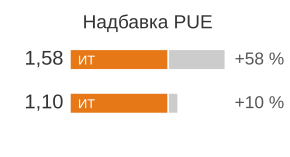

*PUE — это инфраструктурный налог на вычисления.*

[«Эффективность использования воды (WUE)»](#eq-wue) формализует **эффективность использования воды (WUE)**, отражая расход воды, который требуют испарительное охлаждение и другие процессы:

<a id="eq-wue"></a>

$$\text{WUE} = \frac{W_{\text{annual\_water\_usage}}}{E_{\text{IT\_equipment}}}$$

Единица измерения — литры на киловатт-час; типичные значения составляют от 0,5 до 2,0 л/кВт·ч в зависимости от климата и технологии охлаждения. Дата-центр с WUE 1,8 л/кВт·ч, на котором обучается модель, требующая 10 000 МВт·ч, потребит 18 миллионов литров воды, что эквивалентно примерно 40–50 годам водопотребления домохозяйств США при базовом уровне 380 000–450 000 л в год на домохозяйство.

Метрики уровня объекта показывают, где инженерное вмешательство дает наибольшую отдачу. Пример в разделе [«Случай из практики: энергоэффективность DeepMind»](#sec-sustainable-ai-case-study-deepmind-energy-efficiency-84fd) показывает, как оптимизация PUE с помощью машинного обучения напрямую превращается в измеримую экономию энергии.

<a id="sec-sustainable-ai-case-study-deepmind-energy-efficiency-84fd"></a>

#### Случай из практики: энергоэффективность DeepMind

Дата-центры Google составляют основу таких сервисов, как Поиск, Gmail и YouTube, которые ежедневно обрабатывают миллиарды запросов (Google Data Centers, 2023). Эти объекты требуют значительного электропотребления, особенно на инфраструктуру охлаждения, которая обеспечивает оптимальную работу серверов. Повышение энергоэффективности дата-центров давно было приоритетом, однако традиционные инженерные подходы сталкивались с убывающей отдачей из-за сложности систем охлаждения и крайне динамичных условий окружающей среды (Buyya et al., 2010). Чтобы решить эти задачи, Google совместно с DeepMind разработала систему оптимизации на основе машинного обучения, которая автоматизирует и совершенствует управление энергией в масштабе.

После более чем десятилетия усилий по оптимизации проектирования дата-центров, энергоэффективного оборудования и интеграции возобновляемой энергии подход DeepMind на основе ИИ был направлен на системы охлаждения, одни из самых энергоемких элементов дата-центра. Традиционное охлаждение опирается на вручную заданные эвристики, которые учитывают тепловыделение серверов, внешние погодные условия и архитектурные ограничения. Эти системы демонстрируют нелинейные взаимодействия, поэтому простые оптимизации на основе правил часто не способны уловить всю сложность их работы. Результатом была неоптимальная эффективность охлаждения, которая приводила к ненужным потерям энергии.

Команда DeepMind обучила нейронную сеть на исторических данных датчиков Google, которые включали показания температуры в реальном времени, уровни энергопотребления, активность насосов охлаждения и другие эксплуатационные параметры. Опираясь на более раннюю работу Джима Гао, показавшую, что машинное обучение может предсказывать PUE дата-центра с точностью 99,6 процента (Gao, 2014), модель выучила сложные взаимосвязи между этими факторами и могла динамически предсказывать наиболее эффективные конфигурации охлаждения. В отличие от традиционных подходов, при которых инженеры время от времени вручную меняли настройки системы, модель ИИ непрерывно адаптировалась в реальном времени к меняющимся условиям окружающей среды и нагрузки.

Результаты показали значительный рост эффективности. При внедрении в работающих дата-центрах система охлаждения на основе ИИ от DeepMind снизила энергопотребление охлаждения на 40 процентов и общие накладные расходы PUE на 15 процентов[^fn-pue-deepmind-cooling] (Barroso et al., 2019; Evans and Gao, 2016). Для объекта со средним по отрасли PUE 1,5 из [формулы PUE](#eq-sustainable-ai-pue) снижение накладных расходов возвращает значительную долю энергии, теряемой на охлаждение. Эти улучшения были достигнуты без дополнительных изменений оборудования, что демонстрирует потенциал программных оптимизаций для снижения углеродного следа ИИ.

[^fn-pue-deepmind-cooling]: **Оптимизация PUE с помощью ML**: лучшие объекты Google достигают PUE 1,08, то есть всего 8 процентов накладных расходов на охлаждение и распределение питания. Контроллер DeepMind на основе обучения с подкреплением снизил энергию охлаждения на 40 процентов, используя нелинейные взаимодействия между чиллерами, насосами и внешними условиями, которые упускают системы на основе правил. Это редкая положительная обратная связь: ИИ повышает эффективность инфраструктуры, которая питает сам ИИ.

Пример DeepMind иллюстрирует редкую положительную обратную связь: машинное обучение оптимизирует инфраструктуру, которая питает машинное обучение. Подход обобщается на разные проекты объектов и климатические условия и предлагает масштабируемый путь для глобальных сетей дата-центров.

<a id="sec-sustainable-ai-carbon-intensity-regional-variation-db41-regional-variation-db41"></a>

#### Углеродоемкость и региональные различия

Углеродный след потребления электроэнергии в решающей степени зависит от структуры генерации, которая измеряется углеродоемкостью в граммах CO₂-эквивалента на киловатт-час (г CO₂-экв./кВт·ч). [«Углеродоемкость по источникам энергии»](#tbl-carbon-intensity) показывает, насколько сильно эти значения различаются:

| **Источник энергии** | **Углеродоемкость** **(г CO₂-экв./кВт·ч)** |    **Примеры регионов**    |
|:------------------|:----------------------------------------:|:---------------------------:|
| **Уголь**          |               820–1 200               |    Польша, Западная Вирджиния    |
| **Природный газ**   |                350–500                | Электростанции комбинированного цикла в Техасе |
| **Солнечная (фотоэлектрическая)**      |                 20–50                 |     Калифорния, Аризона     |
| **Ветер**          |                 7–15                  |      Дания, Шотландия      |
| **Гидроэнергетика** |                 10–30                 |        Квебек, Норвегия       |
| **Атомная**       |                 5–20                  |       Франция, Онтарио       |

<a id="tbl-carbon-intensity"></a>

***Углеродоемкость по источникам энергии:** Углеродоемкость генерации электроэнергии различается более чем на два порядка в зависимости от источника. Географическое место выполнения вычислений может резко влиять на выбросы даже для одинаковых нагрузок, позволяя добиться снижения на порядки за счет стратегического размещения.*

Географическая оптимизация может снизить углеродные выбросы в 10–50$\times$ за счет стратегического выбора места обучения, что показано на [«Географическая углеродоемкость»](#fig-carbon-intensity) для репрезентативных регионов.

<a id="fig-carbon-intensity"></a>

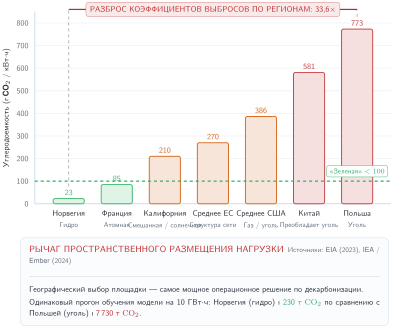
***Географическая углеродоемкость:** Углеродный след задания обучения критически зависит от того, где оно выполняется. Регионы с гидроэнергетикой или атомной энергией (например, Квебек, Франция) имеют углеродоемкость в 10$\times$–50$\times$ ниже, чем регионы, зависящие от угля (например, Польша, Западная Вирджиния). Планирование с учетом углерода использует этот разброс, перенося несрочные задания на более чистые сети.*

<a id="sec-sustainable-ai-systematic-energy-metrics-5779-5779"></a>

### Систематические метрики энергии

Количественная оценка энергоэффективности требует систематических метрик, которые позволяют сравнивать аппаратные архитектуры и алгоритмические подходы. Лестница метрик идет от энергии на операцию к энергии на байт и далее к связи арифметической интенсивности с перемещением данных в модели roofline. Такая последовательность важна, потому что оптимизация, которая сокращает FLOP, может почти ничего не дать для нагрузки, энергия которой уходит на перемещение байтов.

<a id="sec-sustainable-ai-energy-per-operation-776a-776a"></a>

#### Энергия на операцию

Базовая метрика вычислительной энергоэффективности — энергия, потребляемая на одну операцию, обычно измеряемая в пикоджоулях. Для нагрузок ИИ наиболее важны энергия на операцию с плавающей точкой и энергия на операцию умножения с накоплением (MAC), где одна операция MAC выполняет умножение и сложение и эквивалентна двум FLOP.

Аппаратная архитектура определяет энергоэффективность в пределах нескольких порядков величины: от процессоров общего назначения до специализированных аналоговых ускорителей разница достигает почти четырех порядков. [«Энергоэффективность по архитектуре»](#tbl-energy-per-op) показывает эту разницу:

| **Архитектура**             | **Энергоэффективность** **(пДж/FLOP или пДж/MAC)** | **Особенности**                               |
|:-----------------------------|:---------------------------------------------:|:--------------------------------------------------|
| **CPU (общего назначения)**            |                  100 пДж/FLOP                  | Низкая загрузка, высокая гибкость                 |
| **GPU (тензорные ядра)**       |                   10 пДж/FLOP                  | Высокая пропускная способность, параллельное выполнение               |
| **TPU (систолический массив)**     |                  1–2 пДж/FLOP                 | Специализированные матричные операции, оптимизированный поток данных |
| **Google Edge TPU**          |                  2–4 пДж/FLOP                 | Инференс на устройстве, оптимизация под INT8               |
| **ARM Ethos-U55**            |                 0,5–2 пДж/MAC                 | NPU для микроконтроллеров, менее 1 Вт, TinyML             |
| **Maxim MAX78000**           |                 0,3–1 пДж/MAC                 | CNN-ускоритель с локальным хранением весов         |
| **ASIC (INT8)**              |                0,1 пДж/операцию               | Схема с фиксированной функцией, низкая точность                     |
| **Аналоговые вычисления / вычисления в памяти** |               0,01–0,1 пДж/MAC               | Развивающаяся технология, вычисления в массиве памяти      |

<a id="tbl-energy-per-op"></a>

***Энергоэффективность по архитектуре:** Специализация аппаратуры дает до четырех порядков улучшения энергии на операцию. Ускорители дата-центров (TPU, GPU) оптимизированы под пропускную способность, а граничные ускорители (Ethos-U, MAX78000) — под энергию на инференс. Развивающиеся подходы аналоговых вычислений обещают дальнейший рост эффективности.*

Разброс в четыре порядка отражает как эффективность на уровне схем, так и архитектурные решения, влияющие на загрузку. Процессоры выполняют разнообразные наборы инструкций при низкой средней загрузке арифметических блоков. GPU достигают более высокой загрузки за счет массового параллелизма. TPU и ASIC максимизируют загрузку благодаря специализированным путям данных, оптимизированным под конкретные типы операций.

Точность влияет на энергию операции через реализацию арифметики и перемещение данных. Более узкие форматы могут уменьшать площадь схемы, переключаемую емкость и трафик памяти, но сама разрядность не определяет энергию на входе от сети и не дает универсального снижения напряжения. Значения по архитектурам в [«Энергоэффективность по архитектуре»](#tbl-energy-per-op) — это представительные точки разных платформ, а не контролируемый закон масштабирования INT8 против FP32; контракт измерения требует сравнения на одной платформе при фиксированном качестве.

<a id="sec-sustainable-ai-energy-per-byte-5d87-5d87"></a>

#### Энергия на байт

Перемещение данных часто доминирует в энергопотреблении нагрузок ИИ с низкой арифметической интенсивностью. Энергетическая стоимость обращения к памяти охватывает пять порядков величины по всей иерархии хранения:

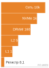

*Энергия перемещения одного байта различается на пять порядков: от регистра до сети.*

[«Энергетическая стоимость иерархии памяти»](#tbl-energy-per-byte) показывает важный вывод о стоимости энергии в иерархии памяти: перемещение данных из DRAM потребляет в 10–100 раз больше энергии, чем арифметические операции. Строки таблицы описывают путь от регистров через кэш L1 и кэш L2 к DRAM, энергонезависимой памяти NVMe (Non-Volatile Memory Express) и сетевым передачам. Для GPU, работающего при 10 пДж/FLOP, чтение одного операнда FP32 из DRAM (4 байта × 160 пДж/байт = 640 пДж) обходится в 64 раза дороже самих вычислений. Эта таблица делает иерархию энергии явной.

| **Уровень памяти** |             **Стоимость энергии**             |   **Задержка доступа**   |
|:-----------------|:-----------------------------------------------------:|:----------------------:|
| **Регистр**     |  0,1 пДж/байт |        1 такт         |
| **L1-кэш**     |  1 пДж/байт  |      3–5 тактов       |
| **L2-кэш**     |  5 пДж/байт  |     10–20 тактов      |
| **DRAM**         | 160 пДж/байт |    200–300 тактов     |
| **NVMe SSD**     | 1 000 пДж/байт | 50 000–100 000 тактов |
| **Сеть**      |  > 10 000 пДж/байт |   миллионы тактов   |

<a id="tbl-energy-per-byte"></a>

***Стоимость энергии в иерархии памяти:** Энергия на байт растет на порядки при движении вниз по иерархии памяти. Перемещение данных легко может доминировать над энергией вычислений.*

Из этого следуют проектные рычаги, направленные на перемещение данных, а не на арифметику:

- Память на кристалле для повторного использования данных (тензорные ядра NVIDIA с общей памятью)
- Оптимизированная раскладка данных, минимизирующая обращения к DRAM (систолические массивы Google TPU)
- Сжатие, снижающее перемещение данных (разреженные представления тензоров)

Вместе эти рычаги превращают устойчивость в задачу локальности и повторного использования, а не только в задачу более быстрой арифметики.

<a id="sec-sustainable-ai-arithmetic-intensity-energy-roofline-6d13-roofline-6d13"></a>

#### Арифметическая интенсивность и энергетический roofline

Баланс между вычислениями и перемещением данных определяет, будет ли потребление энергии ограничено вычислениями или памятью. [«Арифметическая интенсивность»](#eq-energy-arithmetic-intensity) задает арифметическую интенсивность — отношение, которое определяет, какой ресурс доминирует в энергопотреблении. В этих уравнениях $O$ — число операций в FLOP, $D_{\text{vol}}$ — объем данных в байтах, $E_{\text{compute}}$ — энергия на FLOP, а $E_{\text{move}}$ — энергия на перемещенный байт:

<a id="eq-energy-arithmetic-intensity"></a>

$$\text{AI} = \frac{O}{D_{\text{vol}}}$$

Арифметическая интенсивность, измеряемая в FLOP/байт, определяет доминирующего потребителя энергии. [«Полная энергия»](#eq-energy-total) выражает полную энергию как сумму вкладов вычислений и памяти, а [«Энергетический roofline»](#eq-energy-roofline) выделяет доминирующий член в духе roofline:

<a id="eq-energy-total"></a>

$$E_{\text{total}} = O \times E_{\text{compute}} + D_{\text{vol}} \times E_{\text{move}}$$

<a id="eq-energy-roofline"></a>

$$E_{\text{dominant}} = \max\left(O \times E_{\text{compute}}, D_{\text{vol}} \times E_{\text{move}}\right)$$

Максимальный член указывает доминирующее узкое место в рассуждениях roofline; в сбалансированных случаях он не равен полной энергии. [«Точка пересечения»](#eq-ai-crossover) задает пороговую арифметическую интенсивность, при которой энергии вычислений и памяти уравниваются:

<a id="eq-ai-crossover"></a>

$$\text{AI}_{\text{crossover}} = \frac{E_{\text{move}}}{E_{\text{compute}}}$$

Для GPU с $E_{\text{compute}}$, равным 10 пДж/FLOP, и $E_{\text{move}}$, равным 160 пДж/байт (доступ к DRAM):

$$\text{AI}_{\text{crossover}} = \frac{160 \text{ пДж/байт}}{10 \text{ пДж/FLOP}} = 16 \text{ FLOP/байт}$$

**Энергетическая модель roofline** ([«Энергетическая модель roofline»](#fig-energy-roofline)) показывает связь между арифметической интенсивностью и энергоэффективностью, выявляя, какие узкие места ограничивают разные типы нагрузок. Этот энергетический roofline переносит график производительности на энергетическую ось: исходный предел и анализ точки перегиба, отделяющий режимы, ограниченные памятью, от режимов, ограниченных вычислениями, приведены в приложении «Основы парка» (раздел о roofline), а здесь то же пересечение делит энергопотребление на определяемое памятью и определяемое вычислениями.

<a id="fig-energy-roofline"></a>

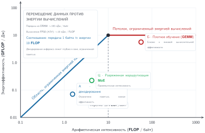
***Энергетическая модель roofline:** Так же как роофлайны производительности ограничивают FLOP/с по пропускной способности, энергетические роофлайны ограничивают FLOP/Дж. Нагрузки с низкой арифметической интенсивностью (слева) доминируются энергией памяти ($E_{\text{move}}$), а вычислительно тяжелые нагрузки (справа) ограничены энергией арифметики ($E_{\text{compute}}$). Оптимизация не той метрики дает убывающую отдачу.*

Эта схема непосредственно применима к самой распространенной операции глубокого обучения — матричному умножению.

<a id="nbk-sustainable-ai-matmul-energy-analysis"></a>

> **Сценарий: энергетический анализ умножения матриц**
>
> **Задача**: как размер матриц $N_{\text{mat}}$ определяет, доминирует ли энергия арифметики $E_{\text{compute}}$ или энергия памяти $E_{\text{move}}$ при умножении матриц $\mathbf{C} = \mathbf{A} \times \mathbf{B}$?
>
> **Расчет**:
>
> 1. Число операций и байтов: $2N_{\text{mat}}^3$ FLOP и $12N_{\text{mat}}^2$ байт (точность FP32).
> 2. Арифметическая интенсивность: $\text{AI} = \frac{N_{\text{mat}}}{6}$ FLOP/байт.
> 3. Сравнение режимов: [«Сравнение энергетических узких мест»](#tbl-matmul-energy-bottleneck-comparison) сравнивает члены энергии для малой, большой и векторной работы.
>
> | **Нагрузка**                                                                 | **Арифметическая интенсивность**                                   | **Энергия вычислений**                                 | **Энергия памяти**                                 | **Приоритет оптимизации**           |
> |:-----------------------------------------------------------------------------|:-----------------------------------------------------------|:---------------------------------------------------|:--------------------------------------------------|:------------------------------------|
> | Малая матрица ($N_{\text{mat}}=$ 96) | $\text{AI} = 96/6 = 16$ FLOP/байт | $2 \times 96^3 \times 10 \text{ пДж} = 17{,}69\,\text{мкДж} = 0{,}0177\text{ мДж}$ | $3 \times 96^2 \times 4 \times 160 \text{ пДж} = 17{,}69\,\text{мкДж} = 0{,}0177\text{ мДж}$ | Сбалансировано на точке пересечения           |
> | Большая матрица ($N_{\text{mat}} = 1000$)                                       | $\text{AI} = 1000/6 = 167$ FLOP/байт | $2 \times 10^9 \times 10 \text{ пДж} = 20\text{ мДж}$ | $3 \times 10^6 \times 4 \times 160 \text{ пДж} = 1{,}92\text{ мДж}$ | Повышать эффективность вычислений          |
> | Векторное сложение ($N_{\text{vec}} = 1000$)                                    | $\text{AI} = 1000/12000 = 0{,}083$ FLOP/байт   | $1000 \times 10 \text{ пДж} = 0{,}00001\text{ мДж}$   | $12000 \times 160 \text{ пДж} = 0{,}00192\text{ мДж}$   | Снижать перемещение данных за счет слияния ядер |
>
> <a id="tbl-matmul-energy-bottleneck-comparison"></a>
>
> ***Сравнение энергетических узких мест:** Одна и та же энергетическая модель классифицирует малую плотную, большую плотную и поэлементную работу по доминирующему члену энергии.*
>
> **Системный вывод**: оптимизация энергии следует той же логике узких мест, что и оптимизация задержки. Плотное матричное умножение вознаграждает эффективную арифметику; поэлементная работа вознаграждает сокращение перемещения данных.

Модель энергетического roofline показывает, почему разные стратегии оптимизации подходят разным нагрузкам. Большие плотные матричные операции выигрывают от более быстрых арифметических блоков. Операции, ограниченные памятью, например поэлементные ядра, выигрывают от оптимизации раскладки данных, слияния ядер для сокращения обращений к памяти и использования памяти на кристалле. Эта схема определяет архитектурные и алгоритмические решения при проектировании устойчивых систем ИИ.

<a id="sec-sustainable-ai-energy-measurement-techniques-590e-techniques-590e"></a>

### Методы измерения энергии

Количественная оценка энергопотребления систем ИИ требует измерений на нескольких уровнях аппаратного стека: от инструментов уровня кристалла до мониторинга всего объекта. Выбор метода сам по себе является инженерным компромиссом: аппаратные счетчики дают точную атрибуцию, мобильные профилировщики показывают подсистемы конкретной платформы, граничные измерители фиксируют поведение рабочего цикла, а системные инструменты связывают измерения компонентов с накладными расходами объекта, которые счетчики компонентов не видят.

<a id="sec-sustainable-ai-hardware-power-counters-0ec9"></a>

#### Аппаратные счетчики мощности

Современные процессоры предоставляют телеметрию мощности от производителя, которую программа может запрашивать через интерфейсы устройства. Эти счетчики дают оценки, коррелирующие с нагрузкой, в пределах шин питания и окон выборки, которые сообщает устройство; они не являются универсальной истиной для энергии на входе от сети, а частота обновления, калибровка и покрытие компонентов различаются от платформы к платформе. Внешние приборы по-прежнему необходимы, когда сравнение требует прослеживаемой полной энергии или более тонкого временного разрешения.

Интерфейс Intel **Running Average Power Limit (RAPL)** выдает измерения энергии для процессорных корпусов, DRAM и встроенной графики через регистры, специфичные для модели процессора. RAPL сообщает накопленную энергию, поэтому схема измерения основана на границах: снимаем показания счетчика до управляемого участка нагрузки, выполняем нагрузку, снимаем показания снова и делим разность энергии на прошедшее время, чтобы получить среднюю мощность. Это делает RAPL полезным для предобработки на CPU, загрузки данных и обучения на стороне хоста, но он же задает границу его применимости. RAPL не охватывает энергию дискретных GPU, может требовать повышенных прав и должен интерпретироваться с учетом области корпуса и переполнения счетчика.

GPU NVIDIA предоставляют измерения мощности через NVIDIA Management Library, доступную через утилиту командной строки `nvidia-smi` или программные привязки. Мониторинг мощности GPU обычно начинается с мгновенного потребления, которое динамически меняется во время вычислений, поскольку динамическое масштабирование напряжения и частоты меняет состояние устройства от ядра к ядру. Поэтому надежное измерение рассматривает интервал инференса или обучения как трассу: синхронизируем границу нагрузки, снимаем мощность с фиксированным шагом, интегрируем эти выборки по времени и сообщаем среднюю и пиковую мощность. Если GPU дата-центра предоставляют накопленные счетчики энергии, они предпочтительнее, потому что избегают наложения (алиасинга) коротких ядер между выборками.

Граничные устройства и микроконтроллеры создают другую задачу измерения. У них часто нет встроенных счетчиков мощности, они работают в милливаттных, а не киловаттных масштабах и требуют внешней инструментации для точного профилирования энергии. Решение зависит от того, какое временное разрешение, атрибуция по шинам и стоимость оправданы нагрузкой. Датчики тока INA219 и INA226 с интерфейсом I2C обеспечивают недорогие измерения для разработки и проверки, с частотой выборки, достаточной для фиксации энергопотребления на уровне инференса. Для исследований, требующих измерений отдельных операций с разрешением в наносекунды, такие приборы, как Joulescope JS220, измеряют ток от состояний сна ниже микроампера до пиков активности в амперах, что позволяет охарактеризовать весь динамический диапазон граничных нагрузок ИИ. Для больших парков TinyML измерение энергии на границе становится необходимым для полной оценки устойчивости, потому что малые погрешности на каждом устройстве суммируются в масштабе развертывания.

<a id="sec-sustainable-ai-mobile-platform-energy-profiling-7f9d"></a>

#### Профилирование энергии мобильных платформ

На мобильных платформах измерение зависит от того, насколько подробную атрибуцию предоставляет платформа. Доступные профилировщики обменивают прямые ватты на диагностическую ценность по компонентам:

- Android PowerStats HAL: предоставляет атрибуцию мощности по компонентам для CPU, GPU, NPU и радиоподсистем, позволяя разработчикам определить, какие операции модели доминируют в энергопотреблении.
- **Qualcomm Trepn Profiler**: обеспечивает измерение мощности с разрешением в миллисекунды на платформах Snapdragon, сопоставляя трассы мощности с выполнением кода для оптимизации нагрузок NPU.
- ARM Streamline: предоставляет профилирование с аннотацией энергии для платформ Cortex-A и GPU Mali, позволяя находить неэффективные реализации ядер.
- Apple Instruments Energy Log: сообщает о тепловом состоянии и оценках энергетического воздействия для приложений iOS, хотя без прямых измерений в ваттах.

Мобильные инструменты профилирования встраиваются в процесс разработки и позволяют итеративно оптимизировать энергопотребление инференса на устройстве при развертывании модели. [«Приборы для измерения мощности на границе»](#tbl-edge-power-monitors) сводит приборы для измерения мощности на границе по платформам, включая разрешение, точность и требования к интеграции.

| **Прибор**       | **Разрешение**                 | **Точность** | **Применение**                     |
|:---------------------|:-------------------------------|:------------:|:---------------------------------|
| **INA219/INA226**    | Выборка 100 мкс       |  $\pm 1\%$   | Недорогое профилирование встраиваемых систем      |
| **PAC1934**          | 1 миллисекунда, 4 канала      |  $\pm 2\%$   | Измерение многошинных MCU       |
| **Joulescope JS220** | Субмикросекундное, диапазон наноампер | $\pm 0{,}1\%$  | Профессиональный бенчмаркинг TinyML |
| **Otii Arc Pro**     | 10 мкс, автоматизация     | $\pm 0{,}5\%$  | Автоматизированное тестирование времени работы от батареи   |

<a id="tbl-edge-power-monitors"></a>

***Приборы для измерения мощности на границе:** Внешние измерители мощности позволяют измерять энергию на устройствах без встроенных счетчиков. Joulescope JS220 обеспечивает эталонную точность для исследований TinyML, а датчики серии INA — недорогое решение для проверки развертывания.*

<a id="sec-sustainable-ai-edge-measurement-methodology-c02a"></a>

#### Методология измерений на границе

Измерения энергии на границе полезны только тогда, когда они отражают реальный рабочий цикл развернутой системы, а не наилучший активный прогон инференса. Воспроизводимые результаты требуют четырех мер контроля:

- Требование: измерьте базовое потребление во всех состояниях сна, поскольку базовая мощность на типичных микроконтроллерах может меняться от 1 микроампера в глубоком сне до 1 миллиампера в активных состояниях простоя.
- **Настройка**: выполните 100 и более итераций инференса до измерения, в период **прогрева**, чтобы выйти на тепловое равновесие, поскольку начальные итерации могут показывать иные характеристики мощности из-за прогрева кэша и установления стабилизатора напряжения.
- **Ограничение**: учитывайте **рабочий цикл**, сообщая и пиковую мощность инференса, и среднюю мощность при реалистичных рабочих циклах, поскольку граничные устройства обычно работают со значительными периодами простоя между инференсами.
- Изоляция: отключите или учтите энергопотребление **периферии** (датчиков, радиомодулей и дисплеев) при измерении энергии инференса модели, поскольку они могут доминировать в полной мощности системы.

Для учета рабочего цикла [«Рабочий цикл»](#eq-edge-duty-cycle) выражает связь между активной и простойной мощностью:

<a id="eq-edge-duty-cycle"></a>

$$P_{\text{average}} = P_{\text{active}} \times \delta_{\text{duty}} + P_{\text{idle}} \times (1 - \delta_{\text{duty}})$$

где $\delta_{\text{duty}}$ — рабочий цикл (доля времени, в течение которого выполняется инференс).

<a id="sec-sustainable-ai-systemlevel-energy-profiling-eecf"></a>

#### Профилирование энергии на уровне системы

Полный учет энергии требует сочетания измерений на уровне кристалла с накладными расходами инфраструктуры. [«Полная энергия»](#eq-total-energy) формализует полную энергию как сумму вкладов компонентов, умноженную на накладные расходы объекта:

<a id="eq-total-energy"></a>

$$E_{\text{total}} = (E_{\text{CPU}} + E_{\text{GPU}} + E_{\text{memory}} + E_{\text{network}}) \times \text{PUE}$$

Ни один счетчик не охватывает весь путь энергии, поэтому системные профилировщики, такие как Intel VTune, NVIDIA Nsight Systems и открытые инструменты вроде PowerJoular, агрегируют измерения по компонентам. Счетчики на кристалле оценивают мощность устройства и могут различаться по частоте выборки, покрытию и калибровке; стоечный блок распределения питания (PDU) дает независимое измерение нижестоящей ИТ-нагрузки. Стоечный PDU не измеряет центральные чиллеры, насосы, освещение или потери преобразования на входе. Энергия объекта должна поэтому поступать от счетчиков объекта либо из явно согласованного по времени PUE, примененного к измеренной ИТ-нагрузке.

[«Мощность объекта»](#eq-facility-power) выражает связь между измеренной мощностью компонентов и полной энергией объекта:

<a id="eq-facility-power"></a>

$$P_{\text{facility}} = P_{\text{IT}} \times \text{PUE} = (P_{\text{servers}} + P_{\text{network}} + P_{\text{storage}}) \times \text{PUE}$$

Расчет PUE выше уже показал, как ИТ-нагрузка становится нагрузкой объекта. Однако эксплуатационная мощность — лишь один член; следующая модель объединяет эту измеренную энергию с заявленным сигналом сети и распределением воплощенного углерода, а не повторяет пример с объектом.

<a id="sec-sustainable-ai-carbon-footprint-calculation-c2fe"></a>

## Расчет углеродного следа

Рассмотрим дата-центр, питаемый сетью с преобладанием гидроэнергетики. Его операционная углеродоемкость может быть намного ниже, чем у сети на ископаемом топливе, но гидрогенерация не равна нулю на протяжении жизненного цикла, и система ИИ не является безуглеродной. Строительство и эксплуатация водохранилищ имеют последствия, а добыча кремния, производство GPU и заливка бетона под здание дата-центра выбросили углерод еще до того, как серверы были включены. Полный расчет следа должен учитывать операционную электроэнергию, воплощенный углерод и экологические эффекты, которые не входят в метрику, основанную только на углероде.

Записная книжка жизненного цикла в разделе [«Анализ углеродного следа»](#sec-sustainable-ai-carbon-footprint-analysis-ccc5) уже рассчитала операционный, воплощенный и полный углерод для одного прогона на 70 млрд параметров. Этот раздел превращает разобранный пример в формальную учетную модель: уравнения для каждого члена, которые обобщаются на разные нагрузки, сети и допущения об амортизации, а не дают одно числовое значение.

<a id="sec-sustainable-ai-operational-carbon-calculation-4627-calculation-4627"></a>

### Расчет операционного углерода

Операционные выбросы углерода возникают из-за потребления электроэнергии при обучении и инференсе и масштабируются углеродоемкостью сети. [«Операционный углерод»](#eq-operational-carbon) выражает это как произведение энергии, углеродоемкости сети и накладных расходов объекта:

<a id="eq-operational-carbon"></a>

$$C_{\text{operational}} = E_{\text{total}} \times \text{CI}_{\text{grid}}$$

где $E_{\text{total}}$ — энергия на уровне объекта из [«Полная энергия»](#eq-total-energy) (энергия компонентов уже умножена на $\text{PUE}$), а $\text{CI}_{\text{grid}}$ — углеродоемкость электросети. Накладные расходы объекта входят один раз, через $E_{\text{total}}$, поэтому в уравнении углерода они больше не появляются. Конкретный расчет выбросов при обучении иллюстрирует эту схему.

<a id="nbk-sustainable-ai-training-emissions-calculation"></a>

> **Сценарий: расчет выбросов при обучении**
>
> **Задача**: оценить операционный углеродный след обучения модели с 7 млрд параметров на 64 GPU A100 в течение 14 дней.
>
> **Расчет**:
>
> 1. Энергия вычислений: 64 GPU $\times$ 400 Вт $\times$ 336 часов = 8 601,6 кВт·ч.
> 2. Учет PUE и ИТ-поддержки: полная энергия объекта = 11 827,2 кВт·ч $\times$ 1,12 = 13 246,5 кВт·ч.
> 3. Расчет выбросов: на средней американской сети (углеродоемкость 429 г/кВт·ч) выбросы составляют 5,7 т. На гидроэнергетической сети Квебека (углеродоемкость 20 г/кВт·ч) выбросы составляют 264,9 кг.
>
> **Системный вывод**: один лишь географический выбор определяет разницу в выбросах обучения, которая составляет 21,4×. Размещение с учетом углерода меняет экологическую стоимость, не меняя архитектуру модели.

<a id="sec-sustainable-ai-embodied-carbon-assessment-9de0"></a>

#### Оценка воплощенного углерода

Для типичных развертываний операционная энергия доминирует в полной стоимости владения ([«Пятилетняя стоимость владения кластером»](#fig-carbon-tco)), но воплощенный углерод от производства полупроводников становится решающим ограничением по мере перехода сети на возобновляемые источники.

<a id="fig-carbon-tco"></a>

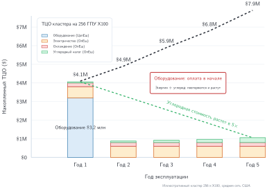
***Пятилетняя стоимость владения кластером:** Накопленная полная стоимость владения иллюстративного кластера из 256 GPU H100 при средней американской сети, с разделением капитальных затрат на оборудование и повторяющегося операционного набора: электричества, охлаждения и углеродного налога. Оборудование оплачивается в первый год и больше не повторяется, тогда как операционные расходы начисляются каждый год и превышают капитальные затраты в течение срока эксплуатации. Именно это пересечение делает загрузку и энергоэффективность, а не цену покупки, определяющими реальную стоимость владения кластером.*

По мере декарбонизации сетей узкое место смещается к воплощенному углероду от производства чипов и строительства дата-центров, и загрузка оборудования и его долговечность становятся рычагами устойчивости первого порядка.

Воплощенный углерод включает выбросы от добычи сырья, изготовления полупроводников, сборки, транспортировки и утилизации в конце срока службы. Для аппаратуры ИИ выбросы производства определяются энергоемкостью передовых полупроводниковых процессов.

Ускорители ИИ на передовых техпроцессах имеют значительный углеродный след производства: один GPU NVIDIA A100 воплощает примерно 150 кг CO₂-экв. на единицу (Luccioni et al., 2023), а углеродный след продукта HGX H100 от NVIDIA подразумевает примерно 164 кг CO₂-экв. на один H100 при равномерном распределении следа baseboard между восемью GPU (NVIDIA Corporation, 2025). В него входят изготовление пластин по передовым техпроцессам, производство памяти с высокой пропускной способностью и корпусирование. [«Ежедневная амортизация»](#eq-embodied-daily) распределяет этот воплощенный углерод на срок службы оборудования, чтобы рассчитать выбросы на одно использование:

<a id="eq-embodied-daily"></a>

$$C_{\text{embodied,daily}} = \frac{C_{\text{manufacturing}}}{T_{\text{lifetime}} \times 365}$$

Понимание того, как воплощенный углерод накапливается со временем, показывает, почему загрузка и срок службы оборудования определяют полные выбросы жизненного цикла.

<a id="psp-sustainable-ai-embodied-carbon-amortization"></a>

> **Перспектива: амортизация воплощенного углерода**
>
> Скрытая стоимость возникает при аренде GPU на час: плата покрывает не только электричество, но и амортизирует углеродный долг производства.
>
> Формула амортизации воплощенного углерода делает это распределение явным:
> $$C_{\text{total}} = C_{\text{operational}} + \left( \frac{C_{\text{manufacturing}}}{T_{\text{lifetime,years}} \times 365 \times 24} \times T_{\text{job,hours}} \right)$$
>
> **Сценарий**: обучение модели в течение 10 часов на 8 GPU NVIDIA H100.
>
> *   Операционный: 8 $\times$ 0,7 кВт $\times$ 10 часов = 56 кВт·ч. При 0,429 кг/кВт·ч (средняя американская сеть) = 24 кг.
> *   Воплощенный: 8 $\times$ 164 кг = 1 312 кг.
> *   Амортизация: срок службы = 3 года (26 280 часов).
>     *   Почасовая «аренда» = 1 312 кг / 26 280 часов $\approx$ 0,050 кг/ч.
>     *   Углерод на задание = 0,050 кг/ч $\times$ 10 часов = 0,5 кг.
>
> **Системный вывод**: для долгоживущего оборудования на грязных сетях доминирует электричество (24 кг против 0,5 кг). Однако на чистых сетях (гидро, 0,020 кг/кВт·ч) операционные выбросы падают до 1,1 кг, и воплощенный углерод становится заметной долей (около 30,8 %) полного следа.

Этот расчет предполагает 4-летний срок службы, немного длиннее трехлетнего окна амортизации, использованного в предыдущей оценке жизненного цикла; это допущение важно, потому что более длительный срок распределяет тот же углерод производства на больший объем работы и снижает долю на задание. Для ускорителя с воплощенным углеродом 150 кг (оценка A100, приведенная выше) и тем же сроком службы 4-летний первым шагом является ежедневная амортизация: 150 кг / (4 года $\times$ 365 дн./год) $\approx$ 0,103 кг в день.

Второй шаг относит эту дневную долю к заданию. Обучение длительностью 14 дней на 64 ускорителях несет 64 $\times$ 14 дней $\times$ 0,103 кг $\approx$ 92,1 кг CO₂ амортизированного воплощенного углерода.

Воплощенный вклад 92,1 кг составляет примерно 1,6 % от операционных выбросов (5 682,7 кг), рассчитанных выше для средней американской сети. Если бы обучение проходило на низкоуглеродной сети Квебека, где тот же прогон дает 264,9 кг операционных выбросов, воплощенный вклад составлял бы около 25,8 % от полных выбросов.

<a id="sec-sustainable-ai-lifecycle-carbon-accounting-99a1"></a>

#### Учет углерода жизненного цикла

Полная оценка жизненного цикла объединяет операционные и воплощенные выбросы по всем фазам. [«Углерод жизненного цикла»](#eq-lifecycle-carbon) суммирует эти вклады:

<a id="eq-lifecycle-carbon"></a>

$$C_{\text{lifecycle}} = C_{\text{training}} + C_{\text{inference}} + C_{\text{embodied}}$$

Обучение доминирует в этом срезе жизненного цикла одного развертывания ([«Углеродный жизненный цикл системы ML»](#fig-carbon-lifecycle)), тогда как производство и инференс остаются существенными факторами.

<a id="fig-carbon-lifecycle"></a>

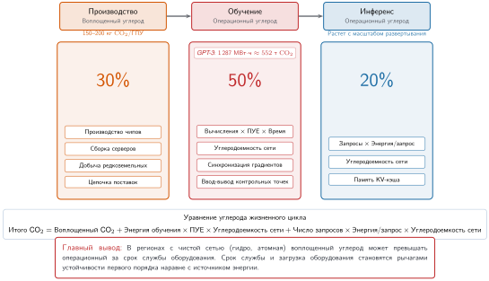
***Углеродный жизненный цикл системы ML:** Срез жизненного цикла одного развертывания, где обучение дает наибольшую долю, затем идут производство и инференс.*

Этот срез одного развертывания на [«Углеродный жизненный цикл системы ML»](#fig-carbon-lifecycle) показывает лишь часть картины. Накопленная картина противоположна: модель, обслуживающая миллионы запросов в день, может превзойти весь свой углеродный след обучения за месяцы, а для сервисов с большим трафиком — за дни. Поэтому оптимизация инференса становится мерой устойчивости с наибольшим эффектом для производственных систем на протяжении срока службы модели.

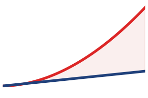

*Накопленные выбросы инференса превышают однократную стоимость обучения.*

Для моделей, развернутых в масштабе, выбросы инференса часто доминируют в жизненном цикле. Рассмотрим модель, обслуживающую 10 млн запросов в день по 0,001 кВт·ч на запрос. Годовая энергия и выбросы инференса распределяются так:

- Суточная энергия: 10 млн запросов $\times$ 0,001 кВт·ч = 10 000 кВт·ч
- Годовая энергия: 10 000 кВт·ч $\times$ 365 дн./год = 3 650 000 кВт·ч
- Годовые выбросы (сеть США): 3 650 000 кВт·ч $\times$ 0,429 кг/кВт·ч = 1 565 850 кг = 1 565,9 т

По сравнению с ранее разобранным примером обучения 7B на 64 A100 (выбросы 5,7 т) накопленные выбросы инференса превышают выбросы обучения примерно через 1,3 дня развертывания в таком масштабе. Для более крупных прогонов обучения точка пересечения может сдвигаться на недели или месяцы в зависимости от объема запросов, энергии на запрос и углеродоемкости сети. Перспектива жизненного цикла поэтому задает приоритет: оптимизировать эффективность инференса для широко развернутых моделей, а усилия по эффективности обучения направлять на модели, которые часто переобучаются или проходят экспериментальные итерации.

<a id="sec-sustainable-ai-regional-grid-intensity-data-sources-0b88"></a>

#### Источники данных о региональной углеродоемкости сети

Точный учет углерода требует данных о углеродоемкости сети, соответствующих принимаемому решению. Углеродоемкость в реальном времени меняется вместе со структурой генерации, которая ежечасно меняется в зависимости от спроса, доступности возобновляемых источников и решений о диспетчеризации станций. Выбор источника данных зависит от того, оценивает ли команда будущее задание, планирует ли работающую нагрузку или проводит аудит завершенного прогона.

Управление энергетической информации США (U.S. Energy Information Administration) публикует исторические коэффициенты выбросов сети по регионам, которые обновляются ежегодно. Эти средние значения дают грубую базу для инвентаризации или раннего планирования, но не отражают почасового предельного эффекта, необходимого для планирования гибкой нагрузки. Electricity Maps предоставляет оценки средней и жизненной углеродоемкости с разрешением по времени и отслеживанием потоков для охваченных сетей, а WattTime — сигналы предельных выбросов от работы станций, позволяющие оценить реакцию генератора на добавленную или снятую нагрузку. Для ретроспективного анализа завершенных прогонов обучения средние коэффициенты, согласованные по времени, поддерживают атрибутивные инвентаризации; предельные коэффициенты, напротив, оценивают, как перенос или отмена прогона изменили бы выбросы системы. [«Расчет углерода»](#lst-carbon-calculation) реализует калькулятор углеродного следа жизненного цикла, который объединяет измерения энергии с явно выбранным сигналом углеродоемкости сети:

<a id="lst-carbon-calculation"></a>

**Расчет углерода жизненного цикла**: вычисление полного углеродного следа, включая операционные и воплощенные выбросы.

```python
def calculate_carbon_footprint(
    gpu_power_watts: float,
    num_gpus: int,
    training_hours: float,
    it_power_multiplier: float,
    pue: float,
    grid_intensity_gco2_kwh: float,
    gpu_embodied_kg: float,
    gpu_lifetime_years: float,
) -> dict:
    """Рассчитать углеродный след жизненного цикла для прогона обучения."""

    # Операционные выбросы
    energy_wh = gpu_power_watts * num_gpus * training_hours
    gpu_energy_kwh = (energy_wh * watt * hour).to(kWh).magnitude
    it_energy_kwh = gpu_energy_kwh * it_power_multiplier
    facility_energy_kwh = it_energy_kwh * pue
    # г CO2 → кг (mlsysim пока не экспортирует единицы массы pint).
    operational_kg = (
        facility_energy_kwh * grid_intensity_gco2_kwh / THOUSAND
    )

    # Воплощенные выбросы (амортизированные)
    daily_embodied = gpu_embodied_kg / (gpu_lifetime_years * 365)
    training_days = training_hours / 24
    embodied_kg = num_gpus * training_days * daily_embodied

    return {
        "energy_kwh": facility_energy_kwh,
        "operational_carbon_kg": operational_kg,
        "embodied_carbon_kg": embodied_kg,
        "total_carbon_kg": operational_kg + embodied_kg,
        "embodied_fraction": embodied_kg
        / (operational_kg + embodied_kg),
    }

# Пример: обучение модели на 7B
_us_grid = Infrastructure.Grids.US_Avg
result = calculate_carbon_footprint(
    gpu_power_watts=400,
    num_gpus=64,
    training_hours=336,  # 14 дней
    it_power_multiplier=TrainingEmissions.it_power_multiplier,
    pue=_us_grid.pue,
    grid_intensity_gco2_kwh=_us_grid.carbon_intensity_g_kwh,
    gpu_embodied_kg=Hardware.Cloud.A100.embodied_carbon_kg,
    gpu_lifetime_years=4,
)
print(
    f"Полный углеродный след: {result['total_carbon_kg']:.0f} кг CO2"
)
print(f"Доля воплощенного углерода: {result['embodied_fraction']:.1%}")
```

Команды могут напрямую встроить учет углерода полного жизненного цикла в свои панели оркестрации, используя этот программный подход. Однако расчет операционных и воплощенных выбросов для отдельных прогонов обучения охватывает лишь одно измерение задачи. Макроуровневые закономерности того, как плотные дата-центры ИИ потребляют ресурсы в масштабе, выявляют дополнительные ограничения и возможности оптимизации.

<a id="sec-sustainable-ai-data-center-energy-consumption-patterns-09c0"></a>

## Энергия дата-центров и потребление ресурсов

Когда традиционный веб-сервер обрабатывает HTTP-запрос, процессор ненадолго поднимается до 20 процентов загрузки и сразу возвращается в простой. Когда кластер GPU обучает фундаментальную модель, тысячи процессоров работают на 100 процентах загрузки, непрерывно потребляя максимальную мощность три месяца подряд. Такая беспрецедентная и постоянная тепловая плотность принципиально ломает традиционное проектирование дата-центров и вынуждает инженеров переходить на жидкостное охлаждение и перепроектировать всю сеть распределения питания.

Поэтому устойчивость объекта нужно читать как цепочку ограничений, а не как одно значение PUE. Постоянный спрос на мегаватты задает подключение к сети и подверженность выбросам, подача питания определяет, какая доля электроэнергии становится полезной ИТ-нагрузкой, охлаждение решает, могут ли плотные стойки работать без троттлинга, а водопотребление определяет, является ли технически эффективный объект устойчивым на местном уровне.

<a id="sec-sustainable-ai-data-center-energy-ai-workloads-b1a8"></a>

### Энергия дата-центров и нагрузки ИИ

На уровне объекта цель оптимизации — уже не отдельная модель, а накладные расходы и сетевой контекст вокруг каждого ватта ИТ-мощности. Расчеты PUE и географии уже показали, почему одна и та же ИТ-нагрузка может создавать разные затраты на объект и углерод; здесь важно изменение совокупного спроса. В анализе IEA *Energy and AI* (2025) выбросы, связанные с потреблением электроэнергии дата-центрами, оценены примерно в 180 Мт, а в базовом сценарии к 2035 году прогнозируется около 300 Мт, при этом доля в полных выбросах энергетического сектора остается ниже 1,5 процента.[^fn-emissions-carbon-scale] Энергетическая нагрузка растет вместе с мощностью дата-центров, нагрузками обучения и спросом на инференс (Patterson et al., 2021), поэтому эффективность компонентов нужно оценивать относительно расширения парка (Thompson et al., 2023; Dodge et al., 2022).

[^fn-emissions-carbon-scale]: **Масштаб выбросов дата-центров**: в анализе IEA *Energy and AI* (2025) дата-центры потребляли примерно 1–2 процента мировой электроэнергии, причем ИИ способствует росту спроса. IEA оценила выбросы от потребления электроэнергии дата-центрами примерно в 180 Мт и спрогнозировала около 300 Мт к 2035 году в базовом сценарии, оставаясь ниже 1,5 процента от общих выбросов энергетического сектора. Крупнейшие гипермасштабные объекты могут непрерывно потреблять более 100 МВт, что эквивалентно энергоснабжению десятков тысяч домов.

<a id="sec-sustainable-ai-energy-demands-data-centers-b7ba"></a>

#### Энергетические потребности дата-центров

Релевантная величина для объекта — постоянная нагрузка мегаваттного класса, а не только название модели. Компании вроде Meta эксплуатируют гипермасштабные дата-центры, площадь которых сопоставима с несколькими футбольными полями, и содержат большие парки серверов, оптимизированных под ИИ.[^fn-hyperscale-facility-footprint] Неофициальные оценки предполагали, что для GPT-4 могли понадобиться десятки тысяч ускорителей класса A100 на протяжении месяцев (Patel and Wong, 2023), однако OpenAI не раскрывала ни аппаратное обеспечение GPT-4, ни объем вычислений обучения, ни размер модели, ни длительность обучения. Эти объекты опираются на высокопроизводительные ускорители ИИ, например GPU NVIDIA H100, архитектура которых ориентирована на высокопроизводительные тензорные нагрузки и лучшую производительность на ватт по сравнению с предыдущими поколениями (Choquette, 2023). Методы пониженной точности могут повысить эффективность вычислений и памяти, заменяя арифметику полной точности там, где это допускает точность модели (Gholami et al., 2022).

[^fn-hyperscale-facility-footprint]: **Масштаб гипермасштабного дата-центра**: объект Meta в Прайнвилле занимает 230 000 м² и содержит более 150 000 серверов; крупные облачные парки ежегодно потребляют электроэнергию в масштабах страны. Эти физические масштабы важны для устойчивости, потому что потребление каждого объекта (100–300 МВт) закрепляет десятилетия решений о зависимости от сети, которые никакая алгоритмическая оптимизация не может отменить.

Быстрое внедрение ИИ в разных отраслях и вызывает такое резкое потребление энергии. [«Прогнозируемый спрос»](#fig-ai-data-center-demand) иллюстрирует сценарий высокого роста, в котором нагрузки ИИ заметно увеличивают совокупный спрос дата-центров на энергию после 2024 года. Masanet et al. (2020) показывают, что этот сценарий нужно читать на фоне исторического контекста: повышение эффективности раньше сдерживало рост энергопотребления дата-центров, но устойчивый рост спроса может свести этот эффект на нет.

<a id="fig-ai-data-center-demand"></a>

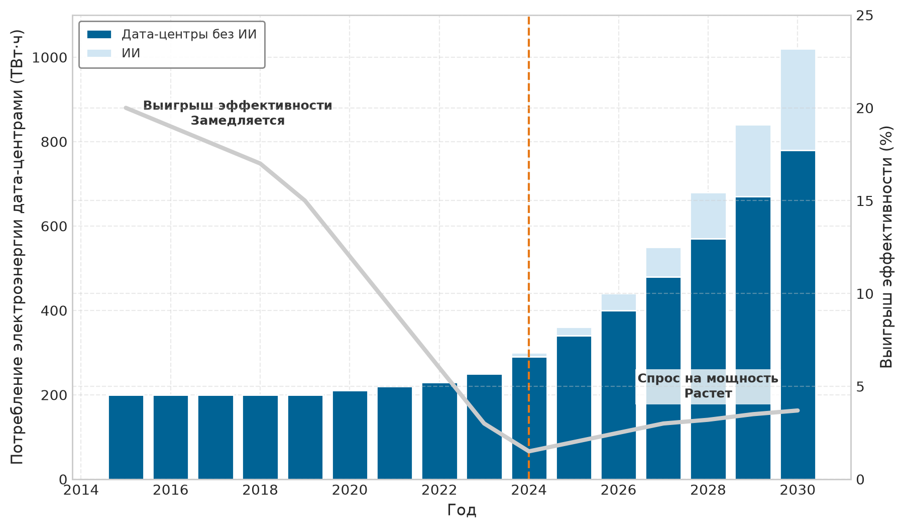
***Прогнозируемый спрос:** Иллюстративный сценарий высокого роста показывает, что нагрузки ИИ заметно увеличивают потребность дата-центров в мощности к 2030 году. Masanet et al. (2020) документируют исторические выигрыши эффективности, которые раньше сдерживали рост энергопотребления дата-центров; сложенные значения являются допущениями сценария, а не прямым прогнозом из этого источника.*

Помимо вычислительного спроса, охлаждение может составлять 30–40 процентов энергии объекта в традиционных конструкциях дата-центров с воздушным охлаждением, рассмотренных в работе (Ebrahimi et al., 2014). Это диапазон для данного типа проектов, а не константа для современных гипермасштабных или жидкостно охлаждаемых объектов; [«Охлаждение»](#sec-sustainable-ai-cooling) выводит специфичные для площадки накладные расходы через PUE и архитектуру охлаждения.

Если [«Прогнозируемый спрос»](#fig-ai-data-center-demand) показывает глобальные тенденции, то одни только Соединенные Штаты иллюстрируют, как облачная и ИИ-инфраструктура может менять национальное планирование энергетики. [«Энергетический разрыв»](#fig-energy-gap) показывает данные о потреблении электроэнергии дата-центрами США из Национальной лаборатории Лоуренса в Беркли (LBNL): потребление выросло втрое — с 58 ТВт·ч в 2014 году до 176 ТВт·ч в 2023-м. Прогноз LBNL рассматривает нагрузки ИИ как важный фактор дальнейшего роста и предсказывает удвоение или утроение к 2028 году; в верхнем сценарии дата-центры потребляли бы около 12 процентов электроэнергии США. Эта траектория представляет собой физическое ограничение масштабирования ИИ, которое одна лишь программная оптимизация не способна устранить.

<a id="fig-energy-gap"></a>

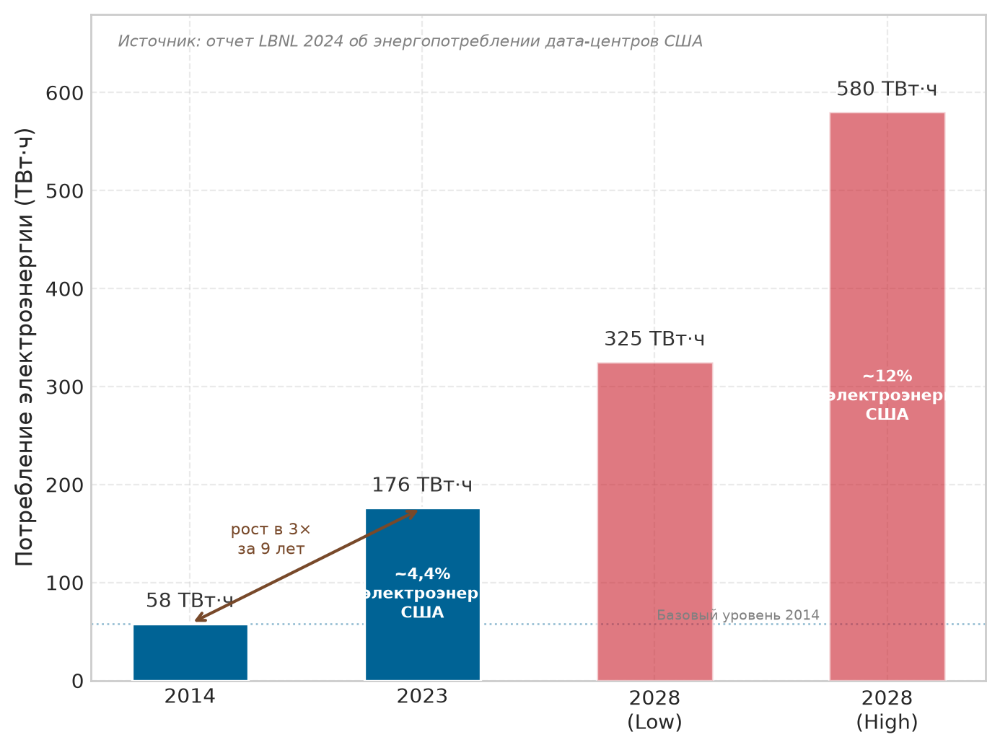
***Энергетический разрыв:** Потребление электроэнергии дата-центрами США утроилось — с 58 ТВт·ч (2014) до 176 ТВт·ч (2023). LBNL прогнозирует дальнейшее удвоение до 325–580 ТВт·ч к 2028 году, при этом нагрузки ИИ рассматриваются как важный фактор роста. В верхнем сценарии дата-центры потребляли бы около 12 процентов электроэнергии США, что представляет собой физическое ограничение масштабирования ИИ, которое одна лишь программная оптимизация не способна устранить.*

<a id="sec-sustainable-ai-distributed-systems-energy-optimization-5e83"></a>

### Оптимизация энергии распределенных систем

Крупномасштабное обучение ИИ по своей природе требует согласования распределенных систем, что создает дополнительные накладные расходы энергии и усиливает вычислительный спрос. Стратегии параллелизма, рассмотренные в [«Распределенном обучении»](05_distributed_training.md#sec-distributed-training-systems), обмениваются градиентами, параметрами или активациями, а простои из-за синхронизации оставляют другие компоненты под питанием.[^fn-parallelism-communication-overhead] Долю энергии нельзя вывести из одного лишь размера кластера, поскольку учет определяют топология, коллективный алгоритм, объем сообщений, перекрытие и загрузка. Некоторые шаблоны «все со всеми» также увеличивают трафик быстрее, чем совокупная полезная работа, по мере роста числа участвующих узлов.

[^fn-parallelism-communication-overhead]: **Энергетические накладные расходы параллелизма**: параллелизм данных, модели и конвейера создает разные затраты на коммуникацию и мощность простоя. Параллелизм данных уменьшает градиенты, тензорный параллелизм обменивается частичными активациями, а конвейерный параллелизм создает «пузыри». Корректное сравнение фиксирует качество модели и время обучения, а затем измеряет энергию сети и дополнительное время под питанием, вызванное координацией.

Чтобы справиться с этими накладными расходами на коммуникацию, энергетическая оптимизация всего кластера требует согласованного управления ресурсами, которое выходит за рамки эффективности отдельного сервера. Четыре эксплуатационных рычага меняют энергетический бюджет в масштабе кластера:

- Динамическое размещение нагрузок: объединяйте совместимые задания, когда это позволяет действительно неиспользуемому оборудованию перейти в состояние с меньшим энергопотреблением; проверяйте экономию по счетчику объекта, а не выводите ее из числа узлов.
- Планирование с учетом углерода: переносите гибкие задания на время или в регионы с меньшими значимыми для решения выбросами с учетом ограничений по перемещению данных, срокам и надежности.
- Совместное использование несколькими арендаторами: повышайте полезную загрузку ускорителей, не допуская, чтобы интерференция, очереди или дополнительные итерации свели на нет выигрыш в энергии.
- Пакетная обработка: объединяйте совместимые мелкие задания, когда более высокая загрузка перевешивает задержку пакетирования и любой эффект на качество или сходимость.

Общая закономерность — дисциплина загрузки: система экономит энергию, избегая включенных мощностей, которые не выполняют полезной работы модели.

<a id="sec-sustainable-ai-ai-energy-consumption-compared-industries-3d5d"></a>

### Углеродные эталоны для нагрузок ИИ

Экологическое воздействие нагрузок ИИ стало предметом беспокойства: выбросы углерода приближаются к уровням, сопоставимым с установленными углеродоемкими отраслями. (Strubell et al., 2019) сделали эту проблему конкретной, оценив, что обучение и поиск архитектуры масштаба разработки для большой модели обработки естественного языка могут выбросить столько же углерода, сколько несколько легковых автомобилей за весь срок их службы. Позднее (Patterson et al., 2021) показали, что самая широко цитируемая оценка поиска архитектуры сильно зависела от допущений о прокси-задаче, оборудовании, эффективности дата-центра и углеродоемкости сети. Чтобы поставить углеродный след ИИ в контекст, более крупные и точные модели семейства BERT имеют заметно более высокий углеродный след на запрос ([«Эталоны углеродного следа»](#fig-carbonfootprint)). Диаграмма рассеяния показывает, что варианты с наибольшей точностью находятся в правом верхнем углу и что углеродная стоимость растет быстрее, чем выигрыш в точности. Тот же компромисс подкрепляет необходимость более устойчивых практик ИИ.[^fn-nas-carbon-footprint]

[^fn-nas-carbon-footprint]: **Углеродная стоимость поиска нейронной архитектуры (NAS)**: цифра около 284 000 кг CO₂-экв. из (Strubell et al., 2019) описывает неоптимизированный поиск Evolved Transformer, которая резко снижается, если учитывать аппаратуру TPU, структуру генерации и прокси-задачи (Patterson et al., 2021). Системный урок — дисциплина границ: поиск, настройка и неудачные эксперименты входят в границу углеродного учета, но многоразовый поиск архитектуры следует амортизировать на все последующие развертывания. Эффективные методы NAS (совместное использование весов, поиск с учетом аппаратуры) уменьшают этот бюджет поиска, делая метаоптимизацию главным рычагом устойчивости (Elsken et al., 2019).

<a id="fig-carbonfootprint"></a>


***Эталоны углеродного следа:** Диаграмма рассеяния выбросов CO₂ на инференс (вертикальная ось) против точности задачи (горизонтальная ось) для нескольких моделей семейства BERT. Варианты с большей точностью находятся в правом верхнем углу; углеродная стоимость растет быстрее, чем выигрыш в точности, что подчеркивает экологическое воздействие стремления к предельному улучшению точности.*

Фаза обучения больших моделей обработки естественного языка может давать выбросы углекислого газа, сопоставимые с сотнями трансконтинентальных перелетов. В масштабе всей отрасли выбросы ИИ и дата-центров быстро растут, однако оценки масштаба IEA, приведенные в этой главе, пока не позволяют делать прямое утверждение о паритете с коммерческой авиацией. По мере того как приложения ИИ масштабируются, обслуживая миллиарды пользователей по всему миру, накопленные выбросы от непрерывных операций инференса в конечном счете могут превысить выбросы, возникающие при обучении.

Эксплуатационный урок состоит в том, что оценки углерода должны отделять результаты только для обучения от развернутого инференса. [«Операционный углеродный след крупномасштабных задач ML»](#fig-meta-analysis) содержит подробный анализ выбросов углерода для различных крупномасштабных задач машинного обучения в Meta и иллюстрирует экологическое воздействие разных приложений и архитектур ИИ. Эта количественная оценка углеродного следа ИИ опирается на измеренные экологические издержки, а не на оценки.

<a id="fig-meta-analysis"></a>

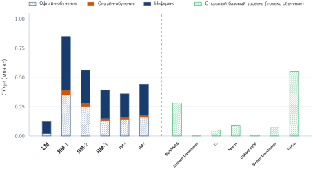
***Операционный углеродный след крупномасштабных задач ML:** Столбцы с накоплением показывают пожизненные выбросы CO₂-экв. для моделей рекомендаций Meta (RM-1 — RM-5), языковой модели (LM) и нескольких крупных открытых моделей (BERT-NAS, Evolved Transformer, T5, Meena, GShard-600B, Switch Transformer, GPT-3). Модели рекомендаций определяются инференсом (сплошная заливка), тогда как открытые базовые модели приводят следы только обучения (штриховка). Это показывает, что инференс в масштабе может сравниться с выбросами обучения или превзойти их для развернутых систем. Источник: Wu et al. (2022).*

<a id="sec-sustainable-ai-comprehensive-carbon-accounting-methodologies-62fc"></a>

### Комплексные методики учета углерода

Воздействие ИИ выходит за пределы операционного энергопотребления. Комплексная оценка углеродного следа объединяет трехфазный анализ жизненного цикла (обучение, инференс, производство) с тремя стандартными областями выбросов (Scope), определенными Протоколом парниковых газов (GHG Protocol). Поскольку ожидается быстрый рост ИИ до 2030 года, понимание полных затрат жизненного цикла по всем фазам и областям необходимо, чтобы выявлять наиболее эффективные меры устойчивости.

В границах собственного объекта дата-центра выбросы Scope 1 возникают от генерации на месте, включая резервные дизельные генераторы, системы охлаждения объекта и собственные электростанции. Хотя многие дата-центры ИИ в основном используют электроэнергию из сети, объекты с резервными системами на ископаемом топливе или собственной генерацией напрямую вносят вклад в выбросы.

Выбросы Scope 2 — это косвенные выбросы от купленной электроэнергии, пара, тепла и охлаждения, потребляемых отчитывающейся организацией. Купленная электроэнергия часто является доминирующей категорией для собственного объекта оператора и сильно меняется в зависимости от географии и структуры энергосети. Электроэнергия, которую использует облачный провайдер, относится к Scope 2 для этого провайдера, а приобретенная заказчиком облачная услуга обычно учитывается в цепочке создания стоимости заказчика по Scope 3. Физические электроны не меняются; меняется граница отчетности. Как показано в разделе [«Масштаб воздействия на окружающую среду»](#sec-sustainable-ai-scale-environmental-impact-ac9a), рычаг операционной углеродоемкости сети составляет диапазон в 8–40 раз для репрезентативных пар регионов, хотя у гидроэнергетики жизненные выбросы все же ненулевые и есть локальное экологическое воздействие.

Выбросы Scope 3 составляют наиболее сложную категорию: они охватывают производство аппаратуры, облачные цепочки поставок, транспортировку, утилизацию и последующее использование. Производство полупроводников энергоемко и углеродоемко.[^fn-euv-lithography-energy] Для малозагруженной аппаратуры или развертываний на чистых сетях воплощенные выбросы ускорителей могут сравняться с месяцами или годами работы; при длительном обучении с большой мощностью на углеродоемких сетях точка безубыточности может наступать гораздо раньше. В учете ИИ в масштабе всей компании или цепочки создания стоимости Scope 3 может доминировать, даже когда Scope 2 доминирует в операционном следе отдельного собственного объекта.

[^fn-euv-lithography-energy]: **Энергия литографии EUV**: каждая установка ASML EUV потребляет 1 МВт непрерывно и расходует 30 000 литров ультрачистой воды в день, то есть энергозатраты выше в 10$\times$ по сравнению со старыми системами глубокого УФ. Поскольку EUV необходим для техпроцессов тоньше 7 нм, которые используются во многих передовых ускорителях ИИ, воплощенная энергия каждого поколения чипов накапливается: больше транзисторов на кристалле означает больше шагов экспонирования EUV, поэтому изготовление по передовым техпроцессам становится важной составляющей выбросов Scope 3 для ИИ.

Помимо производства, выбросы Scope 3 включают последующее воздействие ИИ после развертывания. Такие сервисы, как поисковые системы, платформы социальных сетей и облачные системы рекомендаций, работают в огромном масштабе и требуют непрерывного инференса для миллионов или даже миллиардов взаимодействий с пользователями. Совокупный спрос на электроэнергию нагрузок инференса в конечном счете может превзойти энергию, использованную на обучение, что еще больше усиливает углеродное воздействие ИИ. Конечные устройства, включая смартфоны, устройства IoT и платформы граничных вычислений[^fn-edge-intelligence-paradox], также вносят вклад в выбросы Scope 3, поскольку их функции на основе ИИ зависят от непрерывных вычислений. В крупных отчетах по устойчивости технологических компаний Scope 3 часто доминирует в совокупных выбросах; чтобы отнести эту долю именно к сервисам на основе ИИ, нужен учет на уровне нагрузок, а не только совокупные итоги по компании.

[^fn-edge-intelligence-paradox]: **Парадокс энергии граничного ИИ**: граничный инференс снижает задержку на запрос со 100–200 мс (облако) до 1–10 мс, но распределяет потребление мощности между множеством устройств, работающих постоянно. Вычислитель FSD Tesla потребляет 72 Вт непрерывно во время движения; масштабирование сопоставимых бортовых вычислений на глобальный парк автомобилей означало бы около 100 ГВт совокупной мощности, что сравнимо с десятками крупных электростанций. Компромисс для устойчивости состоит в том, что граница устраняет сетевую энергию, но создает нерегистрируемый распределенный энергетический след, невидимый для систем учета углерода.

Операционные выбросы охватывают лишь производственную фазу ИИ. Сама разработка программного обеспечения добавляет еще один слой экологического воздействия, который редко учитывается.

<a id="psp-sustainable-ai-hidden-carbon-cost-software"></a>

> **Перспектива: скрытая углеродная стоимость программного обеспечения**
>
> Помимо прямого энергопотребления обучения и инференса, вся экосистема разработки программного обеспечения для ИИ имеет значительный, хотя и трудно измеримый, углеродный след. Миллионы запусков конвейеров непрерывной интеграции и непрерывного развертывания (CI/CD), постоянная перекомпиляция кода в ходе разработки, работа крупных систем контроля версий вроде GitHub, а также вычислительные ресурсы, которые потребляют системы код-ревью, фреймворки автоматического тестирования и платформы совместной разработки, — все это вносит вклад в воздействие на окружающую среду. Крупные исследовательские организации ИИ могут выполнять тысячи экспериментальных прогонов обучения, большинство из которых никогда не доходит до продуктива, и тратить существенную энергию на этап исследований. Вся экосистема разработки ИИ энергоемка и выходит далеко за пределы финальных фаз обучения и инференса модели.

Структура **Протокола парниковых газов (GHG Protocol)**[^fn-ghg-protocol-scope] (World Resources Institute and World Business Council for Sustainable Development, 2023) задает стандартную классификацию этих выбросов, которая сводится в [«Области выбросов GHG»](#fig-ghg-protocol). Три области дают инженерный контрольный список классификации:

[^fn-ghg-protocol-scope]: **Протокол парниковых газов (GHG Protocol)**: разработан совместно Институтом мировых ресурсов и Всемирным деловым советом по устойчивому развитию; этой структурой пользуются более 90 процентов компаний Fortune 500, отчитывающихся перед CDP. Таксономия из трех областей важна для систем ML, потому что большая часть углерода ИИ скрыта в Scope 3 (производство аппаратуры, цепочки поставок облачных вычислений), которые компании исторически недоотчитывают на 50–70 процентов по сравнению с Scope 1 и 2.

- Scope 1 (прямые выбросы): возникают от прямых операций компании — резервные генераторы, собственная генерация электроэнергии.
- Scope 2 (косвенные энергетические выбросы): купленная энергия, потребляемая отчитывающейся организацией; электроэнергия облачного оператора относится сюда, тогда как покупка облачных услуг заказчиком обычно попадает в инвентаризацию Scope 3 заказчика.
- Scope 3 (выбросы цепочки создания стоимости): выходят за пределы прямого контроля — производство полупроводников, транспортировка аппаратуры, утилизация ускорителей ИИ в конце срока службы.

<a id="fig-ghg-protocol"></a>

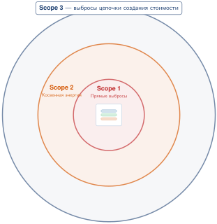
***Области выбросов парниковых газов (GHG):** Схема «ступица и спицы» с отчитывающейся организацией в центре и областями Scope 1 (прямые выбросы), Scope 2 (купленная энергия) и Scope 3 (цепочка создания стоимости) в виде отдельных ветвей. Каждая ветвь перечисляет репрезентативные источники выбросов, поддерживая комплексную оценку воздействия на окружающую среду. Источник: Circularise.*

Разнесение этих выбросов по областям Scope 1, 2 и 3 дает стандартный словарь для корпоративной экологической отчетности. Правильное применение этой структуры на практике требует классификации различных скрытых источников выбросов по операционному жизненному циклу типичной платформы ML.

<a id="chk-sustainable-ai-accounting-invisible-carbon"></a>

> **Контрольные вопросы: учет невидимого углерода**
>
> Проведите аудит углеродного следа платформы машинного обучения, классифицировав следующие источники выбросов по областям Scope 1 (прямые), Scope 2 (косвенные, энергетические) или Scope 3 (цепочка создания стоимости). Укажите отчитывающуюся организацию, прежде чем назначать область каждому источнику:
>
> - [ ] **Резервная генерация**: классифицируйте дизель, сжигаемый резервными генераторами во время отключения сети на собственном объекте.
> - [ ] **Арендованный облачный кластер**: классифицируйте электроэнергию для обоих отчитывающихся субъектов — облачного оператора, который ее покупает, и заказчика, который покупает вычислительную услугу.
> - [ ] **Воплощенное производство**: классифицируйте воплощенный углерод, выброшенный при производстве GPU на TSMC.
> - [ ] **Работа конечного пользователя**: классифицируйте выбросы от батареи смартфона конечного пользователя при работе развернутого мобильного приложения инференса.

Точная классификация этих скрытых выбросов заставляет инженерные команды отвечать за всю цепочку создания стоимости своих развертываний. Абстрактные энергетические метрики объекта и вытекающий из них углеродный след в конечном счете определяются физической термодинамикой стойки. Подача 120 кВт в один шкаф и отвод возникающего тепла требуют выхода за пределы традиционного кондиционирования воздуха.

<a id="sec-sustainable-ai-power-delivery"></a>

### Подача питания

Планирование мощности срывается, когда инженеры закладывают в бюджет только TDP ускорителей. На каждом преобразовании электричество теряет энергию и запас надежности, прежде чем достигнет регуляторов напряжения GPU, поэтому путь подачи питания определяет и узкое место объекта, и тепло, которое должно отвести охлаждение. Путь начинается за пределами здания: сетевое питание приходит как высоковольтный переменный ток, обычно 13,8–69 кВ в зависимости от страны и размера объекта, а выделенная подстанция или трансформаторная площадка понижает его до среднего напряжения. Крупнейшие объекты ML требуют собственной подстанции; ее строительство занимает 18–24 месяца и требует согласования с местной энергокомпанией. Подключение к сети — главное узкое место: никакой инженерный труд внутри здания не может подать больше мощности, чем дает сеть.

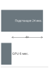

*Срок строительства подстанции может быть в 4$\times$ дольше закупки GPU.*

<a id="psp-sustainable-ai-interconnection-queue"></a>

> **Перспектива: очередь на подключение к сети**
>
> Развертывание 10 000 GPU и развертывание электрической подстанции, необходимой для питания их ИТ-нагрузки (9,6 МВт, после того как подсумма GPU 7 МВт расширена с учетом поддерживающей мощности стоек), идут по разным срокам. На пути кремния поставки GPU нестабильны, но обычные сроки поставки для корпоративных заказчиков составляют 6 месяцев. На пути инфраструктуры разрешения, проектирование, закупки, строительство и подключение к сети для новой подстанции на 10 МВт и более в среднем занимают 24 месяца. Поэтому инфраструктура развертывается примерно в 4 раза дольше, чем сами ускорители.
>
> **Системный вывод**: в эпоху парков ML главное узкое место — не цепочка поставок кремния, а очередь подключения к сети. По состоянию на 2024 год в одних только США более 2 000 ГВт мощности ожидает подключения к сети. Инженер, который оптимизирует загрузку GPU без двухлетнего энергетического плана, обнаружит, что парк «электрически заперт»: дорогой кремний стоит в темном здании и ждет трансформатора.

Внутри объекта источник бесперебойного питания (ИБП) стабилизирует входящее питание и обеспечивает резервный заряд батареи при коротких отключениях. Современные онлайн-ИБП с двойным преобразованием переводят переменный ток в постоянный, заряжают батарейный блок и затем снова преобразуют его в переменный; это обеспечивает чистое питание, но теряет 3–5 процентов эффективности. Высокоэффективные режимы экономии (eco-mode) в обычной работе обходят это двойное преобразование, достигая эффективности 98–99 процентов при немного меньшей защите от аномалий на входе. Затем PDU распределяет кондиционированное питание от ИБП по стойкам, часто выполняя последнее понижение переменного напряжения с 480 В до 208/240 В для серверов.

Некоторые объекты ML используют **распределение постоянного тока 48 В**, которое устраняет одну ступень преобразования и повышает эффективность на 2–3 процента. Это улучшение — не просто постепенный выигрыш в обычном дата-центре; для плотных плат ускорителей ML оно решает жесткое физическое ограничение, которое задают сами текущие требования аппаратуры. Узел обучения с восемью GPU H100, каждый из которых потребляет 700 Вт, требует более 5 600 Вт только на ускорители. При традиционной подаче 12 В для этой нагрузки через шины платы пришлось бы пропускать почти 470 А. При таком токе потери $I^2R$ в самих медных проводниках выделяют значительное тепло и создают падение напряжения, которое подрывает жесткие допуски напряжения VRM. Переход на 48 В уменьшает ток в четыре раза, а потери распределения $I^2R$ — в шестнадцать раз. Для плотно интегрированных плат ML, таких как HGX от NVIDIA, постоянный ток 48 В — не столько предпочтение проектировщика, сколько требование для работы на номинальной плотности мощности без плавления силовых разъемов. Google первой внедрила распределение 48 В постоянного тока в своих дата-центрах, а Open Compute Project стандартизировал стоечные шины 48 В постоянного тока для плотных вычислений.

При плотности мощности стоек ML разница между КПД распределения 95 % и 98 % существенна. Для стойки мощностью 33 кВт улучшение эффективности на 3 % экономит примерно 0,99 кВт мощности на стойку. По объекту из 300 стоек это дает 297 кВт, чего хватит примерно на 36 дополнительных узлов GPU, или около 9 четырехузловых стоек при этом составе мощности стоек. За 3-летний жизненный цикл при тарифе \$0,07/кВт·ч улучшение эффективности экономит около \$546 361 на расходах на электроэнергию.

Окончательные преобразования происходят в сервере и на плате. Каждый сервер содержит блоки питания, которые преобразуют напряжение стойки в 12 В постоянного тока или сразу в несколько напряжений, нужных компонентам платы. Например, DGX H100 использует несколько высокоэффективных блоков питания общей мощностью 10 кВт с резервированием N+1, так что отказ одного блока не выводит узел из строя. Модули регуляторов напряжения (VRM) затем преобразуют 12 В постоянного тока в 0,7–1,0 В, нужные ядру GPU, и 1,1–1,2 В, нужные HBM. Эти регуляторы должны реагировать на изменения нагрузки за микросекунды, когда GPU переходит между простоем и полной вычислительной нагрузкой, и работают с КПД 90–95 процентов.

<a id="chk-sustainable-ai-power-delivery-physics"></a>

> **Контрольные вопросы: физика подачи питания**
>
> Проверьте путь питания дата-центра:
>
> - [ ] **Нагрузка на сеть**: объясните, почему синхронное обучение ML создает большую нагрузку на энергосеть, чем асинхронный веб-трафик.
> - [ ] **Скачок мощности**: определите проблему «Power Ramp» и объясните, как ее решают батареи суперконденсаторов.
> - [ ] **Бюджет мощности**: объясните, почему узел с 8 GPU по 700 Вт каждый закладывается примерно в 7 кВт, а не в 5,6 кВт.
> - [ ] **Преобразование переменного и постоянного тока**: оцените утверждение «верно или неверно», что преобразование высоковольтного переменного тока в низковольтный постоянный на уровне стойки эффективнее, чем на уровне сервера.

При 700 Вт на GPU модуль регулятора напряжения рассеивает 35–70 Вт тепла, которое нужно отводить вместе с самим GPU. Тепло регуляторов напряжения иногда упускают при тепловом проектировании: в системе с жидкостным охлаждением, где холодные пластины покрывают GPU, регуляторы обычно по-прежнему охлаждаются воздухом от небольших вентиляторов, создавая задачу теплового управления для остальных компонентов, которые не контактируют с жидкостью напрямую.

Совокупная эффективность по всем пяти ступеням обычно составляет 85–90 процентов, то есть на каждые 100 Вт, поступающих в цепь подачи, 10–15 Вт теряются в виде тепла до того, как достигнут транзисторов. Потери преобразования на стороне объекта выше ИТ-границы входят в PUE, тогда как потери регуляторов напряжения на плате остаются частью измеренной ИТ-нагрузки.

Чтобы сделать это конкретным, рассмотрим бюджет мощности одной стойки с четырьмя узлами DGX H100:

[«Бюджет мощности стойки с четырьмя узлами DGX H100»](#tbl-rack-power) перечисляет полный бюджет стойки, чтобы расчет объекта учитывал накладные расходы хоста, сети, преобразования и охлаждения, а не только TDP GPU.

| **Компонент**                                                          |                **Мощность**                |              **Доля от общей мощности стойки**              |
|:-----------------------------------------------------------------------|:--------------------------------------------:|:---------------------------------------------:|
| **Вычисления GPU**                                                        |    22,4 кВт     |     67 %    |
| **Хост-процессоры и DRAM**                                                 |    3,2 кВт    |    10 %    |
| **Коммутатор NVSwitch**                                                    |  1,6 кВт  |  5 %  |
| **Адаптеры InfiniBand (HCA)**                                                    |     0,8 кВт     |     2 %     |
| **Потери преобразования питания**                                            | 2,8 кВт | 8 % |
| **Накладные расходы охлаждения (PUE ~1,09)** |  2,7 кВт   |   8 %  |
| **Итого**                                                              | **33,5 кВт**  |                    **100%**                   |

<a id="tbl-rack-power"></a>

***Бюджет мощности стойки с четырьмя узлами DGX H100:** GPU потребляют две трети общей мощности стойки, а остальная треть (хост-системы, сеть, преобразование питания и охлаждение) не устранима и должна закладываться в бюджет при расчете электрической инфраструктуры объекта. Потери преобразования питания (8 процентов) представляют собой совокупную неэффективность пятиступенчатой цепи подачи.*

Оценка распределения мощности DGX H100 ([«Бюджет мощности стойки с четырьмя узлами DGX H100»](#tbl-rack-power)) показывает, что 32 GPU по 700 Вт каждый дают 22,4 кВт, но одна только эта подсумма занижает реальное требование к мощности стойки примерно на 50 процентов. Проектировщики инфраструктуры, которые рассчитывают объект только по TDP GPU, занизят электрическую нагрузку и могут обнаружить при вводе в эксплуатацию, что мощности недостаточно.

Нагрузки обучения ML создают на эту цепочку питания особую проблему: **синхронные переходные процессы**. В традиционных дата-центрах веб-сервисов тысячи серверов обрабатывают независимые запросы с некоррелированным потреблением. Совокупная нагрузка плавная и предсказуемая, колеблясь, возможно, на 10–20 процентов в течение суток.

В кластере обучения картина принципиально иная. Все ускорители выполняют одно и то же вычисление синхронно. Когда начинается большое матричное умножение, тысячи тензорных ядер по всему кластеру включаются одновременно, и потребление мощности скачет на 40–60 процентов за микросекунды. Когда вычисление приостанавливается для синхронизации градиентов, потребление так же резко падает. Эти **скачки мощности (Power Ramps)** нагружают каждый компонент цепи подачи: от VRM на плате до трансформаторов на подстанции.

<a id="exmp-sustainable-ai-power-ramp-sizing"></a>

> **Пример: расчет скачков мощности**
>
> **Сценарий**: кластер обучения на 512 GPU периодически сбрасывает узлы во время синхронизированных шагов обучения.
>
> **Диагностика**: синхронные шаги матричного умножения создают скачок нагрузки на 300 кВт за микросекунды (размах 600 Вт от простоя до пика на каждый GPU), что превышает время отклика вышестоящего кондиционирования питания. Возникающие провалы напряжения срабатывают на защиту от пониженного напряжения ускорителей и вызывают жесткие сбросы.
>
> **Системный урок**: синхронные шаги обучения создают скачки мощности за микросекунды, которые нагружают подачу питания дата-центра. Локальная буферная емкость (батареи суперконденсаторов) сглаживает переходные скачки нагрузки, пока не сработают ИБП и системы объекта.

Современные дата-центры ML борются с переходными процессами мощности многоуровневой стратегией защиты, где каждый уровень покрывает свой временной масштаб. Батареи суперконденсаторов образуют первую линию защиты: они отдают сотни киловатт за микросекунды, сглаживая первоначальный скачок. В отличие от аккумуляторов, время отклика которых измеряется в миллисекундах, суперконденсаторы накапливают энергию электростатически и могут отдавать ее мгновенно. Типичная установка размещает 50–100 кДж емкости суперконденсаторов на стойку, чего хватает, чтобы поддерживать переходный процесс мощностью 100 кВт в течение 0,5–1,0 секунды.

ИБП с батарейным резервом и быстрым откликом инвертора (время переключения менее 10 мс) обрабатывают более длинные переходные процессы и обеспечивают переживание коротких сбоев сети длительностью до нескольких минут.

Выделенные подстанции с нестандартными трансформаторами обслуживают крупнейшие установки. Эти трансформаторы рассчитаны на высокую скорость изменения тока (di/dt), характерную для нагрузок ML, с нестандартными конфигурациями обмоток, которые выдерживают быстрые колебания нагрузки без искажения напряжения. Стандартные трансформаторы энергокомпаний рассчитаны на медленно меняющуюся нагрузку и могут насыщаться магнитным полем при быстрых изменениях нагрузки, которые создает обучение ML.

Чтобы оценить масштаб этих переходных процессов, рассмотрим кластер на 1 024 GPU, который переходит из фазы коммуникации (в среднем 400 Вт на GPU) в фазу матричного умножения (700 Вт на GPU). Изменение мощности составляет 300 Вт $\times$ 1 024 = 307 кВт, и такой переход происходит примерно за 100 мкс. Скорость изменения мощности, следовательно, равна 307 кВт / 100 мкс = 3,07 ГВт/с. Ни один пассивный электрический компонент не может отвечать с такой скоростью; поглотить переходный процесс до того, как он распространится в электрораспределение здания, могут только накопители энергии (суперконденсаторы), физически расположенные близко к нагрузке.


*Переходы фаз обучения создают микросекундные ударные скачки мощности.*

Сама цепь подачи питания вносит неэффективность на каждом этапе. Преобразование от сети к среднему напряжению теряет 1–2 процента. ИБП теряет 3–5 процентов (современные схемы с двойным преобразованием) или 1–2 процента (режимы eco-mode, которые в обычной работе обходят инвертор). PDU теряет 2–3 процента. Регулирование напряжения на плате теряет еще 5–8 процентов. В совокупности 10–15 процентов мощности, потребляемой из сети, рассеивается в виде тепла в цепи подачи, прежде чем достигнет транзистора. К PUE относятся только потери выше ИТ-границы; регулирование напряжения на плате входит в ИТ-нагрузку. PUE 1,10 означает, что все нагрузки объекта, не относящиеся к ИТ, включая преобразование на стороне объекта и охлаждение, потребляют на 10 процентов больше ИТ-нагрузки.

В самом крупном масштабе потребление дата-центра составляет заметную долю мощности местной электросети. Кластер из 100 000 GPU по 700 Вт каждый имеет подсумму ускорителей 70 МВт, но поддерживающая мощность стоек поднимает ИТ-нагрузку до 96,2 МВт до учета PUE. С учетом PUE полная нагрузка объекта приближается к 107,8 МВт. Это эквивалентно энергоснабжению небольшого города. Такие установки требуют выделенных линий от электросети, часто с специально построенными подстанциями и линиями электропередачи. Срок подключения к сети может превышать два года, поэтому доступность мощности — одно из самых долгих по срокам ограничений при создании инфраструктуры ML.

В масштабе больших кластеров то же ограничение подачи становится задачей закупки мощности из сети, а не строкой в счете за электроэнергию. Более поздние крупные системы часто не раскрывают энергетических данных, сравнимых с опорным примером главы, именно поэтому контракт измерения требует телеметрии нагрузки, а не полагается только на публичные карточки моделей.

Эта задача закупки мощности усугубляется, когда рост модели и данных умножают друг друга. При фиксированном числе токенов обучения на параметр удвоение параметров модели также удваивает число токенов, поэтому объем вычислений обучения и энергия растут примерно в 4$\times$. В общем случае, когда размер модели и набор данных растут одновременно, полная энергия обучения растет примерно пропорционально их произведению. Модель с 10$\times$ параметров, обученная на 10$\times$ данных, поэтому требует примерно 100$\times$ энергии.

Электроэнергия, потребляемая одной крупной кампанией обучения модели, может стать заметной по сравнению с выработкой электростанции. Объект обучения мощностью 100 МВт, работающий на полной мощности один год, потребляет 876 ГВт·ч, что ветряная ферма такой же мощности не может обеспечить: при коэффициенте использования мощности 30 % ветряная ферма выдает около 262,8 ГВт·ч в год, поэтому объекту понадобилось бы эквивалентно примерно 3,3 крупных ветряных ферм.

Поэтому доступность мощности и ее источник становятся одним и тем же решением об инфраструктуре. Организации, обучающие крупные модели, могут стремиться сопоставить потребление электроэнергии с возобновляемой генерацией: либо размещая дата-центры рядом с возобновляемыми источниками (гидро-, ветровыми, солнечными), либо покупая сертификаты возобновляемой энергии (RECs), чтобы компенсировать потребление из сети.

Прямые инвестиции в чистую генерацию — самая сильная форма такого решения, потому что они добавляют мощность, а не только перераспределяют сертификаты. Например, Microsoft подписала соглашения о покупке атомной энергии от перезапускаемых реакторов, понимая, что масштаб и постоянство нагрузок обучения ML требуют базовых источников мощности, которых одни лишь прерывистые возобновляемые источники обеспечить не могут. Google аналогично инвестировала в геотермальные проекты, которые дают стабильную выработку независимо от погоды.

Углеродоемкость сети определяет истинную экологическую стоимость прогона обучения. Объект, питаемый гидроэлектростанциями на Тихоокеанском Северо-Западе, выбрасывает примерно 50 г CO₂/кВт·ч, сеть с преобладанием газа — около 400 г CO₂/кВт·ч, а сеть с преобладанием угля — примерно вдвое больше. Один прогон обучения модели на 175 млрд параметров, потребляющий около 1 287 МВт·ч, подразумевает углеродное воздействие от 64 до 515 тонн только в зависимости от места — разброс в 8$\times$, который делает выбор площадки рычагом декарбонизации первого порядка. Такое сочетание тихоокеанской гидроэнергетики и умеренно угольной сети находится на консервативном конце географического диапазона, установленного в разделе [«Масштаб воздействия на окружающую среду»](#sec-sustainable-ai-scale-environmental-impact-ac9a); более чистая гидросеть расширяет его еще больше. Такой экологический расчет может определять решения об инфраструктуре: организации, которые могут разместить кластеры обучения в регионах с низким уровнем углерода, могут добиться одновременно более низких затрат на электроэнергию (гидроэнергия часто дешевле генерации на ископаемом топливе) и меньшего углеродного следа, что является редким совпадением экономических и экологических стимулов.

<a id="sec-sustainable-ai-cooling"></a>

### Охлаждение

Каждый ватт электрической мощности, поданный на GPU, в конечном счете превращается в тепло. Первое начало термодинамики гарантирует это: электрическая энергия преобразуется в вычислительную работу (переключение транзисторов), но «работа» — это лишь перевороты битов в памяти, энергия которых пренебрежимо мала. Вся подведенная энергия покидает систему как тепловая, и ее нужно физически отвести от кристалла, вынести из стойки и передать в окружающую среду. Фундаментальная физика теплопереноса задает неизбежное ограничение: электрическая нагрузка стойки, равная 33,5 кВт, должна непрерывно поглощаться охлаждающей средой и уноситься с той же скоростью. Если охлаждение отстает даже ненадолго, температура кристаллов растет, запуская тепловой троттлинг, который снижает тактовую частоту и пропускную способность. При экстремальных температурах кремний может получить необратимые повреждения.


*Ниже теплового предела чип работает безопасно; при его пересечении троттлинг резко возрастает.*

Воздушное охлаждение, доминировавшее на протяжении десятилетий, работает, продувая воздух комнатной температуры через радиаторы, прикрепленные к чипам. Воздух поглощает тепло со скоростью, которую задает его удельная теплоемкость, около 1,0 кДж/(кг·К). Нагретый воздух выводится из задней части стойки, обычно на 15–20 °C теплее входного, и направляется в блок прецизионного кондиционирования воздуха машинного зала (CRAC), который охлаждает его перед повторной циркуляцией.

Фундаментальная проблема в том, что воздух — плохой проводник тепла. Его теплопроводность составляет всего 0,026 Вт/(м·К), тогда как у воды она равна 0,6 Вт/(м·К), а у меди — 400 Вт/(м·К). Чтобы отвести 100 кВт от стойки одним только воздухом, вентиляторы должны перемещать огромные объемы воздуха с высокой скоростью, потребляя 30–40 процентов общего бюджета мощности стойки только на охлаждение.

Физику можно описать точно простым расчетом. Способность потока жидкости отводить тепло равна:

$$Q = \dot{m} \times c_p \times \Delta T$$

где $Q$ — отведенное тепло (Вт), $\dot{m}$ — массовый расход (кг/с), $c_p$ — удельная теплоемкость (Дж/(кг·К)), а $\Delta T$ — разность температур между выходом и входом. Для воздуха с $c_p$, равной 1 005 Дж/(кг·К), и типичным $\Delta T$ 15 К (вход 20 °C, выход 35 °C) отвод 100 кВт требует массового расхода 100 000 $\div$ (1 005 $\times$ 15) $\approx$ 6,6 кг/с. При плотности воздуха на уровне моря 1,2 кг/м³ это соответствует объемному расходу 5,5 м³/с, или примерно 11 713 CFM (куб. футов в минуту). Прогнать такой объем воздуха через стесненное пространство серверной стойки требует мощных вентиляторов, которые сами потребляют заметную мощность.

При более высокой плотности мощности воздушный поток и давление, необходимые для охлаждения стойки, повышают энергию вентиляторов и могут сделать воздушное охлаждение непрактичным раньше, чем ИТ-нагрузка достигнет предела мощности. Точная граница зависит от геометрии стойки, температуры на входе, падения давления и политики управления вентиляторами, а не от одного универсального порога мощности стойки. Метрика PUE[^fn-pue-facility-metric] отражает совокупные накладные расходы объекта: PUE 1,5 означает, что на каждый ватт ИТ-нагрузки приходится 0,5 Вт нагрузки объекта, не относящейся к ИТ, которая включает охлаждение и преобразование питания на стороне объекта.

Снижение PUE — основная инженерная цель для дата-центров ML, потому что накладные расходы охлаждения — это потраченная впустую энергия, которая не дает полезных вычислений. В масштабе кластера из 10 000 GPU, потребляющего 9,62 МВт ИТ-мощности после учета поддерживающей нагрузки стоек, разница между PUE 1,5 и PUE 1,1 составляет 3,85 МВт потерянной мощности, что обходится примерно в \$2,4 млн в год на электроэнергии и требует пропорционально большей инфраструктуры охлаждения для рассеивания тепла.

[^fn-pue-facility-metric]: **Экономия кластера за счет PUE**: средний PUE парка Google составляет 1,10 против среднего по отрасли около 1,58. Для кластера из 10 000 GPU, потребляющего 9,62 МВт ИТ-мощности после учета поддерживающей нагрузки стоек, снижение PUE с 1,58 до 1,10 экономит 4,62 МВт накладных расходов охлаждения, то есть примерно \$2,8 млн в год на электроэнергии и эквивалент отключения от сети 3 800 жилых домов. Объекты ML с прямым жидкостным охлаждением чипов демонстрировали значения PUE 1,03–1,08.

Вода имеет удельную теплоемкость 4,18 кДж/(кг·К), что более чем в четыре раза выше, чем у воздуха, а теплопроводность примерно в 25$\times$ выше. Эти физические свойства делают воду по природе лучшей средой для теплопереноса. Чтобы оценить масштаб разницы, рассмотрим, сколько жидкости нужно прогнать, чтобы отвести 700 Вт от одного GPU. Воздуху при подъеме температуры на 15 градусов требуется десятки литров в секунду (как в небольшой аэродинамической трубе). Воде при том же подъеме температуры нужно лишь около 0,01 литра в секунду (тонкая струйка). Эта разница в объемном расходе в тысячи раз объясняет, почему воздушное охлаждение требует мощных вентиляторов и тщательно спроектированных путей воздуха, тогда как жидкостное охлаждение требует только тонких труб и малых насосов.

Прямое жидкостное охлаждение чипов направляет охлажденную воду (или специальный диэлектрический теплоноситель) через обработанные медные холодные пластины, установленные непосредственно на корпусе каждого GPU. Холодная пластина контактирует с теплораспределителем GPU через тонкий слой термоинтерфейсного материала, создавая тепловой путь с сопротивлением менее 0,1 К/Вт. Теплоноситель поглощает тепло в нескольких миллиметрах от поверхности кристалла и переносит его по коллекторам и трубам к блоку распределения теплоносителя (CDU) на уровне стойки или ряда.

CDU передает тепло от контура теплоносителя на уровне чипов (замкнутый контур с деионизированной водой или диэлектрической жидкостью) к контуру охлажденной воды здания, который отдает тепло наружу через градирни или сухие охладители. Такая двухконтурная схема изолирует теплоноситель на уровне чипов, который должен быть сверхчистым, чтобы не образовывались минеральные отложения на холодных пластинах, от воды уровня здания, которую фильтруют менее строго.

Поскольку жидкий теплоноситель гораздо эффективнее поглощает тепло в единице объема, вентиляторы уровня сервера полностью исключаются или уменьшаются до небольших блоков для вспомогательных компонентов, таких как модули памяти DIMM и VRM. Накладные расходы на охлаждение падают до 3–8 процентов ИТ-мощности, что дает значения PUE 1,03–1,08. Дополнительная выгода — снижение шума: дата-центры с жидкостным охлаждением заметно тише воздушных аналогов, что важно для объектов рядом с офисами или в зонах с ограничениями по шуму.

Более радикальный подход — иммерсионное охлаждение: платы серверов полностью погружаются в ванну с непроводящей диэлектрической жидкостью. Жидкость отводит тепло при непосредственном контакте с каждой поверхностью компонентов, поэтому холодные пластины, вентиляторы и даже радиаторы не нужны. Принцип прост: если каждая поверхность платы контактирует с теплоносителем, тепло негде накапливаться, и оно равномерно отводится по всей сборке.

При однофазном иммерсионном охлаждении жидкость остается жидкой на протяжении всего процесса, а тепло переносится конвекционными токами в ванне. Нагретая жидкость поднимается к поверхности, прокачивается через теплообменник, отдающий тепло контуру охлажденной воды здания, и возвращается в нижнюю часть ванны.

Двухфазное иммерсионное охлаждение идет дальше: жидкость кипит у поверхности чипа, поглощая скрытую теплоту парообразования (примерно в 100$\times$ больше энергии на грамм, чем простое изменение температуры), конденсируется на холодной поверхности в верхней части ванны и стекает обратно. Этот цикл самоподдерживающийся и очень эффективный: он отводит более 200 кВт на стойку при значениях PUE, близких к 1,02.

Компромисс — в обслуживании: чтобы добраться до вышедшего из строя компонента, нужно слить жидкость или частично извлечь его из нее, а сами диэлектрические жидкости дороги (\$20–50 за литр). Одна иммерсионная ванна с четырьмя платами серверов может содержать 500–1 000 литров жидкости, что составляет \$10 000–50 000 только на теплоноситель. Эксплуатационные процедуры для объектов с иммерсионным охлаждением сильно отличаются от воздушных, требуя специального обучения технического персонала и других подходов к управлению кабелями, поскольку все разъемы должны выдерживать длительный контакт с жидкостью. Стандартные медные кабели и разъемы могут корродировать или набухать при контакте с некоторыми диэлектрическими жидкостями, поэтому нужны специальные материалы, стойкие к жидкости, что увеличивает стоимость и сужает выбор поставщиков. [«Переход к жидкостному охлаждению»](#tbl-cooling-limits) сравнивает воздушный и жидкостный режимы, которые определяют, когда эти эксплуатационные издержки становятся неизбежными.

| **Показатель**             | **Воздушное охлаждение (устаревшее)** | **Жидкостное охлаждение (современное)** |
|:-----------------------|:------------------------:|:---------------------------:|
| **Макс. плотность мощности**  |     ~20–30 кВт/стойку      |        $>120$ кВт/стойку       |
| **Эффективность охлаждения** |      PUE ~1,5–2,0       |       PUE ~1,05–1,10       |
| **Механизм**          |     Принудительная вентиляция      |    Прямой контакт с чипом (direct-to-chip)   |
| **Теплоноситель**       |    Воздух (1,0 кДж/(кг·К))     |     Вода (4,18 кДж/(кг·К))    |
| **Мощность вентиляторов**    |    30–40 % ИТ-нагрузки    |      $<5\%$ ИТ-нагрузки      |

<a id="tbl-cooling-limits"></a>

***Переход к жидкостному охлаждению:** При плотности мощности стойки выше 30 кВт воздушное охлаждение требует мощности вентиляторов, которая приближается к мощности самих GPU. Жидкостное охлаждение — не премиальная опция, а термодинамическое требование для плотных стоек ML.*

Архитектурное сравнение в [«Архитектуры воздушного и жидкостного охлаждения»](#fig-cooling-comparison) показывает физическую причину этого порога: воздух переносит тепло объемным потоком, а жидкость — прямым тепловым путем от чипа к теплоносителю.

[«Архитектуры воздушного и жидкостного охлаждения»](#fig-cooling-comparison) и [«Переход к жидкостному охлаждению»](#tbl-cooling-limits) вместе иллюстрируют резкий контраст между этими подходами. Капитальные затраты на эти технологии охлаждения различаются на порядок. Стандартная инфраструктура воздушного охлаждения обходится в \$2 000–5 000 на стойку (вентиляторы, блоки CRAC, фальшполы). Прямое жидкостное охлаждение чипов стоит \$15 000–25 000 на стойку (холодные пластины, коллекторы, CDU, трубопроводы). Полное иммерсионное охлаждение обходится в \$30 000–50 000 на ванну (диэлектрическая жидкость, герметичные ванны, специализированные теплообменники). Расчет точки безубыточности между воздушным и жидкостным охлаждением зависит от плотности мощности стойки: при 20 кВт на стойку более низкие капитальные затраты воздушного охлаждения выигрывают на трехлетнем жизненном цикле. При 40 кВт на стойку экономия электроэнергии за счет более низкого PUE жидкостного охлаждения (1,08 против 1,5) компенсирует более высокие капитальные затраты за 18–24 месяца. При 60 кВт и выше на стойку, что характерно для плотной инфраструктуры ML, воздушное охлаждение физически невозможно, и сравнение теряет смысл. Для кластера обучения модели на 175 млрд параметров из 32 стоек по 33,5 кВт каждая прямое жидкостное охлаждение чипов — эталонный выбор, который балансирует плотность, обслуживаемость и стоимость. Иммерсионное охлаждение дает незначительное улучшение PUE (1,03 против 1,08), но вводит эксплуатационную сложность, которую многие организации при таких плотностях стоек сочтут неоправданной.

<a id="nbk-sustainable-ai-cooling-tax"></a>

> **Сценарий: налог на охлаждение**
>
> Рассмотрим кластер из 1 024 GPU H100 по 700 Вт каждый.
>
> - **Мощность ИТ**: 1 024 $\times$ 700 Вт = 716,8 кВт
> - Воздушное охлаждение (PUE 1,49): полная мощность объекта = 716,8 кВт $\times$ 1,49 = 1 068,0 кВт. Накладные расходы охлаждения = 351,2 кВт.
> - Жидкостное охлаждение (PUE 1,08): полная мощность объекта = 716,8 кВт $\times$ 1,08 = 774,1 кВт. Накладные расходы охлаждения = 57,3 кВт.
>
> **Экономия**: жидкостное охлаждение экономит 293,9 кВт непрерывной мощности. При \$0,07/кВт·ч ежегодная экономия составляет примерно \$180 212. За трехлетний жизненный цикл оборудования одна только экономия на охлаждении составляет \$540 636, что часто превышает капитальные затраты на установку инфраструктуры жидкостного охлаждения.

<a id="fig-cooling-comparison"></a>


***Архитектуры воздушного и жидкостного охлаждения:** Сравнение стратегий терморегулирования для плотных стоек ML. Воздушное охлаждение (слева) требует массивного воздушного потока и больших накладных расходов на вентиляторы, достигая физического предела около 30 кВт на стойку. Жидкостное охлаждение (справа) использует холодные пластины прямого контакта с чипом и теплоноситель с высокой теплоемкостью, что позволяет достигать плотности более 100 кВт на стойку при заметно меньшем PUE.*

Последнее звено в цепи охлаждения — **отвод тепла**: передача тепла из контура охлажденной воды здания во внешнюю среду. Доминирующая технология — градирня, которая распыляет теплую воду над наполнителем и использует испарение, чтобы унести тепло в атмосферу. Испарительное охлаждение термически эффективно (скрытая теплота парообразования воды составляет 2 260 кДж/кг против 4,18 кДж/(кг·К) при явном нагреве), но расходует воду.

ЦОД мощностью 10 МВт с испарительными градирнями может потреблять более 100 миллионов литров воды в год в зависимости от климата и конструкции охлаждения, что стало серьезной проблемой в регионах с дефицитом воды. Для наглядности: 140 миллионов литров — это примерно годовое водопотребление около 1 000 домохозяйств. По мере роста дата-центров ML до 100 МВт и выше их водный след становится значимым фактором местного планирования ресурсов.

Сухие охладители, которые продувают воздух через радиатор без испарения, устраняют водопотребление, но работают эффективно только тогда, когда температура окружающего воздуха заметно ниже температуры теплоносителя, что ограничивает их эффективность в жарком климате. Многие объекты используют гибридные подходы: сухие охладители в прохладную погоду и испарительные градирни во время жары.

**Повторное использование отходящего тепла** рассматривает тепловой выход дата-центра как ресурс, а не как отход. Тепловая плотность кластеров ускорителей ML создает преимущество перед традиционной ИТ-инфраструктурой, которое легко упустить: качество производимого ими тепла. Традиционные стойки с воздушным охлаждением выбрасывают теплый воздух примерно при 35 °C — температура слишком низкая для большинства практических видов повторного использования без энергоемких тепловых насосов. Жидкостный ML-кластер, напротив, возвращает теплоноситель от своих блоков распределения при 50–65 °C — тепло высокого качества, хорошо подходящее для сетей централизованного теплоснабжения, климат-контроля теплиц и промышленных процессов. Та же тепловая плотность ускорителей, которая требует прямого жидкостного охлаждения чипов, делает стойки ML термодинамически более привлекательными кандидатами для муниципальных программ утилизации тепла по сравнению с традиционной ИТ-инфраструктурой. Несколько скандинавских дата-центров подают отходящее тепло в городские сети отопления, компенсируя природный газ или электроэнергию, которые иначе понадобились бы для обогрева зданий зимой. ЦОД ML мощностью 10 МВт может поставлять примерно 8–9 МВт полезного тепла (с учетом эффективности тепловых насосов), чего хватит, чтобы отопить несколько тысяч квартир. Учет переиспользованного тепла может снизить чистые эксплуатационные расходы, но не снижает PUE ниже 1,0, поскольку PUE — это полная энергия объекта, деленная на ИТ-энергию. Использование энергии следует поэтому отчитывать через показатель эффективности повторного использования энергии (energy reuse effectiveness) или отдельный баланс чистой энергии; любой из них может опуститься ниже 1,0, когда экспортированная полезная энергия превышает накладные расходы объекта.

Целесообразность повторного использования отходящего тепла зависит от близости потребителей тепла. Городские дата-центры, несмотря на более высокие затраты на землю и электроэнергию, часто лучше подходят для повторного использования тепла, чем удаленные объекты, потому что они находятся рядом с жилой и коммерческой нагрузкой на отопление. В результате получается контринтуитивная экономическая оптимизация: дата-центр в скандинавском городе может иметь более высокие затраты на электроэнергию, но более низкие чистые эксплуатационные расходы после доходов от отходящего тепла по сравнению с удаленным объектом с более дешевой электроэнергией, но без потребителей тепла поблизости.

Для обучения модели на 175 млрд параметров выбор технологии охлаждения не является опциональным. Кластер из 1 000 GPU H100 рассеивает 700 кВт тепла только от GPU, не считая потерь на CPU, память, сеть и преобразование питания. Только жидкостное охлаждение может отвести это тепло при требуемой плотности. Стойка — это уровень, на котором задача переходит от вычислений к физике, и конструкция системы охлаждения часто определяет, сможет ли кластер обучения работать на полной загрузке или его придется ограничивать, чтобы предотвратить тепловой разгон.

<a id="sec-sustainable-ai-cooling-reliability"></a>

#### Надежность системы охлаждения

Отказы системы охлаждения в кластерах ML имеют более тяжелые последствия, чем в традиционных дата-центрах, из-за более высокой плотности мощности. В традиционном дата-центре с воздушным охлаждением при 10 кВт на стойку выход из строя блока CRAC приводит к постепенному росту температуры в течение десятков минут, что оставляет операторам достаточно времени для реакции. В стойке ML с жидкостным охлаждением при 100+ кВт потеря потока теплоносителя приводит к тому, что температура достигает порога теплового отключения GPU за 30–60 секунд, потому что теплоемкость холодной пластины и малый объем теплоносителя в трубах обеспечивают минимальный тепловой буфер.

Быстрый тепловой разгон определяет несколько проектных решений. Контуры теплоносителя проектируются с резервированием N+1: в каждом CDU есть резервный насос, а коллектор трубопроводов включает обводные клапаны, которые могут перенаправить теплоноситель в обход вышедшего из строя CDU. Датчики температуры на каждой холодной пластине немедленно включают сигнал тревоги, когда температура на выходе теплоносителя превышает порог (обычно 65 °C), а прошивка GPU начинает ограничивать мощность за миллисекунды, если температура перехода приближается к пределу 83 °C.

Некоторые объекты также поддерживают аварийную возможность воздушного охлаждения как последний резервный вариант. Хотя воздушное охлаждение не может обеспечить работу на полной мощности при плотности стоек ML, оно способно удерживать оборудование ниже порогов повреждения (на сниженных тактовых частотах) достаточно долго, чтобы операторы могли отремонтировать систему жидкостного охлаждения. Подход эшелонированной защиты для надежности охлаждения отражает то, что отказ охлаждения в кластере из 10 000 GPU может одновременно затронуть сотни GPU, поэтому потенциальный финансовый ущерб от простоя системы охлаждения намного превышает стоимость резервирования.

Режимы отказа систем жидкостного охлаждения качественно отличаются от воздушных. Воздушное охлаждение отказывает мягко: поломка вентилятора снижает поток воздуха, и температура медленно растет в течение минут, что дает достаточно времени для автоматического сброса нагрузки. Жидкостное охлаждение может отказать катастрофически: утечка теплоносителя может одновременно повредить оборудование (если теплоноситель проводящий) и лишить систему охлаждения мощности (если утечка опустошает контур). Быстроразъемные соединения, которые позволяют горячую замену узлов серверов без слива всего контура теплоносителя, — критически важная конструктивная особенность, сокращающая время простоя на обслуживание с часов до минут. Однако именно эти соединения чаще всего выходят из строя в контуре теплоносителя, поскольку уплотнительные кольца деградируют за тысячи циклов подключения и отключения. Объекты, которые часто меняют аппаратуру (обычно в исследовательских средах, где узлы регулярно перенастраиваются), должны закладывать в бюджет ежеквартальную замену уплотнительных колец и держать запас резервных соединений.

Экономика надежности охлаждения резко меняется при переходе от независимых серверов инференса к жестко связанным кластерам обучения. В распределенном прогоне обучения с синхронным параллелизмом отказ контура охлаждения, который обесточивает под-срез масштаба пода, может остановить всю задачу. Рассмотрим отказ охлаждения, который вызывает тепловое отключение пода на 256 GPU внутри кластера из 10 000 GPU. Прямая стоимость аппаратуры ничтожна, но упущенная выгода огромна. Если ремонт насоса CDU занимает 4 часа, то непосредственная потеря 256 GPU по \$4 за GPU-час составляет всего \$4 096. Однако поскольку алгоритм обучения требует, чтобы все рабочие узлы шли синхронно, оставшиеся 9 744 GPU тоже простаивают, сжигая электроэнергию без продвижения. Этот эффект отстающего узла раздувает стоимость до \$160 000 потерянного вычислительного времени. Если добавить накладные расходы на восстановление контрольной точки и откат к последнему сохраненному состоянию, при котором часто теряется от 30 до 60 минут вычислений, полный финансовый ущерб от одного отказа компонента охлаждения легко превышает \$200 000. Нелинейный рост стоимости отказов делает резервирование N+1 в контурах охлаждения математической необходимостью для экономики обучения.


*Один отказ охлаждения может остановить всю задачу обучения.*

Поддержание физической целостности жидкостного контура требует управления сложной гидрохимической динамикой. Теплоноситель, циркулирующий в системах прямого жидкостного охлаждения чипов, обычно представляет собой **деионизированную воду** с определенными ингибиторами коррозии, а не простую водопроводную воду. Проводимость нужно строго поддерживать ниже 1 микросименса на сантиметр ($\mu$S/см), чтобы предотвратить **гальваническую коррозию**, при которой разность электрических потенциалов между разнородными металлами контура (медными холодными пластинами и нержавеющими коллекторами) разъедает поверхности охлаждения. Этот химический баланс неустойчив: ингибиторы расходуются со временем, а растворенные газы накапливаются, поэтому нужны ежемесячный контроль качества и ежегодная замена всего объема. Биологическое загрязнение представляет не менее серьезную угрозу. Рост **биопленки** на внутренних микроребрах холодной пластины работает как тепловой изолятор: слой органического налета всего в 50 микрон может снизить коэффициенты теплопередачи на 30 процентов, вынуждая насосы работать на максимальной мощности для компенсации. Поэтому регулярная обработка биоцидами и периодическая промывка системы так же важны для производительности кластера, как обновления драйверов или прошивок.

<a id="sec-sustainable-ai-training-vs-inference-energy-analysis-4cb5"></a>

## Анализ энергии обучения и инференса

Инфраструктура охлаждения управляет интенсивной тепловой нагрузкой кластера, но полная величина этой нагрузки зависит от того, выполняет ли парк сконцентрированный прогон обучения или глобально распределенную нагрузку инференса. Обучение крупной языковой модели — это зрелищное и хорошо заметное энергетическое событие, сродни запуску ракеты. Развертывание той же модели для обслуживания миллиарда ежедневных запросов похоже на эксплуатацию парка международных авиалиний. Обучение сжигает тысячи мегаватт-часов в одном сконцентрированном всплеске на протяжении нескольких месяцев; инференс расходует энергию непрерывно, запрос за запросом, год за годом. Понимание того, куда уходит большая часть энергетического бюджета, определяет, на чем должны сосредоточиться усилия по оптимизации.

Возможности оптимизации различаются по фазам жизненного цикла. Оптимизация обучения сосредоточена на вычислительной эффективности и загрузке аппаратуры, тогда как оптимизация инференса подчеркивает задержку, пропускную способность и стратегии граничного развертывания. Наибольшую отдачу дает сопоставление меры устойчивости с доминирующим потребителем энергии в каждом приложении.

<a id="sec-sustainable-ai-training-energy-demands-1ff6"></a>

### Энергетические потребности обучения

Обучение крупных моделей ИИ может требовать вычислительной инфраструктуры с сотнями тысяч ядер и специализированными ускорителями ИИ, которые работают непрерывно месяцами. В 2020 году Microsoft раскрыла информацию о выделенном суперкомпьютере для OpenAI, построенном специально для крупномасштабного обучения ИИ на тот момент: 285 000 ядер CPU, 10 000 GPU и сетевая пропускная способность более 400 гигабит в секунду на сервер (Langston, 2020). Эта цифра 2020 года остается полезной как калиброванная опорная точка, а не как утверждение о самой крупной инфраструктуре более поздних поколений.

Интенсивные вычислительные нагрузки порождают тепло, которое инфраструктура охлаждения должна непрерывно отводить; накладные расходы на это количественно описаны в разделе [«Охлаждение»](#sec-sustainable-ai-cooling). Снижение этих расходов требует совместной оптимизации аппаратной архитектуры, стратегии параллелизма и алгоритмической эффективности.

Энергетическая стоимость обучения возникает один раз для каждой модели, но эта однократная стоимость все равно определяет размер объекта, хранение контрольных точек и углеродный учет прогона. Главная задача устойчивости часто проявляется при развертывании, где нагрузки инференса непрерывно обслуживают миллионы или миллиарды пользователей и могут превзойти энергию обучения, когда объем запросов достаточно велик.

<a id="sec-sustainable-ai-inference-energy-costs-aec9"></a>

### Энергетические затраты инференса

Нагрузки инференса выполняются каждый раз, когда модель ИИ отвечает на запросы, классифицирует изображения или делает прогнозы. В отличие от обучения, инференс масштабируется динамически и непрерывно в таких приложениях, как поисковые системы, системы рекомендаций и генеративные модели ИИ. Хотя каждый отдельный запрос инференса потребляет гораздо меньше энергии, чем обучение, совокупное энергопотребление высоконагруженных развернутых сервисов может сравняться с расходами на обучение или превзойти их (Wu et al., 2022).

Например, поисковые системы на основе ИИ обрабатывают миллиарды запросов в день, системы рекомендаций непрерывно подбирают персонализированный контент, а сервисы генеративного ИИ, такие как ChatGPT или DALL-E, имеют значительные вычислительные затраты на каждый запрос. Энергетический след инференса в трансформерных моделях высок из-за требований к высокой пропускной способности памяти и вычислений.

Ранние рыночные прогнозы предвосхищали этот сдвиг: прогноз McKinsey 2017 года ([«Рост рынка аппаратуры для ИИ»](#fig-mckinsey-analysis)) ожидал, что рынок инференса в дата-центрах примерно удвоится — с 4–5 до 9–10 млрд долларов, а граничный инференс вырастет с почти нуля до 4–4,5 млрд долларов к 2025 году; оба показателя опережали более медленно растущий рынок обучения. Более весомые доказательства носят физический, а не экономический характер. Измерения жизненного цикла Meta в [«Операционный углеродный след крупномасштабных задач ML»](#fig-meta-analysis) показывают, что обслуживание инференса в масштабе сравнимо с выбросами обучения или превосходит их для развернутых моделей рекомендаций, а собственный учет главы показывает, что непрерывное обслуживание превышает однократный прогон обучения, когда объем запросов достаточно велик.

<a id="fig-mckinsey-analysis"></a>

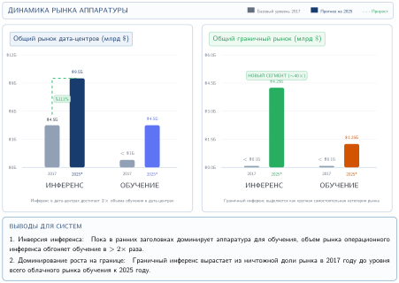
***Рост рынка аппаратуры для ИИ:** Анализ McKinsey, сравнивающий оценки рынка 2017 года с прогнозируемыми на 2025 год рынками дата-центров и граничных вычислений. Инференс доминировал в прогнозируемом росте: граничный инференс рассматривался как значимый новый сегмент, тогда как рынки обучения росли в прогнозе более умеренно.*

В отличие от традиционных программных приложений с фиксированным энергетическим следом, нагрузки инференса динамически масштабируются вместе со спросом пользователей. Сервисы вроде Alexa, Siri и Google Assistant опираются на непрерывный облачный инференс, обрабатывая миллионы голосовых запросов в минуту и требуя бесперебойной работы энергоемкой инфраструктуры дата-центров.

<a id="sec-sustainable-ai-energy-inefficiency-decode-phase-24da"></a>

#### Энергетическая неэффективность фазы декодирования

[«Инференс в масштабе»](10_inference.md#sec-inference-scale) ввел предзаполнение и декодирование как фазы задержки; устойчивость использует то же разделение как энергетическую модель. Предзаполнение обычно насыщает вычисления, тогда как декодирование для каждого генерируемого токена многократно передает состояние модели и KV-кэша через память. След обслуживания растет, потому что декодирование тратит энергию иначе, чем предзаполнение, и разрыв между двумя фазами инференса поразителен ([«Энергетическая интенсивность предзаполнения и декодирования»](#fig-prefill-decode-energy)).

<a id="fig-prefill-decode-energy"></a>

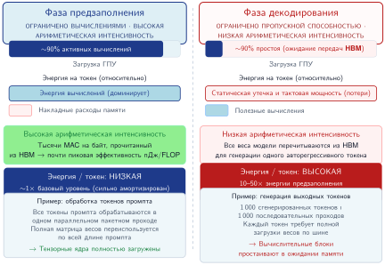
***Энергетическая интенсивность предзаполнения и декодирования:** Две панели рядом, сравнивающие предзаполнение и декодирование. Левая панель показывает столбцы загрузки GPU для двух фаз: высокая загрузка при предзаполнении (насыщение вычислений) и низкая при декодировании (ограничение пропускной способностью памяти). Правая панель раскладывает энергию на токен на вычислительную и memory-компоненты. Декодирование в расчете на операцию в 10$\times$–50$\times$ менее энергоэффективно, чем предзаполнение, потому что вычислительные блоки простаивают, потребляя статическую мощность, пока ждут память.*

Различие между предзаполнением и декодированием, сведенное в [«Энергетическая интенсивность предзаполнения и декодирования»](#fig-prefill-decode-energy), выходит за рамки задержки и затрагивает энергоэффективность. Недавний анализ (Ma and Patterson, 2026) показывает, что авторегрессивная генерация по своей природе расточительна по энергии по сравнению с пакетной обработкой, потому что две фазы нагружают разные аппаратные пределы. При предзаполнении высокая арифметическая интенсивность позволяет GPU выполнять тысячи операций на каждый байт, прочитанный из памяти, и достигать почти пиковой энергоэффективности в пДж/FLOP. При декодировании модель должна прочитать весь набор весов из HBM, чтобы сгенерировать один токен; арифметическая интенсивность низкая, поэтому вычислительные блоки большую часть цикла простаивают.

Результат — потери статической мощности: GPU потребляет значительные токи утечки и тактовую мощность, ожидая передач из памяти. Генерация 1 000 токенов за 1 000 последовательных шагов декодирования поэтому может потреблять в 10–50$\times$ больше энергии, чем обработка тех же 1 000 токенов в одном пакете предзаполнения. Эта неэффективность стимулирует спрос на специализированные NPU и TPU с оптимизацией под память, рассмотренные в [«Вычислительная инфраструктура»](02_compute_infrastructure.md#sec-compute-infrastructure), которые ставят пропускную способность на ватт выше сырых TFLOP/s.

<a id="sec-sustainable-ai-edge-ai-impact-6694"></a>

#### Влияние граничного ИИ

Архитектуры граничного интеллекта из [«Граничного интеллекта»](11_edge_intelligence.md#sec-edge-intelligence) позволяют выполнять инференс за пределами централизованных дата-центров. Такой распределенный подход дает особые преимущества для устойчивости: снижаются энергозатраты на передачу данных и зависимость от мощной облачной инфраструктуры. Вместо того чтобы направлять каждый запрос ИИ на централизованные облачные серверы, модели можно развертывать прямо на устройствах пользователей или на узлах граничных вычислений.

Однако инференс на границе не снимает энергетических проблем, особенно при масштабном развертывании. Например, автономным автомобилям нужен инференс ИИ с задержкой в миллисекунды, поэтому облачная обработка непрактична. Вместо этого автомобили используют бортовые ускорители ИИ, которые работают как «дата-центры на колесах» (Sudhakar et al., 2023). Эти встраиваемые вычислительные системы обрабатывают данные датчиков в реальном времени в объеме, эквивалентном небольшим дата-центрам, и потребляют заметную мощность даже без опоры на облачный инференс.

Аналогично потребительские устройства, такие как смартфоны, носимые гаджеты и датчики IoT, по отдельности потребляют от милливатт до ватт, но вместе из-за своего количества добавляют к мировому энергопотреблению тераватт-часы. Поэтому выгоды эффективности граничных вычислений нужно сопоставлять с масштабом развертывания устройств.

Развертывание на границе может быть устойчивее облачного, если его правильно спроектировать. Сочетание устранения передачи данных, эффективности локальной обработки и работы с рабочим циклом может снизить полное энергопотребление системы на порядки по сравнению с постоянно подключенным облачным инференсом.

<a id="sec-sustainable-ai-edge-mobile-power-budgets-b3b2-b3b2"></a>

#### Бюджеты мощности граничных и мобильных устройств

Граничные устройства на базе ARM работают в принципиально иных ограничениях мощности, чем ускорители дата-центров. Инженерный выбор состоит в том, чтобы сопоставить каждую нагрузку инференса с наименьшим классом мощности, который еще обеспечивает задержку и точность.

Бюджеты мощности отражают физические ограничения емкости батареи, рассеивания тепла и условий развертывания. [«Категории бюджетов мощности граничного ИИ»](#tbl-edge-power-budgets) группирует категории бюджетов мощности граничного ИИ и показывает, как распространяются эти ограничения: устройства TinyML, работающие от батареек-таблеток или сбора энергии, не могут превышать среднюю мощность в милливаттах; мобильные устройства должны балансировать пользовательский опыт и время работы от батареи; автомобильные системы сталкиваются с тепловыми ограничениями внутри закрытого салона, несмотря на доступ к питанию автомобиля.

| **Категория платформы**  | **Простой** | **Активный режим** | **Пиковая мощность** | **Примеры устройств**                                                                   |
|:-----------------------|:--------------:|:----------------:|:--------------:|:--------------------------------------------------------------------------------------|
| **TinyML (MCU)**       | 1–100 $\mu$W  |     1–50 мВт     |     100 мВт     | Arduino Nano 33, STM32H7, Nordic nRF5340                                              |
| **Мобильный NPU**         |   10–100 мВт   |     0,5–5 Вт   |      10 Вт      | Pixel Tensor, Apple Neural Engine, Snapdragon NPU                                     |
| **Граничный GPU/TPU**       |     1–5 Вт     |     5–30 Вт      |      75 Вт      | NVIDIA Jetson Orin NX (10–25 Вт) и AGX Orin (15–60 Вт), Google Edge TPU, RPi AI Kit |
| **Автономный автомобиль** |    10–50 Вт    |    50–200 Вт     |     500 Вт      | Tesla FSD Computer, Mobileye EyeQ, NVIDIA Drive                                       |

<a id="tbl-edge-power-budgets"></a>

***Категории бюджетов мощности граничного ИИ:** Граничные платформы охватывают пять порядков величины энергопотребления: от TinyML-систем менее милливатта до автомобильных вычислительных платформ, приближающихся к уровням мощности дата-центров. Устойчивое развертывание требует сопоставлять требования нагрузки с подходящими классами мощности.*

<a id="sec-sustainable-ai-tinyml-power-state-dynamics-ceaf"></a>

#### Динамика состояний питания TinyML

Хотя [«Граничный интеллект»](11_edge_intelligence.md#sec-edge-intelligence) рассматривает TinyML с точки зрения архитектуры систем, энергоэффективность инференса на устройстве в равной мере является вопросом устойчивости: каждый из миллиардов граничных вызовов инференса в масштабе парка складывается в измеримый углеродный след. Эффективность TinyML сильно зависит от рабочего цикла, когда устройства чередуют глубокий сон и активный инференс. [«Рабочий цикл TinyML»](#eq-tinyml-duty-cycle) выражает среднюю мощность как взвешенную сумму активной мощности и мощности сна:

<a id="eq-tinyml-duty-cycle"></a>

$$P_{\text{average}} = P_{\text{active}} \times \frac{t_{\text{inference}}}{T_{\text{period}}} + P_{\text{sleep}} \times \frac{T_{\text{period}} - t_{\text{inference}}}{T_{\text{period}}}$$

Для модели распознавания ключевых слов, работающей на микроконтроллере Cortex-M4 (режим архетипа C (федеративный MobileNet), [«Три системных архетипа»](01_introduction.md#sec-vol2-introduction-archetypes)):

- Мощность активного инференса: 15 мВт в течение 20 мс на цикл обнаружения
- Мощность глубокого сна: 10 микроампер при 3,3 В (33 микроватта)
- Период обнаружения: 1 секунда (непрерывное прослушивание)

$$P_{\text{average}} = 15 \text{ мВт} \times \frac{20 \text{ мс}}{1000 \text{ мс}} + 0{,}033 \text{ мВт} \times \frac{980 \text{ мс}}{1000 \text{ мс}}$$

$$P_{\text{average}} = 0{,}30 \text{ мВт} + 0{,}032 \text{ мВт} = 0{,}33 \text{ мВт}$$

При такой средней мощности батарейка-таблетка на 250 мАч (номинально 3,0 В) обеспечивает примерно 2 270 часов работы, почти 95 дней непрерывного инференса ИИ в режиме постоянной готовности. Этот расчет показывает, как TinyML открывает сценарии устойчивого развертывания ИИ, невозможные на платформах с большей мощностью. Эти принципы проектирования с учетом энергии напрямую переносятся в практические промышленные сценарии развертывания.

<a id="nbk-sustainable-ai-battery-life-tinyml"></a>

> **Сценарий: срок службы батареи TinyML**
>
> **Задача**: рассчитать срок работы TinyML-автокодировщика для обнаружения аномалий, развернутого на заводском узле датчика, питаемом двумя батарейками AA (3000 мАч при 3,0 В).
>
> Переменные:
>
> - MCU: ARM Cortex-M4, 80 МГц
> - Активная мощность: 12 мВт в течение 5 мс инференса с частотой 10 Гц (рабочий цикл 5 процентов)
> - Мощность сна: 16,5 мкВт (5 мкА при 3,3 В) в течение 95 мс сна
>
> **Расчет**:
>
> 1. Средняя мощность: $P_{\text{avg}} = 12 \text{ мВт} \times 0{,}05 + 0{,}0165 \text{ мВт} \times 0{,}95 = 0{,}616 \text{ мВт}$.
> 2. Емкость батареи: $E_{\text{battery}} = 3000 \text{ мАч} \times 3{,}0 \text{ В} = 9000 \text{ мВт·ч}$.
> 3. Срок службы батареи: $t_{\text{life}} = \frac{9000 \text{ мВт·ч}}{0{,}616 \text{ мВт}} \approx 14\,610 \text{ ч} \approx 1{,}7 \text{ года}$.
>
> **Системный вывод**: развертывание обеспечивает непрерывный мониторинг с помощью ИИ почти два года на стандартных батареях, демонстрируя потенциал устойчивости систем TinyML, спроектированных по принципам учета мощности.

<a id="sec-sustainable-ai-edge-learning-battery"></a>

#### Обучение на устройстве и «батарейная стена»

Хотя инференс на устройствах TinyML очень эффективен, обучение на устройстве создает гораздо более крутую энергетическую задачу. Персонализация модели под голос или походку конкретного пользователя требует обратного распространения ошибки, которое нуждается в 2–3$\times$ больше вычислений и памяти, чем прямой проход инференса.

TDP мобильных процессоров задает жесткие ограничения, которые определяют каждый аспект стратегий обучения на устройстве. Современные смартфоны обычно выдерживают длительную обработку ML-нагрузок на уровне 2–3 Вт, чтобы не допускать перегрева, но могут кратковременно выдавать до 5–10 Вт, пока не начнется тепловой троттлинг. Этот TDP определяет все допустимое пространство адаптивных алгоритмов.

<a id="nbk-sustainable-ai-energy-learning"></a>

> **Сценарий: энергия обучения**
>
> **Задача**: рассмотрим дообучение небольшой языковой модели (1 млрд параметров) на смартфоне пользователя за ночь. Укладывается ли это в бюджет батареи 5 %?
>
> **Расчет**:
>
> 1.  **Батарея телефона**: типичная емкость составляет около 15 Вт·ч, или примерно 54 000 Дж.
> 2.  Бюджет: 5 % от 54 000 Дж = 2 700 Дж.
> 3.  Стоимость обучения:
>     *   Прямой проход: $\approx$ 2 нДж на параметр.

>     *   Обратный проход: $\approx$ 4 нДж на параметр.
>     *   Всего на токен: 6 нДж на параметр $\times 10^9$ параметров = 6 Дж/токен.
> 4.  Емкость: 2 700 Дж / 6 Дж/токен = 450 токенов.
>
> **Системный вывод**: полное дообучение невозможно в разумном дневном бюджете батареи. Устойчивое обучение на устройстве требует параметрически эффективного дообучения или разреженных обновлений, чтобы снизить энергетическую стоимость на токен в 100$\times$ и более.

Фундаментальная физика энергопотребления показывает, почему локальная обработка почти всегда предпочтительнее переноса в облако для обучения на устройстве, при условии что модель достаточно компактна.

<a id="psp-sustainable-ai-energy-hierarchy"></a>

> **Перспектива: иерархия энергии**
>
> 
>
> *Радиопередача по энергии многократно превышает локальную арифметику.*
>
> **Компромисс**: архитектурный выбор между локальной обработкой данных и отправкой их в облако определяется энергетическим бюджетом. Физика энергопотребления дает ясный ответ, основанный на соотношении энергии вычислений и энергии связи.
>
> Энергия на операцию (приблизительно):
>
> *   сложение 32-битных целых: 0,1 пДж
> *   умножение 32-битных чисел с плавающей точкой: 4 пДж
> *   беспроводная передача (1 бит): 100 000–500 000 пДж (Bluetooth/Wi-Fi)
>
> **Системный вывод**: передача одного бита данных примерно эквивалентна по энергии 25 000–125 000 умножений FP32 или 1–5 миллионам сложений 32-битных целых при этих допущениях о стоимости операций. Если извлечь знание из данных можно за менее чем около 100 000 операций с плавающей точкой на бит, локальная обработка обычно энергоэффективнее переноса в облако. Это соотношение определяет архитектуру федеративного обучения: *вычисления дешевы, радиопередача дорога*.

#### Сбор энергии для автономного граничного ИИ

При достаточной оптимизации TinyML обеспечивает энергетически автономную работу, когда устройства собирают энергию окружающей среды вместо опоры на батареи:

Рассмотрим бюджеты мощности сбора энергии в [«Бюджеты мощности сбора энергии»](#tbl-energy-harvesting): модель распознавания ключевых слов, оптимизированная до средней мощности 0,5 мВт, может работать неограниченно долго на площади около 5 см² внутреннего солнечного сбора, но только при ярком внутреннем освещении, близком к верхней границе указанного диапазона. Типичным внутренним развертываниям нужны дополнительная площадь, накопитель энергии, работа с рабочим циклом или модель с меньшей средней мощностью, чтобы оставить запас на потери преобразования и тусклое освещение. Эта модель вечной работы представляет собой предельно устойчивое развертывание граничного ИИ, в котором операционная энергия полностью приходит из окружающей среды.

| **Источник энергии**                                                       |  **Типичная мощность**   | **Подходящие применения TinyML** |
|:----------------------------------------------------------------------------|:--------------------:|:-------------------------------|
| **Внутренний солнечный (1 см²)**  |  10–100 мкВт  | Периодическая классификация датчиков |
| **Наружный солнечный (1 см²)** |   1–10 мВт   | Непрерывное распознавание ключевых слов    |
| **Термоэлектрический (тепло тела)**                                              |  10–100 мкВт  | Распознавание жестов для носимых устройств   |
| **RF-сбор (Wi-Fi)**                                                   |   1–10 мкВт   | Сверхнизкочастотные узлы датчиков с малым рабочим циклом    |
| **Пьезоэлектрический от вибрации**                                                 | 100 мкВт–1 мВт | Промышленный мониторинг          |

<a id="tbl-energy-harvesting"></a>

***Бюджеты мощности сбора энергии:** Сбор энергии окружающей среды позволяет развертывать TinyML без батарей, когда средняя потребляемая мощность остается в пределах возможностей сбора. Солнечный сбор дает наибольшую плотность мощности для большинства развертываний.*

<a id="sec-sustainable-ai-cascade-inference-architecture-c710"></a>

#### Каскадная архитектура инференса

Помимо эффективности отдельного устройства, архитектурные шаблоны определяют полное энергопотребление системы на границе между граничными устройствами и облаком. Каскадная архитектура развертывает небольшую граничную модель (менее 100 КБ), которая отфильтровывает входные данные до облачного инференса. [«Энергия каскада»](#eq-cascade-energy) выражает полную энергию как сумму локальной обработки и облачных затрат, которые срабатывают с некоторой вероятностью:

<a id="eq-cascade-energy"></a>

$$E_{\text{cascade}} = E_{\text{edge}} + p_{\text{escalate}} \times (E_{\text{transmit}} + E_{\text{cloud}})$$

где $p_{\text{escalate}}$ — вероятность необходимости облачного инференса (обычно 5–20 процентов для хорошо спроектированных каскадов).

Для системы визуального контроля:

- Граничная модель (MobileNet-v3 tiny): 0,5 мДж на классификацию изображения
- Облачная модель (ResNet-152): 50 мДж на классификацию
- Энергия передачи: 10 мДж на изображение (сотовая связь)
- Доля эскалации: 10 процентов (в облако отправляются только неоднозначные случаи)

$$E_{\text{cascade}} = 0{,}5 + 0{,}10 \times (10 + 50) = 0{,}5 + 6{,}0 = 6{,}5 \text{ мДж/изображение}$$

По сравнению с постоянным облачным инференсом в 60 мДж на изображение каскадная архитектура дает снижение энергии на 89 процентов, сохраняя точность за счет избирательной эскалации в облако.

<a id="sec-sustainable-ai-wakeword-triggered-systems-c878"></a>

#### Системы, запускаемые словом пробуждения

Системы постоянной готовности используют иерархическое обнаружение пробуждения, чтобы минимизировать среднюю мощность:

1. Сверхнизкомощный аналоговый входной каскад: 10 мкВт непрерывного обнаружения голосовой активности
2. Миниатюрный детектор пробуждения на нейронной сети: 100 мкВт при обнаружении речи
3. Полный инференс модели: 10 мВт в течение 50 мс после подтверждения слова пробуждения

При типичной доле речевой активности 5 процентов и частоте слова пробуждения 0,1 процента:

$$P_{\text{average}} = 0{,}01 + 0{,}05 \times 0{,}1 + 0{,}001 \times 10 \times 0{,}05 = 0{,}0155 \text{ мВт}$$

Иерархический подход дает среднюю мощность 15,5 мкВт против 10 мВт для постоянно активного полного инференса, то есть снижение в 645,2 раза, что позволяет создавать питаемых от батареи голосовых помощников с работой в течение нескольких лет.

<a id="sec-sustainable-ai-federated-learning-energy-analysis-2c07"></a>

#### Энергетический анализ федеративного обучения

Обучение на границе сохраняет исходные данные локально, но заменяет их передачу повторными загрузками моделей и выгрузками обновлений клиентов. [«Энергия федеративного обучения»](#eq-federated-energy) сопоставляет энергетические компромиссы федеративного и централизованного подходов, где $R$ — число раундов, а $N_{\text{clients}}$ — число участвующих клиентов в раунде:

<a id="eq-federated-energy"></a>

$$E_{\text{federated}} = R \left[N_{\text{clients}} \left(E_{\text{local\_train}} + E_{\text{download}} + E_{\text{upload}}\right) + E_{\text{aggregation}}\right]$$

$$E_{\text{centralized}} = N_{\text{clients}} \times E_{\text{raw\_data\_upload}} + E_{\text{cloud\_train}}$$

Федеративное обучение становится энергоэффективным только тогда, когда повторная передача моделей, локальное обучение и агрегация потребляют меньше энергии, чем передача исходных данных и централизованное обучение. Одного того, что данные больше одного обновления модели, недостаточно, поскольку загрузки и выгрузки повторяются от раунда к раунду. Для чувствительных к приватности приложений с богатыми данными датчиков федеративный подход может давать одновременно выгоды по приватности *и* по энергии, если полные члены связи и вычислений выгодны локальному обучению. Граничный анализ оставляет еще один член жизненного цикла: физическую цепочку поставок, которая производит устройства и ускорители.

<a id="sec-sustainable-ai-water-usage-caae"></a>

### Вода, химикаты и критические материалы

Экологический след ИИ выходит за пределы электроэнергии и включает физические ресурсы — воду, опасные химикаты и критические материалы, — для которых нужны другие подходы к оценке. Полная оценка требует измерения дополнительных экологических последствий: потребления воды, использования опасных химикатов, добычи редких материалов и нарушения биоразнообразия, которым часто уделяется меньше внимания, несмотря на их экологическое значение. Современные полупроводниковые заводы, выпускающие чипы ИИ, требуют миллионов литров воды ежедневно и используют в своих процессах более 250 опасных веществ. В регионах, которые уже испытывают водный стресс, например на Тайване, в Аризоне и Сингапуре, такое интенсивное использование угрожает местным экосистемам и сообществам. Аппаратура ИИ также сильно зависит от дефицитных материалов, таких как галлий, индий, мышьяк и гелий, которые сталкиваются и с геополитическими рисками поставок, и с проблемами истощения (Jha, 2014; Chen, 2006).

Учет воды требует больше, чем одного коэффициента WUE. **Забор** измеряет воду, извлеченную из источника, тогда как **потребление** измеряет долю, которая не возвращается в тот же водосбор в пригодном виде. Учет должен отделять прямую охлаждающую воду на площадке от косвенной воды, использованной для выработки электричества и производства аппаратуры, а затем привязывать каждый поток к водосбору, сезону и местному дефициту (International Organization for Standardization, 2014; The Green Grid, 2011). Литр, потребленный в сезон дождей в бассейне с низким стрессом, не эквивалентен литру, потребленному во время засухи в бассейне под стрессом, поэтому сравнения, пригодные для решений, сообщают и физический объем, и результат с учетом стресса. Проценты повторно использованной воды также требуют заявленного знаменателя, потому что рециркуляция воды внутри объекта может снизить забор, не устраняя испарительного потребления.

Производство полупроводников — исключительно водоемкий процесс (Cooper et al., 2011). Завод TSMC в Аризоне, по прогнозам, будет потреблять 34 миллиона литров воды в день[^fn-fab-water-consumption] (Reuters, 2024), что составляет почти 3 процента всей водопроводной воды города. Одна кремниевая пластина диаметром 300 мм требует более 8 300 литров воды на протяжении всего процесса изготовления. [«Водный цикл полупроводникового производства»](#fig-water-cycle) иллюстрирует типичный водный цикл завода, в котором продвинутая рециркуляция может вернуть 60–80 процентов воды, но все же оставляет значительный след потребления.

[^fn-fab-water-consumption]: **Масштаб воды для полупроводников**: завод TSMC в Аризоне будет потреблять 12 миллиардов литров в год (примерно 4 800 олимпийских бассейнов), а чипы ИИ на передовых техпроцессах требуют в 5–10$\times$ больше воды на кристалл, чем предыдущие техпроцессы, из-за дополнительных шагов EUV и очистки. Эта зависимость от воды создает прямое ограничение устойчивости: заводы конкурируют с муниципальными водоснабжениями в засушливых регионах вроде Аризоны и Тайваня, где потребность полупроводникового производства может достигать 3 процентов общей квоты города.

<a id="fig-water-cycle"></a>

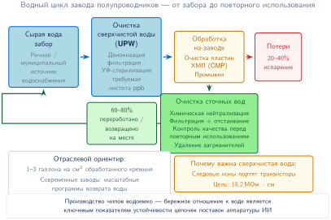
***Водный цикл полупроводникового производства:** Современные заводы ежедневно потребляют миллионы литров воды. Чтобы уменьшить это, передовые объекты внедряют замкнутую рециркуляцию. Сырая вода очищается до ультрачистой воды (UPW) для производства. Сточные воды обрабатываются и возвращаются в систему UPW, снижая чистое потребление на 60–80 процентов.*

Ключевой вывод из [«Водного цикла полупроводникового производства»](#fig-water-cycle): даже при уровнях повторного использования 60–80 процентов абсолютный объем потребляемой ультрачистой воды на заводах с передовыми техпроцессами остается огромным, что создает жесткое физическое ограничение на места, где производство чипов ИИ может устойчиво работать.

Производство также сильно зависит от опасных химикатов для травления, легирования и очистки. Сильные кислоты (плавиковая, серная), летучие органические соединения, такие как ксилол, и высокотоксичные газы (арсин, фосфин) применяются в огромных количествах: крупный завод может расходовать более 2 000 метрических тонн кислот в год (Kim et al., 2018). Эти вещества создают потоки опасных отходов, которые требуют обширной обработки, чтобы предотвратить экологический ущерб.

Аппаратура ИИ зависит от набора дефицитных и геополитически чувствительных **критических материалов**. Хотя кремний широко распространен, высокопроизводительным чипам нужны редкие элементы вроде галлия, индия, тантала и гелия. Такие материалы, как индий, попадают в анализы критических и исчезающих элементов, потому что поставки могут зависеть от попутной добычи, возможностей замены и ограничений переработки (Rhodes, 2019). Географическая концентрация переработки редкоземельных металлов создает серьезные уязвимости цепочек поставок. [«Критические материалы для аппаратуры ИИ»](#tbl-material_depletion) количественно описывает масштаб этой проблемы зависимости от материалов.

| **Материал**            | **Применение в полупроводниковом производстве ИИ**             | **Проблемы поставок**                                                                 |
|:------------------------|:--------------------------------------------------------------|:------------------------------------------------------------------------------------|
| **Кремний (Si)**        | Основа для чипов, пластин, транзисторов              | • Ограничения обработки<br>• Геополитические риски                                    |
| **Галлий (Ga)**        | Силовые усилители на основе GaN, высокочастотные компоненты         | • Ограниченная доступность<br>• Попутный продукт производства алюминия и цинка               |
| **Германий (Ge)**      | Быстрые транзисторы, фотодетекторы, оптические соединения | • Дефицит<br>• Географическая концентрация                                         |
| **Индий (In)**         | Оксид индия-олова, оптоэлектроника                             | • Ограниченные запасы<br>• Зависимость от переработки                                        |
| **Тантал (Ta)**        | Конденсаторы, стабильные интегральные компоненты                      | • Конфликтный минерал<br>• Уязвимые цепочки поставок                                    |
| **Редкоземельные элементы** | Магниты, датчики, высокопроизводительная электроника                | • Высокие геополитические риски<br>• Экологические проблемы добычи                    |
| **Кобальт (Co)**         | Батареи для граничных вычислительных устройств                          | • Проблемы прав человека<br>• Географическая концентрация (Конго)                       |
| **Вольфрам (W)**        | Межсоединения, барьерные слои, теплоотводы                          | • Ограниченное число мест добычи<br>• Геополитические проблемы                               |
| **Медь (Cu)**           | Межсоединения, барьерные слои, теплоотводы                          | • Ограниченные источники высокой чистоты<br>• Геополитические проблемы                            |
| **Гелий (He)**          | Охлаждение полупроводников, плазменное травление, EUV-литография        | • Невозобновляемый ресурс<br>• Безвозвратная утечка в атмосферу<br>• Ограниченные мощности добычи |

<a id="tbl-material_depletion"></a>

***Критические материалы для аппаратуры ИИ:** Производство полупроводников опирается на конкретные материалы, включая кремний, галлий, германий, индий, тантал, кобальт, вольфрам, медь, гелий и редкоземельные элементы, которые сталкиваются с растущими ограничениями поставок и геополитическими рисками, потенциально влияющими на производство и инновации в аппаратуре ИИ. В таблице приведены эти материалы, их применение в системах ИИ и связанные с ними уязвимости поставок, требующие упреждающих стратегий смягчения.*

Строительство и эксплуатация заводов и дата-центров также напрямую влияют на природные экосистемы через нарушение среды обитания, водный стресс и загрязнение от сбросов химикатов. Стоки полупроводниковой промышленности могут загрязнять речные отложения вблизи тяжелыми металлами и микроэлементами (Hsu et al., 2016). Отходы производства, включая газовые выбросы, воздух с летучими органическими соединениями и сточные воды с металлами, требуют сложных систем очистки, а утилизация аппаратуры ИИ в конце срока службы способствует растущему кризису электронных отходов: надлежащим образом перерабатывается лишь 17,4 процента мировых электронных отходов (Singh and Ogunseitan, 2022).

Экологическая цена вычислительного спроса выходит далеко за пределы атмосферного углерода и проявляется как сильный водный стресс и экологические нарушения вокруг производственных центров. Эти издержки цепочки поставок сходятся к следующему проектному рычагу: сколько времени огромные ресурсоемкие кластеры аппаратуры остаются полезными, прежде чем превратиться в отходы.

<a id="sec-sustainable-ai-hardware-lifecycle-environmental-assessment-66ee"></a>

## Жизненный цикл оборудования и электронные отходы

Экологическая цена ускорителя ИИ начинается задолго до того, как вычисляется его первая операция FLOP (Gupta et al., 2022; Luccioni et al., 2023; NVIDIA Corporation, 2025). Углеродный след производства одного H100, количественно описанный в [«Оценке воплощенного углерода»](#sec-sustainable-ai-embodied-carbon-assessment-9de0), возникает целиком на этапе изготовления.[^fn-lca-hardware-footprint] Парк из тысяч таких процессоров, необходимых для обучения модели на 175 млрд параметров (потребляющей 1 287 МВт·ч электроэнергии), представляет собой значительные вложения углерода в начале, еще до того, как выполняется какое-либо вычисление. Полная **оценка жизненного цикла (LCA)** количественно описывает совокупное воздействие на окружающую среду по четырем ключевым фазам: проектированию, производству, использованию и утилизации. LCA может показать, что производство составляет значительную долю воздействия за весь жизненный цикл, и это делает его критическим рычагом устойчивости, который одни лишь улучшения операционной эффективности не решают.

[^fn-lca-hardware-footprint]: **Оценка жизненного цикла (LCA)**: стандартизирована ISO 14040/14044; LCA прослеживает воздействие на окружающую среду от добычи сырья до утилизации (International Organization for Standardization, 2006). Для аппаратуры ИИ LCA отделяет воплощенные выбросы производства от энергии эксплуатации, что делает циклы замены оборудования и продление срока службы ускорителей рычагами устойчивости первого порядка, которые операционная эффективность сама по себе не может заменить.

<a id="chk-sustainable-ai-training-inference-flip"></a>

> **Контрольные вопросы: переворот обучения и инференса**
>
> Рассмотрим модель компьютерного зрения, обучение которой требует 2 000 GPU-часов при средней потребляемой мощности 300 Вт. После развертывания модель обслуживает 1 миллион запросов в день; каждый запрос занимает 50 мс при средней потребляемой мощности 100 Вт.
>
> - [ ] **Энергия обучения**: рассчитайте полную энергию, потраченную на обучение.
> - [ ] **Энергия инференса**: рассчитайте полную энергию инференса за 2-летний срок жизни продукта.
> - [ ] **Фокус оптимизации**: используйте «отношение инференса к обучению», чтобы выбрать цель оптимизации, которая максимизирует устойчивость.

Оценки жизненного цикла могут показать, что списание работоспособного оборудования ради скромного выигрыша в эффективности наносит больший экологический вред через воплощенный углерод, чем экономит на операционной мощности. Чтобы оценить точку перелома, при которой новое оборудование становится экологически оправданным, нужно оценить пересечение затрат на обучение, масштаба инференса и сроков службы оборудования.

Каждая из четырех основных фаз жизненного цикла вносит вклад в полный экологический след системы ИИ. [«Жизненный цикл системы ИИ»](#fig-ai-lca) иллюстрирует эту последовательность от проектирования до утилизации, выделяя взаимосвязи между фазами и категории воздействия на окружающую среду, связанные с каждой стадией.

<a id="fig-ai-lca"></a>

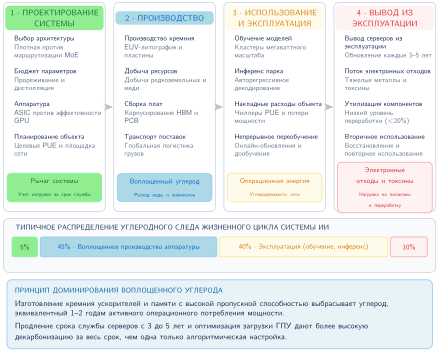
***Жизненный цикл системы ИИ:** Анализ систем ИИ на стадиях проектирования, производства, использования и утилизации раскрывает полное экологическое воздействие за пределами операционного энергопотребления, включая истощение ресурсов и электронные отходы. Такая оценка жизненного цикла позволяет адресно вмешиваться, чтобы повысить устойчивость на протяжении всего существования системы ИИ.*

Последовательность жизненного цикла — не статичная таксономия. Определяющая проблема устойчивости меняется по мере созревания системы: проектирование создает экспериментальные отходы, производство закрепляет воплощенный углерод, использование связывает нагрузку с ограничениями сети и охлаждения, утилизация переносит электронные отходы наружу, а продление срока службы становится рычагом, который распределяет все предыдущие выбросы на больший объем полезной работы.

<a id="sec-sustainable-ai-design-phase-0954"></a>

### Фаза проектирования и экспериментов

Фаза проектирования охватывает исследования, разработку и оптимизацию моделей ML до развертывания. Публичные данные об энергии обучения обычно описывают финальный прогон, а не предшествующий ему перебор вариантов. Автоматизированный поиск архитектуры может оценить множество конфигураций, но его след зависит от того, включает ли граница прокси-поиски, полные прогоны, накладные расходы дата-центра, структуру генерации и повторное использование в последующих моделях (Strubell et al., 2019; Patterson et al., 2021). Более поздние эффективные методы NAS используют совместное использование весов, непрерывные релаксации и поиск с учетом аппаратуры, чтобы уменьшить этот бюджет поиска (Elsken et al., 2019). [«Углеродный след моделей»](#tbl-training-emissions) сравнивает следы финальных прогонов для моделей разного масштаба; он не учитывает нераскрытые эксперименты.

| **Модель ИИ**    |  **FLOP обучения**  | **Оценочные выбросы CO₂ (кг)** | **Эквивалентный пробег автомобиля** |
|:----------------|:--------------------:|:----------------------------------:|:---------------------------:|
| **GPT-3**       | $3{,}1 \times 10^{23}$ |             502 000 кг             |        1,9 млн км       |
| **T5-11B**      | $2{,}3 \times 10^{22}$ |             85 000 кг              |          338 000 км         |
| **BERT (Base)** | $3{,}3 \times 10^{18}$ |               650 кг               |           2 400 км          |
| **ResNet-50**   | $2{,}0 \times 10^{17}$ |               35 кг                |            129 км           |

<a id="tbl-training-emissions"></a>

***Углеродный след моделей:** Обучение крупных моделей ИИ может создавать значительные выбросы углерода, но итоговый след зависит от вычислений, эффективности аппаратуры, накладных расходов дата-центра и углеродоемкости сети. Выбросы обучения GPT-3 эквивалентны пробегу 1,9 млн км на автомобиле при допущениях учета, использованных здесь.*

Решение задач устойчивости фазы проектирования требует инноваций в эффективности обучения: разреженного обучения, арифметики низкой точности, совместного использования весов и подходов NAS, учитывающих энергию. Перенос обучения и дообучение предобученных моделей повторно используют готовые представления вместо того, чтобы обучать каждую задачу с нуля (Raffel et al., 2020).

<a id="sec-sustainable-ai-manufacturing-phase-4ce1"></a>

### Фаза производства

Производство аппаратуры ИИ чрезвычайно ресурсоемко и несет воплощенный углерод на один H100, установленный в [«Оценке воплощенного углерода»](#sec-sustainable-ai-embodied-carbon-assessment-9de0), еще до того, как выполняется какое-либо вычисление. Изготовление полупроводников требует экстремальной точности в таких процессах, как EUV-литография (каждый инструмент потребляет около 1 МВт непрерывно), химическое осаждение из газовой фазы и ионная имплантация. Масштаб ресурсных потребностей, подробно описанных в разделе [«Вода, химикаты и критические материалы»](#sec-sustainable-ai-water-usage-caae), показывает: завод TSMC в Аризоне потребляет 34 миллиона литров воды в день, производство опирается на более чем 250 опасных веществ, а цепочка поставок зависит от геополитически сконцентрированных критических материалов.

Два структурных свойства ускорителей ИИ усиливают этот производственный след по сравнению с обычными чипами. Во-первых, высокопроизводительные чипы ИИ обычно изготавливаются на пределе ретикула или около него — максимальной площади кристалла, которую может напечатать одно литографическое экспонирование. Большие кристаллы дают меньше чипов с пластины и непропорционально уязвимы к случайным дефектам: плотность дефектов, которая выводит из строя 5 процентов малых кристаллов, может погубить 20 процентов или более кристалла на пределе ретикула, фактически расходуя воду, химикаты и энергию EUV, потраченные на изготовление каждой бракованной единицы. Во-вторых, требования к пропускной способности памяти для крупномасштабного инференса и обучения требуют продвинутого 2.5D- и 3D-корпусирования, например процесса TSMC Chip-on-Wafer-on-Substrate (CoWoS), который соединяет стеки памяти с высокой пропускной способностью (HBM) непосредственно с кристаллом ускорителя. Эта интеграция добавляет дополнительные этапы изготовления, циклы химической очистки и прецизионные операции запекания, которых не требует обычный монолитный CPU. В итоге каждый пригодный ускоритель ИИ воплощает значительно больше потребления воды, использования опасных химикатов и энергии процесса, чем предполагала бы его площадь пластины, поэтому долговечность оборудования и высокая загрузка становятся рычагами устойчивости первого порядка, а не второстепенными заботами.

Энергия, необходимая для производства аппаратуры ИИ, значительна, а в регионах с чистыми сетями воплощенное воздействие производства за полезный срок службы может сравняться с операционным. Исследования экологичной электроники указывают на материалы с меньшей токсичностью, улучшенную переработку и более экологичные подходы к производству устройств как направления устойчивости для производства электроники (Cenci et al., 2021; Irimia-Vladu, 2014).

<a id="sec-sustainable-ai-use-phase-a0a1"></a>

### Фаза использования

Операционная энергия, потребляемая при обучении и инференсе, подробно описана в разделе [«Анализ энергии обучения и инференса»](#sec-sustainable-ai-training-vs-inference-energy-analysis-4cb5). Здесь важен характер этого потребления и его взаимодействие с инфраструктурой сети. Потребление в 1 287 МВт·ч, необходимое для обучения модели на 175 млрд параметров, представляет собой высокую непрерывную нагрузку, но характер этой нагрузки неодинаков для разных типов задач, и это различие определяет, какие меры планирования практичны.

Крупный распределенный прогон обучения потребляет постоянную, коррелированную мощность на тысячах ускорителей и часто описывается как негибкий. Такая характеристика недооценивает гибкость планирования, которая уже заложена в распределенное обучение ради отказоустойчивости. Поскольку единственный отказ аппаратуры в кластере из тысячи узлов может испортить прогон, производственные системы обучения сохраняют состояние в постоянное хранилище каждые несколько минут или часов. Эта инфраструктура контрольных точек и есть тот механизм, который делает возможным планирование с учетом углерода: задание обучения можно приостановить в вечерний пик сети (когда падает солнечная генерация и подключаются ископаемые пиковые электростанции), сохранив состояние кластера в контрольную точку, и возобновить, когда ночная ветровая генерация повышает долю возобновляемых источников. Та же инженерия, что защищает от отказов аппаратуры, таким образом, служит и рычагом планирования для декарбонизации сети — связка отказоустойчивости и устойчивости, которой нет в синхронном обслуживании инференса, поскольку запрос нельзя приостановить на полпути.

Эта гибкость контрастирует с проблемой «кривой утки» (duck curve), которую кластеры обучения усугубляют, работая непрерывно. **Кривая утки** описывает крутой подъем, который операторы сети должны покрыть, когда солнечная генерация падает ближе к вечеру: дата-центр, потребляющий постоянные мегаватты в переходный период, углубляет этот подъем и увеличивает зависимость от ископаемых пиковых электростанций. Системы охлаждения усугубляют проблему, добавляя накладные расходы, описанные в разделе [«Охлаждение»](#sec-sustainable-ai-cooling), к вычислительной нагрузке. Планировщики с учетом углерода, которые используют контрольные точки, чтобы приостановить обучение в период высокого углеродного следа — обычно два-четыре часа на стыке перехода от солнечной генерации к пиковым станциям, — могут перенести заметную долю энергопотребления обучения на периоды, когда предельная углеродоемкость сети ниже. Географическая оптимизация (раздел [«Расчет углеродного следа»](#sec-sustainable-ai-carbon-footprint-calculation-c2fe)) работает с базовым уровнем, тогда как временное планирование работает с колебаниями внутри конкретного региона сети.

<a id="sec-sustainable-ai-disposal-phase-b4f1"></a>

### Утилизация, электронные отходы и встроенный ИИ

Быстрый темп инноваций в аппаратуре ИИ создает неумолимый цикл обновлений (Slade, 2007), что усугубляет растущий мировой кризис электронных отходов. Во всем мире человечество ежегодно порождает более 50 миллионов метрических тонн электронных отходов, из которых лишь 17,4 процента официально учтены как собранные и надлежащим образом переработанные (Singh and Ogunseitan, 2022). Высокопроизводительные серверы, которые используются для обучения крупных моделей, обычно служат всего три–пять лет, прежде чем их признают устаревшими. Списанная аппаратура ИИ содержит токсичные материалы — свинец, ртуть, кадмий и бериллий, — которые могут просачиваться в почву и грунтовые воды при захоронении на полигонах или в неформальных перерабатывающих пунктах (Grossman, 2007).

Два механизма, специфичных для инфраструктуры ML, делают это устаревание быстрее и расточительнее, чем в традиционных серверных средах. Ускорители ИИ редко доходят до конца физического срока службы кремния; вместо этого они устаревают из-за узких мест пропускной способности памяти и межсоединений, которые выявляют новые архитектуры моделей. Кластер GPU, соединенный по PCIe Gen 4, может иметь полностью работоспособный вычислительный кремний, но оказаться ниже минимальной пропускной способности межсоединения, необходимой для коллективных схем коммуникации более новой и крупной модели. Поскольку межсоединение встроено в плату, а не в чип, заменять приходится весь узел, а не только ускоритель. В отличие от обычных CPU, которые устанавливаются в стандартные материнские платы ATX или OCP, современные узлы ИИ размещают ускорители на проприетарных платах, спроектированных под конкретное поколение NVLink, NVSwitch и HBM. Когда обновление парка нацелено на новую архитектуру модели, плату, сетевые адаптеры шины хоста и зачастую сам хост-сервер меняют вместе, а не просто заменяют карту PCIe. Такая архитектурная жесткая связанность многократно увеличивает массу электронных отходов за цикл обновления — гораздо больше, чем подсказывают расчеты по кремнию отдельных чипов.

Проблема усугубляется ростом **встроенного ИИ**, когда возможности машинного обучения интегрируются в миллиарды потребительских устройств. [«Рост числа устройств IoT»](#fig-iot-number) показывает, как число подключенных устройств выросло с 8,6 миллиарда в 2019 году до прогнозируемых 29,42 миллиарда к 2030 году: за десятилетие рост более чем втрое, при этом граница между фактом и прогнозом приходится примерно на 2024 год (Statista, 2022). Такая траектория создает распределенную, малоценную и исключительно трудно перерабатываемую форму электронных отходов. Многие IoT-датчики, носимые устройства и умная бытовая техника с ИИ производятся с коротким сроком службы и ограниченной возможностью обновления, что делает их ремонт или переработку трудными или невозможными (Baldé et al., 2017). Несменные литий-ионные батареи, герметичные корпуса и проприетарные компоненты означают, что даже мелкая поломка приводит к полной замене устройства.

<a id="fig-iot-number"></a>

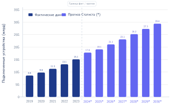
***Рост числа устройств IoT:** Быстрое расширение числа подключенных устройств усиливает экологическое воздействие встроенных систем ИИ, поскольку короткий жизненный цикл устройств порождает растущие электронные отходы. Прогнозы, приближающиеся к 30 миллиардам устройств к 2030 году, требуют устойчивого проектирования и улучшения инфраструктуры переработки, чтобы смягчить растущий кризис электронных отходов.*

Короткие жизненные циклы продуктов ускоряют цикл: ограниченные окна поддержки программного обеспечения, проприетарные компоненты, которые препятствуют ремонту, и герметичные конструкции, которые затрудняют разборку, подталкивают устройства к замене вместо повторного использования. Непропорционально большая доля этого бремени электронных отходов ложится на развивающиеся страны, которые часто получают партии списанной электроники из более богатых стран, что создает значительные экологические и социальные издержки для населения, наименее подготовленного к их обращению.

<a id="sec-sustainable-ai-extending-hardware-lifespan-b028"></a>

### Продление срока службы оборудования

Чтобы противостоять линейной модели «взял — сделал — выбросил», нужен переход к **циркулярной экономике** (Stahel, 2016), которая делает приоритетом повторное использование, восстановление и переработку. Когда воплощенный углерод доминирует в учете жизненного цикла, продление функционального срока службы аппаратуры ИИ — один из самых больших рычагов снижения, потому что оно распределяет высокие выбросы производства на более длительный период. Продление срока службы сервера с трех до пяти лет снижает воплощенный углерод на год работы на 40 процентов — выигрыш, который может превышать многие локальные программные оптимизации.

Четыре меры жизненного цикла продлевают срок службы оборудования, делая системы пригодными к ремонту, обновлению, поддержке и повторному использованию:

- **Право на ремонт**: законодательные и регуляторные инициативы противодействуют ограничениям на ремонт, делая акцент на доступе к запчастям, инструментам, диагностике и сервисной информации (Federal Trade Commission, 2021).
- Модульная конструкция: конструкции аппаратуры ИИ, которые позволяют независимо обновлять ускорители, память или сетевые интерфейсы, не дают списывать целые системы, когда устарел только один компонент, следуя принципу, который демонстрируют такие компании, как Framework, в потребительских ноутбуках (Framework Computer, 2022).
- Расширенные циклы поддержки: более длительная поддержка программного обеспечения и прошивок сохраняет пригодное оборудование безопасным и работоспособным дольше, откладывая его попадание в поток электронных отходов (Forti et al., 2020).
- Программы вторичного использования: перевод старых ускорителей на исследовательские, пакетные или менее приоритетные нагрузки дополнительно распределяет воплощенный углерод, вместо того чтобы сразу отправлять оборудование на утилизацию.

Эти меры переводят устойчивость от управления утилизацией к инженерии жизненного цикла. Когда масштаб следа аппаратуры, энергии и углерода, порождаемого системами ИИ, количественно описан, вопрос становится таким: какие конкретные инженерные приемы способны снизить это воздействие.

