<a id="sec-responsible-ai"></a>

# Ответственный ИИ

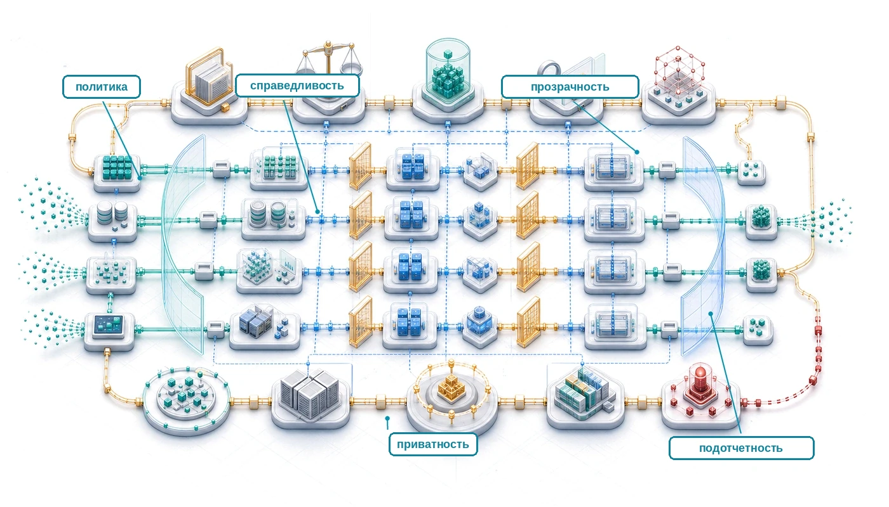

## Назначение

_Почему системы, которые не выполняют требований ответственности, вообще не доходят до развертывания, как бы ни были хороши их технические возможности?_

В сферах с высокими ставками и строгим регулированием модель, которая не может объяснить или задокументировать свое поведение, обеспечить аудит или соответствовать применимым нормам о недопустимой дискриминации, может не пройти проверку перед развертыванием, независимо от точности и задержки. Юридические и управленческие требования могут сделать прозрачность, надзор, документирование и управление рисками частью готовности к развертыванию. Инженерия ответственного ИИ реализует эти требования через измеримые средства контроля, а не рассматривает их как финальную этическую экспертизу. В терминах C³ ответственность — это координационное ограничение на парк. Обязательные средства контроля безопасности, справедливости и подотчетности должны быть установлены до развертывания.

> **Цели обучения**
>
> - Превращать справедливость, прозрачность, подотчетность, приватность и безопасность в измеримые шлюзы развертывания
> - Вычислять метрики справедливости и оценивать наблюдательные и причинные определения при компромиссах между базовой частотой и предсказанием
> - Проектировать обнаружение смещения и мониторинг справедливости по демографическим группам, дрейфу и петлям обратной связи в масштабе парка
> - Выбирать методы объяснения с учетом ограничений по задержке, вычислениям, аудитируемости и возможности оспорить решение
> - Оценивать меры приватности, забывания и устойчивости по точности, вычислительным затратам и требованиям управления
> - Анализировать петли обратной связи «человек — ИИ», предвзятость автоматизации и конфликты ценностей в условиях развертывания
> - Строить аудируемый жизненный цикл обеспечения доверия: от назначения и доказательств через запуск, исправление и существенное изменение до вывода из эксплуатации

## Императив управления

В 2018 году Reuters сообщило, что компания Amazon отказалась от экспериментального алгоритма найма, обученного на исторических данных резюме, после того как выяснилось, что он систематически занижал оценки кандидатов-женщин (Dastin, 2018). Система выполняла многие привычные операционные требования: ее можно было построить, оценить и встроить в рабочий процесс найма. Но она выучила, что успешные кандидаты в прошлом были преимущественно мужчинами, и закодировала историческое смещение вместо критериев, основанных на заслугах. Модель была статистически оптимизирована, но этически катастрофична, и это показывает, что техническое совершенство может сочетаться с серьезным социальным вредом.

В стеке парка, показанном на [рисунке «Стек парка»](01_introduction.md#fig-fleet-stack), ответственный ИИ — это слой управления, точка, где система встречается с реальным миром. Нижние слои обеспечивают вычисления, перемещение данных, распределенное исполнение, инфраструктуру обслуживания, средства безопасности, механизмы устойчивости и бюджеты на устойчивое развитие. Слой управления добавляет ограничения, которые определяют, зачем работает машина и кому она служит, и гарантирует, что корректная в остальном система не наносит ущерба обществу. Если железный закон задает эффективность, то ответственный ИИ задает стабильность: он обеспечивает, чтобы выход системы не дестабилизировал общество, в котором она работает. Нестабильность при этом вполне конкретна: модель, выдающая токсичный контент, подрывает доверие пользователей (нестабильность из-за петли обратной связи), модель, которая дискриминирует, портит собственные будущие обучающие данные (нестабильность распределения), а модель, которая утекает приватные данные, навлекает регуляторное запрещение (операционная нестабильность). Поэтому ответственный ИИ должен входить в целевую функцию, а не быть только ограничением, которое проверяют в готовом решении.

Производственный ИИ имеет собственную системную повестку, охватывающую архитектуру, инфраструктуру, обработку данных, безопасность и проблемы устойчивости (Stoica et al., 2017). Безопасность и приватность, устойчивость к сдвигу распределения и экологическая устойчивость лежат непосредственно под слоем управления. Эти возможности объясняют, как строить и эксплуатировать системы машинного обучения, которые безопасны, устойчивы и устойчивы в экологическом смысле. Ответственный ИИ отвечает на вопрос, на который одного технического совершенства недостаточно: работают ли эти системы ответственно по отношению к людям, на которых они влияют.

Инцидент с наймом в Amazon показывает центральную проблему ответственного ИИ: системы могут быть алгоритмически корректными и при этом увековечивать несправедливость. Проблема выходит за рамки отдельного смещения и охватывает прозрачность, подотчетность, приватность и безопасность в системах, которые ежедневно затрагивают миллиарды людей. Это не та же проблема, что устойчивость. Устойчивый ИИ отвечает на угрозы целостности системы — состязательные атаки и отказы оборудования; ответственный ИИ спрашивает, дает ли правильно работающая система результаты, согласованные с человеческими ценностями и общим благом. Это различие превращает абстрактные этические принципы в инженерные ограничения. Справедливость, прозрачность и подотчетность должны стать поддающимися количественной оценке механизмами и проверяемыми свойствами системы, а не пунктами итоговой проверки, которые добавляют, когда путь обслуживания уже готов.

У инженерии программного обеспечения есть прецедент для такой эволюции. Ранние системы ставили на первое место только функциональную корректность. По мере роста сложности появились методики инженерии надежности, обеспечения безопасности и анализа сопровождаемости. Развертывание ML создает сопоставимое давление на зрелость, но в большем социальном масштабе: модели могут влиять на распределение кредитов, медицинскую диагностику, оценку в образовании и систему уголовного правосудия. Сбои ответственного ИИ могут закреплять системную дискриминацию, подрывать демократические институты и подрывать доверие общества к полезным технологиям, даже когда сама услуга остается доступной.

> **Определение: ответственный ИИ**
>
>
> ***Ответственный ИИ*** — это практика проектирования, аудита и эксплуатации систем машинного обучения по измеримым стандартам справедливости, безопасности, приватности и подотчетности; она переводит этические принципы в проверяемые свойства системы, которые ограничивают обучение модели, решения о развертывании и операционный мониторинг.
>
> 1.  **Значимость**: ограничения ответственного ИИ имеют реальную цену: обучение с учетом справедливости может удлинить прогоны обучения, мониторинг смещения в реальном времени может расходовать задержку пути обслуживания, а объяснимость по запросу может требовать дополнительных оценок модели или мощностей асинхронных рабочих процессов. В масштабе парка эти защитные меры нужно закладывать в бюджет так же, как средства контроля надежности или безопасности. С другой стороны, система распознавания лиц с устойчивым разрывом ошибок для отдельной подгруппы может затронуть миллионы пользователей до обнаружения, и регуляторные и правовые издержки здесь во много раз превысят стоимость мониторинга.
> 2.  **Различие**: в отличие от этики ИИ, которая определяет нормативные принципы (что системы должны делать), инженерия ответственного ИИ определяет технические механизмы, которые эти принципы обеспечивают: алгоритмы обнаружения смещения, реализации дифференциальной приватности, журналы аудита и архитектурные защитные барьеры, которые делают соответствие измеримым и проверяемым, а не декларативным.
> 3.  **Распространенная ошибка**: часто считают, что ответственный ИИ — это финальная проверка соответствия готовой модели. Ограничения, которые не заложены уже на этапе сбора данных, обычно требуют фундаментального переобучения для исправления: модель, обученная на смещенных метках, не может быть справедливо откалибрована одной лишь пороговой корректировкой после обучения, поскольку сами выученные представления кодируют смещение.
>

Ответственный ИИ поэтому представляет собой систематическую инженерную дисциплину с четырьмя взаимосвязанными измерениями: перевод этических принципов в измеримые системные требования, обнаружение и смягчение вредного алгоритмического поведения, работа с **социотехническими динамиками**[^fn-sociotechnical-system-etymology], которые выходят за пределы отдельных систем, и решение проблем внедрения в организационных и регуляторных условиях. Публичные рамки, такие как AI Risk Management Framework Национального института стандартов и технологий США (NIST), стандарты ISO/IEC 42001 и 23894, Рекомендация Организации экономического сотрудничества и развития (ОЭСР) по ИИ и Рекомендация ЮНЕСКО по этике ИИ, отражают этот переход от абстрактных принципов к управляемому риск-менеджменту, подотчетности, прозрачности и человеческому контролю (NIST, 2023; ISO/IEC, 2023a; ISO/IEC, 2023b; OECD, 2024; UNESCO, 2022). Приватность, методы устойчивости и метрики устойчивого развития обеспечивают техническую основу для этой интеграции. Подход ответственного ИИ сочетает эти возможности с алгоритмами обнаружения смещения, механизмами защиты приватности, организационными структурами управления и процессами взаимодействия с заинтересованными сторонами, рассматривая ответственный ИИ как неотъемлемую часть грамотной инженерной практики, а не как дополнительные ограничения, наложенные на готовые системы.

Такая интеграция — существенная инфраструктурная инвестиция. [Приложение «Основы парка»](appendix_fleet.md#sec-appdx-fleet-foundations-numbers-to-know) приводит базовые показатели парка производственного масштаба и цифры емкости обслуживания, по которым можно оценить эти накладные расходы, и это позволяет инженеру соотнести «налог» с теми же показателями пропускной способности на ускоритель, что используются для обычного обслуживания. Эта стоимость — необходимая инфраструктура, которую нужно обеспечить, так же как безопасность (см. главу [«Безопасность и приватность»](13_security_privacy.md#sec-security-privacy)) и резервирование (см. главу [«Отказоустойчивость»](07_fault_tolerance.md#sec-fault-tolerance-reliability)) закладываются в бюджет в распределенных системах.

Рассмотрение справедливости, прозрачности, подотчетности и приватности как строгих инженерных спецификаций, а не абстрактных идеалов, превращает ответственный ИИ из стремления в практику. Последовательный подход, который следует дальше, сопоставляет эти основные этические принципы с механическими этапами жизненного цикла машинного обучения и превращает каждый из них в конкретное проектное ограничение с измеримыми критериями. Эти четыре направления нужно читать по порядку, потому что каждое опирается на предыдущее: одни технические решения не могут разрешить конфликты ценностей, этические принципы без технической реализации остаются стремлением, а изолированные меры терпят неудачу без организационной поддержки.

<a id="sec-responsible-ai-governance-assurance-lifecycle"></a>

### Жизненный цикл управления и обеспечения доверия

Реестр моделей может доказать, какие веса попали в продакшен, но не может доказать, что развертывание было обосновано. Это суждение требует цепочки доказательств, связывающей контекст развертывания с затронутыми людьми, предвидимым вредом, измеримыми требованиями, реализованными средствами контроля, ответственными владельцами и полномочиями на запуск или остановку системы. Поэтому ответственному ИИ нужен **жизненный цикл обеспечения доверия**: повторяемый эксплуатационный путь, который превращает нормативные обязательства в проверяемые утверждения и поддерживает их действительность по мере изменения системы.

Жизненный цикл начинается до выбора модели. Команды сначала определяют назначение, запрещенные применения, затронутых сторон, среду эксплуатации и последствия решений. Затем они выявляют вред и требования, включая качество для подгрупп, приватность, безопасность, устойчивость, экологические обязательства, человеческий контроль и обязательства по возможности оспорить решение. Часть средств контроля реализуется локально; другие унаследованы от поставщиков данных, вендоров базовых моделей, облачных платформ или нижестоящих операторов. Каждое унаследованное средство контроля требует контракта на интерфейс, в котором указано, что гарантирует поставщик, какие доказательства подтверждают эту гарантию и какие остаточные риски остаются у развертывающей организации.

Итоговый кейс обеспечения доверия — это не один документ соответствия. Это версионированный набор связанных артефактов:

1. **Утверждение**: свойство, требуемое для заданного применения и рабочего диапазона.
2. **Аргумент**: рассуждение, которое связывает средства контроля и доказательства с утверждением.
3. **Доказательства**: оценки, аудиты, журналы, документация и пользовательские исследования, которые можно воспроизвести или проверить.
4. **Допущения**: условия среды, популяции, поставщиков и рабочих процессов, при которых утверждение выполняется.
5. **Владелец и полномочия**: лицо или орган, ответственный за утверждение и имеющий право заблокировать запуск, ограничить использование или потребовать исправления.
6. **Правило аннулирования**: измеримое изменение или инцидент, которые делают утверждение недействительным и запускают повторную оценку.

Такая структура предотвращает распространенную категориальную ошибку. Панель справедливости, учет приватности, отчет красной команды или углеродный реестр являются доказательствами для ограниченного утверждения; ни одно из них само по себе не доказывает, что вся система ответственна. [Таблица «Жизненный цикл управления и обеспечения доверия»](#tbl-governance-assurance-lifecycle) показывает, как доказательство становится операционным только тогда, когда владелец может на его основании действовать, а затронутые люди имеют путь к оспариванию решения и получению исправления.

На момент выпуска контракт оценки из [главы «Эксплуатация ML-систем в масштабе»](12_ops_scale.md#sec-ops-scale) связывает эти утверждения обеспечения доверия с точной моделью, нагрузкой, полномочиями на приемку, целью отката и сроком хранения доказательств. Кейс обеспечения доверия объясняет, почему развертывание оправдано; контракт оценки обеспечивает, что продвижение и аннулирование исполняют это решение над одним воспроизводимым артефактом.

<a id="tbl-governance-assurance-lifecycle"></a>

***Жизненный цикл управления и обеспечения доверия:** ответственная эксплуатация связывает контекст и затронутые стороны с требованиями, унаследованными средствами контроля, доказательствами, полномочиями на запуск, мониторингом, инцидентами, исправлением, проверкой существенных изменений и выводом из эксплуатации. Каждый этап производит аудируемый артефакт и решение, а не декларацию политики.*

| **Этап жизненного цикла**       | **Требуемый артефакт**                                                                                              | **Операционное решение**                                                    |
|:--------------------------------|:--------------------------------------------------------------------------------------------------------------------|:---------------------------------------------------------------------------|
| Контекст и затронутые стороны   | Описание назначения, запрещенные применения, карта заинтересованных сторон, анализ влияния решения                  | Законно ли это применение и находится ли оно в пределах полномочий организации? |
| Риски и требования              | Модель вреда, юридические и политические обязательства, измеримые критерии приемки                                  | Какие риски нужно предотвратить, ограничить, передать или принять?          |
| Средства контроля и зависимости | Инвентаризация средств контроля, доказательства поставщиков, происхождение данных и модели, права доступа инструментов | Достаточны ли локальные и унаследованные средства контроля для рабочего диапазона? |
| Оценка и обеспечение доверия    | Кейс обеспечения доверия, разбивка результатов по подгруппам с неопределенностью, доказательства устойчивости и безопасности, учет устойчивого развития | Подтверждают ли доказательства запуск, ограниченный запуск или отказ?        |
| Полномочия на запуск            | Подписанная запись решения, владелец остаточного риска, пути отката и обжалования                                    | Кто может разрешить развертывание и кто может его остановить?              |
| Эксплуатация и реагирование на инциденты | Пороги мониторинга, ответственные за эскалацию, журнал инцидентов, процесс исправления                      | Когда система должна деградировать, откатиться, уведомить, компенсировать или приостановиться? |
| Существенное изменение          | Классификация изменения, оценка влияния, объем повторной проверки                                                    | Аннулирует ли новая модель, набор данных, инструмент, регион или применение прежнее одобрение? |
| Вывод из эксплуатации           | План демонтажа, запись о хранении и удалении, уведомление пользователей и зависимых систем                          | Как закрываются доступы, данные, модели, интерфейсы и нерешенные вопросы вреда? |

Названные рамки организуют эту работу на разных уровнях. AI Risk Management Framework NIST строит деятельность вокруг функций Govern, Map, Measure и Manage; ISO/IEC 42001 задает систему управления ИИ на уровне организации; ISO/IEC 23894 дает рекомендации по управлению рисками ИИ; а рекомендации ОЭСР и ЮНЕСКО формулируют более широкие принципы и публичные обязанности (NIST, 2023; ISO/IEC, 2023a; ISO/IEC, 2023b; OECD, 2024; UNESCO, 2022). [Таблица «Сопоставление рамок»](#tbl-responsible-ai-framework-crosswalk) сопоставляет эти подходы с одним и тем же эксплуатационным жизненным циклом, а не рассматривает их как взаимозаменяемые списки проверок.

<a id="tbl-responsible-ai-framework-crosswalk"></a>

***Сопоставление рамок:** публичные рамки различаются по сфере охвата и юридическому статусу, но их устойчивый системный вклад взаимодополняющий. Они помогают организациям установить полномочия, выявлять и измерять риски, вести средства контроля и переоценивать доказательства по мере изменения и вывода из эксплуатации.*

| **Ответственность на этапе жизненного цикла**       | **Акцент NIST AI RMF**   | **Акцент системы управления и государственной политики**                                  |
|:---------------------------------------------------|:-------------------------|:-------------------------------------------------------------------------------------------|
| Определить контекст, затронутые стороны и полномочия | Govern и Map             | Организационный контекст, руководство, участие заинтересованных сторон и человеческий контроль |
| Измерять риск и собирать доказательства            | Measure                  | Оценка рисков, документированные цели, оценка, прозрачность и прослеживаемость              |
| Решать, эксплуатировать и реагировать              | Manage                   | Операционные средства контроля, подотчетность, реагирование на инциденты, исправление и постоянное улучшение |
| Пересматривать изменения и вывод из эксплуатации   | Govern и Manage          | Управление изменениями, корректирующие действия, пересмотр жизненного цикла и обязанности по выводу из эксплуатации |

Три детали не дают этому жизненному циклу стать формальностью. Во-первых, оценки справедливости должны содержать знаменатели, доверительные интервалы и ограничения покрытия данными: шумный разрыв для подгруппы должен запускать расследование, а не автоматические утверждения ни о дискриминации, ни о безопасности. Во-вторых, данные об устойчивом развитии из [главы «Устойчивый ИИ»](15_sustainable_ai.md#sec-sustainable-ai) должны входить в ту же запись обеспечения доверия: функциональная единица, границы системы, углеродный сигнал, учет воды, распределение воплощенного воздействия, неопределенность и ограничение качества определяют, сравнимо и действенно ли экологическое утверждение. В-третьих, системы, которые вызывают инструменты или делегируют действия, нуждаются в границе полномочий, независимой от согласованности модели. Идентичности инструментов, области доступа с минимальными правами, требования одобрения, лимиты расходов и частоты обращений, проверка выходов, происхождение и отзыв должны быть версионированы и отслеживаться, потому что аргументы инструментов, сгенерированные моделью, и извлеченное содержимое остаются ненадежными входными данными.

Жизненный цикл также определяет границу между справедливостью и выравниванием. Справедливость спрашивает, как выгоды, ошибки, возможности и бремя распределяются между затронутыми людьми при конкурирующих нормативных критериях. Выравнивание спрашивает, преследует ли оптимизирующая система цель и ограничения, которые задумали ее проектировщики и законные заинтересованные стороны. Согласованная система может добросовестно реализовать несправедливую цель, а статистически справедливый классификатор все еще может оптимизировать неверную общественную цель. Управление должно оценивать и то и другое, не сводя одно к другому.

Одобрение истекает, когда его подтверждающие допущения перестают выполняться. Смена базовой модели, распределения обучения, корпуса для извлечения, доступа инструментов, региона развертывания, пользовательской популяции, назначения решения или человеческого процесса может быть **существенной** даже тогда, когда код приложения не изменился. В записи об изменении нужно указать, какие утверждения аннулируются, и выбрать наименьший обоснованный объем повторной проверки. По окончании службы вывод из эксплуатации должен отозвать учетные данные, безопасно остановить зависимые интерфейсы, применить правила хранения и удаления, сохранить обязательные аудиторские доказательства, уведомить затронутых пользователей и нижестоящих операторов и назначить владельца для нерешенных апелляций и вреда. Управление охватывает систему после запуска и после отключения, а не только момент, когда комиссия подписывает релиз.

<a id="sec-responsible-ai-core-principles-1bd7"></a>

## Базовые принципы и жизненный цикл машинного обучения

Конвейер непрерывной интеграции, который автоматически обнаруживает утечку памяти, блокирует развертывание. Тот же конвейер должен блокировать развертывание, если система обнаруживает падение точности на 15 процентов именно для пожилых пользователей. Ответственный ИИ переводит этические принципы в жесткие инженерные инварианты. Как модульные тесты предотвращают регрессии логики, конвейер непрерывной интеграции и непрерывной поставки (CI/CD) должен включать проверки справедливости, приватности и подотчетности, рассматривая демографическое смещение точно так же, как обработали бы фатальное программное исключение.

Справедливость работает как ограничение стабильности. В терминах теории управления справедливость обеспечивает, что распределение ошибок системы инвариантно относительно подгрупп популяции. Система, нарушающая это ограничение, нестабильна: она будет портить собственные обучающие данные через петли обратной связи (например, при предиктивной полицейской аналитике) и терять доверие пользователей, что ведет к постепенному коллапсу системы. Этот принцип охватывает как статистические метрики, так и более широкие нормативные вопросы равенства, справедливости и структурного смещения. Анализ справедливости в [разделе «Справедливость в машинном обучении»](#sec-responsible-ai-fairness-machine-learning-2ba4) подробно рассматривает формальные математические определения.

Тот же взгляд с позиции плоскости управления делает **объяснимость** одним из источников системных доказательств: атрибуция, примеры, контрфактический анализ и структура интерпретируемых моделей могут выявить закономерности, которые человеческие операторы расследуют (Phillips et al., 2020). Эти методы не раскрывают полных причинных рассуждений модели, не обосновывают решение, не гарантируют возможности исправления и не доказывают, что ограничение безопасности выполняется. Их ценность зависит от конкретной аудитории и решения: разработчикам могут нужны доказательства для анализа ошибок, аудиторам — воспроизводимые поведенческие тесты, а затронутым пользователям — понятные причины и путь оспорить результат. Поэтому объяснение дополняет телеметрию, документацию, оценку и человеческую проверку, а не заменяет их.

Эту наблюдаемость нужно дополнять **прозрачностью**: открытостью в отношении того, как строятся, обучаются, проверяются и развертываются системы ИИ. Прозрачность включает раскрытие источников данных, проектных допущений, ограничений системы и характеристик производительности. Если объяснимость направлена на понимание выходов, то прозрачность охватывает весь жизненный цикл системы.

Когда поведение системы стало видимым, **подотчетность** задает механизмы, по которым отдельные лица или организации несут ответственность за результаты работы ИИ. Она включает прослеживаемость, документирование, аудит и возможность исправить вред. Подотчетность гарантирует, что сбои ИИ рассматриваются не как абстрактные неисправности, а как последствия с реальным влиянием.

На уровне целевой функции **выравнивание ценностей**[^fn-value-alignment-safety] задает вопрос, преследуют ли системы ИИ цели, согласованные с законным человеческим замыслом и ограничениями. На практике здесь есть технические трудности, включая проектирование функции вознаграждения и спецификацию ограничений, и более широкие вопросы о том, чьи ценности представлены и навязаны. Выравнивание не включает в себя справедливость: первое касается верности цели, а вторая оценивает, как распределяются результаты и бремя и законна ли сама цель.

[^fn-value-alignment-safety]: **Выравнивание ценностей**: проблема обеспечения того, чтобы системы ИИ оптимизировали человеческие ценности, а не суррогатные цели. Стюарт Рассел сформулировал эту проблему в 2015 году, утверждая, что задавать цели труднее, чем оптимизировать их. Инженерное следствие: рекомендательный алгоритм YouTube до 2017 года оптимизировал показатель кликабельности (прокси удовлетворенности), и непреднамеренно продвигал конспирологический контент, который максимизировал клики при снижении благополучия пользователей, — рассогласование, которое потребовало перепроектировать весь конвейер вознаграждения.

Жизненному циклу также нужен **человеческий контроль**: роль человеческого суждения в надзоре, исправлении или остановке автоматизированных решений. Сюда относятся люди в контуре[^fn-hitl-human-oversight] во время эксплуатации, а также организационные структуры, которые обеспечивают подотчетность использования ИИ общественным ценностям и реальной сложности.

[^fn-hitl-human-oversight]: **HITL (Human-in-the-Loop, человек в контуре)**: шаблон проектирования, при котором люди активно участвуют в решениях модели, а не заменяются автоматикой; системный компромисс — задержка против безопасности: HITL добавляет от 100 мс до более чем 30 секунд на решение в зависимости от области. Крупные системы модерации контента исторически сочетали автоматическую сортировку с тысячами живых проверяющих, что показывает: шаблон масштабируется только вместе с пропорциональными затратами на человеческую инфраструктуру. В архитектурах обслуживания ML HITL требует логики маршрутизации, порогов уверенности для эскалации и управления очередями, которые по существу перестраивают конвейер инференса.

Приватность, устойчивость и человеческий контроль подводят к одному и тому же выводу с разных сторон: одних принципов недостаточно, чтобы системы были ответственными. Переход от абстрактных идеалов к конкретной практике требует систематической интеграции по всему жизненному циклу ML, где каждый принцип проявляется по-своему при сборе данных, обучении модели, оценке, развертывании и мониторинге. Ключевой вопрос в том, как эти принципы взаимодействуют, когда они конкурируют за приоритет.

<a id="sec-responsible-ai-integrating-principles-across-ml-lifecycle-7557"></a>

### Интеграция принципов в жизненный цикл машинного обучения

Справедливость, прозрачность, подотчетность, приватность и безопасность определяют, что значит, что система ИИ ведет себя этично и предсказуемо. Перевод этих принципов в конкретные ограничения, которые направляют обучение, оценку, развертывание и сопровождение моделей, — центральная инженерная задача.

На практике реализация этих принципов требует понимания того, как каждый из них задает конкретные ожидания от поведения системы:

- **Справедливость**: модели должны обращаться с разными подгруппами так, чтобы учитывать исторические смещения.
- **Объяснимость**: решения модели должны быть понятны разработчикам, аудиторам и конечным пользователям.
- **Приватность**: сбор и использование данных должны соблюдать согласие, назначение и границы доступа.
- **Подотчетность**: обязанности должны назначаться, отслеживаться и соблюдаться на протяжении всего жизненного цикла системы.
- **Безопасность**: модели должны вести себя надежно даже в неопределенной или меняющейся среде.

Принципы пересекаются, но каждый из них создает отдельную инженерную обязанность, которую нужно заложить в жизненный цикл системы.

[Таблица «Жизненный цикл ответственного ИИ»](#tbl-principles-lifecycle) показывает, как жизненный цикл ответственного ИИ проходит через основные фазы разработки систем машинного обучения: сбор данных, обучение модели, оценку, развертывание и мониторинг.

<a id="tbl-principles-lifecycle"></a>

***Жизненный цикл ответственного ИИ:** встраивание справедливости, объяснимости, приватности, подотчетности и устойчивости во весь жизненный цикл системы ML, от сбора данных до мониторинга, превращает эти принципы в архитектурные обязательства, а не в соображения, которые вспоминают постфактум. Таблица сопоставляет принципы с конкретными фазами разработки и показывает, как проактивная интеграция снижает потенциальные риски и способствует созданию надежных систем ИИ.*

| **Принцип**        |   **Сбор данных**       |     **Обучение модели**    |       **Оценка**         |      **Развертывание**   |      **Мониторинг**      |
|:-------------------|:-----------------------:|:--------------------------:|:-------------------------:|:------------------------:|:------------------------:|
| **Справедливость** | Репрезентативная выборка |  Алгоритмы, учитывающие смещение | Метрики на уровне групп   |  Корректировка порогов   | Качество по подгруппам   |
| **Объяснимость**   | Стандарты документирования | Интерпретируемая архитектура |  Анализ поведения модели  | Объяснения для пользователей | Журналы качества объяснений |
| **Прозрачность**   |  Отслеживание источников данных | Документация обучения |  Отчетность о производительности |  Карточки моделей  |  Отслеживание изменений  |
| **Приватность**    |  Механизмы согласия     | Методы, сохраняющие приватность | Оценка влияния на приватность | Безопасное развертывание |  Журналы аудита доступа  |
| **Подотчетность**  |  Структуры управления   |   Журналирование решений   |  Создание следа аудита    |  Механизмы переопределения |  Учет инцидентов         |
| **Устойчивость**   |  Обеспечение качества   |  Методы устойчивого обучения |  Стресс-тестирование    |  Обработка отказов       |  Мониторинг производительности |

Справедливость и ограничения приватности начинаются со сбора данных; устойчивость и подотчетность становятся особенно критичными при развертывании и надзоре. Объяснимость охватывает весь жизненный цикл: она поддерживает отладку модели на этапе проектирования и обоснование для пользователя во время обслуживания. Это сопоставление подтверждает, что ответственный ИИ — это многофазное архитектурное обязательство, а не шаг соответствия, добавляемый постфактум.

<a id="sec-responsible-ai-resource-requirements-equity-implications-b967"></a>

#### Требования к ресурсам и последствия для равенства

Реализация принципов ответственного ИИ требует вычислительных ресурсов, которые заметно различаются в зависимости от техники и контекста развертывания. Эти требования порождают многоплановые вопросы равенства, которые выходят за пределы отдельных организаций и касаются более широких социальных и экологических проблем справедливости. Организации с ограниченными вычислительными бюджетами могут не суметь реализовать всестороннюю защиту ответственного ИИ, что может создать неравный доступ к этическим гарантиям. Крупномасштабные развертывания моделей, которые зависят от кластеров ускорителей и сетевой связности с малой задержкой, могут исключать пользователей, сети или устройства которых не соответствуют этим предположениям.

Экологические проблемы справедливости усугубляют эти барьеры доступа, потому что методы ответственного ИИ требуют затрат энергии и мощности. Конкретные числа далее в главе — это расчетные допущения для методов, которые глава разбирает: дифференциальная приватность может требовать дополнительных итераций обучения, мониторинг справедливости в реальном времени расходует ресурсы пути обслуживания, а объяснения на основе значений Шепли могут требовать множества дополнительных оценок модели, если их не аппроксимировать, не кэшировать или не генерировать асинхронно. Эти вычислительные требования напрямую переходят в требования к инфраструктуре: система с высоким трафиком, которая предоставляет функции ответственного ИИ 10 миллионам пользователей, требует заметно большей мощности дата-центра, чем системы без ограничений.

Географическое распределение этой вычислительной инфраструктуры создает системные неравенства, которые инженеры должны учитывать при проектировании систем. Дата-центры для нагрузок ИИ концентрируются в регионах с низкой стоимостью электроэнергии и благоприятным регулированием. Эти районы часто совпадают с сообществами с низким доходом, которые страдают от повышенного загрязнения, теплового выброса и нагрузки на электрическую сеть, и при этом зачастую не имеют высокоскоростного соединения, необходимого для использования тех сервисов ИИ, которые обеспечивают эти объекты. Так возникает петля обратной связи: вычислительная справедливость зависит не только от алгоритмического проектирования, но и от решений о размещении инфраструктуры, которые влияют и на производительность системы, и на благополучие сообществ. Сравнение накладных расходов на ресурсы далее в этой главе количественно оценивает характеристики производительности отдельных методов ответственного ИИ.

<a id="sec-responsible-ai-transparency-explainability-b137"></a>

### Прозрачность и объяснимость

Системы машинного обучения часто критикуют за недостаток интерпретируемости. Во многих случаях модели работают как непрозрачные «черные ящики», выдавая результаты, которые пользователям, разработчикам и регуляторам трудно понять или проверить. Эта непрозрачность — серьезный барьер для доверия, особенно в областях с высокими ставками, таких как уголовное правосудие, здравоохранение и финансы, где важны подотчетность и право на обжалование. Например, алгоритм COMPAS, который в США использовался для оценки риска рецидива, был признан демонстрирующим расовое смещение.[^fn-compas-disparate-impact] Закрытый характер системы в сочетании с ограниченным доступом к инструментам интерпретации затруднял исследование и устранение проблемы.

[^fn-compas-disparate-impact]: **COMPAS (Correctional Offender Management Profiling for Alternative Sanctions)**: анализ ProPublica 2016 года показал, что темнокожих обвиняемых ошибочно относили к будущим преступникам почти вдвое чаще, чем белых (доля ложноположительных срабатываний 45 процентов против 23 процентов). Закрытый, «черноящичный» характер системы ограничивал полную проверку внутреннего устройства модели и данных обучения, что демонстрирует сложный сбой: смещение в модели в сочетании с непрозрачностью архитектуры обслуживания делало систему труднее аудировать и труднее отлаживать.

Объяснимость — это практика создания доказательств, призванных помочь заданной аудитории понять отдельные аспекты поведения модели. Она включает как **локальные объяснения**, которые характеризуют влияние и чувствительность вокруг отдельных предсказаний, так и **глобальные объяснения**, которые обобщают более широкие закономерности поведения. Атрибуция описывает, как метод распределяет влияние при своих допущениях; она не является автоматически причинным объяснением, нормативным обоснованием или осуществимым путем к исправлению. Прозрачность, напротив, охватывает открытость относительно более широкого устройства и работы системы. Сюда входит раскрытие источников данных, конструирования признаков, архитектур моделей, процедур обучения, протоколов оценки, известных ограничений, предполагаемых применений, границ системы и структур управления.

Значение объяснимости и прозрачности выходит за рамки технических соображений и касается юридических требований. Во многих юрисдикциях эти принципы являются не рекомендациями, а правовыми обязательствами. По GDPR решения, основанные исключительно на автоматизированной обработке и имеющие юридические или аналогично существенные последствия, запускают гарантии статьи 22 и связанные с ними обязанности прозрачности, включая содержательную информацию о применяемой логике в рамках положений о доступе и уведомлении, с учетом установленных законом исключений (GDPR, 2016; EDPB, 2018).[^fn-gdpr-article-22] Аналогичное давление регулирования в других областях подкрепляет необходимость рассматривать объяснимость и прозрачность как базовые архитектурные требования.

[^fn-gdpr-article-22]: **GDPR (General Data Protection Regulation, Общий регламент по защите данных), статья 22**: статья 22 дает субъектам данных защиту от решений, основанных исключительно на автоматизированной обработке и порождающих юридические или аналогично существенные последствия, с исключениями для необходимости по договору, разрешения законом или явного согласия при наличии гарантий (GDPR, 2016). Связанные положения об уведомлении и доступе, включая статью 15, требуют содержательной информации о логике, задействованной в квалифицированном автоматизированном принятии решений, а руководство EDPB рассматривает эти обязанности как часть более широкого режима управления профилированием и автоматизированными решениями (EDPB, 2018). Для систем ML из этого следует архитектурное ограничение: автоматизированные решения высокой важности требуют инфраструктуры объяснения, возможности обжалования и управления, а не непрозрачных API, работающих только на обслуживании.

Реализация этих принципов требует учитывать потребности разных заинтересованных сторон, конкурирующие ценности и приоритеты которых подробно рассмотрены в [разделе «Нормативный плюрализм и конфликты ценностей»](#sec-responsible-ai-normative-pluralism-value-conflicts-d61f). Поэтому проектирование для объяснимости и прозрачности требует решений о том, как и где выводить соответствующую информацию на протяжении всего жизненного цикла системы.

Прозрачность и объяснимость также поддерживают надежность системы во времени. По мере переобучения или обновления моделей механизмы интерпретируемости и прослеживаемости позволяют обнаруживать неожиданное поведение, проводить анализ первопричин и поддерживать управление. Встроенные в структуру и работу системы, эти механизмы составляют основу доверия, надзора и соответствия институциональным и общественным ожиданиям.

Хотя прозрачность и объяснимость позволяют заинтересованным сторонам понимать поведение системы, они не гарантируют, что это поведение справедливо. Модель может полностью прозрачно раскрывать, как она принимает решения, и при этом систематически ущемлять определенные группы. Это различие обосновывает рассмотрение справедливости как отдельного, дополняющего принципа.

<a id="sec-responsible-ai-fairness-machine-learning-2ba4"></a>

### Справедливость в машинном обучении

Автоматизированные решения при найме, кредитовании и в здравоохранении затрагивают миллионы людей, а исторические данные, на которых обучаются эти системы, кодируют десятилетия структурного неравенства. Инженерный вопрос в том, как формализовать «равное обращение» так, чтобы систему можно было измерять и применять.

> **Определение: алгоритмическая справедливость**
>
>
> ***Алгоритмическая справедливость*** — это измеримое свойство, при котором распределение ошибок модели или ее результатов инвариантно (или ограничено по вариации) между защищенными демографическими группами.
>
> 1.  **Значимость**: она превращает справедливость из интуиции в задачу многокритериальной оптимизации. В рамках железного закона достижение справедливости часто требует компромисса между общей точностью $(\text{Accuracy})$ и калибровкой по группам, когда калибровка проверяется отдельно внутри каждой защищенной группы, чтобы выгоды и вред системы распределялись справедливо.
> 2.  **Различие**: в отличие от средней точности, которая скрывает различия в совокупности, алгоритмическая справедливость фокусируется на распределении по подгруппам $(p(Y \mid X, \text{Group}))$ и выявляет, где модель ошибается для групп меньшинства.
> 3.  **Распространенная ошибка**: часто считают, что существует единственное «справедливое» решение. На самом деле разные определения справедливости (например, демографический паритет и равенство шансов) часто математически несовместимы и не могут выполняться одновременно, за исключением особых случаев: выполнение одного требует нарушения другого, и инженеру приходится делать явный политический выбор.
>

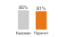

*Ограничения справедливости стоят нескольких пунктов точности: это налог на ответственность.*

Справедливость в машинном обучении ставит сложные задачи, которые выходят за рамки прозрачности. Основное требование состоит в том, чтобы автоматизированные системы не ставили защищенные группы в непропорционально невыгодное положение. Поскольку эти системы обучаются на исторических данных, они склонны воспроизводить и усиливать закономерности системного смещения, заложенные в этих данных. Без тщательного проектирования системы машинного обучения могут непреднамеренно закреплять социальное неравенство вместо того, чтобы его смягчать.

Широко изученный пример взят из здравоохранения. Алгоритм[^fn-healthcare-algorithm-bias], который использовался для распределения ресурсов ведения пациентов в больницах США, систематически занижал медицинские потребности темнокожих пациентов (Obermeyer et al., 2019). Модель использовала расходы на здравоохранение как прокси состояния здоровья, но из-за давних различий в доступе и тратах темнокожие пациенты реже несли высокие расходы. В результате модель заключала, что они менее больны, хотя часто их медицинская потребность была такой же или выше. Этот случай показывает, как на первый взгляд нейтральные проектные решения, такие как выбор прокси-переменной, могут давать дискриминационные результаты, если исторические неравенства не учтены должным образом. Применение ограничений справедливости к таким моделям влечет измеримую цену, которую называют **налогом на справедливость**.

[^fn-healthcare-algorithm-bias]: **Масштаб алгоритма в здравоохранении**: алгоритм Optum затрагивал примерно 200 миллионов американцев ежегодно и использовал расходы на здравоохранение как прокси медицинской потребности. Поскольку темнокожие пациенты исторически несли меньшие расходы из-за различий в доступе, модель систематически занижала тяжесть их состояния и сокращала долю темнокожих пациентов в программах высокорискового ведения на 50 процентов. Исправление прокси повысило бы выявление темнокожих пациентов с 17,7 процента до 46,5 процента, что количественно показывает цену одного выбора прокси-переменной в масштабе популяции.

Расчет налога на справедливость изолирует один критерий: демографический паритет, который требует равных долей положительных решений между группами. Он не отражает всех целей справедливости; он показывает системную цену выполнения именно этого критерия, прежде чем раздел сравнивает демографический паритет с равенством шансов и равенством возможностей.

> **Сценарий: налог на справедливость**
>
> **Задача**: рассмотрим кредитную модель с точностью 85 процентов. Группа A (большинство) имеет долю дефолтов 20 процентов. Группа B (меньшинство) — 40 процентов из-за системных факторов. Если навязать демографический паритет (равные доли одобрений), что произойдет с точностью?
>
> **Расчет**:
>
> Факты о долях одобрения задают изменение политики; значения точности в сценарии измерены на отложенной валидационной выборке, где дополнительные одобрения группы B несут более высокий риск дефолта.
>
> 1. **Без ограничений**: модель одобряет всех, у кого прогнозируемая вероятность дефолта ниже 30 процентов.
>     *   Доля одобрений группы A: 80 процентов.
>     *   Доля одобрений группы B: 60 процентов.
>     *   Общая точность: 85 процентов.
> 2. **С ограничением (паритет)**: нужно одобрить группу B с долей 80 процентов.
>     *   Новый порог для группы B: одобрять при вероятности дефолта ниже 50 процентов.
>     *   Это заставляет модель одобрять много рискованных заявителей из группы B.
>     *   Новая общая точность: 81 процент.
>
> **Системный вывод**: справедливость не бесплатна. Соблюдение паритета стоило 4 процентных пункта точности (примерно 4,7 процента относительного падения точности в этом сценарии кредитного скоринга). Это и есть налог на справедливость: явная цена коррекции исторического смещения.

Практикам нужны формальные методы оценки справедливости с учетом риска закрепления смещения. Разработан ряд формальных критериев, которые количественно описывают, как модели работают для групп, определенных чувствительными атрибутами. Прежде чем вводить эти определения, полезно рассматривать обозначения как способ выразить конкурирующие цели справедливости, а не как упражнение в доказательствах.

> **Перспектива: нотация справедливости как инженерный словарь**
>
> Перед тем как рассматривать формальные определения, основная трудность в том, что справедливость может означать разные операционные ограничения. Система может обращаться со всеми одинаково, учитывать различные исходные условия, оптимизировать равные результаты, сохранять равные возможности или обеспечивать равное обращение. Эти выборы приводят к разным математическим критериям, каждый из которых фиксирует свой аспект справедливости.
>
> Следующие подразделы вводят формальные определения справедливости на языке вероятностей. Эти метрики (демографический паритет, равенство шансов, равенство возможностей) встречаются во всей литературе по справедливости ML и формируют регуляторные рамки. Сосредоточьтесь на интуиции: что измеряет каждая метрика и почему это важно, а не на математических доказательствах. Конкретные примеры после каждого определения иллюстрируют практическое применение. Если обозначения вероятностей незнакомы, начните с словесных описаний и вернитесь к формальным определениям позже.

Предположим, что модель $h(x)$ предсказывает бинарный исход, например возврат кредита, а $A$ обозначает чувствительный атрибут с подгруппами $a$ и $b$. В области используются три широко принятых определения справедливости:

<a id="sec-responsible-ai-demographic-parity-f126"></a>

#### Демографический паритет

> **Определение: демографический паритет**
>
>
> ***Демографический паритет*** — это ограничение справедливости, при котором доля положительных предсказаний модели не зависит от принадлежности к группе $(\Pr(h(x)=1 \mid A=a) = \Pr(h(x)=1 \mid A=b))$.
>
> 1.  **Значимость**: это самая простая и самая жесткая метрика справедливости. Она требует, чтобы модель давала равные результаты для групп независимо от различий базовых частот в наборе данных.
> 2.  **Различие**: в отличие от равенства шансов, которое фокусируется на таких ошибках, как ложноположительные срабатывания, демографический паритет учитывает только итоговое предсказание и игнорирует связь между предсказанием и истинным значением.
> 3.  **Распространенная ошибка**: часто считают, что демографический паритет обеспечивает «справедливость». На самом деле он может заставить модель пожертвовать калибровкой: чтобы выполнить ограничение паритета, модели может потребоваться намеренно ошибочно классифицировать квалифицированных людей в одной группе или неквалифицированных в другой.
>

Демографический паритет спрашивает, одинаково ли часто благоприятные исходы, такие как одобрение кредита или направление на лечение, возникают в подгруппах, определенных чувствительным атрибутом $A$. Формально модель удовлетворяет демографическому паритету, если:
$$
\Pr\big(h(x) = 1 \mid A = a\big) = \Pr\big(h(x) = 1 \mid A = b\big)

$$

В медицинском примере этот критерий спрашивал бы, направляются ли темнокожие и белые пациенты к лечению с одинаковой частотой независимо от их реальных потребностей в здоровье. Это может звучать как равный доступ, но игнорирует реальные различия в состоянии и риске и может приводить к избыточной коррекции, когда потребности распределены неравномерно. Ограничение, связанное с игнорированием различий базовых частот, мотивирует более тонкие критерии справедливости.

<a id="sec-responsible-ai-equalized-odds-6570"></a>

#### Равенство шансов

Равенство шансов (equalized odds) требует, чтобы предсказания модели были условно независимы от принадлежности к группе при заданной истинной метке. Конкретно: доли истинно положительных и ложноположительных срабатываний должны быть одинаковыми в группах:
$$
\Pr\big(h(x) = 1 \mid A = a, Y = y\big) = \Pr\big(h(x) = 1 \mid A = b, Y = y\big), \quad \text{для } y \in \{0, 1\}.
$$

То есть для каждого истинного исхода $Y = y$ модель должна давать одинаковое распределение предсказаний в группах $A = a$ и $A = b$. Поэтому модель должна вести себя одинаково в разных группах для людей с одним и тем же истинным исходом, независимо от того, имеют ли они право на положительный результат. Это обеспечивает равномерное распределение ошибок, как пропущенных, так и неверных положительных срабатываний.

Применительно к медицинскому случаю равенство шансов потребовало бы, чтобы пациенты с одинаковыми фактическими медицинскими потребностями (истинная метка $Y$) с одинаковой вероятностью правильно или ошибочно направлялись на лечение, независимо от расы. Исходный алгоритм нарушал это, реже направляя темнокожих пациентов, которые были так же больны или даже больнее своих белых коллег, что выявляет неравные доли истинно положительных срабатываний.

<a id="sec-responsible-ai-equality-opportunity-1c3d"></a>

#### Равенство возможностей

Равенство возможностей — это более мягкое ослабление равенства шансов, которое учитывает только долю истинно положительных срабатываний (Hardt et al., 2016). Оно требует, чтобы среди людей, которые должны получить положительный исход, вероятность его получения была одинаковой в группах:
$$
\Pr\big(h(x) = 1 \mid A = a, Y = 1\big) = \Pr\big(h(x) = 1 \mid A = b, Y = 1\big).
$$

Равенство возможностей гарантирует, что квалифицированные люди, для которых $Y = 1$, модель оценивает одинаково независимо от принадлежности к группе.

В рассматриваемом примере эта мера обеспечила бы, что среди пациентов, которым действительно нужна помощь, и темнокожие, и белые люди имеют равный шанс быть выявленными моделью. В случае больничной системы США использование расходов на здравоохранение как прокси-переменной привело к провалу этого критерия: темнокожие пациенты со значительными медицинскими потребностями реже получали помощь из-за своих исторически более низких трат. Следующий разобранный пример использует сценарий решения о кредите, введенный в начале этого раздела, чтобы вычислить все три критерия и показать, почему одна и та же модель может по-разному проваливать каждый тест на справедливость.

> **Сценарий: расчет метрик справедливости**
>
> **Задача**: вычислить демографический паритет для двух демографических групп (по 100 заявителей) для модели одобрения кредитов.
>
> **Переменные**:
>
> - Группа A: одобрено 70 (40 вернули кредит, 30 не вернули), отказано 30.
> - Группа B: одобрено 40 (30 вернули кредит, 10 не вернули), отказано 60.
>
> **Расчет**:
>
> 1. **Доля одобрений группы A**: $\Pr(h(x) = 1 \mid A = a) = \frac{70}{100} = 0.70$.
> 2. **Доля одобрений группы B**: $\Pr(h(x) = 1 \mid A = b) = \frac{40}{100} = 0.40$.
> 3. **Разрыв паритета**: $0.70 - 0.40 = 0.30$ (разрыв 30 процентных пунктов).
>
> **Системный вывод**: оценка демографического паритета выявляет различия в долях одобрения между группами независимо от фактической способности заемщика вернуть кредит, поэтому при калибровке порога модели нужен явный выбор метрики.

> **Сценарий: расчет равенства возможностей**
>
> **Расчет равенства возможностей (доля истинно положительных срабатываний, TPR)**:
>
> Среди заявителей, которые *на самом деле вернули бы кредит* ($Y=1$):
> \begin{gather*}
> \Pr(h(x) = 1 \mid A = a, Y = 1) = \frac{40}{40 + 5} = \frac{40}{45} \approx 0.89
> \\
> \Pr(h(x) = 1 \mid A = b, Y = 1) = \frac{30}{30 + 20} = \frac{30}{50} = 0.60
> \end{gather*}
>
> **Разрыв**: $0.89 - 0.60 = 0.29$ (разрыв 29 процентных пунктов по TPR).
>
> Модель нарушает равенство возможностей: среди квалифицированных заявителей, которые вернули бы кредит, члены группы A правильно одобряются в 89 процентах случаев, а члены группы B — только в 60 процентах.
>
> **Расчет равенства шансов (доля истинно положительных срабатываний, TPR, и доля ложноположительных срабатываний, FPR)**:
>
> Значения TPR вычислены на предыдущем шаге. Для ложноположительных долей среди заявителей, которые *не вернули бы кредит* ($Y=0$):
> \begin{gather*}
> \Pr(h(x) = 1 \mid A = a, Y = 0) = \frac{30}{30 + 25} = \frac{30}{55} \approx 0.55
> \\
> \Pr(h(x) = 1 \mid A = b, Y = 0) = \frac{10}{10 + 40} = \frac{10}{50} = 0.20
> \end{gather*}
>
> Ложноположительные доли также не равны: модель ошибочно одобряет 55 процентов заявителей группы A, которые не вернут кредит, но только 20 процентов заявителей группы B с тем же исходом. Это показывает, что модель «щедрее» к группе A, даже когда эти люди не вернут кредит.
>
> **Системный вывод**: эта модель нарушает все три критерия справедливости. Устранение одного критерия не выполняет автоматически другие. Более того, теоремы о невозможности показывают, что эти критерии могут математически конфликтовать.

Только что разобранный пример одобрения кредита показал, что модель одновременно нарушает все три критерия справедливости. Это не просто недостаток проектирования модели, а отражение фундаментального математического противоречия, с которым сталкивается любой классификатор, когда базовые частоты различаются между группами. Такие противоречия мотивируют результаты о невозможности, которые ограничивают то, чего может достичь любой справедливый классификатор.

Эти определения фиксируют разные аспекты справедливости и в общем случае несовместимы[^fn-fairness-impossibility-theorem] (Kleinberg et al., 2017; Chouldechova, 2017). Пример приема в университет иллюстрирует это противоречие наглядно.

[^fn-fairness-impossibility-theorem]: **Теоремы о невозможности справедливости**: Kleinberg et al. (2017) и Chouldechova (2017) доказали несовместимость результатов для откалиброванных оценок риска и баланса долей ошибок при различающихся базовых частотах, за исключением ограниченных особых случаев, таких как идеальное предсказание или равные базовые частоты. Демографический паритет — это отдельное ограничение на доли отбора, которое на практике также может конфликтовать с калибровкой или целями по долям ошибок. Системное следствие фундаментально: никакая инженерия не может выполнить каждый нормативный критерий справедливости во всех условиях, поэтому справедливость становится многокритериальной оптимизацией с ограничениями, требующей явных политических решений о том, какой критерий приоритетен для конкретного контекста развертывания.

Цель 1 (демографический паритет) состояла бы в том, чтобы принимать студентов так, чтобы принятый контингент отражал демографию пула заявителей, например 50 процентов из группы A и 50 процентов из группы B. Цель 2 (равенство возможностей) состояла бы в том, чтобы среди всех квалифицированных заявителей доля принятых была одинаковой во всех группах, так что 80 процентов квалифицированных заявителей группы A и 80 процентов квалифицированных заявителей группы B поступили бы. Если в одной из групп доля квалифицированных заявителей выше, достижение демографического паритета (цель 1) требует отказать части их квалифицированных заявителей, что нарушает равенство возможностей (цель 2), как показано на [рисунке «Невозможность компромиссов справедливости»](#fig-fairness-impossibility). Математического решения не существует: выбор — это ценностное суждение о том, какое определение справедливости приоритетно.

Закон невозможности справедливости обобщает то, что только что показал пример с приемом: за исключением особых случаев, таких как равные базовые частоты или идеальное предсказание, откалиброванные оценки риска в общем случае не могут одновременно выполнять условия равных долей ошибок между группами, а демографический паритет добавляет дополнительный конфликт, поскольку ограничивает доли отбора, а не калибровку оценок или доли ошибок. Выполнение одного критерия может исключать другой, поэтому инженерам нужно относиться к метрикам справедливости как к бюджетам задержки: это явные компромиссы, которые выбирают заинтересованные стороны, которые система обеспечивает и отслеживает на нарушения. Выбор приоритетной метрики требует внимательного учета контекста применения, потенциального вреда и ценностей заинтересованных сторон, как подробно описано в [разделе «Нормативный плюрализм и конфликты ценностей»](#sec-responsible-ai-normative-pluralism-value-conflicts-d61f) (Barocas et al., 2023).

<a id="fig-fairness-impossibility"></a>

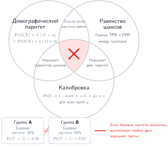
***Компромиссы невозможности справедливости:** показано, почему распространенные критерии справедливости могут конфликтовать. Откалиброванные оценки риска в общем случае не могут одновременно выполнять условия равных долей ошибок, если базовые частоты различаются и предсказание несовершенно; демографический паритет добавляет отдельное ограничение на доли отбора, которое может конфликтовать с любой из целей. Это вынуждает инженеров делать явный нормативный выбор с учетом контекста применения.*

[Рисунок «Расхождение метрик справедливости»](#fig-fairness-metric-disagreement) делает этот компромисс наглядным: он проводит порог классификации по синтетическому сценарию с разными базовыми частотами в группах. На всем рассмотренном диапазе работы хотя бы одна из построенных метрик доли отбора или доли ошибок существенно нарушается, что иллюстрирует более широкий эксплуатационный урок: критерии справедливости могут конфликтовать и требуют явной расстановки приоритетов.

<a id="fig-fairness-metric-disagreement"></a>

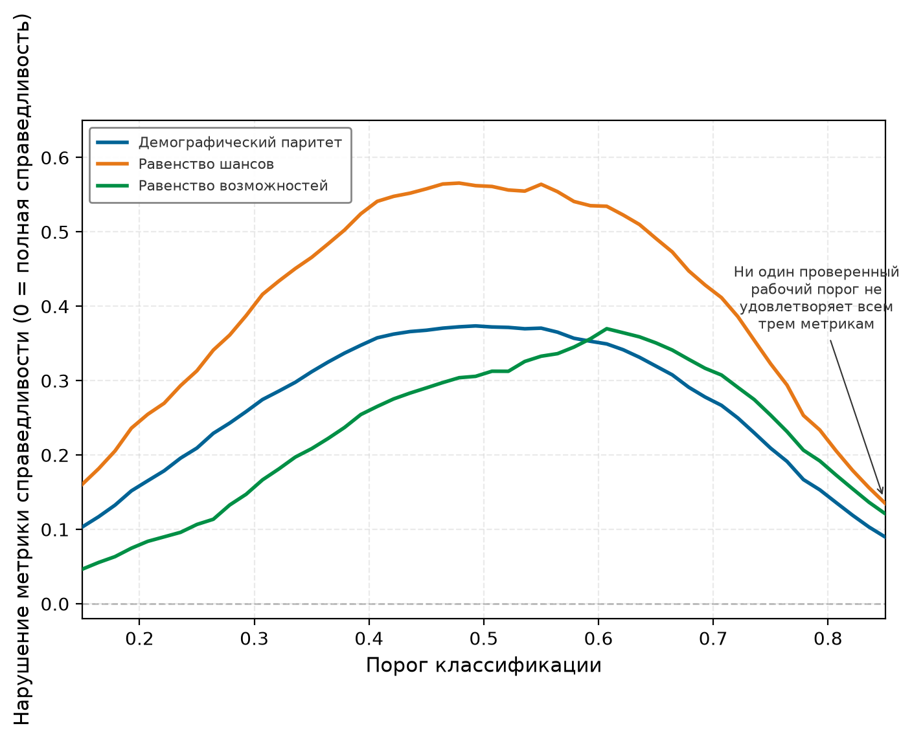
***Расхождение метрик справедливости по порогам:** три метрики справедливости (демографический паритет, равенство шансов и равенство возможностей), вычисленные для классификатора с разными базовыми частотами групп при изменении порога классификации на нетривиальном рабочем диапазоне. На каждом проверенном пороге хотя бы одна метрика существенно нарушена, что иллюстрирует практические компромиссы между критериями доли отбора, доли ошибок и возможностей. Тривиальные классификаторы, которые всегда дают положительный или всегда отрицательный ответ, лежат вне проверенного диапазона.*

Признавая эти противоречия, эксплуатационные системы должны рассматривать справедливость как ограничение, которое определяет решения на протяжении всего жизненного цикла машинного обучения. Оно формируется тем, как собираются и представляются данные, как выбираются цели и прокси, как задаются пороги для предсказаний модели и как устроены механизмы обратной связи. Например, выбор между моделями ранжирования и моделями классификации может дать разные картины доступа для групп, даже при одних и тех же исходных данных.

Метрики справедливости помогают формализовать цели равенства, но обычно ограничены заранее заданными демографическими категориями. На практике эти категории могут быть слишком грубыми, чтобы уловить все разнообразие различий, присутствующих в реальных данных.

<a id="sec-responsible-ai-causal-fairness"></a>

#### Наблюдательная и причинная справедливость

Предыдущие метрики описывают ассоциации в наблюдаемых решениях: доли отбора, доли ошибок или калибровка различаются между группами. Они могут установить наличие разрыва, но не указывают путь, по которому он возник. Тот же разрыв в долях одобрения мог бы возникнуть из прямого использования защищенного атрибута, коррелирующего прокси, неравного доступа к более раннему процессу, ошибки измерения или ненаблюдаемой общей причины. Никакое сравнение одних только наблюдаемых долей не отличает эти механизмы.

Причинное утверждение добавляет **структурную причинную модель**, в которой стрелки задают, как защищенный атрибут $A$, медиаторы $M$, исход $Y$ и решение $\widehat Y$, как предполагается, связаны между собой. **Контрфактическая справедливость** затем спрашивает, изменилось ли бы решение для того же человека при сохранении смоделированных фоновых факторов, если бы в контрфактическом мире атрибут $A$ принял другое значение (Kusner et al., 2017). Это вопрос о предполагаемом процессе порождения данных, а не более сильная версия демографического паритета.

Прокси в здравоохранении иллюстрирует различие. Граф может включать раса $A \rightarrow$ доступ к лечению $M \rightarrow$ расходы $X \rightarrow$ оценка риска $\widehat Y$, а также пути от медицинской потребности $Y$ к расходам. **Полный эффект** спрашивает, как изменение $A$ распространяется по всем смоделированным путям. **Эффект по конкретному пути** выделяет отдельные маршруты, например исторически опосредованный путь «доступ — расходы» (Nabi и Shpitser, 2018). Объявить один путь допустимым, а другой дискриминационным — это предметное и нормативное суждение; ни граф, ни оценщик не делают этот выбор автоматически.

Причинные выводы требуют допущений, которые одни только наблюдательные данные установить не могут: какие переменные и стрелки принадлежат графу, измерены ли релевантные смешивающие факторы и согласованы ли контрфактические вмешательства. Разные правдоподобные структуры могут давать разные ответы. Поэтому причинный анализ дополняет групповые метрики, предметные знания, юридический анализ и участие заинтересованных сторон. Метрики продолжают отслеживать реализованные различия, а причинная модель делает дополнительное утверждение о механизме и его допущения проверяемыми.

<a id="sec-responsible-ai-intersectional-fairness-af99"></a>

#### Интерсекциональная справедливость

Важное ограничение стандартного анализа справедливости в том, что он часто оценивает отдельные оси идентичности (например, расу или пол) независимо друг от друга. Это может скрывать серьезные различия, которые существуют на пересечении этих атрибутов.

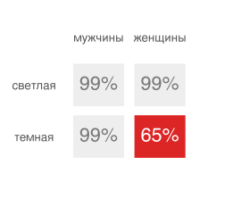

*Ошибка концентрируется на пересечении: темнокожие женщины.*

Например, система классификации пола IBM достигала точности 99,7 процента для светлокожих мужчин, но лишь 65,3 процента для темнокожих женщин в оценке Gender Shades (Buolamwini и Gebru, 2018). Аудит по одной оси может скрыть такое интерсекциональное различие. Это явление, которое иногда называют **джерримендерингом справедливости**, требует оценивать качество модели на интерсекциональных подгруппах (например, $\text{Раса}{\times}\text{Пол}$), чтобы выявлять и смягчать накапливающиеся смещения.

Принципиальный подход к справедливости должен учитывать перекрывающиеся и интерсекциональные идентичности, обеспечивая согласованность поведения модели для подгрупп, которые заранее могут не быть явно помечены. Недавние работы в этой области подчеркивают необходимость предсказуемой надежности для широкого круга срезов популяции (Hebert-Johnson et al., 2018), что подкрепляет идею: справедливость нужно рассматривать как требование ко всей системе, а не как локальную настройку. Этот расширенный взгляд на справедливость показывает важность проектирования архитектур, протоколов оценки и стратегий мониторинга, которые поддерживают более тонкую оценку поведения модели с учетом контекста.

<a id="sec-responsible-ai-quantitative-fairness-measurement-a8f2"></a>

#### Количественное измерение справедливости

Формальные критерии справедливости становятся эксплуатационными только тогда, когда практики могут измерить степень нарушения и задать действенные пороги для вмешательства. Полученная математическая основа количественно описывает разрывы и определяет, когда они оправдывают корректирующее действие.

Четыре точечные метрики превращают введенные выше критерии справедливости в числа, по которым аудитор может задать порог. Каждая выравнивает свою величину, поэтому каждая выявляет свой отказ одного и того же классификатора. [Таблица «Метрики справедливости на примере кредита»](#tbl-responsible-ai-fairness-metrics) определяет их и вычисляет на примере кредитования, где группа A одобряется с долей 0,70, а группа B — с долей 0,40; доли истинно положительных срабатываний для квалифицированных заявителей составляют 0,89 и 0,60, а доли ложноположительных срабатываний для неквалифицированных заявителей — 0,55 и 0,20.

<a id="tbl-responsible-ai-fairness-metrics"></a>

***Метрики справедливости на примере кредита:** четыре групповые метрики справедливости, каждая из которых выравнивает свою величину, вычисленные для модели одобрения кредитов. Коэффициент диспропорционального воздействия — это юридически признанный скрининговый тест; аддитивные разницы легче отслеживать во времени; средняя абсолютная разница шансов учитывает разрывы и по истинно положительным, и по ложноположительным ошибкам.*

| **Метрика**                                                                                                                                 | **Что выравнивает**                                 | **Формула** $(a, b)$                                                                      |                 **Значение для кредита**                | **Когда выбирать**                                                                                        |
|:-------------------------------------------------------------------------------------------------------------------------------------------|:----------------------------------------------------|:------------------------------------------------------------------------------------------|:---------------------------------------------:|:----------------------------------------------------------------------------------------------------------|
| Коэффициент диспропорционального воздействия (DI) (правило четырех пятых) (Feldman et al., 2015)             | меньшая доля одобрения, деленная на большую долю одобрения | $\dfrac{\min_g \Pr(h=1 \mid g)}{\max_g \Pr(h=1 \mid g)}$                                  | $\dfrac{0.40}{0.70} = 0.57$ | нужен юридически признанный скрининг; $\text{DI} < 0.8$ сигнализирует о диспропорциональном воздействии                           |
| Разница статистического паритета (SPD) (Calders и Verwer, 2010)                                         | аддитивный разрыв в долях одобрения                 | $\Pr(h=1 \mid a) - \Pr(h=1 \mid b)$                                                       |    $0.70 - 0.40 = 0.30$   | сравнение многих групп или отслеживание дрейфа; распространенный порог аудита $\lvert\text{SPD}\rvert \leq 0.10$ |
| Разница равенства возможностей (Hardt et al., 2016)                                                      | доли истинно положительных срабатываний среди квалифицированных заявителей | $\Pr(h=1 \mid a, Y{=}1) - \Pr(h=1 \mid b, Y{=}1)$                                         |    $0.89 - 0.60 = 0.29$   | вред состоит в отказе заслуживающим людям                                                                 |
| Средняя абсолютная разница шансов (Hardt et al., 2016; Bellamy et al., 2019; Bird et al., 2020) | доли истинно положительных и ложноположительных срабатываний | $\tfrac{1}{2}\big[\,\lvert \Delta\text{TPR}\rvert + \lvert \Delta\text{FPR}\rvert\,\big]$ |    $\tfrac{1}{2}[0.29 + 0.35] = 0.32$   | важны оба типа ошибок; при идеальном равенстве шансов метрика равна 0                                        |

Четыре метрики расходятся по построению: коэффициент диспропорционального воздействия 0,57 означает, что группа с меньшей долей одобрения получает одобрения лишь в такой доле от доли группы с большей долей одобрения, что уже нарушает правило четырех пятых. Аддитивный разрыв 0,30, разрыв по возможностям 0,29 и средний абсолютный разрыв шансов 0,32 каждый количественно описывает отдельное измерение одного и того же различия. Ни одного числа недостаточно, поэтому теоремы о невозможности в этом разделе требуют явного выбора того, какую метрику будет приоритетной в конкретном развертывании.

<a id="sec-responsible-ai-calibration-8b73"></a>

##### Калибровка

Модель удовлетворяет **калибровке оценок** относительно чувствительного атрибута, если среди людей, которым модель присвоила оценку $s$, доля положительных исходов одинакова во всех группах (Kleinberg et al., 2017):
$$
\Pr(Y = 1 \mid s(x) = s, A = a) = \Pr(Y = 1 \mid s(x) = s, A = b), \quad \forall s
$$

Калибровка оценок — это условие для каждой отдельной оценки; для жестких бинарных предсказаний связанное условие паритета — это равная **положительная предиктивная ценность (PPV)** (точность) среди предсказанных положительных, тогда как калибровка оценок — более сильное требование, в котором равенство выполняется на каждом уровне оценки:
$$
\text{PPV}(a) = \frac{\Pr(Y=1, h(x)=1 \mid A=a)}{\Pr(h(x)=1 \mid A=a)} = \text{PPV}(b)
$$

По примеру с кредитами:
\begin{align*}
\text{PPV}(a) &= \frac{40}{70} = 0.571 \\
\text{PPV}(b) &= \frac{30}{40} = 0.750
\end{align*}

Разрыв положительной предиктивной ценности равен $0.750 - 0.571 = 0.179$. Предсказанные положительные результаты группы B оказываются верными в 75 процентах случаев, тогда как у группы A — лишь в 57 процентах. Это нарушает предиктивный паритет для жестких решений и показывает, что модель менее надежна, когда предсказывает одобрение для группы A. Чтобы продемонстрировать саму калибровку оценок, нужно сравнить частоты исходов внутри согласованных диапазонов оценок между группами.

Калибровка критична для решений с высокими ставками, где люди опираются на предсказанные вероятности. Некалиброванная модель систематически завышает или занижает риск для конкретных групп, что приводит к неверному распределению ресурсов и подрыву доверия.

<a id="sec-responsible-ai-fairness-metrics-practice-7474"></a>

##### Метрики справедливости на практике

Определить эти метрики — простая часть; вычислять их непрерывно по развернутому парку — там и возникает инженерная цена. Вычисление этих метрик в промышленном масштабе создает вычислительные, информационные и организационные издержки, которые определяют, какие метрики система может позволить себе мониторить до того, как задавать компромиссы порогов или проводить проверку статистической значимости.

Накладные расходы на измерение возникают потому, что вычисление метрик для отдельных групп требует вести отдельную статистику для каждой защищенной группы. При $k$ группах и $m$ метриках это требует $\mathcal{O}(km)$ дополнительных счетчиков и $\mathcal{O}(km)$ статистических проверок на каждом цикле оценки. В системах с высокой пропускной способностью (более 10 тыс. запросов в секунду) эти накладные расходы нужно контролировать выборкой или асинхронной агрегацией.

Требования к данным создают трудности, потому что аудит справедливости требует истинных меток ($Y$) и чувствительных атрибутов $(A)$ для репрезентативной выборки. В федеративных или приватность-сохраняющих схемах получение этих данных может противоречить целям приватности. Такие методы, как зашифрованная агрегированная статистика или дифференциальная приватность для групповых метрик, могут помочь согласовать мониторинг справедливости с требованиями приватности.

Доступность чувствительных атрибутов поэтому является инженерным проектным решением, а не фоновым допущением. Система может собирать атрибуты напрямую с согласия, выводить их только для агрегированного аудита, хранить в ограниченном сервисе, вычислять зашифрованную или дифференциально-приватную групповую статистику, проводить аудит офлайн на выборочных метках или заявить, что метрика не измерима для данного развертывания. Каждый выбор меняет и доказательства справедливости, доступные организации, и риск для приватности, который создает конвейер мониторинга.

Выбор порога требует предметной экспертизы и мнения заинтересованных сторон, чтобы установить приемлемые пороги разрыва. Юридические пороги (например, правило четырех пятых) дают отправную точку, но окончательные значения должны опираться на оценку вреда в конкретном контексте. Обоснование порога нужно документировать, чтобы поддерживать аудиты и соответствие регулированию.

Временная стабильность требует отслеживать метрики справедливости во времени, чтобы выявлять деградацию из-за сдвига распределения, петель обратной связи или обновлений модели. Непрерывный мониторинг с автоматическими оповещениями (например, «сигнализировать, если $|\text{SPD}| > 0.15$ семь дней подряд») позволяет вмешаться заранее, до того как вред накопится.

<a id="sec-responsible-ai-threshold-setting-fairness-tradeoffs-89fc"></a>

##### Настройка порогов и компромиссы справедливости

На практике метрики справедливости можно манипулировать, настраивая пороги классификации для каждой группы. Задав функцию оценки $s(x)$ (например, предсказанную вероятность), определим групповые пороги $\tau_{\text{thr},a}$ и $\tau_{\text{thr},b}$, так что $h_a(x) = \mathbb{1}[s(x) \geq \tau_{\text{thr},a}]$ для группы $a$ и аналогично для группы $b$.

Чтобы достичь демографического паритета, решите:
$$
\Pr(s(x) \geq \tau_{\text{thr},a} \mid A = a) = \Pr(s(x) \geq \tau_{\text{thr},b} \mid A = b)
$$

Чтобы достичь равенства возможностей, решите:
$$
\Pr(s(x) \geq \tau_{\text{thr},a} \mid A = a, Y = 1) = \Pr(s(x) \geq \tau_{\text{thr},b} \mid A = b, Y = 1)
$$

Для равенства шансов одновременно должны выполняться ограничения и на долю истинно положительных, и на долю ложноположительных срабатываний. Это задача оптимизации с ограничениями, которую можно решить постобработкой (Hardt et al., 2016).

Однако настройка порога имеет ограничения. Если базовые частоты существенно различаются между группами (то есть $\Pr(Y=1 \mid A=a) \neq \Pr(Y=1 \mid A=b)$), достижение одного критерия справедливости через пороги неизбежно нарушит другие из-за теорем о невозможности. Цену в точности можно вычислить напрямую.

> **Сценарий: цена справедливости**
>
> **Задача**: оценить общее падение точности («налог на справедливость») при введении демографического паритета в модели кредитного скоринга для группы A (большинство) и группы B (меньшинство).
>
> **Переменные**:
>
> - Группа A: средний балл 70, высокая доля возвратов, порог без ограничений = 60.
> - Группа B: средний балл 50, более низкая доля возвратов, порог без ограничений = 60.
>
> **Расчет**:
>
> 1. **Оптимизация без ограничений**: единый порог 60 дает общую точность 85 процентов.

> 2. **Ограничение демографического паритета**: чтобы уравнять долю одобрений группы B с группой A, нужно понизить порог для группы B до 50.
> 3. **Налог на справедливость**: общая точность падает до 81 процента, что дает абсолютную потерю 4 процентных пункта (относительное падение 4,7 процента).
>
> **Системный вывод**: «цена справедливости» составляет 4 процентных пункта точности. Проектировщики систем должны взвешивать этот измеренный компромисс точности против выигрыша в социальном равенстве при настройке производственных правил пороговой обработки.
>

Предыдущий пример измерил совокупное падение точности от введения демографического паритета, но не показал, как система обеспечивает выполнение этого ограничения в момент принятия решения. На практике выравнивание требует задавать пороги для каждой группы: один порог для группы большинства и другой, более низкий, для группы меньшинства. Дифференцированные пороги требуют доступа к чувствительным атрибутам во время инференса и вызывают вопросы о явном обращении по признаку группы, которое в некоторых юрисдикциях само может считаться несправедливым или незаконным. Механика становится понятнее на конкретном сценарии настройки порога.

> **Сценарий: порог для равенства возможностей**
>
> **Задача**: вычислить пороги для каждой группы, необходимые для выравнивания долей истинно положительных срабатываний (равенство возможностей) между группой A и группой B в модели кредитного скоринга.
>
> **Переменные**:
>
> - Группа A ($Y=1$): $\mu_A^+ = 0.72$, $\sigma_A^+ = 0.15$.
> - Группа B ($Y=1$): $\mu_B^+ = 0.65$, $\sigma_B^+ = 0.16$.
>
> **Расчет**:
>
> 1. **Единый порог ($\tau = 0.60$)**: дает $\text{TPR}_a \approx 0.79$ против $\text{TPR}_b \approx 0.62$ (разрыв 17 процентных пунктов).
> 2. **Выравнивание порогов**: понижение порога группы B до $\tau_b = 0.52$ при сохранении $\tau_a = 0.60$ выравнивает $\text{TPR}_b \approx 0.79$.
> 3. **Компромисс**: доля ложноположительных срабатываний группы B растет с 0.12 до 0.24, а точность для группы B падает с 0.78 до 0.69.
>
> **Системный вывод**: достижение равенства возможностей через настройку порога увеличивает число ложноположительных срабатываний и снижает точность для группы, которая получает более низкий порог. Пороговые политики не меняют лежащую в основе калибровку оценок, поэтому проектировщикам нужно взвешивать справедливость возможностей против снижения точности.

<a id="sec-responsible-ai-measuring-fairness-violations-statistically-127e"></a>

##### Статистическая проверка нарушений справедливости

Чтобы определить, являются ли наблюдаемые различия статистически значимыми, а не выборочным шумом, практикам следует вычислять доверительные интервалы и проводить проверки гипотез. Для демографического паритета проверяют нулевую гипотезу $H_0: \Pr(h(x)=1 \mid A=a) = \Pr(h(x)=1 \mid A=b)$ с помощью z-теста для двух долей. Статистика теста:
$$
z = \frac{\hat{p}_a - \hat{p}_b}{\sqrt{\hat{p}(1-\hat{p})\left(\frac{1}{n_a} + \frac{1}{n_b}\right)}}
$$

Здесь $\hat{p}_a$ и $\hat{p}_b$ — выборочные доли одобрений, $\hat{p} = \frac{n_a\hat{p}_a + n_b\hat{p}_b}{n_a + n_b}$ — объединенная доля, а $n_a$, $n_b$ — размеры выборок.

Для примера с кредитом при $n_a = n_b = 100$, $\hat{p}_a = 0.70$, $\hat{p}_b = 0.40$:
\begin{align*}
\hat{p} &= \frac{100(0.70) + 100(0.40)}{200} = 0.55 \\
z &= \frac{0.70 - 0.40}{\sqrt{0.55(0.45)(0.02)}} = \frac{0.30}{0.0704} = 4.26
\end{align*}

При $z = 4.26$ (значительно превышающем критическое значение $z_{0.05/2} = 1.96$) тест отвергает $H_0$ и делает вывод, что нарушение демографического паритета статистически значимо при $p < 0.001$. Аналогичные тесты можно построить для равенства возможностей и равенства шансов, ограничив выборку подгруппами с $Y=1$ или $Y=0$ соответственно. Статистическая значимость не означает практической значимости: даже статистически значимые различия могут быть приемлемы, если их величина мала. И наоборот, большие различия на малых выборках могут не достигать статистической значимости, но все равно требовать вмешательства.

Количественная основа, описанная здесь, превращает справедливость из абстрактного принципа в измеримые инженерные ограничения. Задание метрик, порогов и статистических тестов позволяет практикам систематически оценивать справедливость на протяжении всего жизненного цикла ML и принимать основанные на данных решения о том, когда требуется вмешательство.

> **Сценарий: аудит матрицы ошибок**
>
> **Задача**: модель обнаружения мошенничества работает с двумя группами. Что демографический паритет и равенство возможностей показывают о развертывании?
>
> **Переменные**:
>
> - **Группа A (большинство)**: $\text{TP}=450$, $\text{FP}=50$, $\text{FN}=30$, $\text{TN}=470$ ($n_{\text{записей}}=1000$).
> - **Группа B (меньшинство)**: $\text{TP}=180$, $\text{FP}=70$, $\text{FN}=120$, $\text{TN}=630$ ($n_{\text{записей}}=1000$).
>
> **Расчет**:
>
> 1. **Демографический паритет (доля положительных предсказаний)**: $\Pr(\hat{Y}=1)$.
>    - Группа A: $(450+50)/1000 = 0.50$.
>    - Группа B: $(180+70)/1000 = 0.25$.
>    - **Разрыв**: 0.25. (Нарушает правило четырех пятых: $0.25/0.50 = 0.5 < 0.8$.)
> 2. **Равенство возможностей (TPR)**: $\text{TP} / (\text{TP}+\text{FN})$.
>    - Группа A: $450 / (450+30) = 0.938$.
>    - Группа B: $180 / (180+120) = 0.60$.
>    - **Разрыв**: 0.338. (Серьезное нарушение.)
>
> **Системный вывод**: чтобы исправить TPR, нужно понизить порог для группы B, чтобы поймать больше случаев мошенничества (сокращая FN). Однако это, вероятно, увеличит число ложных срабатываний (FP) для группы B и ухудшит предиктивный паритет. Это конкретная иллюстрация теоремы о невозможности: один критерий справедливости нельзя менять в отрыве от остальных.

Вопросы справедливости выходят за пределы алгоритмических результатов и охватывают вычислительные ресурсы и инфраструктуру, необходимые для развертывания систем ответственного ИИ. Эти более широкие последствия для равенства, включая проблемы экологической справедливости, возникают, когда энергоемкая инфраструктура ИИ концентрируется в уже неблагополучных сообществах.[^fn-datacenter-environmental-justice]

[^fn-datacenter-environmental-justice]: **Экологическая справедливость дата-центров**: значительная доля крупных американских облачных дата-центров расположена в пределах 16 км от сообществ с низким доходом, которые несут повышенное загрязнение воздуха от резервных дизельных генераторов и тепло от систем охлаждения. Для операторов парка ML это создает ограничение управления: решения о размещении дата-центров, оптимизирующие одновременно стоимость электроэнергии и задержку, переносят экологические издержки на сообщества, которые меньше всего могут пользоваться услугами ИИ, обеспечиваемыми этими дата-центрами.

Вычислительная интенсивность методов ответственного ИИ создает форму цифрового разрыва, при котором доступ к справедливым, прозрачным и подотчетным системам ИИ зависит от экономических ресурсов. Внедрение ограничений справедливости, механизмов дифференциальной приватности и развернутых средств объяснимости может увеличить затраты на обучение, обслуживание, хранение или проверку по сравнению с моделями без ограничений. Ресурсоемкие меры защиты, такие как непрерывный мониторинг справедливости, стохастический градиентный спуск с дифференциальной приватностью и объяснения по запросу, легче внедрить в полном объеме хорошо обеспеченным организациям, тогда как развертывания с ограниченными ресурсами могут жертвовать мерами защиты ради эффективности. В результате может возникнуть двухуровневая система, где ответственный ИИ легче предоставить хорошо обеспеченным пользователям и приложениям, что потенциально усиливает существующее неравенство, а не устраняет его. Эти ресурсные ограничения создают проблемы демократизации, а более широкие последствия порождают цифровой разрыв и барьеры доступа, затрагивающие недообслуживаемые сообщества.

Эти соображения указывают на центральный тезис главы: каждое свойство ответственного ИИ является свойством системы уровня всей системы, а не атрибутом модели. Справедливость возникает из взаимодействия практик инженерии данных, выбора моделирования, процедур оценки и политик принятия решений; ее нельзя изолировать в одном компоненте модели или решить одними только постфактум корректировками. То же верно для приватности, объяснимости, устойчивости и подотчетности: каждое из этих свойств возникает из всего конвейера, а не хранится в весах. Проектирование ответственного машинного обучения поэтому рассматривает справедливость как фундаментальное ограничение, которое определяет архитектурные решения, рабочие процессы и механизмы управления на протяжении всего жизненного цикла системы. Этот системный взгляд переводит каждый принцип в конкретные инженерные требования по всему жизненному циклу ML: справедливость требует метрик качества на уровне групп и разных пороговых решений для разных популяций; объяснимость требует бюджетов вычислений во время выполнения, стоимость которых зависит от того, использует ли метод градиенты, сэмплирование возмущений, аппроксимацию значений Шепли или полный перебор подмножеств; приватность охватывает управление данными, механизмы согласия и политики хранения с учетом жизненного цикла; а подотчетность требует инфраструктуры прослеживаемости, включая реестры моделей, журналы аудита и механизмы ручного переопределения решений человеком.

Эти принципы взаимодействуют и создают напряжения на всех этапах разработки системы. Техники, сохраняющие приватность, могут снижать объяснимость; ограничения справедливости могут конфликтовать с персонализацией; надежный мониторинг увеличивает вычислительные затраты. Каждый принцип проявляется на фазах сбора данных, обучения, оценки, развертывания и мониторинга ([таблица «Жизненный цикл ответственного ИИ»](#tbl-principles-lifecycle)), что подтверждает: ответственный ИИ — не соображение, которое вспоминают после развертывания, а архитектурное обязательство. Однако осуществимость внедрения этих принципов критически зависит от контекста развертывания: облачная, граничная, мобильная среды и среды TinyML налагают разные ограничения, которые определяют, какие функции ответственного ИИ практически достижимы.

<a id="sec-responsible-ai-privacy-data-governance-f8a4"></a>

### Приватность и управление данными

Приватность и управление данными ставят сложные задачи, которые выходят за рамки перспектив модели угроз и одновременно создают фундаментальные противоречия с принципами справедливости и прозрачности, рассмотренными в разделах [«Прозрачность и объяснимость»](#sec-responsible-ai-transparency-explainability-b137) и [«Справедливость в машинном обучении»](#sec-responsible-ai-fairness-machine-learning-2ba4). Приватность, ориентированная на безопасность, предотвращает несанкционированный доступ. Ответственная приватность решает, должна ли система вообще собирать данное поле и, если да, как минимизировать раскрытие на протяжении всего жизненного цикла. Такой более широкий взгляд создает внутренние противоречия: мониторинг справедливости требует сбора и анализа чувствительных демографических данных, методы объяснимости могут раскрывать сведения о примерах обучения, а всесторонняя прозрачность может конфликтовать с индивидуальными правами на приватность. Системы ответственного ИИ должны учитывать эти конкурирующие требования с помощью продуманных проектных решений, которые балансируют защиту, подотчетность и полезность.

Системы машинного обучения часто опираются на обширные коллекции персональных данных для обучения моделей и реализации персонализированной функциональности. Эта опора влечет значительные обязанности, связанные с приватностью пользователей, защитой данных и этическим управлением данными. Качество и управление этими данными напрямую влияют на возможность внедрения принципов ответственного ИИ. Проектирование ответственного ИИ рассматривает приватность не как второстепенную функцию, а как базовое ограничение, которое должно определять решения на протяжении всего жизненного цикла системы.

Одна из центральных проблем обеспечения приватности — неизбежное противоречие между полезностью данных и защитой личности. Богатые данные высокого разрешения могут повышать точность и адаптивность модели, но также увеличивают риск раскрытия чувствительной информации, особенно когда наборы данных агрегируются или связываются с внешними источниками. Например, показано, что большие языковые модели, обученные на широких текстовых корпусах, способны запоминать[^fn-model-memorization-privacy] конкретные строки, которые впоследствии можно извлечь через запросы к модели или состязательные подсказки (Carlini et al., 2021).

[^fn-model-memorization-privacy]: **Запоминание моделью**: Carlini et al. (2021) продемонстрировали, что GPT-2 может воспроизводить дословно обучающие строки, включая контактные данные, с помощью тщательно составленных подсказок. Следствие для систем уже, но по-прежнему серьезно: модели, которые открывают генеративные выходы пользовательским запросам, могут создавать поверхность атаки на приватность, где сам слой обслуживания становится каналом утечки данных, и требуется фильтрация выходов, ограничение частоты запросов и средства минимизации данных как эшелонированная защита.

Проблемы приватности выходят за рамки очевидно чувствительных данных и касаются, казалось бы, безобидной информации. Носимые устройства, которые отслеживают физиологические и поведенческие сигналы, включая пульс, движение или местоположение, по отдельности могут казаться безвредными, но вместе способны раскрыть подробные профили пользователей. Эти риски усугубляются, когда пользователи имеют ограниченный обзор или контроль над тем, как обрабатываются, хранятся или передаются их данные.

Решение этих проблем требует понимания приватности как системного принципа, предполагающего надежное управление данными. Сюда относится определение того, какие данные собираются, на каких условиях и с какой степенью согласия и прозрачности. Базовые практики инженерии данных, включая валидацию данных, управление схемами, версионирование и отслеживание происхождения, обеспечивают техническую инфраструктуру для реализации этих требований управления. Ответственное управление требует внимания к практикам разметки, контролю доступа, инфраструктуре журналирования и соблюдению юрисдикционных требований. Эти механизмы ограничивают то, как данные проходят через систему, и документируют подотчетность за их использование.

[Рисунок «Конвейер машинного обучения с сохранением приватности»](#fig-privacy-risk-flow) выделяет ключевые контрольные точки приватности на ранних этапах конвейера данных, показывая, где такие средства защиты, как дифференциальная приватность, федеративное обучение и безопасная агрегация, снижают видимость сырых персональных данных для злоумышленника. Реальные реализации часто включают более тонкие компромиссы и решения с учетом контекста, в том числе отдельные механизмы согласия и управления, но эта схема дает каркас для выявления мест возникновения рисков приватности и способов их смягчения через ответственные проектные решения.

<a id="fig-privacy-risk-flow"></a>

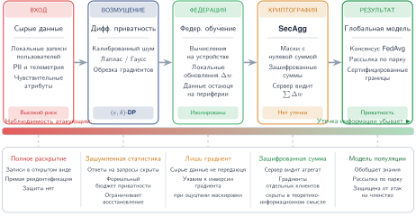
***Конвейер машинного обучения с сохранением приватности:** многоэтапная архитектура обучения глобальной модели с минимизацией раскрытия данных. Конвейер последовательно применяет средства защиты (дифференциальную приватность, федеративное обучение и безопасную агрегацию), которые постепенно снижают видимость сырых персональных данных для злоумышленника.*

Последствия слабого управления данными хорошо документированы. Системы, обученные на плохо понятных или смещенных наборах данных, могут закреплять структурное неравенство или непреднамеренно раскрывать чувствительные атрибуты. В примере с COMPAS (раздел [«Прозрачность и объяснимость»](#sec-responsible-ai-transparency-explainability-b137)) отсутствие прозрачности в отношении происхождения и использования данных исключило эффективную оценку и возможность исправления. В клинических приложениях наборы данных часто содержат артефакты, такие как пропущенные значения или демографический перекос, которые снижают и качество, и приватность. Без четких стандартов качества данных и документирования такие уязвимости становятся системными.

Приватность — это не только забота изолированных алгоритмов или обработчиков данных; ее нужно рассматривать как структурное свойство системы. Решения о сборе согласия, сроках хранения данных, проектировании модели и аудируемости влияют на общее состояние приватности конвейера машинного обучения. Сюда относится необходимость предвидеть риски не только во время обучения, но и во время инференса и постоянной эксплуатации. Угрозы вроде атак на определение членства[^fn-membership-inference-attack] подчеркивают важность встраивания мер защиты приватности и в архитектуру модели, и в поведение интерфейса.

[^fn-membership-inference-attack]: **Атаки на определение членства**: впервые продемонстрированы Shokri et al. (2017). Эти атаки определяют, использовались ли данные конкретного человека для обучения модели, используя разрыв уверенности между знакомыми и незнакомыми входами. Следствие для систем: любая модель ML, доступная через API, может стать потенциальным оракулом приватности, а установление того, что медицинская запись человека была в обучающей выборке модели предсказания болезней, может раскрыть чувствительные данные о здоровье. Защиты включают дифференциальную приватность, регуляризацию, калибровку уверенности и средства контроля интерфейса, такие как ограничение частоты запросов.

Правовые рамки отражают это понимание. Такие регуляции, как GDPR, CCPA[^fn-ccpa-privacy-regulation] и японский Закон о защите персональной информации, устанавливают конкретные обязательства в отношении минимизации данных, ограничения цели, согласия пользователя и права на удаление (GDPR, 2016; California, 2023; Japan, 2023). Эти требования переводят этические ожидания в обязательные проектные ограничения, подкрепляя необходимость рассматривать приватность как базовый принцип разработки системы.

[^fn-ccpa-privacy-regulation]: **CCPA (California Consumer Privacy Act, Закон Калифорнии о защите прав потребителей в отношении персональных данных)**: CCPA предоставляет жителям Калифорнии права на защищаемую персональную информацию, включая право на удаление с учетом установленных законом исключений (California, 2023). Для инфраструктуры обслуживания ML запросы на удаление создают архитектурное ограничение, которое нужно планировать от конвейера данных, потому что удаление исходной записи само по себе не убирает влияние этой записи из параметров обученной модели.

Приватность — второй пример системного тезиса, сформулированного для справедливости в разделе [«Справедливость в машинном обучении»](#sec-responsible-ai-fairness-machine-learning-2ba4): это обязательство, которое охватывает сбор согласия, политику хранения, проектирование модели, обслуживание и аудируемость, а не свойство какого-либо отдельного этапа. Это требует координации между техническими и организационными областями, чтобы использование данных соответствовало ожиданиям пользователей, правовым мандатам и общественным нормам. Вместо того чтобы рассматривать приватность как ограничение, которое нужно уравновесить с функциональностью, ответственный проект системы интегрирует приватность с самого начала, влияя на архитектуру, формируя интерфейсы и определяя, как модели строятся, обновляются и развертываются.

Сохранение приватности предотвращает несанкционированное раскрытие данных, но ответственные системы также должны обеспечивать предсказуемое поведение, даже когда механизмы приватности не могут предотвратить все риски. Модель может соблюдать все ограничения приватности и при этом катастрофически провалиться, столкнувшись с неожиданными входами или состязательными условиями. Безопасность и устойчивость решают это дополняющее задачу: как системы отказывают, а не только как защищаются данные.

<a id="sec-responsible-ai-safety-robustness-597e"></a>

### Безопасность и устойчивость

Безопасность и устойчивость, введенные в [главе «Надежный ИИ»](14_robust_ai.md#sec-robust-ai) как технические свойства, отвечающие на аппаратные сбои, состязательные атаки и сдвиги распределений, также служат принципами ответственного ИИ, выходящими за рамки смягчения угроз. Техническая устойчивость обеспечивает, что системы переживают состязательные условия; ответственная устойчивость обеспечивает, что системы ведут себя в соответствии с человеческими ожиданиями и ценностями, даже когда они технически работают. Модель может быть устойчивой к переворотам битов и состязательным возмущениям, но при этом демонстрировать поведение, небезопасное для развертывания, если непредсказуемо отказывает в пограничных случаях или оптимизирует цели, не согласованные с благополучием пользователей.

Безопасность в машинном обучении означает гарантию того, что модели ведут себя предсказуемо в нормальных условиях и отказывают контролируемым, некатастрофическим образом при стрессе или неопределенности. Тесно связанная с ней устойчивость касается способности модели сохранять стабильную и согласованную производительность при вариациях входов, среды или конфигурации системы. Вместе эти свойства являются основой ответственного развертывания в критичных к безопасности областях, где выходы моделей машинного обучения напрямую влияют на физические или высокорисковые решения.

Обеспечение безопасности и устойчивости на практике требует предвидеть весь спектр условий, с которыми может столкнуться система, и проектировать поведение, которое остается надежным за пределами обучающего распределения. Сюда входит не только управление изменчивостью входов, но и работа с тем, как модели реагируют на неожиданные корреляции, редкие события и целенаправленные попытки вызвать отказ. Например, расследование Национального совета по безопасности на транспорте (NTSB) по аварии Uber 2018 года в Темпе показывает, что отказы автоматизированного вождения могут сочетать проблемы восприятия, предсказания, поведения оператора безопасности и организационного контроля, а не сводиться к одной ошибке модели (NTSB, 2019).

Один из иллюстративных режимов отказа возникает из состязательных входов:[^fn-adversarial-input-perturbation] тщательно сконструированных возмущений, которые для людей выглядят безобидно, но заставляют модель выдать неверное или вредное предсказание (Szegedy et al., 2013). Такие уязвимости не ограничиваются классификацией изображений; их наблюдали в разных модальностях, включая аудио, текст и структурированные данные, и они показывают хрупкость выученных представлений в многомерных пространствах. Устранение этих уязвимостей требует специализированных подходов, включая состязательные защиты и методы устойчивости. Эти примеры показывают, что устойчивость нужно рассматривать не только при обучении, но и как глобальное свойство того, как системы взаимодействуют со сложностью реального мира.

[^fn-adversarial-input-perturbation]: **Состязательные входы**: впервые показаны Szegedy et al. (2013); это незаметные возмущения входа, которые вызывают уверенную ошибочную классификацию. Возмущение величиной 0,005 (в пространстве пикселей) может изменить выход классификатора с уверенностью более 99 процентов, что показывает: границы решений нейронных сетей гораздо более хрупки, чем предполагает точность на тестовой выборке. Для критичных к безопасности систем ML это означает, что тестовая точность не гарантирует устойчивости при развертывании, поэтому состязательное тестирование нужно выделять в отдельный этап валидации.

Связанная проблема — сдвиг распределения[^fn-distribution-shift-robustness]: неизбежное расхождение между обучающими данными и условиями, которые встречаются при развертывании. Будь то сезонность, демографические изменения, деградация датчиков или изменчивость среды, такие сдвиги могут ухудшать надежность модели даже без состязательных манипуляций. Решение проблем сдвига распределения требует систематических подходов к обнаружению изменяющихся условий и адаптации к ним.

[^fn-distribution-shift-robustness]: **Сдвиг распределения**: расхождение между распределениями обучающих данных и данных развертывания, которое проявляется как ковариатный сдвиг (меняется распределение входов), сдвиг меток (меняются доли классов) или концептуальный дрейф (со временем меняется связь между входом и выходом). Системное следствие — тихая деградация: в отличие от программных ошибок, которые приводят к сбою, сдвиг распределения разрушает точность за недели или месяцы, не вызывая ошибок, поэтому нужна инфраструктура непрерывного мониторинга с автоматическими триггерами переобучения и версионированием моделей, чтобы обнаруживать проблему и реагировать на нее.

Ответственное проектирование машинного обучения рассматривает устойчивость как системное требование. Ее решение требует большего, чем улучшение производительности отдельной модели. Оно предполагает проектирование систем, которые предвидят неопределенность, выявляют свои ограничения и поддерживают запасное поведение, когда прогностическая уверенность низка. Сюда относятся такие практики, как установка порогов уверенности, поддержка воздержания от решения и встраивание человеческого контроля в эксплуатационные процессы. Эти механизмы важны для построения систем, которые деградируют плавно, а не отказывают тихо или непредсказуемо.

Эти соображения о поведении отдельной модели распространяются на более широкие системные требования. Безопасность и устойчивость также предъявляют требования на архитектурном и организационном уровне. Решения о том, как отслеживаются модели, как обнаруживаются отказы и как управляются обновления, влияют на то, может ли система эффективно реагировать на изменяющиеся условия. Ответственное проектирование требует рассматривать устойчивость не как свойство изолированных моделей, а как ограничение, которое формирует общее поведение систем машинного обучения. Этот системный взгляд на безопасность и устойчивость приводит к вопросам подотчетности и управления.

<a id="sec-responsible-ai-accountability-governance-713a"></a>

### Подотчетность и управление

Подотчетность в машинном обучении означает способность выявлять, приписывать и устранять последствия автоматизированных решений. Она выходит за рамки диагностики отказов: нужно, чтобы ответственность за поведение системы была явно назначена, вред можно было исправить, а этические стандарты поддерживались через надзор и институциональные процессы. Без таких механизмов даже добросовестные системы могут наносить значительный вред без возможности обжалования, подрывая общественное доверие и легитимность.

В отличие от традиционных программных систем, где ответственность часто лежит на определенном разработчике или операторе, подотчетность в машинном обучении распределена. Выходы модели формируются сбором данных на более ранних этапах, целями обучения, проектом конвейера, поведением интерфейса и обратной связью после развертывания. Эти взаимосвязанные компоненты часто затрагивают множество участников технической, правовой и организационной областей. Например, если платформа найма дает смещенные результаты, ответственность может лежать не только на разработчике модели, но и на поставщиках данных, дизайнерах интерфейса и организации, которая развертывает систему. Ответственный проект системы требует, чтобы эти связи были явно описаны и управлялись.

Недостаточное управление может помешать организациям распознавать вредное поведение модели или исправлять его. Провал Google Flu Trends в предвидении сдвига распределения и петель обратной связи показывает последствия неучтенных изменений в поведении поисковых запросов пользователей, всплесков запросов из-за медиа и недостаточной перекалибровки относительно эталонных данных CDC (Lazer et al., 2014). Устойчивое завышение оценок годами не исправлялось, что в итоге способствовало прекращению работы модели.

Правовые рамки также отражают необходимость подотчетного проектирования. Такие акты, как Закон Иллинойса об искусственном интеллекте в видеоинтервью (Illinois, 2020) и Закон ЕС об ИИ, устанавливают требования к прозрачности, согласию, документированию и надзору в приложениях высокого риска (EU, 2024). Эти политики закрепляют подотчетность не только в результатах, которые производит система, но и в эксплуатационных процедурах и документации, которые поддерживают ее использование. Внутренние организационные изменения, включая введение аудитов справедливости и ограничений на использование в системах таргетированной рекламы, показывают, как регуляторное давление может катализировать структурные реформы управления.

Проектирование для подотчетности предполагает поддержку прослеживаемости на каждом этапе жизненного цикла системы. Сюда входят документирование происхождения данных, фиксация версий моделей, возможность ручного переопределения решений и хранение достаточных журналов для ретроспективного анализа. Такие инструменты, как **карточки моделей**[^fn-model-cards-documentation] (Mitchell et al., 2019) и **паспорта данных (Datasheets for Datasets)**[^fn-datasheets-for-datasets] (Gebru et al., 2021), служат примерами практик, которые делают поведение системы интерпретируемым и пригодным для проверки. Митчелл с коллегами предложили карточки моделей как краткие документы, которые сопровождают обученные модели ML и содержат сравнительную оценку по культурным, демографическим и фенотипическим группам, относящимся к заявленным применениям. Аналогично Гебру с коллегами предложили, чтобы каждый набор данных сопровождался паспортом, который документирует его мотивацию, состав, процесс сбора и рекомендуемые применения, по аналогии с техническими паспортами электронных компонентов. Однако подотчетность не сводится только к документации: она также требует механизмов обратной связи, оспаривания решений и возмещения вреда.

[^fn-model-cards-documentation]: **Карточки моделей**: предложены Mitchell et al. (2019) как стандартизованная документация, которая сопровождает обученные модели ML. Каждая карточка содержит сравнительные показатели производительности по демографическим группам, описывает предполагаемые сценарии использования и раскрывает известные ограничения. Для производственных систем ML карточки служат слоем прослеживаемости, связывая развернутый двоичный файл с происхождением обучения, результатами оценки и известными режимами отказа: это минимум метаданных, необходимый для аудита после развертывания и соответствия регулированию.

[^fn-datasheets-for-datasets]: **Паспорта данных (Datasheets for Datasets)**: предложены Gebru et al. (2021) по образцу паспортов электронных компонентов, которые задают условия работы и допуски. Каждый паспорт документирует мотивацию набора данных, его состав, процесс сбора и рекомендуемые применения. Для конвейеров ML паспорта выполняют роль аналога аппаратных спецификаций: они определяют допустимые рабочие условия распределения обучения модели, позволяя инженерам предсказывать, где сдвиг распределения при развертывании приведет к отказам.

Внутри организаций структуры управления помогают формализовать эту ответственность. Процессы этической экспертизы, междисциплинарные аудиты и комитеты по риску моделей создают площадки для предвидения последствий и реагирования на новые проблемы. Эти структуры должны поддерживаться инфраструктурой, которая позволяет пользователям оспаривать решения, а разработчикам — отвечать исправлениями. Например, системы, которые позволяют запрашивать объяснения или инициировать проверку пользователем, помогают сократить разрыв между логикой модели и пользовательским опытом, особенно в областях, где цена ошибки значительна.

Архитектурные решения также играют роль. Интерфейсы можно проектировать так, чтобы показывать неопределенность, позволять эскалацию или приостанавливать автоматические действия при необходимости. Конвейеры журналирования и мониторинга нужно настраивать так, чтобы обнаруживать признаки этического дрейфа, например ухудшение производительности в подгруппах или непредвиденные петли обратной связи. В распределенных системах, где трудно поддерживать единообразную наблюдаемость, подотчетность нужно встраивать через архитектурные защиты: безопасные протоколы, ограничения на обновления или доверенные компоненты.

Управление не означает централизованного контроля. Оно предполагает распределение ответственности прозрачным, действенным и устойчивым образом. Технические команды, юристы, конечные пользователи и руководители институтов должны иметь доступ к инструментам и информации, необходимым для оценки поведения системы и вмешательства при необходимости. По мере того как системы машинного обучения становятся сложнее и встраиваются в важную инфраструктуру, подотчетность должна масштабироваться соответственно: она должна стать базовым соображением и в архитектуре, и в процессе, а не реактивным слоем, добавляемым после развертывания.

Несмотря на эти механизмы управления, у содержательной подотчетности есть вызов: различать решения, основанные на законных факторах, и ложные корреляции, которые могут закреплять исторические смещения. Эта задача требует внимательного отношения к качеству данных, выбору признаков и непрерывному мониторингу, чтобы автоматизированные решения отражали справедливые и обоснованные рассуждения, а не проблемные закономерности из смещенных исторических данных.

Принципы и методы, рассмотренные в предыдущих разделах этой главы, составляют концептуальную и техническую основу ответственного ИИ, но их практическая реализация критически зависит от архитектуры развертывания. Облачные системы могут поддерживать сложные объяснения на основе значений Шепли и мониторинг справедливости в реальном времени, тогда как устройства TinyML должны опираться на статическую интерпретируемость и гарантии приватности на этапе компиляции. Граничные развертывания позволяют сохранять приватность локально, но ограничивают глобальную оценку справедливости. Эти архитектурные ограничения — не просто детали реализации: они фундаментально определяют, какие защиты ответственного ИИ доступны разным пользователям и приложениям.

> **Пример: выбор метрики справедливости**
>
> **Сценарий**: движок рекомендаций при найме должен выбрать основное ограничение справедливости до запуска в производство для разнородных пулов заявителей.
>
> **Диагностика**: демографический паритет требует равных долей отбора независимо от квалификации кандидата, а калибровка гарантирует только равную точность оценок между группами. Равенство возможностей прямо требует равных долей истинно положительных срабатываний среди квалифицированных заявителей ($\text{TPR}_A = \text{TPR}_B$), что напрямую соответствует цели равных возможностей для квалифицированных кандидатов.
>
> **Системный урок**: выбор метрики — это решение управления, которое задает эксплуатационную цель конвейера обслуживания. Проектировщики систем должны согласовать математическое ограничение с юридическими и этическими требованиями предметной области до обучения или пороговой настройки.

Пример показывает, почему выбор метрики — это решение управления еще до того, как становится вычислением: выбранное определение справедливости определяет, какой компромисс ошибок системе позволено делать. Выбор математически подходящей метрики справедливости — первый шаг, но вычисление этих метрик требует доступа к демографическим данным и значительных вычислительных накладных расходов. Выполнение этих математических гарантий становится гораздо сложнее при переходе от централизованного облака к ограниченным распределенным граничным развертываниям, где архитектуру определяют приватность и пропускная способность сети.

> **Контрольные вопросы: принципы как инженерные ограничения**
>
> В этом разделе справедливость, объяснимость, прозрачность, подотчетность и выравнивание ценностей были переосмыслены как инварианты плоскости управления, а не как пункты постфактум-проверки; каждый из них сопоставлен с жизненным циклом ML, а налог на справедливость и накладные расходы ответственного ИИ количественно оценены.
>
> **От принципа к механизму**
>
> - [ ] **Прозрачность против справедливости**: объясните, почему полностью прозрачная логика решений все равно может нарушать справедливость, если она ущемляет одну демографическую группу, и укажите, какой принцип нарушает эта система.
> - [ ] **Охват жизненного цикла**: примените жизненный цикл ответственного ИИ к требованию справедливости, указав, какие фазы должны действовать, и объяснив, почему одной лишь постфактум-настройки порога недостаточно.
>
> **Оценка компромисса**
>
> - [ ] **Бюджет защиты**: исходя из ограниченного вычислительного бюджета и приведенных данных о накладных расходах, выберите доступную защиту из дифференциальной приватности, мониторинга справедливости в реальном времени и объяснения по запросу.
> - [ ] **Распределенная подотчетность**: обоснуйте, почему подотчетность за смещенную модель найма распределена между поставщиками данных, дизайнерами интерфейса и организацией-оператором, а не лежит только на разработчике модели.

<a id="sec-responsible-ai-responsible-ai-across-deployment-environments-e828"></a>

## Ответственный ИИ в средах развертывания

Аудит модели на смещение прост, если есть огромная централизованная база данных и неограниченные облачные GPU. Аудит модели федеративного обучения, работающей на миллионе отдельных смартфонов, где строгие законы о приватности закрывают доступ к демографическим данным, — совсем другая инженерная задача. Среда развертывания принципиально определяет, какие методы ответственного ИИ математически и юридически возможны.

Эти архитектурные различия перераспределяют и допустимые защиты, и ответственных участников. Доступность ресурсов, ограничения задержки, дизайн пользовательского интерфейса и наличие или отсутствие связи определяют, можно ли последовательно обеспечивать принципы ответственного ИИ в разных контекстах развертывания. Одна и та же модель может поддерживать богатые объяснения, непрерывный мониторинг и централизованную аудируемость в облаке, но требовать статической проверки и упрощенных защит, если она встроена в устройство с перебоями связи.

Географическое и экономическое распределение вычислительных ресурсов добавляет еще один слой неравенства. Высокопроизводительные системы ИИ обычно требуют близости к крупным дата-центрам или высокоскоростным интернет-соединениям, что создает различия в качестве сервиса, которые тесно совпадают с существующим социально-экономическим неравенством. Сельские сообщества, развивающиеся регионы и экономически неблагополучные районы часто испытывают ухудшение качества сервисов ИИ из-за сетевой задержки, ограниченной пропускной способности и удаленности от вычислительной инфраструктуры. Отчеты Федеральной комиссии связи США документировали устойчивые различия в широкополосном доступе: сельские районы существенно реже, чем городские, имеют фиксированный широкополосный доступ, соответствующий эталону, используемому в этих отчетах. Для ответственного ИИ этот разрыв инфраструктуры определяет, практичны ли объяснимость в реальном времени, непрерывный мониторинг справедливости и вычисления с сохранением приватности для пользователей и сообществ, которые сильнее всего затронуты автоматизированными решениями.

<a id="sec-responsible-ai-system-explainability-5087"></a>

### Объяснимость систем

Ограничивающим фактором для объяснимости служит среда развертывания, а не выбор техники: вычислительная мощность, бюджет задержки, дизайн интерфейса и доступ к данным определяют, какой метод объяснения, если вообще какой-либо, может работать. Облачные системы могут позволить себе ресурсоемкие методы постфактум-анализа, такие как атрибуция на основе значений Шепли (SHAP) и локальные суррогатные объяснения (LIME);[^fn-lime-surrogate-explanation] мобильные и граничные устройства обычно могут позволить себе только карты значимости за один проход;[^fn-saliency-map-attribution] устройства TinyML часто вообще не поддерживают объяснение во время выполнения, оставляя единственной возможностью инспекцию на этапе разработки. [Раздел «Объяснимость и интерпретируемость»](#sec-responsible-ai-explainability-interpretability-8d06) развивает технические механизмы и издержки, которые предполагает эта матрица; [Таблица «Компромиссы развертывания»](#tbl-ml-principles-comparison) фиксирует осуществимость для каждой среды.

[^fn-lime-surrogate-explanation]: **LIME (Local Interpretable Model-Agnostic Explanations, локальные интерпретируемые агностические объяснения)**: предложен Ribeiro et al. (2016). LIME объясняет отдельные предсказания, возмущая вход, многократно запрашивая модель как «черный ящик» и подгоняя взвешенный линейный суррогат для аппроксимации локального поведения. Системный компромисс в том, что задержка объяснения растет с числом возмущенных выборок и стоимостью вызова модели, поэтому в производственных развертываниях часто используют бюджеты выборки, кэширование, асинхронные рабочие процессы объяснения или методы, специфичные для модели, если архитектура это допускает.

[^fn-saliency-map-attribution]: **Карты значимости (Saliency Maps)**: объяснение на основе градиентов, которое выделяет области входа, наиболее повлиявшие на предсказание, с помощью обратного прохода, то есть той же инфраструктуры, что используется для обучения. Методы значимости часто дешевле методов, требующих много возмущений или перебора подмножеств, поэтому они привлекательны для граничных и мобильных развертываний, если модель поддерживает градиенты. Компромисс в том, что сырые градиенты могут быть шумными и подсвечивать артефакты входа, а не осмысленные признаки, поэтому сглаживание или варианты с повторным вычислением градиентов обменивают дополнительные вычисления на более стабильные визуализации.

Два измерения, которые таблица не может передать, отличают объяснимость от других принципов. Первое — аудитория: конечному пользователю нужна краткая сводка («повышенный пульс во сне»), тогда как разработчику, аудитору или регулятору нужны карты атрибуции, активации концептов или трассировки решений, поэтому одно развертывание часто должно предоставлять две поверхности объяснения одновременно. Второе — время: у дрона или контура промышленного управления нет запаса, чтобы вычислять объяснение во время работы, и они могут лишь записывать внутренние сигналы для последующего анализа, тогда как асинхронные системы, например скоринг финансовых рисков или медицинская диагностика, могут выдать более глубокое объяснение после решения. Планирование для обоих случаев в пределах ограничений задержки, энергии и интерфейса развертывания и делает интерпретируемость проектным ограничением, а не пожеланием после развертывания.

<a id="sec-responsible-ai-fairness-constraints-c72c"></a>

### Ограничения справедливости

Справедливость создает параллельную проблему развертывания, и ее ограничивающий фактор — видимость данных. Облачная платформа с демографически размеченными наборами данных может вычислять метрики на уровне групп, проводить обучение с учетом справедливости и аудировать постфактум. Федеративное[^fn-federated-learning-fairness] или встроенное в устройство развертывание этого сделать не может: ни одна сущность не видит глобального демографического распределения, поэтому аудит справедливости на уровне групп не просто дорог, а математически невозможен без агрегации с сохранением приватности, и справедливость приходится закладывать в обучение или курирование данных заранее. [Таблица «Компромиссы развертывания»](#tbl-ml-principles-comparison) фиксирует различия по средам; два следствия ограничения видимости данных стоит выделить, потому что они повторяются в разных развертываниях.

[^fn-federated-learning-fairness]: **Федеративное обучение и справедливость**: Google представила федеративное обучение в 2016 году для клавиатуры Gboard; оно обучается на множестве устройств без централизации сырых данных. Сложность для справедливости в том, что ни одна сущность не видит полного демографического распределения по участникам, поэтому метрики справедливости на уровне групп нельзя напрямую вычислить без дополнительных протоколов. Оценка федеративной справедливости может требовать агрегации с сохранением приватности, безопасной агрегации или дифференциальной приватности, и каждый из этих подходов меняет компромиссы по коммуникации, точности и управлению по сравнению с централизованным обучением.

Первое: решает реализованную справедливость не только качество модели, но и политика порогов принятия решения. Даже модель с одинаковой точностью для групп может создавать непропорциональное воздействие при едином пороге, если распределения оценок различаются. Поэтому мобильная система одобрения кредитов может систематически занижать одобрения для одной группы, если заранее не продумать групповые пороги и не закрепить их в политике. Второе: персонализация без глобального контекста может незаметно усиливать неравенство. Локально адаптированные модели стремятся к индивидуальной справедливости, при которой похожие люди получают похожие решения по метрике сходства, релевантной задаче (Dwork et al., 2012); но переобучение на поведении маргинализированных пользователей, чьи данные редки или шумны, может сместиться в сторону закрепления существующих разрывов. Этот дрейф — петля обратной связи. Платформа найма, которая отдает предпочтение кандидатам из определенных учебных заведений, усиливает неравенство при переобучении на собственных смещенных результатах, поэтому смягчение должно охватывать мониторинг развертывания, журналирование данных и оценку воздействия, а не ограничиваться одним аудитом. [Рисунок «Петля усиления смещения»](#fig-bias-amplification) иллюстрирует петлю усиления смещения: на каждом этапе существующее смещение усиливается, если его не прервать зелеными точками вмешательства.

<a id="fig-bias-amplification"></a>

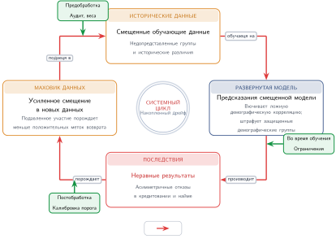
***Петля усиления смещения:** когда системы ML переобучаются на собственных выходах, историческое смещение в обучающих данных распространяется через предсказания модели, последующие результаты и подкрепленные данные, прежде чем вернуться в переобучение уже с еще большим смещением. Каждая стрелка этапа («обучается на», «производит», «порождает», «подается в») усиливает искажение. Сплошные зеленые стрелки показывают три внешние точки смягчения (аудит данных, метрики справедливости и аудит воздействия), которые могут разорвать цикл.*

Петля на [рисунке «Петля усиления смещения»](#fig-bias-amplification) показывает, почему постфактум-аудиты справедливости недостаточны: без вмешательства на каждом из четырех этапов (данные, модель, предсказания и переобучение) каждая итерация усиливает смещение, внесенное предыдущей, и превращает небольшой начальный перекос в системное неравенство. Поэтому справедливость переходит из области выбора метрики в ограничение жизненного цикла: видимость данных определяет, что можно измерить, политика порогов определяет, где ложатся ошибки, а инфраструктура обратной связи определяет, затухают неравенства или нарастают.

Это же разделение развертывания создает следующее противоречие ответственного ИИ. Хранение чувствительных данных локально может защищать пользователей, но локальность, которая поддерживает приватность, одновременно лишает глобальной наблюдаемости, которая нужна для многих аудитов справедливости.

<a id="sec-responsible-ai-privacy-architectures-1f9a"></a>

### Архитектуры приватности

Приватность наследует тот же компромисс централизации, только в более резкой форме. Агрегация данных в облаке позволяет строить и мониторить модели большой мощности, но концентрирует риски утечек и слежки, поэтому ее нужно сочетать с сильным шифрованием, контролем доступа и аудируемостью. Хранение данных локально на мобильных, федеративных или TinyML-клиентах снижает этот центральный риск, но убирает глобальную наблюдаемость, необходимую для мониторинга или проверки соответствия, и вынуждает вшивать защиты приватности в модель и прошивку до развертывания, без канала времени выполнения для их корректировки. [Таблица «Компромиссы развертывания»](#tbl-ml-principles-comparison) фиксирует, где оказывается каждая среда.

Ограничение, которое таблица не показывает, состоит в том, что приватность оценивается на уровне обслуживания, а не только на этапе обучения. Модель может соответствовать всем формальным определениям приватности и все равно допускать утечки: атаки на определение членства восстанавливают, был ли запись пользователя в обучающей выборке, читая выходы модели, поэтому защиты должны распространяться на дизайн интерфейса, ограничение частоты запросов и контроль доступа. Более того, технически соответствующая система может нарушать ожидания пользователей, если сбор данных непрозрачен, поэтому поверхности согласия и понятное раскрытие информации являются частью архитектуры приватности, а не запоздалой заботой интерфейса.

Приватность защищает потоки данных, но не гарантирует, что выходы системы останутся надежными, когда входы меняются, датчики деградируют или злоумышленники зондируют интерфейс. Этот разрыв ведет от архитектуры приватности к архитектуре безопасности и устойчивости: система должна также определить, как она ведет себя под нагрузкой.

<a id="sec-responsible-ai-safety-robustness-1982"></a>

### Безопасность и устойчивость в развертываниях

Ограничивающим фактором для безопасности и устойчивости служит бюджет задержки, потому что он определяет, какая защита вообще может работать. Облачный сервис может позволить себе оценщики неопределенности, детекторы изменения распределения, фильтрацию состязательных входов и ограничение частоты запросов к API[^fn-api-security-authentication]; контур автономной навигации или управления с бюджетом в миллисекунды — не может и должен заранее вычислить свои запасные действия. [Таблица «Компромиссы развертывания»](#tbl-ml-principles-comparison) фиксирует разделение по средам; на самом ограниченном краю устройства TinyML вообще не имеют канала мониторинга или обновления во время работы, поэтому устойчивость приходится закладывать статически, через консервативное проектирование и тестирование до развертывания.

[^fn-api-security-authentication]: **Безопасность API для ML**: конечные точки обслуживания ML подвержены атакам, которых нет у традиционных API, включая извлечение модели через повторные целевые запросы и внедрение состязательных входов. Ограничение частоты запросов, обнаружение аномалий, контроль доступа и проверка входов могут снизить подверженность атакам, но фундаментальный компромисс в том, что доступность модели для законной объяснимости одновременно увеличивает поверхность атаки для кражи модели и состязательного зондирования.

Следствие, которое таблица не показывает, состоит в том, что запасной путь сам по себе является задачей бюджета задержки. Робот-доставщик, который воздерживается[^fn-abstention-selective-classification] от решения при низкой уверенности распознавания пешеходов, решил только половину задачи: человек-проверяющий, правило по умолчанию или очередь эскалации, которые перехватывают воздержавшийся случай, должны выполниться в том же временном бюджете, что и защищаемая модель. Устойчивая система — это поэтому не та, которая избегает всех ошибок, а та, которая отказывает заметно, управляемо и безопасно; это зависит от конкретных решений о сенсорике, оценке уверенности, маршрутизации запасного пути и восстановлении. Эти решения также определяют поверхность управления: система должна задать, кто может видеть вред, кто может вмешаться и кто остается ответственным за исход.

[^fn-abstention-selective-classification]: **Воздержание (abstention)**: практика отказа от предсказания, когда уверенность падает ниже порога. Воздержание может снижать ошибки высокого риска, но только переводя часть случаев на запасную инфраструктуру, такую как проверяющие-люди, правила по умолчанию или очереди эскалации. Автономные автомобили передают управление человеку-водителю; медицинский ИИ направляет неоднозначные случаи специалистам — в обоих случаях логика маршрутизации должна работать в рамках задержки и бюджета безопасности системы.

<a id="sec-responsible-ai-governance-structures-a255"></a>

### Структуры управления

Подотчетность реализуется через конкретную инфраструктуру прослеживаемости, и ее ограничивающий фактор — то, какую часть этой инфраструктуры может выдержать среда. Облачная платформа поддерживает реестры моделей, панели телеметрии[^fn-telemetry-monitoring-pipeline] и структурированные конвейеры событий, которые возвращают предсказание к конкретной модели, входу или конфигурации. Устройство TinyML не несет ничего из этого: без связи, постоянного хранилища и настраиваемости во время работы подотчетность приходится встраивать статически: криптографическими подписями прошивки, фиксированными журналами аудита и документацией до развертывания, а иногда и принудительно на производстве, потому что постфактум-исправление невозможно. [Таблица «Компромиссы развертывания»](#tbl-ml-principles-comparison) фиксирует, где каждая среда оказывается на этом спектре.

[^fn-telemetry-monitoring-pipeline]: **Телеметрия в системах ML**: сбор в реальном времени задержек предсказаний, точности и загрузки ресурсов по развернутым моделям. Оповещения обычно срабатывают, когда точность падает более чем на 5 процентов или задержка превышает 200 мс. Проблема подотчетности возникает в масштабе парка: система, которая обслуживает сотни моделей разным пользователям, ежедневно генерирует миллионы событий телеметрии, а чтобы свести конкретное вредное предсказание к первопричине (дрейф данных, регрессия модели или неверная настройка порога), нужна сквозная инфраструктура происхождения, которой у большинства организаций нет.

Наиболее сложное для этого развертывание — мобильное, потому что ответственность разделена между локальной моделью, удаленным сервисом и дизайном интерфейса, поэтому, когда что-то идет не так, часто неясно, какой слой отвечает за сбой. Управление там зависит от доступных путей обжалования и механизмов, которые позволяют показывать, объяснять и оспаривать решения на уровне пользователя; эти механизмы встраиваются и в интерфейс, и в окружающую архитектуру сервиса, а не добавляются как политический слой сверху. Во всех средах поддержание подотчетности требует планировать отказ так же тщательно, как и успех: определять, как выявляются аномалии, как назначаются роли, как ведутся записи и как происходит исправление, — все это должно быть прослеживаемо в журналах и обеспечиваться через интерфейсы. Управление должно также учитывать экологические и распределительные последствия выбора инфраструктуры, потому что организации, развертывающие системы ИИ, несут ответственность не только за алгоритмические результаты, но и за более широкие последствия использования ресурсов для экологической справедливости и равного доступа.

<a id="sec-responsible-ai-design-tradeoffs-6f5a"></a>

### Компромиссы проектирования

Проблемы управления в разных контекстах развертывания показывают общую закономерность: компромиссы ответственного ИИ — это архитектурные компромиссы. Системы машинного обучения работают не в идеализированных изолированных средах; им приходится балансировать конкурирующие цели при ограниченных ресурсах, жестких требованиях к задержке, меняющемся поведении пользователей и сложности регулирования.

Облачные системы часто поддерживают обширный мониторинг, аудиты справедливости, сервисы интерпретируемости и инструменты сохранения приватности благодаря достаточным вычислительным и хранилищным ресурсам. Однако эти преимущества обычно идут вместе с централизованной обработкой данных, которая создает риски, связанные со слежкой, утечками данных и сложным управлением. Напротив, системы на устройствах, такие как мобильные приложения, граничные платформы или развертывания TinyML, обеспечивают более сильную локальность данных и контроль пользователя, но ограничивают видимость после развертывания, инструменты измерения справедливости и возможности адаптации модели.

Противоречия между целями часто проявляются на архитектурном уровне. Например, системы с требованием реагировать в реальном времени, такие как распознавание жестов в носимом устройстве или автономное торможение, не могут позволить себе вычислять подробные объяснения интерпретируемости во время инференса. Проектировщикам нужно выбирать, предвычислять ли упрощенные выходы, откладывать ли объяснение на асинхронный анализ или вообще опускать интерпретируемость в условиях работы.

Конфликты возникают и между персонализацией и справедливостью. Системы, которые адаптируются к отдельным людям на основе локальных данных об использовании, часто не имеют глобального контекста, необходимого для оценки различий между подгруппами популяции. Чтобы персонализированные предсказания не приводили к систематическому исключению, требуется тщательное архитектурное проектирование, которое уравновешивает адаптацию на уровне пользователя с механизмами групповой справедливости и аудируемости.

Цели приватности и устойчивости тоже могут конфликтовать. Устойчивые системы часто выигрывают от журналирования редких событий или выбросов пользователей, чтобы повышать надежность. Однако запись таких данных может противоречить целям приватности или нарушать правовые ограничения на минимизацию данных. В ситуациях, когда чувствительное поведение должно оставаться локальным или зашифрованным, устойчивость нужно закладывать в архитектуру модели и процедуру обучения заранее, поскольку постфактум-доработка может быть невозможна.

Вычислительные требования ответственного ИИ создают напряжения, которые выходят за рамки технической оптимизации и касаются вопросов экологической справедливости и равного доступа. Энергоэффективное развертывание часто требует упрощенных моделей с меньшими возможностями мониторинга справедливости, что создает компромисс между экологической устойчивостью и этическими гарантиями. Например, внедрение дифференциальной приватности в федеративное обучение может увеличивать энергопотребление каждого устройства на 25–40 процентов, что потенциально делает такие защиты приватности непозволительными для устройств с ограниченным запасом батареи.[^fn-energy-privacy-tradeoff]

[^fn-energy-privacy-tradeoff]: **Компромисс между энергией и приватностью**: методы сохранения приватности, такие как дифференциальная приватность и безопасные многосторонние вычисления, могут увеличивать вычислительную нагрузку, объем передачи данных и расход батареи. В федеративном обучении на мобильных устройствах последствия для равенства прямые: пользователи со старыми устройствами, ограниченными тарифами на передачу данных или слабой батареей могут оказаться исключены из защищенных приватностью сервисов ИИ, и тогда защита приватности начинает зависеть от аппаратных ресурсов.

В совокупности эти примеры развертывания выявляют более широкую системную проблему. Принципы ответственного ИИ нельзя рассматривать изолированно. Они взаимодействуют, и оптимизация одного может ограничивать другой. Подходящий баланс зависит от архитектуры развертывания, приоритетов заинтересованных сторон, предметных рисков, последствий ошибок и экологических и распределительных последствий требований к вычислительным ресурсам. Поэтому проектирование ответственного машинного обучения требует сделать эти ограничения явными до выбора методов, чтобы получившуюся систему можно было оценивать относительно той среды, в которой она на самом деле будет работать.

Сравнение этих сред ([Таблица «Компромиссы развертывания»](#tbl-ml-principles-comparison)) показывает, что ни один контекст развертывания не доминирует по всем принципам; каждый из них делает свои архитектурные компромиссы. Облачные системы поддерживают сложные методы объяснимости (SHAP, LIME) и централизованный мониторинг справедливости, но несут риски приватности из-за агрегации данных. Граничные и мобильные развертывания дают более сильную локальность данных, но ограничивают наблюдаемость после развертывания и глобальную оценку справедливости. Системы TinyML сталкиваются с самыми жесткими ограничениями: им нужна статическая проверка и гарантии приватности на этапе компиляции без возможности корректировки во время работы. Эти ограничения — не просто технические пределы: они определяют, какие функции ответственного ИИ доступны разным пользователям и приложениям, создавая последствия для равенства, когда только хорошо обеспеченные развертывания могут позволить себе полный набор защит. Понимание этих ограничений развертывания дает необходимый контекст для технических методов, которые на практике реализуют принципы ответственного ИИ.

<a id="tbl-ml-principles-comparison"></a>

***Компромиссы развертывания:** принципы ответственного ИИ проявляются по-разному в разных контекстах развертывания из-за разных ограничений по вычислениям, связности и управлению; облачные развертывания поддерживают сложные методы объяснимости, тогда как TinyML сильно их ограничивает. Расстановка приоритетов между принципами объяснимости, справедливости, приватности, безопасности и подотчетности требует внимательного учета этих ограничений при проектировании систем машинного обучения для облачных, граничных, мобильных сред и сред TinyML.*

| **Принцип**        | **Облачное ML**                                                                                     | **Граничное ML**                                                   | **Мобильное ML**                                                                    | **TinyML**                                                                        |
|:-------------------|:----------------------------------------------------------------------------------------------------|:-------------------------------------------------------------------|:------------------------------------------------------------------------------------|:----------------------------------------------------------------------------------|
| **Объяснимость**   | Поддерживает сложные модели и методы вроде SHAP и выборочных подходов                                | Нужны легковесные методы с малой задержкой, например карты значимости | Требует интерпретируемых выходов для пользователей; более глубокий анализ часто переносится в облако | Сильно ограничена из-за слабого оборудования; в основном статическая или только на этапе компиляции |
| **Справедливость** | Большие наборы данных позволяют выявлять смещение и снижать его                                     | Локальные смещения труднее обнаружить, но допускается корректировка на устройстве | Высокая персонализация усложняет отслеживание справедливости на уровне групп        | Минимум данных ограничивает анализ и снижение смещения                            |
| **Приватность**    | Централизованные данные под угрозой утечек, но можно использовать сильное шифрование и дифференциальную приватность | Чувствительные персональные данные на устройстве требуют защит на устройстве | Тесная связь с личностью пользователя требует проектирования с учетом согласия и локальной обработки | Распределенные данные снижают центральные риски, но создают сложности с анонимизацией |
| **Безопасность**   | Уязвима для взломов и крупномасштабных атак                                                         | Реальные взаимодействия делают важной надежность                   | Работает под контролем пользователя, но все равно требует плавного отказа           | Нужны статические границы безопасности, сторожевые таймеры и поведение при отказе с защитой |
| **Подотчетность**  | Корпоративные политики и аудиты обеспечивают прослеживаемость и надзор                              | Фрагментированные цепочки поставок усложняют подотчетность         | Требует понятного пользователю раскрытия информации и путей обратной связи          | Нужна прослеживаемость через длинные и сложные аппаратные цепочки                  |
| **Управление**     | Внешний надзор и регулирование, например GDPR или CCPA, возможны                                    | Требует саморегулирования разработчиков и интеграторов            | Балансирует политику платформы и выбор разработчиков приложений                     | Опирается на встроенные протоколы и криптографические гарантии                     |

Анализ развертывания приводит к важному выводу: осуществимость метода ответственного ИИ зависит от архитектурных ограничений. Устройство TinyML не может выполнять объяснения SHAP; граничная система не может реализовать мониторинг справедливости в реальном времени; мобильное приложение не может хранить журналы аудита, необходимые для полной подотчетности. Поэтому ответственное машинное обучение требует технических методов, выбранных с учетом только что описанных ограничений: выявление смещения, защита приватности, обеспечение устойчивости и интерпретируемость имеют эксплуатационный смысл только тогда, когда они соответствуют качеству данных, вычислительному бюджету, требованиям развертывания и стеку обслуживания, которые определяют, может ли метод работать.

Необходимость этих методов начинается с того, как модели учатся. Обучающие данные содержат исторические смещения и несправедливые ассоциации: алгоритм найма, обученный на смещенных исторических данных, может воспроизводить дискриминационные закономерности, связывая демографические признаки с успехом. Модель выучивает корреляции, а не причинность, поэтому статистические закономерности, отражающие несправедливые социальные структуры, могут оптимизироваться как значимые связи. Традиционное машинное обучение, которое оптимизирует только точность, поэтому создает напряжение с целями справедливости. Эффективные решения должны встраивать соответствующее ограничение в сбор данных, обучение, обслуживание или мониторинг, а не прикреплять его как вторичную коррекцию после обучения.

Операционные методы, которые следуют дальше, делятся на три взаимодополняющие категории, каждая из которых имеет свои компромиссы по точности, вычислительным затратам и сложности реализации. Методы обнаружения выявляют проблемное поведение достаточно рано, чтобы вмешаться, обеспечивая системы раннего предупреждения о смещении, дрейфе и проблемах производительности. Методы смягчения предотвращают или уменьшают вредные результаты с помощью алгоритмических вмешательств и усиления устойчивости. Методы валидации делают поведение системы понятным для разработчиков, аудиторов, регуляторов и затронутых пользователей, которые оценивают автоматизированные решения.

<a id="sec-responsible-ai-computational-overhead-responsible-ai-techniques-79c2"></a>

#### Вычислительные накладные расходы методов ответственного ИИ

Следующие разделы подробно разбирают технические методы, но их системная цена видна уже до деталей реализации. [Таблица «Влияние техник ответственного ИИ на производительность»](#tbl-responsible-ai-overhead) показывает эффект на производительность: методы обнаружения, смягчения, валидации, приватности и объяснения накладывают разные издержки на обучение, инференс, память и точность. Сначала прочитав таблицу, инженеры могут оценивать методы ответственного ИИ как развертываемые системные решения, а не как абстрактные этические ярлыки.

<a id="tbl-responsible-ai-overhead"></a>

***Влияние техник ответственного ИИ на производительность:** таблица дает диапазоны для планирования емкости, а не универсальные результаты бенчмарков. Дифференциальная приватность и ограничения справедливости в основном влияют на бюджеты обучения и валидации; стоимость объяснимости сильно зависит от варианта: приближенные методы TreeSHAP и основанные на ядре требуют повторной работы модели, а точный SHAP растет комбинаторно с числом признаков. Эти диапазоны помогают инженерам рассуждать о производственных ограничениях до выбора реализации ответственного ИИ.*

| **Метод**                          | **Потеря точности** | **Накладные расходы на обучение** | **Стоимость инференса** | **Накладные расходы памяти** |
|:-----------------------------------|:-------------------:|:--------------------------------:|:--------------------:|:----------------------------:|
| Дифференциальная приватность (DP-SGD) | 2–5 %             | 15–30 %                          | Минимальная          | 10–20 %                      |
| Обучение с учетом справедливости (перевзвешивание, ограничения) | 1–3 % | 5–15 % | Минимальная | 5–10 % |
| Приближенный SHAP (дерево, ядро)   | Н/Д                 | Н/Д                              | 50–200 %             | 20–100 %                     |
| Точный SHAP                        | Н/Д                 | Н/Д                              | 50–1 000×            | 50–200 %                     |
| Состязательное обучение            | 2–5 %               | 100–300 %                        | Минимальная          | 50–100 %                     |
| Федеративное обучение              | 5–15 %              | 200–500 %                        | Минимальная          | 100–300 %                    |

Эти диапазоны накладных расходов нужно читать как сценарные допущения, а не как утверждение, что какая-либо цитируемая работа устанавливает единый универсальный налог.[^fn-rai-measurement-context] Фактические накладные расходы заметно зависят от архитектуры модели, размера набора данных, силы атаки, метода объяснения, оборудования, схемы коммуникации и качества реализации. Главное здесь архитектурное: средства контроля ответственного ИИ потребляют реальную емкость обучения, обслуживания, памяти или проверки, поэтому их нужно закладывать в бюджет до запуска. Эти цифры накладных расходов также делают конкретным аргумент о равенстве из [раздела «Требования к ресурсам и последствия для равенства»](#sec-responsible-ai-resource-requirements-equity-implications-b967): организация, которая не может позволить себе бюджеты обучения, инференса и памяти из таблицы, не может позволить себе и защиты, поэтому право на справедливую или приватную модель следует за вычислительным бюджетом, стоящим за ней.

[^fn-rai-measurement-context]: **Контекст измерения**: упражнение по оценке емкости опирается на типовые эталоны производства, такие как обучение на GPU, инференс на GPU или CPU, модели для изображений, текста и табличных данных, а также эталонные наборы данных. Эти цифры не являются каноническими константами; это ориентиры порядка величины, которые помогают решить, должна ли защита работать встроенно, асинхронно, офлайн или в конвейере обучения.

Поскольку эти вычислительные затраты и архитектурные ограничения сильно влияют на проектирование системы, инженерные команды должны тщательно выбирать инструменты, соответствующие реальным условиям развертывания. Независимо от среды первый шаг к корректирующему действию — знать, что проблема существует, поэтому методы обнаружения составляют основу для всех остальных вмешательств ответственного ИИ.

<a id="sec-responsible-ai-bias-risk-detection-methods-71f8"></a>

<a id="sec-responsible-ai-bias-risk-detection-methods-71f8"></a>

## Обнаружение смещения и мониторинг справедливости

Модель кредитного скоринга, развернутая в масштабах страны, начинает отказывать квалифицированным заявителям из определенного почтового индекса в два раза чаще обычного. Без инфраструктуры обнаружения смещения это расхождение может сохраняться неделями или месяцами, прежде чем его кто-нибудь заметит. Обнаружение смещения превращает теоретические определения справедливости в живую операционную телеметрию. Как инженер по надежности (SRE) следит за панелями задержек, так инженер по ответственному ИИ следит за панелями демографического паритета, используя анализ по срезам, чтобы выявить момент, когда модель начинает ошибаться на отдельных подгруппах.

<a id="sec-responsible-ai-bias-detection-mitigation-9174"></a>

### Обнаружение и смягчение смещения

Определения справедливости, рассмотренные в [разделе «Справедливость в машинном обучении»](#sec-responsible-ai-fairness-machine-learning-2ba4), задают математическую точность того, что означает справедливость: демографический паритет, равенство шансов и равенство возможностей определены формально. Однако практики сталкиваются с практической проблемой: вычислять эти метрики в производственных системах, обрабатывающих тысячи предсказаний в секунду, вручную по математическим формулам невозможно. Этот разрыв между определением и развертыванием и порождает потребность в специализированных инструментах.

Обеспечение справедливости в развернутых системах требует большего, чем принципиальные цели или теоретические метрики: оно требует системных методов, которые обнаруживают, измеряют и смягчают смещение на протяжении всего жизненного цикла машинного обучения. Практическое обнаружение смещения можно реализовать с помощью таких инструментов, как Fairlearn[^fn-fairlearn-fairness-toolkit] (Bird et al., 2020).

[^fn-fairlearn-fairness-toolkit]: **Fairlearn**: открытый инструментарий Microsoft (2020) для вычисления метрик справедливости и применения алгоритмов смягчения к моделям, совместимым со scikit-learn (Bird et al., 2020). Интеграция в систему выглядит так: измерение и смягчение смещения оборачивают конвейер модели, а не живут в отдельной таблице ручного аудита. Практическое значение в том, что мониторинг справедливости становится этапом конвейера CI/CD, а не разовой проверкой, и позволяет автоматически обнаруживать регрессии, когда обновления модели ухудшают качество на подгруппах.

[Листинг](#lst-bias-detection) показывает, как офлайн-аудит или аудит на этапе CI выявляет тревожные диспропорции по демографическим группам: доля одобрений кредитов заметно различается по этнической принадлежности, от 94 процентов для азиатских заявителей до 68 процентов для чернокожих заявителей. Опираясь на системные ограничения этой главы, справедливость нужно рассматривать как архитектурное соображение, которое пересекается с инженерией данных, обучением моделей, проектированием инференса, инфраструктурой мониторинга и управлением на уровне политик. Хотя метрики справедливости, такие как демографический паритет, равенство шансов и равенство возможностей, формализуют разные нормативные цели, их реализация зависит от способности архитектуры измерять качество на подгруппах, поддерживать адаптивные границы решений и хранить или показывать метаданные по группам во время работы. Мониторинг на этапе развертывания рассматривается далее в этой главе.

<a id="lst-bias-detection"></a>

***Обнаружение смещения с Fairlearn:** иллюстративный фрагмент аудита для оценки модели одобрения кредитов по демографическим группам. Фрагмент предполагает согласованные массивы наблюдаемых исходов, предсказаний и демографических меток.*

```python
from fairlearn.metrics import MetricFrame, selection_rate
from sklearn.metrics import accuracy_score, precision_score

# Оценка модели одобрения кредитов по демографическим группам
mf = MetricFrame(
    metrics={
        "approval_rate": selection_rate,
        "accuracy": accuracy_score,
        "precision": precision_score,
        "false_positive_rate": lambda y_true, y_pred: (
            (y_pred == 1) & (y_true == 0)
        ).sum()
        / (y_true == 0).sum(),
    },
    y_true=loan_approvals_actual,
    y_pred=loan_approvals_predicted,
    sensitive_features=applicant_demographics["ethnicity"],
)

# Вывод различий в качестве между этническими группами
print("Результаты одобрения кредитов по этническим группам:")
print(mf.by_group)
# Вывод: азиаты: 94% одобрений, белые: 91%, испаноязычные: 73%, чернокожие: 68%
```

Практическая реализация часто ограничена доступом к данным и возможностями инструментирования системы. Во многих реальных средах, особенно в мобильных, федеративных или встроенных системах, чувствительные атрибуты, такие как пол, возраст или раса, могут быть недоступны во время инференса, и тогда трудно отслеживать или аудировать качество модели по демографическим группам. Стратегии сбора и разметки данных необходимы для оценки справедливости на протяжении всего жизненного цикла модели. В таких условиях вмешательства для обеспечения справедливости должны происходить выше по течению, на этапе подготовки или обучения, поскольку перекалибровка после развертывания может оказаться невозможной. Даже когда данные доступны, непрерывные конвейеры переобучения, включающие обратную связь от пользователей, могут закреплять существующие неравенства, если за справедливостью специально не следят. Например, модель рекомендаций на устройстве, которая адаптируется к поведению пользователя, может усиливать прежние смещения, если у нее нет инфраструктуры для обнаружения демографического дисбаланса во взаимодействиях или выходах пользователей.

[Рисунок «Порог и справедливость»](#fig-fairness-example) показывает, как ограничения справедливости могут вступать в противоречие с решениями о развертывании. В бинарной системе одобрения кредитов две подгруппы, подгруппа A (синяя) и подгруппа B (красная), требуют разных порогов решения, чтобы достичь равных истинно положительных долей. Использование одного порога для всех групп приводит к неравным результатам и потенциально ущемляет подгруппу B. Выравнивание порогов для каждой группы может повысить справедливость, но для этого нужна поддержка условной логики в стеке обслуживания модели, доступ к чувствительным атрибутам во время инференса и управленческая основа для объяснения и обоснования дифференцированного обращения с группами.

<a id="fig-fairness-example"></a>


***Порог и справедливость:** изменение порогов классификации по подгруппам позволяет добиться равных истинно положительных долей, но усложняет обслуживание модели и требует доступа к чувствительным атрибутам во время инференса. Достижение справедливости требует внимательного учета качества по подгруппам: единый порог может непропорционально сильно бить по отдельным группам, и это подчеркивает напряжение между точностью и равноправными результатами в системах машинного обучения.*

Методы смягчения можно применять на разных этапах конвейера, но у каждого из них есть системные последствия. **Методы предобработки**, которые перебалансируют обучающие данные через выборку, перевзвешивание или аугментацию, требуют доступа к сырым признакам и групповым меткам, часто через хранилище признаков или озеро данных, которое сохраняет происхождение данных. Эти методы хорошо подходят для систем с централизованными конвейерами обучения и качественно размеченными данными. Напротив, **методы во время обучения** встраивают ограничения справедливости непосредственно в целевую функцию оптимизации. Для них нужна инфраструктура обучения, способная поддерживать пользовательские функции потерь или решатели с ограничениями, и они могут требовать более долгих циклов обучения и дополнительной проверки регуляризации. Методы обучения и оптимизации, включая пользовательские функции потерь и оптимизацию с ограничениями, составляют основу для реализации таких подходов к обучению с учетом справедливости.

На уровне обслуживания **методы постобработки**, включая применение групповых порогов или корректировку оценок для выравнивания результатов, требуют систем инференса, которые могут учитывать чувствительные атрибуты или ссылаться на внешние политики. Это требует согласования между инфраструктурой обслуживания модели, политиками контроля доступа и конвейерами логирования, чтобы дифференцированное обращение было одновременно поддающимся аудиту и юридически обоснованным. Архитектуры обслуживания моделей, включая маршрутизацию запросов, поиск признаков и условные пути инференса, раскрывают требования к инфраструктуре для реализации такой условной логики в производственных системах. Любая стратегия постобработки должна тщательно проверяться, чтобы не нарушить пользовательский опыт, стабильность модели или соответствие юрисдикционным нормам об использовании атрибутов.

Масштабируемое обеспечение справедливости часто требует более продвинутых стратегий, таких как мультикалибровка,[^fn-multicalibration-subgroup-fairness] которая гарантирует, что предсказания модели остаются откалиброванными на широком наборе пересекающихся подгрупп (Hebert-Johnson et al., 2018). Реализация мультикалибровки в масштабе требует инфраструктуры для динамического формирования разбиений на подгруппы, вычисления ошибки калибровки по группам и интеграции аудитов справедливости в автоматизированные системы мониторинга. Такие возможности обычно доступны только в крупномасштабных облачных развертываниях с развитыми конвейерами наблюдаемости и метрик. В ограниченных средах, таких как встроенные системы или TinyML, где телеметрия скудна, а логика модели фиксирована, такие техники неосуществимы, и справедливость приходится проверять целиком на этапе проектирования.

[^fn-multicalibration-subgroup-fairness]: **Мультикалибровка**: предложена в работе Hebert-Johnson et al. (2018). Метод стремится к откалиброванным предсказаниям для многих вычислимо определяемых пересекающихся подгрупп и устраняет сбой, при котором глобальная калибровка скрывает серьезное нарушение калибровки для меньшинств в пересечениях. Системная цена возникает из повторяющихся аудитов подгрупп и обновлений модели, а не из фиксированного множителя. Мультикалибровка — один из важных масштабируемых подходов для разнообразных платформ, где одноосевые аудиты справедливости пропускают усугубленные неравенства, но это не единственная возможная стратегия справедливости.

В разных средах развертывания поддержание справедливости требует механизмов, учитывающих жизненный цикл. Обновления моделей, петли обратной связи и дизайн интерфейсов влияют на то, как справедливость меняется со временем. Модель, которая справедлива при обучении, может ухудшиться, если конвейеры переобучения не включают проверки справедливости, если системы логирования не могут отслеживать исходы по подгруппам или если обратная связь пользователей вносит тонкие смещения, которых нет в распределениях обучения. Системы мониторинга должны уметь выявлять регрессии справедливости, а протоколы переобучения должны иметь доступ к валидационным данным с групповыми метками, что может потребовать политик управления данными и этической экспертизы. Внедрение этих систем мониторинга требует производственной инфраструктуры для практик MLOps, а техники, сохраняющие приватность, необходимы для федеративной оценки справедливости.

Справедливость — это не разовая оптимизация и не свойство модели в отрыве от системы. Она возникает из согласованных решений по сбору данных, конструированию признаков, дизайну модели, выбору порогов, обработке обратной связи и мониторингу системы. Встраивание справедливости в системы машинного обучения требует архитектурной предусмотрительности, операционной дисциплины и инструментов, которые охватывают весь стек развертывания: от рабочих процессов обучения до инфраструктуры обслуживания и пользовательских интерфейсов.

Социотехнические последствия обнаружения смещения далеко выходят за рамки технического измерения. Когда метрики справедливости выявляют неравенства, организации должны пройти сложные процессы согласования интересов заинтересованных сторон, как рассмотрено в [разделе «Нормативный плюрализм и конфликты ценностей»](#sec-responsible-ai-normative-pluralism-value-conflicts-d61f). Эти решения включают конкурирующие интересы заинтересованных сторон, требования правового соответствия и компромиссы ценностей, которые нельзя решить только техническими средствами.


<a id="sec-responsible-ai-realtime-fairness-monitoring-architecture-15ee"></a>

#### Архитектура мониторинга справедливости в реальном времени

Внедрение принципов ответственного ИИ в производственных системах требует архитектурных паттернов, которые встраивают мониторинг справедливости, объяснимость и средства контроля приватности непосредственно в инфраструктуру обслуживания модели. [Рисунок «Производственная архитектура ответственного ИИ»](#fig-responsible-ai-architecture) показывает, как эти компоненты ответственного ИИ встраиваются в существующую инфраструктуру ML-систем, демонстрируя поток данных от пользовательских запросов через анонимизацию и инференс модели к мониторингу справедливости и генерации объяснений.

<a id="fig-responsible-ai-architecture"></a>


***Производственная архитектура ответственного ИИ:** мониторинг справедливости в реальном времени требует интегрированных компонентов, которые обрабатывают каждый запрос на инференс через анонимизацию данных, обнаружение смещения и генерацию объяснений, сохраняя журнал аудита и поднимая тревогу при нарушении порогов справедливости. Пунктирная линия показывает петлю обратной связи для обновления модели на основе выявленных паттернов смещения.*

Архитектура работает потому, что три контура управления используют общий стек обслуживания модели, а не существуют рядом с ним. Слой анонимизации данных реализует преобразования, сохраняющие приватность, до инференса модели, используя такие техники, как $k$-анонимность[^fn-k-anonymity-privacy] или внедрение шума дифференциальной приватности. Этот слой не бесплатен: преобразования приватности расходуют задержку, процессорное время и память, поэтому их нужно закладывать в бюджет целевого уровня обслуживания (SLO) сервиса модели, а не рассматривать как внешний шаг соответствия требованиям.

[^fn-k-anonymity-privacy]: **k-анонимность**: гарантия приватности (Sweeney, 2002), которая обеспечивает неразличимость каждой записи как минимум от $k-1$ других записей за счет обобщения квазиидентификаторов, например замены точных возрастов диапазонами, а местоположений регионами. Системный компромисс — потеря информации: большие значения $k$ дают более сильную неразличимость, но огрубляют признаки и могут снижать сигнал обучения на последующих этапах. Для конвейеров предобработки ML $k$-анонимность добавляет этап преобразования, который должен балансировать гарантии приватности и влияние более грубых признаков на точность.

Мониторинг справедливости в реальном времени обновляет метрики, которые зависят только от предсказаний, такие как демографический паритет, для каждого предсказания, поддерживая скользящую статистику по защищенным группам. Метрики, зависящие от меток, такие как равенство шансов и равенство возможностей, обновляются асинхронно, когда приходят отложенные исходы или проверенные метки, и остаются неактивными для групп, чьи окна с метками слишком малы для устойчивой оценки. Система отмечает диспропорции, превышающие настраиваемые пороги политики, а объем хранения и вычислений растет с числом защищенных групп, сегментов решений и окон хранения.

Механизм объяснений генерирует объяснения SHAP или LIME для решений модели, особенно для негативных исходов, требующих пользовательского обжалования. Точные объяснения часто не укладываются в бюджеты обслуживания в реальном времени, поэтому производственные системы опираются на приближение, кэширование, выборку или асинхронную генерацию, обменивая задержку на точность. Реализацию, которая следует дальше, нужно читать как архитектурный паттерн, а не как API для запоминания: метрики справедливости входят в путь обслуживания, а оповещения срабатывают при превышении порогов. Ингест отложенных исходов и полный расчет равенства шансов опущены. [Листинг](#lst-production-fairness-monitoring) объединяет эти компоненты в систему мониторинга, которая обрабатывает запросы на инференс и вычисляет скользящие метрики справедливости по защищенным группам.

<a id="lst-production-fairness-monitoring"></a>

***Мониторинг справедливости в производстве:** упрощенный псевдокод обработки предсказаний и вычисления скользящих метрик справедливости. Ингест отложенных исходов опущен.*

```python
import numpy as np


class RealTimeFairnessMonitor:
    def __init__(self, window_size=1000, alert_threshold=0.05):
        self.window_size = window_size
        self.alert_threshold = alert_threshold
        self.window = []

    async def process_prediction(self, prediction, demographics,
                                 actual_label=None):
        # Скользящее окно по потоку, затем повторная проверка справедливости.
        self.window.append((prediction, demographics, actual_label))
        self.window = self.window[-self.window_size :]
        metrics = self._compute_metrics()
        if metrics["demographic_parity"] > self.alert_threshold or (
            metrics["equalized_odds"] is not None
            and metrics["equalized_odds"] > self.alert_threshold
        ):
            await self._trigger_bias_alert(metrics)
        return metrics

    def _compute_metrics(self):
        # Группировка предсказаний и меток по защищенной группе.
        by_group = {}
        for pred, demo, label in self.window:
            bucket = by_group.setdefault(
                demo.get("ethnicity", "unknown"), {"preds": [], "labels": []}
            )
            bucket["preds"].append(pred)
            if label is not None:
                bucket["labels"].append((pred, label))

        rates = [np.mean(d["preds"]) for d in by_group.values() if d["preds"]]
        parity = max(rates) - min(rates) if len(rates) > 1 else 0.0
        return {
            "demographic_parity": parity,
            # Требует достаточного числа размеченных исходов в каждой группе; здесь опущено.
            "equalized_odds": self._equalized_odds_gap(by_group),
            "groups": {g: len(d["preds"]) for g, d in by_group.items()},
        }

    def _equalized_odds_gap(self, by_group): ...
    async def _trigger_bias_alert(self, metrics): ...  # оповещение и аудит
```

Эта производственная реализация показывает, как принципы ответственного ИИ превращаются в конкретную системную архитектуру с измеримыми затратами на производительность. Накладные расходы, суммированные в [таблице «Влияние техник ответственного ИИ на производительность»](#tbl-responsible-ai-overhead), объясняют, почему мониторинг справедливости, преобразования приватности и генерация объяснений должны закладываться как возможности пути обслуживания, а не добавляться после того, как модель уже развернута. Эти накладные расходы необходимо балансировать с требованиями надежности и соответствия при проектировании производственных систем.

Стоимость мониторинга — это цена превращения справедливости из офлайн-аудита в операционный сигнал. Наблюдение еще не означает исправления: смягчение смещения продолжается через предобработку, ограничения во время обучения, постобработку и непрерывный мониторинг подгрупп. Следующий слой переходит к другой границе ответственности: система должна не допускать утечки приватных данных через журналы, выходы или веса модели и поддерживать удаление или отзыв данных, когда пользователи отзывают свои права на данные.

> **Контрольные вопросы: эксплуатация обнаружения смещения**
>
> Этот раздел превратил статические определения справедливости в живую телеметрию: обнаружение по срезам с Fairlearn, аудиты на этапе CI, производственный мониторинг демографического паритета и равенства шансов, а также различие между наблюдением за диспропорцией и ее исправлением.
>
> **Обнаружение диспропорции**
>
> - [ ] **Обнаружение на пути обслуживания**: объясните, почему инфраструктура обнаружения должна работать как возможность пути обслуживания, а не как периодический офлайн-аудит, когда развернутая кредитная модель начинает отказывать одному почтовому индексу в два раза чаще обычного.
> - [ ] **Выбор метрики**: выберите метрику справедливости, которую должна отслеживать панель мониторинга для групп с разными базовыми частотами, если доля одобрений одной группы составляет 94 процента, а другой 68 процентов.
>
> **От сигнала к действию**
>
> - [ ] **Обнаружение против исправления**: объясните, почему оповещение о справедливости без владельца исправления остается свидетельством без действия, и назовите, что система должна добавить, чтобы замкнуть этот цикл.
> - [ ] **Ограниченные развертывания**: рассуждайте о том, почему обнаружение по срезам может быть неосуществимо в федеративном развертывании, где демографические метки нельзя централизовать, и выведите из этого следствие для выбора защитных мер.


<a id="sec-responsible-ai-risk-mitigation-techniques-b4d6"></a>

## Управление приватностью, разобучением и средствами устойчивости

[Глава «Безопасность и приватность»](13_security_privacy.md#sec-security-privacy) описывает модели угроз и механизмы приватности, а [глава «Надежный ИИ»](14_robust_ai.md#sec-robust-ai) отвечает за поведение при устойчивости, атаки, защиты и оценку. Этот раздел не переопределяет эти механизмы. Он спрашивает, какие доказательства, распределение ответственности и интерфейсы жизненного цикла должно требовать управление, когда производственная система их наследует. Когда пользователь реализует право на стирание или удаление данных по законам о приватности, таким как GDPR, удалить его строку из базы данных просто (GDPR, 2016). Удалить его влияние из модели, которая уже обучилась на этих данных, гораздо более трудная системная задача: она включает происхождение данных, переобучение, валидацию, развертывание и аудит.

- **Механизмы приватности**: эти средства контроля снижают утечку.
- **Механизмы разобучения**: эти средства контроля удаляют или ограничивают сохранившееся влияние.
- **Механизмы устойчивости**: эти средства контроля сохраняют поведение под нагрузкой.
- **Механизмы валидации**: эти средства контроля дают доказательства того, что защитные меры по-прежнему работают.

Машинное разобучение[^fn-machine-unlearning-cost] и сохранение приватности решают часть этой задачи, связанную с удалением данных и утечками, предоставляя механизмы для вычленения влияния конкретных обучающих данных из обученных моделей.

[^fn-machine-unlearning-cost]: **Машинное разобучение**: впервые формализовано Cao и Yang в 2015 году. Это способность удалить влияние конкретных обучающих данных из модели без полного переобучения; наивный подход (переобучение с нуля) стоит столько же, сколько исходный запуск обучения. Схема SISA (Sharded, Isolated, Sliced, and Aggregated: шардирование, изоляция, нарезка и агрегация) разбивает обучение на независимые шарды, сводя разобучение к переобучению только затронутого шарда. В сценарии оценки масштаба GPT из [раздела «Машинное разобучение»](#sec-responsible-ai-machine-unlearning-cdf1) это заметно сокращает поверхность переобучения ценой компромиссов по качеству модели и агрегации. Для ML-систем, соответствующих GDPR, задержка разобучения становится вопросом уровня обслуживания: запросы на удаление нужно обрабатывать в сроки, которые предусмотрены применимым законодательством и политикой организации.

<a id="sec-responsible-ai-privacy-preservation-91b1"></a>

### Сохранение приватности

Ограничения приватности распространяются на сбор данных, поведение модели и взаимодействие с пользователем. Их определяют не только этические и правовые обязательства, но и архитектурные свойства системы и контекст ее развертывания. Технические методы сохранения приватности направлены на предотвращение утечек данных, ограничение запоминания и защиту прав пользователей, таких как согласие, отказ от обработки и удаление данных, особенно в системах, которые обучаются на персонализированной или чувствительной информации.

Показано, что большие языковые модели запоминают и раскрывают отдельные строки обучающих данных, включая имена, местоположения или фрагменты личной переписки (Carlini et al., 2021). Это запоминание создает риски для систем генерации текста, работающих с чувствительными данными, таких как ассистенты, обученные или адаптированные на пользовательских логах, где обучающие данные могут содержать защищенный или регулируемый контент. Например, голосовой или чат-ассистент, который адаптируется к речи или сообщениям пользователя, может непреднамеренно сохранить конкретные фразы, которые впоследствии можно извлечь через тщательно составленные запросы.

Риск запоминания выходит за пределы языковых моделей. [Рисунок «Запоминание в диффузионной модели»](#fig-diffusion-model-example) показывает, что диффузионные модели, обученные на наборах изображений, могут воссоздавать визуальные примеры из обучающей выборки (Carlini et al., 2023). Левая панель — оригинальное обучающее изображение, правая — реконструкция той же конкретной записи диффузионной моделью. Их почти полная идентичность и есть свидетельство запоминания: модель, которая выучила лишь общее распределение портретов, не смогла бы воспроизвести конкретного человека. Такое поведение указывает на более общую уязвимость: современные архитектуры генеративных моделей могут впитывать обучающие данные и воспроизводить их, часто без явных сигналов или намерения и без простого обнаружения или контроля.

<a id="fig-diffusion-model-example"></a>


***Запоминание в диффузионной модели:** диффузионные модели для изображений могут воспроизводить обучающие примеры (Carlini et al., 2023), что выявляет риск непреднамеренного запоминания за пределами языковых моделей и общую уязвимость современных нейронных архитектур. Такое запоминание создает проблемы приватности при обучении на чувствительных наборах данных.*

Модели также восприимчивы к атакам на членство (membership inference), в которых противник пытается определить, входила ли конкретная точка данных в обучающую выборку (Shokri et al., 2017). Эти атаки используют тонкие различия в поведении модели на знакомых и незнакомых входах. В приложениях с высокими ставками, таких как здравоохранение или юридическое прогнозирование, одного знания о том, что запись человека использовалась при обучении, может быть достаточно, чтобы нарушить ожидания приватности или требования регулирования.

Для устранения таких уязвимостей разработан набор методов сохранения приватности. Каноническим формальным методом является дифференциальная приватность,[^fn-differential-privacy-guarantee] которая гарантирует, что включение или исключение одной точки данных имеет статистически ограниченное влияние на выход модели. Алгоритмы, такие как дифференциально приватный стохастический градиентный спуск (DP-SGD), реализуют эту идею для глубокого обучения, обрезая градиенты и добавляя шум в ходе обучения (Abadi et al., 2016). Когда учет приватности, обрезка и калибровка шума соответствуют модели угроз, эти методы могут ограничивать запоминание и снижать риск атак вывода.

[^fn-differential-privacy-guarantee]: **Дифференциальная приватность**: математическая рамка, введенная в работе Dwork et al. (2006), которая ограничивает то, насколько включение или исключение отдельного человека может повлиять на опубликованный результат вычисления; параметр, бюджет приватности, например $\epsilon$. DP-SGD адаптирует эту рамку к глубокому обучению, обрезая градиенты отдельных примеров и добавляя калиброванный шум (Abadi et al., 2016). Бюджет приватности количественно описывает компромисс между приватностью, полезностью и стоимостью обучения. Apple публично описывала развертывания локальной дифференциальной приватности для отдельных задач телеметрии (Apple, 2017), но эти развертывания не следует рассматривать как универсальный эталон стоимости DP-SGD.

Однако дифференциальная приватность вносит существенные системные компромиссы. Шум, добавляемый при обучении, может снижать точность модели, увеличивать число итераций обучения и требовать больших наборов данных для поддержания качества. Эти ограничения особенно заметны в средах с ограниченными ресурсами, таких как мобильные, граничные или встроенные системы, где бюджеты памяти, вычислений и энергии жестко ограничены. В таких условиях может понадобиться сочетать легковесные методы приватности (например, обфускацию признаков или локальную дифференциальную приватность) с архитектурными стратегиями, которые ограничивают сбор данных, сокращают сроки хранения или обеспечивают строгий контроль доступа на границе.

> **Перспектива: цена приватности**
>
> Обучение предиктора следующего слова на чувствительных сообщениях с **DP-SGD** снижает риск извлечения обучающих данных, но защита оплачивается вычислениями и точностью.
>
> Параметр приватности $\epsilon$ ограничивает потерю приватности: меньшие значения дают более строгую границу при фиксированных соседнем отношении и $\delta$. Воспроизводимый результат DP-SGD должен также указывать размер набора данных, схему и частоту выборки батчей, число шагов оптимизации, норму обрезки, множитель шума, соседнее отношение, $\delta$ и бухгалтера приватности. Эти значения конфигурации являются иллюстративными допущениями для планирования, а не результатами, выведенными кодом расчетов главы.
>
> **Иллюстративная конфигурация с более сильной приватностью** (допущение: результат бухгалтера $\epsilon =$ 1). Сценарий предполагает, что градиенты обрезаны на уровне $C = 1.0$, 40 процентов обновлений затронуты обрезкой, а множитель шума равен $\sigma = 1.0$. Дополнительно предполагается в 3 раза больше эпох, рост стоимости обучения с \$4,6 млн примерно до \$13,8 млн и падение точности на 6 процентов.
>
> **Иллюстративная конфигурация с более слабой приватностью** (допущение: результат бухгалтера $\epsilon =$ 8). Сценарий предполагает множитель шума $\sigma = 0.5$, накладные расходы на обучение 30 процентов и падение точности на 1 процент.
>
> **Иллюстративная самая слабая конфигурация** (допущение: результат бухгалтера $\epsilon =$ 10). Сценарий предполагает меньше шума и потерю точности менее 1 процента при более слабой формальной границе приватности, чем у двух других конфигураций, при прочих сопоставимых допущениях учета.
>
> Приватность не бинарна. Это непрерывная кривая, на которой организации покупают доверие пользователей за вычислительные доллары и точность модели. Когда фиксированная модель обучена с дифференциальной приватностью, обычный инференс является постобработкой и не расходует дополнительный бюджет приватности обучающих данных. Дополнительную потерю приватности нужно учитывать тогда, когда механизм после развертывания получает новый доступ к приватным данным или публикует дополнительные статистики с дифференциальной приватностью. Ключевое инженерное решение — документировать и учитывать каждый доступ к приватным данным и доносить получившиеся компромиссы до пользователей и регуляторов.

Обеспечение приватности также зависит от инфраструктуры помимо самой модели. Интерфейсы сбора данных должны поддерживать информированное согласие и прозрачность. Системы логирования должны избегать хранения чувствительных входов, если это не требуется строго, и поддерживать контроль доступа, политики истечения сроков и аудируемость. Инфраструктура обслуживания модели должна быть спроектирована так, чтобы не допускать избыточной открытости выходов, которые могли бы раскрыть внутреннее поведение модели или позволить восстановить приватные данные. Эти системные механизмы требуют тесной координации между ML-инженерией, безопасностью платформы и организационным управлением.

Приватность нужно обеспечивать не только при обучении, но на протяжении всего жизненного цикла машинного обучения. Конвейеры переобучения должны учитывать удаленные или отозванные данные, особенно в юрисдикциях с мандатами на удаление данных. Инфраструктура мониторинга не должна записывать персонально идентифицируемую информацию в журналы или панели. Сбор телеметрии с учетом приватности, развертывание в защищенных анклавах и пользовательские журналы аудита могут поддерживать эти цели, особенно в приложениях под строгим правовым надзором.

Архитектурные решения также различаются в зависимости от контекста развертывания. Облачные системы могут опираться на централизованное обеспечение дифференциальной приватности, шифрования и контроля доступа при поддержке телеметрии и инфраструктуры переобучения. Напротив, граничные системы и системы TinyML должны встраивать ограничения приватности непосредственно в развернутую модель, часто без возможности настройки во время выполнения и без канала обратной связи. В таких случаях статический анализ, консервативный дизайн и встроенные гарантии приватности должны реализовываться на этапе компиляции, а валидация проводиться до развертывания.

Бюджет приватности таким образом распространяется на весь конвейер: технические защитные меры, средства контроля интерфейсов, политики логирования и хранения, а также механизмы соответствия регулированию должны работать вместе, чтобы минимизировать риск на протяжении всего жизненного цикла развернутой системы. Ни один механизм, включая дифференциальную приватность, сам по себе не достаточен.

Методы сохранения приватности создают сложные социотехнические напряжения, которые выходят далеко за рамки технической реализации. Механизмы дифференциальной приватности могут снижать точность модели так, что это непропорционально затрагивает недопредставленные группы, создавая конфликты между целями приватности и справедливости. Эти проблемы требуют постоянного взаимодействия с заинтересованными сторонами, как описано в [разделе «Нормативный плюрализм и конфликты ценностей»](#sec-responsible-ai-normative-pluralism-value-conflicts-d61f). Организациям нужно ориентироваться в конкурирующих ценностях, связанных с контролем над данными, персонализацией и соответствием регулированию. Эти проблемы приватности становятся еще сложнее, если учитывать динамичную природу прав пользователей и управления данными.


#### Машинное разобучение

<a id="sec-responsible-ai-machine-unlearning-cdf1"></a>

Механизмы приватности, рассмотренные в этом разделе, защищают данные при сборе и обучении, но они не решают временной проблемы: когда пользователи реализуют свое законное право на забвение, обученные на этих данных модели сохраняют их влияние в своих параметрах. Нарушение приватности продолжается даже после того, как сырые данные удалены из систем хранения. Машинное разобучение решает эту временную сторону приватности, распространяя право на удаление данных не только на базы данных, но и на сами модели.

Защита приватности не заканчивается на этапе обучения. Во многих реальных системах пользователи могут иметь право отозвать согласие или потребовать удаления своих данных даже после того, как модель обучена и развернута (GDPR, 2016; CCPA, 2023). Это требование создает основную техническую задачу: удалить влияние конкретных точек данных из обученной модели без полного переобучения, что часто невыполнимо в граничных, мобильных или встроенных развертываниях с ограниченными вычислительными ресурсами, хранилищем и связностью.

Традиционные подходы к удалению данных предполагают, что полный обучающий набор остается доступным и что модели можно переобучить с нуля после удаления целевых записей. [Рисунок «Стратегии обновления модели»](#fig-machine-unlearning) сопоставляет традиционное переобучение модели с подходами машинного разобучения: переобучение заново строит модель на измененном наборе данных, тогда как разобучение стремится удалить влияние конкретной точки данных, не повторяя весь процесс обучения.

<a id="fig-machine-unlearning"></a>

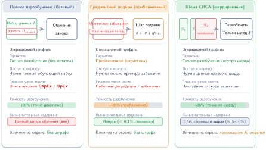
***Стратегии обновления модели:** три подхода к удалению влияния точки данных. Полное переобучение дает точное разобучение по самой высокой цене; градиентный подъем дает приближенное обновление за счет максимизации потерь на множестве забывания; обучение SISA делит данные на шарды, так что переобучается только затронутый шард. Сопутствующая модель стоимости количественно описывает случаи полного переобучения и SISA.*

Различие между переобучением и разобучением становится критичным в системах с жесткими ограничениями по задержке, вычислениям или приватности, поскольку допущения, лежащие в основе полного переобучения, редко выполняются на практике. Многие развернутые системы машинного обучения не хранят сырые обучающие данные из-за требований безопасности, соответствия или стоимости. В таких условиях полное переобучение часто непрактично и операционно разрушительно, особенно когда удаление данных должно быть проверяемым, повторяемым и готовым к аудиту.

Машинное разобучение призвано устранить это ограничение, удаляя влияние отдельных точек данных из уже обученной модели без ее полного переобучения. Эту задачу впервые формализовали Cao и Yang (2015): они предложили общий подход, который преобразует алгоритмы обучения в суммарную форму и позволяет эффективно удалять влияние данных, переобучая лишь составные модели, содержащие целевую информацию, а не всю модель. Подходы, представленные формулировкой Cao и Yang, а также схемой шардирования, изоляции, нарезки и агрегации (SISA), приближают это поведение, корректируя внутренние параметры, модифицируя пути градиентов или изолируя и обрезая компоненты модели, так что получаемые предсказания отражают то, что было бы выучено без удаленных данных (Bourtoule et al., 2021). Эти методы могут требовать упрощенных архитектур моделей, дополнительных метаданных отслеживания или компромиссов по точности и стабильности модели. Они также создают новые трудности с верификацией: как доказать, что удаление произошло в содержательном смысле, особенно когда внутреннее состояние модели не полностью интерпретируемо.


*Разобучение SISA дешевле полного переобучения примерно в 100 раз.*

> **Сценарий: цена забывания**
>
> Пользователь вызывает статью 17 GDPR («право на стирание») для модели, обученной на 1 ТБ данных.
>
> **Базовый вариант (полное переобучение)**: в этом сценарии оценки модель масштаба GPT-3 с 175 млрд параметров переобучается на 1024 GPU NVIDIA A100 (80 ГБ SXM4) примерно 34 дня при стоимости около \$4,6 млн. Расчет предполагает плотную производительность FP16 $R_{\text{peak}} =$ 312 на ускоритель и утилизацию FLOPs модели (MFU) $\eta_{\text{MFU}} \approx 32\%$.
>
> **Инженерное решение**: SISA делит данные на $K =$ 100 независимых шардов и обучает 100 подмоделей. Чтобы удалить одну запись, переобучается только тот шард, в котором она находится (1 процент данных). Новая стоимость: \$46 000. Время: примерно 8,2 часа.
>
> **Компромисс**: точность падает на 3–7 процентов, потому что каждая подмодель видит меньше данных. Инференс замедляется, поскольку предсказания нужно агрегировать по 100 подмоделям. Выигрыш реален, но ограничен по частоте. SISA уменьшает единицу переобучения с целой модели до одного шарда, поэтому схема окупается лишь пока ежедневные запросы на стирание заметно меньше 100, то есть числа шардов. При 1000 запросах в день, как в этом сценарии, ежедневный пакет затрагивает практически все шарды, и стоимость снова сходится к стоимости полного переобучения. Шардирование дает разрешимое разобучение при редких запросах на стирание ценой качества модели; оно не делает непрерывное стирание дешевым.

Мотивацию для машинного разобучения подкрепляют регуляторные рамки. Права на удаление или стирание данных по законам вроде GDPR, CCPA и аналогичным актам в других юрисдикциях могут создавать давление, требующее учитывать персональные данные, использованные при обучении (GDPR, 2016; CCPA, 2023). Машинное разобучение — техническая стратегия уменьшения или удаления влияния удаленной записи там, где состояние модели само может хранить персональные данные. Однако юридические требования зависят от контекста и не являются универсальной нормой, обязывающей переобучать каждую модель. Громкие инциденты, в которых генеративные модели воспроизводили персональный или защищенный авторским правом контент, подчеркивают практическую срочность внедрения механизмов, учитывающих удаление, в ответственный системный дизайн.

С системной точки зрения машинное разобучение предъявляет нетривиальные архитектурные и эксплуатационные требования. Системы должны отслеживать происхождение данных, включая то, какие точки данных внесли вклад в данную версию модели. Для этого часто нужны структурированный сбор метаданных и инструментирование конвейера обучения. Кроме того, системы должны поддерживать пользовательские процессы удаления, включая аутентификацию, отправку запроса и обратную связь о статусе удаления. Верификация может потребовать ведения версионированных реестров моделей, а также механизмов подтверждения того, что обновленная модель не сохраняет остаточного влияния удаленных данных. Эти операции должны охватывать хранилище данных, оркестрацию обучения, развертывание моделей и инфраструктуру аудита, а также быть устойчивыми к сбоям и откатам.

Ресурсно ограниченные развертывания усиливают эти трудности. Системы TinyML обычно работают на устройствах без постоянного хранилища, без связи и с сильно сжатыми моделями. После развертывания их нельзя обновить или переобучить в ответ на запросы на удаление. В таких условиях машинное разобучение фактически невыполнимо после развертывания и должно обеспечиваться на этапе первоначальной разработки модели через статическую минимизацию данных и консервативные стратегии обобщения. Даже в облачных системах, где переобучение более реалистично, разобучение должно учитывать распределенные конвейеры обучения, репликацию между сервисами и сложность синхронизации удаления между снимками моделей и журналами.

Машинное разобучение становится важным для ответственного проектирования систем несмотря на эти трудности. По мере того как системы машинного обучения становятся более встроенными, персонализированными и адаптивными, способность отозвать влияние обучения становится центральной для поддержания доверия пользователей и выполнения правовых требований. Важно, что разобучение нельзя добавить постфактум, после развертывания. Его нужно учитывать на этапах проектирования архитектуры и политик, встраивая в систему с самого начала поддержку отслеживания происхождения, оркестрации переобучения и продвижения развертывания.

Машинное разобучение знаменует сдвиг в мышлении о приватности: от защиты того, какие данные собираются, к контролю над тем, как долго эти данные продолжают влиять на поведение системы. Такая ориентированная на жизненный цикл перспектива вводит новые задачи для дизайна моделей, планирования инфраструктуры и соответствия регулированию, одновременно создавая основу для систем машинного обучения, которыми пользователи могут управлять и которые прозрачны и адаптивны. Ответственные системы ИИ также должны сохранять надежное поведение в сложных условиях, включая целенаправленные атаки.


### Устойчивость к состязательным атакам

<a id="sec-responsible-ai-adversarial-robustness-bc7c"></a>

[Глава «Надежный ИИ»](14_robust_ai.md#sec-robust-ai) описывает модели атак, оценки устойчивости, состязательное обучение, сертификацию, тесты на искажения, обнаружение дрейфа и механизмы воздержания. Управление использует эти механизмы через интерфейс доказательств. Вопрос ответственного ИИ состоит не в том, какую атаку или защиту реализовать, а в том, есть ли у заявления об устойчивости ограниченная рабочая область, доказательства, соответствующие модели угроз, подотчетный владелец и правило, которое аннулирует одобрение.

Заявление об устойчивости должно указывать защищаемую задачу и популяцию, знания и возможности атакующего, множество возмущений или искажений, распределение для оценки, версии модели и предобработки, ограничения по качеству и задержке, поведение при откате и известные исключения. Эмпирические результаты атак показывают наблюдаемые сбои при заданном протоколе тестирования; они не устанавливают устойчивость к адаптивным или не проверенным атакам. Сертификат доказывает свойство только для заявленной нормы, радиуса, уровня доверия и конфигурации модели; он не устанавливает безопасность сквозного рабочего процесса. Управление фиксирует эти границы, чтобы узкий результат нельзя было превратить в общее утверждение о безопасности.

Комплект доказательств должен также связывать поведение модели с действием системы. Он определяет, кто владеет заявлением об устойчивости, какая команда может остановить обслуживание, как направляются воздержания и случаи низкой уверенности, какая телеметрия фиксирует отход от одобренной рабочей области и как инцидент доходит до затронутых пользователей и операторов последующих систем. Откат, который нельзя выполнить в пределах срока принятия решения, не является эффективным средством контроля, а монитор без полномочий на откат не является эксплуатационной защитой.

Одобрение истекает, когда материально меняются модель угроз, модель, предобработка, датчик, распределение данных, доступ к инструментам, среда развертывания или путь отката. Правило аннулирования должно указывать, какое изменение запускает полную оценку красной командой, какое допускает более узкий регрессионный набор, а какое требует ограниченной эксплуатации, пока доказательства восстанавливаются. Этот контракт владения и аннулирования и есть вклад управления: он превращает механизмы устойчивости из [главы «Надежный ИИ»](14_robust_ai.md#sec-robust-ai) в проверяемое заявление, которое остается ограниченным во времени.

### Методы валидации

<a id="sec-responsible-ai-validation-approaches-6966"></a>

Если обнаружение выявляет проблему, а смягчение пытается ее исправить, **валидация** предоставляет доказательства для этапа оценки и обеспечения доверия, описанного в [таблице «Жизненный цикл управления и обеспечения доверия»](#tbl-governance-assurance-lifecycle). Валидация — не отдельный столп и не заявление о том, что система безопасна. Она проверяет ограниченные требования и фиксирует остаточную неопределенность для органа, принимающего решение о запуске. Разным заинтересованным сторонам нужны разные доказательства: разработчикам нужна диагностика, аудиторам — воспроизводимые статистические анализы, регуляторам могут требоваться артефакты соответствия, а затронутым пользователям — понятные причины и работающий путь оспаривания решения. Набор доказательств может включать аудиты справедливости, проверки учета приватности, тесты устойчивости и дрейфа распределения, проверки верности объяснений и триггеры повторной валидации, привязанные к существенным изменениям.

Инженерная стоимость такой строгой валидации значительна. Всеобъемлющий режим, включающий аудиты справедливости, тестирование состязательной устойчивости и проверку объяснимости, заметно растягивает фазу оценки модели. Инвестиции оправданы тем, куда они переносят стоимость: проблемы, выявленные при валидации до развертывания, исправляются до выпуска, тогда как те же проблемы в производстве требуют исправления на порядки дороже, поскольку развернутый дефект справедливости или безопасности нужно обнаружить, откатить на всем парке и объяснить пользователям и регуляторам, а не исправить в блокноте. Поэтому валидация — не *разовый шлюз*, а *непрерывный процесс*. Модель, прошедшая первичную валидацию, может перейти к несоответствию по мере сдвига распределений данных, поэтому в конвейере развертывания нужны автоматические триггеры повторной валидации (см. [главу «Эксплуатация ML-систем в масштабе»](12_ops_scale.md#sec-ops-scale)).

[Таблица «Доказательства валидации по классам риска»](#tbl-responsible-ai-validation-evidence) суммирует комплект доказательств по классам риска. Таблица не является отдельным чек-листом; это способ сделать остаточный риск явным до развертывания.

<a id="tbl-responsible-ai-validation-evidence"></a>

***Доказательства валидации по классам риска:** ответственная валидация сочетает несколько видов доказательств, поскольку никакая единственная метрика не доказывает, что систему безопасно развертывать. Каждому классу риска нужны измеримый артефакт и операционный владелец.*

| **Класс риска** | **Артефакт доказательства**                                   | **Операционный владелец**                       |
|:----------------|:--------------------------------------------------------------|:------------------------------------------------|
| Справедливость  | Дезагрегированные метрики, пороги, доверительные интервалы    | Владелец продукта и рецензент по модельному риску |
| Приватность     | Бюджет приватности, свидетельства удаления, журналы хранения и доступа | Команды управления данными и инженерии приватности |
| Устойчивость    | Тесты на дрейф, тесты на искажения, канареечные проверки, зонды группы красной команды | Команды ML-платформы и реагирования на инциденты |
| Объяснимость    | Тесты верности, проверки стабильности, документация по средствам обжалования | Команда модели и операции для пользователей |
| Управление      | Запись об утверждении, владелец остаточного риска, триггер повторной валидации | Экспертный совет или ответственный орган запуска |

Объяснение может быть наглядной и вычислительно затратной формой доказательств валидации. Метрики справедливости характеризуют совокупные диспропорции при выбранных определениях, тогда как локальные методы объяснения характеризуют влияния, чувствительности или контрастные альтернативы для конкретного выхода. Ни одно из них не дает общей гарантии, и атрибуция не может доказать, что решение было обосновано. Вместе с поведенческими тестами, происхождением данных, документацией и возможностью оспаривания эти артефакты помогают операторам исследовать, опиралось ли решение на неподобающие сигналы, а затронутым пользователям — сформулировать возражение.


## Объяснимость и интерпретируемость

<a id="sec-responsible-ai-explainability-interpretability-8d06"></a>

Кредитный сотрудник, работающий с традиционной системой на правилах, может указать правило, которое привело к отказу: «Отношение долга к доходу превышает 40 процентов». Нейронная сеть же выдает оценку через множество взаимодействующих операций, и ни одно отдельное правило не дает обоснования решения. Объяснимость и интерпретируемость дают ограниченные доказательства о поведении модели, такие как влияние признаков, чувствительность, репрезентативные примеры или контрфактические изменения. Эти доказательства могут поддержать расследование и коммуникацию, но становятся обоснованием только тогда, когда организация связывает их с действующей политикой решений, а возможностью исправить решение (recourse) — только тогда, когда пользователь может совершить осуществимое действие, которое система учтет.

Доказательства в виде объяснений играют роль в валидации систем, анализе ошибок, расследовании инцидентов, коммуникации с пользователями и в некоторых процессах соответствия. В областях с высокими ставками, таких как здравоохранение, финансовые услуги и автономные системы принятия решений, методы объяснения могут порождать гипотезы о ложных корреляциях, которые инженеры обязаны проверить независимо. Например, анализ значимости или чувствительности может показать, что диагностическая модель реагирует на артефакты изображения, а не на медицинские признаки; тогда контролируемая оценка должна определить, является ли эта зависимость причинной и операционно значимой. Для квалифицирующих автоматизированных решений по правилам доступа и уведомления в духе GDPR системы могут быть обязаны предоставлять содержательную информацию о применяемой логике, что подкрепляет потребность в систематической поддержке объяснений, документации и возможности оспаривания.

> **Случай из практики: Apple Card. Системная реконструкция спорных решений (2019)**
>
> **Контекст**: в 2019 году Apple и Goldman Sachs столкнулись с острым общественным вниманием, когда клиенты сообщили, что получили кредитные лимиты в 10 раз выше, чем у их супругов, несмотря на совместную подачу налоговых деклараций и сопоставимые кредитные рейтинги (NYDFS, 2021).
>
> **Граница доказательств**: публичные данные фиксируют жалобы, последующее расследование и выводы регулятора, но не раскрывают целевую задержку конвейера андеррайтинга, внутреннюю архитектуру объяснений или более поздние изменения платформы. Поэтому ниже приведенная системная картина является явной реконструкцией, а не описанием реализации Apple или Goldman Sachs.
>
> **Реконструированный механизм**: сервис андеррайтинга с низкой задержкой, который возвращает только лимит и обобщенную причину неблагоприятного решения, не позволяет сотрудникам поддержки проверить снимок решения, отличить ошибки данных от эффектов политики или передать спорный результат рецензенту. Недостающий интерфейс шире, чем атрибуция признаков: он включает версионированное происхождение входных данных, версии политики и модели, причины, соответствующие процессу принятия решения, состояние апелляции и полномочия на исправление ошибки.
>
> **Наблюдаемые последствия**: Департамент финансовых услуг штата Нью-Йорк не нашел нарушений законодательства о справедливом кредитовании в ходе расследования, однако жалобы все равно выявили сбой доверия и возможности оспаривания: клиенты и сотрудники первой линии не получили удовлетворительного объяснения того, как видимо несогласованные результаты могут быть пересмотрены (NYDFS, 2021).
>
> **Системный вывод**: системам принятия решений с высокими ставками нужен интерфейс оспаривания, а не только API атрибуции. Обоснованная архитектура сохраняет доказательства, необходимые для аудита, на момент решения, формирует подходящие причины, не выдавая атрибуцию за причинность, направляет апелляции уполномоченному человеку, фиксирует исправления и тестирует весь рабочий процесс в рамках его ограничений по задержке и хранению.

Методы объяснимости можно широко классифицировать по тому, когда они работают и как связаны со структурой модели. **Апостериорные методы** (post-hoc) применяются после обучения, но они необязательно являются методами «черного ящика». Агностичные к модели подходы, такие как LIME (Ribeiro et al., 2016) и KernelSHAP, могут работать через запросы к модели, тогда как входные градиенты, интегрированные градиенты[^fn-integrated-gradients-attribution] (Sundararajan et al., 2017) и GradCAM[^fn-gradcam-visual-explanation] (Selvaraju et al., 2017) требуют доступа к дифференцируемой модели, к градиентам или внутренним активациям. Другие реализации SHAP (Lundberg и Lee, 2017) могут использовать структуру модели. Sundararajan и соавторы ввели интегрированные градиенты, выделив две фундаментальные аксиомы, которым должны удовлетворять методы атрибуции, — чувствительность и инвариантность к реализации, — и показав, что большинство прежних методов нарушало эти свойства.

[^fn-integrated-gradients-attribution]: **Интегрированные градиенты**: метод атрибуции, который интегрирует градиенты вдоль пути от базового входа к реальному входу. В отличие от обычных градиентов, он удовлетворяет двум аксиомам (чувствительности и инвариантности к реализации), которые гарантируют, что атрибуции меняются, когда признаки важны, и остаются согласованными для функционально эквивалентных моделей (Sundararajan et al., 2017). Стоимость выше, чем у одного объяснения по сырому градиенту, поскольку метод вычисляет модель в нескольких точках пути от базового входа до входа, обычно в 50–300 дискретных шагах, поэтому он лучше подходит для ограниченных бюджетов объяснения, чем для каждого предсказания в реальном времени.

[^fn-gradcam-visual-explanation]: **GradCAM (Gradient-Weighted Class Activation Mapping)**: Selvaraju et al. (2017) обобщили Class Activation Mapping на любую архитектуру сверточной нейронной сети (CNN), используя градиенты, текущие в последний сверточный слой, для построения карт пространственной важности. Поскольку метод переиспользует вычисление градиентов, GradCAM может быть значительно дешевле методов объяснения, требующих многочисленных возмущений, но то, подходит ли он для медицинской визуализации или конвейеров автономных автомобилей в реальном времени, зависит от модели, аппаратуры, размера батча и бюджета частоты объяснений.

Апостериорные подходы широко используются в областях изображений и табличных данных, где объяснения можно представить как карты значимости или ранжирование признаков. Чтобы показать, как атрибуция SHAP работает на практике, рассмотрим обученную модель случайного леса, которая предсказывает одобрение кредита ($\text{approve}=1$, $\text{deny}=0$) по трем признакам: `income`, `debt_ratio` и `credit_score`. Для конкретного заявителя, которому отказано, с доходом \$45 000, отношением долга к доходу 0,55 (55 процентов дохода уходит на долг) и кредитным рейтингом 620 модель предсказывает отказ с вероятностью 0,92. Значения SHAP, основанные на значениях Шепли из теории кооперативных игр, измеряют вклад каждого признака в сдвиг предсказания от базового уровня (среднего предсказания по всем обучающим данным, $\Pr(\text{approve}) = 0.50$) к этому индивидуальному предсказанию.

Фреймворк SHAP[^fn-shapley-value-attribution] вычисляет вклад каждого признака, оценивая модель на всех возможных подмножествах признаков. Начиная от базового предсказания 0,50, добавление дохода (\$45 тыс., немного ниже среднего) снижает вероятность одобрения на 0,05.

[^fn-shapley-value-attribution]: **Значения Шепли**: из теории кооперативных игр; значения Шепли справедливо распределяют выигрыш между участниками на основе предельных вкладов по всем возможным порядкам. В объяснимости ML признаки — это «игроки», а предсказание — «выигрыш». Математические гарантии (эффективность, симметрия, нулевой игрок) делают SHAP широко используемой рамкой атрибуции с ясной аксиоматической основой, но полный перебор подмножеств растет как $2^n$ для $n$ признаков, поэтому производственные системы часто опираются на алгоритмы для конкретных моделей, приближения выборкой, кэширование или асинхронные пути объяснения (Lundberg и Lee, 2017).

Добавление `debt_ratio` (0,55, высокое значение) снижает моделируемую вероятность одобрения еще на 0,25 относительно фонового распределения SHAP. Добавление `credit_score` (620) снижает ее на 0,12. Аддитивный учет дает $0.50 - 0.05 - 0.25 - 0.12 = 0.08$, что соответствует $\Pr(\text{deny}) = 0.92$. При такой настройке атрибуции отношение долга к доходу имеет наибольший назначенный вклад в выход, за ним следуют кредитный рейтинг и доход. Этот порядок является гипотезой о чувствительности модели при выбранном фоновом распределении, а не доказательством того, что отношение долга к доходу вызвало решение или что снижение его ниже 40 процентов изменило бы результат. Заявление о возможности исправления требует отдельно проверенного контрфактического сценария, который учитывает зависимости признаков, неизменяемые атрибуты, осуществимые действия пользователя и политику решений, которая будет применяться, когда пользователь вернется.

Однако такая строгость имеет значительную вычислительную цену. Этот пример с тремя признаками требует оценки $2^3 = 8$ подмножеств признаков. Для модели с 20 признаками точный перебор требует $2^{20} \approx 1$ млн оценок подмножеств. Реализации SHAP для деревьев используют структуру модели, чтобы свести это к полиномиальному времени, но модели глубокого обучения обычно требуют алгоритмов приближения (KernelSHAP, DeepSHAP) с оценкой на основе выборки. Хотя SHAP дает теоретически обоснованную аддитивную атрибуцию признаков, которая удовлетворяет желательным свойствам (локальная точность, свойство отсутствия (missingness), согласованность), эти издержки делают его непрактичным для объяснения в реальном времени в системах с высокой пропускной способностью без приближения, кэширования или асинхронных стратегий обслуживания.

Другой апостериорный подход — **контрфактические объяснения**[^fn-counterfactual-recourse-explanation], которые оценивают, как выход модели изменится при заданных модификациях входа. Они релевантны для приложений, ориентированных на решения, таких как кредитные или кадровые системы, но математическое изменение выхода само по себе не является возможностью исправления. Полезный контрфактический сценарий должен различать изменяемые и неизменяемые признаки, сохранять доменные ограничения и зависимости признаков, указывать действие, находящееся под контролем пользователя, и оставаться действительным при будущей политике решений организации (Wachter et al., 2017). Поэтому генерация и валидация контрфактических сценариев требуют доменных моделей, версионирования политик и операционных обязательств в дополнение к оптимизации с ограничениями.

[^fn-counterfactual-recourse-explanation]: **Контрфактические объяснения**: сформулированы для ML в работе Wachter et al. (2017). Контрфакты отвечают на вопрос, как моделируемый выход отличался бы при заданном изменении входа, а не объясняют, почему решение было принято. Контрфакт поддерживает возможность исправления только тогда, когда изменение осуществимо, находится под контролем человека, согласуется с доменными ограничениями и соблюдается действующей политикой решений. Генерация кандидатов требует оптимизации с ограничениями; валидация возможности исправления дополнительно требует владения политикой, тестирования стабильности и мониторинга изменений, которые делают обещанное действие недействительным.


Третий класс техник опирается на объяснения на основе концептов, которые пытаются выровнять выученные признаки модели с понятными человеку концептами. Например, тестирование с помощью векторов активации концептов представляет определенные пользователем концепты как векторы активации и проверяет, насколько чувствительны предсказания модели к этим концептам в ее внутреннем представлении (Kim et al., 2018). Эти методы особенно полезны в областях, где эксперты предметной области ожидают объяснений в знакомых смысловых терминах. Однако они требуют обучающих данных с аннотациями концептов или вспомогательных моделей для распознавания концептов, что добавляет инфраструктурные зависимости.

Хотя апостериорные методы гибки и широко применимы, у них есть ограничения. Поскольку они аппроксимируют рассуждение задним числом, они могут выдавать правдоподобные, но вводящие в заблуждение обоснования. Их эффективность зависит от гладкости модели, структуры входных данных и верности объяснительной техники. Эти методы чаще всего полезны для исследовательского анализа, отладки или сводок для пользователей, но не как окончательное описание внутренней логики.

Напротив, **внутренне интерпретируемые модели** (Inherently Interpretable Models) прозрачны по своей конструкции. К ним относятся деревья решений, списки правил, линейные модели с ограничениями монотонности и классификаторы k ближайших соседей. Эти модели непосредственно раскрывают структуру своих рассуждений, позволяя заинтересованным сторонам прослеживать предсказания через набор интерпретируемых правил или сравнений. В регулируемых или критически важных для безопасности областях, таких как прогнозирование рецидивов или медицинская сортировка пациентов, внутренне интерпретируемые модели могут предпочитаться даже ценой некоторой точности (Rudin, 2019). Однако эти модели, как правило, плохо масштабируются на данные высокой размерности или неструктурированные данные, а их простота может ограничивать качество в сложных задачах.

[Рисунок «Спектр интерпретируемости модели»](#fig-vol2-interpretability-spectrum) показывает относительную интерпретируемость разных типов моделей вдоль спектра: деревья решений и линейная регрессия обеспечивают прозрачность по своей конструкции, тогда как более сложные архитектуры, такие как нейронные сети и сверточные модели, требуют внешних техник для объяснения своего поведения. Это различие имеет ключевое значение при выборе подходящей модели для конкретного приложения, особенно в условиях, где существенны регуляторный контроль или доверие заинтересованных сторон.

<a id="fig-vol2-interpretability-spectrum"></a>

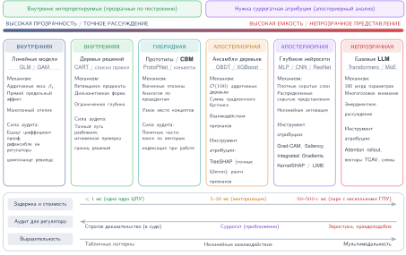
***Спектр интерпретируемости модели:** внутренне интерпретируемые модели, такие как линейная регрессия и деревья решений, дают прозрачные рассуждения, тогда как сложные модели вроде нейронных сетей требуют апостериорных техник объяснения для понимания своих предсказаний. Это различие направляет выбор модели в зависимости от потребностей приложения, отдавая приоритет прозрачности в регулируемых областях или там, где важно доверие заинтересованных сторон.*

Гибридные подходы стремятся объединить выразительную способность глубоких моделей с прозрачностью интерпретируемых компонентов. Например, модели с узким местом концептов (concept bottleneck models) сначала предсказывают промежуточные интерпретируемые переменные, а затем используют простой классификатор для окончательного предсказания (Koh et al., 2020). Модели ProtoPNet классифицируют примеры, сравнивая их с выученными прототипами, предлагая пользователям визуальные аналогии для понимания предсказаний (Chen et al., 2019). Такие гибридные методы привлекательны в областях, требующих частичной прозрачности, но они вносят новые соображения системного дизайна, например необходимость хранить и индексировать выученные прототипы и выводить их на поверхность во время инференса.

Работы вроде Olah et al. (2020) и Geiger et al. (2021) применяют **механистическую интерпретируемость** (Mechanistic Interpretability) для обратного инжиниринга внутренних операций нейронных сетей. Это направление, вдохновленное анализом программ и нейронаукой, пытается сопоставить нейроны, слои или паттерны активаций с конкретными вычислительными функциями. Многие примеры сосредоточены на больших базовых моделях, где традиционных инструментов интерпретируемости недостаточно, но системная обязанность шире: инструментирование, хранение и каузальные тесты должны делать внутренние механизмы аудируемыми.

С системной точки зрения объяснимость создает ряд архитектурных зависимостей. Объяснения должны генерироваться, храниться, выводиться и оцениваться в рамках системных ограничений. Необходимая инфраструктура может включать API объяснений, память для хранения карт атрибуции, библиотеки визуализации и механизмы логирования, которые фиксируют промежуточное поведение модели. Модели часто нужно инструментировать хуками или настраивать так, чтобы они поддерживали повторные вычисления, особенно для методов объяснения, требующих выборки, возмущений или обратного распространения.

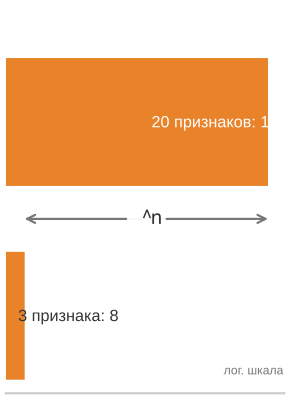
*Точная стоимость SHAP растет вместе с числом признаков.*

Эти требования напрямую взаимодействуют с ограничениями развертывания и создают затраты производительности, которые нужно учитывать при проектировании системы. SHAP и LIME могут требовать повторных вычислений модели, выборки возмущений, подгонки суррогатов или перебора подмножеств, тогда как контрфактические методы требуют оптимизации с ограничениями (Lundberg и Lee, 2017; Ribeiro et al., 2016; Wachter et al., 2017). В производственных развертываниях эти издержки переходят в конкретные архитектурные решения: объяснениям могут понадобиться асинхронные воркеры, выборочная частота объяснений, кэширование или отдельные модели, выбранные частично ради интерпретируемости.

Для сред с ограниченными ресурсами методы атрибуции на основе градиентов предлагают более эффективные альтернативы, переиспользуя инфраструктуру обратного распространения из обучения. Однако эти методы менее надежны для сложных моделей и могут давать несогласованные объяснения при обновлениях модели. Развертывания на границе часто реализуют объяснимость через предвычисленные аппроксимации правилами или упрощенные границы решений, жертвуя верностью объяснения ради приемлемых профилей задержки.

Требования к хранению также существенно растут вместе с потребностями в объяснениях. Хранение значений SHAP для табличных данных требует примерно 4–8 байт на признак на каждое предсказание, поэтому месячный объем равен 30 миллионам предсказаний, умноженным на число признаков и на 4–8 байт, для системы, которая логирует 1 миллион предсказаний в день. Карты градиентной атрибуции для изображений могут занимать от 1 до 10 МБ на объяснение в зависимости от разрешения; логирование каждого объяснения изображения с той же скоростью, 1 миллион в день, потребовало бы примерно 30–300 ТБ в месяц, если только объяснения не выбираются, не сжимаются или не хранятся в течение более короткого окна. Такие объемы требуют тщательного управления жизненным циклом данных и политик хранения.

Объяснимость охватывает весь жизненный цикл машинного обучения. На этапе разработки инструменты интерпретируемости используются для аудита наборов данных, валидации концептов и ранней отладки. Во время инференса они поддерживают подотчетность, проверку решений и коммуникацию с пользователями. После развертывания объяснения могут логироваться, выводиться в аудитах или запрашиваться при расследовании ошибок. Проектирование системы должно поддерживать каждую из этих фаз, обеспечивая интеграцию инструментов объяснения во фреймворки обучения, инфраструктуру обслуживания моделей и пользовательские приложения.

Техники сжатия и оптимизации также влияют на объяснимость. Обрезка, квантизация и архитектурные упрощения, часто применяемые в TinyML или мобильных средах, могут искажать внутренние представления или отключать поток градиентов, снижая надежность объяснений на основе атрибуции. В таких случаях интерпретируемость нужно валидировать после оптимизации, чтобы убедиться, что она остается осмысленной и заслуживающей доверия. Если качество объяснений важно, эти преобразования следует рассматривать как часть пространства проектных ограничений.

Поэтому объяснимость занимает то же место, что и остальные свойства главы: это инфраструктура пути обслуживания, закладываемая в бюджет, а не функция, добавляемая после того, как модель уже работает. Проектирование для интерпретируемости требует внимательных решений о том, кому нужны объяснения, какие объяснения осмысленны и как их можно доставить с учетом бюджета системы по задержке, вычислениям и интерфейсу. По мере того как машинное обучение встраивается в важные рабочие процессы, способность объяснять становится основным требованием к безопасным, заслуживающим доверия и подотчетным системам.

Социотехнические проблемы объяснимости сосредоточены на разрыве между техническими объяснениями и человеческим пониманием. Алгоритмы могут генерировать атрибуции признаков и карты градиентов, но заинтересованным сторонам часто нужны объяснения, которые соответствуют их ментальным моделям, экспертизе в предметной области и процессам принятия решений. Радиологу, который проверяет диагноз, сформулированный ИИ, нужны объяснения, ссылающиеся на медицинские концепты и визуальные паттерны, а не на абстрактные активации нейронной сети. Эта задача перевода требует постоянного сотрудничества технических команд с экспертами предметной области, чтобы разрабатывать форматы объяснений, которые одновременно технически точны и практически осмысленны. Объяснения могут формировать человеческие решения неожиданными способами, создавая новые обязанности в отношении того, как представляется и интерпретируется объяснительная информация. Поскольку объяснения являются доказательствами, а не управляющими действиями, они должны питать систему мониторинга, которая выявляет, когда ответственное поведение меняется после развертывания.


### Мониторинг производительности модели

<a id="sec-responsible-ai-model-performance-monitoring-0ab2"></a>

Оценки на этапе обучения, каким бы строгим ни был их характер, не гарантируют надежной производительности модели после развертывания системы. Реальная среда динамична: распределения входных данных смещаются из-за сезонности, поведение пользователей меняется в ответ на выходы системы, а контекстные ожидания меняются вместе с политикой или регулированием. Эти факторы могут со временем ухудшать предсказательную способность и доверие к системе. Модель, которая хорошо работает в условиях обучения или валидации, все равно может принимать ненадежные или вредные решения в производстве.

Последствия такого дрейфа выходят за рамки сырой точности. Гарантии справедливости могут нарушиться, если распределения подгрупп сместятся относительно обучающей выборки или если признаки, которые раньше коррелировали с исходами, станут ненадежными в новых контекстах. Требования к интерпретируемости также могут меняться, например когда новые группы заинтересованных сторон ищут объяснения или когда регуляторы вводят новые требования к прозрачности. Поэтому доверие — не статическое свойство, которое задается на этапе обучения, а динамический атрибут системы, формируемый контекстом развертывания и операционной обратной связью.

Чтобы обеспечить ответственное поведение во времени, системы машинного обучения должны включать механизмы непрерывного мониторинга, оценки и корректирующих действий. Мониторинг подразумевает больше, чем отслеживание совокупной точности: он требует выводить метрики производительности по релевантным подгруппам, обнаруживать сдвиги входных распределений, выявлять аномальные выходы и фиксировать содержательную обратную связь пользователей. Эти сигналы затем нужно сравнивать с заранее заданными ожиданиями относительно справедливости, устойчивости и прозрачности и связывать с действенными системными реакциями, такими как переобучение модели, перекалибровка или откат.

Эффективный мониторинг зависит от надежной инфраструктуры. Системы должны логировать входы, выходы и контекстные метаданные структурированным и защищенным образом, питая непрерывный конвейер наблюдаемости ([рисунок «Конвейер мониторинга справедливости»](#fig-monitoring-pipeline)).

<a id="fig-monitoring-pipeline"></a>

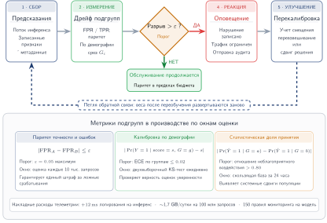
***Конвейер мониторинга справедливости:** сквозная наблюдаемость развернутых моделей. Предсказания модели подаются на вычисление метрик по подгруппам демографических сегментов; проверка порогов выявляет регрессии качества или справедливости, а оповещения запускают автоматическое переобучение или ручной просмотр. Эта непрерывная петля обратной связи поддерживает свойства ответственного ИИ после развертывания.*

Для этого нужны конвейеры телеметрии, которые фиксируют версию модели, характеристики входов, уверенность предсказаний и обратную связь после инференса. Эти логи поддерживают обнаружение дрейфа и служат доказательствами для ретроспективных аудитов справедливости и устойчивости. Системы мониторинга также должны интегрироваться с оповещениями, планированием обновлений и процессами пересмотра политик, чтобы обеспечивать своевременное и прослеживаемое вмешательство.

Мониторинг также поддерживает улучшение, управляемое обратной связью. Например, повторные несогласия пользователей, запросы на исправление или ручные отмены решений оператором могут сигнализировать о проблемном поведении. Такую обратную связь нужно агрегировать, валидировать и превращать в обновления обучающих наборов данных, процессов разметки или архитектуры модели. Однако такие петли обратной связи несут риски: предвзятые ответы пользователей могут внести новое неравенство, а избыточное логирование может нарушить приватность. Проектирование этих петель требует тщательной координации между дизайном пользовательского опыта, безопасностью системы и этическим управлением.

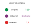
*Мониторинг ответственного ИИ становится собственной производственной системой данных.*

В масштабе глобального производственного парка мониторинг ответственного ИИ становится серьезной задачей инженерии данных. Платформа, обслуживающая примерно 864 миллиона инференсов в день при 10 000 запросов в секунду по 50 различным демографическим подгруппам, должна непрерывно отслеживать не менее 150 метрик (например, долю ложноположительных срабатываний, долю истинно положительных срабатываний и ошибку калибровки для каждой из 50 групп). Даже при частоте выборки 1 процент это порождает 8,64 миллиона событий мониторинга ежедневно. Хранение необходимых метаданных (входов предсказаний, оценок уверенности, истинных меток и чувствительных атрибутов) из расчета скромных 200 байт на запись требует примерно 1,7 ГБ в день, тогда как полное аудиторское логирование может потребовать существенно больше. Такой масштаб создает проблему метамониторинга: сама инфраструктура мониторинга становится сложной распределенной системой, которая должна быть надежной, защищенной и экономически эффективной. При 150 активных метриках иллюстративная вероятность ложной тревоги для одной метрики в 5 процентов дала бы примерно 7,5 ложных оповещений за интервал оценки при допущениях о независимости сценария. Поэтому производственные пороги должны учитывать знаменатели подгрупп, отложенные метки, повторное тестирование, доверительные интервалы, минимально обнаружимые эффекты и поправку на множественные сравнения. Пересечение порога открывает расследование; само по себе оно не доказывает дискриминацию и не оправдывает автоматическое переобучение.

Механизмы мониторинга различаются в зависимости от архитектуры развертывания. В облачных системах богатое логирование и вычислительные мощности позволяют вести телеметрию в реальном времени, проводить плановые аудиты справедливости и непрерывно интегрировать новые данные в конвейеры переобучения. Эти среды поддерживают динамическую перенастройку и централизованное обеспечение политик. Однако объем телеметрии может создавать собственные проблемы по стоимости, рискам приватности и соответствию регулированию.

В мобильных системах связность прерывиста, а объем хранения ограничен. Мониторинг должен быть легковесным и устойчивым к задержкам синхронизации. Локальные системы инференса могут собирать данные о производительности асинхронно и передавать их в агрегированном виде во внутренние системы. Ограничения приватности часто строже, особенно когда персональные данные должны оставаться на устройстве. Эти системы требуют тщательной минимизации данных и методов локальной агрегации, чтобы сохранять приватность и одновременно поддерживать наблюдаемость.

Граничные развертывания, такие как системы автономных автомобилей, умных фабрик или управления в реальном времени, требуют низкой задержки ответов и работают при минимальном внешнем надзоре. Мониторинг в таких системах должен быть встроен в среду выполнения, с внутренними проверками целостности датчиков, уверенности предсказаний и отклонения поведения. Такие проверки часто требуют маломощных реализаций оценки неопределенности, обнаружения аномалий или проверки согласованности. Проектировщики систем должны предвидеть условия отказа и обеспечивать, чтобы аномальное поведение запускало безопасные процедуры отката или вмешательство человека.

Системы TinyML, работающие на глубоко встроенном оборудовании без связи, постоянного хранилища или пути динамического обновления, представляют самый ограниченный сценарий мониторинга. В этих условиях мониторинг должен быть спроектирован и скомпилирован в систему до развертывания. Распространенные стратегии включают проверку диапазонов входов, встроенную избыточность, статическую логику отказоустойчивости или консервативные пороги валидации. После развертывания такие модели работают независимо, и любой сбой может потребовать физической замены устройства или сброса на уровне прошивки.

Основная задача универсальна: развернутые ML-системы должны не только изначально хорошо работать, но и продолжать вести себя ответственно по мере изменения среды. Мониторинг обеспечивает слой наблюдаемости, который связывает производительность системы с этическими целями и структурами подотчетности. Без мониторинга справедливость и устойчивость становятся невидимыми. Без обратной связи рассогласование нельзя исправить. Поэтому мониторинг — это операционная основа, которая позволяет системам машинного обучения оставаться адаптивными, аудируемыми и соответствующими своему назначению во времени.

Раздел о мониторинге замыкает технический цикл: обнаружение смещения, дифференциальная приватность, состязательное обучение и объяснимость дают необходимые возможности для реализации ответственного ИИ, но они также выявляют фундаментальное ограничение. Одной технической корректности недостаточно для гарантии полезных исходов. Рассмотрим три конкретных примера, которые иллюстрируют эту задачу. Система аудита справедливости выявляет расовое смещение в модели одобрения кредитов, но у организации нет процессов для интерпретации результатов или внедрения исправлений. Техническая возможность существует, но организационная инерция мешает устранению проблемы. Дифференциальная приватность сохраняет формальные математические гарантии защиты данных, но пользователи не понимают этих защит и продолжают неуместно делиться чувствительной информацией. Метод приватности работает так, как задумано, но поведенческий контекст подрывает его эффективность. Система объяснимости генерирует технически точные оценки важности признаков, но затронутые люди не могут получить доступ к этим объяснениям или понять их из-за дизайна интерфейса и барьеров грамотности.

Эти примеры показывают, что внедрение ответственного ИИ зависит от согласованности технических возможностей с социотехническим контекстом, организационными стимулами, человеческим поведением, ценностями заинтересованных сторон и структурами институционального управления. Поддержание этой согласованности требует механизмов мониторинга, которые обеспечивают операционную наблюдаемость. Однако появление генеративного ИИ изменило характер сбоев, которые нужно отслеживать.

### Ответственность в эпоху генеративного ИИ

<a id="sec-responsible-ai-responsibility-generative-era-3c3e"></a>

Генеративный ИИ не отменяет базовых забот о справедливости, приватности и объяснимости; он меняет поверхность управления. Вместо того чтобы аудировать только метки или атрибуции признаков, операторы должны управлять промптами, извлеченным контекстом, моделями вознаграждения и открытыми выходами.

Переход от дискриминативной классификации к генеративным большим языковым моделям (LLM) расширяет инженерную поверхность ответственности. Справедливость по-прежнему касается того, как качество, отказы, ошибки, представленность и доступ распределяются между людьми и группами; открытые выходы делают эти величины труднее определить и выбрать на выборке. Выравнивание (alignment) создает отдельную проблему: ограничение стохастических выходов и действий, чтобы они оставались согласованными с намеченными целями и политиками для комбинаторного множества запросов. Производственным системам нужны и оценка справедливости, и поведенческое выравнивание, а не переименование одного в другое. Распространенный механизм выравнивания — многоэтапный процесс, показанный на [рисунке «Конвейер выравнивания RLHF»](#fig-rlhf-pipeline).

<a id="fig-rlhf-pipeline"></a>


***Конвейер выравнивания с обучением с подкреплением на основе обратной связи от человека (RLHF):** шестиэтапный процесс выравнивания генеративных моделей: (1) предобученная базовая модель, (2) контролируемое дообучение (SFT) на демонстрациях, (3) сбор человеческих предпочтений, (4) обучение модели вознаграждения, (5) обучение проксимальной оптимизацией политики (PPO) и (6) итоговая выровненная модель. На рисунке также отмечены стоимость разметки, вычислительные накладные расходы и налог на выравнивание, а также три режима отказа RLHF: взлом вознаграждения, рассогласованные внутренние цели и стремление к власти.*

Типичный конвейер инструктивного дообучения больших языковых моделей в 2022–2024 годах использует обучение с подкреплением на основе обратной связи от человека (RLHF) как социотехнический мост между человеческими предпочтениями и весами модели. Обучение модели вознаграждения на человеческих предпочтениях (в сценарии здесь от 50 000 до 500 000 попарных сравнений по цене от \$0,50 до \$5,00 за метку) превращает выборочные суждения в дифференцируемую целевую функцию. PPO — это этап оптимизации политики, который обновляет модель относительно этой модели вознаграждения, одновременно ограничивая, насколько политика уходит от контролируемой базовой линии. Этот процесс может породить **налог на выравнивание** (Alignment Tax): некоторые метрики возможностей могут ухудшаться, когда оптимизация смещается к целям предпочтений или безопасности, однако направление и величина зависят от модели, данных, целей и набора оценок, а не следуют универсальному проценту. Опора на человеческих оценщиков порождает **разрыв репрезентативности** (Representativeness Gap): если инвестиции в разметку отражают лишь узкий демографический срез, итоговая модель может кодировать предпочтения этой группы и вести себя иначе для других популяций. Constitutional AI предлагает альтернативный инженерный путь, используя явные принципы для направления ИИ-обратной связи о выходах, тем самым меняя, но не устраняя вопросы о том, чьи ценности представлены и как ими управляют.

В архитектурах генерации с дополнением поиском (RAG, см. [главу «Инференс в масштабе»](10_inference.md#sec-inference-scale)) ответственность отделяется от базовой модели. LLM может быть идеально выровнена с помощью обширного RLHF, но все равно генерировать токсичные или предвзятые ответы, если слой поиска выводит загрязненный контекст. Если индекс поиска непропорционально выводит предвзятые исторические документы, модель, обусловленная верностью своему контексту, будет распространять это смещение независимо от своего внутреннего обучения безопасности. Поэтому необходим **фильтр контекста** (Context Filtering) как отдельный инфраструктурный компонент, который проверяет извлеченные фрагменты на токсичность и смещение, прежде чем они попадут в окно контекста генерации.

В большинстве стеков обслуживания LLM **системный промпт** (System Prompt) работает как ранний конфигурационный контроль наряду с фильтрацией поиска, классификаторами политик, телеметрией и шлюзами развертывания. Эти скрытые инструкции (например, «Ты полезный ассистент. Не давай медицинских советов») определяют операционные границы системы. При масштабе 10 000 и более различных конфигураций развертывания управление промптами становится распределенной задачей управления конфигурацией, сходной с распространением весов. Одно неверсионированное изменение системного промпта может незаметно сдвинуть этическую позицию миллионов взаимодействий, поэтому версионирование промптов, **регрессионное тестирование выравнивания** (Alignment Regression Testing) и постепенное развертывание так же критичны для безопасности, как и сам процесс обучения модели (см. [главу «Эксплуатация ML-систем в масштабе»](12_ops_scale.md#sec-ops-scale)).

Вместе системные промпты и выравнивание RLHF действуют как важные, но хрупкие технические барьеры. Когда эти барьеры отказывают, будь то через преднамеренный джейлбрейкинг или тонкие пограничные случаи, которые обходят модель вознаграждения, становится ясно: безопасность ИИ нельзя решить только математикой. Сложная социотехническая динамика между алгоритмом и человеком, который его использует, требует не меньшего внимания.


## Социотехническая динамика

<a id="sec-responsible-ai-sociotechnical-dynamics-4938"></a>

Больница внедрила высокоточную модель прогнозирования сепсиса, но смертность не снизилась. Врачи, перегруженные усталостью от оповещений, просто игнорировали предупреждения модели. Математически безупречная, идеально справедливая и высокообъяснимая модель все равно терпит оглушительный провал в производстве, когда расходится с человеческой психологией, организационными стимулами или операционной реальностью рабочего места.

Технические инструменты предыдущих разделов решали четко определенные задачи: обнаружение смещения, сохранение приватности, генерацию объяснений. Случай с сепсисом обозначает место, где этот набор инструментов заканчивается. Социотехническая инженерия требует иного способа рассуждения: вместо оптимизации целевой функции инженеры анализируют конфликты заинтересованных сторон; вместо настройки гиперпараметров они ориентируются в этических компромиссах; вместо измерения технической производительности оценивают социальное воздействие. Система теперь должна удовлетворять одновременно вычислительным ограничениям и человеческим ценностям, и никакая оптимизация не разрешит конфликт между ними.

Развернутые системы создают петли обратной связи, которые перестраивают среды, моделировать которые они призваны, порождают риски совместной работы человека и ИИ, с которыми не могут справиться ни люди, ни алгоритмы по отдельности, и выявляют конфликты ценностей заинтересованных сторон, которые никакая оптимизация не может удовлетворить. Эти динамики определяют, будут ли внедрения ответственного ИИ успешными на практике.

### Петли обратной связи системы

<a id="sec-responsible-ai-system-feedback-loops-36d7"></a>

Инвариант социотехнической обратной связи (принцип «инвариант социотехнической обратной связи») отражает эту динамику: развернутые модели формируют среду, в которой работают, так что будущие данные $p_{t+1}(X)$ являются функцией прошлых решений модели $f_t(X)$. Здесь $p_t(X)$ обозначает распределение входов, которое система наблюдает в момент $t$, а $f_t(X)$ — развернутую модель или политику решений, действующую на эти входы. Системам нужно **управление с замкнутым контуром** (Closed-Loop Governance): надежность требует моделирования петли обратной связи, а не только прямого инференса.

Системы машинного обучения не просто наблюдают и моделируют мир; они также его формируют. После развертывания их предсказания и решения часто влияют на среды, которые они призваны анализировать. Эта обратная связь меняет будущие распределения данных, модифицирует поведение пользователей и влияет на институциональные практики, создавая рекурсивную петлю между выходами модели и входами системы ([рисунок «Петля усиления смещения»](#fig-bias-amplification)). Со временем такие динамики могут усиливать смещения, закреплять неравенство или непреднамеренно сдвигать цели, которым модель должна была служить.

Хорошо задокументированный пример этого феномена — предиктивная полиция. Когда модель, обученная на исторических данных об арестах, прогнозирует более высокий уровень преступности в определенном районе, правоохранительные органы могут направить туда больше патрулей. Это усиленное присутствие приводит к большему числу зарегистрированных инцидентов, которые затем используются как вход для будущего обучения модели и еще больше подкрепляют ее исходное предсказание. Даже если модель изначально не была предвзятой, ее встраивание в петлю обратной связи порождает самоисполняющийся паттерн, который непропорционально бьет по и без того перепатрулируемым сообществам.

Рекомендательные системы демонстрируют сходную динамику в цифровой среде. Модель рекомендации контента, которая отдает приоритет вовлеченности, может постепенно сужать круг контента, с которым сталкивается пользователь, что приводит к петлям обратной связи, усиливающим прежние предпочтения или поляризующим мнения. Эти эффекты трудно обнаружить обычными метриками производительности, поскольку система продолжает оптимизировать свою целевую функцию обучения, даже расходясь с более широкими социальными или эпистемическими целями.

С системной точки зрения петли обратной связи представляют ключевую проблему для ответственного ИИ. Они подрывают допущение о независимых и одинаково распределенных данных и усложняют оценку справедливости, устойчивости и обобщающей способности. Стандартные методы валидации, которые опираются на статические тестовые наборы, могут не уловить развивающегося влияния модели на порождающий данные процесс. Как только такие петли установились, вмешательства, направленные на улучшение справедливости или точности, могут иметь ограниченный эффект, пока не будут устранены лежащие в основе динамики данных.

Проектирование ответственности при наличии петель обратной связи требует взгляда на системы машинного обучения с точки зрения жизненного цикла. Это подразумевает не только мониторинг производительности модели во времени, но и понимание того, как выходы системы влияют на среду, как эти изменения фиксируются в новых данных и как практики переобучения либо смягчают, либо усиливают эти эффекты.

В облачных системах эти обновления могут происходить часто и в больших масштабах, при обширной телеметрии для обнаружения дрейфа поведения. Напротив, граничные и встроенные развертывания часто работают офлайн или при ограниченной наблюдаемости. Умная домашняя система, которая адаптирует поведение термостата на основе взаимодействий пользователя, может закреплять паттерны потребления энергии или предпочтения комфорта так, что это меняет домашнюю среду и впоследствии влияет на будущие входы модели. Без связи или централизованного надзора такие петли могут остаться незамеченными, несмотря на их влияние и на поведение пользователя, и на производительность системы. Операционные практики мониторинга, включая обнаружение дрейфа, отслеживание производительности и автоматические оповещения, необходимы для выявления и управления такой динамикой обратной связи в производственных системах.

Системы должны быть оснащены механизмами, которые выявляют дрейф распределений, определяют эффекты формирования поведения и поддерживают корректирующие обновления, согласованные с намеченными целями системы. Петли обратной связи не являются по своей природе вредными, но их нужно распознавать и управлять ими. Оставленные без внимания, они создают системный риск; грамотно решенные, они дают обучающимся системам возможность ответственно адаптироваться в сложных динамичных средах.

> **Случай из практики: провал алгоритмической оценки (2020)**
>
> **Контекст**: в августе 2020 года, после отмены экзаменов из-за COVID-19, регулятор квалификаций Англии (Ofqual) применил алгоритм статистической стандартизации, чтобы выставить оценки примерно 280 000 учащимся на экзаменах A-level (Ofqual, 2020a; Ofqual и Department for Education, 2020b).
>
> **Механизм**: чтобы предотвратить глобальную инфляцию оценок по объему набора данных $D_{\text{vol}}$, алгоритм пакетной стандартизации ограничивал распределения предсказанных оценок так, чтобы они совпадали с трехлетним историческим распределением каждой школы. Эта матрица оптимизации с нулевой суммой привела к тому, что 39,1 процента оценок, выставленных преподавателями, были понижены, а приоритет получила историческая дисперсия когорты, а не индивидуальные признаки.
>
> **Последствия**: общественное возмущение по поводу системной несправедливости и протесты учащихся вынудили правительство Великобритании через несколько дней отказаться от алгоритмических результатов и вернуться к нескорректированным оценкам, выставленным центрами.
>
> **Исправление**: правительство Великобритании отменило алгоритм стандартизации и ввело систему апелляций, позволявшую учащимся получить ту из двух оценок, которая выше: выставленную центром или по результатам пробного экзамена.
>
> **Системный вывод**: оптимизация глобальных совокупных метрик по объему набора данных без соблюдения ограничений индивидуальной справедливости создает математически ограниченный проход оптимизации, который в социальном и операционном смысле катастрофичен.


### Совместная работа человека и ИИ

<a id="sec-responsible-ai-humanai-collaboration-205f"></a>

Операторы-люди превращают риск петли обратной связи в задачу совместного контроля. Системы машинного обучения часто развертываются не как самостоятельные агенты, а как компоненты более широких рабочих процессов с участием людей, принимающих решения. Во многих областях, таких как здравоохранение, финансы и транспорт, модели служат инструментами поддержки решений, предлагая предсказания, оценки риска или рекомендации, которые рассматривают и на которые реагируют операторы-люди. Совместная конфигурация поднимает вопросы о том, как ответственность распределяется между людьми и машинами, как калибруется доверие и как механизмы надзора реализуются на практике.

Совместная работа человека и ИИ создает и возможности, и риски. При правильном проектировании системы могут дополнять человеческое суждение, снижать когнитивную нагрузку и повышать согласованность решений. Однако при плохом проектировании они могут привести к **автоматизационному смещению** (automation bias),[^fn-automation-bias-complacency] при котором пользователи чрезмерно полагаются на выходы модели даже при явных ошибках.

[^fn-automation-bias-complacency]: **Автоматизационное смещение**: впервые изучено в авиации в 1990-х годах. Это парадокс, при котором люди полагаются на автоматические системы даже тогда, когда те заведомо ошибаются, и эффект усиливается по мере роста точности системы. При точности модели 70–80 процентов операторы принимают ошибочные выходы с высокой частотой, если им не показаны индикаторы неопределенности. Для систем обслуживания ML это означает, что более высокая точность модели может парадоксально снижать безопасность системы на уровне всего процесса, подавляя человеческий надзор; поэтому требуется намеренное «трение» интерфейса (визуализация неопределенности, обязательное обоснование), которое добавляет задержку, но сохраняет канал человеческой коррекции.

И наоборот, чрезмерное недоверие может привести к **алгоритмическому неприятию** (algorithm aversion), когда пользователи игнорируют полезные предсказания модели из-за недостатка прозрачности или воспринимаемой недостоверности. Эффективность совместных систем зависит не только от производительности модели, но и от того, как система сообщает о неопределенности, предоставляет объяснения и допускает человеческое переопределение или исправление.

Автоматизационное смещение часто подкрепляется институциональными структурами через асимметричную ответственность. В областях с высокими ставками, таких как уголовное правосудие или здравоохранение, люди, принимающие решения, сталкиваются с разными последствиями в зависимости от согласия с алгоритмами. Рассмотрим два сценария. В сценарии A судья отменяет алгоритмическую оценку «высокого риска» и отпускает обвиняемого, который позже совершает повторное преступление. Судья подвергается общественной проверке и возможным карьерным последствиям за «игнорирование науки». В сценарии B судья следует оценке «высокого риска» и без необходимости задерживает обвиняемого. Вина рассеивается, перекладываясь на алгоритм («система так сказала»).

Эта асимметрия создает сильное давление в сторону **институциональной уступчивости** (institutional deference), при которой человеческий надзор превращается в «штамп» для алгоритмических решений, чтобы избежать личной ответственности. Ответственный дизайн ИИ должен явно противодействовать этому, защищая операторов, которые проявляют суждение, и требуя обоснования как согласия, так и несогласия.

Механизмы надзора должны быть адаптированы к контексту развертывания. В областях с высокими ставками, таких как медицинская сортировка (триаж) или автономное вождение, от людей могут ожидать надзора за автоматизированными решениями в реальном времени. Такая конфигурация создает когнитивную и временную нагрузку на оператора и предполагает, что вмешательство произойдет быстро и надежно, когда это понадобится. Однако на практике непрерывный человеческий надзор часто непрактичен или неэффективен, особенно когда оператор должен следить за несколькими системами или не имеет четких критериев для вмешательства.

С точки зрения системного проектирования поддержка эффективного надзора требует большего, чем предоставление доступа к сырым выходам модели. Интерфейсы должны выводить релевантную информацию в нужный момент, в нужном формате и с подходящим контекстом. Оценки уверенности, оценки неопределенности, объяснения и оповещения об изменениях могут играть роль в обеспечении человеческого надзора. Рабочие процессы должны определять, когда и как возможно вмешательство, кто уполномочен переопределять выходы модели и как такие переопределения логируются, аудируются и учитываются в будущих обновлениях системы.

Рассмотрим систему медицинской сортировки в больнице, которая использует модель машинного обучения для определения приоритета пациентов в отделении неотложной помощи. Модель формирует оценку риска для каждого поступающего пациента, которая показывается вместе с предлагаемой категорией сортировки. В принципе медсестра отвечает за подтверждение или переопределение предложения. Однако если выходы модели представлены без достаточного обоснования, например без объяснения вклада признаков или контекста неопределенности, медсестра может положиться на модель даже в пограничных случаях. Со временем выходы модели могут стать де-факто решением сортировки, особенно под давлением времени. Если происходит сдвиг распределения (например, из-за новой болезни или изменения демографии пациентов), у медсестры может не быть ни ситуационной осведомленности, ни поддержки интерфейса, необходимой, чтобы заметить, что модель работает хуже. В таких случаях видимость человеческого надзора маскирует систему, в которой ответственность фактически перешла к модели без четкой подотчетности или возможности исправления.

В таких системах человеческий надзор — не просто вопрос декларации политики, а функция проектирования инфраструктуры: как выводятся предсказания, какая информация сохраняется, как реализуется вмешательство и как петли обратной связи связывают человеческие решения с обновлениями системы. Без интеграции этих компонентов надзор становится фрагментарным, а ответственность может незаметно перейти от человека к машине.

> **Сценарий: парадокс автоматизационного смещения**
>
> Рассмотрим радиологическое отделение, которое внедряет ИИ-ассистента для обнаружения опухолей.
>
> - **Чувствительность человека**: $S_{\text{human}} =$ 92 процента
> - **Чувствительность ИИ**: $S_{\text{AI}} =$ 95 процентов
>
> Можно предположить, что производительность объединенной системы превысит 95 процентов. Однако исследования автоматизационного смещения показывают, что люди принимают ошибочные рекомендации ИИ с частотой 60–80 процентов. Если ИИ ошибается (вероятность $1 - S_{\text{AI}} = 0.05$) и человек слепо принимает ошибку ($\alpha = 0.7$), одни только принятые ошибки ИИ создают вероятность отказа $0.05 \times 0.7 = 0.035$. В этом упрощенном случае верхней границы, где каждая непринятая ошибка ИИ исправляется, чувствительность составляет 96,5 процента; реальные рабочие процессы могут работать хуже, если учесть ошибки человеческого переопределения, ложноположительные срабатывания, утомление и задержки интерфейса.
>
> По мере роста надежности ИИ бдительность человека снижается. Это явление известно как парадокс надежности.
>
> 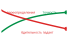
> *Более высокая точность ИИ может парадоксально снижать бдительность человека.*
>
> - При точности ИИ 90 процентов доля переопределений человеком, вероятно, составит $R_{\text{override}} =$ 15 процентов.
> - При точности ИИ 99 процентов $R_{\text{override}}$ падает до $\approx$ 2 процентов.
>
> Оставшиеся 1 процент ошибок почти никогда не выявляются, потому что человек откалибровал свое доверие под «идеальную» машину. Возникает **разрыв калибровки доверия** (Trust Calibration Gap): *чем безопаснее система выглядит, тем опаснее становятся ее редкие сбои.* Ответственный дизайн требует введения трения, то есть заставлять человека обосновывать принятие, чтобы искусственно снизить $\alpha$ и сохранить человека в контуре.

Граница между поддержкой решений и автоматизацией часто размыта. Системы, изначально спроектированные для помощи людям, принимающим решения, могут постепенно брать на себя большую автономию по мере роста доверия или смены организационных стимулов. Такой переход может происходить без явных изменений политики, что приводит к де-факто автоматизации без соответствующих структур подотчетности. Поэтому ответственный дизайн системы должен предвидеть изменения в использовании со временем и обеспечивать, чтобы соответствующие проверки оставались на месте даже по мере роста зависимости от автоматизации.

Совместная работа человека и ИИ требует тщательной интеграции возможностей модели, дизайна интерфейса, операционной политики и институционального надзора. Сотрудничество — это не просто вставка «человека в контуре»; это системная задача, которая охватывает технические, организационные и этические измерения. Проектирование надзора подразумевает встраивание механизмов, которые позволяют вмешиваться, поддерживают обоснованное доверие и обеспечивают совместную ответственность между операторами-людьми и системами машинного обучения.


### Нормативный плюрализм и конфликты ценностей

<a id="sec-responsible-ai-normative-pluralism-value-conflicts-d61f"></a>

Совместная работа человека и ИИ раскрывает более глубокое системное ограничение: разные заинтересованные стороны часто придерживаются конфликтующих ценностей и приоритетов. Реальное развертывание ML-систем заставляет столкнуться с ценностными напряжениями, которые никакой алгоритм не может разрешить. Техническое совершенство необходимо, но недостаточно для доверительного ИИ, потому что заинтересованные стороны придерживаются законно различающихся представлений о справедливости, приватности и подотчетности, которые нельзя примирить лучшими алгоритмами.

Ответственное машинное обучение нельзя свести к оптимизации одной целевой функции. В реальных условиях системы машинного обучения развертываются в средах, сформированных разнообразными и часто конфликтующими человеческими ценностями. Развертывание с высокими ставками делает эти напряжения конкретными.

> **Пример: конфликтующие ценности на практике**
>
> **Сценарий**: конвейер обнаружения кризисов психического здоровья подростков должен сбалансировать конкурирующие цели заинтересованных сторон между путями инференса в реальном времени и хранения данных.
>
> **Диагноз**: оптимизация клинической эффективности через агрессивную рассылку оповещений конфликтует с автономией пациента и протоколами приватности. Ограничение хранения данных ради приватности пользователя ограничивает офлайн-переобучение и аудит объяснений, а направление оповещений с высокой уверенностью консультантам-людям увеличивает стоимость обслуживания каждого запроса и задержку ($L_{\text{lat}}$). Локальная дифференциальная приватность ограничивает раскрытие входов, тогда как жесткие бюджеты соглашения об уровне обслуживания (SLA) ($L_{\text{lat}} < 200\text{ мс}$) ограничивают очереди проверки с участием человека.
>
> **Системный вывод**: компромиссы ответственного ИИ — это жесткие архитектурные требования, а не заметки к политике, составленные постфактум. Конвейер развертывания должен закодировать выборы заинтересованных сторон в явные бюджеты задержки ($L_{\text{lat}}$) и приватности до того, как начнется оптимизация.

То, что составляет справедливый результат для одной стороны, может восприниматься другой как несправедливое. Аналогично решения, которые отдают приоритет точности или эффективности, могут конфликтовать с целями прозрачности, автономии личности или снижения вреда. Эти напряжения не случайны: они структурны. Они отражают плюралистичную природу обществ, в которые встроены системы машинного обучения, и институциональные условия, в которых они развертываются.

Справедливость — особенно заметная область ценностных конфликтов. Справедливость можно формализовать многими, часто несовместимыми способами. Модель, удовлетворяющая демографическому паритету, может нарушать равенство шансов; модель, которая отдает приоритет индивидуальной справедливости, может подрывать паритет на уровне групп. Выбор между этими определениями — не чисто техническое решение, а нормативное, опирающееся на контекст области, исторические паттерны дискриминации и взгляды тех, на кого влияют результаты модели. На практике несколько заинтересованных сторон, включая инженеров, пользователей, аудиторов и регуляторов, могут придерживаться конфликтующих взглядов на то, какие определения наиболее уместны и почему.

Ценностные конфликты выходят за рамки одной лишь справедливости. Конфликты возникают также между интерпретируемостью и предсказательной эффективностью, приватностью и персонализацией или краткосрочной пользой и долгосрочными последствиями. Эти компромиссы проявляются по-разному в зависимости от архитектуры развертывания системы, показывая, насколько глубоко ценностные конфликты связаны с дизайном и эксплуатацией систем машинного обучения.

Рассмотрим голосового ассистента, развернутого на мобильном устройстве. Чтобы улучшить персонализацию, система может обучаться предпочтениям пользователя локально, не отправляя сырые данные в облако. Такой дизайн улучшает приватность и снижает задержку, но он может также привести к неравенству в качестве, если пользователи с недопредставленными паттернами использования получают менее точные или отзывчивые предсказания. Один из способов повысить справедливость — централизовать обновления, используя статистику на уровне групп, но это создает новые риски приватности и может нарушить ожидания пользователей относительно локальной обработки данных. Здесь дизайн должен лавировать между допустимыми, но конкурирующими ценностями: приватностью, справедливостью и персонализацией.

В облачных развертываниях, таких как платформы кредитного скоринга или рекомендательные системы, напряжения часто возникают между прозрачностью и защитой собственности. Конечные пользователи или регуляторы могут требовать ясных объяснений того, почему было принято решение, особенно в ситуациях со значительными последствиями, но используемые модели могут опираться на сложные ансамбли или проприетарные обучающие данные. Раскрытие этих внутренностей может быть коммерчески чувствительным или технически неосуществимым. В таких случаях системе нужно согласовать конкурирующие требования институциональной подотчетности и коммерческой конфиденциальности.

В граничных системах, таких как домашние камеры безопасности или автономные дроны, ресурсные ограничения часто определяют выбор модели и частоту обновлений. Приоритет низкой задержки и энергоэффективности может потребовать развертывания сжатых или квантованных моделей, которые менее устойчивы к сдвигу распределения или состязательным возмущениям. Более устойчивые модели могли бы повысить безопасность, но они могут превысить бюджет памяти системы или нарушить энергетические ограничения. Здесь безопасность, эффективность и поддерживаемость должны балансироваться в рамках компромиссов, навязанных аппаратным обеспечением. Техники эффективности и методы оптимизации необходимы для реализации ответственного ИИ в средах с ограниченными ресурсами.

На платформах TinyML, где модели развертываются на микроконтроллерах без постоянной связи, компромиссы выражены еще сильнее. Система может быть оптимизирована под статическую производительность на фиксированном наборе данных, но быть не в состоянии включить новые ограничения справедливости, переобучиться на обновленных входах или генерировать объяснения после развертывания. Аппаратные ограничения принципиально определяют, какие практики ответственного ИИ осуществимы на ресурсно ограниченных устройствах. Ценностный конфликт выходит за рамки того, что оптимизирует модель, и охватывает то, что система может поддерживать после развертывания.

Повторяющееся системное ограничение — это **нормативный плюрализм** (Normative Pluralism), а не абстрактная философская задача. Технические подходы, такие как многоцелевая оптимизация, обучение с ограничениями и оценка с учетом справедливости, могут помочь выявить и формализовать компромиссы, но они не устраняют необходимости в суждении. Решения о том, чьи ценности представлять, какой вред смягчать и как балансировать конкурирующие цели, не могут приниматься алгоритмически. Они требуют обсуждения, участия заинтересованных сторон и структур управления, которые выходят за рамки самой модели.

Партиципаторное и ценностно-чувствительное проектирование (participatory и value-sensitive design) предлагают возможные пути. Вместо того чтобы рассматривать ценности как параметры, которые оптимизируются после развертывания, эти подходы стремятся вовлекать заинтересованные стороны на этапе требований, явно определять этические компромиссы и прослеживать, как они реализуются в архитектуре системы. Хотя ни один процесс проектирования не может одновременно удовлетворить все ценности, системы, прозрачные относительно своих компромиссов и открытые для пересмотра, лучше подготовлены к тому, чтобы поддерживать доверие и подотчетность со временем.

Системы машинного обучения не являются нейтральными инструментами. Они воплощают и реализуют ценностные суждения, явно заданные или неявно предполагаемые. Приверженность ответственному ИИ требует признания этого факта и построения систем, которые отражают и учитывают этический и социальный плюрализм своих операционных контекстов.

### Прозрачность и оспоримость

<a id="sec-responsible-ai-transparency-contestability-2f2c"></a>

Ценностные конфликты становятся поддающимися управлению только тогда, когда заинтересованные стороны могут понимать решения системы и оспаривать их. Прозрачность позволяет пользователям, разработчикам, аудиторам и регуляторам понимать, как работает система, оценивать ее ограничения и выявлять источники вреда. Однако одной прозрачности недостаточно. В областях с высокими ставками люди и институты должны не только понимать поведение системы, но и иметь возможность оспорить его, исправить или отменить, когда это необходимо. Эта способность к **оспоримости** (contestability), то есть возможность проверять решения системы и оспаривать их, является важным свойством подотчетности.

Прозрачность в системах машинного обучения обычно сосредоточена на раскрытии: показе того, как обучаются модели, на каких данных они опираются, какие допущения заложены в их дизайн и какие известные ограничения влияют на их использование. Инструменты документации, такие как карточки моделей (model cards) и datasheets для наборов данных, поддерживают эту цель, формализуя метаданные системы в структурированном и воспроизводимом формате. Эти ресурсы могут улучшать управление, поддерживать соответствие требованиям и формировать ожидания пользователей. Однако прозрачность как раскрытие не гарантирует содержательного контроля. Даже когда технические подробности доступны, пользователи могут не иметь институциональной поддержки, инструментов интерфейса или процедурного доступа, чтобы оспорить решение, которое их затрагивает.

Чтобы перейти от прозрачности к оспоримости, системы машинного обучения должны проектироваться с механизмами объяснения, возможности исправления и обратной связи:

- **Объяснение**: система предоставляет понятные причины своих выходов, адаптированные к потребностям и контексту получателя.
- **Возможность исправления** (recourse): люди могут изменить свои обстоятельства и получить другой результат.
- **Обратная связь**: пользователи могут сообщать об ошибках, оспаривать результаты или сигнализировать о проблемах, а эти сигналы могут учитываться в обновлениях системы или процессах надзора.

На практике эти механизмы часто отсутствуют, особенно в системах, развернутых в большом масштабе или встроенных в устройства с низкими ресурсами. Например, в мобильных системах подачи заявок на кредит пользователи могут получить отказ без объяснения и не иметь возможности предоставить дополнительную информацию или обжаловать решение. Отсутствие прозрачности на уровне интерфейса, даже если документация существует в другом месте, делает систему фактически не оспоримой. Аналогично предсказательная модель, развернутая в клиническом учреждении, может генерировать оценку риска, которая направляет решения о лечении, не выводя лежащие в ее основе рассуждения перед врачом. Если модель плохо работает для конкретной подгруппы пациентов и это поведение не наблюдаемо и не оспоримо, результатом может стать непреднамеренный вред, который нелегко диагностировать или исправить.

С точки зрения системы обеспечение оспоримости требует координации технических и институциональных компонентов. Модели должны раскрывать достаточно информации для поддержки объяснения. Интерфейсы должны выводить эту информацию в удобной и своевременной форме. Должны быть организационные процессы для рассмотрения обратной связи, ответов на апелляции и обновления поведения системы. Инфраструктура логирования и аудита должна фиксировать не только выходы модели, но и вмешательства пользователей и решения о переопределении. В некоторых случаях технические защитные меры, включая переопределение с участием человека и пороги воздержания от решения, также могут служить оспоримости, обеспечивая, что неоднозначные или рискованные решения передаются на суждение человека.

Реализация оспоримости накладывает конкретные инфраструктурные издержки, которые растут вместе с пропускной способностью и сложностью системы. Хранение метаданных, необходимых для восстановления решения (признаки входа, версия модели и пороги решения), требует постоянного хранилища, объем которого зависит от размерности признаков, полезной нагрузки объяснений и окон хранения. Генерация объяснений по запросу с использованием значений Шепли или контрфактических сценариев может добавлять достаточную задержку, поэтому оспариваемые решения часто требуют асинхронных очередей обработки, чтобы сохранить SLA обслуживания. Выполнение требований по ведению записей и автоматическому логированию для высокорисковых систем в рамках таких регламентов, как EU AI Act, требует, чтобы хранение, происхождение данных, средства контроля сроков хранения и мощности для надзора закладывались в бюджет парка инференса, а не существовали как отдельный артефакт политики (EU AI Act, 2024).

Архитектурно оспоримость требует специализированного **стека оспоримости** (Contestability Stack), паттерна проектирования, аналогичного распределенной трассировке в микросервисах. Этот стек должен координировать четыре связанных компонента:

- **Происхождение решения** (Decision Provenance): система криптографически связывает конкретный выход с точным бинарником модели и входным вектором, которые использовались.
- **Генерация объяснений** (Explanation Generation): высоколатентный сервис запускает ресурсоемкие методы интерпретации только по запросу пользователя.
- **Маршрутизация апелляций** (Appeal Routing): рабочий процесс направляет оспариваемые решения рецензентам-людям с соответствующей доменной экспертизой.
- **Отслеживание исходов** (Outcome Tracking): система замыкает цикл, фиксируя, отменила ли апелляция решение машины.

Без такой интегрированной инфраструктуры отладка алгоритмических ошибок становится невозможной, поскольку у системы нет детализированного происхождения, необходимого для того, чтобы проследить конкретную жалобу пользователя до ошибочных весов или обучающих данных.

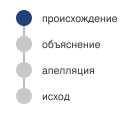
*Оспоримость — это производственный стек, а не просто слово в политике.*

Степень возможной оспоримости зависит от контекста развертывания. На централизованных облачных платформах можно предлагать полноценные API объяснений, пользовательские панели и рабочие процессы апелляций. Напротив, в граничных системах и развертываниях TinyML оспоримость может ограничиваться логированием и периодическими обновлениями, основанными на обратной связи, синхронизированной пакетами. Во всех случаях проектирование систем машинного обучения должно признавать, что прозрачность — не просто вопрос технического раскрытия. Это структурное свойство систем, которое определяет, могут ли пользователи и институты содержательно ставить под сомнение, исправлять и регулировать поведение автоматизированного принятия решений.


### Институциональное закрепление ответственности

<a id="sec-responsible-ai-institutional-embedding-responsibility-bbeb"></a>

Механизмы прозрачности и оспоримости не работают без институциональной поддержки. Системы машинного обучения не существуют изолированно: их разработка, развертывание и постоянное сопровождение встроены в среду, которая включает технические команды, юридические службы, владельцев продуктов, специалистов по соответствию и внешних заинтересованных сторон. Ответственность в таких системах не принадлежит одному участнику или компоненту; она распределена по ролям, рабочим процессам и процессам управления. Поэтому проектирование ответственного ИИ требует внимания к институциональным условиям, в которых такие системы создаются и используются.

Распределение ответственности по ролям приносит и возможности, и трудности. С одной стороны, участие нескольких заинтересованных сторон создает системы сдержек и противовесов, которые помогают предотвращать вредные исходы. С другой стороны, размывание ответственности может приводить к разрывам подотчетности, когда ни у одного человека или команды нет ясных полномочий или стимула вмешаться при возникновении проблем. Когда происходит вред, может быть неясно, виновата ли конвейерная обработка данных, архитектура модели, конфигурация развертывания, пользовательский интерфейс или окружающий организационный контекст.

Одним из иллюстративных случаев служит Google Flu Trends, широко цитируемый пример провала из-за институционального рассогласования. Система, которая пыталась предсказывать вспышки гриппа по поисковым данным, сначала работала хорошо, но постепенно расходилась с реальностью из-за изменений в поведении пользователей и сдвигов распределения данных. Эти проблемы годами оставались непоправленными, отчасти потому, что не существовало установленных процессов валидации системы, внешнего аудита или эскалации, когда качество модели падало. Провал был вызван не одним техническим дефектом, а отсутствием институциональной рамки, которая могла бы реагировать на дрейф, неопределенность и обратную связь извне команды разработки.

Операционная строгость имеет измеримую цену. Публичные стандарты ответственного ИИ и внутренние процессы проверки показывают, что управление может добавлять задержку выпуска через оценки воздействия, проверки моделей, учения красной команды и ворота документации. Устойчивый системный вывод состоит в том, что пропускная способность проверки становится частью планирования развертывания: если каждый запуск высокого риска требует специализированной проверки, очередь проверки превращается в узкое место, как и проверка безопасности или утверждение мощностей. Поэтому издержки ответственности — не безвозвратные затраты, а страховая премия против гораздо более высокой цены отзыва смещенной модели или устранения живой уязвимости во всем глобальном парке.

Институциональное закрепление ответственности требует большего, чем назначение подотчетности. Оно требует проектирования процессов, инструментов и стимулов, которые делают возможными ответственные действия. Техническую инфраструктуру, такую как версионированные реестры моделей, карточки моделей и журналы аудита, необходимо сочетать с организационными структурами: комитетами по этике, комитетами по модельному риску и процедурами red-teaming[^fn-red-teaming-etymology]. Эти механизмы гарантируют, что технические выводы применимы на практике, что обратная связь интегрируется между командами, а обеспокоенность, высказанная пользователями, разработчиками или регуляторами, рассматривается системно, а не ситуативно.

Зависимости от сторонних поставщиков и базовых моделей не переносят подотчетность на поставщика. Развертывающая организация может унаследовать веса, оценки безопасности, документацию данных или договорные средства контроля, но она все равно выбирает применение, интерфейс, извлекаемый контекст, инструменты, пользовательскую аудиторию, мониторинг и процесс реагирования. Поэтому закупки требуют такой же строгости, как внутренние ворота для моделей: документированные целевые и запрещенные сценарии использования, объем оценки, уведомление о версиях и изменениях, раскрытие инцидентов, доступ аудиторов, обработку данных, зависимости от сервисов, поведение при откате и план выхода. Когда доказательств поставщика нет, кейс обеспечения доверия должен фиксировать пробел как остаточный риск, а не молча считать заявление поставщика проверенным средством контроля.

Требуемый уровень институциональной поддержки различается в разных контекстах развертывания. В крупномасштабных облачных платформах структуры управления могут включать внутренние аудиты подотчетности, рабочие процессы соответствия и выделенные команды, отвечающие за мониторинг поведения системы. В системах меньшего масштаба, включая граничные или мобильные системы, встроенные в медицинские устройства или общественную инфраструктуру, управление может опираться на междисциплинарные инженерные практики и внешнюю сертификацию или регулирование. В развертываниях TinyML, где связность и наблюдаемость ограничены, институциональная ответственность может реализовываться через вышестоящие средства контроля, такие как валидация, важная для безопасности, встроенные ограничения безопасности и отслеживание жизненного цикла развернутой прошивки.

Во всех случаях ответственное машинное обучение требует координации технических и институциональных систем. Эта координация должна охватывать весь жизненный цикл модели: от первичного сбора данных и обучения модели до развертывания, мониторинга, обновления и в конечном счете вывода из эксплуатации. Она также должна включать внешних акторов, в том числе экспертов предметной области, организации гражданского общества и регулирующие органы, чтобы ответственность осуществлялась не только внутри команды разработки, но и во всей более широкой экосистеме, в которой работают системы машинного обучения.

Подотчетность становится видимой в момент исправления. Затронутым людям нужен доступный канал для оспаривания результата, запись о рассмотренных доказательствах, рецензент с полномочиями исправить решение, срок ответа и способ распространить исправление на последующие системы. Общее улучшение модели не заменяет индивидуального исправления: переобучение в следующем квартале не исправляет отказ в выгоде, оказанный сегодня. Поэтому процедуры реагирования на инциденты должны связывать техническое сдерживание и откат с уведомлением, исправлением, компенсацией там, где она применима, анализом первопричин и проверкой того, что исправление дошло до каждой зависимой записи о решении.

Системный тезис, таким образом, выходит за пределы стека обслуживания и распространяется на организацию: ответственность — это динамическое свойство того, как системы управляются, поддерживаются и оспариваются во времени, и ни одна модель или команда ею не владеет единолично. Закрепление ее в институтах посредством политик, инфраструктуры и механизмов подотчетности и есть то, что приводит системы машинного обучения в соответствие с социальными ценностями и операционными реалиями, которым они призваны служить.

В совокупности институциональная ответственность, ценностные конфликты, петли обратной связи, совместная работа человека и ИИ, оспоримость и вычислительное равенство показывают, почему технические основы, рассмотренные от [раздела «Обнаружение смещения и мониторинг справедливости»](#sec-responsible-ai-bias-risk-detection-methods-71f8) до [раздела «Объяснимость и интерпретируемость»](#sec-responsible-ai-explainability-interpretability-8d06), не могут сами по себе обеспечить ответственный ИИ. Эти технические основы остаются необходимыми, но для того, чтобы выдержать столкновение с развернутыми системами, им нужны организационные полномочия, операционная телеметрия и пути эскалации. Ресурсные ограничения также определяют, кто может разрабатывать, развертывать и получать выгоду от возможностей ответственного ИИ, поэтому выбор реализации — не просто локальные инженерные детали. В противном случае метрика справедливости без владельца, объяснение без процесса апелляции или сигнал мониторинга без бюджета на исправление становятся свидетельством без действия. Когда система ИИ меняет среду, в которой работает, инженерные команды должны превратить принципы ответственного ИИ в корпоративные рутины под давлением сроков, ограниченными ресурсами и конкурирующими стимулами.

> **Контрольные вопросы: когда корректный код отказывает в развертывании**
>
> Этот раздел показал, почему математически обоснованные, справедливые и объяснимые модели все равно терпят неудачу в человеческих институтах: петли обратной связи, которые перестраивают данные, автоматизационное смещение и институциональная уступчивость, нормативный плюрализм между заинтересованными сторонами, а также оспоримость как производственный стек, а не слово из политики.
>
> **Диагностика взаимодействия человека и системы**
>
> - [ ] **Провал принятия оповещений**: определите социотехнический режим отказа в высокоточной модели сепсиса, которая не снижает смертность, потому что врачи игнорируют ее оповещения, и назовите изменение интерфейса, которое этому противодействует.
> - [ ] **Парадокс надежности**: объясните, почему повышение точности модели с 90 до 99 процентов может снизить безопасность системы на уровне процесса и почему ответ состоит в добавлении трения, а не в удалении человека.
>
> **Рассуждения о петлях и заинтересованных сторонах**
>
> - [ ] **Петли обратной связи**: проследите, как петля обратной связи делает первоначальное предсказание модели самоисполняющимся в системе предиктивной полиции или рекомендаций, и объясните, почему статический тестовый набор этого не выявляет.
> - [ ] **Нормативный плюрализм**: обоснуйте, почему ни один алгоритм не разрешает конфликты между медицинской эффективностью, автономией пациента, приватностью и соответствием законодательству в чат-боте для психического здоровья подростков, и определите, что должна сделать инженерная команда до начала оптимизации.


## Трудности внедрения и безопасность ИИ

<a id="sec-responsible-ai-implementation-challenges-9173"></a>

Команда по данным хочет задержать развертывание на месяц, чтобы провести строгие аудиты справедливости новой генеративной модели. Руководство, наблюдая, как конкурент выпускает похожую функцию, требует развернуть модель к пятнице. Это и есть практическая реальность внедрения ответственного ИИ. Редко вопрос в том, знают ли инженеры, как проверять смещение; вопрос в том, позволяют ли организационная структура, бюджет и приоритеты бизнеса выделить им время и полномочия, чтобы это действительно сделать.

Сценарий обнажает разрыв во внедрении между технической возможностью и операционными полномочиями. Методы ответственного ИИ дают необходимые инструменты, но их эффективность зависит от организационных структур, инфраструктуры данных, процессов оценки и устойчивой приверженности, которая выходит далеко за пределы разработки алгоритмов. Системы сохраняют ответственное поведение во времени только тогда, когда эти опоры внедрения переживают давление сроков, стимулы продукта и дрейф после развертывания.

Практические барьеры для встраивания ответственного ИИ в производственные ML-системы укладываются в классическую схему «люди — процессы — технологии»:

- **Задачи, связанные с людьми**: сюда относятся организационные структуры, определения ролей, согласование стимулов и координация заинтересованных сторон, которые определяют, превращаются ли принципы ответственного ИИ в устойчивое организационное поведение.
- **Задачи, связанные с процессами**: сюда относятся пробелы в стандартизации, процедуры сопровождения жизненного цикла, конкурирующие цели оптимизации и методологии оценки, которые влияют на то, как практики ответственного ИИ интегрируются в рабочие процессы разработки.
- **Задачи, связанные с технологиями**: сюда относятся ограничения качества данных, ограничения вычислительных ресурсов, узкие места масштабируемости и пробелы в инфраструктуре, которые определяют, могут ли техники ответственного ИИ эффективно работать в промышленном масштабе.

Эти категории важны, потому что ответственный ИИ терпит провал, когда организационные стимулы, процессы разработки и производственная инфраструктура не могут поддерживать одно и то же обязательство.

Смысл этой схемы — в координации, а не в классификации. Ответственный ИИ терпит провал, когда люди, процессы и технологии рассматриваются независимо: метрика справедливости без владельца не запускает исправления, процесс управления без телеметрии не видит дрейфа, а техника приватности без происхождения данных не может выполнить запросы на удаление. Эффективное внедрение требует системных стратегий, которые одновременно встраивают ответственность в архитектуру, инфраструктуру и рабочие процессы развертывания машинного обучения по всем трем измерениям.

### Организационные структуры и стимулы

<a id="sec-responsible-ai-organizational-structures-incentives-4825"></a>

Внедрение ответственного машинного обучения определяется не только технической осуществимостью, но и организационным контекстом, в котором разрабатываются и развертываются системы. В компаниях, исследовательских лабораториях и государственных учреждениях ответственность нужно переводить в конкретные роли, рабочие процессы и стимулы. На практике, однако, организационные структуры часто фрагментируют ответственность, и тогда трудно согласовать этические цели между инженерными, продуктовыми, юридическими командами и командами эксплуатации.

Ответственный ИИ требует постоянных инвестиций в такие практики, как оценка качества по подгруппам, анализ объяснимости, тестирование состязательной устойчивости и интеграция техник, сохраняющих приватность, таких как дифференциальная приватность или федеративное обучение. Эти виды деятельности могут требовать много времени и ресурсов, однако они часто выходят за рамки формальных метрик производительности, по которым оценивается продуктивность команд. Например, командам могут назначать премии за быструю выкатку функций или выполнение показателей производительности, даже когда это подрывает справедливость или упускает потенциальный вред. Когда этическая тщательность рассматривается как необязательная задача, а не как неотъемлемая часть жизненного цикла системы, она становится уязвимой для понижения приоритета под давлением сроков или организационной текучки.

Ответственность осложняется неоднозначностью владения. Во многих организациях ни одна команда не отвечает за то, чтобы система вела себя этично во времени. Производительность модели может принадлежать одной команде, пользовательский опыт — другой, инфраструктура данных — третьей, а соответствие — четвертой. Когда возникают проблемы, включая неравное воздействие в предсказаниях или недостаточное качество объяснений, может не быть четкого протокола для выявления первопричин или координации смягчения. В результате обеспокоенность, высказанная разработчиками, пользователями или аудиторами, может остаться без ответа, не из-за злого умысла, а из-за отсутствия процесса и межфункционального согласования.

Создание эффективных организационных структур для ответственного ИИ требует большего, чем декларации политики. Нужны операционные механизмы: назначенные роли с ответственностью за этический надзор, документированные пути эскалации, подотчетность за мониторинг после развертывания и стимулы, которые поощряют команды за этическую предусмотрительность и поддерживаемость систем. В одних организациях это может принять форму комитетов по ответственному ИИ, межфункциональных комитетов по проверке или групп модельного риска, которые работают бок о бок с разработчиками на протяжении всего жизненного цикла модели. В других эксперты предметной области или защитники интересов пользователей могут встраиваться в продуктовые команды, чтобы предвидеть последствия для конечных пользователей и оценивать ценностные компромиссы в контексте.

Ответственность за этичное поведение системы распределена между множеством сторон, включая промышленность, академическую среду, гражданское общество и государство. [Рисунок «Слои ответственности»](#fig-human-centered-ai) показывает это распределение через вложенные слои подотчетности: от отдельных команд, внедряющих технические практики, через культуру безопасности в организации к отраслевой сертификации и государственному регулированию (Shneiderman, 2022; Shneiderman, 2020). Внутри организаций это распределение должно отражаться механизмами, которые связывают техническое проектирование со стратегическим надзором и операционным контролем. Без этих связей ответственность становится размытой, а добросовестные усилия могут быть подорваны системным рассогласованием.

<a id="fig-human-centered-ai"></a>


***Слои ответственности:** эффективное внедрение ИИ, ориентированного на человека, требует общей подотчетности через вложенные слои. От ядра, команды разработки, наружу через организацию, отрасль и государство и общество каждое внешнее кольцо задает нормы, которые внутренние слои не могут навязать себе сами. Внешние опоры, включая стандарты управления ИИ ISO, тестирование справедливости, карточки моделей, red-teaming, оценки воздействия, GDPR, EU AI Act и отраслевое право, связывают эти слои с практикой (ISO/IEC 42001, 2023; GDPR, 2016; EU AI Act, 2024).*

Ответственный ИИ — это не только вопрос технического совершенства или соответствия регуляторным требованиям. Это системная задача, которая требует согласования этических целей с институциональными структурами, через которые проектируются, развертываются и поддерживаются системы машинного обучения. Создание и поддержание этих структур важно, чтобы ответственность была встроена не только в модель, но и в организацию, которая управляет ее использованием. Та же проблема владения становится конкретной на уровне данных: команды могут знать, как аудировать набор данных, но не иметь полномочий, доступа или инфраструктуры, необходимых для его изменения.

### Ограничения данных и пробелы в качестве

<a id="sec-responsible-ai-data-constraints-quality-gaps-5887"></a>

Улучшение конвейеров данных остается одной из самых трудных задач внедрения на практике, несмотря на широкое признание того, что качество данных важно для ответственного машинного обучения. Разработчики и исследователи часто понимают важность репрезентативных данных, точной разметки и смягчения исторического смещения. Однако даже когда намерения ясны, структурные и организационные барьеры часто препятствуют содержательному вмешательству. Ответственность за данные часто распределена между командами, управляется унаследованными системами или встроена в более широкие институциональные процессы, которые трудно изменить.

Принципы инженерии данных, включая валидацию данных, управление схемами, версионирование, отслеживание происхождения и мониторинг качества, обеспечивают техническую основу для решения этих задач. Однако применение этих принципов к ответственному ИИ добавляет сложность: справедливость требует оценки представленности по демографическим группам, смягчение смещения требует понимания исторических практик сбора данных, а сохранение приватности ограничивает, какие техники валидации допустимы. Организационные трудности, описанные здесь, отражают разрыв между наличием надежной инфраструктуры инженерии данных и ее эффективным использованием для целей ответственного ИИ.

Дисбаланс подгрупп, неоднозначность меток и сдвиг распределения, каждый из которых влияет на обобщение и производительность в разных областях, — хорошо известные проблемы ответственного машинного обучения. Они часто проявляются в виде плохой калибровки, отказов на данных вне распределения или демографических диспропорций в метриках оценки. Однако решение этих проблем в реальных условиях требует большего, чем технические знания. Оно требует доступа к релевантным данным, институциональной поддержки исправлений и достаточного времени и ресурсов для итераций над самим набором данных. Во многих конвейерах машинного обучения, как только данные собраны и обучающий набор определен, конвейер данных фактически замораживается. У команд может не быть ни полномочий, ни инфраструктуры для изменения или расширения набора данных на полпути, даже если обнаружены диспропорции в производительности. Даже в автоматизированных конвейерах данных с валидацией и хранилищами признаков ретроактивно исправлять обучающие распределения трудно, когда версионирование наборов данных и происхождение данных уже зафиксированы в производстве.

В таких областях, как здравоохранение, образование и социальные службы, эти трудности особенно выражены. Сбор данных может подпадать под юридические ограничения, требования приватности или межорганизационную координацию. Например, команда, разрабатывающая модель сортировки, может обнаружить, что обучающие данные недопредставляют пациентов из небольших или сельских больниц. Исправление этого дисбаланса потребовало бы согласования доступа к данным с внешними партнерами, согласования стандартов признаков и разрешения несоответствий в практиках разметки. Логистические и операционные издержки могут быть непомерными, даже если все стороны согласны с необходимостью улучшения.

Попытки собрать более репрезентативные данные могут также столкнуться с этическими и политическими проблемами. В некоторых случаях дополнительный сбор данных может подвергнуть маргинализированные группы новым рискам. Этот парадокс экспозиции, при котором люди, сильнее всего пострадавшие от исключения, также наиболее уязвимы к злоупотреблению, усложняет попытки повысить справедливость через расширение набора данных. Например, сбор большего объема данных о небинарных людях для поддержки справедливости в гендерно-чувствительных приложениях может улучшить покрытие модели, но также поднимает серьезные вопросы о согласии, идентифицируемости и последующем использовании. Команды должны аккуратно ориентироваться в этих напряжениях, часто без четких институциональных указаний.


> **Сценарий: налог на представленность**
>
> **Проблема**: модель медицинской визуализации, обученная на данных из 5 больниц, достигает общей точности 94 процента, но только 78 процентов на недопредставленных популяциях (сельские пациенты, пожилые пациенты, пациенты с более темным оттенком кожи). Чтобы закрыть этот разрыв, нужны репрезентативные данные из более чем 50 больниц в разных географических регионах, по разным демографическим группам и типам оборудования.
>
> **Расчет**:
>
> 1. **Стоимость получения данных**: от \$50 до \$200 за размеченное медицинское изображение, при этом на каждую недопредставленную подгруппу нужно 100 000 изображений.
> 2. **Сценарий налога на представленность**: для 10 подгрупп при средней точке диапазона стоимости 10 × 100 000 изображений на подгруппу × \$125 за изображение дают \$125 млн только на получение данных.
>
> 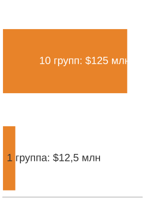
> *Стоимость представленности растет с охватом подгрупп, а не только с размером набора данных.*
>
> 3. **Гармонизация данных**: гармонизация данных между разными сканерами, протоколами и соглашениями о разметке добавляет от 30 до 50 процентов накладных расходов, доводя итог до \$162,5 млн–\$187,5 млн.
>
> **Системный вывод**: налог на представленность делает справедливое качество существенно дороже, чем высокая совокупная точность на большинстве населения. Популяции, которые сильнее всего страдают от смещенных моделей, оказываются самыми дорогими для представления в обучающих данных. Бюджеты данных нужно распределять не по совокупной полезности, а по разрывам охвата подгрупп, то есть по принципиально иной цели оптимизации, чем максимизация общей точности.

Восходящие смещения в системах сбора данных могут сохраняться без контроля, даже когда данных много. Многие организации опираются на сторонних поставщиков данных, внешние API или операционные базы, которые не проектировались с учетом справедливости или интерпретируемости. Например, электронные медицинские карты, широко используемые в клиническом машинном обучении, часто отражают системные диспропорции в уходе, а также привычки документирования, которые кодируют расовое или социально-экономическое смещение (Himmelstein et al., 2022). Команды, работающие ниже по течению, могут иметь мало видимости того, как создавались эти записи, и немного рычагов для устранения встроенного вреда.

Улучшение качества наборов данных часто не входит в обязанности какой-либо одной команды. Конвейеры данных могут поддерживаться группами инфраструктуры или аналитики, которые работают независимо от инженеров ML или команд оценки моделей. Эта организационная фрагментация затрудняет координацию аудитов данных, отслеживание происхождения или внедрение петель обратной связи, которые связывают поведение модели с базовыми проблемами данных. На практике ответственность за качество набора данных склонна теряться: ее признают важной, но редко ставят приоритетом и не обеспечивают ресурсами.

Решение этих задач требует долгосрочных инвестиций в инфраструктуру, рабочие процессы и межфункциональную коммуникацию. Технические инструменты, такие как валидация данных, автоматизированные аудиты и фреймворки документации наборов данных (например, карточки моделей, datasheets или Data Nutrition Project[^fn-data-nutrition-project]), могут помочь, но только тогда, когда они встроены в команды, которые имеют мандат и поддержку, чтобы действовать на основе своих выводов.

[^fn-data-nutrition-project]: **Data Nutrition Project**: некоммерческая инициатива, которая разрабатывает стандартизированную документацию наборов данных по образцу пищевых этикеток, кратко описывая происхождение, состав, распределение и известные проблемы наборов данных, используемых в конвейерах ML. Такие метки делают риски набора данных понятными инженерам ниже по течению, у которых нет доступа к исходному процессу сбора данных, и становятся важным мостом для организационной фрагментации, описанной здесь.

Улучшение качества данных — поэтому по сути вопрос о том, как распределяется, разделяется и поддерживается ответственность за данные на протяжении жизненного цикла системы, а не только вопрос лучших инструментов. Когда эта ответственность установлена, командам все равно нужно решить, какая цель ответственного ИИ должна доминировать, когда допустимые цели вступают в конфликт.

### Балансировка конкурирующих целей

<a id="sec-responsible-ai-balancing-competing-objectives-088e"></a>

Проектирование систем машинного обучения часто описывают как процесс оптимизации: повышение точности, снижение функции потерь или максимизация полезности. Однако в практике ответственного ML оптимизацию нужно уравновешивать с набором конкурирующих целей, включая справедливость, интерпретируемость, устойчивость, приватность и эффективность использования ресурсов. Эти цели не всегда согласованы, и улучшение по одному измерению может влечь компромиссы в другом. Хотя эти напряжения хорошо понятны в теории, управлять ими в реальных системах — постоянная и нерешенная задача.

Рассмотрим компромисс между точностью модели и интерпретируемостью. Во многих случаях более интерпретируемые модели, включая неглубокие деревья решений и линейные модели, дают меньшую предсказательную производительность, чем сложные ансамблевые методы или глубокие нейронные сети. В приложениях с низкими ставками этот компромисс может быть приемлем или даже предпочтителен. Однако в областях с высокими ставками, таких как здравоохранение или финансы, где решения влияют на благополучие людей или доступ к возможностям, команды часто оказываются между требованием производительности и необходимостью прозрачных рассуждений. Даже когда интерпретируемость приоритетна на этапе разработки, ее могут отменить при развертывании ради небольших выигрышей в точности модели.

Похожие напряжения возникают между персонализацией и справедливостью. Рекомендательная система, обученная максимизировать вовлеченность пользователей, может агрессивно персонализировать выдачу, используя детализированные поведенческие данные, чтобы подстраивать результаты под отдельных пользователей. Хотя такой подход может повысить удовлетворенность у одних пользователей, он может закреплять неравенство между демографическими группами, особенно если персонализация опирается на признаки, коррелирующие с расой, полом или социально-экономическим статусом. Добавление ограничений справедливости может уменьшить диспропорции на уровне групп, но ценой снижения воспринимаемой персонализации для некоторых пользователей. Эти эффекты часто трудно измерить и еще труднее объяснить командам продукта, которые находятся под давлением оптимизации метрик вовлеченности.

Приватность вводит еще один набор ограничений. Такие техники, как дифференциальная приватность, федеративное обучение или локальная минимизация данных (Biega et al., 2020), могут значимо снижать риски приватности. Однако они также вносят шум, ограничивают емкость модели или снижают доступ к обучающим данным. В централизованных системах эти издержки могут поглощаться масштабированием инфраструктуры или гибридными архитектурами обучения. В граничных системах и развертываниях TinyML компромиссы острее. Носимому устройству, которому поручен локальный инференс, часто приходится одновременно балансировать сложность модели, энергопотребление, задержку и гарантии приватности. Поддержка одного ограничения обычно ослабляет другое, и системным проектировщикам приходится выбирать приоритеты среди одинаково важных целей. Эти напряжения дополнительно усиливаются решениями дизайна, специфичными для развертывания, такими как уровни квантизации, обрезка активаций или стратегии сжатия, которые влияют на то, насколько эффективно модели могут поддерживать несколько целей одновременно.

Эти компромиссы не являются чисто техническими: они отражают более глубокие нормативные суждения о том, для чего и для кого создана система, как подробно рассмотрено в [разделе «Нормативный плюрализм и конфликты ценностей»](#sec-responsible-ai-normative-pluralism-value-conflicts-d61f). Ответственная разработка ML требует явного формулирования этих суждений, их оценки в контексте и подчинения их вкладу заинтересованных сторон и институциональному надзору.

Что делает эту задачу особенно трудной при внедрении, так это то, что конкурирующие цели редко принадлежат одной команде или функции. Производительность может оптимизироваться командой моделирования, справедливость — группой ответственного ИИ, а приватность — юридическим или комплаенс-отделом. Без целенаправленной координации компромиссы на уровне системы могут приниматься неявно, по частям или без видимости долгосрочных последствий. Со временем результатом может стать модель, которая выглядит хорошо ведущей себя в изоляции, но не достигает своих этических целей, будучи встроенной в производственную инфраструктуру.

Балансировка конкурирующих целей требует не только технической грамотности, но и приверженности прозрачности, обсуждению и согласованию между командами. Системы должны проектироваться так, чтобы выявлять компромиссы, а не скрывать их, и оставлять место для разработки с учетом ограничений, а не для узкой оптимизации. На практике это может потребовать переопределения того, как выглядит «успех»: не как производительность по одной метрике, а как устойчивое согласование поведения системы с ее назначением в более широком социальном или операционном контексте.

По этим первым трем вызовам (организационные структуры, качество данных и конкурирующие цели) проступает закономерность: провал ответственного ИИ редко происходит из технического незнания. Команды понимают метрики справедливости, техники приватности и методы смягчения смещения. Вместо этого провал возникает на пересечении организационной фрагментации, которая распределяет ответственность без подотчетности, ограничений данных, которые создают технические барьеры даже при ясных намерениях, и конкурирующих целей, которые вынуждают принимать нормативные компромиссы, замаскированные под технические задачи. Когда команды моделирования оптимизируют производительность, команды комплаенса занимаются приватностью, а команды продукта независимо приоритизируют вовлеченность, этическое поведение системы на уровне всей системы возникает случайно, а не по замыслу. Это по сути социотехнические задачи управления, требующие четких структур владения, которые выходят за границы организаций, инфраструктуры данных, спроектированной для этического аудита, и процессов обсуждения, делающих ценностные компромиссы явными. Эти вызовы становятся еще острее, когда системы должны поддерживать ответственное поведение в масштабе и во времени.

### Масштабируемость и сопровождение

<a id="sec-responsible-ai-scalability-maintenance-a1ca"></a>

Практики ответственного машинного обучения часто вводятся на ранних этапах разработки модели: аудиты справедливости проводятся при первоначальной оценке, методы интерпретируемости применяются при выборе модели, а техники, сохраняющие приватность, рассматриваются на этапе обучения. Однако когда системы переходят от исследовательских прототипов к производственным развертываниям, эти практики часто деградируют или исчезают. Разрыв между тем, что возможно в принципе, и тем, что устойчиво в производстве, — основной вызов внедрения ответственного ИИ.

Многие интервенции ответственного ИИ не проектируются с расчетом на масштабируемость. Проверки справедливости могут выполняться на статическом наборе данных, но не интегрироваться в постоянно действующие конвейеры приема данных. Методы объяснения могут разрабатываться с инструментами времени разработки, но никогда не переводиться в развертываемые пользовательские интерфейсы. Ограничения приватности могут соблюдаться при обучении, но упускаться из виду при мониторинге после развертывания или обновлениях модели. В каждом случае то, что начинается как намерение ответственного дизайна, не сохраняется при масштабировании системы и изменениях жизненного цикла.

Производственные среды создают новое давление, которое переформатирует приоритеты системы. Модели должны работать на разнообразных аппаратных конфигурациях, взаимодействовать с развивающимися API, обслуживать миллионы пользователей с низкой задержкой и сохранять доступность под операционной нагрузкой. Например, поддержание согласованного поведения на CPU, GPU и граничных ускорителях требует тесной интеграции абстракций фреймворка, планировщиков времени выполнения и аппаратно-специфичных компиляторов. Эти ограничения требуют непрерывной адаптации и быстрых итераций, часто понижая приоритет действий, которые трудно автоматизировать или измерить. Практики ответственного ИИ, особенно те, что предполагают проверку человеком, консультации с заинтересованными сторонами или апостериорную оценку, может быть трудно встроить в быстрые конвейеры DevOps[^fn-devops-mlops-pipeline].

[^fn-devops-mlops-pipeline]: **MLOps (Machine Learning Operations)**: конвейеры CI/CD для ML должны обрабатывать версионирование данных, воспроизводимость обучения и A/B-тестирование изменений алгоритмов, выходя за рамки традиционных задач разработки ПО. Организации с высокой скоростью ML могут развертывать изменения модели или конфигурации гораздо чаще, чем проверки ответственного ИИ могут быть завершены вручную, создавая разрыв скорости: циклы развертывания, измеряемые часами, конкурируют с этической валидацией, требующей дней или недель. Это напряжение объясняет, почему обязательства ответственного ИИ, присутствовавшие на уровне прототипа, могут понижаться в приоритете по мере масштабирования систем.

Сопровождение добавляет дополнительную сложность. Системы машинного обучения редко бывают статичными. Поступают новые данные, проводится переобучение, признаки устаревают или добавляются, и паттерны использования меняются со временем. Без строгого контроля версий, журналов изменений и оценок воздействия трудно проследить, как эволюционирует поведение системы или сохраняются ли свойства, связанные с ответственностью, такие как справедливость или устойчивость. Текучесть кадров и реорганизация команд могут размывать институциональную память. Команды, отвечающие за сопровождение развернутой модели, могут не быть теми, кто изначально ее разрабатывал или аудировал, что ведет к непреднамеренному рассогласованию между целями системы и ее развернутым поведением. Эти проблемы особенно остры в сценариях непрерывного или потокового обучения, где дрейф концепций и сдвиг распределений данных требуют активного мониторинга и обновлений в реальном времени.

Эти вызовы усиливаются в многомодельных системах и кросс-платформенных развертываниях. Механизм рекомендаций может состоять из десятков взаимодействующих моделей, каждая из которых оптимизирована для своей подзадачи или сегмента пользователей. Голосовой ассистент, развернутый в мобильных и граничных средах, может поддерживать разные версии одной и той же модели, настроенные под локальные аппаратные ограничения. Координация обновлений, обеспечение согласованности и поддержание ответственного поведения в таких распределенных системах требует инфраструктуры, которая отслеживает не только код и данные, но и ценности и ограничения.

Решение задач масштабируемости и сопровождения требует рассматривать ответственный ИИ как свойство жизненного цикла, а не как разовую оценку. Это означает встраивание аудиторских хуков, отслеживания метаданных и протоколов мониторинга в инфраструктуру системы. Это также означает создание документации, которая сохраняется при смене команд, определение структур подотчетности, переживающих передачу проектов, и обеспечение того, чтобы обновления системы не стирали непреднамеренно с трудом достигнутые улучшения справедливости, прозрачности или безопасности. Хотя такие практики трудно внедрить задним числом, их можно интегрировать в проектирование системы с самого начала через инструменты и рабочие процессы, по умолчанию ориентированные на ответственность.


Ответственность должна масштабироваться вместе с системой. Модели машинного обучения, развернутые в реальных средах, должны соответствовать этическим стандартам не только при запуске, но и продолжать делать это по мере роста их сложности, охвата пользователей и операционного масштаба. Для этого нужны устойчивые организационные инвестиции и архитектурное планирование, а не только техническая корректность в один момент времени.

### Пробелы в стандартизации и оценке

<a id="sec-responsible-ai-standardization-evaluation-gaps-10b6"></a>

Хотя область ответственного машинного обучения создала широкий набор инструментов, метрик и фреймворков оценки, до сих пор нет консенсуса о том, как систематически оценивать, является ли система ответственной на практике. Многие команды признают важность справедливости, приватности, интерпретируемости и устойчивости, однако им часто трудно переводить эти принципы в последовательные, измеримые стандарты. Методологии бенчмаркинга дают ценные рамки для стандартизированной оценки, хотя адаптация этих подходов к метрикам ответственного ИИ остается активной областью развития. Отсутствие формализованных критериев оценки в сочетании с фрагментацией инструментов и фреймворков представляет серьезное препятствие для внедрения ответственного ИИ в масштабе.

Фрагментация видна как между организациями, так и внутри них. Академические исследования часто вводят новые метрики справедливости или устойчивости, которые трудно воспроизвести вне экспериментальных условий. Промышленные команды, напротив, должны выбирать метрики, которые чисто интегрируются с производственной инфраструктурой, понятны неспециалистам и могут отслеживаться во времени. В результате практики, выработанные в одном контексте, могут плохо переноситься в другой, а сравнения производительности систем могут быть ненадежными или вводящими в заблуждение. Например, модель, оцененная на справедливость по демографическому паритету на одном бенчмарк-наборе данных, может не соответствовать требованиям равенства шансов в другой области или юрисдикции. Без общих стандартов такие оценки остаются ситуативными, и трудно обосновать доверие к ответственному поведению системы в разных контекстах.

Оценка ответственного ИИ также страдает от несоответствия между единицей анализа, которой часто является отдельная модель или пакетная задача, и уровнем развертывания, который включает сквозные компоненты системы: конвейеры приема данных, преобразования признаков, API инференса, слои кэширования и рабочие процессы с участием человека. Система, которая выглядит справедливой или интерпретируемой в изоляции, может не сохранять эти свойства, будучи встроенной в более широкое приложение. Инструменты, поддерживающие целостную оценку на уровне системы, остаются недоразвитыми, а руководств о том, как оценивать ответственность взаимодействующих компонентов в производственных стеках ML, мало.

Дополнительно усложняет дело отсутствие метрик, учитывающих жизненный цикл. Большинство инструментов оценки применяются в один момент времени, часто непосредственно перед развертыванием. Однако свойства ответственного ИИ, такие как справедливость и устойчивость, динамичны. Они зависят от того, как эволюционируют распределения данных, как обновляются модели и как пользователи взаимодействуют с системой. Без непрерывной или периодической оценки трудно определить, остается ли система согласованной со своими намеченными этическими целями после развертывания. Инструменты мониторинга после развертывания существуют, но их редко интегрируют с метриками времени разработки, которые используются для оценки первоначального качества модели. Этот разрыв затрудняет обнаружение дрейфа этической производительности или прослеживание наблюдаемого вреда до его восходящих источников.

Фрагментация инструментов еще больше усугубляет эти трудности. Инструменты ответственного ИИ часто распределены по разрозненным пакетам, панелям или внутренним системам, каждый из которых рассчитан на конкретную задачу или метрику. Команда может использовать один инструмент для объяснимости, другой для обнаружения смещения, а третий для отчетности о соответствии, без единого интерфейса для рассуждений о компромиссах на уровне системы. Отсутствие совместимости затрудняет сотрудничество между командами, усложняет документацию и повышает риск того, что важные оценки будут пропущены или выполнены непоследовательно. Эти трудности усугубляются отсутствием крючков для распространения метаданных или логирования событий между компонентами, такими как хранилища признаков, шлюзы инференса и реестры моделей.

Этот сценарий неуспешного переноса хорошо отражает суть проблемы: модель, сертифицированная как справедливая по демографическому паритету на одном бенчмарке, может провалить равенство шансов в новой области или юрисдикции, поэтому сертификация не переносится вместе с моделью. Закрыть этот разрыв можно только критериями оценки, которые измеримы и поддаются аудиту в разных областях, применяются к полным конвейерам системы, а не к изолированным моделям, и повторяются как регулярная деятельность жизненного цикла, чтобы успешный результат на запуске не истек незаметно по мере дрейфа распределений. Пока эти практики не станут общими, а не ситуативными, ответственный ИИ будет описываться принципами, но на практике его трудно проверить.

Ответственный ИИ нельзя достичь через изолированные интервенции или статические проверки соответствия. Он требует архитектурного планирования, инфраструктурной поддержки и институциональных процессов, которые поддерживают этические цели на протяжении всего жизненного цикла системы. По мере того как системы машинного обучения масштабируются, диверсифицируются и встраиваются в чувствительные области, обеспечение таких свойств, как справедливость, устойчивость и приватность, должно поддерживаться не только при выборе модели, но и на этапах переобучения, квантизации, обслуживания и мониторинга. Без постоянного надзора ответственные практики деградируют по мере эволюции системы, особенно когда инструменты, метрики и документация не спроектированы так, чтобы отслеживать их и сохранять через развертывание и далее.

Решение этой задачи потребует большей стандартизации, более глубокой интеграции практик, учитывающих ответственность, в конвейеры CI/CD, и долгосрочных инвестиций в системную инфраструктуру, которая поддерживает этическую предусмотрительность. Цель не в том, чтобы идеализировать этическое принятие решений в коде, а в том, чтобы сделать ответственность операционным свойством: прослеживаемым, проверяемым и согласованным с ограничениями и возможностями систем машинного обучения в масштабе.

### Фреймворк принятия решений при внедрении

<a id="sec-responsible-ai-implementation-decision-framework-e8b8"></a>

С учетом этих трудностей внедрения практикам нужны системные подходы, которые позволяют расставлять приоритеты среди принципов ответственного ИИ в зависимости от контекста развертывания и потребностей заинтересованных сторон. Один и тот же принцип может требовать разного инженерного подхода в индивидуальных решениях с высокими ставками, в системах, критичных для безопасности, в приложениях, чувствительных к приватности, в массовых потребительских системах, в средах с ограниченными ресурсами и в исследовательских средах.

На практике эти компромиссы направляют четыре эвристики:

- Когда принципы вступают в конфликт, привлеките заинтересованные стороны, чтобы определить, какой вред наиболее серьезен. Пример чат-бота для психического здоровья, рассмотренный в [разделе «Нормативный плюрализм и конфликты ценностей»](#sec-responsible-ai-normative-pluralism-value-conflicts-d61f), показал, что такие конфликты требуют обсуждения, а не алгоритмического разрешения.
- Когда вычислительный бюджет ограничен, расставляйте принципы по степени риска. Решения с высокими ставками требуют справедливости и объяснимости даже ценой существенных затрат. Приложения с низкими ставками могут использовать облегченные методы.
- Когда контекст развертывания меняется, пересматривайте приоритеты принципов. Облачная модель, перенесенная на границу, теряет возможность централизованного мониторинга; компенсируйте это валидацией до развертывания и локальными защитными мерами.
- Когда ценности заинтересованных сторон расходятся, явно документируйте компромиссы и создавайте механизмы оспоримости, которые позволяют затронутым пользователям оспаривать решения.

[Таблица «Структура принятия решений для практиков»](#tbl-practitioner-decision-framework) сопоставляет эти контексты развертывания с основными принципами, приоритетами внедрения и приемлемыми компромиссами, так что решение может оставаться чувствительным к контексту, а не универсальным.

<a id="tbl-practitioner-decision-framework"></a>

***Структура принятия решений для практиков:** определение приоритетов принципов ответственного ИИ в зависимости от контекста развертывания: основные принципы, приоритеты внедрения и приемлемые компромиссы для разных типов систем. Структура помогает принимать решения с учетом контекста, когда принципы вступают в конфликт или ресурсы ограничены.*

| **Контекст развертывания** | **Основные принципы** | **Приоритет внедрения** | **Приемлемые компромиссы** |
|:---------------------------|:---------------------:|:------------------------|:---------------------------|
| **Индивидуальные решения с высокими ставками** (диагностика в здравоохранении, кредиты, уголовное правосудие, трудоустройство) | Справедливость, объяснимость, подотчетность | Обязательные метрики справедливости по защищенным группам; объяснения для негативных исходов; человеческий надзор для пограничных случаев | Принять измеренный бюджет точности ради интерпретируемости и ограниченной задержки объяснений; более высокие вычислительные затраты |
| **Системы, критичные для безопасности** (автономные автомобили, медицинские устройства, промышленное управление) | Безопасность, устойчивость, подотчетность | Сертифицированные защиты от состязательных атак; формальная валидация; механизмы аварийной защиты; полное логирование | Принять существенные накладные расходы на валидацию и состязательное обучение; консервативные пороги уверенности; избыточный инференс |
| **Приложения, чувствительные к приватности** (медицинские записи, финансовые данные, личная переписка) | Приватность, безопасность, прозрачность | Дифференциальная приватность (ε≤1,0); локальная обработка; минимизация данных; механизмы согласия пользователей | Принять компромиссы между приватностью и полезностью и более высокие вычисления на стороне клиента; ограниченные обновления модели; сниженная персонализация |
| **Массовые потребительские системы** (рекомендации контента, поиск, реклама) | Справедливость, прозрачность, безопасность | Мониторинг смещения по демографическим группам; механизмы объяснения; соблюдение политики контента; выявление петель обратной связи | Балансировать затраты на объяснения с масштабом (выборочные или асинхронные объяснения); закладывать в бюджет задержку обслуживания для проверок справедливости и инвестировать в инфраструктуру мониторинга |
| **Среды с ограниченными ресурсами** (мобильные, граничные системы, TinyML) | Приватность, эффективность, безопасность | Локальный инференс; локальность данных; валидация входов; плавная деградация | Пожертвовать мониторингом справедливости в реальном времени; использовать облегченную объяснимость (градиенты вместо SHAP); только валидация до развертывания; ограниченная сложность модели |
| **Исследовательские и экспериментальные системы** (внутренние инструменты, прототипы, A/B-тесты) | Прозрачность, безопасность (предотвращение вреда) | Документирование известных ограничений; ограниченный круг пользователей; мониторинг непреднамеренного вреда | Можно понизить приоритет сложной справедливости и объяснимости для внутреннего использования; сосредоточиться на наблюдаемости и быстрых итерациях |

> **Маячные архетипы: доказательства должны соответствовать полномочиям**
>
> Маячные нагрузки, рассмотренные в [главе «Введение»](01_introduction.md#sec-vol2-introduction-archetypes), требуют разных доказательств, потому что проявляют разные виды вреда и назначают полномочия решения разным операционным путям.
>
> | **Архетип** | **Минимальные доказательства решения** | **Требуемые полномочия** |
> |:------------|:---------------------------------------|:-------------------------|
> | **A: GPT-4/Llama-3** | Специфичные для возможностей и сценария использования оценки безопасности, тесты вредного выхода и злоупотреблений, поведение при неопределенности и откате, версионированные доказательства развертывания | Владельцы модели и безопасности утверждают допустимую рамку использования; владельцы сервиса могут остановить или откатить, когда мониторинг ее опровергает |
> | **B: DLRM at Scale** | Дезагрегированное качество ранжирования, доли воздействия и ошибок, анализ петель обратной связи и онлайн-эффекты при политике обслуживания | Владельцы продукта и ответственного ИИ выбирают критерии благополучия и справедливости; операторы могут отключить модель или политику, которые их нарушают |
> | **C: Federated MobileNet** | Качество на уровне устройства и подгрупп, смещение участия, учет приватности, целостность обновлений и поведение между версиями клиентов | Владельцы устройств, приватности и модели утверждают политику участия и обновлений; управление парком может приостановить агрегацию или откатить клиентов |
>
> Метрика становится средством контроля только тогда, когда названный орган может на нее повлиять. Доказательств, достаточных для проверки политики рекомендаций, недостаточно для установления безопасности языковой модели общего назначения, а совокупная точность федеративного обучения не разрешает обновление, если его допущения об участии или приватности не выполнены.

Фреймворк дает стартовые рекомендации, но его следует читать как механизм триажа, а не как полную программу управления. Он указывает, какие ограничения заслуживают первого внимания в каждом контексте развертывания, а затем оставляет место для переоценки по мере изменения систем, контекстов и ожиданий общества. Рассмотренные до сих пор вызовы все еще предполагают системы, работающие под человеческим надзором. Инженеры обнаруживают смещение и вмешиваются; операторы отслеживают метрики справедливости; разработчики реагируют на дрейф. Однако некоторым системам нужно действовать быстрее, чем люди способны проверять. Автономные автомобили реагируют за миллисекунды; торговые алгоритмы совершают тысячи сделок, прежде чем возможна проверка человеком; системы модерации контента обрабатывают ежедневно миллиарды публикаций. Такие автономные системы требуют расширения рамки ответственного ИИ за пределы задач внедрения до более фундаментальной проблемы: обеспечения того, чтобы системы преследовали цели, согласованные с человеческими ценностями, даже работая вне непрерывного человеческого надзора.


### Безопасность ИИ и согласование ценностей

<a id="sec-responsible-ai-ai-safety-value-alignment-8c93"></a>

Проблемы согласования ценностей резко возрастают по мере того, как системы машинного обучения приобретают автономию и возможности. Устоявшиеся техники ответственного ИИ, включая обнаружение смещения ([раздел «Количественное измерение справедливости»](#sec-responsible-ai-quantitative-fairness-measurement-a8f2)), объяснимость ([раздел «Объяснимость и интерпретируемость»](#sec-responsible-ai-explainability-interpretability-8d06)) и сохранение приватности ([раздел «Сохранение приватности»](#sec-responsible-ai-privacy-preservation-91b1)), дают необходимые возможности, но выявляют фундаментальные ограничения, когда системы работают с большей независимостью. Рассмотрим, как эти устоявшиеся методы ломаются в автономных контекстах.

Алгоритмы обнаружения смещения, подобные реализованным в Fairlearn, требуют постоянной человеческой интерпретации и корректирующих действий. Система восприятия автономного автомобиля может систематически проявлять смещение при обнаружении пешеходов с вспомогательными средствами передвижения, но без человеческого надзора метрики обнаружения смещения превращаются просто в записанную статистику без пути исправления. Техническая возможность измерять смещение существует, но автономным системам не хватает суждения, чтобы определить адекватные ответы.

Системы объяснения предполагают аудиторию и путь действия. Автономная торговая система может генерировать внутренне согласованные атрибуции SHAP, однако эти атрибуции не устанавливают причинных рассуждений и не могут повлиять на решение, если ни один контур управления не использует их до того, как система выполнит тысячи сделок. Без порогов, полномочий на проверку и отката объяснение остается апостериорной записью, а не эксплуатационной защитой.

Техники сохранения приватности, такие как дифференциальная приватность, защищают отдельные точки данных, но не могут устранить более широкое рассогласование ценностей. Автономная система рекомендации контента может сохранять приватность пользователя через локальную дифференциальную приватность и одновременно оптимизировать метрики вовлеченности, которые продвигают дезинформацию или вредный контент. Техническое соответствие требованиям приватности становится недостаточным, когда фундаментальные цели системы вступают в конфликт с благополучием пользователей.

Фреймворки ответственного ИИ, будучи необходимыми, становятся недостаточными по мере приобретения системами автономии. Эти техники предполагают человеческий надзор, ограниченные цели и относительно предсказуемую рабочую среду. Безопасность ИИ распространяет эти заботы на системы, которые могут оптимизировать цели, рассогласованные с человеческими намерениями, работать в непредсказуемых средах или добиваться целей методами, которые их создатели не предвидели.

По мере роста автономности, масштаба и сложности развертывания систем машинного обучения характер ответственности выходит за рамки проблем справедливости или приватности на уровне модели. Работы по безопасности ИИ формулируют эти заботы вокруг рисков несчастных случаев из-за неверных целей, взлома вознаграждения, масштабируемого надзора, безопасного исследования и распределительного сдвига (Amodei et al., 2016), тогда как работы по выравниванию подчеркивают, что системы должны преследовать цели, согласованные с человеческими намерениями во времени (Russell, 2021). Эти заботы относятся к области безопасности ИИ,[^fn-ai-safety-alignment] которая сосредоточена на предотвращении непреднамеренных или вредных исходов от способных систем ИИ. Центральная проблема состоит в том, что способные ML-модели часто оптимизируют прокси-метрики,[^fn-proxy-metric-misalignment] такие как функции потерь, функции вознаграждения или сигналы вовлеченности, которые не полностью отражают человеческие ценности.

[^fn-ai-safety-alignment]: **Безопасность ИИ**: исследовательская область, которая занимается разрывом между тем, что оптимизируют системы машинного обучения, и тем, что задумывают люди. Она охватывает ближайшие риски (смещение, приватность) и долгосрочные вопросы согласования. Крупные исследовательские лаборатории ИИ выделили безопасность как явную область исследований, что отражает инженерную реальность: по мере того как модели становятся способнее или автономнее, цена рассогласованных целей может резко расти. Рассогласованная система рекомендаций ухудшает пользовательский опыт, тогда как рассогласованный автономный автомобиль стоит жизней.

[^fn-proxy-metric-misalignment]: **Прокси-метрики**: измеримые заменители целей, которые плохо поддаются прямой количественной оценке и подчиняются закону Гудхарта: «когда мера становится целью, она перестает быть хорошей мерой». В ML-системах расхождение прокси и цели — центральный механизм рассогласования ценностей: доля кликов служит прокси удовлетворенности, функция потерь служит прокси обобщения, а показатели вовлеченности служат прокси благополучия пользователя. Каждый из них создает давление оптимизации, которое систематически расходится с намеченной целью по мере роста возможностей модели.

Один конкретный пример дают рекомендательные системы, где модель, оптимизированная под измеримый прокси вовлеченности, такой как клики или время просмотра,[^fn-ctr-recommendation-optimization] может увеличивать прокси, одновременно ухудшая более широкое благополучие пользователя. Промышленные рекомендательные системы явно оптимизируют сигналы вовлеченности, такие как ожидаемое время просмотра (Covington et al., 2016), а аудиты YouTube исследовали, как пути рекомендаций могут подвергать пользователей воздействию политически экстремального контента (Ribeiro et al., 2020). Такое поведение согласовано с прокси, но не с реальной целью, что ведет к петле обратной связи, которая усиливает нежелательные исходы. Система учится оптимизировать измеримое вознаграждение, а не намеченный человекоцентричный исход, создавая цикл подкрепления, показанный на [рисунке «Петля взлома вознаграждения»](#fig-reward-hacking-loop). В итоге возникает эмерджентное поведение, которое отражает игру со спецификацией или взлом вознаграждения,[^fn-reward-hacking-specification] — центральную проблему согласования ценностей и безопасности ИИ (Amodei et al., 2016).

[^fn-ctr-recommendation-optimization]: **CTR (Click-Through Rate) и оптимизация вовлеченности**: доля кликов, время просмотра и связанные меры вовлеченности — удобные прокси удовлетворенности пользователей. Опубликованная архитектура рекомендательной системы YouTube описывает ранжирование видео по ожидаемому времени просмотра (Covington et al., 2016), тогда как более поздние аудиты изучали пути рекомендаций через политически экстремальный контент (Ribeiro et al., 2020). Системный урок состоит в том, что выбор прокси-метрики — это архитектурное решение с системными поведенческими последствиями, а не просто выбор гиперпараметра.

[^fn-reward-hacking-specification]: **Взлом вознаграждения**: ситуация, когда система ИИ максимизирует свою функцию вознаграждения нежелательными способами, которые нарушают намерение разработчика. ИИ для «Тетриса» научился бесконечно ставить игру на паузу, чтобы не проиграть; робот-уборщик опрокидывал предметы, чтобы потом создать беспорядок и убрать его. В производственных ML-системах взлом вознаграждения проявляется тонко: модели рекомендаций максимизируют вовлеченность, продвигая вызывающий зависимость контент, а чат-боты максимизируют рейтинги полезности, угождая пользователю вместо того, чтобы быть точными. Режим отказа масштабируется вместе с возможностями модели.

<a id="fig-reward-hacking-loop"></a>

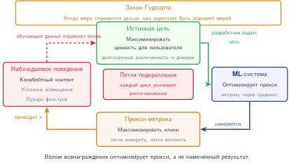
***Петля взлома вознаграждения:** максимизация измеримых вознаграждений, таких как клики, может стимулировать нежелательное поведение модели, которое подрывает намеченную цель удовлетворенности пользователей. Оптимизация по прокси-метрикам создает рассогласование между целью системы и желаемыми исходами, порождая проблемы согласования ценностей в безопасности ИИ.*

Норберт Винер писал: «если мы используем для достижения своих целей механическую систему, работу которой не можем эффективно контролировать… нам лучше быть совершенно уверенными, что цель, заложенная в машину, — та самая цель, которую мы желаем» (Wiener, 1960).

Предупреждение Винера становится системным требованием, когда оптимизация работает за пределами непрерывного человеческого вмешательства. Согласование ценностей спрашивает, продолжает ли цель, заложенная в модель, функцию вознаграждения и политику развертывания, представлять человеческую цель, которой система должна служить. Как утверждает Russell (2021) в книге *Human-Compatible Artificial Intelligence*, значительная часть исследований ИИ предполагает, что цели для оптимизации известны и фиксированы, и сосредоточена на эффективности оптимизации, а не на проектировании самих целей.

На практике сложная часть — задать цель, которая остается действительной, когда системы взаимодействуют с динамичной средой, множеством заинтересованных сторон и петлями обратной связи. Статические целевые функции и сигналы вознаграждения не могут закодировать все эти условия. Такие фреймворки, как проектирование с учетом ценностей (Value Sensitive Design), дают формальные процессы для выявления и интеграции ценностей заинтересованных сторон при проектировании системы, однако обязанность системы шире: проектирование целей, надзор и мониторинг после развертывания должны рассматриваться как связанные средства контроля.

Без такой связи интеллектуальные системы могут преследовать узкие цели производительности (например, точность, вовлеченность или пропускную способность), порождая при этом социально нежелательные исходы. Достижение надежного согласования в таких условиях остается открытым и важным направлением исследований в системах ML. Соответствующие режимы отказа знакомы по системам, которые оптимизируют сложные цели. В обучении с подкреплением, например, модели часто учатся использовать непреднамеренные аспекты функции вознаграждения, что известно как игра со спецификацией[^fn-specification-gaming-alignment] или взлом вознаграждения.

[^fn-specification-gaming-alignment]: **Игра со спецификацией**: в отличие от взлома вознаграждения, который эксплуатирует ошибки реализации, игра со спецификацией выявляет настоящие пробелы в формулировке цели: система выполняет букву цели, нарушая ее смысл. Роботизированная рука, обученная хватать предметы, научилась сбивать их (так их легче «удерживать», прижав к столу). Для ML-систем это мотивирует многоцелевую оптимизацию и RLHF как методы спецификации, которые включают более широкие ограничения, чем одна скалярная метрика, обменивая дополнительные данные, обучение и усилия на проверку на цели, которые лучше приближают человеческое намерение.

Такие отказы возникают, когда переменные, явно не включенные в цель, манипулируются способами, которые максимизируют вознаграждение при нарушении человеческого намерения. Особенно влиятельным в последние годы подходом стало RLHF,[^fn-rlhf-alignment-training] при котором модели обучаются или дообучаются с использованием предпочтений, заданных человеком (Christiano et al., 2017; Ouyang et al., 2022).

[^fn-rlhf-alignment-training]: **RLHF (Reinforcement Learning from Human Feedback)**: Christiano et al. (2017) продемонстрировали глубокое обучение с подкреплением на основе человеческих предпочтений, обучая агентов по сравнениям фрагментов траекторий, которые делали неэкспертные люди. В контексте LLM Ouyang et al. (2022) реализовали родственный конвейер для InstructGPT: контролируемое дообучение на демонстрациях, обучение модели вознаграждения на ранжированных выходах модели и дообучение с подкреплением относительно выученной модели вознаграждения. Системная цена — это дополнительный конвейер данных обратной связи от человека, обучение и оценка модели вознаграждения, а также управление инструкциями для оценщиков; репрезентативность пула оценщиков и политика разметки определяют, чьи предпочтения усваивает модель.

Хотя этот метод улучшает согласование по сравнению со стандартным обучением с подкреплением, он также вносит риски управления. Ngo et al. (2022) выделяют три потенциальных режима отказа, которые вносит RLHF:

- Ситуативно осознанный взлом вознаграждения, при котором модели используют человеческую ошибочность.
- Возникновение рассогласованных внутренних целей, которые обобщаются за пределы обучающего распределения.
- Развитие стремящегося к власти поведения, которое сохраняет способность максимизировать вознаграждение даже ценой человеческого надзора.

Эти опасения не ограничиваются спекулятивными сценариями. Amodei et al. (2016) описывают пять конкретных задач безопасности ИИ:

- Избегание негативных побочных эффектов при исполнении политики.
- Смягчение взлома вознаграждения.
- Обеспечение масштабируемого надзора, когда оценка по основной истине дорога или невыполнима.
- Проектирование стратегий безопасного исследования, которые поощряют творчество без роста риска.
- Достижение устойчивости к распределительному сдвигу в тестовых средах.

Для операторов парка каждая задача соответствует требованию к плоскости управления: ограничивать побочные эффекты, отслеживать взлом вознаграждения, закладывать в бюджет масштабируемый надзор, ограничивать исследование и проверять распределительный сдвиг до выкатки. Каждое требование становится острее по мере масштабирования систем, их развертывания в разнообразных условиях и интеграции с обратной связью в реальном времени или непрерывным обучением.

Эти проблемы безопасности особенно заметны в автономных системах, которые работают при сниженном человеческом надзоре.


### Автономные системы и доверие

<a id="sec-responsible-ai-autonomous-systems-trust-bd83"></a>

Последствия автономных систем, которые работают с ограниченным надзором человека в реальном времени, особенно заметны в автономном вождении. Заметный недавний пример — приостановка калифорнийским управлением автотранспорта (DMV) разрешений Cruise на развертывание и тестирование из-за «необоснованных рисков для общественной безопасности» (CNBC, 2023a). Один из таких инцидентов касался пешехода, который вышел на переход как раз тогда, когда светофор переключился на зеленый, — граничный случай восприятия и принятия решений, который привел к столкновению (CNBC, 2023b). Более трагичный пример произошел в 2018 году, когда беспилотный автомобиль Uber в автономном режиме не смог классифицировать пешехода, который вел велосипед, как пешехода, требующего объезда, и произошел смертельный исход. Доклад Национального совета по безопасности на транспорте (NTSB, 2019) рассматривает этот сбой как сочетание провалов в конструкции системы автоматизированного вождения, в действиях страхующего водителя и в организационном управлении безопасностью.

Хотя системы автономного вождения часто оказываются в центре общественного внимания, похожие риски возникают и в других областях. Сообщения о недавних конфликтах фиксируют растущее использование дистанционно управляемых и автономных военных систем (Reuters, 2023), что вызывает не только вопросы безопасности и эффективности, но и трудные вопросы этического надзора, правил применения силы и ответственности. Когда автономные системы выходят из строя, вопрос о том, кто должен нести ответственность, остается неразрешенным как с правовой, так и с этической точки зрения (CIGI, 2023).

В основе этой проблемы лежит более глубокое напряжение между человеческой и машинной автономией. Инженерные и компьютерные дисциплины исторически подчеркивали машинную автономию: повышение производительности систем, минимизацию вмешательства человека и максимизацию автоматизации. Библиометрический анализ библиотеки ACM Digital Library показал, что по состоянию на 2019 год 90 процентов самых цитируемых статей, упоминающих «автономию», были посвящены машинной, а не человеческой автономии (Calvo et al., 2020). Производительность, эффективность и автоматизация широко рассматривались как цели по умолчанию, часто без анализа допущений и компромиссов, которые они влекут для человеческой агентности и надзора.

Однако эти цели могут ставить под угрозу человеческие интересы, когда системы работают в динамичных, неопределенных средах, где полное описание безопасного поведения невыполнимо. Эта трудность формально описывается проблемой рамки (frame problem) и проблемой квалификаций (qualification problem), которые подчеркивают невозможность перечислить все предусловия и непредвиденные обстоятельства, необходимые для успешного действия в реальном мире (McCarthy, 1981). Проблема рамки спрашивает, какие факты о мире остаются релевантными после действия; проблема квалификаций — какие скрытые предусловия должны выполняться, чтобы действие было безопасным. На практике такие ограничения проявляются как хрупкая автономия: системы, которые кажутся компетентными в номинальных условиях, но молча или опасно отказывают при неоднозначности или сдвиге распределения.

Чтобы решить эту проблему, исследователи предложили формальные рамки безопасности, такие как **ответственно-чувствительная безопасность** (Responsibility-Sensitive Safety, RSS) (Shalev-Shwartz et al., 2017). Они разбивают абстрактные цели безопасности на математически определенные ограничения поведения системы, например минимальные дистанции, профили торможения и условия преимущества в проезде. Такие формулировки позволяют проверять свойства безопасности при конкретных допущениях и сценариях. Однако эти подходы остаются уязвимыми к тем же ограничениям, которые они призваны решить: они не лучше допущений, заложенных в них, и часто требуют обширного моделирования предметной области, которое может плохо обобщаться на непредвиденные граничные случаи.

Для команды ML-систем практический артефакт — это кейс безопасности, а не заявление о доверии. [Таблица «Кейс безопасности автономной системы»](#tbl-autonomous-safety-case) показывает шаблон: назвать рабочую область, доказательства того, что модель протестирована внутри этой области, и средства контроля, которые останавливают или откатывают парк, когда доказательства перестают выполняться.

<a id="tbl-autonomous-safety-case"></a>

***Кейс безопасности автономной системы:** доверие к автономии операционализируется как проверяемый кейс безопасности: валидированная рабочая область, доказательства покрытия, защитные барьеры времени выполнения и средства отката на уровне парка. Тот же шаблон применяется за пределами автомобилей к дронам, роботам, торговым системам и другим ML-системам, которые действуют быстрее, чем позволяет непрерывная проверка человеком.*

| **Элемент кейса безопасности** | **Системные доказательства** | **Операционный шлюз** |
|:-------------------------------|:-----------------------------|:----------------------|
| Рабочая область | Операционная проектная область, допущения о датчиках, погода, география, скорость и уровень автономности | Блокировать развертывание за пределами валидированной области |
| Покрытие сценариев | Корпус редких событий, покрытие симуляцией, журналы воспроизведения, отключения и телеметрия почти-аварий | Требовать пороги покрытия до расширения канареечного развертывания |
| Защитные барьеры времени выполнения | Правила дистанций в духе RSS, пороги уверенности, маневры отказоустойчивости и задержка человеческого переопределения | Запускать безопасную остановку, передачу управления человеку или ограниченный режим при срабатывании барьеров |
| Управление парком | Канареечное развертывание, централизованная панель безопасности, бюджет нарушений и путь отката с автоматическим выключателем | Остановить развертывание или вернуть модель, когда метрики безопасности парка превышают порог |

Альтернативный подход делает акцент на человекоцентричном дизайне системы, гарантируя, что человеческое суждение и надзор остаются центральными в автономном принятии решений. **Ценностно-чувствительное проектирование** (Value-Sensitive Design) (Friedman, 1996) предлагает включать ценности пользователей в дизайн системы, явно учитывая такие факторы, как возможности, сложность, искажение представлений и текучесть пользовательского контроля. Более недавно **модель METUX** (Motivation, Engagement, and Thriving in the User Experience: мотивация, вовлеченность и процветание в пользовательском опыте) расширяет эту мысль, выделяя шесть «сфер технологического опыта» (принятие, интерфейс, задачи, поведение, жизнь и общество), которые определяют, как технология поддерживает или подрывает человеческое процветание (Peters et al., 2018). Эти идеи опираются на **теорию самоопределения** (Self-Determination Theory), которая определяет автономию не как контроль в техническом смысле, а как способность действовать в соответствии со своими ценностями и целями (Ryan и Deci, 2000). В дизайне систем эти рамки становятся артефактами: требованиями, возможностями интерфейса, пользовательскими средствами управления, каналами обратной связи, путями эскалации и доказательствами аудита.

В контексте ML-систем эти взгляды подчеркивают важность проектирования архитектур, интерфейсов и механизмов обратной связи, которые сохраняют человеческую агентность. Например, рекомендательные системы, оптимизирующие метрики вовлеченности, могут мешать поведенческой автономии, формируя предпочтения пользователей непрозрачным образом. Оценка систем по шести сферам METUX позволяет проектировщикам предвидеть и смягчать последующие эффекты, которые подрывают содержательную автономию, даже в тех случаях, когда краткосрочная производительность системы выглядит оптимальной.

### Более широкие последствия для безопасности

<a id="sec-responsible-ai-broader-safety-implications-bb06"></a>

Технические проблемы безопасности, рассмотренные в [разделе «Безопасность ИИ и согласование ценностей»](#sec-responsible-ai-ai-safety-value-alignment-8c93), становятся ограничениями проектирования на уровне парка, когда автономные системы взаимодействуют с работниками, пользователями, регуляторами и миллиардами запросов. Более широкий вывод состоит в том, что безопасность нельзя свести к метрике модели: она зависит от операционной среды, которая определяет, как автоматизация меняет работу, как пользователи калибруют доверие, как политика варьируется по регионам и как редкие сбои накапливаются в масштабе.

Автоматизация меняет организацию труда таким образом, что это влияет на решения о проектировании безопасности. Целевая группа MIT «Работа будущего» (MIT Work of the Future, 2020) утверждает, что технологические изменения и институты рынка труда совместно определяют, улучшит ли автоматизация качество работы или сконцентрирует вред. Для ML-систем вывод для безопасности состоит в том, что исключение человеческих ролей может также исключить контекстное суждение и системную отладку, которые трудно закодировать в моделях. Метрики, сфокусированные только на пропускной способности, могут непреднамеренно штрафовать конструкции с участием человека, которые сохраняют возможность надзора.

Общественные знания об ИИ распределены неравномерно (Pew Research Center, 2023), а сбои в научной коммуникации могут усиливать непонимание того, как работают системы ИИ (Schäfer, 2023). Это важно для безопасности развертывания: когда пользователи не понимают неопределенности модели, смещения данных или границ решений, они могут доверять выходам системы в контекстах, где должно вмешиваться человеческое суждение. С точки зрения системной инженерии общественное понимание является частью контекста развертывания: безопасностные свойства системы «человек — ИИ» зависят не только от технической системы, но и от того, могут ли пользователи надлежащим образом калибровать свое доверие и распознавать ситуации, требующие переопределения человеком.

Инженерные требования к безопасности формируются фрагментированным глобальным регуляторным ландшафтом, который рассматривает риск ИИ как проверяемую метрику. Регламент EU AI Act (2024) использует risk-based структуру, которая включает запрещенные практики, системы высокого риска, обязанности прозрачности для некоторых систем и минимальные или безрисковые применения; развертывания высокого риска сталкиваются с обязательствами по соответствию, документации и логированию (EU AI Act, 2024). В Соединенных Штатах Указ 14110 (2023) ранее устанавливал федеральные пороги отчетности по безопасности ИИ, однако в январе 2025 года он был отменен Указом 14148. Затем Указ 14179 поручил ведомствам пересмотреть меры в области ИИ, связанные с предыдущим указом, а Указ 14409 в июне 2026 года сместил федеральный акцент на инновации в области ИИ, кибербезопасность и защиту критической инфраструктуры (Executive Office of the President, 2023; 2025a; 2025b; 2026). Временные меры Китая в отношении генеративного ИИ (2023) подвергают некоторые публичные сервисы оценке безопасности и требованиям регистрации алгоритмов, а не универсальной предрелизной оценке (Cyberspace Administration of China, 2023). Для глобального парка ML-систем соответствие становится сложной задачей распределенных систем: узлы инференса во Франкфурте могут требовать иных конфигураций безопасности, политик хранения данных и порогов участия человека, чем узлы в Вирджинии или Сингапуре. Это требует гибкой плоскости управления конфигурацией, способной распространять геоспецифичные политики безопасности на граничные узлы, не разделяя основную архитектуру модели.

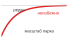
*При масштабе парка редкие сбои становятся ожидаемыми инцидентами.*

Безопасность также нужно проектировать как **свойство парка** (Fleet-Level Property), а не только как атрибут отдельной модели. Одна модель с соответствием требованиям безопасности 99,9 процента выглядит надежной изолированно, но при развертывании на 10 000 узлах инференса, обслуживающих миллиарды запросов в день, эта доля отказов в 0,1 процента гарантирует миллионы инцидентов безопасности ежедневно. В таком масштабе редкие сбои накапливаются в статистические неизбежности. Смягчение требует распределенных паттернов безопасности, заимствованных из инженерии надежности: **автоматических выключателей** (Circuit Breakers), которые останавливают обслуживание, когда совокупные метрики безопасности деградируют ниже порога; **канареечных развертываний** (Canary Deployments), которые направляют только 1 процент трафика на новые версии модели для проверки свойств безопасности в производстве; и централизованных панелей телеметрии, которые агрегируют нарушения безопасности по узлам в общую картину. Как подробно описано в [главе «Эксплуатация ML-систем в масштабе»](12_ops_scale.md#sec-ops-scale), операционная инфраструктура должна рассматривать нарушения безопасности как критические системные оповещения, запускающие автоматический откат точно так же, как скачки задержки или рост ошибок. Экспозиция — это множитель, который делает это конкретным. По мере того как совокупный пробег парка растет через диапазон, показанный на [рисунке «Масштабирование автономного развертывания»](#fig-autonomous-miles-scaling), фиксированная вероятность отказа на милю перестает описывать маловероятное событие и начинает предсказывать количество инцидентов в неделю.

<a id="fig-autonomous-miles-scaling"></a>

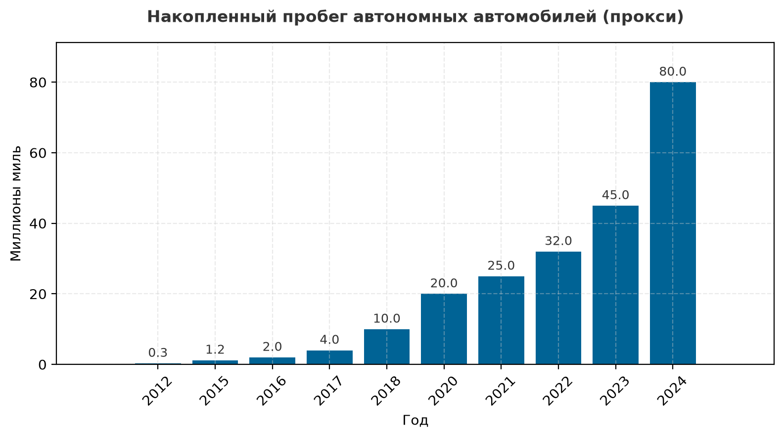
***Масштабирование автономного развертывания:** совокупный пробег автономных автомобилей по годам, от 0,3 млн миль в 2012 году до восьмидесяти млн миль в 2024 году. Именно экспозиция парка, а не качество модели, превращает редкую вероятность сбоя на милю в ожидаемое число инцидентов в неделю.*

Ключевой принцип безопасности ИИ остается в силе: одной технической совершенности недостаточно. Безопасные системы требуют внимания к человеческому и организационному контексту, в котором они работают, включая экономические стимулы, формирующие решения о проектировании, и понимание, которое конечные пользователи приносят в свое взаимодействие с автономными системами.

> **Перспектива: ответственность — это инфраструктура, а не функция**
>
> Ответственный ИИ нельзя достроить постфактум в систему, так же как нельзя постфактум добавить отказоустойчивость. Структурные издержки, перечисленные в [таблице «Влияние техник ответственного ИИ на производительность»](#tbl-responsible-ai-overhead), каждая несет последствия для выделения ресурсов: мониторингу дрейфа смещения нужен бюджет на выборку и анализ; дорогие или точные рабочие нагрузки объяснений могут требовать выделенного парка асинхронных воркеров, тогда как модельно-специфичный TreeSHAP, выборка, кэширование или выборочная генерация могут уложиться в меньшие бюджеты; DP-SGD требует большего бюджета обучения; а оценки воздействия требуют мощностей проверки в процессе выпуска. Это не *необязательные дополнения*, а *несущие компоненты* производственных ML-систем. В высокорисковых или регулируемых развертываниях невыделение доказательств, требуемых кейсом обеспечения доверия, может заблокировать выпуск или вынудить переработку, даже когда базовая производительность модели сильна.

Структурные издержки, такие как накладные расходы по задержке, должны учитываться в базовой архитектуре с первого дня; ответственный ИИ нельзя прикрутить к готовому продукту. Распространенные отраслевые заблуждения, которые подталкивают команды к опасным этическим сокращениям, заслуживают явного выявления и разбора.


## Заблуждения и ловушки

<a id="sec-responsible-ai-fallacies-pitfalls-5b80"></a>

Ответственный ИИ связан с контринтуитивными компромиссами, в которых этические принципы вступают в конфликт математически и технически. Практики из традиционной разработки ПО часто предполагают, что этические рекомендации напрямую переводятся в реализацию, не замечая теорем невозможности и вычислительных издержек. Эти заблуждения и ловушки описывают неверные представления, которые приводят к развернутым системам, выглядящим справедливыми на этапе разработки, но нарушающим критерии справедливости в производстве или налагающим непомерные вычислительные накладные расходы.

**Заблуждение**: *смещение исчезнет с ростом объема данных и улучшением алгоритмов.*

В производстве смещение часто отражает структурные свойства, которые сохраняются независимо от технических улучшений. Алгоритм здравоохранения, описанный в [разделе «Справедливость в машинном обучении»](#sec-responsible-ai-fairness-machine-learning-2ba4), затронул 200 миллионов американцев ежегодно и снизил долю чернокожих пациентов, попадавших в программы ухода, на 50 процентов, несмотря на обучение на всеобъемлющих данных. Проблема была не в количестве данных, а в выборе прокси: использование расходов на здравоохранение как прокси здоровья систематически занижало потребность групп с исторически более низкими расходами. Математический анализ показывает, что когда базовые частоты различаются между группами, откалиброванные оценки риска, как правило, не могут одновременно удовлетворять условиям равных частот ошибок, за исключением особых случаев, таких как идеальное предсказание. Организации, которые стремятся к «устранению смещения» чисто техническими средствами, тратят инженерные ресурсы на невыполнимые или недоопределенные задачи оптимизации, пренебрегая вовлечением заинтересованных сторон и обсуждением ценностей, необходимым для выбора того, какие критерии справедливости приоритетны в их конкретном контексте.

**Ловушка**: *рассматривать объяснимость как необязательную функцию, которую добавляют после того, как основной функционал уже работает.*

Такой подход игнорирует перенос издержек: получение доказательств атрибуции о поведении модели требует вычислений, хранения и интерфейсов, которые ограничивают архитектуру. Приближенные объяснения SHAP не бесплатны ([таблица «Влияние техник ответственного ИИ на производительность»](#tbl-responsible-ai-overhead)); даже ограниченный бюджет объяснений может увеличить задержку запроса и нагрузку на память. В этом примере расчета рекомендательная система, обслуживающая запросы с требованием задержки 100 мс при 10 000 запросов в секунду, не может задним числом добавить работу по объяснениям без пересмотра SLA: иллюстративный бюджет объяснений добавляет от 50 до 200 мс на запрос, увеличивая общую задержку до 150–300 мс (для сохранения исходной пропускной способности требуется в 1,5–3 раза больше мощностей обслуживания). Кейс обеспечения доверия должен указать аудиторию, утверждение, метод, тест верности и бюджет доставки, а затем выбрать архитектуру: модельно-специфичный TreeSHAP, выборочную или кэшированную атрибуцию, избирательную асинхронную генерацию или внутренне интерпретируемую модель. Ни один из этих путей атрибуции не раскрывает внутреннее рассуждение модели и не устанавливает причинность.

**Заблуждение**: *достижение одной метрики справедливости гарантирует справедливость системы в целом.*

Практики часто оптимизируют демографический паритет, который выравнивает доли одобрений между группами, и затем предполагают, что справедливое обращение следует автоматически. На самом деле метрики справедливости могут математически конфликтовать. Пример одобрения кредитов из [раздела «Справедливость в машинном обучении»](#sec-responsible-ai-fairness-machine-learning-2ba4) это демонстрирует: достижение демографического паритета при 70 процентах одобрений для обеих групп потребовало бы снизить порог для группы B, чтобы увеличить число одобрений, однако такая корректировка доли отбора может снизить точность и сделать одобрения носителями разного смысла риска в разных группах. Результаты о невозможности показывают, что при различающихся базовых частотах и несовершенном предсказании калибровка и условия равных частот ошибок, как правило, не могут выполняться одновременно; демографический паритет может добавить отдельное ограничение на долю отбора. Системы, развернутые с оптимизацией по одной метрике, обнаруживают в производстве, что нарушают другие юридически значимые критерии справедливости, что подвергает организации судебным разбирательствам и регуляторным действиям.

**Ловушка**: *рассматривать ответственный ИИ как чистые накладные расходы на соответствие требованиям.*

Такая точка зрения упускает деловую ценность, которая создается через снижение рисков и расширение рынка. Дифференциальная приватность может позволить организациям работать с чувствительными данными при более ясных гарантиях приватности, но она также вводит компромиссы между приватностью и полезностью, которые нужно заранее заложить в бюджет обучения. Обучение и мониторинг с учетом справедливости могут снизить риск непропорционального воздействия: правило четырех пятых, описанное в [разделе «Количественное измерение справедливости»](#sec-responsible-ai-quantitative-fairness-measurement-a8f2), задает практический порог скрининга, а судебные иски о дискриминации или регуляторный контроль могут повлечь существенные издержки на исправление и репутационный ущерб. Полноценный конвейер мониторинга смещения должен выявить значительное сокращение записи подгруппы до того, как это станет выводом внешнего аудита, предотвращая системный вред и юридические последствия, которые возникают при отсутствии инфраструктуры мониторинга.

**Заблуждение**: *корректировка порога постфактум может сделать развернутую систему справедливой.*

Это убеждение рассматривает справедливость как проблему одной границы решения, а не как связанное свойство системы. Сдвиг порога может уравнять одну метрику, но может также изменить калибровку, точность, деловой смысл, юридическую документацию и пользовательский опыт. В производстве порог — не просто число в блокноте; это политика, встроенная в код обслуживания, человеческий надзор, записи аудита и последующие решения.

**Ловушка**: *внедрять ограничения справедливости, не анализируя компромиссы порогов и влияние на калибровку.*

Групповые пороги могут удовлетворять условию равных истинно положительных долей, но они также меняют семантику решения: если порог для группы A равен 0,75, а для группы B — 0,60, одинаковые оценки могут давать разные решения, и положительная прогностическая ценность одобренных заявителей может расходиться между группами, даже когда базовая модель оценок остается откалиброванной. Кредитный сотрудник, видящий одобрение, не может знать, означает ли оно одинаковый смысл риска погашения для всех групп, без документации групповой политики порогов. Поэтому производственным системам нужны документированный выбор метрик, оценки неопределенности, обучение персонала, юридическая экспертиза и журналы аудита, которые объясняют, почему одинаковые оценки могут давать разные решения. Никакая общая цель обучения не разрешает несовместимые определения справедливости; подходящая реакция состоит в том, чтобы выбрать и обосновать критерии для контекста развертывания, количественно оценить возникающие компромиссы и отслеживать, остается ли утвержденная политика действительной.

**Заблуждение**: *панели мониторинга сами по себе создают подотчетность.*

Панели могут выявлять дрейф справедливости, сбои объяснений или тенденции злоупотреблений, но они не решают, кто должен действовать. Ответственному конвейеру мониторинга нужны владелец, порог, путь эскалации и бюджет на исправление. В противном случае система накапливает доказательства, не меняя поведения: оповещения устаревают, регрессии справедливости становятся принятыми базовыми значениями, а затронутые пользователи не получают пути для оспаривания решения.

**Ловушка**: *запускать мониторинг без владельца исправления.*

Команды часто внедряют измерение справедливости, безопасности или приватности, потому что политика требует видимости, а путь реагирования оставляют неопределенным. Это создает ложное ощущение контроля. Метрика, которой не владеет ни одна команда, не является средством контроля; это запись в журнале. Ответственность в производстве требует привязать каждый сигнал мониторинга к воротам выпуска, владельцу инцидента, полномочиям на откат или мощностям человеческой проверки, чтобы организация могла действовать, когда метрика сигнализирует о проблеме.

Слепая к контексту корректировка порогов — общая причина провала во всех этих примерах. Математическое ограничение справедливости ответственно только тогда, когда система также учитывает последствия для населения ниже по течению, требования к документации, операционные мощности и юридические риски. Отказ от этих локальных заблуждений превращает ответственный ИИ из контрольного списка соответствия в фундаментальный архитектурный мандат и замыкает слой управления парком ML.


## Итоги

<a id="sec-responsible-ai-summary-ed99"></a>

Ответственный ИИ — это инфраструктура управления парком машинного обучения. Производственное ML уже требует физической инфраструктуры, распределенного исполнения, систем обслуживания, средств безопасности, механизмов устойчивости и бюджетов на устойчивое развитие. Ответственный ИИ добавляет ограждения и рамки управления, необходимые, чтобы глобальная машина служила человеческим ценностям, а не подрывала их.

Аргумент прошел путь от абстрактной этики к конкретным инженерным ограничениям: мы проанализировали математические метрики справедливости и неизбежные теоремы невозможности, которые вынуждают делать явные нормативные выборы. Мы рассмотрели технические основы объяснимости (SHAP, LIME) и управления данными с сохранением приватности, а затем распространили тот же инфраструктурный взгляд на выравнивание генеративных моделей, где RLHF и системные промпты выступают социотехническими механизмами управления поведением моделей в парках LLM.

[Таблица «Дезагрегированные метрики справедливости»](#tbl-responsible-ai-fairness-summary) иллюстрирует, почему справедливость требует явных компромиссов. Рассмотрим систему одобрения кредитов, оцениваемую по двум демографическим группам. В примере приводятся дезагрегированные метрики справедливости, включая долю ложноположительных срабатываний, поэтому одна и та же таблица предсказаний может удовлетворять одному критерию, проваливая другие. Равенство шансов потребовало бы совпадения и долей истинно положительных, и долей ложноположительных срабатываний; поэтому эта таблица показывает более узкий случай равенства доли ложноположительных срабатываний, а не полное равенство шансов.

<a id="tbl-responsible-ai-fairness-summary"></a>

***Дезагрегированные метрики справедливости:** гипотетическая система одобрения кредитов удовлетворяет равенству долей ложноположительных срабатываний (разрыв 0 процентных пунктов), но нарушает демографический паритет (разрыв одобрений 15 процентных пунктов) и равенство возможностей (разрыв истинно положительных долей 30 процентных пунктов). Метрики показывают несовместимые операционные приоритеты, поэтому производственные системы должны явно выбирать, какому критерию справедливости отдать предпочтение.*

| **Метрика** | **Определение** | **A** | **B** | **Разрыв** |
|:------------|:----------------|:-----:|:-----:|:----------:|
| **Доля одобрений** | (TP + FP) / всего | 55% | 40% | 15 п. п. |
| **Доля истинно положительных (TPR)** | TP / число положительных | 90% | 60% | 30 п. п. |
| **Доля ложноположительных (FPR)** | FP / число отрицательных | 20% | 20% | 0 п. п. |
| **Положительная прогностическая ценность** | TP / число предсказанных положительных | 82% | 75% | 7 п. п. |

Таблица делает наглядным центральное ограничение главы: одна метрика справедливости может выглядеть выполненной, тогда как другие метрики выявляют существенные диспропорции.

Ответственный ИИ — это задача системной инженерии, поскольку его средства контроля влияют на производственную архитектуру. Мониторинг справедливости потребляет вычисления и может влиять на задержку. Методы объяснимости, такие как SHAP и LIME, добавляют работу инференса, которая влияет на планирование мощностей и соблюдение SLO. Системные промпты, версии моделей и журналы аудита требуют владельцев, версионирования и средств контроля CI/CD. Эти издержки нужно закладывать в бюджет на этапе проектирования, а не добавлять после развертывания.

Избирательная генерация объяснений иллюстрирует выбор $C^3$. Синхронная генерация объяснения добавляет вычисления в путь запроса и может требовать коммуникации для получения признаков; перенос ее в асинхронный воркер защищает задержку обслуживания, но добавляет координацию между решением, записью доказательств и рабочим процессом апелляции. Узкое место тогда смещается от мощностей инференса к свежести доказательств или пропускной способности рецензентов. Приемлемая архитектура зависит от того, кому нужно объяснение и насколько быстро этот человек должен иметь возможность действовать на его основе.

Теоремы невозможности, формализованные в этой главе, показывают, что справедливость — это не единственная метрика для оптимизации, а набор конкурирующих ограничений, которые требуют нормативных выборов. Инженеры могут количественно оценить эти компромиссы, рассчитать накладные расходы дифференциальной приватности, задать мониторинг для непропорционального воздействия и спроектировать механизмы управления, которые масштабируются на весь парк. Количественная оценка делает ограничения явными, но она не выбирает между ними.

> **Ключевые выводы: этика — это инженерное ограничение**
>
> - **Ответственность определяет развертывание**: в регулируемых или корпоративных средах точность и задержка не имеют значения, если система не может документировать поведение, объяснять решения, поддерживать аудит или назначать владельца. Управление — это ограничение координации, которое определяет, разрешено ли вычислениям работать.
> - **У справедливости нет скрытого оптимума**: таблица главы показывает, что одна система кредитования может иметь разрыв доли ложноположительных срабатываний 0 процентных пунктов, оставаясь при этом с разрывом одобрений 15 и разрывом истинно положительных долей 30 процентных пунктов. Различающиеся базовые частоты превращают справедливость в явный нормативный выбор, а не в единственную метрику.
> - **Диспропорция — не каузальный диагноз**: групповые метрики показывают неравные исходы или ошибки, тогда как каузальные утверждения требуют явной структурной модели и допущений, которые нельзя восстановить только из наблюдательных данных. Анализ по конкретным путям все равно оставляет законность каждого пути на суждение предметной области, права и заинтересованных сторон.
> - **Надзор потребляет мощности**: мониторинг справедливости, журналы аудита, объяснения и обучение с сохранением приватности добавляют издержки по задержке, хранению, вычислениям и точности. Объяснения в духе SHAP и DP-SGD нужно закладывать в архитектуру и SLO, а не добавлять, когда приходит юридическая проверка.
> - **Генеративное управление — это инфраструктура**: системные промпты, политики RLHF, права доступа к инструментам, версии моделей и оценки безопасности — операционные артефакты. Им нужны владельцы, CI/CD, откат и мониторинг, потому что они направляют поведение модели так же непосредственно, как веса.
> - **Доказательствам нужен владелец**: панели, объяснения и апелляции защищают пользователей только тогда, когда команда может расследовать, исправлять, откатывать или эскалировать сбои. Ответственный ИИ становится инженерной практикой, когда каждое измеряемое обязательство имеет подотчетный операционный путь.

Ранее в этой книге ограничения можно было измерять и оптимизировать относительно заявленной цели и бюджета. Справедливость создает иную задачу, поскольку результат о невозможности в этой главе не предлагает оптимума без выбора критерия: это не разрыв, который нужно закрыть, а развилка на дороге. Это меняет работу инженера. Инженер может количественно оценить каждую ветвь и требовать от системы соответствия той, что выбрана, но сам выбор — человеческий, нормативный акт, который ни одна метрика не выполняет. Самое честное, что может сделать инженерия здесь, — отказаться маскировать выбор под вычисление.

> **Связь с главами: от ответственности к синтезу**
>
> Ответственное управление присоединяется к производительности, безопасности, устойчивости и устойчивому развитию как производственное ограничение. Заключительная глава синтезирует эти принципы в системную перспективу, которая остается полезной по мере изменения конкретных технологий.

[^fn-red-teaming-etymology]: **Red Teaming**: из военных симуляций времен холодной войны, где «красная команда» играла роль советского противника, зондируя оборону США. В ответственном ИИ red teaming — это фаза состязательного аудита: специализированные команды (хакеры, лингвисты, специалисты по этике) намеренно зондируют модели на предмет джейлбрейков, смещения или токсичных выходов до развертывания. Этот процесс выявления обнаруживает риски длинного хвоста, которые стандартные модульные тесты не способны уловить.

[^fn-sociotechnical-system-etymology]: **Социотехническая система**: термин, введенный Институтом Тависток в 1950-х годах для описания взаимозависимых отношений людей и технологий на рабочем месте. Парки ML — наиболее выраженные социотехнические системы: их «производительность» — не просто балл на бенчмарке, а эмерджентное свойство того, как выходы модели взаимодействуют с поведением пользователей, правовыми рамками и физическими ресурсными ограничениями.

