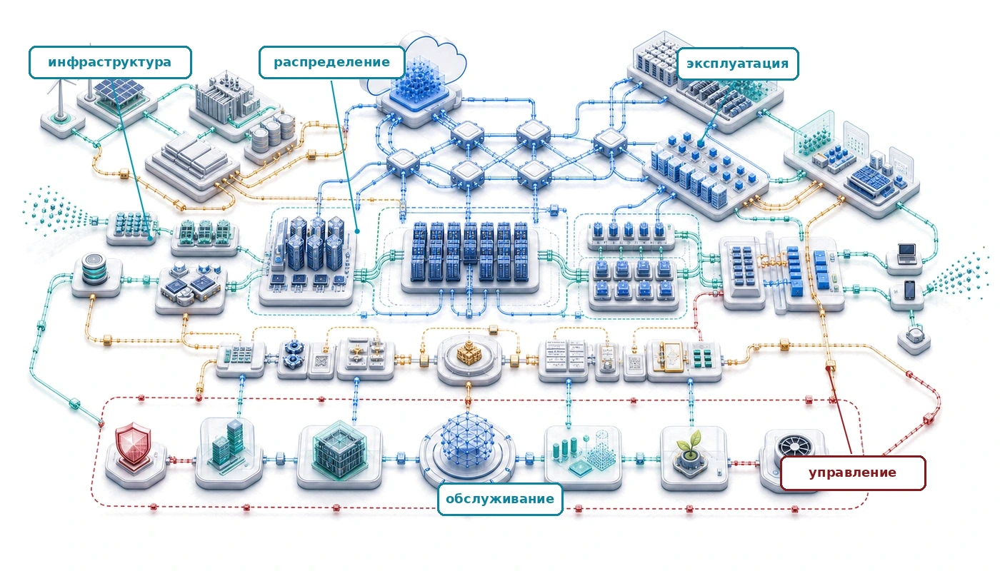
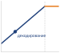
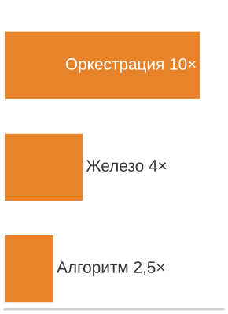
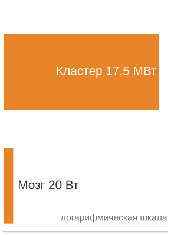

# Заключение

## Назначение

_Почему единицей проектирования систем машинного обучения должен быть парк, а не модель?_

Стек парка — это не просто последовательность тем, а рабочая дисциплина. Физическая инфраструктура задает скорости и пределы; распределенные протоколы превращают эти пределы в издержки координации; системы развертывания превращают обученные модели в сервисы с обязательствами по задержке, доступности и стоимости; а ограничения управления определяют, могут ли эти сервисы оставаться безопасными, надежными, устойчивыми и подотчетными. Шесть принципов образуют единую структуру, чтобы инженер мог рассуждать обо всем парке, когда лучший локальный выбор на одном уровне создает ограничение на другом. В терминах $C^3$ профессиональная привычка состоит в том, чтобы определить, какой член — вычисления, коммуникации или координация — становится лимитирующим, и затем проследить это ограничение через уровни, пока объектом проектирования не станет парк, а не только модель.

> **Цели обучения**
>
> - Синтезировать шесть принципов в карту ограничений распределенных ML-систем
> - Оценивать конструкции парка с помощью терминов $C^3$, частот отказов, обязательств обслуживания и ограничений управления
> - Анализировать, как инфраструктура, распределенное обучение, инференс, эксплуатация и управление взаимодействуют на стеке парка
> - Переводить обязательства по безопасности, справедливости, приватности, углероду и надежности в измеримые проектные ограничения
> - Вырабатывать инженерное суждение, которое балансирует масштаб, устойчивость, ответственность и операционную дисциплину

## Синтез распределенных ML-систем

Передовая модель становится производственной системой только тогда, когда тысячи ускорителей, сетевые фабрики, уровни хранения, планировщики, реплики обслуживания, средства безопасности и проверки управления действуют как одна машина. Любой отдельный уровень может стать лимитирующим для всей системы:

- Ограничение хранения: медленная запись контрольных точек может растратить окно обучения.
- Ограничение фабрики: перегруженная сеть может свести на нет выигрыш от масштабирования.
- Ограничение обслуживания: недостаточно выделенный пул обслуживания может превратить качество модели в задержку, которую видит пользователь.
- Ограничение управления: неизмеренное ограничение ответственности может заблокировать развертывание уже после того, как техническая система заработала.

Именно такое интегрированное ограничение отличает фундаментальную инженерию ML от распределенной. Фундаментальная инженерия ML сосредоточена на одном артефакте: весах нейронной сети, оптимизированных алгоритмами обучения и архитектурой на отдельных системах. Распределенная инженерия ML сосредоточена на инфраструктуре, которая управляет этим артефактом в масштабе, включая дата-центры, распределенные протоколы и системы управления. Шесть принципов определяют этот сдвиг.

Стек парка устроен намеренно. Нижний уровень создал физическую основу: кремний, провода и хранилища, которые делают распределенное ML возможным. Эта основа важна, потому что каждое решение более высокого уровня наследует ее пределы. Стратегия обучения, которая не учитывает топологию ускорителей, план хранения, который не учитывает пропускную способность загрузки данных, или политика планирования, которая не учитывает сетевую конкуренцию, неизбежно столкнется с физикой, лежащей в основе.

Уровень распределения показал, как физические пределы превращаются в системные протоколы. Разбиение работы, синхронизация градиентов, устойчивость к отказам и оркестрация ресурсов — это не отдельные задачи; это механизмы, которые превращают множество машин в одну полезную систему обучения или обслуживания. Уровень развертывания перенес ту же логику наружу: инференс, инженерия производительности, граничное развертывание и эксплуатация превращают обученную модель в сервис с обязательствами по задержке, доступности и стоимости. Уровень ответственного парка добавил последнее ограничение: техническая возможность должна оставаться безопасной, устойчивой, экологичной и подотчетной. Эти уровни связывают решения от выбора алгоритма через проектирование инфраструктуры до управления.

## Шесть принципов распределенных ML-систем

Инженерные практики, с которых открылась эта книга (сначала инструментировать, закладывать запас, совмещать проектирование железа и алгоритмов), становятся полезными только тогда, когда называют ограничение, которое пытаются сдвинуть. Шесть принципов из [таблицы ниже](#tbl-vol2-principles) — это устойчивые реалии: каждый называет ограничение, управляющий вопрос и метрику, которая определяет, может ли распределенная ML-система масштабироваться.

Фундамент одного узла определяется строгими математическими ограничениями, например железным законом, где производительность — это количественная физика. Инженерия парка переводит этот фундамент в вероятностные и операционные реалии: каналы конкурируют, рабочие процессы отказывают, планировщики принимают устаревшие решения, а политические ограничения меняют то, что технически осуществимый проект может делать. Мостом между этими областями служит закон парка ($T_{\text{step}}(N) = \frac{T_{\text{compute}}}{N} + T_{\text{comm}}(N) + T_{\text{sync}}(N) - T_{\text{overlap}}$), который выведен полностью в разделе «Закон парка» [приложения «Таксономия C³»](appendix_c3.md#sec-appdx-c3-taxonomy-fleet-law) и используется в ключевых местах текста. Закон парка играет роль распределенного аналога железного закона: он переводит выполнение на одной машине в механику сетевых коллективных операций и порождает эксплуатационные явления, наблюдаемые в масштабе. Три его члена стоимости напрямую соответствуют таксономии $C^3$, которая организует эту книгу: $T_{\text{compute}}/N$ соответствует вычислениям, $T_{\text{comm}}(N)$ — коммуникациям, а $T_{\text{sync}}(N)$ — координации. Поправка на перекрытие $T_{\text{overlap}}$ учитывает время коммуникации или координации, скрытое за полезными вычислениями, и не определяет четвертую ось $C^3$.

Эти принципы образуют слоистую архитектуру, которая повторяет стек парка, синтезированный на [рисунке](#fig-fleet-stack-conclusion). На физическом фундаменте инфраструктура определяет возможности[^fn-hardware-capability-ceiling], потому что физика железа задает жесткие пределы.

[^fn-hardware-capability-ceiling]: **Потолок возможностей железа**: на масштабе парка железо задает жесткие физические потолки ($R_{\text{peak}}$, бисекционная пропускная способность, тепловая расчетная мощность); нагрузки, превышающие эти пределы, не могут выполниться, пока не изменятся инфраструктура или разбиение модели, поэтому системная инженерия — это дисциплина размещения вычислений в этих физических границах. В операционной реальности средних уровней доминируют коммуникации, а отказы рутинны: это повседневная динамика эксплуатации распределенных систем, напрямую определяемая сетевым и синхронизационным членами закона парка. На уровне управления два принципа действуют как нормативные ограничения на то, что может быть построено, а не на то, что возможно технически: ответственность ограничивает проект, а устойчивость является затратой первого порядка. Из этого стека вырастает шестой принцип: масштаб создает качественные изменения.

***Стек парка:** физический фундамент (парк) определяет возможности, а уровень распределения (распределенное ML) и уровень развертывания задают инженерную среду. Они ограничены требованиями управления (ответственный парк), а эмерджентное свойство масштаба — качественные изменения, которые объединяют дисциплину.*

[Таблица принципов](#tbl-vol2-principles) — это скорее карта решений, чем глоссарий: каждый из шести принципов связывает вопрос, метрику и контекст разработки, которые инженер использует при диагностике проекта парка. Таблица и последующий обход упорядочивают принципы по тому, что чаще всего становится лимитирующим первым в масштабе, начиная с коммуникации, а не с фундамента, как на рисунке.

***Шесть принципов распределенных ML-систем:** принципы описывают качественные сдвиги, которые происходят, когда ML-системы переходят от одной машины к распределенной промышленной эксплуатации. Каждый принцип связан с конкретными метриками и главами, где концепция разбирается подробно.*

| **Принцип**                              |       **Ключевой вопрос**       | **Ключевая метрика**                   | **Глава**                                                                                      |
|:-----------------------------------------|:-------------------------------:|:---------------------------------------|:-----------------------------------------------------------------------------------------------|
| **Коммуникации доминируют**              |       Где узкое место?          | Утилизация пропускной способности сети | [«Коллективные коммуникации»](06_collective_communication.md#sec-collective-communication)     |
| **Отказы — норма**                       |       Как восстанавливаться?    | MTBF, накладные расходы контрольных точек | [«Отказоустойчивость»](07_fault_tolerance.md#sec-fault-tolerance-reliability)                 |
| **Инфраструктура определяет возможности** |     Что возможно?               | FLOP/s, пропускная способность памяти  | [«Вычислительная инфраструктура»](02_compute_infrastructure.md#sec-compute-infrastructure)   |
| **Ответственность ограничивает проект**  |       Кто затронут?             | Метрики справедливости, журналы аудита | [«Ответственный ИИ»](16_responsible_ai.md#sec-responsible-ai)                                  |
| **Устойчивость — затрата первого порядка** |     Какова стоимость?           | кВт·ч на обучение, углеродный след     | [«Устойчивый ИИ»](15_sustainable_ai.md#sec-sustainable-ai)                                     |
| **Масштаб создает качественные изменения** |   Что ломается при 1 000×?      | Эффективность масштабирования          | [«Распределенное обучение»](05_distributed_training.md#sec-distributed-training-systems)       |

Первый принцип: коммуникация может стать лимитирующим членом при масштабировании (Jiang et al., 2024; Narayanan et al., 2021). Во многих режимах синхронного обучения синхронизация градиентов и эффекты отстающих доминируют, если топология, перекрытие и батчинг не спроектированы вокруг них. Производственные системы инференса тоже могут стать ограниченными задержкой из-за эффектов хвоста[^fn-tail-effect-latency] (Dean и Barroso, 2013): самый медленный рабочий узел определяет время ответа независимо от того, как быстро завершаются остальные.

[^fn-tail-effect-latency]: **Хвостовая задержка**: стандартная оценка разветвления запросов для эффектов хвоста, разобранных в [главе «Инференс в масштабе»](10_inference.md#sec-inference-scale): на 99-м перцентиле запрос, обращающийся к 100 серверам, с вероятностью 63,4 % задевает хотя бы один медленный сервер.

[Распределенное обучение](05_distributed_training.md#sec-distributed-training-systems) и [Коллективные коммуникации](06_collective_communication.md#sec-collective-communication) разрабатывают этот принцип подробно: показывают, как кольцевой AllReduce в духе Horovod[^fn-ring-allreduce-collective] (Sergeev и Del Balso, 2018), сжатие градиентов[^fn-gradient-compression-allreduce] и перекрытие вычислений с коммуникацией решают проблемы узких мест в коммуникациях. Для плотных коллективных нагрузок обычные фабрики с избыточной подпиской часто становятся узкими местами, что мотивирует фабрики с высокой бисекционной пропускной способностью и выбор транспорта под коммуникационные паттерны ML. Распознавание того, что коммуникация является активным ограничением, проясняет, когда алгоритмические оптимизации помогут, а когда они лишь переносят работу между одинаково ограниченными ресурсами. Расширение коммуникационной фабрики на тысячи узлов также вводит новую операционную реальность: отказ компонентов.

[^fn-ring-allreduce-collective]: **Кольцевой AllReduce**: коллективная операция, которая перемещает $2(N-1)M/N$ байт на рабочий узел для размера сообщения $M$, давая $T_{\text{allreduce}} \approx 2(N-1)\alpha + \frac{2(N-1)}{N}\frac{M}{\beta}$ в модели коммуникаций $\alpha$-$\beta$. Коэффициент приближается к удвоенному объему сообщения на рабочий узел при росте $N$, оставаясь оптимальным по пропускной способности для больших сообщений. Подробно см. [главу «Коллективные коммуникации»](06_collective_communication.md#sec-collective-communication).

[^fn-gradient-compression-allreduce]: **Сжатие градиентов**: [глава «Коллективные коммуникации»](06_collective_communication.md#sec-collective-communication) рассматривает разреживание, квантование и коррекцию ошибок как способы уменьшить полезную нагрузку коммуникаций и показывает, почему эту экономию нужно сопоставлять с затратами на сходимость и накопление ошибок.

Второй принцип следует напрямую: в распределенном масштабе отказы компонентов происходят не изредка, а непрерывно. Опыт Meta при обучении Llama 3 на 16 384 GPU задокументировал 419 непредвиденных прерываний за 54 дня, в среднем одно прерывание каждые 3,1 часа (Dubey et al., 2024). Аппаратные сбои, разрывы сети и сбои сервисов — рутинные события, которые системы должны обрабатывать без вмешательства человека. Синхронный характер крупномасштабного обучения усиливает цену каждого сбоя: отказ одного ранга останавливает все остальные ранги в коллективной операции и вынуждает весь парк откатиться к последней контрольной точке. Вычислительные потери от одного события поэтому растут линейно с размером кластера, и именно поэтому частота контрольных точек и архитектура восстановления — не запоздалые мысли, а измерения первого порядка.

[Отказоустойчивость](07_fault_tolerance.md#sec-fault-tolerance-reliability) показывает, что архитекторы должны закладывать обработку отказов с самого начала. Стратегии контрольных точек уравновешивают детализацию восстановления и накладные расходы. Эластичное обучение[^fn-elastic-training-membership] динамически подстраивается под изменение состава кластера, а мягкая деградация поддерживает качество сервиса по мере уменьшения мощности. Системы, которые считают отказ исключительным случаем, не выживают в промышленной эксплуатации.

[^fn-elastic-training-membership]: **Эластичное обучение**: такие фреймворки, как TorchElastic, реагируют на изменения состава, останавливая оставшихся рабочих, пересобирая группу рабочих и перезапуская их с новыми рангами. Фреймворк управляет рандеву и членством, а пользовательский код остается ответственным за семантику контрольных точек, размера батча и скорости обучения; см. [главу «Отказоустойчивость»](07_fault_tolerance.md#sec-fault-tolerance-reliability).

Коммуникация и отказы вместе составляют операционную реальность распределенных систем, средний уровень стека парка. Оба зависят от лежащей под ними физической основы, что делает инфраструктуру третьим принципом. [Вычислительная инфраструктура](02_compute_infrastructure.md#sec-compute-infrastructure) показывает, что инфраструктура определяет, какие нагрузки возможны вообще, а не только насколько быстро они выполняются. Бисекционная пропускная способность кластера и плотность мощности микросхем задают жесткие потолки для размеров модели и батча, которые парк способен обучить вообще, независимо от того, как настроен алгоритм обучения.

Стена памяти делает этот принцип конкретным: пока вычисления (TFLOP/s) могут быть в избытке, пропускная способность памяти (ГБ/с) остается ограничивающим фактором для авторегрессивного декодирования. [Инференс в масштабе](10_inference.md#sec-inference-scale) и [Устойчивый ИИ](15_sustainable_ai.md#sec-sustainable-ai) количественно показывают, как неспособность переносить данные из высокопроизводительной памяти (HBM) к процессору достаточно быстро делает авторегрессивную генерацию по своей природе неэффективной. Освоение парка требует понимания этих физических пределов — от тепловой плотности микросхем до бисекционной пропускной способности кластера. Когда инфраструктура определила, что система может делать, управление определяет, что ей разрешено делать.

*Декодирование ограничено памятью и лежит левее хребта roofline.*

Четвертый принцип — ответственная инженерия. [Ответственный ИИ](16_responsible_ai.md#sec-responsible-ai) переводит рамки управления рисками ИИ в инженерные ограничения (NIST, 2023). Риски, специфичные для безопасности, такие как взлом вознаграждения, дрейф распределения и масштабируемый надзор, показывают, почему эти ограничения требуют механизмов реализации (Amodei et al., 2016). Справедливость, прозрачность, подотчетность, приватность и безопасность — требования первого класса, которые формируют архитектуру системы на всем протяжении жизненного цикла ML.

Закон невозможности справедливости (см. [главу «Ответственный ИИ»](16_responsible_ai.md#sec-responsible-ai)) показывает, что это системное ограничение, а не задача настройки: когда базовые частоты различаются между группами, никакая модель не может одновременно удовлетворить калибровку и баланс ошибок, кроме случая идеального предсказания (Kleinberg et al., 2017; Chouldechova, 2017). Поэтому инженеры должны выбрать, какой критерий приоритетен, и построить мониторинг, который его удерживает. Проектировать справедливость нужно с самого начала, с мониторинговой инфраструктурой, которая обнаруживает деградацию между демографическими группами. Инженерные методы ответственного ИИ — от обнаружения смещения до механизмов объяснимости — имеют такой же вес, как оптимизация производительности. Экологическая ответственность расширяет этот слой управления на физический бюджет ресурсов.

Пятый принцип — устойчивость. [Устойчивый ИИ](15_sustainable_ai.md#sec-sustainable-ai) показывает, как экологическое воздействие крупномасштабного ML превращает эффективность использования ресурсов в первоочередное инженерное ограничение (Strubell et al., 2019; Patterson et al., 2021). Парадокс Джевонса для ИИ адаптирует аргумент Джевонса об эффективности ресурсов, чтобы объяснить, почему выигрыш в эффективности оборудования сам по себе не устраняет затраты энергии и углерода: более дешевые вычисления расширяют развертывание, поэтому экономия на запрос поглощается ростом использования, если абсолютные углеродные бюджеты не управляют парком (Jevons, 1865).

Устойчивость поэтому переходит от экологической заботы к инженерной дисциплине. Затраты на энергию могут превышать бюджеты разработки модели, тепловые пределы ограничивают плотность оборудования, а требования к энергоинфраструктуре ограничивают места развертывания. Углеродно-учитывающее планирование, оценка жизненного цикла[^fn-lifecycle-assessment-sustainability] и оптимизация эффективности становятся необходимыми инженерными компетенциями наряду с традиционными метриками производительности. Эти первые пять принципов сходятся в последнем выводе: масштаб меняет поведение самой системы.

[^fn-lifecycle-assessment-sustainability]: **Оценка жизненного цикла**: [глава «Устойчивый ИИ»](15_sustainable_ai.md#sec-sustainable-ai) оценивает экологическое воздействие на протяжении срока службы системы, включая воплощенный углерод производства оборудования. Воплощенные выбросы могут составлять существенную долю полного воздействия на чистых сетях или когда оборудование задействовано слабо.

Шестой принцип утверждает, что системы, работающие на умеренном масштабе, демонстрируют принципиально иное поведение в промышленном масштабе. Задача обучения на 8 GPU может столкнуться с узкими местами коммуникаций, дисбалансом нагрузки или накладными расходами синхронизации, которые не проявлялись на меньшем масштабе, когда ее масштабируют до 8 000 GPU. Сервис со 100 000 одновременных пользовательских сессий может легко генерировать миллионы запросов в день, поэтому крайние случаи, которые случаются раз в миллион, все равно будут возникать каждый день при промышленном трафике.

Масштаб — причина, по которой распределенному ML нужны принципиально иные инженерные подходы. Методы, оптимизирующие производительность одного узла, необходимы, но недостаточны. Возникают новые явления: отстающие[^fn-straggler-mitigation-tail], которые становятся узким местом кластеров, разрывы сети, которые разделяют обучение, и неоднородность поколений оборудования, которая усложняет балансировку нагрузки.

[^fn-straggler-mitigation-tail]: **Отстающие**: в иллюстративном шаге с барьерной синхронизацией и равной работой на каждого рабочего узла, если один рабочий узел работает на 80 % скорости соседей, пропускная способность кластера падает на 20 %. См. [главу «Отказоустойчивость»](07_fault_tolerance.md#sec-fault-tolerance-reliability) для более широкого анализа отстающих и методов смягчения.

## Полная производственная система

Рассмотрим архетип A: передовую языковую модель, такую как GPT-4-подобная или Llama 3-подобная система, обученную на тысячах ускорителей и затем выведенную в глобальный парк обслуживания. Модель сначала создает проблему хранения: всплески записи контрольных точек должны проходить, не оставляя загрузчики данных без работы. Затем давление со стороны хранения и сети формирует цикл обучения, потому что коллективная коммуникация должна завершиться до того, как следующий шаг оптимизатора оставит кластер простаивать. На таком масштабе отказы ожидаемы, а не исключительны, поэтому частота контрольных точек должна следовать закону Янга—Дейли по наблюдаемой частоте отказов (Young, 1974; Daly, 2006). После выхода модели цели уровня обслуживания (SLO) должны оставлять запас для отката и резервного режима, а средства управления должны определять, какие данные, модели и выходы могут попасть к пользователям. Это не отдельные списки проверок. Это связанные скорости, бюджеты, области отказов и политические ограничения.

В производстве ни один принцип не существует в изоляции. Стек парка связывает физические основы с операционными возможностями, которые в свою очередь должны удовлетворять требованиям управления. Каждый принцип создает требования и ограничения, которые распространяются по всему стеку, и эти принципы иногда вступают в конфликт. Оптимизация коммуникаций может требовать схем синхронизации, которые увеличивают подверженность отказам. Ограничения устойчивости могут ограничивать выбор инфраструктуры, который максимизировал бы сырую производительность. Требования ответственного ИИ могут добавлять задержку или накладные расходы на вычисления, которые напрягают SLO обслуживания и бюджеты мощности. Накладные расходы обычно перемещаются, а не исчезают, — поэтому эти напряжения редко устраняются полностью. Искусство распределенной инженерии ML состоит в том, чтобы найти конструкции, которые балансируют все шесть принципов в приемлемых компромиссах, а не в том, чтобы сделать издержки исчезнувшими.

Производственная система начинается с физической мощности, но мощность имеет значение только тогда, когда скорости совпадают. [Вычислительная инфраструктура](02_compute_infrastructure.md#sec-compute-infrastructure) поставляет ускорители, питание, охлаждение и фабрику связи; [Хранение данных](04_data_storage.md#sec-data-storage) определяет, успевают ли данные прийти достаточно быстро; а [Коллективные коммуникации](06_collective_communication.md#sec-collective-communication) определяет, могут ли рабочие узлы синхронизироваться, не превращая сеть в узкое место. Эти подсистемы должны проектироваться совместно: пропускная способность хранения, превышающая мощность коммуникаций, тратит ресурсы впустую, а пути коммуникаций, превышающие пропускную способность хранения, оставляют ускорители простаивающими.

*Хранение и коммуникации должны проектироваться совместно вокруг совпадающих скоростей.*

[Распределенное обучение](05_distributed_training.md#sec-distributed-training-systems) затем выбирает стратегию параллелизации, которая соответствует этим физическим скоростям и ожидаемой картине отказов. Параллелизм данных, параллелизм модели и конвейерный параллелизм — не взаимозаменяемые шаблоны: каждый меняет давление на память, объем коммуникаций, поведение контрольных точек и сложность планировщика. Гибридные стратегии становятся полезными только тогда, когда окружающие хранение, фабрика и восстановление могут поддерживать форму разбиения.

Обслуживание переносит тот же стек наружу. [Инференс в масштабе](10_inference.md#sec-inference-scale) и [Инженерия производительности](09_performance_engineering.md#sec-performance-engineering) переводят возможности модели в цели по задержке, пропускной способности и стоимости, а [Эксплуатация ML-систем в масштабе](12_ops_scale.md#sec-ops-scale) сохраняет эти цели осмысленными по мере изменения трафика и распределений. [Безопасность и приватность](13_security_privacy.md#sec-security-privacy), [Граничный интеллект](11_edge_intelligence.md#sec-edge-intelligence), [Надежный ИИ](14_robust_ai.md#sec-robust-ai), [Ответственный ИИ](16_responsible_ai.md#sec-responsible-ai) и [Устойчивый ИИ](15_sustainable_ai.md#sec-sustainable-ai) добавляют ограничения, которые нельзя отложить: снижение задержки не может сделать поверхность атаки невидимой, снижение энергопотребления не может стереть наблюдаемость справедливости, а рост пропускной способности не может сделать восстановление невозможным. Вместе эти уровни определяют профессиональные компетенции, которые требует стек парка: координация масштаба, эксплуатация живых сервисов и управление последствиями без рассмотрения любого уровня как независимого.

Три рабочие нагрузки, проходящие через том (см. [главу «Введение»](01_introduction.md#sec-vol2-introduction-archetypes)), показывают, что ни один угол таксономии $C^3$ не доминирует. [Таблица архетипов](#tbl-conclusion-archetype-binding-terms) сравнивает, какой член становится лимитирующим первым в каждом работающем архетипе.

***Архетипы и ограничивающие члены $C^3$:** один и тот же закон парка применяется ко всем трем рабочим нагрузкам тома, но каждая нагрузка показывает свое первое ограничение.*

| **Архетип**                                | **Первый ограничивающий член** | **Почему он ограничивает**                                                                                                                                                                                   | **Основное инженерное прочтение**                                                         |
|:-------------------------------------------|:-----------------------|:-------------------------------------------------------------------------------------------------------------------------------------------------------------------------------------------------------------|:------------------------------------------------------------------------------------------|
| **A: Передовая языковая модель**           | Коммуникации           | Разбиение моделей класса GPT-4 или Llama 3 на тысячи ускорителей может сделать так, что синхронизация градиентов и передача активаций займут больше времени, чем арифметика                                  | Сначала изучите фабрику, коллективные операции и пути контрольных точек, и только потом добавляйте вычисления |
| **B: Рекомендации в масштабе**             | Координация            | Шардирование многотерабайтных таблиц эмбеддингов DLRM на сотнях узлов делает так, что маршрутизация разреженных признаков, размещение шардов и планирование запросов определяют, укладывается ли трафик all-to-all в бюджеты хвостовой задержки | Сначала изучите размещение, маршрутизацию и поведение планировщика, и только потом меняйте модель |
| **C: Федеративный MobileNet на граничных устройствах** | Вычисления         | Локальное обучение работает в бюджете мощности в ваттах, поэтому каждый шаг ограничен кремнием устройства, а не пропускной способностью парка                                                                | Сначала изучите ограничения питания, памяти и коэффициента занятости устройства, и только потом предполагайте облачные решения |

Один и тот же закон парка и те же шесть принципов применяются ко всем трем; меняется то, какой член становится лимитирующим первым, и задача инженера — прочесть этот член по нагрузке, а не предполагать его. Поэтому заключительная диагностика процедурна:

1. **Начните с наблюдаемого симптома**: назовите сбой, видимый пользователю или оператору.
2. **Прикрепите метрику**: выберите измерение, которое делает симптом проверяемым.
3. **Сопоставьте с $C^3$**: определите, какой член — вычисления, коммуникации или координация — становится лимитирующим первым.
4. **Найдите уровень стека парка**: найдите уровень, который владеет вмешательством.
5. **Назовите вытесненную стоимость**: опишите, какую стоимость предлагаемое исправление переносит в другое место.
6. **Сохраните доказательства управления**: сохраните данные аудита, безопасности или ответственности, необходимые для обоснования решения.

Эти шаги завершаются сквозным контрактом оценки из [главы «Эксплуатация ML-систем в масштабе»](12_ops_scale.md): одна версионированная запись релиза, которая связывает кандидата с измерениями, эквивалентными производственным, ответственными полномочиями на приемку, проверенным восстановлением и явными условиями, которые аннулируют доказательства.

Низкая утилизация FLOPs модели может указывать на коммуникации или координацию, а не на недостаток вычислений. Сигнал о справедливости может указывать на отсутствие меток, недостаточную мощность для проверки или политику порогов на пути обслуживания, а не на веса модели. Инцидент безопасности может указывать на происхождение артефактов, права инструментов или доказательства отката, а не на сбой сетевого периметра. Дисциплина состоит в том, чтобы следовать за ограничением, пока не станут видны ответственный уровень и компромисс.

## Освоенные компетенции

Собранная только что производственная система определяет компетентность как инженерное суждение в условиях ограничений, а не как список технологий. Овладение означает распознавание того, какой уровень становится лимитирующим, какой режим отказа вызывает конструкция и какой компромисс должен оставаться видимым по мере масштабирования системы.

На уровне физической основы управляющий вопрос — какой инфраструктурный предел связывает нагрузку. Инженер, освоивший этот материал, может сопоставить память и вычислительные возможности ускорителя с моделью, обеспечить хранение и пропускную способность сети под требуемые скорости и учитывать питание и охлаждение как ограничения мощности, а не как детали инфраструктуры.

На уровне распределения управляющий вопрос — как заставить нагрузку, большую любой отдельной машины, работать как одну скоординированную систему. Инженер может анализировать коммуникационные схемы, выбирать стратегию параллелизации и выводить ожидаемую частоту отказов из среднего времени между отказами (MTBF) компонента и размера парка. Для градиента размера $M$ кольцевой AllReduce перемещает около $2M$ байт на рабочий узел в члене, отвечающем за пропускную способность, по мере роста размера кластера; на кластерах размера Llama 3 Meta сообщала о непредвиденных прерываниях каждые несколько часов (Dubey et al., 2024). Компромисс лежит между параллельным ускорением, стоимостью коммуникаций и накладными расходами восстановления.

На уровне развертывания управляющий вопрос — как обученная модель продолжает приносить ценность под живым трафиком и меняющимися распределениями. Инженер может заложить накладные расходы обслуживания, выбирать политики батчинга и размещения, а также следить как за производительностью системы, так и за семантическим дрейфом, чтобы работающая модель не превратилась в неэффективный или устаревший сервис.

На уровне ответственного парка управляющий вопрос — кто несет издержки и риски решений системы. Инженер может перевести обязательства по безопасности, приватности, справедливости, устойчивости и экологии в средства контроля и доказательства: границы доступа, бюджеты приватности, оценки по подгруппам, состязательные и внераспределительные тесты, процедуры инцидентов и учет ресурсов. Эти компетенции отличают системную инженерию от разработки моделей, потому что помещают социальные, связанные с безопасностью и экологические последствия в операционный контур.

## Эпилог: дисциплина стека парка

Эти компетенции важны, потому что ограничивающее условие будет продолжать смещаться. Владение конкретным поколением систем недостаточно: инженер должен распознавать, когда новый режим масштабирования меняет единицу проектирования. Большие модели упираются в системные пределы: сетевые фабрики ограничивают синхронизацию, системы памяти ограничивают удержание состояния, энергетическая инфраструктура ограничивает рост парка, а управление ограничивает то, что может быть развернуто. Композиция — один из естественных узлов давления, потому что системы из моделей, инструментов, поиска и верификации координируют множество специализированных возможностей, а не просто наращивают одну модель. Системный урок — не новый закон возможностей, а та же дисциплина стека парка, примененная на новой границе. Когда полезная работа охватывает несколько компонентов, инженер должен измерять накладные расходы оркестрации, перемещение состояния, распространение отказов, бюджеты задержки и доказательства управления как часть самой системы. Как показано на [рисунке](#fig-conclusion-traditional-vs-agentic), этот переход меняет целевую функцию оптимизации: классическое обслуживание парка оптимизирует микроэффективность разомкнутого прямого прохода (FLOP на токен и джоули на токен), тогда как возникающие агентные рабочие нагрузки требуют макроэффективности всего замкнутого контура, измеряемой в джоулях на выполненную полезную задачу.

***От обслуживания модели к замкнутым агентным паркам:** традиционная инфраструктура парка оптимизирует микроэффективность разомкнутого прямого прохода (FLOP на токен, джоули на токен). Возникающие агентные рабочие нагрузки переносят единицу оптимизации на макроэффективность всего замкнутого контура: согласование планирования, поиска, выполнения инструментов и детерминированной верификации ради максимума джоулей на выполненную полезную задачу.

Ту же мысль можно выразить как простую задачу учета стека парка. Расчет предполагает целевое повышение эффективности в 100× и затем относит часть этого выигрыша на аппаратное обеспечение и алгоритмическое сжатие. Остаточный член — это улучшение оркестрации, которое парк должен обеспечить.

*Эффективность парка требует совместного вклада железа, алгоритмов и оркестрации.*

> **Сценарий: учет эффективности стека парка**
>
> **Задача**: допустим, рабочей нагрузке нужно повышение эффективности в 100× относительно базовой конфигурации крупного кластера. Если в конкретной нагрузке железо дало 4×, а алгоритмическое сжатие — 2,5×, откуда должен взяться оставшийся выигрыш?
>
> **Расчет**: полный системный выигрыш равен произведению улучшений по всему стеку парка.
>
> 1. **Железо (физика)**: 4× в этом сценарии.
> 2. **Алгоритм (математика)**: 2,5× за счет совместимых с нагрузкой разреженности или дистилляции.
> 3. **Оркестрация (системы)**: 100× / $(4{,}0 \times 2{,}5)$ = 10×.
>
> **Системный вывод**: поскольку кремний и математика могут упереться в убывающую отдачу, агрессивная цель в 100× не может опираться на один уровень. Здесь эффективность означает полезный прогресс задачи на единицу бюджета ресурсов парка, а не голые FLOP/s. В этом иллюстративном сценарии оставшиеся 10× дает системная оркестрация: сокращение повторной работы, маршрутизация запросов к подходящим компонентам, повторное использование кэшированного состояния, наложение коммуникаций на вычисления и проверка выходов без исчерпания бюджета задержки. Возможности заключены не только в весах модели, но и в логике парка.

В рамках стека парка возможности возникают из специализированных компонентов, которые координируются через конвейеры MLOps, описанные в [главе «Эксплуатация ML-систем в масштабе»](12_ops_scale.md#sec-ops-scale). Уровень оркестрации действует как плоскость управления: он планирует вызовы моделей, поиск, выполнение инструментов и верификацию в рамках бюджетов задержки, стоимости и отказов. Эта тема продолжает оркестрацию парка, рассмотренную в [главе «Оркестрация парка»](08_fleet_orchestration.md#sec-fleet-orchestration).

Эти выигрыши оркестрации по-прежнему работают на физической фабрике. Когда программное обеспечение уже сократило напрасные вызовы моделей, повторный поиск и избыточную координацию, оставшаяся граница — это подложка, которая переносит токены, активации и мощность по парку. Поэтому взгляд стека парка применим и к исследовательским и внедряемым кандидатам за пределами привычного масштабирования транзисторов. Такие технологии, как оптический ввод-вывод, совместно упакованная оптика, 3D-интеграция, нейроморфные событийные подложки, автоматизированный поиск архитектур и оптимизация систем с помощью ИИ, могут изменить физику парка: снижая энергию на бит, сокращая пути коммуникации, повышая плотность пропускной способности или приближая память к вычислениям. Вывод не в том, что какая-то одна подложка побеждает. Долговечные требования остаются прежними: оптимизация пропускной способности, отказоустойчивость и ответственное управление должны выполняться и тогда, когда подложка меняется.

Трансформерные модели, разбитые между тысячами ускорителей, создают давление на коммуникации по нескольким механизмам. Тензорный параллелизм использует частые коллективные операции над разбитыми тензорами, а маршрутизация смесью экспертов (MoE) использует all-to-all-распределение на слоях MoE. При таком масштабе энергия связи накапливается по объему коллективного трафика, поэтому межсоединения с меньшей энергией на бит выглядят правдоподобным рычагом эффективности фабрики. Давление масштабирования не общее: оно прямо вытекает из схем коллективных коммуникаций.

> **Сценарий: физика лучших фабрик**
>
> **Задача**: большие кластеры ML, которые используют тензорный параллелизм и маршрутизацию смесью экспертов, могут упереться в энергетическую стену, потому что коллективный трафик при таком масштабе делает энергию межсоединений затратой первого порядка. В гипотетическом сценарии электрическое соединение расходует 10 пДж/бит, а оптическое — 5 пДж/бит. Какой выигрыш эффективности дала бы эта разница для коллективных коммуникаций, которые доминируют в таких нагрузках?
>
> **Расчет**: один скачок эффективности коммуникаций — перенос части фабрики с электрической передачи на оптическую.
>
> 1. **Электрическая стоимость**: 10 пДж/бит.
> 2. **Оптический ввод-вывод в сценарии**: 5 пДж/бит.
> 3. **Выигрыш эффективности**: 2×.
>
> **Системный вывод**: дальнейшее масштабирование путем «еще того же» рано или поздно упирается в энергетическую стену. Стену создают объем и частота коллективных операций: AllReduce для синхронизации градиентов и all-to-all-распределение для слоев MoE растут вместе с размером модели и кластера. Чтобы пробить эту стену, нужно менять физику коммуникаций. Оптический ввод-вывод — значимый рычаг эффективности фабрики, но этот сценарий показывает выигрыш в несколько раз, а не сокращения на порядки для всей фабрики. В парке машинного обучения принципы локальности данных и эффективности межсоединений — термодинамические требования, а не необязательные оптимизации.

Эти ограничения фабрики подводят к последней проверке эффективности: парк машин сравнивается с намеренно упрощенным сценарием мозга. Сравнение не является утверждением о биологической производительности; оно проверяет, насколько сильно вывод об эффективности зависит от допущений об операциях и мощности, выбранных для каждой системы.

## Инженерный интеллект в масштабе

Масштаб большой ML-инфраструктуры провоцирует сравнение с гипотетической биологической базой. Оценка Ферми позволяет показать пределы такого сравнения, не приравнивая FLOP/s машины к синаптической активности. Значения ниже — входные данные сценария, выбранные для рассуждения о порядках величин, а не измеренные константы и не модель интеллекта.

> **Сценарий: оценка Ферми интеллекта**
>
> **Задача**: гипотетический большой кластер сравнивается с иллюстративным сценарием мозга. Эта проверка по Ферми — не сопоставимая метрика одинаковых операций. При заявленных допущениях каково соотношение порядков величин между ними?
>
> **Допущения**:
>
> - **Кластер**: 25 000 GPU H100 в эталонном сценарии большого кластера.
> - **Производительность машины, FLOP/s**: $25\,000 \times \text{пиковая FP16-производительность H100}$ ≈ $2{,}47 \times 10^{19}$ FLOP/s (округлено; пиковая FP16-производительность H100 в тензорных ядрах — 989 TFLOP/s).
> - **Мощность машины**: $25\,000 \times 700 \text{ Вт}$ ≈ 17,5 МВт.
> - **Синапсы мозга**: допустим $10^{14}$ синапсов (связей).
> - **Частота импульсов мозга**: для сценария допустим среднюю по парку частоту 1 Гц; реальная активность различается по типам нейронов, областям мозга и времени.
> - **Синаптические операции мозга**: при этих допущениях $10^{14} \times 1\text{ Гц}$ = $1{,}0 \times 10^{14}$ синаптических операций в секунду.
>
> **Расчет**: отношение сырой операционной производительности машины к мозгу:
>
> $$
> \frac{\text{пиковая производительность машины, FLOP/s}}{\text{синаптические операции мозга, в секунду}} \approx 247\,250\times
> $$
>
> **Системный вывод**: сравнение полезно только как предостережение, а не как равенство. Производительность машины в FLOP/s — это в основном общие матричные умножения (GEMM), которые требуются архитектурой трансформеров: жесткие синхронные операции, плотно оркестрированные на тысячах ускорителей. Синаптические операции мозга разрежены, событийны и сильно децентрализованы, у них нет аналога глобального барьера или шага градиента. Отношение производительностей измеряет сырой объем арифметики, а не интеллект, и архитектурный разрыв между типами операций так же значим, как численный; любое сравнение эффективности между мозгом мощностью 20 Вт и кластером мощностью 17,5 МВт зависит от модели операций, принятой для мозга.

Оценка Ферми полезна именно потому, что отказывается от упрощенного приравнивания FLOP/s и интеллекта. Инженерные принципы масштаба стек парка уже сформулировал; дальнейшая задача — эффективность, то есть применение этих принципов внутри энергетических, углеродных и экономических рамок, которые ограничивают дальнейший рост.

*Сравнение относит кластеру мегаватты, а сценарию мозга — около 20 Вт.*

Стек парка задает профессиональную рамку для инженерии интеллекта как системы: инфраструктура питает парк, распределенные протоколы координируют работу на тысячах устройств, системы обслуживания доставляют интеллект пользователям, а управление поддерживает соответствие парка требованиям безопасности, устойчивости, подотчетности и явным ограничениям воздействия на человека. Крупномасштабным интеллектуальным системам нужны инженеры, которые понимают эти принципы и умеют применять их в условиях ограничений. Поэтому повестка тройственна: системы, которые масштабируются, системы, которые выдерживают эксплуатацию, и системы, в которых социальные и экологические обязательства встроены в рабочий путь.

## Заблуждения и ловушки

Все заключительные ошибки возникают из оптимизации не той единицы проектирования. Модель может улучшаться, пока парк становится медленнее, менее надежным, дороже или труднее в управлении.

**Заблуждение**: *быстрая модель автоматически является лучшей системой.*

Скорость самой модели важна, но это лишь один член уравнения парка. Проект, который сокращает время ядра, но увеличивает нагрузку на контрольные точки, конкуренцию в сети, дисперсию обслуживания или риски управления, может ухудшить систему в целом. Системный вопрос в том, улучшает ли изменение полезную пропускную способность при реальных ограничениях: движении данных, синхронизации, восстановлении после отказов, питании, задержке и подотчетности.

**Ловушка**: *оптимизировать один уровень, скрывая ограничение, которое он создает в другом.*

Локальное улучшение становится опасным, когда переносит издержки на уровень, который никто не измеряет. Большие батчи могут повысить загрузку ускорителей, но ухудшить хвостовую задержку. Агрессивное сжатие может сократить коммуникации, но повысить риск для точности. Планирование с учетом углерода может снизить выбросы, но потребует запаса в бюджете обслуживания. Хорошая инженерия учитывает перенос накладных расходов и держит перенесенное ограничение видимым, чтобы система выбирала осознанно, а не унаследовала скрытое узкое место.

**Заблуждение**: *уроки масштаба парка привязаны к сегодняшнему аппаратному и программному стеку.*

Конкретные процессоры, фреймворки и движки обслуживания будут меняться, а устойчивые зависимости остаются. Данные должны поступать к вычислениям с нужной скоростью. Рабочие узлы должны обмениваться данными до того, как синхронизация остановит задание. При большом числе компонентов отказы нужно ожидать. Системы обслуживания должны укладываться в бюджеты хвостовой задержки, а ограничения управления должны быть встроены в рабочий путь. Названия технологий — примеры; уроком являются соотношения скорости, отказов и подотчетности.

**Ловушка**: *рассматривать управление и устойчивость как внешнюю проверку, а не как ограничения системы.*

Безопасность, справедливость, приватность и учет углерода часто откладывают, потому что они кажутся менее срочными, чем пропускная способность или точность. В масштабе парка такая отсрочка создает архитектурный долг. Дорабатывать журналы аудита, демографический мониторинг, контроль доступа, процедуры удаления или размещение с учетом углерода после развертывания дороже, чем закладывать их, когда проектируются путь обслуживания, конвейер данных и планировщик.

## Итоги

В масштабе парка центральный инженерный объект уже не модель, ускоритель или конечная точка обслуживания сама по себе. Это связанная система, которая перемещает данные, планирует работу, переживает отказы, обслуживает пользователей и выполняет обязательства управления в реальных физических и организационных ограничениях. Один и тот же метод повторяется во всем томе: определить связывающее ограничение, измерить издержки, которые оно накладывает, и спроектировать рабочий путь так, чтобы ограничение оставалось видимым, а не переносилось в другой слой.

> **Ключевые выводы: системы, которые масштабируются, выдерживают эксплуатацию и обслуживают**
>
> - **Парк — это объект**: шесть принципов тома сводятся к одной привычке: следовать за связывающим ограничением через инфраструктуру, коммуникации, координацию, обслуживание и управление. Строить, измерять и оптимизировать нужно парк, а не отдельную модель или компонент.
> - **Масштаб меняет вероятностную модель**: на 99-м перцентиле обращение к 100 серверам дает шанс 63,4 % задеть медленный сервер, а Llama 3 зафиксировала 419 прерываний за 54 дня. Поведение парка — это не поведение одного узла, повторенное много раз.
> - **Оркестрация становится возможностью**: иллюстративная цель в 100× не достигается только кремнием или алгоритмами: после 4× от железа и 2,5× от алгоритмов остаток в 10× должны дать маршрутизация, повторное использование, наложение вычислений и верификация.
> - **Обязательства входят в рабочий путь**: безопасность, приватность, справедливость, углерод, доступность и подотчетность — это производственные ограничения, а не внешние проверки. Дисциплина в том, чтобы заложить их в конвейеры данных, планировщики, пути обслуживания и процедуры эксплуатации до того, как масштаб сделает компромисс необратимым.

> **Связь с главами: дисциплина систем машинного обучения**
>
> Интеллект в масштабе зависит от связей между моделями, ускорителями, фабриками, системами данных, планировщиками, путями обслуживания, мониторами и средствами управления. Эти компоненты образуют одну связанную систему. Устойчивый профессиональный навык — проследить активное ограничение через всю систему и сделать компромисс явным, прежде чем производственный масштаб сделает его необратимым.

*Проф. Vijay Janapa Reddi, Гарвардский университет*
