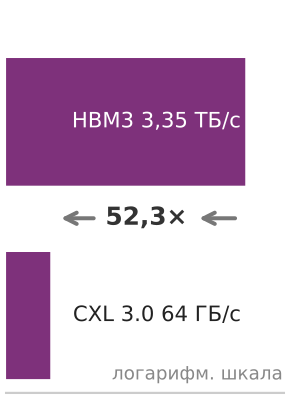
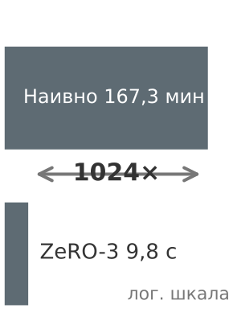

# Предисловие

## Для кого эта книга

Эта книга для всех, кто понимает машинное обучение на одной машине и теперь сталкивается с задачей заставить его работать в масштабе. Проблемы масштаба — не проблемы одного узла, только большего размера. Они качественно иные: сети разделяются, оборудование отказывает как статистическая неизбежность, а общественные последствия каждого проектного решения усиливаются миллионами пользователей.

Охват простирается от проектирования физической основы дата-центра ИИ через масштабирование обучения за пределы возможностей одного ускорителя до рассуждений о том, что происходит, когда промышленный парк обслуживает глобальную аудиторию. На всем протяжении внимание сосредоточено на физике распределения, на инвариантах, которые управляют любой ML-системой масштаба парка независимо от фреймворка, модели и эпохи.

## Зачем нужен учебник уровня парка

В 2012 году обучение AlexNet занимало пять-шесть суток на двух GPU (Krizhevsky et al., 2012). К 2023 году публичные оценки класса GPT-4 помещали передовое обучение примерно на 25 000 GPU в течение около трех месяцев (Patel и Wong, 2023); реальную аппаратную конфигурацию OpenAI не раскрывала (OpenAI et al., 2023). Это не та же инженерная задача в большем масштабе. Это категорически иная инженерная задача.

На одной машине производительность определяется стеной памяти — разрывом между скоростью процессора и пропускной способностью памяти. В распределенном кластере возникает новая стена: стена бисекционной пропускной способности, где минимальная пропускная способность сети, делящая кластер пополам, может ограничивать пропускную способность для трафика, который обязан пересечь это сечение. Данные больше не движутся только по локальным иерархиям; они проходят по оптическим фабрикам, подчиняясь скорости света между стойками и через континенты. Отказы оборудования, достаточно редкие на одной машине, чтобы считаться исключениями, на масштабе парка становятся рутинными статистическими событиями. Задание обучения, которое не планирует отказ, *откажет*.

Это не операционные неудобства. Это физические ограничения, столь же фундаментальные и постоянные, как стена памяти, закон Амдала или энергетическая цена перемещения данных. Они требуют собственной инженерной дисциплины с собственными инвариантами:

*   **Теорема о бисекционной пропускной способности**: для паттернов коммуникации, которым нужно пересечь минимальное сечение, пропускная способность ограничена пропускной способностью этого сечения.
*   **Закон парка**: каждый шаг обучения платит коммуникационный налог, который растет с размером кластера, пока вычисления на узел сокращаются.
*   **Закон контрольных точек Янга–Дэйли**: оптимальный интервал контрольных точек уравновешивает стоимость записи состояния и ожидаемую стоимость работы, потерянной из-за отказа.
*   **Закон доминирования стоимости обслуживания**: для промышленных моделей с высоким трафиком суммарные операционные расходы на инференс могут превысить разовую стоимость обучения, и эффективность обслуживания становится целью оптимизации жизненного цикла.
*   **Закон невозможности справедливости**: за исключением особых случаев вроде идеального предсказания или равных базовых частот, откалиброванные оценки риска, как правило, нельзя одновременно сделать равными по частоте ошибок между группами. Демографический паритет — отдельное ограничение на долю отбора, которое может добавить собственные компромиссы.

Если системная инженерия ML на одной машине спрашивает *«что может построить одна машина?»*, то системная инженерия ML в масштабе парка спрашивает *«что могут построить вместе тысяча машин и какой ценой для надежности, эффективности и общества?»*

Именно последняя оговорка отличает инженерию в масштабе парка. Одна машина влияет на своего пользователя; парк влияет на всех, кого затрагивают его выходы, в миллионах решений в секунду. В таком масштабе надежность, эффективность и справедливость перестают быть свойствами и становятся инженерными ограничениями, столь же жесткими, как пропускная способность или мощность. Система, которая масштабируется, но которой нельзя доверять, не была сконструирована. Ее просто увеличили.

Эта книга закладывает такой фундамент. Она следует педагогической модели Хеннесси и Паттерсона и переносит количественный, основанный на первых принципах подход на распределенный масштаб (Hennessy и Patterson, 2011; Hennessy и Patterson, 2019; Hennessy и Patterson, 2017). Как их работа научила целое поколение рассуждать о производительности процессоров из первых принципов, так эта книга учит читателя рассуждать о производительности парка, заменяя интуицию о распределенных системах измерением, а стихийное масштабирование — инженерией.

*Introduction to Machine Learning Systems* учила кирпичикам: тензорам, ядрам, иерархиям памяти и циклам оптимизации, из которых состоит любая система на одном узле. Парк строится не из большего числа кирпичиков. Это оркестр. Один музыкант способен создать музыку необыкновенной красоты, но оркестр — это не просто много музыкантов, играющих одновременно. Ему нужны дирижер, партитура, точная синхронизация и умение изящно восстановиться, когда игрок выбывает. Акустика концертного зала формирует звук так, как не может управлять ни один отдельный инструмент. Принципы, определяющие игру оркестра — координация, задержка коммуникации, отказоустойчивость и физика пространства исполнения, — категорически отличаются от тех, что определяют игру солиста. Парки ML устроены так же. Кластер обучения, парк обслуживания и граничное развертывание — совершенно разные системы, но под ними лежат одни и те же строительные блоки: стратегии параллелизма, примитивы коллективной коммуникации, протоколы контрольных точек, алгоритмы планирования и компромиссы между пропускной способностью, задержкой, отказоустойчивостью и стоимостью.

## О чем эта книга

Книга посвящена **парку машинного обучения**: складскому вычислителю, где сеть служит шиной, плотность мощности задает предел скорости, а отказ — не исключение, а статистическая неизбежность. Это единица современных вычислений ML, где модели, слишком большие для любого одного устройства, обучаются на тысячах ускорителей, обслуживаются миллионам пользователей и подчиняются ограничениям, которые охватывают инженерию, экономику и общество.

Содержание организовано в четыре части:

- **Часть I: Парк** строит физическую основу дата-центра ИИ с нуля: ландшафт распределенных ML-систем, кремний и охлаждение вычислительной инфраструктуры, сетевые фабрики, соединяющие тысячи ускорителей, и масштабируемое хранилище данных, которое питает конвейеры обучения.
- **Часть II: Распределенное ML** закладывает логику распределения за пределами одной машины: стратегии параллелизма (по данным, тензорный и конвейерный) для обучения моделей, слишком больших для одного устройства, примитивы коллективной коммуникации, синхронизирующие градиенты, механизмы отказоустойчивости, обеспечивающие надежность, когда отказ рутинен, и системы оркестрации, управляющие парком.
- **Часть III: Развертывание в масштабе** переносит обученную модель из кластера в мир: инженерия производительности ради эффективности, обслуживание инференса в огромном масштабе, граничный интеллект для устройств с ограниченными ресурсами и операционный жизненный цикл, необходимый для управления промышленными парками.
- **Часть IV: Ответственный парк** сталкивается с силами, которые определяют, служит ли парк пользователям или вредит им: безопасность и приватность, надежное проектирование систем, экологическая устойчивость и ответственная инженерия как ограничения, столь же фундаментальные, как плотность мощности или бисекционная пропускная способность.

Эти четыре части прослеживают путь по **стеку парка**: слоистой абстракции, которая расширяет классический стек систем ML на распределенный масштаб. Внизу **площадка и ускорители** и **фабрика и хранилище** образуют физическую основу. Выше **распределенное исполнение** и **надежность и управление** руководят параллельной работой, коммуникацией, планированием и восстановлением. Еще выше **среда выполнения и обслуживание** и **эксплуатация** доставляют модели пользователям и управляют производственным жизненным циклом. На вершине **гарантии** и **управление и устойчивое развитие** превращают доверие, риск, политику и экологическую цену в инженерные ограничения. Каждый уровень предоставляет абстракцию вышележащему и потребляет нижележащий. Инженерные решения внизу ограничивают возможности наверху.

В английском издании в начале каждой главы стоит врезка на полях, которая показывает, какой уровень стека глава рассматривает, и служит навигационным ориентиром (в русском издании эти врезки опущены). Яркость каждого уровня во врезках отражала, насколько сильно глава затрагивает этот ярус: ярче — главный фокус главы, тусклее — контекстная значимость, когда ограничения распространяются вверх. Так, в главе «Вычислительная инфраструктура» доминирует нижний ряд, потому что глава посвящена кремнию, питанию, охлаждению и физическому размещению. В главе «Распределенное обучение» ярче всего **распределенное исполнение**, а **надежность и управление** остается заметной, потому что крупные запуски обучения зависят от планирования и восстановления. В главе «Ответственный ИИ» главным становится **управление и устойчивое развитие**, а **гарантии** остаются сильными, потому что подотчетность зависит от измеримого доверия и контроля рисков. Один и тот же стек рассказывает три разные истории: решения на одном уровне отзываются на уровнях выше и ниже.

Небольшие визуальные заметки на полях стоят там, где связь быстрее всего схватывается глазом. Это вспомогательные средства чтения, а не рисунки, на которые потом ссылаются. В масштабе парка такая визуальная грамматика делает видимыми разрывы пропускной способности, радиус поражения отказа, соотношения контрольных точек и компромиссы энергии на границе, не прерывая рассуждения. Когда миниатюра использует логарифмическую шкалу, это сказано внутри изображения.

| | | | |
|:---:|:---:|:---:|:---:|
|  |  |  |  |

Каждая часть опирается на предыдущую, поэтому рекомендуется последовательное чтение. Приведенные ниже маршруты чтения дают альтернативы для читателей с конкретными целями.

## Рекомендуемые маршруты чтения

Читатели с разной подготовкой и целями могут выбрать один из нескольких путей через материал:

- **Полный путь** (все главы подряд): следует причинной цепочке ограничений, которые управляют парком ML, начиная с первых принципов распределения. Начните с части I, затем переходите к частям II, III и IV.
- **Инфраструктурный путь** (физический парк и оркестрация): сосредоточен на физической и операционной основе. Читайте часть I ([«Вычислительная инфраструктура»](02_compute_infrastructure.md#sec-compute-infrastructure), [«Сетевые фабрики»](03_network_fabrics.md#sec-network-fabrics), [«Хранение данных»](04_data_storage.md#sec-data-storage)) и [«Оркестрацию парка»](08_fleet_orchestration.md#sec-fleet-orchestration).
- **Путь масштабирования** (глубина распределенного обучения): бегло просмотрите часть I ради словаря инфраструктуры, затем сосредоточьтесь на главах [«Распределенное обучение»](05_distributed_training.md#sec-distributed-training-systems), [«Коллективные коммуникации»](06_collective_communication.md#sec-collective-communication), [«Отказоустойчивость»](07_fault_tolerance.md#sec-fault-tolerance-reliability) и [«Инженерия производительности»](09_performance_engineering.md#sec-performance-engineering).
- **Производственный путь** (развертывание и эксплуатация): после введения сосредоточьтесь на главах [«Инференс в масштабе»](10_inference.md#sec-inference-scale), [«Эксплуатация ML-систем в масштабе»](12_ops_scale.md#sec-ops-scale), [«Граничный интеллект»](11_edge_intelligence.md#sec-edge-intelligence) и главах части IV «Ответственный парк» ([«Безопасность и приватность»](13_security_privacy.md#sec-security-privacy), [«Надежный ИИ»](14_robust_ai.md#sec-robust-ai), [«Устойчивый ИИ»](15_sustainable_ai.md#sec-sustainable-ai) и [«Ответственный ИИ»](16_responsible_ai.md#sec-responsible-ai)).

## Условные обозначения

В этой книге используется небольшой набор типографских соглашений, которые показывают, что делает каждый фрагмент текста.

### Жирным выделяются первые определения

Термин **жирным** в основном тексте — его формальное первое введение в томе. Каждый термин получает такое выделение ровно один раз. Последующие упоминания идут без выделения: к этому моменту термин уже входит в рабочий словарь, который глава переносит дальше.

> Каждая система машинного обучения несет **двойную задачу**: она должна одновременно управлять статистической неопределенностью и физическими ограничениями.

Жирный шрифт — обязательство запомнить термин, потому что он будет повторяться. Соответствующая запись указателя в конце книги ведет к определяющему упоминанию (в подразделе «определение»), так что к нему можно вернуться. Ключевые технические термины также собраны в глоссарии.

Жирный шрифт выполняет и вторую, структурную роль: как функциональная метка в начале пункта внутри выделенного блока или маркированного итога, например **Рекомендация**, **Компромисс** или **Результат**. В этом контексте жирный шрифт — опорная конструкция, а не первое определение.

### Курсив выполняет конкретные риторические задачи

Курсив не используется для общего выделения. Каждый курсивный фрагмент книги выполняет одну из немногих конкретных задач:

- **Прямое противопоставление**: *обучение* и *инференс*, *логическое* и *физическое*.
- **Невозможность, сформулированная как физический, математический или логический закон**: «системы с задержкой менее 10 мс *не могут* использовать удаленную облачную инфраструктуру — этого не позволяет физика».
- **Слово как слово**: «термин *градиент* обозначает вектор частных производных».
- **Названия произведений**: *Computer Architecture: A Quantitative Approach*.
- **Тезис-вывод**: одно курсивное предложение, которое передает управляющее понимание раздела, например *Данные — это исходный код.*

Курсивное слово выполняет одну из этих задач. Слово без курсива не несет скрытого выделения.

### У выделенных блоков есть визуальная идентичность, соответствующая их задаче

Выделенные блоки — не украшение. Каждый тип сигнализирует о конкретном виде содержания, поэтому визуальная идентичность сообщает, что внутри, еще до того, как читатель начнет его разбирать. В русском издании блоки подписаны так:

| Блок                                  | Содержание                                                                                                                                                       |
|:--------------------------------------|:-----------------------------------------------------------------------------------------------------------------------------------------------------------------|
| **Определение**                       | Формальное определение ключевого термина с его значением, отличием от ближайшего соседнего понятия и типичной ошибкой                                             |
| **Пример**                            | Исторический случай или конкретный сценарий: контекст, понимание и системный урок                                                                                |
| **Перспектива**                       | Аналитическое наблюдение или математическая тонкость, обогащающие окружающую аргументацию                                                                        |
| **Сценарий** (расчет «на салфетке»)   | Разобранный пошагово расчет, где значения вычисляются по константам книги; промежуточные таблицы и уравнения и есть математика                                    |
| **Контрольные вопросы**               | Вопросы для самопроверки понимания предыдущего раздела                                                                                                            |
| **Случай из практики**                | Задокументированный инженерный инцидент с описанным режимом отказа: контекст, отказ, последствия и урок                                                           |
| **Архетип** («маячная» модель)        | Повторяющиеся нагрузки, описанные профилем (параметры, FLOP, доминирующее ограничение), которые используются как опорные кейсы в нескольких главах                  |
| **Принцип**                           | Канонический принцип или инвариант книги, на который ссылаются последующие главы                                                                                  |
| **Теорема**                           | Формальный результат или граница, подкрепленные уравнениями, с указанием условий и применением в последующем количественном анализе                               |
| **Ключевые выводы**                   | Четыре-семь важнейших результатов главы в сжатом виде                                                                                                             |
| **Цели обучения**                     | Навыки и понятия, которые читатель должен уметь объяснить или применить после главы                                                                              |
| **Связь с главой**                    | Мост от только что законченной главы к начинающейся, с указанием открытого вопроса, который решает следующая глава                                               |

Когда блок содержит таблицу, рисунок или уравнение, этот артефакт — часть педагогической единицы блока, а не украшение. Профиль архетипа *и есть* его характеристика; промежуточные таблицы блока с расчетом «на салфетке» *и есть* разобранная математика. Если читать эти артефакты отдельно, теряется дуга изложения. Самостоятельные справочные таблицы, напротив, стоят между абзацами как пронумерованные артефакты, к которым читатель возвращается по перекрестным ссылкам. Обе формы допустимы; визуальный признак (блок или отдельная таблица) показывает читателю, с чем он имеет дело.

## Учебная платформа

Какой бы маршрут ни выбрал читатель, эта книга — лишь один компонент более широкой учебной экосистемы. Полный текст, интерактивные блокноты, слайды лекций, упражнения, практические лабораторные работы и дополнительные материалы к каждой главе бесплатно доступны на [mlsysbook.ai](https://mlsysbook.ai).

## Открытый учебник

Эта книга создается в открытом доступе. Ее полный текст, рисунки и система сборки находятся на [mlsysbook.ai/git](https://mlsysbook.ai/git), и вклад каждого читателя приветствуется.

Это осознанный выбор. Если инженерия ИИ должна стать общей дисциплиной, а не набором разрозненных практик, ее базовые тексты должны быть доступны всем. Системы ML — область, которую формируют практики из промышленности, академической среды и сообщества открытого исходного кода по всему миру. Учебник по этой области должен отражать такую широту и быть доступным всем независимо от географии или институциональной принадлежности.

Вклад читателей, будь то исправление ошибки, предложение более ясного объяснения, добавление разобранного примера или предложение нового содержания, существенно улучшил каждую главу. Читателям, которые находят то, что можно сделать лучше, рекомендуется открыть обращение или отправить запрос на слияние. Книга становится лучше, потому что читатели участвуют в ее создании.

## Предварительные требования

Читателю потребуется следующая подготовка:

- **ML-системы на одной машине**: понимание рабочих процессов ML, обучения нейронных сетей, оптимизации моделей и развертывания на одной машине. Читатель должен свободно рассуждать об иерархиях памяти, вычислительных графах и взаимодействии аппаратуры с программным обеспечением.
- **Программирование**: свободное владение Python, включая функции, классы и работу с данными в NumPy. Знакомство по меньшей мере с одним ML-фреймворком (PyTorch, TensorFlow или JAX).
- **Математика**: уверенность в линейной алгебре, базовом математическом анализе и теории вероятностей на уровне бакалавриата.

Следующая подготовка полезна, но не обязательна:

- **Распределенные системы**: знакомство с понятиями сетей (TCP/IP, пропускная способность, задержка), параллелизмом и основами распределенных вычислений углубляет понимание глав об инфраструктуре парка и обучении.
- **Облачная инфраструктура**: опыт работы с контейнеризацией и оркестрацией (Docker и Kubernetes) или планировщиками кластеров (Slurm) дает полезный операционный контекст.
- **Промышленная инженерия**: понимание мониторинга, наблюдаемости и практик SRE (инженерии надежности сервисов) обогатит главы о развертывании и эксплуатации.

## За пределами книги

Книга охватывает парк машинного обучения таким, каким он существует сегодня: кластеры обучения складского масштаба, глобальная инфраструктура обслуживания и задачи управления при эксплуатации в масштабе. Темы переднего края исследований (в том числе полностью автономное управление парком, межсоединения следующего поколения, нейроморфные вычисления в масштабе и формальная верификация свойств безопасности на уровне парка) выходят за рамки книги, но остаются активными областями исследований.

## Использование книги в курсе

Книга выросла из курса CS249r в Гарвардском университете и программы [профессионального сертификата TinyML на edX](https://www.edx.org/professional-certificate/harvardx-tiny-machine-learning). Это преподавание укрепило наблюдение, которое переносится на масштаб парка: одна и та же физика управляет каждым уровнем иерархии. Пропускная способность, энергия и отказы задают пределы и на микроконтроллере, и в дата-центре. С масштабом меняется не физика, а то, какой предел связывает, и новый связывающий предел — это новая инженерная задача. На одной машине доминирует стена памяти. В парке верх берут бисекционная пропускная способность и рутинные отказы оборудования, и то, что раньше было редким исключением, становится ограничением, вокруг которого проектируется вся система. Физика непрерывна; инженерия — нет.

Книга рассчитана на продвинутый односеместровый курс, охватывающий весь стек распределенных систем ML. Преподаватели могут также выбрать отдельные части для более коротких модулей:

- **Части I–II** (Парк и Распределенное ML) подходят для продвинутого полусеместра по инфраструктуре распределенного обучения.
- **Части III–IV** (Развертывание в масштабе и Ответственный парк) подходят для прикладного полусеместра по промышленному ML в масштабе.

Для обзорных курсов или программ для руководителей одних только введений к четырем частям и их управляющих принципов достаточно для сжатого обзора количественных законов, которые управляют ML-системами масштаба парка.

Слайды, задания и материалы для преподавателей продвинутого курса доступны на [mlsysbook.ai](https://mlsysbook.ai).

## Авторские права и лицензия

© Vijay Janapa Reddi и MIT Press. Эта работа распространяется по лицензии Creative Commons «Атрибуция — Некоммерческое использование — Без производных произведений 4.0 Международная» ([CC BY-NC-ND 4.0](https://creativecommons.org/licenses/by-nc-nd/4.0)). Исходный текст доступен на [mlsysbook.ai/git](https://mlsysbook.ai/git).

*Примечание переводчика: условия, на которых распространяется этот русский перевод, указаны на странице [«Уведомление об авторстве»](notice.md).*
